# 전체 구성과 진입점

[전체 목차](README.md) · [분야별 기능 목록](02-features.md) · [진입점 인벤토리](evidence/entrypoint-inventory.json)

이 지도는 고정 작업트리에 실제 존재하는 구성요소와 연결을 설명한다. 선언·설정·코드의 존재, 제품 활성 경로, 운영 환경에서의 실제 실행은 별개다.

[Mermaid 원본](diagrams/architecture.mmd) · [앱 내부와 서버 상세 연결도](rendered/architecture-detail.svg) · [상세 Mermaid](diagrams/architecture-detail.mmd)

## 구성요소와 실행 시작

| 구성요소 | 실행 진입점 | 담당 분야와 활성 경계 |
|---|---|---|
| 사용자 Android | app manifest → WalkSafeApplication / MainActivity | D01–D07. MainActivity는 계정·온보딩·홈·목적지·안내·설정을 조합 |
| 사용자 음성 서비스 | WalkVoiceForegroundService START/STOP intent | D03. foreground 서비스·앱 전경 입력 사이 소유권 연결 |
| 신고 정리 Job | WalkSafeApplication → ReportQueueCleanupJobService | D06. UI와 독립된 정리 진입점 |
| 관리자 Android | adminapp manifest → AdminBoundaryActivity | D12. 보안 기능 활성, 운영 기능은 release/default 비활성·debug 설정 조건 |
| 위치 평가 Android | positionevalapp manifest → MainActivity / AnalysisCoordinator | D16. 별도 설치 앱; 제품 앱의 GNSS/PDR 실행과 구분 |
| Android Gateway | server.ts → node-adapter → routes / route-registry | D08. 사용자 클라이언트의 계정·세션·업무 proxy와 삭제 outbox |
| Backend | app/main.py FastAPI → router와 lifespan | D09·D13–D15. 추론/경로, 계정/privacy/raw, 관리자보안, 신고·저장 |
| Voice | voice/server.py FastAPI → inference_process | D10. STT/TTS/intent·worker·model integrity |
| 모델·데이터 | model/*.py, data_sources/scripts, 관련 scripts CLI | D10. Python 모델 runtime 일부는 Backend에서 import; Android 자산 설정은 D05 |
| 운영·검증 | deploy/systemd, .github/workflows, scripts, tests, tools | D11. 실행 파일과 과거 통제자료 구분; 설치/활성 운영상태는 이번 조사 대상 실행 증거 없음 |
| Web | apps/web/proxy.ts | D11. 전 경로 410, 제품 경계 LEGACY_REFERENCE_ONLY. 보존 소스 존재를 활성 서비스로 그리지 않음 |

## 사용자 앱의 주요 시작점

기준 경로 `apps/android/app/src/main/java/kr/co/hanium/dreamup/walksafe/`의 MainActivity는 `onCreate`, `onResume`, `onPause`, `onDestroy`, `onRequestPermissionsResult`를 통해 준비·중단·복구를 조정한다. 화면 이벤트 외에 충전 broadcast, 네트워크 callback, 위치 callback, GNSS/걸음/방향 callback, CameraX analyzer, ARCore frame, 세션 갱신 타이머, 경로 snapshot 만료와 발화 재전달 작업이 있다.

`NativeUiPage`는 HOME, DESTINATION_SEARCH, DESTINATION_CONFIRM, GUIDANCE, VOICE_COMMAND, SETTINGS를 구분한다. 실제 화면 수는 홈 버튼 수와 같지 않다. `handleVoiceCommandPhrases` → `AndroidVoiceCommand` → `executeVoiceAction`은 UI 버튼과 별개 진입 경로다.

코드 근거: [manifest](/home/ddobagi/Hanium_Dreamup/apps/android/app/src/main/AndroidManifest.xml:31), [MainActivity 초기화](/home/ddobagi/Hanium_Dreamup/apps/android/app/src/main/java/kr/co/hanium/dreamup/walksafe/MainActivity.kt:2916), [화면 상태](/home/ddobagi/Hanium_Dreamup/apps/android/app/src/main/java/kr/co/hanium/dreamup/walksafe/MainActivity.kt:15701), [음성 명령](/home/ddobagi/Hanium_Dreamup/apps/android/app/src/main/java/kr/co/hanium/dreamup/walksafe/MainActivity.kt:41623).

## 연결을 오해하기 쉬운 경계

- **관리자 앱은 Backend에 직접 연결한다.** AdminBoundaryActivity는 WALKSAFE_ADMIN_API_ORIGIN으로 보안·운영 client를 구성한다. 사용자용 Gateway를 필수 경유하지 않는다.
- **현재 사용자 영상 추론은 Android TFLite 경로다.** Backend /detect와 /detect/v2 API도 존재하지만 Gateway 공개 route 목록에는 없으며 사용자 앱 필수 추론 단계라는 근거가 없다.
- **Android 현재 모델 설정과 과거 배포 기록은 다르다.** Android config는 unified_walksafe·21class walkmate YOLO11n·fallback null이다. model/deployments의 13class 기록을 현재 Android 사실로 사용하지 않는다.
- **평가 앱은 별도 launcher다.** 평가용 trace/RINEX 분석은 제품 보행 동작이나 현장 위치 정확도 검증 완료를 의미하지 않는다.
- **시각 시험 overlay는 격리 지원 코드다.** tools/visual-test/overlay 및 prepare_visual_test_workspace.sh의 결과를 원본 앱 동작으로 혼동하지 않는다.
- **systemd 파일 존재는 활성 서비스 증거가 아니다.** timer/service의 설정 동작은 설명하지만 이번 작업에서 서비스 설치·재시작·실행 상태 검증을 수행하지 않았다.

근거: [관리자 API 연결](/home/ddobagi/Hanium_Dreamup/apps/android/adminapp/src/main/java/kr/co/hanium/dreamup/walksafe/admin/AdminBoundaryActivity.java:542), [관리자 빌드 조건](/home/ddobagi/Hanium_Dreamup/apps/android/adminapp/build.gradle.kts:80), [Backend router](/home/ddobagi/Hanium_Dreamup/backend/app/main.py:543), [Android 모델 설정](/home/ddobagi/Hanium_Dreamup/apps/android/app/src/main/assets/model-config/two_model_runtime.json:3), [Web 차단](/home/ddobagi/Hanium_Dreamup/apps/web/proxy.ts:3).

## 분야를 나눈 기준과 기존 목록의 관계

새 분야는 실제 실행 책임·상태·호출 경계로 분리했다. 기존 21분야와 추가 motion은 개선 항목의 분류이며 새 기능의 개수나 활성 상태를 결정하지 않는다. 기존 항목→분야 후보는 탐색용, 개별 source_id→기능 연결은 명시 근거가 있을 때만 직접 대응으로 기록한다. 자세한 대응과 미연결은 [추적표](04-traceability.md)에 남긴다.

## 조사 범위의 한계

선언 패턴 인벤토리는 HTTP route, CLI main, Android component/callback, UI listener, systemd 진입을 추출한다. 동적 문자열, 반사, 조건부 등록, 배포 환경 값과 호출 가능성을 완전하게 해석하는 정적 call graph는 아니다. 각 분야의 읽은 파일·부분 확인·미검토를 [검수 보고](08-review.md)와 상세본에서 확인한다. 외부 라이브러리 내부 전체, 대규모 vendor 코드와 모든 역사 문서의 전문은 전수 검토하지 않았다.
