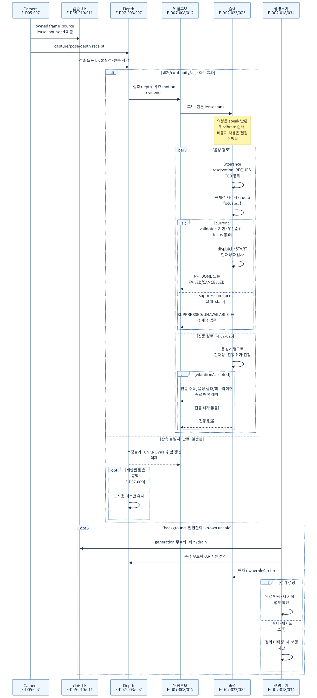
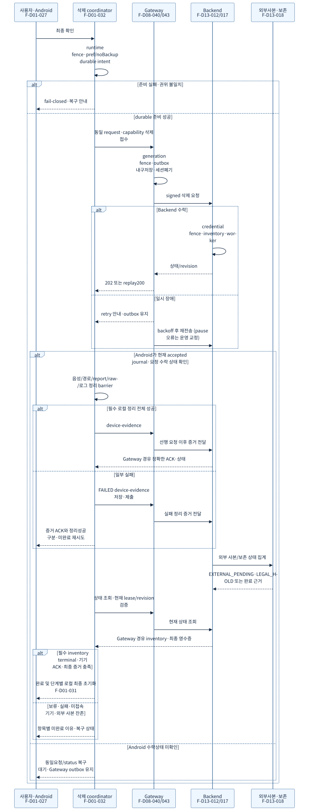

# 주요 사용자 시나리오와 분야 간 연결

[전체 목차](README.md) · [동시성·상태 인덱스](06-concurrency.md) · [정책 목록](03-policies.md)

아래는 고정 작업 사본의 구현 연결을 정리한 **정적 시나리오**다. 실제 기기·서버·외부 서비스에서 이 경로를 이번에 실행한 기록이 아니다. 각 기능의 세부 분기·정책·수치·자원 정리는 연결된 상세 명세를 기준으로 한다. 서로 다른 컴포넌트의 상태를 하나의 전역 상태기계로 가정하지 않는다.

## SC-01 · 가입부터 첫 보행 시작까지

가입 동의와 입력 검사를 거쳐 OTP를 요청하고 확인한다. Android→Gateway→Backend의 각 검증과 중복 요청 식별자가 적용된다. OTP 확인 후 자동 로그인이 실패하면 계정 생성 성공과 로그인 실패를 구분해야 한다. 검증된 로그인 이후 목적별 권한 관찰과 기기 검사, FP004 교육·연습 순서를 따른다. 교육·권한·사용 환경·기기 검사를 통과해도 보행은 자동 시작되지 않는다. 현재 확인 토큰과 준비 증거, Gateway의 보행 권한을 다시 확인한 명시적 시작이 필요하다.

거부·만료·서버 장애·오래된 callback은 해당 단계에 머무르거나 복구 안내로 끝난다. 다른 기기의 보행과 충돌하면 자동 takeover하지 않는다. 준비 조건이 현재 활성 모드를 더 이상 만족하지 못하면 일시중지나 안전 중단 경로가 적용되며, SAFE_STOP에서 단순 재개는 허용되지 않는다.

[원본](diagrams/sc-01.mmd) · [확대 그림](rendered/sc-01.svg)

|기능|적용 정책|주요 코드 근거|
|---|---|---|
|[F-D01-001 회원가입 동의 화면과 로그인 전환](domains/D01.md#F-D01-001)|[P-D01-001](domains/D01.md#P-D01-001) · [P-D01-005](domains/D01.md#P-D01-005)|[accountConsentContinueButton / accountSignupToggleButton](/home/ddobagi/Hanium_Dreamup/apps/android/app/src/main/java/kr/co/hanium/dreamup/walksafe/MainActivity.kt:18650)|
|[F-D01-003 이메일 OTP 요청·발송 대기·동일 요청 재시도](domains/D01.md#F-D01-003)|[P-D01-002](domains/D01.md#P-D01-002) · [P-D01-003](domains/D01.md#P-D01-003) · [P-D01-004](domains/D01.md#P-D01-004) · [P-D01-005](domains/D01.md#P-D01-005) · [P-D01-024](domains/D01.md#P-D01-024)|[requestEmailAccountOtp](/home/ddobagi/Hanium_Dreamup/apps/android/app/src/main/java/kr/co/hanium/dreamup/walksafe/MainActivity.kt:8834) · [EmailOtpRequestRetryPolicy](/home/ddobagi/Hanium_Dreamup/apps/android/app/src/main/java/kr/co/hanium/dreamup/walksafe/network/EmailOtpRequestRetryPolicy.kt:1)|
|[F-D01-005 OTP 확인·계정 생성·생성 후 자동 로그인](domains/D01.md#F-D01-005)|[P-D01-001](domains/D01.md#P-D01-001) · [P-D01-002](domains/D01.md#P-D01-002) · [P-D01-003](domains/D01.md#P-D01-003) · [P-D01-005](domains/D01.md#P-D01-005) · [P-D01-024](domains/D01.md#P-D01-024)|[createEmailAccount](/home/ddobagi/Hanium_Dreamup/apps/android/app/src/main/java/kr/co/hanium/dreamup/walksafe/MainActivity.kt:8983) · [createAccount](/home/ddobagi/Hanium_Dreamup/apps/android/app/src/main/java/kr/co/hanium/dreamup/walksafe/network/GatewayAccountClient.kt:88)|
|[F-D01-006 이메일·비밀번호 로그인과 계정 상태 결속](domains/D01.md#F-D01-006)|[P-D01-002](domains/D01.md#P-D01-002) · [P-D01-005](domains/D01.md#P-D01-005) · [P-D01-006](domains/D01.md#P-D01-006) · [P-D01-024](domains/D01.md#P-D01-024)|[loginEmailAccount](/home/ddobagi/Hanium_Dreamup/apps/android/app/src/main/java/kr/co/hanium/dreamup/walksafe/MainActivity.kt:9104) · [loginWithPassword](/home/ddobagi/Hanium_Dreamup/apps/android/app/src/main/java/kr/co/hanium/dreamup/walksafe/network/GatewayFieldSession.kt:796)|
|[F-D01-012 안전·앱 필요성 설명 청취와 명시적 교육 동의](domains/D01.md#F-D01-012)|[P-D01-009](domains/D01.md#P-D01-009) · [P-D01-011](domains/D01.md#P-D01-011)|[playNativeSafetyEducation / confirmNativeEducationWithScreenReader](/home/ddobagi/Hanium_Dreamup/apps/android/app/src/main/java/kr/co/hanium/dreamup/walksafe/MainActivity.kt:16973) · [PriorityUserOnboardingPolicy / reviewSafetyEducation](/home/ddobagi/Hanium_Dreamup/apps/android/app/src/main/java/kr/co/hanium/dreamup/walksafe/session/PriorityUserOnboardingPolicy.kt:286)|
|[F-D01-019 최초 필수 OS 권한 요청과 설정·종료 안내](domains/D01.md#F-D01-019)|[P-D01-012](domains/D01.md#P-D01-012)|[requiredPostLoginDeviceCheckPermissions / requestInitialAppEntryPermissionsIfNeeded](/home/ddobagi/Hanium_Dreamup/apps/android/app/src/main/java/kr/co/hanium/dreamup/walksafe/MainActivity.kt:22909) · [showRequiredAppPermissionExit](/home/ddobagi/Hanium_Dreamup/apps/android/app/src/main/java/kr/co/hanium/dreamup/walksafe/MainActivity.kt:17208)|
|[F-D02-002 행동별 준비 증거 집계](domains/D02.md#F-D02-002)|[P-D02-002](domains/D02.md#P-D02-002)|[data class WalkSessionReadinessPlan](/home/ddobagi/Hanium_Dreamup/apps/android/app/src/main/java/kr/co/hanium/dreamup/walksafe/session/WalkSessionReadiness.kt:48) · [WalkSessionFeatureReadiness](/home/ddobagi/Hanium_Dreamup/apps/android/app/src/main/java/kr/co/hanium/dreamup/walksafe/session/WalkSessionFeatureReadiness.kt:12)|
|[F-D02-005 로그인 후 사용자 시작 기기 검사](domains/D02.md#F-D02-005)|[P-D02-005](domains/D02.md#P-D02-005)|[class PostLoginDeviceCheck](/home/ddobagi/Hanium_Dreamup/apps/android/app/src/main/java/kr/co/hanium/dreamup/walksafe/device/PostLoginDeviceCheckPolicy.kt:3) · [private fun beginPostLoginDeviceCheck](/home/ddobagi/Hanium_Dreamup/apps/android/app/src/main/java/kr/co/hanium/dreamup/walksafe/MainActivity.kt:22795)|
|[F-D02-001 명시 시작·일시중지·재개 확인과 모드 보존](domains/D02.md#F-D02-001)|[P-D02-001](domains/D02.md#P-D02-001)|[class WalkSessionLifecycle](/home/ddobagi/Hanium_Dreamup/apps/android/app/src/main/java/kr/co/hanium/dreamup/walksafe/session/WalkSessionLifecycle.kt:197) · [private fun transitionWalkSession](/home/ddobagi/Hanium_Dreamup/apps/android/app/src/main/java/kr/co/hanium/dreamup/walksafe/MainActivity.kt:28459)|
|[F-D08-017 보행 시작·중복 시작](domains/D08.md#F-D08-017)|[P-D08-013](domains/D08.md#P-D08-013) · [P-D08-014](domains/D08.md#P-D08-014) · [P-D08-021](domains/D08.md#P-D08-021)|[commandFieldWalk start](/home/ddobagi/Hanium_Dreamup/apps/android-gateway/src/field-walk-ledger.ts:2167)|
|[F-D13-001 이메일 OTP 발급과 동일 요청 재생](domains/D13.md#F-D13-001)|[P-D13-001](domains/D13.md#P-D13-001)|[AccountService.issue_email_otp](/home/ddobagi/Hanium_Dreamup/backend/app/services/accounts.py:881) · [create_router.create_email_otp_enrollment](/home/ddobagi/Hanium_Dreamup/backend/app/api/accounts.py:163)|
|[F-D13-003 OTP 검증 후 계정 생성과 가입동의 영수증](domains/D13.md#F-D13-003)|[P-D13-003](domains/D13.md#P-D13-003)|[AccountService.create_account](/home/ddobagi/Hanium_Dreamup/backend/app/services/accounts.py:1283) · [is_common_or_trivial_password](/home/ddobagi/Hanium_Dreamup/backend/app/services/account_password_policy.py:101)|

## SC-02 · 음성 목적지 선택부터 경로 종료까지

현재 제품의 명령 실행은 Android 로컬 인식·파서에서 시작한다. 서버 AAC 음성 호출 경로 F-D03-040은 Main 호출 연결이 확인되지 않으므로 이 시나리오의 필수 단계로 넣지 않는다. 후보 낭독 완료는 선택 권한과 연결되지만, 후보 선택 자체는 길안내 시작이 아니다. 별도의 시작 확인 후 현재 위치·계정·보행 소유권으로 경로를 요청한다.

Backend는 TMAP 결과를 검증하고 Android는 현재 위치와 응답 경로의 연결을 다시 확인한다. 일반적인 교체 실패는 기존 경로를 유지한다. 다만 정상모드의 archive 실패와 countable provider 연속 2회 실패는 안전 중단·새 명시 시작 경로로 이어진다. archive load는 저장한 최초 응답 확인이며 프로세스 재시작 시 자동 길안내 복원의 근거가 아니다. 이탈은 명시 재탐색, 도착은 사용자 확인과 연결된다. 음성 대화 취소·목적지 선택 취소·길안내 종료·보행 종료는 다른 동작이다.

[원본](diagrams/sc-02.mmd) · [확대 그림](rendered/sc-02.svg)

|기능|적용 정책|주요 코드 근거|
|---|---|---|
|[F-D03-006 호출어 추출과 final 신뢰도 검증](domains/D03.md#F-D03-006)|[P-D03-006](domains/D03.md#P-D03-006)|[WakePhraseCommandExtractor](/home/ddobagi/Hanium_Dreamup/apps/android/app/src/main/java/kr/co/hanium/dreamup/walksafe/voice/WakePhraseCommandExtractor.kt:1) · [VoskTranscript.commandSpanOrNull](/home/ddobagi/Hanium_Dreamup/apps/android/app/src/main/java/kr/co/hanium/dreamup/walksafe/voice/VoskTranscript.kt:1)|
|[F-D03-009 보행 중 hands-free 음성 상태기계](domains/D03.md#F-D03-009)|[P-D03-009](domains/D03.md#P-D03-009)|[HandsFreeVoiceStateMachine](/home/ddobagi/Hanium_Dreamup/apps/android/app/src/main/java/kr/co/hanium/dreamup/walksafe/voice/HandsFreeVoiceStateMachine.kt:1) · [HandsFreeVoiceController](/home/ddobagi/Hanium_Dreamup/apps/android/app/src/main/java/kr/co/hanium/dreamup/walksafe/voice/HandsFreeVoiceController.kt:1)|
|[F-D03-013 한국어 명령 파싱·단일 후보 선택](domains/D03.md#F-D03-013)|[P-D03-013](domains/D03.md#P-D03-013)|[AndroidVoiceCommand / AndroidVoiceAction](/home/ddobagi/Hanium_Dreamup/apps/android/app/src/main/java/kr/co/hanium/dreamup/walksafe/navigation/AndroidVoiceCommand.kt:1) · [selectAndroidVoiceAction / parseAndroidVoiceCommand](/home/ddobagi/Hanium_Dreamup/apps/android/app/src/main/java/kr/co/hanium/dreamup/walksafe/navigation/AndroidVoiceCommand.kt:247)|
|[F-D03-018 검색 전용 현재위치 취득과 계정별 cache](domains/D03.md#F-D03-018)|[P-D03-018](domains/D03.md#P-D03-018)|[DestinationSearchLocationPolicy / DestinationSearchLocationController](/home/ddobagi/Hanium_Dreamup/apps/android/app/src/main/java/kr/co/hanium/dreamup/walksafe/navigation/DestinationSearchLocationController.kt:1) · [AndroidDestinationSearchLocationSource](/home/ddobagi/Hanium_Dreamup/apps/android/app/src/main/java/kr/co/hanium/dreamup/walksafe/navigation/AndroidDestinationSearchLocationSource.kt:1)|
|[F-D03-019 고정 후보 목록 검색 요청과 응답 검증](domains/D03.md#F-D03-019)|[P-D03-019](domains/D03.md#P-D03-019) · [P-D03-025](domains/D03.md#P-D03-025)|[searchDestinations / parseDestinationSearchResponse](/home/ddobagi/Hanium_Dreamup/apps/android/app/src/main/java/kr/co/hanium/dreamup/walksafe/navigation/BackendWalkingRouteClient.kt:55) · [parseDestinationSearchResponse](/home/ddobagi/Hanium_Dreamup/apps/android/app/src/main/java/kr/co/hanium/dreamup/walksafe/navigation/BackendWalkingRouteClient.kt:542)|
|[F-D03-021 후보 page 전체 낭독과 선택 권한 lease](domains/D03.md#F-D03-021)|[P-D03-021](domains/D03.md#P-D03-021)|[DestinationSearchVoiceState](/home/ddobagi/Hanium_Dreamup/apps/android/app/src/main/java/kr/co/hanium/dreamup/walksafe/navigation/AndroidVoiceCommand.kt:69) · [HomeDestinationVoiceDialogLease](/home/ddobagi/Hanium_Dreamup/apps/android/app/src/main/java/kr/co/hanium/dreamup/walksafe/navigation/HomeDestinationVoiceDialogLease.kt:1)|
|[F-D03-023 후보 선택과 목적지 변경의 별도 시작 확인](domains/D03.md#F-D03-023)|[P-D03-023](domains/D03.md#P-D03-023)|[selectVoiceDestinationCandidate / startPendingWalkingDestinationChange](/home/ddobagi/Hanium_Dreamup/apps/android/app/src/main/java/kr/co/hanium/dreamup/walksafe/MainActivity.kt:42601) · [WalkingDestinationChangeConfirmation](/home/ddobagi/Hanium_Dreamup/apps/android/app/src/main/java/kr/co/hanium/dreamup/walksafe/navigation/WalkingDestinationChangeConfirmation.kt:1)|
|[F-D03-024 명시적 첫 시작의 위치 대기와 한 번 소비](domains/D03.md#F-D03-024)|[P-D03-024](domains/D03.md#P-D03-024)|[PendingExplicitRouteStart](/home/ddobagi/Hanium_Dreamup/apps/android/app/src/main/java/kr/co/hanium/dreamup/walksafe/navigation/PendingExplicitRouteStart.kt:1) · [retainPendingExplicitRouteStart / continuePendingExplicitRouteStartIfReady](/home/ddobagi/Hanium_Dreamup/apps/android/app/src/main/java/kr/co/hanium/dreamup/walksafe/MainActivity.kt:44304)|
|[F-D03-027 경로 생성·교체와 늦은 응답 설치 fence](domains/D03.md#F-D03-027)|[P-D03-025](domains/D03.md#P-D03-025) · [P-D03-026](domains/D03.md#P-D03-026) · [P-D03-027](domains/D03.md#P-D03-027)|[requestRoute](/home/ddobagi/Hanium_Dreamup/apps/android/app/src/main/java/kr/co/hanium/dreamup/walksafe/MainActivity.kt:46336) · [routeResponseInstallLocationStatus](/home/ddobagi/Hanium_Dreamup/apps/android/app/src/main/java/kr/co/hanium/dreamup/walksafe/MainActivity.kt:820)|
|[F-D03-030 경로 설치·현재 진행도·품질 중단 상태](domains/D03.md#F-D03-030)|[P-D03-030](domains/D03.md#P-D03-030)|[setRoute / clear / onUntrustedLocation](/home/ddobagi/Hanium_Dreamup/apps/android/app/src/main/java/kr/co/hanium/dreamup/walksafe/navigation/RouteNavigator.kt:128) · [updateInternal](/home/ddobagi/Hanium_Dreamup/apps/android/app/src/main/java/kr/co/hanium/dreamup/walksafe/navigation/RouteNavigator.kt:941)|
|[F-D03-035 확정 이탈·명시 재탐색·실패 시 기존경로 보존](domains/D03.md#F-D03-035)|[P-D03-034](domains/D03.md#P-D03-034) · [P-D03-035](domains/D03.md#P-D03-035)|[selectDeviationChoice / rerouteRequestFailed](/home/ddobagi/Hanium_Dreamup/apps/android/app/src/main/java/kr/co/hanium/dreamup/walksafe/navigation/RouteNavigator.kt:739) · [updateInternal](/home/ddobagi/Hanium_Dreamup/apps/android/app/src/main/java/kr/co/hanium/dreamup/walksafe/navigation/RouteNavigator.kt:990)|
|[F-D03-036 자동 도착 후보 판정과 사용자 확인](domains/D03.md#F-D03-036)|[P-D03-036](domains/D03.md#P-D03-036)|[confirmArrival / rejectArrival](/home/ddobagi/Hanium_Dreamup/apps/android/app/src/main/java/kr/co/hanium/dreamup/walksafe/navigation/RouteNavigator.kt:831) · [arrival evidence](/home/ddobagi/Hanium_Dreamup/apps/android/app/src/main/java/kr/co/hanium/dreamup/walksafe/navigation/RouteNavigator.kt:990)|
|[F-D03-017 대화 취소·목적지 취소·길안내 종료의 구분](domains/D03.md#F-D03-017)|[P-D03-017](domains/D03.md#P-D03-017)|[cancelVoiceDialogFromVoice / confirmGuidanceStopFirst](/home/ddobagi/Hanium_Dreamup/apps/android/app/src/main/java/kr/co/hanium/dreamup/walksafe/MainActivity.kt:42063) · [cancelDestinationFromVoice](/home/ddobagi/Hanium_Dreamup/apps/android/app/src/main/java/kr/co/hanium/dreamup/walksafe/MainActivity.kt:42534)|
|[F-D08-022 보행 경로 검색 중계](domains/D08.md#F-D08-022)|[P-D08-004](domains/D08.md#P-D08-004) · [P-D08-011](domains/D08.md#P-D08-011) · [P-D08-013](domains/D08.md#P-D08-013) · [P-D08-015](domains/D08.md#P-D08-015) · [P-D08-029](domains/D08.md#P-D08-029)|[walkingRoute / walkingRoutePayloadValid](/home/ddobagi/Hanium_Dreamup/apps/android-gateway/src/routes.ts:1244)|
|[F-D09-015 TMAP 보행 경로 HTTP 요청](domains/D09.md#F-D09-015)|[P-D09-015](domains/D09.md#P-D09-015)|[_until_disconnect](/home/ddobagi/Hanium_Dreamup/backend/app/api/navigation.py:25) · [fetch_tmap_pedestrian_route](/home/ddobagi/Hanium_Dreamup/backend/app/services/tmap_pedestrian.py:1390)|
|[F-D04-018 위치 신뢰도 안내 중지·회복 상태와 알림 토큰](domains/D04.md#F-D04-018)|[P-D04-018](domains/D04.md#P-D04-018)|[observe / evaluate / applyQuality / commitAnnouncementDelivered](/home/ddobagi/Hanium_Dreamup/apps/android/app/src/main/java/kr/co/hanium/dreamup/walksafe/navigation/positioning/PositionConfidencePolicy.kt:3) · [applyPositionConfidenceDecision](/home/ddobagi/Hanium_Dreamup/apps/android/app/src/main/java/kr/co/hanium/dreamup/walksafe/MainActivity.kt:44246)|

## SC-03 · 카메라 관측부터 위험 출력·정리까지

카메라 프레임의 캡처·시각 추적·검출 결과와 ARCore 깊이는 서로 다른 시각과 소유권을 갖는다. 합성 시 원본 프레임·측정 age·물질점·객체 연속성 조건을 만족해야 한다. 짧은 공백의 표시용 예측, 실제 위험 산출, 화면 숫자 유지 시간을 서로 같은 승인으로 취급하지 않는다. UNKNOWN이나 출력 보류를 물리적 안전의 증거로 읽지 않는다.

위험 후보는 우선순위·중복·동일 위험 교체·현재 음성 소유권·audio focus·시작 시한을 거친다. 전송 또는 출력 요청이 접수된 시점과 실제 TTS DONE은 다르다. 배경 전환·권한 철회·안전 중단은 소유권을 무효화하고 각 작업을 정리하며, 옛 callback은 새 세션이나 새 출력의 상태를 바꿀 수 없다.

[원본](diagrams/sc-03.mmd) · [확대 그림](rendered/sc-03.svg)

|기능|적용 정책|주요 코드 근거|
|---|---|---|
|[F-D05-007 Main 카메라 프레임 접수·검출 publication](domains/D05.md#F-D05-007)|[P-D05-007](domains/D05.md#P-D05-007)|[copyRuntimeRecognitionInput](/home/ddobagi/Hanium_Dreamup/apps/android/app/src/main/java/kr/co/hanium/dreamup/walksafe/MainActivity.kt:14060) · [scheduleDetectionIfDue](/home/ddobagi/Hanium_Dreamup/apps/android/app/src/main/java/kr/co/hanium/dreamup/walksafe/MainActivity.kt:34324)|
|[F-D05-009 검출 실패·출력 신선도·native stall 감독](domains/D05.md#F-D05-009)|[P-D05-009](domains/D05.md#P-D05-009)|[class DetectorRuntimeSupervisor](/home/ddobagi/Hanium_Dreamup/apps/android/app/src/main/java/kr/co/hanium/dreamup/walksafe/inference/DetectorRuntimeSupervisor.kt:55) · [beginNativeDetectorFlight](/home/ddobagi/Hanium_Dreamup/apps/android/app/src/main/java/kr/co/hanium/dreamup/walksafe/MainActivity.kt:34102)|
|[F-D05-010 시각 프레임 ring·검출 source lease·작업 예산](domains/D05.md#F-D05-010)|[P-D05-010](domains/D05.md#P-D05-010)|[data class VisualTrackingConfig](/home/ddobagi/Hanium_Dreamup/apps/android/app/src/main/java/kr/co/hanium/dreamup/walksafe/inference/tracking/VisualTrackingContracts.kt:129) · [class GrayTrackingFrame](/home/ddobagi/Hanium_Dreamup/apps/android/app/src/main/java/kr/co/hanium/dreamup/walksafe/inference/tracking/GrayTrackingFrame.kt:17)|
|[F-D05-011 OpenCV 광류·실제 물질점·추적 소실 판정](domains/D05.md#F-D05-011)|[P-D05-011](domains/D05.md#P-D05-011)|[class OpenCvPyramidalMotionEstimator](/home/ddobagi/Hanium_Dreamup/apps/android/app/src/main/java/kr/co/hanium/dreamup/walksafe/inference/tracking/OpenCvPyramidalMotionEstimator.kt:31) · [interface VisualMotionEstimator](/home/ddobagi/Hanium_Dreamup/apps/android/app/src/main/java/kr/co/hanium/dreamup/walksafe/inference/tracking/VisualMotionEstimator.kt:42)|
|[F-D07-003 깊이 좌표와 원본 관측 시계·age lease](domains/D07.md#F-D07-003)|[P-D07-003](domains/D07.md#P-D07-003)|[CoordinateMapper](/home/ddobagi/Hanium_Dreamup/apps/android/app/src/main/java/kr/co/hanium/dreamup/walksafe/depth/CoordinateMapper.kt:1) · [depthPixelToCameraPoint](/home/ddobagi/Hanium_Dreamup/apps/android/app/src/main/java/kr/co/hanium/dreamup/walksafe/depth/DepthGeometry.kt:1)|
|[F-D07-007 현재 LK 프레임과 detector source의 깊이 합성](domains/D07.md#F-D07-007)|[P-D07-007](domains/D07.md#P-D07-007)|[CurrentTrackedFrameObservation](/home/ddobagi/Hanium_Dreamup/apps/android/app/src/main/java/kr/co/hanium/dreamup/walksafe/depth/CurrentTrackedFrameObservation.kt:1) · [ObjectDepthRuntimePipeline](/home/ddobagi/Hanium_Dreamup/apps/android/app/src/main/java/kr/co/hanium/dreamup/walksafe/depth/ObjectDepthRuntimePipeline.kt:1)|
|[F-D07-008 독립 depth 접근 속도·접근 시간·point CPA](domains/D07.md#F-D07-008)|[P-D07-008](domains/D07.md#P-D07-008) · [P-D07-033](domains/D07.md#P-D07-033) · [P-D07-034](domains/D07.md#P-D07-034)|[MotionObservationWindow](/home/ddobagi/Hanium_Dreamup/apps/android/app/src/main/java/kr/co/hanium/dreamup/walksafe/depth/MotionObservationWindow.kt:1) · [approachKinematics](/home/ddobagi/Hanium_Dreamup/apps/android/app/src/main/java/kr/co/hanium/dreamup/walksafe/depth/ObjectTracker.kt:780)|
|[F-D07-009 짧은 depth 공백의 display 전용 예측](domains/D07.md#F-D07-009)|[P-D07-009](domains/D07.md#P-D07-009) · [P-D07-033](domains/D07.md#P-D07-033)|[ShortDepthGapState](/home/ddobagi/Hanium_Dreamup/apps/android/app/src/main/java/kr/co/hanium/dreamup/walksafe/depth/ShortDepthGapState.kt:1) · [DepthPredictionPresentation](/home/ddobagi/Hanium_Dreamup/apps/android/app/src/main/java/kr/co/hanium/dreamup/walksafe/depth/DepthPredictionPresentation.kt:1)|
|[F-D07-012 다중 위험 우선순위·상충 상태·신고 후보](domains/D07.md#F-D07-012)|[P-D07-012](domains/D07.md#P-D07-012)|[AndroidRiskSelectionPolicy](/home/ddobagi/Hanium_Dreamup/apps/android/app/src/main/java/kr/co/hanium/dreamup/walksafe/AndroidRiskSelectionPolicy.kt:1)|
|[F-D07-019 unknown feedback admission과 원본 lease](domains/D07.md#F-D07-019)|[P-D07-019](domains/D07.md#P-D07-019)|[UnknownObjectFeedbackPolicy](/home/ddobagi/Hanium_Dreamup/apps/android/app/src/main/java/kr/co/hanium/dreamup/walksafe/depth/UnknownObjectFeedbackPolicy.kt:1) · [consumeUnknownObjectResult](/home/ddobagi/Hanium_Dreamup/apps/android/app/src/main/java/kr/co/hanium/dreamup/walksafe/MainActivity.kt:35378)|
|[F-D02-023 위험 음성 후보 안정화·공정 큐·원본 lease](domains/D02.md#F-D02-023)|[P-D02-023](domains/D02.md#P-D02-023)|[class WalkSafeFeedbackPolicy](/home/ddobagi/Hanium_Dreamup/apps/android/app/src/main/java/kr/co/hanium/dreamup/walksafe/feedback/WalkSafeFeedbackPolicy.kt:160)|
|[F-D02-025 음성 우선순위·audio focus·정확한 취소 소유권](domains/D02.md#F-D02-025)|[P-D02-025](domains/D02.md#P-D02-025)|[fun speakNavigation](/home/ddobagi/Hanium_Dreamup/apps/android/app/src/main/java/kr/co/hanium/dreamup/walksafe/feedback/AndroidFeedbackActuator.kt:723) · [FeedbackOutputGate](/home/ddobagi/Hanium_Dreamup/apps/android/app/src/main/java/kr/co/hanium/dreamup/walksafe/feedback/FeedbackOutputGate.kt:4)|
|[F-D02-026 위험 진동·청취 cue·교육 진동·진행음](domains/D02.md#F-D02-026)|[P-D02-026](domains/D02.md#P-D02-026)|[fun playPriorityUserTrainingVibration](/home/ddobagi/Hanium_Dreamup/apps/android/app/src/main/java/kr/co/hanium/dreamup/walksafe/feedback/AndroidFeedbackActuator.kt:585) · [WalkSafeFeedbackPolicy](/home/ddobagi/Hanium_Dreamup/apps/android/app/src/main/java/kr/co/hanium/dreamup/walksafe/feedback/WalkSafeFeedbackPolicy.kt:160)|
|[F-D02-018 런타임 안전 중단 latch와 정리 완료 확인](domains/D02.md#F-D02-018)|[P-D02-018](domains/D02.md#P-D02-018)|[class WalkRuntimeSafetyCoordinator](/home/ddobagi/Hanium_Dreamup/apps/android/app/src/main/java/kr/co/hanium/dreamup/walksafe/device/WalkRuntimeSafetyCoordinator.kt:103) · [userFacingSummary](/home/ddobagi/Hanium_Dreamup/apps/android/app/src/main/java/kr/co/hanium/dreamup/walksafe/device/WalkRuntimeSafetyStopStatusText.kt:4)|

## SC-04 · 신고 증거부터 사용자 상태·관리자 처리까지

신고 대기열은 빌드·설정 조건부 기능이다. 직접 신고는 증거를 고정한 뒤 화면 안내는 실제 draw, 음성 안내는 실제 DONE 이후 단회 확인을 요구한다. 자동 신고는 별도 명시 동의와 반복 검출·공간/시간 중복 정책을 거친다. 암호화 대기열의 배수는 먼저 status를 조회한다. 정확한 영수증이 있으면 POST 없이 정리하고, status가 없을 때 현재 조건을 다시 확인해 POST한다. 응답 유실 뒤 재시도도 status부터 조정한다.

관리자 운영 UI는 기본 release에서 잠기며 조건부 활성화된다. 원본은 단회 grant와 검토 대상 결속을 거쳐 열람한다. 관리자 업무 상태 변경·전달 패키지 생성·권리요청 상태 변경 등 일부 경로에는 재인증 시각이 다음 인가 컨텍스트로 전달되지 않는 정적 의심이 있다(R-D14-008, 관련 D12/D15 검토 항목). 그림은 이 차단 가능성을 유지한다. 기관 전달 기능은 사람이 이미 수행한 전달·회신을 기록하며 외부 기관에 자동 발송하는 기능으로 서술하지 않는다.

[원본](diagrams/sc-04.mmd) · [확대 그림](rendered/sc-04.svg)

|기능|적용 정책|주요 코드 근거|
|---|---|---|
|[F-D06-001 신고 대기열 빌드 활성화와 전송 origin 고정](domains/D06.md#F-D06-001)|[P-D06-001](domains/D06.md#P-D06-001)|[PRODUCTION_REPORT_QUEUE_CAPACITY_PROFILE](/home/ddobagi/Hanium_Dreamup/apps/android/app/src/main/java/kr/co/hanium/dreamup/walksafe/report/ReportQueueContract.kt:202) · [reportQueueEnabled](/home/ddobagi/Hanium_Dreamup/apps/android/app/build.gradle.kts:83)|
|[F-D06-002 신고 프레임·깊이·JPEG 증거 고정](domains/D06.md#F-D06-002)|[P-D06-002](domains/D06.md#P-D06-002)|[publishCurrentFrameReportState](/home/ddobagi/Hanium_Dreamup/apps/android/app/src/main/java/kr/co/hanium/dreamup/walksafe/MainActivity.kt:39964) · [buildFrozenReportCandidateInput](/home/ddobagi/Hanium_Dreamup/apps/android/app/src/main/java/kr/co/hanium/dreamup/walksafe/MainActivity.kt:40130)|
|[F-D06-004 직접 신고 건별 안내·단회 확인·취소](domains/D06.md#F-D06-004)|[P-D06-004](domains/D06.md#P-D06-004)|[ExplicitReportConfirmationPolicy](/home/ddobagi/Hanium_Dreamup/apps/android/app/src/main/java/kr/co/hanium/dreamup/walksafe/report/ExplicitReportConfirmationPolicy.kt:114) · [requestExplicitReport](/home/ddobagi/Hanium_Dreamup/apps/android/app/src/main/java/kr/co/hanium/dreamup/walksafe/MainActivity.kt:40315)|
|[F-D06-006 신고 암호화 대기열 저장·용량 예약·원자 복구](domains/D06.md#F-D06-006)|[P-D06-001](domains/D06.md#P-D06-001) · [P-D06-006](domains/D06.md#P-D06-006)|[enqueue](/home/ddobagi/Hanium_Dreamup/apps/android/app/src/main/java/kr/co/hanium/dreamup/walksafe/report/AndroidReportQueueStore.kt:63) · [writeAtomicallyWithOutcome](/home/ddobagi/Hanium_Dreamup/apps/android/app/src/main/java/kr/co/hanium/dreamup/walksafe/report/AndroidReportQueueStore.kt:782)|
|[F-D06-007 보행 종료 후 신고 복구 배수·정확 영수증 처리](domains/D06.md#F-D06-007)|[P-D06-007](domains/D06.md#P-D06-007) · [P-D06-008](domains/D06.md#P-D06-008)|[startNextWithResult](/home/ddobagi/Hanium_Dreamup/apps/android/app/src/main/java/kr/co/hanium/dreamup/walksafe/report/ReportQueueDrainCoordinator.kt:123) · [acquire](/home/ddobagi/Hanium_Dreamup/apps/android/app/src/main/java/kr/co/hanium/dreamup/walksafe/report/ReportQueueDrainPolicy.kt:52)|
|[F-D08-024 신고 이미지·metadata 전송](domains/D08.md#F-D08-024)|[P-D08-011](domains/D08.md#P-D08-011) · [P-D08-013](domains/D08.md#P-D08-013) · [P-D08-016](domains/D08.md#P-D08-016) · [P-D08-017](domains/D08.md#P-D08-017) · [P-D08-029](domains/D08.md#P-D08-029)|[reportV2](/home/ddobagi/Hanium_Dreamup/apps/android-gateway/src/routes.ts:1514) · [authorizeIntegratedConsentRequest](/home/ddobagi/Hanium_Dreamup/apps/android-gateway/src/integrated-consent.ts:1924)|
|[F-D15-002 v2 점자블록 파손 신고 접수](domains/D15.md#F-D15-002)|[P-D15-002](domains/D15.md#P-D15-002)|[create_report_v2](/home/ddobagi/Hanium_Dreamup/backend/app/api/reports.py:2590) · [_persist_v2_report](/home/ddobagi/Hanium_Dreamup/backend/app/api/reports.py:2315)|
|[F-D15-004 전송 계약·저장 영수증·확인 조회](domains/D15.md#F-D15-004)|[P-D15-004](domains/D15.md#P-D15-004)|[_report_transport_replay](/home/ddobagi/Hanium_Dreamup/backend/app/api/reports.py:2026) · [get_report_transport_status](/home/ddobagi/Hanium_Dreamup/backend/app/api/reports.py:2685)|
|[F-D15-008 암호화 이미지와 DB의 commit 경계](domains/D15.md#F-D15-008)|[P-D15-008](domains/D15.md#P-D15-008)|[_commit_new_report_with_image](/home/ddobagi/Hanium_Dreamup/backend/app/api/reports.py:1540) · [stage_report_image](/home/ddobagi/Hanium_Dreamup/backend/app/services/report_storage.py:203)|
|[F-D12-015 고위험 작업별 재인증과 일회성 허가 소비](domains/D12.md#F-D12-015)|[P-D12-015](domains/D12.md#P-D12-015)|[evaluate](/home/ddobagi/Hanium_Dreamup/apps/android/adminapp/src/main/java/kr/co/hanium/dreamup/walksafe/admin/security/AdminHighRiskActionGate.java:245) · [reauthenticate](/home/ddobagi/Hanium_Dreamup/apps/android/adminapp/src/main/java/kr/co/hanium/dreamup/walksafe/admin/security/AdminSecurityController.java:644)|
|[F-D12-019 신고 원본 단회 접근·검증·화면 확인](domains/D12.md#F-D12-019)|[P-D12-019](domains/D12.md#P-D12-019)|[IssuedGrant](/home/ddobagi/Hanium_Dreamup/apps/android/adminapp/src/main/java/kr/co/hanium/dreamup/walksafe/admin/security/AdminOriginalEvidence.java:16) · [loadOriginalEvidence](/home/ddobagi/Hanium_Dreamup/apps/android/adminapp/src/main/java/kr/co/hanium/dreamup/walksafe/admin/AdminBoundaryActivity.java:1991)|
|[F-D15-029 검토 결정·원본 증거 결속·중복 대표 보호](domains/D15.md#F-D15-029)|[P-D15-029](domains/D15.md#P-D15-029)|[append_report_review_decision](/home/ddobagi/Hanium_Dreamup/backend/app/services/admin_report_workflow.py:518) · [_secured_review_dml_required](/home/ddobagi/Hanium_Dreamup/backend/app/services/admin_report_workflow.py:493)|
|[F-D15-026 관리자 신고 운영 상태 CAS 변경](domains/D15.md#F-D15-026)|[P-D15-026](domains/D15.md#P-D15-026)|[update_admin_report_status](/home/ddobagi/Hanium_Dreamup/backend/app/services/admin_report_workflow.py:98) · [_require_admin_report_action_context](/home/ddobagi/Hanium_Dreamup/backend/app/api/admin_reports.py:147)|
|[F-D15-031 현재 승인 내용의 기관 전달 패키지 생성](domains/D15.md#F-D15-031)|[P-D15-031](domains/D15.md#P-D15-031)|[create_admin_report_delivery_package](/home/ddobagi/Hanium_Dreamup/backend/app/services/admin_report_delivery_package.py:325) · [_require_admin_report_action_context](/home/ddobagi/Hanium_Dreamup/backend/app/api/admin_reports.py:147)|
|[F-D15-033 기관 수동 전달·회신 상태 append](domains/D15.md#F-D15-033)|[P-D15-033](domains/D15.md#P-D15-033)|[append_report_institution_delivery_event](/home/ddobagi/Hanium_Dreamup/backend/app/services/admin_report_workflow.py:1216)|
|[F-D06-011 내 신고 목록·상태 필터·상세 조회](domains/D06.md#F-D06-011)|[P-D06-011](domains/D06.md#P-D06-011) · [P-D06-012](domains/D06.md#P-D06-012)|[loadReports](/home/ddobagi/Hanium_Dreamup/apps/android/app/src/main/java/kr/co/hanium/dreamup/walksafe/report/UserReportController.kt:148) · [startList](/home/ddobagi/Hanium_Dreamup/apps/android/app/src/main/java/kr/co/hanium/dreamup/walksafe/report/UserReportController.kt:440)|

## SC-05 · 계정 삭제와 여러 저장소·외부 사본의 정리

최종 확인 전 취소는 가능하지만 durable 삭제 intent 준비가 시작되면 일반 취소로 되돌리지 않는다. Android 로컬 intent, Gateway generation fence/outbox, Backend auth_epoch와 삭제 inventory는 각자 다른 내구 경계를 갖는다. 네트워크 실패와 프로세스 종료는 같은 요청·capability·journal을 통해 복구하고, 이전 계정 세대의 성공 응답은 일반 기능을 다시 활성화하지 않는다.

기기 정리·서버 항목·외부기관 사본·백업 복원 방지는 독립된 증거를 요구한다. 외부 사본은 EXTERNAL_PENDING일 수 있고 법적 보류나 실패가 있으면 전체 완료로 표시하지 않는다. 기기 증거는 정리 실패도 FAILED로 제출할 수 있으므로 ACK와 정리 성공, 최종 영수증, 로컬 최종 초기화를 구분한다. 백업을 즉시 모두 물리 삭제한다고 해석하지 않으며, tombstone 재적용과 보존 정책은 D11/D13/D15에 별도 기술한다.

[원본](diagrams/sc-05.mmd) · [확대 그림](rendered/sc-05.svg)

|기능|적용 정책|주요 코드 근거|
|---|---|---|
|[F-D01-027 계정 삭제 확인·취소·이중 durable intent](domains/D01.md#F-D01-027)|[P-D01-020](domains/D01.md#P-D01-020) · [P-D01-022](domains/D01.md#P-D01-022)|[onAccountDeletionPrimaryClicked / onAccountDeletionConfirmClicked](/home/ddobagi/Hanium_Dreamup/apps/android/app/src/main/java/kr/co/hanium/dreamup/walksafe/MainActivity.kt:4510) · [AccountDeletionDualAuthority](/home/ddobagi/Hanium_Dreamup/apps/android/app/src/main/java/kr/co/hanium/dreamup/walksafe/session/AccountDeletionDualAuthority.kt:1)|
|[F-D01-028 계정 삭제 요청·status 갱신·9개 inventory·완료 증거](domains/D01.md#F-D01-028)|[P-D01-021](domains/D01.md#P-D01-021) · [P-D01-022](domains/D01.md#P-D01-022) · [P-D01-024](domains/D01.md#P-D01-024)|[requestDeletionCall / fetchDeletionStatusCall / replayDeletionRequestCall](/home/ddobagi/Hanium_Dreamup/apps/android/app/src/main/java/kr/co/hanium/dreamup/walksafe/network/AndroidPrivacyDeletionClient.kt:1) · [startAccountDeletionCall](/home/ddobagi/Hanium_Dreamup/apps/android/app/src/main/java/kr/co/hanium/dreamup/walksafe/MainActivity.kt:5503)|
|[F-D01-029 계정 삭제 로컬 데이터 정리·장치 삭제 증거 제출](domains/D01.md#F-D01-029)|[P-D01-021](domains/D01.md#P-D01-021) · [P-D01-023](domains/D01.md#P-D01-023) · [P-D01-024](domains/D01.md#P-D01-024)|[purgeAccountDeletionLocalDataOnCleanupThread](/home/ddobagi/Hanium_Dreamup/apps/android/app/src/main/java/kr/co/hanium/dreamup/walksafe/MainActivity.kt:5282) · [submitDeviceDeletionEvidenceCall](/home/ddobagi/Hanium_Dreamup/apps/android/app/src/main/java/kr/co/hanium/dreamup/walksafe/network/AndroidPrivacyDeletionClient.kt:156)|
|[F-D01-030 삭제 intent 재시작 복구·rev0 전용 재인증](domains/D01.md#F-D01-030)|[P-D01-020](domains/D01.md#P-D01-020) · [P-D01-021](domains/D01.md#P-D01-021) · [P-D01-022](domains/D01.md#P-D01-022)|[accountDeletionStartupAuthorityDecision](/home/ddobagi/Hanium_Dreamup/apps/android/app/src/main/java/kr/co/hanium/dreamup/walksafe/session/AccountDeletionDualAuthority.kt:1) · [FileAccountDeletionIntentAuthority](/home/ddobagi/Hanium_Dreamup/apps/android/app/src/main/java/kr/co/hanium/dreamup/walksafe/session/AccountDeletionIntentAuthority.kt:1)|
|[F-D01-032 삭제 worker·Activity lease·네트워크 단일 실행·marker 재개](domains/D01.md#F-D01-032)|[P-D01-020](domains/D01.md#P-D01-020) · [P-D01-021](domains/D01.md#P-D01-021) · [P-D01-022](domains/D01.md#P-D01-022) · [P-D01-023](domains/D01.md#P-D01-023)|[AccountDeletionProcessCoordinator / attachActivity / detachActivity](/home/ddobagi/Hanium_Dreamup/apps/android/app/src/main/java/kr/co/hanium/dreamup/walksafe/session/PrivacyDeletionPolicy.kt:326) · [beginPreparationWorkerAttempt / beginWorkerAttempt / runWorkerPreparedCommitIfCurrent](/home/ddobagi/Hanium_Dreamup/apps/android/app/src/main/java/kr/co/hanium/dreamup/walksafe/session/PrivacyDeletionPolicy.kt:644)|
|[F-D08-039 계정 generation·진행 작업 lease·삭제 fence](domains/D08.md#F-D08-039)|[P-D08-011](domains/D08.md#P-D08-011) · [P-D08-019](domains/D08.md#P-D08-019) · [P-D08-021](domains/D08.md#P-D08-021) · [P-D08-024](domains/D08.md#P-D08-024)|[activateActorGeneration / bindBackendActorGenerationAsync / beginPrivacyOperation](/home/ddobagi/Hanium_Dreamup/apps/android-gateway/src/privacy-rights.ts:1109)|
|[F-D08-040 계정 삭제 v2 접수·capability·세션폐기](domains/D08.md#F-D08-040)|[P-D08-012](domains/D08.md#P-D08-012) · [P-D08-019](domains/D08.md#P-D08-019) · [P-D08-020](domains/D08.md#P-D08-020) · [P-D08-021](domains/D08.md#P-D08-021) · [P-D08-029](domains/D08.md#P-D08-029)|[acceptOrReplayAccountDeletionV2](/home/ddobagi/Hanium_Dreamup/apps/android-gateway/src/privacy-deletion-v2.ts:1673) · [accountDeletionRequestV2](/home/ddobagi/Hanium_Dreamup/apps/android-gateway/src/routes.ts:2767)|
|[F-D08-043 삭제 outbox 지속 전달·backoff·pause·readiness](domains/D08.md#F-D08-043)|[P-D08-004](domains/D08.md#P-D08-004) · [P-D08-019](domains/D08.md#P-D08-019) · [P-D08-020](domains/D08.md#P-D08-020) · [P-D08-021](domains/D08.md#P-D08-021)|[forwardOperation / drainAccountDeletionOutboxV2](/home/ddobagi/Hanium_Dreamup/apps/android-gateway/src/privacy-deletion-v2.ts:2215) · [AccountDeletionOutboxWorker](/home/ddobagi/Hanium_Dreamup/apps/android-gateway/src/account-deletion-outbox-worker.ts:1)|
|[F-D13-012 계정 삭제 수락과 즉시 credential fence](domains/D13.md#F-D13-012)|[P-D13-012](domains/D13.md#P-D13-012)|[accept_account_deletion](/home/ddobagi/Hanium_Dreamup/backend/app/services/privacy_lifecycle.py:1534) · [create_router.create_account_deletion](/home/ddobagi/Hanium_Dreamup/backend/app/api/privacy.py:260)|
|[F-D13-015 기기 삭제 증거 접수와 frozen target 집계](domains/D13.md#F-D13-015)|[P-D13-015](domains/D13.md#P-D13-015)|[record_device_deletion_evidence](/home/ddobagi/Hanium_Dreamup/backend/app/services/privacy_lifecycle.py:2364) · [_require_installation_evidence_signature](/home/ddobagi/Hanium_Dreamup/backend/app/services/privacy_lifecycle.py:2294)|
|[F-D13-017 서버 계정 삭제 worker 와 저널 복구](domains/D13.md#F-D13-017)|[P-D13-017](domains/D13.md#P-D13-017)|[process_request](/home/ddobagi/Hanium_Dreamup/scripts/account_deletion_worker.py:2315) · [reconcile_journal](/home/ddobagi/Hanium_Dreamup/scripts/account_deletion_worker.py:2264)|
|[F-D13-018 기관 외부 사본을 계정 삭제 미완료로 유지](domains/D13.md#F-D13-018)|[P-D13-018](domains/D13.md#P-D13-018)|[complete_server_deletion_inventory_from_manifest](/home/ddobagi/Hanium_Dreamup/backend/app/services/privacy_lifecycle.py:2725) · [_external_copy_count](/home/ddobagi/Hanium_Dreamup/scripts/account_deletion_worker.py:1446)|
|[F-D13-021 백업 복원 후 tombstone 검증·재적용](domains/D13.md#F-D13-021)|[P-D13-021](domains/D13.md#P-D13-021)|[apply_account_tombstone_reapply](/home/ddobagi/Hanium_Dreamup/backend/app/services/account_tombstone_ledger.py:466) · [verify_account_tombstone_ledger](/home/ddobagi/Hanium_Dreamup/backend/app/services/account_tombstone_ledger.py:264)|

## SC-06 · RAW 수집·격리 검토·학습 승인·철회

RAW 수집·업로드·학습은 별도 단계이며 각각 현재 동의·출처·주체 상태를 다시 확인한다. 보행 중 기록한 30초 세그먼트는 봉인 후 보존되며, 전송은 READY/ENDED·foreground·Gateway 보행 lease 없음·Wi-Fi 바인딩·충전 등 별도 조건을 요구한다. SAFE_STOP에서 봉인되었다고 바로 업로드하는 것은 아니다.

서버 commit은 학습 승인이 아니라 격리 영수증이다. 관리자 TRAINING 검토·비식별 artifact 등록·dataset revision 승인·짧은 gate 발급과 학습 직전 DB 재확인을 분리한다. 현행 wrapper의 gate는 manifest와 DB 상태를 검증하지만 별도 --data YAML이 실제 승인 구성과 동일한지는 완전하게 묶지 않는 정적 한계가 있고, 과거 직접 shell 학습 경로도 별도 존재한다. 이를 모델 학습 데이터 전체 적합성 검증으로 확대하지 않는다. 보존 정리 CLI·계보 helper는 자동 학습 중단·자동 재훈련 감시라고 해석하지 않는다.

[원본](diagrams/sc-06.mmd) · [확대 그림](rendered/sc-06.svg)

|기능|적용 정책|주요 코드 근거|
|---|---|---|
|[F-D06-017 raw 탐지·성능·움직임 30초 집계 창](domains/D06.md#F-D06-017)|[P-D06-016](domains/D06.md#P-D06-016)|[recordCompletedInference](/home/ddobagi/Hanium_Dreamup/apps/android/app/src/main/java/kr/co/hanium/dreamup/walksafe/rawcollection/RawRuntimeWindowAccumulator.kt:58) · [RawDetectorRuntimeIdentity](/home/ddobagi/Hanium_Dreamup/apps/android/app/src/main/java/kr/co/hanium/dreamup/walksafe/rawcollection/RawDetectorRuntimeIdentity.kt:12)|
|[F-D06-019 raw 암호화 저장소·용량·만료·불독립 자료 격리](domains/D06.md#F-D06-019)|[P-D06-017](domains/D06.md#P-D06-017)|[ApprovedRawQueueCapacityProfile](/home/ddobagi/Hanium_Dreamup/apps/android/app/src/main/java/kr/co/hanium/dreamup/walksafe/rawcollection/RawQueueCapacity.kt:13) · [admitNewSegmentLocked](/home/ddobagi/Hanium_Dreamup/apps/android/app/src/main/java/kr/co/hanium/dreamup/walksafe/rawcollection/RawCollectionStore.kt:159)|
|[F-D06-020 raw 보행 종료 후 전송 예약·배치·재검증](domains/D06.md#F-D06-020)|[P-D06-018](domains/D06.md#P-D06-018)|[uploadAdmission](/home/ddobagi/Hanium_Dreamup/apps/android/app/src/main/java/kr/co/hanium/dreamup/walksafe/rawcollection/RawCollectionRuntimeCoordinator.kt:1023) · [scheduleRawCollectionPostWalkUpload](/home/ddobagi/Hanium_Dreamup/apps/android/app/src/main/java/kr/co/hanium/dreamup/walksafe/MainActivity.kt:28263)|
|[F-D06-021 raw manifest·status·chunk·commit 전송 프로토콜](domains/D06.md#F-D06-021)|[P-D06-019](domains/D06.md#P-D06-019)|[uploadCall](/home/ddobagi/Hanium_Dreamup/apps/android/app/src/main/java/kr/co/hanium/dreamup/walksafe/rawcollection/AndroidRawCollectionClient.kt:40) · [requestJson](/home/ddobagi/Hanium_Dreamup/apps/android/app/src/main/java/kr/co/hanium/dreamup/walksafe/rawcollection/AndroidRawCollectionClient.kt:198)|
|[F-D06-023 raw 동의 receipt 연속성·철회·정책 변경·계정삭제](domains/D06.md#F-D06-023)|[P-D06-021](domains/D06.md#P-D06-021)|[rawConsentSupersede](/home/ddobagi/Hanium_Dreamup/apps/android/app/src/main/java/kr/co/hanium/dreamup/walksafe/rawcollection/RawCollectionRuntimeCoordinator.kt:1165) · [holdReceiptUntilDecided](/home/ddobagi/Hanium_Dreamup/apps/android/app/src/main/java/kr/co/hanium/dreamup/walksafe/rawcollection/RawCollectionRuntimeCoordinator.kt:307)|
|[F-D08-051 원본 collection manifest 전송](domains/D08.md#F-D08-051)|[P-D08-004](domains/D08.md#P-D08-004) · [P-D08-011](domains/D08.md#P-D08-011) · [P-D08-013](domains/D08.md#P-D08-013) · [P-D08-017](domains/D08.md#P-D08-017) · [P-D08-026](domains/D08.md#P-D08-026) · [P-D08-029](domains/D08.md#P-D08-029)|[relayRawCollection / validateJsonBinding](/home/ddobagi/Hanium_Dreamup/apps/android-gateway/src/raw-collection-relay.ts:967)|
|[F-D13-025 원시 수집 manifest 접수 및 용량 예약](domains/D13.md#F-D13-025)|[P-D13-025](domains/D13.md#P-D13-025)|[RawCollectionStorage.put_manifest](/home/ddobagi/Hanium_Dreamup/backend/app/services/raw_collection_storage.py:2378) · [RawCollectionStorageHandler.put_manifest](/home/ddobagi/Hanium_Dreamup/backend/app/api/raw_collections.py:54)|
|[F-D13-026 원시 chunk 암호화 업로드와 재전송](domains/D13.md#F-D13-026)|[P-D13-026](domains/D13.md#P-D13-026)|[RawCollectionStorage.put_chunk](/home/ddobagi/Hanium_Dreamup/backend/app/services/raw_collection_storage.py:2736) · [_read_raw_chunk](/home/ddobagi/Hanium_Dreamup/backend/app/api/raw_collections.py:253)|
|[F-D13-028 원시 collection commit 와 14 일 격리 영수증](domains/D13.md#F-D13-028)|[P-D13-028](domains/D13.md#P-D13-028)|[RawCollectionStorage.commit](/home/ddobagi/Hanium_Dreamup/backend/app/services/raw_collection_storage.py:3016) · [RawCollectionStorageHandler.commit](/home/ddobagi/Hanium_Dreamup/backend/app/api/raw_collections.py:87)|
|[F-D13-033 격리 원본 TRAINING 목적 승인](domains/D13.md#F-D13-033)|[P-D13-033](domains/D13.md#P-D13-033)|[record_purpose_decision](/home/ddobagi/Hanium_Dreamup/backend/app/services/raw_collection_lifecycle.py:115) · [_latest_training_consent](/home/ddobagi/Hanium_Dreamup/backend/app/services/raw_collection_lifecycle.py:55)|
|[F-D13-038 비식별 학습 artifact 등록](domains/D13.md#F-D13-038)|[P-D13-038](domains/D13.md#P-D13-038)|[register_sanitized_artifact](/home/ddobagi/Hanium_Dreamup/backend/app/services/training_dataset_lifecycle.py:94) · [main](/home/ddobagi/Hanium_Dreamup/scripts/manage_training_dataset_lifecycle.py:105)|
|[F-D13-039 학습 데이터셋 revision 승인 및 이전 revision 은퇴](domains/D13.md#F-D13-039)|[P-D13-039](domains/D13.md#P-D13-039)|[approve_dataset_revision](/home/ddobagi/Hanium_Dreamup/backend/app/services/training_dataset_lifecycle.py:204) · [require_current_dataset_revision](/home/ddobagi/Hanium_Dreamup/backend/app/services/training_dataset_lifecycle.py:341)|
|[F-D13-040 학습용 단기 승인 gate 내보내기](domains/D13.md#F-D13-040)|[P-D13-040](domains/D13.md#P-D13-040)|[main](/home/ddobagi/Hanium_Dreamup/scripts/manage_training_dataset_lifecycle.py:105) · [require_current_dataset_revision](/home/ddobagi/Hanium_Dreamup/backend/app/services/training_dataset_lifecycle.py:341)|
|[F-D10-019 학습 manifest 내용 hash·승인 HMAC·현재 DB 상태 검증](domains/D10.md#F-D10-019)|[P-D10-016](domains/D10.md#P-D10-016) · [P-D10-017](domains/D10.md#P-D10-017)|[verify_content_hashed_manifest](/home/ddobagi/Hanium_Dreamup/scripts/walksafe_dataset_integrity.py:163) · [verify_approved_dataset_gate](/home/ddobagi/Hanium_Dreamup/scripts/walksafe_dataset_integrity.py:37)|
|[F-D10-020 승인 게이트를 선행하는 YOLO 학습 wrapper](domains/D10.md#F-D10-020)|[P-D10-016](domains/D10.md#P-D10-016) · [P-D10-017](domains/D10.md#P-D10-017) · [P-D10-018](domains/D10.md#P-D10-018)|[main](/home/ddobagi/Hanium_Dreamup/model/train_yolo.py:51) · [parse_args](/home/ddobagi/Hanium_Dreamup/model/train_yolo.py:21)|
|[F-D13-042 철회·삭제·만료 학습 artifact 정리와복구](domains/D13.md#F-D13-042)|[P-D13-042](domains/D13.md#P-D13-042)|[apply_retention](/home/ddobagi/Hanium_Dreamup/scripts/manage_training_artifact_retention.py:190) · [_removal_reason](/home/ddobagi/Hanium_Dreamup/scripts/manage_training_artifact_retention.py:82)|

## SC-07 · 별도 위치 평가 앱의 반입부터 결과·삭제까지

평가 앱은 제품 센서 수집과 분리된 별도 앱이며 SAF로 자료를 반입한다. trace UTC와 무결성, GnssLogger 변환, 기준국 준비, 고정 JNI 엔진, FIX 전용 평가, 결과 저장 순서로 이어진다. 자동 기준국은 NGII 키·HTTPS 조건을, 수동 기준국은 반입 자료 검증을 사용한다. 자동 다운로드의 오류가 모두 참조 부족으로 변환되는 것은 아니며 FailurePolicy 분류를 따른다.

취소는 취소한 작업의 늦은 결과 게시를 막고 새 세대 결과를 보호하지만 일부 변환·해제 루프는 즉시 중단을 확인하지 않는다. 프로세스 재시작은 사본·중간작업 정리를 수행하고 분석 입력/결과를 자동 복원하지 않는다. 결과는 동일 휴대폰 관측으로 만든 PPK이므로 독립된 현장 정답이 아니며 DEVELOPMENT_EVALUATION_ONLY 표시를 유지한다. 외부 SAF 원본과 이미 내보낸 JSON은 앱 자료 삭제로 지워지지 않는다.

[원본](diagrams/sc-07.mmd) · [확대 그림](rendered/sc-07.svg)

|기능|적용 정책|주요 코드 근거|
|---|---|---|
|[F-D16-003 SAF 파일 선택·비공개 복사·입력 교체](domains/D16.md#F-D16-003)|[P-D16-003](domains/D16.md#P-D16-003)|[openDocument/onActivityResult](/home/ddobagi/Hanium_Dreamup/apps/android/positionevalapp/src/main/java/kr/co/hanium/dreamup/walksafe/positioneval/MainActivity.kt:101) · [PrivateFileImporter](/home/ddobagi/Hanium_Dreamup/apps/android/positionevalapp/src/main/java/kr/co/hanium/dreamup/walksafe/positioneval/core/PrivateStorage.kt:27)|
|[F-D16-004 Trace v2 무결성·측정 UTC 정렬](domains/D16.md#F-D16-004)|[P-D16-004](domains/D16.md#P-D16-004)|[parse/normalizeMeasurementUtc/validateHeader](/home/ddobagi/Hanium_Dreamup/apps/android/positionevalapp/src/main/java/kr/co/hanium/dreamup/walksafe/positioneval/core/TraceV2Parser.kt:14)|
|[F-D16-005 GnssLogger Raw를 RINEX3 관측으로 변환](domains/D16.md#F-D16-005)|[P-D16-005](domains/D16.md#P-D16-005)|[convert/scan/process](/home/ddobagi/Hanium_Dreamup/apps/android/positionevalapp/src/main/java/kr/co/hanium/dreamup/walksafe/positioneval/core/GnssLoggerRinex3Converter.kt:35) · [qualityExclusionReason/signalFor/ClockTracker](/home/ddobagi/Hanium_Dreamup/apps/android/positionevalapp/src/main/java/kr/co/hanium/dreamup/walksafe/positioneval/core/GnssLoggerRinex3Converter.kt:408)|
|[F-D16-006 수동 기준국 RINEX 반입·오프라인 재검증](domains/D16.md#F-D16-006)|[P-D16-006](domains/D16.md#P-D16-006) · [P-D16-009](domains/D16.md#P-D16-009)|[prepare/validateNavigationTime/verifyArtifact](/home/ddobagi/Hanium_Dreamup/apps/android/positionevalapp/src/main/java/kr/co/hanium/dreamup/walksafe/positioneval/core/ManualBaseRinexImporter.kt:15) · [BaseObservationSetPolicy/importBaseDocuments](/home/ddobagi/Hanium_Dreamup/apps/android/positionevalapp/src/main/java/kr/co/hanium/dreamup/walksafe/positioneval/AnalysisCoordinator.kt:89)|
|[F-D16-008 시간별 기준국 다운로드·HTTPS 경계·후보 대체](domains/D16.md#F-D16-008)|[P-D16-008](domains/D16.md#P-D16-008)|[StrictHttpsTransport.execute/validateUri](/home/ddobagi/Hanium_Dreamup/apps/android/positionevalapp/src/main/java/kr/co/hanium/dreamup/walksafe/positioneval/core/NgiiClient.kt:209) · [downloadNearestCompleteBase/RinexDownloadPlanner](/home/ddobagi/Hanium_Dreamup/apps/android/positionevalapp/src/main/java/kr/co/hanium/dreamup/walksafe/positioneval/core/NgiiClient.kt:422)|
|[F-D16-010 고정 RTKLIB JNI로 PPK 계산](domains/D16.md#F-D16-010)|[P-D16-010](domains/D16.md#P-D16-010)|[Demo5JniPpkEngine](/home/ddobagi/Hanium_Dreamup/apps/android/positionevalapp/src/main/java/kr/co/hanium/dreamup/walksafe/positioneval/core/PpkEngines.kt:83) · [walksafe_ppk_run/showmsg](/home/ddobagi/Hanium_Dreamup/apps/android/positionevalapp/src/main/cpp/walksafe_ppk_engine.c:24)|
|[F-D16-012 FIX 전용 인과 격자·채널별 오차 평가](domains/D16.md#F-D16-012)|[P-D16-012](domains/D16.md#P-D16-012)|[PositionEvaluator](/home/ddobagi/Hanium_Dreamup/apps/android/positionevalapp/src/main/java/kr/co/hanium/dreamup/walksafe/positioneval/core/PpkEvaluation.kt:134)|
|[F-D16-014 분석 취소·즉시 재요청·늦은 callback 차단](domains/D16.md#F-D16-014)|[P-D16-014](domains/D16.md#P-D16-014)|[cancelAnalysis/finishCancellation](/home/ddobagi/Hanium_Dreamup/apps/android/positionevalapp/src/main/java/kr/co/hanium/dreamup/walksafe/positioneval/AnalysisCoordinator.kt:403) · [finishCancellation](/home/ddobagi/Hanium_Dreamup/apps/android/positionevalapp/src/main/java/kr/co/hanium/dreamup/walksafe/positioneval/AnalysisCoordinator.kt:675)|
|[F-D16-015 결과·실패 진단 JSON 생성과 SAF 내보내기](domains/D16.md#F-D16-015)|[P-D16-015](domains/D16.md#P-D16-015)|[evaluation/processingFailure/referenceProvenance/canonicalJson](/home/ddobagi/Hanium_Dreamup/apps/android/positionevalapp/src/main/java/kr/co/hanium/dreamup/walksafe/positioneval/core/ResultJson.kt:9) · [exportResult/resultFileName](/home/ddobagi/Hanium_Dreamup/apps/android/positionevalapp/src/main/java/kr/co/hanium/dreamup/walksafe/positioneval/AnalysisCoordinator.kt:429)|
|[F-D16-016 비공개 자료 삭제·부분 실패 정합·시작 시 고아 정리](domains/D16.md#F-D16-016)|[P-D16-016](domains/D16.md#P-D16-016)|[initialize/clearPrivateData/cleanOrphans](/home/ddobagi/Hanium_Dreamup/apps/android/positionevalapp/src/main/java/kr/co/hanium/dreamup/walksafe/positioneval/AnalysisCoordinator.kt:215) · [clearPrivateData](/home/ddobagi/Hanium_Dreamup/apps/android/positionevalapp/src/main/java/kr/co/hanium/dreamup/walksafe/positioneval/AnalysisCoordinator.kt:443)|

