# WalkSafe 기능 이벤트 상태 정책 명세

현재 작업트리의 구현을 코드 근거로 설명하는 문서 묶음이다. **전체 DONE 진행표와 최종 통합 커밋은 확인되지 않았다.** 2026-10-04 10:33:40 KST의 `temp` 브랜치 `2e574472…`와 미커밋 변경을 고정한 분석본을 사용했다. 기존 코드·진행표·과거 산출물은 보존했고 제품 문제는 수정하지 않았다.

현재 문서에 수록된 범위는 **16개 분야 · 기능 610개 · 정책 552개**다. Mermaid 766개 중 766개가 실제 SVG로 렌더링되었다. 기능별 읽은 범위·불확실성과 검수 결과는 상세본 및 검수 보고에 명시한다. 이 숫자는 프로젝트의 모든 코드 경로를 빠짐없이 확인했다는 선언이 아니다.

## 읽는 순서

1. [분석 기준과 증거 해석](00-baseline.md): 커밋·미커밋·진행표 차이와 과거 시험의 한계.
2. [전체 구성과 진입점](01-repository-map.md): 사용자 앱·관리자·서버·지원 도구의 실제 연결.
3. [분야별 기능 목록](02-features.md): 고유 기능 ID로 상세 명세 찾기.
4. [주요 사용자 시나리오](05-scenarios.md): 여러 모듈을 거치는 시작부터 종료·복구까지의 흐름.
5. [구현 정책 목록](03-policies.md)과 [동시성 및 상태 연결](06-concurrency.md): 실행 허용·차단·출력 억제·순서·정리 규칙.
6. [기능 이벤트 상태 정책 구현 검증 대응](04-traceability.md): 기존942항목·A189·B188 및 구현/시험 연결.
7. [화면·명령·설정·테스트 대조 목록](09-inventory.md).
8. [불일치와 추가 검토 목록](07-review-items.md), [검수 결과와 미검토 범위](08-review.md).

[검색 가능한 HTML 문서](index.html) · [그림 모음과 SVG 확대](gallery.html) · [Mermaid 원본 폴더](diagrams/)

## 전체 구조

[전체 구조 Mermaid](diagrams/architecture.mmd) · [상세 연결도](rendered/architecture-detail.svg) · [상세 연결 Mermaid](diagrams/architecture-detail.mmd)

## 구현 요약

- 사용자 앱은 계정·교육·동의·권한 및 기기 준비 조건을 확인한 뒤 음성 명령, 목적지 검색과 경로 안내, 위치·방향·걸음, 영상·깊이 기반 판단과 음성·진동 출력을 조합한다. 활성 경로와 조건부·미연결 코드는 상세 목록에서 구분한다.
- 신고·원시 수집·진단은 목적별 동의, actor/session 세대, 저장·전송 허용 조건과 삭제 경계를 갖는다. 사용자 확인과 실제 전달 완료를 접수 성공으로 대신하지 않는다.
- 사용자 네트워크 요청은 Gateway를 통한다. 관리자 앱은 Backend에 직접 연결하며 운영 패널은 빌드 조건에 따라 차단된다.
- Backend의 경로·서버 추론·관리자·신고·계정·개인정보 API와 Voice worker, 모델·데이터 CLI는 서로 다른 실행 경계다. 서버 추론 API가 사용자 앱의 필수 영상 추론 단계라는 근거는 없다.
- 별도 위치 평가 앱, 운영 서비스·timer, 개발·검증 CLI와 보존 Web 코드도 조사 범위에 포함했다. Web은 전 경로 410으로 제품 실행에서 차단된다.

## 분야별 상세본

| 분야 | 기능 | 정책 |
|---|---:|---:|
| [D01 계정·온보딩·동의·권한·앱 개인정보와 로컬 보안](domains/D01.md) | 33 | 24 |
| [D02 보행 세션 생명주기·기기 준비·안전 중단·음성 및 진동 출력·접근성](domains/D02.md) | 37 | 37 |
| [D03 음성 입력·명령·목적지 검색·경로 안내와 보관](domains/D03.md) | 41 | 41 |
| [D04 방향·위치·GNSS·걸음·PDR·동작·보행 보정](domains/D04.md) | 38 | 38 |
| [D05 카메라·영상 전처리·객체 검출·시각 추적·이름 없는 물체·진단 UI](domains/D05.md) | 26 | 26 |
| [D06 사용자 Android 신고·raw 수집·현장 및 개발 진단 로그](domains/D06.md) | 37 | 37 |
| [D07 ARCore 깊이·객체 추적·접근 위험·unknown 깊이·점자블록 및 횡단보도 보조](domains/D07.md) | 32 | 34 |
| [D08 Android Gateway 계정·보안·세션·프록시·내구 상태](domains/D08.md) | 63 | 32 |
| [D09 백엔드 공통 실행·보안·추론·경로·운영 상태](domains/D09.md) | 31 | 31 |
| [D10 Voice 서비스·모델 관리·학습 데이터 파이프라인](domains/D10.md) | 40 | 31 |
| [D11 운영·개발·검증 지원과 Legacy Web](domains/D11.md) | 46 | 46 |
| [D12 관리자 Android 앱 전체 기능](domains/D12.md) | 45 | 45 |
| [D13 Backend 계정·개인정보·원시 수집·학습 데이터 수명주기](domains/D13.md) | 44 | 44 |
| [D14 Backend 관리자 보안·기기 증명·복구·감사·중대사고](domains/D14.md) | 33 | 22 |
| [D15 백엔드 신고·관리자 검토·권리요청·저장·보존·삭제·복원](domains/D15.md) | 48 | 48 |
| [D16 독립 Android 위치 평가 앱](domains/D16.md) | 16 | 16 |

각 기능에는 시작 이벤트/발생원, 전제, 입력 검증/신선도, 처리 순서와 분기, 출력 효과, 정상·실패·시간 초과·중복·취소·중단·재시도·복구·정리, 상태/실행 맥락, 공유 데이터, 정책/구현/시험 근거 및 그림을 같은 형식으로 제공한다. 해당 없음과 미확인은 이유를 구분한다.

## 반드시 구분할 사실

- 고정 CSV942개는 DONE610 / PARTIAL287 / 공란33 / 해당없음12다. A189는 DONE57/PARTIAL132, B188은 PARTIAL155/공란33이다. 기존 인계의 개발142·잔여47·현장85와 원문 전체 DONE은 다르다.
- 코드에서 확인한 구현, 문서의 요구, 테스트의 기대, 과거 실행 증거, 이번 문서 검사는 서로 다른 근거 수준이다. 이번 제품 테스트·빌드·실기기·외부 서비스 시험은 0회다.
- 모든 Mermaid의 실제 렌더링 여부는 [렌더링 기록](evidence/render-results.json)에서 확인한다. 문법·렌더링 성공이 코드 동작의 실행 증거는 아니다.
- 현재 설명과 개선 제안은 분리한다. 발견한 미연결 경로·정책 차이·의심 분기는 검토 목록에 남겼으며 원본 구현을 변경하지 않았다.
