# D01 계정·온보딩·동의·권한·앱 개인정보와 로컬 보안

[전체 목차](../README.md) · [기능 목록](../02-features.md) · [정책 목록](../03-policies.md) · [추적표](../04-traceability.md)

2026-10-04 10:33:40 KST 고정 text snapshot(base 2e5744725a8c033a1817f3cc8a8ec679bc15ac9d 및 당시 WIP)의 앱 구현. D02 기기·수명주기·실행 안전, D03 목적지·경로, D06 신고·RAW 저장 전송, D08 Gateway 인증 및 D13 서버 삭제와 정확 심볼로 연결한다. legacy 및 build flag 분기는 구분하며 서버 실제 운영·기기·현장 검증을 뜻하지 않는다.

분석 기준: 2026-10-04 10:33:40 KST 작업트리 고정본. 정적 코드 분석과 테스트 기대를 기술하며, 이번 제품 실행 통과를 뜻하지 않는다.

## 기능 목록

| 기능 | 활성 상태 | 목적 |
| --- | --- | --- |
| [F-D01-001 회원가입 동의 화면과 로그인 전환](#F-D01-001) | ACTIVE | 필수·선택 문서를 분리하여 가입 정보 입력 전 명시적 선택을 받는다. |
| [F-D01-002 이메일·생년월일·비밀번호 입력 검증](#F-D01-002) | ACTIVE | 두 DOB 표현을 같은 의미로 처리하고 불완전한 계정 입력 전송을 막는다. |
| [F-D01-003 이메일 OTP 요청·발송 대기·동일 요청 재시도](#F-D01-003) | ACTIVE | 결과 불명 재요청이 중복 발급 요청으로 바뀌지 않게 한다. |
| [F-D01-004 OTP 가입 partial 암호화 보존과 재시작 복원](#F-D01-004) | ACTIVE | 서버 발급 handle과 동의 선택만 제한적으로 재사용한다. |
| [F-D01-005 OTP 확인·계정 생성·생성 후 자동 로그인](#F-D01-005) | ACTIVE | 메일 인증과 선택한 가입 문서를 서버 계정 생성 요청에 결속한다. |
| [F-D01-006 이메일·비밀번호 로그인과 계정 상태 결속](#F-D01-006) | ACTIVE | 인증된 계정·세션·교육 상태를 원자적으로 연결한다. |
| [F-D01-007 저장 로그인 재검증과 재인증](#F-D01-007) | ACTIVE | 저장 credential을 현재 서버 권위로 확인한 뒤에만 재사용한다. |
| [F-D01-008 로그아웃·인증 만료와 계정 입력 초기화](#F-D01-008) | ACTIVE | 현재 계정 실행권한을 닫고 원격 세션 폐기를 추적한다. |
| [F-D01-009 조건부 토큰 로그인·장기 refresh 회전](#F-D01-009) | CONDITIONAL | 기존 token·장기로그인 구현의 활성 조건과 재사용 금지 경계를 보존한다. |
| [F-D01-010 프로세스 세션 공유·generation 보호와 stale 인증 응답](#F-D01-010) | ACTIVE | Activity 교체 및 여러 클라이언트의 늦은 인증 응답이 새 계정을 지우지 못하게 한다. |
| [F-D01-011 이메일 첫 실행 단계·증거 접수·과거 영수증 복원](#F-D01-011) | ACTIVE | 가입부터 보행 진입 전 필수 준비 순서와 증거를 관리한다. |
| [F-D01-012 안전·앱 필요성 설명 청취와 명시적 교육 동의](#F-D01-012) | ACTIVE | 앱 한계·기존 보행 보조수단·사용 필요성을 설명하고 사용자가 확인한다. |
| [F-D01-013 앱 사용법 청취·사용 조건·안전 장소 확인](#F-D01-013) | ACTIVE | 사전 연습 전에 사용법·착용·공식 조건과 안전한 장소를 확인한다. |
| [F-D01-014 위험 안내 연습과 멈춤·주변 확인](#F-D01-014) | ACTIVE | 실제 보행을 시작하지 않고 HAZARD 상태 변화와 출력 응답을 연습한다. |
| [F-D01-015 일시정지 연습](#F-D01-015) | ACTIVE | 실제 보행을 시작하지 않고 PAUSE 상태 변화와 출력 응답을 연습한다. |
| [F-D01-016 다시 시작 연습](#F-D01-016) | ACTIVE | 실제 보행을 시작하지 않고 RESUME 상태 변화와 출력 응답을 연습한다. |
| [F-D01-017 안전 정지 연습과 필수 교육 완료 연결](#F-D01-017) | ACTIVE | 실제 보행을 시작하지 않고 SAFE_STOP 상태 변화와 출력 응답을 연습한다. |
| [F-D01-018 계정별 교육 profile·완료 영수증 저장과 복원](#F-D01-018) | ACTIVE | 동일 계정의 유효 교육을 이어가되 손상·다른 actor 기록을 완료로 믿지 않는다. |
| [F-D01-019 최초 필수 OS 권한 요청과 설정·종료 안내](#F-D01-019) | ACTIVE | 앱 초기 필수 권한을 실제 OS 상태로 확인한다. |
| [F-D01-020 목적별 OS 권한 요청 lease와 설명](#F-D01-020) | ACTIVE | 오래된 권한 결과가 다른 보행·인식 동작을 시작하지 못하게 한다. |
| [F-D01-021 권한 철회 종속 기능 중단과 명시적 보행 재개](#F-D01-021) | ACTIVE | OS 권한 상실 이후 실행중인 민감 작업을 닫고 최신 검사 후 사용자가 재개하게 한다. |
| [F-D01-022 목적별 통합 동의 bootstrap·현재 서버 확인·버전 재동의](#F-D01-022) | ACTIVE | 서버의 현재 actor 동의 권위를 가져오고 앱 draft·캐시와 구분한다. |
| [F-D01-023 동의 저장·pending replay·확정 CAS 거절 복구](#F-D01-023) | ACTIVE | 새 허용과 철회 요청을 서버 receipt 단위로 선저장·확인한다. |
| [F-D01-024 RAW·자동신고·모바일전송·학습 동의의 즉시 철회](#F-D01-024) | ACTIVE | 네 목적을 각각 서버 응답 전에 로컬에서 중단한다. |
| [F-D01-025 민감 preference의 암호화 map·소유권·저장 장애 차단](#F-D01-025) | ACTIVE | 계정·동의·교육·삭제 관련 값의 저장·복원 실패를 명시적 차단으로 처리한다. |
| [F-D01-026 AndroidKeyStore 키·AEAD envelope와 백업 제외](#F-D01-026) | ACTIVE | 민감 로컬 ciphertext의 키·버전·용도를 결속하고 일반 백업에서 제외한다. |
| [F-D01-027 계정 삭제 확인·취소·이중 durable intent](#F-D01-027) | ACTIVE | 되돌릴 수 없는 삭제 절차를 명시적 확인과 영속 증거에 결속한다. |
| [F-D01-028 계정 삭제 요청·status 갱신·9개 inventory·완료 증거](#F-D01-028) | ACTIVE | 삭제 접수·부분실패·법적보류·완료를 서버의 일치하는 상태로 표시한다. |
| [F-D01-029 계정 삭제 로컬 데이터 정리·장치 삭제 증거 제출](#F-D01-029) | ACTIVE | 원격완료 판단에 필요한 장치 미전송 자료 정리를 완료하고 증거를 서버에 결속한다. |
| [F-D01-030 삭제 intent 재시작 복구·rev0 전용 재인증](#F-D01-030) | ACTIVE | 저널 손실·전송 결과 불명에서 삭제 의사와 계정 범위를 잃지 않는다. |
| [F-D01-031 삭제 완료 후 단계별 로컬 초기화와 재가입](#F-D01-031) | ACTIVE | 서버·장치 삭제 완료 뒤 남은 설치 scope를 안전하게 초기화한다. |
| [F-D01-032 삭제 worker·Activity lease·네트워크 단일 실행·marker 재개](#F-D01-032) | ACTIVE | Activity 교체와 비동기 정리 중에도 현재 삭제 의사·journal만 진행시키도록 직렬화한다. |
| [F-D01-033 세션 저장 CAS·TTL·키 reset·지원되는 구버전 이관](#F-D01-033) | ACTIVE | 디스크의 단일 장기 세션과 backendDevice 세션이 충돌하거나 이전 작업으로 역행하지 않게 한다. |

## 분야 연결도


[Mermaid 원본](../diagrams/D01-overview.mmd)

## F-D01-001 회원가입 동의 화면과 로그인 전환

| 항목 | 명세 |
| --- | --- |
| 분야 | D01 계정·온보딩·동의·권한·앱 개인정보와 로컬 보안 |
| 목적 | 필수·선택 문서를 분리하여 가입 정보 입력 전 명시적 선택을 받는다. |
| 사용 주체 | 앱 사용자 MainActivity |
| 활성 상태 | ACTIVE |
| 진입점 | apps/android/app/src/main/java/kr/co/hanium/dreamup/walksafe/MainActivity.kt:18650 accountConsentContinueButton / accountSignupToggleButton |
| 실행 전제 | EMAIL_ACCOUNT_V4 계정 화면, 저장소·요청 상태에 따라 버튼 제한 |
| 입력 출처 형식 검증 최신성 | 필수 3개 및 선택 3개 CheckBox; 전부 false로 생성; 모두 동의는 여섯 항목 전체; 청취 버튼 별도 |

### 시작 이벤트와 처리 순서

| 이벤트 ID | 발생원 | 이벤트 | 수신부 | 흐름 |
| --- | --- | --- | --- | --- |
| E-D01-001-01 | 사용자 또는 명시된 호출자 | 회원가입 동의 화면과 로그인 전환 | accountConsentContinueButton / accountSignupToggleButton | EMAIL_ACCOUNT_V4 계정 화면, 저장소·요청 상태에 따라 버튼 제한 → 회원가입 버튼은 CONSENT 화면을 열고 필수 첫 항목에 focus를 둔다. 기존 OTP 단계면 DETAILS로 연다. → DETAILS 진입 또는 로그인 화면 복귀 |

1. 1. 회원가입 버튼은 CONSENT 화면을 열고 필수 첫 항목에 focus를 둔다. 기존 OTP 단계면 DETAILS로 연다.
2. 2. 개별 문서 본문·청취 버튼·선택값을 연결한다. 청취 자체로 선택값을 바꾸지 않는다.
3. 3. 동의하고 계속은 requiredGranted를 검사한 뒤 DETAILS로 전환하고 email focus를 준다.
4. 4. 로그인으로 버튼은 signup toggle을 호출하여 가입 입력을 닫고 OTP retry policy를 취소한다.

| 분기 조건 | 실제 처리 결과 | 구현 근거 |
| --- | --- | --- |
| 필수 하나라도 false | 누락 안내·해당 입력 확인; DETAILS 진입 불가 | apps/android/app/src/main/java/kr/co/hanium/dreamup/walksafe/MainActivity.kt:18650 accountConsentContinueButton / accountSignupToggleButton |
| 기존 ACCOUNT_CREATED | 동의 상세보다 OTP·암호 재입력 화면 복원 | apps/android/app/src/main/java/kr/co/hanium/dreamup/walksafe/MainActivity.kt:18650 accountConsentContinueButton / accountSignupToggleButton |
| 가입 닫기 | 화면 접힘 및 retry ID cancel; 원격 서버 전송 취소 보장 아님 | apps/android/app/src/main/java/kr/co/hanium/dreamup/walksafe/MainActivity.kt:18650 accountConsentContinueButton / accountSignupToggleButton |

### 효과 종료와 복구

가입 펼침·접힘, 동의 요약 live region, 문서 듣기와 focus 이동. 가입 문서와 로그인 후 네 목적 동의는 별도 모델이다.

| 상황 | 동작 |
| --- | --- |
| 정상 완료 | DETAILS 진입 또는 로그인 화면 복귀 |
| 실패 | 필수 미선택 안내; 저장/진행중 제한 시 버튼 동작 제한 |
| 시간 초과 | 화면 전환 자체 timeout 없음 |
| 중복 입력 | 모두 동의·개별 선택 변화는 요약 갱신; 네트워크 없음 |
| 취소 | 로그인으로 접기 가능; 이미 발급된 서버 OTP 철회 의미 아님 |
| 중단과 생명주기 | Activity 전환의 요청 응답은 AccountRequestFence로 배제 |
| 재시도 | 사용자가 다시 펼칠 수 있음; 자동 가입 없음 |
| 복구 | 저장 partial 선택이 있으면 체크값을 적용 |
| 자원 정리 | 청취를 다시 구성할 때 stopAccountConsentSpeech 호출 |

### 상태 실행 맥락과 연결

| 항목 | 명세 |
| --- | --- |
| 초기 상태 | S-D01-001-CLOSED |
| 상태 목록 | S-D01-001-CLOSED S-D01-001-CONSENT S-D01-001-DETAILS |
| 전이 조건과 전이 동작 | 회원가입→CONSENT 필수 선택 충족→DETAILS 로그인으로→CLOSED |
| 허용되지 않는 전이 | 청취→자동 동의 전이 없음 |
| 동시성 순서와 작업 소유권 | UI main thread; 문서 TTS 상세는 D02 출력 lease 경계 |
| 공유 상태와 다른 기능 연결 | F-D01-003 OTP, F-D01-005 생성, F-D01-022 통합 동의 |

### 정책 근거와 검증 범위

| 항목 | 근거 |
| --- | --- |
| 정책 | [P-D01-001](#P-D01-001) [P-D01-005](#P-D01-005) |
| 구현 | [apps/android/app/src/main/java/kr/co/hanium/dreamup/walksafe/MainActivity.kt:18650](/home/ddobagi/Hanium_Dreamup/apps/android/app/src/main/java/kr/co/hanium/dreamup/walksafe/MainActivity.kt:18650) · `accountConsentContinueButton / accountSignupToggleButton` (범위 18650–18890) |
| 기존 개선 ID | 개별 동일성 미확인; 분야 연관은 별도 추적표 |
| 기존 분야 | 01 02 |
| 기존 실행 증거 | 해당 없음 |
| 한계 및 구분 | 현재 snapshot 정적 확인. 기기·네트워크 실동작은 이번 검증하지 않았다. |

| 테스트 위치 | 심볼 | 증거 수준 | 기대와 한계 |
| --- | --- | --- | --- |

연결한 테스트 미확인: 이번 작성 범위에서 이 기능에 대응하는 시험 단언을 연결하지 않았다. 테스트 자체가 없다는 판정이 아니다.

### 이벤트 처리 그림


[Mermaid 원본](../diagrams/D01-F001.mmd) · [SVG](../rendered/D01-F001.svg)

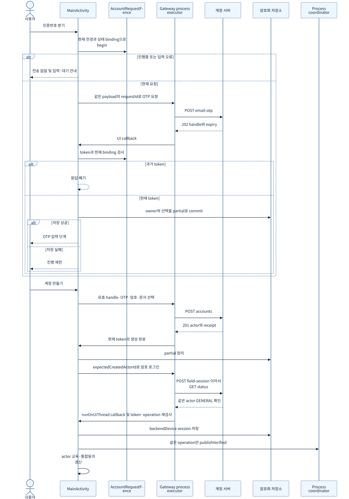

[Mermaid 원본](../diagrams/D01-sequence-account.mmd) · [SVG](../rendered/D01-sequence-account.svg)

[Mermaid 원본](../diagrams/D01-overview.mmd) · [SVG](../rendered/D01-overview.svg)

## F-D01-002 이메일·생년월일·비밀번호 입력 검증

| 항목 | 명세 |
| --- | --- |
| 분야 | D01 계정·온보딩·동의·권한·앱 개인정보와 로컬 보안 |
| 목적 | 두 DOB 표현을 같은 의미로 처리하고 불완전한 계정 입력 전송을 막는다. |
| 사용 주체 | 앱 사용자 MainActivity |
| 활성 상태 | ACTIVE |
| 진입점 | apps/android/app/src/main/java/kr/co/hanium/dreamup/walksafe/network/GatewayAccountClient.kt:156 GatewayAccountInputPolicy / validEmail / normalizedDateOfBirth apps/android/app/src/main/java/kr/co/hanium/dreamup/walksafe/MainActivity.kt:8834 requestEmailAccountOtp / showAccountInputError apps/android/app/src/main/java/kr/co/hanium/dreamup/walksafe/EmailAccountFormPolicy.kt:1 EmailAccountFormPolicy |
| 실행 전제 | 계정 화면에서 OTP 요청·계정 만들기·로그인 클릭 |
| 입력 출처 형식 검증 최신성 | email exact text(no whitespace), DOB YYYYMMDD 또는 YYYY-MM-DD, pw codepoints, confirm exact equality, OTP 숫자6자리 |

### 시작 이벤트와 처리 순서

| 이벤트 ID | 발생원 | 이벤트 | 수신부 | 흐름 |
| --- | --- | --- | --- | --- |
| E-D01-002-01 | 사용자 또는 명시된 호출자 | 이메일·생년월일·비밀번호 입력 검증 | GatewayAccountInputPolicy.validEmail / normalizedDateOfBirth | 계정 화면에서 OTP 요청·계정 만들기·로그인 클릭 → 이메일 local·IDN domain 길이·구문을 검증한다. → 정규화된 입력을 요청 client에 전달 |

1. 1. 이메일 local·IDN domain 길이·구문을 검증한다.
2. 2. 생년월일을 서울 기준 엄격 날짜로 parse하여 YYYY-MM-DD로 정규화한다.
3. 3. 가입은 신규 암호12..128 및 확인 일치, 로그인은10..128; NUL 거부한다.
4. 4. Main은 필드 오류·status 및 접근성 안내를 표시하고 유효 입력만 다음 요청으로 넘긴다.

| 분기 조건 | 실제 처리 결과 | 구현 근거 |
| --- | --- | --- |
| 이메일 오류 | email 오류 focus; 전송 없음 | apps/android/app/src/main/java/kr/co/hanium/dreamup/walksafe/network/GatewayAccountClient.kt:156 GatewayAccountInputPolicy.validEmail / normalizedDateOfBirth |
| 잘못된 달력 날짜·연도0·미래 | DOB 오류; 8자리 자동 보정 없음 | apps/android/app/src/main/java/kr/co/hanium/dreamup/walksafe/network/GatewayAccountClient.kt:156 GatewayAccountInputPolicy.validEmail / normalizedDateOfBirth |
| 암호 불일치 또는 OTP 형식 오류 | 관련 입력 오류; 전송 없음 | apps/android/app/src/main/java/kr/co/hanium/dreamup/walksafe/network/GatewayAccountClient.kt:156 GatewayAccountInputPolicy.validEmail / normalizedDateOfBirth |

### 효과 종료와 복구

네트워크 전 로컬 검증; 버튼 활성은 일부 nonblank 기준이므로 클릭 시 검증이 최종 앱 판정이다.

| 상황 | 동작 |
| --- | --- |
| 정상 완료 | 정규화된 입력을 요청 client에 전달 |
| 실패 | 입력 오류 UI 및 음성/접근성 메시지 |
| 시간 초과 | 해당 없음: 순수 검증 |
| 중복 입력 | DOB 두 표기는 동일 retry payload digest |
| 취소 | 화면 닫기 가능; 비밀번호 재설정 API는 이 기능 아님 |
| 중단과 생명주기 | 전경 요청 token이 입력/상태 변경을 감시 |
| 재시도 | 정정 후 명시적 다시 클릭 |
| 복구 | OTP partial 복원은 email/DOB/password를 복원하지 않음 |
| 자원 정리 | 정상 로그인 후 credential 입력 지움 |

### 상태 실행 맥락과 연결

| 항목 | 명세 |
| --- | --- |
| 초기 상태 | S-D01-002-EDITING |
| 상태 목록 | S-D01-002-EDITING S-D01-002-INVALID S-D01-002-VALID |
| 전이 조건과 전이 동작 | 입력→검증 오류→INVALID 유효→VALID |
| 허용되지 않는 전이 | 앱 DOB 검증만으로 서버 나이 승인 확정 금지 |
| 동시성 순서와 작업 소유권 | 동기 pure validators + UI main thread |
| 공유 상태와 다른 기능 연결 | F-D01-003/005/006; 서버 만14세 판정 D08/D09 |

### 정책 근거와 검증 범위

| 항목 | 근거 |
| --- | --- |
| 정책 | [P-D01-002](#P-D01-002) |
| 구현 | [apps/android/app/src/main/java/kr/co/hanium/dreamup/walksafe/network/GatewayAccountClient.kt:156](/home/ddobagi/Hanium_Dreamup/apps/android/app/src/main/java/kr/co/hanium/dreamup/walksafe/network/GatewayAccountClient.kt:156) · `GatewayAccountInputPolicy / validEmail / normalizedDateOfBirth` (범위 156–234) [apps/android/app/src/main/java/kr/co/hanium/dreamup/walksafe/MainActivity.kt:8834](/home/ddobagi/Hanium_Dreamup/apps/android/app/src/main/java/kr/co/hanium/dreamup/walksafe/MainActivity.kt:8834) · `requestEmailAccountOtp / showAccountInputError` (범위 8834–8879) [apps/android/app/src/main/java/kr/co/hanium/dreamup/walksafe/EmailAccountFormPolicy.kt:1](/home/ddobagi/Hanium_Dreamup/apps/android/app/src/main/java/kr/co/hanium/dreamup/walksafe/EmailAccountFormPolicy.kt:1) · `EmailAccountFormPolicy` (범위 1–54) |
| 기존 개선 ID | 개별 동일성 미확인; 분야 연관은 별도 추적표 |
| 기존 분야 | 해당 없음 |
| 기존 실행 증거 | daylog/2026-10-04.md:21-38: DOB 두 형식·관련 JVM·최종 APK 3ea64b89af08 기록. 당시 실제 신규가입/OTP 제출은 미실행; 현재 snapshot 실행 증거 아님. |
| 한계 및 구분 | 이번에는 validator 소스와 호출을 정적 검토했다. 비밀번호 찾기·재설정 UI/API 연결은 관련 앱 소스 검색에서 발견하지 못했다. 미발견을 서버 기능 부재로 확장하지 않는다. |

| 테스트 위치 | 심볼 | 증거 수준 | 기대와 한계 |
| --- | --- | --- | --- |

연결한 테스트 미확인: 이번 작성 범위에서 이 기능에 대응하는 시험 단언을 연결하지 않았다. 테스트 자체가 없다는 판정이 아니다.

### 이벤트 처리 그림


[Mermaid 원본](../diagrams/D01-F002.mmd) · [SVG](../rendered/D01-F002.svg)

## F-D01-003 이메일 OTP 요청·발송 대기·동일 요청 재시도

| 항목 | 명세 |
| --- | --- |
| 분야 | D01 계정·온보딩·동의·권한·앱 개인정보와 로컬 보안 |
| 목적 | 결과 불명 재요청이 중복 발급 요청으로 바뀌지 않게 한다. |
| 사용 주체 | 앱 사용자 MainActivity |
| 활성 상태 | ACTIVE |
| 진입점 | apps/android/app/src/main/java/kr/co/hanium/dreamup/walksafe/MainActivity.kt:8834 requestEmailAccountOtp apps/android/app/src/main/java/kr/co/hanium/dreamup/walksafe/network/EmailOtpRequestRetryPolicy.kt:1 EmailOtpRequestRetryPolicy apps/android/app/src/main/java/kr/co/hanium/dreamup/walksafe/network/GatewayAccountClient.kt:29 requestEmailOtp apps/android/app/src/main/java/kr/co/hanium/dreamup/walksafe/network/PendingEmailOtpRequest.kt:1 PendingEmailOtpRequest |
| 실행 전제 | 현재 email enrollment stage·전경·저장소 정상·OFFLINE 아님·필수동의·가입 입력 유효 |
| 입력 출처 형식 검증 최신성 | origin+owner SHA+email+정규화 DOB+signup epoch; requestId16..128; 서버202 handle/expiry/resend |

### 시작 이벤트와 처리 순서

| 이벤트 ID | 발생원 | 이벤트 | 수신부 | 흐름 |
| --- | --- | --- | --- | --- |
| E-D01-003-01 | 사용자 또는 명시된 호출자 | 이메일 OTP 요청·발송 대기·동일 요청 재시도 | requestEmailAccountOtp | 현재 email enrollment stage·전경·저장소 정상·OFFLINE 아님·필수동의·가입 입력 유효 → 입력과 현재 owner/origin을 검증한 뒤 RetryPolicy.begin 및 AccountRequestFence.begin을 얻는다. → 유효 partial 저장 후 OTP 입력 단계 |

1. 1. 입력과 현재 owner/origin을 검증한 뒤 RetryPolicy.begin 및 AccountRequestFence.begin을 얻는다.
2. 2. 같은 payload 재시도는 동일 requestId로 POST /api/account-enrollments/email-otp; gateway executor에서 수행한다.
3. 3. 현재 token·state·payload인지 확인하고 응답 schema·handle·시간 범위를 검증한다.
4. 4. encrypted partial 저장 성공 후 ACCOUNT_CREATED 단계와 elapsed deadline을 만들고 OTP focus를 준다.

| 분기 조건 | 실제 처리 결과 | 구현 근거 |
| --- | --- | --- |
| 진행중 또는 retry wait 남음 | 추가 송신 거부; 자동 재발송 없음 | apps/android/app/src/main/java/kr/co/hanium/dreamup/walksafe/MainActivity.kt:8834 requestEmailAccountOtp |
| status0·5xx·429·409 in_progress | wire ID 유지 및 대기 정책; 사용자 재시도 | apps/android/app/src/main/java/kr/co/hanium/dreamup/walksafe/MainActivity.kt:8834 requestEmailAccountOtp |
| 과거 응답·payload 변경 | UI·partial commit 없음 | apps/android/app/src/main/java/kr/co/hanium/dreamup/walksafe/MainActivity.kt:8834 requestEmailAccountOtp |
| partial 저장 실패 | 단계 진행 차단; 저장 오류 | apps/android/app/src/main/java/kr/co/hanium/dreamup/walksafe/MainActivity.kt:8834 requestEmailAccountOtp |

### 효과 종료와 복구

OTP 메일 발송은 서버의 외부 효과; 앱은202 응답과 partial만 확인한다. pending에는 실제 email/DOB 대신 digest가 저장된다.

| 상황 | 동작 |
| --- | --- |
| 정상 완료 | 유효 partial 저장 후 OTP 입력 단계 |
| 실패 | serverCode별 age·rate·conflict 메시지; terminal 오류는 retry ID 폐기 |
| 시간 초과 | HTTP connect8s/read12s; 서버 요청 완료 여부는 timeout만으로 확정하지 않음 |
| 중복 입력 | 동일 payload의 retry ID 재사용; 동시 active attempt 금지 |
| 취소 | 가입 닫기/명시 cancel은 retry state 제거; 이미 서버 적용된 발송 취소 보장 없음 |
| 중단과 생명주기 | background가 계정 token 무효화; lifecycleInterrupted는 activeAttempt만 해제 |
| 재시도 | 동일payload+허용 대기 후 사용자 재요청; Pending 복원 재사용 수명30분 |
| 복구 | fresh process 저장 pending owner+payload digest+age 검증 후 재사용 |
| 자원 정리 | 성공·terminal·payload변경 때 pending clear |

### 상태 실행 맥락과 연결

| 항목 | 명세 |
| --- | --- |
| 초기 상태 | S-D01-003-IDLE |
| 상태 목록 | S-D01-003-IDLE S-D01-003-IN_FLIGHT S-D01-003-WAITING S-D01-003-OTP_READY |
| 전이 조건과 전이 동작 | 요청→IN_FLIGHT 일시 실패→WAITING 202+durable partial→OTP_READY |
| 허용되지 않는 전이 | 과거 요청이 새 요청 active slot을 해제하지 못함 |
| 동시성 순서와 작업 소유권 | gatewaySessionExecutor→runOnUiThread; current token 및 payload 검사로 늦은 callback 배제 |
| 공유 상태와 다른 기능 연결 | F-D01-004 partial; D08/D09 메일 전달·빈도 제한 |

### 정책 근거와 검증 범위

| 항목 | 근거 |
| --- | --- |
| 정책 | [P-D01-002](#P-D01-002) [P-D01-003](#P-D01-003) [P-D01-004](#P-D01-004) [P-D01-005](#P-D01-005) [P-D01-024](#P-D01-024) |
| 구현 | [apps/android/app/src/main/java/kr/co/hanium/dreamup/walksafe/MainActivity.kt:8834](/home/ddobagi/Hanium_Dreamup/apps/android/app/src/main/java/kr/co/hanium/dreamup/walksafe/MainActivity.kt:8834) · `requestEmailAccountOtp` (범위 8834–8982) [apps/android/app/src/main/java/kr/co/hanium/dreamup/walksafe/network/EmailOtpRequestRetryPolicy.kt:1](/home/ddobagi/Hanium_Dreamup/apps/android/app/src/main/java/kr/co/hanium/dreamup/walksafe/network/EmailOtpRequestRetryPolicy.kt:1) · `EmailOtpRequestRetryPolicy` (범위 1–146) [apps/android/app/src/main/java/kr/co/hanium/dreamup/walksafe/network/GatewayAccountClient.kt:29](/home/ddobagi/Hanium_Dreamup/apps/android/app/src/main/java/kr/co/hanium/dreamup/walksafe/network/GatewayAccountClient.kt:29) · `requestEmailOtp` (범위 29–86) [apps/android/app/src/main/java/kr/co/hanium/dreamup/walksafe/network/PendingEmailOtpRequest.kt:1](/home/ddobagi/Hanium_Dreamup/apps/android/app/src/main/java/kr/co/hanium/dreamup/walksafe/network/PendingEmailOtpRequest.kt:1) · `PendingEmailOtpRequest` (범위 1–100) |
| 기존 개선 ID | 개별 동일성 미확인; 분야 연관은 별도 추적표 |
| 기존 분야 | 해당 없음 |
| 기존 실행 증거 | 해당 없음 |
| 한계 및 구분 | 현재 snapshot 정적 확인. 기기·네트워크 실동작은 이번 검증하지 않았다. |

| 테스트 위치 | 심볼 | 증거 수준 | 기대와 한계 |
| --- | --- | --- | --- |
| [apps/android/app/src/test/java/kr/co/hanium/dreamup/walksafe/account/AccountRequestFenceRegressionTest.kt](/home/ddobagi/Hanium_Dreamup/apps/android/app/src/test/java/kr/co/hanium/dreamup/walksafe/account/AccountRequestFenceRegressionTest.kt) | cancelledResponseCannotReleaseNewRequestWithTheSameBinding | TEST_EXPECTATION | 과거 callback이 새 요청을 끝내지 않는 기대; 이번 실행하지 않음 |
| [apps/android/app/src/test/java/kr/co/hanium/dreamup/walksafe/account/EmailOtpTimingTest.kt](/home/ddobagi/Hanium_Dreamup/apps/android/app/src/test/java/kr/co/hanium/dreamup/walksafe/account/EmailOtpTimingTest.kt) | clientRejectsExpiredFarFutureAndResendAfterExpiryResponses | TEST_EXPECTATION | 시간 범위 부정 응답을 거부하는 기대; 이번 실행하지 않음 |

### 이벤트 처리 그림


[Mermaid 원본](../diagrams/D01-F003.mmd) · [SVG](../rendered/D01-F003.svg)

[Mermaid 원본](../diagrams/D01-sequence-account.mmd) · [SVG](../rendered/D01-sequence-account.svg)

## F-D01-004 OTP 가입 partial 암호화 보존과 재시작 복원

| 항목 | 명세 |
| --- | --- |
| 분야 | D01 계정·온보딩·동의·권한·앱 개인정보와 로컬 보안 |
| 목적 | 서버 발급 handle과 동의 선택만 제한적으로 재사용한다. |
| 사용 주체 | 앱 사용자 MainActivity |
| 활성 상태 | ACTIVE |
| 진입점 | apps/android/app/src/main/java/kr/co/hanium/dreamup/walksafe/account/EmailAccountEnrollment.kt:62 EmailEnrollmentPartialCodec / AndroidEmailEnrollmentStore apps/android/app/src/main/java/kr/co/hanium/dreamup/walksafe/MainActivity.kt:7659 restoreEmailEnrollmentPartial / emailOtpPartialStillValid |
| 실행 전제 | 앱 시작 또는 계정 화면 복원; install ID 확보 및 저장소 읽기 가능 |
| 입력 출처 형식 검증 최신성 | partial schema android-email-enrollment-partial.v4, handle, expiry/resend, install owner SHA256, 정확 문서 versions·selections; 2..4096 chars |

### 시작 이벤트와 처리 순서

| 이벤트 ID | 발생원 | 이벤트 | 수신부 | 흐름 |
| --- | --- | --- | --- | --- |
| E-D01-004-01 | 사용자 또는 명시된 호출자 | OTP 가입 partial 암호화 보존과 재시작 복원 | EmailEnrollmentPartialCodec / AndroidEmailEnrollmentStore | 앱 시작 또는 계정 화면 복원; install ID 확보 및 저장소 읽기 가능 → encrypted store restore에서 absent/restored/clearedInvalid/blocked를 구분한다. → OTP 화면 복원; email/password 등 재입력 필요 |

1. 1. encrypted store restore에서 absent/restored/clearedInvalid/blocked를 구분한다.
2. 2. owner 일치·필수선택·정확 버전·미만 expiry를 검사하고 v3는 신뢰 없이 제거한다.
3. 3. 유효하면 email OTP enrollment 상태를 재구성하고 선택을 복원한다.
4. 4. 같은 프로세스는 elapsed deadline, 재시작은 절대시각으로 create 직전 다시 검증한다.

| 분기 조건 | 실제 처리 결과 | 구현 근거 |
| --- | --- | --- |
| expired·owner mismatch·잘못된 schema | partial clear; 새 가입 단계 | apps/android/app/src/main/java/kr/co/hanium/dreamup/walksafe/account/EmailAccountEnrollment.kt:62 EmailEnrollmentPartialCodec / AndroidEmailEnrollmentStore |
| clear 또는 store 접근 실패 | Blocked; 가입 계속 불가 | apps/android/app/src/main/java/kr/co/hanium/dreamup/walksafe/account/EmailAccountEnrollment.kt:62 EmailEnrollmentPartialCodec / AndroidEmailEnrollmentStore |
| elapsed clock 역행 | remaining 0으로 만료 | apps/android/app/src/main/java/kr/co/hanium/dreamup/walksafe/account/EmailAccountEnrollment.kt:62 EmailEnrollmentPartialCodec / AndroidEmailEnrollmentStore |

### 효과 종료와 복구

OTP/password/email/DOB는 이 partial에 저장하지 않는다. 상태명 ACCOUNT_CREATED는 이 시점 실제 계정 생성 완료를 의미하지 않는다.

| 상황 | 동작 |
| --- | --- |
| 정상 완료 | OTP 화면 복원; email/password 등 재입력 필요 |
| 실패 | 불량 partial 폐기 또는 저장소 blocked |
| 시간 초과 | expires와 now 경계는 now < expires; elapsed remaining>0 |
| 중복 입력 | 동일 partial은 저장 계약에 따라 보존; 원격 발송 재실행 없음 |
| 취소 | 사용자 로그인 이동 또는 만료시 partial 제거 경로 |
| 중단과 생명주기 | 프로세스 중단 후 encrypted partial만 재개 근거 |
| 재시도 | 새 OTP는 사용자 발송 요청으로만 |
| 복구 | v4 검증 통과 시 복원; 서버 최종 OTP 유효성은 별도 |
| 자원 정리 | invalid/v3/생성 성공에서 제거 |

### 상태 실행 맥락과 연결

| 항목 | 명세 |
| --- | --- |
| 초기 상태 | S-D01-004-ABSENT |
| 상태 목록 | S-D01-004-ABSENT S-D01-004-RESTORED S-D01-004-CLEARED_INVALID S-D01-004-BLOCKED |
| 전이 조건과 전이 동작 | 유효 encrypted partial→RESTORED 검증 실패+clear 성공→CLEARED_INVALID store 실패→BLOCKED |
| 허용되지 않는 전이 | 비밀번호·OTP 문자열을 복원한 것으로 처리 금지 |
| 동시성 순서와 작업 소유권 | restore 동기, UI state update; owner binding은 install ID hash |
| 공유 상태와 다른 기능 연결 | F-D01-003/005; F-D01-025 민감 저장 |

### 정책 근거와 검증 범위

| 항목 | 근거 |
| --- | --- |
| 정책 | [P-D01-001](#P-D01-001) [P-D01-003](#P-D01-003) [P-D01-018](#P-D01-018) |
| 구현 | [apps/android/app/src/main/java/kr/co/hanium/dreamup/walksafe/account/EmailAccountEnrollment.kt:62](/home/ddobagi/Hanium_Dreamup/apps/android/app/src/main/java/kr/co/hanium/dreamup/walksafe/account/EmailAccountEnrollment.kt:62) · `EmailEnrollmentPartialCodec / AndroidEmailEnrollmentStore` (범위 62–245) [apps/android/app/src/main/java/kr/co/hanium/dreamup/walksafe/MainActivity.kt:7659](/home/ddobagi/Hanium_Dreamup/apps/android/app/src/main/java/kr/co/hanium/dreamup/walksafe/MainActivity.kt:7659) · `restoreEmailEnrollmentPartial / emailOtpPartialStillValid` (범위 7659–7717) |
| 기존 개선 ID | 개별 동일성 미확인; 분야 연관은 별도 추적표 |
| 기존 분야 | 해당 없음 |
| 기존 실행 증거 | 해당 없음 |
| 한계 및 구분 | 현재 snapshot 정적 확인. 기기·네트워크 실동작은 이번 검증하지 않았다. |

| 테스트 위치 | 심볼 | 증거 수준 | 기대와 한계 |
| --- | --- | --- | --- |
| [apps/android/app/src/test/java/kr/co/hanium/dreamup/walksafe/account/EmailOtpTimingTest.kt](/home/ddobagi/Hanium_Dreamup/apps/android/app/src/test/java/kr/co/hanium/dreamup/walksafe/account/EmailOtpTimingTest.kt) | partialRequiresResendNoLaterThanExpiryAndCodecDropsViolations | TEST_EXPECTATION | resend가 expiry를 넘는 partial을 거부하는 기대; 이번 실행하지 않음 |

### 이벤트 처리 그림


[Mermaid 원본](../diagrams/D01-F004.mmd) · [SVG](../rendered/D01-F004.svg)

## F-D01-005 OTP 확인·계정 생성·생성 후 자동 로그인

| 항목 | 명세 |
| --- | --- |
| 분야 | D01 계정·온보딩·동의·권한·앱 개인정보와 로컬 보안 |
| 목적 | 메일 인증과 선택한 가입 문서를 서버 계정 생성 요청에 결속한다. |
| 사용 주체 | 앱 사용자 MainActivity |
| 활성 상태 | ACTIVE |
| 진입점 | apps/android/app/src/main/java/kr/co/hanium/dreamup/walksafe/MainActivity.kt:8983 createEmailAccount apps/android/app/src/main/java/kr/co/hanium/dreamup/walksafe/network/GatewayAccountClient.kt:88 createAccount apps/android/app/src/main/java/kr/co/hanium/dreamup/walksafe/account/SignupConsentPolicyNotice.kt:1 SignupConsentPolicyNotice |
| 실행 전제 | ACCOUNT_CREATED stage, current valid partial·owner·전경·네트워크·필수동의 |
| 입력 출처 형식 검증 최신성 | handle43자,OTP6숫자,신규pw12..128,confirm,정확6문서version·selection; 응답 actor UUID/accountGeneration>=1/receiptSHA |

### 시작 이벤트와 처리 순서

| 이벤트 ID | 발생원 | 이벤트 | 수신부 | 흐름 |
| --- | --- | --- | --- | --- |
| E-D01-005-01 | 사용자 또는 명시된 호출자 | OTP 확인·계정 생성·생성 후 자동 로그인 | createEmailAccount | ACCOUNT_CREATED stage, current valid partial·owner·전경·네트워크·필수동의 → create 직전 owner와 elapsed deadline을 다시 검사하고 필요한 입력을 검증한다. → 검증된 생성 응답 후 일치 actor 자동 로그인 경로 |

1. 1. create 직전 owner와 elapsed deadline을 다시 검사하고 필요한 입력을 검증한다.
2. 2. 현재 선택을 partial에 저장한 뒤 POST /api/accounts를 실행한다.
3. 3. 현재 요청만 201 strict schema 응답을 받아 account-created 상태를 반영하고 partial을 제거한다.
4. 4. OTP와 확인 암호를 지우고 expectedCreatedActorId를 넣어 password login을 호출한다.

| 분기 조건 | 실제 처리 결과 | 구현 근거 |
| --- | --- | --- |
| partial 만료·owner 불일치 | partial 제거·새 epoch 초기가입으로 | apps/android/app/src/main/java/kr/co/hanium/dreamup/walksafe/MainActivity.kt:8983 createEmailAccount |
| 동의 outdated409 | 앱 업데이트/새문서 안내; 임의 새 버전 동의 작성 안 함 | apps/android/app/src/main/java/kr/co/hanium/dreamup/walksafe/MainActivity.kt:8983 createEmailAccount |
| 네트워크 결과 불명 | 계정 존재 가능성을 안내; 동일입력 재시도 또는 로그인 | apps/android/app/src/main/java/kr/co/hanium/dreamup/walksafe/MainActivity.kt:8983 createEmailAccount |
| 서버 성공 뒤 local clear 실패 | 계정 생성됨 안내·로그인 필요; 성공을 취소했다고 주장 안 함 | apps/android/app/src/main/java/kr/co/hanium/dreamup/walksafe/MainActivity.kt:8983 createEmailAccount |

### 효과 종료와 복구

서버 account 생성; 후속 로그인 actor를 created actor에 고정; common password·OTP invalid·existing account 안내.

| 상황 | 동작 |
| --- | --- |
| 정상 완료 | 검증된 생성 응답 후 일치 actor 자동 로그인 경로 |
| 실패 | 잘못된 OTP·약한/일반 암호·conflict·age 실패별 메시지 |
| 시간 초과 | HTTP timeout은 생성 부재 증거가 아님 |
| 중복 입력 | 별도 create idempotency key는 앱 요청에 없음; 서버 계약 D08/D09 |
| 취소 | 계정 token cancel/background 이후 늦은 성공은 UI 미적용 |
| 중단과 생명주기 | AccountRequestFence가 중단 뒤 응답을 버림; 서버 효과는 남을 수 있음 |
| 재시도 | 사용자 재시도 또는 기존계정 로그인 안내; 자동 반복 create 없음 |
| 복구 | partial 없으면 신규OTP 또는 로그인 |
| 자원 정리 | 성공 시 partial/OTP/confirmation 입력 정리 |

### 상태 실행 맥락과 연결

| 항목 | 명세 |
| --- | --- |
| 초기 상태 | S-D01-005-OTP_READY |
| 상태 목록 | S-D01-005-OTP_READY S-D01-005-CREATING S-D01-005-CREATED S-D01-005-LOGIN_PENDING |
| 전이 조건과 전이 동작 | 유효OTP입력→CREATING 201→CREATED local 정리성공→LOGIN_PENDING |
| 허용되지 않는 전이 | 서버 성공 후 생성취소·rollback을 앱이 보장하지 않음 |
| 동시성 순서와 작업 소유권 | gateway executor→UI, state/owner/token 경계 |
| 공유 상태와 다른 기능 연결 | F-D01-006 로그인; D08/D09 계정 생성·OTP 소모 |

### 정책 근거와 검증 범위

| 항목 | 근거 |
| --- | --- |
| 정책 | [P-D01-001](#P-D01-001) [P-D01-002](#P-D01-002) [P-D01-003](#P-D01-003) [P-D01-005](#P-D01-005) [P-D01-024](#P-D01-024) |
| 구현 | [apps/android/app/src/main/java/kr/co/hanium/dreamup/walksafe/MainActivity.kt:8983](/home/ddobagi/Hanium_Dreamup/apps/android/app/src/main/java/kr/co/hanium/dreamup/walksafe/MainActivity.kt:8983) · `createEmailAccount` (범위 8983–9103) [apps/android/app/src/main/java/kr/co/hanium/dreamup/walksafe/network/GatewayAccountClient.kt:88](/home/ddobagi/Hanium_Dreamup/apps/android/app/src/main/java/kr/co/hanium/dreamup/walksafe/network/GatewayAccountClient.kt:88) · `createAccount` (범위 88–154) [apps/android/app/src/main/java/kr/co/hanium/dreamup/walksafe/account/SignupConsentPolicyNotice.kt:1](/home/ddobagi/Hanium_Dreamup/apps/android/app/src/main/java/kr/co/hanium/dreamup/walksafe/account/SignupConsentPolicyNotice.kt:1) · `SignupConsentPolicyNotice` (범위 1–19) |
| 기존 개선 ID | 개별 동일성 미확인; 분야 연관은 별도 추적표 |
| 기존 분야 | 해당 없음 |
| 기존 실행 증거 | 해당 없음 |
| 한계 및 구분 | 현재 snapshot 정적 확인. 기기·네트워크 실동작은 이번 검증하지 않았다. |

| 테스트 위치 | 심볼 | 증거 수준 | 기대와 한계 |
| --- | --- | --- | --- |

연결한 테스트 미확인: 이번 작성 범위에서 이 기능에 대응하는 시험 단언을 연결하지 않았다. 테스트 자체가 없다는 판정이 아니다.

### 이벤트 처리 그림


[Mermaid 원본](../diagrams/D01-F005.mmd) · [SVG](../rendered/D01-F005.svg)

[Mermaid 원본](../diagrams/D01-sequence-account.mmd) · [SVG](../rendered/D01-sequence-account.svg)

## F-D01-006 이메일·비밀번호 로그인과 계정 상태 결속

| 항목 | 명세 |
| --- | --- |
| 분야 | D01 계정·온보딩·동의·권한·앱 개인정보와 로컬 보안 |
| 목적 | 인증된 계정·세션·교육 상태를 원자적으로 연결한다. |
| 사용 주체 | 앱 사용자 MainActivity |
| 활성 상태 | ACTIVE |
| 진입점 | apps/android/app/src/main/java/kr/co/hanium/dreamup/walksafe/MainActivity.kt:9104 loginEmailAccount apps/android/app/src/main/java/kr/co/hanium/dreamup/walksafe/network/GatewayFieldSession.kt:796 loginWithPassword apps/android/app/src/main/java/kr/co/hanium/dreamup/walksafe/network/AndroidGatewaySessionStore.kt:298 saveBackendDeviceIfAbsent |
| 실행 전제 | 전경·네트워크·스토리지 정상·기존 active session 없음; backend restore pending이면 복원 경로 우선 |
| 입력 출처 형식 검증 최신성 | email,pw10..128,install deviceId,rememberMe=true; optional expectedCreatedActorId |

### 시작 이벤트와 처리 순서

| 이벤트 ID | 발생원 | 이벤트 | 수신부 | 흐름 |
| --- | --- | --- | --- | --- |
| E-D01-006-01 | 사용자 또는 명시된 호출자 | 이메일·비밀번호 로그인과 계정 상태 결속 | loginEmailAccount | 전경·네트워크·스토리지 정상·기존 active session 없음; backend restore pending이면 복원 경로 우선 → 계정 fence 및 process operation을 예약하고 password grant POST /field-session을 보낸다. → 검증된 GENERAL session 및 후속 onboarding/복원 UI |

1. 1. 계정 fence 및 process operation을 예약하고 password grant POST /field-session을 보낸다.
2. 2. GENERAL cookie 응답 뒤 GET status authenticated 및 actor binding을 검증한다.
3. 3. 생성계정 actor mismatch면 받은 세션을 logout하고 거부한다.
4. 4. 같은 actor 재인증 또는 교육 복원이면 진행을 보존하고, 새 actor이면 VERIFIED_14_PLUS 교육·로그인 증거를 새로 구성한다.
5. 5. backendDevice 세션을 저장한 뒤 process publishVerified; actor를 기억하고 통합동의를 서버 refresh한다. 입력을 지운다.

| 분기 조건 | 실제 처리 결과 | 구현 근거 |
| --- | --- | --- |
| GET 인증·scope·actor 불일치 | 원격 세션 정리·로그인 거부 | apps/android/app/src/main/java/kr/co/hanium/dreamup/walksafe/MainActivity.kt:9104 loginEmailAccount |
| 생성 actor와 로그인 actor 다름 | 원격 logout 후 실패 | apps/android/app/src/main/java/kr/co/hanium/dreamup/walksafe/MainActivity.kt:9104 loginEmailAccount |
| 저장 실패·stale operation | publish 거부; blocked 또는 오래된 응답 폐기 | apps/android/app/src/main/java/kr/co/hanium/dreamup/walksafe/MainActivity.kt:9104 loginEmailAccount |

### 효과 종료와 복구

암호는 요청에 사용하며 session store에는 세션 material과 actor-bound snapshot을 저장; 계정 승인과 교육 완료는 분리.

| 상황 | 동작 |
| --- | --- |
| 정상 완료 | 검증된 GENERAL session 및 후속 onboarding/복원 UI |
| 실패 | invalid credentials·busy·rate·network 오류 표시 |
| 시간 초과 | 8s/12s transport; 후속 서버 GET도 별도 호출 |
| 중복 입력 | 한 process operation과 계정 fence만 진행 |
| 취소 | 배경/새작업으로 응답 폐기; 사용자 로그아웃 F-D01-008 |
| 중단과 생명주기 | Activity callback lease와 process generation 둘 다 확인 |
| 재시도 | 오류 정정 후 사용자 로그인; 무한 자동로그인 없음 |
| 복구 | 같은 actor의 유효 training profile은 보존 가능 |
| 자원 정리 | 성공 후 email/password/OTP/confirm 지움 |

### 상태 실행 맥락과 연결

| 항목 | 명세 |
| --- | --- |
| 초기 상태 | S-D01-006-SIGNED_OUT |
| 상태 목록 | S-D01-006-SIGNED_OUT S-D01-006-AUTHENTICATING S-D01-006-VERIFIED S-D01-006-STORAGE_BLOCKED |
| 전이 조건과 전이 동작 | POST+GET검증→저장 저장성공+current operation→VERIFIED 저장실패→STORAGE_BLOCKED |
| 허용되지 않는 전이 | 저장되지 않은 새 세션을 verified로 먼저 publish 금지 |
| 동시성 순서와 작업 소유권 | 네트워크 POST/GET은 process single executor에서 수행한다. runOnUiThread callback 안에서 account fence·operationId를 검사하고 saveBackendDeviceIfAbsent 및 publishVerified를 수행한다. Activity callback lease 및 session generation으로 늦은 결과를 배제한다. |
| 공유 상태와 다른 기능 연결 | F-D01-007/010/011/018/022; D08 인증서버 |

### 정책 근거와 검증 범위

| 항목 | 근거 |
| --- | --- |
| 정책 | [P-D01-002](#P-D01-002) [P-D01-005](#P-D01-005) [P-D01-006](#P-D01-006) [P-D01-024](#P-D01-024) |
| 구현 | [apps/android/app/src/main/java/kr/co/hanium/dreamup/walksafe/MainActivity.kt:9104](/home/ddobagi/Hanium_Dreamup/apps/android/app/src/main/java/kr/co/hanium/dreamup/walksafe/MainActivity.kt:9104) · `loginEmailAccount` (범위 9104–9308) [apps/android/app/src/main/java/kr/co/hanium/dreamup/walksafe/network/GatewayFieldSession.kt:796](/home/ddobagi/Hanium_Dreamup/apps/android/app/src/main/java/kr/co/hanium/dreamup/walksafe/network/GatewayFieldSession.kt:796) · `loginWithPassword` (범위 796–890) [apps/android/app/src/main/java/kr/co/hanium/dreamup/walksafe/network/AndroidGatewaySessionStore.kt:298](/home/ddobagi/Hanium_Dreamup/apps/android/app/src/main/java/kr/co/hanium/dreamup/walksafe/network/AndroidGatewaySessionStore.kt:298) · `saveBackendDeviceIfAbsent` (범위 298–350) |
| 기존 개선 ID | 개별 동일성 미확인; 분야 연관은 별도 추적표 |
| 기존 분야 | 해당 없음 |
| 기존 실행 증거 | 해당 없음 |
| 한계 및 구분 | Main login catch에서 GatewaySessionHttpException.retryAfterMs를 postAccountFailure에 전달하지 않는 정적 연결 차이는 R-D01-001. 이번 실제 로그인은 실행하지 않았다. |

| 테스트 위치 | 심볼 | 증거 수준 | 기대와 한계 |
| --- | --- | --- | --- |

연결한 테스트 미확인: 이번 작성 범위에서 이 기능에 대응하는 시험 단언을 연결하지 않았다. 테스트 자체가 없다는 판정이 아니다.

### 이벤트 처리 그림


[Mermaid 원본](../diagrams/D01-F006.mmd) · [SVG](../rendered/D01-F006.svg)

[Mermaid 원본](../diagrams/D01-sequence-account.mmd) · [SVG](../rendered/D01-sequence-account.svg)

## F-D01-007 저장 로그인 재검증과 재인증

| 항목 | 명세 |
| --- | --- |
| 분야 | D01 계정·온보딩·동의·권한·앱 개인정보와 로컬 보안 |
| 목적 | 저장 credential을 현재 서버 권위로 확인한 뒤에만 재사용한다. |
| 사용 주체 | 앱 사용자 MainActivity |
| 활성 상태 | ACTIVE |
| 진입점 | apps/android/app/src/main/java/kr/co/hanium/dreamup/walksafe/MainActivity.kt:8209 restoreGatewaySession / restoreBackendDeviceSession apps/android/app/src/main/java/kr/co/hanium/dreamup/walksafe/network/AndroidGatewaySessionStore.kt:351 restoreBackendDevice apps/android/app/src/main/java/kr/co/hanium/dreamup/walksafe/network/GatewayFieldSession.kt:892 revalidateBackendAccountDeviceSession |
| 실행 전제 | privacy startup 허용·configured origin·install ID·현재 operation 획득 |
| 입력 출처 형식 검증 최신성 | encrypted backend device bundle의 origin/install/actor/firstRun binding·expiry; 복원 session은 RESTORED_UNVERIFIED |

### 시작 이벤트와 처리 순서

| 이벤트 ID | 발생원 | 이벤트 | 수신부 | 흐름 |
| --- | --- | --- | --- | --- |
| E-D01-007-01 | 사용자 또는 명시된 호출자 | 저장 로그인 재검증과 재인증 | restoreGatewaySession / restoreBackendDeviceSession | privacy startup 허용·configured origin·install ID·현재 operation 획득 → restoreGatewaySession은 backendDevice를 장기로그인 flag보다 먼저 찾는다. → 서버 재검증 후 로그인 이어가기 |

1. 1. restoreGatewaySession은 backendDevice를 장기로그인 flag보다 먼저 찾는다.
2. 2. 현재 process에 unverified pair를 publish하고 서버 GET로 account device session을 revalidate한다.
3. 3. 유효 GENERAL actor이면 verified publish하고 backendRestorePending을 끈 뒤 동의를 refresh한다.
4. 4. 네트워크 unavailable이면 process credential만 clear하고 저장 bundle을 보존하여 연결 후 다시 확인하도록 안내한다.

| 분기 조건 | 실제 처리 결과 | 구현 근거 |
| --- | --- | --- |
| 401/403 등 확정 거부 | 현재 저장 version만 제거; 다시로그인 안내 | apps/android/app/src/main/java/kr/co/hanium/dreamup/walksafe/MainActivity.kt:8209 restoreGatewaySession / restoreBackendDeviceSession |
| network/408/429/5xx/부정2xx | unavailable; 저장 credential 보존, 일반기능 미허용 | apps/android/app/src/main/java/kr/co/hanium/dreamup/walksafe/MainActivity.kt:8209 restoreGatewaySession / restoreBackendDeviceSession |
| 교체된 operation | 새로 얻은 세션 invalidate; 새 상태 보호 | apps/android/app/src/main/java/kr/co/hanium/dreamup/walksafe/MainActivity.kt:8209 restoreGatewaySession / restoreBackendDeviceSession |

### 효과 종료와 복구

저장된 로그인을 확인하려면 인터넷 필요 안내; actor 교육 snapshot은 보존되더라도 보행 현재 검사 D02 필요.

| 상황 | 동작 |
| --- | --- |
| 정상 완료 | 서버 재검증 후 로그인 이어가기 |
| 실패 | 저장 제거 실패는 storageBlocked |
| 시간 초과 | transport timeout→unavailable |
| 중복 입력 | current version CAS·operation 일치 없이 삭제/교체 없음 |
| 취소 | 계정 세션 버튼이 복원 대기 중 logout을 선택할 수 있음 |
| 중단과 생명주기 | Activity가 바뀌면 current lease의 UI만 받음 |
| 재시도 | 인터넷 연결 뒤 명시적 재확인; background GET 자동반복으로 가정하지 않음 |
| 복구 | stored snapshot 복원 및 fresh server authority |
| 자원 정리 | 확정 폐기시 current backend bundle만 제거 |

### 상태 실행 맥락과 연결

| 항목 | 명세 |
| --- | --- |
| 초기 상태 | S-D01-007-STORED |
| 상태 목록 | S-D01-007-STORED S-D01-007-UNVERIFIED S-D01-007-VERIFIED S-D01-007-RESTORE_PENDING S-D01-007-REAUTH_REQUIRED |
| 전이 조건과 전이 동작 | bundle복원→UNVERIFIED GET성공→VERIFIED 일시실패→RESTORE_PENDING 확정거부→REAUTH_REQUIRED |
| 허용되지 않는 전이 | RESTORED_UNVERIFIED의 protected request headers 생성 금지 |
| 동시성 순서와 작업 소유권 | process executor; operation을 publishRestoredUnverified 후 새 generation token으로 이어감 |
| 공유 상태와 다른 기능 연결 | F-D01-009 장기 token 복원은 별도; D02 기기freshcheck |

### 정책 근거와 검증 범위

| 항목 | 근거 |
| --- | --- |
| 정책 | [P-D01-006](#P-D01-006) [P-D01-008](#P-D01-008) [P-D01-024](#P-D01-024) |
| 구현 | [apps/android/app/src/main/java/kr/co/hanium/dreamup/walksafe/MainActivity.kt:8209](/home/ddobagi/Hanium_Dreamup/apps/android/app/src/main/java/kr/co/hanium/dreamup/walksafe/MainActivity.kt:8209) · `restoreGatewaySession / restoreBackendDeviceSession` (범위 8209–8435) [apps/android/app/src/main/java/kr/co/hanium/dreamup/walksafe/network/AndroidGatewaySessionStore.kt:351](/home/ddobagi/Hanium_Dreamup/apps/android/app/src/main/java/kr/co/hanium/dreamup/walksafe/network/AndroidGatewaySessionStore.kt:351) · `restoreBackendDevice` (범위 351–413) [apps/android/app/src/main/java/kr/co/hanium/dreamup/walksafe/network/GatewayFieldSession.kt:892](/home/ddobagi/Hanium_Dreamup/apps/android/app/src/main/java/kr/co/hanium/dreamup/walksafe/network/GatewayFieldSession.kt:892) · `revalidateBackendAccountDeviceSession` (범위 892–954) |
| 기존 개선 ID | 개별 동일성 미확인; 분야 연관은 별도 추적표 |
| 기존 분야 | 해당 없음 |
| 기존 실행 증거 | 해당 없음 |
| 한계 및 구분 | 현재 snapshot 정적 확인. 기기·네트워크 실동작은 이번 검증하지 않았다. |

| 테스트 위치 | 심볼 | 증거 수준 | 기대와 한계 |
| --- | --- | --- | --- |

연결한 테스트 미확인: 이번 작성 범위에서 이 기능에 대응하는 시험 단언을 연결하지 않았다. 테스트 자체가 없다는 판정이 아니다.

### 이벤트 처리 그림


[Mermaid 원본](../diagrams/D01-F007.mmd) · [SVG](../rendered/D01-F007.svg)

## F-D01-008 로그아웃·인증 만료와 계정 입력 초기화

| 항목 | 명세 |
| --- | --- |
| 분야 | D01 계정·온보딩·동의·권한·앱 개인정보와 로컬 보안 |
| 목적 | 현재 계정 실행권한을 닫고 원격 세션 폐기를 추적한다. |
| 사용 주체 | 앱 사용자 MainActivity |
| 활성 상태 | ACTIVE |
| 진입점 | apps/android/app/src/main/java/kr/co/hanium/dreamup/walksafe/MainActivity.kt:9435 onAccountLogoutClicked / onAccountSessionButtonClicked apps/android/app/src/main/java/kr/co/hanium/dreamup/walksafe/MainActivity.kt:8415 stageRestoredGatewayRevocation / drainPendingGatewayRevocation apps/android/app/src/main/java/kr/co/hanium/dreamup/walksafe/session/PermissionSessionPolicy.kt:1 explicitLogout / authenticationExpired apps/android/app/src/main/java/kr/co/hanium/dreamup/walksafe/network/GatewayFieldSession.kt:1122 logout apps/android/app/src/main/java/kr/co/hanium/dreamup/walksafe/MainActivity.kt:12506 clearGatewaySession |
| 실행 전제 | 사용자 session 버튼; durable 계정삭제 확인이 없어야 일반 logout 가능 |
| 입력 출처 형식 검증 최신성 | current actor/session/generation 및 저장 version; logout action은 사용자 이벤트 |

### 시작 이벤트와 처리 순서

| 이벤트 ID | 발생원 | 이벤트 | 수신부 | 흐름 |
| --- | --- | --- | --- | --- |
| E-D01-008-01 | 사용자 또는 명시된 호출자 | 로그아웃·인증 만료와 계정 입력 초기화 | onAccountLogoutClicked / onAccountSessionButtonClicked | 사용자 session 버튼; durable 계정삭제 확인이 없어야 일반 logout 가능 → 삭제 recovery-only·storageBlocked·durable deletion confirmation 경계를 먼저 검사한다. → SIGNED_OUT, 새 가입/로그인 진입 |

1. 1. 삭제 recovery-only·storageBlocked·durable deletion confirmation 경계를 먼저 검사한다.
2. 2. debug 위치 저장 범위를 purge/rotate하고 training·환경·장착 증거 및 출력 저장 binding을 무효화한다.
3. 3. clearGatewaySession은 backendDevice이면 current 저장 bundle을 제거하고, 장기 token이면 Active→PendingRevocation을 durable commit한다. 이후 process credential invalidate·권한/보행 downgrade·network call cancel을 적용한다.
4. 4. 활성 보행은 safety stop; credential 입력을 지우고 로그아웃 안내를 표시한다.

| 분기 조건 | 실제 처리 결과 | 구현 근거 |
| --- | --- | --- |
| 삭제 durable confirmation 존재 | 일반 logout 거부; 삭제 복구 유지 | apps/android/app/src/main/java/kr/co/hanium/dreamup/walksafe/MainActivity.kt:9435 onAccountLogoutClicked / onAccountSessionButtonClicked |
| 원격 revoke 실패 | durable pending revocation 경로가 있으면 다음 복구에서 drain; 세션은 로컬 비활성 | apps/android/app/src/main/java/kr/co/hanium/dreamup/walksafe/MainActivity.kt:9435 onAccountLogoutClicked / onAccountSessionButtonClicked |
| stale/expired advanced session | 재인증 안내 경로는 동일계정 교육진행 보존 가능 | apps/android/app/src/main/java/kr/co/hanium/dreamup/walksafe/MainActivity.kt:9435 onAccountLogoutClicked / onAccountSessionButtonClicked |

### 효과 종료와 복구

실행 세션·음성·보행 중단. OS grants와 일부 설정은 유지; runtime report grants는 signedout 정책에 따라 비활성이다.

| 상황 | 동작 |
| --- | --- |
| 정상 완료 | SIGNED_OUT, 새 가입/로그인 진입 |
| 실패 | 저장소 blocked면 일반 동작 차단 및 안내 |
| 시간 초과 | 원격 DELETE8s/12s; 실패를 전체 서버 폐기 성공으로 보고하지 않음 |
| 중복 입력 | current generation만 clear; 이전 logout callback은 새세션 미변경 |
| 취소 | logout 시작 이후 로컬 세션 재활성 취소 없음 |
| 중단과 생명주기 | process revocation은 Activity 분리 후에도 executor 소유 |
| 재시도 | 장기 token의 durable PendingRevocation만 다음 시작 복원에서 drain한다. backendDevice 분기는 원격 DELETE 실패 뒤 같은 revoke를 저장해 재시도하는 journal이 없다. |
| 복구 | 재로그인은 actor/version 검증한 교육 profile을 재사용한다. backendDevice 로컬 logout 성공은 서버 DELETE 성공과 분리하여 해석한다. |
| 자원 정리 | current credential invalidate; 일반 logout은 install deviceId 유지 |

### 상태 실행 맥락과 연결

| 항목 | 명세 |
| --- | --- |
| 초기 상태 | S-D01-008-ACTIVE |
| 상태 목록 | S-D01-008-ACTIVE S-D01-008-REVOKING S-D01-008-SIGNED_OUT S-D01-008-REAUTH_REQUIRED |
| 전이 조건과 전이 동작 | 사용자로그아웃→REVOKING→SIGNED_OUT 인증만료→REAUTH_REQUIRED |
| 허용되지 않는 전이 | 일반 logout으로 삭제 복구 권위를 제거하지 않음 |
| 동시성 순서와 작업 소유권 | process executor·durable revoke record·Activity callback lease |
| 공유 상태와 다른 기능 연결 | F-D01-006/007/009/010; D02 safety stop |

### 정책 근거와 검증 범위

| 항목 | 근거 |
| --- | --- |
| 정책 | [P-D01-006](#P-D01-006) [P-D01-011](#P-D01-011) [P-D01-020](#P-D01-020) |
| 구현 | [apps/android/app/src/main/java/kr/co/hanium/dreamup/walksafe/MainActivity.kt:9435](/home/ddobagi/Hanium_Dreamup/apps/android/app/src/main/java/kr/co/hanium/dreamup/walksafe/MainActivity.kt:9435) · `onAccountLogoutClicked / onAccountSessionButtonClicked` (범위 9435–9575) [apps/android/app/src/main/java/kr/co/hanium/dreamup/walksafe/MainActivity.kt:8415](/home/ddobagi/Hanium_Dreamup/apps/android/app/src/main/java/kr/co/hanium/dreamup/walksafe/MainActivity.kt:8415) · `stageRestoredGatewayRevocation / drainPendingGatewayRevocation` (범위 8415–8495) [apps/android/app/src/main/java/kr/co/hanium/dreamup/walksafe/session/PermissionSessionPolicy.kt:1](/home/ddobagi/Hanium_Dreamup/apps/android/app/src/main/java/kr/co/hanium/dreamup/walksafe/session/PermissionSessionPolicy.kt:1) · `explicitLogout / authenticationExpired` (범위 1–125) [apps/android/app/src/main/java/kr/co/hanium/dreamup/walksafe/network/GatewayFieldSession.kt:1122](/home/ddobagi/Hanium_Dreamup/apps/android/app/src/main/java/kr/co/hanium/dreamup/walksafe/network/GatewayFieldSession.kt:1122) · `logout` (범위 1122–1160) [apps/android/app/src/main/java/kr/co/hanium/dreamup/walksafe/MainActivity.kt:12506](/home/ddobagi/Hanium_Dreamup/apps/android/app/src/main/java/kr/co/hanium/dreamup/walksafe/MainActivity.kt:12506) · `clearGatewaySession` (범위 12506–12684) |
| 기존 개선 ID | 개별 동일성 미확인; 분야 연관은 별도 추적표 |
| 기존 분야 | 해당 없음 |
| 기존 실행 증거 | 해당 없음 |
| 한계 및 구분 | clearGatewaySession12506..12684 추가 정독 완료. backendDevice는 먼저 local bundle을 제거하고 원격 DELETE를 best effort로 시도한다. 장기 token은 pending revocation을 먼저 저장하고 원격성공 후 durable 제거한다. 두 경로의 실패복구를 구분한다. |

| 테스트 위치 | 심볼 | 증거 수준 | 기대와 한계 |
| --- | --- | --- | --- |

연결한 테스트 미확인: 이번 작성 범위에서 이 기능에 대응하는 시험 단언을 연결하지 않았다. 테스트 자체가 없다는 판정이 아니다.

### 이벤트 처리 그림


[Mermaid 원본](../diagrams/D01-F008.mmd) · [SVG](../rendered/D01-F008.svg)

## F-D01-009 조건부 토큰 로그인·장기 refresh 회전

| 항목 | 명세 |
| --- | --- |
| 분야 | D01 계정·온보딩·동의·권한·앱 개인정보와 로컬 보안 |
| 목적 | 기존 token·장기로그인 구현의 활성 조건과 재사용 금지 경계를 보존한다. |
| 사용 주체 | 앱 사용자 MainActivity |
| 활성 상태 | CONDITIONAL |
| 진입점 | apps/android/app/src/main/java/kr/co/hanium/dreamup/walksafe/network/GatewayFieldSession.kt:676 login / renew apps/android/app/src/main/java/kr/co/hanium/dreamup/walksafe/network/GatewayRenewalFailureNotice.kt:1 of apps/android/app/src/main/java/kr/co/hanium/dreamup/walksafe/network/GatewaySessionErrorContract.kt:1 GatewaySessionErrorContract apps/android/app/build.gradle.kts:168 WALKSAFE_LONG_LIVED_LOGIN_ENABLED apps/android/app/src/main/java/kr/co/hanium/dreamup/walksafe/network/GatewayPersistedLoginState.kt:1 GatewayPersistedLoginStatePolicy apps/android/app/src/main/java/kr/co/hanium/dreamup/walksafe/network/AndroidGatewaySessionStore.kt:32 restoreActive / reserveRenewal / commitRenewal |
| 실행 전제 | token login 또는 stored long-lived 복원 분기; flag/환경·provider 계약 유효 |
| 입력 출처 형식 검증 최신성 | actor/token·선택 deviceId·GENERAL 또는 삭제 recovery purpose; refresh proof fingerprint/family/rotation |

### 시작 이벤트와 처리 순서

| 이벤트 ID | 발생원 | 이벤트 | 수신부 | 흐름 |
| --- | --- | --- | --- | --- |
| E-D01-009-01 | 사용자 또는 명시된 호출자 | 조건부 토큰 로그인·장기 refresh 회전 | login / renew | token login 또는 stored long-lived 복원 분기; flag/환경·provider 계약 유효 → token 로그인은200 GENERAL 또는 legacy204 응답과 GET 상태를 확인한다. 삭제 recovery는 short scope만 허용한다. → 새 장기 세션 교체 또는 short verified session |

1. 1. token 로그인은200 GENERAL 또는 legacy204 응답과 GET 상태를 확인한다. 삭제 recovery는 short scope만 허용한다.
2. 2. long-lived 복원은 flag와 binding을 확인하고 갱신 예약 후 refresh를 한 번 보낸다.
3. 추가. store restore에서 now >= idle 또는 absolute expiry이면 Active를 PendingRevocation으로 옮기고 복원하지 않는다. actor/device/origin 불일치는 저장소 failClosed. rollback은 exact reservation을 durable 반영한 후에만 proof를 release한다.
4. 3. 새 응답은 same family·rotation+1·same absolute expiry·다른 refresh를 검증한 뒤 old session invalidate한다.
5. 4. 확인된 미적용 busy만 retry proof를 복원하고, 결과불명은 재로그인 안내로 종료한다.

| 분기 조건 | 실제 처리 결과 | 구현 근거 |
| --- | --- | --- |
| debug property 기본 false | long-lived token 복원 대신 revoke 경로; backendDevice 복원과 별개 | apps/android/app/src/main/java/kr/co/hanium/dreamup/walksafe/network/GatewayFieldSession.kt:676 login / renew |
| rotation Long.MAX_VALUE·잘못된새proof | 세션 무효화·재인증 | apps/android/app/src/main/java/kr/co/hanium/dreamup/walksafe/network/GatewayFieldSession.kt:676 login / renew |
| IO/결과불명 | 이전 refresh 재사용 금지 | apps/android/app/src/main/java/kr/co/hanium/dreamup/walksafe/network/GatewayFieldSession.kt:676 login / renew |
| 429/503 미적용 확인+Retry-After1..300초 | rollback 가능한 안전 재시도 | apps/android/app/src/main/java/kr/co/hanium/dreamup/walksafe/network/GatewayFieldSession.kt:676 login / renew |

### 효과 종료와 복구

reuse 응답은 모든 기기 로그아웃 안내 문구를 선택; 실제 서버 일괄 폐기는 D08/D09 확인 범위.

| 상황 | 동작 |
| --- | --- |
| 정상 완료 | 새 장기 세션 교체 또는 short verified session |
| 실패 | unknown/invalid refresh는 재로그인; UI 오류계약 unknown code 기본REAUTHENTICATE |
| 시간 초과 | transport timeout=OUTCOME_UNKNOWN refresh 재전송금지 |
| 중복 입력 | proof reservation 중복 거부 |
| 취소 | 명시 logout은 pending revoke로 연결 |
| 중단과 생명주기 | crash renewing 상태의 보존/복원 정책은 저장 reducer가 담당 |
| 재시도 | 확정 미적용에서만 boundedRetry; unknown은 새 로그인 |
| 복구 | persisted renewing→pending revocation 코드 경계, 상세 reducer 검토 한계 명시 |
| 자원 정리 | old token invalidate 및 pending revoke 완료 후 저장 제거 |

### 상태 실행 맥락과 연결

| 항목 | 명세 |
| --- | --- |
| 초기 상태 | S-D01-009-SHORT_VERIFIED |
| 상태 목록 | S-D01-009-SHORT_VERIFIED S-D01-009-LONG_ACTIVE S-D01-009-RENEWING S-D01-009-RETRY_SAFE S-D01-009-OUTCOME_UNKNOWN S-D01-009-REAUTH_REQUIRED |
| 전이 조건과 전이 동작 | single proof reserve→RENEWING 정확 새proof→LONG_ACTIVE 불명→REAUTH_REQUIRED |
| 허용되지 않는 전이 | unknown refresh outcome→같은proof blind replay 금지 |
| 동시성 순서와 작업 소유권 | process executor+store CAS; 오래된 operation publish 거부 |
| 공유 상태와 다른 기능 연결 | F-D01-007 backendDevice와 구분; D02 in-run renewal, D08 session server |

### 정책 근거와 검증 범위

| 항목 | 근거 |
| --- | --- |
| 정책 | [P-D01-006](#P-D01-006) [P-D01-007](#P-D01-007) [P-D01-024](#P-D01-024) |
| 구현 | [apps/android/app/src/main/java/kr/co/hanium/dreamup/walksafe/network/GatewayFieldSession.kt:676](/home/ddobagi/Hanium_Dreamup/apps/android/app/src/main/java/kr/co/hanium/dreamup/walksafe/network/GatewayFieldSession.kt:676) · `login / renew` (범위 676–1038) [apps/android/app/src/main/java/kr/co/hanium/dreamup/walksafe/network/GatewayRenewalFailureNotice.kt:1](/home/ddobagi/Hanium_Dreamup/apps/android/app/src/main/java/kr/co/hanium/dreamup/walksafe/network/GatewayRenewalFailureNotice.kt:1) · `of` (범위 1–39) [apps/android/app/src/main/java/kr/co/hanium/dreamup/walksafe/network/GatewaySessionErrorContract.kt:1](/home/ddobagi/Hanium_Dreamup/apps/android/app/src/main/java/kr/co/hanium/dreamup/walksafe/network/GatewaySessionErrorContract.kt:1) · `GatewaySessionErrorContract` (범위 1–160) [apps/android/app/build.gradle.kts:168](/home/ddobagi/Hanium_Dreamup/apps/android/app/build.gradle.kts:168) · `WALKSAFE_LONG_LIVED_LOGIN_ENABLED` (범위 168–176) [apps/android/app/src/main/java/kr/co/hanium/dreamup/walksafe/network/GatewayPersistedLoginState.kt:1](/home/ddobagi/Hanium_Dreamup/apps/android/app/src/main/java/kr/co/hanium/dreamup/walksafe/network/GatewayPersistedLoginState.kt:1) · `GatewayPersistedLoginStatePolicy` (범위 1–363) [apps/android/app/src/main/java/kr/co/hanium/dreamup/walksafe/network/AndroidGatewaySessionStore.kt:32](/home/ddobagi/Hanium_Dreamup/apps/android/app/src/main/java/kr/co/hanium/dreamup/walksafe/network/AndroidGatewaySessionStore.kt:32) · `restoreActive / reserveRenewal / commitRenewal` (범위 32–279) |
| 기존 개선 ID | 개별 동일성 미확인; 분야 연관은 별도 추적표 |
| 기존 분야 | 해당 없음 |
| 기존 실행 증거 | 해당 없음 |
| 한계 및 구분 | debug 기본false·release true, backendDevice flag 독립성을 확인했다. GatewayPersistedLoginState pure CAS 전행 및 store restore/TTL/CAS/write 주요분기를 추가 정독했다. 배포 property와 서버운영 실증은 없음. |

| 테스트 위치 | 심볼 | 증거 수준 | 기대와 한계 |
| --- | --- | --- | --- |

연결한 테스트 미확인: 이번 작성 범위에서 이 기능에 대응하는 시험 단언을 연결하지 않았다. 테스트 자체가 없다는 판정이 아니다.

### 이벤트 처리 그림


[Mermaid 원본](../diagrams/D01-F009.mmd) · [SVG](../rendered/D01-F009.svg)

## F-D01-010 프로세스 세션 공유·generation 보호와 stale 인증 응답

| 항목 | 명세 |
| --- | --- |
| 분야 | D01 계정·온보딩·동의·권한·앱 개인정보와 로컬 보안 |
| 목적 | Activity 교체 및 여러 클라이언트의 늦은 인증 응답이 새 계정을 지우지 못하게 한다. |
| 사용 주체 | 앱 사용자 MainActivity |
| 활성 상태 | ACTIVE |
| 진입점 | apps/android/app/src/main/java/kr/co/hanium/dreamup/walksafe/network/GatewaySessionProcessCoordinator.kt:1 GatewaySessionProcessCoordinator apps/android/app/src/main/java/kr/co/hanium/dreamup/walksafe/network/GatewayAuthenticationStaleResponse.kt:1 captureGatewayAuthenticationRequest / consumeGatewayAuthenticationStaleResponse apps/android/app/src/main/java/kr/co/hanium/dreamup/walksafe/network/GatewayActivityCallbackPolicy.kt:1 runGatewayActivityCallbackIfCurrent |
| 실행 전제 | 앱 process singleton; attach/detach 및 session operation 호출 |
| 입력 출처 형식 검증 최신성 | owner identity,expected generation,current session identity,GENERAL/RECOVERY scope,actor firstRun epoch/revision |

### 시작 이벤트와 처리 순서

| 이벤트 ID | 발생원 | 이벤트 | 수신부 | 흐름 |
| --- | --- | --- | --- | --- |
| E-D01-010-01 | 사용자 또는 명시된 호출자 | 프로세스 세션 공유·generation 보호와 stale 인증 응답 | GatewaySessionProcessCoordinator | 앱 process singleton; attach/detach 및 session operation 호출 → attach는 현재 snapshot을 전달; detach는 callback만 제거하고 process executor/session을 끝내지 않는다. → 최신 snapshot만 owner에 전달 |

1. 1. attach는 현재 snapshot을 전달; detach는 callback만 제거하고 process executor/session을 끝내지 않는다.
2. 2. beginOperation은 진행중 작업이 없을 때 generation을 증가시키고 operationId를 발급한다.
3. 3. publish/clear/storageBlocked는 일치 token 또는 generation만 처리하고 교체 전 session invalidate한다.
4. 4. firstRun update는 같은 actor·더 최신 epoch/revision에서 session generation을 바꾸지 않는다.
5. 5. stale 인증 응답은 요청 생성 시 캡처한 session/generation,401,엄격JSON의 detail.code=account_authentication_stale에 한해 clear한다.

| 분기 조건 | 실제 처리 결과 | 구현 근거 |
| --- | --- | --- |
| 이미 operation in-flight | 새 작업 null | apps/android/app/src/main/java/kr/co/hanium/dreamup/walksafe/network/GatewaySessionProcessCoordinator.kt:1 GatewaySessionProcessCoordinator |
| generation/token 불일치 | 아무 상태 변경 없이 거부 | apps/android/app/src/main/java/kr/co/hanium/dreamup/walksafe/network/GatewaySessionProcessCoordinator.kt:1 GatewaySessionProcessCoordinator |
| 동일snapshot | 중복 notify 생략; 기존 상태 유지 | apps/android/app/src/main/java/kr/co/hanium/dreamup/walksafe/network/GatewaySessionProcessCoordinator.kt:1 GatewaySessionProcessCoordinator |
| 다른 session·다른status/code·부정JSON | stale consumer 무시 | apps/android/app/src/main/java/kr/co/hanium/dreamup/walksafe/network/GatewaySessionProcessCoordinator.kt:1 GatewaySessionProcessCoordinator |

### 효과 종료와 복구

subscriber는 상태변경 스레드에서 동기 호출; Android owner가 UI thread dispatch 책임.

| 상황 | 동작 |
| --- | --- |
| 정상 완료 | 최신 snapshot만 owner에 전달 |
| 실패 | storageBlocked clearState가 credential과 진행작업 제거 |
| 시간 초과 | process coordinator 자체 timeout 없음; 각 operation의 transport가 담당 |
| 중복 입력 | 같은 generation/같은 firstRun snapshot 알림 중복억제 |
| 취소 | detach는 구독만 취소 |
| 중단과 생명주기 | Activity 사라져도 process network executor 유지 |
| 재시도 | 새 operation은 이전 종료/clear 후 가능 |
| 복구 | 동일 process 최신 상태를 attach로 받음 |
| 자원 정리 | owner deactivate 및 old session invalidate |

### 상태 실행 맥락과 연결

| 항목 | 명세 |
| --- | --- |
| 초기 상태 | S-D01-010-EMPTY |
| 상태 목록 | S-D01-010-EMPTY S-D01-010-IN_FLIGHT S-D01-010-GENERAL S-D01-010-RECOVERY_ONLY S-D01-010-STORAGE_BLOCKED |
| 전이 조건과 전이 동작 | begin→IN_FLIGHT 일치publish→GENERAL 또는 RECOVERY_ONLY 일치clear→EMPTY |
| 허용되지 않는 전이 | RECOVERY_ONLY를 GENERAL authority guard에서 허용하지 않음 |
| 동시성 순서와 작업 소유권 | single daemon executor+lock; observer lastDeliveredGeneration으로 역순 알림 거부 |
| 공유 상태와 다른 기능 연결 | 동의 authority commit은 withCurrentGeneralSession으로 session 교체와 직렬화; F-D01-023/030 |

### 정책 근거와 검증 범위

| 항목 | 근거 |
| --- | --- |
| 정책 | [P-D01-005](#P-D01-005) [P-D01-006](#P-D01-006) [P-D01-015](#P-D01-015) [P-D01-022](#P-D01-022) |
| 구현 | [apps/android/app/src/main/java/kr/co/hanium/dreamup/walksafe/network/GatewaySessionProcessCoordinator.kt:1](/home/ddobagi/Hanium_Dreamup/apps/android/app/src/main/java/kr/co/hanium/dreamup/walksafe/network/GatewaySessionProcessCoordinator.kt:1) · `GatewaySessionProcessCoordinator` (범위 1–469) [apps/android/app/src/main/java/kr/co/hanium/dreamup/walksafe/network/GatewayAuthenticationStaleResponse.kt:1](/home/ddobagi/Hanium_Dreamup/apps/android/app/src/main/java/kr/co/hanium/dreamup/walksafe/network/GatewayAuthenticationStaleResponse.kt:1) · `captureGatewayAuthenticationRequest / consumeGatewayAuthenticationStaleResponse` (범위 1–36) [apps/android/app/src/main/java/kr/co/hanium/dreamup/walksafe/network/GatewayActivityCallbackPolicy.kt:1](/home/ddobagi/Hanium_Dreamup/apps/android/app/src/main/java/kr/co/hanium/dreamup/walksafe/network/GatewayActivityCallbackPolicy.kt:1) · `runGatewayActivityCallbackIfCurrent` (범위 1–11) |
| 기존 개선 ID | 개별 동일성 미확인; 분야 연관은 별도 추적표 |
| 기존 분야 | 해당 없음 |
| 기존 실행 증거 | 해당 없음 |
| 한계 및 구분 | StrictGatewayJsonObject parser 내부37..218는 범위/메서드만 확인하고 전행 정독하지 않았다. stale gate1..36과 process coordinator는 확인했다. |

| 테스트 위치 | 심볼 | 증거 수준 | 기대와 한계 |
| --- | --- | --- | --- |
| [apps/android/app/src/test/java/kr/co/hanium/dreamup/walksafe/account/AccountRequestFenceRegressionTest.kt](/home/ddobagi/Hanium_Dreamup/apps/android/app/src/test/java/kr/co/hanium/dreamup/walksafe/account/AccountRequestFenceRegressionTest.kt) | foregroundReturnDoesNotReviveTheOldRequest | TEST_EXPECTATION | 전경 복귀가 과거 account token을 되살리지 않는 기대; 이번 실행하지 않음 |

### 이벤트 처리 그림


[Mermaid 원본](../diagrams/D01-F010.mmd) · [SVG](../rendered/D01-F010.svg)

## F-D01-011 이메일 첫 실행 단계·증거 접수·과거 영수증 복원

| 항목 | 명세 |
| --- | --- |
| 분야 | D01 계정·온보딩·동의·권한·앱 개인정보와 로컬 보안 |
| 목적 | 가입부터 보행 진입 전 필수 준비 순서와 증거를 관리한다. |
| 사용 주체 | 앱 사용자 MainActivity |
| 활성 상태 | ACTIVE |
| 진입점 | apps/android/app/src/main/java/kr/co/hanium/dreamup/walksafe/session/FirstRunOnboardingPolicy.kt:312 FirstRunOnboardingPolicy apps/android/app/src/main/java/kr/co/hanium/dreamup/walksafe/session/FirstRunOnboardingPolicy.kt:449 recordEmailOtpEnrollment / recordEmailAccountCreated / recordVerifiedEmailLogin apps/android/app/src/main/java/kr/co/hanium/dreamup/walksafe/session/FirstRunOnboardingPolicy.kt:697 restoreVerifiedEmailReceiptPrefix apps/android/app/src/main/java/kr/co/hanium/dreamup/walksafe/MainActivity.kt:17139 persistNativeCompletedOnboarding / restoreCompletedNativeOnboarding |
| 실행 전제 | EMAIL_ACCOUNT_V4·현재 epoch/revision; 로그인 actor 검증; D02 current device check |
| 입력 출처 형식 검증 최신성 | stage token,requestId req_64hex,attempt att_64hex,receiptSHA,actor; email policy FP-010-EMAIL-2.0.0 |

### 시작 이벤트와 처리 순서

| 이벤트 ID | 발생원 | 이벤트 | 수신부 | 흐름 |
| --- | --- | --- | --- | --- |
| E-D01-011-01 | 사용자 또는 명시된 호출자 | 이메일 첫 실행 단계·증거 접수·과거 영수증 복원 | FirstRunOnboardingPolicy | EMAIL_ACCOUNT_V4·현재 epoch/revision; 로그인 actor 검증; D02 current device check → 신규 흐름은 EMAIL_OTP_ENROLLMENT→ACCOUNT_CREATED→VERIFIED_LOGIN→PURPOSE_AND_SAFETY→JIT_PERMISSION_OBSERVATION→DEVICE_CHECK→FP004_TRAINING→COMPLETE이다. → 완료 또는 다음 검사 단계 |

1. 1. 신규 흐름은 EMAIL_OTP_ENROLLMENT→ACCOUNT_CREATED→VERIFIED_LOGIN→PURPOSE_AND_SAFETY→JIT_PERMISSION_OBSERVATION→DEVICE_CHECK→FP004_TRAINING→COMPLETE이다.
2. 2. 기존 계정 password login은 OTP/계정생성 증거를 꾸미지 않고 VERIFIED_LOGIN부터 진행한다.
3. 3. 단계별 요청 token을 기록하고 정확한 token·증거 verifier 결과만 해당 단계에 반영한다.
4. 4. restoreVerifiedEmailReceiptPrefix는 과거 login/safety/training 증거를 검증해 보존하지만 JIT에서 새 권한·기기 검사를 요구한다.
5. 5. Main의 native-complete profile 복원은 actor/install/origin/policy/probe binding을 별도 검증하며 보행 현재 readiness는 D02와 연결한다.

| 분기 조건 | 실제 처리 결과 | 구현 근거 |
| --- | --- | --- |
| stage·epoch·revision mismatch | 전이 거부; 상태보존 | apps/android/app/src/main/java/kr/co/hanium/dreamup/walksafe/session/FirstRunOnboardingPolicy.kt:312 FirstRunOnboardingPolicy |
| 과거 device/JIT receipt 존재 | 검증은 하지만 현재 검사 대체 안 함 | apps/android/app/src/main/java/kr/co/hanium/dreamup/walksafe/session/FirstRunOnboardingPolicy.kt:312 FirstRunOnboardingPolicy |
| 보존된 training 후 fresh device 통과 | FP004 재수행 없이 COMPLETE 가능 | apps/android/app/src/main/java/kr/co/hanium/dreamup/walksafe/session/FirstRunOnboardingPolicy.kt:312 FirstRunOnboardingPolicy |

### 효과 종료와 복구

단계 UI·진행 안내·교육 진입; COMPLETE 자체는 현장 센서·환경 안전 보증이 아니다.

| 상황 | 동작 |
| --- | --- |
| 정상 완료 | 완료 또는 다음 검사 단계 |
| 실패 | 증거 불일치 시 현재 단계 유지/명시 rejection |
| 시간 초과 | token timeout 일반값 없음; 단계별 원격·기기 timeout 별도 |
| 중복 입력 | pending 중복 begin 거부, 같은 영수증이 중복 전이를 만들지 않음 |
| 취소 | cancel은 epoch/revision을 바꾸어 pending 토큰 폐기 |
| 중단과 생명주기 | 세대가 바뀌면 과거 callback 수락하지 않음 |
| 재시도 | 현재 단계에서 새 요청 token으로 재시도 |
| 복구 | fresh JIT/device 경계와 actor-bound native복원을 구분 |
| 자원 정리 | 새계정·logout 때 initialEmail 새 epoch |

### 상태 실행 맥락과 연결

| 항목 | 명세 |
| --- | --- |
| 초기 상태 | S-D01-011-EMAIL_OTP_ENROLLMENT |
| 상태 목록 | S-D01-011-EMAIL_OTP_ENROLLMENT S-D01-011-ACCOUNT_CREATED S-D01-011-VERIFIED_LOGIN S-D01-011-PURPOSE_AND_SAFETY S-D01-011-JIT_PERMISSION_OBSERVATION S-D01-011-DEVICE_CHECK S-D01-011-FP004_TRAINING S-D01-011-COMPLETE |
| 전이 조건과 전이 동작 | 단계 증거검증→다음 단계 cancel→새epoch pending제거 과거training 복원→JIT fresh check |
| 허용되지 않는 전이 | 단계 건너뛰기·다른actor영수증·과거권한검사 대체 금지 |
| 동시성 순서와 작업 소유권 | pure reducer; Main executor/callback이 current generation으로 결과 전달 |
| 공유 상태와 다른 기능 연결 | F-D01-003/005/006/012~018; D02 DeviceCheck 및 evaluateWalkRuntimeSafety |

### 정책 근거와 검증 범위

| 항목 | 근거 |
| --- | --- |
| 정책 | [P-D01-008](#P-D01-008) [P-D01-010](#P-D01-010) [P-D01-011](#P-D01-011) |
| 구현 | [apps/android/app/src/main/java/kr/co/hanium/dreamup/walksafe/session/FirstRunOnboardingPolicy.kt:312](/home/ddobagi/Hanium_Dreamup/apps/android/app/src/main/java/kr/co/hanium/dreamup/walksafe/session/FirstRunOnboardingPolicy.kt:312) · `FirstRunOnboardingPolicy` (범위 312–367) [apps/android/app/src/main/java/kr/co/hanium/dreamup/walksafe/session/FirstRunOnboardingPolicy.kt:449](/home/ddobagi/Hanium_Dreamup/apps/android/app/src/main/java/kr/co/hanium/dreamup/walksafe/session/FirstRunOnboardingPolicy.kt:449) · `recordEmailOtpEnrollment / recordEmailAccountCreated / recordVerifiedEmailLogin` (범위 449–615) [apps/android/app/src/main/java/kr/co/hanium/dreamup/walksafe/session/FirstRunOnboardingPolicy.kt:697](/home/ddobagi/Hanium_Dreamup/apps/android/app/src/main/java/kr/co/hanium/dreamup/walksafe/session/FirstRunOnboardingPolicy.kt:697) · `restoreVerifiedEmailReceiptPrefix` (범위 697–795) [apps/android/app/src/main/java/kr/co/hanium/dreamup/walksafe/MainActivity.kt:17139](/home/ddobagi/Hanium_Dreamup/apps/android/app/src/main/java/kr/co/hanium/dreamup/walksafe/MainActivity.kt:17139) · `persistNativeCompletedOnboarding / restoreCompletedNativeOnboarding` (범위 17139–17207) |
| 기존 개선 ID | 개별 동일성 미확인; 분야 연관은 별도 추적표 |
| 기존 분야 | 해당 없음 |
| 기존 실행 증거 | 해당 없음 |
| 한계 및 구분 | LEGACY_PHONE_V3의 age/guardian/통합동의 단계를 email flow와 합치지 않는다. productionEvidenceAvailable=false·기본 verifier false는 legacy/general evidence gateway 성격이며 활성 Main email 전이를 전부 DISABLED로 해석하면 틀린다. |

| 테스트 위치 | 심볼 | 증거 수준 | 기대와 한계 |
| --- | --- | --- | --- |
| [apps/android/app/src/test/java/kr/co/hanium/dreamup/walksafe/session/FirstRunOnboardingRestoreFreshChecksRegressionTest.kt](/home/ddobagi/Hanium_Dreamup/apps/android/app/src/test/java/kr/co/hanium/dreamup/walksafe/session/FirstRunOnboardingRestoreFreshChecksRegressionTest.kt) | restoredTrainingWaitsForFreshPermissionAndDeviceChecks | TEST_EXPECTATION | training 복원만으로 완료되지 않고 fresh JIT/device가 필요하다는 기대; 이번 실행하지 않음 |
| [apps/android/app/src/test/java/kr/co/hanium/dreamup/walksafe/session/FirstRunOnboardingRestoreFreshChecksRegressionTest.kt](/home/ddobagi/Hanium_Dreamup/apps/android/app/src/test/java/kr/co/hanium/dreamup/walksafe/session/FirstRunOnboardingRestoreFreshChecksRegressionTest.kt) | historicalChecksAreVerifiedButCannotReplaceFreshChecks | TEST_EXPECTATION | 과거 검사 증거가 현재 검사를 대체하지 않는 기대; 이번 실행하지 않음 |

### 이벤트 처리 그림


[Mermaid 원본](../diagrams/D01-F011.mmd) · [SVG](../rendered/D01-F011.svg)


[Mermaid 원본](../diagrams/D01-state-onboarding.mmd) · [SVG](../rendered/D01-state-onboarding.svg)

## F-D01-012 안전·앱 필요성 설명 청취와 명시적 교육 동의

| 항목 | 명세 |
| --- | --- |
| 분야 | D01 계정·온보딩·동의·권한·앱 개인정보와 로컬 보안 |
| 목적 | 앱 한계·기존 보행 보조수단·사용 필요성을 설명하고 사용자가 확인한다. |
| 사용 주체 | 앱 사용자 MainActivity |
| 활성 상태 | ACTIVE |
| 진입점 | apps/android/app/src/main/java/kr/co/hanium/dreamup/walksafe/MainActivity.kt:16973 playNativeSafetyEducation / confirmNativeEducationWithScreenReader apps/android/app/src/main/java/kr/co/hanium/dreamup/walksafe/session/PriorityUserOnboardingPolicy.kt:286 PriorityUserOnboardingPolicy / reviewSafetyEducation apps/android/app/src/main/java/kr/co/hanium/dreamup/walksafe/session/PriorityUserEducationPresentation.kt:1 PriorityUserEducationPresentation |
| 실행 전제 | 현재 교육 페이지·현재 actor·training policy·현재 기기 출력 조건; 안전교육 선행 순서 |
| 입력 출처 형식 검증 최신성 | SAFETY 및 NECESSITY 교육 문구, segmented speech, TTS terminal; TalkBack 화면검토 이벤트 |

### 시작 이벤트와 처리 순서

| 이벤트 ID | 발생원 | 이벤트 | 수신부 | 흐름 |
| --- | --- | --- | --- | --- |
| E-D01-012-01 | 사용자 또는 명시된 호출자 | 안전·앱 필요성 설명 청취와 명시적 교육 동의 | playNativeSafetyEducation / confirmNativeEducationWithScreenReader | 현재 교육 페이지·현재 actor·training policy·현재 기기 출력 조건; 안전교육 선행 순서 → 교육 버튼은 현재 페이지·actor·generation을 확인하고 기존 출력 attempt를 정리한다. → 마지막 실제 DONE 또는 명시 화면검토 후 reviewed; 사용자 동의 후 교육 통과 |

1. 1. 교육 버튼은 현재 페이지·actor·generation을 확인하고 기존 출력 attempt를 정리한다.
2. 2. speechSegments로 설명을 최대250자 단위로 나누어 순차 재생한다.
3. 3. 각 구간의 actual DONE 후 다음 구간, 마지막 DONE 후 reviewed 기록을 durable training mutation으로 저장한다.
4. 4. 필요성 reviewed 등 선행 조건 뒤 명시적 교육 동의를 받는다. TalkBack 화면 검토 확인은 별도 경로다.

| 분기 조건 | 실제 처리 결과 | 구현 근거 |
| --- | --- | --- |
| TTS 미준비·오류·중단 | reviewed 새완료 처리 안 함 | apps/android/app/src/main/java/kr/co/hanium/dreamup/walksafe/MainActivity.kt:16973 playNativeSafetyEducation / confirmNativeEducationWithScreenReader |
| actor/page/generation/foreground 변경 | 늦은 완료 폐기 | apps/android/app/src/main/java/kr/co/hanium/dreamup/walksafe/MainActivity.kt:16973 playNativeSafetyEducation / confirmNativeEducationWithScreenReader |
| 같은 교육 다시 누름 | 진행중 청취 취소; 이미 완료된 과거 reviewed를 무조건 지우지 않음 | apps/android/app/src/main/java/kr/co/hanium/dreamup/walksafe/MainActivity.kt:16973 playNativeSafetyEducation / confirmNativeEducationWithScreenReader |

### 효과 종료와 복구

설명 TTS, 접근성 버튼, actor별 reviewed/educationAccepted 상태. 보행 동작·약관 동의를 대신 수행하지 않는다.

| 상황 | 동작 |
| --- | --- |
| 정상 완료 | 마지막 실제 DONE 또는 명시 화면검토 후 reviewed; 사용자 동의 후 교육 통과 |
| 실패 | 출력/저장 오류는 다음 단계 제한 |
| 시간 초과 | TTS initialization 대기·actuator watchdog 적용(D02); 250자 분할이 watchdog을 제거하지 않음 |
| 중복 입력 | 같은 버튼 반복은 활성 attempt 토글·세대검사 |
| 취소 | 사용자 재탭·페이지이탈·배경이면 attempt cancel |
| 중단과 생명주기 | 전경·actor·페이지 변경 때 current completion만 허용 |
| 재시도 | 사용자 다시 듣기 가능; 실패 완료 자동 생성 없음 |
| 복구 | 이미 저장된 유효 actor profile reviewed는 복원 |
| 자원 정리 | pending speech/교육token 해제 |

### 상태 실행 맥락과 연결

| 항목 | 명세 |
| --- | --- |
| 초기 상태 | S-D01-012-UNREVIEWED |
| 상태 목록 | S-D01-012-UNREVIEWED S-D01-012-PLAYING S-D01-012-REVIEWED S-D01-012-ACCEPTED |
| 전이 조건과 전이 동작 | 듣기→PLAYING 최종DONE→REVIEWED 명시동의→ACCEPTED |
| 허용되지 않는 전이 | dispatch accepted를 DONE 또는 사용자 동의로 처리 금지 |
| 동시성 순서와 작업 소유권 | main handler/actuator callback; UI state·policy object identity·generation 확인 |
| 공유 상태와 다른 기능 연결 | F-D01-013·018; D02 AndroidFeedbackActuator 및 channel capability |

### 정책 근거와 검증 범위

| 항목 | 근거 |
| --- | --- |
| 정책 | [P-D01-009](#P-D01-009) [P-D01-011](#P-D01-011) |
| 구현 | [apps/android/app/src/main/java/kr/co/hanium/dreamup/walksafe/MainActivity.kt:16973](/home/ddobagi/Hanium_Dreamup/apps/android/app/src/main/java/kr/co/hanium/dreamup/walksafe/MainActivity.kt:16973) · `playNativeSafetyEducation / confirmNativeEducationWithScreenReader` (범위 16973–17137) [apps/android/app/src/main/java/kr/co/hanium/dreamup/walksafe/session/PriorityUserOnboardingPolicy.kt:286](/home/ddobagi/Hanium_Dreamup/apps/android/app/src/main/java/kr/co/hanium/dreamup/walksafe/session/PriorityUserOnboardingPolicy.kt:286) · `PriorityUserOnboardingPolicy / reviewSafetyEducation` (범위 286–448) [apps/android/app/src/main/java/kr/co/hanium/dreamup/walksafe/session/PriorityUserEducationPresentation.kt:1](/home/ddobagi/Hanium_Dreamup/apps/android/app/src/main/java/kr/co/hanium/dreamup/walksafe/session/PriorityUserEducationPresentation.kt:1) · `PriorityUserEducationPresentation` (범위 1–133) |
| 기존 개선 ID | 개별 동일성 미확인; 분야 연관은 별도 추적표 |
| 기존 분야 | 해당 없음 |
| 기존 실행 증거 | daylog/2026-10-04.md:28-32: 중간 APK e2071322bcb4 APP_USAGE 6구간171.437초 전부DONE 기록, 최종APK3ea64b89af08 설치·홈확인. 이번 snapshot 정적검토이며 최종APK 전연습 재실행 기록은 없음. |
| 한계 및 구분 | 현재 snapshot 정적 확인. 기기·네트워크 실동작은 이번 검증하지 않았다. |

| 테스트 위치 | 심볼 | 증거 수준 | 기대와 한계 |
| --- | --- | --- | --- |

연결한 테스트 미확인: 이번 작성 범위에서 이 기능에 대응하는 시험 단언을 연결하지 않았다. 테스트 자체가 없다는 판정이 아니다.

### 이벤트 처리 그림


[Mermaid 원본](../diagrams/D01-F012.mmd) · [SVG](../rendered/D01-F012.svg)

## F-D01-013 앱 사용법 청취·사용 조건·안전 장소 확인

| 항목 | 명세 |
| --- | --- |
| 분야 | D01 계정·온보딩·동의·권한·앱 개인정보와 로컬 보안 |
| 목적 | 사전 연습 전에 사용법·착용·공식 조건과 안전한 장소를 확인한다. |
| 사용 주체 | 앱 사용자 MainActivity |
| 활성 상태 | ACTIVE |
| 진입점 | apps/android/app/src/main/java/kr/co/hanium/dreamup/walksafe/session/PriorityUserOnboardingPolicy.kt:350 acceptAppUsage / confirmSafePracticePlace apps/android/app/src/main/java/kr/co/hanium/dreamup/walksafe/MainActivity.kt:24775 confirmPriorityUserSafePracticePlace apps/android/app/src/main/java/kr/co/hanium/dreamup/walksafe/session/PriorityUserEducationPresentation.kt:1 speechText / screenText |
| 실행 전제 | 안전/필요성 교육 선행, current actor/device gate 및 APP_USAGE 페이지 |
| 입력 출처 형식 검증 최신성 | APP_USAGE 문구; 자세·공식환경 조건 acknowledgement; 안전 장소 explicit button |

### 시작 이벤트와 처리 순서

| 이벤트 ID | 발생원 | 이벤트 | 수신부 | 흐름 |
| --- | --- | --- | --- | --- |
| E-D01-013-01 | 사용자 또는 명시된 호출자 | 앱 사용법 청취·사용 조건·안전 장소 확인 | acceptAppUsage / confirmSafePracticePlace | 안전/필요성 교육 선행, current actor/device gate 및 APP_USAGE 페이지 → 앱 사용법 안내를 segmented speech로 읽고 최종 DONE 또는 허용된 TalkBack 화면검토로 appUsageReviewed를 기록한다. → safePracticePlaceConfirmed 및 첫 HAZARD 버튼 |

1. 1. 앱 사용법 안내를 segmented speech로 읽고 최종 DONE 또는 허용된 TalkBack 화면검토로 appUsageReviewed를 기록한다.
2. 2. postureReviewed 및 safety/necessity/educationAccepted와 usage conditions를 만족해야 app usage accept를 반영한다.
3. 3. confirmPriorityUserSafePracticePlace는 현재 device gate와 app usage prerequisite를 재검사한다.
4. 4. durable mutation marker 뒤 safe place를 기록; 과거 prefix가 있으나 hazardResponse가 없으면 연습 재시작한다.

| 분기 조건 | 실제 처리 결과 | 구현 근거 |
| --- | --- | --- |
| 설명·자세·사용조건 미충족 | appUsageAccepted 거부 | apps/android/app/src/main/java/kr/co/hanium/dreamup/walksafe/session/PriorityUserOnboardingPolicy.kt:350 acceptAppUsage / confirmSafePracticePlace |
| 기기준비 또는사용법미완료 | safe place 저장 거부 | apps/android/app/src/main/java/kr/co/hanium/dreamup/walksafe/session/PriorityUserOnboardingPolicy.kt:350 acceptAppUsage / confirmSafePracticePlace |
| 과거연습있지만 hazardResponse 없음 | prefix 초기화·HAZARD부터 | apps/android/app/src/main/java/kr/co/hanium/dreamup/walksafe/session/PriorityUserOnboardingPolicy.kt:350 acceptAppUsage / confirmSafePracticePlace |

### 효과 종료와 복구

앱 보조역할·카메라 바깥향한 수직 몸통 고정·밝고 마른 조건 등 설명. 체크는 실제 자세/현장 측정을 대체하지 않는다.

| 상황 | 동작 |
| --- | --- |
| 정상 완료 | safePracticePlaceConfirmed 및 첫 HAZARD 버튼 |
| 실패 | 저장실패/조건미달→연습 미개방 |
| 시간 초과 | APP_USAGE playback은 D02 watchdog; 안전장소 확인 자체 timeout 없음 |
| 중복 입력 | already reviewed와 중복 button의 실제 상태 invariant 유지 |
| 취소 | 설명 재탭/화면이탈 출력 취소; 안전장소 확인 취소 별도 API 없음 |
| 중단과 생명주기 | actor/generation 바뀌면 오래된 확인값 적용 금지 |
| 재시도 | 조건 충족 후 다시 명시확인 |
| 복구 | actor-bound profile 복원; missing hazard-response 재시작 규칙 |
| 자원 정리 | 새계정·resetTraining 시 safe place와 practice 상태 초기화 |

### 상태 실행 맥락과 연결

| 항목 | 명세 |
| --- | --- |
| 초기 상태 | S-D01-013-USAGE_UNREVIEWED |
| 상태 목록 | S-D01-013-USAGE_UNREVIEWED S-D01-013-USAGE_REVIEWED S-D01-013-USAGE_ACCEPTED S-D01-013-SAFE_PLACE_CONFIRMED |
| 전이 조건과 전이 동작 | 최종DONE→USAGE_REVIEWED 선행조건+동의→USAGE_ACCEPTED 안전장소버튼→SAFE_PLACE_CONFIRMED |
| 허용되지 않는 전이 | usageReviewed 없이 safePlace·practice 진입 금지 |
| 동시성 순서와 작업 소유권 | main thread policy mutation 및 TTS callback, persist marker before mutate |
| 공유 상태와 다른 기능 연결 | F-D01-014~017; D02 currentTrainingDeviceGatePassed |

### 정책 근거와 검증 범위

| 항목 | 근거 |
| --- | --- |
| 정책 | [P-D01-009](#P-D01-009) [P-D01-010](#P-D01-010) [P-D01-011](#P-D01-011) |
| 구현 | [apps/android/app/src/main/java/kr/co/hanium/dreamup/walksafe/session/PriorityUserOnboardingPolicy.kt:350](/home/ddobagi/Hanium_Dreamup/apps/android/app/src/main/java/kr/co/hanium/dreamup/walksafe/session/PriorityUserOnboardingPolicy.kt:350) · `acceptAppUsage / confirmSafePracticePlace` (범위 350–448) [apps/android/app/src/main/java/kr/co/hanium/dreamup/walksafe/MainActivity.kt:24775](/home/ddobagi/Hanium_Dreamup/apps/android/app/src/main/java/kr/co/hanium/dreamup/walksafe/MainActivity.kt:24775) · `confirmPriorityUserSafePracticePlace` (범위 24775–24824) [apps/android/app/src/main/java/kr/co/hanium/dreamup/walksafe/session/PriorityUserEducationPresentation.kt:1](/home/ddobagi/Hanium_Dreamup/apps/android/app/src/main/java/kr/co/hanium/dreamup/walksafe/session/PriorityUserEducationPresentation.kt:1) · `speechText / screenText` (범위 1–105) |
| 기존 개선 ID | 개별 동일성 미확인; 분야 연관은 별도 추적표 |
| 기존 분야 | 해당 없음 |
| 기존 실행 증거 | 해당 없음 |
| 한계 및 구분 | 현재 snapshot 정적 확인. 기기·네트워크 실동작은 이번 검증하지 않았다. |

| 테스트 위치 | 심볼 | 증거 수준 | 기대와 한계 |
| --- | --- | --- | --- |

연결한 테스트 미확인: 이번 작성 범위에서 이 기능에 대응하는 시험 단언을 연결하지 않았다. 테스트 자체가 없다는 판정이 아니다.

### 이벤트 처리 그림


[Mermaid 원본](../diagrams/D01-F013.mmd) · [SVG](../rendered/D01-F013.svg)


[Mermaid 원본](../diagrams/D01-state-practice.mmd) · [SVG](../rendered/D01-state-practice.svg)

## F-D01-014 위험 안내 연습과 멈춤·주변 확인

| 항목 | 명세 |
| --- | --- |
| 분야 | D01 계정·온보딩·동의·권한·앱 개인정보와 로컬 보안 |
| 목적 | 실제 보행을 시작하지 않고 HAZARD 상태 변화와 출력 응답을 연습한다. |
| 사용 주체 | 앱 사용자 MainActivity |
| 활성 상태 | ACTIVE |
| 진입점 | apps/android/app/src/main/java/kr/co/hanium/dreamup/walksafe/session/PriorityUserOnboardingPolicy.kt:449 beginPractice / recordPracticeDelivery / confirmHazardResponse apps/android/app/src/main/java/kr/co/hanium/dreamup/walksafe/session/PriorityUserOnboardingPolicy.kt:181 PriorityUserPracticeLifecycle apps/android/app/src/main/java/kr/co/hanium/dreamup/walksafe/MainActivity.kt:24825 performPriorityUserPractice / confirmPriorityUserHazardResponse apps/android/app/src/main/java/kr/co/hanium/dreamup/walksafe/MainActivity.kt:25017 completePriorityUserPracticeStep / completeFirstRunFp004TrainingIfReady |
| 실행 전제 | 필수교육·사용법·안전장소 완료; 현재actor/device출력통과; 선행 없음: 첫 연습 |
| 입력 출처 형식 검증 최신성 | practice enum HAZARD_ALERT; current attempt token; 요구채널은 Main voiceGuidanceEnabled/hapticFeedbackEnabled 중 실제 enabled 집합, 비어있으면 거부 |

### 시작 이벤트와 처리 순서

| 이벤트 ID | 발생원 | 이벤트 | 수신부 | 흐름 |
| --- | --- | --- | --- | --- |
| E-D01-014-01 | 사용자 | HAZARD 연습 버튼 | performPriorityUserPractice | 선행교육·current gate → sandbox ACTIVE→ACTIVE → 요구출력 → 위험대응 명시확인 → prefix 저장 |
| E-D01-014-02 | 출력 actuator | DONE/진동결과/실패 | recordPriorityUserPracticeDelivery | 동일 attempt만 누적 → 모든 요구 신호 검사 → 완료 또는 미완료 유지 |

1. 1. beginPractice가 정확 다음 연습인지 검사하고 sandbox production reducer의 ACTIVE 상태에서 HAZARD 동작을 수행한다.
2. 2. current requiredSignals를 가진 attempt를 만들고 음성·진동 중 필요한 것만 dispatch한다.
3. 3. actual speech DONE·vibration delivery 결과를 같은 attempt에 누적하며 실패·취소는 완료로 세지 않는다.
4. 4. 출력 완료 후 사용자가 멈추고 주변을 확인했습니다 버튼을 눌러야 hazardResponseConfirmed와 완료를 함께 기록한다.
5. 5. Main은 actor/profile mutation을 저장하고 다음 연습 UI 또는 전체교육 완료를 갱신한다.

| 분기 조건 | 실제 처리 결과 | 구현 근거 |
| --- | --- | --- |
| 선행 연습·safeplace·age gate 불충족 | begin 거부; 다음 단계 없음 | apps/android/app/src/main/java/kr/co/hanium/dreamup/walksafe/session/PriorityUserOnboardingPolicy.kt:449 beginPractice / recordPracticeDelivery / confirmHazardResponse |
| 음성·진동 모두 사용 불가 | 연습 시작 차단 | apps/android/app/src/main/java/kr/co/hanium/dreamup/walksafe/session/PriorityUserOnboardingPolicy.kt:449 beginPractice / recordPracticeDelivery / confirmHazardResponse |
| 실패/취소/과거token | prefix 완료 없음 | apps/android/app/src/main/java/kr/co/hanium/dreamup/walksafe/session/PriorityUserOnboardingPolicy.kt:449 beginPractice / recordPracticeDelivery / confirmHazardResponse |
| HAZARD이며 출력만 완료 | 사용자의 명시 위험 응답 대기 | apps/android/app/src/main/java/kr/co/hanium/dreamup/walksafe/session/PriorityUserOnboardingPolicy.kt:449 beginPractice / recordPracticeDelivery / confirmHazardResponse |

### 효과 종료와 복구

정지 연습 음성·진동과 profile 상태만 변경. 실제 route/camera/sensor 보행을 시작하지 않는 sandbox다.

| 상황 | 동작 |
| --- | --- |
| 정상 완료 | HAZARD 명시응답 후 완료 |
| 실패 | 요구 채널 실패 또는 profile 저장 실패→해당 attempt 미완료 |
| 시간 초과 | 출력 actuator timeout은 D02; 별도 연습 자동 성공 시간 없음 |
| 중복 입력 | pending attempt 중 새 attempt 거부; 신호 set 중복은 완료를 추가 생성하지 않음 |
| 취소 | 출력중 취소는 token을 취소; 이미 저장된 완료를 다른 actor에 이관하지 않음 |
| 중단과 생명주기 | 페이지·전경·actor·generation 변경 시 pending output cancel/late discard |
| 재시도 | 해당 연습 재시도; 순서 건너뛰기 없음 |
| 복구 | persisted ordered prefix만 복원; hazard 응답 없는 prefix는 재시작 |
| 자원 정리 | 완료·실패에 pending token/output 정리 |

### 상태 실행 맥락과 연결

| 항목 | 명세 |
| --- | --- |
| 초기 상태 | S-D01-014-READY |
| 상태 목록 | S-D01-014-READY S-D01-014-DELIVERING S-D01-014-AWAITING_RESPONSE S-D01-014-COMPLETED |
| 전이 조건과 전이 동작 | 시작→DELIVERING 모든요구신호→AWAITING_RESPONSE→명시확인→COMPLETED |
| 허용되지 않는 전이 | 실제보행 자동시작·dispatch만으로 완료·다음 연습 건너뛰기 금지 |
| 동시성 순서와 작업 소유권 | Main UI+speech terminal+진동delivery callback; practice token으로 동시신호 합류 |
| 공유 상태와 다른 기능 연결 | F-D01-010 actor generation, F-D01-018 profile; D02 WalkSessionLifecycle reducer와 feedback actuator |

### 정책 근거와 검증 범위

| 항목 | 근거 |
| --- | --- |
| 정책 | [P-D01-010](#P-D01-010) [P-D01-011](#P-D01-011) |
| 구현 | [apps/android/app/src/main/java/kr/co/hanium/dreamup/walksafe/session/PriorityUserOnboardingPolicy.kt:449](/home/ddobagi/Hanium_Dreamup/apps/android/app/src/main/java/kr/co/hanium/dreamup/walksafe/session/PriorityUserOnboardingPolicy.kt:449) · `beginPractice / recordPracticeDelivery / confirmHazardResponse` (범위 449–563) [apps/android/app/src/main/java/kr/co/hanium/dreamup/walksafe/session/PriorityUserOnboardingPolicy.kt:181](/home/ddobagi/Hanium_Dreamup/apps/android/app/src/main/java/kr/co/hanium/dreamup/walksafe/session/PriorityUserOnboardingPolicy.kt:181) · `PriorityUserPracticeLifecycle` (범위 181–285) [apps/android/app/src/main/java/kr/co/hanium/dreamup/walksafe/MainActivity.kt:24825](/home/ddobagi/Hanium_Dreamup/apps/android/app/src/main/java/kr/co/hanium/dreamup/walksafe/MainActivity.kt:24825) · `performPriorityUserPractice / confirmPriorityUserHazardResponse` (범위 24825–24950) [apps/android/app/src/main/java/kr/co/hanium/dreamup/walksafe/MainActivity.kt:25017](/home/ddobagi/Hanium_Dreamup/apps/android/app/src/main/java/kr/co/hanium/dreamup/walksafe/MainActivity.kt:25017) · `completePriorityUserPracticeStep / completeFirstRunFp004TrainingIfReady` (범위 25017–25097) |
| 기존 개선 ID | 개별 동일성 미확인; 분야 연관은 별도 추적표 |
| 기존 분야 | 해당 없음 |
| 기존 실행 증거 | 해당 없음 |
| 한계 및 구분 | PriorityUserOnboardingPolicy.evaluate(environment, walkIsActive)의 environment는 이 함수 안에서 사용되지 않는다. Main의 current device/channel 검사가 실제 출력 허용을 결정한다. 연습으로 센서 현장 성능을 검증했다고 해석하지 않는다. |

| 테스트 위치 | 심볼 | 증거 수준 | 기대와 한계 |
| --- | --- | --- | --- |

연결한 테스트 미확인: 이번 작성 범위에서 이 기능에 대응하는 시험 단언을 연결하지 않았다. 테스트 자체가 없다는 판정이 아니다.

### 이벤트 처리 그림


[Mermaid 원본](../diagrams/D01-F014.mmd) · [SVG](../rendered/D01-F014.svg)

[Mermaid 원본](../diagrams/D01-state-practice.mmd) · [SVG](../rendered/D01-state-practice.svg)

## F-D01-015 일시정지 연습

| 항목 | 명세 |
| --- | --- |
| 분야 | D01 계정·온보딩·동의·권한·앱 개인정보와 로컬 보안 |
| 목적 | 실제 보행을 시작하지 않고 PAUSE 상태 변화와 출력 응답을 연습한다. |
| 사용 주체 | 앱 사용자 MainActivity |
| 활성 상태 | ACTIVE |
| 진입점 | apps/android/app/src/main/java/kr/co/hanium/dreamup/walksafe/session/PriorityUserOnboardingPolicy.kt:449 beginPractice / recordPracticeDelivery / confirmHazardResponse apps/android/app/src/main/java/kr/co/hanium/dreamup/walksafe/session/PriorityUserOnboardingPolicy.kt:181 PriorityUserPracticeLifecycle apps/android/app/src/main/java/kr/co/hanium/dreamup/walksafe/MainActivity.kt:24825 performPriorityUserPractice / confirmPriorityUserHazardResponse apps/android/app/src/main/java/kr/co/hanium/dreamup/walksafe/MainActivity.kt:25017 completePriorityUserPracticeStep / completeFirstRunFp004TrainingIfReady |
| 실행 전제 | 필수교육·사용법·안전장소 완료; 현재actor/device출력통과; 선행 HAZARD_ALERT 완료 및 hazardResponseConfirmed |
| 입력 출처 형식 검증 최신성 | practice enum PAUSE; current attempt token; 요구채널은 Main voiceGuidanceEnabled/hapticFeedbackEnabled 중 실제 enabled 집합, 비어있으면 거부 |

### 시작 이벤트와 처리 순서

| 이벤트 ID | 발생원 | 이벤트 | 수신부 | 흐름 |
| --- | --- | --- | --- | --- |
| E-D01-015-01 | 사용자 | PAUSE 연습 버튼 | performPriorityUserPractice | 선행교육·current gate → sandbox ACTIVE→PAUSED → 요구출력 → prefix 저장 |
| E-D01-015-02 | 출력 actuator | DONE/진동결과/실패 | recordPriorityUserPracticeDelivery | 동일 attempt만 누적 → 모든 요구 신호 검사 → 완료 또는 미완료 유지 |

1. 1. beginPractice가 정확 다음 연습인지 검사하고 sandbox production reducer의 ACTIVE 상태에서 PAUSE 동작을 수행한다.
2. 2. current requiredSignals를 가진 attempt를 만들고 음성·진동 중 필요한 것만 dispatch한다.
3. 3. actual speech DONE·vibration delivery 결과를 같은 attempt에 누적하며 실패·취소는 완료로 세지 않는다.
4. 4. sandbox.pause를 수행하여 PAUSED로 전이하고 이번 요구 출력이 모두 완료되면 PAUSE prefix를 추가한다.
5. 5. Main은 actor/profile mutation을 저장하고 다음 연습 UI 또는 전체교육 완료를 갱신한다.

| 분기 조건 | 실제 처리 결과 | 구현 근거 |
| --- | --- | --- |
| 선행 연습·safeplace·age gate 불충족 | begin 거부; 다음 단계 없음 | apps/android/app/src/main/java/kr/co/hanium/dreamup/walksafe/session/PriorityUserOnboardingPolicy.kt:449 beginPractice / recordPracticeDelivery / confirmHazardResponse |
| 음성·진동 모두 사용 불가 | 연습 시작 차단 | apps/android/app/src/main/java/kr/co/hanium/dreamup/walksafe/session/PriorityUserOnboardingPolicy.kt:449 beginPractice / recordPracticeDelivery / confirmHazardResponse |
| 실패/취소/과거token | prefix 완료 없음 | apps/android/app/src/main/java/kr/co/hanium/dreamup/walksafe/session/PriorityUserOnboardingPolicy.kt:449 beginPractice / recordPracticeDelivery / confirmHazardResponse |
| HAZARD이며 출력만 완료 | 이 기능은 HAZARD 뒤에만 실행; 이미 확인된 hazard response 보존 | apps/android/app/src/main/java/kr/co/hanium/dreamup/walksafe/session/PriorityUserOnboardingPolicy.kt:449 beginPractice / recordPracticeDelivery / confirmHazardResponse |

### 효과 종료와 복구

정지 연습 음성·진동과 profile 상태만 변경. 실제 route/camera/sensor 보행을 시작하지 않는 sandbox다.

| 상황 | 동작 |
| --- | --- |
| 정상 완료 | PAUSE prefix 완료 |
| 실패 | 요구 채널 실패 또는 profile 저장 실패→해당 attempt 미완료 |
| 시간 초과 | 출력 actuator timeout은 D02; 별도 연습 자동 성공 시간 없음 |
| 중복 입력 | pending attempt 중 새 attempt 거부; 신호 set 중복은 완료를 추가 생성하지 않음 |
| 취소 | 출력중 취소는 token을 취소; 이미 저장된 완료를 다른 actor에 이관하지 않음 |
| 중단과 생명주기 | 페이지·전경·actor·generation 변경 시 pending output cancel/late discard |
| 재시도 | 해당 연습 재시도; 순서 건너뛰기 없음 |
| 복구 | persisted ordered prefix만 복원; hazard 응답 없는 prefix는 재시작 |
| 자원 정리 | 완료·실패에 pending token/output 정리 |

### 상태 실행 맥락과 연결

| 항목 | 명세 |
| --- | --- |
| 초기 상태 | S-D01-015-READY |
| 상태 목록 | S-D01-015-READY S-D01-015-DELIVERING S-D01-015-SIGNALS_PENDING S-D01-015-COMPLETED |
| 전이 조건과 전이 동작 | 시작→DELIVERING 모든요구신호→COMPLETED |
| 허용되지 않는 전이 | 실제보행 자동시작·dispatch만으로 완료·다음 연습 건너뛰기 금지 |
| 동시성 순서와 작업 소유권 | Main UI+speech terminal+진동delivery callback; practice token으로 동시신호 합류 |
| 공유 상태와 다른 기능 연결 | F-D01-010 actor generation, F-D01-018 profile; D02 WalkSessionLifecycle reducer와 feedback actuator |

### 정책 근거와 검증 범위

| 항목 | 근거 |
| --- | --- |
| 정책 | [P-D01-010](#P-D01-010) [P-D01-011](#P-D01-011) |
| 구현 | [apps/android/app/src/main/java/kr/co/hanium/dreamup/walksafe/session/PriorityUserOnboardingPolicy.kt:449](/home/ddobagi/Hanium_Dreamup/apps/android/app/src/main/java/kr/co/hanium/dreamup/walksafe/session/PriorityUserOnboardingPolicy.kt:449) · `beginPractice / recordPracticeDelivery / confirmHazardResponse` (범위 449–563) [apps/android/app/src/main/java/kr/co/hanium/dreamup/walksafe/session/PriorityUserOnboardingPolicy.kt:181](/home/ddobagi/Hanium_Dreamup/apps/android/app/src/main/java/kr/co/hanium/dreamup/walksafe/session/PriorityUserOnboardingPolicy.kt:181) · `PriorityUserPracticeLifecycle` (범위 181–285) [apps/android/app/src/main/java/kr/co/hanium/dreamup/walksafe/MainActivity.kt:24825](/home/ddobagi/Hanium_Dreamup/apps/android/app/src/main/java/kr/co/hanium/dreamup/walksafe/MainActivity.kt:24825) · `performPriorityUserPractice / confirmPriorityUserHazardResponse` (범위 24825–24950) [apps/android/app/src/main/java/kr/co/hanium/dreamup/walksafe/MainActivity.kt:25017](/home/ddobagi/Hanium_Dreamup/apps/android/app/src/main/java/kr/co/hanium/dreamup/walksafe/MainActivity.kt:25017) · `completePriorityUserPracticeStep / completeFirstRunFp004TrainingIfReady` (범위 25017–25097) |
| 기존 개선 ID | 개별 동일성 미확인; 분야 연관은 별도 추적표 |
| 기존 분야 | 해당 없음 |
| 기존 실행 증거 | 해당 없음 |
| 한계 및 구분 | PriorityUserOnboardingPolicy.evaluate(environment, walkIsActive)의 environment는 이 함수 안에서 사용되지 않는다. Main의 current device/channel 검사가 실제 출력 허용을 결정한다. 연습으로 센서 현장 성능을 검증했다고 해석하지 않는다. |

| 테스트 위치 | 심볼 | 증거 수준 | 기대와 한계 |
| --- | --- | --- | --- |

연결한 테스트 미확인: 이번 작성 범위에서 이 기능에 대응하는 시험 단언을 연결하지 않았다. 테스트 자체가 없다는 판정이 아니다.

### 이벤트 처리 그림

[Mermaid 원본](../diagrams/D01-F015.mmd) · [SVG](../rendered/D01-F015.svg)

[Mermaid 원본](../diagrams/D01-state-practice.mmd) · [SVG](../rendered/D01-state-practice.svg)

## F-D01-016 다시 시작 연습

| 항목 | 명세 |
| --- | --- |
| 분야 | D01 계정·온보딩·동의·권한·앱 개인정보와 로컬 보안 |
| 목적 | 실제 보행을 시작하지 않고 RESUME 상태 변화와 출력 응답을 연습한다. |
| 사용 주체 | 앱 사용자 MainActivity |
| 활성 상태 | ACTIVE |
| 진입점 | apps/android/app/src/main/java/kr/co/hanium/dreamup/walksafe/session/PriorityUserOnboardingPolicy.kt:449 beginPractice / recordPracticeDelivery / confirmHazardResponse apps/android/app/src/main/java/kr/co/hanium/dreamup/walksafe/session/PriorityUserOnboardingPolicy.kt:181 PriorityUserPracticeLifecycle apps/android/app/src/main/java/kr/co/hanium/dreamup/walksafe/MainActivity.kt:24825 performPriorityUserPractice / confirmPriorityUserHazardResponse apps/android/app/src/main/java/kr/co/hanium/dreamup/walksafe/MainActivity.kt:25017 completePriorityUserPracticeStep / completeFirstRunFp004TrainingIfReady |
| 실행 전제 | 필수교육·사용법·안전장소 완료; 현재actor/device출력통과; 선행 HAZARD_ALERT·PAUSE 완료 |
| 입력 출처 형식 검증 최신성 | practice enum RESUME; current attempt token; 요구채널은 Main voiceGuidanceEnabled/hapticFeedbackEnabled 중 실제 enabled 집합, 비어있으면 거부 |

### 시작 이벤트와 처리 순서

| 이벤트 ID | 발생원 | 이벤트 | 수신부 | 흐름 |
| --- | --- | --- | --- | --- |
| E-D01-016-01 | 사용자 | RESUME 연습 버튼 | performPriorityUserPractice | 선행교육·current gate → sandbox PAUSED→ACTIVE → 요구출력 → prefix 저장 |
| E-D01-016-02 | 출력 actuator | DONE/진동결과/실패 | recordPriorityUserPracticeDelivery | 동일 attempt만 누적 → 모든 요구 신호 검사 → 완료 또는 미완료 유지 |

1. 1. beginPractice가 정확 다음 연습인지 검사하고 sandbox production reducer의 PAUSED 상태에서 RESUME 동작을 수행한다.
2. 2. current requiredSignals를 가진 attempt를 만들고 음성·진동 중 필요한 것만 dispatch한다.
3. 3. actual speech DONE·vibration delivery 결과를 같은 attempt에 누적하며 실패·취소는 완료로 세지 않는다.
4. 4. sandbox의 readiness 재검사와 명시 resume token을 통과해 ACTIVE로 돌리고 요구 출력 완료를 기다린다.
5. 5. Main은 actor/profile mutation을 저장하고 다음 연습 UI 또는 전체교육 완료를 갱신한다.

| 분기 조건 | 실제 처리 결과 | 구현 근거 |
| --- | --- | --- |
| 선행 연습·safeplace·age gate 불충족 | begin 거부; 다음 단계 없음 | apps/android/app/src/main/java/kr/co/hanium/dreamup/walksafe/session/PriorityUserOnboardingPolicy.kt:449 beginPractice / recordPracticeDelivery / confirmHazardResponse |
| 음성·진동 모두 사용 불가 | 연습 시작 차단 | apps/android/app/src/main/java/kr/co/hanium/dreamup/walksafe/session/PriorityUserOnboardingPolicy.kt:449 beginPractice / recordPracticeDelivery / confirmHazardResponse |
| 실패/취소/과거token | prefix 완료 없음 | apps/android/app/src/main/java/kr/co/hanium/dreamup/walksafe/session/PriorityUserOnboardingPolicy.kt:449 beginPractice / recordPracticeDelivery / confirmHazardResponse |
| HAZARD이며 출력만 완료 | 이 기능은 HAZARD 뒤에만 실행; 이미 확인된 hazard response 보존 | apps/android/app/src/main/java/kr/co/hanium/dreamup/walksafe/session/PriorityUserOnboardingPolicy.kt:449 beginPractice / recordPracticeDelivery / confirmHazardResponse |

### 효과 종료와 복구

정지 연습 음성·진동과 profile 상태만 변경. 실제 route/camera/sensor 보행을 시작하지 않는 sandbox다.

| 상황 | 동작 |
| --- | --- |
| 정상 완료 | RESUME prefix 완료 |
| 실패 | 요구 채널 실패 또는 profile 저장 실패→해당 attempt 미완료 |
| 시간 초과 | 출력 actuator timeout은 D02; 별도 연습 자동 성공 시간 없음 |
| 중복 입력 | pending attempt 중 새 attempt 거부; 신호 set 중복은 완료를 추가 생성하지 않음 |
| 취소 | 출력중 취소는 token을 취소; 이미 저장된 완료를 다른 actor에 이관하지 않음 |
| 중단과 생명주기 | 페이지·전경·actor·generation 변경 시 pending output cancel/late discard |
| 재시도 | 해당 연습 재시도; 순서 건너뛰기 없음 |
| 복구 | persisted ordered prefix만 복원; hazard 응답 없는 prefix는 재시작 |
| 자원 정리 | 완료·실패에 pending token/output 정리 |

### 상태 실행 맥락과 연결

| 항목 | 명세 |
| --- | --- |
| 초기 상태 | S-D01-016-READY |
| 상태 목록 | S-D01-016-READY S-D01-016-DELIVERING S-D01-016-SIGNALS_PENDING S-D01-016-COMPLETED |
| 전이 조건과 전이 동작 | 시작→DELIVERING 모든요구신호→COMPLETED |
| 허용되지 않는 전이 | 실제보행 자동시작·dispatch만으로 완료·다음 연습 건너뛰기 금지 |
| 동시성 순서와 작업 소유권 | Main UI+speech terminal+진동delivery callback; practice token으로 동시신호 합류 |
| 공유 상태와 다른 기능 연결 | F-D01-010 actor generation, F-D01-018 profile; D02 WalkSessionLifecycle reducer와 feedback actuator |

### 정책 근거와 검증 범위

| 항목 | 근거 |
| --- | --- |
| 정책 | [P-D01-010](#P-D01-010) [P-D01-011](#P-D01-011) |
| 구현 | [apps/android/app/src/main/java/kr/co/hanium/dreamup/walksafe/session/PriorityUserOnboardingPolicy.kt:449](/home/ddobagi/Hanium_Dreamup/apps/android/app/src/main/java/kr/co/hanium/dreamup/walksafe/session/PriorityUserOnboardingPolicy.kt:449) · `beginPractice / recordPracticeDelivery / confirmHazardResponse` (범위 449–563) [apps/android/app/src/main/java/kr/co/hanium/dreamup/walksafe/session/PriorityUserOnboardingPolicy.kt:181](/home/ddobagi/Hanium_Dreamup/apps/android/app/src/main/java/kr/co/hanium/dreamup/walksafe/session/PriorityUserOnboardingPolicy.kt:181) · `PriorityUserPracticeLifecycle` (범위 181–285) [apps/android/app/src/main/java/kr/co/hanium/dreamup/walksafe/MainActivity.kt:24825](/home/ddobagi/Hanium_Dreamup/apps/android/app/src/main/java/kr/co/hanium/dreamup/walksafe/MainActivity.kt:24825) · `performPriorityUserPractice / confirmPriorityUserHazardResponse` (범위 24825–24950) [apps/android/app/src/main/java/kr/co/hanium/dreamup/walksafe/MainActivity.kt:25017](/home/ddobagi/Hanium_Dreamup/apps/android/app/src/main/java/kr/co/hanium/dreamup/walksafe/MainActivity.kt:25017) · `completePriorityUserPracticeStep / completeFirstRunFp004TrainingIfReady` (범위 25017–25097) |
| 기존 개선 ID | 개별 동일성 미확인; 분야 연관은 별도 추적표 |
| 기존 분야 | 해당 없음 |
| 기존 실행 증거 | 해당 없음 |
| 한계 및 구분 | PriorityUserOnboardingPolicy.evaluate(environment, walkIsActive)의 environment는 이 함수 안에서 사용되지 않는다. Main의 current device/channel 검사가 실제 출력 허용을 결정한다. 연습으로 센서 현장 성능을 검증했다고 해석하지 않는다. |

| 테스트 위치 | 심볼 | 증거 수준 | 기대와 한계 |
| --- | --- | --- | --- |

연결한 테스트 미확인: 이번 작성 범위에서 이 기능에 대응하는 시험 단언을 연결하지 않았다. 테스트 자체가 없다는 판정이 아니다.

### 이벤트 처리 그림


[Mermaid 원본](../diagrams/D01-F016.mmd) · [SVG](../rendered/D01-F016.svg)

[Mermaid 원본](../diagrams/D01-state-practice.mmd) · [SVG](../rendered/D01-state-practice.svg)

## F-D01-017 안전 정지 연습과 필수 교육 완료 연결

| 항목 | 명세 |
| --- | --- |
| 분야 | D01 계정·온보딩·동의·권한·앱 개인정보와 로컬 보안 |
| 목적 | 실제 보행을 시작하지 않고 SAFE_STOP 상태 변화와 출력 응답을 연습한다. |
| 사용 주체 | 앱 사용자 MainActivity |
| 활성 상태 | ACTIVE |
| 진입점 | apps/android/app/src/main/java/kr/co/hanium/dreamup/walksafe/session/PriorityUserOnboardingPolicy.kt:449 beginPractice / recordPracticeDelivery / confirmHazardResponse apps/android/app/src/main/java/kr/co/hanium/dreamup/walksafe/session/PriorityUserOnboardingPolicy.kt:181 PriorityUserPracticeLifecycle apps/android/app/src/main/java/kr/co/hanium/dreamup/walksafe/MainActivity.kt:24825 performPriorityUserPractice / confirmPriorityUserHazardResponse apps/android/app/src/main/java/kr/co/hanium/dreamup/walksafe/MainActivity.kt:25017 completePriorityUserPracticeStep / completeFirstRunFp004TrainingIfReady |
| 실행 전제 | 필수교육·사용법·안전장소 완료; 현재actor/device출력통과; 선행 HAZARD_ALERT·PAUSE·RESUME 완료 |
| 입력 출처 형식 검증 최신성 | practice enum SAFE_STOP; current attempt token; 요구채널은 Main voiceGuidanceEnabled/hapticFeedbackEnabled 중 실제 enabled 집합, 비어있으면 거부 |

### 시작 이벤트와 처리 순서

| 이벤트 ID | 발생원 | 이벤트 | 수신부 | 흐름 |
| --- | --- | --- | --- | --- |
| E-D01-017-01 | 사용자 | SAFE_STOP 연습 버튼 | performPriorityUserPractice | 선행교육·current gate → sandbox ACTIVE→SAFE_STOP → 요구출력 → prefix 저장 |
| E-D01-017-02 | 출력 actuator | DONE/진동결과/실패 | recordPriorityUserPracticeDelivery | 동일 attempt만 누적 → 모든 요구 신호 검사 → 완료 또는 미완료 유지 |

1. 1. beginPractice가 정확 다음 연습인지 검사하고 sandbox production reducer의 ACTIVE 상태에서 SAFE_STOP 동작을 수행한다.
2. 2. current requiredSignals를 가진 attempt를 만들고 음성·진동 중 필요한 것만 dispatch한다.
3. 3. actual speech DONE·vibration delivery 결과를 같은 attempt에 누적하며 실패·취소는 완료로 세지 않는다.
4. 4. sandbox.safetyStop은 readiness UNAVAILABLE인 SAFE_STOP으로 전이하고 요구 출력 완료 뒤 네 연습을 완료한다.
5. 5. Main은 actor/profile mutation을 저장하고 다음 연습 UI 또는 전체교육 완료를 갱신한다.

| 분기 조건 | 실제 처리 결과 | 구현 근거 |
| --- | --- | --- |
| 선행 연습·safeplace·age gate 불충족 | begin 거부; 다음 단계 없음 | apps/android/app/src/main/java/kr/co/hanium/dreamup/walksafe/session/PriorityUserOnboardingPolicy.kt:449 beginPractice / recordPracticeDelivery / confirmHazardResponse |
| 음성·진동 모두 사용 불가 | 연습 시작 차단 | apps/android/app/src/main/java/kr/co/hanium/dreamup/walksafe/session/PriorityUserOnboardingPolicy.kt:449 beginPractice / recordPracticeDelivery / confirmHazardResponse |
| 실패/취소/과거token | prefix 완료 없음 | apps/android/app/src/main/java/kr/co/hanium/dreamup/walksafe/session/PriorityUserOnboardingPolicy.kt:449 beginPractice / recordPracticeDelivery / confirmHazardResponse |
| HAZARD이며 출력만 완료 | 이 기능은 HAZARD 뒤에만 실행; 이미 확인된 hazard response 보존 | apps/android/app/src/main/java/kr/co/hanium/dreamup/walksafe/session/PriorityUserOnboardingPolicy.kt:449 beginPractice / recordPracticeDelivery / confirmHazardResponse |

### 효과 종료와 복구

정지 연습 음성·진동과 profile 상태만 변경. 실제 route/camera/sensor 보행을 시작하지 않는 sandbox다.

| 상황 | 동작 |
| --- | --- |
| 정상 완료 | SAFE_STOP prefix 완료; native 교육과 first-run 완료 검사 |
| 실패 | 요구 채널 실패 또는 profile 저장 실패→해당 attempt 미완료 |
| 시간 초과 | 출력 actuator timeout은 D02; 별도 연습 자동 성공 시간 없음 |
| 중복 입력 | pending attempt 중 새 attempt 거부; 신호 set 중복은 완료를 추가 생성하지 않음 |
| 취소 | 출력중 취소는 token을 취소; 이미 저장된 완료를 다른 actor에 이관하지 않음 |
| 중단과 생명주기 | 페이지·전경·actor·generation 변경 시 pending output cancel/late discard |
| 재시도 | 해당 연습 재시도; 순서 건너뛰기 없음 |
| 복구 | persisted ordered prefix만 복원; hazard 응답 없는 prefix는 재시작 |
| 자원 정리 | 완료·실패에 pending token/output 정리 |

### 상태 실행 맥락과 연결

| 항목 | 명세 |
| --- | --- |
| 초기 상태 | S-D01-017-READY |
| 상태 목록 | S-D01-017-READY S-D01-017-DELIVERING S-D01-017-SIGNALS_PENDING S-D01-017-COMPLETED |
| 전이 조건과 전이 동작 | 시작→DELIVERING 모든요구신호→COMPLETED |
| 허용되지 않는 전이 | 실제보행 자동시작·dispatch만으로 완료·다음 연습 건너뛰기 금지 |
| 동시성 순서와 작업 소유권 | Main UI+speech terminal+진동delivery callback; practice token으로 동시신호 합류 |
| 공유 상태와 다른 기능 연결 | F-D01-010 actor generation, F-D01-018 profile; D02 WalkSessionLifecycle reducer와 feedback actuator |

### 정책 근거와 검증 범위

| 항목 | 근거 |
| --- | --- |
| 정책 | [P-D01-010](#P-D01-010) [P-D01-011](#P-D01-011) |
| 구현 | [apps/android/app/src/main/java/kr/co/hanium/dreamup/walksafe/session/PriorityUserOnboardingPolicy.kt:449](/home/ddobagi/Hanium_Dreamup/apps/android/app/src/main/java/kr/co/hanium/dreamup/walksafe/session/PriorityUserOnboardingPolicy.kt:449) · `beginPractice / recordPracticeDelivery / confirmHazardResponse` (범위 449–563) [apps/android/app/src/main/java/kr/co/hanium/dreamup/walksafe/session/PriorityUserOnboardingPolicy.kt:181](/home/ddobagi/Hanium_Dreamup/apps/android/app/src/main/java/kr/co/hanium/dreamup/walksafe/session/PriorityUserOnboardingPolicy.kt:181) · `PriorityUserPracticeLifecycle` (범위 181–285) [apps/android/app/src/main/java/kr/co/hanium/dreamup/walksafe/MainActivity.kt:24825](/home/ddobagi/Hanium_Dreamup/apps/android/app/src/main/java/kr/co/hanium/dreamup/walksafe/MainActivity.kt:24825) · `performPriorityUserPractice / confirmPriorityUserHazardResponse` (범위 24825–24950) [apps/android/app/src/main/java/kr/co/hanium/dreamup/walksafe/MainActivity.kt:25017](/home/ddobagi/Hanium_Dreamup/apps/android/app/src/main/java/kr/co/hanium/dreamup/walksafe/MainActivity.kt:25017) · `completePriorityUserPracticeStep / completeFirstRunFp004TrainingIfReady` (범위 25017–25097) |
| 기존 개선 ID | 개별 동일성 미확인; 분야 연관은 별도 추적표 |
| 기존 분야 | 해당 없음 |
| 기존 실행 증거 | 해당 없음 |
| 한계 및 구분 | PriorityUserOnboardingPolicy.evaluate(environment, walkIsActive)의 environment는 이 함수 안에서 사용되지 않는다. Main의 current device/channel 검사가 실제 출력 허용을 결정한다. 연습으로 센서 현장 성능을 검증했다고 해석하지 않는다. |

| 테스트 위치 | 심볼 | 증거 수준 | 기대와 한계 |
| --- | --- | --- | --- |

연결한 테스트 미확인: 이번 작성 범위에서 이 기능에 대응하는 시험 단언을 연결하지 않았다. 테스트 자체가 없다는 판정이 아니다.

### 이벤트 처리 그림


[Mermaid 원본](../diagrams/D01-F017.mmd) · [SVG](../rendered/D01-F017.svg)

[Mermaid 원본](../diagrams/D01-state-practice.mmd) · [SVG](../rendered/D01-state-practice.svg)

## F-D01-018 계정별 교육 profile·완료 영수증 저장과 복원

| 항목 | 명세 |
| --- | --- |
| 분야 | D01 계정·온보딩·동의·권한·앱 개인정보와 로컬 보안 |
| 목적 | 동일 계정의 유효 교육을 이어가되 손상·다른 actor 기록을 완료로 믿지 않는다. |
| 사용 주체 | 앱 사용자 MainActivity |
| 활성 상태 | ACTIVE |
| 진입점 | apps/android/app/src/main/java/kr/co/hanium/dreamup/walksafe/MainActivity.kt:3535 restorePriorityUserOnboardingFromPrefs / persistPriorityUserOnboarding apps/android/app/src/main/java/kr/co/hanium/dreamup/walksafe/MainActivity.kt:17139 persistNativeCompletedOnboarding / restoreCompletedNativeOnboarding |
| 실행 전제 | 검증 actor binding; encrypted sensitivePrefs 정상; 현재 mutation owner |
| 입력 출처 형식 검증 최신성 | actor SHA256 preference key,storage_version2,FP004 version,ordered practice prefix,explicit reviewed/accepted/safeplace/hazard flags |

### 시작 이벤트와 처리 순서

| 이벤트 ID | 발생원 | 이벤트 | 수신부 | 흐름 |
| --- | --- | --- | --- | --- |
| E-D01-018-01 | 사용자 또는 명시된 호출자 | 계정별 교육 profile·완료 영수증 저장과 복원 | restorePriorityUserOnboardingFromPrefs / persistPriorityUserOnboarding | 검증 actor binding; encrypted sensitivePrefs 정상; 현재 mutation owner → 소유자 불명 평문 legacy profile을 제거하고 actor-specific encrypted JSON만 읽는다. → 저장 또는 유효 actor profile 복원 |

1. 1. 소유자 불명 평문 legacy profile을 제거하고 actor-specific encrypted JSON만 읽는다.
2. 2. 버전·bool·ordered practice prefix·필수 invariant를 확인하고 잘못된 profile은 지우고 해당 actor training을 차단한다.
3. 3. 변경 전에 invalid marker commit을 성공시켜 crash 중간 상태를 감지한다.
4. 4. policy mutation 뒤 profile과 native completed receipt를 commit하고 marker를 제거한다.
5. 5. 복원 native completion은 actor/install/gateway/onboarding/probe version을 확인한 뒤 로그인 진행과 합친다.

| 분기 조건 | 실제 처리 결과 | 구현 근거 |
| --- | --- | --- |
| storage_version·policy·prefix 오류 | 복원 거부 및 profile clear | apps/android/app/src/main/java/kr/co/hanium/dreamup/walksafe/MainActivity.kt:3535 restorePriorityUserOnboardingFromPrefs / persistPriorityUserOnboarding |
| marker 저장 실패 | mutation 시작하지 않음 | apps/android/app/src/main/java/kr/co/hanium/dreamup/walksafe/MainActivity.kt:3535 restorePriorityUserOnboardingFromPrefs / persistPriorityUserOnboarding |
| commit 실패 | profile reset·training block; 완료 주장 안 함 | apps/android/app/src/main/java/kr/co/hanium/dreamup/walksafe/MainActivity.kt:3535 restorePriorityUserOnboardingFromPrefs / persistPriorityUserOnboarding |

### 효과 종료와 복구

encrypted actor training과 native first-run receipt; plain unowned copy 신뢰하지 않음.

| 상황 | 동작 |
| --- | --- |
| 정상 완료 | 저장 또는 유효 actor profile 복원 |
| 실패 | persistent marker/corrupt storage로 fail-closed |
| 시간 초과 | 동기 commit 자체 application timeout 없음 |
| 중복 입력 | 같은 완료 receipt만으로 새로운 current device readiness를 생성하지 않음 |
| 취소 | 사용자 새교육/reset은 교육 상태 초기화; 로그아웃은 actor-runtime 분리 |
| 중단과 생명주기 | crash에서 marker가 남으면 불완전 교육 저장으로 차단 |
| 재시도 | 필수교육 재수행 또는 정상 저장복구 경로 |
| 복구 | 유효 actor/policy/storageversion에서 복원 |
| 자원 정리 | account deletion은 전체 sensitive store reset |

### 상태 실행 맥락과 연결

| 항목 | 명세 |
| --- | --- |
| 초기 상태 | S-D01-018-ABSENT |
| 상태 목록 | S-D01-018-ABSENT S-D01-018-VALID S-D01-018-MUTATION_PENDING S-D01-018-BLOCKED S-D01-018-COMPLETE_RECEIPT |
| 전이 조건과 전이 동작 | begin marker→MUTATION_PENDING commit→VALID 실패/손상→BLOCKED |
| 허용되지 않는 전이 | 다른actor·구버전·불완전 mutation을 완료로 복원 금지 |
| 동시성 순서와 작업 소유권 | main policy mutation + synchronous encrypted commit; 무효 marker가 변경 전 저장됨 |
| 공유 상태와 다른 기능 연결 | F-D01-011/012~017; D02 probe/current device check |

### 정책 근거와 검증 범위

| 항목 | 근거 |
| --- | --- |
| 정책 | [P-D01-008](#P-D01-008) [P-D01-011](#P-D01-011) [P-D01-018](#P-D01-018) |
| 구현 | [apps/android/app/src/main/java/kr/co/hanium/dreamup/walksafe/MainActivity.kt:3535](/home/ddobagi/Hanium_Dreamup/apps/android/app/src/main/java/kr/co/hanium/dreamup/walksafe/MainActivity.kt:3535) · `restorePriorityUserOnboardingFromPrefs / persistPriorityUserOnboarding` (범위 3535–3724) [apps/android/app/src/main/java/kr/co/hanium/dreamup/walksafe/MainActivity.kt:17139](/home/ddobagi/Hanium_Dreamup/apps/android/app/src/main/java/kr/co/hanium/dreamup/walksafe/MainActivity.kt:17139) · `persistNativeCompletedOnboarding / restoreCompletedNativeOnboarding` (범위 17139–17207) |
| 기존 개선 ID | 개별 동일성 미확인; 분야 연관은 별도 추적표 |
| 기존 분야 | 해당 없음 |
| 기존 실행 증거 | daylog/2026-10-04.md:32: APK3ea64b89af08 덮어설치·기존데이터 유지·홈 완료상태 확인 기록. 본 snapshot 암호화/복원 경로를 이번 기기에서 재실행한 근거는 아님. |
| 한계 및 구분 | 현재 snapshot 정적 확인. 기기·네트워크 실동작은 이번 검증하지 않았다. |

| 테스트 위치 | 심볼 | 증거 수준 | 기대와 한계 |
| --- | --- | --- | --- |

연결한 테스트 미확인: 이번 작성 범위에서 이 기능에 대응하는 시험 단언을 연결하지 않았다. 테스트 자체가 없다는 판정이 아니다.

### 이벤트 처리 그림


[Mermaid 원본](../diagrams/D01-F018.mmd) · [SVG](../rendered/D01-F018.svg)

[Mermaid 원본](../diagrams/D01-state-practice.mmd) · [SVG](../rendered/D01-state-practice.svg)

## F-D01-019 최초 필수 OS 권한 요청과 설정·종료 안내

| 항목 | 명세 |
| --- | --- |
| 분야 | D01 계정·온보딩·동의·권한·앱 개인정보와 로컬 보안 |
| 목적 | 앱 초기 필수 권한을 실제 OS 상태로 확인한다. |
| 사용 주체 | 앱 사용자 MainActivity |
| 활성 상태 | ACTIVE |
| 진입점 | apps/android/app/src/main/java/kr/co/hanium/dreamup/walksafe/MainActivity.kt:22909 requiredPostLoginDeviceCheckPermissions / requestInitialAppEntryPermissionsIfNeeded apps/android/app/src/main/java/kr/co/hanium/dreamup/walksafe/MainActivity.kt:17208 showRequiredAppPermissionExit apps/android/app/src/main/AndroidManifest.xml:1 uses-permission |
| 실행 전제 | privacy startup inspection 준비 및 앱 화면 유효; initial request inflight 없음 |
| 입력 출처 형식 검증 최신성 | CAMERA,FINE+COARSE,RECORD_AUDIO; API29+ACTIVITY_RECOGNITION; API33+POST_NOTIFICATIONS |

### 시작 이벤트와 처리 순서

| 이벤트 ID | 발생원 | 이벤트 | 수신부 | 흐름 |
| --- | --- | --- | --- | --- |
| E-D01-019-01 | 사용자 또는 명시된 호출자 | 최초 필수 OS 권한 요청과 설정·종료 안내 | requiredPostLoginDeviceCheckPermissions / requestInitialAppEntryPermissionsIfNeeded | privacy startup inspection 준비 및 앱 화면 유효; initial request inflight 없음 → requiredPostLoginDeviceCheckPermissions에서 현재 빠진 OS 권한을 모은다. → 필수 권한 모두 확인 후 다음 검사 |

1. 1. requiredPostLoginDeviceCheckPermissions에서 현재 빠진 OS 권한을 모은다.
2. 2. request 전에 initial permissions started marker를 commit하고 한 번에 시스템 권한 요청을 보낸다.
3. 3. 결과 callback은 OS 상태를 재관측하고 complete marker를 저장한 뒤 다시 읽는다.
4. 4. 여전히 missing이면 준비취소·활성 보행 safety stop 및 비취소 앱 실행 불가 대화상자를 보여준다. 설정 열기 또는 종료를 제공한다.

| 분기 조건 | 실제 처리 결과 | 구현 근거 |
| --- | --- | --- |
| started marker 저장 실패 | 요청 시작 차단·저장문제 안내 | apps/android/app/src/main/java/kr/co/hanium/dreamup/walksafe/MainActivity.kt:22909 requiredPostLoginDeviceCheckPermissions / requestInitialAppEntryPermissionsIfNeeded |
| 모든 권한 부여 | 초기 permission gate 통과 | apps/android/app/src/main/java/kr/co/hanium/dreamup/walksafe/MainActivity.kt:22909 requiredPostLoginDeviceCheckPermissions / requestInitialAppEntryPermissionsIfNeeded |
| DEBUG&&bypass | features waiting만 기록하고 전체종료 제한 우회 | apps/android/app/src/main/java/kr/co/hanium/dreamup/walksafe/MainActivity.kt:22909 requiredPostLoginDeviceCheckPermissions / requestInitialAppEntryPermissionsIfNeeded |
| 누락권한 있음 | 설정 Intent 또는 finishAndRemoveTask | apps/android/app/src/main/java/kr/co/hanium/dreamup/walksafe/MainActivity.kt:22909 requiredPostLoginDeviceCheckPermissions / requestInitialAppEntryPermissionsIfNeeded |

### 효과 종료와 복구

OS 권한 팝업,권한명 안내,설정열기·종료. notification/activity까지 초기 필수목록에 포함되어 실제 부분기능 정책과 구별한다.

| 상황 | 동작 |
| --- | --- |
| 정상 완료 | 필수 권한 모두 확인 후 다음 검사 |
| 실패 | 권한 거부는 비취소 dialog; storagefailure는 정상 gate로 간주 안 함 |
| 시간 초과 | OS dialog 자동 timeout 앱 정의 없음 |
| 중복 입력 | inflight 중 반복 요청 금지; 완료marker도 다음 앱 시작의 OS 철회를 무시하지 않음 |
| 취소 | 시스템 거부 가능; 자체 dialog는 cancelable=false |
| 중단과 생명주기 | started marker로 프로세스 중단 후 실제 OS grants를 재관측 |
| 재시도 | 설정에서 허용 후 관측; 초기 요청은 새앱 launch에서 필요한경우 가능 |
| 복구 | 마커만 믿지 않고 실제 granted 확인 |
| 자원 정리 | dialog dismiss시 참조 제거; 종료는 task 제거 |

### 상태 실행 맥락과 연결

| 항목 | 명세 |
| --- | --- |
| 초기 상태 | S-D01-019-NOT_REQUESTED |
| 상태 목록 | S-D01-019-NOT_REQUESTED S-D01-019-REQUEST_STARTED S-D01-019-CHECKING S-D01-019-READY S-D01-019-EXIT_REQUIRED |
| 전이 조건과 전이 동작 | missing→REQUEST_STARTED 결과재관측→READY 또는 EXIT_REQUIRED 설정복귀→재관측 |
| 허용되지 않는 전이 | 저장된 complete marker로 실제 거부를 덮지 않음 |
| 동시성 순서와 작업 소유권 | UI requestPermissions+OS callback; store commit before request |
| 공유 상태와 다른 기능 연결 | F-D01-020 요청 lease; D02 startup readiness |

### 정책 근거와 검증 범위

| 항목 | 근거 |
| --- | --- |
| 정책 | [P-D01-012](#P-D01-012) |
| 구현 | [apps/android/app/src/main/java/kr/co/hanium/dreamup/walksafe/MainActivity.kt:22909](/home/ddobagi/Hanium_Dreamup/apps/android/app/src/main/java/kr/co/hanium/dreamup/walksafe/MainActivity.kt:22909) · `requiredPostLoginDeviceCheckPermissions / requestInitialAppEntryPermissionsIfNeeded` (범위 22909–23070) [apps/android/app/src/main/java/kr/co/hanium/dreamup/walksafe/MainActivity.kt:17208](/home/ddobagi/Hanium_Dreamup/apps/android/app/src/main/java/kr/co/hanium/dreamup/walksafe/MainActivity.kt:17208) · `showRequiredAppPermissionExit` (범위 17208–17285) [apps/android/app/src/main/AndroidManifest.xml:1](/home/ddobagi/Hanium_Dreamup/apps/android/app/src/main/AndroidManifest.xml:1) · `uses-permission` (범위 1–66) |
| 기존 개선 ID | 개별 동일성 미확인; 분야 연관은 별도 추적표 |
| 기존 분야 | 해당 없음 |
| 기존 실행 증거 | 해당 없음 |
| 한계 및 구분 | 현재 snapshot 정적 확인. 기기·네트워크 실동작은 이번 검증하지 않았다. |

| 테스트 위치 | 심볼 | 증거 수준 | 기대와 한계 |
| --- | --- | --- | --- |

연결한 테스트 미확인: 이번 작성 범위에서 이 기능에 대응하는 시험 단언을 연결하지 않았다. 테스트 자체가 없다는 판정이 아니다.

### 이벤트 처리 그림


[Mermaid 원본](../diagrams/D01-F019.mmd) · [SVG](../rendered/D01-F019.svg)


[Mermaid 원본](../diagrams/D01-state-permission.mmd) · [SVG](../rendered/D01-state-permission.svg)

## F-D01-020 목적별 OS 권한 요청 lease와 설명

| 항목 | 명세 |
| --- | --- |
| 분야 | D01 계정·온보딩·동의·권한·앱 개인정보와 로컬 보안 |
| 목적 | 오래된 권한 결과가 다른 보행·인식 동작을 시작하지 못하게 한다. |
| 사용 주체 | 앱 사용자 MainActivity |
| 활성 상태 | ACTIVE |
| 진입점 | apps/android/app/src/main/java/kr/co/hanium/dreamup/walksafe/MainActivity.kt:13687 onRequestPermissionsResult / requestPermissionsWithLease apps/android/app/src/main/java/kr/co/hanium/dreamup/walksafe/session/PermissionExplanationPolicy.kt:1 PermissionExplanationPolicy |
| 실행 전제 | requestAndroidPermissions 호출; 목적별 active flow·전경·현재 generation |
| 입력 출처 형식 검증 최신성 | requestCode3201..65534,PermissionRequestPurpose,firstRun attempt lease,walk epoch; requested permissions 결과 길이 일치 |

### 시작 이벤트와 처리 순서

| 이벤트 ID | 발생원 | 이벤트 | 수신부 | 흐름 |
| --- | --- | --- | --- | --- |
| E-D01-020-01 | 사용자 또는 명시된 호출자 | 목적별 OS 권한 요청 lease와 설명 | onRequestPermissionsResult / requestPermissionsWithLease | requestAndroidPermissions 호출; 목적별 active flow·전경·현재 generation → 새 requestCode와 purpose/current scope를 registry에 등록하고 OS 요청을 보낸다. WALK 목적은 recovery REQUEST_PENDING을 먼저 설정한다. → 현재 요청의 목적별 후속 동작 또는 거부 안내 |

1. 1. 새 requestCode와 purpose/current scope를 registry에 등록하고 OS 요청을 보낸다. WALK 목적은 recovery REQUEST_PENDING을 먼저 설정한다.
2. 2. onRequestPermissionsResult는 speech/route lease를 무효화하고 등록 요청을 consume한다.
3. 3. 등록 token·purpose·generation·walk epoch·전경을 검사한 뒤 요청한 권한과 실제 OS grant를 비교한다.
4. 4. 단일카메라·음성·보행·초기권한 등 purpose별 continuation으로 보낸 후 관측변화를 적용한다.

| 분기 조건 | 실제 처리 결과 | 구현 근거 |
| --- | --- | --- |
| 알수없는 code·이미소모됨 | 결과 무시 | apps/android/app/src/main/java/kr/co/hanium/dreamup/walksafe/MainActivity.kt:13687 onRequestPermissionsResult / requestPermissionsWithLease |
| 전경아님·stale scope | 후속 센서/보행 시작 안 함 | apps/android/app/src/main/java/kr/co/hanium/dreamup/walksafe/MainActivity.kt:13687 onRequestPermissionsResult / requestPermissionsWithLease |
| coarse만 있음 | precise 필요 설명 | apps/android/app/src/main/java/kr/co/hanium/dreamup/walksafe/MainActivity.kt:13687 onRequestPermissionsResult / requestPermissionsWithLease |
| shouldShowRationale=false | NO_RATIONALE_SIGNAL; 영구거부 확정이라고 주장 안 함 | apps/android/app/src/main/java/kr/co/hanium/dreamup/walksafe/MainActivity.kt:13687 onRequestPermissionsResult / requestPermissionsWithLease |

### 효과 종료와 복구

실패권한·위치정밀도 별 설명; grant result 숫자만 아니라 실제 OS 상태 사용.

| 상황 | 동작 |
| --- | --- |
| 정상 완료 | 현재 요청의 목적별 후속 동작 또는 거부 안내 |
| 실패 | code범위 전부 사용 시 오류; 부정 결과는 후속 미실행 |
| 시간 초과 | OS request 별 app timeout 정의 없음 |
| 중복 입력 | registry consume은 한번; code wrap시 미사용 code 탐색 |
| 취소 | 사용자 OS 거부; superseded scope의 callback 무시 |
| 중단과 생명주기 | 배경·walk epoch 변경·new generation에서 stale 처리 |
| 재시도 | 새 사용자 목적 요청으로 새 code 등록 |
| 복구 | 설정복귀는 별도 재관측·recovery gate |
| 자원 정리 | consumed 요청 entry 제거 |

### 상태 실행 맥락과 연결

| 항목 | 명세 |
| --- | --- |
| 초기 상태 | S-D01-020-IDLE |
| 상태 목록 | S-D01-020-IDLE S-D01-020-REQUEST_PENDING S-D01-020-GRANTED S-D01-020-DENIED S-D01-020-STALE |
| 전이 조건과 전이 동작 | 등록→REQUEST_PENDING consume+current→GRANTED/DENIED mismatch→STALE |
| 허용되지 않는 전이 | 권한승인만으로 stale walk를 재시작 금지 |
| 동시성 순서와 작업 소유권 | Android permission main callback, registry lease current check |
| 공유 상태와 다른 기능 연결 | D02 camera/voice/walk purpose continuation; F-D01-021 recovery |

### 정책 근거와 검증 범위

| 항목 | 근거 |
| --- | --- |
| 정책 | [P-D01-012](#P-D01-012) [P-D01-013](#P-D01-013) |
| 구현 | [apps/android/app/src/main/java/kr/co/hanium/dreamup/walksafe/MainActivity.kt:13687](/home/ddobagi/Hanium_Dreamup/apps/android/app/src/main/java/kr/co/hanium/dreamup/walksafe/MainActivity.kt:13687) · `onRequestPermissionsResult / requestPermissionsWithLease` (범위 13687–13865) [apps/android/app/src/main/java/kr/co/hanium/dreamup/walksafe/session/PermissionExplanationPolicy.kt:1](/home/ddobagi/Hanium_Dreamup/apps/android/app/src/main/java/kr/co/hanium/dreamup/walksafe/session/PermissionExplanationPolicy.kt:1) · `PermissionExplanationPolicy` (범위 1–93) |
| 기존 개선 ID | 개별 동일성 미확인; 분야 연관은 별도 추적표 |
| 기존 분야 | 해당 없음 |
| 기존 실행 증거 | 해당 없음 |
| 한계 및 구분 | 현재 snapshot 정적 확인. 기기·네트워크 실동작은 이번 검증하지 않았다. |

| 테스트 위치 | 심볼 | 증거 수준 | 기대와 한계 |
| --- | --- | --- | --- |

연결한 테스트 미확인: 이번 작성 범위에서 이 기능에 대응하는 시험 단언을 연결하지 않았다. 테스트 자체가 없다는 판정이 아니다.

### 이벤트 처리 그림


[Mermaid 원본](../diagrams/D01-F020.mmd) · [SVG](../rendered/D01-F020.svg)

[Mermaid 원본](../diagrams/D01-state-permission.mmd) · [SVG](../rendered/D01-state-permission.svg)

## F-D01-021 권한 철회 종속 기능 중단과 명시적 보행 재개

| 항목 | 명세 |
| --- | --- |
| 분야 | D01 계정·온보딩·동의·권한·앱 개인정보와 로컬 보안 |
| 목적 | OS 권한 상실 이후 실행중인 민감 작업을 닫고 최신 검사 후 사용자가 재개하게 한다. |
| 사용 주체 | 앱 사용자 MainActivity |
| 활성 상태 | ACTIVE |
| 진입점 | apps/android/app/src/main/java/kr/co/hanium/dreamup/walksafe/session/PermissionSessionPolicy.kt:126 PermissionRecoveryGate apps/android/app/src/main/java/kr/co/hanium/dreamup/walksafe/MainActivity.kt:32708 resumePermissionRecoveryFromExplicitUserAction / applyObservedPermissionStateChange |
| 실행 전제 | 관측된 OS grant 변경 또는 설정복귀; 기존 walk/session binding |
| 입력 출처 형식 검증 최신성 | camera,precise,mic,activity 및 위치서비스; actorSHA/sessionGeneration/walkEpoch/recheckId |

### 시작 이벤트와 처리 순서

| 이벤트 ID | 발생원 | 이벤트 | 수신부 | 흐름 |
| --- | --- | --- | --- | --- |
| E-D01-021-01 | 사용자 또는 명시된 호출자 | 권한 철회 종속 기능 중단과 명시적 보행 재개 | PermissionRecoveryGate | 관측된 OS grant 변경 또는 설정복귀; 기존 walk/session binding → camera 철회는 depth/camera handoff를, precise 또는 위치서비스 상실은 목적지·현재위치·활성경로를 취소한다. → fresh readiness+사용자 명시적 재개 |

1. 1. camera 철회는 depth/camera handoff를, precise 또는 위치서비스 상실은 목적지·현재위치·활성경로를 취소한다.
2. 2. notification/mic 철회는 handsfree·음성,activity 철회는 steps·관련 report drain을 취소한다.
3. 3. 활성/paused에서 camera+precise 동시누락이면 즉시 safetyStop; 그 외도 current startup capability를 먼저 재평가한다.
4. 4. 부분 제한 안내는 실제 아직 active인 경우에만 내고 허용 서비스만 재시작한다.
5. 5. full recheck가 same binding으로 통과하면 AWAITING_EXPLICIT_RESUME; 최신 grants와 readiness를 다시 검사한 명시 버튼으로만 clear하고 start 경로에 들어간다.

| 분기 조건 | 실제 처리 결과 | 구현 근거 |
| --- | --- | --- |
| startup 재평가가 safety stop | 나머지안내 계속된다는 문구 출력 안 함 | apps/android/app/src/main/java/kr/co/hanium/dreamup/walksafe/session/PermissionSessionPolicy.kt:126 PermissionRecoveryGate |
| recheck binding stale | RECHECK_REQUIRED | apps/android/app/src/main/java/kr/co/hanium/dreamup/walksafe/session/PermissionSessionPolicy.kt:126 PermissionRecoveryGate |
| 한 필수권한이라도 없음 | BLOCKED | apps/android/app/src/main/java/kr/co/hanium/dreamup/walksafe/session/PermissionSessionPolicy.kt:126 PermissionRecoveryGate |
| binding된 gate에 no-arg ack | 재개 허용하지 않고 재검사 요구 | apps/android/app/src/main/java/kr/co/hanium/dreamup/walksafe/session/PermissionSessionPolicy.kt:126 PermissionRecoveryGate |

### 효과 종료와 복구

D03 location/route cancel, D02 camera/voice/steps stop 및 safety 안내. OS 권한 복구와 세션 재개를 분리한다.

| 상황 | 동작 |
| --- | --- |
| 정상 완료 | fresh readiness+사용자 명시적 재개 |
| 실패 | 부족권한/상태mismatch이면 block 유지 |
| 시간 초과 | 별도 자동 재개 timeout 없음 |
| 중복 입력 | samebinding 결과만 유효; stale callback은 gate clear 못함 |
| 취소 | 사용자가 재개하지 않으면 대기 유지 |
| 중단과 생명주기 | session/actor/walk 변경시 이전 recheck 효력 상실 |
| 재시도 | 권한 허용 뒤 새 전체검사와 명시 재개 |
| 복구 | onResume 실제 OS 관측; 저장 grants는 권위 아님 |
| 자원 정리 | 중단된 종속 lease/callback 취소 |

### 상태 실행 맥락과 연결

| 항목 | 명세 |
| --- | --- |
| 초기 상태 | S-D01-021-CLEAR |
| 상태 목록 | S-D01-021-CLEAR S-D01-021-REQUEST_PENDING S-D01-021-BLOCKED S-D01-021-SETTINGS_PENDING S-D01-021-RECHECK_REQUIRED S-D01-021-AWAITING_EXPLICIT_RESUME |
| 전이 조건과 전이 동작 | 권한상실→BLOCKED fresh fullcheck→AWAITING_EXPLICIT_RESUME current explicit ack→CLEAR |
| 허용되지 않는 전이 | 자동resume·옛actor 검사로 gate clear 금지 |
| 동시성 순서와 작업 소유권 | main lifecycle callback+fresh observations, binding guard |
| 공유 상태와 다른 기능 연결 | D02 ensurePermissionsThenStart/startup readiness; D03 cancel location/route; D06 transfer |

### 정책 근거와 검증 범위

| 항목 | 근거 |
| --- | --- |
| 정책 | [P-D01-013](#P-D01-013) |
| 구현 | [apps/android/app/src/main/java/kr/co/hanium/dreamup/walksafe/session/PermissionSessionPolicy.kt:126](/home/ddobagi/Hanium_Dreamup/apps/android/app/src/main/java/kr/co/hanium/dreamup/walksafe/session/PermissionSessionPolicy.kt:126) · `PermissionRecoveryGate` (범위 126–352) [apps/android/app/src/main/java/kr/co/hanium/dreamup/walksafe/MainActivity.kt:32708](/home/ddobagi/Hanium_Dreamup/apps/android/app/src/main/java/kr/co/hanium/dreamup/walksafe/MainActivity.kt:32708) · `resumePermissionRecoveryFromExplicitUserAction / applyObservedPermissionStateChange` (범위 32708–32842) |
| 기존 개선 ID | 개별 동일성 미확인; 분야 연관은 별도 추적표 |
| 기존 분야 | 해당 없음 |
| 기존 실행 증거 | 해당 없음 |
| 한계 및 구분 | 현재 snapshot 정적 확인. 기기·네트워크 실동작은 이번 검증하지 않았다. |

| 테스트 위치 | 심볼 | 증거 수준 | 기대와 한계 |
| --- | --- | --- | --- |

연결한 테스트 미확인: 이번 작성 범위에서 이 기능에 대응하는 시험 단언을 연결하지 않았다. 테스트 자체가 없다는 판정이 아니다.

### 이벤트 처리 그림


[Mermaid 원본](../diagrams/D01-F021.mmd) · [SVG](../rendered/D01-F021.svg)

[Mermaid 원본](../diagrams/D01-state-permission.mmd) · [SVG](../rendered/D01-state-permission.svg)

## F-D01-022 목적별 통합 동의 bootstrap·현재 서버 확인·버전 재동의

| 항목 | 명세 |
| --- | --- |
| 분야 | D01 계정·온보딩·동의·권한·앱 개인정보와 로컬 보안 |
| 목적 | 서버의 현재 actor 동의 권위를 가져오고 앱 draft·캐시와 구분한다. |
| 사용 주체 | 앱 사용자 MainActivity |
| 활성 상태 | ACTIVE |
| 진입점 | apps/android/app/src/main/java/kr/co/hanium/dreamup/walksafe/MainActivity.kt:9859 refreshIntegratedConsentFromServer / startIntegratedConsentBootstrap apps/android/app/src/main/java/kr/co/hanium/dreamup/walksafe/MainActivity.kt:10454 startIntegratedConsentRequest apps/android/app/src/main/java/kr/co/hanium/dreamup/walksafe/network/AndroidIntegratedConsentClient.kt:1 fetchBootstrapCall / fetchCurrentCall apps/android/app/src/main/java/kr/co/hanium/dreamup/walksafe/session/IntegratedConsentPolicy.kt:368 IntegratedConsentSession |
| 실행 전제 | verified GENERAL session·origin/install ID·민감저장소 정상·삭제 HTTP block 없음 |
| 입력 출처 형식 검증 최신성 | FP-013-1.2.0, 네 itemversions,clientRevision floor,expectedPreviousReceipt; bootstrap READY 또는 RECONSENT_REQUIRED |

### 시작 이벤트와 처리 순서

| 이벤트 ID | 발생원 | 이벤트 | 수신부 | 흐름 |
| --- | --- | --- | --- | --- |
| E-D01-022-01 | 사용자 또는 명시된 호출자 | 목적별 통합 동의 bootstrap·현재 서버 확인·버전 재동의 | refreshIntegratedConsentFromServer / startIntegratedConsentBootstrap | verified GENERAL session·origin/install ID·민감저장소 정상·삭제 HTTP block 없음 → 서버 조회 전 holdIntegratedConsentAuthorityForRefresh로 기존 backend authority를 내려 새 응답 전 grants를 재사용하지 않는다. → 현재 authority confirmation으로 이어지거나 재동의 대기 |

1. 1. 서버 조회 전 holdIntegratedConsentAuthorityForRefresh로 기존 backend authority를 내려 새 응답 전 grants를 재사용하지 않는다.
2. 2. GET privacy/rights의 integrated-consent 또는 integrated-consent-bootstrap control을 요청한다.
3. 3. current call generation·session generation·actor가 같은 완료만 받아 floor/previousReceipt를 반영한다.
4. 4. READY CURRENT_CONSENT/SIGNUP이면 서버 선택으로 draft를 만들고 현재버전 저장 PUT을 연결한다. RECONSENT_REQUIRED는 선택 UI를 유지하고 새 명시 동의를 기다린다.

| 분기 조건 | 실제 처리 결과 | 구현 근거 |
| --- | --- | --- |
| 현재confirmation404 또는 reconsent409+같은requiredversion | bootstrap 호출 | apps/android/app/src/main/java/kr/co/hanium/dreamup/walksafe/MainActivity.kt:9859 refreshIntegratedConsentFromServer / startIntegratedConsentBootstrap |
| 응답 revision이 local보다 낮음 | pending 있으면 retry, 없으면 bootstrap; 옛grant로 열지 않음 | apps/android/app/src/main/java/kr/co/hanium/dreamup/walksafe/MainActivity.kt:9859 refreshIntegratedConsentFromServer / startIntegratedConsentBootstrap |
| READY와 source/receipt 불일치 | 부정 응답으로 거부 | apps/android/app/src/main/java/kr/co/hanium/dreamup/walksafe/MainActivity.kt:9859 refreshIntegratedConsentFromServer / startIntegratedConsentBootstrap |
| 삭제·스토리지·session 변경 | 권위 적용 안 함 | apps/android/app/src/main/java/kr/co/hanium/dreamup/walksafe/MainActivity.kt:9859 refreshIntegratedConsentFromServer / startIntegratedConsentBootstrap |

### 효과 종료와 복구

네 목적 동의 상태 UI; 가입 동의 원문과 로그인 후 통합 목적 선택은 같은 저장객체가 아니다.

| 상황 | 동작 |
| --- | --- |
| 정상 완료 | 현재 authority confirmation으로 이어지거나 재동의 대기 |
| 실패 | 서버 미확인 시 새로운 허용은 닫힌 채 표시 |
| 시간 초과 | connect8s/read12s; 자동 허용 timeout 없음 |
| 중복 입력 | 동일 revision 동일confirmation만 duplicate; 다른 내용 conflict |
| 취소 | 새 요청은 이전 consent call/bootstrap call cancel |
| 중단과 생명주기 | Activity destroyed 또는 session교체이면 callback 무시 |
| 재시도 | 연결후 다시 확인 또는 pending mutation retry; 무한bootstrap 없음 |
| 복구 | 암호화 cache는 UNCONFIRMED로 복원 후 서버 재확인 |
| 자원 정리 | 이전 call cancellation과 current generation 해제 |

### 상태 실행 맥락과 연결

| 항목 | 명세 |
| --- | --- |
| 초기 상태 | S-D01-022-UNCONFIRMED |
| 상태 목록 | S-D01-022-UNCONFIRMED S-D01-022-FETCHING S-D01-022-RECONSENT_REQUIRED S-D01-022-READY_DRAFT S-D01-022-CONFIRMED |
| 전이 조건과 전이 동작 | fetch→FETCHING READY→READY_DRAFT→PUT 서버확인→CONFIRMED |
| 허용되지 않는 전이 | draft check·로컬 캐시만으로 effective grant 금지 |
| 동시성 순서와 작업 소유권 | gateway executor→UI; process.withCurrentGeneralSession authority guard |
| 공유 상태와 다른 기능 연결 | F-D01-001 signup source; F-D01-023/024; D08/D09 privacy rights |

### 정책 근거와 검증 범위

| 항목 | 근거 |
| --- | --- |
| 정책 | [P-D01-006](#P-D01-006) [P-D01-014](#P-D01-014) [P-D01-015](#P-D01-015) [P-D01-024](#P-D01-024) |
| 구현 | [apps/android/app/src/main/java/kr/co/hanium/dreamup/walksafe/MainActivity.kt:9859](/home/ddobagi/Hanium_Dreamup/apps/android/app/src/main/java/kr/co/hanium/dreamup/walksafe/MainActivity.kt:9859) · `refreshIntegratedConsentFromServer / startIntegratedConsentBootstrap` (범위 9859–9992) [apps/android/app/src/main/java/kr/co/hanium/dreamup/walksafe/MainActivity.kt:10454](/home/ddobagi/Hanium_Dreamup/apps/android/app/src/main/java/kr/co/hanium/dreamup/walksafe/MainActivity.kt:10454) · `startIntegratedConsentRequest` (범위 10454–10757) [apps/android/app/src/main/java/kr/co/hanium/dreamup/walksafe/network/AndroidIntegratedConsentClient.kt:1](/home/ddobagi/Hanium_Dreamup/apps/android/app/src/main/java/kr/co/hanium/dreamup/walksafe/network/AndroidIntegratedConsentClient.kt:1) · `fetchBootstrapCall / fetchCurrentCall` (범위 1–246) [apps/android/app/src/main/java/kr/co/hanium/dreamup/walksafe/session/IntegratedConsentPolicy.kt:368](/home/ddobagi/Hanium_Dreamup/apps/android/app/src/main/java/kr/co/hanium/dreamup/walksafe/session/IntegratedConsentPolicy.kt:368) · `IntegratedConsentSession` (범위 368–898) |
| 기존 개선 ID | 개별 동일성 미확인; 분야 연관은 별도 추적표 |
| 기존 분야 | 해당 없음 |
| 기존 실행 증거 | 해당 없음 |
| 한계 및 구분 | 현재 snapshot 정적 확인. 기기·네트워크 실동작은 이번 검증하지 않았다. |

| 테스트 위치 | 심볼 | 증거 수준 | 기대와 한계 |
| --- | --- | --- | --- |

연결한 테스트 미확인: 이번 작성 범위에서 이 기능에 대응하는 시험 단언을 연결하지 않았다. 테스트 자체가 없다는 판정이 아니다.

### 이벤트 처리 그림


[Mermaid 원본](../diagrams/D01-F022.mmd) · [SVG](../rendered/D01-F022.svg)

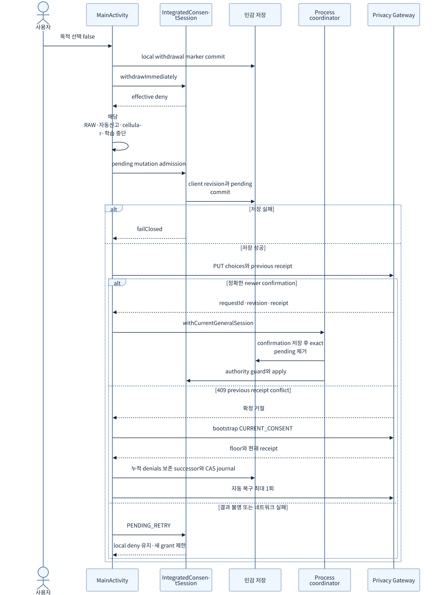

[Mermaid 원본](../diagrams/D01-sequence-consent.mmd) · [SVG](../rendered/D01-sequence-consent.svg)


[Mermaid 원본](../diagrams/D01-state-consent.mmd) · [SVG](../rendered/D01-state-consent.svg)

## F-D01-023 동의 저장·pending replay·확정 CAS 거절 복구

| 항목 | 명세 |
| --- | --- |
| 분야 | D01 계정·온보딩·동의·권한·앱 개인정보와 로컬 보안 |
| 목적 | 새 허용과 철회 요청을 서버 receipt 단위로 선저장·확인한다. |
| 사용 주체 | 앱 사용자 MainActivity |
| 활성 상태 | ACTIVE |
| 진입점 | apps/android/app/src/main/java/kr/co/hanium/dreamup/walksafe/MainActivity.kt:10199 persistIntegratedConsentDraft apps/android/app/src/main/java/kr/co/hanium/dreamup/walksafe/MainActivity.kt:9993 startRejectedIntegratedConsentCasRecovery apps/android/app/src/main/java/kr/co/hanium/dreamup/walksafe/MainActivity.kt:10454 startIntegratedConsentRequest / applyIntegratedConsentConfirmation apps/android/app/src/main/java/kr/co/hanium/dreamup/walksafe/session/IntegratedConsentPolicy.kt:220 PendingIntegratedConsentMutation / IntegratedConsentSession apps/android/app/src/main/java/kr/co/hanium/dreamup/walksafe/session/RejectedConsentCasJournalCodec.kt:1 RejectedConsentCasJournalCodec |
| 실행 전제 | current GENERAL actor/session/install·bootstrap ready·store 정상·삭제block 없음 |
| 입력 출처 형식 검증 최신성 | desired four choices,current receipt,clientRev floor+1,actorSHA,deterministic requestId,withdrawal set; rev>0에는 previous receipt 필요 |

### 시작 이벤트와 처리 순서

| 이벤트 ID | 발생원 | 이벤트 | 수신부 | 흐름 |
| --- | --- | --- | --- | --- |
| E-D01-023-01 | 사용자 또는 명시된 호출자 | 동의 저장·pending replay·확정 CAS 거절 복구 | persistIntegratedConsentDraft | current GENERAL actor/session/install·bootstrap ready·store 정상·삭제block 없음 → recovery denial이 있으면 draft grant보다 우선하여 effective desired를 만든다. → 정확한 confirmation 저장 후 해당 목적 effective 상태 |

1. 1. recovery denial이 있으면 draft grant보다 우선하여 effective desired를 만든다.
2. 2. synchronized admission에서 current pending 충돌·revision·actor를 확인하고 pending mutation+clientRev를 encrypted commit한다.
3. 3. durable commit 성공 뒤 PUT privacy/rights를 실행; current generation 확인 후 strict confirmation을 평가한다.
4. 4. exact requestId/install/version/clientRev/selections와 더 큰 serverRev가 일치해야 confirmation을 저장하고 pending/CAS journal을 제거한다.
5. 5. 409 previous receipt conflict 확정이면 bootstrap CURRENT_CONSENT를 가져와 floor+1 successor를 만들되 누적 denials를 모두 보존한다. journal32KiB 내 저장 후 자동복구 최대1회 dispatch한다.

| 분기 조건 | 실제 처리 결과 | 구현 근거 |
| --- | --- | --- |
| pending withdrawal을 새grant로 대체 시도 | submission 거부 | apps/android/app/src/main/java/kr/co/hanium/dreamup/walksafe/MainActivity.kt:10199 persistIntegratedConsentDraft |
| store commit 실패 | 전송 안 함·failClosed | apps/android/app/src/main/java/kr/co/hanium/dreamup/walksafe/MainActivity.kt:10199 persistIntegratedConsentDraft |
| 동일rev 다른content/identity | failClosed | apps/android/app/src/main/java/kr/co/hanium/dreamup/walksafe/MainActivity.kt:10199 persistIntegratedConsentDraft |
| bootstrap/receipt/floor 부정 또는 복구횟수 초과 | authority hold·PENDING_RETRY | apps/android/app/src/main/java/kr/co/hanium/dreamup/walksafe/MainActivity.kt:10199 persistIntegratedConsentDraft |
| 전송 결과 불명 | pending 유지; 새허용 열지 않음 | apps/android/app/src/main/java/kr/co/hanium/dreamup/walksafe/MainActivity.kt:10199 persistIntegratedConsentDraft |

### 효과 종료와 복구

서버 receipt·audit hash·controlsecret encrypted 저장; 후속 schedulePostWalkTransfers는 current allowed에만 영향.

| 상황 | 동작 |
| --- | --- |
| 정상 완료 | 정확한 confirmation 저장 후 해당 목적 effective 상태 |
| 실패 | 저장·서버확인 실패면 grant 제한; 철회 계속 효력 |
| 시간 초과 | connect8s/read12s; timeout은 pending 제거 근거 아님 |
| 중복 입력 | 동일 exact confirmation duplicate 허용; older ignored; same-rev conflict 차단 |
| 취소 | call cancel 가능하지만 durable pending 철회는 취소로 사라지지 않음 |
| 중단과 생명주기 | 새 session/generation이면 late response publish 금지 |
| 재시도 | 동일 pending replay 및 확정CAS 충돌만1회 자동 successor; 계속실패는 pendingRetry |
| 복구 | 재시작 pending/CAS journal strict schema·actor/confirmation 보존검사 |
| 자원 정리 | 정확 ack에서만 pending·CAS journal 삭제, 관련 withdrawal acknowledgement 제거 |

### 상태 실행 맥락과 연결

| 항목 | 명세 |
| --- | --- |
| 초기 상태 | S-D01-023-DRAFT |
| 상태 목록 | S-D01-023-DRAFT S-D01-023-PERSISTING S-D01-023-PENDING S-D01-023-CONFIRMING S-D01-023-CAS_REJECTED S-D01-023-PENDING_RETRY S-D01-023-CONFIRMED S-D01-023-FAIL_CLOSED |
| 전이 조건과 전이 동작 | durablepending→PENDING PUTexactack→CONFIRMED 확정409→CAS_REJECTED→successor 기타실패→PENDING_RETRY |
| 허용되지 않는 전이 | 철회미전달을 새grant로 덮거나 rejected CAS와 unknown outcome 혼동 금지 |
| 동시성 순서와 작업 소유권 | lock으로 admission·persist 직렬화, dispatch 밖에서 current owner 재확인, process authority commit lock |
| 공유 상태와 다른 기능 연결 | F-D01-010/022/024; D06 RAW receipt transition; D08/D09 ledger CAS |

### 정책 근거와 검증 범위

| 항목 | 근거 |
| --- | --- |
| 정책 | [P-D01-015](#P-D01-015) [P-D01-016](#P-D01-016) [P-D01-017](#P-D01-017) [P-D01-018](#P-D01-018) [P-D01-024](#P-D01-024) |
| 구현 | [apps/android/app/src/main/java/kr/co/hanium/dreamup/walksafe/MainActivity.kt:10199](/home/ddobagi/Hanium_Dreamup/apps/android/app/src/main/java/kr/co/hanium/dreamup/walksafe/MainActivity.kt:10199) · `persistIntegratedConsentDraft` (범위 10199–10371) [apps/android/app/src/main/java/kr/co/hanium/dreamup/walksafe/MainActivity.kt:9993](/home/ddobagi/Hanium_Dreamup/apps/android/app/src/main/java/kr/co/hanium/dreamup/walksafe/MainActivity.kt:9993) · `startRejectedIntegratedConsentCasRecovery` (범위 9993–10198) [apps/android/app/src/main/java/kr/co/hanium/dreamup/walksafe/MainActivity.kt:10454](/home/ddobagi/Hanium_Dreamup/apps/android/app/src/main/java/kr/co/hanium/dreamup/walksafe/MainActivity.kt:10454) · `startIntegratedConsentRequest / applyIntegratedConsentConfirmation` (범위 10454–10889) [apps/android/app/src/main/java/kr/co/hanium/dreamup/walksafe/session/IntegratedConsentPolicy.kt:220](/home/ddobagi/Hanium_Dreamup/apps/android/app/src/main/java/kr/co/hanium/dreamup/walksafe/session/IntegratedConsentPolicy.kt:220) · `PendingIntegratedConsentMutation / IntegratedConsentSession` (범위 220–898) [apps/android/app/src/main/java/kr/co/hanium/dreamup/walksafe/session/RejectedConsentCasJournalCodec.kt:1](/home/ddobagi/Hanium_Dreamup/apps/android/app/src/main/java/kr/co/hanium/dreamup/walksafe/session/RejectedConsentCasJournalCodec.kt:1) · `RejectedConsentCasJournalCodec` (범위 1–161) |
| 기존 개선 ID | 개별 동일성 미확인; 분야 연관은 별도 추적표 |
| 기존 분야 | 해당 없음 |
| 기존 실행 증거 | 해당 없음 |
| 한계 및 구분 | 현재 snapshot 정적 확인. 기기·네트워크 실동작은 이번 검증하지 않았다. |

| 테스트 위치 | 심볼 | 증거 수준 | 기대와 한계 |
| --- | --- | --- | --- |

연결한 테스트 미확인: 이번 작성 범위에서 이 기능에 대응하는 시험 단언을 연결하지 않았다. 테스트 자체가 없다는 판정이 아니다.

### 이벤트 처리 그림


[Mermaid 원본](../diagrams/D01-F023.mmd) · [SVG](../rendered/D01-F023.svg)

[Mermaid 원본](../diagrams/D01-sequence-consent.mmd) · [SVG](../rendered/D01-sequence-consent.svg)

[Mermaid 원본](../diagrams/D01-state-consent.mmd) · [SVG](../rendered/D01-state-consent.svg)

## F-D01-024 RAW·자동신고·모바일전송·학습 동의의 즉시 철회

| 항목 | 명세 |
| --- | --- |
| 분야 | D01 계정·온보딩·동의·권한·앱 개인정보와 로컬 보안 |
| 목적 | 네 목적을 각각 서버 응답 전에 로컬에서 중단한다. |
| 사용 주체 | 앱 사용자 MainActivity |
| 활성 상태 | ACTIVE |
| 진입점 | apps/android/app/src/main/java/kr/co/hanium/dreamup/walksafe/MainActivity.kt:9613 updateIntegratedConsentDraft apps/android/app/src/main/java/kr/co/hanium/dreamup/walksafe/MainActivity.kt:9754 applyImmediateConsentWithdrawals apps/android/app/src/main/java/kr/co/hanium/dreamup/walksafe/session/IntegratedConsentPolicy.kt:368 withdrawImmediately / withdrawalRecoverySelectionsOrNull |
| 실행 전제 | 해당 consent toggle을 false로 변경; 저장소 접근 가능; 기존 grant 여부와 무관하게 철회 의사 보존 |
| 입력 출처 형식 검증 최신성 | IntegratedConsentItem 네 값과 desired false; actor-bound local withdrawal marker |

### 시작 이벤트와 처리 순서

| 이벤트 ID | 발생원 | 이벤트 | 수신부 | 흐름 |
| --- | --- | --- | --- | --- |
| E-D01-024-01 | 사용자 | RAW 동의 false | applyImmediateConsentWithdrawals | marker commit → raw deny → speech/raw 저장·업로드 취소 → pending서버반영 |
| E-D01-024-02 | 사용자 | 자동 신고 false | applyImmediateConsentWithdrawals | marker commit → auto deny → generation 증가·자동queue 정리 |
| E-D01-024-03 | 사용자 | 모바일 전송 false | applyImmediateConsentWithdrawals | marker commit → WIFI_ONLY → cellular중 전송 취소 |
| E-D01-024-04 | 사용자 | 학습 재사용 false | applyImmediateConsentWithdrawals | marker commit → training deny → 서버반영대기 |

1. 1. false 변경은 encrypted local withdrawal marker를 저장하고 RAW이면 추가 plain field-log block marker를 먼저 commit한다.
2. 2. session.withdrawImmediately로 effective deny를 적용하고 진행 consent call을 취소한다.
3. 3. RAW는 speech-output storage·debug original/upload·raw upload/window를 막고 raw coordinator 재검증/정리를 연결한다.
4. 4. 자동신고는 safety generation 증가·자동 queue 및 old receipt 정리를, 모바일은 WIFI_ONLY 및 현재 cellular 전송중단을, 학습은 training reuse false를 적용한다.
5. 5. 이후 서버 pending mutation으로 전달하되 old confirmation replay와 재시작에서도 local denial이 계속 우선한다.

| 분기 조건 | 실제 처리 결과 | 구현 근거 |
| --- | --- | --- |
| 철회 marker commit 실패 | 전체 consent failClosed; 성공이라고 안내하지 않음 | apps/android/app/src/main/java/kr/co/hanium/dreamup/walksafe/MainActivity.kt:9613 updateIntegratedConsentDraft |
| RAW만 철회 | 다른 독립 목적 선택을 자동 false로 만들지는 않음 | apps/android/app/src/main/java/kr/co/hanium/dreamup/walksafe/MainActivity.kt:9613 updateIntegratedConsentDraft |
| 현재 cellular 아님 | 모바일 preference는 WiFiOnly로 바꾸고 future gate 적용 | apps/android/app/src/main/java/kr/co/hanium/dreamup/walksafe/MainActivity.kt:9613 updateIntegratedConsentDraft |
| 서버 old grant replay | effective deny 유지·WITHDRAWAL_PENDING | apps/android/app/src/main/java/kr/co/hanium/dreamup/walksafe/MainActivity.kt:9613 updateIntegratedConsentDraft |

### 효과 종료와 복구

해당 저장·수집·전송 즉시 제한. 이미 서버에 전달된 데이터 삭제·보존기간 완료는 별도 D06/D09 정책이다.

| 상황 | 동작 |
| --- | --- |
| 정상 완료 | 로컬 철회 효력 즉시; 서버 ack 후 pending 해제 |
| 실패 | storagefailure는 failClosed |
| 시간 초과 | 서버 미응답 동안에도 로컬deny 유지; 자동철회만료 없음 |
| 중복 입력 | 동일 false 재선택은 허용회복을 만들지 않음 |
| 취소 | 철회 전송 취소가 이미 저장된 deny를 취소하지 않음 |
| 중단과 생명주기 | 재시작에서 marker+pending denial 복원 |
| 재시도 | 연결복구 후 durable withdrawal replay; old grant로 재시도 payload 만들지 않음 |
| 복구 | marker-only withdrawal도 정책reconsent reset으로 삭제하지 않음 |
| 자원 정리 | 정확 pending confirmation이 acknowledgement할 때만 관련 marker 해제 |

### 상태 실행 맥락과 연결

| 항목 | 명세 |
| --- | --- |
| 초기 상태 | S-D01-024-ALLOWED |
| 상태 목록 | S-D01-024-ALLOWED S-D01-024-LOCAL_DENIED S-D01-024-WITHDRAWAL_PENDING S-D01-024-SERVER_DENIED S-D01-024-FAIL_CLOSED |
| 전이 조건과 전이 동작 | false→LOCAL_DENIED 전송대기→WITHDRAWAL_PENDING 정확ack→SERVER_DENIED |
| 허용되지 않는 전이 | 서버확인 기다리며 수집 계속·다른grant로 localdeny해제 금지 |
| 동시성 순서와 작업 소유권 | UI commit→effective policy→cancel queued work; 각 executor 세부 purge는 D06/D02 경계 |
| 공유 상태와 다른 기능 연결 | D06 rawCollectionRuntimeCoordinator/reportQueue/NetworkTransferPolicy; D02 speech output |

### 정책 근거와 검증 범위

| 항목 | 근거 |
| --- | --- |
| 정책 | [P-D01-015](#P-D01-015) [P-D01-017](#P-D01-017) [P-D01-018](#P-D01-018) |
| 구현 | [apps/android/app/src/main/java/kr/co/hanium/dreamup/walksafe/MainActivity.kt:9613](/home/ddobagi/Hanium_Dreamup/apps/android/app/src/main/java/kr/co/hanium/dreamup/walksafe/MainActivity.kt:9613) · `updateIntegratedConsentDraft` (범위 9613–9650) [apps/android/app/src/main/java/kr/co/hanium/dreamup/walksafe/MainActivity.kt:9754](/home/ddobagi/Hanium_Dreamup/apps/android/app/src/main/java/kr/co/hanium/dreamup/walksafe/MainActivity.kt:9754) · `applyImmediateConsentWithdrawals` (범위 9754–9858) [apps/android/app/src/main/java/kr/co/hanium/dreamup/walksafe/session/IntegratedConsentPolicy.kt:368](/home/ddobagi/Hanium_Dreamup/apps/android/app/src/main/java/kr/co/hanium/dreamup/walksafe/session/IntegratedConsentPolicy.kt:368) · `withdrawImmediately / withdrawalRecoverySelectionsOrNull` (범위 368–898) |
| 기존 개선 ID | 개별 동일성 미확인; 분야 연관은 별도 추적표 |
| 기존 분야 | 해당 없음 |
| 기존 실행 증거 | 해당 없음 |
| 한계 및 구분 | 현재 snapshot 정적 확인. 기기·네트워크 실동작은 이번 검증하지 않았다. |

| 테스트 위치 | 심볼 | 증거 수준 | 기대와 한계 |
| --- | --- | --- | --- |
| [apps/android/app/src/test/java/kr/co/hanium/dreamup/walksafe/session/IntegratedConsentEffectiveWithdrawalRegressionTest.kt](/home/ddobagi/Hanium_Dreamup/apps/android/app/src/test/java/kr/co/hanium/dreamup/walksafe/session/IntegratedConsentEffectiveWithdrawalRegressionTest.kt) | offlineWithdrawalSurvivesRestartAndReplayOfTheOldReceipt | TEST_EXPECTATION | 오프라인 철회가 재시작·옛receipt replay 이후에도 우선하는 기대; 이번 실행하지 않음 |
| [apps/android/app/src/test/java/kr/co/hanium/dreamup/walksafe/session/IntegratedConsentEffectiveWithdrawalRegressionTest.kt](/home/ddobagi/Hanium_Dreamup/apps/android/app/src/test/java/kr/co/hanium/dreamup/walksafe/session/IntegratedConsentEffectiveWithdrawalRegressionTest.kt) | policyReconsentRefusesToDropAMarkerOnlyLocalWithdrawal | TEST_EXPECTATION | 버전재동의가 marker-only 철회를 버리지 않는 기대; 이번 실행하지 않음 |

### 이벤트 처리 그림


[Mermaid 원본](../diagrams/D01-F024.mmd) · [SVG](../rendered/D01-F024.svg)

[Mermaid 원본](../diagrams/D01-sequence-consent.mmd) · [SVG](../rendered/D01-sequence-consent.svg)

[Mermaid 원본](../diagrams/D01-state-consent.mmd) · [SVG](../rendered/D01-state-consent.svg)

## F-D01-025 민감 preference의 암호화 map·소유권·저장 장애 차단

| 항목 | 명세 |
| --- | --- |
| 분야 | D01 계정·온보딩·동의·권한·앱 개인정보와 로컬 보안 |
| 목적 | 계정·동의·교육·삭제 관련 값의 저장·복원 실패를 명시적 차단으로 처리한다. |
| 사용 주체 | 앱 사용자 MainActivity |
| 활성 상태 | ACTIVE |
| 진입점 | apps/android/app/src/main/java/kr/co/hanium/dreamup/walksafe/security/AndroidSensitivePreferenceStore.kt:1 AndroidSensitivePreferenceStore |
| 실행 전제 | AndroidSensitivePreferenceStore 초기화 및 허용된 key/prefix 요청 |
| 입력 출처 형식 검증 최신성 | 타입있는 map 최대256 entries,평문64KiB,envelope96KiB; storage identity+key+owner epoch |

### 시작 이벤트와 처리 순서

| 이벤트 ID | 발생원 | 이벤트 | 수신부 | 흐름 |
| --- | --- | --- | --- | --- |
| E-D01-025-01 | 사용자 또는 명시된 호출자 | 민감 preference의 암호화 map·소유권·저장 장애 차단 | AndroidSensitivePreferenceStore | AndroidSensitivePreferenceStore 초기화 및 허용된 key/prefix 요청 → 초기화는 reset marker·blocked marker·plaintext artifact를 검사하고 encrypted envelope만 decode한다. → 검증값 읽기/성공commit 또는 durable reset |

1. 1. 초기화는 reset marker·blocked marker·plaintext artifact를 검사하고 encrypted envelope만 decode한다.
2. 2. 모든 key/type/size를 검증하고 old readable version이면 필요한 rewrap 경로를 사용한다.
3. 3. editor는 소유자 epoch를 확인하고 새 map을 암호화·durable commit한 뒤 메모리값을 publish한다.
4. 4. 복호·파싱·scope·저장 실패면 identity-free blocked marker를 남기고 getter는 기본값을 반환한다.
5. 5. destroyAndClear는 reset pending을 먼저 저장하고 payload부재 확인→known key 폐기→새키생성→marker해제 readback을 수행한다.

| 분기 조건 | 실제 처리 결과 | 구현 근거 |
| --- | --- | --- |
| plaintext 민감 artifact 발견 | 자동이관 없이 제거·차단 | apps/android/app/src/main/java/kr/co/hanium/dreamup/walksafe/security/AndroidSensitivePreferenceStore.kt:1 AndroidSensitivePreferenceStore |
| bad type/key/size/decrypt | 복원 차단 | apps/android/app/src/main/java/kr/co/hanium/dreamup/walksafe/security/AndroidSensitivePreferenceStore.kt:1 AndroidSensitivePreferenceStore |
| 새 store instance가 owner를 교체 | old instance commit 실패; 새상태 덮기 없음 | apps/android/app/src/main/java/kr/co/hanium/dreamup/walksafe/security/AndroidSensitivePreferenceStore.kt:1 AndroidSensitivePreferenceStore |
| 중간 reset 실패 | marker남고 차단; 새 정상상태로 오인 안 함 | apps/android/app/src/main/java/kr/co/hanium/dreamup/walksafe/security/AndroidSensitivePreferenceStore.kt:1 AndroidSensitivePreferenceStore |

### 효과 종료와 복구

SharedPreferences encrypted envelope와 비밀없는 차단/초기화 표식; 모든 앱데이터 전체암호화 보장으로 확대하지 않는다.

| 상황 | 동작 |
| --- | --- |
| 정상 완료 | 검증값 읽기/성공commit 또는 durable reset |
| 실패 | blocked; caller가 false/default를 허용으로 취급하지 않도록 상위 gate |
| 시간 초과 | 동기 저장 API 자체 timeout 없음 |
| 중복 입력 | single current owner만 commit; stale store가 reset도 덮지 않음 |
| 취소 | 저장 mutation의 중간 취소 API 없음 |
| 중단과 생명주기 | crash의 reset marker가 다음 초기화를 차단 |
| 재시도 | caller 재시도·명시reset; 복호 실패를 새키생성으로 덮지 않음 |
| 복구 | same identity encrypted store 복원, keymissing이면 blocked |
| 자원 정리 | 삭제 완료 reset 또는 허용 범위 remove |

### 상태 실행 맥락과 연결

| 항목 | 명세 |
| --- | --- |
| 초기 상태 | S-D01-025-INITIALIZING |
| 상태 목록 | S-D01-025-INITIALIZING S-D01-025-READY S-D01-025-BLOCKED S-D01-025-RESET_PENDING |
| 전이 조건과 전이 동작 | 검증복호성공→READY 오류→BLOCKED explicitreset→RESET_PENDING→READY |
| 허용되지 않는 전이 | stale owner commit·plaintext 신뢰이관·저장실패 후 publish 금지 |
| 동시성 순서와 작업 소유권 | shared locks+process owner epoch+synchronous commit; publish order가 durable write 뒤 |
| 공유 상태와 다른 기능 연결 | F-D01-004/006/018/023/030/031; session store는 별도encrypted형식 |

### 정책 근거와 검증 범위

| 항목 | 근거 |
| --- | --- |
| 정책 | [P-D01-018](#P-D01-018) [P-D01-019](#P-D01-019) |
| 구현 | [apps/android/app/src/main/java/kr/co/hanium/dreamup/walksafe/security/AndroidSensitivePreferenceStore.kt:1](/home/ddobagi/Hanium_Dreamup/apps/android/app/src/main/java/kr/co/hanium/dreamup/walksafe/security/AndroidSensitivePreferenceStore.kt:1) · `AndroidSensitivePreferenceStore` (범위 1–511) |
| 기존 개선 ID | 개별 동일성 미확인; 분야 연관은 별도 추적표 |
| 기존 분야 | 해당 없음 |
| 기존 실행 증거 | 해당 없음 |
| 한계 및 구분 | 현재 snapshot 정적 확인. 기기·네트워크 실동작은 이번 검증하지 않았다. |

| 테스트 위치 | 심볼 | 증거 수준 | 기대와 한계 |
| --- | --- | --- | --- |

연결한 테스트 미확인: 이번 작성 범위에서 이 기능에 대응하는 시험 단언을 연결하지 않았다. 테스트 자체가 없다는 판정이 아니다.

### 이벤트 처리 그림


[Mermaid 원본](../diagrams/D01-F025.mmd) · [SVG](../rendered/D01-F025.svg)

## F-D01-026 AndroidKeyStore 키·AEAD envelope와 백업 제외

| 항목 | 명세 |
| --- | --- |
| 분야 | D01 계정·온보딩·동의·권한·앱 개인정보와 로컬 보안 |
| 목적 | 민감 로컬 ciphertext의 키·버전·용도를 결속하고 일반 백업에서 제외한다. |
| 사용 주체 | 앱 사용자 MainActivity |
| 활성 상태 | ACTIVE |
| 진입점 | apps/android/app/src/main/java/kr/co/hanium/dreamup/walksafe/security/LocalAead.kt:1 LocalAead / VersionedLocalAead apps/android/app/src/main/java/kr/co/hanium/dreamup/walksafe/security/AndroidKeyStoreAead.kt:1 AndroidKeyStoreAead apps/android/app/src/main/AndroidManifest.xml:1 application apps/android/app/src/main/res/xml/data_extraction_rules.xml:1 data-extraction-rules |
| 실행 전제 | 민감 저장소가 versioned LocalAead 사용; AndroidKeyStore 접근 가능 |
| 입력 출처 형식 검증 최신성 | AES256 GCM,IV12bytes,tag128bits,nonempty domain AAD<=1024bytes,current/readable/compromised version set |

### 시작 이벤트와 처리 순서

| 이벤트 ID | 발생원 | 이벤트 | 수신부 | 흐름 |
| --- | --- | --- | --- | --- |
| E-D01-026-01 | 사용자 또는 명시된 호출자 | AndroidKeyStore 키·AEAD envelope와 백업 제외 | LocalAead / VersionedLocalAead | 민감 저장소가 versioned LocalAead 사용; AndroidKeyStore 접근 가능 → 현재 key version으로 randomized encryption하고 envelope version·domain을 AAD에 포함한다. → 인증된 plaintext 또는 current-version ciphertext |

1. 1. 현재 key version으로 randomized encryption하고 envelope version·domain을 AAD에 포함한다.
2. 2. decode는 canonical Base64와 envelope/IV/tag/버전 범위를 검증하고 readable known key로만 decrypt한다.
3. 3. compromised key는 제거,missing key generation tombstone은 임의 재생성을 막는다. 이전 readable key 자료는 rewrap 필요 표시한다.
4. 4. 검증된 purge/reset 경로에서만 fresh key를 만들고 caller는 plaintext buffer를 필요한 범위 후 정리한다.
5. 5. manifest allowBackup=false·dataExtractionRules에서 cloud backup/device transfer 영역을 제외하고 usesCleartextTraffic=false를 선언한다.

| 분기 조건 | 실제 처리 결과 | 구현 근거 |
| --- | --- | --- |
| AAD mismatch·tag 실패·unknownversion | decryption blocked | apps/android/app/src/main/java/kr/co/hanium/dreamup/walksafe/security/LocalAead.kt:1 LocalAead / VersionedLocalAead |
| 키가사라졌으나 generation tombstone있음 | silent regeneration 거부 | apps/android/app/src/main/java/kr/co/hanium/dreamup/walksafe/security/LocalAead.kt:1 LocalAead / VersionedLocalAead |
| compromisedversion | 복호거부·키삭제 | apps/android/app/src/main/java/kr/co/hanium/dreamup/walksafe/security/LocalAead.kt:1 LocalAead / VersionedLocalAead |
| reset 검증실패 | fresh 정상저장 publish 금지 | apps/android/app/src/main/java/kr/co/hanium/dreamup/walksafe/security/LocalAead.kt:1 LocalAead / VersionedLocalAead |

### 효과 종료와 복구

ciphertext+key alias lifecycle; AndroidKeyStore 하드웨어 지원·root 공격 방어·화면캡처 차단을 증명하지 않는다.

| 상황 | 동작 |
| --- | --- |
| 정상 완료 | 인증된 plaintext 또는 current-version ciphertext |
| 실패 | 불량 자료는 상위store blocked로 전달 |
| 시간 초과 | crypto 자체 timeout 없음 |
| 중복 입력 | randomized IV; 동일 평문이라 동일 ciphertext를 요구하지 않음 |
| 취소 | 암복호 호출 중 사용자 취소 API 없음 |
| 중단과 생명주기 | process crash 복구는 각 store/reset marker 계약 |
| 재시도 | 키missing자료의 blindretry로 복원 불가 |
| 복구 | 이전 readableversion은 rewrap; keylost는 verified purge 후 초기화 |
| 자원 정리 | compromised/known keys destroy, transient plaintext zeroing은 caller별 |

### 상태 실행 맥락과 연결

| 항목 | 명세 |
| --- | --- |
| 초기 상태 | S-D01-026-CURRENT |
| 상태 목록 | S-D01-026-CURRENT S-D01-026-READABLE_OLD S-D01-026-COMPROMISED S-D01-026-KEY_MISSING S-D01-026-BLOCKED |
| 전이 조건과 전이 동작 | old readable decrypt→needsRewrap compromised/missing→BLOCKED verified purge→fresh CURRENT |
| 허용되지 않는 전이 | 하드웨어암호화 보장·백업설정만으로 전체기기정보유출 불가 주장 금지 |
| 동시성 순서와 작업 소유권 | AndroidKeyStore shared lock과 synchronous crypto |
| 공유 상태와 다른 기능 연결 | D03 route·D06 report/raw 각 전용암호store는 담당영역 별도 |

### 정책 근거와 검증 범위

| 항목 | 근거 |
| --- | --- |
| 정책 | [P-D01-018](#P-D01-018) [P-D01-019](#P-D01-019) |
| 구현 | [apps/android/app/src/main/java/kr/co/hanium/dreamup/walksafe/security/LocalAead.kt:1](/home/ddobagi/Hanium_Dreamup/apps/android/app/src/main/java/kr/co/hanium/dreamup/walksafe/security/LocalAead.kt:1) · `LocalAead / VersionedLocalAead` (범위 1–278) [apps/android/app/src/main/java/kr/co/hanium/dreamup/walksafe/security/AndroidKeyStoreAead.kt:1](/home/ddobagi/Hanium_Dreamup/apps/android/app/src/main/java/kr/co/hanium/dreamup/walksafe/security/AndroidKeyStoreAead.kt:1) · `AndroidKeyStoreAead` (범위 1–98) [apps/android/app/src/main/AndroidManifest.xml:1](/home/ddobagi/Hanium_Dreamup/apps/android/app/src/main/AndroidManifest.xml:1) · `application` (범위 1–66) [apps/android/app/src/main/res/xml/data_extraction_rules.xml:1](/home/ddobagi/Hanium_Dreamup/apps/android/app/src/main/res/xml/data_extraction_rules.xml:1) · `data-extraction-rules` (범위 1–25) |
| 기존 개선 ID | 개별 동일성 미확인; 분야 연관은 별도 추적표 |
| 기존 분야 | 해당 없음 |
| 기존 실행 증거 | 해당 없음 |
| 한계 및 구분 | 현재 snapshot 정적 확인. 기기·네트워크 실동작은 이번 검증하지 않았다. |

| 테스트 위치 | 심볼 | 증거 수준 | 기대와 한계 |
| --- | --- | --- | --- |

연결한 테스트 미확인: 이번 작성 범위에서 이 기능에 대응하는 시험 단언을 연결하지 않았다. 테스트 자체가 없다는 판정이 아니다.

### 이벤트 처리 그림


[Mermaid 원본](../diagrams/D01-F026.mmd) · [SVG](../rendered/D01-F026.svg)

## F-D01-027 계정 삭제 확인·취소·이중 durable intent

| 항목 | 명세 |
| --- | --- |
| 분야 | D01 계정·온보딩·동의·권한·앱 개인정보와 로컬 보안 |
| 목적 | 되돌릴 수 없는 삭제 절차를 명시적 확인과 영속 증거에 결속한다. |
| 사용 주체 | 앱 사용자 MainActivity |
| 활성 상태 | ACTIVE |
| 진입점 | apps/android/app/src/main/java/kr/co/hanium/dreamup/walksafe/MainActivity.kt:4510 onAccountDeletionPrimaryClicked / onAccountDeletionConfirmClicked apps/android/app/src/main/java/kr/co/hanium/dreamup/walksafe/session/AccountDeletionDualAuthority.kt:1 AccountDeletionDualAuthority apps/android/app/src/main/java/kr/co/hanium/dreamup/walksafe/session/AccountDeletionIntentFence.kt:1 AccountDeletionIntentFence apps/android/app/src/main/java/kr/co/hanium/dreamup/walksafe/session/PrivacyDeletionPolicy.kt:478 requestConfirmation / cancelConfirmation / begin |
| 실행 전제 | 계정삭제 UI·일치actor 일반/복구세션 또는 복구모드; 저장소/삭제상태 정상 |
| 입력 출처 형식 검증 최신성 | 확인 이벤트,configuredorigin,installationId,requestId,actor hash,clientRevision; 확인문구 DELETE_MY_ACCOUNT API body |

### 시작 이벤트와 처리 순서

| 이벤트 ID | 발생원 | 이벤트 | 수신부 | 흐름 |
| --- | --- | --- | --- | --- |
| E-D01-027-01 | 사용자 또는 명시된 호출자 | 계정 삭제 확인·취소·이중 durable intent | onAccountDeletionPrimaryClicked / onAccountDeletionConfirmClicked | 계정삭제 UI·일치actor 일반/복구세션 또는 복구모드; 저장소/삭제상태 정상 → 계정 삭제 주 버튼은 IDLE에서 CONFIRM_REQUIRED와 설명을 열고 완료 상태에서는 reset을 연결한다. → 삭제 요청 준비 또는 확인전 취소 |

1. 1. 계정 삭제 주 버튼은 IDLE에서 CONFIRM_REQUIRED와 설명을 열고 완료 상태에서는 reset을 연결한다.
2. 2. 사용자는 durable 준비 전에는 cancelConfirmation으로 돌아갈 수 있다.
3. 3. 최종 확인은 현재 actor/session/origin을 검증하고 runtime privacy fence를 먼저 세운 뒤 preparation worker를 시작한다.
4. 4. encrypted preference와 noBackup intent에 confirmed를 쓰고 파일 verified write를 확인한 뒤 요청 journal 준비를 진행한다.

| 분기 조건 | 실제 처리 결과 | 구현 근거 |
| --- | --- | --- |
| durable 확인/prepare가 이미 시작됨 | 취소 거부; 삭제 복구 안내 | apps/android/app/src/main/java/kr/co/hanium/dreamup/walksafe/MainActivity.kt:4510 onAccountDeletionPrimaryClicked / onAccountDeletionConfirmClicked |
| actor/scope mismatch·sensitiveblocked | 요청 보내지 않고 제한/복구유지 | apps/android/app/src/main/java/kr/co/hanium/dreamup/walksafe/MainActivity.kt:4510 onAccountDeletionPrimaryClicked / onAccountDeletionConfirmClicked |
| 파일쓰기 실패·authority충돌 | failClosed 및 일반기능 차단 | apps/android/app/src/main/java/kr/co/hanium/dreamup/walksafe/MainActivity.kt:4510 onAccountDeletionPrimaryClicked / onAccountDeletionConfirmClicked |
| 파일성공·pref실패 | 이중권위의 file authority를 보존하고 복구 경로 | apps/android/app/src/main/java/kr/co/hanium/dreamup/walksafe/MainActivity.kt:4510 onAccountDeletionPrimaryClicked / onAccountDeletionConfirmClicked |

### 효과 종료와 복구

계정삭제 확인 UI·안내·runtime privacy 차단, noBackup durable confirmation; 서버 삭제 접수와는 구분.

| 상황 | 동작 |
| --- | --- |
| 정상 완료 | 삭제 요청 준비 또는 확인전 취소 |
| 실패 | durable authority를 확보하지 못하면 정상 작업 지속을 허용하지 않음 |
| 시간 초과 | 확인 대화상자 자동 timeout 없음; HTTP 전 preparation 단계 |
| 중복 입력 | 삭제 진행중 새 confirmation/request 시작 거부 |
| 취소 | durable 준비 전 cancel만 가능 |
| 중단과 생명주기 | Activity lease 교체에도 durable intent 보존 |
| 재시도 | 실패한 준비는 authority/journal 복구 절차; 새임의request 남발 없음 |
| 복구 | file confirmed+journal없음은 확인사실 유지한 복구 |
| 자원 정리 | 확인 전cancel은 임시상태; durable intent는 terminalreset때 clear |

### 상태 실행 맥락과 연결

| 항목 | 명세 |
| --- | --- |
| 초기 상태 | S-D01-027-IDLE |
| 상태 목록 | S-D01-027-IDLE S-D01-027-CONFIRM_REQUIRED S-D01-027-PREPARING S-D01-027-CONFIRMED S-D01-027-FAIL_CLOSED |
| 전이 조건과 전이 동작 | 주버튼→CONFIRM_REQUIRED 사전취소→IDLE 최종확인→PREPARING→CONFIRMED |
| 허용되지 않는 전이 | durableconfirmation 이후 cancel/일반logout으로 의사폐기 금지 |
| 동시성 순서와 작업 소유권 | Main UI→privacy worker lease; dual authority 쓰기 두 시도 모두 수행 |
| 공유 상태와 다른 기능 연결 | F-D01-028/030/031; D02 runtime stop; D06 수집/신고차단 |

### 정책 근거와 검증 범위

| 항목 | 근거 |
| --- | --- |
| 정책 | [P-D01-020](#P-D01-020) [P-D01-022](#P-D01-022) |
| 구현 | [apps/android/app/src/main/java/kr/co/hanium/dreamup/walksafe/MainActivity.kt:4510](/home/ddobagi/Hanium_Dreamup/apps/android/app/src/main/java/kr/co/hanium/dreamup/walksafe/MainActivity.kt:4510) · `onAccountDeletionPrimaryClicked / onAccountDeletionConfirmClicked` (범위 4510–4628) [apps/android/app/src/main/java/kr/co/hanium/dreamup/walksafe/session/AccountDeletionDualAuthority.kt:1](/home/ddobagi/Hanium_Dreamup/apps/android/app/src/main/java/kr/co/hanium/dreamup/walksafe/session/AccountDeletionDualAuthority.kt:1) · `AccountDeletionDualAuthority` (범위 1–190) [apps/android/app/src/main/java/kr/co/hanium/dreamup/walksafe/session/AccountDeletionIntentFence.kt:1](/home/ddobagi/Hanium_Dreamup/apps/android/app/src/main/java/kr/co/hanium/dreamup/walksafe/session/AccountDeletionIntentFence.kt:1) · `AccountDeletionIntentFence` (범위 1–37) [apps/android/app/src/main/java/kr/co/hanium/dreamup/walksafe/session/PrivacyDeletionPolicy.kt:478](/home/ddobagi/Hanium_Dreamup/apps/android/app/src/main/java/kr/co/hanium/dreamup/walksafe/session/PrivacyDeletionPolicy.kt:478) · `requestConfirmation / cancelConfirmation / begin` (범위 478–644) |
| 기존 개선 ID | 개별 동일성 미확인; 분야 연관은 별도 추적표 |
| 기존 분야 | 해당 없음 |
| 기존 실행 증거 | 해당 없음 |
| 한계 및 구분 | 현재 snapshot 정적 확인. 기기·네트워크 실동작은 이번 검증하지 않았다. |

| 테스트 위치 | 심볼 | 증거 수준 | 기대와 한계 |
| --- | --- | --- | --- |

연결한 테스트 미확인: 이번 작성 범위에서 이 기능에 대응하는 시험 단언을 연결하지 않았다. 테스트 자체가 없다는 판정이 아니다.

### 이벤트 처리 그림


[Mermaid 원본](../diagrams/D01-F027.mmd) · [SVG](../rendered/D01-F027.svg)

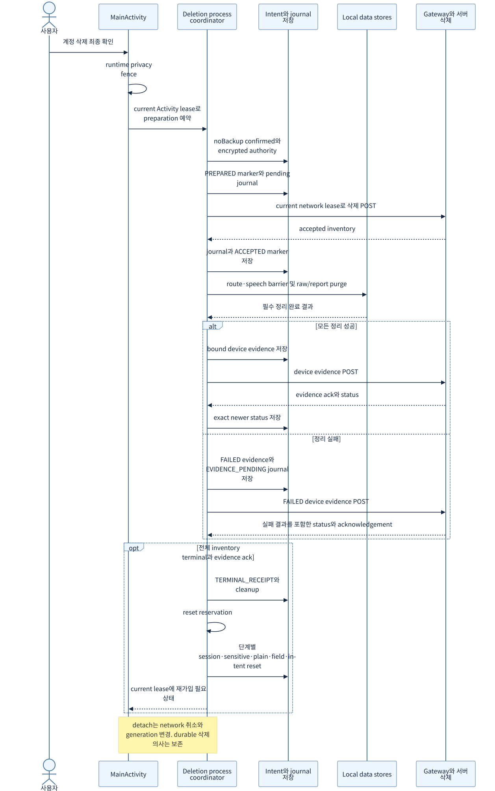

[Mermaid 원본](../diagrams/D01-sequence-deletion.mmd) · [SVG](../rendered/D01-sequence-deletion.svg)


[Mermaid 원본](../diagrams/D01-state-deletion.mmd) · [SVG](../rendered/D01-state-deletion.svg)

## F-D01-028 계정 삭제 요청·status 갱신·9개 inventory·완료 증거

| 항목 | 명세 |
| --- | --- |
| 분야 | D01 계정·온보딩·동의·권한·앱 개인정보와 로컬 보안 |
| 목적 | 삭제 접수·부분실패·법적보류·완료를 서버의 일치하는 상태로 표시한다. |
| 사용 주체 | 앱 사용자 MainActivity |
| 활성 상태 | ACTIVE |
| 진입점 | apps/android/app/src/main/java/kr/co/hanium/dreamup/walksafe/network/AndroidPrivacyDeletionClient.kt:1 requestDeletionCall / fetchDeletionStatusCall / replayDeletionRequestCall apps/android/app/src/main/java/kr/co/hanium/dreamup/walksafe/MainActivity.kt:5503 startAccountDeletionCall apps/android/app/src/main/java/kr/co/hanium/dreamup/walksafe/session/PrivacyDeletionPolicy.kt:1 DeletionInventoryItem / AccountDeletionStatus apps/android/app/src/main/java/kr/co/hanium/dreamup/walksafe/session/PrivacyDeletionPolicy.kt:1281 apply / applyLocked apps/android/app/src/main/java/kr/co/hanium/dreamup/walksafe/MainActivity.kt:5381 refreshAccountDeletionStatus / refreshAccountDeletionStatusAllowed |
| 실행 전제 | durableconfirmed intent 및 request journal; current deletion worker lease; 적절한 session/controlsecret |
| 입력 출처 형식 검증 최신성 | request/install/clientrev/accountgeneration/tombstone/receipt; statusrev,acceptedAt,itemstates; exact9 inventory |

### 시작 이벤트와 처리 순서

| 이벤트 ID | 발생원 | 이벤트 | 수신부 | 흐름 |
| --- | --- | --- | --- | --- |
| E-D01-028-01 | 사용자 또는 명시된 호출자 | 계정 삭제 요청·status 갱신·9개 inventory·완료 증거 | requestDeletionCall / fetchDeletionStatusCall / replayDeletionRequestCall | durableconfirmed intent 및 request journal; current deletion worker lease; 적절한 session/controlsecret → initial POST /privacy/account-deletions는 GENERAL session과 삭제secret로202를 기대한다. 접수 후 GET request/status는 secret로 조회한다. → 정확한 서버COMPLETED+증거ack 후 완료표시/정리 경로 |

1. 1. initial POST /privacy/account-deletions는 GENERAL session과 삭제secret로202를 기대한다. 접수 후 GET request/status는 secret로 조회한다.
2. 2. 상태응답은 identity와 accepted binding·revision·9항목과 상태별 evidence를 검증한다.
3. 3. worker lease/generation이 current일 때 stateMachine.apply를 호출하고 durable journal 저장 뒤 UI progress를 갱신한다.
4. 4. PENDING/IN_PROGRESS/EXTERNAL_PENDING/RETRY_WAIT/LEGAL_HOLD/FAILED/COMPLETED/NOT_APPLICABLE의 정확한 8개 inventory 상태를 유지하고 전체phase를 유도한다.
5. 5. 전체terminal receipt와 deviceEvidenceAcknowledged까지 만족해야 COMPLETED; terminalCleanupComplete는 별도 reset 선행조건이다.

| 분기 조건 | 실제 처리 결과 | 구현 근거 |
| --- | --- | --- |
| lowerrevision | stale 무시 | apps/android/app/src/main/java/kr/co/hanium/dreamup/walksafe/network/AndroidPrivacyDeletionClient.kt:1 requestDeletionCall / fetchDeletionStatusCall / replayDeletionRequestCall |
| same revision 동일 | duplicate 허용 | apps/android/app/src/main/java/kr/co/hanium/dreamup/walksafe/network/AndroidPrivacyDeletionClient.kt:1 requestDeletionCall / fetchDeletionStatusCall / replayDeletionRequestCall |
| same revision 다름·다른identity·항목누락 | failClosed | apps/android/app/src/main/java/kr/co/hanium/dreamup/walksafe/network/AndroidPrivacyDeletionClient.kt:1 requestDeletionCall / fetchDeletionStatusCall / replayDeletionRequestCall |
| retry/legalhold/failed | 다음재시도시각 또는 보류사유·재검토·문의/부분실패 유지 | apps/android/app/src/main/java/kr/co/hanium/dreamup/walksafe/network/AndroidPrivacyDeletionClient.kt:1 requestDeletionCall / fetchDeletionStatusCall / replayDeletionRequestCall |
| device 증거 미ack | 서버 항목이 끝났어도 앱 전체완료 불허 | apps/android/app/src/main/java/kr/co/hanium/dreamup/walksafe/network/AndroidPrivacyDeletionClient.kt:1 requestDeletionCall / fetchDeletionStatusCall / replayDeletionRequestCall |

### 효과 종료와 복구

삭제 상태·inventory UI, 정확 journal, 완료 receipt. SLA는 앱검증 상한/안내이며 기한 내 실제 삭제 실행 증거가 아니다.

| 상황 | 동작 |
| --- | --- |
| 정상 완료 | 정확한 서버COMPLETED+증거ack 후 완료표시/정리 경로 |
| 실패 | HTTP/parsing/storage 실패는 retry/restricted/failclosed 상태 유지 |
| 시간 초과 | 8sconnect12sread; transport timeout은 서버 미접수 확정 아님 |
| 중복 입력 | request identity replay 및 monotonic status; local updateLocal은 항상false |
| 취소 | durable 삭제 요청 취소 API 없음; network call cancel은 절차취소 아님 |
| 중단과 생명주기 | worker ownership 및 Activity lease로 late UI/update 배제 |
| 재시도 | Main refresh가 rev0이면 capability replay 또는 exact recovery session 재접수를, rev>0이면 status GET를 선택한다. markRetry는 durable journal을 저장하고 UI를 갱신하며 이 코드만으로 주기 타이머를 의미하지 않는다. |
| 복구 | journal과 authority 복원으로 같은request 이어감 |
| 자원 정리 | 완료후 F-D01-029 localpurge/evidence와 F-D01-031 reset |

### 상태 실행 맥락과 연결

| 항목 | 명세 |
| --- | --- |
| 초기 상태 | S-D01-028-REQUEST_PENDING |
| 상태 목록 | S-D01-028-REQUEST_PENDING S-D01-028-IN_PROGRESS S-D01-028-RETRY_WAIT S-D01-028-RESTRICTED S-D01-028-PARTIAL_FAILURE S-D01-028-COMPLETED S-D01-028-FAIL_CLOSED |
| 전이 조건과 전이 동작 | POST202→accepted inventory statusrev증가→항목상태갱신 allterminal+receipt+deviceack→COMPLETED |
| 허용되지 않는 전이 | 클라이언트가 updateLocal로 서버 항목완료 조작 금지 |
| 동시성 순서와 작업 소유권 | cancellable call, worker lease registered before gateway executor; journal before UI |
| 공유 상태와 다른 기능 연결 | D08/D09 실제 삭제·법적보류·SLA; D06 localinventory |

### 정책 근거와 검증 범위

| 항목 | 근거 |
| --- | --- |
| 정책 | [P-D01-021](#P-D01-021) [P-D01-022](#P-D01-022) [P-D01-024](#P-D01-024) |
| 구현 | [apps/android/app/src/main/java/kr/co/hanium/dreamup/walksafe/network/AndroidPrivacyDeletionClient.kt:1](/home/ddobagi/Hanium_Dreamup/apps/android/app/src/main/java/kr/co/hanium/dreamup/walksafe/network/AndroidPrivacyDeletionClient.kt:1) · `requestDeletionCall / fetchDeletionStatusCall / replayDeletionRequestCall` (범위 1–267) [apps/android/app/src/main/java/kr/co/hanium/dreamup/walksafe/MainActivity.kt:5503](/home/ddobagi/Hanium_Dreamup/apps/android/app/src/main/java/kr/co/hanium/dreamup/walksafe/MainActivity.kt:5503) · `startAccountDeletionCall` (범위 5503–5629) [apps/android/app/src/main/java/kr/co/hanium/dreamup/walksafe/session/PrivacyDeletionPolicy.kt:1](/home/ddobagi/Hanium_Dreamup/apps/android/app/src/main/java/kr/co/hanium/dreamup/walksafe/session/PrivacyDeletionPolicy.kt:1) · `DeletionInventoryItem / AccountDeletionStatus` (범위 1–328) [apps/android/app/src/main/java/kr/co/hanium/dreamup/walksafe/session/PrivacyDeletionPolicy.kt:1281](/home/ddobagi/Hanium_Dreamup/apps/android/app/src/main/java/kr/co/hanium/dreamup/walksafe/session/PrivacyDeletionPolicy.kt:1281) · `apply / applyLocked` (범위 1281–1455) [apps/android/app/src/main/java/kr/co/hanium/dreamup/walksafe/MainActivity.kt:5381](/home/ddobagi/Hanium_Dreamup/apps/android/app/src/main/java/kr/co/hanium/dreamup/walksafe/MainActivity.kt:5381) · `refreshAccountDeletionStatus / refreshAccountDeletionStatusAllowed` (범위 5381–5502) |
| 기존 개선 ID | 개별 동일성 미확인; 분야 연관은 별도 추적표 |
| 기존 분야 | 해당 없음 |
| 기존 실행 증거 | 해당 없음 |
| 한계 및 구분 | client response parser268..495 및 세부 storage helper는 미정독. 주요 worker 생성·취소·current guard·lease·Main status/marker 재개 caller는 추가 확인하여 F-D01-032로 분리했다. 일정 주기 polling이나 백그라운드 자동완료를 가정하지 않는다. |

| 테스트 위치 | 심볼 | 증거 수준 | 기대와 한계 |
| --- | --- | --- | --- |

연결한 테스트 미확인: 이번 작성 범위에서 이 기능에 대응하는 시험 단언을 연결하지 않았다. 테스트 자체가 없다는 판정이 아니다.

### 이벤트 처리 그림


[Mermaid 원본](../diagrams/D01-F028.mmd) · [SVG](../rendered/D01-F028.svg)

[Mermaid 원본](../diagrams/D01-sequence-deletion.mmd) · [SVG](../rendered/D01-sequence-deletion.svg)

[Mermaid 원본](../diagrams/D01-state-deletion.mmd) · [SVG](../rendered/D01-state-deletion.svg)

## F-D01-029 계정 삭제 로컬 데이터 정리·장치 삭제 증거 제출

| 항목 | 명세 |
| --- | --- |
| 분야 | D01 계정·온보딩·동의·권한·앱 개인정보와 로컬 보안 |
| 목적 | 원격완료 판단에 필요한 장치 미전송 자료 정리를 완료하고 증거를 서버에 결속한다. |
| 사용 주체 | 앱 사용자 MainActivity |
| 활성 상태 | ACTIVE |
| 진입점 | apps/android/app/src/main/java/kr/co/hanium/dreamup/walksafe/MainActivity.kt:5282 purgeAccountDeletionLocalDataOnCleanupThread apps/android/app/src/main/java/kr/co/hanium/dreamup/walksafe/network/AndroidPrivacyDeletionClient.kt:156 submitDeviceDeletionEvidenceCall apps/android/app/src/main/java/kr/co/hanium/dreamup/walksafe/session/PrivacyDeletionPolicy.kt:128 AccountDeletionJournal / AccountDeletionStatus apps/android/app/src/main/java/kr/co/hanium/dreamup/walksafe/MainActivity.kt:6485 scheduleAcceptedAccountDeletionLocalPurge |
| 실행 전제 | 진행중 일치하는 삭제 journal/worker lease; storage disposal 허용 |
| 입력 출처 형식 검증 최신성 | request/install/tombstone/requestreceipt/clientrev,positive evidence revision,evidenceId,정리결과 DELETED 또는 FAILED,completedAt(UTC초),결과를 포함한 evidenceSHA |

### 시작 이벤트와 처리 순서

| 이벤트 ID | 발생원 | 이벤트 | 수신부 | 흐름 |
| --- | --- | --- | --- | --- |
| E-D01-029-01 | 사용자 또는 명시된 호출자 | 계정 삭제 로컬 데이터 정리·장치 삭제 증거 제출 | purgeAccountDeletionLocalDataOnCleanupThread | 진행중 일치하는 삭제 journal/worker lease; storage disposal 허용 → speech output 및 route snapshot purge의 완료 barrier를 기다린다. → device evidence ack 및 terminal cleanup 진전 |

1. 1. speech output 및 route snapshot purge의 완료 barrier를 기다린다.
2. 2. legacy report pending·reportQueue·rawCollection에 accountDeleted를 전달하고 cooldown/profile state를 정리한다.
3. 3. field log 또는 provider collection·debugGNSS 등 local leftovers를 purge하며 pedestrian profile reset은 앞선 drop 이후 직렬화한다.
4. 4. purgeSucceeded가 true면 result=DELETED, false면 result=FAILED 증거를 생성한다. 두 경우 모두 evidenceId·hash·expectedStatusRevision을 fallback marker EVIDENCE_PENDING과 journal에 durable 저장한 뒤 POST device-evidence를 보낸다.
5. 5. 서버의 exact status에서 evidence acknowledgement를 반영한다. FAILED 증거의 접수는 장치 삭제 성공이 아니며 전체inventory terminal·완료receipt 조건을 별도로 만족해야 전체삭제완료이다.

| 분기 조건 | 실제 처리 결과 | 구현 근거 |
| --- | --- | --- |
| 비동기purge 미완료 | 정리완료로 계산 안 함 | apps/android/app/src/main/java/kr/co/hanium/dreamup/walksafe/MainActivity.kt:5282 purgeAccountDeletionLocalDataOnCleanupThread |
| 어떤필수정리라도 false | result=FAILED 증거를 저장·서버제출한다. 실패를 DELETED 또는 전체삭제완료로 바꾸지 않는다. | apps/android/app/src/main/java/kr/co/hanium/dreamup/walksafe/MainActivity.kt:5282 purgeAccountDeletionLocalDataOnCleanupThread |
| hash/binding/revision 부정 | device-evidence 전송구성 거부 | apps/android/app/src/main/java/kr/co/hanium/dreamup/walksafe/MainActivity.kt:5282 purgeAccountDeletionLocalDataOnCleanupThread |
| 서버 ack없음 | COMPLETED 불허 | apps/android/app/src/main/java/kr/co/hanium/dreamup/walksafe/MainActivity.kt:5282 purgeAccountDeletionLocalDataOnCleanupThread |

### 효과 종료와 복구

로컬 계정 관련 route/speech/report/raw/field/profile 데이터 정리와 서버증거 POST. 물리매체 forensic overwrite를 증명하는 기능은 아니다.

| 상황 | 동작 |
| --- | --- |
| 정상 완료 | DELETED/FAILED 결과 증거의 정확한 서버 acknowledgement; 장치삭제성공은 DELETED 및 서버inventory 상태로 별도 판정 |
| 실패 | purge false도 FAILED 증거로 서버에 제출한다. marker/journal 저장 또는 제출 실패는 진행실패·재시도/차단; 삭제성공으로 숨기지 않는다. |
| 시간 초과 | 각 IO barrier/HTTP timeout; 전체상한은 여기서 확정하지 않음 |
| 중복 입력 | same bound evidence와 status revision 규칙; unrelated request의 증거 재사용 금지 |
| 취소 | durable 삭제 intent 이후 사용자 취소 없음 |
| 중단과 생명주기 | worker lease·session transition과 저장 owner fence로 늦은purge반영 억제 |
| 재시도 | 남은정리 재실행 가능한 coordinator; 정확 retry trigger 일부미검토 |
| 복구 | 재시작 journal의 device evidence fields all-or-none 검사 |
| 자원 정리 | source queue/store별 purge는 D03/D06/D02 담당 구현 |

### 상태 실행 맥락과 연결

| 항목 | 명세 |
| --- | --- |
| 초기 상태 | S-D01-029-PURGE_PENDING |
| 상태 목록 | S-D01-029-PURGE_PENDING S-D01-029-PURGING S-D01-029-LOCAL_CLEAN S-D01-029-EVIDENCE_PENDING S-D01-029-EVIDENCE_ACKED S-D01-029-LOCAL_FAILED |
| 전이 조건과 전이 동작 | 모든purge true→LOCAL_CLEAN 및 DELETED증거 하나라도false→LOCAL_FAILED 및 FAILED증거 두결과 모두 durable marker/journal→EVIDENCE_PENDING 정확serverack→EVIDENCE_ACKED; 전체완료는 별도판정 |
| 허용되지 않는 전이 | 비동기dispatch만으로 삭제완료·device 증거ack 대체 금지 |
| 동시성 순서와 작업 소유권 | worker performs awaited barriers; profile reset is serialized after pending-drop operation |
| 공유 상태와 다른 기능 연결 | D03 EncryptedRouteSnapshotStore, D06 reportQueue/rawCollectionRuntimeCoordinator, D02 speechOutputStorage |

### 정책 근거와 검증 범위

| 항목 | 근거 |
| --- | --- |
| 정책 | [P-D01-021](#P-D01-021) [P-D01-023](#P-D01-023) [P-D01-024](#P-D01-024) |
| 구현 | [apps/android/app/src/main/java/kr/co/hanium/dreamup/walksafe/MainActivity.kt:5282](/home/ddobagi/Hanium_Dreamup/apps/android/app/src/main/java/kr/co/hanium/dreamup/walksafe/MainActivity.kt:5282) · `purgeAccountDeletionLocalDataOnCleanupThread` (범위 5282–5332) [apps/android/app/src/main/java/kr/co/hanium/dreamup/walksafe/network/AndroidPrivacyDeletionClient.kt:156](/home/ddobagi/Hanium_Dreamup/apps/android/app/src/main/java/kr/co/hanium/dreamup/walksafe/network/AndroidPrivacyDeletionClient.kt:156) · `submitDeviceDeletionEvidenceCall` (범위 156–267) [apps/android/app/src/main/java/kr/co/hanium/dreamup/walksafe/session/PrivacyDeletionPolicy.kt:128](/home/ddobagi/Hanium_Dreamup/apps/android/app/src/main/java/kr/co/hanium/dreamup/walksafe/session/PrivacyDeletionPolicy.kt:128) · `AccountDeletionJournal / AccountDeletionStatus` (범위 128–328) [apps/android/app/src/main/java/kr/co/hanium/dreamup/walksafe/MainActivity.kt:6485](/home/ddobagi/Hanium_Dreamup/apps/android/app/src/main/java/kr/co/hanium/dreamup/walksafe/MainActivity.kt:6485) · `scheduleAcceptedAccountDeletionLocalPurge` (범위 6485–6570) |
| 기존 개선 ID | 개별 동일성 미확인; 분야 연관은 별도 추적표 |
| 기존 분야 | 해당 없음 |
| 기존 실행 증거 | 해당 없음 |
| 한계 및 구분 | 독립검토 D12 지적을 반영하여6485..6570을 추가 확인했다. local purge 실패에서도 FAILED 증거를 제출하며, 증거접수와 삭제성공을 분리한다. |

| 테스트 위치 | 심볼 | 증거 수준 | 기대와 한계 |
| --- | --- | --- | --- |

연결한 테스트 미확인: 이번 작성 범위에서 이 기능에 대응하는 시험 단언을 연결하지 않았다. 테스트 자체가 없다는 판정이 아니다.

### 이벤트 처리 그림


[Mermaid 원본](../diagrams/D01-F029.mmd) · [SVG](../rendered/D01-F029.svg)

[Mermaid 원본](../diagrams/D01-sequence-deletion.mmd) · [SVG](../rendered/D01-sequence-deletion.svg)

[Mermaid 원본](../diagrams/D01-state-deletion.mmd) · [SVG](../rendered/D01-state-deletion.svg)

## F-D01-030 삭제 intent 재시작 복구·rev0 전용 재인증

| 항목 | 명세 |
| --- | --- |
| 분야 | D01 계정·온보딩·동의·권한·앱 개인정보와 로컬 보안 |
| 목적 | 저널 손실·전송 결과 불명에서 삭제 의사와 계정 범위를 잃지 않는다. |
| 사용 주체 | 앱 사용자 MainActivity |
| 활성 상태 | ACTIVE |
| 진입점 | apps/android/app/src/main/java/kr/co/hanium/dreamup/walksafe/session/AccountDeletionDualAuthority.kt:1 accountDeletionStartupAuthorityDecision apps/android/app/src/main/java/kr/co/hanium/dreamup/walksafe/session/AccountDeletionIntentAuthority.kt:1 FileAccountDeletionIntentAuthority apps/android/app/src/main/java/kr/co/hanium/dreamup/walksafe/network/AccountDeletionRev0RecoveryPolicy.kt:1 exactAccountDeletionRev0RecoveryBindingOrNull / isExactAccountDeletionRev0RecoverySessionReady apps/android/app/src/main/java/kr/co/hanium/dreamup/walksafe/network/GatewaySessionProcessCoordinator.kt:257 publishDeletionRecoveryVerified |
| 실행 전제 | startup inspection 또는 deletion recovery; configuredorigin/current scope; durableconfirmed 또는 failclosed authority |
| 입력 출처 형식 검증 최신성 | 파일intent state,pref authority,journalrev0,PREPARED marker,actor SHA,session scope ACCOUNT_DELETION_RECOVERY |

### 시작 이벤트와 처리 순서

| 이벤트 ID | 발생원 | 이벤트 | 수신부 | 흐름 |
| --- | --- | --- | --- | --- |
| E-D01-030-01 | 사용자 또는 명시된 호출자 | 삭제 intent 재시작 복구·rev0 전용 재인증 | accountDeletionStartupAuthorityDecision | startup inspection 또는 deletion recovery; configuredorigin/current scope; durableconfirmed 또는 failclosed authority → startup은 file+pref authority를 조합하고 file FAIL_CLOSED를 예전 journal보다 우선한다. → 원래 삭제request journal 재확보 및 서버진행 이어감 |

1. 1. startup은 file+pref authority를 조합하고 file FAIL_CLOSED를 예전 journal보다 우선한다.
2. 2. confirmed file인데 journal이 없으면 정상앱으로 돌아가지 않고 durable confirmation 복구를 유지한다.
3. 3. PREPARED marker와 rev0 REQUEST_PENDING/RETRY_WAIT·actorhash·origin/install/request/clientrev가 맞을 때만 삭제복구 재인증을 허용한다.
4. 4. 검증 RECOVERY scope 세션을 process deletionRecoveryOnly로 publish하여 일반기능에서 제외한다.
5. 5. 복구 POST로 기존요청 acceptance를 확인하고 rev>0 binding이 확보되면 정확 marker/recovery session을 retire한다.

| 분기 조건 | 실제 처리 결과 | 구현 근거 |
| --- | --- | --- |
| corrupt/symlink/hardlink/unknown intent | failClosed; 임의 초기화 금지 | apps/android/app/src/main/java/kr/co/hanium/dreamup/walksafe/session/AccountDeletionDualAuthority.kt:1 accountDeletionStartupAuthorityDecision |
| 일치PREPARED와 full confirmed temp | 명시복구 atomicmove+barrier 가능 | apps/android/app/src/main/java/kr/co/hanium/dreamup/walksafe/session/AccountDeletionDualAuthority.kt:1 accountDeletionStartupAuthorityDecision |
| 엄격한 미완성prefix temp | 삭제 후 사용자 재확인; unknown temp 거부 | apps/android/app/src/main/java/kr/co/hanium/dreamup/walksafe/session/AccountDeletionDualAuthority.kt:1 accountDeletionStartupAuthorityDecision |
| wrongactor/oldsession/remoteBlocked | 복구 HTTP 차단 | apps/android/app/src/main/java/kr/co/hanium/dreamup/walksafe/session/AccountDeletionDualAuthority.kt:1 accountDeletionStartupAuthorityDecision |
| 404 recovery | 재인증 필요; 기존삭제 완료로 가정 안 함 | apps/android/app/src/main/java/kr/co/hanium/dreamup/walksafe/session/AccountDeletionDualAuthority.kt:1 accountDeletionStartupAuthorityDecision |

### 효과 종료와 복구

삭제 복구 전용 UI·restricted mode; 일반 계정/보행/동의 권위 미제공.

| 상황 | 동작 |
| --- | --- |
| 정상 완료 | 원래 삭제request journal 재확보 및 서버진행 이어감 |
| 실패 | 모호한 intent·binding은 failClosed/restricted |
| 시간 초과 | network8s/12s; durable 의사 자동만료 없음 |
| 중복 입력 | current worker/Activity lease·same monotonic process successor만 채택 |
| 취소 | durableconfirmed 이후 삭제취소 없음 |
| 중단과 생명주기 | process shutdown 후 noBackup authority 및 encrypted journal로 복구 |
| 재시도 | 서버결과불명은 동일request replay; 새일반로그인 권위로 우회 금지 |
| 복구 | 정확 PREPARED 증거 기반 temp 복구는 정상startup 자동수용과 구분 |
| 자원 정리 | accepted binding 이후 exact recovery marker/session retire |

### 상태 실행 맥락과 연결

| 항목 | 명세 |
| --- | --- |
| 초기 상태 | S-D01-030-CONFIRMED_NO_JOURNAL |
| 상태 목록 | S-D01-030-CONFIRMED_NO_JOURNAL S-D01-030-REV0_PENDING S-D01-030-RECOVERY_AUTHENTICATED S-D01-030-ACCEPTED S-D01-030-FAIL_CLOSED |
| 전이 조건과 전이 동작 | confirmed+journal없음→CONFIRMED_NO_JOURNAL exactrev0+재인증→RECOVERY_AUTHENTICATED 서버accepted→ACCEPTED |
| 허용되지 않는 전이 | recovery scoped session→일반동의/보행 활성화 금지 |
| 동시성 순서와 작업 소유권 | startup worker+file atomic barrier+process generation; stale worker는 새recovery 덮기 금지 |
| 공유 상태와 다른 기능 연결 | F-D01-010/027/028/031; D08/D09 recovery endpoint |

### 정책 근거와 검증 범위

| 항목 | 근거 |
| --- | --- |
| 정책 | [P-D01-020](#P-D01-020) [P-D01-021](#P-D01-021) [P-D01-022](#P-D01-022) |
| 구현 | [apps/android/app/src/main/java/kr/co/hanium/dreamup/walksafe/session/AccountDeletionDualAuthority.kt:1](/home/ddobagi/Hanium_Dreamup/apps/android/app/src/main/java/kr/co/hanium/dreamup/walksafe/session/AccountDeletionDualAuthority.kt:1) · `accountDeletionStartupAuthorityDecision` (범위 1–190) [apps/android/app/src/main/java/kr/co/hanium/dreamup/walksafe/session/AccountDeletionIntentAuthority.kt:1](/home/ddobagi/Hanium_Dreamup/apps/android/app/src/main/java/kr/co/hanium/dreamup/walksafe/session/AccountDeletionIntentAuthority.kt:1) · `FileAccountDeletionIntentAuthority` (범위 1–250) [apps/android/app/src/main/java/kr/co/hanium/dreamup/walksafe/network/AccountDeletionRev0RecoveryPolicy.kt:1](/home/ddobagi/Hanium_Dreamup/apps/android/app/src/main/java/kr/co/hanium/dreamup/walksafe/network/AccountDeletionRev0RecoveryPolicy.kt:1) · `exactAccountDeletionRev0RecoveryBindingOrNull / isExactAccountDeletionRev0RecoverySessionReady` (범위 1–251) [apps/android/app/src/main/java/kr/co/hanium/dreamup/walksafe/network/GatewaySessionProcessCoordinator.kt:257](/home/ddobagi/Hanium_Dreamup/apps/android/app/src/main/java/kr/co/hanium/dreamup/walksafe/network/GatewaySessionProcessCoordinator.kt:257) · `publishDeletionRecoveryVerified` (범위 257–282) |
| 기존 개선 ID | 개별 동일성 미확인; 분야 연관은 별도 추적표 |
| 기존 분야 | 해당 없음 |
| 기존 실행 증거 | 해당 없음 |
| 한계 및 구분 | 현재 snapshot 정적 확인. 기기·네트워크 실동작은 이번 검증하지 않았다. |

| 테스트 위치 | 심볼 | 증거 수준 | 기대와 한계 |
| --- | --- | --- | --- |

연결한 테스트 미확인: 이번 작성 범위에서 이 기능에 대응하는 시험 단언을 연결하지 않았다. 테스트 자체가 없다는 판정이 아니다.

### 이벤트 처리 그림


[Mermaid 원본](../diagrams/D01-F030.mmd) · [SVG](../rendered/D01-F030.svg)

[Mermaid 원본](../diagrams/D01-sequence-deletion.mmd) · [SVG](../rendered/D01-sequence-deletion.svg)

[Mermaid 원본](../diagrams/D01-state-deletion.mmd) · [SVG](../rendered/D01-state-deletion.svg)

## F-D01-031 삭제 완료 후 단계별 로컬 초기화와 재가입

| 항목 | 명세 |
| --- | --- |
| 분야 | D01 계정·온보딩·동의·권한·앱 개인정보와 로컬 보안 |
| 목적 | 서버·장치 삭제 완료 뒤 남은 설치 scope를 안전하게 초기화한다. |
| 사용 주체 | 앱 사용자 MainActivity |
| 활성 상태 | ACTIVE |
| 진입점 | apps/android/app/src/main/java/kr/co/hanium/dreamup/walksafe/AccountDeletionResetCoordinator.kt:1 AccountDeletionResetCoordinator apps/android/app/src/main/java/kr/co/hanium/dreamup/walksafe/MainActivity.kt:7293 resetAfterConfirmedAccountDeletion apps/android/app/src/main/java/kr/co/hanium/dreamup/walksafe/MainActivity.kt:7491 createAccountDeletionResetCoordinator |
| 실행 전제 | terminalCleanupComplete 및 확인된 deletion journal; current reset worker lease |
| 입력 출처 형식 검증 최신성 | noBackup reset journal phase,process completionepoch,confirmed request binding |

### 시작 이벤트와 처리 순서

| 이벤트 ID | 발생원 | 이벤트 | 수신부 | 흐름 |
| --- | --- | --- | --- | --- |
| E-D01-031-01 | 사용자 또는 명시된 호출자 | 삭제 완료 후 단계별 로컬 초기화와 재가입 | AccountDeletionResetCoordinator | terminalCleanupComplete 및 확인된 deletion journal; current reset worker lease → Main은 완료조건을 확인하고 reset worker를 예약한 뒤 speech/route IO와 소유권 barrier를 기다린다. → 로컬 reset 완료 및 재가입 필요 상태 |

1. 1. Main은 완료조건을 확인하고 reset worker를 예약한 뒤 speech/route IO와 소유권 barrier를 기다린다.
2. 2. AccountDeletionResetCoordinator.begin은 STARTED를 기록하고 legacy intent를 저장한다.
3. 3. gateway 설치scope reset→sensitive destroyAndClear→plain state reset→field reset→intent fence clear를 순서대로 수행한다.
4. 4. 모든 단계 성공 후 journal clear·completionepoch를 publish하며 old coordinator는 COMPLETED_ELSEWHERE로 끝낸다.
5. 5. UI current lease에서 초기상태/재가입 흐름을 구성하고 실패시 reset pending을 유지한다.

| 분기 조건 | 실제 처리 결과 | 구현 근거 |
| --- | --- | --- |
| server/device terminal cleanup 미완료 | reset 시작 안 함 | apps/android/app/src/main/java/kr/co/hanium/dreamup/walksafe/AccountDeletionResetCoordinator.kt:1 AccountDeletionResetCoordinator |
| 어느 단계 실패 | journal 보존·reset pending; 완료표시 금지 | apps/android/app/src/main/java/kr/co/hanium/dreamup/walksafe/AccountDeletionResetCoordinator.kt:1 AccountDeletionResetCoordinator |
| 다른 current coordinator 이미완료 | COMPLETED_ELSEWHERE; 오래된 UI완료미적용 | apps/android/app/src/main/java/kr/co/hanium/dreamup/walksafe/AccountDeletionResetCoordinator.kt:1 AccountDeletionResetCoordinator |
| startup journal손상 | 자동정상복원 안 함; explicit begin 계약으로 복구 | apps/android/app/src/main/java/kr/co/hanium/dreamup/walksafe/AccountDeletionResetCoordinator.kt:1 AccountDeletionResetCoordinator |

### 효과 종료와 복구

계정 credential/install ID·민감상태·일반상태·fieldstate·삭제intent 정리; 설치기록 전체삭제나 앱데이터 reset 명령은 쓰지 않는다.

| 상황 | 동작 |
| --- | --- |
| 정상 완료 | 로컬 reset 완료 및 재가입 필요 상태 |
| 실패 | 중간 실패는 RESET_PENDING/차단 |
| 시간 초과 | coordinator 자체 자동시간완료 없음 |
| 중복 입력 | 단계값에만 의존해 skip하지 않고 idempotent sequence 재실행; completionepoch보호 |
| 취소 | 삭제 완료reset을 사용자취소로 되돌리는 API 없음 |
| 중단과 생명주기 | crash 후 noBackup journal을 읽어 같은 sequence 재수행 |
| 재시도 | 실패단계를 포함한 전체 idempotent replay |
| 복구 | regular file·singlehardlink·no symlink·최대128bytes·정확payload journal 검증 |
| 자원 정리 | 성공 마지막에 intent fences 및 resetjournal clear |

### 상태 실행 맥락과 연결

| 항목 | 명세 |
| --- | --- |
| 초기 상태 | S-D01-031-STARTED |
| 상태 목록 | S-D01-031-STARTED S-D01-031-LEGACY_INTENT_STORED S-D01-031-GATEWAY_RESET S-D01-031-SENSITIVE_RESET S-D01-031-PLAIN_RESET S-D01-031-FIELD_RESET S-D01-031-INTENT_FENCE_CLEARED S-D01-031-REENROLLMENT_REQUIRED |
| 전이 조건과 전이 동작 | 단계성공→다음phase 실패→RESET_PENDING allclear→REENROLLMENT_REQUIRED |
| 허용되지 않는 전이 | 완료조건전reset·저널만지우고 성공처리·staleowner 완료덮기 금지 |
| 동시성 순서와 작업 소유권 | privacy/reset worker with lease and process completionepoch; UI current Activity lease |
| 공유 상태와 다른 기능 연결 | F-D01-025/026/027~030; D03/D06/D02 barrier 경계 |

### 정책 근거와 검증 범위

| 항목 | 근거 |
| --- | --- |
| 정책 | [P-D01-018](#P-D01-018) [P-D01-019](#P-D01-019) [P-D01-020](#P-D01-020) [P-D01-023](#P-D01-023) |
| 구현 | [apps/android/app/src/main/java/kr/co/hanium/dreamup/walksafe/AccountDeletionResetCoordinator.kt:1](/home/ddobagi/Hanium_Dreamup/apps/android/app/src/main/java/kr/co/hanium/dreamup/walksafe/AccountDeletionResetCoordinator.kt:1) · `AccountDeletionResetCoordinator` (범위 1–288) [apps/android/app/src/main/java/kr/co/hanium/dreamup/walksafe/MainActivity.kt:7293](/home/ddobagi/Hanium_Dreamup/apps/android/app/src/main/java/kr/co/hanium/dreamup/walksafe/MainActivity.kt:7293) · `resetAfterConfirmedAccountDeletion` (범위 7293–7417) [apps/android/app/src/main/java/kr/co/hanium/dreamup/walksafe/MainActivity.kt:7491](/home/ddobagi/Hanium_Dreamup/apps/android/app/src/main/java/kr/co/hanium/dreamup/walksafe/MainActivity.kt:7491) · `createAccountDeletionResetCoordinator` (범위 7491–7520) |
| 기존 개선 ID | 개별 동일성 미확인; 분야 연관은 별도 추적표 |
| 기존 분야 | 해당 없음 |
| 기존 실행 증거 | 해당 없음 |
| 한계 및 구분 | 현재 snapshot 정적 확인. 기기·네트워크 실동작은 이번 검증하지 않았다. |

| 테스트 위치 | 심볼 | 증거 수준 | 기대와 한계 |
| --- | --- | --- | --- |

연결한 테스트 미확인: 이번 작성 범위에서 이 기능에 대응하는 시험 단언을 연결하지 않았다. 테스트 자체가 없다는 판정이 아니다.

### 이벤트 처리 그림


[Mermaid 원본](../diagrams/D01-F031.mmd) · [SVG](../rendered/D01-F031.svg)

[Mermaid 원본](../diagrams/D01-sequence-deletion.mmd) · [SVG](../rendered/D01-sequence-deletion.svg)

[Mermaid 원본](../diagrams/D01-state-deletion.mmd) · [SVG](../rendered/D01-state-deletion.svg)

## F-D01-032 삭제 worker·Activity lease·네트워크 단일 실행·marker 재개

| 항목 | 명세 |
| --- | --- |
| 분야 | D01 계정·온보딩·동의·권한·앱 개인정보와 로컬 보안 |
| 목적 | Activity 교체와 비동기 정리 중에도 현재 삭제 의사·journal만 진행시키도록 직렬화한다. |
| 사용 주체 | 앱 사용자 MainActivity |
| 활성 상태 | ACTIVE |
| 진입점 | apps/android/app/src/main/java/kr/co/hanium/dreamup/walksafe/session/PrivacyDeletionPolicy.kt:326 AccountDeletionProcessCoordinator / attachActivity / detachActivity apps/android/app/src/main/java/kr/co/hanium/dreamup/walksafe/session/PrivacyDeletionPolicy.kt:644 beginPreparationWorkerAttempt / beginWorkerAttempt / runWorkerPreparedCommitIfCurrent apps/android/app/src/main/java/kr/co/hanium/dreamup/walksafe/session/PrivacyDeletionPolicy.kt:1167 registerNetworkCall / beginNetworkCall / completeNetworkCall / workerAttemptAllowedLocked apps/android/app/src/main/java/kr/co/hanium/dreamup/walksafe/MainActivity.kt:6295 scheduleAccountDeletionProgressAfterStatus / resumeAccountDeletionFromMarker / continueAccountDeletionFromMarker apps/android/app/src/main/java/kr/co/hanium/dreamup/walksafe/report/AndroidAccountDeletionFallbackMarker.kt:823 dispatchAndroidAccountDeletionResume |
| 실행 전제 | process AccountDeletionProcessCoordinator.shared; journal network-allowed; current Activity lease; reset reservation 없음 |
| 입력 출처 형식 검증 최신성 | worker generation,Activity lease identity,origin/install/request identity,network lease; fallback marker phase |

### 시작 이벤트와 처리 순서

| 이벤트 ID | 발생원 | 이벤트 | 수신부 | 흐름 |
| --- | --- | --- | --- | --- |
| E-D01-032-01 | 사용자 또는 명시된 호출자 | 삭제 worker·Activity lease·네트워크 단일 실행·marker 재개 | AccountDeletionProcessCoordinator / attachActivity / detachActivity | process AccountDeletionProcessCoordinator.shared; journal network-allowed; current Activity lease; reset reservation 없음 → attach/detach는 Activity generation과 worker generation을 바꾸고 등록된 network call을 취소한다. process executor와 journal 자체는 Activity가 소유하지 않는다. → 현재 lease의 단계 진행 및 journal/UI반영 |

1. 1. attach/detach는 Activity generation과 worker generation을 바꾸고 등록된 network call을 취소한다. process executor와 journal 자체는 Activity가 소유하지 않는다.
2. 2. preparation worker는 확인대기·journal없음·reservation없음을, journal worker는 current request identity와 failClosed/reset fence를 검사한다.
3. 3. prepared commit은 workerStageSerialLock으로 직렬화하고 fsync prepare를 state lock 밖에서 수행한 뒤 exact reservation/generation/journal일 때만 bounded atomic publish한다.
4. 4. network register는 active call이 없을 때 하나만 허용; beginNetworkCall은 동일 lease를 한번만 execute 가능하게 한다. completion은 같은 begun lease만 consume하여 status apply한다.
5. 5. Main marker 재개는 identity 일치를 확인하고 PREPARED→요청replay,ACCEPTED→localpurge,LOCAL_PURGED→증거누락차단,EVIDENCE_PENDING→증거제출,EVIDENCE_ACKED→status조회,TERMINAL_RECEIPT→binding정리를 분기한다.

| 분기 조건 | 실제 처리 결과 | 구현 근거 |
| --- | --- | --- |
| 옛Activity callback | current lease 불일치로 무시; network cancel | apps/android/app/src/main/java/kr/co/hanium/dreamup/walksafe/session/PrivacyDeletionPolicy.kt:326 AccountDeletionProcessCoordinator / attachActivity / detachActivity |
| prepare 중 rotation, 이미 durable confirmation | 임시삭제 대신 durable recovery fence를 새Activity에 보존 | apps/android/app/src/main/java/kr/co/hanium/dreamup/walksafe/session/PrivacyDeletionPolicy.kt:326 AccountDeletionProcessCoordinator / attachActivity / detachActivity |
| duplicate register/begin | 추가 network 실행 거부 | apps/android/app/src/main/java/kr/co/hanium/dreamup/walksafe/session/PrivacyDeletionPolicy.kt:326 AccountDeletionProcessCoordinator / attachActivity / detachActivity |
| identity mismatch·FAIL_CLOSED | remote 재개 안 하고 privacy fence 유지 | apps/android/app/src/main/java/kr/co/hanium/dreamup/walksafe/session/PrivacyDeletionPolicy.kt:326 AccountDeletionProcessCoordinator / attachActivity / detachActivity |
| localpurge 또는 request 이미inflight | 재개 중복 시작 안 함 | apps/android/app/src/main/java/kr/co/hanium/dreamup/walksafe/session/PrivacyDeletionPolicy.kt:326 AccountDeletionProcessCoordinator / attachActivity / detachActivity |

### 효과 종료와 복구

single daemon cleanup executor, no retained Activity in coordinator; UI는 current reportCleanup activity token까지 검사한다.

| 상황 | 동작 |
| --- | --- |
| 정상 완료 | 현재 lease의 단계 진행 및 journal/UI반영 |
| 실패 | storage·executor rejection→fence 유지·failure 기록 |
| 시간 초과 | 고정 polling interval 없음; network timeout은 client8s/12s |
| 중복 입력 | 하나의 active network lease와 prepared reservation; exact 동일request만 |
| 취소 | Activity detach는 진행 call을 취소하지만 durable 삭제 의사/저널 취소 아님 |
| 중단과 생명주기 | late prepare가 durable authority를 만들었으면 recovery로 인계 |
| 재시도 | markRetry 저장 뒤 사용자/status 재개; timer 재송신으로 문서화하지 않음 |
| 복구 | startup journal+fallback marker phase로 정확 후속작업 선택 |
| 자원 정리 | complete/release/invalidate network lease; prepared temp 안전폐기 |

### 상태 실행 맥락과 연결

| 항목 | 명세 |
| --- | --- |
| 초기 상태 | S-D01-032-ATTACHED |
| 상태 목록 | S-D01-032-ATTACHED S-D01-032-PREPARING S-D01-032-NETWORK_REGISTERED S-D01-032-NETWORK_BEGUN S-D01-032-DETACHED S-D01-032-RECOVERING S-D01-032-TERMINAL |
| 전이 조건과 전이 동작 | attach→새generation 등록→NETWORK_REGISTERED→begun1회 detach→cancel+stale markerphase→정확후속작업 |
| 허용되지 않는 전이 | 오래된 worker publish·중복execute·Activity rotation으로 durable삭제확인 소실 금지 |
| 동시성 순서와 작업 소유권 | process single executor,worker serial lock,state lock분리,network execute lock외부,UI current lease |
| 공유 상태와 다른 기능 연결 | F-D01-027~031; D06 report/AndroidAccountDeletionFallbackMarker dispatcher; 서버 D08/D13 |

### 정책 근거와 검증 범위

| 항목 | 근거 |
| --- | --- |
| 정책 | [P-D01-020](#P-D01-020) [P-D01-021](#P-D01-021) [P-D01-022](#P-D01-022) [P-D01-023](#P-D01-023) |
| 구현 | [apps/android/app/src/main/java/kr/co/hanium/dreamup/walksafe/session/PrivacyDeletionPolicy.kt:326](/home/ddobagi/Hanium_Dreamup/apps/android/app/src/main/java/kr/co/hanium/dreamup/walksafe/session/PrivacyDeletionPolicy.kt:326) · `AccountDeletionProcessCoordinator / attachActivity / detachActivity` (범위 326–477) [apps/android/app/src/main/java/kr/co/hanium/dreamup/walksafe/session/PrivacyDeletionPolicy.kt:644](/home/ddobagi/Hanium_Dreamup/apps/android/app/src/main/java/kr/co/hanium/dreamup/walksafe/session/PrivacyDeletionPolicy.kt:644) · `beginPreparationWorkerAttempt / beginWorkerAttempt / runWorkerPreparedCommitIfCurrent` (범위 644–849) [apps/android/app/src/main/java/kr/co/hanium/dreamup/walksafe/session/PrivacyDeletionPolicy.kt:1167](/home/ddobagi/Hanium_Dreamup/apps/android/app/src/main/java/kr/co/hanium/dreamup/walksafe/session/PrivacyDeletionPolicy.kt:1167) · `registerNetworkCall / beginNetworkCall / completeNetworkCall / workerAttemptAllowedLocked` (범위 1167–1280) [apps/android/app/src/main/java/kr/co/hanium/dreamup/walksafe/MainActivity.kt:6295](/home/ddobagi/Hanium_Dreamup/apps/android/app/src/main/java/kr/co/hanium/dreamup/walksafe/MainActivity.kt:6295) · `scheduleAccountDeletionProgressAfterStatus / resumeAccountDeletionFromMarker / continueAccountDeletionFromMarker` (범위 6295–6484) [apps/android/app/src/main/java/kr/co/hanium/dreamup/walksafe/report/AndroidAccountDeletionFallbackMarker.kt:823](/home/ddobagi/Hanium_Dreamup/apps/android/app/src/main/java/kr/co/hanium/dreamup/walksafe/report/AndroidAccountDeletionFallbackMarker.kt:823) · `dispatchAndroidAccountDeletionResume` (범위 823–854) |
| 기존 개선 ID | 개별 동일성 미확인; 분야 연관은 별도 추적표 |
| 기존 분야 | 해당 없음 |
| 기존 실행 증거 | 해당 없음 |
| 한계 및 구분 | 현재 snapshot 정적 확인. 기기·네트워크 실동작은 이번 검증하지 않았다. |

| 테스트 위치 | 심볼 | 증거 수준 | 기대와 한계 |
| --- | --- | --- | --- |

연결한 테스트 미확인: 이번 작성 범위에서 이 기능에 대응하는 시험 단언을 연결하지 않았다. 테스트 자체가 없다는 판정이 아니다.

### 이벤트 처리 그림


[Mermaid 원본](../diagrams/D01-F032.mmd) · [SVG](../rendered/D01-F032.svg)

[Mermaid 원본](../diagrams/D01-sequence-deletion.mmd) · [SVG](../rendered/D01-sequence-deletion.svg)

[Mermaid 원본](../diagrams/D01-state-deletion.mmd) · [SVG](../rendered/D01-state-deletion.svg)

## F-D01-033 세션 저장 CAS·TTL·키 reset·지원되는 구버전 이관

| 항목 | 명세 |
| --- | --- |
| 분야 | D01 계정·온보딩·동의·권한·앱 개인정보와 로컬 보안 |
| 목적 | 디스크의 단일 장기 세션과 backendDevice 세션이 충돌하거나 이전 작업으로 역행하지 않게 한다. |
| 사용 주체 | 앱 사용자 MainActivity |
| 활성 상태 | ACTIVE |
| 진입점 | apps/android/app/src/main/java/kr/co/hanium/dreamup/walksafe/network/AndroidGatewaySessionStore.kt:32 restoreActive / reserveRenewal / commitRenewal / completePendingRevocation apps/android/app/src/main/java/kr/co/hanium/dreamup/walksafe/network/AndroidGatewaySessionStore.kt:298 restoreBackendDevice / decodeBackendDevice / bundleOrNull apps/android/app/src/main/java/kr/co/hanium/dreamup/walksafe/network/AndroidGatewaySessionStore.kt:671 restoreAuthenticatedFirstRun / loadStateOrBlockedLocked / migrateCompletedV3StateLocked / saveStateLocked apps/android/app/src/main/java/kr/co/hanium/dreamup/walksafe/network/AndroidGatewaySessionStore.kt:1219 readInstallDeviceIdLocked / reconcileKeyResetLocked apps/android/app/src/main/java/kr/co/hanium/dreamup/walksafe/network/GatewayPersistedLoginState.kt:1 GatewayPersistedLoginStatePolicy |
| 실행 전제 | AndroidGatewaySessionStore process lock; installID·키정상; allowlisted scope |
| 입력 출처 형식 검증 최신성 | Active/Renewing/PendingRevocation,operationId16..128,current version(origin/actor/device/family/rotation); encrypted limit plaintext20480B/cipher24576B/envelope32768chars |

### 시작 이벤트와 처리 순서

| 이벤트 ID | 발생원 | 이벤트 | 수신부 | 흐름 |
| --- | --- | --- | --- | --- |
| E-D01-033-01 | 사용자 또는 명시된 호출자 | 세션 저장 CAS·TTL·키 reset·지원되는 구버전 이관 | restoreActive / reserveRenewal / commitRenewal / completePendingRevocation | AndroidGatewaySessionStore process lock; installID·키정상; allowlisted scope → 저장 로드는 reset marker를 먼저 reconcile하고 failClosed·V1/V2 잔재·V4/V3/backendDevice 동시존재를 차단한다. → 정확 저장상태 복원/commit 또는 검증된reset |

1. 1. 저장 로드는 reset marker를 먼저 reconcile하고 failClosed·V1/V2 잔재·V4/V3/backendDevice 동시존재를 차단한다.
2. 2. backendDevice 복원은 now<expires·origin/install을 확인하고 actor-bound EMAIL receipt prefix1..5로 unverified session을 만든다.
3. 3. 장기 active 복원은 actor/device/origin과 first-run 완결이력 검사 후 now>=idle 또는 absolute면 pendingrevocation으로 옮긴다.
4. 4. reserveRenewal/commit/rollback/abandon/complete는 pure CAS result가 COMMITTED일 때만 encrypted durable 저장한다. refreshed bundle은 epoch/flow/evidence 동일,rotation+1,absolute 동일,access·refresh 모두 변경을 요구한다.
5. 5. 완료된 authenticated V3만 exactlegacy로 V4에 이관하고 old key를 제거한다. session purge는 installID 보존, 확인된 계정삭제 reset은 installation scope까지 제거한다.

| 분기 조건 | 실제 처리 결과 | 구현 근거 |
| --- | --- | --- |
| 지원안되는legacy·동시형식 | failClosed marker | apps/android/app/src/main/java/kr/co/hanium/dreamup/walksafe/network/AndroidGatewaySessionStore.kt:32 restoreActive / reserveRenewal / commitRenewal / completePendingRevocation |
| backend expires 경계 도달 | currentversion 제거·복원없음 | apps/android/app/src/main/java/kr/co/hanium/dreamup/walksafe/network/AndroidGatewaySessionStore.kt:32 restoreActive / reserveRenewal / commitRenewal / completePendingRevocation |
| 장기 idle/absolute 경계도달 | PendingRevocation; ACTIVE 복원없음 | apps/android/app/src/main/java/kr/co/hanium/dreamup/walksafe/network/AndroidGatewaySessionStore.kt:32 restoreActive / reserveRenewal / commitRenewal / completePendingRevocation |
| same exactcommit | ALREADY_COMMITTED; 중복저장 필요없음 | apps/android/app/src/main/java/kr/co/hanium/dreamup/walksafe/network/AndroidGatewaySessionStore.kt:32 restoreActive / reserveRenewal / commitRenewal / completePendingRevocation |
| wrongversion/op 또는 renewing충돌 | STALE/BLOCKED로 current상태 그대로 | apps/android/app/src/main/java/kr/co/hanium/dreamup/walksafe/network/AndroidGatewaySessionStore.kt:32 restoreActive / reserveRenewal / commitRenewal / completePendingRevocation |
| write·keydestroy 실패 | store blocked | apps/android/app/src/main/java/kr/co/hanium/dreamup/walksafe/network/AndroidGatewaySessionStore.kt:32 restoreActive / reserveRenewal / commitRenewal / completePendingRevocation |

### 효과 종료와 복구

암호화세션과 install UUID, resetpending+failclosed표식. 정상logout에서 install ID를 임의회전하지 않는다.

| 상황 | 동작 |
| --- | --- |
| 정상 완료 | 정확 저장상태 복원/commit 또는 검증된reset |
| 실패 | 손상·CAS불일치·keyfailure는 저장권위 제한 |
| 시간 초과 | TTL경계 now>=expiry; 고정기간은 서버session응답·FieldSession parser 제한을 함께적용 |
| 중복 입력 | exact samebundle/id/version만 already; pendingrevocation중 새loginbundleblocked |
| 취소 | disk mutation 중 사용자취소 API 없음; 상위 operation으로 논리취소 |
| 중단과 생명주기 | crash Renewing은 PendingRevocation으로만 복구; oldrefresh 재전송없음 |
| 재시도 | confirmed-unapplied reservation을 durable rollback후release한때만 refresh재시도 |
| 복구 | current key readable자료 rewrap; V3 completedlegacy만 migration |
| 자원 정리 | completePendingRevocation은 session key reset; confirmed accountdeletion은 install key도reset |

### 상태 실행 맥락과 연결

| 항목 | 명세 |
| --- | --- |
| 초기 상태 | S-D01-033-ABSENT |
| 상태 목록 | S-D01-033-ABSENT S-D01-033-ACTIVE S-D01-033-RENEWING S-D01-033-PENDING_REVOCATION S-D01-033-BACKEND_DEVICE S-D01-033-BLOCKED S-D01-033-RESET_PENDING |
| 전이 조건과 전이 동작 | saveabsent→ACTIVE 또는 BACKEND_DEVICE reserve→RENEWING commitexact→ACTIVE crash/expiry→PENDING_REVOCATION 확인된정리→ABSENT |
| 허용되지 않는 전이 | 서로다른session형식 동시권위·oldversion덮기·unknownrenewalproof 재사용금지 |
| 동시성 순서와 작업 소유권 | PROCESS_LOCK+pure CAS+encrypted commit; plaintext buffers finally zeroed |
| 공유 상태와 다른 기능 연결 | F-D01-006~010/026/031; D02 in-run renewal |

### 정책 근거와 검증 범위

| 항목 | 근거 |
| --- | --- |
| 정책 | [P-D01-006](#P-D01-006) [P-D01-007](#P-D01-007) [P-D01-018](#P-D01-018) [P-D01-019](#P-D01-019) |
| 구현 | [apps/android/app/src/main/java/kr/co/hanium/dreamup/walksafe/network/AndroidGatewaySessionStore.kt:32](/home/ddobagi/Hanium_Dreamup/apps/android/app/src/main/java/kr/co/hanium/dreamup/walksafe/network/AndroidGatewaySessionStore.kt:32) · `restoreActive / reserveRenewal / commitRenewal / completePendingRevocation` (범위 32–298) [apps/android/app/src/main/java/kr/co/hanium/dreamup/walksafe/network/AndroidGatewaySessionStore.kt:298](/home/ddobagi/Hanium_Dreamup/apps/android/app/src/main/java/kr/co/hanium/dreamup/walksafe/network/AndroidGatewaySessionStore.kt:298) · `restoreBackendDevice / decodeBackendDevice / bundleOrNull` (범위 298–540) [apps/android/app/src/main/java/kr/co/hanium/dreamup/walksafe/network/AndroidGatewaySessionStore.kt:671](/home/ddobagi/Hanium_Dreamup/apps/android/app/src/main/java/kr/co/hanium/dreamup/walksafe/network/AndroidGatewaySessionStore.kt:671) · `restoreAuthenticatedFirstRun / loadStateOrBlockedLocked / migrateCompletedV3StateLocked / saveStateLocked` (범위 671–854) [apps/android/app/src/main/java/kr/co/hanium/dreamup/walksafe/network/AndroidGatewaySessionStore.kt:1219](/home/ddobagi/Hanium_Dreamup/apps/android/app/src/main/java/kr/co/hanium/dreamup/walksafe/network/AndroidGatewaySessionStore.kt:1219) · `readInstallDeviceIdLocked / reconcileKeyResetLocked` (범위 1219–1362) [apps/android/app/src/main/java/kr/co/hanium/dreamup/walksafe/network/GatewayPersistedLoginState.kt:1](/home/ddobagi/Hanium_Dreamup/apps/android/app/src/main/java/kr/co/hanium/dreamup/walksafe/network/GatewayPersistedLoginState.kt:1) · `GatewayPersistedLoginStatePolicy` (범위 1–363) |
| 기존 개선 ID | 개별 동일성 미확인; 분야 연관은 별도 추적표 |
| 기존 분야 | 해당 없음 |
| 기존 실행 증거 | 해당 없음 |
| 한계 및 구분 | serialized state/evidence decoder의 모든 branch는 정독하지 않았다. 주요 entry→guard→CAS→durable write→cleanup은 확인했다. 암호로그인 backendDevice는 장기 refresh state와 다른 형식이다. |

| 테스트 위치 | 심볼 | 증거 수준 | 기대와 한계 |
| --- | --- | --- | --- |

연결한 테스트 미확인: 이번 작성 범위에서 이 기능에 대응하는 시험 단언을 연결하지 않았다. 테스트 자체가 없다는 판정이 아니다.

### 이벤트 처리 그림


[Mermaid 원본](../diagrams/D01-F033.mmd) · [SVG](../rendered/D01-F033.svg)

## P-D01-001 가입 문서 버전과 명시적 6개 선택

| 순서 | 정책 |
| --- | --- |
| 범위 | D01 공통 및 feature_ids 참조 기능 |
| 적용 조건 | 회원가입 동의 화면·계정 생성 |
| 판단 기준 | 필수 이용약관·개인정보·위치약관 모두 true; 선택 RAW·자동신고·학습은 독립 기본 false; 정확한 문서 버전과 키 집합 |
| 실행 차단 동작 | 필수 미선택은 다음 단계·생성 거부; 청취는 선택을 변경하지 않음 |
| 예외 | 모두 동의 체크는 필수 3개와 선택 3개 전체를 변경 |
| 사용자 결과 | 선택 거부 상태로 가입 가능 |
| 우선순위와 충돌 | 명시된 거부·소유권 실패를 허용보다 우선한다. |
| 적용 기능 | [F-D01-001](#F-D01-001) [F-D01-004](#F-D01-004) [F-D01-005](#F-D01-005) |
| 구현 근거 | [apps/android/app/src/main/java/kr/co/hanium/dreamup/walksafe/account/EmailAccountEnrollment.kt:18](/home/ddobagi/Hanium_Dreamup/apps/android/app/src/main/java/kr/co/hanium/dreamup/walksafe/account/EmailAccountEnrollment.kt:18) · `SIGNUP_DOCUMENT_VERSIONS / SignupConsentSelections` (범위 18–60) [apps/android/app/src/main/java/kr/co/hanium/dreamup/walksafe/MainActivity.kt:18667](/home/ddobagi/Hanium_Dreamup/apps/android/app/src/main/java/kr/co/hanium/dreamup/walksafe/MainActivity.kt:18667) · `accountConsentContinueButton` (범위 18667–18763) |

| 수치 이름 | 값 | 단위 | 경계값 포함 | 변경 가능 여부 | 설정 출처와 적용 위치 |
| --- | --- | --- | --- | --- | --- |
| 필수 문서 | walksafe.terms-of-service.v1 / walksafe.privacy-notice.v1 / walksafe.location-terms.v1 | version | 정확 일치 | 코드 변경 | EmailAccountEnrollment.kt:18 |
| 선택 문서 | FP-013-RAW-1.2.0 / FP-013-AUTO-1.2.0 / FP-013-TRAINING-1.1.0 | version | 정확 일치 | 코드 변경 | EmailAccountEnrollment.kt:22 |

## P-D01-002 가입·로그인 입력과 한국 날짜 정규화

| 순서 | 정책 |
| --- | --- |
| 범위 | D01 공통 및 feature_ids 참조 기능 |
| 적용 조건 | 이메일·DOB·비밀번호·OTP 제출 |
| 판단 기준 | 이메일 무공백 ASCII local + IDN domain 검증; DOB 엄격 YYYYMMDD 또는 YYYY-MM-DD, 연도 1 이상·서울 오늘 이하; Unicode codepoint 기준 비밀번호 |
| 실행 차단 동작 | DOB를 ISO로 정규화하고 범위·일치 실패를 필드별 표시 |
| 예외 | 앱은 만14세를 계산해 확정하지 않으며 서버 age_under_14를 처리; 로그인 최소 길이는 신규 암호보다 짧음 |
| 사용자 결과 | 숫자 생년월일로도 동일 가입 요청 |
| 우선순위와 충돌 | 명시된 거부·소유권 실패를 허용보다 우선한다. |
| 적용 기능 | [F-D01-002](#F-D01-002) [F-D01-003](#F-D01-003) [F-D01-005](#F-D01-005) [F-D01-006](#F-D01-006) |
| 구현 근거 | [apps/android/app/src/main/java/kr/co/hanium/dreamup/walksafe/network/GatewayAccountClient.kt:156](/home/ddobagi/Hanium_Dreamup/apps/android/app/src/main/java/kr/co/hanium/dreamup/walksafe/network/GatewayAccountClient.kt:156) · `GatewayAccountInputPolicy / validEmail / normalizedDateOfBirth / validNewPassword` (범위 156–234) [apps/android/app/src/main/java/kr/co/hanium/dreamup/walksafe/EmailAccountFormPolicy.kt:1](/home/ddobagi/Hanium_Dreamup/apps/android/app/src/main/java/kr/co/hanium/dreamup/walksafe/EmailAccountFormPolicy.kt:1) · `EmailAccountFormPolicy` (범위 1–54) |

| 수치 이름 | 값 | 단위 | 경계값 포함 | 변경 가능 여부 | 설정 출처와 적용 위치 |
| --- | --- | --- | --- | --- | --- |
| 이메일 | 3..254 | 문자 | 양끝 포함 | 코드 | GatewayAccountClient.isValidEmail |
| 신규 암호 | 12..128 | codepoint | 양끝 포함; NUL 금지 | 코드 | GatewayAccountClient.isValidNewPassword |
| 로그인 암호 | 10..128 | codepoint | 양끝 포함; NUL 금지 | 코드 | GatewayAccountClient.isValidLoginPassword |
| OTP | 6 | 숫자 | 정확 길이 | 코드 | GatewayAccountClient.createAccount |

## P-D01-003 OTP 응답 수명과 monotonic 만료

| 순서 | 정책 |
| --- | --- |
| 범위 | D01 공통 및 feature_ids 참조 기능 |
| 적용 조건 | OTP 수신 및 생성 직전 |
| 판단 기준 | now > 2분, now-2분 < expires <= now+30분+2분; 0 < resend <= expires; canonical UTC 초단위 시각; handle 43자 Base64URL 32바이트 |
| 실행 차단 동작 | 부정 응답 거부; 수신 후 elapsedRealtime 경과로 만료 |
| 예외 | 프로세스 재시작 후에는 저장된 절대 만료와 owner 검증; 서버가 최종 권위 |
| 사용자 결과 | 시계 변경으로 현재 프로세스 OTP 수명 연장 불가 |
| 우선순위와 충돌 | 명시된 거부·소유권 실패를 허용보다 우선한다. |
| 적용 기능 | [F-D01-003](#F-D01-003) [F-D01-004](#F-D01-004) [F-D01-005](#F-D01-005) |
| 구현 근거 | [apps/android/app/src/main/java/kr/co/hanium/dreamup/walksafe/account/EmailOtpTiming.kt:1](/home/ddobagi/Hanium_Dreamup/apps/android/app/src/main/java/kr/co/hanium/dreamup/walksafe/account/EmailOtpTiming.kt:1) · `EmailOtpResponseBounds / EmailOtpDeadline` (범위 1–51) [apps/android/app/src/main/java/kr/co/hanium/dreamup/walksafe/account/EmailAccountEnrollment.kt:62](/home/ddobagi/Hanium_Dreamup/apps/android/app/src/main/java/kr/co/hanium/dreamup/walksafe/account/EmailAccountEnrollment.kt:62) · `EmailEnrollmentPartial` (범위 62–84) |

| 수치 이름 | 값 | 단위 | 경계값 포함 | 변경 가능 여부 | 설정 출처와 적용 위치 |
| --- | --- | --- | --- | --- | --- |
| TTL 상한 | 30 | 분 | 응답 검증에 skew 추가 | 코드 | EmailOtpResponseBounds.MAX_TTL_MS |
| clock skew | 2 | 분 | 하한 제외·상한 포함 | 코드 | EmailOtpResponseBounds.CLOCK_SKEW_MS |

## P-D01-004 OTP 결과 불명 재요청의 요청 ID 재사용

| 순서 | 정책 |
| --- | --- |
| 범위 | D01 공통 및 feature_ids 참조 기능 |
| 적용 조건 | 이메일 OTP 전송 재시도 |
| 판단 기준 | 정규화 DOB·email·origin·owner 동일; 한 요청만 진행; 저장 digest와 requestId 결속 |
| 실행 차단 동작 | status 0·5xx·429·409 account_enrollment_in_progress는 같은 wire ID 유지 |
| 예외 | 다른 payload·terminal 오류·취소·성공은 ID 폐기; pending 저장은 best effort |
| 사용자 결과 | 앱이 자동 재발송하지 않고 대기 후 사용자 재요청 |
| 우선순위와 충돌 | 명시된 거부·소유권 실패를 허용보다 우선한다. |
| 적용 기능 | [F-D01-003](#F-D01-003) |
| 구현 근거 | [apps/android/app/src/main/java/kr/co/hanium/dreamup/walksafe/network/EmailOtpRequestRetryPolicy.kt:1](/home/ddobagi/Hanium_Dreamup/apps/android/app/src/main/java/kr/co/hanium/dreamup/walksafe/network/EmailOtpRequestRetryPolicy.kt:1) · `EmailOtpRequestRetryPolicy` (범위 1–146) [apps/android/app/src/main/java/kr/co/hanium/dreamup/walksafe/network/PendingEmailOtpRequest.kt:1](/home/ddobagi/Hanium_Dreamup/apps/android/app/src/main/java/kr/co/hanium/dreamup/walksafe/network/PendingEmailOtpRequest.kt:1) · `PendingEmailOtpRequest` (범위 1–100) |

| 수치 이름 | 값 | 단위 | 경계값 포함 | 변경 가능 여부 | 설정 출처와 적용 위치 |
| --- | --- | --- | --- | --- | --- |
| 재시작 재사용 수명 | 30 | 분 | age 0 이상 상한 이하 | 코드 | PendingEmailOtpRequest.isReusable |
| Retry-After | 300000 | ms | 1 이상 상한 이하 | 서버 응답 | EmailOtpRequestRetryPolicy |
| 429·진행중 기본 대기 | 1000 | ms | 유효 Retry-After 없을 때 | 코드 | EmailOtpRequestRetryPolicy |

## P-D01-005 계정 비동기 응답 소유권

| 순서 | 정책 |
| --- | --- |
| 범위 | D01 공통 및 feature_ids 참조 기능 |
| 적용 조건 | OTP·계정생성·암호 로그인 |
| 판단 기준 | 전경이고 active 요청 없음; token identity 및 epoch:revision:stage:handle 상태 binding 동일 |
| 실행 차단 동작 | 배경 전환 generation 증가·active 해제; 늦은 응답 폐기 |
| 예외 | 이미 취소된 응답은 동일 binding의 새 요청도 해제하지 못함 |
| 사용자 결과 | 이전 화면 응답이 새 계정 상태를 덮지 않음 |
| 우선순위와 충돌 | 명시된 거부·소유권 실패를 허용보다 우선한다. |
| 적용 기능 | [F-D01-001](#F-D01-001) [F-D01-003](#F-D01-003) [F-D01-005](#F-D01-005) [F-D01-006](#F-D01-006) [F-D01-010](#F-D01-010) |
| 구현 근거 | [apps/android/app/src/main/java/kr/co/hanium/dreamup/walksafe/account/EmailAccountEnrollment.kt:248](/home/ddobagi/Hanium_Dreamup/apps/android/app/src/main/java/kr/co/hanium/dreamup/walksafe/account/EmailAccountEnrollment.kt:248) · `AccountRequestFence` (범위 248–299) [apps/android/app/src/main/java/kr/co/hanium/dreamup/walksafe/MainActivity.kt:8799](/home/ddobagi/Hanium_Dreamup/apps/android/app/src/main/java/kr/co/hanium/dreamup/walksafe/MainActivity.kt:8799) · `accountStateBinding` (범위 8799–8833) |

수치 임계: 해당 없음 또는 수치 미정의. 정책 본문을 확인한다.

## P-D01-006 로그인 세션·actor·저장·프로세스 권위

| 순서 | 정책 |
| --- | --- |
| 범위 | D01 공통 및 feature_ids 참조 기능 |
| 적용 조건 | 암호 로그인 및 저장 세션 복원 |
| 판단 기준 | POST 인증 뒤 GET authenticated 상태·GENERAL scope·actor 정확 일치; 저장 성공 이후 검증 세션 publish; 복원은 RESTORED_UNVERIFIED |
| 실행 차단 동작 | current operation 또는 generation CAS만 현재 상태 교체; 이전 세션 invalidate |
| 예외 | 삭제 복구 scope는 별도 publishDeletionRecoveryVerified로 일반 기능 차단 |
| 사용자 결과 | 오프라인 저장 로그인은 인증완료로 사용하지 않음 |
| 우선순위와 충돌 | 명시된 거부·소유권 실패를 허용보다 우선한다. |
| 적용 기능 | [F-D01-006](#F-D01-006) [F-D01-007](#F-D01-007) [F-D01-008](#F-D01-008) [F-D01-009](#F-D01-009) [F-D01-010](#F-D01-010) [F-D01-022](#F-D01-022) [F-D01-033](#F-D01-033) |
| 구현 근거 | [apps/android/app/src/main/java/kr/co/hanium/dreamup/walksafe/network/GatewayFieldSession.kt:796](/home/ddobagi/Hanium_Dreamup/apps/android/app/src/main/java/kr/co/hanium/dreamup/walksafe/network/GatewayFieldSession.kt:796) · `loginWithPassword / revalidateBackendAccountDeviceSession` (범위 796–954) [apps/android/app/src/main/java/kr/co/hanium/dreamup/walksafe/network/GatewaySessionProcessCoordinator.kt:191](/home/ddobagi/Hanium_Dreamup/apps/android/app/src/main/java/kr/co/hanium/dreamup/walksafe/network/GatewaySessionProcessCoordinator.kt:191) · `publishVerified / publishDeletionRecoveryVerified` (범위 191–282) [apps/android/app/src/main/java/kr/co/hanium/dreamup/walksafe/network/AndroidGatewaySessionStore.kt:298](/home/ddobagi/Hanium_Dreamup/apps/android/app/src/main/java/kr/co/hanium/dreamup/walksafe/network/AndroidGatewaySessionStore.kt:298) · `saveBackendDeviceIfAbsent / restoreBackendDevice` (범위 298–413) |

수치 임계: 해당 없음 또는 수치 미정의. 정책 본문을 확인한다.

## P-D01-007 장기 refresh 단회 소모와 결과 불명 차단

| 순서 | 정책 |
| --- | --- |
| 범위 | D01 공통 및 feature_ids 참조 기능 |
| 적용 조건 | 장기 token 세션 갱신 분기 |
| 판단 기준 | 동일 family·rotation+1·absolute expiry 보존·다른 refresh; 한 proof fingerprint 예약 |
| 실행 차단 동작 | 결과 불명은 이전 refresh 재사용 금지·재로그인; 확인된 미적용 429/503만 rollback 후 재시도 |
| 예외 | debug 기본 false property opt-in; release true. 암호 기반 backend device 복원은 이 flag와 별개 |
| 사용자 결과 | 네트워크 실패에서 무조건 refresh 반복하지 않음 |
| 우선순위와 충돌 | 명시된 거부·소유권 실패를 허용보다 우선한다. |
| 적용 기능 | [F-D01-009](#F-D01-009) [F-D01-033](#F-D01-033) |
| 구현 근거 | [apps/android/app/src/main/java/kr/co/hanium/dreamup/walksafe/network/GatewayFieldSession.kt:956](/home/ddobagi/Hanium_Dreamup/apps/android/app/src/main/java/kr/co/hanium/dreamup/walksafe/network/GatewayFieldSession.kt:956) · `renew` (범위 956–1038) [apps/android/app/src/main/java/kr/co/hanium/dreamup/walksafe/network/GatewayRenewalFailureNotice.kt:1](/home/ddobagi/Hanium_Dreamup/apps/android/app/src/main/java/kr/co/hanium/dreamup/walksafe/network/GatewayRenewalFailureNotice.kt:1) · `GatewayRenewalFailureNotice` (범위 1–39) [apps/android/app/build.gradle.kts:168](/home/ddobagi/Hanium_Dreamup/apps/android/app/build.gradle.kts:168) · `WALKSAFE_LONG_LIVED_LOGIN_ENABLED` (범위 168–176) [apps/android/app/build.gradle.kts:525](/home/ddobagi/Hanium_Dreamup/apps/android/app/build.gradle.kts:525) · `WALKSAFE_LONG_LIVED_LOGIN_ENABLED` (범위 525–530) |

| 수치 이름 | 값 | 단위 | 경계값 포함 | 변경 가능 여부 | 설정 출처와 적용 위치 |
| --- | --- | --- | --- | --- | --- |
| 안전 재시도 Retry-After | 300 | 초 | 1..300 | 응답 | GatewayFieldSessionClient.renew |

## P-D01-008 첫 실행 증거와 새 권한·기기 검사

| 순서 | 정책 |
| --- | --- |
| 범위 | D01 공통 및 feature_ids 참조 기능 |
| 적용 조건 | EMAIL_ACCOUNT_V4 첫 실행 및 기록 재생 |
| 판단 기준 | stage·epoch·revision·actor·증거 검증 정확; 새 로그인은 VERIFIED_LOGIN에서 진입 가능 |
| 실행 차단 동작 | 이메일 가입→로그인→목적·안전→권한→기기→FP004→완료 순서 |
| 예외 | LEGACY_PHONE_V3는 별도 상태·정책; 기본 원격 verifier는 false. 과거 training 영수증은 보존해도 JIT/device는 새로 수행 |
| 사용자 결과 | 저장 영수증만으로 현재 보행 준비를 보장하지 않음 |
| 우선순위와 충돌 | 명시된 거부·소유권 실패를 허용보다 우선한다. |
| 적용 기능 | [F-D01-007](#F-D01-007) [F-D01-011](#F-D01-011) [F-D01-018](#F-D01-018) |
| 구현 근거 | [apps/android/app/src/main/java/kr/co/hanium/dreamup/walksafe/session/FirstRunOnboardingPolicy.kt:1](/home/ddobagi/Hanium_Dreamup/apps/android/app/src/main/java/kr/co/hanium/dreamup/walksafe/session/FirstRunOnboardingPolicy.kt:1) · `FirstRunOnboardingStage / restoreVerifiedEmailReceiptPrefix` (범위 1–214) [apps/android/app/src/main/java/kr/co/hanium/dreamup/walksafe/session/FirstRunOnboardingPolicy.kt:697](/home/ddobagi/Hanium_Dreamup/apps/android/app/src/main/java/kr/co/hanium/dreamup/walksafe/session/FirstRunOnboardingPolicy.kt:697) · `restoreVerifiedEmailReceiptPrefix` (범위 697–795) |

수치 임계: 해당 없음 또는 수치 미정의. 정책 본문을 확인한다.

## P-D01-009 교육 청취 완료와 접근성 대체 확인

| 순서 | 정책 |
| --- | --- |
| 범위 | D01 공통 및 feature_ids 참조 기능 |
| 적용 조건 | 안전·필요성·앱 사용 설명 |
| 판단 기준 | 마지막 구간 실제 TTS terminal DONE·current page/actor/generation/foreground 확인 후 저장 |
| 실행 차단 동작 | 긴 설명을 내용 보존 최대250자 구간으로 순차 재생; 실패·중단은 완료 인정하지 않음 |
| 예외 | TalkBack 사용자는 설명의 명시적 화면 검토 확인 경로 사용 가능; 임의 자동 동의 없음 |
| 사용자 결과 | 설명을 들었다는 상태와 실제 연습 완료를 분리 |
| 우선순위와 충돌 | 명시된 거부·소유권 실패를 허용보다 우선한다. |
| 적용 기능 | [F-D01-012](#F-D01-012) [F-D01-013](#F-D01-013) |
| 구현 근거 | [apps/android/app/src/main/java/kr/co/hanium/dreamup/walksafe/session/PriorityUserEducationPresentation.kt:1](/home/ddobagi/Hanium_Dreamup/apps/android/app/src/main/java/kr/co/hanium/dreamup/walksafe/session/PriorityUserEducationPresentation.kt:1) · `speechSegments` (범위 1–133) [apps/android/app/src/main/java/kr/co/hanium/dreamup/walksafe/MainActivity.kt:16973](/home/ddobagi/Hanium_Dreamup/apps/android/app/src/main/java/kr/co/hanium/dreamup/walksafe/MainActivity.kt:16973) · `playNativeSafetyEducation / confirmNativeEducationWithScreenReader` (범위 16973–17137) |

| 수치 이름 | 값 | 단위 | 경계값 포함 | 변경 가능 여부 | 설정 출처와 적용 위치 |
| --- | --- | --- | --- | --- | --- |
| TTS 분할 | 250 | 문자 | 구간 최대 | 호출 기본값 | PriorityUserEducationPresentation.speechSegments |

## P-D01-010 FP004 연습 순서·출력·위험 응답

| 순서 | 정책 |
| --- | --- |
| 범위 | D01 공통 및 feature_ids 참조 기능 |
| 적용 조건 | 정지 상태 사전 연습 |
| 판단 기준 | age gate·필수교육·사용조건·안전 장소·현재 기기 출력 판정; HAZARD_ALERT→PAUSE→RESUME→SAFE_STOP prefix |
| 실행 차단 동작 | 이번 attempt에서 요구된 출력 terminal 증거 모두 완료; HAZARD는 명시적 주변 확인도 필요 |
| 예외 | Main은 검증된 활성 음성·진동 채널만 요구; 둘 다 없으면 시작 불가. sandbox는 실제 보행이 아님 |
| 사용자 결과 | 버튼 클릭 또는 출력 dispatch만으로 연습 완료하지 않음 |
| 우선순위와 충돌 | 명시된 거부·소유권 실패를 허용보다 우선한다. |
| 적용 기능 | [F-D01-011](#F-D01-011) [F-D01-013](#F-D01-013) [F-D01-014](#F-D01-014) [F-D01-015](#F-D01-015) [F-D01-016](#F-D01-016) [F-D01-017](#F-D01-017) |
| 구현 근거 | [apps/android/app/src/main/java/kr/co/hanium/dreamup/walksafe/session/PriorityUserOnboardingPolicy.kt:449](/home/ddobagi/Hanium_Dreamup/apps/android/app/src/main/java/kr/co/hanium/dreamup/walksafe/session/PriorityUserOnboardingPolicy.kt:449) · `beginPractice / recordPracticeDelivery / confirmHazardResponse` (범위 449–563) [apps/android/app/src/main/java/kr/co/hanium/dreamup/walksafe/MainActivity.kt:24775](/home/ddobagi/Hanium_Dreamup/apps/android/app/src/main/java/kr/co/hanium/dreamup/walksafe/MainActivity.kt:24775) · `performPriorityUserPractice` (범위 24775–24950) |

수치 임계: 해당 없음 또는 수치 미정의. 정책 본문을 확인한다.

## P-D01-011 계정별 교육 기록과 mutation marker

| 순서 | 정책 |
| --- | --- |
| 범위 | D01 공통 및 feature_ids 참조 기능 |
| 적용 조건 | 교육 상태 복원·갱신 |
| 판단 기준 | actor SHA256 key·storage_version2·FP004 버전·순서 prefix 유효 |
| 실행 차단 동작 | 변경 전 invalid marker를 durable commit; 변경 결과 저장 후 제거; corrupt/commit failure는 actor training 차단 |
| 예외 | 기존 소유자 불명 평문 profile은 이관해 신뢰하지 않고 제거 |
| 사용자 결과 | 다른 계정 교육 이력이 현재 계정 완료를 만들지 않음 |
| 우선순위와 충돌 | 명시된 거부·소유권 실패를 허용보다 우선한다. |
| 적용 기능 | [F-D01-008](#F-D01-008) [F-D01-011](#F-D01-011) [F-D01-012](#F-D01-012) [F-D01-013](#F-D01-013) [F-D01-014](#F-D01-014) [F-D01-015](#F-D01-015) [F-D01-016](#F-D01-016) [F-D01-017](#F-D01-017) [F-D01-018](#F-D01-018) |
| 구현 근거 | [apps/android/app/src/main/java/kr/co/hanium/dreamup/walksafe/MainActivity.kt:3535](/home/ddobagi/Hanium_Dreamup/apps/android/app/src/main/java/kr/co/hanium/dreamup/walksafe/MainActivity.kt:3535) · `restorePriorityUserOnboardingFromPrefs / persistPriorityUserOnboarding` (범위 3535–3724) |

수치 임계: 해당 없음 또는 수치 미정의. 정책 본문을 확인한다.

## P-D01-012 최초 필수 OS 권한과 request lease

| 순서 | 정책 |
| --- | --- |
| 범위 | D01 공통 및 feature_ids 참조 기능 |
| 적용 조건 | 첫 실행 권한 요청·결과 callback |
| 판단 기준 | camera·fine+coarse·mic, Android Q+ activity, 13+ notifications; 요청 purpose/generation/firstRun lease/walk epoch 동일 |
| 실행 차단 동작 | OS 실제 상태 재관측; 거부는 설정 열기·종료 비취소 대화상자; 요청 전 started marker 저장 |
| 예외 | DEBUG && guidance start bypass는 전체 종료 제한 우회. coarse-only는 precise 충족 아님 |
| 사용자 결과 | 초기 권한 거부는 앱 실행 제한; 실행 중 부분 기능 제한과 별도 |
| 우선순위와 충돌 | 명시된 거부·소유권 실패를 허용보다 우선한다. |
| 적용 기능 | [F-D01-019](#F-D01-019) [F-D01-020](#F-D01-020) |
| 구현 근거 | [apps/android/app/src/main/java/kr/co/hanium/dreamup/walksafe/MainActivity.kt:22909](/home/ddobagi/Hanium_Dreamup/apps/android/app/src/main/java/kr/co/hanium/dreamup/walksafe/MainActivity.kt:22909) · `requiredPostLoginDeviceCheckPermissions / handleInitialAppEntryPermissionResult` (범위 22909–23070) [apps/android/app/src/main/java/kr/co/hanium/dreamup/walksafe/MainActivity.kt:17208](/home/ddobagi/Hanium_Dreamup/apps/android/app/src/main/java/kr/co/hanium/dreamup/walksafe/MainActivity.kt:17208) · `showRequiredAppPermissionExit` (범위 17208–17285) [apps/android/app/src/main/java/kr/co/hanium/dreamup/walksafe/MainActivity.kt:13687](/home/ddobagi/Hanium_Dreamup/apps/android/app/src/main/java/kr/co/hanium/dreamup/walksafe/MainActivity.kt:13687) · `onRequestPermissionsResult` (범위 13687–13865) |

수치 임계: 해당 없음 또는 수치 미정의. 정책 본문을 확인한다.

## P-D01-013 권한 철회 이후 최신 검사와 명시적 재개

| 순서 | 정책 |
| --- | --- |
| 범위 | D01 공통 및 feature_ids 참조 기능 |
| 적용 조건 | 런타임 OS 권한 변경·설정 복귀 |
| 판단 기준 | actor hash·session generation·walk epoch·recheck requestId 정확한 binding; fresh observed grant·full readiness |
| 실행 차단 동작 | 권한 종속 작업 취소; CLEAR 이외 자동 시작 금지; 모두 복구돼도 AWAITING_EXPLICIT_RESUME |
| 예외 | helper의 camera+precise 동시상실 whole-stop 외 Main current startup safety가 추가 중단할 수 있음 |
| 사용자 결과 | 설정에서 허용해도 보행 자동 재개 없음 |
| 우선순위와 충돌 | 명시된 거부·소유권 실패를 허용보다 우선한다. |
| 적용 기능 | [F-D01-020](#F-D01-020) [F-D01-021](#F-D01-021) |
| 구현 근거 | [apps/android/app/src/main/java/kr/co/hanium/dreamup/walksafe/session/PermissionSessionPolicy.kt:126](/home/ddobagi/Hanium_Dreamup/apps/android/app/src/main/java/kr/co/hanium/dreamup/walksafe/session/PermissionSessionPolicy.kt:126) · `PermissionRecoveryGate / ObservedPermissionSnapshot` (범위 126–352) [apps/android/app/src/main/java/kr/co/hanium/dreamup/walksafe/MainActivity.kt:32708](/home/ddobagi/Hanium_Dreamup/apps/android/app/src/main/java/kr/co/hanium/dreamup/walksafe/MainActivity.kt:32708) · `applyObservedPermissionStateChange / resumePermissionRecoveryFromExplicitUserAction` (범위 32708–32842) |

수치 임계: 해당 없음 또는 수치 미정의. 정책 본문을 확인한다.

## P-D01-014 통합 동의 문서 버전·독립 선택

| 순서 | 정책 |
| --- | --- |
| 범위 | D01 공통 및 feature_ids 참조 기능 |
| 적용 조건 | RAW·자동신고·모바일전송·학습 동의 |
| 판단 기준 | FP-013-1.2.0; RAW1.2 AUTO1.2 MOBILE1.0 TRAINING1.1; 네 선택 기본 false |
| 실행 차단 동작 | 구 버전·actor 변경은 bootstrap/reconsent; 체크 draft만으로 허용 안 함 |
| 예외 | 가입 선택은 bootstrap source SIGNUP으로 가져오되 현재 confirmation 생성 필요 |
| 사용자 결과 | 각 목적을 독립 선택하며 서버 확인 상태가 보임 |
| 우선순위와 충돌 | 명시된 거부·소유권 실패를 허용보다 우선한다. |
| 적용 기능 | [F-D01-022](#F-D01-022) |
| 구현 근거 | [apps/android/app/src/main/java/kr/co/hanium/dreamup/walksafe/session/IntegratedConsentPolicy.kt:1](/home/ddobagi/Hanium_Dreamup/apps/android/app/src/main/java/kr/co/hanium/dreamup/walksafe/session/IntegratedConsentPolicy.kt:1) · `INTEGRATED_CONSENT_POLICY_VERSION / IntegratedConsentSelections` (범위 1–220) [apps/android/app/src/main/java/kr/co/hanium/dreamup/walksafe/network/AndroidIntegratedConsentClient.kt:1](/home/ddobagi/Hanium_Dreamup/apps/android/app/src/main/java/kr/co/hanium/dreamup/walksafe/network/AndroidIntegratedConsentClient.kt:1) · `fetchBootstrapCall` (범위 1–142) |

수치 임계: 해당 없음 또는 수치 미정의. 정책 본문을 확인한다.

## P-D01-015 동의 confirmation의 단조 revision과 현재 권위

| 순서 | 정책 |
| --- | --- |
| 범위 | D01 공통 및 feature_ids 참조 기능 |
| 적용 조건 | 동의 응답 수신·복원 |
| 판단 기준 | 설치ID·requestID·policy/itemversions·actor·clientRev·serverRev·receipt 일치; 현재 verified GENERAL session guard |
| 실행 차단 동작 | 낮은 revision 무시; 동일 revision 동일 응답 duplicate; 동일 revision 다른 내용 failClosed |
| 예외 | 저장 캐시만 복원한 상태는 backendAuthorityVerified=false; local withdrawal이 더 우선 |
| 사용자 결과 | 오래된 서버 grant가 철회를 뒤집지 않음 |
| 우선순위와 충돌 | 명시된 거부·소유권 실패를 허용보다 우선한다. |
| 적용 기능 | [F-D01-010](#F-D01-010) [F-D01-022](#F-D01-022) [F-D01-023](#F-D01-023) [F-D01-024](#F-D01-024) |
| 구현 근거 | [apps/android/app/src/main/java/kr/co/hanium/dreamup/walksafe/session/IntegratedConsentPolicy.kt:368](/home/ddobagi/Hanium_Dreamup/apps/android/app/src/main/java/kr/co/hanium/dreamup/walksafe/session/IntegratedConsentPolicy.kt:368) · `IntegratedConsentSession` (범위 368–898) [apps/android/app/src/main/java/kr/co/hanium/dreamup/walksafe/MainActivity.kt:10758](/home/ddobagi/Hanium_Dreamup/apps/android/app/src/main/java/kr/co/hanium/dreamup/walksafe/MainActivity.kt:10758) · `applyIntegratedConsentConfirmation` (범위 10758–10889) |

수치 임계: 해당 없음 또는 수치 미정의. 정책 본문을 확인한다.

## P-D01-016 동의 요청 선저장 및 거절 CAS 복구

| 순서 | 정책 |
| --- | --- |
| 범위 | D01 공통 및 feature_ids 참조 기능 |
| 적용 조건 | 동의 PUT·previous receipt conflict |
| 판단 기준 | 원자 admission→pending/clientRev durable commit→dispatch; current actor/session/gen; next rev > floor |
| 실행 차단 동작 | 409 previous receipt conflict 확정시 bootstrap CURRENT_CONSENT와 receipt 확인, 누적 denials 보존한 successor 저장 |
| 예외 | 동일 요청의 결과 불명과 CAS 확정 거절은 구분; pending withdrawal을 새 grant로 덮지 않음 |
| 사용자 결과 | 새 허용은 확인 전 열리지 않고 실패시 재시도 상태 |
| 우선순위와 충돌 | 명시된 거부·소유권 실패를 허용보다 우선한다. |
| 적용 기능 | [F-D01-023](#F-D01-023) |
| 구현 근거 | [apps/android/app/src/main/java/kr/co/hanium/dreamup/walksafe/session/IntegratedConsentPolicy.kt:220](/home/ddobagi/Hanium_Dreamup/apps/android/app/src/main/java/kr/co/hanium/dreamup/walksafe/session/IntegratedConsentPolicy.kt:220) · `PendingIntegratedConsentMutation / successorAfterRejectedCas` (범위 220–477) [apps/android/app/src/main/java/kr/co/hanium/dreamup/walksafe/MainActivity.kt:9993](/home/ddobagi/Hanium_Dreamup/apps/android/app/src/main/java/kr/co/hanium/dreamup/walksafe/MainActivity.kt:9993) · `startRejectedIntegratedConsentCasRecovery` (범위 9993–10198) [apps/android/app/src/main/java/kr/co/hanium/dreamup/walksafe/MainActivity.kt:10454](/home/ddobagi/Hanium_Dreamup/apps/android/app/src/main/java/kr/co/hanium/dreamup/walksafe/MainActivity.kt:10454) · `startIntegratedConsentRequest` (범위 10454–10757) [apps/android/app/src/main/java/kr/co/hanium/dreamup/walksafe/session/RejectedConsentCasJournalCodec.kt:1](/home/ddobagi/Hanium_Dreamup/apps/android/app/src/main/java/kr/co/hanium/dreamup/walksafe/session/RejectedConsentCasJournalCodec.kt:1) · `MAX_JOURNAL_BYTES / journalOrNull` (범위 1–161) |

| 수치 이름 | 값 | 단위 | 경계값 포함 | 변경 가능 여부 | 설정 출처와 적용 위치 |
| --- | --- | --- | --- | --- | --- |
| 자동 CAS 복구 | 1 | 회 | casRecoveryAttempts < 1 | 코드 | MainActivity.kt:49381 |
| journal 크기 | 32768 | bytes | 이하 | 코드 | RejectedConsentCasJournalCodec.MAX_JOURNAL_BYTES |

## P-D01-017 철회의 즉시 로컬 효력

| 순서 | 정책 |
| --- | --- |
| 범위 | D01 공통 및 feature_ids 참조 기능 |
| 적용 조건 | 네 동의 중 false 선택 |
| 판단 기준 | durable withdrawal marker를 먼저 쓰고 deny 적용; RAW 추가 block marker |
| 실행 차단 동작 | 원본 수집·자동 신고·모바일 전송·학습을 해당 목적별 중단; 서버 미전달 중에도 deny |
| 예외 | 독립 다른 목적 동의는 유지; 저장 실패시 failClosed |
| 사용자 결과 | 오프라인 철회도 이전 grant보다 우선 |
| 우선순위와 충돌 | 명시된 거부·소유권 실패를 허용보다 우선한다. |
| 적용 기능 | [F-D01-023](#F-D01-023) [F-D01-024](#F-D01-024) |
| 구현 근거 | [apps/android/app/src/main/java/kr/co/hanium/dreamup/walksafe/MainActivity.kt:9613](/home/ddobagi/Hanium_Dreamup/apps/android/app/src/main/java/kr/co/hanium/dreamup/walksafe/MainActivity.kt:9613) · `updateIntegratedConsentDraft / applyImmediateConsentWithdrawals` (범위 9613–9650) [apps/android/app/src/main/java/kr/co/hanium/dreamup/walksafe/MainActivity.kt:9754](/home/ddobagi/Hanium_Dreamup/apps/android/app/src/main/java/kr/co/hanium/dreamup/walksafe/MainActivity.kt:9754) · `applyImmediateConsentWithdrawals` (범위 9754–9858) [apps/android/app/src/main/java/kr/co/hanium/dreamup/walksafe/session/IntegratedConsentPolicy.kt:368](/home/ddobagi/Hanium_Dreamup/apps/android/app/src/main/java/kr/co/hanium/dreamup/walksafe/session/IntegratedConsentPolicy.kt:368) · `withdrawImmediately / isAllowed` (범위 368–898) |

수치 임계: 해당 없음 또는 수치 미정의. 정책 본문을 확인한다.

## P-D01-018 민감 preference 저장 fail-closed

| 순서 | 정책 |
| --- | --- |
| 범위 | D01 공통 및 feature_ids 참조 기능 |
| 적용 조건 | 허용 key/prefix 안의 계정·동의·교육·삭제 정보 |
| 판단 기준 | 한 encrypted map; 타입·key scope·크기 검증; process owner epoch |
| 실행 차단 동작 | 암호화+commit 성공 뒤 메모리 publish; 평문 잔재·복호 실패·stale owner는 차단 |
| 예외 | 기존 평문 민감 값 자동 신뢰/이관 없음; durable reset만 복구 |
| 사용자 결과 | 손상된 저장소가 로그인·동의를 새로 허용하지 않음 |
| 우선순위와 충돌 | 명시된 거부·소유권 실패를 허용보다 우선한다. |
| 적용 기능 | [F-D01-004](#F-D01-004) [F-D01-018](#F-D01-018) [F-D01-023](#F-D01-023) [F-D01-024](#F-D01-024) [F-D01-025](#F-D01-025) [F-D01-026](#F-D01-026) [F-D01-031](#F-D01-031) [F-D01-033](#F-D01-033) |
| 구현 근거 | [apps/android/app/src/main/java/kr/co/hanium/dreamup/walksafe/security/AndroidSensitivePreferenceStore.kt:1](/home/ddobagi/Hanium_Dreamup/apps/android/app/src/main/java/kr/co/hanium/dreamup/walksafe/security/AndroidSensitivePreferenceStore.kt:1) · `AndroidSensitivePreferenceStore` (범위 1–511) |

| 수치 이름 | 값 | 단위 | 경계값 포함 | 변경 가능 여부 | 설정 출처와 적용 위치 |
| --- | --- | --- | --- | --- | --- |
| entry 상한 | 256 | 개 | 이하 | 코드 | AndroidSensitivePreferenceStore |
| 평문 상한 | 65536 | bytes | 이하 | 코드 | AndroidSensitivePreferenceStore |
| envelope 상한 | 98304 | bytes | 이하 | 코드 | AndroidSensitivePreferenceStore |

## P-D01-019 AES-GCM envelope와 키 수명

| 순서 | 정책 |
| --- | --- |
| 범위 | D01 공통 및 feature_ids 참조 기능 |
| 적용 조건 | 로컬 민감 데이터 암복호화 |
| 판단 기준 | AES256/GCM/NoPadding,12바이트 IV,128bit tag,도메인 AAD+version 결속; canonical Base64 |
| 실행 차단 동작 | 알 수 없는·compromised·missing key는 차단; 이전 readable version은 rewrap |
| 예외 | AndroidKeyStore 사용이 하드웨어 보장·사용자 인증 필수 설정을 뜻하지 않음 |
| 사용자 결과 | 키를 잃으면 임의 새 키로 기존 자료를 복원했다고 처리하지 않음 |
| 우선순위와 충돌 | 명시된 거부·소유권 실패를 허용보다 우선한다. |
| 적용 기능 | [F-D01-025](#F-D01-025) [F-D01-026](#F-D01-026) [F-D01-031](#F-D01-031) [F-D01-033](#F-D01-033) |
| 구현 근거 | [apps/android/app/src/main/java/kr/co/hanium/dreamup/walksafe/security/LocalAead.kt:1](/home/ddobagi/Hanium_Dreamup/apps/android/app/src/main/java/kr/co/hanium/dreamup/walksafe/security/LocalAead.kt:1) · `VersionedLocalAead` (범위 1–278) [apps/android/app/src/main/java/kr/co/hanium/dreamup/walksafe/security/AndroidKeyStoreAead.kt:1](/home/ddobagi/Hanium_Dreamup/apps/android/app/src/main/java/kr/co/hanium/dreamup/walksafe/security/AndroidKeyStoreAead.kt:1) · `AndroidKeyStoreAead` (범위 1–98) |

| 수치 이름 | 값 | 단위 | 경계값 포함 | 변경 가능 여부 | 설정 출처와 적용 위치 |
| --- | --- | --- | --- | --- | --- |
| 키 | 256 | bit | 정확 | 코드 | AndroidKeyStoreAead |
| IV | 12 | bytes | 정확 | 코드 | LocalAead |
| GCM tag | 128 | bit | 정확 | 코드 | LocalAead |
| AAD domain | 1024 | bytes | 비어있지 않고 이하 | 호출자+코드 | LocalAead |

## P-D01-020 계정 삭제 확인의 이중 영속 권위

| 순서 | 정책 |
| --- | --- |
| 범위 | D01 공통 및 feature_ids 참조 기능 |
| 적용 조건 | 사용자가 계정 삭제를 최종 확인할 때 |
| 판단 기준 | encrypted preference + noBackup atomic intent; 파일 verified write 필요 |
| 실행 차단 동작 | durable confirmation 후 취소·일반 logout 불허; 실패·손상은 일반 개인정보 기능 차단 |
| 예외 | 파일 confirmed와 journal 없음은 복구 경로; file failClosed가 이전 journal보다 우선 |
| 사용자 결과 | 삭제 의사를 잃고 정상 계정처럼 계속하지 않음 |
| 우선순위와 충돌 | 명시된 거부·소유권 실패를 허용보다 우선한다. |
| 적용 기능 | [F-D01-008](#F-D01-008) [F-D01-027](#F-D01-027) [F-D01-030](#F-D01-030) [F-D01-031](#F-D01-031) [F-D01-032](#F-D01-032) |
| 구현 근거 | [apps/android/app/src/main/java/kr/co/hanium/dreamup/walksafe/session/AccountDeletionDualAuthority.kt:1](/home/ddobagi/Hanium_Dreamup/apps/android/app/src/main/java/kr/co/hanium/dreamup/walksafe/session/AccountDeletionDualAuthority.kt:1) · `AccountDeletionDualAuthority` (범위 1–190) [apps/android/app/src/main/java/kr/co/hanium/dreamup/walksafe/session/AccountDeletionIntentAuthority.kt:1](/home/ddobagi/Hanium_Dreamup/apps/android/app/src/main/java/kr/co/hanium/dreamup/walksafe/session/AccountDeletionIntentAuthority.kt:1) · `FileAccountDeletionIntentAuthority` (범위 1–250) [apps/android/app/src/main/java/kr/co/hanium/dreamup/walksafe/MainActivity.kt:4510](/home/ddobagi/Hanium_Dreamup/apps/android/app/src/main/java/kr/co/hanium/dreamup/walksafe/MainActivity.kt:4510) · `onAccountDeletionConfirmClicked` (범위 4510–4628) |

수치 임계: 해당 없음 또는 수치 미정의. 정책 본문을 확인한다.

## P-D01-021 계정 삭제 inventory·증거·완료 판정

| 순서 | 정책 |
| --- | --- |
| 범위 | D01 공통 및 feature_ids 참조 기능 |
| 적용 조건 | 서버 삭제 status 적용 |
| 판단 기준 | 9 inventory 항목 정확; ID/install/clientRev/accountGeneration/tombstone/requestReceipt 동일; revision 단조; 상태별 필수 증거 |
| 실행 차단 동작 | 완료/해당없음 항목에 SHA·종료시각, 미해당 근거, retry next, legalhold reason/review/contact 검증; 로컬 updateLocal은 false |
| 예외 | 모든 항목 terminal과 receipt 외 deviceEvidenceAcknowledged도 필요 |
| 사용자 결과 | 요청 접수와 전체 삭제 완료를 구분 |
| 우선순위와 충돌 | 명시된 거부·소유권 실패를 허용보다 우선한다. |
| 적용 기능 | [F-D01-028](#F-D01-028) [F-D01-029](#F-D01-029) [F-D01-030](#F-D01-030) [F-D01-032](#F-D01-032) |
| 구현 근거 | [apps/android/app/src/main/java/kr/co/hanium/dreamup/walksafe/session/PrivacyDeletionPolicy.kt:1](/home/ddobagi/Hanium_Dreamup/apps/android/app/src/main/java/kr/co/hanium/dreamup/walksafe/session/PrivacyDeletionPolicy.kt:1) · `DeletionInventoryItem / AccountDeletionStatus` (범위 1–328) [apps/android/app/src/main/java/kr/co/hanium/dreamup/walksafe/session/PrivacyDeletionPolicy.kt:1281](/home/ddobagi/Hanium_Dreamup/apps/android/app/src/main/java/kr/co/hanium/dreamup/walksafe/session/PrivacyDeletionPolicy.kt:1281) · `AccountDeletionStateMachine` (범위 1281–1455) |

| 수치 이름 | 값 | 단위 | 경계값 포함 | 변경 가능 여부 | 설정 출처와 적용 위치 |
| --- | --- | --- | --- | --- | --- |
| device unsent SLA | 24 | 시간 | accepted 기준 상한 | 코드/서버 응답 검증 | PrivacyDeletionPolicy |
| server originals/quarantine/copies/report | 7 | 일 | accepted 기준 상한 | 코드/서버 | PrivacyDeletionPolicy |
| training dataset/labels/derivatives | 30 | 일 | accepted 기준 상한 | 코드/서버 | PrivacyDeletionPolicy |
| backups | 35 | 일 | accepted 기준 상한 | 코드/서버 | PrivacyDeletionPolicy |

## P-D01-022 삭제 rev0 재인증의 전용 범위

| 순서 | 정책 |
| --- | --- |
| 범위 | D01 공통 및 feature_ids 참조 기능 |
| 적용 조건 | 삭제 요청 결과 불명·재시작 |
| 판단 기준 | rev0 REQUEST_PENDING/RETRY_WAIT·configured origin·CONFIRMED intent·PREPARED marker·actor SHA 동일 |
| 실행 차단 동작 | ACCOUNT_DELETION_RECOVERY 검증 세션은 삭제 복구만 publish; 승인된 status를 받으면 recovery retiring |
| 예외 | 일반 세션·actor mismatch·storage blocked·marker 불일치이면 복구 네트워크 불허 |
| 사용자 결과 | 삭제용 재로그인으로 보행·동의·일반 계정 기능 열리지 않음 |
| 우선순위와 충돌 | 명시된 거부·소유권 실패를 허용보다 우선한다. |
| 적용 기능 | [F-D01-010](#F-D01-010) [F-D01-027](#F-D01-027) [F-D01-028](#F-D01-028) [F-D01-030](#F-D01-030) [F-D01-032](#F-D01-032) |
| 구현 근거 | [apps/android/app/src/main/java/kr/co/hanium/dreamup/walksafe/network/AccountDeletionRev0RecoveryPolicy.kt:1](/home/ddobagi/Hanium_Dreamup/apps/android/app/src/main/java/kr/co/hanium/dreamup/walksafe/network/AccountDeletionRev0RecoveryPolicy.kt:1) · `exactAccountDeletionRev0RecoveryBindingOrNull / isExactAccountDeletionRev0RecoverySessionReady` (범위 1–251) [apps/android/app/src/main/java/kr/co/hanium/dreamup/walksafe/network/GatewaySessionProcessCoordinator.kt:257](/home/ddobagi/Hanium_Dreamup/apps/android/app/src/main/java/kr/co/hanium/dreamup/walksafe/network/GatewaySessionProcessCoordinator.kt:257) · `publishDeletionRecoveryVerified` (범위 257–282) |

수치 임계: 해당 없음 또는 수치 미정의. 정책 본문을 확인한다.

## P-D01-023 삭제 완료 후 재실행 가능한 로컬 reset

| 순서 | 정책 |
| --- | --- |
| 범위 | D01 공통 및 feature_ids 참조 기능 |
| 적용 조건 | terminalCleanupComplete와 확인된 삭제 journal |
| 판단 기준 | 단계 journal을 noBackup에 원자 저장; 세션→민감→plain→field→intent cleanup 완료 후 journal clear |
| 실행 차단 동작 | 모든 단계 idempotent 재수행; process completion epoch로 오래된 worker 배제 |
| 예외 | 완료 전에는 reset 금지; 손상 journal은 자동 일반 초기화하지 않음 |
| 사용자 결과 | 성공하면 재가입 필요 상태; 중간 실패는 reset pending 보존 |
| 우선순위와 충돌 | 명시된 거부·소유권 실패를 허용보다 우선한다. |
| 적용 기능 | [F-D01-029](#F-D01-029) [F-D01-031](#F-D01-031) [F-D01-032](#F-D01-032) |
| 구현 근거 | [apps/android/app/src/main/java/kr/co/hanium/dreamup/walksafe/AccountDeletionResetCoordinator.kt:1](/home/ddobagi/Hanium_Dreamup/apps/android/app/src/main/java/kr/co/hanium/dreamup/walksafe/AccountDeletionResetCoordinator.kt:1) · `AccountDeletionResetCoordinator` (범위 1–288) [apps/android/app/src/main/java/kr/co/hanium/dreamup/walksafe/MainActivity.kt:7293](/home/ddobagi/Hanium_Dreamup/apps/android/app/src/main/java/kr/co/hanium/dreamup/walksafe/MainActivity.kt:7293) · `resetAfterConfirmedAccountDeletion / createAccountDeletionResetCoordinator` (범위 7293–7520) |

수치 임계: 해당 없음 또는 수치 미정의. 정책 본문을 확인한다.

## P-D01-024 계정·동의·삭제 API origin과 HTTP 제한

| 순서 | 정책 |
| --- | --- |
| 범위 | D01 공통 및 feature_ids 참조 기능 |
| 적용 조건 | 관련 Gateway HTTP 호출 |
| 판단 기준 | release configured HTTPS root 정확 일치; debug HTTPS root 또는 localhost HTTP; redirect 미추적 |
| 실행 차단 동작 | 승인된 origin 외 전송 거부; timeout·응답 파싱 오류는 성공 처리하지 않음 |
| 예외 | 외부 서버 실제 상태·통신 보안 설정은 D08/D09 확인 필요 |
| 사용자 결과 | 입력 계정 비밀을 임의 URL로 전송하지 않음 |
| 우선순위와 충돌 | 명시된 거부·소유권 실패를 허용보다 우선한다. |
| 적용 기능 | [F-D01-003](#F-D01-003) [F-D01-005](#F-D01-005) [F-D01-006](#F-D01-006) [F-D01-007](#F-D01-007) [F-D01-009](#F-D01-009) [F-D01-022](#F-D01-022) [F-D01-023](#F-D01-023) [F-D01-028](#F-D01-028) [F-D01-029](#F-D01-029) |
| 구현 근거 | [apps/android/app/src/main/java/kr/co/hanium/dreamup/walksafe/network/GatewayEndpointPolicy.kt:1](/home/ddobagi/Hanium_Dreamup/apps/android/app/src/main/java/kr/co/hanium/dreamup/walksafe/network/GatewayEndpointPolicy.kt:1) · `GatewayEndpointPolicy` (범위 1–34) [apps/android/app/src/main/java/kr/co/hanium/dreamup/walksafe/network/GatewayFieldSession.kt:1520](/home/ddobagi/Hanium_Dreamup/apps/android/app/src/main/java/kr/co/hanium/dreamup/walksafe/network/GatewayFieldSession.kt:1520) · `UrlConnectionGatewaySessionTransport` (범위 1520–1607) |

| 수치 이름 | 값 | 단위 | 경계값 포함 | 변경 가능 여부 | 설정 출처와 적용 위치 |
| --- | --- | --- | --- | --- | --- |
| connect timeout | 8000 | ms | 설정값 | 코드 | GatewayFieldSession transport |
| read timeout | 12000 | ms | 설정값 | 코드 | GatewayFieldSession transport |
| field session response | 32768 | bytes | 상한 | 코드 | GatewayFieldSession transport |

## 읽은 범위와 미검토

실제 읽은 파일 목록은 [원본 구조화 명세](D01.json)의 coverage.read_files에 보존한다. 파일명 수는 파일 전체 정독·실행 검증 수가 아니다.

| 항목 | 범위 |
| --- | --- |
| 조사한 진입점 | F-D01-001 회원가입 동의 화면과 로그인 전환: apps/android/app/src/main/java/kr/co/hanium/dreamup/walksafe/MainActivity.kt:18650 accountConsentContinueButton / accountSignupToggleButton F-D01-002 이메일·생년월일·비밀번호 입력 검증: apps/android/app/src/main/java/kr/co/hanium/dreamup/walksafe/network/GatewayAccountClient.kt:156 GatewayAccountInputPolicy.validEmail / normalizedDateOfBirth F-D01-003 이메일 OTP 요청·발송 대기·동일 요청 재시도: apps/android/app/src/main/java/kr/co/hanium/dreamup/walksafe/MainActivity.kt:8834 requestEmailAccountOtp F-D01-004 OTP 가입 partial 암호화 보존과 재시작 복원: apps/android/app/src/main/java/kr/co/hanium/dreamup/walksafe/account/EmailAccountEnrollment.kt:62 EmailEnrollmentPartialCodec / AndroidEmailEnrollmentStore F-D01-005 OTP 확인·계정 생성·생성 후 자동 로그인: apps/android/app/src/main/java/kr/co/hanium/dreamup/walksafe/MainActivity.kt:8983 createEmailAccount F-D01-006 이메일·비밀번호 로그인과 계정 상태 결속: apps/android/app/src/main/java/kr/co/hanium/dreamup/walksafe/MainActivity.kt:9104 loginEmailAccount F-D01-007 저장 로그인 재검증과 재인증: apps/android/app/src/main/java/kr/co/hanium/dreamup/walksafe/MainActivity.kt:8209 restoreGatewaySession / restoreBackendDeviceSession F-D01-008 로그아웃·인증 만료와 계정 입력 초기화: apps/android/app/src/main/java/kr/co/hanium/dreamup/walksafe/MainActivity.kt:9435 onAccountLogoutClicked / onAccountSessionButtonClicked F-D01-009 조건부 토큰 로그인·장기 refresh 회전: apps/android/app/src/main/java/kr/co/hanium/dreamup/walksafe/network/GatewayFieldSession.kt:676 login / renew F-D01-010 프로세스 세션 공유·generation 보호와 stale 인증 응답: apps/android/app/src/main/java/kr/co/hanium/dreamup/walksafe/network/GatewaySessionProcessCoordinator.kt:1 GatewaySessionProcessCoordinator F-D01-011 이메일 첫 실행 단계·증거 접수·과거 영수증 복원: apps/android/app/src/main/java/kr/co/hanium/dreamup/walksafe/session/FirstRunOnboardingPolicy.kt:312 FirstRunOnboardingPolicy F-D01-012 안전·앱 필요성 설명 청취와 명시적 교육 동의: apps/android/app/src/main/java/kr/co/hanium/dreamup/walksafe/MainActivity.kt:16973 playNativeSafetyEducation / confirmNativeEducationWithScreenReader F-D01-013 앱 사용법 청취·사용 조건·안전 장소 확인: apps/android/app/src/main/java/kr/co/hanium/dreamup/walksafe/session/PriorityUserOnboardingPolicy.kt:350 acceptAppUsage / confirmSafePracticePlace F-D01-014 위험 안내 연습과 멈춤·주변 확인: apps/android/app/src/main/java/kr/co/hanium/dreamup/walksafe/session/PriorityUserOnboardingPolicy.kt:449 beginPractice / recordPracticeDelivery / confirmHazardResponse F-D01-015 일시정지 연습: apps/android/app/src/main/java/kr/co/hanium/dreamup/walksafe/session/PriorityUserOnboardingPolicy.kt:449 beginPractice / recordPracticeDelivery / confirmHazardResponse F-D01-016 다시 시작 연습: apps/android/app/src/main/java/kr/co/hanium/dreamup/walksafe/session/PriorityUserOnboardingPolicy.kt:449 beginPractice / recordPracticeDelivery / confirmHazardResponse F-D01-017 안전 정지 연습과 필수 교육 완료 연결: apps/android/app/src/main/java/kr/co/hanium/dreamup/walksafe/session/PriorityUserOnboardingPolicy.kt:449 beginPractice / recordPracticeDelivery / confirmHazardResponse F-D01-018 계정별 교육 profile·완료 영수증 저장과 복원: apps/android/app/src/main/java/kr/co/hanium/dreamup/walksafe/MainActivity.kt:3535 restorePriorityUserOnboardingFromPrefs / persistPriorityUserOnboarding F-D01-019 최초 필수 OS 권한 요청과 설정·종료 안내: apps/android/app/src/main/java/kr/co/hanium/dreamup/walksafe/MainActivity.kt:22909 requiredPostLoginDeviceCheckPermissions / requestInitialAppEntryPermissionsIfNeeded F-D01-020 목적별 OS 권한 요청 lease와 설명: apps/android/app/src/main/java/kr/co/hanium/dreamup/walksafe/MainActivity.kt:13687 onRequestPermissionsResult / requestPermissionsWithLease F-D01-021 권한 철회 종속 기능 중단과 명시적 보행 재개: apps/android/app/src/main/java/kr/co/hanium/dreamup/walksafe/session/PermissionSessionPolicy.kt:126 PermissionRecoveryGate F-D01-022 목적별 통합 동의 bootstrap·현재 서버 확인·버전 재동의: apps/android/app/src/main/java/kr/co/hanium/dreamup/walksafe/MainActivity.kt:9859 refreshIntegratedConsentFromServer / startIntegratedConsentBootstrap F-D01-023 동의 저장·pending replay·확정 CAS 거절 복구: apps/android/app/src/main/java/kr/co/hanium/dreamup/walksafe/MainActivity.kt:10199 persistIntegratedConsentDraft F-D01-024 RAW·자동신고·모바일전송·학습 동의의 즉시 철회: apps/android/app/src/main/java/kr/co/hanium/dreamup/walksafe/MainActivity.kt:9613 updateIntegratedConsentDraft F-D01-025 민감 preference의 암호화 map·소유권·저장 장애 차단: apps/android/app/src/main/java/kr/co/hanium/dreamup/walksafe/security/AndroidSensitivePreferenceStore.kt:1 AndroidSensitivePreferenceStore F-D01-026 AndroidKeyStore 키·AEAD envelope와 백업 제외: apps/android/app/src/main/java/kr/co/hanium/dreamup/walksafe/security/LocalAead.kt:1 LocalAead / VersionedLocalAead F-D01-027 계정 삭제 확인·취소·이중 durable intent: apps/android/app/src/main/java/kr/co/hanium/dreamup/walksafe/MainActivity.kt:4510 onAccountDeletionPrimaryClicked / onAccountDeletionConfirmClicked F-D01-028 계정 삭제 요청·status 갱신·9개 inventory·완료 증거: apps/android/app/src/main/java/kr/co/hanium/dreamup/walksafe/network/AndroidPrivacyDeletionClient.kt:1 requestDeletionCall / fetchDeletionStatusCall / replayDeletionRequestCall F-D01-029 계정 삭제 로컬 데이터 정리·장치 삭제 증거 제출: apps/android/app/src/main/java/kr/co/hanium/dreamup/walksafe/MainActivity.kt:5282 purgeAccountDeletionLocalDataOnCleanupThread F-D01-030 삭제 intent 재시작 복구·rev0 전용 재인증: apps/android/app/src/main/java/kr/co/hanium/dreamup/walksafe/session/AccountDeletionDualAuthority.kt:1 accountDeletionStartupAuthorityDecision F-D01-031 삭제 완료 후 단계별 로컬 초기화와 재가입: apps/android/app/src/main/java/kr/co/hanium/dreamup/walksafe/AccountDeletionResetCoordinator.kt:1 AccountDeletionResetCoordinator F-D01-032 삭제 worker·Activity lease·네트워크 단일 실행·marker 재개: apps/android/app/src/main/java/kr/co/hanium/dreamup/walksafe/session/PrivacyDeletionPolicy.kt:326 AccountDeletionProcessCoordinator / attachActivity / detachActivity F-D01-033 세션 저장 CAS·TTL·키 reset·지원되는 구버전 이관: apps/android/app/src/main/java/kr/co/hanium/dreamup/walksafe/network/AndroidGatewaySessionStore.kt:32 restoreActive / reserveRenewal / commitRenewal / completePendingRevocation |
| 미검토 | 완전성 한계: read_files는 일부라도 실제 읽은 파일 목록이며 전행 완독 목록이 아니다. 아래 핵심 caller→guard→상태→cleanup은 확인했지만 표시한 codec/private helper·일부 legacy 가지와 Main 나머지는 미정독이다. 어떤 부분도 분량상 없다고 간주하지 않는다. 전체 21분야 및 legacy 개선ID의 일대일 대조는 Root 통합 범위다. apps/android/app/src/main/java/kr/co/hanium/dreamup/walksafe/MainActivity.kt: 실제 상세검토 범위 3535-3724,4510-4628,5282-5332,5381-5629,6070-6113,6295-6570,7293-7417,7491-7520,7659-7717,8209-8495,8799-9575,9613-9650,9754-9858,9859-10198,10199-10371,10454-10889,12506-12684,13687-13865,16973-17285,18650-18890,19355-19418,22909-23070,23797-23860,23900-24045,24775-24950,25017-25097,32708-32842 및 관련 상수/호출부 검색. 범위 사이의 준비worker 세부·marker 구축·UI 문구·완료후 뒷부분 및 나머지 runtime은 전행 미정독. 다른 domain의 Main 담당 범위와 연결한다. apps/android/app/src/main/java/kr/co/hanium/dreamup/walksafe/network/AndroidGatewaySessionStore.kt: 32-540,671-854,1219-1362 및 상수/함수목록 확인. 541-670 ordered evidence 구성,855-1218 state/evidence/session codec,1363-1494 constant/fieldset 전체는 전행 미정독. 복원 TTL/actor/origin/install/CAS/write/keyreset 주요 연결은 F-D01-033에 추가 확인. apps/android/app/src/main/java/kr/co/hanium/dreamup/walksafe/network/GatewayFieldSession.kt: 50-241,676-1199,1520-1607 주요 identity/request/login/restore/renew/revalidate/logout/transport 확인. 1-49,242-675 model/helper,1200-1519 response parser/private helper,1608-1696 나머지 constants는 일부 검색·발췌만으로 전행 검토하지 않음. apps/android/app/src/main/java/kr/co/hanium/dreamup/walksafe/session/FirstRunOnboardingPolicy.kt: 1-214,312-367,449-615,697-795,824-911,943-1069 읽음. 215-311,368-448,616-696,796-823,912-942,1070-1137의 legacy/invariant/helper 전행 미정독. legacy 전화/guardian의 현재 실제 UI 제공 여부는 확정하지 않으며 email flow에 섞지 않음. apps/android/app/src/main/java/kr/co/hanium/dreamup/walksafe/session/PrivacyDeletionPolicy.kt: 1-850,1111-1455,1524-1670,1710-1765,1835-1935를 읽음. 851-1110 terminal/reset reservation private 경로,1456-1523,1671-1709,1766-1834,1936-2036 일부 invariant/helper는 미정독. process attach/detach·worker entry·prepare/publish·network register/begin/complete·Main marker 재개는 F-D01-032 확인. apps/android/app/src/main/java/kr/co/hanium/dreamup/walksafe/session/AccountDeletionIntentAuthority.kt: 1-250 확인;251-565 filesystem helper·JSON parser 전체 미정독. 파일이름/권위/명시적 PREPARED 복구 경계를 확인했으며 symlink/hardlink 보안 동작의 실환경 테스트는 미실행. apps/android/app/src/main/java/kr/co/hanium/dreamup/walksafe/network/AndroidIntegratedConsentClient.kt: 1-355 요청·bootstrap·응답 주요 모델 확인;356-535 parser/error helper 전행 미정독. apps/android/app/src/main/java/kr/co/hanium/dreamup/walksafe/network/AndroidPrivacyDeletionClient.kt: 1-267 API 요청·device evidence body 확인;268-495 status parser/error helper 전행 미정독. status model invariant는 PrivacyDeletionPolicy에서 확인. apps/android/app/src/main/java/kr/co/hanium/dreamup/walksafe/network/GatewayAuthenticationStaleResponse.kt: request capture/consume1-36 읽음;StrictGatewayJsonObject37-218는 선언·구조 검색만 했으며 모든문법 분기 미정독. apps/android/app/src/main/java/kr/co/hanium/dreamup/walksafe/report/AndroidAccountDeletionFallbackMarker.kt:823-854 dispatchAndroidAccountDeletionResume만 이번 D01에서 읽음. 나머지 fallback marker 저장·증거 IO는 D06/D13 및 Root의 공유경계 확인 대상. 앱 account/security runtime 파일은 목록화하고 읽었으며 session/network는 D01 관련 모듈을 위 목록으로 좁혔다. OfficialEnvironmentPolicy·WalkSessionLifecycle/Readiness·GatewayInRunSessionRenewal/GatewayWalkSession 및 AndroidNetworkTransferPolicy·PostWalkTransferPolicy·AndroidUserReportClient 등은 D02/D06 소유의 연결 경계로 D01에서 전행 미검토. 테스트는 read_files에 포함한4개 테스트 파일의 기대만 문서화했다. 나머지 관련 테스트는 파일/메서드 검색을 했어도 실행/완독 증거로 세지 않았다. Gradle/JVM/instrumentation/실제OTP·로그인·메일·기기권한·TTS·진동·삭제 API는 이번 D01에서 실행하지 않았다. daylog/2026-10-04.md21-38은 과거 APK/시험 실행 기록이며 고정snapshot 바이트와 재실행결과의 결속은 Root manifest와 별도이다. 179 JVM·설치·171.437초 청취 기록을 이번 실행 성과로 쓰지 않는다. |

