# D02 보행 세션 생명주기·기기 준비·안전 중단·음성 및 진동 출력·접근성

[전체 목차](../README.md) · [기능 목록](../02-features.md) · [정책 목록](../03-policies.md) · [추적표](../04-traceability.md)

고정 소스 2026-10-04 10:33:40 KST, base 2e5744725a8c033a1817f3cc8a8ec679bc15ac9d + WIP. device 전체, feedback 전체, 세션 준비·생명주기·환경·권한 정책 및 MainActivity 관련 호출부. 동의·교육 내용 D01, 음성 입력 D03, 센서 생성 D04, detector 알고리즘·선택 수학 D05, 거리 생성 D07, 경로 의미·개인정보·저장은 각 담당 영역으로 연결. 이번 증거는 정적 코드 및 테스트 기대 분석이며 실기기·현장·청취·이번 테스트 실행을 의미하지 않는다.

분석 기준: 2026-10-04 10:33:40 KST 작업트리 고정본. 정적 코드 분석과 테스트 기대를 기술하며, 이번 제품 실행 통과를 뜻하지 않는다.

## 기능 목록

| 기능 | 활성 상태 | 목적 |
| --- | --- | --- |
| [F-D02-001 명시 시작·일시중지·재개 확인과 모드 보존](#F-D02-001) | ACTIVE | 이전 세션·예전 준비 확인으로 안내가 다시 켜지지 않도록 보행 상태와 모드를 분리한다. |
| [F-D02-002 행동별 준비 증거 집계](#F-D02-002) | ACTIVE | 행동마다 필요한 기능·원본 증거를 모아 준비 상태를 판정한다. |
| [F-D02-003 권한 묶음 검사와 설정 복귀의 명시 회복](#F-D02-003) | ACTIVE | 권한 변경 후 부분 권한이나 늦은 설정 callback으로 자동 안내가 복원되지 않도록 한다. |
| [F-D02-004 Android 시작 능력과 승인 기기 프로필](#F-D02-004) | ACTIVE | 사용 가능한 기능을 FULL/LIMITED/PENDING/BLOCKED로 구분한다. |
| [F-D02-005 로그인 후 사용자 시작 기기 검사](#F-D02-005) | ACTIVE | 검사 수행을 현재 로그인·foreground·시도에 묶고 지원하지 않는 기능만 제한한다. |
| [F-D02-006 기기 검사 결과 정규 저장과 복원](#F-D02-006) | ACTIVE | 검사 결과를 actor/설치/앱·OS·정책 버전에 묶어 재사용하되 현재 권한 판정과 분리한다. |
| [F-D02-007 한국어 오프라인 TTS 실제 파일 합성 검사](#F-D02-007) | ACTIVE | 음성 지원 metadata만으로 ready 처리하지 않고 offline Korean voice의 PCM 생성 여부를 확인한다. |
| [F-D02-008 기기 검사 카메라 샘플과 실제 detector 실행](#F-D02-008) | ACTIVE | 카메라 입력·추론 실행 여부를 검증하며 검출 정확도와 구분한다. |
| [F-D02-009 기기 검사 위치 품질 선택](#F-D02-009) | ACTIVE | mock·오래된 좌표·부정확한 위치를 기기 검사 통과 근거로 사용하지 않는다. |
| [F-D02-010 배터리·저장공간·열 상태와 관찰 건강도](#F-D02-010) | ACTIVE | 시스템 자원 위험과 관찰 불능을 정상으로 해석하지 않는다. |
| [F-D02-011 부가 저장 기능 여유 공간 gate](#F-D02-011) | ACTIVE | raw 및 자동 제보의 추가 디스크 쓰기를 보행 핵심 기능과 분리한다. |
| [F-D02-012 공식 사용 환경과 런타임 품질 저하 제한](#F-D02-012) | CONDITIONAL | GPS·camera 측정과 사용 환경 확인을 묶되 승인 profile 부재를 숨기지 않는다. |
| [F-D02-013 카메라 화질 측정·추론 입장·짧은 품질 변동 흡수](#F-D02-013) | CONDITIONAL | 카메라 추론/안내를 측정 품질에 묶고 오래된 PASS가 최신 실패를 덮지 않도록 한다. |
| [F-D02-014 휴대폰 거치 확인과 runtime 교정 재시도](#F-D02-014) | CONDITIONAL | 허용 거치 또는 명시 센서 점검 이후의 새 camera 증거를 요구한다. |
| [F-D02-015 거치 IMU probe와 측정 신선도](#F-D02-015) | ACTIVE | 거치 정책에 현재 gyro 흔들림과 gravity pitch만 제공한다. |
| [F-D02-016 현재 기기 점검의 Depth API 지원 확인](#F-D02-016) | ACTIVE | 설치/권한/API 지원을 확인하고 실제 거리 사용 가능성과 구분한다. |
| [F-D02-017 실시간 거리 초기 활성화와 preflight 평가기](#F-D02-017) | CONDITIONAL | API 지원 이후에도 현재 runtime AR 프레임의 추적·유효 depth 품질을 검증한 뒤 거리 출력을 활성화한다. |
| [F-D02-018 런타임 안전 중단 latch와 정리 완료 확인](#F-D02-018) | ACTIVE | 명시 위험을 먼저 latch하고 정리가 완료될 때까지 새 보행 활성화를 막는다. |
| [F-D02-019 고정 이미지 CPU/GPU 실행기 선택](#F-D02-019) | ACTIVE | 카메라를 점유하지 않고 bundled fixture로 실제 실행기 선택을 확인한다. |
| [F-D02-020 실시간 tuning profile 정규 저장과 재시도 시각](#F-D02-020) | UNCONNECTED | CONFIRMED 보정 결과와 시도 기록을 canonical 형식으로 저장하고 native 시작 전에 retry 예산을 남긴다. |
| [F-D02-021 실시간 A/B 보정 runner와 후보 소유권 이전](#F-D02-021) | UNCONNECTED | fixed correctness·교차 실행·실시간 frame 증거를 모아 채택 가능한 후보를 넘기는 별도 구현이다. |
| [F-D02-022 실시간 보정 camera lease·UI deadline·실제 drain](#F-D02-022) | UNCONNECTED | 보정용 camera/native 리소스가 실제 해제되기 전 다른 사용자가 인수하지 못하도록 한다. |
| [F-D02-023 위험 음성 후보 안정화·공정 큐·원본 lease](#F-D02-023) | ACTIVE | 안정된 현재 위험을 우선 전달하고 실제 완료로 cooldown을 확정한다. |
| [F-D02-024 TTS engine 준비·복구 예산·callback watchdog](#F-D02-024) | ACTIVE | 현재 출력 엔진과 utterance identity의 실제 START/DONE을 추적한다. |
| [F-D02-025 음성 우선순위·audio focus·정확한 취소 소유권](#F-D02-025) | ACTIVE | 새 위험이 낮은 우선 출력을 선점하면서 예전 취소/focus callback이 새 위험을 중단하지 못하도록 한다. |
| [F-D02-026 위험 진동·청취 cue·교육 진동·진행음](#F-D02-026) | ACTIVE | 음성 없이도 출력 cue를 제공하며 진행 중 STOP 진동을 낮은 cue가 덮지 않도록 한다. |
| [F-D02-027 경로 음성 전달과 TalkBack 대체 채널](#F-D02-027) | ACTIVE | 경로 진행은 앱 음성 실제 완료로 확정하고 접근성 이벤트 전달과 분리한다. |
| [F-D02-028 camera+IMU 비거리 장애물 참고 안내](#F-D02-028) | CONDITIONAL | Depth가 없는 현재 camera/IMU에서 미터·충돌 예측 없이 물체 방향 참고만 제공한다. |
| [F-D02-029 점형 점자블록 참고 안내의 완료 영수증](#F-D02-029) | ACTIVE | 같은 관측이 발급한 시작 기한과 소유권을 완료까지 보존한다. |
| [F-D02-030 횡단보도 참고 안내의 경로 일치 영수증](#F-D02-030) | ACTIVE | 점자/횡단보도 참고 출력을 현재 경로 구간과 원본 프레임에 묶는다. |
| [F-D02-031 텍스트 없는 출력 진단 집계](#F-D02-031) | ACTIVE | 발화 내용 없이 요청·시작·완료·실패·취소를 구분해 제한된 진단을 남긴다. |
| [F-D02-032 동의·계정·세션에 묶인 암호화 출력 진단 저장](#F-D02-032) | CONDITIONAL | 출력 observer가 I/O를 막지 않고 원래 동의·actor·walk의 진단만 기존 암호화 저장에 남기게 한다. |
| [F-D02-033 이전 보행 중단 안내와 개인정보 최소 기록](#F-D02-033) | ACTIVE | 프로세스 종료 뒤 자동 재개 없이 이전 중단 사실만 알린다. |
| [F-D02-034 Activity foreground·background·destroy와 세션 정리](#F-D02-034) | ACTIVE | 앱 화면 생명주기에 맞춰 callback·sensor·출력·권한을 fence하고 실제 native owner를 정리한다. |
| [F-D02-035 gateway 임시 WAV 재생과 파일 소유권](#F-D02-035) | CONDITIONAL | gateway 음성 응답을 현재 foreground interaction 안에서 재생하고 임시 파일을 소유·삭제한다. |
| [F-D02-036 기기 gate의 준비·위험·제보 목적 분리](#F-D02-036) | ACTIVE | 일반 상태 안내를 위험 물체 부재와 구분하고 제보에만 fresh metric object를 요구한다. |
| [F-D02-037 공통 저시력 조작 크기·큰 글자 배치·읽기 대상](#F-D02-037) | ACTIVE | 작은 조작부와 중복 읽기를 줄이는 공통 Android UI 규칙을 적용한다. |

## 분야 연결도


[Mermaid 원본](../diagrams/D02-overview.mmd)

## F-D02-001 명시 시작·일시중지·재개 확인과 모드 보존

| 항목 | 명세 |
| --- | --- |
| 분야 | D02 보행 세션 생명주기·기기 준비·안전 중단·음성 및 진동 출력·접근성 |
| 목적 | 이전 세션·예전 준비 확인으로 안내가 다시 켜지지 않도록 보행 상태와 모드를 분리한다. |
| 사용 주체 | 사용자 Activity |
| 활성 상태 | ACTIVE |
| 진입점 | apps/android/app/src/main/java/kr/co/hanium/dreamup/walksafe/session/WalkSessionLifecycle.kt:197 class WalkSessionLifecycle \| WalkSessionLifecycle.handle apps/android/app/src/main/java/kr/co/hanium/dreamup/walksafe/session/WalkSessionLifecycle.kt:197 class WalkSessionLifecycle \| WalkSessionEvent |
| 실행 전제 | 현재 walkSessionId와 recoveryGeneration의 epoch, foreground에서 시작/재개 확인 |
| 입력 출처 형식 검증 최신성 | readiness 전체와 confirmationToken의 값 일치. 토큰 age 0..30000 ms이며 각 원본 evidence도 현재 시점에 fresh. FULL/DISTANCE_LIMITED/UNAVAILABLE은 생명주기와 별개. 재개 음성은 첫 nonblank candidate를 채택하고 말끝 구두점 trim 후 정확한 시작/취소만 인식한다. confidence array가 전체 후보 수와 맞고 caller의 confidence 허용을 통과해야 하며 충돌 후보는 임의 다수결하지 않는다. |

### 시작 이벤트와 처리 순서

| 이벤트 ID | 발생원 | 이벤트 | 수신부 | 흐름 |
| --- | --- | --- | --- | --- |
| E-D02-001-01 | 사용자 | 시작·재개 확인·종료 | WalkSessionLifecycle.handle | 현재 walkSessionId와 recoveryGeneration의 epoch, foreground에서 시작/재개 확인 → handle은 동기화하여 이전 상태와 이벤트로 다음 스냅샷 계산 → InitialCheckCompleted는 READY/START_WALK, RecoveryRecheckCompleted는 PAUSED/RECHECK_REQUIRED/RESUME_WALK 및 exact epoch를 요구 → 현재 epoch의 명시 확인 뒤 ACTIVE; EndRequested 뒤 ENDED. |
| E-D02-001-02 | Activity | foreground/background·프로세스 재시작 | WalkSessionEvent | 현재 walkSessionId와 recoveryGeneration의 epoch, foreground에서 시작/재개 확인 → handle은 동기화하여 이전 상태와 이벤트로 다음 스냅샷 계산 → InitialCheckCompleted는 READY/START_WALK, RecoveryRecheckCompleted는 PAUSED/RECHECK_REQUIRED/RESUME_WALK 및 exact epoch를 요구 → 현재 epoch의 명시 확인 뒤 ACTIVE; EndRequested 뒤 ENDED. |

1. handle은 동기화하여 이전 상태와 이벤트로 다음 스냅샷 계산
2. InitialCheckCompleted는 READY/START_WALK, RecoveryRecheckCompleted는 PAUSED/RECHECK_REQUIRED/RESUME_WALK 및 exact epoch를 요구
3. START는 exact token과 fresh readiness를 재검사하고 ACTIVE로 전이
4. background는 ACTIVE/PAUSED를 PAUSED·RECHECK_REQUIRED로 바꾸고 recoveryGeneration 증가·readiness 폐기
5. runtime readiness는 ACTIVE에서 동일 모드의 READY만 허용하고 나머지는 SAFE_STOP
6. beforePublish 경계 작업이 성공한 뒤 스냅샷 공개 및 전이 진단

| 분기 조건 | 실제 처리 결과 | 구현 근거 |
| --- | --- | --- |
| 검사 READY | 확인 토큰 생성; 아직 ACTIVE 아님 | apps/android/app/src/main/java/kr/co/hanium/dreamup/walksafe/session/WalkSessionLifecycle.kt:197 class WalkSessionLifecycle |
| PENDING 또는 오래된 확인 | RECHECK_REQUIRED 유지/재검사 | apps/android/app/src/main/java/kr/co/hanium/dreamup/walksafe/session/WalkSessionLifecycle.kt:197 class WalkSessionLifecycle |
| UNAVAILABLE 또는 ACTIVE 모드 변경 | SAFE_STOP; silent FULL→LIMITED 전환 없음 | apps/android/app/src/main/java/kr/co/hanium/dreamup/walksafe/session/WalkSessionLifecycle.kt:197 class WalkSessionLifecycle |
| 재개 CANCEL | PAUSED 유지, 토큰 폐기·generation 증가 | apps/android/app/src/main/java/kr/co/hanium/dreamup/walksafe/session/WalkSessionLifecycle.kt:197 class WalkSessionLifecycle |
| NO_RESPONSE·UNRECOGNIZED | 확인 대기 유지 | apps/android/app/src/main/java/kr/co/hanium/dreamup/walksafe/session/WalkSessionLifecycle.kt:197 class WalkSessionLifecycle |
| SAFE_STOP에서 재개 요구 | 거절; 새 보행 필요 | apps/android/app/src/main/java/kr/co/hanium/dreamup/walksafe/session/WalkSessionLifecycle.kt:197 class WalkSessionLifecycle |

### 효과 종료와 복구

화면 상태·안내 활성화·재개 대화상자·전이 진단 변경

| 상황 | 동작 |
| --- | --- |
| 정상 완료 | 현재 epoch의 명시 확인 뒤 ACTIVE; EndRequested 뒤 ENDED. |
| 실패 | beforePublish 예외이면 새 snapshot 공개하지 않음. |
| 시간 초과 | 30000 ms 경계는 유효, 30001 ms는 재검사. |
| 중복 입력 | 중복 종료/정지와 잘못된 상태 이벤트는 멱등. |
| 취소 | 재개 취소는 PAUSED이며 이전 token으로 재개 불가. |
| 중단과 생명주기 | foreground·epoch·owner 조건을 잃은 결과는 재사용하지 않는다. |
| 재시도 | foreground 복귀 자체는 재개하지 않으며 full recheck 후 새 명시 확인. |
| 복구 | ProcessRestarted/NewWalkRequested는 새 UUID로 READY 생성. |
| 자원 정리 | 전이 callback이 Main의 센서·위치·음성·네트워크 정리를 수행; 상태 클래스는 리소스를 소유하지 않음. |

### 상태 실행 맥락과 연결

| 항목 | 명세 |
| --- | --- |
| 초기 상태 | READY/UNAVAILABLE/background |
| 상태 목록 | S-D02-001-00 READY/UNAVAILABLE/background S-D02-001-01 ACTIVE S-D02-001-02 PAUSED/RECHECK_REQUIRED S-D02-001-03 PAUSED/AWAITING_RESUME_CONFIRMATION S-D02-001-04 SAFE_STOP S-D02-001-05 ENDED |
| 전이 조건과 전이 동작 | READY+현재 START token→ACTIVE ACTIVE+background→PAUSED/recheck PAUSED+fresh recheck→awaiting confirmation awaiting+START→ACTIVE; CANCEL→recheck ACTIVE+unready/mode change→SAFE_STOP |
| 허용되지 않는 전이 | SAFE_STOP→ACTIVE 직접 전이는 금지 |
| 동시성 순서와 작업 소유권 | handle @Synchronized; wall time 진단과 elapsedRealtime 증거시계 분리. beforePublish로 비동기 작업 fence를 먼저 갱신. 늦은 epoch/token 결과 무시. |
| 공유 상태와 다른 기능 연결 | D01 교육 준비, D03 재개 인식. Main gateway 승인 뒤에도 readiness 재확인. |

### 정책 근거와 검증 범위

| 항목 | 근거 |
| --- | --- |
| 정책 | [P-D02-001](#P-D02-001) |
| 구현 | [apps/android/app/src/main/java/kr/co/hanium/dreamup/walksafe/session/WalkSessionLifecycle.kt:197](/home/ddobagi/Hanium_Dreamup/apps/android/app/src/main/java/kr/co/hanium/dreamup/walksafe/session/WalkSessionLifecycle.kt:197) · `class WalkSessionLifecycle` (범위 197–544) [apps/android/app/src/main/java/kr/co/hanium/dreamup/walksafe/MainActivity.kt:28459](/home/ddobagi/Hanium_Dreamup/apps/android/app/src/main/java/kr/co/hanium/dreamup/walksafe/MainActivity.kt:28459) · `private fun transitionWalkSession` (범위 28459–28600) |
| 기존 개선 ID | 개별 동일성 미확인; 분야 연관은 별도 추적표 |
| 기존 분야 | 해당 없음 |
| 기존 실행 증거 | 과거 DONE 또는 개선항목 주석은 이번 실행 증거로 사용하지 않음. 현재 스냅샷 코드와 TEST_EXPECTATION만 기술. |
| 한계 및 구분 | 정적 구현 사실. 외부 Android callback의 실제 도달·청취·기기 안전성은 미검증. |

| 테스트 위치 | 심볼 | 증거 수준 | 기대와 한계 |
| --- | --- | --- | --- |
| [apps/android/app/src/test/java/kr/co/hanium/dreamup/walksafe/session/WalkSessionLifecycleTest.kt](/home/ddobagi/Hanium_Dreamup/apps/android/app/src/test/java/kr/co/hanium/dreamup/walksafe/session/WalkSessionLifecycleTest.kt) | WalkSessionLifecycleTest | TEST_EXPECTATION | 확인 경계·background·exact phrase·중복 및 프로세스 새 identity; 테스트 선언/관련 기대를 정적으로 확인, 이번 미실행 |
| [apps/android/app/src/test/java/kr/co/hanium/dreamup/walksafe/session/WalkSessionReadinessFreshnessTest.kt](/home/ddobagi/Hanium_Dreamup/apps/android/app/src/test/java/kr/co/hanium/dreamup/walksafe/session/WalkSessionReadinessFreshnessTest.kt) | WalkSessionReadinessFreshnessTest | TEST_EXPECTATION | fresh token 안에서도 원본 camera evidence 만료를 다시 검사; 테스트 선언/관련 기대를 정적으로 확인, 이번 미실행 |

### 이벤트 처리 그림


[Mermaid 원본](../diagrams/D02-F001.mmd) · [SVG](../rendered/D02-F001.svg)


[Mermaid 원본](../diagrams/D02-state-session.mmd) · [SVG](../rendered/D02-state-session.svg)

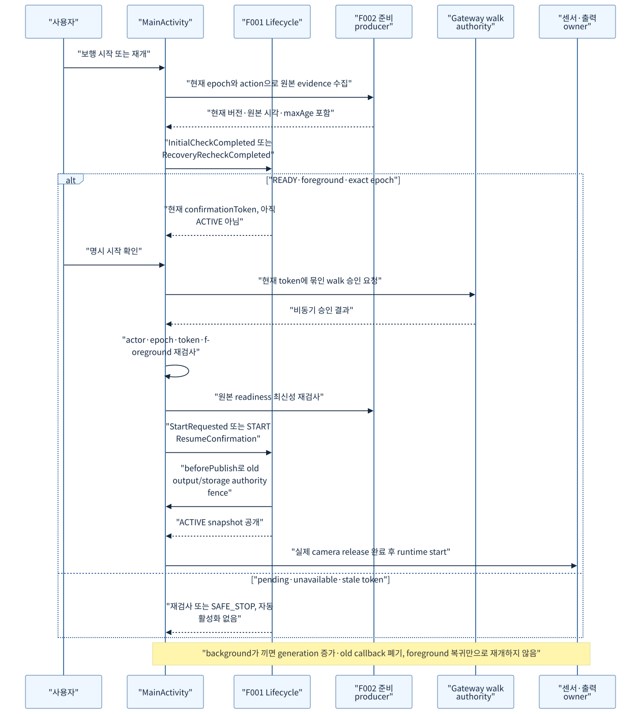

[Mermaid 원본](../diagrams/D02-seq-start-resume.mmd) · [SVG](../rendered/D02-seq-start-resume.svg)

## F-D02-002 행동별 준비 증거 집계

| 항목 | 명세 |
| --- | --- |
| 분야 | D02 보행 세션 생명주기·기기 준비·안전 중단·음성 및 진동 출력·접근성 |
| 목적 | 행동마다 필요한 기능·원본 증거를 모아 준비 상태를 판정한다. |
| 사용 주체 | Main |
| 활성 상태 | ACTIVE |
| 진입점 | apps/android/app/src/main/java/kr/co/hanium/dreamup/walksafe/session/WalkSessionReadiness.kt:48 data class WalkSessionReadinessPlan \| WalkSessionReadinessCollector |
| 실행 전제 | 동일 epoch·현재 행동 plan |
| 입력 출처 형식 검증 최신성 | 관찰 상태 READY/PENDING/UNAVAILABLE/NOT_REQUIRED와 sourceVersion, requiredVersion, observedAtElapsedRealtimeMs, maxAgeMs. 원본 시간 보존; 미래/음수/버전 불일치 거절. |

### 시작 이벤트와 처리 순서

| 이벤트 ID | 발생원 | 이벤트 | 수신부 | 흐름 |
| --- | --- | --- | --- | --- |
| E-D02-002-01 | Main | START/RESUME/검색/경로/제보 요청 | WalkSessionReadinessCollector | 동일 epoch·현재 행동 plan → plan이 기능별 필수 requirement 집합을 선택 → start/resume는 교육·환경·거치·카메라·위치·모델·gateway·자원·음성 출력을 요구; LIMITED는 metric 제외 → 해당 이벤트 처리를 마치고 현재 스냅샷/결과를 반환한다. |

1. plan이 기능별 필수 requirement 집합을 선택
2. start/resume는 교육·환경·거치·카메라·위치·모델·gateway·자원·음성 출력을 요구; LIMITED는 metric 제외
3. 필수 관찰 누락은 오류, 비필수는 NOT_REQUIRED로 채움
4. UNAVAILABLE 우선, 그 다음 PENDING, 전부 충족하면 READY
5. 시작 직전과 runtime 변경에서 같은 원본 evidence를 다시 평가
6. WalkSessionFeatureReadiness는 disabled camera/location/model을 UNAVAILABLE로 남긴다. disabled를 NOT_REQUIRED로 바꾸는 권한은 없고 plan만 required 집합을 정한다.
7. RunningDetectorReadiness는 VERIFIED만 기기 검사 READY, NONE/PENDING은 PENDING, FAILED 또는 sample_inference_unverified로 분리된 detector는 walk entry 차단이다. load 성공만으로 READY 아님.

| 분기 조건 | 실제 처리 결과 | 구현 근거 |
| --- | --- | --- |
| 필수 evidence 버전/age 불일치 | READY로 판정하지 않음 | apps/android/app/src/main/java/kr/co/hanium/dreamup/walksafe/session/WalkSessionReadiness.kt:48 data class WalkSessionReadinessPlan |
| 거리 제한 모드 | metric requirement만 선택 제외 | apps/android/app/src/main/java/kr/co/hanium/dreamup/walksafe/session/WalkSessionReadiness.kt:48 data class WalkSessionReadinessPlan |
| 검색 | first run·route service·gateway 필요 | apps/android/app/src/main/java/kr/co/hanium/dreamup/walksafe/session/WalkSessionReadiness.kt:48 data class WalkSessionReadinessPlan |
| 경로 요청 | first run·location·voice output·route·gateway·resource 필요 | apps/android/app/src/main/java/kr/co/hanium/dreamup/walksafe/session/WalkSessionReadiness.kt:48 data class WalkSessionReadinessPlan |
| 제보 전송 | first run·location·gateway·resource 필요 | apps/android/app/src/main/java/kr/co/hanium/dreamup/walksafe/session/WalkSessionReadiness.kt:48 data class WalkSessionReadinessPlan |

### 효과 종료와 복구

준비 대기/차단 항목과 안전 중단 안내를 제공

| 상황 | 동작 |
| --- | --- |
| 정상 완료 | 해당 이벤트 처리를 마치고 현재 스냅샷/결과를 반환한다. |
| 실패 | 분기 표의 실패 결과를 적용하며 성공 상태로 승격하지 않는다. |
| 시간 초과 | 이 기능 자체의 별도 타이머 없음. 입력 증거 만료는 분기 표/정책에 따른다. |
| 중복 입력 | 현재 상태·소유자 검사 결과에 따라 기존 결과 유지 또는 거절한다. |
| 취소 | 독립 취소 API가 없는 판단 함수는 호출자의 세대 무효화로 더 이상 결과를 사용하지 않는다. |
| 중단과 생명주기 | foreground·epoch·owner 조건을 잃은 결과는 재사용하지 않는다. |
| 재시도 | 자동 재시도 없음. 호출자가 명시된 새 이벤트를 전달해야 한다. |
| 복구 | 현재 증거와 소유권을 다시 확보해야 한다. 이전 성공을 소급 복원하지 않는다. |
| 자원 정리 | 순수 정책은 소유하는 외부 리소스가 없다. |

### 상태 실행 맥락과 연결

| 항목 | 명세 |
| --- | --- |
| 초기 상태 | NOT_REQUIRED |
| 상태 목록 | S-D02-002-00 NOT_REQUIRED S-D02-002-01 PENDING S-D02-002-02 READY S-D02-002-03 UNAVAILABLE |
| 전이 조건과 전이 동작 | 필수 ready 집합→READY 필수 pending→PENDING 하나의 unavailable→UNAVAILABLE |
| 허용되지 않는 전이 | 필수 관찰 누락을 NOT_REQUIRED로 감추지 않음 |
| 동시성 순서와 작업 소유권 | 순수 집계; 외부 probe 결과를 동기 스냅샷으로 결합. collect 시각으로 원본 측정 나이를 재설정하지 않음. |
| 공유 상태와 다른 기능 연결 | D03 VOICE_INPUT enum은 있지만 현재 readiness plan에 편입되지 않음; microphone은 별도 entry permission으로 제한. D07 metric 제공. D05 RunningDetectorVerification은 exact detector/config/backend/fallback generation으로 검증 token을 발급한다. |

### 정책 근거와 검증 범위

| 항목 | 근거 |
| --- | --- |
| 정책 | [P-D02-002](#P-D02-002) |
| 구현 | [apps/android/app/src/main/java/kr/co/hanium/dreamup/walksafe/session/WalkSessionReadiness.kt:48](/home/ddobagi/Hanium_Dreamup/apps/android/app/src/main/java/kr/co/hanium/dreamup/walksafe/session/WalkSessionReadiness.kt:48) · `data class WalkSessionReadinessPlan` (범위 48–297) [apps/android/app/src/main/java/kr/co/hanium/dreamup/walksafe/session/WalkSessionFeatureReadiness.kt:12](/home/ddobagi/Hanium_Dreamup/apps/android/app/src/main/java/kr/co/hanium/dreamup/walksafe/session/WalkSessionFeatureReadiness.kt:12) · `WalkSessionFeatureReadiness` (범위 12–81) [apps/android/app/src/main/java/kr/co/hanium/dreamup/walksafe/session/WalkReadinessStopGuidance.kt:8](/home/ddobagi/Hanium_Dreamup/apps/android/app/src/main/java/kr/co/hanium/dreamup/walksafe/session/WalkReadinessStopGuidance.kt:8) · `walkReadinessStopReasonKo` (범위 8–27) [apps/android/app/src/main/java/kr/co/hanium/dreamup/walksafe/MainActivity.kt:29929](/home/ddobagi/Hanium_Dreamup/apps/android/app/src/main/java/kr/co/hanium/dreamup/walksafe/MainActivity.kt:29929) · `private fun captureWalkSessionReadiness` (범위 29929–30195) [apps/android/app/src/main/java/kr/co/hanium/dreamup/walksafe/device/RunningDetectorReadiness.kt:11](/home/ddobagi/Hanium_Dreamup/apps/android/app/src/main/java/kr/co/hanium/dreamup/walksafe/device/RunningDetectorReadiness.kt:11) · `object RunningDetectorReadiness` (범위 11–42) |
| 기존 개선 ID | 개별 동일성 미확인; 분야 연관은 별도 추적표 |
| 기존 분야 | 해당 없음 |
| 기존 실행 증거 | 과거 DONE 또는 개선항목 주석은 이번 실행 증거로 사용하지 않음. 현재 스냅샷 코드와 TEST_EXPECTATION만 기술. |
| 한계 및 구분 | 정적 구현 사실. 외부 Android callback의 실제 도달·청취·기기 안전성은 미검증. |

| 테스트 위치 | 심볼 | 증거 수준 | 기대와 한계 |
| --- | --- | --- | --- |
| [apps/android/app/src/test/java/kr/co/hanium/dreamup/walksafe/session/WalkSessionReadinessTest.kt](/home/ddobagi/Hanium_Dreamup/apps/android/app/src/test/java/kr/co/hanium/dreamup/walksafe/session/WalkSessionReadinessTest.kt) | WalkSessionReadinessTest | TEST_EXPECTATION | 행동별 필요조건과 누락 처리; 테스트 선언/관련 기대를 정적으로 확인, 이번 미실행 |
| [apps/android/app/src/test/java/kr/co/hanium/dreamup/walksafe/session/WalkSessionReadinessProducerEvidenceTest.kt](/home/ddobagi/Hanium_Dreamup/apps/android/app/src/test/java/kr/co/hanium/dreamup/walksafe/session/WalkSessionReadinessProducerEvidenceTest.kt) | WalkSessionReadinessProducerEvidenceTest | TEST_EXPECTATION | producer evidence를 새 collection time으로 바꾸지 않음; 테스트 선언/관련 기대를 정적으로 확인, 이번 미실행 |

### 이벤트 처리 그림


[Mermaid 원본](../diagrams/D02-F002.mmd) · [SVG](../rendered/D02-F002.svg)

## F-D02-003 권한 묶음 검사와 설정 복귀의 명시 회복

| 항목 | 명세 |
| --- | --- |
| 분야 | D02 보행 세션 생명주기·기기 준비·안전 중단·음성 및 진동 출력·접근성 |
| 목적 | 권한 변경 후 부분 권한이나 늦은 설정 callback으로 자동 안내가 복원되지 않도록 한다. |
| 사용 주체 | 사용자 Android |
| 활성 상태 | ACTIVE |
| 진입점 | apps/android/app/src/main/java/kr/co/hanium/dreamup/walksafe/session/PermissionSessionPolicy.kt:190 enum class PermissionRecovery \| PermissionRecoveryGate apps/android/app/src/main/java/kr/co/hanium/dreamup/walksafe/session/PermissionSessionPolicy.kt:190 enum class PermissionRecovery \| MainActivity |
| 실행 전제 | actor hash·gateway session generation·walk epoch·recheck ID가 일치 |
| 입력 출처 형식 검증 최신성 | start 묶음 CAMERA/PRECISE_LOCATION/MICROPHONE, OS 요구 시 ACTIVITY_RECOGNITION; coarse를 precise로 간주하지 않음. |

### 시작 이벤트와 처리 순서

| 이벤트 ID | 발생원 | 이벤트 | 수신부 | 흐름 |
| --- | --- | --- | --- | --- |
| E-D02-003-01 | 사용자 | 권한 요청·설정 열기·복귀 후 명시 재개 | PermissionRecoveryGate | actor hash·gateway session generation·walk epoch·recheck ID가 일치 → 현재 실제 권한을 조회하고 request purpose별 lease 발급 → permission result는 lease·actor·epoch를 검사 → 해당 이벤트 처리를 마치고 현재 스냅샷/결과를 반환한다. |
| E-D02-003-02 | Android | permission 결과·foreground 권한 재조회 | MainActivity | actor hash·gateway session generation·walk epoch·recheck ID가 일치 → 현재 실제 권한을 조회하고 request purpose별 lease 발급 → permission result는 lease·actor·epoch를 검사 → 해당 이벤트 처리를 마치고 현재 스냅샷/결과를 반환한다. |

1. 현재 실제 권한을 조회하고 request purpose별 lease 발급
2. permission result는 lease·actor·epoch를 검사
3. CLEAR 이외 회복 상태는 자동 센서 시작을 차단
4. 설정 복귀는 FULL recheck; 권한이 모두 있어도 AWAITING_EXPLICIT_RESUME
5. 명시 재개 시 실제 권한과 binding을 다시 조회

| 분기 조건 | 실제 처리 결과 | 구현 근거 |
| --- | --- | --- |
| camera 해제 | camera guidance·metric·report 전송 차단 | apps/android/app/src/main/java/kr/co/hanium/dreamup/walksafe/session/PermissionSessionPolicy.kt:190 enum class PermissionRecovery |
| precise location 해제 | navigation·report 전송 차단 | apps/android/app/src/main/java/kr/co/hanium/dreamup/walksafe/session/PermissionSessionPolicy.kt:190 enum class PermissionRecovery |
| mic/활동권한 해제 | 각 음성 입력/step 기능 차단 | apps/android/app/src/main/java/kr/co/hanium/dreamup/walksafe/session/PermissionSessionPolicy.kt:190 enum class PermissionRecovery |
| camera와 precise 모두 없음 | whole walk safety stop | apps/android/app/src/main/java/kr/co/hanium/dreamup/walksafe/session/PermissionSessionPolicy.kt:190 enum class PermissionRecovery |
| Main ACTIVE readiness가 camera/location 필수 실패 | 개별 기능 차단 외 세션 SAFE_STOP도 가능 | apps/android/app/src/main/java/kr/co/hanium/dreamup/walksafe/session/PermissionSessionPolicy.kt:190 enum class PermissionRecovery |
| late callback binding 다름 | 새 recheck 요구; grant 성공 반영 금지 | apps/android/app/src/main/java/kr/co/hanium/dreamup/walksafe/session/PermissionSessionPolicy.kt:190 enum class PermissionRecovery |

### 효과 종료와 복구

권한 설명·설정 유도·명시 재개 화면 및 종속 기능 중단

| 상황 | 동작 |
| --- | --- |
| 정상 완료 | 해당 이벤트 처리를 마치고 현재 스냅샷/결과를 반환한다. |
| 실패 | 분기 표의 실패 결과를 적용하며 성공 상태로 승격하지 않는다. |
| 시간 초과 | 이 기능 자체의 별도 타이머 없음. 입력 증거 만료는 분기 표/정책에 따른다. |
| 중복 입력 | 현재 상태·소유자 검사 결과에 따라 기존 결과 유지 또는 거절한다. |
| 취소 | 거절/권한창 취소는 ready로 간주하지 않음. |
| 중단과 생명주기 | 일반 background는 pending 소유권 무효화; 기기 검사 자신이 연 permission dialog 예외는 F-D02-005. |
| 재시도 | 자동 재시도 없음. 호출자가 명시된 새 이벤트를 전달해야 한다. |
| 복구 | full recheck→explicit acknowledgement; 설정 복귀만으로 ACTIVE 금지. |
| 자원 정리 | 순수 정책은 소유하는 외부 리소스가 없다. |

### 상태 실행 맥락과 연결

| 항목 | 명세 |
| --- | --- |
| 초기 상태 | CLEAR |
| 상태 목록 | S-D02-003-00 CLEAR S-D02-003-01 REQUEST_PENDING S-D02-003-02 BLOCKED S-D02-003-03 SETTINGS_PENDING S-D02-003-04 RECHECK_REQUIRED S-D02-003-05 AWAITING_EXPLICIT_RESUME |
| 전이 조건과 전이 동작 | request→pending missing→blocked settings return→recheck all present→await explicit current explicit→clear |
| 허용되지 않는 전이 | 권한 grant는 동의·교육·gateway·센서 품질을 대신하지 않음 |
| 동시성 순서와 작업 소유권 | Main UI callback + permission request generation; 오래된 결과는 현재 gate를 해제하지 못함. |
| 공유 상태와 다른 기능 연결 | D01 permission 설명·consent와 독립. D03 mic, D04 location/step, D05 camera. |

### 정책 근거와 검증 범위

| 항목 | 근거 |
| --- | --- |
| 정책 | [P-D02-003](#P-D02-003) |
| 구현 | [apps/android/app/src/main/java/kr/co/hanium/dreamup/walksafe/session/PermissionSessionPolicy.kt:190](/home/ddobagi/Hanium_Dreamup/apps/android/app/src/main/java/kr/co/hanium/dreamup/walksafe/session/PermissionSessionPolicy.kt:190) · `enum class PermissionRecovery` (범위 190–352) [apps/android/app/src/main/java/kr/co/hanium/dreamup/walksafe/MainActivity.kt:32749](/home/ddobagi/Hanium_Dreamup/apps/android/app/src/main/java/kr/co/hanium/dreamup/walksafe/MainActivity.kt:32749) · `private fun applyObservedPermissionStateChange` (범위 32749–32841) |
| 기존 개선 ID | 개별 동일성 미확인; 분야 연관은 별도 추적표 |
| 기존 분야 | 해당 없음 |
| 기존 실행 증거 | 과거 DONE 또는 개선항목 주석은 이번 실행 증거로 사용하지 않음. 현재 스냅샷 코드와 TEST_EXPECTATION만 기술. |
| 한계 및 구분 | 정적 구현 사실. 외부 Android callback의 실제 도달·청취·기기 안전성은 미검증. |

| 테스트 위치 | 심볼 | 증거 수준 | 기대와 한계 |
| --- | --- | --- | --- |
| [apps/android/app/src/test/java/kr/co/hanium/dreamup/walksafe/session/PermissionSessionPolicyTest.kt](/home/ddobagi/Hanium_Dreamup/apps/android/app/src/test/java/kr/co/hanium/dreamup/walksafe/session/PermissionSessionPolicyTest.kt) | PermissionSessionPolicyTest | TEST_EXPECTATION | 설정 full recheck와 explicit acknowledgement 및 종속 기능 제한; 테스트 선언/관련 기대를 정적으로 확인, 이번 미실행 |

### 이벤트 처리 그림


[Mermaid 원본](../diagrams/D02-F003.mmd) · [SVG](../rendered/D02-F003.svg)

## F-D02-004 Android 시작 능력과 승인 기기 프로필

| 항목 | 명세 |
| --- | --- |
| 분야 | D02 보행 세션 생명주기·기기 준비·안전 중단·음성 및 진동 출력·접근성 |
| 목적 | 사용 가능한 기능을 FULL/LIMITED/PENDING/BLOCKED로 구분한다. |
| 사용 주체 | startup probe |
| 활성 상태 | ACTIVE |
| 진입점 | apps/android/app/src/main/java/kr/co/hanium/dreamup/walksafe/device/WalkSafeStartupCapability.kt:100 object WalkSafeStartupCapability \| WalkSafeStartupCapabilityResolver |
| 실행 전제 | Android 기능 조회 가능, 앱 생명주기 probe가 닫히지 않음 |
| 입력 출처 형식 검증 최신성 | Android SDK, GPS/camera/microphone/vibrator hardware, bundled offline STT asset, 한국어 offline 실제 synthesis 결과. ARCore metadata 지원은 depth true의 증거가 아님. |

### 시작 이벤트와 처리 순서

| 이벤트 ID | 발생원 | 이벤트 | 수신부 | 흐름 |
| --- | --- | --- | --- | --- |
| E-D02-004-01 | startup probe | hardware·STT·TTS·ARCore 결과 | WalkSafeStartupCapabilityResolver | Android 기능 조회 가능, 앱 생명주기 probe가 닫히지 않음 → hardware·OS는 즉시 조사, ARCore·TTS는 비동기 수집 → Android<31 또는 한국어 TTS unavailable이면 block → 해당 이벤트 처리를 마치고 현재 스냅샷/결과를 반환한다. |

1. hardware·OS는 즉시 조사, ARCore·TTS는 비동기 수집
2. Android<31 또는 한국어 TTS unavailable이면 block
3. pending 필수값은 pending; camera/GPS/mic/STT 실패는 block
4. metric만 unavailable이면 LIMITED; vibration은 필수 시작 조건에서 제외
5. ApprovedDeviceProfiles는 production 지정 기기 미등록; Main은 approvedDeviceProfileRequired=false를 명시

| 분기 조건 | 실제 처리 결과 | 구현 근거 |
| --- | --- | --- |
| ARCore explicitly unsupported | metric false | apps/android/app/src/main/java/kr/co/hanium/dreamup/walksafe/device/WalkSafeStartupCapability.kt:100 object WalkSafeStartupCapability |
| ARCore supported/미확정 metadata | metric null; 별도 지원 검사 필요 | apps/android/app/src/main/java/kr/co/hanium/dreamup/walksafe/device/WalkSafeStartupCapability.kt:100 object WalkSafeStartupCapability |
| offline TTS 실패와 다른 pending 동시 | TTS 실패가 우선 BLOCKED | apps/android/app/src/main/java/kr/co/hanium/dreamup/walksafe/device/WalkSafeStartupCapability.kt:100 object WalkSafeStartupCapability |
| DEBUG guidance bypass | 별도 개발 제한 우회 표시, 실측 성공 의미 없음 | apps/android/app/src/main/java/kr/co/hanium/dreamup/walksafe/device/WalkSafeStartupCapability.kt:100 object WalkSafeStartupCapability |

### 효과 종료와 복구

시작 제한 이유·거리 제한 안내·진동 훈련 가능 여부 제공

| 상황 | 동작 |
| --- | --- |
| 정상 완료 | 해당 이벤트 처리를 마치고 현재 스냅샷/결과를 반환한다. |
| 실패 | 분기 표의 실패 결과를 적용하며 성공 상태로 승격하지 않는다. |
| 시간 초과 | 이 기능 자체의 별도 타이머 없음. 입력 증거 만료는 분기 표/정책에 따른다. |
| 중복 입력 | 현재 상태·소유자 검사 결과에 따라 기존 결과 유지 또는 거절한다. |
| 취소 | 독립 취소 API가 없는 판단 함수는 호출자의 세대 무효화로 더 이상 결과를 사용하지 않는다. |
| 중단과 생명주기 | foreground·epoch·owner 조건을 잃은 결과는 재사용하지 않는다. |
| 재시도 | 자동 재시도 없음. 호출자가 명시된 새 이벤트를 전달해야 한다. |
| 복구 | fresh probe로 실제 재확인; 닫힌 probe를 재사용하지 않음. |
| 자원 정리 | probe.close는 generation fence와 TTS probe close; late callback 무시. |

### 상태 실행 맥락과 연결

| 항목 | 명세 |
| --- | --- |
| 초기 상태 | PENDING |
| 상태 목록 | S-D02-004-00 PENDING S-D02-004-01 FULL S-D02-004-02 LIMITED S-D02-004-03 BLOCKED |
| 전이 조건과 전이 동작 | 필수 전부 충족→FULL metric만 없음→LIMITED 필수 미정→PENDING 핵심 없음→BLOCKED |
| 허용되지 않는 전이 | Main 기기 프로필 gate 명시 비활성; production profile 승인 주장 금지 |
| 동시성 순서와 작업 소유권 | probe 동기 snapshot+비동기 ARCore/TTS callback, generation/closed 상태 검사. |
| 공유 상태와 다른 기능 연결 | D03 Vosk/KoreanOfflineTtsVoice, F-D02-007 TTS 측정, F-D02-016 API 지원 검사. |

### 정책 근거와 검증 범위

| 항목 | 근거 |
| --- | --- |
| 정책 | [P-D02-004](#P-D02-004) |
| 구현 | [apps/android/app/src/main/java/kr/co/hanium/dreamup/walksafe/device/WalkSafeStartupCapability.kt:100](/home/ddobagi/Hanium_Dreamup/apps/android/app/src/main/java/kr/co/hanium/dreamup/walksafe/device/WalkSafeStartupCapability.kt:100) · `object WalkSafeStartupCapability` (범위 100–218) [apps/android/app/src/main/java/kr/co/hanium/dreamup/walksafe/device/AndroidStartupCapabilityProbe.kt:15](/home/ddobagi/Hanium_Dreamup/apps/android/app/src/main/java/kr/co/hanium/dreamup/walksafe/device/AndroidStartupCapabilityProbe.kt:15) · `AndroidStartupCapabilityProbe` (범위 15–287) [apps/android/app/src/main/java/kr/co/hanium/dreamup/walksafe/device/ApprovedDeviceProfile.kt:12](/home/ddobagi/Hanium_Dreamup/apps/android/app/src/main/java/kr/co/hanium/dreamup/walksafe/device/ApprovedDeviceProfile.kt:12) · `ApprovedDeviceProfile` (범위 12–113) [apps/android/app/src/main/java/kr/co/hanium/dreamup/walksafe/device/DeviceGate.kt:3](/home/ddobagi/Hanium_Dreamup/apps/android/app/src/main/java/kr/co/hanium/dreamup/walksafe/device/DeviceGate.kt:3) · `DeviceGate` (범위 3–68) [apps/android/app/src/main/java/kr/co/hanium/dreamup/walksafe/MainActivity.kt:27721](/home/ddobagi/Hanium_Dreamup/apps/android/app/src/main/java/kr/co/hanium/dreamup/walksafe/MainActivity.kt:27721) · `private fun resolveCurrentStartupCapabilityDecision` (범위 27721–27768) |
| 기존 개선 ID | 개별 동일성 미확인; 분야 연관은 별도 추적표 |
| 기존 분야 | 해당 없음 |
| 기존 실행 증거 | 과거 DONE 또는 개선항목 주석은 이번 실행 증거로 사용하지 않음. 현재 스냅샷 코드와 TEST_EXPECTATION만 기술. |
| 한계 및 구분 | 정적 구현 사실. 외부 Android callback의 실제 도달·청취·기기 안전성은 미검증. |

| 테스트 위치 | 심볼 | 증거 수준 | 기대와 한계 |
| --- | --- | --- | --- |
| [apps/android/app/src/test/java/kr/co/hanium/dreamup/walksafe/device/WalkSafeStartupCapabilityTest.kt](/home/ddobagi/Hanium_Dreamup/apps/android/app/src/test/java/kr/co/hanium/dreamup/walksafe/device/WalkSafeStartupCapabilityTest.kt) | WalkSafeStartupCapabilityTest | TEST_EXPECTATION | vibration 제외·unknown fail closed·명시 install 검사로 static registry gate 대체; 테스트 선언/관련 기대를 정적으로 확인, 이번 미실행 |

### 이벤트 처리 그림


[Mermaid 원본](../diagrams/D02-F004.mmd) · [SVG](../rendered/D02-F004.svg)

## F-D02-005 로그인 후 사용자 시작 기기 검사

| 항목 | 명세 |
| --- | --- |
| 분야 | D02 보행 세션 생명주기·기기 준비·안전 중단·음성 및 진동 출력·접근성 |
| 목적 | 검사 수행을 현재 로그인·foreground·시도에 묶고 지원하지 않는 기능만 제한한다. |
| 사용 주체 | 사용자 probe |
| 활성 상태 | ACTIVE |
| 진입점 | apps/android/app/src/main/java/kr/co/hanium/dreamup/walksafe/device/PostLoginDeviceCheckPolicy.kt:3 class PostLoginDeviceCheck \| PostLoginDeviceCheckPolicy.begin apps/android/app/src/main/java/kr/co/hanium/dreamup/walksafe/device/PostLoginDeviceCheckPolicy.kt:3 class PostLoginDeviceCheck \| observe/timeout/background |
| 실행 전제 | 로그인된 actor/session binding·foreground; 사용자 이벤트만 시작 |
| 입력 출처 형식 검증 최신성 | attemptId 단조 증가와 expected stage. missing permission, blocking failure, wake phrase recognition은 terminal 판단; location fix와 haptic 확인은 완료 필수 아님. |

### 시작 이벤트와 처리 순서

| 이벤트 ID | 발생원 | 이벤트 | 수신부 | 흐름 |
| --- | --- | --- | --- | --- |
| E-D02-005-01 | 사용자 | 기기 점검 버튼 | PostLoginDeviceCheckPolicy.begin | 로그인된 actor/session binding·foreground; 사용자 이벤트만 시작 → 새 startup probe를 stage publication보다 먼저 준비 → REQUESTING_PERMISSIONS 뒤 RUNNING에서 독립 probe 결과 수집 → terminal FULL/LIMITED/FAIL은 late probe가 다시 쓰지 못함. |
| E-D02-005-02 | probe | permission/camera/depth/location/STT/wake/TTS 완료 | observe/timeout/background | 로그인된 actor/session binding·foreground; 사용자 이벤트만 시작 → 새 startup probe를 stage publication보다 먼저 준비 → REQUESTING_PERMISSIONS 뒤 RUNNING에서 독립 probe 결과 수집 → terminal FULL/LIMITED/FAIL은 late probe가 다시 쓰지 못함. |

1. 새 startup probe를 stage publication보다 먼저 준비
2. REQUESTING_PERMISSIONS 뒤 RUNNING에서 독립 probe 결과 수집
3. known blocking failure/권한 unavailable/wake recognition unavailable은 FAIL
4. automatic probe pending이면 RUNNING 유지
5. disabledFeatures 비어 있으면 FULL, 있으면 LIMITED; 저장 commit 뒤 교육/home 진행

| 분기 조건 | 실제 처리 결과 | 구현 근거 |
| --- | --- | --- |
| NOT_RUN/FAIL에서 명시 요청 | 새 attempt | apps/android/app/src/main/java/kr/co/hanium/dreamup/walksafe/device/PostLoginDeviceCheckPolicy.kt:3 class PostLoginDeviceCheck |
| REQUESTING/RUNNING/FULL/LIMITED 중 중복 | 재시작 안 함 | apps/android/app/src/main/java/kr/co/hanium/dreamup/walksafe/device/PostLoginDeviceCheckPolicy.kt:3 class PostLoginDeviceCheck |
| 일반 background | 현재 시도 FAIL | apps/android/app/src/main/java/kr/co/hanium/dreamup/walksafe/device/PostLoginDeviceCheckPolicy.kt:3 class PostLoginDeviceCheck |
| 자기 permission dialog로 잠시 background | 소유 lease 동안 검사 보존 | apps/android/app/src/main/java/kr/co/hanium/dreamup/walksafe/device/PostLoginDeviceCheckPolicy.kt:3 class PostLoginDeviceCheck |
| stale attempt/session/stage callback | 무시 | apps/android/app/src/main/java/kr/co/hanium/dreamup/walksafe/device/PostLoginDeviceCheckPolicy.kt:3 class PostLoginDeviceCheck |
| locationFix/haptic 미확정 | 그 이유만으로 완료 대기하지 않음 | apps/android/app/src/main/java/kr/co/hanium/dreamup/walksafe/device/PostLoginDeviceCheckPolicy.kt:3 class PostLoginDeviceCheck |

### 효과 종료와 복구

검사 진행·FULL/LIMITED/FAIL와 정확한 disabled feature 목록; 180초 watchdog

| 상황 | 동작 |
| --- | --- |
| 정상 완료 | terminal FULL/LIMITED/FAIL은 late probe가 다시 쓰지 못함. |
| 실패 | 분기 표의 실패 결과를 적용하며 성공 상태로 승격하지 않는다. |
| 시간 초과 | 현재 foreground RUNNING attempt만 180000ms에 FAIL. |
| 중복 입력 | 현재 상태·소유자 검사 결과에 따라 기존 결과 유지 또는 거절한다. |
| 취소 | 독립 취소 API가 없는 판단 함수는 호출자의 세대 무효화로 더 이상 결과를 사용하지 않는다. |
| 중단과 생명주기 | foreground·epoch·owner 조건을 잃은 결과는 재사용하지 않는다. |
| 재시도 | FAIL 뒤 사용자 재검사; 자동 시작 없음. |
| 복구 | 현재 증거와 소유권을 다시 확보해야 한다. 이전 성공을 소급 복원하지 않는다. |
| 자원 정리 | 시도 취소 시 callback lease·camera/depth/wake/TTS 검사 자원 종료. |

### 상태 실행 맥락과 연결

| 항목 | 명세 |
| --- | --- |
| 초기 상태 | NOT_RUN |
| 상태 목록 | S-D02-005-00 NOT_RUN S-D02-005-01 REQUESTING_PERMISSIONS S-D02-005-02 RUNNING S-D02-005-03 FULL S-D02-005-04 LIMITED S-D02-005-05 FAIL |
| 전이 조건과 전이 동작 | user→permission→running complete emptydisabled→full complete disabled→limited blocking/timeout/background→fail |
| 허용되지 않는 전이 | vibration/실제 location fix 확인은 이 완료 gate에서 제외 |
| 동시성 순서와 작업 소유권 | Main UI thread로 probe 게시; binding+attempt+firstRun lease+foreground로 늦은 완료를 차단. |
| 공유 상태와 다른 기능 연결 | D01 onboarding 다음 단계, D03 wake phrase 실제 인식, D05 camera detector. |

### 정책 근거와 검증 범위

| 항목 | 근거 |
| --- | --- |
| 정책 | [P-D02-005](#P-D02-005) |
| 구현 | [apps/android/app/src/main/java/kr/co/hanium/dreamup/walksafe/device/PostLoginDeviceCheckPolicy.kt:3](/home/ddobagi/Hanium_Dreamup/apps/android/app/src/main/java/kr/co/hanium/dreamup/walksafe/device/PostLoginDeviceCheckPolicy.kt:3) · `class PostLoginDeviceCheck` (범위 3–292) [apps/android/app/src/main/java/kr/co/hanium/dreamup/walksafe/MainActivity.kt:22795](/home/ddobagi/Hanium_Dreamup/apps/android/app/src/main/java/kr/co/hanium/dreamup/walksafe/MainActivity.kt:22795) · `private fun beginPostLoginDeviceCheck` (범위 22795–22857) |
| 기존 개선 ID | 개별 동일성 미확인; 분야 연관은 별도 추적표 |
| 기존 분야 | 해당 없음 |
| 기존 실행 증거 | 과거 DONE 또는 개선항목 주석은 이번 실행 증거로 사용하지 않음. 현재 스냅샷 코드와 TEST_EXPECTATION만 기술. |
| 한계 및 구분 | 정적 구현 사실. 외부 Android callback의 실제 도달·청취·기기 안전성은 미검증. |

| 테스트 위치 | 심볼 | 증거 수준 | 기대와 한계 |
| --- | --- | --- | --- |
| [apps/android/app/src/test/java/kr/co/hanium/dreamup/walksafe/device/PostLoginDeviceCheckPolicyTest.kt](/home/ddobagi/Hanium_Dreamup/apps/android/app/src/test/java/kr/co/hanium/dreamup/walksafe/device/PostLoginDeviceCheckPolicyTest.kt) | PostLoginDeviceCheckPolicyTest | TEST_EXPECTATION | 사용자 시작·late callback·permission dialog 예외·location/haptic 비차단; 테스트 선언/관련 기대를 정적으로 확인, 이번 미실행 |

### 이벤트 처리 그림


[Mermaid 원본](../diagrams/D02-F005.mmd) · [SVG](../rendered/D02-F005.svg)


[Mermaid 원본](../diagrams/D02-state-device-check.mmd) · [SVG](../rendered/D02-state-device-check.svg)

## F-D02-006 기기 검사 결과 정규 저장과 복원

| 항목 | 명세 |
| --- | --- |
| 분야 | D02 보행 세션 생명주기·기기 준비·안전 중단·음성 및 진동 출력·접근성 |
| 목적 | 검사 결과를 actor/설치/앱·OS·정책 버전에 묶어 재사용하되 현재 권한 판정과 분리한다. |
| 사용 주체 | Main |
| 활성 상태 | ACTIVE |
| 진입점 | apps/android/app/src/main/java/kr/co/hanium/dreamup/walksafe/device/AndroidDeviceCheckResultStore.kt:44 class AndroidDeviceCheckResultStore \| save/restore |
| 실행 전제 | FULL 또는 LIMITED의 내부 일관된 snapshot |
| 입력 출처 형식 검증 최신성 | SHA-256 binding: actor/install/device/OS/app source/probe/environment/approved registry. mutable runtime permission/location disclosure/TTS/STT fields는 struct에 있지만 digest에 포함 안 됨. |

### 시작 이벤트와 처리 순서

| 이벤트 ID | 발생원 | 이벤트 | 수신부 | 흐름 |
| --- | --- | --- | --- | --- |
| E-D02-006-01 | Main | terminal 검사 저장·앱 재진입 복원 | save/restore | FULL 또는 LIMITED의 내부 일관된 snapshot → FULL은 disabled empty, LIMITED는 nonempty인지 검사 → disabled features를 unique sorted canonical CSV로 직렬화 → 해당 이벤트 처리를 마치고 현재 스냅샷/결과를 반환한다. |

1. FULL은 disabled empty, LIMITED는 nonempty인지 검사
2. disabled features를 unique sorted canonical CSV로 직렬화
3. 전체 레코드를 synchronous commit; 실패한 binding은 메모리 fence에 등록
4. restore는 정책·binding·tier·canonical CSV·deferred camera 일관성 검사
5. legacy depth 결과는 selective refresh 요청; 현재 지원 정책 결과만 최신으로 취급

| 분기 조건 | 실제 처리 결과 | 구현 근거 |
| --- | --- | --- |
| commit false | 완료 교육 gate를 열지 않고 같은 프로세스 memory restore도 차단 | apps/android/app/src/main/java/kr/co/hanium/dreamup/walksafe/device/AndroidDeviceCheckResultStore.kt:44 class AndroidDeviceCheckResultStore |
| wrong actor/install/app/OS/profile | 복원 거절 | apps/android/app/src/main/java/kr/co/hanium/dreamup/walksafe/device/AndroidDeviceCheckResultStore.kt:44 class AndroidDeviceCheckResultStore |
| mutable 권한 변경 | 측정 결과 자체 보존; 별도 runtime permission gate가 현재 사용 제한 | apps/android/app/src/main/java/kr/co/hanium/dreamup/walksafe/device/AndroidDeviceCheckResultStore.kt:44 class AndroidDeviceCheckResultStore |
| camera deferred + obstacle disabled | 모순 레코드 거절 | apps/android/app/src/main/java/kr/co/hanium/dreamup/walksafe/device/AndroidDeviceCheckResultStore.kt:44 class AndroidDeviceCheckResultStore |

### 효과 종료와 복구

로컬 SharedPreferences 저장; 원문 actor/install 값 대신 digest

| 상황 | 동작 |
| --- | --- |
| 정상 완료 | 해당 이벤트 처리를 마치고 현재 스냅샷/결과를 반환한다. |
| 실패 | 분기 표의 실패 결과를 적용하며 성공 상태로 승격하지 않는다. |
| 시간 초과 | 이 기능 자체의 별도 타이머 없음. 입력 증거 만료는 분기 표/정책에 따른다. |
| 중복 입력 | 현재 상태·소유자 검사 결과에 따라 기존 결과 유지 또는 거절한다. |
| 취소 | 독립 취소 API가 없는 판단 함수는 호출자의 세대 무효화로 더 이상 결과를 사용하지 않는다. |
| 중단과 생명주기 | foreground·epoch·owner 조건을 잃은 결과는 재사용하지 않는다. |
| 재시도 | 실패 뒤 명시 재검사/저장 성공은 failed commit fence 해제. |
| 복구 | 현재 증거와 소유권을 다시 확보해야 한다. 이전 성공을 소급 복원하지 않는다. |
| 자원 정리 | 순수 prefs record 관리; 실제 센서/권한 복원하지 않음. |

### 상태 실행 맥락과 연결

| 항목 | 명세 |
| --- | --- |
| 초기 상태 | 없음/invalid |
| 상태 목록 | S-D02-006-00 없음/invalid S-D02-006-01 FULL S-D02-006-02 LIMITED S-D02-006-03 needs depth refresh S-D02-006-04 commit failed fence |
| 전이 조건과 전이 동작 | valid terminal→commit→restorable binding drift→invalid old depth policy→refresh |
| 허용되지 않는 전이 | 기기 검사 저장이 현재 권한·센서 evidence를 저장하거나 활성화하지 않음 |
| 동시성 순서와 작업 소유권 | 동기 commit으로 durable 결과 확인; prefs 메모리 갱신만으로 저장 성공 간주하지 않음. |
| 공유 상태와 다른 기능 연결 | F-D02-003 현재 permission과 F-D02-016 Depth support selective refresh; D01 완료 gate. |

### 정책 근거와 검증 범위

| 항목 | 근거 |
| --- | --- |
| 정책 | [P-D02-006](#P-D02-006) |
| 구현 | [apps/android/app/src/main/java/kr/co/hanium/dreamup/walksafe/device/AndroidDeviceCheckResultStore.kt:44](/home/ddobagi/Hanium_Dreamup/apps/android/app/src/main/java/kr/co/hanium/dreamup/walksafe/device/AndroidDeviceCheckResultStore.kt:44) · `class AndroidDeviceCheckResultStore` (범위 44–242) |
| 기존 개선 ID | 개별 동일성 미확인; 분야 연관은 별도 추적표 |
| 기존 분야 | 해당 없음 |
| 기존 실행 증거 | 과거 DONE 또는 개선항목 주석은 이번 실행 증거로 사용하지 않음. 현재 스냅샷 코드와 TEST_EXPECTATION만 기술. |
| 한계 및 구분 | 정적 구현 사실. 외부 Android callback의 실제 도달·청취·기기 안전성은 미검증. |

| 테스트 위치 | 심볼 | 증거 수준 | 기대와 한계 |
| --- | --- | --- | --- |
| [apps/android/app/src/test/java/kr/co/hanium/dreamup/walksafe/device/AndroidDeviceCheckResultStoreTest.kt](/home/ddobagi/Hanium_Dreamup/apps/android/app/src/test/java/kr/co/hanium/dreamup/walksafe/device/AndroidDeviceCheckResultStoreTest.kt) | AndroidDeviceCheckResultStoreTest | TEST_EXPECTATION | commit 실패 fence, canonical CSV, mutable prerequisite 변경 보존; 테스트 선언/관련 기대를 정적으로 확인, 이번 미실행 |

### 이벤트 처리 그림


[Mermaid 원본](../diagrams/D02-F006.mmd) · [SVG](../rendered/D02-F006.svg)

## F-D02-007 한국어 오프라인 TTS 실제 파일 합성 검사

| 항목 | 명세 |
| --- | --- |
| 분야 | D02 보행 세션 생명주기·기기 준비·안전 중단·음성 및 진동 출력·접근성 |
| 목적 | 음성 지원 metadata만으로 ready 처리하지 않고 offline Korean voice의 PCM 생성 여부를 확인한다. |
| 사용 주체 | startup TTS engine |
| 활성 상태 | ACTIVE |
| 진입점 | apps/android/app/src/main/java/kr/co/hanium/dreamup/walksafe/device/AndroidKoreanTextToSpeechSynthesisProbe.kt:59 class AndroidKoreanTextToSpeechSynthesisProbe \| AndroidKoreanTextToSpeechSynthesisProbe apps/android/app/src/main/java/kr/co/hanium/dreamup/walksafe/device/AndroidKoreanTextToSpeechSynthesisProbe.kt:59 class AndroidKoreanTextToSpeechSynthesisProbe \| probe callbacks |
| 실행 전제 | 현재 one-shot probe, installed Korean nonnetwork voice |
| 입력 출처 형식 검증 최신성 | exact utterance ID; WAV RIFF/PCM 구조·헤더·실제 data 길이·정수 PCM·완전한 파일·계산 duration >=1000ms. |

### 시작 이벤트와 처리 순서

| 이벤트 ID | 발생원 | 이벤트 | 수신부 | 흐름 |
| --- | --- | --- | --- | --- |
| E-D02-007-01 | startup | probe.start | AndroidKoreanTextToSpeechSynthesisProbe | 현재 one-shot probe, installed Korean nonnetwork voice → engine 초기화·listener 등록·오프라인 한국어 voice 선택 → 임시 WAV에 합성 요청 → 해당 이벤트 처리를 마치고 현재 스냅샷/결과를 반환한다. |
| E-D02-007-02 | TTS engine | init/onDone/onError/onStop | probe callbacks | 현재 one-shot probe, installed Korean nonnetwork voice → engine 초기화·listener 등록·오프라인 한국어 voice 선택 → 임시 WAV에 합성 요청 → 해당 이벤트 처리를 마치고 현재 스냅샷/결과를 반환한다. |

1. engine 초기화·listener 등록·오프라인 한국어 voice 선택
2. 임시 WAV에 합성 요청
3. 현재 utterance onDone 뒤 WAV 구조와 길이 검사
4. terminal을 단 한 번 획득하고 engine/timeout/temp file을 정리한 뒤 결과 callback

| 분기 조건 | 실제 처리 결과 | 구현 근거 |
| --- | --- | --- |
| 정상 PCM duration>=1000 | AVAILABLE | apps/android/app/src/main/java/kr/co/hanium/dreamup/walksafe/device/AndroidKoreanTextToSpeechSynthesisProbe.kt:59 class AndroidKoreanTextToSpeechSynthesisProbe |
| 언어/voice/init/listener/synthesis/file 오류 | UNAVAILABLE | apps/android/app/src/main/java/kr/co/hanium/dreamup/walksafe/device/AndroidKoreanTextToSpeechSynthesisProbe.kt:59 class AndroidKoreanTextToSpeechSynthesisProbe |
| 잘못된 utterance 또는 terminal 이후 callback | 무시 | apps/android/app/src/main/java/kr/co/hanium/dreamup/walksafe/device/AndroidKoreanTextToSpeechSynthesisProbe.kt:59 class AndroidKoreanTextToSpeechSynthesisProbe |
| 10000ms 경과 또는 취소 | UNAVAILABLE; late success 불가 | apps/android/app/src/main/java/kr/co/hanium/dreamup/walksafe/device/AndroidKoreanTextToSpeechSynthesisProbe.kt:59 class AndroidKoreanTextToSpeechSynthesisProbe |

### 효과 종료와 복구

startup 음성 capability 결과; 검사 파일은 정리하며 실제 사용자 청취 성공을 주장하지 않음

| 상황 | 동작 |
| --- | --- |
| 정상 완료 | 해당 이벤트 처리를 마치고 현재 스냅샷/결과를 반환한다. |
| 실패 | 분기 표의 실패 결과를 적용하며 성공 상태로 승격하지 않는다. |
| 시간 초과 | 10000ms one-shot deadline. |
| 중복 입력 | 현재 상태·소유자 검사 결과에 따라 기존 결과 유지 또는 거절한다. |
| 취소 | cancel/close는 terminal fail closed이며 멱등. |
| 중단과 생명주기 | foreground·epoch·owner 조건을 잃은 결과는 재사용하지 않는다. |
| 재시도 | 같은 probe 재시작 없음; 새 probe 생성. |
| 복구 | 현재 증거와 소유권을 다시 확보해야 한다. 이전 성공을 소급 복원하지 않는다. |
| 자원 정리 | timer cancel→engine stop/shutdown→임시 파일 삭제 후 callback. |

### 상태 실행 맥락과 연결

| 항목 | 명세 |
| --- | --- |
| 초기 상태 | IDLE |
| 상태 목록 | S-D02-007-00 IDLE S-D02-007-01 RUNNING S-D02-007-02 TERMINAL S-D02-007-03 CLOSED |
| 전이 조건과 전이 동작 | start→running done+validwav→terminal available error/timeout/cancel→terminal unavailable close→closed |
| 허용되지 않는 전이 | 파일 합성은 스피커 가청성·언어 이해도·보행 중 전달 검증 아님 |
| 동시성 순서와 작업 소유권 | atomic IDLE/RUNNING/TERMINAL/CLOSED 소유권; callback generation과 utterance equality; 정리 예외는 실패 성공으로 바꾸지 않음. |
| 공유 상태와 다른 기능 연결 | D03 offline voice 선택 helper. F-D02-024 실제 출력 엔진과 독립 검사. |

### 정책 근거와 검증 범위

| 항목 | 근거 |
| --- | --- |
| 정책 | [P-D02-007](#P-D02-007) |
| 구현 | [apps/android/app/src/main/java/kr/co/hanium/dreamup/walksafe/device/AndroidKoreanTextToSpeechSynthesisProbe.kt:59](/home/ddobagi/Hanium_Dreamup/apps/android/app/src/main/java/kr/co/hanium/dreamup/walksafe/device/AndroidKoreanTextToSpeechSynthesisProbe.kt:59) · `class AndroidKoreanTextToSpeechSynthesisProbe` (범위 59–499) [apps/android/app/src/main/java/kr/co/hanium/dreamup/walksafe/device/KoreanTtsOutputDurationPolicy.kt:14](/home/ddobagi/Hanium_Dreamup/apps/android/app/src/main/java/kr/co/hanium/dreamup/walksafe/device/KoreanTtsOutputDurationPolicy.kt:14) · `KoreanTtsOutputDurationPolicy` (범위 14–105) |
| 기존 개선 ID | 개별 동일성 미확인; 분야 연관은 별도 추적표 |
| 기존 분야 | 해당 없음 |
| 기존 실행 증거 | 과거 DONE 또는 개선항목 주석은 이번 실행 증거로 사용하지 않음. 현재 스냅샷 코드와 TEST_EXPECTATION만 기술. |
| 한계 및 구분 | 정적 구현 사실. 외부 Android callback의 실제 도달·청취·기기 안전성은 미검증. |

| 테스트 위치 | 심볼 | 증거 수준 | 기대와 한계 |
| --- | --- | --- | --- |
| [apps/android/app/src/test/java/kr/co/hanium/dreamup/walksafe/device/AndroidKoreanTextToSpeechSynthesisProbeTest.kt](/home/ddobagi/Hanium_Dreamup/apps/android/app/src/test/java/kr/co/hanium/dreamup/walksafe/device/AndroidKoreanTextToSpeechSynthesisProbeTest.kt) | AndroidKoreanTextToSpeechSynthesisProbeTest | TEST_EXPECTATION | 1초 PCM·잘못된 ID·late success·cancel 처리; 테스트 선언/관련 기대를 정적으로 확인, 이번 미실행 |

### 이벤트 처리 그림


[Mermaid 원본](../diagrams/D02-F007.mmd) · [SVG](../rendered/D02-F007.svg)

## F-D02-008 기기 검사 카메라 샘플과 실제 detector 실행

| 항목 | 명세 |
| --- | --- |
| 분야 | D02 보행 세션 생명주기·기기 준비·안전 중단·음성 및 진동 출력·접근성 |
| 목적 | 카메라 입력·추론 실행 여부를 검증하며 검출 정확도와 구분한다. |
| 사용 주체 | camera analyzer |
| 활성 상태 | ACTIVE |
| 진입점 | apps/android/app/src/main/java/kr/co/hanium/dreamup/walksafe/device/DeviceCheckCameraSamplingPolicy.kt:14 object DeviceCheckCameraSamplingPolicy \| DeviceCheckCameraSamplingPolicy |
| 실행 전제 | 현재 검사 lease·camera permission·정상 analyzer |
| 입력 출처 형식 검증 최신성 | 완료 inference status, not partial, completed model names, total/preprocess/inference/decode timing. fused 전략은 실제 completed 모델별 preprocessing+inference 쌍 필요; 알 수 없는/중복/빈 모델 이름 거절. |

### 시작 이벤트와 처리 순서

| 이벤트 ID | 발생원 | 이벤트 | 수신부 | 흐름 |
| --- | --- | --- | --- | --- |
| E-D02-008-01 | camera analyzer | 검사 프레임 완료 | DeviceCheckCameraSamplingPolicy | 현재 검사 lease·camera permission·정상 analyzer → frame quality admission이 허용된 프레임만 detector에 전달 → 실제 final inference 결과인지 검사 → 해당 이벤트 처리를 마치고 현재 스냅샷/결과를 반환한다. |

1. frame quality admission이 허용된 프레임만 detector에 전달
2. 실제 final inference 결과인지 검사
3. 성공/실패 sample count 누적
4. 8 success 또는 3 failure로 조기 종료; 최대10 sample에서 판단

| 분기 조건 | 실제 처리 결과 | 구현 근거 |
| --- | --- | --- |
| 빈 detections이나 완전한 실행 | 성공 sample: 정확도 pass는 아님 | apps/android/app/src/main/java/kr/co/hanium/dreamup/walksafe/device/DeviceCheckCameraSamplingPolicy.kt:14 object DeviceCheckCameraSamplingPolicy |
| noop/partial/시간 누락/failed | 실패 sample | apps/android/app/src/main/java/kr/co/hanium/dreamup/walksafe/device/DeviceCheckCameraSamplingPolicy.kt:14 object DeviceCheckCameraSamplingPolicy |
| fused 전략 known model timing 대응 | decode 대신 허용된 fused 계약으로 판단 | apps/android/app/src/main/java/kr/co/hanium/dreamup/walksafe/device/DeviceCheckCameraSamplingPolicy.kt:14 object DeviceCheckCameraSamplingPolicy |
| preflight 품질 PASS 아님 | detector 호출 제한 | apps/android/app/src/main/java/kr/co/hanium/dreamup/walksafe/device/DeviceCheckCameraSamplingPolicy.kt:14 object DeviceCheckCameraSamplingPolicy |

### 효과 종료와 복구

카메라 장애물 기능 지원 결과·진단 sample count

| 상황 | 동작 |
| --- | --- |
| 정상 완료 | 해당 이벤트 처리를 마치고 현재 스냅샷/결과를 반환한다. |
| 실패 | 분기 표의 실패 결과를 적용하며 성공 상태로 승격하지 않는다. |
| 시간 초과 | 이 기능 자체의 별도 타이머 없음. 입력 증거 만료는 분기 표/정책에 따른다. |
| 중복 입력 | 현재 상태·소유자 검사 결과에 따라 기존 결과 유지 또는 거절한다. |
| 취소 | 독립 취소 API가 없는 판단 함수는 호출자의 세대 무효화로 더 이상 결과를 사용하지 않는다. |
| 중단과 생명주기 | foreground·epoch·owner 조건을 잃은 결과는 재사용하지 않는다. |
| 재시도 | 자동 재시도 없음. 호출자가 명시된 새 이벤트를 전달해야 한다. |
| 복구 | 현재 증거와 소유권을 다시 확보해야 한다. 이전 성공을 소급 복원하지 않는다. |
| 자원 정리 | Main analyzer/image owner가 ImageProxy 또는 Image를 닫음; 정책은 이미지 소유하지 않음. |

### 상태 실행 맥락과 연결

| 항목 | 명세 |
| --- | --- |
| 초기 상태 | sampling |
| 상태 목록 | S-D02-008-00 sampling S-D02-008-01 passed S-D02-008-02 failed |
| 전이 조건과 전이 동작 | success>=8→pass failure>=3→fail sample>=10→terminal |
| 허용되지 않는 전이 | 0ms timing은 clock resolution상 유효; detection 개수 0은 실행 실패 아님 |
| 동시성 순서와 작업 소유권 | 프레임 callback은 post-login binding/attempt가 현재일 때만 누적. |
| 공유 상태와 다른 기능 연결 | D05 실제 inference 결과 producer. D07 정확도/위험 검증과 별개. |

### 정책 근거와 검증 범위

| 항목 | 근거 |
| --- | --- |
| 정책 | [P-D02-008](#P-D02-008) |
| 구현 | [apps/android/app/src/main/java/kr/co/hanium/dreamup/walksafe/device/DeviceCheckCameraSamplingPolicy.kt:14](/home/ddobagi/Hanium_Dreamup/apps/android/app/src/main/java/kr/co/hanium/dreamup/walksafe/device/DeviceCheckCameraSamplingPolicy.kt:14) · `object DeviceCheckCameraSamplingPolicy` (범위 14–32) [apps/android/app/src/main/java/kr/co/hanium/dreamup/walksafe/device/DeviceCheckDetectorExecutionPolicy.kt:7](/home/ddobagi/Hanium_Dreamup/apps/android/app/src/main/java/kr/co/hanium/dreamup/walksafe/device/DeviceCheckDetectorExecutionPolicy.kt:7) · `DeviceCheckDetectorExecutionPolicy` (범위 7–43) [apps/android/app/src/main/java/kr/co/hanium/dreamup/walksafe/device/CameraDetectorAdmissionPolicy.kt:11](/home/ddobagi/Hanium_Dreamup/apps/android/app/src/main/java/kr/co/hanium/dreamup/walksafe/device/CameraDetectorAdmissionPolicy.kt:11) · `CameraDetectorAdmissionPolicy` (범위 11–36) |
| 기존 개선 ID | 개별 동일성 미확인; 분야 연관은 별도 추적표 |
| 기존 분야 | 해당 없음 |
| 기존 실행 증거 | 과거 DONE 또는 개선항목 주석은 이번 실행 증거로 사용하지 않음. 현재 스냅샷 코드와 TEST_EXPECTATION만 기술. |
| 한계 및 구분 | 정적 구현 사실. 외부 Android callback의 실제 도달·청취·기기 안전성은 미검증. |

| 테스트 위치 | 심볼 | 증거 수준 | 기대와 한계 |
| --- | --- | --- | --- |
| [apps/android/app/src/test/java/kr/co/hanium/dreamup/walksafe/device/DeviceCheckDetectorExecutionPolicyTest.kt](/home/ddobagi/Hanium_Dreamup/apps/android/app/src/test/java/kr/co/hanium/dreamup/walksafe/device/DeviceCheckDetectorExecutionPolicyTest.kt) | DeviceCheckDetectorExecutionPolicyTest | TEST_EXPECTATION | empty detections·fused per-model·no-op/partial 거절; 테스트 선언/관련 기대를 정적으로 확인, 이번 미실행 |

### 이벤트 처리 그림


[Mermaid 원본](../diagrams/D02-F008.mmd) · [SVG](../rendered/D02-F008.svg)

## F-D02-009 기기 검사 위치 품질 선택

| 항목 | 명세 |
| --- | --- |
| 분야 | D02 보행 세션 생명주기·기기 준비·안전 중단·음성 및 진동 출력·접근성 |
| 목적 | mock·오래된 좌표·부정확한 위치를 기기 검사 통과 근거로 사용하지 않는다. |
| 사용 주체 | location callback |
| 활성 상태 | ACTIVE |
| 진입점 | apps/android/app/src/main/java/kr/co/hanium/dreamup/walksafe/device/DeviceCheckLocationFixPolicy.kt:58 object DeviceCheckLocationFixPolicy \| DeviceCheckLocationFixPolicy |
| 실행 전제 | 권한 및 device-check binding은 caller에서 유지 |
| 입력 출처 형식 검증 최신성 | valid lat/lon, isMock false, finite nonnegative accuracy<=15m, age 0..30000ms. receipt 시각으로 원본 fix freshness를 갱신하지 않음. |

### 시작 이벤트와 처리 순서

| 이벤트 ID | 발생원 | 이벤트 | 수신부 | 흐름 |
| --- | --- | --- | --- | --- |
| E-D02-009-01 | location callback | 단일 또는 batch fix | DeviceCheckLocationFixPolicy | 권한 및 device-check binding은 caller에서 유지 → batch 내 mock 하나라도 있으면 mock 실패 선택 → mock 없으면 통과 sample 중 가장 최신 선택 → 해당 이벤트 처리를 마치고 현재 스냅샷/결과를 반환한다. |

1. batch 내 mock 하나라도 있으면 mock 실패 선택
2. mock 없으면 통과 sample 중 가장 최신 선택
3. 좌표·accuracy·time 실패를 서로 다른 reason으로 기록

| 분기 조건 | 실제 처리 결과 | 구현 근거 |
| --- | --- | --- |
| mock 하나 이상 | 순서 무관 batch 실패 | apps/android/app/src/main/java/kr/co/hanium/dreamup/walksafe/device/DeviceCheckLocationFixPolicy.kt:58 object DeviceCheckLocationFixPolicy |
| fresh accurate real fix | PASS | apps/android/app/src/main/java/kr/co/hanium/dreamup/walksafe/device/DeviceCheckLocationFixPolicy.kt:58 object DeviceCheckLocationFixPolicy |
| 미래/30초 초과/accuracy 없음·초과 | FAIL 또는 missing reason | apps/android/app/src/main/java/kr/co/hanium/dreamup/walksafe/device/DeviceCheckLocationFixPolicy.kt:58 object DeviceCheckLocationFixPolicy |

### 효과 종료와 복구

위치 점검 표시용 결과; 현재 device-check terminal gate에서는 location fix가 필수 완료 항목 아님

| 상황 | 동작 |
| --- | --- |
| 정상 완료 | 해당 이벤트 처리를 마치고 현재 스냅샷/결과를 반환한다. |
| 실패 | 분기 표의 실패 결과를 적용하며 성공 상태로 승격하지 않는다. |
| 시간 초과 | 이 기능 자체의 별도 타이머 없음. 입력 증거 만료는 분기 표/정책에 따른다. |
| 중복 입력 | 현재 상태·소유자 검사 결과에 따라 기존 결과 유지 또는 거절한다. |
| 취소 | 독립 취소 API가 없는 판단 함수는 호출자의 세대 무효화로 더 이상 결과를 사용하지 않는다. |
| 중단과 생명주기 | foreground·epoch·owner 조건을 잃은 결과는 재사용하지 않는다. |
| 재시도 | 자동 재시도 없음. 호출자가 명시된 새 이벤트를 전달해야 한다. |
| 복구 | 현재 증거와 소유권을 다시 확보해야 한다. 이전 성공을 소급 복원하지 않는다. |
| 자원 정리 | 순수 정책은 소유하는 외부 리소스가 없다. |

### 상태 실행 맥락과 연결

| 항목 | 명세 |
| --- | --- |
| 초기 상태 | missing |
| 상태 목록 | S-D02-009-00 missing S-D02-009-01 pass S-D02-009-02 fail |
| 전이 조건과 전이 동작 | valid realfix→pass mock/stale/invalid→fail |
| 허용되지 않는 전이 | accuracy는 OS 추정 오차 반경이며 실측 위치 오차 검증 아님 |
| 동시성 순서와 작업 소유권 | 순수 동기 판단; callback freshness는 producer 원본 elapsed time. |
| 공유 상태와 다른 기능 연결 | D04 GPS/trust producer, F-D02-005 check 정책. |

### 정책 근거와 검증 범위

| 항목 | 근거 |
| --- | --- |
| 정책 | [P-D02-009](#P-D02-009) |
| 구현 | [apps/android/app/src/main/java/kr/co/hanium/dreamup/walksafe/device/DeviceCheckLocationFixPolicy.kt:58](/home/ddobagi/Hanium_Dreamup/apps/android/app/src/main/java/kr/co/hanium/dreamup/walksafe/device/DeviceCheckLocationFixPolicy.kt:58) · `object DeviceCheckLocationFixPolicy` (범위 58–114) |
| 기존 개선 ID | 개별 동일성 미확인; 분야 연관은 별도 추적표 |
| 기존 분야 | 해당 없음 |
| 기존 실행 증거 | 과거 DONE 또는 개선항목 주석은 이번 실행 증거로 사용하지 않음. 현재 스냅샷 코드와 TEST_EXPECTATION만 기술. |
| 한계 및 구분 | 정적 구현 사실. 외부 Android callback의 실제 도달·청취·기기 안전성은 미검증. |

| 테스트 위치 | 심볼 | 증거 수준 | 기대와 한계 |
| --- | --- | --- | --- |
| [apps/android/app/src/test/java/kr/co/hanium/dreamup/walksafe/device/DeviceCheckLocationFixPolicyTest.kt](/home/ddobagi/Hanium_Dreamup/apps/android/app/src/test/java/kr/co/hanium/dreamup/walksafe/device/DeviceCheckLocationFixPolicyTest.kt) | DeviceCheckLocationFixPolicyTest | TEST_EXPECTATION | mock batch 우선과 최신 passing sample 선택; 테스트 선언/관련 기대를 정적으로 확인, 이번 미실행 |

### 이벤트 처리 그림


[Mermaid 원본](../diagrams/D02-F009.mmd) · [SVG](../rendered/D02-F009.svg)

## F-D02-010 배터리·저장공간·열 상태와 관찰 건강도

| 항목 | 명세 |
| --- | --- |
| 분야 | D02 보행 세션 생명주기·기기 준비·안전 중단·음성 및 진동 출력·접근성 |
| 목적 | 시스템 자원 위험과 관찰 불능을 정상으로 해석하지 않는다. |
| 사용 주체 | Android Main |
| 활성 상태 | ACTIVE |
| 진입점 | apps/android/app/src/main/java/kr/co/hanium/dreamup/walksafe/device/AndroidWalkSessionResourceProbe.kt:341 class AndroidWalkSessionResourceProbe \| AndroidWalkSessionResourceProbe apps/android/app/src/main/java/kr/co/hanium/dreamup/walksafe/device/AndroidWalkSessionResourceProbe.kt:341 class AndroidWalkSessionResourceProbe \| snapshot |
| 실행 전제 | probe가 close되지 않음; event subscription 실패는 별도 건강도 |
| 입력 출처 형식 검증 최신성 | battery EXTRA_BATTERY_LOW, storage system low 및 private dir writable, thermal status, optional raw level/current/status와 각각 측정·조회 시각. raw 배터리 수치로 runtime/drain을 추정하지 않음. |

### 시작 이벤트와 처리 순서

| 이벤트 ID | 발생원 | 이벤트 | 수신부 | 흐름 |
| --- | --- | --- | --- | --- |
| E-D02-010-01 | Android | 배터리/storage/thermal 이벤트 | AndroidWalkSessionResourceProbe | probe가 close되지 않음; event subscription 실패는 별도 건강도 → start에서 각 이벤트 구독하고 성공/실패 시간 저장 → snapshot은 캐시만 쓰지 않고 매번 시스템을 다시 조회 → 해당 이벤트 처리를 마치고 현재 스냅샷/결과를 반환한다. |
| E-D02-010-02 | Main | readiness·gateway renewal tick·foreground 재조회 | snapshot | probe가 close되지 않음; event subscription 실패는 별도 건강도 → start에서 각 이벤트 구독하고 성공/실패 시간 저장 → snapshot은 캐시만 쓰지 않고 매번 시스템을 다시 조회 → 해당 이벤트 처리를 마치고 현재 스냅샷/결과를 반환한다. |

1. start에서 각 이벤트 구독하고 성공/실패 시간 저장
2. snapshot은 캐시만 쓰지 않고 매번 시스템을 다시 조회
3. critical true/쓰기 불가이면 UNAVAILABLE, unknown/조회실패/FAILED·CLOSED monitor는 PENDING
4. runtime measurement readiness는 thermal>=SEVERE throttle도 차단; 일반 보행 critical 경계와 분리
5. Main renewal tick이 조용히 멈춘 이벤트 스트림도 재조회; foreground는 실패 구독 회복 시도

| 분기 조건 | 실제 처리 결과 | 구현 근거 |
| --- | --- | --- |
| low/resource critical 명시 | 모니터 실패보다 우선 UNAVAILABLE 및 safety cause | apps/android/app/src/main/java/kr/co/hanium/dreamup/walksafe/device/AndroidWalkSessionResourceProbe.kt:341 class AndroidWalkSessionResourceProbe |
| NOT_STARTED poll-only | 기존 조회 기반 readiness 허용 | apps/android/app/src/main/java/kr/co/hanium/dreamup/walksafe/device/AndroidWalkSessionResourceProbe.kt:341 class AndroidWalkSessionResourceProbe |
| FAILED/CLOSED event monitor | 건강한 캐시로 READY 불가 | apps/android/app/src/main/java/kr/co/hanium/dreamup/walksafe/device/AndroidWalkSessionResourceProbe.kt:341 class AndroidWalkSessionResourceProbe |
| charging | plugged>0 AND charging/full만 true | apps/android/app/src/main/java/kr/co/hanium/dreamup/walksafe/device/AndroidWalkSessionResourceProbe.kt:341 class AndroidWalkSessionResourceProbe |

### 효과 종료와 복구

리소스 준비 상태·자원 cause·숫자 diagnostics, 필요시 안전 중단

| 상황 | 동작 |
| --- | --- |
| 정상 완료 | 해당 이벤트 처리를 마치고 현재 스냅샷/결과를 반환한다. |
| 실패 | 분기 표의 실패 결과를 적용하며 성공 상태로 승격하지 않는다. |
| 시간 초과 | 이 기능 자체의 별도 타이머 없음. 입력 증거 만료는 분기 표/정책에 따른다. |
| 중복 입력 | 현재 상태·소유자 검사 결과에 따라 기존 결과 유지 또는 거절한다. |
| 취소 | 독립 취소 API가 없는 판단 함수는 호출자의 세대 무효화로 더 이상 결과를 사용하지 않는다. |
| 중단과 생명주기 | foreground·epoch·owner 조건을 잃은 결과는 재사용하지 않는다. |
| 재시도 | subscription FAILED는 명시 start 재시도로만 회복; 뒤늦은 이벤트 하나로 정상 복구 안 함. |
| 복구 | 현재 증거와 소유권을 다시 확보해야 한다. 이전 성공을 소급 복원하지 않는다. |
| 자원 정리 | close는 receiver/thermal listener 제거·CLOSED fence; 이후 callback 무시. |

### 상태 실행 맥락과 연결

| 항목 | 명세 |
| --- | --- |
| 초기 상태 | NOT_STARTED |
| 상태 목록 | S-D02-010-00 NOT_STARTED S-D02-010-01 SUBSCRIBED S-D02-010-02 FAILED S-D02-010-03 CLOSED S-D02-010-04 READY/PENDING/UNAVAILABLE |
| 전이 조건과 전이 동작 | subscription fail→pending explicit unsafe→unavailable retry subscribe success→current polling |
| 허용되지 않는 전이 | query receipt time은 battery measurement timestamp가 아님 |
| 동시성 순서와 작업 소유권 | Android receiver/main callbacks와 동기 snapshot; resource change 게시 전 probe generation/currentness. |
| 공유 상태와 다른 기능 연결 | D05 runtime load는 별도; Dpostwalk 충전조건 사용. |

### 정책 근거와 검증 범위

| 항목 | 근거 |
| --- | --- |
| 정책 | [P-D02-010](#P-D02-010) |
| 구현 | [apps/android/app/src/main/java/kr/co/hanium/dreamup/walksafe/device/AndroidWalkSessionResourceProbe.kt:341](/home/ddobagi/Hanium_Dreamup/apps/android/app/src/main/java/kr/co/hanium/dreamup/walksafe/device/AndroidWalkSessionResourceProbe.kt:341) · `class AndroidWalkSessionResourceProbe` (범위 341–483) [apps/android/app/src/main/java/kr/co/hanium/dreamup/walksafe/device/WalkSessionResourceDiagnostics.kt:4](/home/ddobagi/Hanium_Dreamup/apps/android/app/src/main/java/kr/co/hanium/dreamup/walksafe/device/WalkSessionResourceDiagnostics.kt:4) · `resourceDiagnosticsLine` (범위 4–51) [apps/android/app/src/main/java/kr/co/hanium/dreamup/walksafe/device/AndroidChargingStateProbe.kt:22](/home/ddobagi/Hanium_Dreamup/apps/android/app/src/main/java/kr/co/hanium/dreamup/walksafe/device/AndroidChargingStateProbe.kt:22) · `AndroidChargingStateProbe` (범위 22–34) [apps/android/app/src/main/java/kr/co/hanium/dreamup/walksafe/MainActivity.kt:22689](/home/ddobagi/Hanium_Dreamup/apps/android/app/src/main/java/kr/co/hanium/dreamup/walksafe/MainActivity.kt:22689) · `private fun observeWalkRuntimeResourceSafety` (범위 22689–22723) |
| 기존 개선 ID | 개별 동일성 미확인; 분야 연관은 별도 추적표 |
| 기존 분야 | 해당 없음 |
| 기존 실행 증거 | 과거 DONE 또는 개선항목 주석은 이번 실행 증거로 사용하지 않음. 현재 스냅샷 코드와 TEST_EXPECTATION만 기술. |
| 한계 및 구분 | 정적 구현 사실. 외부 Android callback의 실제 도달·청취·기기 안전성은 미검증. |

| 테스트 위치 | 심볼 | 증거 수준 | 기대와 한계 |
| --- | --- | --- | --- |
| [apps/android/app/src/test/java/kr/co/hanium/dreamup/walksafe/device/WalkSessionResourceMonitoringHealthTest.kt](/home/ddobagi/Hanium_Dreamup/apps/android/app/src/test/java/kr/co/hanium/dreamup/walksafe/device/WalkSessionResourceMonitoringHealthTest.kt) | WalkSessionResourceMonitoringHealthTest | TEST_EXPECTATION | 구독 실패/닫힘·low 우선·매번 시스템 조회; 테스트 선언/관련 기대를 정적으로 확인, 이번 미실행 |
| [apps/android/app/src/test/java/kr/co/hanium/dreamup/walksafe/device/WalkSessionBatteryObservationRegressionTest.kt](/home/ddobagi/Hanium_Dreamup/apps/android/app/src/test/java/kr/co/hanium/dreamup/walksafe/device/WalkSessionBatteryObservationRegressionTest.kt) | WalkSessionBatteryObservationRegressionTest | TEST_EXPECTATION | 배터리 원시 값과 상태 추정을 분리; 테스트 선언/관련 기대를 정적으로 확인, 이번 미실행 |

### 이벤트 처리 그림


[Mermaid 원본](../diagrams/D02-F010.mmd) · [SVG](../rendered/D02-F010.svg)

## F-D02-011 부가 저장 기능 여유 공간 gate

| 항목 | 명세 |
| --- | --- |
| 분야 | D02 보행 세션 생명주기·기기 준비·안전 중단·음성 및 진동 출력·접근성 |
| 목적 | raw 및 자동 제보의 추가 디스크 쓰기를 보행 핵심 기능과 분리한다. |
| 사용 주체 | raw/automatic report |
| 활성 상태 | ACTIVE |
| 진입점 | apps/android/app/src/main/java/kr/co/hanium/dreamup/walksafe/device/FeatureStorageAllowance.kt:35 object FeatureStorageAllowance \| FeatureStorageAllowance |
| 실행 전제 | 해당 부가기능의 maxItemBytes와 allocatable 조회 |
| 입력 출처 형식 검증 최신성 | max item의 2배 reserve, overflow는 Long.MAX_VALUE로 포화. allocatable null/negative는 불명. |

### 시작 이벤트와 처리 순서

| 이벤트 ID | 발생원 | 이벤트 | 수신부 | 흐름 |
| --- | --- | --- | --- | --- |
| E-D02-011-01 | raw/automatic report | write 요청 전 | FeatureStorageAllowance | 해당 부가기능의 maxItemBytes와 allocatable 조회 → 기능별 reserve 산출 → allocatable>=reserve이면 허용 → 해당 이벤트 처리를 마치고 현재 스냅샷/결과를 반환한다. |

1. 기능별 reserve 산출
2. allocatable>=reserve이면 허용
3. 불명/부족은 그 기능 hold만 기록
4. 같은 기능 성공 관찰은 해당 hold 해제
5. 공간 검사 통과 뒤 실제 write 실패도 IO_FAILURE hold로 기록한다. 같은 기능 write 성공만 clear하며 count는 Long.MAX_VALUE 포화다.

| 분기 조건 | 실제 처리 결과 | 구현 근거 |
| --- | --- | --- |
| 공간<2*maxItem | 해당 부가 write hold | apps/android/app/src/main/java/kr/co/hanium/dreamup/walksafe/device/FeatureStorageAllowance.kt:35 object FeatureStorageAllowance |
| 공간=reserve | 허용 | apps/android/app/src/main/java/kr/co/hanium/dreamup/walksafe/device/FeatureStorageAllowance.kt:35 object FeatureStorageAllowance |
| explicit report·consent/security write | 이 부가 gate 대상 아님 | apps/android/app/src/main/java/kr/co/hanium/dreamup/walksafe/device/FeatureStorageAllowance.kt:35 object FeatureStorageAllowance |

### 효과 종료와 복구

raw·automatic report hold; whole walk 중단으로 확대하지 않음

| 상황 | 동작 |
| --- | --- |
| 정상 완료 | 해당 이벤트 처리를 마치고 현재 스냅샷/결과를 반환한다. |
| 실패 | 분기 표의 실패 결과를 적용하며 성공 상태로 승격하지 않는다. |
| 시간 초과 | 이 기능 자체의 별도 타이머 없음. 입력 증거 만료는 분기 표/정책에 따른다. |
| 중복 입력 | 현재 상태·소유자 검사 결과에 따라 기존 결과 유지 또는 거절한다. |
| 취소 | 독립 취소 API가 없는 판단 함수는 호출자의 세대 무효화로 더 이상 결과를 사용하지 않는다. |
| 중단과 생명주기 | foreground·epoch·owner 조건을 잃은 결과는 재사용하지 않는다. |
| 재시도 | 자동 재시도 없음. 호출자가 명시된 새 이벤트를 전달해야 한다. |
| 복구 | 현재 증거와 소유권을 다시 확보해야 한다. 이전 성공을 소급 복원하지 않는다. |
| 자원 정리 | 순수 정책은 소유하는 외부 리소스가 없다. |

### 상태 실행 맥락과 연결

| 항목 | 명세 |
| --- | --- |
| 초기 상태 | allowed |
| 상태 목록 | S-D02-011-00 allowed S-D02-011-01 held unknown S-D02-011-02 held insufficient |
| 전이 조건과 전이 동작 | 부족/unknown→hold 같은 기능 충분→allowed |
| 허용되지 않는 전이 | 기본 consent/security 저장이나 명시 제보를 이 정책으로 차단하지 않음 |
| 동시성 순서와 작업 소유권 | 동기 pure policy; 기능별 상태를 분리하고 다른 기능 성공으로 hold를 해제하지 않음. |
| 공유 상태와 다른 기능 연결 | D06 raw 저장·자동 제보에서 호출. |

### 정책 근거와 검증 범위

| 항목 | 근거 |
| --- | --- |
| 정책 | [P-D02-011](#P-D02-011) |
| 구현 | [apps/android/app/src/main/java/kr/co/hanium/dreamup/walksafe/device/FeatureStorageAllowance.kt:35](/home/ddobagi/Hanium_Dreamup/apps/android/app/src/main/java/kr/co/hanium/dreamup/walksafe/device/FeatureStorageAllowance.kt:35) · `object FeatureStorageAllowance` (범위 35–101) |
| 기존 개선 ID | 개별 동일성 미확인; 분야 연관은 별도 추적표 |
| 기존 분야 | 해당 없음 |
| 기존 실행 증거 | 과거 DONE 또는 개선항목 주석은 이번 실행 증거로 사용하지 않음. 현재 스냅샷 코드와 TEST_EXPECTATION만 기술. |
| 한계 및 구분 | 정적 구현 사실. 외부 Android callback의 실제 도달·청취·기기 안전성은 미검증. |

| 테스트 위치 | 심볼 | 증거 수준 | 기대와 한계 |
| --- | --- | --- | --- |
| [apps/android/app/src/test/java/kr/co/hanium/dreamup/walksafe/device/FeatureStorageAllowanceTest.kt](/home/ddobagi/Hanium_Dreamup/apps/android/app/src/test/java/kr/co/hanium/dreamup/walksafe/device/FeatureStorageAllowanceTest.kt) | FeatureStorageAllowanceTest | TEST_EXPECTATION | reserve equality·overflow·unknown·IO_FAILURE hold·보호 저장 제외 기대를 몸체에서 정적 확인; 이번 미실행 |

### 이벤트 처리 그림


[Mermaid 원본](../diagrams/D02-F011.mmd) · [SVG](../rendered/D02-F011.svg)

## F-D02-012 공식 사용 환경과 런타임 품질 저하 제한

| 항목 | 명세 |
| --- | --- |
| 분야 | D02 보행 세션 생명주기·기기 준비·안전 중단·음성 및 진동 출력·접근성 |
| 목적 | GPS·camera 측정과 사용 환경 확인을 묶되 승인 profile 부재를 숨기지 않는다. |
| 사용 주체 | prewalk runtime watchdog |
| 활성 상태 | CONDITIONAL |
| 진입점 | apps/android/app/src/main/java/kr/co/hanium/dreamup/walksafe/session/OfficialEnvironmentPolicy.kt:146 object OfficialEnvironmentPolicy \| OfficialEnvironmentPolicy.assess apps/android/app/src/main/java/kr/co/hanium/dreamup/walksafe/session/OfficialEnvironmentPolicy.kt:146 object OfficialEnvironmentPolicy \| OfficialEnvironmentRuntimeGuard.onAssessment |
| 실행 전제 | profile ID 및 epoch 일치; productionApproved=null, DEBUG만 testCandidate를 선택 |
| 입력 출처 형식 검증 최신성 | GPS fresh accuracy<=15m, measured evidence<=10000ms(testCandidate). 밝은 시간·건조·짙은 안개 없음·일반 도시 보도·공사 없음·과밀 아님·한계 고지 확인. |

### 시작 이벤트와 처리 순서

| 이벤트 ID | 발생원 | 이벤트 | 수신부 | 흐름 |
| --- | --- | --- | --- | --- |
| E-D02-012-01 | prewalk | GPS/camera·환경 사용자 확인 | OfficialEnvironmentPolicy.assess | profile ID 및 epoch 일치; productionApproved=null, DEBUG만 testCandidate를 선택 → 각 측정의 epoch/profile/원본 age를 정규화 → 적용 요소 중 FAIL이면 unsupported; 전부 PASS면 supported; 그 밖은 limited → 해당 이벤트 처리를 마치고 현재 스냅샷/결과를 반환한다. |
| E-D02-012-02 | runtime watchdog | 현재 assessment | OfficialEnvironmentRuntimeGuard.onAssessment | profile ID 및 epoch 일치; productionApproved=null, DEBUG만 testCandidate를 선택 → 각 측정의 epoch/profile/원본 age를 정규화 → 적용 요소 중 FAIL이면 unsupported; 전부 PASS면 supported; 그 밖은 limited → 해당 이벤트 처리를 마치고 현재 스냅샷/결과를 반환한다. |

1. 각 측정의 epoch/profile/원본 age를 정규화
2. 적용 요소 중 FAIL이면 unsupported; 전부 PASS면 supported; 그 밖은 limited
3. 시작은 profile 있고 enabled measured nonempty, 전부 supported 또는 사용한계 동의+측정 PASS+명시 FAIL 없음
4. runtime은 공통조건 허용 및 enabled 측정 하나 이상 유효하면 CONTINUE; 불가한 측정의 출력만 제한
5. 모두 불가/공통 실패는 즉시 전체 출력 억제하고 실제 시간 간격으로 retry count 소비

| 분기 조건 | 실제 처리 결과 | 구현 근거 |
| --- | --- | --- |
| production profile 없음 | 초기/runtime gate fail closed | apps/android/app/src/main/java/kr/co/hanium/dreamup/walksafe/session/OfficialEnvironmentPolicy.kt:146 object OfficialEnvironmentPolicy |
| 명시 환경 FAIL | 사용한계 동의로 우회 불가 | apps/android/app/src/main/java/kr/co/hanium/dreamup/walksafe/session/OfficialEnvironmentPolicy.kt:146 object OfficialEnvironmentPolicy |
| 한 측정 가능·다른 측정 불가 | 가능 feature 출력만 continue | apps/android/app/src/main/java/kr/co/hanium/dreamup/walksafe/session/OfficialEnvironmentPolicy.kt:146 object OfficialEnvironmentPolicy |
| 저하 count<=2 | SUPPRESS_OUTPUTS_AND_RETRY | apps/android/app/src/main/java/kr/co/hanium/dreamup/walksafe/session/OfficialEnvironmentPolicy.kt:146 object OfficialEnvironmentPolicy |
| count>2 | terminal SAFE_STOP | apps/android/app/src/main/java/kr/co/hanium/dreamup/walksafe/session/OfficialEnvironmentPolicy.kt:146 object OfficialEnvironmentPolicy |

### 효과 종료와 복구

공식 지원/조건부 사용 안내·GPS 경로 또는 camera 출력 허용·안전 중단

| 상황 | 동작 |
| --- | --- |
| 정상 완료 | 해당 이벤트 처리를 마치고 현재 스냅샷/결과를 반환한다. |
| 실패 | 분기 표의 실패 결과를 적용하며 성공 상태로 승격하지 않는다. |
| 시간 초과 | 이 기능 자체의 별도 타이머 없음. 입력 증거 만료는 분기 표/정책에 따른다. |
| 중복 입력 | 현재 상태·소유자 검사 결과에 따라 기존 결과 유지 또는 거절한다. |
| 취소 | 독립 취소 API가 없는 판단 함수는 호출자의 세대 무효화로 더 이상 결과를 사용하지 않는다. |
| 중단과 생명주기 | foreground·epoch·owner 조건을 잃은 결과는 재사용하지 않는다. |
| 재시도 | candidate는 첫 저하 count1, 3000ms 이상 후 count2, 다음 count3에서 stop; 센서 callback 빈도로 retry 소진하지 않음. |
| 복구 | 한 가지 측정이라도 실제 허용되면 count reset; terminal guard는 새 epoch 필요. |
| 자원 정리 | 순수 정책은 소유하는 외부 리소스가 없다. |

### 상태 실행 맥락과 연결

| 항목 | 명세 |
| --- | --- |
| 초기 상태 | LIMITED |
| 상태 목록 | S-D02-012-00 LIMITED S-D02-012-01 SUPPORTED S-D02-012-02 UNSUPPORTED S-D02-012-03 CONTINUE S-D02-012-04 SUPPRESS_OUTPUTS_AND_RETRY S-D02-012-05 SAFE_STOP |
| 전이 조건과 전이 동작 | fresh pass→continue/reset degraded→suppress/retry retry exceed→stop |
| 허용되지 않는 전이 | production 승인 없음; testCandidate 숫자를 현장 승인값으로 표기 금지 |
| 동시성 순서와 작업 소유권 | @Synchronized runtime guard; generation/epoch watchdog. assessment 나이와 내부 evidence 나이를 따로 검사. |
| 공유 상태와 다른 기능 연결 | D04 GPS, F-D02-013 camera, F-D02-014 mounting unavailable factors. |

### 정책 근거와 검증 범위

| 항목 | 근거 |
| --- | --- |
| 정책 | [P-D02-012](#P-D02-012) |
| 구현 | [apps/android/app/src/main/java/kr/co/hanium/dreamup/walksafe/session/OfficialEnvironmentPolicy.kt:146](/home/ddobagi/Hanium_Dreamup/apps/android/app/src/main/java/kr/co/hanium/dreamup/walksafe/session/OfficialEnvironmentPolicy.kt:146) · `object OfficialEnvironmentPolicy` (범위 146–482) [apps/android/app/src/main/java/kr/co/hanium/dreamup/walksafe/device/WalkSafeEnvironmentProfiles.kt:38](/home/ddobagi/Hanium_Dreamup/apps/android/app/src/main/java/kr/co/hanium/dreamup/walksafe/device/WalkSafeEnvironmentProfiles.kt:38) · `WalkSafeEnvironmentProfiles` (범위 38–79) [apps/android/app/src/main/java/kr/co/hanium/dreamup/walksafe/device/OfficialEnvironmentPreflightPolicy.kt:19](/home/ddobagi/Hanium_Dreamup/apps/android/app/src/main/java/kr/co/hanium/dreamup/walksafe/device/OfficialEnvironmentPreflightPolicy.kt:19) · `OfficialEnvironmentGpsPreflightPolicy` (범위 19–130) |
| 기존 개선 ID | 개별 동일성 미확인; 분야 연관은 별도 추적표 |
| 기존 분야 | 해당 없음 |
| 기존 실행 증거 | 과거 DONE 또는 개선항목 주석은 이번 실행 증거로 사용하지 않음. 현재 스냅샷 코드와 TEST_EXPECTATION만 기술. |
| 한계 및 구분 | 정적 구현 사실. 외부 Android callback의 실제 도달·청취·기기 안전성은 미검증. |

| 테스트 위치 | 심볼 | 증거 수준 | 기대와 한계 |
| --- | --- | --- | --- |

연결한 테스트 미확인: 이번 작성 범위에서 이 기능에 대응하는 시험 단언을 연결하지 않았다. 테스트 자체가 없다는 판정이 아니다.

### 이벤트 처리 그림


[Mermaid 원본](../diagrams/D02-F012.mmd) · [SVG](../rendered/D02-F012.svg)

## F-D02-013 카메라 화질 측정·추론 입장·짧은 품질 변동 흡수

| 항목 | 명세 |
| --- | --- |
| 분야 | D02 보행 세션 생명주기·기기 준비·안전 중단·음성 및 진동 출력·접근성 |
| 목적 | 카메라 추론/안내를 측정 품질에 묶고 오래된 PASS가 최신 실패를 덮지 않도록 한다. |
| 사용 주체 | camera runtime |
| 활성 상태 | CONDITIONAL |
| 진입점 | apps/android/app/src/main/java/kr/co/hanium/dreamup/walksafe/device/CameraFrameQualityPolicy.kt:94 object CameraFrameQualityPolicy \| CameraFrameQualityPolicy apps/android/app/src/main/java/kr/co/hanium/dreamup/walksafe/device/CameraFrameQualityPolicy.kt:94 object CameraFrameQualityPolicy \| RuntimeMeasuredQualityGate |
| 실행 전제 | current epoch·approved profile·fresh finite sample; candidate는 DEBUG 조건 |
| 입력 출처 형식 검증 최신성 | candidate brightness>=.20, occlusion<=.10, angular shake<=45deg/s, pitch -45..45deg, age<=5000ms. luma grid32/nearblack<=20은 proxy. |

### 시작 이벤트와 처리 순서

| 이벤트 ID | 발생원 | 이벤트 | 수신부 | 흐름 |
| --- | --- | --- | --- | --- |
| E-D02-013-01 | camera | luma·IMU quality observation | CameraFrameQualityPolicy | current epoch·approved profile·fresh finite sample; candidate는 DEBUG 조건 → brightness·occlusion·shake·pitch·image availability를 평가 → missing/profile mismatch/stale/future/nonfinite이면 UNKNOWN → 해당 이벤트 처리를 마치고 현재 스냅샷/결과를 반환한다. |
| E-D02-013-02 | runtime | measured quality 변경 | RuntimeMeasuredQualityGate | current epoch·approved profile·fresh finite sample; candidate는 DEBUG 조건 → brightness·occlusion·shake·pitch·image availability를 평가 → missing/profile mismatch/stale/future/nonfinite이면 UNKNOWN → 해당 이벤트 처리를 마치고 현재 스냅샷/결과를 반환한다. |

1. brightness·occlusion·shake·pitch·image availability를 평가
2. missing/profile mismatch/stale/future/nonfinite이면 UNKNOWN
3. detector admission은 PASS만 허용
4. runtime quality gate는 일부 transient quality fault일 때만 fresh prior PASS를 최대1500ms 미만 유지
5. older/equal pass는 최신 failure를 지우지 못하며 원래 measurement timestamp를 유지

| 분기 조건 | 실제 처리 결과 | 구현 근거 |
| --- | --- | --- |
| image unavailable/threshold 밖 | FAIL | apps/android/app/src/main/java/kr/co/hanium/dreamup/walksafe/device/CameraFrameQualityPolicy.kt:94 object CameraFrameQualityPolicy |
| structural mismatch/원본 만료 | grace 없음 | apps/android/app/src/main/java/kr/co/hanium/dreamup/walksafe/device/CameraFrameQualityPolicy.kt:94 object CameraFrameQualityPolicy |
| newer accuracy-only GPS 실패 또는 지정 camera 변동 | fresh prior pass 범위에서만 짧게 보류 | apps/android/app/src/main/java/kr/co/hanium/dreamup/walksafe/device/CameraFrameQualityPolicy.kt:94 object CameraFrameQualityPolicy |
| preflight camera stable | 연속3 PASS 필요; 안정 후 transient2 실패 처리 | apps/android/app/src/main/java/kr/co/hanium/dreamup/walksafe/device/CameraFrameQualityPolicy.kt:94 object CameraFrameQualityPolicy |

### 효과 종료와 복구

camera admission·환경 evidence·출력 억제

| 상황 | 동작 |
| --- | --- |
| 정상 완료 | 해당 이벤트 처리를 마치고 현재 스냅샷/결과를 반환한다. |
| 실패 | 분기 표의 실패 결과를 적용하며 성공 상태로 승격하지 않는다. |
| 시간 초과 | grace age>=1500ms 또는 원본 증거가 먼저 만료되면 실패 반영. |
| 중복 입력 | 현재 상태·소유자 검사 결과에 따라 기존 결과 유지 또는 거절한다. |
| 취소 | 독립 취소 API가 없는 판단 함수는 호출자의 세대 무효화로 더 이상 결과를 사용하지 않는다. |
| 중단과 생명주기 | foreground·epoch·owner 조건을 잃은 결과는 재사용하지 않는다. |
| 재시도 | 자동 재시도 없음. 호출자가 명시된 새 이벤트를 전달해야 한다. |
| 복구 | 새롭고 유효한 PASS만 failure를 회복; old/duplicate로 회복 금지. |
| 자원 정리 | 순수 정책은 소유하는 외부 리소스가 없다. |

### 상태 실행 맥락과 연결

| 항목 | 명세 |
| --- | --- |
| 초기 상태 | UNKNOWN |
| 상태 목록 | S-D02-013-00 UNKNOWN S-D02-013-01 PASS S-D02-013-02 FAIL S-D02-013-03 temporarily retained PASS |
| 전이 조건과 전이 동작 | fresh valid→PASS transient+freshprior→retained expiry/structural→FAIL/UNKNOWN |
| 허용되지 않는 전이 | luma dark fraction은 물체 가림 정답률이 아님 |
| 동시성 순서와 작업 소유권 | 동기 policy; 동일 source ordering 및 recovery generation. 미래·older generation evidence 거절. |
| 공유 상태와 다른 기능 연결 | D05 detector 입장, D04 IMU, F-D02-012 환경. |

### 정책 근거와 검증 범위

| 항목 | 근거 |
| --- | --- |
| 정책 | [P-D02-013](#P-D02-013) |
| 구현 | [apps/android/app/src/main/java/kr/co/hanium/dreamup/walksafe/device/CameraFrameQualityPolicy.kt:94](/home/ddobagi/Hanium_Dreamup/apps/android/app/src/main/java/kr/co/hanium/dreamup/walksafe/device/CameraFrameQualityPolicy.kt:94) · `object CameraFrameQualityPolicy` (범위 94–215) [apps/android/app/src/main/java/kr/co/hanium/dreamup/walksafe/device/CameraLumaMeasurement.kt:5](/home/ddobagi/Hanium_Dreamup/apps/android/app/src/main/java/kr/co/hanium/dreamup/walksafe/device/CameraLumaMeasurement.kt:5) · `CameraLumaMeasurement` (범위 5–66) [apps/android/app/src/main/java/kr/co/hanium/dreamup/walksafe/device/RuntimeMeasuredQualityGate.kt:8](/home/ddobagi/Hanium_Dreamup/apps/android/app/src/main/java/kr/co/hanium/dreamup/walksafe/device/RuntimeMeasuredQualityGate.kt:8) · `RuntimeMeasuredQualityGate` (범위 8–162) [apps/android/app/src/main/java/kr/co/hanium/dreamup/walksafe/device/OfficialEnvironmentPreflightPolicy.kt:19](/home/ddobagi/Hanium_Dreamup/apps/android/app/src/main/java/kr/co/hanium/dreamup/walksafe/device/OfficialEnvironmentPreflightPolicy.kt:19) · `OfficialEnvironmentGpsPreflightPolicy` (범위 19–130) [apps/android/app/src/main/java/kr/co/hanium/dreamup/walksafe/device/CameraDetectorAdmissionPolicy.kt:11](/home/ddobagi/Hanium_Dreamup/apps/android/app/src/main/java/kr/co/hanium/dreamup/walksafe/device/CameraDetectorAdmissionPolicy.kt:11) · `object CameraDetectorAdmissionPolicy` (범위 11–36) |
| 기존 개선 ID | 개별 동일성 미확인; 분야 연관은 별도 추적표 |
| 기존 분야 | 해당 없음 |
| 기존 실행 증거 | 과거 DONE 또는 개선항목 주석은 이번 실행 증거로 사용하지 않음. 현재 스냅샷 코드와 TEST_EXPECTATION만 기술. |
| 한계 및 구분 | 정적 구현 사실. 외부 Android callback의 실제 도달·청취·기기 안전성은 미검증. |

| 테스트 위치 | 심볼 | 증거 수준 | 기대와 한계 |
| --- | --- | --- | --- |
| [apps/android/app/src/test/java/kr/co/hanium/dreamup/walksafe/device/CameraFrameQualityPolicyTest.kt](/home/ddobagi/Hanium_Dreamup/apps/android/app/src/test/java/kr/co/hanium/dreamup/walksafe/device/CameraFrameQualityPolicyTest.kt) | CameraFrameQualityPolicyTest | TEST_EXPECTATION | profile 부재·stale·범위/finite 처리; 테스트 선언/관련 기대를 정적으로 확인, 이번 미실행 |
| [apps/android/app/src/test/java/kr/co/hanium/dreamup/walksafe/device/RuntimeMeasuredQualityGateOrderingRegressionTest.kt](/home/ddobagi/Hanium_Dreamup/apps/android/app/src/test/java/kr/co/hanium/dreamup/walksafe/device/RuntimeMeasuredQualityGateOrderingRegressionTest.kt) | RuntimeMeasuredQualityGateOrderingRegressionTest | TEST_EXPECTATION | 늦은 PASS가 최신 실패를 지우지 못함; 테스트 선언/관련 기대를 정적으로 확인, 이번 미실행 |

### 이벤트 처리 그림


[Mermaid 원본](../diagrams/D02-F013.mmd) · [SVG](../rendered/D02-F013.svg)

## F-D02-014 휴대폰 거치 확인과 runtime 교정 재시도

| 항목 | 명세 |
| --- | --- |
| 분야 | D02 보행 세션 생명주기·기기 준비·안전 중단·음성 및 진동 출력·접근성 |
| 목적 | 허용 거치 또는 명시 센서 점검 이후의 새 camera 증거를 요구한다. |
| 사용 주체 | 사용자 runtime |
| 활성 상태 | CONDITIONAL |
| 진입점 | apps/android/app/src/main/java/kr/co/hanium/dreamup/walksafe/device/PhoneMountingPolicy.kt:7 class PhoneMounting \| PhoneMountingPolicy apps/android/app/src/main/java/kr/co/hanium/dreamup/walksafe/device/PhoneMountingPolicy.kt:7 class PhoneMounting \| PhoneMountingRuntimeGuard |
| 실행 전제 | epoch·profile·camera evidence current; candidate profile 사용 조건 |
| 입력 출처 형식 검증 최신성 | CHEST_FORWARD/NECKLACE_FORWARD 허용. HANDHELD/POCKET 금지. 확인<=30분·camera<=5초, 자동 check requestId>0·requestedAt<=now 및 camera observedAt>request. |

### 시작 이벤트와 처리 순서

| 이벤트 ID | 발생원 | 이벤트 | 수신부 | 흐름 |
| --- | --- | --- | --- | --- |
| E-D02-014-01 | 사용자 | 거치 방법 확인·자동 센서 점검·교정 재시도 | PhoneMountingPolicy | epoch·profile·camera evidence current; candidate profile 사용 조건 → 명시 금지 거치면 센서 check 성공으로도 허용하지 않음 → automatic check는 방법을 추정하지 않고 요청 이후 새 camera PASS 요구 → 해당 이벤트 처리를 마치고 현재 스냅샷/결과를 반환한다. |
| E-D02-014-02 | runtime | quality fault | PhoneMountingRuntimeGuard | epoch·profile·camera evidence current; candidate profile 사용 조건 → 명시 금지 거치면 센서 check 성공으로도 허용하지 않음 → automatic check는 방법을 추정하지 않고 요청 이후 새 camera PASS 요구 → 해당 이벤트 처리를 마치고 현재 스냅샷/결과를 반환한다. |

1. 명시 금지 거치면 센서 check 성공으로도 허용하지 않음
2. automatic check는 방법을 추정하지 않고 요청 이후 새 camera PASS 요구
3. legacy confirmation 경로는 허용 방법+fresh 확인+확인 이후 camera 요구
4. ACTIVE fault 즉시 출력 제한, fault 이후와 새 correction 이후의 camera를 함께 요구
5. retry 요청마다 bounded count; exhausted는 UNUSABLE latch

| 분기 조건 | 실제 처리 결과 | 구현 근거 |
| --- | --- | --- |
| 같은 시각 또는 요청 이전 camera | 시작/복구 불가 | apps/android/app/src/main/java/kr/co/hanium/dreamup/walksafe/device/PhoneMountingPolicy.kt:7 class PhoneMounting |
| fault 전에 찍은 PASS | 교정 성공 근거 불가 | apps/android/app/src/main/java/kr/co/hanium/dreamup/walksafe/device/PhoneMountingPolicy.kt:7 class PhoneMounting |
| retry count>=2 | UNUSABLE; 새 walk 필요 | apps/android/app/src/main/java/kr/co/hanium/dreamup/walksafe/device/PhoneMountingPolicy.kt:7 class PhoneMounting |
| profile/epoch/측정 불명 | 사용 가능으로 승격하지 않음 | apps/android/app/src/main/java/kr/co/hanium/dreamup/walksafe/device/PhoneMountingPolicy.kt:7 class PhoneMounting |

### 효과 종료와 복구

거치 재확인·교정 안내·카메라/제보 출력 lease 제한·정지

| 상황 | 동작 |
| --- | --- |
| 정상 완료 | 해당 이벤트 처리를 마치고 현재 스냅샷/결과를 반환한다. |
| 실패 | 분기 표의 실패 결과를 적용하며 성공 상태로 승격하지 않는다. |
| 시간 초과 | 이 기능 자체의 별도 타이머 없음. 입력 증거 만료는 분기 표/정책에 따른다. |
| 중복 입력 | 현재 상태·소유자 검사 결과에 따라 기존 결과 유지 또는 거절한다. |
| 취소 | 독립 취소 API가 없는 판단 함수는 호출자의 세대 무효화로 더 이상 결과를 사용하지 않는다. |
| 중단과 생명주기 | foreground·epoch·owner 조건을 잃은 결과는 재사용하지 않는다. |
| 재시도 | 사용자가 요청한 correction retry만 count; preflight는 runtime retry 상태와 분리. |
| 복구 | 새 교정 요청+그 이후 camera PASS; exhausted는 재개로 해제 불가. |
| 자원 정리 | 순수 정책은 소유하는 외부 리소스가 없다. |

### 상태 실행 맥락과 연결

| 항목 | 명세 |
| --- | --- |
| 초기 상태 | NEEDS_CHECK |
| 상태 목록 | S-D02-014-00 NEEDS_CHECK S-D02-014-01 USABLE S-D02-014-02 CORRECTION_REQUIRED S-D02-014-03 UNUSABLE |
| 전이 조건과 전이 동작 | fresh check→usable runtime fault→correction new check+newpass→usable retry limit→unusable |
| 허용되지 않는 전이 | automatic check가 실제 거치 방법을 판별했다고 주장하지 않음 |
| 동시성 순서와 작업 소유권 | 동기 정책과 main watchdog; stale request/epoch/fault evidence를 비교. |
| 공유 상태와 다른 기능 연결 | D04 센서 방향·D01 사용자 거치 설명. Main runtime camera/report lease에 연결. |

### 정책 근거와 검증 범위

| 항목 | 근거 |
| --- | --- |
| 정책 | [P-D02-014](#P-D02-014) |
| 구현 | [apps/android/app/src/main/java/kr/co/hanium/dreamup/walksafe/device/PhoneMountingPolicy.kt:7](/home/ddobagi/Hanium_Dreamup/apps/android/app/src/main/java/kr/co/hanium/dreamup/walksafe/device/PhoneMountingPolicy.kt:7) · `class PhoneMounting` (범위 7–643) [apps/android/app/src/main/java/kr/co/hanium/dreamup/walksafe/device/WalkSafeEnvironmentProfiles.kt:38](/home/ddobagi/Hanium_Dreamup/apps/android/app/src/main/java/kr/co/hanium/dreamup/walksafe/device/WalkSafeEnvironmentProfiles.kt:38) · `WalkSafeEnvironmentProfiles` (범위 38–79) |
| 기존 개선 ID | 개별 동일성 미확인; 분야 연관은 별도 추적표 |
| 기존 분야 | 해당 없음 |
| 기존 실행 증거 | 과거 DONE 또는 개선항목 주석은 이번 실행 증거로 사용하지 않음. 현재 스냅샷 코드와 TEST_EXPECTATION만 기술. |
| 한계 및 구분 | 정적 구현 사실. 외부 Android callback의 실제 도달·청취·기기 안전성은 미검증. |

| 테스트 위치 | 심볼 | 증거 수준 | 기대와 한계 |
| --- | --- | --- | --- |
| [apps/android/app/src/test/java/kr/co/hanium/dreamup/walksafe/device/PhoneMountingAutomaticCheckPolicyTest.kt](/home/ddobagi/Hanium_Dreamup/apps/android/app/src/test/java/kr/co/hanium/dreamup/walksafe/device/PhoneMountingAutomaticCheckPolicyTest.kt) | PhoneMountingAutomaticCheckPolicyTest | TEST_EXPECTATION | strictly after request·금지 거치·fault 후 새 check; 테스트 선언/관련 기대를 정적으로 확인, 이번 미실행 |
| [apps/android/app/src/test/java/kr/co/hanium/dreamup/walksafe/device/PhoneMountingPolicyTest.kt](/home/ddobagi/Hanium_Dreamup/apps/android/app/src/test/java/kr/co/hanium/dreamup/walksafe/device/PhoneMountingPolicyTest.kt) | PhoneMountingPolicyTest | TEST_EXPECTATION | 기존 확인과 runtime 교정 상태; 테스트 선언/관련 기대를 정적으로 확인, 이번 미실행 |

### 이벤트 처리 그림


[Mermaid 원본](../diagrams/D02-F014.mmd) · [SVG](../rendered/D02-F014.svg)

## F-D02-015 거치 IMU probe와 측정 신선도

| 항목 | 명세 |
| --- | --- |
| 분야 | D02 보행 세션 생명주기·기기 준비·안전 중단·음성 및 진동 출력·접근성 |
| 목적 | 거치 정책에 현재 gyro 흔들림과 gravity pitch만 제공한다. |
| 사용 주체 | Android sensors |
| 활성 상태 | ACTIVE |
| 진입점 | apps/android/app/src/main/java/kr/co/hanium/dreamup/walksafe/device/AndroidPhoneMountingSensorProbe.kt:20 class AndroidPhoneMountingSensorProbe \| AndroidPhoneMountingSensorProbe |
| 실행 전제 | register된 현재 listener identity·generation; SENSOR_DELAY_GAME |
| 입력 출처 형식 검증 최신성 | gravity vector magnitude>=1, finite; asin(z/magnitude) pitch. sample age<=1000ms, angular peak 최근500ms, history retention2000ms. |

### 시작 이벤트와 처리 순서

| 이벤트 ID | 발생원 | 이벤트 | 수신부 | 흐름 |
| --- | --- | --- | --- | --- |
| E-D02-015-01 | Android sensors | gyro/gravity callbacks | AndroidPhoneMountingSensorProbe | register된 현재 listener identity·generation; SENSOR_DELAY_GAME → start에서 gyro/gravity 등록 → unreliable accuracy는 해당 근거 삭제 → 해당 이벤트 처리를 마치고 현재 스냅샷/결과를 반환한다. |

1. start에서 gyro/gravity 등록
2. unreliable accuracy는 해당 근거 삭제
3. gyro rad/s magnitude를 deg/s로 변환, 최근 peak 저장
4. snapshot에서 각각 최신성 확인 후 quality input 반환
5. stop은 generation 증가·unregister·history clear

| 분기 조건 | 실제 처리 결과 | 구현 근거 |
| --- | --- | --- |
| missing/unreliable/stale | 해당 metric null | apps/android/app/src/main/java/kr/co/hanium/dreamup/walksafe/device/AndroidPhoneMountingSensorProbe.kt:20 class AndroidPhoneMountingSensorProbe |
| 늦은 이전 listener callback | 버림 | apps/android/app/src/main/java/kr/co/hanium/dreamup/walksafe/device/AndroidPhoneMountingSensorProbe.kt:20 class AndroidPhoneMountingSensorProbe |
| fresh gyro+gravity | 현재 수치 반환 | apps/android/app/src/main/java/kr/co/hanium/dreamup/walksafe/device/AndroidPhoneMountingSensorProbe.kt:20 class AndroidPhoneMountingSensorProbe |

### 효과 종료와 복구

거치/화질 정책 입력; 사용자 위치나 실제 부착 방법 추정 아님

| 상황 | 동작 |
| --- | --- |
| 정상 완료 | 해당 이벤트 처리를 마치고 현재 스냅샷/결과를 반환한다. |
| 실패 | 분기 표의 실패 결과를 적용하며 성공 상태로 승격하지 않는다. |
| 시간 초과 | 이 기능 자체의 별도 타이머 없음. 입력 증거 만료는 분기 표/정책에 따른다. |
| 중복 입력 | 현재 상태·소유자 검사 결과에 따라 기존 결과 유지 또는 거절한다. |
| 취소 | 독립 취소 API가 없는 판단 함수는 호출자의 세대 무효화로 더 이상 결과를 사용하지 않는다. |
| 중단과 생명주기 | foreground·epoch·owner 조건을 잃은 결과는 재사용하지 않는다. |
| 재시도 | 자동 재시도 없음. 호출자가 명시된 새 이벤트를 전달해야 한다. |
| 복구 | 새 등록의 fresh samples 필요. |
| 자원 정리 | unregister와 상태 clear, 새 start는 새 generation. |

### 상태 실행 맥락과 연결

| 항목 | 명세 |
| --- | --- |
| 초기 상태 | stopped |
| 상태 목록 | S-D02-015-00 stopped S-D02-015-01 registered S-D02-015-02 unreliable/missing S-D02-015-03 fresh |
| 전이 조건과 전이 동작 | start→registered current sample→fresh accuracy unreliable→missing stop→stopped |
| 허용되지 않는 전이 | sensor 미지원/등록 실패를 zero shake로 바꾸지 않음 |
| 동시성 순서와 작업 소유권 | Android sensor listener callback와 synchronized state; listener identity+generation fence. |
| 공유 상태와 다른 기능 연결 | F-D02-013/014 input, D04 broader orientation 별도. |

### 정책 근거와 검증 범위

| 항목 | 근거 |
| --- | --- |
| 정책 | [P-D02-015](#P-D02-015) |
| 구현 | [apps/android/app/src/main/java/kr/co/hanium/dreamup/walksafe/device/AndroidPhoneMountingSensorProbe.kt:20](/home/ddobagi/Hanium_Dreamup/apps/android/app/src/main/java/kr/co/hanium/dreamup/walksafe/device/AndroidPhoneMountingSensorProbe.kt:20) · `class AndroidPhoneMountingSensorProbe` (범위 20–179) [apps/android/app/src/main/java/kr/co/hanium/dreamup/walksafe/device/PhoneMountingSensorMath.kt:6](/home/ddobagi/Hanium_Dreamup/apps/android/app/src/main/java/kr/co/hanium/dreamup/walksafe/device/PhoneMountingSensorMath.kt:6) · `PhoneMountingSensorMath` (범위 6–37) |
| 기존 개선 ID | 개별 동일성 미확인; 분야 연관은 별도 추적표 |
| 기존 분야 | 해당 없음 |
| 기존 실행 증거 | 과거 DONE 또는 개선항목 주석은 이번 실행 증거로 사용하지 않음. 현재 스냅샷 코드와 TEST_EXPECTATION만 기술. |
| 한계 및 구분 | 정적 구현 사실. 외부 Android callback의 실제 도달·청취·기기 안전성은 미검증. |

| 테스트 위치 | 심볼 | 증거 수준 | 기대와 한계 |
| --- | --- | --- | --- |
| [apps/android/app/src/test/java/kr/co/hanium/dreamup/walksafe/device/PhoneMountingSensorMathTest.kt](/home/ddobagi/Hanium_Dreamup/apps/android/app/src/test/java/kr/co/hanium/dreamup/walksafe/device/PhoneMountingSensorMathTest.kt) | PhoneMountingSensorMathTest | TEST_EXPECTATION | finite vector와 pitch/shake 계산; 테스트 선언/관련 기대를 정적으로 확인, 이번 미실행 |

### 이벤트 처리 그림


[Mermaid 원본](../diagrams/D02-F015.mmd) · [SVG](../rendered/D02-F015.svg)

## F-D02-016 현재 기기 점검의 Depth API 지원 확인

| 항목 | 명세 |
| --- | --- |
| 분야 | D02 보행 세션 생명주기·기기 준비·안전 중단·음성 및 진동 출력·접근성 |
| 목적 | 설치/권한/API 지원을 확인하고 실제 거리 사용 가능성과 구분한다. |
| 사용 주체 | 사용자 기기 점검 ARCore |
| 활성 상태 | ACTIVE |
| 진입점 | apps/android/app/src/main/java/kr/co/hanium/dreamup/walksafe/MainActivity.kt:30953 private fun startRuntimeMetricPreflight( \| startRuntimeMetricPreflight/finishDeviceMetricDepthSupportCheck apps/android/app/src/main/java/kr/co/hanium/dreamup/walksafe/MainActivity.kt:30953 private fun startRuntimeMetricPreflight( \| continueRuntimeMetricPreflightStart |
| 실행 전제 | 현재 metric generation·feedback lifecycle generation·DEVICE_CHECK 또는 STORED_DEPTH_REFRESH owner·post-login binding |
| 입력 출처 형식 검증 최신성 | camera permission, ARCore availability, Session.isDepthModeSupported(AUTOMATIC). 명시 기기 비호환은 UNSUPPORTED, 미설치/과도/예외는 UNKNOWN. |

### 시작 이벤트와 처리 순서

| 이벤트 ID | 발생원 | 이벤트 | 수신부 | 흐름 |
| --- | --- | --- | --- | --- |
| E-D02-016-01 | 사용자 기기 점검 | Depth 검사 또는 저장 결과의 선택 재확인 | startRuntimeMetricPreflight/finishDeviceMetricDepthSupportCheck | 현재 metric generation·feedback lifecycle generation·DEVICE_CHECK 또는 STORED_DEPTH_REFRESH owner·post-login binding → ARCore transient availability이면 async로 재조회 → 기기 점검/저장 결과 refresh에 support-only 결과 전달. |
| E-D02-016-02 | ARCore | availability async result | continueRuntimeMetricPreflightStart | 현재 metric generation·feedback lifecycle generation·DEVICE_CHECK 또는 STORED_DEPTH_REFRESH owner·post-login binding → ARCore transient availability이면 async로 재조회 → 기기 점검/저장 결과 refresh에 support-only 결과 전달. |

1. ARCore transient availability이면 async로 재조회
2. SUPPORTED_INSTALLED이면 임시 Session을 열어 AUTOMATIC depth support 조회
3. finally에서 support Session.close
4. 지원 결과는 SUPPORTED/EXPLICITLY_UNSUPPORTED/UNKNOWN로 저장 및 feature 제한 갱신
5. generation 증가·owner NONE·runtimeMetricOutputAllowed=false로 종료

| 분기 조건 | 실제 처리 결과 | 구현 근거 |
| --- | --- | --- |
| camera permission 없음/ARCore 미설치/일반 예외 | UNKNOWN; true로 추정하지 않음 | apps/android/app/src/main/java/kr/co/hanium/dreamup/walksafe/MainActivity.kt:30953 private fun startRuntimeMetricPreflight( |
| API supported | 기기 지원 flag true, 실제 거리 출력은 아직 false | apps/android/app/src/main/java/kr/co/hanium/dreamup/walksafe/MainActivity.kt:30953 private fun startRuntimeMetricPreflight( |
| 명시 unsupported | 미터 안내 제한 | apps/android/app/src/main/java/kr/co/hanium/dreamup/walksafe/MainActivity.kt:30953 private fun startRuntimeMetricPreflight( |
| 늦은 generation 또는 owner 불일치 | 무시 | apps/android/app/src/main/java/kr/co/hanium/dreamup/walksafe/MainActivity.kt:30953 private fun startRuntimeMetricPreflight( |

### 효과 종료와 복구

Depth API 지원 안내·기기 feature 제한; camera tracking/거리 실측 pass를 생성하지 않음

| 상황 | 동작 |
| --- | --- |
| 정상 완료 | 기기 점검/저장 결과 refresh에 support-only 결과 전달. |
| 실패 | 해당 분기의 실패를 유지하며 성공으로 승격하지 않는다. |
| 시간 초과 | 독립 timeout 없음; 명시된 입력의 원본 유효기간 적용. |
| 중복 입력 | 현 상태/소유권과 비교해 중복을 무시하거나 기존 결과를 반환한다. |
| 취소 | caller가 소유 세대/lease를 무효화하면 새 출력에 사용하지 않는다. |
| 중단과 생명주기 | 늦은 이전 소유자의 callback은 현 상태를 바꾸지 않는다. |
| 재시도 | 현재 UI의 재검사 또는 stored depth selective refresh; callback의 자동 무한 재시도 없음. |
| 복구 | 현재 조건과 소유권을 다시 검사한다. |
| 자원 정리 | 임시 ARCore Session.close; 종료 시 권한/first-run binding/owner 폐기. |

### 상태 실행 맥락과 연결

| 항목 | 명세 |
| --- | --- |
| 초기 상태 | support unknown |
| 상태 목록 | S-D02-016-00 support unknown S-D02-016-01 SUPPORTED S-D02-016-02 UNSUPPORTED S-D02-016-03 UNKNOWN S-D02-016-04 owner NONE |
| 전이 조건과 전이 동작 | valid request→query API true→supported explicit incapable→unsupported error/unresolved→unknown |
| 허용되지 않는 전이 | SUPPORTED API를 RuntimeMetricPreflight AVAILABLE 또는 거리 정확도로 승격하지 않음 |
| 동시성 순서와 작업 소유권 | ARCore async 결과는 main UI 게시 후 exact attempt 확인; support session 생성/close는 이 호출의 try/finally 소유. |
| 공유 상태와 다른 기능 연결 | D07 실제 frame/depth pipeline. F-D02-017 별도 실시간 preflight evaluator와 구분. |

### 정책 근거와 검증 범위

| 항목 | 근거 |
| --- | --- |
| 정책 | [P-D02-016](#P-D02-016) |
| 구현 | [apps/android/app/src/main/java/kr/co/hanium/dreamup/walksafe/MainActivity.kt:30953](/home/ddobagi/Hanium_Dreamup/apps/android/app/src/main/java/kr/co/hanium/dreamup/walksafe/MainActivity.kt:30953) · `private fun startRuntimeMetricPreflight(` (범위 30953–30973) [apps/android/app/src/main/java/kr/co/hanium/dreamup/walksafe/device/RuntimeArSessionCleanupOwnership.kt:4](/home/ddobagi/Hanium_Dreamup/apps/android/app/src/main/java/kr/co/hanium/dreamup/walksafe/device/RuntimeArSessionCleanupOwnership.kt:4) · `RuntimeArSessionCleanupOwnership` (범위 4–64) [apps/android/app/src/main/java/kr/co/hanium/dreamup/walksafe/MainActivity.kt:30974](/home/ddobagi/Hanium_Dreamup/apps/android/app/src/main/java/kr/co/hanium/dreamup/walksafe/MainActivity.kt:30974) · `continueRuntimeMetricPreflightStart` (범위 30974–31021) [apps/android/app/src/main/java/kr/co/hanium/dreamup/walksafe/MainActivity.kt:31023](/home/ddobagi/Hanium_Dreamup/apps/android/app/src/main/java/kr/co/hanium/dreamup/walksafe/MainActivity.kt:31023) · `finishDeviceMetricDepthSupportCheck` (범위 31023–31079) |
| 기존 개선 ID | 개별 동일성 미확인; 분야 연관은 별도 추적표 |
| 기존 분야 | 해당 없음 |
| 기존 실행 증거 | 과거 DONE/개선항목 주석은 이번 실행 증거가 아님. 정적 구현 및 TEST_EXPECTATION만 확인. |
| 한계 및 구분 | Android 실제 callback·센서·현장·청취는 이번 미검증. |

| 테스트 위치 | 심볼 | 증거 수준 | 기대와 한계 |
| --- | --- | --- | --- |
| [apps/android/app/src/test/java/kr/co/hanium/dreamup/walksafe/MainActivityDeviceCheckRuntimeRegressionStaticTest.kt](/home/ddobagi/Hanium_Dreamup/apps/android/app/src/test/java/kr/co/hanium/dreamup/walksafe/MainActivityDeviceCheckRuntimeRegressionStaticTest.kt) | MainActivityDeviceCheckRuntimeRegressionStaticTest | TEST_EXPECTATION | 기기 점검 경로와 runtime 거리 상태 분리; 테스트 기대 정적 확인, 이번 미실행 |
| [apps/android/app/src/test/java/kr/co/hanium/dreamup/walksafe/device/AndroidStartupCapabilityProbeArCoreResultTest.kt](/home/ddobagi/Hanium_Dreamup/apps/android/app/src/test/java/kr/co/hanium/dreamup/walksafe/device/AndroidStartupCapabilityProbeArCoreResultTest.kt) | AndroidStartupCapabilityProbeArCoreResultTest | TEST_EXPECTATION | ARCore metadata만으로 거리 true를 만들지 않음; 테스트 기대 정적 확인, 이번 미실행 |

### 이벤트 처리 그림


[Mermaid 원본](../diagrams/D02-F016.mmd) · [SVG](../rendered/D02-F016.svg)

## F-D02-017 실시간 거리 초기 활성화와 preflight 평가기

| 항목 | 명세 |
| --- | --- |
| 분야 | D02 보행 세션 생명주기·기기 준비·안전 중단·음성 및 진동 출력·접근성 |
| 목적 | API 지원 이후에도 현재 runtime AR 프레임의 추적·유효 depth 품질을 검증한 뒤 거리 출력을 활성화한다. |
| 사용 주체 | preflight frame provider |
| 활성 상태 | CONDITIONAL |
| 진입점 | apps/android/app/src/main/java/kr/co/hanium/dreamup/walksafe/device/RuntimeMetricPreflight.kt:144 class RuntimeMetricPreflightSession \| RuntimeMetricPreflightSession.observe apps/android/app/src/main/java/kr/co/hanium/dreamup/walksafe/MainActivity.kt:15200 beginRuntimeMetricActivation |
| 실행 전제 | 명시 approved/testCandidate profile·current generation·depth support |
| 입력 출처 형식 검증 최신성 | 총10초 안에 서로 다른 증가 camera timestamp 10개 이상, span>=1000ms, tracking true, 유효 depth samples>=30, 유효 깊이 .2..8m, 관측 프레임 중 passing frame 비율>=80%. rolling qualification window. |

### 시작 이벤트와 처리 순서

| 이벤트 ID | 발생원 | 이벤트 | 수신부 | 흐름 |
| --- | --- | --- | --- | --- |
| E-D02-017-01 | preflight frame provider | tracking/depth sample·clock tick | RuntimeMetricPreflightSession.observe | 명시 approved/testCandidate profile·current generation·depth support → explicit unsupported면 profile 없이 UNSUPPORTED → 유효한 결과를 현재 호출자에게 반환한다. |
| E-D02-017-02 | runtime AR session publication / GL frame | beginRuntimeMetricActivation·updateRuntimeMetricFrameEvidence | MainActivity runtime metric gate | 새 AR generation에서 output false → current epoch/session lease와 qualification frame 검사 → AVAILABLE이며 현재 frame도 tracking/depth/30sample 충족 → output true → 현재 navigation 초기 시작 |

1. explicit unsupported면 profile 없이 UNSUPPORTED
2. profile 없으면 UNKNOWN로 terminal
3. deadline을 sample 수용 전 검사
4. 증가하는 camera frame별 품질 판정과 rolling window 누적
5. 필요 frame·span·ratio 충족시 AVAILABLE; source original result 보존
6. Main beginRuntimeMetricActivation은 새 AR generation과 원래 시작 clock으로 RuntimeMetricPreflightSession을 생성하고 output=false·initial navigation pending으로 시작한다.
7. 실제 runtime frame caller는 walk epoch·AR purpose/generation·foreground·startup confirmation을 검사한다. qualification AVAILABLE 이후에도 해당 현재 frame tracking/depth/30sample 조건이 충족되어야 output true다.
8. 활성 뒤 frame 평가는 D07 assessRuntimeDepthFrame의 새 frame/유효 sample/획득 실패 계약에 따른다. 출력 false이면 explicit report frame evidence를 비우고, loss이면 depth session close 뒤 fallback 요청을 보낸다. 이는 모드 변경 안전정지 또는 재검사로 끝난다.

| 분기 조건 | 실제 처리 결과 | 구현 근거 |
| --- | --- | --- |
| 동일 camera timestamp | 중복 count 금지 | apps/android/app/src/main/java/kr/co/hanium/dreamup/walksafe/device/RuntimeMetricPreflight.kt:144 class RuntimeMetricPreflightSession |
| clock backwards/invalid 또는 wrong generation | UNKNOWN | apps/android/app/src/main/java/kr/co/hanium/dreamup/walksafe/device/RuntimeMetricPreflight.kt:144 class RuntimeMetricPreflightSession |
| 10초 도달 | UNKNOWN/TIMEOUT; 마지막 frame으로 뒤늦게 성공 금지 | apps/android/app/src/main/java/kr/co/hanium/dreamup/walksafe/device/RuntimeMetricPreflight.kt:144 class RuntimeMetricPreflightSession |
| 취소/일시 실패 | 실패/unknown; 자동 pass 승격 없음 | apps/android/app/src/main/java/kr/co/hanium/dreamup/walksafe/device/RuntimeMetricPreflight.kt:144 class RuntimeMetricPreflightSession |

### 효과 종료와 복구

거리 준비 진단 result. 현재 F-D02-016 기기점검 버튼은 API 지원 경로 사용

| 상황 | 동작 |
| --- | --- |
| 정상 완료 | 유효한 결과를 현재 호출자에게 반환한다. |
| 실패 | 해당 분기의 실패를 유지하며 성공으로 승격하지 않는다. |
| 시간 초과 | MAX_DURATION_MS=10000; deadline 이상은 입력 수용 전에 timeout. |
| 중복 입력 | 현 상태/소유권과 비교해 중복을 무시하거나 기존 결과를 반환한다. |
| 취소 | cancel 결과 terminal; late observation은 terminal 유지. |
| 중단과 생명주기 | 늦은 이전 소유자의 callback은 현 상태를 바꾸지 않는다. |
| 재시도 | 자동 재시도 없음; 새 적법한 요청이 필요하다. |
| 복구 | 현재 조건과 소유권을 다시 검사한다. |
| 자원 정리 | Main AR session/provider 소유자가 close/drain; policy 자체는 리소스 없음. |

### 상태 실행 맥락과 연결

| 항목 | 명세 |
| --- | --- |
| 초기 상태 | IN_PROGRESS |
| 상태 목록 | S-D02-017-00 IN_PROGRESS S-D02-017-01 AVAILABLE S-D02-017-02 UNSUPPORTED S-D02-017-03 UNKNOWN |
| 전이 조건과 전이 동작 | profile missing→unknown explicit unsupported→unsupported qualified frames→available deadline/invalid/cancel→unknown |
| 허용되지 않는 전이 | production 승인 profile=null이며 CURRENT support-only check를 이 실측으로 설명 금지 |
| 동시성 순서와 작업 소유권 | 동기 state evaluator, generation과 camera timestamp로 duplicate/out-of-order 방지. |
| 공유 상태와 다른 기능 연결 | D07 runtimeRecognitionMetricSampleCount/assessRuntimeDepthFrame/short gap가 원본 frame/depth 세부정책을 소유한다. 기기 점검은 F016 API support-only이며 실제 runtime 활성화가 이 evaluator를 별도로 사용한다. |

### 정책 근거와 검증 범위

| 항목 | 근거 |
| --- | --- |
| 정책 | [P-D02-017](#P-D02-017) |
| 구현 | [apps/android/app/src/main/java/kr/co/hanium/dreamup/walksafe/device/RuntimeMetricPreflight.kt:144](/home/ddobagi/Hanium_Dreamup/apps/android/app/src/main/java/kr/co/hanium/dreamup/walksafe/device/RuntimeMetricPreflight.kt:144) · `class RuntimeMetricPreflightSession` (범위 144–308) [apps/android/app/src/main/java/kr/co/hanium/dreamup/walksafe/MainActivity.kt:31081](/home/ddobagi/Hanium_Dreamup/apps/android/app/src/main/java/kr/co/hanium/dreamup/walksafe/MainActivity.kt:31081) · `private fun startRuntimeMetricPreflightSession(` (범위 31081–31145) [apps/android/app/src/main/java/kr/co/hanium/dreamup/walksafe/MainActivity.kt:15200](/home/ddobagi/Hanium_Dreamup/apps/android/app/src/main/java/kr/co/hanium/dreamup/walksafe/MainActivity.kt:15200) · `beginRuntimeMetricActivation` (범위 15200–15412) |
| 기존 개선 ID | 개별 동일성 미확인; 분야 연관은 별도 추적표 |
| 기존 분야 | 해당 없음 |
| 기존 실행 증거 | 과거 DONE/개선항목 주석은 이번 실행 증거가 아님. 정적 구현 및 TEST_EXPECTATION만 확인. |
| 한계 및 구분 | RuntimeMetricPreflightSession은 Main beginRuntimeMetricActivation에서 실제 runtime 경로로 연결되어 있다. startRuntimeMetricPreflightSession이라는 예전 개별 점검 helper는 정의만 검색되었지만 이를 이유로 evaluator 전체를 미연결로 판정하지 않는다. |

| 테스트 위치 | 심볼 | 증거 수준 | 기대와 한계 |
| --- | --- | --- | --- |
| [apps/android/app/src/test/java/kr/co/hanium/dreamup/walksafe/device/RuntimeMetricPreflightTest.kt](/home/ddobagi/Hanium_Dreamup/apps/android/app/src/test/java/kr/co/hanium/dreamup/walksafe/device/RuntimeMetricPreflightTest.kt) | RuntimeMetricPreflightTest | TEST_EXPECTATION | 10 증가 프레임·1초·80%·terminal 처리; 테스트 기대 정적 확인, 이번 미실행 |
| [apps/android/app/src/test/java/kr/co/hanium/dreamup/walksafe/device/RuntimeMetricPreflightProfileRequiredTest.kt](/home/ddobagi/Hanium_Dreamup/apps/android/app/src/test/java/kr/co/hanium/dreamup/walksafe/device/RuntimeMetricPreflightProfileRequiredTest.kt) | RuntimeMetricPreflightProfileRequiredTest | TEST_EXPECTATION | 승인 profile 없으면 available 금지; 테스트 기대 정적 확인, 이번 미실행 |

### 이벤트 처리 그림


[Mermaid 원본](../diagrams/D02-F017.mmd) · [SVG](../rendered/D02-F017.svg)

## F-D02-018 런타임 안전 중단 latch와 정리 완료 확인

| 항목 | 명세 |
| --- | --- |
| 분야 | D02 보행 세션 생명주기·기기 준비·안전 중단·음성 및 진동 출력·접근성 |
| 목적 | 명시 위험을 먼저 latch하고 정리가 완료될 때까지 새 보행 활성화를 막는다. |
| 사용 주체 | camera/depth/GPS/TTS/resource Main cleanup |
| 활성 상태 | ACTIVE |
| 진입점 | apps/android/app/src/main/java/kr/co/hanium/dreamup/walksafe/device/WalkRuntimeSafetyCoordinator.kt:103 class WalkRuntimeSafetyCoordinator \| WalkRuntimeSafetyCoordinator.observe apps/android/app/src/main/java/kr/co/hanium/dreamup/walksafe/device/WalkRuntimeSafetyCoordinator.kt:103 class WalkRuntimeSafetyCoordinator \| finishStopDelivery |
| 실행 전제 | 현재 walk epoch. productionThresholdProfile=null; profile 미설정 상태의 명시 distrust/critical도 latch 가능 |
| 입력 출처 형식 검증 최신성 | 8 trust sources CAMERA/DEPTH/GPS/RISK/TTS/BATTERY/STORAGE/THERMAL 및 source elapsed time. timing capture는 strictly newer만, same-source 이전 증거 무시·동시 시각은 불신 우선. |

### 시작 이벤트와 처리 순서

| 이벤트 ID | 발생원 | 이벤트 | 수신부 | 흐름 |
| --- | --- | --- | --- | --- |
| E-D02-018-01 | camera/depth/GPS/TTS/resource | trust 또는 timing 관찰 | WalkRuntimeSafetyCoordinator.observe | 현재 walk epoch. productionThresholdProfile=null; profile 미설정 상태의 명시 distrust/critical도 latch 가능 → epoch와 시간 검증 후 source evidence 병합 → SAFE_STOP latch는 자동 해제하지 않음; cleanup ack를 별도 유지. |
| E-D02-018-02 | Main cleanup | completion success/failure·retry timer | finishStopDelivery | 현재 walk epoch. productionThresholdProfile=null; profile 미설정 상태의 명시 distrust/critical도 latch 가능 → epoch와 시간 검증 후 source evidence 병합 → SAFE_STOP latch는 자동 해제하지 않음; cleanup ack를 별도 유지. |

1. epoch와 시간 검증 후 source evidence 병합
2. 명시 distrust/resource critical/invalid time으로 cause 생성
3. lock 안에서 stop latch와 최초 cause 확정 후 lock 밖 callback
4. 추가 cause는 합집합으로 진단/UI 갱신하고 정리 재실행을 무조건 유발하지 않음
5. Main checkpoint cleanup의 완료를 기다리고 실패/예외면 bounded retry
6. 정리 완료 전에는 새 epoch reset/start를 허용하지 않음

| 분기 조건 | 실제 처리 결과 | 구현 근거 |
| --- | --- | --- |
| profile 없음 | ALLOW 출력 근거 없음; known unsafe는 stop 가능 | apps/android/app/src/main/java/kr/co/hanium/dreamup/walksafe/device/WalkRuntimeSafetyCoordinator.kt:103 class WalkRuntimeSafetyCoordinator |
| evidence expiry/미도착 | AWAITING_EVIDENCE/EVIDENCE_EXPIRED로 출력 억제; evaluate만으로 새 cause latch는 하지 않음 | apps/android/app/src/main/java/kr/co/hanium/dreamup/walksafe/device/WalkRuntimeSafetyCoordinator.kt:103 class WalkRuntimeSafetyCoordinator |
| 다른 epoch | EPOCH_MISMATCH; 현재 세션을 old event로 stop하지 않음 | apps/android/app/src/main/java/kr/co/hanium/dreamup/walksafe/device/WalkRuntimeSafetyCoordinator.kt:103 class WalkRuntimeSafetyCoordinator |
| deferred queue/network/raw transfer | whole stop cause에서 제외 | apps/android/app/src/main/java/kr/co/hanium/dreamup/walksafe/device/WalkRuntimeSafetyCoordinator.kt:103 class WalkRuntimeSafetyCoordinator |
| cleanup<=3회 내 성공 | 정지 전달 완료 | apps/android/app/src/main/java/kr/co/hanium/dreamup/walksafe/device/WalkRuntimeSafetyCoordinator.kt:103 class WalkRuntimeSafetyCoordinator |
| retry scheduler 없음/3회 소진/불확실한 정리 | exhausted; 새 보행 차단 | apps/android/app/src/main/java/kr/co/hanium/dreamup/walksafe/device/WalkRuntimeSafetyCoordinator.kt:103 class WalkRuntimeSafetyCoordinator |

### 효과 종료와 복구

안전중단 상태·원인 목록·진동/설명·resource teardown·중단 marker 저장

| 상황 | 동작 |
| --- | --- |
| 정상 완료 | SAFE_STOP latch는 자동 해제하지 않음; cleanup ack를 별도 유지. |
| 실패 | non-idempotent 정리 결과가 불확실하면 무작정 재실행하지 않고 차단. |
| 시간 초과 | profile의 freshness/timing limit은 주입 시에만 적용; 미승인 숫자 없음. |
| 중복 입력 | 같은 cause는 중복 정리 없이 유지, 추가 cause만 반영. |
| 취소 | close는 delivery generation과 retry callback을 폐기. |
| 중단과 생명주기 | 늦은 이전 소유자의 callback은 현 상태를 바꾸지 않는다. |
| 재시도 | 총3회, Main retry 250ms; idempotent checkpoint만 재시도. |
| 복구 | cause 해결 후 새 보행, 단 cleanup 완료가 필요. |
| 자원 정리 | 실제 camera/location/native drain까지 pending; marker commit 등 idempotent 실패는 재시도. 나머지 cleanup 단계는 각 checkpoint 성공/실패 보존. |

### 상태 실행 맥락과 연결

| 항목 | 명세 |
| --- | --- |
| 초기 상태 | UNCONFIGURED |
| 상태 목록 | S-D02-018-00 UNCONFIGURED S-D02-018-01 AWAITING_EVIDENCE S-D02-018-02 ALLOW S-D02-018-03 LATCHED_STOP S-D02-018-04 DELIVERING S-D02-018-05 DELIVERED S-D02-018-06 EXHAUSTED S-D02-018-07 CLOSED |
| 전이 조건과 전이 동작 | unsafe→latch→deliver completion false→retry 3 attempts/no scheduler→exhausted true→delivered |
| 허용되지 않는 전이 | production profile 부재에서 허구의 frame/inference 임계값을 제시하지 않음 |
| 동시성 순서와 작업 소유권 | coordinator synchronized state, callbacks outside lock; Main main-thread retry handler, generation/epoch fencing. cleanup completion 늦게 도착해도 새 owner를 해제하지 못함. |
| 공유 상태와 다른 기능 연결 | D04 sensor stop, D05 detector drain, D07 AR close, D01 동의·계정 권한 fence와 D08 gateway authority fence; F-D02-001 SAFE_STOP. |

### 정책 근거와 검증 범위

| 항목 | 근거 |
| --- | --- |
| 정책 | [P-D02-018](#P-D02-018) |
| 구현 | [apps/android/app/src/main/java/kr/co/hanium/dreamup/walksafe/device/WalkRuntimeSafetyCoordinator.kt:103](/home/ddobagi/Hanium_Dreamup/apps/android/app/src/main/java/kr/co/hanium/dreamup/walksafe/device/WalkRuntimeSafetyCoordinator.kt:103) · `class WalkRuntimeSafetyCoordinator` (범위 103–619) [apps/android/app/src/main/java/kr/co/hanium/dreamup/walksafe/device/WalkRuntimeSafetyStopStatusText.kt:4](/home/ddobagi/Hanium_Dreamup/apps/android/app/src/main/java/kr/co/hanium/dreamup/walksafe/device/WalkRuntimeSafetyStopStatusText.kt:4) · `userFacingSummary` (범위 4–31) [apps/android/app/src/main/java/kr/co/hanium/dreamup/walksafe/MainActivity.kt:39446](/home/ddobagi/Hanium_Dreamup/apps/android/app/src/main/java/kr/co/hanium/dreamup/walksafe/MainActivity.kt:39446) · `private fun onWalkRuntimeSafetyStop(` (범위 39446–39516) |
| 기존 개선 ID | 개별 동일성 미확인; 분야 연관은 별도 추적표 |
| 기존 분야 | 해당 없음 |
| 기존 실행 증거 | 과거 DONE/개선항목 주석은 이번 실행 증거가 아님. 정적 구현 및 TEST_EXPECTATION만 확인. |
| 한계 및 구분 | Android 실제 callback·센서·현장·청취는 이번 미검증. |

| 테스트 위치 | 심볼 | 증거 수준 | 기대와 한계 |
| --- | --- | --- | --- |
| [apps/android/app/src/test/java/kr/co/hanium/dreamup/walksafe/device/WalkRuntimeSafetyStopDeliveryRetryTest.kt](/home/ddobagi/Hanium_Dreamup/apps/android/app/src/test/java/kr/co/hanium/dreamup/walksafe/device/WalkRuntimeSafetyStopDeliveryRetryTest.kt) | WalkRuntimeSafetyStopDeliveryRetryTest | TEST_EXPECTATION | completion 기반 retry와 exhaustion; 테스트 기대 정적 확인, 이번 미실행 |
| [apps/android/app/src/test/java/kr/co/hanium/dreamup/walksafe/device/WalkRuntimeSafetyFreshnessTest.kt](/home/ddobagi/Hanium_Dreamup/apps/android/app/src/test/java/kr/co/hanium/dreamup/walksafe/device/WalkRuntimeSafetyFreshnessTest.kt) | WalkRuntimeSafetyFreshnessTest | TEST_EXPECTATION | out-of-order·expiry·latch; 테스트 기대 정적 확인, 이번 미실행 |
| [apps/android/app/src/test/java/kr/co/hanium/dreamup/walksafe/MainActivityRuntimeSafetyCauseUpdateStaticTest.kt](/home/ddobagi/Hanium_Dreamup/apps/android/app/src/test/java/kr/co/hanium/dreamup/walksafe/MainActivityRuntimeSafetyCauseUpdateStaticTest.kt) | MainActivityRuntimeSafetyCauseUpdateStaticTest | TEST_EXPECTATION | 추가 cause와 cleanup 경로 분리; 테스트 기대 정적 확인, 이번 미실행 |

### 이벤트 처리 그림


[Mermaid 원본](../diagrams/D02-F018.mmd) · [SVG](../rendered/D02-F018.svg)


[Mermaid 원본](../diagrams/D02-state-safety.mmd) · [SVG](../rendered/D02-state-safety.svg)

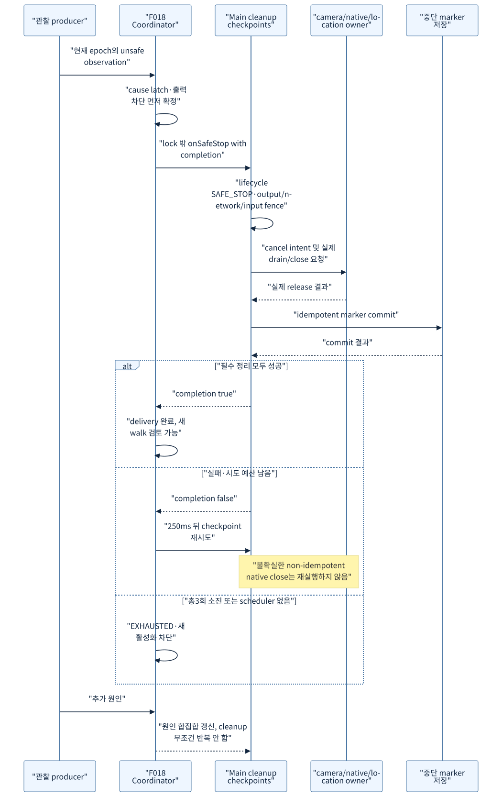

[Mermaid 원본](../diagrams/D02-seq-safety-cleanup.mmd) · [SVG](../rendered/D02-seq-safety-cleanup.svg)

## F-D02-019 고정 이미지 CPU/GPU 실행기 선택

| 항목 | 명세 |
| --- | --- |
| 분야 | D02 보행 세션 생명주기·기기 준비·안전 중단·음성 및 진동 출력·접근성 |
| 목적 | 카메라를 점유하지 않고 bundled fixture로 실제 실행기 선택을 확인한다. |
| 사용 주체 | Main 사용자 성능 검사/초기 detector load |
| 활성 상태 | ACTIVE |
| 진입점 | apps/android/app/src/main/java/kr/co/hanium/dreamup/walksafe/device/AndroidFixedFixtureRuntimeSelector.kt:14 object AndroidFixedFixtureRuntimeSelector \| AndroidFixedFixtureRuntimeSelector.select |
| 실행 전제 | worker thread·현재 request predicate·모델 config·fixture binding; CPU threads 1..4 |
| 입력 출처 형식 검증 최신성 | binding은 runtime/input version·device/OS/ABIs·전체 model/threshold/fixture hash. 시간/boot/session expiry 아님. fixture required roles 정확4; actual backend/threads exact, fallback 허용 안 함. |

### 시작 이벤트와 처리 순서

| 이벤트 ID | 발생원 | 이벤트 | 수신부 | 흐름 |
| --- | --- | --- | --- | --- |
| E-D02-019-01 | Main 사용자 성능 검사/초기 detector load | fixed fixture selection 요청 | AndroidFixedFixtureRuntimeSelector.select | worker thread·현재 request predicate·모델 config·fixture binding; CPU threads 1..4 → selector lock을 50ms tryLock하며 cancellation 확인 → 최대2 detector 중 selected만 caller로 transfer. |

1. selector lock을 50ms tryLock하며 cancellation 확인
2. 유효 cache는 저장된 runtime을 load하고 한 fixture로 재검증
3. invalid cache는 INVALID로 표시하고 CPU fallback; 새 비교를 몰래 수행하지 않음
4. 새 비교는 CPU/GPU 각 warmup, fixture output gate, 2회 AB/BA·4 frame 총 각8 timing
5. GPU 평균이 CPU보다 strictly 작을 때 GPU, 같거나 느리면 CPU
6. 탈락 detector release 뒤 결과 저장 및 selected detector 소유권 이전

| 분기 조건 | 실제 처리 결과 | 구현 근거 |
| --- | --- | --- |
| CPU 기준 fixture output 거절 | CPU 0 timings 결과 기억; 정확도 승인 아님 | apps/android/app/src/main/java/kr/co/hanium/dreamup/walksafe/device/AndroidFixedFixtureRuntimeSelector.kt:14 object AndroidFixedFixtureRuntimeSelector |
| GPU output/backend/fallback 불일치 | GPU 거절·CPU 선택 | apps/android/app/src/main/java/kr/co/hanium/dreamup/walksafe/device/AndroidFixedFixtureRuntimeSelector.kt:14 object AndroidFixedFixtureRuntimeSelector |
| cancel/currentness 변경 | 결과 전달/소유권 이전 금지 | apps/android/app/src/main/java/kr/co/hanium/dreamup/walksafe/device/AndroidFixedFixtureRuntimeSelector.kt:14 object AndroidFixedFixtureRuntimeSelector |
| prefs commit false | 메모리 결과 가능, durable 저장 성공 아님 | apps/android/app/src/main/java/kr/co/hanium/dreamup/walksafe/device/AndroidFixedFixtureRuntimeSelector.kt:14 object AndroidFixedFixtureRuntimeSelector |
| close 실패 | 실패 전파; 누수 없다고 주장하지 않음 | apps/android/app/src/main/java/kr/co/hanium/dreamup/walksafe/device/AndroidFixedFixtureRuntimeSelector.kt:14 object AndroidFixedFixtureRuntimeSelector |

### 효과 종료와 복구

고정 검사 진행/결과와 선택된 runtime; 실시간 tracking/depth 보정 profile 아님

| 상황 | 동작 |
| --- | --- |
| 정상 완료 | 최대2 detector 중 selected만 caller로 transfer. |
| 실패 | 해당 분기의 실패를 유지하며 성공으로 승격하지 않는다. |
| 시간 초과 | 독립 timeout 없음; 명시된 입력의 원본 유효기간 적용. |
| 중복 입력 | 현 상태/소유권과 비교해 중복을 무시하거나 기존 결과를 반환한다. |
| 취소 | lock 대기/각 native 전후 current predicate 확인; 이미 진행 native 호출은 강제 drain 완료로 간주하지 않음. |
| 중단과 생명주기 | 늦은 이전 소유자의 callback은 현 상태를 바꾸지 않는다. |
| 재시도 | cached invalid는 CPU fallback; 사용자 명시 재검사 경로로만 비교. |
| 복구 | 현재 조건과 소유권을 다시 검사한다. |
| 자원 정리 | 탈락/미인수 후보를 먼저 close; 선택 소유권 이전 뒤 selector가 다시 닫지 않음. |

### 상태 실행 맥락과 연결

| 항목 | 명세 |
| --- | --- |
| 초기 상태 | cache lookup |
| 상태 목록 | S-D02-019-00 cache lookup S-D02-019-01 cache verified S-D02-019-02 compare S-D02-019-03 CPU selected S-D02-019-04 GPU selected S-D02-019-05 cancelled/failed |
| 전이 조건과 전이 동작 | cache pass→transfer cache invalid→CPU fallback new compare fastergpu→GPU otherwise→CPU |
| 허용되지 않는 전이 | 고정 fixture 결과를 live CONFIRMED나 물체 검출 정확도 검증으로 사용 금지 |
| 동시성 순서와 작업 소유권 | worker-only ReentrantLock; 50ms bounded acquire loop; Main request/lifecycle generation이 callback을 fence. |
| 공유 상태와 다른 기능 연결 | D05 RuntimeCalibrationFixtures/OutputGate·실제 detector loader 및 추론 config, F-D02-020 live tuning store와 저장 namespace 별개. |

### 정책 근거와 검증 범위

| 항목 | 근거 |
| --- | --- |
| 정책 | [P-D02-019](#P-D02-019) |
| 구현 | [apps/android/app/src/main/java/kr/co/hanium/dreamup/walksafe/device/AndroidFixedFixtureRuntimeSelector.kt:14](/home/ddobagi/Hanium_Dreamup/apps/android/app/src/main/java/kr/co/hanium/dreamup/walksafe/device/AndroidFixedFixtureRuntimeSelector.kt:14) · `object AndroidFixedFixtureRuntimeSelector` (범위 14–433) [apps/android/app/src/main/java/kr/co/hanium/dreamup/walksafe/MainActivity.kt:35979](/home/ddobagi/Hanium_Dreamup/apps/android/app/src/main/java/kr/co/hanium/dreamup/walksafe/MainActivity.kt:35979) · `private fun runFixedFixturePerformanceCheck(` (범위 35979–36045) |
| 기존 개선 ID | 개별 동일성 미확인; 분야 연관은 별도 추적표 |
| 기존 분야 | 해당 없음 |
| 기존 실행 증거 | 과거 DONE/개선항목 주석은 이번 실행 증거가 아님. 정적 구현 및 TEST_EXPECTATION만 확인. |
| 한계 및 구분 | Android 실제 callback·센서·현장·청취는 이번 미검증. |

| 테스트 위치 | 심볼 | 증거 수준 | 기대와 한계 |
| --- | --- | --- | --- |
| [apps/android/app/src/test/java/kr/co/hanium/dreamup/walksafe/device/AndroidFixedFixtureRuntimeSelectorTest.kt](/home/ddobagi/Hanium_Dreamup/apps/android/app/src/test/java/kr/co/hanium/dreamup/walksafe/device/AndroidFixedFixtureRuntimeSelectorTest.kt) | AndroidFixedFixtureRuntimeSelectorTest | TEST_EXPECTATION | cache 검증·fallback·selected/rejected 소유권·commit 처리; 테스트 기대 정적 확인, 이번 미실행 |

### 이벤트 처리 그림


[Mermaid 원본](../diagrams/D02-F019.mmd) · [SVG](../rendered/D02-F019.svg)

## F-D02-020 실시간 tuning profile 정규 저장과 재시도 시각

| 항목 | 명세 |
| --- | --- |
| 분야 | D02 보행 세션 생명주기·기기 준비·안전 중단·음성 및 진동 출력·접근성 |
| 목적 | CONFIRMED 보정 결과와 시도 기록을 canonical 형식으로 저장하고 native 시작 전에 retry 예산을 남긴다. |
| 사용 주체 | calibration 준비 |
| 활성 상태 | UNCONNECTED |
| 진입점 | apps/android/app/src/main/java/kr/co/hanium/dreamup/walksafe/device/AndroidDeviceTuningProfileStore.kt:43 class AndroidDeviceTuningProfileStore \| AndroidDeviceTuningProfileStore |
| 실행 전제 | worker thread·현재 binding 및 fixture set·CONFIRMED profile |
| 입력 출처 형식 검증 최신성 | canonical JSON schema1, String.length 최대262144 character. decode 후 canonical reencode 동일성을 요구하여 unknown/duplicate/coercion 거절. candidate preference는 실제 active runtime과 별개. |

### 시작 이벤트와 처리 순서

| 이벤트 ID | 발생원 | 이벤트 | 수신부 | 흐름 |
| --- | --- | --- | --- | --- |
| E-D02-020-01 | calibration 준비 | load/save/recordAttempt/retryDue | AndroidDeviceTuningProfileStore | worker thread·현재 binding 및 fixture set·CONFIRMED profile → binding을 device/OS/app/model/feature scope/fixture에 맞춰 계산 → 유효한 결과를 현재 호출자에게 반환한다. |

1. binding을 device/OS/app/model/feature scope/fixture에 맞춰 계산
2. 프로필 load에서 schema/size/fields/현재 fixture/CONFIRMED 상태 검증
3. attempt를 native 실행 전에 synchronous commit
4. 동일 boot는 elapsed, reboot는 wall/rollback 방어로 24h cooldown 판정
5. profile commit 실패는 이전 정상 record 보존

| 분기 조건 | 실제 처리 결과 | 구현 근거 |
| --- | --- | --- |
| noncanonical/unknown/duplicate/oversize | load 거절 | apps/android/app/src/main/java/kr/co/hanium/dreamup/walksafe/device/AndroidDeviceTuningProfileStore.kt:43 class AndroidDeviceTuningProfileStore |
| 자동 retry 24h 미도달 | 대기 | apps/android/app/src/main/java/kr/co/hanium/dreamup/walksafe/device/AndroidDeviceTuningProfileStore.kt:43 class AndroidDeviceTuningProfileStore |
| manual 또는 execution recovery | cooldown 우회 가능한 명시 사유 | apps/android/app/src/main/java/kr/co/hanium/dreamup/walksafe/device/AndroidDeviceTuningProfileStore.kt:43 class AndroidDeviceTuningProfileStore |
| saved preference 있음 | 실제 detector active임을 의미하지 않음 | apps/android/app/src/main/java/kr/co/hanium/dreamup/walksafe/device/AndroidDeviceTuningProfileStore.kt:43 class AndroidDeviceTuningProfileStore |

### 효과 종료와 복구

local profile·attempt metadata; 임의 CPU/GPU 활성화 없이 caller가 검증/채택

| 상황 | 동작 |
| --- | --- |
| 정상 완료 | 유효한 결과를 현재 호출자에게 반환한다. |
| 실패 | commit 실패는 prior profile 보존; attempt 기록 실패는 그 결과를 caller에 전달. |
| 시간 초과 | 독립 timeout 없음; 명시된 입력의 원본 유효기간 적용. |
| 중복 입력 | 현 상태/소유권과 비교해 중복을 무시하거나 기존 결과를 반환한다. |
| 취소 | caller가 소유 세대/lease를 무효화하면 새 출력에 사용하지 않는다. |
| 중단과 생명주기 | 늦은 이전 소유자의 callback은 현 상태를 바꾸지 않는다. |
| 재시도 | 자동 retry 24h; 명시 manual/execution recovery 예외. |
| 복구 | 현재 조건과 소유권을 다시 검사한다. |
| 자원 정리 | 순수 정책은 외부 리소스를 소유하지 않는다. |

### 상태 실행 맥락과 연결

| 항목 | 명세 |
| --- | --- |
| 초기 상태 | no profile |
| 상태 목록 | S-D02-020-00 no profile S-D02-020-01 valid CONFIRMED S-D02-020-02 invalid S-D02-020-03 cooldown S-D02-020-04 retry eligible |
| 전이 조건과 전이 동작 | record attempt→cooldown 24h/manual/recovery→eligible confirmed save→valid |
| 허용되지 않는 전이 | 현재 Main의 live calibration 호출은 UNCONNECTED; store 존재가 운영 측정 완료 의미 아님 |
| 동시성 순서와 작업 소유권 | worker 동기 prefs mutation; before-native attempt commit으로 process death 후 반복 예산 소진 기록. |
| 공유 상태와 다른 기능 연결 | D05 RuntimeTuningProfile/SelectionPolicy schema, F-D02-021 live runner. |

### 정책 근거와 검증 범위

| 항목 | 근거 |
| --- | --- |
| 정책 | [P-D02-020](#P-D02-020) |
| 구현 | [apps/android/app/src/main/java/kr/co/hanium/dreamup/walksafe/device/AndroidDeviceTuningProfileStore.kt:43](/home/ddobagi/Hanium_Dreamup/apps/android/app/src/main/java/kr/co/hanium/dreamup/walksafe/device/AndroidDeviceTuningProfileStore.kt:43) · `class AndroidDeviceTuningProfileStore` (범위 43–399) |
| 기존 개선 ID | 개별 동일성 미확인; 분야 연관은 별도 추적표 |
| 기존 분야 | 해당 없음 |
| 기존 실행 증거 | 과거 DONE/개선항목 주석은 이번 실행 증거가 아님. 정적 구현 및 TEST_EXPECTATION만 확인. |
| 한계 및 구분 | profile/attempt load/save의 Main 경로는 현재 미호출 prepareDeviceRuntimeCalibration에 묶인다. runtime load의 markAttemptFinished 분기도 runtimeSelectionBinding이 이 prepare에서만 설정되어 현재 기본 경로에서는 활성화되지 않는다. RUNTIME_CONTRACT_VERSION/INPUT_CONTRACT_VERSION 상수만 fixed selector에서 재사용한다. |

| 테스트 위치 | 심볼 | 증거 수준 | 기대와 한계 |
| --- | --- | --- | --- |

연결한 테스트 미확인: 이번 작성 범위에서 이 기능에 대응하는 시험 단언을 연결하지 않았다. 테스트 자체가 없다는 판정이 아니다.

### 이벤트 처리 그림


[Mermaid 원본](../diagrams/D02-F020.mmd) · [SVG](../rendered/D02-F020.svg)

## F-D02-021 실시간 A/B 보정 runner와 후보 소유권 이전

| 항목 | 명세 |
| --- | --- |
| 분야 | D02 보행 세션 생명주기·기기 준비·안전 중단·음성 및 진동 출력·접근성 |
| 목적 | fixed correctness·교차 실행·실시간 frame 증거를 모아 채택 가능한 후보를 넘기는 별도 구현이다. |
| 사용 주체 | calibration session candidate consumer |
| 활성 상태 | UNCONNECTED |
| 진입점 | apps/android/app/src/main/java/kr/co/hanium/dreamup/walksafe/device/AndroidRuntimeCalibrationRunner.kt:82 class AndroidRuntimeCalibrationRunner \| AndroidRuntimeCalibrationRunner apps/android/app/src/main/java/kr/co/hanium/dreamup/walksafe/device/AndroidRuntimeCalibrationRunner.kt:82 class AndroidRuntimeCalibrationRunner \| RuntimeCalibrationSelection |
| 실행 전제 | 현재 Main schedule은 fixed 검사/loadDetector로만 연결; prepareDeviceRuntimeCalibration 정의만 존재하므로 현재 UI 경로 미연결 |
| 입력 출처 형식 검증 최신성 | baseline borrowed + candidate owned 최대2개. fixed outputs/ABBA/noise/confirmation는 D05 정책; live 각 window>=10초·최대25초·완료>=10, evidence age<=800ms, time alignment<=50ms, tracking/depth scope·speech idle·stable environment. |

### 시작 이벤트와 처리 순서

| 이벤트 ID | 발생원 | 이벤트 | 수신부 | 흐름 |
| --- | --- | --- | --- | --- |
| E-D02-021-01 | calibration session | start/cancel/offerLiveImage | AndroidRuntimeCalibrationRunner | 현재 Main schedule은 fixed 검사/loadDetector로만 연결; prepareDeviceRuntimeCalibration 정의만 존재하므로 현재 UI 경로 미연결 → deadline/cleanup reserve를 확보하고 candidate scalar screening → 실제 drained 뒤 완료 callback. |
| E-D02-021-02 | candidate consumer | tryAdopt/reject | RuntimeCalibrationSelection | 현재 Main schedule은 fixed 검사/loadDetector로만 연결; prepareDeviceRuntimeCalibration 정의만 존재하므로 현재 UI 경로 미연결 → deadline/cleanup reserve를 확보하고 candidate scalar screening → 실제 drained 뒤 완료 callback. |
| E-D02-021-03 | RuntimeCalibrationSessionDeviceTest runnerFactory | 실제 baseline borrow 및 runner 생성 | AndroidRuntimeCalibrationRunner | explicit opt-in real-camera test → host.borrowDetector → single baseline executor의 실제 추론 → selection.tryAdopt expected identity 교체 → 이전 detector close 확인. 이번 실행하지 않음 |

1. deadline/cleanup reserve를 확보하고 candidate scalar screening
2. 최종 후보에 fixture correctness·AB/BA와 confirmation 비교
3. live baseline·candidate frame을 각자 실제 backend로 실행하고 quality 집계
4. D05 RuntimeSelectionPolicy가 CONFIRMED인 경우에만 profile 저장 후 selection 제공
5. tryAdopt swap 성공일 때만 후보 owner transfer; 거절 또는 stale은 close
6. draining 완료 후에만 onFinished/whenDrained ack

| 분기 조건 | 실제 처리 결과 | 구현 근거 |
| --- | --- | --- |
| 총300000ms 또는 reserve 침범 | 중단/부분 결과; native 완료로 간주하지 않음 | apps/android/app/src/main/java/kr/co/hanium/dreamup/walksafe/device/AndroidRuntimeCalibrationRunner.kt:82 class AndroidRuntimeCalibrationRunner |
| near threshold evidence 부족/quality 불충족 | CONFIRMED 생성 안 함 | apps/android/app/src/main/java/kr/co/hanium/dreamup/walksafe/device/AndroidRuntimeCalibrationRunner.kt:82 class AndroidRuntimeCalibrationRunner |
| borrowed baseline native 진행 | 강제 interrupt로 안전 종료라고 하지 않음 | apps/android/app/src/main/java/kr/co/hanium/dreamup/walksafe/device/AndroidRuntimeCalibrationRunner.kt:82 class AndroidRuntimeCalibrationRunner |
| candidate selection 거절 | runner가 candidate close | apps/android/app/src/main/java/kr/co/hanium/dreamup/walksafe/device/AndroidRuntimeCalibrationRunner.kt:82 class AndroidRuntimeCalibrationRunner |
| native/image close 실패 | drain ACK withheld; 새 camera owner 금지 | apps/android/app/src/main/java/kr/co/hanium/dreamup/walksafe/device/AndroidRuntimeCalibrationRunner.kt:82 class AndroidRuntimeCalibrationRunner |

### 효과 종료와 복구

실시간 보정 progress/outcome·후보 profile; 현재 active UI 없음

| 상황 | 동작 |
| --- | --- |
| 정상 완료 | 실제 drained 뒤 완료 callback. |
| 실패 | 해당 분기의 실패를 유지하며 성공으로 승격하지 않는다. |
| 시간 초과 | 총5분, cleanup20초/final90초 reserve; live window 최대25초. |
| 중복 입력 | 현 상태/소유권과 비교해 중복을 무시하거나 기존 결과를 반환한다. |
| 취소 | cancel은 interruption intent와 late publication fence; 실제 native 반환·image close 기다림. |
| 중단과 생명주기 | 늦은 이전 소유자의 callback은 현 상태를 바꾸지 않는다. |
| 재시도 | Main live entry 미연결; store가 cooldown 여부 별도 판정. |
| 복구 | 현재 조건과 소유권을 다시 검사한다. |
| 자원 정리 | borrowed baseline 닫지 않고 owned 후보/image/timer를 정리. close 실패는 drained 성공으로 보고하지 않음. |

### 상태 실행 맥락과 연결

| 항목 | 명세 |
| --- | --- |
| 초기 상태 | PREPARING |
| 상태 목록 | S-D02-021-00 PREPARING S-D02-021-01 OUTPUT_CHECK S-D02-021-02 COMPARING S-D02-021-03 LIVE_BASELINE S-D02-021-04 LIVE_CANDIDATE S-D02-021-05 SELECTING S-D02-021-06 DRAINING S-D02-021-07 FINISHED/CANCELLED |
| 전이 조건과 전이 동작 | screen→fixed compare→liveA→liveB→select confirmed+adopt→transfer cancel/failure→drain→finish |
| 허용되지 않는 전이 | 고정 검사만으로 live profile confirmed 금지; cleanup 미완료를 finish로 위장 금지 |
| 동시성 순서와 작업 소유권 | 단일 worker 및 borrowed baseline executor; monitor/atomic owner; callbacks main executor에서 current 검사. adopt와 cancellation 경쟁을 하나의 owner 판정으로 보호. |
| 공유 상태와 다른 기능 연결 | D05 selection mathematical criteria·fixture semantic tolerances, F-D02-020 profile store, F-D02-022 camera ownership. UnknownRuntimeCalibration 경로도 prepareDeviceRuntimeCalibration 후속에 종속. |

### 정책 근거와 검증 범위

| 항목 | 근거 |
| --- | --- |
| 정책 | [P-D02-021](#P-D02-021) |
| 구현 | [apps/android/app/src/main/java/kr/co/hanium/dreamup/walksafe/device/AndroidRuntimeCalibrationRunner.kt:82](/home/ddobagi/Hanium_Dreamup/apps/android/app/src/main/java/kr/co/hanium/dreamup/walksafe/device/AndroidRuntimeCalibrationRunner.kt:82) · `class AndroidRuntimeCalibrationRunner` (범위 82–871) [apps/android/app/src/debug/java/kr/co/hanium/dreamup/walksafe/device/RuntimeCalibrationTestHostActivity.kt:9](/home/ddobagi/Hanium_Dreamup/apps/android/app/src/debug/java/kr/co/hanium/dreamup/walksafe/device/RuntimeCalibrationTestHostActivity.kt:9) · `RuntimeCalibrationTestHostActivity` (범위 9–47) |
| 기존 개선 ID | 개별 동일성 미확인; 분야 연관은 별도 추적표 |
| 기존 분야 | 해당 없음 |
| 기존 실행 증거 | 과거 DONE/개선항목 주석은 이번 실행 증거가 아님. 정적 구현 및 TEST_EXPECTATION만 확인. |
| 한계 및 구분 | MainActivity scheduleDeviceRuntimeCalibration(36103)는 manual→fixed 검사, automatic→loadDetector 경로만 사용. prepareDeviceRuntimeCalibration(36125)은 정의만 검색되었다. live runner 실행 성공을 주장하지 않는다. UNCONNECTED는 Main 제품 UI 진입점 기준이다. debug/non-exported RuntimeCalibrationTestHostActivity와 explicit opt-in instrumentation에는 별도 실행 연결이 존재한다. 이번에 instrumentation을 실행하지 않았다. |

| 테스트 위치 | 심볼 | 증거 수준 | 기대와 한계 |
| --- | --- | --- | --- |
| [apps/android/app/src/androidTest/java/kr/co/hanium/dreamup/walksafe/device/RuntimeCalibrationSessionDeviceTest.kt](/home/ddobagi/Hanium_Dreamup/apps/android/app/src/androidTest/java/kr/co/hanium/dreamup/walksafe/device/RuntimeCalibrationSessionDeviceTest.kt) | realMetricSessionThenCameraCancellationAndReentry | TEST_EXPECTATION | allowRuntimeCalibrationSessionDeviceTest=true와 기존 CAMERA grant를 전제로 real model/camera metric300초 및 camera-only cancel/drain/reentry를 시험하도록 구현. 계정/앱 prefs/권한 변경·Depth/pose 주입·카메라 내용 저장 없이 실제 drain ACK를 확인하는 기대. 선언 및 factory 경로 정적 확인, 이번 미실행 |

### 이벤트 처리 그림


[Mermaid 원본](../diagrams/D02-F021.mmd) · [SVG](../rendered/D02-F021.svg)


[Mermaid 원본](../diagrams/D02-state-live-calibration.mmd) · [SVG](../rendered/D02-state-live-calibration.svg)

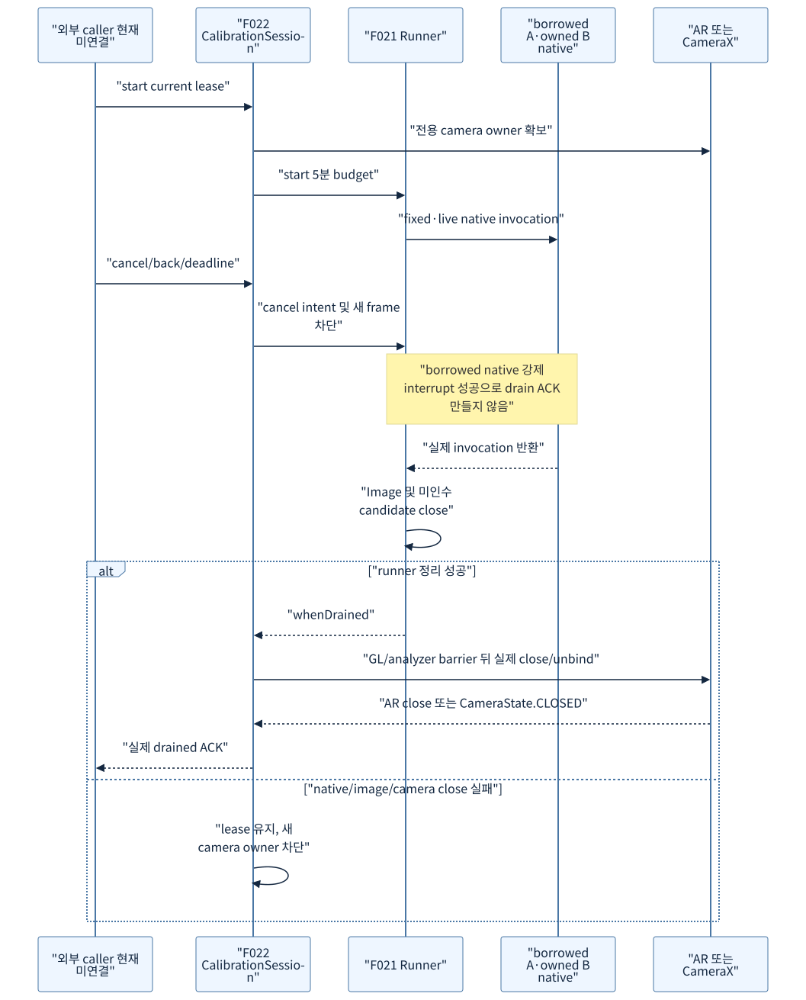

[Mermaid 원본](../diagrams/D02-seq-calibration-drain.mmd) · [SVG](../rendered/D02-seq-calibration-drain.svg)

## F-D02-022 실시간 보정 camera lease·UI deadline·실제 drain

| 항목 | 명세 |
| --- | --- |
| 분야 | D02 보행 세션 생명주기·기기 준비·안전 중단·음성 및 진동 출력·접근성 |
| 목적 | 보정용 camera/native 리소스가 실제 해제되기 전 다른 사용자가 인수하지 못하도록 한다. |
| 사용 주체 | session caller UI/GL/CameraX |
| 활성 상태 | UNCONNECTED |
| 진입점 | apps/android/app/src/main/java/kr/co/hanium/dreamup/walksafe/device/AndroidRuntimeCalibrationSession.kt:73 class AndroidRuntimeCalibrationSession \| AndroidRuntimeCalibrationSession apps/android/app/src/main/java/kr/co/hanium/dreamup/walksafe/device/AndroidRuntimeCalibrationSession.kt:73 class AndroidRuntimeCalibrationSession \| session owner apps/android/app/src/debug/java/kr/co/hanium/dreamup/walksafe/device/RuntimeCalibrationTestHostActivity.kt:16 onCreate apps/android/app/src/debug/java/kr/co/hanium/dreamup/walksafe/device/RuntimeCalibrationTestHostActivity.kt:38 onPause apps/android/app/src/debug/java/kr/co/hanium/dreamup/walksafe/device/RuntimeCalibrationTestHostActivity.kt:43 onDestroy apps/android/app/src/androidTest/java/kr/co/hanium/dreamup/walksafe/device/RuntimeCalibrationSessionDeviceTest.kt:231 session/runnerFactory |
| 실행 전제 | 현재 live entry UNCONNECTED; foreground·권한·first-run/page/account/기기 검사 snapshot·generation 일치 |
| 입력 출처 형식 검증 최신성 | AR tracking source history32; CameraX640x480 latest-only; private GL/AR or camera fallback owner. UI 최대5분, progress text polite live region. |

### 시작 이벤트와 처리 순서

| 이벤트 ID | 발생원 | 이벤트 | 수신부 | 흐름 |
| --- | --- | --- | --- | --- |
| E-D02-022-01 | session caller | start·cancel·whenDrained | AndroidRuntimeCalibrationSession | 현재 live entry UNCONNECTED; foreground·권한·first-run/page/account/기기 검사 snapshot·generation 일치 → 전용 dialog와 camera/GL owner 준비; 권한을 새로 요청하지 않음 → 유효한 결과를 현재 호출자에게 반환한다. |
| E-D02-022-02 | UI/GL/CameraX | dialog cancel/back·frame·camera closed | session owner | 현재 live entry UNCONNECTED; foreground·권한·first-run/page/account/기기 검사 snapshot·generation 일치 → 전용 dialog와 camera/GL owner 준비; 권한을 새로 요청하지 않음 → 유효한 결과를 현재 호출자에게 반환한다. |
| E-D02-022-03 | debug instrumentation ActivityScenario | test host onCreate/onPause/onDestroy 및 detector borrow/replace/detach | RuntimeCalibrationTestHostActivity | explicit opt-in+기존 camera 권한 → host label UI → fixture-owned detector install/borrow → selection.tryAdopt 안에서 expected identity replace → pause/destroy onHostUnavailable callback → fixture attempt.cancel → 실제 drain과 detector detach/close 확인 |

1. 전용 dialog와 camera/GL owner 준비; 권한을 새로 요청하지 않음
2. frame을 current runner에 전달하고 거절 frame 즉시 close
3. cancel intent는 UI와 frame publication을 막고 runner drain 대기
4. AR은 image/native drain→GL pause/provider pause→worker Session.close
5. CameraX는 analyzer serial barrier→unbind→실제 CameraState.CLOSED를 100ms 간격 관찰
6. 모든 실제 owner 해제가 확인된 뒤 drained callback
7. debug 테스트 host는 onCreate에 테스트 label만 표시하고 계정·readiness·앱 preference를 읽지 않는다. install은 한 detector만, replace는 expected identity 일치 시만 허용, detach는 참조를 비운다.
8. onPause/onDestroy는 instrumentation이 등록/제거하는 onHostUnavailable callback을 호출한다. fixture는 이를 attempt.cancel(test_host_paused)에 연결한다. host 자체가 detector를 자동 close하지 않고 fixture가 기존 detector executor와 drain 확인을 소유한다.

| 분기 조건 | 실제 처리 결과 | 구현 근거 |
| --- | --- | --- |
| deadline/back/window cancel | cancel intent; 곧바로 camera free로 표시하지 않음 | apps/android/app/src/main/java/kr/co/hanium/dreamup/walksafe/device/AndroidRuntimeCalibrationSession.kt:73 class AndroidRuntimeCalibrationSession |
| late provider/frame | current generation 검사 뒤 close/discard | apps/android/app/src/main/java/kr/co/hanium/dreamup/walksafe/device/AndroidRuntimeCalibrationSession.kt:73 class AndroidRuntimeCalibrationSession |
| close 실패 | camera lease 유지·앱 재시작 필요 표시 | apps/android/app/src/main/java/kr/co/hanium/dreamup/walksafe/device/AndroidRuntimeCalibrationSession.kt:73 class AndroidRuntimeCalibrationSession |
| runner만 종료/UI만 dismiss | drain 완료 근거 아님 | apps/android/app/src/main/java/kr/co/hanium/dreamup/walksafe/device/AndroidRuntimeCalibrationSession.kt:73 class AndroidRuntimeCalibrationSession |

### 효과 종료와 복구

보정 진행/취소 UI, 성공적으로 정리된 뒤 owner release; 현재 사용자 연결은 없음

| 상황 | 동작 |
| --- | --- |
| 정상 완료 | 유효한 결과를 현재 호출자에게 반환한다. |
| 실패 | 해당 분기의 실패를 유지하며 성공으로 승격하지 않는다. |
| 시간 초과 | 5분 request deadline; deadline은 native 정리 완료를 보장하지 않음. |
| 중복 입력 | 현 상태/소유권과 비교해 중복을 무시하거나 기존 결과를 반환한다. |
| 취소 | button/back/window lifecycle에서 같은 cancellation owner 사용. |
| 중단과 생명주기 | 늦은 이전 소유자의 callback은 현 상태를 바꾸지 않는다. |
| 재시도 | close 실패 뒤 자동 camera 재사용 없음. |
| 복구 | 현재 조건과 소유권을 다시 검사한다. |
| 자원 정리 | AR 실제 close 또는 CameraX CLOSED 확인, failed close는 lease를 붙들고 새 owner 차단. |

### 상태 실행 맥락과 연결

| 항목 | 명세 |
| --- | --- |
| 초기 상태 | PREPARING |
| 상태 목록 | S-D02-022-00 PREPARING S-D02-022-01 RUNNING S-D02-022-02 CANCELLING S-D02-022-03 WAITING_RUNNER_DRAIN S-D02-022-04 WAITING_CAMERA_CLOSE S-D02-022-05 DRAINED S-D02-022-06 CLOSE_FAILED |
| 전이 조건과 전이 동작 | start→running cancel→runnerdrain→cameraclose→drained close error→close_failed |
| 허용되지 않는 전이 | 취소/시간초과/UI 해제만으로 native 작업 종료 ACK 금지 |
| 동시성 순서와 작업 소유권 | UI main·GL render thread·camera analyzer executor·AR close worker. 모든 늦은 callback generation/currentness; analyzer barrier와 state CLOSED로 실제 release 순서 보장. debug fixture는 ActivityScenario/main callbacks·단일 baseline executor·main Handler callback executor를 사용하고 selection.tryAdopt 안에서 host expected identity replace를 수행한다. |
| 공유 상태와 다른 기능 연결 | D05 borrowed detector owner, D07 ARCore provider, D04 camera callbacks. |

### 정책 근거와 검증 범위

| 항목 | 근거 |
| --- | --- |
| 정책 | [P-D02-022](#P-D02-022) |
| 구현 | [apps/android/app/src/main/java/kr/co/hanium/dreamup/walksafe/device/AndroidRuntimeCalibrationSession.kt:73](/home/ddobagi/Hanium_Dreamup/apps/android/app/src/main/java/kr/co/hanium/dreamup/walksafe/device/AndroidRuntimeCalibrationSession.kt:73) · `class AndroidRuntimeCalibrationSession` (범위 73–717) [apps/android/app/src/main/java/kr/co/hanium/dreamup/walksafe/device/RuntimeArSessionCleanupOwnership.kt:4](/home/ddobagi/Hanium_Dreamup/apps/android/app/src/main/java/kr/co/hanium/dreamup/walksafe/device/RuntimeArSessionCleanupOwnership.kt:4) · `RuntimeArSessionCleanupOwnership` (범위 4–64) [apps/android/app/src/main/java/kr/co/hanium/dreamup/walksafe/MainActivity.kt:36125](/home/ddobagi/Hanium_Dreamup/apps/android/app/src/main/java/kr/co/hanium/dreamup/walksafe/MainActivity.kt:36125) · `private fun prepareDeviceRuntimeCalibration(` (범위 36125–36321) [apps/android/app/src/debug/java/kr/co/hanium/dreamup/walksafe/device/RuntimeCalibrationTestHostActivity.kt:9](/home/ddobagi/Hanium_Dreamup/apps/android/app/src/debug/java/kr/co/hanium/dreamup/walksafe/device/RuntimeCalibrationTestHostActivity.kt:9) · `RuntimeCalibrationTestHostActivity` (범위 9–47) |
| 기존 개선 ID | 개별 동일성 미확인; 분야 연관은 별도 추적표 |
| 기존 분야 | 해당 없음 |
| 기존 실행 증거 | 과거 DONE/개선항목 주석은 이번 실행 증거가 아님. 정적 구현 및 TEST_EXPECTATION만 확인. |
| 한계 및 구분 | Android 실제 callback·센서·현장·청취는 이번 미검증. UNCONNECTED는 Main 제품 UI 진입점 기준이다. debug/non-exported RuntimeCalibrationTestHostActivity와 explicit opt-in instrumentation에는 별도 실행 연결이 존재한다. 이번에 instrumentation을 실행하지 않았다. |

| 테스트 위치 | 심볼 | 증거 수준 | 기대와 한계 |
| --- | --- | --- | --- |
| [apps/android/app/src/test/java/kr/co/hanium/dreamup/walksafe/device/AndroidRuntimeCalibrationSessionDeadlineTest.java](/home/ddobagi/Hanium_Dreamup/apps/android/app/src/test/java/kr/co/hanium/dreamup/walksafe/device/AndroidRuntimeCalibrationSessionDeadlineTest.java) | AndroidRuntimeCalibrationSessionDeadlineTest | TEST_EXPECTATION | deadline cancellation과 actual drain 구분; 테스트 기대 정적 확인, 이번 미실행 |
| [apps/android/app/src/androidTest/java/kr/co/hanium/dreamup/walksafe/device/RuntimeCalibrationSessionDeviceTest.kt](/home/ddobagi/Hanium_Dreamup/apps/android/app/src/androidTest/java/kr/co/hanium/dreamup/walksafe/device/RuntimeCalibrationSessionDeviceTest.kt) | realMetricSessionThenCameraCancellationAndReentry | TEST_EXPECTATION | allowRuntimeCalibrationSessionDeviceTest=true와 기존 CAMERA grant를 전제로 real model/camera metric300초 및 camera-only cancel/drain/reentry를 시험하도록 구현. 계정/앱 prefs/권한 변경·Depth/pose 주입·카메라 내용 저장 없이 실제 drain ACK를 확인하는 기대. 선언 및 factory 경로 정적 확인, 이번 미실행 |

### 이벤트 처리 그림


[Mermaid 원본](../diagrams/D02-F022.mmd) · [SVG](../rendered/D02-F022.svg)

[Mermaid 원본](../diagrams/D02-state-live-calibration.mmd) · [SVG](../rendered/D02-state-live-calibration.svg)

[Mermaid 원본](../diagrams/D02-seq-calibration-drain.mmd) · [SVG](../rendered/D02-seq-calibration-drain.svg)

## F-D02-023 위험 음성 후보 안정화·공정 큐·원본 lease

| 항목 | 명세 |
| --- | --- |
| 분야 | D02 보행 세션 생명주기·기기 준비·안전 중단·음성 및 진동 출력·접근성 |
| 목적 | 안정된 현재 위험을 우선 전달하고 실제 완료로 cooldown을 확정한다. |
| 사용 주체 | 위험 pipeline actuator |
| 활성 상태 | ACTIVE |
| 진입점 | apps/android/app/src/main/java/kr/co/hanium/dreamup/walksafe/feedback/WalkSafeFeedbackPolicy.kt:160 class WalkSafeFeedbackPolicy \| WalkSafeFeedbackPolicy.evaluate apps/android/app/src/main/java/kr/co/hanium/dreamup/walksafe/feedback/WalkSafeFeedbackPolicy.kt:160 class WalkSafeFeedbackPolicy \| delivery reservation lifecycle |
| 실행 전제 | 현재 walk/frame/source owner·finite elapsed 원본 증거. metric risk confidence>=.55; qualitative polygon은 별도 CAUTION 제한 |
| 입력 출처 형식 검증 최신성 | stable>=3frames AND >=700ms; missing1500ms; safe2회 clear; source risk max age800ms 또는 producer의 더 짧은 lease; queue cap3/startTTL1500ms. dispatch 시각으로 source age 재설정 금지. |

### 시작 이벤트와 처리 순서

| 이벤트 ID | 발생원 | 이벤트 | 수신부 | 흐름 |
| --- | --- | --- | --- | --- |
| E-D02-023-01 | 위험 pipeline | current risk observations | WalkSafeFeedbackPolicy.evaluate | 현재 walk/frame/source owner·finite elapsed 원본 증거. metric risk confidence>=.55; qualitative polygon은 별도 CAUTION 제한 → 신뢰 source·distance/TTC/confidence·원본 만료를 검사 → actual DONE이 confirmed cooldown/FIFO 상태 반영. |
| E-D02-023-02 | actuator | claim/start/done/reject | delivery reservation lifecycle | 현재 walk/frame/source owner·finite elapsed 원본 증거. metric risk confidence>=.55; qualitative polygon은 별도 CAUTION 제한 → 신뢰 source·distance/TTC/confidence·원본 만료를 검사 → actual DONE이 confirmed cooldown/FIFO 상태 반영. |

1. 신뢰 source·distance/TTC/confidence·원본 만료를 검사
2. track별 안정화 후 severity·approach·distance·FIFO 공정순위로 후보 예약
3. global/track/navigation cooldown과 동일 CAUTION 억제를 적용
4. 높은 severity는 기존 위험을 preempt; 같은 rank 악화는 policy replacement token으로만 교체
5. actuator가 새 owner를 실제 수락한 뒤 이전 예약을 revoke
6. 실제 DONE으로 cooldown 확정, 거절/실패는 예약 회계 rollback

| 분기 조건 | 실제 처리 결과 | 구현 근거 |
| --- | --- | --- |
| emergency RAW STOP conf>=.90·2frame·100ms·TTC<=300·dist<=.9·남은 lease>400 | 일반 stability보다 빠른 STOP 허용 | apps/android/app/src/main/java/kr/co/hanium/dreamup/walksafe/feedback/WalkSafeFeedbackPolicy.kt:160 class WalkSafeFeedbackPolicy |
| same severity worsen | newer source+later deadline 및 TTC band+절반 또는 distance band+margin 조건; global700ms는 유지 | apps/android/app/src/main/java/kr/co/hanium/dreamup/walksafe/feedback/WalkSafeFeedbackPolicy.kt:160 class WalkSafeFeedbackPolicy |
| same continuous CAUTION | distance band가 margin 이상 변하지 않으면 반복 억제 | apps/android/app/src/main/java/kr/co/hanium/dreamup/walksafe/feedback/WalkSafeFeedbackPolicy.kt:160 class WalkSafeFeedbackPolicy |
| claimed/started 후 startTTL 만료 | 진행 발화를 임의 무효화하지 않고 terminal owner 보존 | apps/android/app/src/main/java/kr/co/hanium/dreamup/walksafe/feedback/WalkSafeFeedbackPolicy.kt:160 class WalkSafeFeedbackPolicy |
| scene/source owner 사라짐 | 미시작 candidate 취소; 이미 시작 terminal receipt 별도 | apps/android/app/src/main/java/kr/co/hanium/dreamup/walksafe/feedback/WalkSafeFeedbackPolicy.kt:160 class WalkSafeFeedbackPolicy |

### 효과 종료와 복구

위험 음성/진동 action·delivery reservation·경로 안내 suppression

| 상황 | 동작 |
| --- | --- |
| 정상 완료 | actual DONE이 confirmed cooldown/FIFO 상태 반영. |
| 실패 | rejected/failed/cancelled owner만 rollback; 새 owner receipt를 소비하지 않음. |
| 시간 초과 | source lease는 실제 시작까지, queue TTL1500; 발화 완료 예산은 actuator 별도. |
| 중복 입력 | 현 상태/소유권과 비교해 중복을 무시하거나 기존 결과를 반환한다. |
| 취소 | pending cancellation은 exact receipt/owner에만 적용. |
| 중단과 생명주기 | 늦은 이전 소유자의 callback은 현 상태를 바꾸지 않는다. |
| 재시도 | 자동 재시도 없음; 새 적법한 요청이 필요하다. |
| 복구 | 현재 조건과 소유권을 다시 검사한다. |
| 자원 정리 | 새 walk reset은 track/history/pending 전체; owner-specific reset은 해당 source만. |

### 상태 실행 맥락과 연결

| 항목 | 명세 |
| --- | --- |
| 초기 상태 | observed |
| 상태 목록 | S-D02-023-00 observed S-D02-023-01 stable S-D02-023-02 queued S-D02-023-03 reserved S-D02-023-04 claimed S-D02-023-05 started S-D02-023-06 done S-D02-023-07 rejected/cancelled |
| 전이 조건과 전이 동작 | stable+lease→reserve actuator accepted→claim native start→started done→confirm cooldown reject→rollback |
| 허용되지 않는 전이 | qualitative CAUTION은 metric distance/TTC 또는 보고 권한을 생성하지 않음 |
| 동시성 순서와 작업 소유권 | policy 동기화된 reserve/claim identity; 원본 capture 시계와 완료 시계 분리. queued candidate를 새 frame이 자동 갱신해 원본 lease 연장 금지. |
| 공유 상태와 다른 기능 연결 | D07/Dnavigation risk producer; F-D02-024/025 native dispatch; route cue suppression. |

### 정책 근거와 검증 범위

| 항목 | 근거 |
| --- | --- |
| 정책 | [P-D02-023](#P-D02-023) |
| 구현 | [apps/android/app/src/main/java/kr/co/hanium/dreamup/walksafe/feedback/WalkSafeFeedbackPolicy.kt:160](/home/ddobagi/Hanium_Dreamup/apps/android/app/src/main/java/kr/co/hanium/dreamup/walksafe/feedback/WalkSafeFeedbackPolicy.kt:160) · `class WalkSafeFeedbackPolicy` (범위 160–1037) |
| 기존 개선 ID | 개별 동일성 미확인; 분야 연관은 별도 추적표 |
| 기존 분야 | 해당 없음 |
| 기존 실행 증거 | 과거 DONE/개선항목 주석은 이번 실행 증거가 아님. 정적 구현 및 TEST_EXPECTATION만 확인. |
| 한계 및 구분 | Android 실제 callback·센서·현장·청취는 이번 미검증. |

| 테스트 위치 | 심볼 | 증거 수준 | 기대와 한계 |
| --- | --- | --- | --- |
| [apps/android/app/src/test/java/kr/co/hanium/dreamup/walksafe/feedback/WalkSafeFeedbackRiskWorseningTest.kt](/home/ddobagi/Hanium_Dreamup/apps/android/app/src/test/java/kr/co/hanium/dreamup/walksafe/feedback/WalkSafeFeedbackRiskWorseningTest.kt) | WalkSafeFeedbackRiskWorseningTest | TEST_EXPECTATION | same-rank 악화의 owner 교체; 테스트 기대 정적 확인, 이번 미실행 |
| [apps/android/app/src/test/java/kr/co/hanium/dreamup/walksafe/feedback/WalkSafeFeedbackFairnessTest.kt](/home/ddobagi/Hanium_Dreamup/apps/android/app/src/test/java/kr/co/hanium/dreamup/walksafe/feedback/WalkSafeFeedbackFairnessTest.kt) | WalkSafeFeedbackFairnessTest | TEST_EXPECTATION | 동급 위험 공정 순서; 테스트 기대 정적 확인, 이번 미실행 |
| [apps/android/app/src/test/java/kr/co/hanium/dreamup/walksafe/feedback/WalkSafeFeedbackOutputRejectionTest.kt](/home/ddobagi/Hanium_Dreamup/apps/android/app/src/test/java/kr/co/hanium/dreamup/walksafe/feedback/WalkSafeFeedbackOutputRejectionTest.kt) | WalkSafeFeedbackOutputRejectionTest | TEST_EXPECTATION | 거절 rollback과 완료 cooldown; 테스트 기대 정적 확인, 이번 미실행 |

### 이벤트 처리 그림


[Mermaid 원본](../diagrams/D02-F023.mmd) · [SVG](../rendered/D02-F023.svg)

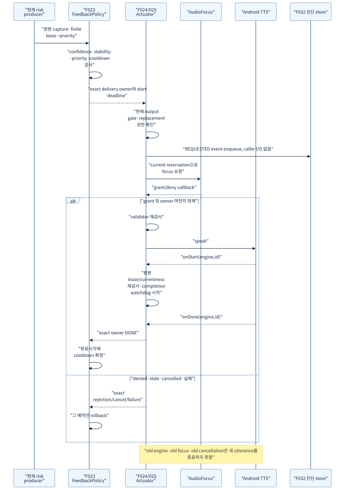

[Mermaid 원본](../diagrams/D02-seq-risk-output.mmd) · [SVG](../rendered/D02-seq-risk-output.svg)

## F-D02-024 TTS engine 준비·복구 예산·callback watchdog

| 항목 | 명세 |
| --- | --- |
| 분야 | D02 보행 세션 생명주기·기기 준비·안전 중단·음성 및 진동 출력·접근성 |
| 목적 | 현재 출력 엔진과 utterance identity의 실제 START/DONE을 추적한다. |
| 사용 주체 | Main Android TTS |
| 활성 상태 | ACTIVE |
| 진입점 | apps/android/app/src/main/java/kr/co/hanium/dreamup/walksafe/feedback/AndroidFeedbackActuator.kt:52 class AndroidFeedbackActuator \| AndroidFeedbackActuator apps/android/app/src/main/java/kr/co/hanium/dreamup/walksafe/feedback/AndroidFeedbackActuator.kt:52 class AndroidFeedbackActuator \| current engine callbacks |
| 실행 전제 | 설치된 nonnetwork Korean voice; current engine generation·current utterance ID; main callback dispatcher |
| 입력 출처 형식 검증 최신성 | INITIALIZING/READY/FAILED/LANGUAGE_UNSUPPORTED/CLOSED. audio attributes USAGE_ASSISTANCE_ACCESSIBILITY. init deadline10000ms; production auto recovery budget0. test injector는1회/250ms 가능. |

### 시작 이벤트와 처리 순서

| 이벤트 ID | 발생원 | 이벤트 | 수신부 | 흐름 |
| --- | --- | --- | --- | --- |
| E-D02-024-01 | Main | ensure actuator·speech request·close | AndroidFeedbackActuator | 설치된 nonnetwork Korean voice; current engine generation·current utterance ID; main callback dispatcher → engine init 후 Korean voice·listener·attributes 설정 성공해야 READY → onDone만 실제 엔진 완료; REQUESTED/QUEUED와 구분. |
| E-D02-024-02 | Android TTS | onInit/onStart/onDone/onError/onStop | current engine callbacks | 설치된 nonnetwork Korean voice; current engine generation·current utterance ID; main callback dispatcher → engine init 후 Korean voice·listener·attributes 설정 성공해야 READY → onDone만 실제 엔진 완료; REQUESTED/QUEUED와 구분. |

1. engine init 후 Korean voice·listener·attributes 설정 성공해야 READY
2. INITIALIZING 요청은 UNAVAILABLE; 후속 READY에 옛 문구 재생하지 않음
3. dispatch 앞/후와 actual onStart에서 currentness·source deadline 재검사
4. head utterance start watchdog 최대8000ms, 실제 START 뒤 message-family completion watchdog 시작
5. exact engine+ID terminal callback 한 번만 소비
6. service error는 engine failure; not-installed는 language unavailable; 그 밖은 utterance failure
7. close는 generation을 먼저 revoke하고 native stop/shutdown 및 callbacks 정리

| 분기 조건 | 실제 처리 결과 | 구현 근거 |
| --- | --- | --- |
| init/recovery 실패 | FAILED 및 Main readiness 차단/안전정지 | apps/android/app/src/main/java/kr/co/hanium/dreamup/walksafe/feedback/AndroidFeedbackActuator.kt:52 class AndroidFeedbackActuator |
| late 이전 engine callback | 무시 | apps/android/app/src/main/java/kr/co/hanium/dreamup/walksafe/feedback/AndroidFeedbackActuator.kt:52 class AndroidFeedbackActuator |
| 다음 utterance START 도착 | 이전 utterance DONE을 만들어내지 않고 실패 처리 | apps/android/app/src/main/java/kr/co/hanium/dreamup/walksafe/feedback/AndroidFeedbackActuator.kt:52 class AndroidFeedbackActuator |
| source deadline=now | START 허용; expiry scheduling은 deadline+1 | apps/android/app/src/main/java/kr/co/hanium/dreamup/walksafe/feedback/AndroidFeedbackActuator.kt:52 class AndroidFeedbackActuator |
| native stop/shutdown 예외 | 나머지 cleanup 계속, 성공 청취라고 주장하지 않음 | apps/android/app/src/main/java/kr/co/hanium/dreamup/walksafe/feedback/AndroidFeedbackActuator.kt:52 class AndroidFeedbackActuator |

### 효과 종료와 복구

TTS readiness·actual terminal receipts·failure diagnostics

| 상황 | 동작 |
| --- | --- |
| 정상 완료 | onDone만 실제 엔진 완료; REQUESTED/QUEUED와 구분. |
| 실패 | 해당 분기의 실패를 유지하며 성공으로 승격하지 않는다. |
| 시간 초과 | init10초/start8초/START 후 family별 completion 예산. caller readiness 대기 최대20500ms. |
| 중복 입력 | 현 상태/소유권과 비교해 중복을 무시하거나 기존 결과를 반환한다. |
| 취소 | exact owner 취소 callbacks, reentrant close 도중 native lock 밖에 deferred 전달. |
| 중단과 생명주기 | 늦은 이전 소유자의 callback은 현 상태를 바꾸지 않는다. |
| 재시도 | production automatic init retry0; 주입 테스트1회250ms만 별도. |
| 복구 | 현재 조건과 소유권을 다시 검사한다. |
| 자원 정리 | generation revoke→watchdog/queue callbacks 해제→focus release→stop/shutdown, 예외 뒤에도 다음 단계 진행. |

### 상태 실행 맥락과 연결

| 항목 | 명세 |
| --- | --- |
| 초기 상태 | INITIALIZING |
| 상태 목록 | S-D02-024-00 INITIALIZING S-D02-024-01 READY S-D02-024-02 FAILED S-D02-024-03 LANGUAGE_UNSUPPORTED S-D02-024-04 CLOSED |
| 전이 조건과 전이 동작 | init success→ready deadline/service failure→failed language not installed→unsupported close→closed |
| 허용되지 않는 전이 | READY 전에 받은 오래된 말 자동 replay 없음; production retry를 테스트 설정과 혼동 금지 |
| 동시성 순서와 작업 소유권 | main handler callback + engine/effect lock·atomic epoch. 사용자 validator와 callbacks는 외부 호출을 lock 밖에서 처리해 reentry 보호. |
| 공유 상태와 다른 기능 연결 | D03 STT는 모든 pending/output 종료 뒤500ms quiet 대기; PendingSpeechQueue 구현은 존재하나 current speak 경로는 offer하지 않고 flush clear만 하므로 legacy/unconnected 보조 자료. |

### 정책 근거와 검증 범위

| 항목 | 근거 |
| --- | --- |
| 정책 | [P-D02-024](#P-D02-024) |
| 구현 | [apps/android/app/src/main/java/kr/co/hanium/dreamup/walksafe/feedback/AndroidFeedbackActuator.kt:52](/home/ddobagi/Hanium_Dreamup/apps/android/app/src/main/java/kr/co/hanium/dreamup/walksafe/feedback/AndroidFeedbackActuator.kt:52) · `class AndroidFeedbackActuator` (범위 52–2337) [apps/android/app/src/main/java/kr/co/hanium/dreamup/walksafe/feedback/UtteranceCallbackRegistry.kt:27](/home/ddobagi/Hanium_Dreamup/apps/android/app/src/main/java/kr/co/hanium/dreamup/walksafe/feedback/UtteranceCallbackRegistry.kt:27) · `UtteranceCallbackRegistry` (범위 27–138) [apps/android/app/src/main/java/kr/co/hanium/dreamup/walksafe/feedback/PendingSpeechQueue.kt:17](/home/ddobagi/Hanium_Dreamup/apps/android/app/src/main/java/kr/co/hanium/dreamup/walksafe/feedback/PendingSpeechQueue.kt:17) · `PendingSpeechQueue` (범위 17–67) |
| 기존 개선 ID | 개별 동일성 미확인; 분야 연관은 별도 추적표 |
| 기존 분야 | 해당 없음 |
| 기존 실행 증거 | 과거 DONE/개선항목 주석은 이번 실행 증거가 아님. 정적 구현 및 TEST_EXPECTATION만 확인. |
| 한계 및 구분 | Android 실제 callback·센서·현장·청취는 이번 미검증. |

| 테스트 위치 | 심볼 | 증거 수준 | 기대와 한계 |
| --- | --- | --- | --- |
| [apps/android/app/src/test/java/kr/co/hanium/dreamup/walksafe/feedback/AndroidFeedbackActuatorRuntimeRegressionTest.kt](/home/ddobagi/Hanium_Dreamup/apps/android/app/src/test/java/kr/co/hanium/dreamup/walksafe/feedback/AndroidFeedbackActuatorRuntimeRegressionTest.kt) | AndroidFeedbackActuatorRuntimeRegressionTest | TEST_EXPECTATION | reentry·stale engine·focus·native cleanup 예외; 테스트 기대 정적 확인, 이번 미실행 |
| [apps/android/app/src/test/java/kr/co/hanium/dreamup/walksafe/feedback/UtteranceCallbackRegistryTest.kt](/home/ddobagi/Hanium_Dreamup/apps/android/app/src/test/java/kr/co/hanium/dreamup/walksafe/feedback/UtteranceCallbackRegistryTest.kt) | UtteranceCallbackRegistryTest | TEST_EXPECTATION | exact terminal identity; 테스트 기대 정적 확인, 이번 미실행 |
| [apps/android/app/src/test/java/kr/co/hanium/dreamup/walksafe/feedback/TtsFirstFailureInterimPolicyTest.kt](/home/ddobagi/Hanium_Dreamup/apps/android/app/src/test/java/kr/co/hanium/dreamup/walksafe/feedback/TtsFirstFailureInterimPolicyTest.kt) | TtsFirstFailureInterimPolicyTest | TEST_EXPECTATION | production recovery 정책; 테스트 기대 정적 확인, 이번 미실행 |

### 이벤트 처리 그림


[Mermaid 원본](../diagrams/D02-F024.mmd) · [SVG](../rendered/D02-F024.svg)


[Mermaid 원본](../diagrams/D02-state-tts.mmd) · [SVG](../rendered/D02-state-tts.svg)

[Mermaid 원본](../diagrams/D02-seq-risk-output.mmd) · [SVG](../rendered/D02-seq-risk-output.svg)

## F-D02-025 음성 우선순위·audio focus·정확한 취소 소유권

| 항목 | 명세 |
| --- | --- |
| 분야 | D02 보행 세션 생명주기·기기 준비·안전 중단·음성 및 진동 출력·접근성 |
| 목적 | 새 위험이 낮은 우선 출력을 선점하면서 예전 취소/focus callback이 새 위험을 중단하지 못하도록 한다. |
| 사용 주체 | 위험/대화/경로/참고 안내 AudioManager |
| 활성 상태 | ACTIVE |
| 진입점 | apps/android/app/src/main/java/kr/co/hanium/dreamup/walksafe/feedback/AndroidFeedbackActuator.kt:723 fun speakNavigation \| AndroidFeedbackActuator.speak* apps/android/app/src/main/java/kr/co/hanium/dreamup/walksafe/feedback/AndroidFeedbackActuator.kt:723 fun speakNavigation \| focus owner |
| 실행 전제 | engine READY, current validator, source start deadline, voice recognition suppression. protected education/consent owner는 특별 nonrisk 보호 |
| 입력 출처 형식 검증 최신성 | risk>interaction>navigation>advisory. risk AUDIOFOCUS_GAIN_TRANSIENT, 일반 MAY_DUCK. duplicate risk800/interaction1000/nav2000ms. focus identity와 pending utterance reservation 연결. |

### 시작 이벤트와 처리 순서

| 이벤트 ID | 발생원 | 이벤트 | 수신부 | 흐름 |
| --- | --- | --- | --- | --- |
| E-D02-025-01 | 위험/대화/경로/참고 안내 | speech dispatch | AndroidFeedbackActuator.speak* | engine READY, current validator, source start deadline, voice recognition suppression. protected education/consent owner는 특별 nonrisk 보호 → risk admission은 낮은 출력 flush; active risk는 strictly higher rank 또는 policy-approved same-rank replacement만 허용 → 유효한 결과를 현재 호출자에게 반환한다. |
| E-D02-025-02 | AudioManager | focus grant/denial/loss | focus owner | engine READY, current validator, source start deadline, voice recognition suppression. protected education/consent owner는 특별 nonrisk 보호 → risk admission은 낮은 출력 flush; active risk는 strictly higher rank 또는 policy-approved same-rank replacement만 허용 → 유효한 결과를 현재 호출자에게 반환한다. |

1. risk admission은 낮은 출력 flush; active risk는 strictly higher rank 또는 policy-approved same-rank replacement만 허용
2. protected education/consent는 다른 nonrisk 차단; advisory는 idle만, navigation은 advisory만 교체 가능
3. REQUESTED 진단 뒤 reservation을 만들고 focus 요청
4. focus 복귀 후 owner/currentness 재검사; grant late/stale면 해당 request만 release
5. native speak 및 START에서 validator 재검사
6. focus loss/duck 또는 explicit cancellation은 현재 소유 음성·tone만 retire

| 분기 조건 | 실제 처리 결과 | 구현 근거 |
| --- | --- | --- |
| STT active | nonrisk suppress, risk 허용 | apps/android/app/src/main/java/kr/co/hanium/dreamup/walksafe/feedback/AndroidFeedbackActuator.kt:723 fun speakNavigation |
| audio focus denied/exception | UNAVAILABLE, pending retire; engine retry 예산 소비하지 않음 | apps/android/app/src/main/java/kr/co/hanium/dreamup/walksafe/feedback/AndroidFeedbackActuator.kt:723 fun speakNavigation |
| cancel B 이전 A의 late focus loss | B 유지 | apps/android/app/src/main/java/kr/co/hanium/dreamup/walksafe/feedback/AndroidFeedbackActuator.kt:723 fun speakNavigation |
| duplicate/suppressed | 재생 없이 SUPPRESSED; TalkBack fallback 유발 안 함 | apps/android/app/src/main/java/kr/co/hanium/dreamup/walksafe/feedback/AndroidFeedbackActuator.kt:723 fun speakNavigation |
| same rank 위험 | 정책 replacement lease 없으면 차단 | apps/android/app/src/main/java/kr/co/hanium/dreamup/walksafe/feedback/AndroidFeedbackActuator.kt:723 fun speakNavigation |

### 효과 종료와 복구

발화 선점·output quiet 상태·focus 획득/반납·exact terminal cancel receipt

| 상황 | 동작 |
| --- | --- |
| 정상 완료 | 유효한 결과를 현재 호출자에게 반환한다. |
| 실패 | validator 예외/false는 fail closed; 사용자 callback 예외가 owner cleanup을 막지 않도록 격리. |
| 시간 초과 | 독립 timeout 없음; 명시된 입력의 원본 유효기간 적용. |
| 중복 입력 | 현 상태/소유권과 비교해 중복을 무시하거나 기존 결과를 반환한다. |
| 취소 | 취소 receipt가 현재 utterance와 일치할 때만 native stop; 이미 교체된 owner는 successor를 stop하지 않음. |
| 중단과 생명주기 | 늦은 이전 소유자의 callback은 현 상태를 바꾸지 않는다. |
| 재시도 | 자동 재시도 없음; 새 적법한 요청이 필요하다. |
| 복구 | 현재 조건과 소유권을 다시 검사한다. |
| 자원 정리 | focus token registration generation 확인 후 abandon; tone과 speech owner 분리. |

### 상태 실행 맥락과 연결

| 항목 | 명세 |
| --- | --- |
| 초기 상태 | reserved |
| 상태 목록 | S-D02-025-00 reserved S-D02-025-01 focus pending S-D02-025-02 focus granted S-D02-025-03 native requested S-D02-025-04 started S-D02-025-05 done/failed/cancelled S-D02-025-06 suppressed |
| 전이 조건과 전이 동작 | valid admission→reserve→focus→speak loss/cancel→retire current preempt→replace owner |
| 허용되지 않는 전이 | focus grant/dispatch acceptance를 user heard 또는 DONE으로 승격하지 않음 |
| 동시성 순서와 작업 소유권 | native engine/effect locks와 callback 밖 validator; focus request 재진입 중 신규 위험이 생성돼도 오래된 outer request가 이를 retire하지 못함. |
| 공유 상태와 다른 기능 연결 | F-D02-023 정책 예약과 atomic replacement handshake. D01 protected priority education·consent, D03 voice recognition gate. |

### 정책 근거와 검증 범위

| 항목 | 근거 |
| --- | --- |
| 정책 | [P-D02-025](#P-D02-025) |
| 구현 | [apps/android/app/src/main/java/kr/co/hanium/dreamup/walksafe/feedback/AndroidFeedbackActuator.kt:723](/home/ddobagi/Hanium_Dreamup/apps/android/app/src/main/java/kr/co/hanium/dreamup/walksafe/feedback/AndroidFeedbackActuator.kt:723) · `fun speakNavigation` (범위 723–2337) [apps/android/app/src/main/java/kr/co/hanium/dreamup/walksafe/feedback/FeedbackOutputGate.kt:4](/home/ddobagi/Hanium_Dreamup/apps/android/app/src/main/java/kr/co/hanium/dreamup/walksafe/feedback/FeedbackOutputGate.kt:4) · `FeedbackOutputGate` (범위 4–59) [apps/android/app/src/main/java/kr/co/hanium/dreamup/walksafe/feedback/AdvisorySpeechReceipt.kt:7](/home/ddobagi/Hanium_Dreamup/apps/android/app/src/main/java/kr/co/hanium/dreamup/walksafe/feedback/AdvisorySpeechReceipt.kt:7) · `AdvisorySpeechReceipt` |
| 기존 개선 ID | 개별 동일성 미확인; 분야 연관은 별도 추적표 |
| 기존 분야 | 해당 없음 |
| 기존 실행 증거 | 과거 DONE/개선항목 주석은 이번 실행 증거가 아님. 정적 구현 및 TEST_EXPECTATION만 확인. |
| 한계 및 구분 | Android 실제 callback·센서·현장·청취는 이번 미검증. |

| 테스트 위치 | 심볼 | 증거 수준 | 기대와 한계 |
| --- | --- | --- | --- |
| [apps/android/app/src/test/java/kr/co/hanium/dreamup/walksafe/feedback/AndroidFeedbackActuatorConcurrentDispatchRegressionTest.kt](/home/ddobagi/Hanium_Dreamup/apps/android/app/src/test/java/kr/co/hanium/dreamup/walksafe/feedback/AndroidFeedbackActuatorConcurrentDispatchRegressionTest.kt) | AndroidFeedbackActuatorConcurrentDispatchRegressionTest | TEST_EXPECTATION | 동시 dispatch owner; 테스트 기대 정적 확인, 이번 미실행 |
| [apps/android/app/src/test/java/kr/co/hanium/dreamup/walksafe/feedback/AndroidFeedbackActuatorExactRiskCancellationTest.kt](/home/ddobagi/Hanium_Dreamup/apps/android/app/src/test/java/kr/co/hanium/dreamup/walksafe/feedback/AndroidFeedbackActuatorExactRiskCancellationTest.kt) | AndroidFeedbackActuatorExactRiskCancellationTest | TEST_EXPECTATION | exact risk cancel; 테스트 기대 정적 확인, 이번 미실행 |
| [apps/android/app/src/test/java/kr/co/hanium/dreamup/walksafe/feedback/AndroidFeedbackActuatorInteractionCurrentnessRegressionTest.kt](/home/ddobagi/Hanium_Dreamup/apps/android/app/src/test/java/kr/co/hanium/dreamup/walksafe/feedback/AndroidFeedbackActuatorInteractionCurrentnessRegressionTest.kt) | AndroidFeedbackActuatorInteractionCurrentnessRegressionTest | TEST_EXPECTATION | late callback/currentness; 테스트 기대 정적 확인, 이번 미실행 |

### 이벤트 처리 그림


[Mermaid 원본](../diagrams/D02-F025.mmd) · [SVG](../rendered/D02-F025.svg)

## F-D02-026 위험 진동·청취 cue·교육 진동·진행음

| 항목 | 명세 |
| --- | --- |
| 분야 | D02 보행 세션 생명주기·기기 준비·안전 중단·음성 및 진동 출력·접근성 |
| 목적 | 음성 없이도 출력 cue를 제공하며 진행 중 STOP 진동을 낮은 cue가 덮지 않도록 한다. |
| 사용 주체 | 위험/voice/교육/기기점검 |
| 활성 상태 | ACTIVE |
| 진입점 | apps/android/app/src/main/java/kr/co/hanium/dreamup/walksafe/feedback/AndroidFeedbackActuator.kt:585 fun playPriorityUserTrainingVibration \| AndroidFeedbackActuator/AndroidDeviceCheckHapticProbe |
| 실행 전제 | vibrator 존재·현재 output validator·위험 source start lease; training은 별도 priority-user currentness |
| 입력 출처 형식 검증 최신성 | STOP [0,180,80,240,80,320]ms, WARNING[0,220], CAUTION 없음. listening start35ms, end35/45/35, route paused와 mounting correction120ms, 교육0/140/90/140. |

### 시작 이벤트와 처리 순서

| 이벤트 ID | 발생원 | 이벤트 | 수신부 | 흐름 |
| --- | --- | --- | --- | --- |
| E-D02-026-01 | 위험/voice/교육/기기점검 | 진동 또는 progress tone 요청 | AndroidFeedbackActuator/AndroidDeviceCheckHapticProbe | vibrator 존재·현재 output validator·위험 source start lease; training은 별도 priority-user currentness → 현재 rank·동일 event의 completion time·pattern duplicate를 판정 → 교육 timer는 요청된 waveform 시간 경과만 의미; 실제 진동 체감 완료가 아님. |

1. 현재 rank·동일 event의 completion time·pattern duplicate를 판정
2. 높은 rank는 선점, 진행 STOP의 동일 event 재요청은 원래 완료 시각까지 거절
3. vibrator 호출 성공은 요청 수락; physical felt 확인과 분리
4. 교육 waveform370ms elapsed 뒤 completion callback, 교체/취소면 failure
5. progress beep은 no speech와 focus 조건 아래80ms·volume0..100, 종료+50ms에 focus release

| 분기 조건 | 실제 처리 결과 | 구현 근거 |
| --- | --- | --- |
| 같은 STOP event와 연장된 lease | 완료 전 재시작/완료시각 연장 금지 | apps/android/app/src/main/java/kr/co/hanium/dreamup/walksafe/feedback/AndroidFeedbackActuator.kt:585 fun playPriorityUserTrainingVibration |
| 낮은 rank cue가 위험 진동 중 | 억제 | apps/android/app/src/main/java/kr/co/hanium/dreamup/walksafe/feedback/AndroidFeedbackActuator.kt:585 fun playPriorityUserTrainingVibration |
| init/final TTS failure STOP | close 동안 지정 실패 패턴 보존 | apps/android/app/src/main/java/kr/co/hanium/dreamup/walksafe/feedback/AndroidFeedbackActuator.kt:585 fun playPriorityUserTrainingVibration |
| vibrator 미지원/예외 | false/실패; 음성 capability 전체 성공으로 치환 안 함 | apps/android/app/src/main/java/kr/co/hanium/dreamup/walksafe/feedback/AndroidFeedbackActuator.kt:585 fun playPriorityUserTrainingVibration |
| 진행음 중 speech 또는 stale timer | tone만 retire; 새 speech focus 보존 | apps/android/app/src/main/java/kr/co/hanium/dreamup/walksafe/feedback/AndroidFeedbackActuator.kt:585 fun playPriorityUserTrainingVibration |

### 효과 종료와 복구

진동/짧은 진행 beep; 실제 느낌/청취는 사용자 또는 기기 확인 필요

| 상황 | 동작 |
| --- | --- |
| 정상 완료 | 교육 timer는 요청된 waveform 시간 경과만 의미; 실제 진동 체감 완료가 아님. |
| 실패 | 실패를 성공 완료로 변환하지 않는다. |
| 시간 초과 | 진동 자체는 pattern duration으로 gate; beep80+50ms. |
| 중복 입력 | 현재 identity와 상태에 따라 무시 또는 기존 결과 반환. |
| 취소 | 교육 completion runnable exact identity로 취소; STOP 유지 예외를 고려. |
| 중단과 생명주기 | foreground/actor/epoch 변경 시 현재 요청을 폐기한다. |
| 재시도 | 자동 재시도 없음; 새 적법한 이벤트 필요. |
| 복구 | 현재 owner와 조건을 다시 확보해야 한다. |
| 자원 정리 | vibrator cancel·tone release·focus owner 해제; native 예외 뒤 cleanup 계속. |

### 상태 실행 맥락과 연결

| 항목 | 명세 |
| --- | --- |
| 초기 상태 | idle |
| 상태 목록 | S-D02-026-00 idle S-D02-026-01 vibrating warning S-D02-026-02 vibrating stop S-D02-026-03 training window S-D02-026-04 beeping S-D02-026-05 cancelled |
| 전이 조건과 전이 동작 | valid request→vibrate/tone higher risk→preempt same STOP before finish→reject timer→complete/release |
| 허용되지 않는 전이 | 하드웨어 API 수락 또는370ms 경과를 실제 사용자가 느꼈다고 기록 금지 |
| 동시성 순서와 작업 소유권 | main handler training completion/progress-tone timer와 effect owner generation; 늦은 old timer가 새 음성/focus를 종료하지 못함. |
| 공유 상태와 다른 기능 연결 | D01 교육/연습 확인, D03 listening cues, F-D02-025 speech priority. |

### 정책 근거와 검증 범위

| 항목 | 근거 |
| --- | --- |
| 정책 | [P-D02-026](#P-D02-026) |
| 구현 | [apps/android/app/src/main/java/kr/co/hanium/dreamup/walksafe/feedback/AndroidFeedbackActuator.kt:585](/home/ddobagi/Hanium_Dreamup/apps/android/app/src/main/java/kr/co/hanium/dreamup/walksafe/feedback/AndroidFeedbackActuator.kt:585) · `fun playPriorityUserTrainingVibration` (범위 585–2337) [apps/android/app/src/main/java/kr/co/hanium/dreamup/walksafe/feedback/WalkSafeFeedbackPolicy.kt:160](/home/ddobagi/Hanium_Dreamup/apps/android/app/src/main/java/kr/co/hanium/dreamup/walksafe/feedback/WalkSafeFeedbackPolicy.kt:160) · `WalkSafeFeedbackPolicy` (범위 160–1037) [apps/android/app/src/main/java/kr/co/hanium/dreamup/walksafe/device/AndroidDeviceCheckHapticProbe.kt:11](/home/ddobagi/Hanium_Dreamup/apps/android/app/src/main/java/kr/co/hanium/dreamup/walksafe/device/AndroidDeviceCheckHapticProbe.kt:11) · `AndroidDeviceCheckHapticProbe` (범위 11–32) |
| 기존 개선 ID | 개별 동일성 미확인; 분야 연관은 별도 추적표 |
| 기존 분야 | 해당 없음 |
| 기존 실행 증거 | 과거 DONE 또는 주석을 이번 실행 증거로 사용하지 않음. 정적 구현 및 TEST_EXPECTATION만 확인. |
| 한계 및 구분 | 정적 코드 근거이며 실기기·청취·현장 전달은 이번 미검증. |

| 테스트 위치 | 심볼 | 증거 수준 | 기대와 한계 |
| --- | --- | --- | --- |
| [apps/android/app/src/test/java/kr/co/hanium/dreamup/walksafe/feedback/AndroidFeedbackActuatorStopVibrationCompletionRegressionTest.kt](/home/ddobagi/Hanium_Dreamup/apps/android/app/src/test/java/kr/co/hanium/dreamup/walksafe/feedback/AndroidFeedbackActuatorStopVibrationCompletionRegressionTest.kt) | AndroidFeedbackActuatorStopVibrationCompletionRegressionTest | TEST_EXPECTATION | 같은 STOP의 lease refresh가 재시작/기간 연장을 만들지 않음; 테스트 기대 정적 확인, 이번 미실행 |

### 이벤트 처리 그림


[Mermaid 원본](../diagrams/D02-F026.mmd) · [SVG](../rendered/D02-F026.svg)

## F-D02-027 경로 음성 전달과 TalkBack 대체 채널

| 항목 | 명세 |
| --- | --- |
| 분야 | D02 보행 세션 생명주기·기기 준비·안전 중단·음성 및 진동 출력·접근성 |
| 목적 | 경로 진행은 앱 음성 실제 완료로 확정하고 접근성 이벤트 전달과 분리한다. |
| 사용 주체 | 경로 caller actuator 접근성 |
| 활성 상태 | ACTIVE |
| 진입점 | apps/android/app/src/main/java/kr/co/hanium/dreamup/walksafe/feedback/NavigationSpeechDelivery.kt:20 fun dispatchCurrentNavigationSpeech \| MainActivity navigation speech apps/android/app/src/main/java/kr/co/hanium/dreamup/walksafe/feedback/NavigationSpeechDelivery.kt:20 fun dispatchCurrentNavigationSpeech \| dispatchCurrentNavigationSpeech apps/android/app/src/main/java/kr/co/hanium/dreamup/walksafe/feedback/NavigationSpeechDelivery.kt:20 fun dispatchCurrentNavigationSpeech \| announceForTalkBack |
| 실행 전제 | foreground·feedback generation·walk epoch·routeId·pendingDecisionToken·instruction currentness·ACTIVE·navigation environment·STT idle |
| 입력 출처 형식 검증 최신성 | capture는 UI post 이전. source predicate를 dispatch/fallback/native START에서 재검사. TalkBack active는 enabled accessibility manager의 spoken service 존재로 확인. |

### 시작 이벤트와 처리 순서

| 이벤트 ID | 발생원 | 이벤트 | 수신부 | 흐름 |
| --- | --- | --- | --- | --- |
| E-D02-027-01 | 경로 caller | navigation instruction | MainActivity navigation speech | foreground·feedback generation·walk epoch·routeId·pendingDecisionToken·instruction currentness·ACTIVE·navigation environment·STT idle → current output guard로 요청 예약 → 앱 DONE만 route completion; TalkBack fallback은 표시 요청 후 reservation failure/retry 경로. |
| E-D02-027-02 | actuator | unavailable/async fail/complete | dispatchCurrentNavigationSpeech | foreground·feedback generation·walk epoch·routeId·pendingDecisionToken·instruction currentness·ACTIVE·navigation environment·STT idle → current output guard로 요청 예약 → 앱 DONE만 route completion; TalkBack fallback은 표시 요청 후 reservation failure/retry 경로. |
| E-D02-027-03 | 접근성 | TalkBack announcement 요청 | announceForTalkBack | foreground·feedback generation·walk epoch·routeId·pendingDecisionToken·instruction currentness·ACTIVE·navigation environment·STT idle → current output guard로 요청 예약 → 앱 DONE만 route completion; TalkBack fallback은 표시 요청 후 reservation failure/retry 경로. |

1. current output guard로 요청 예약
2. 앱 TTS navigation request와 explicit terminal callbacks 등록
3. UNAVAILABLE/async failure에만 fallback 한 번; SUPPRESSED/cancel은 fallback 아님
4. TalkBack active·instruction current일 때 우선순위 검사 후 live region에 표시
5. Main fallback dispatched는 failOnce로 caller reservation을 해제하고 route progress를 완료시키지 않음
6. TTS DONE의 current callback만 complete once

| 분기 조건 | 실제 처리 결과 | 구현 근거 |
| --- | --- | --- |
| higher active TalkBack risk | 낮은 risk/경로/참고 억제, interaction은 지연 | apps/android/app/src/main/java/kr/co/hanium/dreamup/walksafe/feedback/NavigationSpeechDelivery.kt:20 fun dispatchCurrentNavigationSpeech |
| TalkBack risk | assertive live region; 나머지는 polite | apps/android/app/src/main/java/kr/co/hanium/dreamup/walksafe/feedback/NavigationSpeechDelivery.kt:20 fun dispatchCurrentNavigationSpeech |
| stale UI runnable 또는 target invisible | 표시하지 않음 | apps/android/app/src/main/java/kr/co/hanium/dreamup/walksafe/feedback/NavigationSpeechDelivery.kt:20 fun dispatchCurrentNavigationSpeech |
| risk track 사라짐 | risk hold clear, 다른 risk 없으면 pending interaction 실행 | apps/android/app/src/main/java/kr/co/hanium/dreamup/walksafe/feedback/NavigationSpeechDelivery.kt:20 fun dispatchCurrentNavigationSpeech |
| STT active | risk 외 announcement 억제; failure guidance는500ms recheck 가능 | apps/android/app/src/main/java/kr/co/hanium/dreamup/walksafe/feedback/NavigationSpeechDelivery.kt:20 fun dispatchCurrentNavigationSpeech |

### 효과 종료와 복구

앱 음성 또는 TalkBack live-region 요청·마지막 안내 텍스트; TalkBack 발화 완료 ACK 없음

| 상황 | 동작 |
| --- | --- |
| 정상 완료 | 앱 DONE만 route completion; TalkBack fallback은 표시 요청 후 reservation failure/retry 경로. |
| 실패 | 실패를 성공 완료로 변환하지 않는다. |
| 시간 초과 | 독립 타이머 없음; 명시한 입력 lease/상위 기능의 deadline 적용. |
| 중복 입력 | TalkBack risk/interaction1000ms, navigation2000ms, advisory4000ms; interaction 우선750ms. |
| 취소 | pause/teardown pending interaction runnable 제거, exact generation predicate 폐기. |
| 중단과 생명주기 | foreground/actor/epoch 변경 시 현재 요청을 폐기한다. |
| 재시도 | TalkBack 지연 interaction은 current일 때만 다시 판정; route 재시도 규칙은 Dnavigation 소유. |
| 복구 | 현재 owner와 조건을 다시 확보해야 한다. |
| 자원 정리 | 순수 판단 로직은 외부 자원을 소유하지 않는다. |

### 상태 실행 맥락과 연결

| 항목 | 명세 |
| --- | --- |
| 초기 상태 | pending TTS |
| 상태 목록 | S-D02-027-00 pending TTS S-D02-027-01 TTS accepted S-D02-027-02 DONE S-D02-027-03 failed S-D02-027-04 TalkBack dispatched S-D02-027-05 suppressed S-D02-027-06 interaction delayed |
| 전이 조건과 전이 동작 | TTS done/current→complete unavailable/fail→one fallback fallback dispatch→release without route completion cancel→terminal failure |
| 허용되지 않는 전이 | TalkBack onDelivered를 읽기 완료·경로 진행 완료로 사용 금지 |
| 동시성 순서와 작업 소유권 | UI handler/runOnUiThread; accepted announcement 시간은 request 시각이며 실제 읽기 종료 clock 아님. source guard와 AtomicBoolean terminal/fallback-once. |
| 공유 상태와 다른 기능 연결 | Dnavigation route instruction/decision token, D03 STT output gate, D01 교육은 TalkBack 활성 시 별도 발표 경로. |

### 정책 근거와 검증 범위

| 항목 | 근거 |
| --- | --- |
| 정책 | [P-D02-027](#P-D02-027) |
| 구현 | [apps/android/app/src/main/java/kr/co/hanium/dreamup/walksafe/feedback/NavigationSpeechDelivery.kt:20](/home/ddobagi/Hanium_Dreamup/apps/android/app/src/main/java/kr/co/hanium/dreamup/walksafe/feedback/NavigationSpeechDelivery.kt:20) · `fun dispatchCurrentNavigationSpeech` (범위 20–51) [apps/android/app/src/main/java/kr/co/hanium/dreamup/walksafe/MainActivity.kt:38058](/home/ddobagi/Hanium_Dreamup/apps/android/app/src/main/java/kr/co/hanium/dreamup/walksafe/MainActivity.kt:38058) · `private fun announceForTalkBack(` (범위 38058–38133) |
| 기존 개선 ID | 개별 동일성 미확인; 분야 연관은 별도 추적표 |
| 기존 분야 | 해당 없음 |
| 기존 실행 증거 | 과거 DONE 또는 주석을 이번 실행 증거로 사용하지 않음. 정적 구현 및 TEST_EXPECTATION만 확인. |
| 한계 및 구분 | 정적 코드 근거이며 실기기·청취·현장 전달은 이번 미검증. |

| 테스트 위치 | 심볼 | 증거 수준 | 기대와 한계 |
| --- | --- | --- | --- |
| [apps/android/app/src/test/java/kr/co/hanium/dreamup/walksafe/feedback/NavigationSpeechDeliveryTest.kt](/home/ddobagi/Hanium_Dreamup/apps/android/app/src/test/java/kr/co/hanium/dreamup/walksafe/feedback/NavigationSpeechDeliveryTest.kt) | NavigationSpeechDeliveryTest | TEST_EXPECTATION | fallback once·suppressed와 unavailable 구분; 테스트 기대 정적 확인, 이번 미실행 |
| [apps/android/app/src/test/java/kr/co/hanium/dreamup/walksafe/feedback/NavigationSpeechActualStartCheckTest.kt](/home/ddobagi/Hanium_Dreamup/apps/android/app/src/test/java/kr/co/hanium/dreamup/walksafe/feedback/NavigationSpeechActualStartCheckTest.kt) | NavigationSpeechActualStartCheckTest | TEST_EXPECTATION | actual start currentness; 테스트 기대 정적 확인, 이번 미실행 |
| [apps/android/app/src/test/java/kr/co/hanium/dreamup/walksafe/MainActivitySpeechMessageFamilyHoldTest.kt](/home/ddobagi/Hanium_Dreamup/apps/android/app/src/test/java/kr/co/hanium/dreamup/walksafe/MainActivitySpeechMessageFamilyHoldTest.kt) | MainActivitySpeechMessageFamilyHoldTest | TEST_EXPECTATION | message family hold; 테스트 기대 정적 확인, 이번 미실행 |

### 이벤트 처리 그림


[Mermaid 원본](../diagrams/D02-F027.mmd) · [SVG](../rendered/D02-F027.svg)

## F-D02-028 camera+IMU 비거리 장애물 참고 안내

| 항목 | 명세 |
| --- | --- |
| 분야 | D02 보행 세션 생명주기·기기 준비·안전 중단·음성 및 진동 출력·접근성 |
| 목적 | Depth가 없는 현재 camera/IMU에서 미터·충돌 예측 없이 물체 방향 참고만 제공한다. |
| 사용 주체 | CameraX detection |
| 활성 상태 | CONDITIONAL |
| 진입점 | apps/android/app/src/main/java/kr/co/hanium/dreamup/walksafe/feedback/AndroidNonMetricObstacleAdvisoryPolicy.kt:51 class AndroidNonMetricObstacleAdvisoryPolicy \| AndroidNonMetricObstacleAdvisoryPolicy |
| 실행 전제 | camera permission·detector available·camera fallback running·fresh IMU; route active가 필수는 아님 |
| 입력 출처 형식 검증 최신성 | 명시 지원 class, confidence>=.70, normalized bbox valid·area>=.015·bottom>=.58. centerX<.38 left, >.62 right, 나머지 center. stable>=3frames and700ms·IoU>=.10·gap<=1600ms. |

### 시작 이벤트와 처리 순서

| 이벤트 ID | 발생원 | 이벤트 | 수신부 | 흐름 |
| --- | --- | --- | --- | --- |
| E-D02-028-01 | CameraX detection | 현재 detector boxes | AndroidNonMetricObstacleAdvisoryPolicy | camera permission·detector available·camera fallback running·fresh IMU; route active가 필수는 아님 → local tactile tier에서 ARCORE_METRIC 또는 CAMERA_IMU_NON_METRIC/TMAP_ONLY 선택 → 현재 owner에 결과 전달. |

1. local tactile tier에서 ARCORE_METRIC 또는 CAMERA_IMU_NON_METRIC/TMAP_ONLY 선택
2. nonmetric일 때 class/box/near-field proxy로 후보 추림
3. 동일 class+direction+IoU를 안정화
4. queue 최대3, center 우선 뒤 confidence+area·FIFO
5. 1500ms action lease로 advisory 발급; DONE 후 global/perkey cooldown

| 분기 조건 | 실제 처리 결과 | 구현 근거 |
| --- | --- | --- |
| fresh camera/IMU 부족 | TMAP_ONLY; local advisory 없음 | apps/android/app/src/main/java/kr/co/hanium/dreamup/walksafe/feedback/AndroidNonMetricObstacleAdvisoryPolicy.kt:51 class AndroidNonMetricObstacleAdvisoryPolicy |
| 불안정/작은 box/위쪽 box | 참고 후보 제외 | apps/android/app/src/main/java/kr/co/hanium/dreamup/walksafe/feedback/AndroidNonMetricObstacleAdvisoryPolicy.kt:51 class AndroidNonMetricObstacleAdvisoryPolicy |
| TTS suppressed/failed | DONE cooldown 소비 안 함 | apps/android/app/src/main/java/kr/co/hanium/dreamup/walksafe/feedback/AndroidNonMetricObstacleAdvisoryPolicy.kt:51 class AndroidNonMetricObstacleAdvisoryPolicy |
| route inactive | camera+IMU 조건이면 local qualitative 안내 가능 | apps/android/app/src/main/java/kr/co/hanium/dreamup/walksafe/feedback/AndroidNonMetricObstacleAdvisoryPolicy.kt:51 class AndroidNonMetricObstacleAdvisoryPolicy |

### 효과 종료와 복구

방향별 물체 참고 음성; 거리·TTC·report candidate 권한 생성 안 함

| 상황 | 동작 |
| --- | --- |
| 정상 완료 | 현재 owner에 결과 전달. |
| 실패 | 실패를 성공 완료로 변환하지 않는다. |
| 시간 초과 | action startTTL1500ms, stable continuity gap1600ms. |
| 중복 입력 | 현재 identity와 상태에 따라 무시 또는 기존 결과 반환. |
| 취소 | 소유권을 폐기하면 늦은 결과가 새 요청을 변경하지 못한다. |
| 중단과 생명주기 | foreground/actor/epoch 변경 시 현재 요청을 폐기한다. |
| 재시도 | 자동 재시도 없음; 새 적법한 이벤트 필요. |
| 복구 | 현재 owner와 조건을 다시 확보해야 한다. |
| 자원 정리 | 새 source/epoch reset은 pending·history 제거; 오래된 receipt가 새 owner의 cooldown을 소비하지 않음. |

### 상태 실행 맥락과 연결

| 항목 | 명세 |
| --- | --- |
| 초기 상태 | not available |
| 상태 목록 | S-D02-028-00 not available S-D02-028-01 observing S-D02-028-02 stable S-D02-028-03 reserved S-D02-028-04 done S-D02-028-05 rejected |
| 전이 조건과 전이 동작 | camera+IMU→nonmetric stable box→advisory DONE→cooldown |
| 허용되지 않는 전이 | bbox size/position을 미터 거리 또는 안전 보장으로 설명 금지 |
| 동시성 순서와 작업 소유권 | policy reservation owner와 source freshness; bounded queue·terminal callback identity. |
| 공유 상태와 다른 기능 연결 | D05 bbox producer; D04 IMU; Dnavigation tactile tier. ARCORE_METRIC만 mayCreateReportCandidates=true. |

### 정책 근거와 검증 범위

| 항목 | 근거 |
| --- | --- |
| 정책 | [P-D02-028](#P-D02-028) |
| 구현 | [apps/android/app/src/main/java/kr/co/hanium/dreamup/walksafe/feedback/AndroidNonMetricObstacleAdvisoryPolicy.kt:51](/home/ddobagi/Hanium_Dreamup/apps/android/app/src/main/java/kr/co/hanium/dreamup/walksafe/feedback/AndroidNonMetricObstacleAdvisoryPolicy.kt:51) · `class AndroidNonMetricObstacleAdvisoryPolicy` (범위 51–307) [apps/android/app/src/main/java/kr/co/hanium/dreamup/walksafe/device/AndroidLocalTactileCapability.kt:12](/home/ddobagi/Hanium_Dreamup/apps/android/app/src/main/java/kr/co/hanium/dreamup/walksafe/device/AndroidLocalTactileCapability.kt:12) · `AndroidLocalTactileCapability` (범위 12–44) |
| 기존 개선 ID | 개별 동일성 미확인; 분야 연관은 별도 추적표 |
| 기존 분야 | 해당 없음 |
| 기존 실행 증거 | 과거 DONE 또는 주석을 이번 실행 증거로 사용하지 않음. 정적 구현 및 TEST_EXPECTATION만 확인. |
| 한계 및 구분 | 정적 코드 근거이며 실기기·청취·현장 전달은 이번 미검증. |

| 테스트 위치 | 심볼 | 증거 수준 | 기대와 한계 |
| --- | --- | --- | --- |

연결한 테스트 미확인: 이번 작성 범위에서 이 기능에 대응하는 시험 단언을 연결하지 않았다. 테스트 자체가 없다는 판정이 아니다.

### 이벤트 처리 그림


[Mermaid 원본](../diagrams/D02-F028.mmd) · [SVG](../rendered/D02-F028.svg)

## F-D02-029 점형 점자블록 참고 안내의 완료 영수증

| 항목 | 명세 |
| --- | --- |
| 분야 | D02 보행 세션 생명주기·기기 준비·안전 중단·음성 및 진동 출력·접근성 |
| 목적 | 같은 관측이 발급한 시작 기한과 소유권을 완료까지 보존한다. |
| 사용 주체 | GL tactile publication UI/actuator |
| 활성 상태 | ACTIVE |
| 진입점 | apps/android/app/src/main/java/kr/co/hanium/dreamup/walksafe/feedback/TactileDotReferenceDeliveryPolicy.kt:22 class TactileDotReferenceDeliveryPolicy \| publishObservation apps/android/app/src/main/java/kr/co/hanium/dreamup/walksafe/feedback/TactileDotReferenceDeliveryPolicy.kt:22 class TactileDotReferenceDeliveryPolicy \| TactileDotReferenceDeliveryPolicy |
| 실행 전제 | current walk epoch·feedback generation·frame generation·AR generation owner |
| 입력 출처 형식 검증 최신성 | 원본 capture elapsed·track·reference notice의 start TTL. same-track 새 frame도 이미 발급된 deadline 갱신하지 않음; pathGuidanceInterval=8000ms. |

### 시작 이벤트와 처리 순서

| 이벤트 ID | 발생원 | 이벤트 | 수신부 | 흐름 |
| --- | --- | --- | --- | --- |
| E-D02-029-01 | GL tactile publication | reference notice/없는 관측 | publishObservation | current walk epoch·feedback generation·frame generation·AR generation owner → 최신 GL 원본 관측만 publish → 실제 DONE만 cooldown; failure는 pending release. |
| E-D02-029-02 | UI/actuator | reserve/start/DONE/fail | TactileDotReferenceDeliveryPolicy | current walk epoch·feedback generation·frame generation·AR generation owner → 최신 GL 원본 관측만 publish → 실제 DONE만 cooldown; failure는 pending release. |

1. 최신 GL 원본 관측만 publish
2. 현재 evidence·owner·cooldown·one pending 확인 후 identity token 예약
3. actual start는 latest source와 issued original deadline 재검사
4. source loss는 미시작 owner를 취소할 exact receipt를 반환하지만 terminal owner는 보존
5. actual DONE은 source가 사라졌거나 start deadline 지나도 같은 시작된 receipt이면 완료 시각부터 interval 반영

| 분기 조건 | 실제 처리 결과 | 구현 근거 |
| --- | --- | --- |
| future/negative/malformed/expired observation | 예약 거절 | apps/android/app/src/main/java/kr/co/hanium/dreamup/walksafe/feedback/TactileDotReferenceDeliveryPolicy.kt:22 class TactileDotReferenceDeliveryPolicy |
| old capture/old UI time | 최신 관측을 덮지 못함 | apps/android/app/src/main/java/kr/co/hanium/dreamup/walksafe/feedback/TactileDotReferenceDeliveryPolicy.kt:22 class TactileDotReferenceDeliveryPolicy |
| failure/rejected | 완료 interval 소비 없음 | apps/android/app/src/main/java/kr/co/hanium/dreamup/walksafe/feedback/TactileDotReferenceDeliveryPolicy.kt:22 class TactileDotReferenceDeliveryPolicy |
| same values로 reset 후 이전 receipt | reference identity 달라 소비 불가 | apps/android/app/src/main/java/kr/co/hanium/dreamup/walksafe/feedback/TactileDotReferenceDeliveryPolicy.kt:22 class TactileDotReferenceDeliveryPolicy |

### 효과 종료와 복구

점형 참고 speech와 완료 기반8초 rate limit; route 이동 결정을 대신하지 않음

| 상황 | 동작 |
| --- | --- |
| 정상 완료 | 실제 DONE만 cooldown; failure는 pending release. |
| 실패 | 실패를 성공 완료로 변환하지 않는다. |
| 시간 초과 | 독립 타이머 없음; 명시한 입력 lease/상위 기능의 deadline 적용. |
| 중복 입력 | one pending과 identity token으로 concurrent UI reservation 하나만 허용. |
| 취소 | source loss/owner reset은 exact old advisory cancel receipt 반환. |
| 중단과 생명주기 | foreground/actor/epoch 변경 시 현재 요청을 폐기한다. |
| 재시도 | 자동 재시도 없음; 새 적법한 이벤트 필요. |
| 복구 | 현재 owner와 조건을 다시 확보해야 한다. |
| 자원 정리 | 순수 판단 로직은 외부 자원을 소유하지 않는다. |

### 상태 실행 맥락과 연결

| 항목 | 명세 |
| --- | --- |
| 초기 상태 | no evidence |
| 상태 목록 | S-D02-029-00 no evidence S-D02-029-01 published S-D02-029-02 pending S-D02-029-03 started S-D02-029-04 done/cooldown S-D02-029-05 failed |
| 전이 조건과 전이 동작 | valid publish→reserve source loss→start blocked actual done→cooldown |
| 허용되지 않는 전이 | 새 frame으로 이미 발급된 lease를 늘리거나 source loss 후 옛 관측 부활 금지 |
| 동시성 순서와 작업 소유권 | GL publication와 UI reservation 동기화; owner tuple과 token reference identity로 ABA·late DONE 방지. |
| 공유 상태와 다른 기능 연결 | Dnavigation tactile notice producer; F-D02-025 exact advisory cancellation. |

### 정책 근거와 검증 범위

| 항목 | 근거 |
| --- | --- |
| 정책 | [P-D02-029](#P-D02-029) |
| 구현 | [apps/android/app/src/main/java/kr/co/hanium/dreamup/walksafe/feedback/TactileDotReferenceDeliveryPolicy.kt:22](/home/ddobagi/Hanium_Dreamup/apps/android/app/src/main/java/kr/co/hanium/dreamup/walksafe/feedback/TactileDotReferenceDeliveryPolicy.kt:22) · `class TactileDotReferenceDeliveryPolicy` (범위 22–127) |
| 기존 개선 ID | 개별 동일성 미확인; 분야 연관은 별도 추적표 |
| 기존 분야 | 해당 없음 |
| 기존 실행 증거 | 과거 DONE 또는 주석을 이번 실행 증거로 사용하지 않음. 정적 구현 및 TEST_EXPECTATION만 확인. |
| 한계 및 구분 | 정적 코드 근거이며 실기기·청취·현장 전달은 이번 미검증. |

| 테스트 위치 | 심볼 | 증거 수준 | 기대와 한계 |
| --- | --- | --- | --- |
| [apps/android/app/src/test/java/kr/co/hanium/dreamup/walksafe/feedback/TactileDotReferenceDeliveryPolicyTest.kt](/home/ddobagi/Hanium_Dreamup/apps/android/app/src/test/java/kr/co/hanium/dreamup/walksafe/feedback/TactileDotReferenceDeliveryPolicyTest.kt) | TactileDotReferenceDeliveryPolicyTest | TEST_EXPECTATION | lease 갱신 금지·source loss 이후 done·ABA·동시 reserve; 테스트 기대 정적 확인, 이번 미실행 |

### 이벤트 처리 그림


[Mermaid 원본](../diagrams/D02-F029.mmd) · [SVG](../rendered/D02-F029.svg)

## F-D02-030 횡단보도 참고 안내의 경로 일치 영수증

| 항목 | 명세 |
| --- | --- |
| 분야 | D02 보행 세션 생명주기·기기 준비·안전 중단·음성 및 진동 출력·접근성 |
| 목적 | 점자/횡단보도 참고 출력을 현재 경로 구간과 원본 프레임에 묶는다. |
| 사용 주체 | GL crosswalk producer UI/actuator |
| 활성 상태 | ACTIVE |
| 진입점 | apps/android/app/src/main/java/kr/co/hanium/dreamup/walksafe/feedback/CrosswalkReferenceDeliveryPolicy.kt:22 class CrosswalkReferenceDeliveryPolicy \| CrosswalkReferenceDeliveryPolicy apps/android/app/src/main/java/kr/co/hanium/dreamup/walksafe/feedback/CrosswalkReferenceDeliveryPolicy.kt:22 class CrosswalkReferenceDeliveryPolicy \| reference receipt |
| 실행 전제 | walk·feedback·frame·AR owner와 route ID/version/segment 모두 현재 |
| 입력 출처 형식 검증 최신성 | capture elapsed·track·route identity·issued start deadline. interval8000ms; same-track 새 frame은 issued lease를 연장하지 않음. |

### 시작 이벤트와 처리 순서

| 이벤트 ID | 발생원 | 이벤트 | 수신부 | 흐름 |
| --- | --- | --- | --- | --- |
| E-D02-030-01 | GL crosswalk producer | route-bound reference observation | CrosswalkReferenceDeliveryPolicy | walk·feedback·frame·AR owner와 route ID/version/segment 모두 현재 → GL observation의 latest/current route tuple 검증 → DONE 기반8초 interval; route 진행 완료는 별도 navigation 계약. |
| E-D02-030-02 | UI/actuator | reserve/start/DONE/fail | reference receipt | walk·feedback·frame·AR owner와 route ID/version/segment 모두 현재 → GL observation의 latest/current route tuple 검증 → DONE 기반8초 interval; route 진행 완료는 별도 navigation 계약. |

1. GL observation의 latest/current route tuple 검증
2. one pending identity reservation
3. actual start에서 최신 route/track 및 원본 deadline 검증
4. source loss 또는 route component 변경은 old start 차단
5. 실제 시작한 exact receipt DONE은 후속 source loss/TTL 만료와 별개로 completion interval 반영

| 분기 조건 | 실제 처리 결과 | 구현 근거 |
| --- | --- | --- |
| route ID/version/segment 하나라도 달라짐 | old start 불가; owner 완료/실패 처리 대기 | apps/android/app/src/main/java/kr/co/hanium/dreamup/walksafe/feedback/CrosswalkReferenceDeliveryPolicy.kt:22 class CrosswalkReferenceDeliveryPolicy |
| invalid/future/expired/malformed | 예약 불가 | apps/android/app/src/main/java/kr/co/hanium/dreamup/walksafe/feedback/CrosswalkReferenceDeliveryPolicy.kt:22 class CrosswalkReferenceDeliveryPolicy |
| same capture로 source loss 복원 시도 | 거절 | apps/android/app/src/main/java/kr/co/hanium/dreamup/walksafe/feedback/CrosswalkReferenceDeliveryPolicy.kt:22 class CrosswalkReferenceDeliveryPolicy |
| 실패/거절/old receipt | 다음 token/cooldown을 소비하지 않음 | apps/android/app/src/main/java/kr/co/hanium/dreamup/walksafe/feedback/CrosswalkReferenceDeliveryPolicy.kt:22 class CrosswalkReferenceDeliveryPolicy |

### 효과 종료와 복구

현재 경로의 횡단보도 참고 음성; 신호 판독 또는 횡단 허가가 아님

| 상황 | 동작 |
| --- | --- |
| 정상 완료 | DONE 기반8초 interval; route 진행 완료는 별도 navigation 계약. |
| 실패 | 실패를 성공 완료로 변환하지 않는다. |
| 시간 초과 | 독립 타이머 없음; 명시한 입력 lease/상위 기능의 deadline 적용. |
| 중복 입력 | concurrent reserve 하나, reset reference identity로 stale ABA 방지. |
| 취소 | owner 교체/reset은 old receipt exact cancellation. |
| 중단과 생명주기 | foreground/actor/epoch 변경 시 현재 요청을 폐기한다. |
| 재시도 | 자동 재시도 없음; 새 적법한 이벤트 필요. |
| 복구 | 현재 owner와 조건을 다시 확보해야 한다. |
| 자원 정리 | 순수 판단 로직은 외부 자원을 소유하지 않는다. |

### 상태 실행 맥락과 연결

| 항목 | 명세 |
| --- | --- |
| 초기 상태 | no current route notice |
| 상태 목록 | S-D02-030-00 no current route notice S-D02-030-01 published S-D02-030-02 pending S-D02-030-03 started S-D02-030-04 done/cooldown S-D02-030-05 failed |
| 전이 조건과 전이 동작 | current route notice→reserve route changed→start reject actual done→cooldown |
| 허용되지 않는 전이 | 횡단 가능/신호 안전을 판단하는 기능으로 설명 금지 |
| 동시성 순서와 작업 소유권 | GL/UI 동기화 및 source capture ordering; route value+owner reference 둘 다 검사. |
| 공유 상태와 다른 기능 연결 | Dnavigation crosswalk reference producer/route generation; F-D02-025 advisory native owner. |

### 정책 근거와 검증 범위

| 항목 | 근거 |
| --- | --- |
| 정책 | [P-D02-030](#P-D02-030) |
| 구현 | [apps/android/app/src/main/java/kr/co/hanium/dreamup/walksafe/feedback/CrosswalkReferenceDeliveryPolicy.kt:22](/home/ddobagi/Hanium_Dreamup/apps/android/app/src/main/java/kr/co/hanium/dreamup/walksafe/feedback/CrosswalkReferenceDeliveryPolicy.kt:22) · `class CrosswalkReferenceDeliveryPolicy` (범위 22–116) |
| 기존 개선 ID | 개별 동일성 미확인; 분야 연관은 별도 추적표 |
| 기존 분야 | 해당 없음 |
| 기존 실행 증거 | 과거 DONE 또는 주석을 이번 실행 증거로 사용하지 않음. 정적 구현 및 TEST_EXPECTATION만 확인. |
| 한계 및 구분 | 정적 코드 근거이며 실기기·청취·현장 전달은 이번 미검증. |

| 테스트 위치 | 심볼 | 증거 수준 | 기대와 한계 |
| --- | --- | --- | --- |
| [apps/android/app/src/test/java/kr/co/hanium/dreamup/walksafe/feedback/CrosswalkReferenceDeliveryPolicyTest.kt](/home/ddobagi/Hanium_Dreamup/apps/android/app/src/test/java/kr/co/hanium/dreamup/walksafe/feedback/CrosswalkReferenceDeliveryPolicyTest.kt) | CrosswalkReferenceDeliveryPolicyTest | TEST_EXPECTATION | route component 변경·source loss·ABA·동시 reservation; 테스트 기대 정적 확인, 이번 미실행 |

### 이벤트 처리 그림


[Mermaid 원본](../diagrams/D02-F030.mmd) · [SVG](../rendered/D02-F030.svg)

## F-D02-031 텍스트 없는 출력 진단 집계

| 항목 | 명세 |
| --- | --- |
| 분야 | D02 보행 세션 생명주기·기기 준비·안전 중단·음성 및 진동 출력·접근성 |
| 목적 | 발화 내용 없이 요청·시작·완료·실패·취소를 구분해 제한된 진단을 남긴다. |
| 사용 주체 | TTS actuator 동의된 진단 caller |
| 활성 상태 | ACTIVE |
| 진입점 | apps/android/app/src/main/java/kr/co/hanium/dreamup/walksafe/feedback/SpeechOutputDiagnostics.kt:60 class SpeechOutputDiagnostics \| SpeechOutputDiagnostics.record apps/android/app/src/main/java/kr/co/hanium/dreamup/walksafe/feedback/SpeechOutputDiagnostics.kt:60 class SpeechOutputDiagnostics \| SpeechOutputDiagnostics |
| 실행 전제 | 이벤트 kind는 utterance ID prefix로 분류하며 내용으로 파생하지 않음 |
| 입력 출처 형식 검증 최신성 | kind RISK/INTERACTION/NAVIGATION/ADVISORY/OTHER; outcome 열거값·원본 elapsed·optional platform errorCode만. text/utteranceId/destination/report content 없음. |

### 시작 이벤트와 처리 순서

| 이벤트 ID | 발생원 | 이벤트 | 수신부 | 흐름 |
| --- | --- | --- | --- | --- |
| E-D02-031-01 | TTS actuator | SpeechOutputEvent | SpeechOutputDiagnostics.record | 이벤트 kind는 utterance ID prefix로 분류하며 내용으로 파생하지 않음 → kind/outcome별 count 포화 증가 → 현재 owner에 결과 전달. |
| E-D02-031-02 | 동의된 진단 caller | snapshot/drain | SpeechOutputDiagnostics | 이벤트 kind는 utterance ID prefix로 분류하며 내용으로 파생하지 않음 → kind/outcome별 count 포화 증가 → 현재 owner에 결과 전달. |

1. kind/outcome별 count 포화 증가
2. distinct platform errorCode 최대16개
3. lastEventAt은 받은 원본 시각 유지
4. snapshot은 nonzero만; drain은 현재 aggregate 반환 후 clear

| 분기 조건 | 실제 처리 결과 | 구현 근거 |
| --- | --- | --- |
| count Int.MAX_VALUE | 포화 유지 | apps/android/app/src/main/java/kr/co/hanium/dreamup/walksafe/feedback/SpeechOutputDiagnostics.kt:60 class SpeechOutputDiagnostics |
| 17번째 새로운 errorCode | 추가 key 생략; 기존16 count는 계속 | apps/android/app/src/main/java/kr/co/hanium/dreamup/walksafe/feedback/SpeechOutputDiagnostics.kt:60 class SpeechOutputDiagnostics |
| REQUESTED/CANCELLED_RISK/CANCELLED_ADVISORY | 등록/소유권 폐기 증거; 실제 재생 ACK 아님 | apps/android/app/src/main/java/kr/co/hanium/dreamup/walksafe/feedback/SpeechOutputDiagnostics.kt:60 class SpeechOutputDiagnostics |

### 효과 종료와 복구

작은 메모리 집계만 생성; 자체 저장/전송 없음

| 상황 | 동작 |
| --- | --- |
| 정상 완료 | 현재 owner에 결과 전달. |
| 실패 | 실패를 성공 완료로 변환하지 않는다. |
| 시간 초과 | 독립 타이머 없음; 명시한 입력 lease/상위 기능의 deadline 적용. |
| 중복 입력 | 현재 identity와 상태에 따라 무시 또는 기존 결과 반환. |
| 취소 | 소유권을 폐기하면 늦은 결과가 새 요청을 변경하지 못한다. |
| 중단과 생명주기 | foreground/actor/epoch 변경 시 현재 요청을 폐기한다. |
| 재시도 | 자동 재시도 없음; 새 적법한 이벤트 필요. |
| 복구 | 현재 owner와 조건을 다시 확보해야 한다. |
| 자원 정리 | drain으로 capture window 집계 clear; state 소유 외 리소스 없음. |

### 상태 실행 맥락과 연결

| 항목 | 명세 |
| --- | --- |
| 초기 상태 | empty |
| 상태 목록 | S-D02-031-00 empty S-D02-031-01 accumulating S-D02-031-02 drained |
| 전이 조건과 전이 동작 | event→count drain→empty |
| 허용되지 않는 전이 | output REQUESTED를 queue/청취/DONE으로 오해 금지 |
| 동시성 순서와 작업 소유권 | record/snapshot/drain @Synchronized; 저장 I/O 없는 observer. |
| 공유 상태와 다른 기능 연결 | F-D02-032 동의된 encrypted sink, Main diagnostic collector. |

### 정책 근거와 검증 범위

| 항목 | 근거 |
| --- | --- |
| 정책 | [P-D02-031](#P-D02-031) |
| 구현 | [apps/android/app/src/main/java/kr/co/hanium/dreamup/walksafe/feedback/SpeechOutputDiagnostics.kt:60](/home/ddobagi/Hanium_Dreamup/apps/android/app/src/main/java/kr/co/hanium/dreamup/walksafe/feedback/SpeechOutputDiagnostics.kt:60) · `class SpeechOutputDiagnostics` (범위 60–112) |
| 기존 개선 ID | 개별 동일성 미확인; 분야 연관은 별도 추적표 |
| 기존 분야 | 해당 없음 |
| 기존 실행 증거 | 과거 DONE 또는 주석을 이번 실행 증거로 사용하지 않음. 정적 구현 및 TEST_EXPECTATION만 확인. |
| 한계 및 구분 | 정적 코드 근거이며 실기기·청취·현장 전달은 이번 미검증. |

| 테스트 위치 | 심볼 | 증거 수준 | 기대와 한계 |
| --- | --- | --- | --- |
| [apps/android/app/src/test/java/kr/co/hanium/dreamup/walksafe/feedback/SpeechOutputDiagnosticsTest.kt](/home/ddobagi/Hanium_Dreamup/apps/android/app/src/test/java/kr/co/hanium/dreamup/walksafe/feedback/SpeechOutputDiagnosticsTest.kt) | SpeechOutputDiagnosticsTest | TEST_EXPECTATION | bounded text-free aggregate와 drain; 테스트 기대 정적 확인, 이번 미실행 |
| [apps/android/app/src/test/java/kr/co/hanium/dreamup/walksafe/feedback/SpeechOutputRequestedTimingRegressionTest.kt](/home/ddobagi/Hanium_Dreamup/apps/android/app/src/test/java/kr/co/hanium/dreamup/walksafe/feedback/SpeechOutputRequestedTimingRegressionTest.kt) | SpeechOutputRequestedTimingRegressionTest | TEST_EXPECTATION | focus/native 이전 REQUESTED 시각; 테스트 기대 정적 확인, 이번 미실행 |

### 이벤트 처리 그림


[Mermaid 원본](../diagrams/D02-F031.mmd) · [SVG](../rendered/D02-F031.svg)

## F-D02-032 동의·계정·세션에 묶인 암호화 출력 진단 저장

| 항목 | 명세 |
| --- | --- |
| 분야 | D02 보행 세션 생명주기·기기 준비·안전 중단·음성 및 진동 출력·접근성 |
| 목적 | 출력 observer가 I/O를 막지 않고 원래 동의·actor·walk의 진단만 기존 암호화 저장에 남기게 한다. |
| 사용 주체 | Main actuator captured listener privacy flow |
| 활성 상태 | CONDITIONAL |
| 진입점 | apps/android/app/src/main/java/kr/co/hanium/dreamup/walksafe/feedback/ConsentBoundSpeechOutputStore.kt:61 class ConsentBoundSpeechOutputStore \| ConsentBoundSpeechOutputStore apps/android/app/src/main/java/kr/co/hanium/dreamup/walksafe/feedback/ConsentBoundSpeechOutputStore.kt:61 class ConsentBoundSpeechOutputStore \| serial EventWrite apps/android/app/src/main/java/kr/co/hanium/dreamup/walksafe/feedback/ConsentBoundSpeechOutputStore.kt:61 class ConsentBoundSpeechOutputStore \| store/provider |
| 실행 전제 | raw consent·permission·ACTIVE epoch·gateway generation·actor·feedback lifetime·capture window가 current. provider는 기존 field root/key/profile 사용 |
| 입력 출처 형식 검증 최신성 | 원본 kind/outcome/elapsed/errorCode만, binding reference identity와 permanent invalidation. 대기 event64 bounded queue; 음수 timestamp drop. |

### 시작 이벤트와 처리 순서

| 이벤트 ID | 발생원 | 이벤트 | 수신부 | 흐름 |
| --- | --- | --- | --- | --- |
| E-D02-032-01 | Main | publish/invalidate consent binding | ConsentBoundSpeechOutputStore | raw consent·permission·ACTIVE epoch·gateway generation·actor·feedback lifetime·capture window가 current. provider는 기존 field root/key/profile 사용 → publish는 currentness를 lock 밖 검사하고 admission token identity를 다시 검사하여 ABA 방어 → 성공 append 또는 정해진 drop; observer는 disk ACK/청취 완료를 받지 않음. |
| E-D02-032-02 | actuator captured listener | enqueue output event | serial EventWrite | raw consent·permission·ACTIVE epoch·gateway generation·actor·feedback lifetime·capture window가 current. provider는 기존 field root/key/profile 사용 → publish는 currentness를 lock 밖 검사하고 admission token identity를 다시 검사하여 ABA 방어 → 성공 append 또는 정해진 drop; observer는 disk ACK/청취 완료를 받지 않음. |
| E-D02-032-03 | privacy flow | invalidateAndPurge/closeAndDrain | store/provider | raw consent·permission·ACTIVE epoch·gateway generation·actor·feedback lifetime·capture window가 current. provider는 기존 field root/key/profile 사용 → publish는 currentness를 lock 밖 검사하고 admission token identity를 다시 검사하여 ABA 방어 → 성공 append 또는 정해진 drop; observer는 disk ACK/청취 완료를 받지 않음. |

1. publish는 currentness를 lock 밖 검사하고 admission token identity를 다시 검사하여 ABA 방어
2. observer enqueue는 짧은 admission만 수행, full/shutdown이면 drop count
3. single worker는 crypto seal 전과 disk write 직전 privacy currentness 재검사
4. provider는 AAD(window,ordinal)·AEAD envelope·strict path/no symlink/단일 hardlink·canonical authenticated record 검증 후 fsync append
5. purge는 먼저 publication fence·대기 event 제거, in-flight write 뒤 같은 serial queue에서 삭제
6. closeAndDrain은 이전 작업의 quiescence ack이며 삭제 성공과 별개

| 분기 조건 | 실제 처리 결과 | 구현 근거 |
| --- | --- | --- |
| binding 교체/철회/삭제/epoch 변경 | queued old event drop; 새 actor binding 사용 금지 | apps/android/app/src/main/java/kr/co/hanium/dreamup/walksafe/feedback/ConsentBoundSpeechOutputStore.kt:61 class ConsentBoundSpeechOutputStore |
| queue64 초과·seal/append 실패 | best effort drop, auto retry 없음 | apps/android/app/src/main/java/kr/co/hanium/dreamup/walksafe/feedback/ConsentBoundSpeechOutputStore.kt:61 class ConsentBoundSpeechOutputStore |
| purge failure | future false 관찰 가능, publication 계속 차단 | apps/android/app/src/main/java/kr/co/hanium/dreamup/walksafe/feedback/ConsentBoundSpeechOutputStore.kt:61 class ConsentBoundSpeechOutputStore |
| provider window removed/aged/clock rollback | 새로 부활시키지 않고 차단 | apps/android/app/src/main/java/kr/co/hanium/dreamup/walksafe/feedback/ConsentBoundSpeechOutputStore.kt:61 class ConsentBoundSpeechOutputStore |
| close while crypto write/purge 진행 | close 즉시 돌아가도 drain ACK는 이전 in-flight/control task의 직렬 처리 뒤 quiescence를 확인한다. executor terminated 상태의 보장은 아니다. | apps/android/app/src/main/java/kr/co/hanium/dreamup/walksafe/feedback/ConsentBoundSpeechOutputStore.kt:61 class ConsentBoundSpeechOutputStore |

### 효과 종료와 복구

기존 field 저장소의 speech-output/window-16자리/records-4자리 JSONL 암호문; shared retention 사용. 텍스트·위치 없음

| 상황 | 동작 |
| --- | --- |
| 정상 완료 | 성공 append 또는 정해진 drop; observer는 disk ACK/청취 완료를 받지 않음. |
| 실패 | purge/crypto/path failure는 fail closed; 자동 retry 없음. |
| 시간 초과 | 독립 타이머 없음; 명시한 입력 lease/상위 기능의 deadline 적용. |
| 중복 입력 | 현재 identity와 상태에 따라 무시 또는 기존 결과 반환. |
| 취소 | binding invalidation은 enqueue 이전/이후 task 모두 영구 차단. |
| 중단과 생명주기 | foreground/actor/epoch 변경 시 현재 요청을 폐기한다. |
| 재시도 | 검증된 deletion/reconsent가 새 lifetime/provider를 만드는 상위 흐름만 회복 가능. |
| 복구 | 현재 owner와 조건을 다시 확보해야 한다. |
| 자원 정리 | serial purge는 in-flight write 다음 실행한다. closeAndDrain은 앞선 작업 처리와 shutdown 요청 결과의 quiescence ACK이며 executor terminated 보장은 아니다. purge future는 삭제 결과로 별도 확인한다. |

### 상태 실행 맥락과 연결

| 항목 | 명세 |
| --- | --- |
| 초기 상태 | unpublished |
| 상태 목록 | S-D02-032-00 unpublished S-D02-032-01 published S-D02-032-02 invalidated S-D02-032-03 purging S-D02-032-04 purged/failed S-D02-032-05 closed S-D02-032-06 drained |
| 전이 조건과 전이 동작 | current binding→publish current event→enqueue→doublecheck→seal→append withdrawal→invalidate→serial purge close→drain |
| 허용되지 않는 전이 | drain 성공은 데이터 삭제·서버 전송·사용자 청취 성공을 의미하지 않음 |
| 동시성 순서와 작업 소유권 | 단일 daemon ThreadPoolExecutor ArrayBlockingQueue64 AbortPolicy; observer/Main/actor lock 아래 I/O 금지. admission token reference로 concurrent/reentrant publish/invalidate ABA 방어. provider I/O는 field PROCESS_LOCK. |
| 공유 상태와 다른 기능 연결 | D01 consent/account deletion·D06 PersistentFieldSessionLog.SpeechStorageAccess의 기존 storage profile/AEAD/retention; 숫자 저장 한도는 D06 소유 영역. |

### 정책 근거와 검증 범위

| 항목 | 근거 |
| --- | --- |
| 정책 | [P-D02-032](#P-D02-032) |
| 구현 | [apps/android/app/src/main/java/kr/co/hanium/dreamup/walksafe/feedback/ConsentBoundSpeechOutputStore.kt:61](/home/ddobagi/Hanium_Dreamup/apps/android/app/src/main/java/kr/co/hanium/dreamup/walksafe/feedback/ConsentBoundSpeechOutputStore.kt:61) · `class ConsentBoundSpeechOutputStore` (범위 61–244) [apps/android/app/src/main/java/kr/co/hanium/dreamup/walksafe/feedback/FieldSpeechOutputStorageProvider.kt:25](/home/ddobagi/Hanium_Dreamup/apps/android/app/src/main/java/kr/co/hanium/dreamup/walksafe/feedback/FieldSpeechOutputStorageProvider.kt:25) · `FieldSpeechOutputStorageProvider` (범위 25–302) [apps/android/app/src/main/java/kr/co/hanium/dreamup/walksafe/MainActivity.kt:38434](/home/ddobagi/Hanium_Dreamup/apps/android/app/src/main/java/kr/co/hanium/dreamup/walksafe/MainActivity.kt:38434) · `private fun refreshSpeechOutputStorageBinding` (범위 38434–38507) |
| 기존 개선 ID | 개별 동일성 미확인; 분야 연관은 별도 추적표 |
| 기존 분야 | 해당 없음 |
| 기존 실행 증거 | 과거 DONE 또는 주석을 이번 실행 증거로 사용하지 않음. 정적 구현 및 TEST_EXPECTATION만 확인. |
| 한계 및 구분 | 정적 코드 근거이며 실기기·청취·현장 전달은 이번 미검증. |

| 테스트 위치 | 심볼 | 증거 수준 | 기대와 한계 |
| --- | --- | --- | --- |
| [apps/android/app/src/test/java/kr/co/hanium/dreamup/walksafe/feedback/ConsentBoundSpeechOutputStoreTest.kt](/home/ddobagi/Hanium_Dreamup/apps/android/app/src/test/java/kr/co/hanium/dreamup/walksafe/feedback/ConsentBoundSpeechOutputStoreTest.kt) | ConsentBoundSpeechOutputStoreTest | TEST_EXPECTATION | queue64·double privacy check·ABA·purge order·drain; 테스트 기대 정적 확인, 이번 미실행 |
| [apps/android/app/src/test/java/kr/co/hanium/dreamup/walksafe/feedback/FieldSpeechOutputStorageProviderTest.kt](/home/ddobagi/Hanium_Dreamup/apps/android/app/src/test/java/kr/co/hanium/dreamup/walksafe/feedback/FieldSpeechOutputStorageProviderTest.kt) | FieldSpeechOutputStorageProviderTest | TEST_EXPECTATION | 실제 field root/crypto·shared retention·strict path·purge; 테스트 기대 정적 확인, 이번 미실행 |

### 이벤트 처리 그림


[Mermaid 원본](../diagrams/D02-F032.mmd) · [SVG](../rendered/D02-F032.svg)


[Mermaid 원본](../diagrams/D02-state-speech-storage.mmd) · [SVG](../rendered/D02-state-speech-storage.svg)

## F-D02-033 이전 보행 중단 안내와 개인정보 최소 기록

| 항목 | 명세 |
| --- | --- |
| 분야 | D02 보행 세션 생명주기·기기 준비·안전 중단·음성 및 진동 출력·접근성 |
| 목적 | 프로세스 종료 뒤 자동 재개 없이 이전 중단 사실만 알린다. |
| 사용 주체 | Main lifecycle 다음 실행 |
| 활성 상태 | ACTIVE |
| 진입점 | apps/android/app/src/main/java/kr/co/hanium/dreamup/walksafe/session/PreviousWalkInterruptionMarker.kt:4 class PreviousWalkInterruptionMarker \| WalkInterruptionRecord.forCurrentWalk apps/android/app/src/main/java/kr/co/hanium/dreamup/walksafe/session/PreviousWalkInterruptionMarker.kt:4 class PreviousWalkInterruptionMarker \| WalkInterruptionRecord.restore |
| 실행 전제 | 중단 pending authority는 기존 Boolean marker; record는 보조 설명 |
| 입력 출처 형식 검증 최신성 | version2: opaque walk ID·ACTIVE/PAUSED/SAFE_STOP/UNKNOWN·sanitized reason<=160 chars·actor SHA-256 앞16byte=32hex·wall record time. location/destination/image/voice/readiness 없음. |

### 시작 이벤트와 처리 순서

| 이벤트 ID | 발생원 | 이벤트 | 수신부 | 흐름 |
| --- | --- | --- | --- | --- |
| E-D02-033-01 | Main lifecycle | ACTIVE/PAUSED/SAFE_STOP 저장·종료 clear | WalkInterruptionRecord.forCurrentWalk | 중단 pending authority는 기존 Boolean marker; record는 보조 설명 → interrupting state만 record 생성; READY/ENDED는 null → 안내 확인/새 세션 시작으로 marker 처리; lifecycle는 fresh READY 또는 configuration retention 별도. |
| E-D02-033-02 | 다음 실행 | boolean marker+record 복원 | WalkInterruptionRecord.restore | 중단 pending authority는 기존 Boolean marker; record는 보조 설명 → interrupting state만 record 생성; READY/ENDED는 null → 안내 확인/새 세션 시작으로 marker 처리; lifecycle는 fresh READY 또는 configuration retention 별도. |

1. interrupting state만 record 생성; READY/ENDED는 null
2. boolean marker false면 남은 record 무시
3. marker true인데 record 없거나 damage/version wrong이면 LEGACY UNKNOWN 안내
4. 다른 actor hash이면 계정 중립 UNKNOWN 문구
5. 항상 자동 재개 없음과 새 기기 점검/보행 시작 안내

| 분기 조건 | 실제 처리 결과 | 구현 근거 |
| --- | --- | --- |
| 정상 pause와 safe stop와 active crash | 각 다른 중단 설명 | apps/android/app/src/main/java/kr/co/hanium/dreamup/walksafe/session/PreviousWalkInterruptionMarker.kt:4 class PreviousWalkInterruptionMarker |
| 다른 계정 | 구체 prior state 설명 대신 중립 안내 | apps/android/app/src/main/java/kr/co/hanium/dreamup/walksafe/session/PreviousWalkInterruptionMarker.kt:4 class PreviousWalkInterruptionMarker |
| record의 이유 unsafe chars | lowercase 허용 문자 외 underscore,160자 제한 | apps/android/app/src/main/java/kr/co/hanium/dreamup/walksafe/session/PreviousWalkInterruptionMarker.kt:4 class PreviousWalkInterruptionMarker |
| start/resume 거절 | token 값 없이 WRONG_STATE/STALE_EPOCH/READINESS_EXPIRED 등 진단 | apps/android/app/src/main/java/kr/co/hanium/dreamup/walksafe/session/PreviousWalkInterruptionMarker.kt:4 class PreviousWalkInterruptionMarker |

### 효과 종료와 복구

로컬 interruption marker/record와 다음 앱 안내; 기존 보행 authority 복원하지 않음

| 상황 | 동작 |
| --- | --- |
| 정상 완료 | 안내 확인/새 세션 시작으로 marker 처리; lifecycle는 fresh READY 또는 configuration retention 별도. |
| 실패 | 실패를 성공 완료로 변환하지 않는다. |
| 시간 초과 | 독립 타이머 없음; 명시한 입력 lease/상위 기능의 deadline 적용. |
| 중복 입력 | 현재 identity와 상태에 따라 무시 또는 기존 결과 반환. |
| 취소 | 소유권을 폐기하면 늦은 결과가 새 요청을 변경하지 못한다. |
| 중단과 생명주기 | foreground/actor/epoch 변경 시 현재 요청을 폐기한다. |
| 재시도 | 자동 재시도 없음; 새 적법한 이벤트 필요. |
| 복구 | 현재 owner와 조건을 다시 확보해야 한다. |
| 자원 정리 | marker clear와 record cleanup은 Main persistence stage, 실패는 상위 cleanup checkpoint에 남김. |

### 상태 실행 맥락과 연결

| 항목 | 명세 |
| --- | --- |
| 초기 상태 | no pending |
| 상태 목록 | S-D02-033-00 no pending S-D02-033-01 pending active S-D02-033-02 pending paused S-D02-033-03 pending safestop S-D02-033-04 pending unknown |
| 전이 조건과 전이 동작 | interrupting state→record marker false→none damaged+true→unknown |
| 허용되지 않는 전이 | record로 readiness/ACTIVE state를 복원하거나 자동 재개 금지 |
| 동시성 순서와 작업 소유권 | Main transition persistence; elapsed evidence 대신 기록 시각만 wall clock 사용. 늦은 record가 신규 actor/session 활성화 권한이 되지 않음. |
| 공유 상태와 다른 기능 연결 | F-D02-001 새 process UUID, F-D02-034 configuration change는 동일 프로세스 별도. |

### 정책 근거와 검증 범위

| 항목 | 근거 |
| --- | --- |
| 정책 | [P-D02-033](#P-D02-033) |
| 구현 | [apps/android/app/src/main/java/kr/co/hanium/dreamup/walksafe/session/PreviousWalkInterruptionMarker.kt:4](/home/ddobagi/Hanium_Dreamup/apps/android/app/src/main/java/kr/co/hanium/dreamup/walksafe/session/PreviousWalkInterruptionMarker.kt:4) · `class PreviousWalkInterruptionMarker` (범위 4–30) [apps/android/app/src/main/java/kr/co/hanium/dreamup/walksafe/session/WalkInterruptionRecord.kt:22](/home/ddobagi/Hanium_Dreamup/apps/android/app/src/main/java/kr/co/hanium/dreamup/walksafe/session/WalkInterruptionRecord.kt:22) · `WalkInterruptionRecord` (범위 22–147) [apps/android/app/src/main/java/kr/co/hanium/dreamup/walksafe/session/WalkSessionTransitionDiagnostics.kt:21](/home/ddobagi/Hanium_Dreamup/apps/android/app/src/main/java/kr/co/hanium/dreamup/walksafe/session/WalkSessionTransitionDiagnostics.kt:21) · `WalkSessionTransitionDiagnostics` (범위 21–95) [apps/android/app/src/main/java/kr/co/hanium/dreamup/walksafe/MainActivity.kt:30486](/home/ddobagi/Hanium_Dreamup/apps/android/app/src/main/java/kr/co/hanium/dreamup/walksafe/MainActivity.kt:30486) · `private fun persistWalkSessionInterruptionMarker` (범위 30486–30507) |
| 기존 개선 ID | 개별 동일성 미확인; 분야 연관은 별도 추적표 |
| 기존 분야 | 해당 없음 |
| 기존 실행 증거 | 과거 DONE 또는 주석을 이번 실행 증거로 사용하지 않음. 정적 구현 및 TEST_EXPECTATION만 확인. |
| 한계 및 구분 | 정적 코드 근거이며 실기기·청취·현장 전달은 이번 미검증. |

| 테스트 위치 | 심볼 | 증거 수준 | 기대와 한계 |
| --- | --- | --- | --- |
| [apps/android/app/src/test/java/kr/co/hanium/dreamup/walksafe/session/WalkInterruptionRecordTest.kt](/home/ddobagi/Hanium_Dreamup/apps/android/app/src/test/java/kr/co/hanium/dreamup/walksafe/session/WalkInterruptionRecordTest.kt) | WalkInterruptionRecordTest | TEST_EXPECTATION | legacy marker authority·다른 actor 중립·minimal record; 테스트 기대 정적 확인, 이번 미실행 |
| [apps/android/app/src/test/java/kr/co/hanium/dreamup/walksafe/session/WalkSessionTransitionDiagnosticsTest.kt](/home/ddobagi/Hanium_Dreamup/apps/android/app/src/test/java/kr/co/hanium/dreamup/walksafe/session/WalkSessionTransitionDiagnosticsTest.kt) | WalkSessionTransitionDiagnosticsTest | TEST_EXPECTATION | rejection reason에 token 값 없음; 테스트 기대 정적 확인, 이번 미실행 |

### 이벤트 처리 그림


[Mermaid 원본](../diagrams/D02-F033.mmd) · [SVG](../rendered/D02-F033.svg)

## F-D02-034 Activity foreground·background·destroy와 세션 정리

| 항목 | 명세 |
| --- | --- |
| 분야 | D02 보행 세션 생명주기·기기 준비·안전 중단·음성 및 진동 출력·접근성 |
| 목적 | 앱 화면 생명주기에 맞춰 callback·sensor·출력·권한을 fence하고 실제 native owner를 정리한다. |
| 사용 주체 | Android Activity 정리 worker |
| 활성 상태 | ACTIVE |
| 진입점 | apps/android/app/src/main/java/kr/co/hanium/dreamup/walksafe/MainActivity.kt:13161 override fun onResume() \| MainActivity lifecycle apps/android/app/src/main/java/kr/co/hanium/dreamup/walksafe/MainActivity.kt:13161 override fun onResume() \| runtime cleanup callbacks |
| 실행 전제 | 현재 Activity instance·feedback/session generation·privacy startup 단계; configuration change 여부 |
| 입력 출처 형식 검증 최신성 | onResume rechecks permission/resource/gateway/retained walk; onPause/output generation·foreground false. READY/PAUSED/ACTIVE lifecycle와 UI state 분리. |

### 시작 이벤트와 처리 순서

| 이벤트 ID | 발생원 | 이벤트 | 수신부 | 흐름 |
| --- | --- | --- | --- | --- |
| E-D02-034-01 | Android Activity | onResume/onPause/onStop/onDestroy | MainActivity lifecycle | 현재 Activity instance·feedback/session generation·privacy startup 단계; configuration change 여부 → pause에서 foreground input/output callback fence, wake/recognition/gateway speech·navigation·prewalk/보정 취소 → 각 resource owner의 실제 close와 callback fence 후 Activity destroy 반환. |
| E-D02-034-02 | 정리 worker | AR/camera/detector close 완료 | runtime cleanup callbacks | 현재 Activity instance·feedback/session generation·privacy startup 단계; configuration change 여부 → pause에서 foreground input/output callback fence, wake/recognition/gateway speech·navigation·prewalk/보정 취소 → 각 resource owner의 실제 close와 callback fence 후 Activity destroy 반환. |

1. pause에서 foreground input/output callback fence, wake/recognition/gateway speech·navigation·prewalk/보정 취소
2. camera/depth/location/step/orientation·IMU evidence invalidation 및 session background event
3. destroy는 safety coordinator close·retry 제거·detector generation 증가·각 executor/call authority fence
4. configuration change는 같은 process paused lifecycle+gateway lease retention 가능; 이전 Activity는 새 placeholder lifecycle로 교체
5. AR invalidation preparation→실제 close stage→independent cleanup tail 순서
6. feedback close·speech recognizer destroy·startup/resource probe close·async detector close
7. RuntimeArSessionCleanupOwnership.processSingleton은 retained owner/action 하나만 보유한다. beforeClose 또는 native close가 RuntimeException이면 firstFailure를 남기고 pending을 유지하며 attempted=true로 같은 close를 재실행하지 않는다. 다른 owner는 그 lease를 해제하지 못한다.

| 분기 조건 | 실제 처리 결과 | 구현 근거 |
| --- | --- | --- |
| privacy startup inspection 미완료 | 전용 early cleanup 후 super.onDestroy; 미초기화 자원 사용 금지 | apps/android/app/src/main/java/kr/co/hanium/dreamup/walksafe/MainActivity.kt:13161 override fun onResume() |
| configuration change retention 성공 | 동일 walk ID/lease 보관, 자동 ACTIVE 복원 아님; 다음 foreground 재검사 | apps/android/app/src/main/java/kr/co/hanium/dreamup/walksafe/MainActivity.kt:13161 override fun onResume() |
| finishing/프로세스 재시작 | gateway authority reset·새 보행 경로 | apps/android/app/src/main/java/kr/co/hanium/dreamup/walksafe/MainActivity.kt:13161 override fun onResume() |
| 한 cleanup 단계 예외 | 독립 단계 계속; 성공하지 않은 native release ACK를 조작하지 않음 | apps/android/app/src/main/java/kr/co/hanium/dreamup/walksafe/MainActivity.kt:13161 override fun onResume() |
| destroyed Activity late callback | placeholder epoch/generation으로 retained lifecycle 변경 불가 | apps/android/app/src/main/java/kr/co/hanium/dreamup/walksafe/MainActivity.kt:13161 override fun onResume() |

### 효과 종료와 복구

sensor/output/네트워크 취소·화면 재검사·중단/retention 동작; process teardown 물리 완료는 callback 범위로만 판단

| 상황 | 동작 |
| --- | --- |
| 정상 완료 | 각 독립 cleanup 단계와 callback fence를 수행하거나 비동기 close 요청을 등록한 뒤 Activity onDestroy가 반환한다. 모든 owner의 실제 release를 동기 대기하는 것은 아니며 완료는 해당 owner ACK로 확인한다. |
| 실패 | 실패를 성공 완료로 변환하지 않는다. |
| 시간 초과 | 독립 타이머 없음; 명시한 입력 lease/상위 기능의 deadline 적용. |
| 중복 입력 | 현재 identity와 상태에 따라 무시 또는 기존 결과 반환. |
| 취소 | pause/destroy는 current action과 output lease를 무효화. |
| 중단과 생명주기 | foreground/actor/epoch 변경 시 현재 요청을 폐기한다. |
| 재시도 | foreground 복귀는 full readiness와 explicit resume; 자동 active 없음. |
| 복구 | 현재 owner와 조건을 다시 확보해야 한다. |
| 자원 정리 | 원본 resource owner 확인; async detector/native drain은 시작 intent와 완료 ack 분리. onDestroy 자체가 모든 worker 종료를 동기 보장한다고 주장하지 않음. |

### 상태 실행 맥락과 연결

| 항목 | 명세 |
| --- | --- |
| 초기 상태 | foreground |
| 상태 목록 | S-D02-034-00 foreground S-D02-034-01 background paused S-D02-034-02 destroying S-D02-034-03 retained configuration owner S-D02-034-04 new placeholder S-D02-034-05 destroyed |
| 전이 조건과 전이 동작 | foreground→pause→fenced paused destroy+config→retain+placeholder destroy otherwise→reset new foreground→recheck |
| 허용되지 않는 전이 | onResume만으로 ACTIVE 또는 예전 readiness 재사용 금지 |
| 동시성 순서와 작업 소유권 | Android main lifecycle + worker/GL/analyzer shutdown. beforePublish/generation fences precede callbacks; independent cleanup tails survive errors; old Activity cannot mutate handed-off owner. |
| 공유 상태와 다른 기능 연결 | D01 privacy/startup ownership·D03 wake/STT·D04 sensors·D05 detector executor·D07 AR·D08 gateway. processWalkConfigurationChangeRetention 구현은 다른 파일 소유이며 Main 호출 계약만 확인. |

### 정책 근거와 검증 범위

| 항목 | 근거 |
| --- | --- |
| 정책 | [P-D02-034](#P-D02-034) |
| 구현 | [apps/android/app/src/main/java/kr/co/hanium/dreamup/walksafe/MainActivity.kt:13161](/home/ddobagi/Hanium_Dreamup/apps/android/app/src/main/java/kr/co/hanium/dreamup/walksafe/MainActivity.kt:13161) · `override fun onResume()` (범위 13161–13186) [apps/android/app/src/main/java/kr/co/hanium/dreamup/walksafe/MainActivity.kt:13469](/home/ddobagi/Hanium_Dreamup/apps/android/app/src/main/java/kr/co/hanium/dreamup/walksafe/MainActivity.kt:13469) · `override fun onDestroy()` (범위 13469–13639) [apps/android/app/src/main/java/kr/co/hanium/dreamup/walksafe/device/RuntimeArSessionCleanupOwnership.kt:4](/home/ddobagi/Hanium_Dreamup/apps/android/app/src/main/java/kr/co/hanium/dreamup/walksafe/device/RuntimeArSessionCleanupOwnership.kt:4) · `RuntimeArSessionCleanupOwnership` (범위 4–64) |
| 기존 개선 ID | 개별 동일성 미확인; 분야 연관은 별도 추적표 |
| 기존 분야 | 해당 없음 |
| 기존 실행 증거 | 과거 DONE 또는 주석을 이번 실행 증거로 사용하지 않음. 정적 구현 및 TEST_EXPECTATION만 확인. |
| 한계 및 구분 | 정적 코드 근거이며 실기기·청취·현장 전달은 이번 미검증. |

| 테스트 위치 | 심볼 | 증거 수준 | 기대와 한계 |
| --- | --- | --- | --- |
| [apps/android/app/src/test/java/kr/co/hanium/dreamup/walksafe/MainActivityWalkSessionLifecycleStaticTest.kt](/home/ddobagi/Hanium_Dreamup/apps/android/app/src/test/java/kr/co/hanium/dreamup/walksafe/MainActivityWalkSessionLifecycleStaticTest.kt) | MainActivityWalkSessionLifecycleStaticTest | TEST_EXPECTATION | Main state/lifecycle 계약; 테스트 기대 정적 확인, 이번 미실행 |
| [apps/android/app/src/test/java/kr/co/hanium/dreamup/walksafe/MainActivitySpeechCancellationOwnershipTest.kt](/home/ddobagi/Hanium_Dreamup/apps/android/app/src/test/java/kr/co/hanium/dreamup/walksafe/MainActivitySpeechCancellationOwnershipTest.kt) | MainActivitySpeechCancellationOwnershipTest | TEST_EXPECTATION | output 취소 소유권; 테스트 기대 정적 확인, 이번 미실행 |
| [apps/android/app/src/test/java/kr/co/hanium/dreamup/walksafe/MainActivityResourceMonitoringRecoveryStaticTest.kt](/home/ddobagi/Hanium_Dreamup/apps/android/app/src/test/java/kr/co/hanium/dreamup/walksafe/MainActivityResourceMonitoringRecoveryStaticTest.kt) | MainActivityResourceMonitoringRecoveryStaticTest | TEST_EXPECTATION | foreground resource monitor 회복; 테스트 기대 정적 확인, 이번 미실행 |

### 이벤트 처리 그림


[Mermaid 원본](../diagrams/D02-F034.mmd) · [SVG](../rendered/D02-F034.svg)

## F-D02-035 gateway 임시 WAV 재생과 파일 소유권

| 항목 | 명세 |
| --- | --- |
| 분야 | D02 보행 세션 생명주기·기기 준비·안전 중단·음성 및 진동 출력·접근성 |
| 목적 | gateway 음성 응답을 현재 foreground interaction 안에서 재생하고 임시 파일을 소유·삭제한다. |
| 사용 주체 | gateway speech response MediaPlayer Main |
| 활성 상태 | CONDITIONAL |
| 진입점 | apps/android/app/src/main/java/kr/co/hanium/dreamup/walksafe/feedback/GatewayVoiceAudio.kt:94 internal class TemporaryGatewayWavPlayer \| TemporaryGatewayWavPlayer.play apps/android/app/src/main/java/kr/co/hanium/dreamup/walksafe/feedback/GatewayVoiceAudio.kt:94 internal class TemporaryGatewayWavPlayer \| current player listener apps/android/app/src/main/java/kr/co/hanium/dreamup/walksafe/feedback/GatewayVoiceAudio.kt:94 internal class TemporaryGatewayWavPlayer \| player.cancel |
| 실행 전제 | 현재 gateway request/interaction lease와 foreground는 Main에서 검증; 파일이 실제 존재 Main currentness는 ACTIVE 또는 PAUSED의 exact walk epoch, gateway actor/session generation/instance, interaction generation/network ticket, foreground, onboarding/device gate를 검사한다. |
| 입력 출처 형식 검증 최신성 | player helper에는 별도 source TTL/timeout 없음. Main current request·output gate에 의존. AAC 입력 helper는 D03 소유(16kHz/64kbps/12초/1MiB; stop grace14초). |

### 시작 이벤트와 처리 순서

| 이벤트 ID | 발생원 | 이벤트 | 수신부 | 흐름 |
| --- | --- | --- | --- | --- |
| E-D02-035-01 | gateway speech response | validated temporary WAV file | TemporaryGatewayWavPlayer.play | 현재 gateway request/interaction lease와 foreground는 Main에서 검증; 파일이 실제 존재 → play는 이전 active player/file을 취소·삭제 → MediaPlayer current completion은 해당 파일 재생 완료 callback; 실제 청취 증거는 아님. |
| E-D02-035-02 | MediaPlayer | completion/error | current player listener | 현재 gateway request/interaction lease와 foreground는 Main에서 검증; 파일이 실제 존재 → play는 이전 active player/file을 취소·삭제 → MediaPlayer current completion은 해당 파일 재생 완료 callback; 실제 청취 증거는 아님. |
| E-D02-035-03 | Main | cancelGatewaySpeechInteraction | player.cancel | 현재 gateway request/interaction lease와 foreground는 Main에서 검증; 파일이 실제 존재 → play는 이전 active player/file을 취소·삭제 → MediaPlayer current completion은 해당 파일 재생 완료 callback; 실제 청취 증거는 아님. |

1. play는 이전 active player/file을 취소·삭제
2. 새 file isFile 아니면 삭제 시도 후 false
3. assistance accessibility/speech attributes와 exact player listener 설정
4. setDataSource→prepare→start; synchronous failure는 release/delete 후 false
5. current completion/error만 active clear·listener detach·stop/release·file delete 뒤 callback
6. Main은 screen reader 활성 또는 synthesis bind/execute 실패 때 local interaction으로 fallback한다. stale gateway 결과의 file은 삭제하고 재생하지 않는다. completion/error는 releaseGatewaySpeechPlayerIfOwned(player)일 때만 interaction을 종료한다.

| 분기 조건 | 실제 처리 결과 | 구현 근거 |
| --- | --- | --- |
| old MediaPlayer callback | identity 불일치 무시 | apps/android/app/src/main/java/kr/co/hanium/dreamup/walksafe/feedback/GatewayVoiceAudio.kt:94 internal class TemporaryGatewayWavPlayer |
| cancel/replacement | 현재 file 삭제; 이전 callback가 새 파일을 지우지 못함 | apps/android/app/src/main/java/kr/co/hanium/dreamup/walksafe/feedback/GatewayVoiceAudio.kt:94 internal class TemporaryGatewayWavPlayer |
| missing file/prepare/start error | false 반환; 재생 성공 아님 | apps/android/app/src/main/java/kr/co/hanium/dreamup/walksafe/feedback/GatewayVoiceAudio.kt:94 internal class TemporaryGatewayWavPlayer |
| completion | 현재 player 정리 후 onCompleted | apps/android/app/src/main/java/kr/co/hanium/dreamup/walksafe/feedback/GatewayVoiceAudio.kt:94 internal class TemporaryGatewayWavPlayer |

### 효과 종료와 복구

gateway WAV 재생 및 cache 파일 삭제; remote synthesis 품질·네트워크 완료는 별도

| 상황 | 동작 |
| --- | --- |
| 정상 완료 | MediaPlayer current completion은 해당 파일 재생 완료 callback; 실제 청취 증거는 아님. |
| 실패 | runCatching 범위의 datasource/prepare/start 실패는 cleanup; attributes/listener setup 예외는 이 helper 내부 보호 범위 밖임. |
| 시간 초과 | helper 자체 deadline 없음; Main gateway interaction cancel·상위 network deadline. |
| 중복 입력 | 현재 identity와 상태에 따라 무시 또는 기존 결과 반환. |
| 취소 | cancel은 active refs를 먼저 null로 하고 listener 제거/stop/release/delete. |
| 중단과 생명주기 | foreground/actor/epoch 변경 시 현재 요청을 폐기한다. |
| 재시도 | 자동 재시도 없음; 새 적법한 이벤트 필요. |
| 복구 | 현재 owner와 조건을 다시 확보해야 한다. |
| 자원 정리 | delete() 반환값 검사/재시도는 없음; 실제 삭제 성공 보장하지 않음. |

### 상태 실행 맥락과 연결

| 항목 | 명세 |
| --- | --- |
| 초기 상태 | idle |
| 상태 목록 | S-D02-035-00 idle S-D02-035-01 preparing S-D02-035-02 playing S-D02-035-03 completed S-D02-035-04 failed S-D02-035-05 cancelled |
| 전이 조건과 전이 동작 | play→cancelold→prepare→start current done/error→release cancel→idle |
| 허용되지 않는 전이 | helper에는 독자 audio-focus/source lease gate가 없으므로 Main 계약과 분리해 설명 금지 |
| 동시성 순서와 작업 소유권 | Main에서 호출하는 mutable player owner; listener는 activePlayer===player만 current. TTS actuator와 별도 player이므로 Main external speech output ownership이 필요. |
| 공유 상태와 다른 기능 연결 | D03 gateway voice interaction 및 D08 speech client·응답 file validation. ForegroundAacRecorder 입력·업로드는 D03 F-D03-040의 구현 존재/제품 진입 미연결 경로에 속하므로 호출 시에만 이 player 계약이 적용된다. |

### 정책 근거와 검증 범위

| 항목 | 근거 |
| --- | --- |
| 정책 | [P-D02-035](#P-D02-035) |
| 구현 | [apps/android/app/src/main/java/kr/co/hanium/dreamup/walksafe/feedback/GatewayVoiceAudio.kt:94](/home/ddobagi/Hanium_Dreamup/apps/android/app/src/main/java/kr/co/hanium/dreamup/walksafe/feedback/GatewayVoiceAudio.kt:94) · `internal class TemporaryGatewayWavPlayer` (범위 94–156) [apps/android/app/src/main/java/kr/co/hanium/dreamup/walksafe/MainActivity.kt:40965](/home/ddobagi/Hanium_Dreamup/apps/android/app/src/main/java/kr/co/hanium/dreamup/walksafe/MainActivity.kt:40965) · `val player = TemporaryGatewayWavPlayer()` (범위 40965–40997) |
| 기존 개선 ID | 개별 동일성 미확인; 분야 연관은 별도 추적표 |
| 기존 분야 | 해당 없음 |
| 기존 실행 증거 | 과거 DONE 또는 주석을 이번 실행 증거로 사용하지 않음. 정적 구현 및 TEST_EXPECTATION만 확인. |
| 한계 및 구분 | 정적 코드 근거이며 실기기·청취·현장 전달은 이번 미검증. |

| 테스트 위치 | 심볼 | 증거 수준 | 기대와 한계 |
| --- | --- | --- | --- |
| [apps/android/app/src/test/java/kr/co/hanium/dreamup/walksafe/MainActivityGatewaySpeechStaticTest.kt](/home/ddobagi/Hanium_Dreamup/apps/android/app/src/test/java/kr/co/hanium/dreamup/walksafe/MainActivityGatewaySpeechStaticTest.kt) | MainActivityGatewaySpeechStaticTest | TEST_EXPECTATION | gateway speech foreground flow; 테스트 기대 정적 확인, 이번 미실행 |
| [apps/android/app/src/test/java/kr/co/hanium/dreamup/walksafe/MainActivityExternalFallbackNativeSpeechOwnershipTest.kt](/home/ddobagi/Hanium_Dreamup/apps/android/app/src/test/java/kr/co/hanium/dreamup/walksafe/MainActivityExternalFallbackNativeSpeechOwnershipTest.kt) | MainActivityExternalFallbackNativeSpeechOwnershipTest | TEST_EXPECTATION | external/native speech 소유권 경계; 테스트 기대 정적 확인, 이번 미실행 |

### 이벤트 처리 그림


[Mermaid 원본](../diagrams/D02-F035.mmd) · [SVG](../rendered/D02-F035.svg)

## F-D02-036 기기 gate의 준비·위험·제보 목적 분리

| 항목 | 명세 |
| --- | --- |
| 분야 | D02 보행 세션 생명주기·기기 준비·안전 중단·음성 및 진동 출력·접근성 |
| 목적 | 일반 상태 안내를 위험 물체 부재와 구분하고 제보에만 fresh metric object를 요구한다. |
| 사용 주체 | metric pipeline feedback dispatcher report candidate caller |
| 활성 상태 | ACTIVE |
| 진입점 | apps/android/app/src/main/java/kr/co/hanium/dreamup/walksafe/device/DeviceGate.kt:30 DeviceGateState.allows/blockedReason |
| 실행 전제 | 현재 camera permission·ARCore/depth 지원·TFLite config·detector·AR session facts를 caller가 전달한다. |
| 입력 출처 형식 검증 최신성 | cameraPermissionGranted, arCoreSupported, depthSupported, tfliteConfigLoaded, detectorAvailable, arSessionRunning, freshDepthObject, freshQualitativeObject, staleReason. Boolean 기본값 false. |

### 시작 이벤트와 처리 순서

| 이벤트 ID | 발생원 | 이벤트 | 수신부 | 흐름 |
| --- | --- | --- | --- | --- |
| E-D02-036-01 | metric pipeline/출력/제보 호출자 | purpose-specific allows/blockedReason | DeviceGateState | 현재 camera/AR/depth/model/session facts → startup/stale 검사 → 목적별 fresh object 검사 → allow와 동일한 reason 반환 |

1. startupReady는 camera permission·ARCore·depth·config·detector·AR session 모두 true일 때만 true
2. actuatorsAllowed는 startupReady이고 staleReason null
3. RISK_ALERT는 actuatorsAllowed 및 fresh metric 또는 fresh qualitative object
4. REPORT_CANDIDATE는 actuatorsAllowed 및 fresh metric object만
5. blockedReason은 같은 조건 순서로 첫 차단 사유를 반환하며 allows true일 때 정확히 null

| 분기 조건 | 실제 처리 결과 | 구현 근거 |
| --- | --- | --- |
| ACTUATOR_READINESS | fresh object 없어도 startup/current면 true | apps/android/app/src/main/java/kr/co/hanium/dreamup/walksafe/device/DeviceGate.kt:24 actuatorsAllowed |
| RISK_ALERT | metric 또는 qualitative fresh object 필요 | apps/android/app/src/main/java/kr/co/hanium/dreamup/walksafe/device/DeviceGate.kt:27 alertsAllowed |
| REPORT_CANDIDATE | metric fresh object만 허용 | apps/android/app/src/main/java/kr/co/hanium/dreamup/walksafe/device/DeviceGate.kt:30 reportCandidatesAllowed |
| startup false/staleReason 존재 | 모든 목적 차단, 실제 첫 원인 반환 | apps/android/app/src/main/java/kr/co/hanium/dreamup/walksafe/device/DeviceGate.kt:39 blockedReason |

### 효과 종료와 복구

출력 준비·위험 알림·제보 후보가 각 목적에 맞게 별도 허용된다.

| 상황 | 동작 |
| --- | --- |
| 정상 완료 | allows Boolean과 대응 blockedReason 반환. |
| 실패 | missing 사실은 false·명시 사유. |
| 시간 초과 | 별도 타이머 없음; caller가 freshness facts 생성. |
| 중복 입력 | immutable 동일 state+purpose는 동일 결과. |
| 취소 | 순수 값 판단이라 취소 API 없음. |
| 중단과 생명주기 | caller가 새 state를 생성한다. |
| 재시도 | 새 사실로 재평가만 가능. |
| 복구 | source producer의 실제 facts 갱신 필요. |
| 자원 정리 | 외부 리소스 없음. |

### 상태 실행 맥락과 연결

| 항목 | 명세 |
| --- | --- |
| 초기 상태 | 모든 capability false |
| 상태 목록 | S-D02-036-00 BLOCKED S-D02-036-01 ACTUATOR_READY S-D02-036-02 RISK_ALLOWED S-D02-036-03 REPORT_ALLOWED |
| 전이 조건과 전이 동작 | startup/current→actuator ready fresh qualitative or metric→risk allowed fresh metric→report allowed |
| 허용되지 않는 전이 | qualitative object만으로 report candidate 허용 금지. fresh object 부재만으로 일반 actuator readiness 차단 금지. |
| 동시성 순서와 작업 소유권 | immutable state의 순수 계산; 스레드·타이머 없음. 입력 fresh 사실의 생성 책임은 producer. |
| 공유 상태와 다른 기능 연결 | D07 metric/qualitative source, F-D02-023 risk, D06 report candidate. camera fallback 비거리 안내는 F-D02-028 별도 경로. |

### 정책 근거와 검증 범위

| 항목 | 근거 |
| --- | --- |
| 정책 | [P-D02-036](#P-D02-036) |
| 구현 | [apps/android/app/src/main/java/kr/co/hanium/dreamup/walksafe/device/DeviceGate.kt:3](/home/ddobagi/Hanium_Dreamup/apps/android/app/src/main/java/kr/co/hanium/dreamup/walksafe/device/DeviceGate.kt:3) · `data class DeviceGateState` (범위 3–68) |
| 기존 개선 ID | 개별 동일성 미확인; 분야 연관은 별도 추적표 |
| 기존 분야 | 해당 없음 |
| 기존 실행 증거 | 과거 DONE 또는 개선항목 주석은 이번 실행 증거로 사용하지 않음. 현재 스냅샷 코드와 TEST_EXPECTATION만 기술. |
| 한계 및 구분 | DeviceGateState만으로 모든 Main interaction을 허용한다는 뜻이 아니다. Main lifecycle·output priority·STT·source lease가 추가 적용된다. |

| 테스트 위치 | 심볼 | 증거 수준 | 기대와 한계 |
| --- | --- | --- | --- |
| [apps/android/app/src/test/java/kr/co/hanium/dreamup/walksafe/device/DeviceGatePurposeTest.kt](/home/ddobagi/Hanium_Dreamup/apps/android/app/src/test/java/kr/co/hanium/dreamup/walksafe/device/DeviceGatePurposeTest.kt) | DeviceGatePurposeTest | TEST_EXPECTATION | purpose별 readiness/risk/report와 blocked reason 일치; 이번 미실행 |

### 이벤트 처리 그림


[Mermaid 원본](../diagrams/D02-F036.mmd) · [SVG](../rendered/D02-F036.svg)

## F-D02-037 공통 저시력 조작 크기·큰 글자 배치·읽기 대상

| 항목 | 명세 |
| --- | --- |
| 분야 | D02 보행 세션 생명주기·기기 준비·안전 중단·음성 및 진동 출력·접근성 |
| 목적 | 작은 조작부와 중복 읽기를 줄이는 공통 Android UI 규칙을 적용한다. |
| 사용 주체 | 화면 builder Android configuration TalkBack 사용자 |
| 활성 상태 | ACTIVE |
| 진입점 | apps/android/app/src/main/java/kr/co/hanium/dreamup/walksafe/MainActivity.kt:15429 applyAccessibleControlDefaults apps/android/app/src/main/java/kr/co/hanium/dreamup/walksafe/MainActivity.kt:18171 walkTwoColumnRow |
| 실행 전제 | Main native 화면을 생성하며 현재 density·scaledDensity·screenWidthDp·fontScale을 사용한다. |
| 입력 출처 형식 검증 최신성 | 공통 최소64dp·walk action style72dp·interactive text18sp·stack gap12dp. 각 화면 고유 contentDescription/heading/traversal은 D01 및 해당 화면 담당과 연결. |

### 시작 이벤트와 처리 순서

| 이벤트 ID | 발생원 | 이벤트 | 수신부 | 흐름 |
| --- | --- | --- | --- | --- |
| E-D02-037-01 | native UI builder | root에 공통 control defaults 적용 | applyAccessibleControlDefaults | view tree 순회 → Button/EditText/CheckBox 최소 크기·텍스트·접근성 대상 부여 → 하위 view 재귀 적용 |
| E-D02-037-02 | Android configuration로 화면 생성 | 화면 폭·fontScale 기반 배치 | walkTwoColumnRow | width<600dp 또는 fontScale>=1.3 → 세로 쌓기, 그 밖에는 균등2열 → 장식 container는 읽기 제외 |

1. Button(non CompoundButton)은 walk action style, EditText는 field style, vertical LinearLayout은 stack spacing을 적용
2. Button/EditText/CheckBox minimumWidth/Height를 기존값과64dp 중 큰 값으로 보정하고 textSize가18sp 미만일 때만 올림
3. interactive view는 IMPORTANT_FOR_ACCESSIBILITY_YES, 장식 preview/container는 NO
4. vertical stack의 기존 bottomMargin=0인 중간 자식에12dp 간격을 넣음
5. walkTwoColumnRow는 width<600dp 또는 fontScale>=1.3이면 세로 전체폭, 그 밖에는 균등2열로 생성
6. home card는 제목·설명·잠김 이유를 단일 contentDescription으로 전달하고 lock notice의 확인 버튼에 focus 요청

| 분기 조건 | 실제 처리 결과 | 구현 근거 |
| --- | --- | --- |
| screenWidthDp<600 또는 fontScale>=1.3 | 세로 배치·각 view 전체폭 | apps/android/app/src/main/java/kr/co/hanium/dreamup/walksafe/MainActivity.kt:18174 |
| 화면 넓고 fontScale<1.3 | 수평 균등2열, 중간 간격 분배 | apps/android/app/src/main/java/kr/co/hanium/dreamup/walksafe/MainActivity.kt:18175 |
| 기존 크기·글자가 더 큼 | 축소하지 않음 | apps/android/app/src/main/java/kr/co/hanium/dreamup/walksafe/MainActivity.kt:15444 |
| 장식 preview/container | 읽기 대상에서 제외; 실제 control은 남김 | apps/android/app/src/main/java/kr/co/hanium/dreamup/walksafe/MainActivity.kt:18210 |

### 효과 종료와 복구

조작 최소크기·큰 글자 배치·카드 설명·focus/읽기 대상 UI 설정.

| 상황 | 동작 |
| --- | --- |
| 정상 완료 | 생성/기본 스타일 적용 후 화면 사용. |
| 실패 | 별도 실패 복구 state 없음; Android view 생성 오류를 이 helper가 별도 수습하지 않음. |
| 시간 초과 | 타이머 없음. |
| 중복 입력 | minimum을 낮추지 않고 기존 nonzero margin 보존; screen builder의 재구성은 별도. |
| 취소 | 화면 폐기로 view lifecycle 종료; helper 취소 API 없음. |
| 중단과 생명주기 | Activity configuration 재생성은 F034에서 처리. |
| 재시도 | 화면 재생성 시 현재 configuration으로 재적용. |
| 복구 | 실제 view focus·글자 잘림·screen reader 순서는 UI 검증 필요. |
| 자원 정리 | helper는 외부 resource 없음. |

### 상태 실행 맥락과 연결

| 항목 | 명세 |
| --- | --- |
| 초기 상태 | view 생성 전 |
| 상태 목록 | S-D02-037-00 BUILDING S-D02-037-01 STACKED S-D02-037-02 TWO_COLUMN S-D02-037-03 ACCESSIBLE_CONTROLS |
| 전이 조건과 전이 동작 | configuration→stacked/two_column recursive defaults→interactive minimum/description |
| 허용되지 않는 전이 | sp를 고정 pixel로 취급하거나 기존 큰 글자/조작 크기를 축소하지 않음. UI 스타일만으로 접근성 전수 PASS 주장 금지. |
| 동시성 순서와 작업 소유권 | Android UI thread에서 view 생성/스타일 적용; 별도 worker·callback 없음. |
| 공유 상태와 다른 기능 연결 | D01 교육/동의의 heading/traversal·각 화면 콘텐츠, F027 중앙 TalkBack announcement 채널. |

### 정책 근거와 검증 범위

| 항목 | 근거 |
| --- | --- |
| 정책 | [P-D02-037](#P-D02-037) |
| 구현 | [apps/android/app/src/main/java/kr/co/hanium/dreamup/walksafe/MainActivity.kt:15429](/home/ddobagi/Hanium_Dreamup/apps/android/app/src/main/java/kr/co/hanium/dreamup/walksafe/MainActivity.kt:15429) · `applyAccessibleControlDefaults` (범위 15429–15652) [apps/android/app/src/main/java/kr/co/hanium/dreamup/walksafe/MainActivity.kt:18171](/home/ddobagi/Hanium_Dreamup/apps/android/app/src/main/java/kr/co/hanium/dreamup/walksafe/MainActivity.kt:18171) · `walkTwoColumnRow` (범위 18171–18214) [apps/android/app/src/main/java/kr/co/hanium/dreamup/walksafe/MainActivity.kt:49231](/home/ddobagi/Hanium_Dreamup/apps/android/app/src/main/java/kr/co/hanium/dreamup/walksafe/MainActivity.kt:49231) · `WS_TOUCH_WALK_ACTION_DP` (범위 49231–49276) |
| 기존 개선 ID | 개별 동일성 미확인; 분야 연관은 별도 추적표 |
| 기존 분야 | 해당 없음 |
| 기존 실행 증거 | 과거 DONE 또는 개선항목 주석은 이번 실행 증거로 사용하지 않음. 현재 스냅샷 코드와 TEST_EXPECTATION만 기술. |
| 한계 및 구분 | 팔레트 상수 또는 정적 contrast test 존재만으로 실제 화면 대비·큰 글자 잘림·TalkBack 탐색 완료를 주장하지 않는다. |

| 테스트 위치 | 심볼 | 증거 수준 | 기대와 한계 |
| --- | --- | --- | --- |
| [apps/android/app/src/test/java/kr/co/hanium/dreamup/walksafe/MainActivityAccessibilityStaticTest.kt](/home/ddobagi/Hanium_Dreamup/apps/android/app/src/test/java/kr/co/hanium/dreamup/walksafe/MainActivityAccessibilityStaticTest.kt) | MainActivityAccessibilityStaticTest | TEST_EXPECTATION | 화면 접근성 관련 정적 기대 존재. 관련 선언/일부 몸체만 확인, 이번 미실행 |
| [apps/android/app/src/test/java/kr/co/hanium/dreamup/walksafe/MainActivityAccessibilityAnnouncementStaticTest.kt](/home/ddobagi/Hanium_Dreamup/apps/android/app/src/test/java/kr/co/hanium/dreamup/walksafe/MainActivityAccessibilityAnnouncementStaticTest.kt) | onlyTheCentralTalkBackChannelCallsAnnounceForAccessibility | TEST_EXPECTATION | 직접 announce 호출1개 기대와 현재 live-region 구현의 정적 불일치 R-D02-009. 이번 미실행 |

### 이벤트 처리 그림


[Mermaid 원본](../diagrams/D02-F037.mmd) · [SVG](../rendered/D02-F037.svg)

## P-D02-001 명시 시작·일시중지·재개 확인과 모드 보존 판단 정책

| 순서 | 정책 |
| --- | --- |
| 범위 | F-D02-001 |
| 적용 조건 | 현재 walkSessionId와 recoveryGeneration의 epoch, foreground에서 시작/재개 확인 |
| 판단 기준 | epoch·action·state·foreground·token·증거 만료를 모두 충족해야 활성화 |
| 실행 차단 동작 | 무효 입력은 상태별 재검사 또는 정지 |
| 예외 | SAFE_STOP→ACTIVE 직접 전이는 금지 |
| 사용자 결과 | 화면 상태·안내 활성화·재개 대화상자·전이 진단 변경 |
| 우선순위와 충돌 | 해당 기능의 앞선 차단 조건이 우선하며 타 기능의 권한을 생성하지 않는다. |
| 적용 기능 | [F-D02-001](#F-D02-001) |
| 구현 근거 | [apps/android/app/src/main/java/kr/co/hanium/dreamup/walksafe/session/WalkSessionLifecycle.kt:197](/home/ddobagi/Hanium_Dreamup/apps/android/app/src/main/java/kr/co/hanium/dreamup/walksafe/session/WalkSessionLifecycle.kt:197) · `class WalkSessionLifecycle` (범위 197–544) [apps/android/app/src/main/java/kr/co/hanium/dreamup/walksafe/MainActivity.kt:28459](/home/ddobagi/Hanium_Dreamup/apps/android/app/src/main/java/kr/co/hanium/dreamup/walksafe/MainActivity.kt:28459) · `private fun transitionWalkSession` (범위 28459–28600) |

| 수치 이름 | 값 | 단위 | 경계값 포함 | 변경 가능 여부 | 설정 출처와 적용 위치 |
| --- | --- | --- | --- | --- | --- |
| confirmation TTL | 30000 | ms | age 0 이상 30000 이하 | 코드 const 고정, 생성자 설정 아님 | WalkSessionLifecycle |

## P-D02-002 행동별 준비 증거 집계 판단 정책

| 순서 | 정책 |
| --- | --- |
| 범위 | F-D02-002 |
| 적용 조건 | 동일 epoch·현재 행동 plan |
| 판단 기준 | 요구 집합 전체·freshness·version 충족 |
| 실행 차단 동작 | feature readiness를 action에 맞게 축소 |
| 예외 | 필수 관찰 누락을 NOT_REQUIRED로 감추지 않음 |
| 사용자 결과 | 준비 대기/차단 항목과 안전 중단 안내를 제공 |
| 우선순위와 충돌 | 해당 기능의 앞선 차단 조건이 우선하며 타 기능의 권한을 생성하지 않는다. |
| 적용 기능 | [F-D02-002](#F-D02-002) |
| 구현 근거 | [apps/android/app/src/main/java/kr/co/hanium/dreamup/walksafe/session/WalkSessionReadiness.kt:48](/home/ddobagi/Hanium_Dreamup/apps/android/app/src/main/java/kr/co/hanium/dreamup/walksafe/session/WalkSessionReadiness.kt:48) · `data class WalkSessionReadinessPlan` (범위 48–297) [apps/android/app/src/main/java/kr/co/hanium/dreamup/walksafe/session/WalkSessionFeatureReadiness.kt:12](/home/ddobagi/Hanium_Dreamup/apps/android/app/src/main/java/kr/co/hanium/dreamup/walksafe/session/WalkSessionFeatureReadiness.kt:12) · `WalkSessionFeatureReadiness` (범위 12–81) [apps/android/app/src/main/java/kr/co/hanium/dreamup/walksafe/session/WalkReadinessStopGuidance.kt:8](/home/ddobagi/Hanium_Dreamup/apps/android/app/src/main/java/kr/co/hanium/dreamup/walksafe/session/WalkReadinessStopGuidance.kt:8) · `walkReadinessStopReasonKo` (범위 8–27) [apps/android/app/src/main/java/kr/co/hanium/dreamup/walksafe/MainActivity.kt:29929](/home/ddobagi/Hanium_Dreamup/apps/android/app/src/main/java/kr/co/hanium/dreamup/walksafe/MainActivity.kt:29929) · `private fun captureWalkSessionReadiness` (범위 29929–30195) [apps/android/app/src/main/java/kr/co/hanium/dreamup/walksafe/device/RunningDetectorReadiness.kt:11](/home/ddobagi/Hanium_Dreamup/apps/android/app/src/main/java/kr/co/hanium/dreamup/walksafe/device/RunningDetectorReadiness.kt:11) · `object RunningDetectorReadiness` (범위 11–42) |

| 수치 이름 | 값 | 단위 | 경계값 포함 | 변경 가능 여부 | 설정 출처와 적용 위치 |
| --- | --- | --- | --- | --- | --- |
| evidence age | 0..maxAgeMs | ms | 양끝 포함 | producer/승인 profile | WalkSessionReadinessEvidence |

## P-D02-003 권한 묶음 검사와 설정 복귀의 명시 회복 판단 정책

| 순서 | 정책 |
| --- | --- |
| 범위 | F-D02-003 |
| 적용 조건 | actor hash·gateway session generation·walk epoch·recheck ID가 일치 |
| 판단 기준 | 필수 권한 모두·exact recovery binding |
| 실행 차단 동작 | 누락 종속 기능 종료, 복구는 재검사 |
| 예외 | 권한 grant는 동의·교육·gateway·센서 품질을 대신하지 않음 |
| 사용자 결과 | 권한 설명·설정 유도·명시 재개 화면 및 종속 기능 중단 |
| 우선순위와 충돌 | 해당 기능의 앞선 차단 조건이 우선하며 타 기능의 권한을 생성하지 않는다. |
| 적용 기능 | [F-D02-003](#F-D02-003) |
| 구현 근거 | [apps/android/app/src/main/java/kr/co/hanium/dreamup/walksafe/session/PermissionSessionPolicy.kt:190](/home/ddobagi/Hanium_Dreamup/apps/android/app/src/main/java/kr/co/hanium/dreamup/walksafe/session/PermissionSessionPolicy.kt:190) · `enum class PermissionRecovery` (범위 190–352) [apps/android/app/src/main/java/kr/co/hanium/dreamup/walksafe/MainActivity.kt:32749](/home/ddobagi/Hanium_Dreamup/apps/android/app/src/main/java/kr/co/hanium/dreamup/walksafe/MainActivity.kt:32749) · `private fun applyObservedPermissionStateChange` (범위 32749–32841) |

수치 임계: 해당 없음 또는 수치 미정의. 정책 본문을 확인한다.

## P-D02-004 Android 시작 능력과 승인 기기 프로필 판단 정책

| 순서 | 정책 |
| --- | --- |
| 범위 | F-D02-004 |
| 적용 조건 | Android 기능 조회 가능, 앱 생명주기 probe가 닫히지 않음 |
| 판단 기준 | SDK>=31·필수 장치·STT·TTS 결과 |
| 실행 차단 동작 | 실제 unavailable/pending 유지 |
| 예외 | Main 기기 프로필 gate 명시 비활성; production profile 승인 주장 금지 |
| 사용자 결과 | 시작 제한 이유·거리 제한 안내·진동 훈련 가능 여부 제공 |
| 우선순위와 충돌 | 해당 기능의 앞선 차단 조건이 우선하며 타 기능의 권한을 생성하지 않는다. |
| 적용 기능 | [F-D02-004](#F-D02-004) |
| 구현 근거 | [apps/android/app/src/main/java/kr/co/hanium/dreamup/walksafe/device/WalkSafeStartupCapability.kt:100](/home/ddobagi/Hanium_Dreamup/apps/android/app/src/main/java/kr/co/hanium/dreamup/walksafe/device/WalkSafeStartupCapability.kt:100) · `object WalkSafeStartupCapability` (범위 100–218) [apps/android/app/src/main/java/kr/co/hanium/dreamup/walksafe/device/AndroidStartupCapabilityProbe.kt:15](/home/ddobagi/Hanium_Dreamup/apps/android/app/src/main/java/kr/co/hanium/dreamup/walksafe/device/AndroidStartupCapabilityProbe.kt:15) · `AndroidStartupCapabilityProbe` (범위 15–287) [apps/android/app/src/main/java/kr/co/hanium/dreamup/walksafe/device/ApprovedDeviceProfile.kt:12](/home/ddobagi/Hanium_Dreamup/apps/android/app/src/main/java/kr/co/hanium/dreamup/walksafe/device/ApprovedDeviceProfile.kt:12) · `ApprovedDeviceProfile` (범위 12–113) [apps/android/app/src/main/java/kr/co/hanium/dreamup/walksafe/device/DeviceGate.kt:3](/home/ddobagi/Hanium_Dreamup/apps/android/app/src/main/java/kr/co/hanium/dreamup/walksafe/device/DeviceGate.kt:3) · `DeviceGate` (범위 3–68) [apps/android/app/src/main/java/kr/co/hanium/dreamup/walksafe/MainActivity.kt:27721](/home/ddobagi/Hanium_Dreamup/apps/android/app/src/main/java/kr/co/hanium/dreamup/walksafe/MainActivity.kt:27721) · `private fun resolveCurrentStartupCapabilityDecision` (범위 27721–27768) |

| 수치 이름 | 값 | 단위 | 경계값 포함 | 변경 가능 여부 | 설정 출처와 적용 위치 |
| --- | --- | --- | --- | --- | --- |
| Android minimum | 31 | API | 31 이상 | 코드 상수 | WalkSafeStartupCapability |
| production approved devices | 빈 목록 | 개 | 지정 검증 미완료 | 승인 registry | ApprovedDeviceProfile |

## P-D02-005 로그인 후 사용자 시작 기기 검사 판단 정책

| 순서 | 정책 |
| --- | --- |
| 범위 | F-D02-005 |
| 적용 조건 | 로그인된 actor/session binding·foreground; 사용자 이벤트만 시작 |
| 판단 기준 | 현 시도의 실제 automatic probe 결과만 완료 근거 |
| 실행 차단 동작 | unsupported feature는 제한 집합; 권한 거절은 영구 hardware 제한으로 저장하지 않음 |
| 예외 | vibration/실제 location fix 확인은 이 완료 gate에서 제외 |
| 사용자 결과 | 검사 진행·FULL/LIMITED/FAIL와 정확한 disabled feature 목록; 180초 watchdog |
| 우선순위와 충돌 | 해당 기능의 앞선 차단 조건이 우선하며 타 기능의 권한을 생성하지 않는다. |
| 적용 기능 | [F-D02-005](#F-D02-005) |
| 구현 근거 | [apps/android/app/src/main/java/kr/co/hanium/dreamup/walksafe/device/PostLoginDeviceCheckPolicy.kt:3](/home/ddobagi/Hanium_Dreamup/apps/android/app/src/main/java/kr/co/hanium/dreamup/walksafe/device/PostLoginDeviceCheckPolicy.kt:3) · `class PostLoginDeviceCheck` (범위 3–292) [apps/android/app/src/main/java/kr/co/hanium/dreamup/walksafe/MainActivity.kt:22795](/home/ddobagi/Hanium_Dreamup/apps/android/app/src/main/java/kr/co/hanium/dreamup/walksafe/MainActivity.kt:22795) · `private fun beginPostLoginDeviceCheck` (범위 22795–22857) |

| 수치 이름 | 값 | 단위 | 경계값 포함 | 변경 가능 여부 | 설정 출처와 적용 위치 |
| --- | --- | --- | --- | --- | --- |
| overall timeout | 180000 | ms | 현재 running 시도에 도달 시 실패 | Main 상수 | MainActivity POST_LOGIN_DEVICE_CHECK_TIMEOUT_MS |

## P-D02-006 기기 검사 결과 정규 저장과 복원 판단 정책

| 순서 | 정책 |
| --- | --- |
| 범위 | F-D02-006 |
| 적용 조건 | FULL 또는 LIMITED의 내부 일관된 snapshot |
| 판단 기준 | canonical record와 정확한 binding |
| 실행 차단 동작 | 모순/부분/legacy policy 거절 또는 선택 재검사 |
| 예외 | 기기 검사 저장이 현재 권한·센서 evidence를 저장하거나 활성화하지 않음 |
| 사용자 결과 | 로컬 SharedPreferences 저장; 원문 actor/install 값 대신 digest |
| 우선순위와 충돌 | 해당 기능의 앞선 차단 조건이 우선하며 타 기능의 권한을 생성하지 않는다. |
| 적용 기능 | [F-D02-006](#F-D02-006) |
| 구현 근거 | [apps/android/app/src/main/java/kr/co/hanium/dreamup/walksafe/device/AndroidDeviceCheckResultStore.kt:44](/home/ddobagi/Hanium_Dreamup/apps/android/app/src/main/java/kr/co/hanium/dreamup/walksafe/device/AndroidDeviceCheckResultStore.kt:44) · `class AndroidDeviceCheckResultStore` (범위 44–242) |

| 수치 이름 | 값 | 단위 | 경계값 포함 | 변경 가능 여부 | 설정 출처와 적용 위치 |
| --- | --- | --- | --- | --- | --- |
| result policy version | 4 | version | 동일 version | 코드 상수 | AndroidDeviceCheckResultStore |
| depth policy | 20260905-support-only-v1 | version | 일치 | 코드 상수 | AndroidDeviceCheckResultStore |

## P-D02-007 한국어 오프라인 TTS 실제 파일 합성 검사 판단 정책

| 순서 | 정책 |
| --- | --- |
| 범위 | F-D02-007 |
| 적용 조건 | 현재 one-shot probe, installed Korean nonnetwork voice |
| 판단 기준 | 설치된 offline Korean voice·완전한 PCM 파일 |
| 실행 차단 동작 | 파일 생성과 최소 길이를 확인 |
| 예외 | 파일 합성은 스피커 가청성·언어 이해도·보행 중 전달 검증 아님 |
| 사용자 결과 | startup 음성 capability 결과; 검사 파일은 정리하며 실제 사용자 청취 성공을 주장하지 않음 |
| 우선순위와 충돌 | 해당 기능의 앞선 차단 조건이 우선하며 타 기능의 권한을 생성하지 않는다. |
| 적용 기능 | [F-D02-007](#F-D02-007) |
| 구현 근거 | [apps/android/app/src/main/java/kr/co/hanium/dreamup/walksafe/device/AndroidKoreanTextToSpeechSynthesisProbe.kt:59](/home/ddobagi/Hanium_Dreamup/apps/android/app/src/main/java/kr/co/hanium/dreamup/walksafe/device/AndroidKoreanTextToSpeechSynthesisProbe.kt:59) · `class AndroidKoreanTextToSpeechSynthesisProbe` (범위 59–499) [apps/android/app/src/main/java/kr/co/hanium/dreamup/walksafe/device/KoreanTtsOutputDurationPolicy.kt:14](/home/ddobagi/Hanium_Dreamup/apps/android/app/src/main/java/kr/co/hanium/dreamup/walksafe/device/KoreanTtsOutputDurationPolicy.kt:14) · `KoreanTtsOutputDurationPolicy` (범위 14–105) |

| 수치 이름 | 값 | 단위 | 경계값 포함 | 변경 가능 여부 | 설정 출처와 적용 위치 |
| --- | --- | --- | --- | --- | --- |
| probe timeout | 10000 | ms | 도달 시 fail | constructor | AndroidKoreanTextToSpeechSynthesisProbe |
| minimum PCM | 1000 | ms | 이상 | 정책 | KoreanTtsOutputDurationPolicy |

## P-D02-008 기기 검사 카메라 샘플과 실제 detector 실행 판단 정책

| 순서 | 정책 |
| --- | --- |
| 범위 | F-D02-008 |
| 적용 조건 | 현재 검사 lease·camera permission·정상 analyzer |
| 판단 기준 | 최종 실제 실행 및 모든 완료 모델 timing |
| 실행 차단 동작 | bounded sample result |
| 예외 | 0ms timing은 clock resolution상 유효; detection 개수 0은 실행 실패 아님 |
| 사용자 결과 | 카메라 장애물 기능 지원 결과·진단 sample count |
| 우선순위와 충돌 | 해당 기능의 앞선 차단 조건이 우선하며 타 기능의 권한을 생성하지 않는다. |
| 적용 기능 | [F-D02-008](#F-D02-008) |
| 구현 근거 | [apps/android/app/src/main/java/kr/co/hanium/dreamup/walksafe/device/DeviceCheckCameraSamplingPolicy.kt:14](/home/ddobagi/Hanium_Dreamup/apps/android/app/src/main/java/kr/co/hanium/dreamup/walksafe/device/DeviceCheckCameraSamplingPolicy.kt:14) · `object DeviceCheckCameraSamplingPolicy` (범위 14–32) [apps/android/app/src/main/java/kr/co/hanium/dreamup/walksafe/device/DeviceCheckDetectorExecutionPolicy.kt:7](/home/ddobagi/Hanium_Dreamup/apps/android/app/src/main/java/kr/co/hanium/dreamup/walksafe/device/DeviceCheckDetectorExecutionPolicy.kt:7) · `DeviceCheckDetectorExecutionPolicy` (범위 7–43) [apps/android/app/src/main/java/kr/co/hanium/dreamup/walksafe/device/CameraDetectorAdmissionPolicy.kt:11](/home/ddobagi/Hanium_Dreamup/apps/android/app/src/main/java/kr/co/hanium/dreamup/walksafe/device/CameraDetectorAdmissionPolicy.kt:11) · `CameraDetectorAdmissionPolicy` (범위 11–36) |

| 수치 이름 | 값 | 단위 | 경계값 포함 | 변경 가능 여부 | 설정 출처와 적용 위치 |
| --- | --- | --- | --- | --- | --- |
| max samples | 10 | frame | 최대 | 코드 상수 | DeviceCheckCameraSamplingPolicy |
| early success | 8 | frame | 이상 | 코드 상수 | DeviceCheckCameraSamplingPolicy |
| early failure | 3 | frame | 이상 | 코드 상수 | DeviceCheckCameraSamplingPolicy |

## P-D02-009 기기 검사 위치 품질 선택 판단 정책

| 순서 | 정책 |
| --- | --- |
| 범위 | F-D02-009 |
| 적용 조건 | 권한 및 device-check binding은 caller에서 유지 |
| 판단 기준 | 좌표 유효·신뢰·accuracy·age 동시 충족 |
| 실행 차단 동작 | 통과 중 최신 선택 |
| 예외 | accuracy는 OS 추정 오차 반경이며 실측 위치 오차 검증 아님 |
| 사용자 결과 | 위치 점검 표시용 결과; 현재 device-check terminal gate에서는 location fix가 필수 완료 항목 아님 |
| 우선순위와 충돌 | 해당 기능의 앞선 차단 조건이 우선하며 타 기능의 권한을 생성하지 않는다. |
| 적용 기능 | [F-D02-009](#F-D02-009) |
| 구현 근거 | [apps/android/app/src/main/java/kr/co/hanium/dreamup/walksafe/device/DeviceCheckLocationFixPolicy.kt:58](/home/ddobagi/Hanium_Dreamup/apps/android/app/src/main/java/kr/co/hanium/dreamup/walksafe/device/DeviceCheckLocationFixPolicy.kt:58) · `object DeviceCheckLocationFixPolicy` (범위 58–114) |

| 수치 이름 | 값 | 단위 | 경계값 포함 | 변경 가능 여부 | 설정 출처와 적용 위치 |
| --- | --- | --- | --- | --- | --- |
| max accuracy | 15 | m | 이하 | 정책 상수 | DeviceCheckLocationFixPolicy |
| max age | 30000 | ms | 0 이상 이하 | 정책 상수 | DeviceCheckLocationFixPolicy |

## P-D02-010 배터리·저장공간·열 상태와 관찰 건강도 판단 정책

| 순서 | 정책 |
| --- | --- |
| 범위 | F-D02-010 |
| 적용 조건 | probe가 close되지 않음; event subscription 실패는 별도 건강도 |
| 판단 기준 | 시스템 명시 위험·query availability·monitor health 함께 평가 |
| 실행 차단 동작 | unknown을 안전값으로 치환하지 않음 |
| 예외 | query receipt time은 battery measurement timestamp가 아님 |
| 사용자 결과 | 리소스 준비 상태·자원 cause·숫자 diagnostics, 필요시 안전 중단 |
| 우선순위와 충돌 | 해당 기능의 앞선 차단 조건이 우선하며 타 기능의 권한을 생성하지 않는다. |
| 적용 기능 | [F-D02-010](#F-D02-010) |
| 구현 근거 | [apps/android/app/src/main/java/kr/co/hanium/dreamup/walksafe/device/AndroidWalkSessionResourceProbe.kt:341](/home/ddobagi/Hanium_Dreamup/apps/android/app/src/main/java/kr/co/hanium/dreamup/walksafe/device/AndroidWalkSessionResourceProbe.kt:341) · `class AndroidWalkSessionResourceProbe` (범위 341–483) [apps/android/app/src/main/java/kr/co/hanium/dreamup/walksafe/device/WalkSessionResourceDiagnostics.kt:4](/home/ddobagi/Hanium_Dreamup/apps/android/app/src/main/java/kr/co/hanium/dreamup/walksafe/device/WalkSessionResourceDiagnostics.kt:4) · `resourceDiagnosticsLine` (범위 4–51) [apps/android/app/src/main/java/kr/co/hanium/dreamup/walksafe/device/AndroidChargingStateProbe.kt:22](/home/ddobagi/Hanium_Dreamup/apps/android/app/src/main/java/kr/co/hanium/dreamup/walksafe/device/AndroidChargingStateProbe.kt:22) · `AndroidChargingStateProbe` (범위 22–34) [apps/android/app/src/main/java/kr/co/hanium/dreamup/walksafe/MainActivity.kt:22689](/home/ddobagi/Hanium_Dreamup/apps/android/app/src/main/java/kr/co/hanium/dreamup/walksafe/MainActivity.kt:22689) · `private fun observeWalkRuntimeResourceSafety` (범위 22689–22723) |

| 수치 이름 | 값 | 단위 | 경계값 포함 | 변경 가능 여부 | 설정 출처와 적용 위치 |
| --- | --- | --- | --- | --- | --- |
| walk thermal stop | THERMAL_STATUS_CRITICAL | Android enum | 이상 | Android 상태 | AndroidWalkSessionResourceProbe |
| performance throttle | THERMAL_STATUS_SEVERE | Android enum | 이상 제한 | Android 상태 | performanceMeasurementReadiness |

## P-D02-011 부가 저장 기능 여유 공간 gate 판단 정책

| 순서 | 정책 |
| --- | --- |
| 범위 | F-D02-011 |
| 적용 조건 | 해당 부가기능의 maxItemBytes와 allocatable 조회 |
| 판단 기준 | 부가 feature reserve만 제한 |
| 실행 차단 동작 | 요청 범위의 write 보류 |
| 예외 | 기본 consent/security 저장이나 명시 제보를 이 정책으로 차단하지 않음 |
| 사용자 결과 | raw·automatic report hold; whole walk 중단으로 확대하지 않음 |
| 우선순위와 충돌 | 해당 기능의 앞선 차단 조건이 우선하며 타 기능의 권한을 생성하지 않는다. |
| 적용 기능 | [F-D02-011](#F-D02-011) |
| 구현 근거 | [apps/android/app/src/main/java/kr/co/hanium/dreamup/walksafe/device/FeatureStorageAllowance.kt:35](/home/ddobagi/Hanium_Dreamup/apps/android/app/src/main/java/kr/co/hanium/dreamup/walksafe/device/FeatureStorageAllowance.kt:35) · `object FeatureStorageAllowance` (범위 35–101) |

| 수치 이름 | 값 | 단위 | 경계값 포함 | 변경 가능 여부 | 설정 출처와 적용 위치 |
| --- | --- | --- | --- | --- | --- |
| reserve multiplier | 2 | 배 | allocatable 이상 허용 | 코드 | FeatureStorageAllowance |

## P-D02-012 공식 사용 환경과 런타임 품질 저하 제한 판단 정책

| 순서 | 정책 |
| --- | --- |
| 범위 | F-D02-012 |
| 적용 조건 | profile ID 및 epoch 일치; productionApproved=null, DEBUG만 testCandidate를 선택 |
| 판단 기준 | 공통 조건·사용한계 acknowledgement·enabled measured 판단 |
| 실행 차단 동작 | runtime 가능한 기능만 유지, 전체 불가이면 bounded retry |
| 예외 | production 승인 없음; testCandidate 숫자를 현장 승인값으로 표기 금지 |
| 사용자 결과 | 공식 지원/조건부 사용 안내·GPS 경로 또는 camera 출력 허용·안전 중단 |
| 우선순위와 충돌 | 해당 기능의 앞선 차단 조건이 우선하며 타 기능의 권한을 생성하지 않는다. |
| 적용 기능 | [F-D02-012](#F-D02-012) |
| 구현 근거 | [apps/android/app/src/main/java/kr/co/hanium/dreamup/walksafe/session/OfficialEnvironmentPolicy.kt:146](/home/ddobagi/Hanium_Dreamup/apps/android/app/src/main/java/kr/co/hanium/dreamup/walksafe/session/OfficialEnvironmentPolicy.kt:146) · `object OfficialEnvironmentPolicy` (범위 146–482) [apps/android/app/src/main/java/kr/co/hanium/dreamup/walksafe/device/WalkSafeEnvironmentProfiles.kt:38](/home/ddobagi/Hanium_Dreamup/apps/android/app/src/main/java/kr/co/hanium/dreamup/walksafe/device/WalkSafeEnvironmentProfiles.kt:38) · `WalkSafeEnvironmentProfiles` (범위 38–79) [apps/android/app/src/main/java/kr/co/hanium/dreamup/walksafe/device/OfficialEnvironmentPreflightPolicy.kt:19](/home/ddobagi/Hanium_Dreamup/apps/android/app/src/main/java/kr/co/hanium/dreamup/walksafe/device/OfficialEnvironmentPreflightPolicy.kt:19) · `OfficialEnvironmentGpsPreflightPolicy` (범위 19–130) |

| 수치 이름 | 값 | 단위 | 경계값 포함 | 변경 가능 여부 | 설정 출처와 적용 위치 |
| --- | --- | --- | --- | --- | --- |
| candidate GPS accuracy | 15 | m | 이하 | testCandidate | WalkSafeEnvironmentProfiles |
| candidate age | 10000 | ms | 0..max 포함 | testCandidate | WalkSafeEnvironmentProfiles |
| runtime retry max | 2 | attempt | 초과 시 stop | testCandidate | WalkSafeEnvironmentProfiles |
| retry interval | 3000 | ms | 이상 간격 소비 | profile | OfficialEnvironmentRuntimeGuard |

## P-D02-013 카메라 화질 측정·추론 입장·짧은 품질 변동 흡수 판단 정책

| 순서 | 정책 |
| --- | --- |
| 범위 | F-D02-013 |
| 적용 조건 | current epoch·approved profile·fresh finite sample; candidate는 DEBUG 조건 |
| 판단 기준 | 모든 측정·profile·freshness 동시 충족 |
| 실행 차단 동작 | missing fail closed, 제한된 grace만 적용 |
| 예외 | luma dark fraction은 물체 가림 정답률이 아님 |
| 사용자 결과 | camera admission·환경 evidence·출력 억제 |
| 우선순위와 충돌 | 해당 기능의 앞선 차단 조건이 우선하며 타 기능의 권한을 생성하지 않는다. |
| 적용 기능 | [F-D02-013](#F-D02-013) |
| 구현 근거 | [apps/android/app/src/main/java/kr/co/hanium/dreamup/walksafe/device/CameraFrameQualityPolicy.kt:94](/home/ddobagi/Hanium_Dreamup/apps/android/app/src/main/java/kr/co/hanium/dreamup/walksafe/device/CameraFrameQualityPolicy.kt:94) · `object CameraFrameQualityPolicy` (범위 94–215) [apps/android/app/src/main/java/kr/co/hanium/dreamup/walksafe/device/CameraLumaMeasurement.kt:5](/home/ddobagi/Hanium_Dreamup/apps/android/app/src/main/java/kr/co/hanium/dreamup/walksafe/device/CameraLumaMeasurement.kt:5) · `CameraLumaMeasurement` (범위 5–66) [apps/android/app/src/main/java/kr/co/hanium/dreamup/walksafe/device/RuntimeMeasuredQualityGate.kt:8](/home/ddobagi/Hanium_Dreamup/apps/android/app/src/main/java/kr/co/hanium/dreamup/walksafe/device/RuntimeMeasuredQualityGate.kt:8) · `RuntimeMeasuredQualityGate` (범위 8–162) [apps/android/app/src/main/java/kr/co/hanium/dreamup/walksafe/device/OfficialEnvironmentPreflightPolicy.kt:19](/home/ddobagi/Hanium_Dreamup/apps/android/app/src/main/java/kr/co/hanium/dreamup/walksafe/device/OfficialEnvironmentPreflightPolicy.kt:19) · `OfficialEnvironmentGpsPreflightPolicy` (범위 19–130) [apps/android/app/src/main/java/kr/co/hanium/dreamup/walksafe/device/CameraDetectorAdmissionPolicy.kt:11](/home/ddobagi/Hanium_Dreamup/apps/android/app/src/main/java/kr/co/hanium/dreamup/walksafe/device/CameraDetectorAdmissionPolicy.kt:11) · `object CameraDetectorAdmissionPolicy` (범위 11–36) |

| 수치 이름 | 값 | 단위 | 경계값 포함 | 변경 가능 여부 | 설정 출처와 적용 위치 |
| --- | --- | --- | --- | --- | --- |
| brightness min | .20 | normalized | 이상 | candidate | WalkSafeEnvironmentProfiles |
| occlusion max | .10 | fraction | 이하 | candidate | WalkSafeEnvironmentProfiles |
| shake max | 45 | deg/s | 이하 | candidate | WalkSafeEnvironmentProfiles |
| mount pitch | -45..45 | degree | 양끝 포함 | candidate | WalkSafeEnvironmentProfiles |
| frame age | 5000 | ms | 이하 | candidate | WalkSafeEnvironmentProfiles |
| transient grace | 1500 | ms | 미만 | 코드 기본값 | RuntimeMeasuredQualityGate |

## P-D02-014 휴대폰 거치 확인과 runtime 교정 재시도 판단 정책

| 순서 | 정책 |
| --- | --- |
| 범위 | F-D02-014 |
| 적용 조건 | epoch·profile·camera evidence current; candidate profile 사용 조건 |
| 판단 기준 | 허용 거치와 새 camera 증거, 또는 explicit automatic check 계약 |
| 실행 차단 동작 | fault 즉시 억제하고 새 evidence로만 회복 |
| 예외 | automatic check가 실제 거치 방법을 판별했다고 주장하지 않음 |
| 사용자 결과 | 거치 재확인·교정 안내·카메라/제보 출력 lease 제한·정지 |
| 우선순위와 충돌 | 해당 기능의 앞선 차단 조건이 우선하며 타 기능의 권한을 생성하지 않는다. |
| 적용 기능 | [F-D02-014](#F-D02-014) |
| 구현 근거 | [apps/android/app/src/main/java/kr/co/hanium/dreamup/walksafe/device/PhoneMountingPolicy.kt:7](/home/ddobagi/Hanium_Dreamup/apps/android/app/src/main/java/kr/co/hanium/dreamup/walksafe/device/PhoneMountingPolicy.kt:7) · `class PhoneMounting` (범위 7–643) [apps/android/app/src/main/java/kr/co/hanium/dreamup/walksafe/device/WalkSafeEnvironmentProfiles.kt:38](/home/ddobagi/Hanium_Dreamup/apps/android/app/src/main/java/kr/co/hanium/dreamup/walksafe/device/WalkSafeEnvironmentProfiles.kt:38) · `WalkSafeEnvironmentProfiles` (범위 38–79) |

| 수치 이름 | 값 | 단위 | 경계값 포함 | 변경 가능 여부 | 설정 출처와 적용 위치 |
| --- | --- | --- | --- | --- | --- |
| confirmation age | 1800000 | ms | 이하 | candidate | WalkSafeEnvironmentProfiles |
| camera age | 5000 | ms | 이하 | candidate | WalkSafeEnvironmentProfiles |
| runtime retry | 2 | attempt | 이상 UNUSABLE | candidate | PhoneMountingPolicy |

## P-D02-015 거치 IMU probe와 측정 신선도 판단 정책

| 순서 | 정책 |
| --- | --- |
| 범위 | F-D02-015 |
| 적용 조건 | register된 현재 listener identity·generation; SENSOR_DELAY_GAME |
| 판단 기준 | sensor 원본 나이·finite·벡터 최소 크기 |
| 실행 차단 동작 | 최신 metric만 전달 |
| 예외 | sensor 미지원/등록 실패를 zero shake로 바꾸지 않음 |
| 사용자 결과 | 거치/화질 정책 입력; 사용자 위치나 실제 부착 방법 추정 아님 |
| 우선순위와 충돌 | 해당 기능의 앞선 차단 조건이 우선하며 타 기능의 권한을 생성하지 않는다. |
| 적용 기능 | [F-D02-015](#F-D02-015) |
| 구현 근거 | [apps/android/app/src/main/java/kr/co/hanium/dreamup/walksafe/device/AndroidPhoneMountingSensorProbe.kt:20](/home/ddobagi/Hanium_Dreamup/apps/android/app/src/main/java/kr/co/hanium/dreamup/walksafe/device/AndroidPhoneMountingSensorProbe.kt:20) · `class AndroidPhoneMountingSensorProbe` (범위 20–179) [apps/android/app/src/main/java/kr/co/hanium/dreamup/walksafe/device/PhoneMountingSensorMath.kt:6](/home/ddobagi/Hanium_Dreamup/apps/android/app/src/main/java/kr/co/hanium/dreamup/walksafe/device/PhoneMountingSensorMath.kt:6) · `PhoneMountingSensorMath` (범위 6–37) |

| 수치 이름 | 값 | 단위 | 경계값 포함 | 변경 가능 여부 | 설정 출처와 적용 위치 |
| --- | --- | --- | --- | --- | --- |
| sample age | 1000 | ms | 이하 | 코드 | AndroidPhoneMountingSensorProbe |
| shake peak window | 500 | ms | 최근 window | 코드 | AndroidPhoneMountingSensorProbe |
| history retain | 2000 | ms | 이내 | 코드 | AndroidPhoneMountingSensorProbe |
| gravity min | 1 | vector magnitude | 이상 | 코드 | PhoneMountingSensorMath |

## P-D02-016 현재 기기 점검의 Depth API 지원 확인 판단 정책

| 순서 | 정책 |
| --- | --- |
| 범위 | F-D02-016 |
| 적용 조건 | 현재 metric generation·feedback lifecycle generation·DEVICE_CHECK 또는 STORED_DEPTH_REFRESH owner·post-login binding |
| 판단 기준 | 지원 결과와 runtime 거리 evidence를 별도 변수로 관리 |
| 실행 차단 동작 | 지원만 저장하고 실시간 거리 출력은 차단 유지 |
| 예외 | SUPPORTED API를 RuntimeMetricPreflight AVAILABLE 또는 거리 정확도로 승격하지 않음 |
| 사용자 결과 | Depth API 지원 안내·기기 feature 제한; camera tracking/거리 실측 pass를 생성하지 않음 |
| 우선순위와 충돌 | 명시 실패·현재 소유권·권한 gate가 성공/복구보다 우선한다. |
| 적용 기능 | [F-D02-016](#F-D02-016) |
| 구현 근거 | [apps/android/app/src/main/java/kr/co/hanium/dreamup/walksafe/MainActivity.kt:30953](/home/ddobagi/Hanium_Dreamup/apps/android/app/src/main/java/kr/co/hanium/dreamup/walksafe/MainActivity.kt:30953) · `private fun startRuntimeMetricPreflight(` (범위 30953–30973) [apps/android/app/src/main/java/kr/co/hanium/dreamup/walksafe/device/RuntimeArSessionCleanupOwnership.kt:4](/home/ddobagi/Hanium_Dreamup/apps/android/app/src/main/java/kr/co/hanium/dreamup/walksafe/device/RuntimeArSessionCleanupOwnership.kt:4) · `RuntimeArSessionCleanupOwnership` (범위 4–64) [apps/android/app/src/main/java/kr/co/hanium/dreamup/walksafe/MainActivity.kt:30974](/home/ddobagi/Hanium_Dreamup/apps/android/app/src/main/java/kr/co/hanium/dreamup/walksafe/MainActivity.kt:30974) · `continueRuntimeMetricPreflightStart` (범위 30974–31021) [apps/android/app/src/main/java/kr/co/hanium/dreamup/walksafe/MainActivity.kt:31023](/home/ddobagi/Hanium_Dreamup/apps/android/app/src/main/java/kr/co/hanium/dreamup/walksafe/MainActivity.kt:31023) · `finishDeviceMetricDepthSupportCheck` (범위 31023–31079) |

수치 임계: 해당 없음 또는 수치 미정의. 정책 본문을 확인한다.

## P-D02-017 실시간 거리 초기 활성화와 preflight 평가기 판단 정책

| 순서 | 정책 |
| --- | --- |
| 범위 | F-D02-017 |
| 적용 조건 | 명시 approved/testCandidate profile·current generation·depth support |
| 판단 기준 | 설정된 window·원본 frame·tracking·depth 통과 |
| 실행 차단 동작 | 단순 ARCore metadata와 구분해 terminal 평가 |
| 예외 | production 승인 profile=null이며 CURRENT support-only check를 이 실측으로 설명 금지 |
| 사용자 결과 | 거리 준비 진단 result. 현재 F-D02-016 기기점검 버튼은 API 지원 경로 사용 |
| 우선순위와 충돌 | 명시 실패·현재 소유권·권한 gate가 성공/복구보다 우선한다. |
| 적용 기능 | [F-D02-017](#F-D02-017) |
| 구현 근거 | [apps/android/app/src/main/java/kr/co/hanium/dreamup/walksafe/device/RuntimeMetricPreflight.kt:144](/home/ddobagi/Hanium_Dreamup/apps/android/app/src/main/java/kr/co/hanium/dreamup/walksafe/device/RuntimeMetricPreflight.kt:144) · `class RuntimeMetricPreflightSession` (범위 144–308) [apps/android/app/src/main/java/kr/co/hanium/dreamup/walksafe/MainActivity.kt:31081](/home/ddobagi/Hanium_Dreamup/apps/android/app/src/main/java/kr/co/hanium/dreamup/walksafe/MainActivity.kt:31081) · `private fun startRuntimeMetricPreflightSession(` (범위 31081–31145) [apps/android/app/src/main/java/kr/co/hanium/dreamup/walksafe/MainActivity.kt:15200](/home/ddobagi/Hanium_Dreamup/apps/android/app/src/main/java/kr/co/hanium/dreamup/walksafe/MainActivity.kt:15200) · `beginRuntimeMetricActivation` (범위 15200–15412) |

| 수치 이름 | 값 | 단위 | 경계값 포함 | 변경 가능 여부 | 설정 출처와 적용 위치 |
| --- | --- | --- | --- | --- | --- |
| max duration | 10000 | ms | 도달 전 완료 | 정책 | RuntimeMetricPreflightPolicy |
| minimum frames | 10 | frame | 이상 | testCandidate | RuntimeMetricPreflightPolicy |
| span | 1000 | ms | 이상 | testCandidate | RuntimeMetricPreflightPolicy |
| min valid depth | 30 | sample | 이상 | testCandidate | RuntimeMetricPreflightPolicy |
| depth range | .2..8 | m | 양끝 포함 | testCandidate | RuntimeMetricPreflightPolicy |
| passing frame ratio | .80 | fraction | 이상 | testCandidate | RuntimeMetricPreflightPolicy |

## P-D02-018 런타임 안전 중단 latch와 정리 완료 확인 판단 정책

| 순서 | 정책 |
| --- | --- |
| 범위 | F-D02-018 |
| 적용 조건 | 현재 walk epoch. productionThresholdProfile=null; profile 미설정 상태의 명시 distrust/critical도 latch 가능 |
| 판단 기준 | 명시 위험 우선·source freshness·cleanup completion 분리 |
| 실행 차단 동작 | 출력과 새 활성화 차단, 원인 누적 |
| 예외 | production profile 부재에서 허구의 frame/inference 임계값을 제시하지 않음 |
| 사용자 결과 | 안전중단 상태·원인 목록·진동/설명·resource teardown·중단 marker 저장 |
| 우선순위와 충돌 | 명시 실패·현재 소유권·권한 gate가 성공/복구보다 우선한다. |
| 적용 기능 | [F-D02-018](#F-D02-018) |
| 구현 근거 | [apps/android/app/src/main/java/kr/co/hanium/dreamup/walksafe/device/WalkRuntimeSafetyCoordinator.kt:103](/home/ddobagi/Hanium_Dreamup/apps/android/app/src/main/java/kr/co/hanium/dreamup/walksafe/device/WalkRuntimeSafetyCoordinator.kt:103) · `class WalkRuntimeSafetyCoordinator` (범위 103–619) [apps/android/app/src/main/java/kr/co/hanium/dreamup/walksafe/device/WalkRuntimeSafetyStopStatusText.kt:4](/home/ddobagi/Hanium_Dreamup/apps/android/app/src/main/java/kr/co/hanium/dreamup/walksafe/device/WalkRuntimeSafetyStopStatusText.kt:4) · `userFacingSummary` (범위 4–31) [apps/android/app/src/main/java/kr/co/hanium/dreamup/walksafe/MainActivity.kt:39446](/home/ddobagi/Hanium_Dreamup/apps/android/app/src/main/java/kr/co/hanium/dreamup/walksafe/MainActivity.kt:39446) · `private fun onWalkRuntimeSafetyStop(` (범위 39446–39516) |

| 수치 이름 | 값 | 단위 | 경계값 포함 | 변경 가능 여부 | 설정 출처와 적용 위치 |
| --- | --- | --- | --- | --- | --- |
| stop delivery attempts | 3 | attempt | 총 최대 | private const 고정, 생성자 설정 아님 | WalkRuntimeSafetyCoordinator |
| Main stop retry delay | 250 | ms | 재시도 지연 | Main 상수 | scheduleWalkRuntimeSafetyStopRetry |
| production threshold profile | null | profile | 승인 미설정 | 코드 | WalkRuntimeSafetyCoordinator.productionThresholdProfile |

## P-D02-019 고정 이미지 CPU/GPU 실행기 선택 판단 정책

| 순서 | 정책 |
| --- | --- |
| 범위 | F-D02-019 |
| 적용 조건 | worker thread·현재 request predicate·모델 config·fixture binding; CPU threads 1..4 |
| 판단 기준 | 고정 fixture correctness 먼저, 실제 backend·strict speed 비교 |
| 실행 차단 동작 | 조건 통과 runtime만 이전 |
| 예외 | 고정 fixture 결과를 live CONFIRMED나 물체 검출 정확도 검증으로 사용 금지 |
| 사용자 결과 | 고정 검사 진행/결과와 선택된 runtime; 실시간 tracking/depth 보정 profile 아님 |
| 우선순위와 충돌 | 명시 실패·현재 소유권·권한 gate가 성공/복구보다 우선한다. |
| 적용 기능 | [F-D02-019](#F-D02-019) |
| 구현 근거 | [apps/android/app/src/main/java/kr/co/hanium/dreamup/walksafe/device/AndroidFixedFixtureRuntimeSelector.kt:14](/home/ddobagi/Hanium_Dreamup/apps/android/app/src/main/java/kr/co/hanium/dreamup/walksafe/device/AndroidFixedFixtureRuntimeSelector.kt:14) · `object AndroidFixedFixtureRuntimeSelector` (범위 14–433) [apps/android/app/src/main/java/kr/co/hanium/dreamup/walksafe/MainActivity.kt:35979](/home/ddobagi/Hanium_Dreamup/apps/android/app/src/main/java/kr/co/hanium/dreamup/walksafe/MainActivity.kt:35979) · `private fun runFixedFixturePerformanceCheck(` (범위 35979–36045) |

| 수치 이름 | 값 | 단위 | 경계값 포함 | 변경 가능 여부 | 설정 출처와 적용 위치 |
| --- | --- | --- | --- | --- | --- |
| lock check interval | 50 | ms | 각 대기 반복 | 코드 | AndroidFixedFixtureRuntimeSelector |
| threads | 1..4 | thread | 양끝 포함 | binding/config | AndroidFixedFixtureRuntimeSelector |
| comparison rounds | 2 | AB/BA round | 고정 | 코드 | AndroidFixedFixtureRuntimeSelector |
| fixtures | 4 | role | 정확한 required 집합 | bundled config | AndroidFixedFixtureRuntimeSelector |

## P-D02-020 실시간 tuning profile 정규 저장과 재시도 시각 판단 정책

| 순서 | 정책 |
| --- | --- |
| 범위 | F-D02-020 |
| 적용 조건 | worker thread·현재 binding 및 fixture set·CONFIRMED profile |
| 판단 기준 | canonical storage·current binding·confirmed quality |
| 실행 차단 동작 | 유효 profile만 복원; retry boundary 보존 |
| 예외 | 현재 Main의 live calibration 호출은 UNCONNECTED; store 존재가 운영 측정 완료 의미 아님 |
| 사용자 결과 | local profile·attempt metadata; 임의 CPU/GPU 활성화 없이 caller가 검증/채택 |
| 우선순위와 충돌 | 명시 실패·현재 소유권·권한 gate가 성공/복구보다 우선한다. |
| 적용 기능 | [F-D02-020](#F-D02-020) |
| 구현 근거 | [apps/android/app/src/main/java/kr/co/hanium/dreamup/walksafe/device/AndroidDeviceTuningProfileStore.kt:43](/home/ddobagi/Hanium_Dreamup/apps/android/app/src/main/java/kr/co/hanium/dreamup/walksafe/device/AndroidDeviceTuningProfileStore.kt:43) · `class AndroidDeviceTuningProfileStore` (범위 43–399) |

| 수치 이름 | 값 | 단위 | 경계값 포함 | 변경 가능 여부 | 설정 출처와 적용 위치 |
| --- | --- | --- | --- | --- | --- |
| max JSON | 262144 | character (String.length) | 이하 | 코드 | AndroidDeviceTuningProfileStore |
| auto retry cooldown | 86400000 | ms | 24시간 이후 | 코드 | AndroidDeviceTuningProfileStore |
| schema | 1 | version | 동일 | 코드 | AndroidDeviceTuningProfileStore |

## P-D02-021 실시간 A/B 보정 runner와 후보 소유권 이전 판단 정책

| 순서 | 정책 |
| --- | --- |
| 범위 | F-D02-021 |
| 적용 조건 | 현재 Main schedule은 fixed 검사/loadDetector로만 연결; prepareDeviceRuntimeCalibration 정의만 존재하므로 현재 UI 경로 미연결 |
| 판단 기준 | deadline reserve·실제 backend·fixed 및 live 증거·atomic adoption |
| 실행 차단 동작 | confirmed 후보만 current consumer가 인수 |
| 예외 | 고정 검사만으로 live profile confirmed 금지; cleanup 미완료를 finish로 위장 금지 |
| 사용자 결과 | 실시간 보정 progress/outcome·후보 profile; 현재 active UI 없음 |
| 우선순위와 충돌 | 명시 실패·현재 소유권·권한 gate가 성공/복구보다 우선한다. |
| 적용 기능 | [F-D02-021](#F-D02-021) |
| 구현 근거 | [apps/android/app/src/main/java/kr/co/hanium/dreamup/walksafe/device/AndroidRuntimeCalibrationRunner.kt:82](/home/ddobagi/Hanium_Dreamup/apps/android/app/src/main/java/kr/co/hanium/dreamup/walksafe/device/AndroidRuntimeCalibrationRunner.kt:82) · `class AndroidRuntimeCalibrationRunner` (범위 82–871) [apps/android/app/src/debug/java/kr/co/hanium/dreamup/walksafe/device/RuntimeCalibrationTestHostActivity.kt:9](/home/ddobagi/Hanium_Dreamup/apps/android/app/src/debug/java/kr/co/hanium/dreamup/walksafe/device/RuntimeCalibrationTestHostActivity.kt:9) · `RuntimeCalibrationTestHostActivity` (범위 9–47) |

| 수치 이름 | 값 | 단위 | 경계값 포함 | 변경 가능 여부 | 설정 출처와 적용 위치 |
| --- | --- | --- | --- | --- | --- |
| total budget | 300000 | ms | 최대 | runner | AndroidRuntimeCalibrationRunner |
| cleanup reserve | 20000 | ms | 남은 예산 확보 | runner | AndroidRuntimeCalibrationRunner |
| final reserve | 90000 | ms | 최종 단계 확보 | runner | AndroidRuntimeCalibrationRunner |
| live min/max | 10000..25000 | ms | min 충족, max 이내 | runner | measureLive |
| live completed | 10 | frame | 이상 | runner | measureLive |
| frame freshness | 800 | ms | 이하 | runner | measureLive |
| alignment | 50 | ms | 이하 | runner | measureLive |

## P-D02-022 실시간 보정 camera lease·UI deadline·실제 drain 판단 정책

| 순서 | 정책 |
| --- | --- |
| 범위 | F-D02-022 |
| 적용 조건 | 현재 live entry UNCONNECTED; foreground·권한·first-run/page/account/기기 검사 snapshot·generation 일치 |
| 판단 기준 | camera owner lease를 intent와 실제 completion으로 분리 |
| 실행 차단 동작 | 성공적인 drain 뒤만 release |
| 예외 | 취소/시간초과/UI 해제만으로 native 작업 종료 ACK 금지 |
| 사용자 결과 | 보정 진행/취소 UI, 성공적으로 정리된 뒤 owner release; 현재 사용자 연결은 없음 |
| 우선순위와 충돌 | 명시 실패·현재 소유권·권한 gate가 성공/복구보다 우선한다. |
| 적용 기능 | [F-D02-022](#F-D02-022) |
| 구현 근거 | [apps/android/app/src/main/java/kr/co/hanium/dreamup/walksafe/device/AndroidRuntimeCalibrationSession.kt:73](/home/ddobagi/Hanium_Dreamup/apps/android/app/src/main/java/kr/co/hanium/dreamup/walksafe/device/AndroidRuntimeCalibrationSession.kt:73) · `class AndroidRuntimeCalibrationSession` (범위 73–717) [apps/android/app/src/main/java/kr/co/hanium/dreamup/walksafe/device/RuntimeArSessionCleanupOwnership.kt:4](/home/ddobagi/Hanium_Dreamup/apps/android/app/src/main/java/kr/co/hanium/dreamup/walksafe/device/RuntimeArSessionCleanupOwnership.kt:4) · `RuntimeArSessionCleanupOwnership` (범위 4–64) [apps/android/app/src/main/java/kr/co/hanium/dreamup/walksafe/MainActivity.kt:36125](/home/ddobagi/Hanium_Dreamup/apps/android/app/src/main/java/kr/co/hanium/dreamup/walksafe/MainActivity.kt:36125) · `private fun prepareDeviceRuntimeCalibration(` (범위 36125–36321) [apps/android/app/src/debug/java/kr/co/hanium/dreamup/walksafe/device/RuntimeCalibrationTestHostActivity.kt:9](/home/ddobagi/Hanium_Dreamup/apps/android/app/src/debug/java/kr/co/hanium/dreamup/walksafe/device/RuntimeCalibrationTestHostActivity.kt:9) · `RuntimeCalibrationTestHostActivity` (범위 9–47) |

| 수치 이름 | 값 | 단위 | 경계값 포함 | 변경 가능 여부 | 설정 출처와 적용 위치 |
| --- | --- | --- | --- | --- | --- |
| CameraX target | 640x480 | pixel | target resolution | session | AndroidRuntimeCalibrationSession |
| close polling | 100 | ms | 주기 | session | AndroidRuntimeCalibrationSession |
| tracking history | 32 | frame | 최대 | session | AndroidRuntimeCalibrationSession |

## P-D02-023 위험 음성 후보 안정화·공정 큐·원본 lease 판단 정책

| 순서 | 정책 |
| --- | --- |
| 범위 | F-D02-023 |
| 적용 조건 | 현재 walk/frame/source owner·finite elapsed 원본 증거. metric risk confidence>=.55; qualitative polygon은 별도 CAUTION 제한 |
| 판단 기준 | 안정화·confidence·priority·cooldown·lease를 함께 충족 |
| 실행 차단 동작 | higher risk 우선과 completion 기반 공정성 |
| 예외 | qualitative CAUTION은 metric distance/TTC 또는 보고 권한을 생성하지 않음 |
| 사용자 결과 | 위험 음성/진동 action·delivery reservation·경로 안내 suppression |
| 우선순위와 충돌 | STOP>WARNING>CAUTION, 안정성/lease gate 유지; 긴급 escalation은 cooldown 예외이나 same-rank worsen은 global700ms 유지. |
| 적용 기능 | [F-D02-023](#F-D02-023) |
| 구현 근거 | [apps/android/app/src/main/java/kr/co/hanium/dreamup/walksafe/feedback/WalkSafeFeedbackPolicy.kt:160](/home/ddobagi/Hanium_Dreamup/apps/android/app/src/main/java/kr/co/hanium/dreamup/walksafe/feedback/WalkSafeFeedbackPolicy.kt:160) · `class WalkSafeFeedbackPolicy` (범위 160–1037) |

| 수치 이름 | 값 | 단위 | 경계값 포함 | 변경 가능 여부 | 설정 출처와 적용 위치 |
| --- | --- | --- | --- | --- | --- |
| track interval | 2500 | ms | 미만 억제 | constructor | WalkSafeFeedbackPolicy |
| global interval | 700 | ms | 미만 억제 | constructor | WalkSafeFeedbackPolicy |
| navigation risk hold | 2500 | ms | hold | constructor | WalkSafeFeedbackPolicy |
| stability | 3 frames and 700 | frame/ms | 둘 다 이상 | constructor | WalkSafeFeedbackPolicy |
| missing clear | 1500 | ms | 유실 기간 | constructor | WalkSafeFeedbackPolicy |
| queue cap/TTL | 3 / 1500 | item/ms | 최대 / start lease | constructor | WalkSafeFeedbackPolicy |
| metric confidence | .55 | score | 이상 | constructor | WalkSafeFeedbackPolicy |
| emergency thresholds | .90;2;100;300;.9;400 | score/frame/ms/ms/m/ms | conf>=;frames>=;stable>=;TTC<=;dist>0 <=;remaining> | 코드 | WalkSafeFeedbackPolicy |

## P-D02-024 TTS engine 준비·복구 예산·callback watchdog 판단 정책

| 순서 | 정책 |
| --- | --- |
| 범위 | F-D02-024 |
| 적용 조건 | 설치된 nonnetwork Korean voice; current engine generation·current utterance ID; main callback dispatcher |
| 판단 기준 | current engine/utterance 및 실제 completion |
| 실행 차단 동작 | old callbacks/timeout이 새 엔진 owner를 해제하지 못하게 함 |
| 예외 | READY 전에 받은 오래된 말 자동 replay 없음; production retry를 테스트 설정과 혼동 금지 |
| 사용자 결과 | TTS readiness·actual terminal receipts·failure diagnostics |
| 우선순위와 충돌 | 명시 실패·현재 소유권·권한 gate가 성공/복구보다 우선한다. |
| 적용 기능 | [F-D02-024](#F-D02-024) |
| 구현 근거 | [apps/android/app/src/main/java/kr/co/hanium/dreamup/walksafe/feedback/AndroidFeedbackActuator.kt:52](/home/ddobagi/Hanium_Dreamup/apps/android/app/src/main/java/kr/co/hanium/dreamup/walksafe/feedback/AndroidFeedbackActuator.kt:52) · `class AndroidFeedbackActuator` (범위 52–2337) [apps/android/app/src/main/java/kr/co/hanium/dreamup/walksafe/feedback/UtteranceCallbackRegistry.kt:27](/home/ddobagi/Hanium_Dreamup/apps/android/app/src/main/java/kr/co/hanium/dreamup/walksafe/feedback/UtteranceCallbackRegistry.kt:27) · `UtteranceCallbackRegistry` (범위 27–138) [apps/android/app/src/main/java/kr/co/hanium/dreamup/walksafe/feedback/PendingSpeechQueue.kt:17](/home/ddobagi/Hanium_Dreamup/apps/android/app/src/main/java/kr/co/hanium/dreamup/walksafe/feedback/PendingSpeechQueue.kt:17) · `PendingSpeechQueue` (범위 17–67) |

| 수치 이름 | 값 | 단위 | 경계값 포함 | 변경 가능 여부 | 설정 출처와 적용 위치 |
| --- | --- | --- | --- | --- | --- |
| init deadline | 10000 | ms | 도달시 failure | 기본 | AndroidFeedbackActuator |
| production recovery budget | 0 | retry | 자동 재시도 없음 | 상수 | AndroidFeedbackActuator |
| head start watchdog | 8000 | ms | 최대 | 정책 | AndroidFeedbackActuator |
| completion formula | 5000+300*chars | ms | family clamp | 정책 | AndroidFeedbackActuator |
| family clamp | risk 2000..8000; nav 3000..30000; interaction 5000..60000; education 10000..120000 | ms | 양끝 clamp | SpeechMessageFamily | AndroidFeedbackActuator |
| STT quiet | 500 | ms | 출력 종료 뒤 이상 | 기본 | AndroidFeedbackActuator |

## P-D02-025 음성 우선순위·audio focus·정확한 취소 소유권 판단 정책

| 순서 | 정책 |
| --- | --- |
| 범위 | F-D02-025 |
| 적용 조건 | engine READY, current validator, source start deadline, voice recognition suppression. protected education/consent owner는 특별 nonrisk 보호 |
| 판단 기준 | priority와 exact ownership·start freshness |
| 실행 차단 동작 | risk 우선, stale cancellation/focus isolation |
| 예외 | focus grant/dispatch acceptance를 user heard 또는 DONE으로 승격하지 않음 |
| 사용자 결과 | 발화 선점·output quiet 상태·focus 획득/반납·exact terminal cancel receipt |
| 우선순위와 충돌 | risk 최우선; protected education/consent는 nonrisk에서 보호. 같은 위험 등급 교체는 정책이 발급한 worsening replacement만 허용. |
| 적용 기능 | [F-D02-025](#F-D02-025) |
| 구현 근거 | [apps/android/app/src/main/java/kr/co/hanium/dreamup/walksafe/feedback/AndroidFeedbackActuator.kt:723](/home/ddobagi/Hanium_Dreamup/apps/android/app/src/main/java/kr/co/hanium/dreamup/walksafe/feedback/AndroidFeedbackActuator.kt:723) · `fun speakNavigation` (범위 723–2337) [apps/android/app/src/main/java/kr/co/hanium/dreamup/walksafe/feedback/FeedbackOutputGate.kt:4](/home/ddobagi/Hanium_Dreamup/apps/android/app/src/main/java/kr/co/hanium/dreamup/walksafe/feedback/FeedbackOutputGate.kt:4) · `FeedbackOutputGate` (범위 4–59) [apps/android/app/src/main/java/kr/co/hanium/dreamup/walksafe/feedback/AdvisorySpeechReceipt.kt:7](/home/ddobagi/Hanium_Dreamup/apps/android/app/src/main/java/kr/co/hanium/dreamup/walksafe/feedback/AdvisorySpeechReceipt.kt:7) · `AdvisorySpeechReceipt` |

| 수치 이름 | 값 | 단위 | 경계값 포함 | 변경 가능 여부 | 설정 출처와 적용 위치 |
| --- | --- | --- | --- | --- | --- |
| risk duplicate | 800 | ms | 미만 억제 | 상수 | AndroidFeedbackActuator |
| interaction duplicate | 1000 | ms | 미만 억제 | 상수 | AndroidFeedbackActuator |
| navigation duplicate | 2000 | ms | 미만 억제 | 상수 | AndroidFeedbackActuator |

## P-D02-026 위험 진동·청취 cue·교육 진동·진행음 판단 정책

| 순서 | 정책 |
| --- | --- |
| 범위 | F-D02-026 |
| 적용 조건 | vibrator 존재·현재 output validator·위험 source start lease; training은 별도 priority-user currentness |
| 판단 기준 | priority·event identity·source freshness·native request |
| 실행 차단 동작 | bounded waveform/cue 전달 |
| 예외 | 하드웨어 API 수락 또는370ms 경과를 실제 사용자가 느꼈다고 기록 금지 |
| 사용자 결과 | 진동/짧은 진행 beep; 실제 느낌/청취는 사용자 또는 기기 확인 필요 |
| 우선순위와 충돌 | STOP>WARNING>일반 cue; 같은 STOP event는 waveform 완료까지 identity gate, TTS 실패 STOP 보존 예외. |
| 적용 기능 | [F-D02-026](#F-D02-026) |
| 구현 근거 | [apps/android/app/src/main/java/kr/co/hanium/dreamup/walksafe/feedback/AndroidFeedbackActuator.kt:585](/home/ddobagi/Hanium_Dreamup/apps/android/app/src/main/java/kr/co/hanium/dreamup/walksafe/feedback/AndroidFeedbackActuator.kt:585) · `fun playPriorityUserTrainingVibration` (범위 585–2337) [apps/android/app/src/main/java/kr/co/hanium/dreamup/walksafe/feedback/WalkSafeFeedbackPolicy.kt:160](/home/ddobagi/Hanium_Dreamup/apps/android/app/src/main/java/kr/co/hanium/dreamup/walksafe/feedback/WalkSafeFeedbackPolicy.kt:160) · `WalkSafeFeedbackPolicy` (범위 160–1037) [apps/android/app/src/main/java/kr/co/hanium/dreamup/walksafe/device/AndroidDeviceCheckHapticProbe.kt:11](/home/ddobagi/Hanium_Dreamup/apps/android/app/src/main/java/kr/co/hanium/dreamup/walksafe/device/AndroidDeviceCheckHapticProbe.kt:11) · `AndroidDeviceCheckHapticProbe` (범위 11–32) |

| 수치 이름 | 값 | 단위 | 경계값 포함 | 변경 가능 여부 | 설정 출처와 적용 위치 |
| --- | --- | --- | --- | --- | --- |
| pattern duplicate | 700 | ms | 미만 억제 | 코드 | AndroidFeedbackActuator |
| training duration | 370 | ms | 경과 callback | 코드 | AndroidFeedbackActuator |
| beep duration/focus margin | 80 / 50 | ms | duration 후 margin | 코드 | AndroidFeedbackActuator |

## P-D02-027 경로 음성 전달과 TalkBack 대체 채널 판단 정책

| 순서 | 정책 |
| --- | --- |
| 범위 | F-D02-027 |
| 적용 조건 | foreground·feedback generation·walk epoch·routeId·pendingDecisionToken·instruction currentness·ACTIVE·navigation environment·STT idle |
| 판단 기준 | 앱 DONE과 접근성 event dispatch를 분리 |
| 실행 차단 동작 | fallback은 source current이고 screen reader active일 때 |
| 예외 | TalkBack onDelivered를 읽기 완료·경로 진행 완료로 사용 금지 |
| 사용자 결과 | 앱 음성 또는 TalkBack live-region 요청·마지막 안내 텍스트; TalkBack 발화 완료 ACK 없음 |
| 우선순위와 충돌 | risk>interaction>navigation>advisory; active risk는 높은 rank만 선점. app 위험 음성은 screen reader 활성에서도 native completion을 유지. |
| 적용 기능 | [F-D02-027](#F-D02-027) |
| 구현 근거 | [apps/android/app/src/main/java/kr/co/hanium/dreamup/walksafe/feedback/NavigationSpeechDelivery.kt:20](/home/ddobagi/Hanium_Dreamup/apps/android/app/src/main/java/kr/co/hanium/dreamup/walksafe/feedback/NavigationSpeechDelivery.kt:20) · `fun dispatchCurrentNavigationSpeech` (범위 20–51) [apps/android/app/src/main/java/kr/co/hanium/dreamup/walksafe/MainActivity.kt:38058](/home/ddobagi/Hanium_Dreamup/apps/android/app/src/main/java/kr/co/hanium/dreamup/walksafe/MainActivity.kt:38058) · `private fun announceForTalkBack(` (범위 38058–38133) |

| 수치 이름 | 값 | 단위 | 경계값 포함 | 변경 가능 여부 | 설정 출처와 적용 위치 |
| --- | --- | --- | --- | --- | --- |
| TalkBack duplicate windows | 1000/1000/2000/4000 | ms | risk/interaction/nav/advisory 미만 억제 | 상수 | MainActivity TALKBACK_* |
| interaction priority | 750 | ms | 미만 nav/advisory 억제 | 상수 | MainActivity |
| voice-end recheck | 500 | ms | 주기 | 상수 | MainActivity |

## P-D02-028 camera+IMU 비거리 장애물 참고 안내 판단 정책

| 순서 | 정책 |
| --- | --- |
| 범위 | F-D02-028 |
| 적용 조건 | camera permission·detector available·camera fallback running·fresh IMU; route active가 필수는 아님 |
| 판단 기준 | 영상 근접 proxy·stability·freshness·완료 기반 rate limit |
| 실행 차단 동작 | qualitative advisory만 제공 |
| 예외 | bbox size/position을 미터 거리 또는 안전 보장으로 설명 금지 |
| 사용자 결과 | 방향별 물체 참고 음성; 거리·TTC·report candidate 권한 생성 안 함 |
| 우선순위와 충돌 | 현재 owner와 권한·출력 우선순위 검사를 통과해야 한다. |
| 적용 기능 | [F-D02-028](#F-D02-028) |
| 구현 근거 | [apps/android/app/src/main/java/kr/co/hanium/dreamup/walksafe/feedback/AndroidNonMetricObstacleAdvisoryPolicy.kt:51](/home/ddobagi/Hanium_Dreamup/apps/android/app/src/main/java/kr/co/hanium/dreamup/walksafe/feedback/AndroidNonMetricObstacleAdvisoryPolicy.kt:51) · `class AndroidNonMetricObstacleAdvisoryPolicy` (범위 51–307) [apps/android/app/src/main/java/kr/co/hanium/dreamup/walksafe/device/AndroidLocalTactileCapability.kt:12](/home/ddobagi/Hanium_Dreamup/apps/android/app/src/main/java/kr/co/hanium/dreamup/walksafe/device/AndroidLocalTactileCapability.kt:12) · `AndroidLocalTactileCapability` (범위 12–44) |

| 수치 이름 | 값 | 단위 | 경계값 포함 | 변경 가능 여부 | 설정 출처와 적용 위치 |
| --- | --- | --- | --- | --- | --- |
| confidence | .70 | score | 이상 | 기본값 | AndroidNonMetricObstacleAdvisoryPolicy |
| area / bottom | .015 / .58 | normalized | 각 이상 | 기본값 | AndroidNonMetricObstacleAdvisoryPolicy |
| direction bounds | .38 / .62 | centerX | 미만 left/초과 right | 기본값 | AndroidNonMetricObstacleAdvisoryPolicy |
| stable | 3 / 700 | frame/ms | 모두 이상 | 기본값 | AndroidNonMetricObstacleAdvisoryPolicy |
| IoU / max gap | .10 / 1600 | ratio/ms | 이상/이하 | 기본값 | AndroidNonMetricObstacleAdvisoryPolicy |
| global/perkey cooldown | 4000 / 8000 | ms | DONE 뒤 | 기본값 | AndroidNonMetricObstacleAdvisoryPolicy |
| queue/TTL | 3 / 1500 | item/ms | 최대/start lease | 기본값 | AndroidNonMetricObstacleAdvisoryPolicy |

## P-D02-029 점형 점자블록 참고 안내의 완료 영수증 판단 정책

| 순서 | 정책 |
| --- | --- |
| 범위 | F-D02-029 |
| 적용 조건 | current walk epoch·feedback generation·frame generation·AR generation owner |
| 판단 기준 | issued lease 불변·current source·exact terminal identity |
| 실행 차단 동작 | start evidence와 completion evidence 분리 |
| 예외 | 새 frame으로 이미 발급된 lease를 늘리거나 source loss 후 옛 관측 부활 금지 |
| 사용자 결과 | 점형 참고 speech와 완료 기반8초 rate limit; route 이동 결정을 대신하지 않음 |
| 우선순위와 충돌 | 현재 owner와 권한·출력 우선순위 검사를 통과해야 한다. |
| 적용 기능 | [F-D02-029](#F-D02-029) |
| 구현 근거 | [apps/android/app/src/main/java/kr/co/hanium/dreamup/walksafe/feedback/TactileDotReferenceDeliveryPolicy.kt:22](/home/ddobagi/Hanium_Dreamup/apps/android/app/src/main/java/kr/co/hanium/dreamup/walksafe/feedback/TactileDotReferenceDeliveryPolicy.kt:22) · `class TactileDotReferenceDeliveryPolicy` (범위 22–127) |

| 수치 이름 | 값 | 단위 | 경계값 포함 | 변경 가능 여부 | 설정 출처와 적용 위치 |
| --- | --- | --- | --- | --- | --- |
| completion interval | 8000 | ms | DONE 뒤 이내 재예약 제한 | MessagePolicyConfig | depth/MessagePolicy.kt |

## P-D02-030 횡단보도 참고 안내의 경로 일치 영수증 판단 정책

| 순서 | 정책 |
| --- | --- |
| 범위 | F-D02-030 |
| 적용 조건 | walk·feedback·frame·AR owner와 route ID/version/segment 모두 현재 |
| 판단 기준 | route tuple와 source lease 불변·exact receipt |
| 실행 차단 동작 | 경로 다른 참고 발화를 차단 |
| 예외 | 횡단 가능/신호 안전을 판단하는 기능으로 설명 금지 |
| 사용자 결과 | 현재 경로의 횡단보도 참고 음성; 신호 판독 또는 횡단 허가가 아님 |
| 우선순위와 충돌 | 현재 owner와 권한·출력 우선순위 검사를 통과해야 한다. |
| 적용 기능 | [F-D02-030](#F-D02-030) |
| 구현 근거 | [apps/android/app/src/main/java/kr/co/hanium/dreamup/walksafe/feedback/CrosswalkReferenceDeliveryPolicy.kt:22](/home/ddobagi/Hanium_Dreamup/apps/android/app/src/main/java/kr/co/hanium/dreamup/walksafe/feedback/CrosswalkReferenceDeliveryPolicy.kt:22) · `class CrosswalkReferenceDeliveryPolicy` (범위 22–116) |

| 수치 이름 | 값 | 단위 | 경계값 포함 | 변경 가능 여부 | 설정 출처와 적용 위치 |
| --- | --- | --- | --- | --- | --- |
| completion interval | 8000 | ms | DONE 뒤 | MessagePolicyConfig | depth/MessagePolicy.kt |

## P-D02-031 텍스트 없는 출력 진단 집계 판단 정책

| 순서 | 정책 |
| --- | --- |
| 범위 | F-D02-031 |
| 적용 조건 | 이벤트 kind는 utterance ID prefix로 분류하며 내용으로 파생하지 않음 |
| 판단 기준 | bounded enum aggregates와 error cardinality |
| 실행 차단 동작 | 원본 clock·실행 단계 구분 |
| 예외 | output REQUESTED를 queue/청취/DONE으로 오해 금지 |
| 사용자 결과 | 작은 메모리 집계만 생성; 자체 저장/전송 없음 |
| 우선순위와 충돌 | 현재 owner와 권한·출력 우선순위 검사를 통과해야 한다. |
| 적용 기능 | [F-D02-031](#F-D02-031) |
| 구현 근거 | [apps/android/app/src/main/java/kr/co/hanium/dreamup/walksafe/feedback/SpeechOutputDiagnostics.kt:60](/home/ddobagi/Hanium_Dreamup/apps/android/app/src/main/java/kr/co/hanium/dreamup/walksafe/feedback/SpeechOutputDiagnostics.kt:60) · `class SpeechOutputDiagnostics` (범위 60–112) |

| 수치 이름 | 값 | 단위 | 경계값 포함 | 변경 가능 여부 | 설정 출처와 적용 위치 |
| --- | --- | --- | --- | --- | --- |
| error-code cardinality | 16 | key | 최대 | 상수 | SpeechOutputDiagnostics |
| counter cap | 2147483647 | count | 포화 | Int.MAX_VALUE | SpeechOutputDiagnostics |

## P-D02-032 동의·계정·세션에 묶인 암호화 출력 진단 저장 판단 정책

| 순서 | 정책 |
| --- | --- |
| 범위 | F-D02-032 |
| 적용 조건 | raw consent·permission·ACTIVE epoch·gateway generation·actor·feedback lifetime·capture window가 current. provider는 기존 field root/key/profile 사용 |
| 판단 기준 | consent+actor+epoch+source lifetime all current·bounded storage |
| 실행 차단 동작 | double currentness check와 existing crypto policy |
| 예외 | drain 성공은 데이터 삭제·서버 전송·사용자 청취 성공을 의미하지 않음 |
| 사용자 결과 | 기존 field 저장소의 speech-output/window-16자리/records-4자리 JSONL 암호문; shared retention 사용. 텍스트·위치 없음 |
| 우선순위와 충돌 | 현재 owner와 권한·출력 우선순위 검사를 통과해야 한다. |
| 적용 기능 | [F-D02-032](#F-D02-032) |
| 구현 근거 | [apps/android/app/src/main/java/kr/co/hanium/dreamup/walksafe/feedback/ConsentBoundSpeechOutputStore.kt:61](/home/ddobagi/Hanium_Dreamup/apps/android/app/src/main/java/kr/co/hanium/dreamup/walksafe/feedback/ConsentBoundSpeechOutputStore.kt:61) · `class ConsentBoundSpeechOutputStore` (범위 61–244) [apps/android/app/src/main/java/kr/co/hanium/dreamup/walksafe/feedback/FieldSpeechOutputStorageProvider.kt:25](/home/ddobagi/Hanium_Dreamup/apps/android/app/src/main/java/kr/co/hanium/dreamup/walksafe/feedback/FieldSpeechOutputStorageProvider.kt:25) · `FieldSpeechOutputStorageProvider` (범위 25–302) [apps/android/app/src/main/java/kr/co/hanium/dreamup/walksafe/MainActivity.kt:38434](/home/ddobagi/Hanium_Dreamup/apps/android/app/src/main/java/kr/co/hanium/dreamup/walksafe/MainActivity.kt:38434) · `private fun refreshSpeechOutputStorageBinding` (범위 38434–38507) |

| 수치 이름 | 값 | 단위 | 경계값 포함 | 변경 가능 여부 | 설정 출처와 적용 위치 |
| --- | --- | --- | --- | --- | --- |
| waiting event queue | 64 | task | 최대 | 코드 | ConsentBoundSpeechOutputStore |
| storage schema | window 16 digits / segment 4 digits | name | strict pattern | 기존 field root | FieldSpeechOutputStorageProvider |

## P-D02-033 이전 보행 중단 안내와 개인정보 최소 기록 판단 정책

| 순서 | 정책 |
| --- | --- |
| 범위 | F-D02-033 |
| 적용 조건 | 중단 pending authority는 기존 Boolean marker; record는 보조 설명 |
| 판단 기준 | boolean marker authoritative·minimal sanitized record |
| 실행 차단 동작 | 이전 상태 설명만 |
| 예외 | record로 readiness/ACTIVE state를 복원하거나 자동 재개 금지 |
| 사용자 결과 | 로컬 interruption marker/record와 다음 앱 안내; 기존 보행 authority 복원하지 않음 |
| 우선순위와 충돌 | 현재 owner와 권한·출력 우선순위 검사를 통과해야 한다. |
| 적용 기능 | [F-D02-033](#F-D02-033) |
| 구현 근거 | [apps/android/app/src/main/java/kr/co/hanium/dreamup/walksafe/session/PreviousWalkInterruptionMarker.kt:4](/home/ddobagi/Hanium_Dreamup/apps/android/app/src/main/java/kr/co/hanium/dreamup/walksafe/session/PreviousWalkInterruptionMarker.kt:4) · `class PreviousWalkInterruptionMarker` (범위 4–30) [apps/android/app/src/main/java/kr/co/hanium/dreamup/walksafe/session/WalkInterruptionRecord.kt:22](/home/ddobagi/Hanium_Dreamup/apps/android/app/src/main/java/kr/co/hanium/dreamup/walksafe/session/WalkInterruptionRecord.kt:22) · `WalkInterruptionRecord` (범위 22–147) [apps/android/app/src/main/java/kr/co/hanium/dreamup/walksafe/session/WalkSessionTransitionDiagnostics.kt:21](/home/ddobagi/Hanium_Dreamup/apps/android/app/src/main/java/kr/co/hanium/dreamup/walksafe/session/WalkSessionTransitionDiagnostics.kt:21) · `WalkSessionTransitionDiagnostics` (범위 21–95) [apps/android/app/src/main/java/kr/co/hanium/dreamup/walksafe/MainActivity.kt:30486](/home/ddobagi/Hanium_Dreamup/apps/android/app/src/main/java/kr/co/hanium/dreamup/walksafe/MainActivity.kt:30486) · `private fun persistWalkSessionInterruptionMarker` (범위 30486–30507) |

| 수치 이름 | 값 | 단위 | 경계값 포함 | 변경 가능 여부 | 설정 출처와 적용 위치 |
| --- | --- | --- | --- | --- | --- |
| record version | 2 | version | 일치 아니면 legacy | 상수 | WalkInterruptionRecord |
| reason length | 160 | char | 최대 | 상수 | WalkInterruptionRecord |
| actor binding | 16 | digest byte | SHA-256 prefix | 상수 | WalkInterruptionRecord |

## P-D02-034 Activity foreground·background·destroy와 세션 정리 판단 정책

| 순서 | 정책 |
| --- | --- |
| 범위 | F-D02-034 |
| 적용 조건 | 현재 Activity instance·feedback/session generation·privacy startup 단계; configuration change 여부 |
| 판단 기준 | foreground/instance owner·cleanup checkpoint 순서 |
| 실행 차단 동작 | 모든 output/input/resource를 current lifecycle에 결속 |
| 예외 | onResume만으로 ACTIVE 또는 예전 readiness 재사용 금지 |
| 사용자 결과 | sensor/output/네트워크 취소·화면 재검사·중단/retention 동작; process teardown 물리 완료는 callback 범위로만 판단 |
| 우선순위와 충돌 | 현재 owner와 권한·출력 우선순위 검사를 통과해야 한다. |
| 적용 기능 | [F-D02-034](#F-D02-034) |
| 구현 근거 | [apps/android/app/src/main/java/kr/co/hanium/dreamup/walksafe/MainActivity.kt:13161](/home/ddobagi/Hanium_Dreamup/apps/android/app/src/main/java/kr/co/hanium/dreamup/walksafe/MainActivity.kt:13161) · `override fun onResume()` (범위 13161–13186) [apps/android/app/src/main/java/kr/co/hanium/dreamup/walksafe/MainActivity.kt:13469](/home/ddobagi/Hanium_Dreamup/apps/android/app/src/main/java/kr/co/hanium/dreamup/walksafe/MainActivity.kt:13469) · `override fun onDestroy()` (범위 13469–13639) [apps/android/app/src/main/java/kr/co/hanium/dreamup/walksafe/device/RuntimeArSessionCleanupOwnership.kt:4](/home/ddobagi/Hanium_Dreamup/apps/android/app/src/main/java/kr/co/hanium/dreamup/walksafe/device/RuntimeArSessionCleanupOwnership.kt:4) · `RuntimeArSessionCleanupOwnership` (범위 4–64) |

수치 임계: 해당 없음 또는 수치 미정의. 정책 본문을 확인한다.

## P-D02-035 gateway 임시 WAV 재생과 파일 소유권 판단 정책

| 순서 | 정책 |
| --- | --- |
| 범위 | F-D02-035 |
| 적용 조건 | 현재 gateway request/interaction lease와 foreground는 Main에서 검증; 파일이 실제 존재 |
| 판단 기준 | exact player identity·temp file owner |
| 실행 차단 동작 | terminal마다 file cleanup 시도 |
| 예외 | helper에는 독자 audio-focus/source lease gate가 없으므로 Main 계약과 분리해 설명 금지 |
| 사용자 결과 | gateway WAV 재생 및 cache 파일 삭제; remote synthesis 품질·네트워크 완료는 별도 |
| 우선순위와 충돌 | 현재 owner와 권한·출력 우선순위 검사를 통과해야 한다. |
| 적용 기능 | [F-D02-035](#F-D02-035) |
| 구현 근거 | [apps/android/app/src/main/java/kr/co/hanium/dreamup/walksafe/feedback/GatewayVoiceAudio.kt:94](/home/ddobagi/Hanium_Dreamup/apps/android/app/src/main/java/kr/co/hanium/dreamup/walksafe/feedback/GatewayVoiceAudio.kt:94) · `internal class TemporaryGatewayWavPlayer` (범위 94–156) [apps/android/app/src/main/java/kr/co/hanium/dreamup/walksafe/MainActivity.kt:40965](/home/ddobagi/Hanium_Dreamup/apps/android/app/src/main/java/kr/co/hanium/dreamup/walksafe/MainActivity.kt:40965) · `val player = TemporaryGatewayWavPlayer()` (범위 40965–40997) |

수치 임계: 해당 없음 또는 수치 미정의. 정책 본문을 확인한다.

## P-D02-036 목적별 기기 gate

| 순서 | 정책 |
| --- | --- |
| 범위 | F-D02-036 |
| 적용 조건 | 현재 camera permission·ARCore/depth 지원·TFLite config·detector·AR session facts를 caller가 전달한다. |
| 판단 기준 | startup/current 공통 gate 후 목적별 fresh metric/qualitative 요구 |
| 실행 차단 동작 | 일반 readiness에는 위험 물체 요구 없음; 위험에는 metric 또는 qualitative; 제보에는 metric만 |
| 예외 | qualitative object만으로 report candidate 허용 금지. fresh object 부재만으로 일반 actuator readiness 차단 금지. |
| 사용자 결과 | 출력 준비·위험 알림·제보 후보가 각 목적에 맞게 별도 허용된다. |
| 우선순위와 충돌 | 공통 startup/stale gate가 목적별 fresh object보다 우선. Main lifecycle/동의/권한을 대신하지 않음. |
| 적용 기능 | [F-D02-036](#F-D02-036) |
| 구현 근거 | [apps/android/app/src/main/java/kr/co/hanium/dreamup/walksafe/device/DeviceGate.kt:3](/home/ddobagi/Hanium_Dreamup/apps/android/app/src/main/java/kr/co/hanium/dreamup/walksafe/device/DeviceGate.kt:3) · `data class DeviceGateState` (범위 3–68) |

수치 임계: 해당 없음 또는 수치 미정의. 정책 본문을 확인한다.

## P-D02-037 공통 접근성 조작·배치 규칙

| 순서 | 정책 |
| --- | --- |
| 범위 | F-D02-037 |
| 적용 조건 | Main native 화면을 생성하며 현재 density·scaledDensity·screenWidthDp·fontScale을 사용한다. |
| 판단 기준 | minimum dp/sp·현재 width/fontScale·장식과 조작 대상 구분 |
| 실행 차단 동작 | recursive minimum 보정·큰 글자/좁은 화면 세로 배치·단일 card description |
| 예외 | sp를 고정 pixel로 취급하거나 기존 큰 글자/조작 크기를 축소하지 않음. UI 스타일만으로 접근성 전수 PASS 주장 금지. |
| 사용자 결과 | 조작 최소크기·큰 글자 배치·카드 설명·focus/읽기 대상 UI 설정. |
| 우선순위와 충돌 | 기존 더 큰 minimum/text와 명시 nonzero margin 유지; 화면별 contentDescription/traversal은 해당 화면 계약. |
| 적용 기능 | [F-D02-037](#F-D02-037) |
| 구현 근거 | [apps/android/app/src/main/java/kr/co/hanium/dreamup/walksafe/MainActivity.kt:15429](/home/ddobagi/Hanium_Dreamup/apps/android/app/src/main/java/kr/co/hanium/dreamup/walksafe/MainActivity.kt:15429) · `applyAccessibleControlDefaults` (범위 15429–15652) [apps/android/app/src/main/java/kr/co/hanium/dreamup/walksafe/MainActivity.kt:18171](/home/ddobagi/Hanium_Dreamup/apps/android/app/src/main/java/kr/co/hanium/dreamup/walksafe/MainActivity.kt:18171) · `walkTwoColumnRow` (범위 18171–18214) [apps/android/app/src/main/java/kr/co/hanium/dreamup/walksafe/MainActivity.kt:49231](/home/ddobagi/Hanium_Dreamup/apps/android/app/src/main/java/kr/co/hanium/dreamup/walksafe/MainActivity.kt:49231) · `WS_TOUCH_WALK_ACTION_DP` (범위 49231–49276) |

| 수치 이름 | 값 | 단위 | 경계값 포함 | 변경 가능 여부 | 설정 출처와 적용 위치 |
| --- | --- | --- | --- | --- | --- |
| minimum touch | 64 | dp | 이상 | 코드 상수 | MainActivity WS_TOUCH_MIN_DP |
| walk action style | 72 | dp | 스타일 기본 높이 | 코드 상수 | MainActivity WS_TOUCH_WALK_ACTION_DP |
| interactive text | 18 | sp | 이상 | fontScale 반영 | MainActivity MIN_INTERACTIVE_TEXT_SP |
| stacked condition | width<600 또는 fontScale>=1.3 | dp / scale | 미만 / 이상 | Android configuration | walkTwoColumnRow |
| stack gap | 12 | dp | 기존0 margin에 적용 | 코드 상수 | WS_GROUP_GAP_DP |

## 읽은 범위와 미검토

실제 읽은 파일 목록은 [원본 구조화 명세](D02.json)의 coverage.read_files에 보존한다. 파일명 수는 파일 전체 정독·실행 검증 수가 아니다.

| 항목 | 범위 |
| --- | --- |
| 조사한 진입점 | apps/android/app/src/androidTest/java/kr/co/hanium/dreamup/walksafe/device/RuntimeCalibrationSessionDeviceTest.kt:231 session/runnerFactory apps/android/app/src/debug/java/kr/co/hanium/dreamup/walksafe/device/RuntimeCalibrationTestHostActivity.kt:16 onCreate apps/android/app/src/debug/java/kr/co/hanium/dreamup/walksafe/device/RuntimeCalibrationTestHostActivity.kt:38 onPause apps/android/app/src/debug/java/kr/co/hanium/dreamup/walksafe/device/RuntimeCalibrationTestHostActivity.kt:43 onDestroy apps/android/app/src/main/java/kr/co/hanium/dreamup/walksafe/MainActivity.kt:13161 override fun onResume() \| MainActivity lifecycle apps/android/app/src/main/java/kr/co/hanium/dreamup/walksafe/MainActivity.kt:13161 override fun onResume() \| runtime cleanup callbacks apps/android/app/src/main/java/kr/co/hanium/dreamup/walksafe/MainActivity.kt:15200 beginRuntimeMetricActivation apps/android/app/src/main/java/kr/co/hanium/dreamup/walksafe/MainActivity.kt:15429 applyAccessibleControlDefaults apps/android/app/src/main/java/kr/co/hanium/dreamup/walksafe/MainActivity.kt:18171 walkTwoColumnRow apps/android/app/src/main/java/kr/co/hanium/dreamup/walksafe/MainActivity.kt:30953 private fun startRuntimeMetricPreflight( \| continueRuntimeMetricPreflightStart apps/android/app/src/main/java/kr/co/hanium/dreamup/walksafe/MainActivity.kt:30953 private fun startRuntimeMetricPreflight( \| startRuntimeMetricPreflight/finishDeviceMetricDepthSupportCheck apps/android/app/src/main/java/kr/co/hanium/dreamup/walksafe/device/AndroidDeviceCheckResultStore.kt:44 class AndroidDeviceCheckResultStore \| save/restore apps/android/app/src/main/java/kr/co/hanium/dreamup/walksafe/device/AndroidDeviceTuningProfileStore.kt:43 class AndroidDeviceTuningProfileStore \| AndroidDeviceTuningProfileStore apps/android/app/src/main/java/kr/co/hanium/dreamup/walksafe/device/AndroidFixedFixtureRuntimeSelector.kt:14 object AndroidFixedFixtureRuntimeSelector \| AndroidFixedFixtureRuntimeSelector.select apps/android/app/src/main/java/kr/co/hanium/dreamup/walksafe/device/AndroidKoreanTextToSpeechSynthesisProbe.kt:59 class AndroidKoreanTextToSpeechSynthesisProbe \| AndroidKoreanTextToSpeechSynthesisProbe apps/android/app/src/main/java/kr/co/hanium/dreamup/walksafe/device/AndroidKoreanTextToSpeechSynthesisProbe.kt:59 class AndroidKoreanTextToSpeechSynthesisProbe \| probe callbacks apps/android/app/src/main/java/kr/co/hanium/dreamup/walksafe/device/AndroidPhoneMountingSensorProbe.kt:20 class AndroidPhoneMountingSensorProbe \| AndroidPhoneMountingSensorProbe apps/android/app/src/main/java/kr/co/hanium/dreamup/walksafe/device/AndroidRuntimeCalibrationRunner.kt:82 class AndroidRuntimeCalibrationRunner \| AndroidRuntimeCalibrationRunner apps/android/app/src/main/java/kr/co/hanium/dreamup/walksafe/device/AndroidRuntimeCalibrationRunner.kt:82 class AndroidRuntimeCalibrationRunner \| RuntimeCalibrationSelection apps/android/app/src/main/java/kr/co/hanium/dreamup/walksafe/device/AndroidRuntimeCalibrationSession.kt:73 class AndroidRuntimeCalibrationSession \| AndroidRuntimeCalibrationSession apps/android/app/src/main/java/kr/co/hanium/dreamup/walksafe/device/AndroidRuntimeCalibrationSession.kt:73 class AndroidRuntimeCalibrationSession \| session owner apps/android/app/src/main/java/kr/co/hanium/dreamup/walksafe/device/AndroidWalkSessionResourceProbe.kt:341 class AndroidWalkSessionResourceProbe \| AndroidWalkSessionResourceProbe apps/android/app/src/main/java/kr/co/hanium/dreamup/walksafe/device/AndroidWalkSessionResourceProbe.kt:341 class AndroidWalkSessionResourceProbe \| snapshot apps/android/app/src/main/java/kr/co/hanium/dreamup/walksafe/device/CameraFrameQualityPolicy.kt:94 object CameraFrameQualityPolicy \| CameraFrameQualityPolicy apps/android/app/src/main/java/kr/co/hanium/dreamup/walksafe/device/CameraFrameQualityPolicy.kt:94 object CameraFrameQualityPolicy \| RuntimeMeasuredQualityGate apps/android/app/src/main/java/kr/co/hanium/dreamup/walksafe/device/DeviceCheckCameraSamplingPolicy.kt:14 object DeviceCheckCameraSamplingPolicy \| DeviceCheckCameraSamplingPolicy apps/android/app/src/main/java/kr/co/hanium/dreamup/walksafe/device/DeviceCheckLocationFixPolicy.kt:58 object DeviceCheckLocationFixPolicy \| DeviceCheckLocationFixPolicy apps/android/app/src/main/java/kr/co/hanium/dreamup/walksafe/device/DeviceGate.kt:30 DeviceGateState.allows/blockedReason apps/android/app/src/main/java/kr/co/hanium/dreamup/walksafe/device/FeatureStorageAllowance.kt:35 object FeatureStorageAllowance \| FeatureStorageAllowance apps/android/app/src/main/java/kr/co/hanium/dreamup/walksafe/device/PhoneMountingPolicy.kt:7 class PhoneMounting \| PhoneMountingPolicy apps/android/app/src/main/java/kr/co/hanium/dreamup/walksafe/device/PhoneMountingPolicy.kt:7 class PhoneMounting \| PhoneMountingRuntimeGuard apps/android/app/src/main/java/kr/co/hanium/dreamup/walksafe/device/PostLoginDeviceCheckPolicy.kt:3 class PostLoginDeviceCheck \| PostLoginDeviceCheckPolicy.begin apps/android/app/src/main/java/kr/co/hanium/dreamup/walksafe/device/PostLoginDeviceCheckPolicy.kt:3 class PostLoginDeviceCheck \| observe/timeout/background apps/android/app/src/main/java/kr/co/hanium/dreamup/walksafe/device/RuntimeMetricPreflight.kt:144 class RuntimeMetricPreflightSession \| RuntimeMetricPreflightSession.observe apps/android/app/src/main/java/kr/co/hanium/dreamup/walksafe/device/WalkRuntimeSafetyCoordinator.kt:103 class WalkRuntimeSafetyCoordinator \| WalkRuntimeSafetyCoordinator.observe apps/android/app/src/main/java/kr/co/hanium/dreamup/walksafe/device/WalkRuntimeSafetyCoordinator.kt:103 class WalkRuntimeSafetyCoordinator \| finishStopDelivery apps/android/app/src/main/java/kr/co/hanium/dreamup/walksafe/device/WalkSafeStartupCapability.kt:100 object WalkSafeStartupCapability \| WalkSafeStartupCapabilityResolver apps/android/app/src/main/java/kr/co/hanium/dreamup/walksafe/feedback/AndroidFeedbackActuator.kt:52 class AndroidFeedbackActuator \| AndroidFeedbackActuator apps/android/app/src/main/java/kr/co/hanium/dreamup/walksafe/feedback/AndroidFeedbackActuator.kt:52 class AndroidFeedbackActuator \| current engine callbacks apps/android/app/src/main/java/kr/co/hanium/dreamup/walksafe/feedback/AndroidFeedbackActuator.kt:585 fun playPriorityUserTrainingVibration \| AndroidFeedbackActuator/AndroidDeviceCheckHapticProbe apps/android/app/src/main/java/kr/co/hanium/dreamup/walksafe/feedback/AndroidFeedbackActuator.kt:723 fun speakNavigation \| AndroidFeedbackActuator.speak* apps/android/app/src/main/java/kr/co/hanium/dreamup/walksafe/feedback/AndroidFeedbackActuator.kt:723 fun speakNavigation \| focus owner apps/android/app/src/main/java/kr/co/hanium/dreamup/walksafe/feedback/AndroidNonMetricObstacleAdvisoryPolicy.kt:51 class AndroidNonMetricObstacleAdvisoryPolicy \| AndroidNonMetricObstacleAdvisoryPolicy apps/android/app/src/main/java/kr/co/hanium/dreamup/walksafe/feedback/ConsentBoundSpeechOutputStore.kt:61 class ConsentBoundSpeechOutputStore \| ConsentBoundSpeechOutputStore apps/android/app/src/main/java/kr/co/hanium/dreamup/walksafe/feedback/ConsentBoundSpeechOutputStore.kt:61 class ConsentBoundSpeechOutputStore \| serial EventWrite apps/android/app/src/main/java/kr/co/hanium/dreamup/walksafe/feedback/ConsentBoundSpeechOutputStore.kt:61 class ConsentBoundSpeechOutputStore \| store/provider apps/android/app/src/main/java/kr/co/hanium/dreamup/walksafe/feedback/CrosswalkReferenceDeliveryPolicy.kt:22 class CrosswalkReferenceDeliveryPolicy \| CrosswalkReferenceDeliveryPolicy apps/android/app/src/main/java/kr/co/hanium/dreamup/walksafe/feedback/CrosswalkReferenceDeliveryPolicy.kt:22 class CrosswalkReferenceDeliveryPolicy \| reference receipt apps/android/app/src/main/java/kr/co/hanium/dreamup/walksafe/feedback/GatewayVoiceAudio.kt:94 internal class TemporaryGatewayWavPlayer \| TemporaryGatewayWavPlayer.play apps/android/app/src/main/java/kr/co/hanium/dreamup/walksafe/feedback/GatewayVoiceAudio.kt:94 internal class TemporaryGatewayWavPlayer \| current player listener apps/android/app/src/main/java/kr/co/hanium/dreamup/walksafe/feedback/GatewayVoiceAudio.kt:94 internal class TemporaryGatewayWavPlayer \| player.cancel apps/android/app/src/main/java/kr/co/hanium/dreamup/walksafe/feedback/NavigationSpeechDelivery.kt:20 fun dispatchCurrentNavigationSpeech \| MainActivity navigation speech apps/android/app/src/main/java/kr/co/hanium/dreamup/walksafe/feedback/NavigationSpeechDelivery.kt:20 fun dispatchCurrentNavigationSpeech \| announceForTalkBack apps/android/app/src/main/java/kr/co/hanium/dreamup/walksafe/feedback/NavigationSpeechDelivery.kt:20 fun dispatchCurrentNavigationSpeech \| dispatchCurrentNavigationSpeech apps/android/app/src/main/java/kr/co/hanium/dreamup/walksafe/feedback/SpeechOutputDiagnostics.kt:60 class SpeechOutputDiagnostics \| SpeechOutputDiagnostics apps/android/app/src/main/java/kr/co/hanium/dreamup/walksafe/feedback/SpeechOutputDiagnostics.kt:60 class SpeechOutputDiagnostics \| SpeechOutputDiagnostics.record apps/android/app/src/main/java/kr/co/hanium/dreamup/walksafe/feedback/TactileDotReferenceDeliveryPolicy.kt:22 class TactileDotReferenceDeliveryPolicy \| TactileDotReferenceDeliveryPolicy apps/android/app/src/main/java/kr/co/hanium/dreamup/walksafe/feedback/TactileDotReferenceDeliveryPolicy.kt:22 class TactileDotReferenceDeliveryPolicy \| publishObservation apps/android/app/src/main/java/kr/co/hanium/dreamup/walksafe/feedback/WalkSafeFeedbackPolicy.kt:160 class WalkSafeFeedbackPolicy \| WalkSafeFeedbackPolicy.evaluate apps/android/app/src/main/java/kr/co/hanium/dreamup/walksafe/feedback/WalkSafeFeedbackPolicy.kt:160 class WalkSafeFeedbackPolicy \| delivery reservation lifecycle apps/android/app/src/main/java/kr/co/hanium/dreamup/walksafe/session/OfficialEnvironmentPolicy.kt:146 object OfficialEnvironmentPolicy \| OfficialEnvironmentPolicy.assess apps/android/app/src/main/java/kr/co/hanium/dreamup/walksafe/session/OfficialEnvironmentPolicy.kt:146 object OfficialEnvironmentPolicy \| OfficialEnvironmentRuntimeGuard.onAssessment apps/android/app/src/main/java/kr/co/hanium/dreamup/walksafe/session/PermissionSessionPolicy.kt:190 enum class PermissionRecovery \| MainActivity apps/android/app/src/main/java/kr/co/hanium/dreamup/walksafe/session/PermissionSessionPolicy.kt:190 enum class PermissionRecovery \| PermissionRecoveryGate apps/android/app/src/main/java/kr/co/hanium/dreamup/walksafe/session/PreviousWalkInterruptionMarker.kt:4 class PreviousWalkInterruptionMarker \| WalkInterruptionRecord.forCurrentWalk apps/android/app/src/main/java/kr/co/hanium/dreamup/walksafe/session/PreviousWalkInterruptionMarker.kt:4 class PreviousWalkInterruptionMarker \| WalkInterruptionRecord.restore apps/android/app/src/main/java/kr/co/hanium/dreamup/walksafe/session/WalkSessionLifecycle.kt:197 class WalkSessionLifecycle \| WalkSessionEvent apps/android/app/src/main/java/kr/co/hanium/dreamup/walksafe/session/WalkSessionLifecycle.kt:197 class WalkSessionLifecycle \| WalkSessionLifecycle.handle apps/android/app/src/main/java/kr/co/hanium/dreamup/walksafe/session/WalkSessionReadiness.kt:48 data class WalkSessionReadinessPlan \| WalkSessionReadinessCollector |
| 미검토 | MainActivity는 D02 관련 호출부만 읽음. 주요 범위: 885-928,1885-1955,13161-13638,20606-21446,22689-22909,25266 이후 환경/거치 관련 함수,27330-27810,28049-28625,29071-30898,30953-31340,32395-32842,35979-36490,36753-37295,38048-38572,38983-39010,39380-39914,40898-41078,49285-49649. 그 밖의 전체 계정/검색/제보/보관 UI는 해당 영역 담당과 통합해야 함. 추가로 runtime metric 활성화15125-15477, 공통 접근성15429-15652/18158-18227, runtime load 기록34195-34330, candidate adopt36490-36572, gateway speech40898-41078 확인. inference RuntimeSelectionPolicy/CalibrationFixtures/OutputGate/RunningDetectorVerification/RuntimeLoadMonitor 내부 수학·구현 및 테스트 상세는 D05 담당; D02는 device wrapper와 Main 호출 계약으로 연결. D01 교육/통합동의 자체 내용, D03 음성 입력·wake phrase 알고리즘, D04 sensor 생성·GNSS 및 D07 실제 depth 위험 생성은 담당 영역으로 연결. 테스트는 이름·선언·관련 기대 정적 확인이며 테스트 몸체 전수검토나 실행을 하지 않음. Android 빌드·기기 설치·물리 카메라/진동·가청성·TalkBack 실제 발화 완료·현장 안전성 미검증. processWalkConfigurationChangeRetention 정의부는 D02 외부 연결이며 Main retain·placeholder 교체·재검사 계약만 확인. startRuntimeMetricPreflightSession legacy helper 정의만 검색되지만 동일 evaluator의 실제 beginRuntimeMetricActivation 연결은 확인. RuntimeCalibrationSessionDeviceTest는 선언/host 등록·factory/adoption 및 cleanup 연결 일부를 확인했고 instrumentation 전체 몸체를 전수검토하거나 실행하지 않음. |

