# D03 음성 입력·명령·목적지 검색·경로 안내와 보관

[전체 목차](../README.md) · [기능 목록](../02-features.md) · [정책 목록](../03-policies.md) · [추적표](../04-traceability.md)

고정 source snapshot 2026-10-04 10:33:40 KST, base 2e5744725a8c033a1817f3cc8a8ec679bc15ac9d + WIP. voice 전체와 navigation 의 명령/검색/route 상태·첫경로 archive 및 MainActivity 연결. D04 위치·heading·steps·alignment 수학, D07 tactile/crosswalk/신고후보, D06 사용자 신고 확인·저장·전송 세부, D02 TTS actuator 는 호출계약만 연결. 서버 STT/voice intent 구현은 서버도메인과 구분.

분석 기준: 2026-10-04 10:33:40 KST 작업트리 고정본. 정적 코드 분석과 테스트 기대를 기술하며, 이번 제품 실행 통과를 뜻하지 않는다.

## 기능 목록

| 기능 | 활성 상태 | 목적 |
| --- | --- | --- |
| [F-D03-001 번들 한국어 Vosk 모델 설치·검증·복구](#F-D03-001) | ACTIVE | 네트워크 없이 번들 모델을 native Vosk 가 읽을 private 디렉터리로 준비한다. |
| [F-D03-002 PCM 캡처와 프로세스 마이크 단일 소유](#F-D03-002) | ACTIVE | 음성을 저장하지 않고 callback 소유의 PCM 배열로 전달한다. |
| [F-D03-003 Vosk 연속 decoder 실행·입력 억제·정리](#F-D03-003) | ACTIVE | 한 모델로 호출어와 명령 transcript 를 만든다. |
| [F-D03-004 버튼 요청 Vosk 단발 인식과 단계별 timeout](#F-D03-004) | ACTIVE | 단발 음성 입력을 bounded Vosk stream 으로 처리한다. |
| [F-D03-005 HOME 단발 온디바이스 한국어 엔진 선택](#F-D03-005) | ACTIVE | HOME 의 명시적 한 번 입력에서 설치된 한국어 온디바이스 platform 엔진을 우선 선택한다. |
| [F-D03-006 호출어 추출과 final 신뢰도 검증](#F-D03-006) | ACTIVE | 문장 맨 앞의 길라잡이 또는 길라 잡이만 호출로 인정한다. |
| [F-D03-007 HOME 호출어 대기와 기기점검 probe](#F-D03-007) | ACTIVE | 기기 점검의 bounded 호출어 증명과 HOME 의 지속 대기를 동일 probe 로 제공한다. |
| [F-D03-008 호출 응답음과 HOME 명령 입력 인계](#F-D03-008) | ACTIVE | HOME 호출 후 새 mic 인식 또는 동일문장 명령에 한 번 인계한다. |
| [F-D03-009 보행 중 hands-free 음성 상태기계](#F-D03-009) | ACTIVE | 보행 중 호출어와 명령 수신을 명시적인 7 상태로 관리한다. |
| [F-D03-010 hands-free 명령 창과 낮은 신뢰도 재질문](#F-D03-010) | ACTIVE | 잘못 들은 명령을 실행하지 않고 동일 phase 에서 한 번만 다시 묻는다. |
| [F-D03-011 명령 비동기 작업과 출력 완료 대기](#F-D03-011) | ACTIVE | 음성이 바로 없다는 이유로 검색·경로 명령의 작업 완료를 추정하지 않는다. |
| [F-D03-012 음성 foreground service 와 사용자 중지·재시작 제한](#F-D03-012) | ACTIVE | 보행 음성 입력 중임을 알림으로 표시하고 사용자가 중지할 수 있다. |
| [F-D03-013 한국어 명령 파싱·단일 후보 선택](#F-D03-013) | ACTIVE | 한 번에 한 가지 Korean 명령만 local action 으로 변환한다. |
| [F-D03-014 platform confidence 0 의 제한된 후보 미리보기](#F-D03-014) | ACTIVE | confidence0 을 높은 신뢰도로 바꾸지 않고 비실행성 preview 범위만 허용한다. |
| [F-D03-015 보행 일시정지·재개·종료 음성 확인](#F-D03-015) | ACTIVE | 일반 내비 종료와 전체 보행 종료를 별도 명령으로 처리한다. |
| [F-D03-016 일반 음성 action 의 화면·상태·안내 연결](#F-D03-016) | ACTIVE | 음성 명령과 화면 이동이 불필요하게 후보 context 를 끊지 않게 연결한다. |
| [F-D03-017 대화 취소·목적지 취소·길안내 종료의 구분](#F-D03-017) | ACTIVE | 취소 대상이 다른 세 기능을 명시적으로 분리한다. |
| [F-D03-018 검색 전용 현재위치 취득과 계정별 cache](#F-D03-018) | ACTIVE | 후보 거리·방향의 기준점만 구하고 보행 위치 증거와 분리한다. |
| [F-D03-019 고정 후보 목록 검색 요청과 응답 검증](#F-D03-019) | ACTIVE | 한 검색을 한 번의 limit10 네트워크 요청으로 완료한다. |
| [F-D03-020 후보 이름·주소·대략 거리·방향 읽기](#F-D03-020) | ACTIVE | 후보를 구분할 최소 정보와 검색기준의 불확실성을 함께 읽는다. |
| [F-D03-021 후보 page 전체 낭독과 선택 권한 lease](#F-D03-021) | ACTIVE | 현재 페이지를 끝까지 들은 후 해당 번호만 선택할 수 있게 한다. |
| [F-D03-022 후보 더 듣기·이전 후보·다시 듣기](#F-D03-022) | ACTIVE | 받아 둔 후보를 page 단위로 탐색하고 반복한다. |
| [F-D03-023 후보 선택과 목적지 변경의 별도 시작 확인](#F-D03-023) | ACTIVE | 장소 선택과 길안내 시작을 서로 다른 사용자 의사로 처리한다. |
| [F-D03-024 명시적 첫 시작의 위치 대기와 한 번 소비](#F-D03-024) | ACTIVE | 일시적으로 위치가 없는 명시적 첫 시작을 짧게 유지한다. |
| [F-D03-025 보행경로 HTTP 취소·엄격 응답·실패 분류](#F-D03-025) | ACTIVE | 네트워크 실패와 잘못된 provider 응답을 구분해 실행부에 전달한다. |
| [F-D03-026 TMAP 경로 geometry·거리·안내점 완전성 검증](#F-D03-026) | ACTIVE | 외부 route 를 안내 가능 자료로 받아들이기 전 구조와 수치를 검증한다. |
| [F-D03-027 경로 생성·교체와 늦은 응답 설치 fence](#F-D03-027) | ACTIVE | 첫 경로와 새 목적지 교체·명시 재탐색을 같은 소유권 경계에서 처리한다. |
| [F-D03-028 첫 완전 경로 encrypted archive 저장](#F-D03-028) | ACTIVE | 보행 session 의 최초 완전 TMAP 경로만 encrypted archive 로 보관한다. |
| [F-D03-029 archive 소유권·24 시간·종료/계정변경 정리](#F-D03-029) | ACTIVE | archive 를 현재 계정 세대와 보행 session 에 묶어 유효기간을 제한한다. |
| [F-D03-030 경로 설치·현재 진행도·품질 중단 상태](#F-D03-030) | ACTIVE | 현재 위치의 경로상 진행도를 업데이트하고 근거가 부족하면 움직임 안내를 멈춘다. |
| [F-D03-031 관측 공백·정지점프·보호 안내점 통과·되돌아감](#F-D03-031) | ACTIVE | 큰 관측 공백이나 GPS 점프로 회전·횡단보도 안내점을 여러 개 넘지 않게 한다. |
| [F-D03-032 경로 행동 안내 예약·완료·실패 재시도·수동 반복](#F-D03-032) | ACTIVE | 현재 근거로 만든 행동문 한 개를 예약하고 실제 완료 뒤에만 전달완료로 기록한다. |
| [F-D03-033 행동 뒤 선택적 경로 정보의 한 번 전달](#F-D03-033) | ACTIVE | 행동문과 덜 중요한 설명을 분리해 긴 정보가 이동지시를 지연하지 않게 한다. |
| [F-D03-034 이탈 의심·위치 재확인과 안내 중단](#F-D03-034) | ACTIVE | 위치근거가 부족한 상황을 곧바로 재탐색하지 않고 사용자 확인으로 보낸다. |
| [F-D03-035 확정 이탈·명시 재탐색·실패 시 기존경로 보존](#F-D03-035) | ACTIVE | 확정 이탈에서도 자동으로 경로를 바꾸지 않고 사용자의 선택을 요구한다. |
| [F-D03-036 자동 도착 후보 판정과 사용자 확인](#F-D03-036) | ACTIVE | 좌표가 가까워도 사용자 확인 전에는 도착 완료로 처리하지 않는다. |
| [F-D03-037 도착 거절·명시적 재질문·결정 알림 재전달](#F-D03-037) | ACTIVE | 도착을 거절해도 현재 경로를 남기고 같은 자리에서명시적으로 다시물어볼수있게한다. |
| [F-D03-038 경로 끝과 실제 목적지 사이의 접근 경고](#F-D03-038) | ACTIVE | provider 경로 끝을검증된출입구나목적지실제 접근 완료로오해하지않게한다. |
| [F-D03-039 음성 입력·대화·단계의 DEBUG 진단](#F-D03-039) | ACTIVE | 음성 실패를 입력·모델 로드·무발화·final 지연·출력대기로구분해 관찰 가능하게한다. |
| [F-D03-040 연결되지 않은 서버 AAC 음성 명령 경로](#F-D03-040) | UNCONNECTED | 구현된 서버 음성 대체 경로와 현재 활성 로컬 입력의 연결 차이를 기록한다. |
| [F-D03-041 생산 profile 이 비어 있는 이전 wake eligibility gate](#F-D03-041) | DISABLED | 기존 default-off gate 를 현재 Vosk hands-free 구현과 구분한다. |

## 분야 연결도


[Mermaid 원본](../diagrams/D03-overview.mmd)

## F-D03-001 번들 한국어 Vosk 모델 설치·검증·복구

| 항목 | 명세 |
| --- | --- |
| 분야 | D03 음성 입력·명령·목적지 검색·경로 안내와 보관 |
| 목적 | 네트워크 없이 번들 모델을 native Vosk 가 읽을 private 디렉터리로 준비한다. |
| 사용 주체 | 보행자 Android MainActivity |
| 활성 상태 | ACTIVE |
| 진입점 | apps/android/app/src/main/java/kr/co/hanium/dreamup/walksafe/voice/BundledVoskModelInstaller.kt:19 BundledVoskModelInstaller apps/android/app/src/main/java/kr/co/hanium/dreamup/walksafe/voice/VoskModelManifest.kt:16 parseBundledVoskModelManifest |
| 실행 전제 | 서명 APK 의 manifest 와 asset 에 접근 가능; private noBackupFilesDir 사용 |
| 입력 출처 형식 검증 최신성 | manifest 1..32768 bytes, 파일 1..128 개, 상대경로 길이≤240; digest 64 자리; 중복·절대경로·..·symlink 거부 |

### 시작 이벤트와 처리 순서

| 이벤트 ID | 발생원 | 이벤트 | 수신부 | 흐름 |
| --- | --- | --- | --- | --- |
| E-D03-001-01 | 앱 초기화/decoder loader | 모델 준비 요청 | BundledVoskModelInstaller.install | manifest 확인→검증된 사본 재사용 또는 staging 복사→SHA-256 확인→원자 rename→현재 generation UI 에 전달 |

1. 1. 네트워크 없이 번들 모델을 native Vosk 가 읽을 private 디렉터리로 준비한다. [근거: apps/android/app/src/main/java/kr/co/hanium/dreamup/walksafe/voice/BundledVoskModelInstaller.kt:19 BundledVoskModelInstaller]
2. 2. manifest hash 앞 16 자리로 모델 디렉터리 선택; ready marker 와 모든 파일 hash 를 재확인한다. [근거: apps/android/app/src/main/java/kr/co/hanium/dreamup/walksafe/voice/BundledVoskModelInstaller.kt:19 BundledVoskModelInstaller]
3. 3. 잘못된 기존 사본은 검증된 staging 완성 뒤 교체하고 설치기 전용 이름의 오래된 staging/모델만 정리한다. [근거: apps/android/app/src/main/java/kr/co/hanium/dreamup/walksafe/voice/BundledVoskModelInstaller.kt:19 BundledVoskModelInstaller]
4. 4. interrupt·hash mismatch·불완전 필수 파일은 IOException; Main 은 오래된 준비 callback 을 generation 으로 폐기한다. [근거: apps/android/app/src/main/java/kr/co/hanium/dreamup/walksafe/MainActivity.kt:38824 prepareHandsFreeVoiceModel]

| 분기 조건 | 실제 처리 결과 | 구현 근거 |
| --- | --- | --- |
| 검증된 설치본 존재 | 복사 없이 동일 디렉터리 반환 | apps/android/app/src/main/java/kr/co/hanium/dreamup/walksafe/voice/BundledVoskModelInstaller.kt:19 BundledVoskModelInstaller |
| symlink·digest 불일치·publish 실패 | 사용 가능으로 표시하지 않고 실패 반환 | apps/android/app/src/main/java/kr/co/hanium/dreamup/walksafe/voice/BundledVoskModelInstaller.kt:19 BundledVoskModelInstaller |

### 효과 종료와 복구

private 모델 파일·ready marker; UI 모델 준비 상태

| 상황 | 동작 |
| --- | --- |
| 정상 완료 | 검증된 모델 directory 반환. |
| 실패 | 설치/검증 예외는 모델 unavailable 경로. |
| 시간 초과 | 해당없음: 이 기능 자체에는 별도 시간 제한 경로가 없다. |
| 중복 입력 | synchronized 설치로 동시 publish 방지. |
| 취소 | 복사·hash loop 의 interrupt 감지. |
| 중단과 생명주기 | 해당없음: 이 기능 자체에는 별도 중단 경로가 없다. |
| 재시도 | decoder loader 에서 같은 번들 사본 verifyOrRepairInstalledModel 재검증. |
| 복구 | 해당없음: 이 기능 자체에는 별도 복구 경로가 없다. |
| 자원 정리 | 자기 staging 은 finally 정리; 무관한 파일 이름은 건드리지 않는다. |

### 상태 실행 맥락과 연결

| 항목 | 명세 |
| --- | --- |
| 초기 상태 | S-D03-001-01 미준비 |
| 상태 목록 | S-D03-001-01 미준비 S-D03-001-02 검증 S-D03-001-03 복사 S-D03-001-04 사용가능 S-D03-001-05 실패 |
| 전이 조건과 전이 동작 | 미준비→검증→사용가능 또는 복사→사용가능 검증/복사 실패→실패 |
| 허용되지 않는 전이 | 검증 실패 사본을 사용가능으로 전이 금지 |
| 동시성 순서와 작업 소유권 | 설치는 loader/준비 executor. synchronized installer; Main generation 이 UI 결과 적용을 제한한다. |
| 공유 상태와 다른 기능 연결 | VoskStreamingTranscriber 와 Main 모델 readiness 공유. TTS 모델은 별개. |

### 정책 근거와 검증 범위

| 항목 | 근거 |
| --- | --- |
| 정책 | [P-D03-001](#P-D03-001) |
| 구현 | [apps/android/app/src/main/java/kr/co/hanium/dreamup/walksafe/voice/BundledVoskModelInstaller.kt:19](/home/ddobagi/Hanium_Dreamup/apps/android/app/src/main/java/kr/co/hanium/dreamup/walksafe/voice/BundledVoskModelInstaller.kt:19) · `BundledVoskModelInstaller` (범위 19–291) [apps/android/app/src/main/java/kr/co/hanium/dreamup/walksafe/voice/VoskModelManifest.kt:16](/home/ddobagi/Hanium_Dreamup/apps/android/app/src/main/java/kr/co/hanium/dreamup/walksafe/voice/VoskModelManifest.kt:16) · `parseBundledVoskModelManifest` (범위 16–67) [apps/android/app/src/main/java/kr/co/hanium/dreamup/walksafe/MainActivity.kt:38824](/home/ddobagi/Hanium_Dreamup/apps/android/app/src/main/java/kr/co/hanium/dreamup/walksafe/MainActivity.kt:38824) · `prepareHandsFreeVoiceModel` (범위 38824–38883) |
| 기존 개선 ID | 개별 동일성 미확인; 분야 연관은 별도 추적표 |
| 기존 분야 | 해당 없음 |
| 기존 실행 증거 | 과거 실행 근거는 이 도메인에 수입하지 않음. snapshot 기준의 구현과 선택한 테스트 기대만 기록. |
| 한계 및 구분 | 이번 고정 소스 정적 분석. 실제 청취·기기·서비스 실행 성공을 뜻하지 않는다. |

| 테스트 위치 | 심볼 | 증거 수준 | 기대와 한계 |
| --- | --- | --- | --- |

연결한 테스트 미확인: 이번 작성 범위에서 이 기능에 대응하는 시험 단언을 연결하지 않았다. 테스트 자체가 없다는 판정이 아니다.

### 이벤트 처리 그림


[Mermaid 원본](../diagrams/D03-F001.mmd) · [SVG](../rendered/D03-F001.svg)

## F-D03-002 PCM 캡처와 프로세스 마이크 단일 소유

| 항목 | 명세 |
| --- | --- |
| 분야 | D03 음성 입력·명령·목적지 검색·경로 안내와 보관 |
| 목적 | 음성을 저장하지 않고 callback 소유의 PCM 배열로 전달한다. |
| 사용 주체 | 보행자 Android MainActivity |
| 활성 상태 | ACTIVE |
| 진입점 | apps/android/app/src/main/java/kr/co/hanium/dreamup/walksafe/voice/AndroidPcmAudioSource.kt:23 AndroidPcmAudioSource apps/android/app/src/main/java/kr/co/hanium/dreamup/walksafe/voice/VoiceMicrophoneLease.kt:1 VoiceMicrophoneLease |
| 실행 전제 | RECORD_AUDIO 허용 및 프로세스 마이크 lease 비어 있음 |
| 입력 출처 형식 검증 최신성 | 16kHz mono PCM16, 320 samples 단위; API29 이상 silencing report; read<0 은 terminal |

### 시작 이벤트와 처리 순서

| 이벤트 ID | 발생원 | 이벤트 | 수신부 | 흐름 |
| --- | --- | --- | --- | --- |
| E-D03-002-01 | Vosk streaming worker | 캡처 시작 | AndroidPcmAudioSource.start | 단일 lease 획득→AudioRecord 초기화→PCM callback |
| E-D03-002-02 | Android recording config | clientSilenced | AndroidPcmAudioSource.start | 한 번의 terminal 오류→해당 capture 중지·lease 해제 |

1. 1. 음성을 저장하지 않고 callback 소유의 PCM 배열로 전달한다. [근거: apps/android/app/src/main/java/kr/co/hanium/dreamup/walksafe/voice/AndroidPcmAudioSource.kt:23 AndroidPcmAudioSource]
2. 2. lease 획득 후 초기화·start 성공을 확인하고 오디오 우선순위 capture thread 를 시작한다. [근거: apps/android/app/src/main/java/kr/co/hanium/dreamup/walksafe/voice/AndroidPcmAudioSource.kt:23 AndroidPcmAudioSource]
3. 3. read buffer 를 복사하여 전달하며 시스템 silenced 는 무음 사용자와 다른 오류 코드로 보고한다. [근거: apps/android/app/src/main/java/kr/co/hanium/dreamup/walksafe/voice/AndroidPcmAudioSource.kt:23 AndroidPcmAudioSource]
4. 4. stop 은 running 해제→record.stop→bounded join→release 완료 대기; releaseOnce 가 native/lease 를 한 번만 해제한다. [근거: apps/android/app/src/main/java/kr/co/hanium/dreamup/walksafe/voice/AndroidPcmAudioSource.kt:23 AndroidPcmAudioSource]

| 분기 조건 | 실제 처리 결과 | 구현 근거 |
| --- | --- | --- |
| RUNNING 또는 STOPPING 에서 start | 아무 동작 없음 | apps/android/app/src/main/java/kr/co/hanium/dreamup/walksafe/voice/AndroidPcmAudioSource.kt:23 AndroidPcmAudioSource |
| 권한/lease/초기화 실패 | 자원 반환 뒤 실패 | apps/android/app/src/main/java/kr/co/hanium/dreamup/walksafe/voice/AndroidPcmAudioSource.kt:23 AndroidPcmAudioSource |
| read<0 또는 callback 예외 | terminal audio error; finally 자원 정리 | apps/android/app/src/main/java/kr/co/hanium/dreamup/walksafe/voice/AndroidPcmAudioSource.kt:23 AndroidPcmAudioSource |

### 효과 종료와 복구

RAM PCM, 오디오 오류 callback. 저장 파일 없음.

| 상황 | 동작 |
| --- | --- |
| 정상 완료 | stop 후 session IDLE. |
| 실패 | 읽기/초기화 실패는 소유권 해제. |
| 시간 초과 | 각 join 500ms 이나 native stop/release 및 releaseComplete 대기는 전체 1 초 상한이 아니다. |
| 중복 입력 | start 및 release 중복 억제. |
| 취소 | stop 으로 캡처 종료. |
| 중단과 생명주기 | join interrupt 에서도 release 완료 처리 뒤 interrupt 복원. |
| 재시도 | 해당없음: 이 기능 자체에는 별도 재시도 경로가 없다. |
| 복구 | 해당없음: 이 기능 자체에는 별도 복구 경로가 없다. |
| 자원 정리 | silencing callback 해제→stop→record.release→microphone lease release. |

### 상태 실행 맥락과 연결

| 항목 | 명세 |
| --- | --- |
| 초기 상태 | S-D03-002-01 IDLE |
| 상태 목록 | S-D03-002-01 IDLE S-D03-002-02 RUNNING S-D03-002-03 STOPPING |
| 전이 조건과 전이 동작 | IDLE→RUNNING 시작 성공 RUNNING→STOPPING stop STOPPING→IDLE 자원해제 완료 |
| 허용되지 않는 전이 | STOPPING 동안 새 캡처 금지 |
| 동시성 순서와 작업 소유권 | 캡처 thread 와 stop caller worker 가 공유 lock/AtomicBoolean/latch 를 사용; session generation 으로 오래된 finally 가 새 소유자 삭제 못 함. |
| 공유 상태와 다른 기능 연결 | Platform recognizer 와 Vosk 가 VoiceMicrophoneLease.process 공유. 서버 AAC recorder 는 별도 Main 충돌 gate. |

### 정책 근거와 검증 범위

| 항목 | 근거 |
| --- | --- |
| 정책 | [P-D03-002](#P-D03-002) |
| 구현 | [apps/android/app/src/main/java/kr/co/hanium/dreamup/walksafe/voice/AndroidPcmAudioSource.kt:23](/home/ddobagi/Hanium_Dreamup/apps/android/app/src/main/java/kr/co/hanium/dreamup/walksafe/voice/AndroidPcmAudioSource.kt:23) · `AndroidPcmAudioSource` (범위 23–285) [apps/android/app/src/main/java/kr/co/hanium/dreamup/walksafe/voice/VoiceMicrophoneLease.kt:1](/home/ddobagi/Hanium_Dreamup/apps/android/app/src/main/java/kr/co/hanium/dreamup/walksafe/voice/VoiceMicrophoneLease.kt:1) · `VoiceMicrophoneLease` (범위 1–22) |
| 기존 개선 ID | S04-27 |
| 기존 분야 | 해당 없음 |
| 기존 실행 증거 | 과거 실행 근거는 이 도메인에 수입하지 않음. snapshot 기준의 구현과 선택한 테스트 기대만 기록. |
| 한계 및 구분 | 이번 고정 소스 정적 분석. 실제 청취·기기·서비스 실행 성공을 뜻하지 않는다. |

| 테스트 위치 | 심볼 | 증거 수준 | 기대와 한계 |
| --- | --- | --- | --- |

연결한 테스트 미확인: 이번 작성 범위에서 이 기능에 대응하는 시험 단언을 연결하지 않았다. 테스트 자체가 없다는 판정이 아니다.

### 이벤트 처리 그림


[Mermaid 원본](../diagrams/D03-F002.mmd) · [SVG](../rendered/D03-F002.svg)

## F-D03-003 Vosk 연속 decoder 실행·입력 억제·정리

| 항목 | 명세 |
| --- | --- |
| 분야 | D03 음성 입력·명령·목적지 검색·경로 안내와 보관 |
| 목적 | 한 모델로 호출어와 명령 transcript 를 만든다. |
| 사용 주체 | 보행자 Android MainActivity |
| 활성 상태 | ACTIVE |
| 진입점 | apps/android/app/src/main/java/kr/co/hanium/dreamup/walksafe/voice/VoskStreamingTranscriber.kt:14 VoskStreamingTranscriber |
| 실행 전제 | 검증 모델과 캡처 준비; isInputSuppressed 가 false; 현재 run 일치 |
| 입력 출처 형식 검증 최신성 | 16kHz, final word confidence 포함; partial 최소 200ms 간격; HOME endpoint delays 5.0/0.35/5.0 초 |

### 시작 이벤트와 처리 순서

| 이벤트 ID | 발생원 | 이벤트 | 수신부 | 흐름 |
| --- | --- | --- | --- | --- |
| E-D03-003-01 | 음성 controller | start/stop/close | VoskStreamingTranscriber.start | run 예약→loader 준비→공유 mic worker 시작→final/partial→generation 폐기 후 정리 |
| E-D03-003-02 | 앱 출력 또는 입력 generation | 입력 억제 변화 | VoskStreamingTranscriber.start | decoder reset→해당 PCM 폐기→새 입력 generation 에서만 해석 |

1. 1. 한 모델로 호출어와 명령 transcript 를 만든다. [근거: apps/android/app/src/main/java/kr/co/hanium/dreamup/walksafe/voice/VoskStreamingTranscriber.kt:14 VoskStreamingTranscriber]
2. 2. loader 제출 전에 onRunReserved 전달; model/recognizer 준비는 개별 loader, microphone 시작·해제는 process 단일 worker 로 직렬화한다. [근거: apps/android/app/src/main/java/kr/co/hanium/dreamup/walksafe/voice/VoskStreamingTranscriber.kt:14 VoskStreamingTranscriber]
3. 3. 출력중/소유권 변경 시 recognizer.reset 하고 이전 문장의 partial 을 새 명령에 섞지 않는다. [근거: apps/android/app/src/main/java/kr/co/hanium/dreamup/walksafe/voice/VoskStreamingTranscriber.kt:14 VoskStreamingTranscriber]
4. 4. endpoint 는 onAudioEnd 뒤 final transcript; physical microphone 해제와 구별한다. [근거: apps/android/app/src/main/java/kr/co/hanium/dreamup/walksafe/voice/VoskStreamingTranscriber.kt:14 VoskStreamingTranscriber]
5. 5. stop/close 는 state 와 generation 먼저 폐기, capture stop 뒤 decoder lock 에서 recognizer/model close; fatal cleanup 오류도 독립 cleanup 을 모두 시도한다. [근거: apps/android/app/src/main/java/kr/co/hanium/dreamup/walksafe/voice/VoskStreamingTranscriber.kt:14 VoskStreamingTranscriber]

| 분기 조건 | 실제 처리 결과 | 구현 근거 |
| --- | --- | --- |
| STOPPED 아닌 start | null 반환 | apps/android/app/src/main/java/kr/co/hanium/dreamup/walksafe/voice/VoskStreamingTranscriber.kt:14 VoskStreamingTranscriber |
| stop 이후 loader 준비 완료 | 준비 자원 해제, ready 전달 안 함 | apps/android/app/src/main/java/kr/co/hanium/dreamup/walksafe/voice/VoskStreamingTranscriber.kt:14 VoskStreamingTranscriber |
| silenced/read/inference 오류 | 한 run 에 한 terminal 실패; state STOPPED | apps/android/app/src/main/java/kr/co/hanium/dreamup/walksafe/voice/VoskStreamingTranscriber.kt:14 VoskStreamingTranscriber |

### 효과 종료와 복구

final/partial·ready·audioEnd·typed error callback. PCM 비저장.

| 상황 | 동작 |
| --- | --- |
| 정상 완료 | stop 으로 STOPPED, close 로 CLOSED. |
| 실패 | 모델/캡처/추론 오류 분류 후 cleanup. |
| 시간 초과 | 해당없음: 이 기능 자체에는 별도 시간 제한 경로가 없다. |
| 중복 입력 | state/run fence 로 반복 start/terminal 무시. |
| 취소 | generation 증가 후 자원 분리. |
| 중단과 생명주기 | 출력시 reset 및 샘플 폐기. |
| 재시도 | 상위 controller 가 새 run 명시 시작. |
| 복구 | 해당없음: 이 기능 자체에는 별도 복구 경로가 없다. |
| 자원 정리 | 공유 worker 의 이전 mic release 뒤 다음 start. loader shutdown 은 대기 cleanup 을 버리지 않음. |

### 상태 실행 맥락과 연결

| 항목 | 명세 |
| --- | --- |
| 초기 상태 | S-D03-003-01 STOPPED |
| 상태 목록 | S-D03-003-01 STOPPED S-D03-003-02 STARTING S-D03-003-03 RUNNING S-D03-003-04 CLOSED |
| 전이 조건과 전이 동작 | STOPPED→STARTING→RUNNING STARTING/RUNNING→STOPPED stop 또는 실패 모든 활성 상태→CLOSED close |
| 허용되지 않는 전이 | CLOSED 재시작·stale run 출력 금지 |
| 동시성 순서와 작업 소유권 | requestLock/stateLock/decoderLock 분리; blocking AudioRecord.start 를 UI state lock 밖에서 실행; callback run+recognizer identity 검사. |
| 공유 상태와 다른 기능 연결 | HandsFreeVoiceController, VoskSpeechRecognizer, VoskWakePhraseProbe 의 공통 engine. |

### 정책 근거와 검증 범위

| 항목 | 근거 |
| --- | --- |
| 정책 | [P-D03-002](#P-D03-002) [P-D03-003](#P-D03-003) |
| 구현 | [apps/android/app/src/main/java/kr/co/hanium/dreamup/walksafe/voice/VoskStreamingTranscriber.kt:14](/home/ddobagi/Hanium_Dreamup/apps/android/app/src/main/java/kr/co/hanium/dreamup/walksafe/voice/VoskStreamingTranscriber.kt:14) · `VoskStreamingTranscriber` (범위 14–521) |
| 기존 개선 ID | 개별 동일성 미확인; 분야 연관은 별도 추적표 |
| 기존 분야 | 해당 없음 |
| 기존 실행 증거 | 과거 실행 근거는 이 도메인에 수입하지 않음. snapshot 기준의 구현과 선택한 테스트 기대만 기록. |
| 한계 및 구분 | 이번 고정 소스 정적 분석. 실제 청취·기기·서비스 실행 성공을 뜻하지 않는다. |

| 테스트 위치 | 심볼 | 증거 수준 | 기대와 한계 |
| --- | --- | --- | --- |

연결한 테스트 미확인: 이번 작성 범위에서 이 기능에 대응하는 시험 단언을 연결하지 않았다. 테스트 자체가 없다는 판정이 아니다.

### 이벤트 처리 그림


[Mermaid 원본](../diagrams/D03-F003.mmd) · [SVG](../rendered/D03-F003.svg)

## F-D03-004 버튼 요청 Vosk 단발 인식과 단계별 timeout

| 항목 | 명세 |
| --- | --- |
| 분야 | D03 음성 입력·명령·목적지 검색·경로 안내와 보관 |
| 목적 | 단발 음성 입력을 bounded Vosk stream 으로 처리한다. |
| 사용 주체 | 보행자 Android MainActivity |
| 활성 상태 | ACTIVE |
| 진입점 | apps/android/app/src/main/java/kr/co/hanium/dreamup/walksafe/voice/VoskSpeechRecognizer.kt:32 VoskSpeechRecognizer |
| 실행 전제 | main thread; listener 설정; permission; destroy 되지 않음 |
| 입력 출처 형식 검증 최신성 | 로드 20s, ready 후 발화대기 10s, 최초 transcript 부터 20s, endpoint 후 final10s; final score 그대로 Bundle |

### 시작 이벤트와 처리 순서

| 이벤트 ID | 발생원 | 이벤트 | 수신부 | 흐름 |
| --- | --- | --- | --- | --- |
| E-D03-004-01 | 한 번 음성 입력 | startRequest | VoskSpeechRecognizer.startListening | 권한/중복 확인→run fence→ready→최초 transcript→endpoint→final 후 retire |

1. 1. 단발 음성 입력을 bounded Vosk stream 으로 처리한다. [근거: apps/android/app/src/main/java/kr/co/hanium/dreamup/walksafe/voice/VoskSpeechRecognizer.kt:32 VoskSpeechRecognizer]
2. 2. ready 중복과 endpoint 중복은 기존 phase deadline 을 연장하지 않는다. [근거: apps/android/app/src/main/java/kr/co/hanium/dreamup/walksafe/voice/VoskSpeechRecognizer.kt:32 VoskSpeechRecognizer]
3. 3. final 은 요청 fence 를 먼저 retire 하고 stream 을 stop 한 뒤 listener.onResults 한 번 호출한다. [근거: apps/android/app/src/main/java/kr/co/hanium/dreamup/walksafe/voice/VoskSpeechRecognizer.kt:32 VoskSpeechRecognizer]
4. 4. 상위 adapter 가 engine metadata 를 추가하며 원래 confidence 는 변경하지 않는다. [근거: apps/android/app/src/main/java/kr/co/hanium/dreamup/walksafe/voice/VoskSpeechRecognizer.kt:32 VoskSpeechRecognizer]

| 분기 조건 | 실제 처리 결과 | 구현 근거 |
| --- | --- | --- |
| 요청 이미 활성 | 기존 listener 와 timeout 유지 | apps/android/app/src/main/java/kr/co/hanium/dreamup/walksafe/voice/VoskSpeechRecognizer.kt:32 VoskSpeechRecognizer |
| load 전에 transcript | 기존 load deadline 유지 | apps/android/app/src/main/java/kr/co/hanium/dreamup/walksafe/voice/VoskSpeechRecognizer.kt:32 VoskSpeechRecognizer |
| timeout/stream error | request retire 후 Android error code 전달 | apps/android/app/src/main/java/kr/co/hanium/dreamup/walksafe/voice/VoskSpeechRecognizer.kt:32 VoskSpeechRecognizer |

### 효과 종료와 복구

recognition listener, typed stage 진단.

| 상황 | 동작 |
| --- | --- |
| 정상 완료 | final retire 후 onEndOfSpeech 필요 시 전달, onResults. |
| 실패 | permission/client/audio/busy/speech timeout 구분. |
| 시간 초과 | 20/10/20/10 초 phase 별 고정 기준. |
| 중복 입력 | active request 에는 새 요청 무시; ready·endpoint 는 한 번. |
| 취소 | request fence 와 callback 타이머 폐기, stream.stop. |
| 중단과 생명주기 | 해당없음: 이 기능 자체에는 별도 중단 경로가 없다. |
| 재시도 | 상위 버튼 재요청으로 새 id. |
| 복구 | 해당없음: 이 기능 자체에는 별도 복구 경로가 없다. |
| 자원 정리 | destroy 는 모든 handler callback 제거·stream.close. |

### 상태 실행 맥락과 연결

| 항목 | 명세 |
| --- | --- |
| 초기 상태 | S-D03-004-01 대기 |
| 상태 목록 | S-D03-004-01 대기 S-D03-004-02 로드 S-D03-004-03 발화대기 S-D03-004-04 발화중 S-D03-004-05 final 대기 S-D03-004-06 종료 |
| 전이 조건과 전이 동작 | 대기→로드→발화대기→발화중→final 대기→종료 활성 phase→종료 cancel/error |
| 허용되지 않는 전이 | late final 로 종료 요청 재실행 금지 |
| 동시성 순서와 작업 소유권 | main runtime handler; runId 와 requestId 둘 다 일치해야 callback 수락; retire-before-deliver 로 reentrant 요청 보호. |
| 공유 상태와 다른 기능 연결 | PreferredOfflineSpeechRecognizer VOSK backend. |

### 정책 근거와 검증 범위

| 항목 | 근거 |
| --- | --- |
| 정책 | [P-D03-004](#P-D03-004) |
| 구현 | [apps/android/app/src/main/java/kr/co/hanium/dreamup/walksafe/voice/VoskSpeechRecognizer.kt:32](/home/ddobagi/Hanium_Dreamup/apps/android/app/src/main/java/kr/co/hanium/dreamup/walksafe/voice/VoskSpeechRecognizer.kt:32) · `VoskSpeechRecognizer` (범위 32–301) |
| 기존 개선 ID | 개별 동일성 미확인; 분야 연관은 별도 추적표 |
| 기존 분야 | 해당 없음 |
| 기존 실행 증거 | 과거 실행 근거는 이 도메인에 수입하지 않음. snapshot 기준의 구현과 선택한 테스트 기대만 기록. |
| 한계 및 구분 | 이번 고정 소스 정적 분석. 실제 청취·기기·서비스 실행 성공을 뜻하지 않는다. |

| 테스트 위치 | 심볼 | 증거 수준 | 기대와 한계 |
| --- | --- | --- | --- |

연결한 테스트 미확인: 이번 작성 범위에서 이 기능에 대응하는 시험 단언을 연결하지 않았다. 테스트 자체가 없다는 판정이 아니다.

### 이벤트 처리 그림


[Mermaid 원본](../diagrams/D03-F004.mmd) · [SVG](../rendered/D03-F004.svg)

## F-D03-005 HOME 단발 온디바이스 한국어 엔진 선택

| 항목 | 명세 |
| --- | --- |
| 분야 | D03 음성 입력·명령·목적지 검색·경로 안내와 보관 |
| 목적 | HOME 의 명시적 한 번 입력에서 설치된 한국어 온디바이스 platform 엔진을 우선 선택한다. |
| 사용 주체 | 보행자 Android MainActivity |
| 활성 상태 | ACTIVE |
| 진입점 | apps/android/app/src/main/java/kr/co/hanium/dreamup/walksafe/voice/PreferredOfflineSpeechRecognizer.kt:60 PreferredOfflineSpeechRecognizer apps/android/app/src/main/java/kr/co/hanium/dreamup/walksafe/voice/PreferredOfflineSpeechRequest.kt:1 PreferredOfflineSpeechRequest |
| 실행 전제 | 입력용 mic·STT readiness; Main foreground/current purpose lease. HOME COMMAND 만 platform 우선 |
| 입력 출처 형식 검증 최신성 | ko-KR offline intent; 설치언어 ko/ko-*; 지원조회 3s; platform 실패 후 cooldown30s |

### 시작 이벤트와 처리 순서

| 이벤트 ID | 발생원 | 이벤트 | 수신부 | 흐름 |
| --- | --- | --- | --- | --- |
| E-D03-005-01 | HOME 음성 버튼 | preferPlatform 요청 | PreferredOfflineSpeechRecognizer.startListening | API33+ installed ko 확인→platform 한 개 선택 또는 Vosk fallback |
| E-D03-005-02 | 선택된 엔진 | error/final | PreferredOfflineSpeechRecognizer.startListening | 현재 요청 retire→결과 전달; 같은 녹음 자동 재시도 없음 |

1. 1. HOME 의 명시적 한 번 입력에서 설치된 한국어 온디바이스 platform 엔진을 우선 선택한다. [근거: apps/android/app/src/main/java/kr/co/hanium/dreamup/walksafe/voice/PreferredOfflineSpeechRecognizer.kt:60 PreferredOfflineSpeechRecognizer]
2. 2. API33 미만·platform unavailable·cooldown·한국어 미설치·조회실패/3s timeout 이면 녹음 전 Vosk 를 선택한다. [근거: apps/android/app/src/main/java/kr/co/hanium/dreamup/walksafe/voice/PreferredOfflineSpeechRecognizer.kt:60 PreferredOfflineSpeechRecognizer]
3. 3. 요청당 engine 하나만 사용; platform 선택 시 mic lease 확보; Vosk 의 캡처는 자기 lease 를 사용한다. [근거: apps/android/app/src/main/java/kr/co/hanium/dreamup/walksafe/voice/PreferredOfflineSpeechRequest.kt:1 PreferredOfflineSpeechRequest]
4. 4. 선택 이후 오류는 그 요청을 끝내며 실패 녹음을 Vosk 로 재실행하지 않는다. [근거: apps/android/app/src/main/java/kr/co/hanium/dreamup/walksafe/voice/PreferredOfflineSpeechRecognizer.kt:60 PreferredOfflineSpeechRecognizer]
5. 5. Main 출력중 요청은 actor/page/epoch/generation 을 보존한 deferred 100ms polling, 최대 30s 후 포기한다. [근거: apps/android/app/src/main/java/kr/co/hanium/dreamup/walksafe/MainActivity.kt:41099 startVoiceCommandRecognition]

| 분기 조건 | 실제 처리 결과 | 구현 근거 |
| --- | --- | --- |
| preferPlatform=false | Vosk 만 시도 | apps/android/app/src/main/java/kr/co/hanium/dreamup/walksafe/voice/PreferredOfflineSpeechRecognizer.kt:60 PreferredOfflineSpeechRecognizer |
| support callback stale | metadata 읽기 전 폐기 | apps/android/app/src/main/java/kr/co/hanium/dreamup/walksafe/voice/PreferredOfflineSpeechRecognizer.kt:60 PreferredOfflineSpeechRecognizer |
| 다른 센서나 출력 readiness 만 실패 | OneShotVoiceInputPolicy 입력 차단 근거로 사용하지 않음 | apps/android/app/src/main/java/kr/co/hanium/dreamup/walksafe/voice/OneShotVoiceInputPolicy.kt:1 OneShotVoiceInputPolicy |

### 효과 종료와 복구

ready cue·최종 engine metadata·error; 자동 모델 다운로드/온라인 recognizer 없음.

| 상황 | 동작 |
| --- | --- |
| 정상 완료 | 선택 engine 의 final 한 번 전달. |
| 실패 | platform 실패는 cooldown 후 다음 사용자 요청에서 재평가. |
| 시간 초과 | support3s; engine phase20/10/20/10s; 출력 deferred30s. |
| 중복 입력 | active request 재시작 없음. |
| 취소 | request fence 먼저 폐기, platform cancel/destroy 또는 Vosk destroy. |
| 중단과 생명주기 | page/foreground/actor/purpose owner 바뀌면 cancel. |
| 재시도 | 새 명시적 요청; 실패 녹음 재사용 없음. |
| 복구 | 해당없음: 이 기능 자체에는 별도 복구 경로가 없다. |
| 자원 정리 | unused platform·listener·timer·mic lease 반환. |

### 상태 실행 맥락과 연결

| 항목 | 명세 |
| --- | --- |
| 초기 상태 | S-D03-005-01 대기 |
| 상태 목록 | S-D03-005-01 대기 S-D03-005-02 지원조회 S-D03-005-03 PLATFORM S-D03-005-04 VOSK S-D03-005-05 종료 |
| 전이 조건과 전이 동작 | 대기→지원조회→PLATFORM 또는 VOSK PLATFORM/VOSK→종료 |
| 허용되지 않는 전이 | 한 요청에 두 엔진 동시 녹음 금지 |
| 동시성 순서와 작업 소유권 | main thread; request/backend identity 와 isRequestCurrent 재검사; callbacks stale 면 cancel. platform cooldown adapter process dependency. |
| 공유 상태와 다른 기능 연결 | F-D03-004 Vosk backend, D02 출력 blocking 상태. |

### 정책 근거와 검증 범위

| 항목 | 근거 |
| --- | --- |
| 정책 | [P-D03-004](#P-D03-004) [P-D03-005](#P-D03-005) |
| 구현 | [apps/android/app/src/main/java/kr/co/hanium/dreamup/walksafe/voice/PreferredOfflineSpeechRecognizer.kt:60](/home/ddobagi/Hanium_Dreamup/apps/android/app/src/main/java/kr/co/hanium/dreamup/walksafe/voice/PreferredOfflineSpeechRecognizer.kt:60) · `PreferredOfflineSpeechRecognizer` (범위 60–549) [apps/android/app/src/main/java/kr/co/hanium/dreamup/walksafe/voice/PreferredOfflineSpeechRequest.kt:1](/home/ddobagi/Hanium_Dreamup/apps/android/app/src/main/java/kr/co/hanium/dreamup/walksafe/voice/PreferredOfflineSpeechRequest.kt:1) · `PreferredOfflineSpeechRequest` (범위 1–71) [apps/android/app/src/main/java/kr/co/hanium/dreamup/walksafe/voice/OneShotVoiceInputPolicy.kt:1](/home/ddobagi/Hanium_Dreamup/apps/android/app/src/main/java/kr/co/hanium/dreamup/walksafe/voice/OneShotVoiceInputPolicy.kt:1) · `OneShotVoiceInputPolicy` (범위 1–25) [apps/android/app/src/main/java/kr/co/hanium/dreamup/walksafe/MainActivity.kt:41099](/home/ddobagi/Hanium_Dreamup/apps/android/app/src/main/java/kr/co/hanium/dreamup/walksafe/MainActivity.kt:41099) · `startVoiceCommandRecognition` (범위 41099–41377) |
| 기존 개선 ID | 개별 동일성 미확인; 분야 연관은 별도 추적표 |
| 기존 분야 | 해당 없음 |
| 기존 실행 증거 | 과거 실행 근거는 이 도메인에 수입하지 않음. snapshot 기준의 구현과 선택한 테스트 기대만 기록. |
| 한계 및 구분 | 이번 고정 소스 정적 분석. 실제 청취·기기·서비스 실행 성공을 뜻하지 않는다. |

| 테스트 위치 | 심볼 | 증거 수준 | 기대와 한계 |
| --- | --- | --- | --- |

연결한 테스트 미확인: 이번 작성 범위에서 이 기능에 대응하는 시험 단언을 연결하지 않았다. 테스트 자체가 없다는 판정이 아니다.

### 이벤트 처리 그림


[Mermaid 원본](../diagrams/D03-F005.mmd) · [SVG](../rendered/D03-F005.svg)

## F-D03-006 호출어 추출과 final 신뢰도 검증

| 항목 | 명세 |
| --- | --- |
| 분야 | D03 음성 입력·명령·목적지 검색·경로 안내와 보관 |
| 목적 | 문장 맨 앞의 길라잡이 또는 길라 잡이만 호출로 인정한다. |
| 사용 주체 | 보행자 Android MainActivity |
| 활성 상태 | ACTIVE |
| 진입점 | apps/android/app/src/main/java/kr/co/hanium/dreamup/walksafe/voice/WakePhraseCommandExtractor.kt:1 WakePhraseCommandExtractor apps/android/app/src/main/java/kr/co/hanium/dreamup/walksafe/voice/VoskTranscript.kt:1 VoskTranscript.commandSpanOrNull |
| 실행 전제 | final transcript 만 실행 후보; 해당 controller run 현재 |
| 입력 출처 형식 검증 최신성 | Vosk JSON≤32768 chars, text≤256 codepoints; wake extractor≤500 codepoints; mean/필수 단어/명령 span/wake span≥0.60 |

### 시작 이벤트와 처리 순서

| 이벤트 ID | 발생원 | 이벤트 | 수신부 | 흐름 |
| --- | --- | --- | --- | --- |
| E-D03-006-01 | Vosk final | 호출어 포함 문장 | extractFinalTranscript / commandSpanOrNull | 정규화→선행 길라잡이 확인→wake 와 command span confidence 검사→대기/명령/무시 |

1. 1. 문장 맨 앞의 길라잡이 또는 길라 잡이만 호출로 인정한다. [근거: apps/android/app/src/main/java/kr/co/hanium/dreamup/walksafe/voice/WakePhraseCommandExtractor.kt:1 WakePhraseCommandExtractor]
2. 2. NFKC·구두점·공백 정규화; control/format 부호·길이 초과는 거부한다. [근거: apps/android/app/src/main/java/kr/co/hanium/dreamup/walksafe/voice/WakePhraseCommandExtractor.kt:1 WakePhraseCommandExtractor]
3. 3. word confidence 는 단어 수·텍스트 정렬과 모두 유효함을 확인; 불완전 자료를 높은 평균으로 대체하지 않는다. [근거: apps/android/app/src/main/java/kr/co/hanium/dreamup/walksafe/voice/VoskTranscript.kt:1 VoskTranscript.commandSpanOrNull]
4. 4. 고정명령의 모든 단어와 번호·부정·명령동사 decisive token 을 각각 검사해 높은 다른 단어가 낮은 핵심 단어를 숨기지 못하게 한다. [근거: apps/android/app/src/main/java/kr/co/hanium/dreamup/walksafe/voice/VoskTranscript.kt:1 VoskTranscript.commandSpanOrNull]
5. 5. COMMAND_AWAITED 는 호출어 없는 명령을 허용; 호출어만 있으면 명령 대기로 전환한다. [근거: apps/android/app/src/main/java/kr/co/hanium/dreamup/walksafe/voice/WakePhraseCommandExtractor.kt:1 WakePhraseCommandExtractor]

| 분기 조건 | 실제 처리 결과 | 구현 근거 |
| --- | --- | --- |
| 명령부분 불신뢰, wake 는 신뢰 | 명령 실행 없이 command window | apps/android/app/src/main/java/kr/co/hanium/dreamup/walksafe/voice/VoskTranscript.kt:1 VoskTranscript.commandSpanOrNull |
| 호출어 아닌 final | NotAddressed | apps/android/app/src/main/java/kr/co/hanium/dreamup/walksafe/voice/WakePhraseCommandExtractor.kt:1 WakePhraseCommandExtractor |
| partial | 실행 금지; UI/발화 단계에만 사용 | apps/android/app/src/main/java/kr/co/hanium/dreamup/walksafe/voice/VoskTranscript.kt:1 VoskTranscript.commandSpanOrNull |

### 효과 종료와 복구

NotAddressed/AwaitingCommand/Command 값; 명령 confidence 유지.

| 상황 | 동작 |
| --- | --- |
| 정상 완료 | 검증된 command span 또는 대기/무시 반환. |
| 실패 | 해석 불가·confidence 미달은 no-op. |
| 시간 초과 | 해당없음: 이 기능 자체에는 별도 시간 제한 경로가 없다. |
| 중복 입력 | 순수 판정; 중복 실행 제한은 caller generation. |
| 취소 | 해당없음: 이 기능 자체에는 별도 취소 경로가 없다. |
| 중단과 생명주기 | 해당없음: 이 기능 자체에는 별도 중단 경로가 없다. |
| 재시도 | controller 의 재질문 정책으로 연결. |
| 복구 | 해당없음: 이 기능 자체에는 별도 복구 경로가 없다. |
| 자원 정리 | 해당없음: 이 기능 자체에는 별도 자원 정리 경로가 없다. |

### 상태 실행 맥락과 연결

| 항목 | 명세 |
| --- | --- |
| 초기 상태 | S-D03-006-01 무결과 |
| 상태 목록 | S-D03-006-01 무결과 S-D03-006-02 호출확인 S-D03-006-03 명령확인 |
| 전이 조건과 전이 동작 | 신뢰 wake→호출확인 신뢰 wake+command→명령확인 |
| 허용되지 않는 전이 | partial·낮은 핵심단어로 명령확인 금지 |
| 동시성 순서와 작업 소유권 | 순수 파싱/판정. 실행 소유권은 controller 가 확보. |
| 공유 상태와 다른 기능 연결 | AndroidVoiceCommand.isFixedVoiceCommandPhrase, WalkSessionVoiceControlPolicy fixed phrases. |

### 정책 근거와 검증 범위

| 항목 | 근거 |
| --- | --- |
| 정책 | [P-D03-006](#P-D03-006) |
| 구현 | [apps/android/app/src/main/java/kr/co/hanium/dreamup/walksafe/voice/WakePhraseCommandExtractor.kt:1](/home/ddobagi/Hanium_Dreamup/apps/android/app/src/main/java/kr/co/hanium/dreamup/walksafe/voice/WakePhraseCommandExtractor.kt:1) · `WakePhraseCommandExtractor` (범위 1–122) [apps/android/app/src/main/java/kr/co/hanium/dreamup/walksafe/voice/VoskTranscript.kt:1](/home/ddobagi/Hanium_Dreamup/apps/android/app/src/main/java/kr/co/hanium/dreamup/walksafe/voice/VoskTranscript.kt:1) · `VoskTranscript.commandSpanOrNull` (범위 1–186) |
| 기존 개선 ID | S04-19 S05-23 |
| 기존 분야 | 해당 없음 |
| 기존 실행 증거 | 과거 실행 근거는 이 도메인에 수입하지 않음. snapshot 기준의 구현과 선택한 테스트 기대만 기록. |
| 한계 및 구분 | 이번 고정 소스 정적 분석. 실제 청취·기기·서비스 실행 성공을 뜻하지 않는다. |

| 테스트 위치 | 심볼 | 증거 수준 | 기대와 한계 |
| --- | --- | --- | --- |
| [apps/android/app/src/test/java/kr/co/hanium/dreamup/walksafe/voice/VoskCommandKeyWordConfidenceTest.kt](/home/ddobagi/Hanium_Dreamup/apps/android/app/src/test/java/kr/co/hanium/dreamup/walksafe/voice/VoskCommandKeyWordConfidenceTest.kt) | oneLowNumberAmongHighWordsIsRejectedAlthoughTheAverageIs091 | TEST_EXPECTATION | 평균 0.91 이어도 번호 confidence0.10 은 거부; 이번 미실행 |

### 이벤트 처리 그림


[Mermaid 원본](../diagrams/D03-F006.mmd) · [SVG](../rendered/D03-F006.svg)

## F-D03-007 HOME 호출어 대기와 기기점검 probe

| 항목 | 명세 |
| --- | --- |
| 분야 | D03 음성 입력·명령·목적지 검색·경로 안내와 보관 |
| 목적 | 기기 점검의 bounded 호출어 증명과 HOME 의 지속 대기를 동일 probe 로 제공한다. |
| 사용 주체 | 보행자 Android MainActivity |
| 활성 상태 | ACTIVE |
| 진입점 | apps/android/app/src/main/java/kr/co/hanium/dreamup/walksafe/voice/VoskWakePhraseProbe.kt:84 VoskWakePhraseProbe apps/android/app/src/main/java/kr/co/hanium/dreamup/walksafe/MainActivity.kt:15840 refreshForegroundHomeWakeListening |
| 실행 전제 | foreground HOME context, disclosure/mic/model readiness; 앱 출력 억제, 다른 voice owner 부재 |
| 입력 출처 형식 검증 최신성 | 준비 20s; 일반 capability probe 는 ready 후 20s; HOME listenUntilWake=true 는 ready 이후 별도 청취 만료 없음 |

### 시작 이벤트와 처리 순서

| 이벤트 ID | 발생원 | 이벤트 | 수신부 | 흐름 |
| --- | --- | --- | --- | --- |
| E-D03-007-01 | Main HOME foreground 또는 capability probe | 호출어 점검/대기 | VoskWakePhraseProbe.start | 1 회 stream→ready→final 신뢰 wake→terminal 결과 |
| E-D03-007-02 | 화면/입력 세대 변경 | inputGeneration 변화 | VoskWakePhraseProbe.start | queued final 재검사→CANCELLED 또는 폐기 |

1. 1. 기기 점검의 bounded 호출어 증명과 HOME 의 지속 대기를 동일 probe 로 제공한다. [근거: apps/android/app/src/main/java/kr/co/hanium/dreamup/walksafe/voice/VoskWakePhraseProbe.kt:84 VoskWakePhraseProbe]
2. 2. partial 은 첫 관측 진단만; final wake/command 검증은 F-D03-006 을 적용한다. [근거: apps/android/app/src/main/java/kr/co/hanium/dreamup/walksafe/voice/VoskWakePhraseProbe.kt:84 VoskWakePhraseProbe]
3. 3. HOME 만 동일 문장의 검증된 commandTranscript 를 handoff 하며 capability probe 는 명령을 실행하지 않는다. [근거: apps/android/app/src/main/java/kr/co/hanium/dreamup/walksafe/voice/VoskWakePhraseProbe.kt:84 VoskWakePhraseProbe]
4. 4. terminal 전에 timer·stream 을 detach/stop/close 하고 main 에 결과를 post; cleanup 중 입력 generation 변경 시 AVAILABLE 대신 CANCELLED 를 전달한다. [근거: apps/android/app/src/main/java/kr/co/hanium/dreamup/walksafe/voice/VoskWakePhraseProbe.kt:84 VoskWakePhraseProbe]

| 분기 조건 | 실제 처리 결과 | 구현 근거 |
| --- | --- | --- |
| 일반 probe listening20s 초과 | TIMEOUT | apps/android/app/src/main/java/kr/co/hanium/dreamup/walksafe/voice/VoskWakePhraseProbe.kt:84 VoskWakePhraseProbe |
| HOME 준비 완료 | ready 이후 wake 까지 대기 | apps/android/app/src/main/java/kr/co/hanium/dreamup/walksafe/voice/VoskWakePhraseProbe.kt:84 VoskWakePhraseProbe |
| terminal probe 재시작 | false; 새 인스턴스 필요 | apps/android/app/src/main/java/kr/co/hanium/dreamup/walksafe/voice/VoskWakePhraseProbe.kt:84 VoskWakePhraseProbe |

### 효과 종료와 복구

AVAILABLE/UNAVAILABLE 와 typed failure; HOME UI wake status.

| 상황 | 동작 |
| --- | --- |
| 정상 완료 | 한 번 terminal 결과. |
| 실패 | START_FAILED/STREAM_ERROR/TIMEOUT 구분. |
| 시간 초과 | 준비 20s; non-HOME listening20s. |
| 중복 입력 | IDLE 만 start 가능. |
| 취소 | CANCELLED terminal 후 정리. |
| 중단과 생명주기 | 출력/입력 generation 불일치 final 무효. |
| 재시도 | HOME 실패 latch 후 자동 반복 없음; 화면 재진입/명시 입력 경로. |
| 복구 | 해당없음: 이 기능 자체에는 별도 복구 경로가 없다. |
| 자원 정리 | timeout cancel, stream.stop+close 먼저 수행. |

### 상태 실행 맥락과 연결

| 항목 | 명세 |
| --- | --- |
| 초기 상태 | S-D03-007-01 IDLE |
| 상태 목록 | S-D03-007-01 IDLE S-D03-007-02 STARTING S-D03-007-03 LISTENING S-D03-007-04 TERMINAL |
| 전이 조건과 전이 동작 | IDLE→STARTING→LISTENING→TERMINAL 시작실패/취소→TERMINAL |
| 허용되지 않는 전이 | TERMINAL 인스턴스 재사용 금지 |
| 동시성 순서와 작업 소유권 | HOME final/error 는 main post 하여 capture callback 반환 후 cleanup join; state/run/inputGeneration 이중 검사. |
| 공유 상태와 다른 기능 연결 | D01 capability probe, F-D03-008 HOME handoff. |

### 정책 근거와 검증 범위

| 항목 | 근거 |
| --- | --- |
| 정책 | [P-D03-006](#P-D03-006) [P-D03-007](#P-D03-007) |
| 구현 | [apps/android/app/src/main/java/kr/co/hanium/dreamup/walksafe/voice/VoskWakePhraseProbe.kt:84](/home/ddobagi/Hanium_Dreamup/apps/android/app/src/main/java/kr/co/hanium/dreamup/walksafe/voice/VoskWakePhraseProbe.kt:84) · `VoskWakePhraseProbe` (범위 84–445) [apps/android/app/src/main/java/kr/co/hanium/dreamup/walksafe/MainActivity.kt:15840](/home/ddobagi/Hanium_Dreamup/apps/android/app/src/main/java/kr/co/hanium/dreamup/walksafe/MainActivity.kt:15840) · `refreshForegroundHomeWakeListening` (범위 15840–15944) |
| 기존 개선 ID | 개별 동일성 미확인; 분야 연관은 별도 추적표 |
| 기존 분야 | 해당 없음 |
| 기존 실행 증거 | 과거 실행 근거는 이 도메인에 수입하지 않음. snapshot 기준의 구현과 선택한 테스트 기대만 기록. |
| 한계 및 구분 | 이번 고정 소스 정적 분석. 실제 청취·기기·서비스 실행 성공을 뜻하지 않는다. |

| 테스트 위치 | 심볼 | 증거 수준 | 기대와 한계 |
| --- | --- | --- | --- |

연결한 테스트 미확인: 이번 작성 범위에서 이 기능에 대응하는 시험 단언을 연결하지 않았다. 테스트 자체가 없다는 판정이 아니다.

### 이벤트 처리 그림


[Mermaid 원본](../diagrams/D03-F007.mmd) · [SVG](../rendered/D03-F007.svg)

## F-D03-008 호출 응답음과 HOME 명령 입력 인계

| 항목 | 명세 |
| --- | --- |
| 분야 | D03 음성 입력·명령·목적지 검색·경로 안내와 보관 |
| 목적 | HOME 호출 후 새 mic 인식 또는 동일문장 명령에 한 번 인계한다. |
| 사용 주체 | 보행자 Android MainActivity |
| 활성 상태 | ACTIVE |
| 진입점 | apps/android/app/src/main/java/kr/co/hanium/dreamup/walksafe/MainActivity.kt:15739 acknowledgeForegroundHomeWake apps/android/app/src/main/java/kr/co/hanium/dreamup/walksafe/voice/WakeAcknowledgementPlayer.kt:13 WakeAcknowledgementPlayer |
| 실행 전제 | actor/session/page/walk epoch/voice input generation 동일; 앱 foreground, HOME 허용 |
| 입력 출처 형식 검증 최신성 | 120ms tone +60ms quiet margin,30ms poll; callback 은 acoustic 청취 증명이 아님 |

### 시작 이벤트와 처리 순서

| 이벤트 ID | 발생원 | 이벤트 | 수신부 | 흐름 |
| --- | --- | --- | --- | --- |
| E-D03-008-01 | HOME probe AVAILABLE | wake handoff | acknowledgeForegroundHomeWake | 기존 mic 소유권 종료→handoff 표시→짧은 응답음→현재 owner 확인→명령 전달 또는 one-shot |

1. 1. HOME 호출 후 새 mic 인식 또는 동일문장 명령에 한 번 인계한다. [근거: apps/android/app/src/main/java/kr/co/hanium/dreamup/walksafe/MainActivity.kt:15739 acknowledgeForegroundHomeWake]
2. 2. handoff flag 를 화면 렌더 전에 설정하여 refresh 가 passive wake 를 다시 열지 못하게 한다. [근거: apps/android/app/src/main/java/kr/co/hanium/dreamup/walksafe/MainActivity.kt:15739 acknowledgeForegroundHomeWake]
3. 3. 응답음 COMPLETED 면 캡처된 command 를 local parser 로 보내거나 시작 prompt 를 생략한 one-shot 을 연다. [근거: apps/android/app/src/main/java/kr/co/hanium/dreamup/walksafe/MainActivity.kt:15739 acknowledgeForegroundHomeWake]
4. 4. 응답음 FAILED 는 일반 입력 prompt 로 전환; CANCELLED/출력 겹침 또는 owner stale 은 실행하지 않고 현재 context 에서 대기를 재평가한다. [근거: apps/android/app/src/main/java/kr/co/hanium/dreamup/walksafe/MainActivity.kt:15739 acknowledgeForegroundHomeWake]

| 분기 조건 | 실제 처리 결과 | 구현 근거 |
| --- | --- | --- |
| 동일문장 command 검증됨 | 재녹음 없이 command parser 호출 | apps/android/app/src/main/java/kr/co/hanium/dreamup/walksafe/MainActivity.kt:15739 acknowledgeForegroundHomeWake |
| 음성 출력·tone 중복·focus 거부 | FAILED | apps/android/app/src/main/java/kr/co/hanium/dreamup/walksafe/voice/WakeAcknowledgementPlayer.kt:13 WakeAcknowledgementPlayer |
| owner 달라짐 | 새 화면에 late command 실행 안 함 | apps/android/app/src/main/java/kr/co/hanium/dreamup/walksafe/MainActivity.kt:15739 acknowledgeForegroundHomeWake |

### 효과 종료와 복구

짧은 beep·UI 음성 페이지·one-shot/명령 dispatch.

| 상황 | 동작 |
| --- | --- |
| 정상 완료 | 응답음 자원 해제 뒤 terminal callback. |
| 실패 | FAILED 도 현재 context 이면 일반 prompt 로 회복. |
| 시간 초과 | 해당없음: 이 기능 자체에는 별도 시간 제한 경로가 없다. |
| 중복 입력 | play 중 새 play 는 FAILED, 기존 cue 교체 없음. |
| 취소 | cancel 은 generation 증가 및 CANCELLED. |
| 중단과 생명주기 | focus 손실/다른 speech 시작은 FAILED. |
| 재시도 | 해당없음: 이 기능 자체에는 별도 재시도 경로가 없다. |
| 복구 | 현재 context 의 passive wake 또는 one-shot 입력 재평가. |
| 자원 정리 | tone stop/release 와 focus abandon 뒤 callback. |

### 상태 실행 맥락과 연결

| 항목 | 명세 |
| --- | --- |
| 초기 상태 | S-D03-008-01 호출대기 |
| 상태 목록 | S-D03-008-01 호출대기 S-D03-008-02 인계중 S-D03-008-03 응답음 S-D03-008-04 명령입력 S-D03-008-05 취소 |
| 전이 조건과 전이 동작 | 호출대기→인계중→응답음→명령입력 응답음 취소/owner 변경→취소 |
| 허용되지 않는 전이 | 인계 중 passive wake 동시 재개 금지 |
| 동시성 순서와 작업 소유권 | 모든 player entry/callback main thread. Main actor/session/page/epoch/ack generation 이 queued 결과를 제한. |
| 공유 상태와 다른 기능 연결 | D02 출력 중복 상태; F-D03-007 probe 종료→F-D03-005 one-shot. |

### 정책 근거와 검증 범위

| 항목 | 근거 |
| --- | --- |
| 정책 | [P-D03-007](#P-D03-007) [P-D03-008](#P-D03-008) |
| 구현 | [apps/android/app/src/main/java/kr/co/hanium/dreamup/walksafe/MainActivity.kt:15739](/home/ddobagi/Hanium_Dreamup/apps/android/app/src/main/java/kr/co/hanium/dreamup/walksafe/MainActivity.kt:15739) · `acknowledgeForegroundHomeWake` (범위 15739–15839) [apps/android/app/src/main/java/kr/co/hanium/dreamup/walksafe/voice/WakeAcknowledgementPlayer.kt:13](/home/ddobagi/Hanium_Dreamup/apps/android/app/src/main/java/kr/co/hanium/dreamup/walksafe/voice/WakeAcknowledgementPlayer.kt:13) · `WakeAcknowledgementPlayer` (범위 13–130) |
| 기존 개선 ID | 개별 동일성 미확인; 분야 연관은 별도 추적표 |
| 기존 분야 | 해당 없음 |
| 기존 실행 증거 | 과거 실행 근거는 이 도메인에 수입하지 않음. snapshot 기준의 구현과 선택한 테스트 기대만 기록. |
| 한계 및 구분 | 이번 고정 소스 정적 분석. 실제 청취·기기·서비스 실행 성공을 뜻하지 않는다. |

| 테스트 위치 | 심볼 | 증거 수준 | 기대와 한계 |
| --- | --- | --- | --- |

연결한 테스트 미확인: 이번 작성 범위에서 이 기능에 대응하는 시험 단언을 연결하지 않았다. 테스트 자체가 없다는 판정이 아니다.

### 이벤트 처리 그림


[Mermaid 원본](../diagrams/D03-F008.mmd) · [SVG](../rendered/D03-F008.svg)

## F-D03-009 보행 중 hands-free 음성 상태기계

| 항목 | 명세 |
| --- | --- |
| 분야 | D03 음성 입력·명령·목적지 검색·경로 안내와 보관 |
| 목적 | 보행 중 호출어와 명령 수신을 명시적인 7 상태로 관리한다. |
| 사용 주체 | 보행자 Android MainActivity |
| 활성 상태 | ACTIVE |
| 진입점 | apps/android/app/src/main/java/kr/co/hanium/dreamup/walksafe/voice/HandsFreeVoiceStateMachine.kt:1 HandsFreeVoiceStateMachine apps/android/app/src/main/java/kr/co/hanium/dreamup/walksafe/voice/HandsFreeVoiceController.kt:1 HandsFreeVoiceController |
| 실행 전제 | ACTIVE·마이크 disclosure·필수 model; Main foreground/알림권한 및 동시 input owner gate |
| 입력 출처 형식 검증 최신성 | state generation 과 stream run id 및 input generation 이 모두 현재; eligibility polling250ms; loading20s |

### 시작 이벤트와 처리 순서

| 이벤트 ID | 발생원 | 이벤트 | 수신부 | 흐름 |
| --- | --- | --- | --- | --- |
| E-D03-009-01 | ACTIVE 보행 session | controller.start | HandsFreeVoiceController.start | eligibility→stream ready→wake 대기→응답음→명령 대기→처리→출력→wake |
| E-D03-009-02 | 소유자 종료/동의 철회 | stop 또는 eligibility 상실 | HandsFreeVoiceController.start | state generation 먼저 무효화→timer/stream 종료 |

1. 1. 보행 중 호출어와 명령 수신을 명시적인 7 상태로 관리한다. [근거: apps/android/app/src/main/java/kr/co/hanium/dreamup/walksafe/voice/HandsFreeVoiceStateMachine.kt:1 HandsFreeVoiceStateMachine]
2. 2. WaitingForWakeWord 에서 신뢰 호출을 받아 AcknowledgingWake 를 거친다. [근거: apps/android/app/src/main/java/kr/co/hanium/dreamup/walksafe/voice/HandsFreeVoiceStateMachine.kt:1 HandsFreeVoiceStateMachine]
3. 3. WaitingForCommand final 을 ProcessingCommand 로 한 번 이동하고 local dispatcher 를 호출한다. [근거: apps/android/app/src/main/java/kr/co/hanium/dreamup/walksafe/voice/HandsFreeVoiceStateMachine.kt:1 HandsFreeVoiceStateMachine]
4. 4. Speaking 동안 입력 억제; 비동기 결과 대기는 WaitingForCommandResult 로 따로 관리한다. [근거: apps/android/app/src/main/java/kr/co/hanium/dreamup/walksafe/voice/HandsFreeVoiceStateMachine.kt:1 HandsFreeVoiceStateMachine]

| 분기 조건 | 실제 처리 결과 | 구현 근거 |
| --- | --- | --- |
| state/generation/run 불일치 | callback 무시 | apps/android/app/src/main/java/kr/co/hanium/dreamup/walksafe/voice/HandsFreeVoiceStateMachine.kt:1 HandsFreeVoiceStateMachine |
| inactive/동의철회/모델불가 | Stopped | apps/android/app/src/main/java/kr/co/hanium/dreamup/walksafe/voice/HandsFreeVoiceStateMachine.kt:1 HandsFreeVoiceStateMachine |
| 출력이 command window 에 끼어듦 | 창 닫고 출력 종료 후 재대기 | apps/android/app/src/main/java/kr/co/hanium/dreamup/walksafe/voice/HandsFreeVoiceController.kt:1 HandsFreeVoiceController |

### 효과 종료와 복구

상태 진단·응답음/재질문 callback·명령 dispatch.

| 상황 | 동작 |
| --- | --- |
| 정상 완료 | 새 호출을 기다리는 순환; session stop 이면 종료. |
| 실패 | terminal failure 를 Main 에 전달. |
| 시간 초과 | 모델 20s; 나머지 단계 F-D03-010/011. |
| 중복 입력 | 모든 phase callback exact generation/state 검증. |
| 취소 | Stopped 전이 먼저 수행 후 fallible stop. |
| 중단과 생명주기 | eligibility 상실 즉시 입력 중단. |
| 재시도 | Main 에서 내부실패 500ms 재시작; 입력 silenced/지속실패 별도 차단. |
| 복구 | 해당없음: 이 기능 자체에는 별도 복구 경로가 없다. |
| 자원 정리 | handler timers·transcriber·pending command 폐기. |

### 상태 실행 맥락과 연결

| 항목 | 명세 |
| --- | --- |
| 초기 상태 | S-D03-009-01 Stopped |
| 상태 목록 | S-D03-009-01 Stopped S-D03-009-02 WaitingForWakeWord S-D03-009-03 AcknowledgingWake S-D03-009-04 WaitingForCommand S-D03-009-05 ProcessingCommand S-D03-009-06 Speaking S-D03-009-07 WaitingForCommandResult |
| 전이 조건과 전이 동작 | Stopped→WaitingForWakeWord eligible+ready Wake→AcknowledgingWake→WaitingForCommand 또는 ProcessingCommand ProcessingCommand→Speaking 또는 WaitingForCommandResult 활성→Stopped stop/eligibility false |
| 허용되지 않는 전이 | 오래된 generation 의 command 실행 금지 |
| 동시성 순서와 작업 소유권 | main handler state owner; decoder thread callback 을 post; Main actor/session/walkEpoch 캡처. navigation decisionToken 은 command listening 시작 때 캡처. |
| 공유 상태와 다른 기능 연결 | D01 WalkSessionState, F-D03-012 foreground service. |

### 정책 근거와 검증 범위

| 항목 | 근거 |
| --- | --- |
| 정책 | [P-D03-009](#P-D03-009) |
| 구현 | [apps/android/app/src/main/java/kr/co/hanium/dreamup/walksafe/voice/HandsFreeVoiceStateMachine.kt:1](/home/ddobagi/Hanium_Dreamup/apps/android/app/src/main/java/kr/co/hanium/dreamup/walksafe/voice/HandsFreeVoiceStateMachine.kt:1) · `HandsFreeVoiceStateMachine` (범위 1–271) [apps/android/app/src/main/java/kr/co/hanium/dreamup/walksafe/voice/HandsFreeVoiceController.kt:1](/home/ddobagi/Hanium_Dreamup/apps/android/app/src/main/java/kr/co/hanium/dreamup/walksafe/voice/HandsFreeVoiceController.kt:1) · `HandsFreeVoiceController` (범위 1–314) [apps/android/app/src/main/java/kr/co/hanium/dreamup/walksafe/MainActivity.kt:38884](/home/ddobagi/Hanium_Dreamup/apps/android/app/src/main/java/kr/co/hanium/dreamup/walksafe/MainActivity.kt:38884) · `attachHandsFreeVoiceController` (범위 38884–39015) |
| 기존 개선 ID | 개별 동일성 미확인; 분야 연관은 별도 추적표 |
| 기존 분야 | 해당 없음 |
| 기존 실행 증거 | 과거 실행 근거는 이 도메인에 수입하지 않음. snapshot 기준의 구현과 선택한 테스트 기대만 기록. |
| 한계 및 구분 | 이번 고정 소스 정적 분석. 실제 청취·기기·서비스 실행 성공을 뜻하지 않는다. |

| 테스트 위치 | 심볼 | 증거 수준 | 기대와 한계 |
| --- | --- | --- | --- |

연결한 테스트 미확인: 이번 작성 범위에서 이 기능에 대응하는 시험 단언을 연결하지 않았다. 테스트 자체가 없다는 판정이 아니다.

### 이벤트 처리 그림


[Mermaid 원본](../diagrams/D03-F009.mmd) · [SVG](../rendered/D03-F009.svg)


[Mermaid 원본](../diagrams/D03-S009.mmd) · [SVG](../rendered/D03-S009.svg)

## F-D03-010 hands-free 명령 창과 낮은 신뢰도 재질문

| 항목 | 명세 |
| --- | --- |
| 분야 | D03 음성 입력·명령·목적지 검색·경로 안내와 보관 |
| 목적 | 잘못 들은 명령을 실행하지 않고 동일 phase 에서 한 번만 다시 묻는다. |
| 사용 주체 | 보행자 Android MainActivity |
| 활성 상태 | ACTIVE |
| 진입점 | apps/android/app/src/main/java/kr/co/hanium/dreamup/walksafe/voice/HandsFreeVoiceController.kt:315 handleTranscript / acknowledgeWake |
| 실행 전제 | WaitingForCommand 또는 wake-검증 phase; 출력이 입력 막지 않음 |
| 입력 출처 형식 검증 최신성 | 명령창 6s, 최초 nonblank partial 발화 20s ceiling, endpoint final1.2s; reprompt settle 최대 4s/100ms polling |

### 시작 이벤트와 처리 순서

| 이벤트 ID | 발생원 | 이벤트 | 수신부 | 흐름 |
| --- | --- | --- | --- | --- |
| E-D03-010-01 | wake/command final | 신뢰도 부족 | HandsFreeVoiceController.handleTranscript | 첫 실패 재질문→새 6s 창; 재차 실패는 실행 없이 wake 로 |
| E-D03-010-02 | 명령 수신 단계 | 발화/endpoint timeout | HandsFreeVoiceController.handleTranscript | 20s 또는 1.2s 상한 종료→wake |

1. 1. 잘못 들은 명령을 실행하지 않고 동일 phase 에서 한 번만 다시 묻는다. [근거: apps/android/app/src/main/java/kr/co/hanium/dreamup/walksafe/voice/HandsFreeVoiceController.kt:315 handleTranscript / acknowledgeWake]
2. 2. wake 는 신뢰하되 같은 문장 command 불신뢰이면 command window 만 연다. [근거: apps/android/app/src/main/java/kr/co/hanium/dreamup/walksafe/voice/HandsFreeVoiceController.kt:315 handleTranscript / acknowledgeWake]
3. 3. 재질문 completion 과 현재 phase/run 이 같아야 새 창을 연다. [근거: apps/android/app/src/main/java/kr/co/hanium/dreamup/walksafe/voice/HandsFreeVoiceController.kt:315 handleTranscript / acknowledgeWake]
4. 4. 두 번째 불신뢰 입력 또는 명령창 timeout 은 조용히 wake 로 복귀한다. [근거: apps/android/app/src/main/java/kr/co/hanium/dreamup/walksafe/voice/HandsFreeVoiceController.kt:315 handleTranscript / acknowledgeWake]

| 분기 조건 | 실제 처리 결과 | 구현 근거 |
| --- | --- | --- |
| 첫 confidence 실패 | 재질문 callback | apps/android/app/src/main/java/kr/co/hanium/dreamup/walksafe/voice/HandsFreeVoiceController.kt:315 handleTranscript / acknowledgeWake |
| 재질문 취소 | wake 복귀 | apps/android/app/src/main/java/kr/co/hanium/dreamup/walksafe/voice/HandsFreeVoiceController.kt:315 handleTranscript / acknowledgeWake |
| 재질문 출력 종료 안 됨 4s | fail/복귀 처리 | apps/android/app/src/main/java/kr/co/hanium/dreamup/walksafe/voice/HandsFreeVoiceController.kt:315 handleTranscript / acknowledgeWake |

### 효과 종료와 복구

재질문 음성 요청·진단 상태. 잘못된 명령 side effect 없음.

| 상황 | 동작 |
| --- | --- |
| 정상 완료 | 신뢰 final 은 command dispatch. |
| 실패 | 재질문 실패/eligibility 상실은 실행 없이 종료. |
| 시간 초과 | 6s/20s/1.2s 서로 다른 deadline. |
| 중복 입력 | partial/endpoint 가 고정 상한을 계속 연장하지 않음. |
| 취소 | state generation invalidate. |
| 중단과 생명주기 | 출력 개입이면 현재 창 중단. |
| 재시도 | confidence 재질문은 한 번; 새 wake 는 새 cycle. |
| 복구 | 해당없음: 이 기능 자체에는 별도 복구 경로가 없다. |
| 자원 정리 | phase 별 Runnable 제거. |

### 상태 실행 맥락과 연결

| 항목 | 명세 |
| --- | --- |
| 초기 상태 | S-D03-010-01 명령대기 |
| 상태 목록 | S-D03-010-01 명령대기 S-D03-010-02 재질문 S-D03-010-03 새명령대기 S-D03-010-04 명령처리 S-D03-010-05 호출대기 |
| 전이 조건과 전이 동작 | 명령대기→재질문 첫 불신뢰 재질문 완료→새명령대기 새명령대기 재실패/timeout→호출대기 |
| 허용되지 않는 전이 | partial·불신뢰 final 실행 금지 |
| 동시성 순서와 작업 소유권 | main polling 과 phase timers; acknowledgement callback run/state/eligibility 재검사. |
| 공유 상태와 다른 기능 연결 | F-D03-006 confidence, D02 재질문 TTS terminal. |

### 정책 근거와 검증 범위

| 항목 | 근거 |
| --- | --- |
| 정책 | [P-D03-006](#P-D03-006) [P-D03-010](#P-D03-010) |
| 구현 | [apps/android/app/src/main/java/kr/co/hanium/dreamup/walksafe/voice/HandsFreeVoiceController.kt:315](/home/ddobagi/Hanium_Dreamup/apps/android/app/src/main/java/kr/co/hanium/dreamup/walksafe/voice/HandsFreeVoiceController.kt:315) · `handleTranscript / acknowledgeWake` (범위 315–606) |
| 기존 개선 ID | S04-19 S05-23 |
| 기존 분야 | 해당 없음 |
| 기존 실행 증거 | 과거 실행 근거는 이 도메인에 수입하지 않음. snapshot 기준의 구현과 선택한 테스트 기대만 기록. |
| 한계 및 구분 | 이번 고정 소스 정적 분석. 실제 청취·기기·서비스 실행 성공을 뜻하지 않는다. |

| 테스트 위치 | 심볼 | 증거 수준 | 기대와 한계 |
| --- | --- | --- | --- |

연결한 테스트 미확인: 이번 작성 범위에서 이 기능에 대응하는 시험 단언을 연결하지 않았다. 테스트 자체가 없다는 판정이 아니다.

### 이벤트 처리 그림


[Mermaid 원본](../diagrams/D03-F010.mmd) · [SVG](../rendered/D03-F010.svg)

## F-D03-011 명령 비동기 작업과 출력 완료 대기

| 항목 | 명세 |
| --- | --- |
| 분야 | D03 음성 입력·명령·목적지 검색·경로 안내와 보관 |
| 목적 | 음성이 바로 없다는 이유로 검색·경로 명령의 작업 완료를 추정하지 않는다. |
| 사용 주체 | 보행자 Android MainActivity |
| 활성 상태 | ACTIVE |
| 진입점 | apps/android/app/src/main/java/kr/co/hanium/dreamup/walksafe/voice/HandsFreeVoiceController.kt:607 waitForOutputToSettle apps/android/app/src/main/java/kr/co/hanium/dreamup/walksafe/MainActivity.kt:39016 bindHandsFreeCommandWork / isHandsFreeCommandWorkPending |
| 실행 전제 | dispatch 된 commandId; 현재 controller state; 검색/route in-flight 와 generation 일치 |
| 입력 출처 형식 검증 최신성 | poll100ms; no output1.2s; quiet500ms; command work30s; stalled output130s |

### 시작 이벤트와 처리 순서

| 이벤트 ID | 발생원 | 이벤트 | 수신부 | 흐름 |
| --- | --- | --- | --- | --- |
| E-D03-011-01 | local command dispatch | 검색/경로 generation 증가 | waitForOutputToSettle | commandId 에 작업 결합→결과 pending→출력 관측→quiet 후 wake |
| E-D03-011-02 | 결과 대기중 wake | 새 호출 | waitForOutputToSettle | 이전 작업 소유권과 별개 새 명령 cycle; 늦은 결과는 해당 Main generation 검사 |

1. 1. 음성이 바로 없다는 이유로 검색·경로 명령의 작업 완료를 추정하지 않는다. [근거: apps/android/app/src/main/java/kr/co/hanium/dreamup/walksafe/voice/HandsFreeVoiceController.kt:607 waitForOutputToSettle]
2. 2. Main 은 dispatch 전후 search/route generation 변화와 in-flight 를 동기 캡처해 commandId 에 결합한다. [근거: apps/android/app/src/main/java/kr/co/hanium/dreamup/walksafe/MainActivity.kt:39016 bindHandsFreeCommandWork / isHandsFreeCommandWorkPending]
3. 3. pending work 동안 1.2s 무출력이면 WaitingForCommandResult 에서 wake 를 받을 수 있다; 결과 음성 시작 시 입력을 막는다. [근거: apps/android/app/src/main/java/kr/co/hanium/dreamup/walksafe/voice/HandsFreeVoiceController.kt:607 waitForOutputToSettle]
4. 4. 실제 output progress 변화로 watchdog 을 갱신하고 작업 종료+quiet 조건에서 새 wake cycle 로 돌아간다. [근거: apps/android/app/src/main/java/kr/co/hanium/dreamup/walksafe/voice/HandsFreeVoiceController.kt:607 waitForOutputToSettle]

| 분기 조건 | 실제 처리 결과 | 구현 근거 |
| --- | --- | --- |
| work predicate 예외 | pending 으로 보수 처리 | apps/android/app/src/main/java/kr/co/hanium/dreamup/walksafe/voice/HandsFreeVoiceController.kt:607 waitForOutputToSettle |
| 30s 작업 pending | CommandResultTimeout terminal | apps/android/app/src/main/java/kr/co/hanium/dreamup/walksafe/voice/HandsFreeVoiceController.kt:607 waitForOutputToSettle |
| 130s 출력 정체 | OutputTimeout terminal | apps/android/app/src/main/java/kr/co/hanium/dreamup/walksafe/voice/HandsFreeVoiceController.kt:607 waitForOutputToSettle |

### 효과 종료와 복구

음성 수신 억제/복구, 작업 timeout 안내.

| 상황 | 동작 |
| --- | --- |
| 정상 완료 | 작업 종료 후 출력 quiet500ms 또는 무출력 1.2s 뒤 wake. |
| 실패 | dispatch/상태 관측 오류는 terminal failure. |
| 시간 초과 | 작업 30s·출력정체 130s. |
| 중복 입력 | commandId/generation 다르면 old work 와 결합 안 함. |
| 취소 | Main 검색·route 취소가 in-flight/generation 해제; controller stop timer 제거. |
| 중단과 생명주기 | 새 output 발생 시 입력 억제. |
| 재시도 | Main 내부 timeout 실패는 controller 재시작 및 실패 음성. |
| 복구 | 해당없음: 이 기능 자체에는 별도 복구 경로가 없다. |
| 자원 정리 | finished bound work null 처리. |

### 상태 실행 맥락과 연결

| 항목 | 명세 |
| --- | --- |
| 초기 상태 | S-D03-011-01 처리중 |
| 상태 목록 | S-D03-011-01 처리중 S-D03-011-02 작업결과대기 S-D03-011-03 출력중 S-D03-011-04 호출대기 S-D03-011-05 실패 |
| 전이 조건과 전이 동작 | 처리중→작업결과대기 1.2s silent+pending 작업결과대기→출력중 결과 음성 출력중→호출대기 quiet 시간상한→실패 |
| 허용되지 않는 전이 | 무출력만으로 pending 작업 성공 종료 판정 금지 |
| 동시성 순서와 작업 소유권 | main handler100ms polling. 실제 network executor 와 독립; late result 는 Main request lease 가 판단. |
| 공유 상태와 다른 기능 연결 | F-D03-019 search 와 F-D03-027 route request; D02 output active/progress. |

### 정책 근거와 검증 범위

| 항목 | 근거 |
| --- | --- |
| 정책 | [P-D03-011](#P-D03-011) |
| 구현 | [apps/android/app/src/main/java/kr/co/hanium/dreamup/walksafe/voice/HandsFreeVoiceController.kt:607](/home/ddobagi/Hanium_Dreamup/apps/android/app/src/main/java/kr/co/hanium/dreamup/walksafe/voice/HandsFreeVoiceController.kt:607) · `waitForOutputToSettle` (범위 607–879) [apps/android/app/src/main/java/kr/co/hanium/dreamup/walksafe/MainActivity.kt:39016](/home/ddobagi/Hanium_Dreamup/apps/android/app/src/main/java/kr/co/hanium/dreamup/walksafe/MainActivity.kt:39016) · `bindHandsFreeCommandWork / isHandsFreeCommandWorkPending` (범위 39016–39095) |
| 기존 개선 ID | S04-11 S05-28 |
| 기존 분야 | 해당 없음 |
| 기존 실행 증거 | 과거 실행 근거는 이 도메인에 수입하지 않음. snapshot 기준의 구현과 선택한 테스트 기대만 기록. |
| 한계 및 구분 | 이번 고정 소스 정적 분석. 실제 청취·기기·서비스 실행 성공을 뜻하지 않는다. |

| 테스트 위치 | 심볼 | 증거 수준 | 기대와 한계 |
| --- | --- | --- | --- |
| [apps/android/app/src/test/java/kr/co/hanium/dreamup/walksafe/HandsFreeCommandWorkBindingStaticTest.kt](/home/ddobagi/Hanium_Dreamup/apps/android/app/src/test/java/kr/co/hanium/dreamup/walksafe/HandsFreeCommandWorkBindingStaticTest.kt) | theHandsFreeCommandBindsTheWorkItStartedToItsCommandId | TEST_EXPECTATION | 명령이 만든 검색/route generation 을 commandId 에 결합; 이번 미실행 |

### 이벤트 처리 그림


[Mermaid 원본](../diagrams/D03-F011.mmd) · [SVG](../rendered/D03-F011.svg)

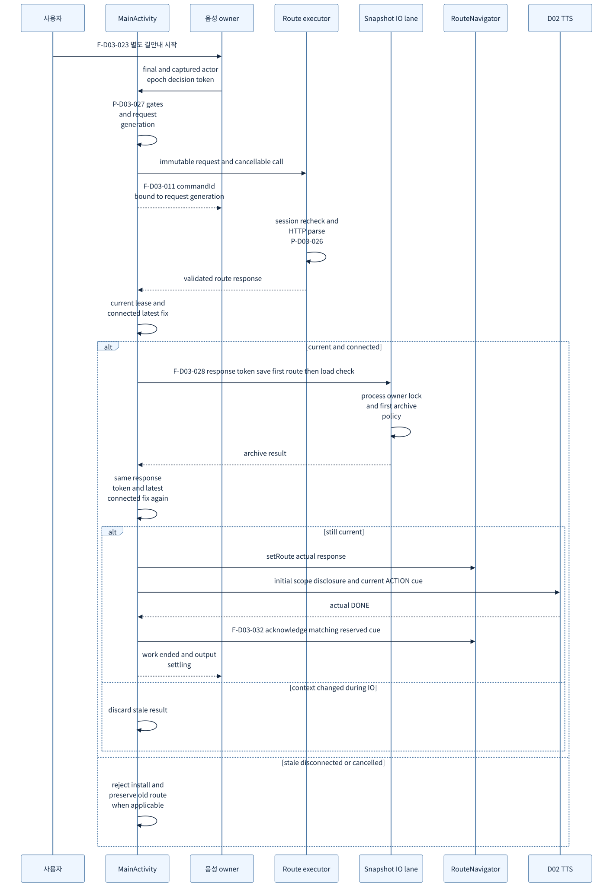

[Mermaid 원본](../diagrams/D03-sequence.mmd) · [SVG](../rendered/D03-sequence.svg)

## F-D03-012 음성 foreground service 와 사용자 중지·재시작 제한

| 항목 | 명세 |
| --- | --- |
| 분야 | D03 음성 입력·명령·목적지 검색·경로 안내와 보관 |
| 목적 | 보행 음성 입력 중임을 알림으로 표시하고 사용자가 중지할 수 있다. |
| 사용 주체 | 보행자 Android MainActivity |
| 활성 상태 | ACTIVE |
| 진입점 | apps/android/app/src/main/java/kr/co/hanium/dreamup/walksafe/voice/WalkVoiceForegroundService.kt:14 WalkVoiceForegroundService apps/android/app/src/main/java/kr/co/hanium/dreamup/walksafe/voice/WalkSafeApplication.kt:1 WalkVoiceStartFailureRelay / WalkVoiceUserStopHold / WalkVoiceStartRecovery apps/android/app/src/debug/java/kr/co/hanium/dreamup/walksafe/voice/WalkVoiceForegroundServiceTestHostActivity.kt:9 WalkVoiceForegroundServiceTestHostActivity.onCreate (debug 전용 probe anchor) |
| 실행 전제 | ACTIVE 보행·foreground 시작 가능·mic/STT/disclosure/알림권한; 동일 walk user-stop hold 없음 |
| 입력 출처 형식 검증 최신성 | request id+controller identity; persistent transcriber failure2 회, internal restart500ms; service START_NOT_STICKY |

### 시작 이벤트와 처리 순서

| 이벤트 ID | 발생원 | 이벤트 | 수신부 | 흐름 |
| --- | --- | --- | --- | --- |
| E-D03-012-01 | Main | ACTION_START(requestId) | WalkVoiceForegroundService.onStartCommand | 현재 app controller request 확인→foreground 알림→controller.start |
| E-D03-012-02 | 알림 사용자 | ACTION_STOP | WalkVoiceForegroundService.onStartCommand | 현재 controller user stop 보고→같은 walk 자동시작 hold→마이크 중지 |
| E-D03-012-03 | OS/통화 | 시작 제한 또는 input silenced | WalkVoiceForegroundService.onStartCommand | 자동 retry 차단→foreground 재진입에서 조건 재평가 |

1. 1. 보행 음성 입력 중임을 알림으로 표시하고 사용자가 중지할 수 있다. [근거: apps/android/app/src/main/java/kr/co/hanium/dreamup/walksafe/voice/WalkVoiceForegroundService.kt:14 WalkVoiceForegroundService]
2. 2. Application 이 controller 별 단일 start request 와 실패 callback 을 관리하며 stale start 는 무시한다. [근거: apps/android/app/src/main/java/kr/co/hanium/dreamup/walksafe/voice/WalkSafeApplication.kt:1 WalkVoiceStartFailureRelay / WalkVoiceUserStopHold / WalkVoiceStartRecovery]
3. 3. 알림 중지는 process walkSessionId hold 로 Activity 재생성/화면 refresh 에도 유지된다. [근거: apps/android/app/src/main/java/kr/co/hanium/dreamup/walksafe/voice/WalkSafeApplication.kt:1 WalkVoiceStartFailureRelay / WalkVoiceUserStopHold / WalkVoiceStartRecovery]
4. 4. silenced/OS 시작제한/권한은 있지만 security 실패는 재진입 전 자동 retry 를 차단한다. [근거: apps/android/app/src/main/java/kr/co/hanium/dreamup/walksafe/voice/WalkSafeApplication.kt:1 WalkVoiceStartFailureRelay / WalkVoiceUserStopHold / WalkVoiceStartRecovery]
5. 5. MODEL_UNAVAILABLE 또는 transcriber2 회 실패는 STT readiness 를 unavailable 처리; 단순 내부 작업/출력 timeout 은 500ms controller 재시도한다. [근거: apps/android/app/src/main/java/kr/co/hanium/dreamup/walksafe/MainActivity.kt:39096 maybeStartHandsFreeVoiceService / handleHandsFreeVoiceTerminalFailure]

| 분기 조건 | 실제 처리 결과 | 구현 근거 |
| --- | --- | --- |
| null intent system recreation | mic 자동 복원하지 않고 비활성 service 종료 | apps/android/app/src/main/java/kr/co/hanium/dreamup/walksafe/voice/WalkVoiceForegroundService.kt:14 WalkVoiceForegroundService |
| 다른 controller 로 교체 | 기존 controller 먼저 stop | apps/android/app/src/main/java/kr/co/hanium/dreamup/walksafe/voice/WalkVoiceForegroundService.kt:14 WalkVoiceForegroundService |
| 새 walk id | user-stop hold 해제 | apps/android/app/src/main/java/kr/co/hanium/dreamup/walksafe/voice/WalkSafeApplication.kt:1 WalkVoiceStartFailureRelay / WalkVoiceUserStopHold / WalkVoiceStartRecovery |

### 효과 종료와 복구

foreground 알림·typed 실패 설명·readiness 상태.

| 상황 | 동작 |
| --- | --- |
| 정상 완료 | service/controller stop 과 알림 제거. |
| 실패 | security/restriction 명시 callback, 기타 RuntimeException 정리 후 전파. |
| 시간 초과 | 해당없음: 이 기능 자체에는 별도 시간 제한 경로가 없다. |
| 중복 입력 | 동일 시작 controller 중복 start 안 함. |
| 취소 | owned stopService/controller stop. |
| 중단과 생명주기 | onDestroy 는 mic stop; notification user stop 과 transient stop 구별. |
| 재시도 | 제한 실패는 앱 나갔다 돌아오기; user stop 은 새 walk 에서 해제. |
| 복구 | 해당없음: 이 기능 자체에는 별도 복구 경로가 없다. |
| 자원 정리 | activeController 먼저 null; stop 오류 log 후 알림 제거. |

### 상태 실행 맥락과 연결

| 항목 | 명세 |
| --- | --- |
| 초기 상태 | S-D03-012-01 중지 |
| 상태 목록 | S-D03-012-01 중지 S-D03-012-02 시작요청 S-D03-012-03 활성 S-D03-012-04 재진입대기 S-D03-012-05 사용자중지 hold |
| 전이 조건과 전이 동작 | 중지→시작요청→활성 제한실패→재진입대기 알림중지→사용자중지 hold 새 walk→중지 |
| 허용되지 않는 전이 | null intent mic 재개 및 같은 walk 사용자중지 자동해제 금지 |
| 동시성 순서와 작업 소유권 | 서비스 main callbacks; application relay process scoped; request retire-before-callback. |
| 공유 상태와 다른 기능 연결 | D01 lifecycle·permission·session; ReportQueueCleanupJobService scheduling 은 별도 도메인. |

### 정책 근거와 검증 범위

| 항목 | 근거 |
| --- | --- |
| 정책 | [P-D03-012](#P-D03-012) |
| 구현 | [apps/android/app/src/main/java/kr/co/hanium/dreamup/walksafe/voice/WalkVoiceForegroundService.kt:14](/home/ddobagi/Hanium_Dreamup/apps/android/app/src/main/java/kr/co/hanium/dreamup/walksafe/voice/WalkVoiceForegroundService.kt:14) · `WalkVoiceForegroundService` (범위 14–235) [apps/android/app/src/main/java/kr/co/hanium/dreamup/walksafe/voice/WalkSafeApplication.kt:1](/home/ddobagi/Hanium_Dreamup/apps/android/app/src/main/java/kr/co/hanium/dreamup/walksafe/voice/WalkSafeApplication.kt:1) · `WalkVoiceStartFailureRelay / WalkVoiceUserStopHold / WalkVoiceStartRecovery` (범위 1–282) [apps/android/app/src/main/java/kr/co/hanium/dreamup/walksafe/MainActivity.kt:39096](/home/ddobagi/Hanium_Dreamup/apps/android/app/src/main/java/kr/co/hanium/dreamup/walksafe/MainActivity.kt:39096) · `maybeStartHandsFreeVoiceService / handleHandsFreeVoiceTerminalFailure` (범위 39096–39378) [apps/android/app/src/debug/java/kr/co/hanium/dreamup/walksafe/voice/WalkVoiceForegroundServiceTestHostActivity.kt:9](/home/ddobagi/Hanium_Dreamup/apps/android/app/src/debug/java/kr/co/hanium/dreamup/walksafe/voice/WalkVoiceForegroundServiceTestHostActivity.kt:9) · `WalkVoiceForegroundServiceTestHostActivity.onCreate` (범위 9–12) |
| 기존 개선 ID | S04-27 S04-30 |
| 기존 분야 | 해당 없음 |
| 기존 실행 증거 | 과거 실행 근거는 이 도메인에 수입하지 않음. snapshot 기준의 구현과 선택한 테스트 기대만 기록. |
| 한계 및 구분 | 이번 고정 소스 정적 분석. 실제 청취·기기·서비스 실행 성공을 뜻하지 않는다. debug 전용 WalkVoiceForegroundServiceTestHostActivity.onCreate 는 같은 UID foreground service probe 의 보이는 anchor TextView 만 만든다. 사용자 앱 메뉴 기능이나 서비스 실행 성공 증거가 아니다. |

| 테스트 위치 | 심볼 | 증거 수준 | 기대와 한계 |
| --- | --- | --- | --- |

연결한 테스트 미확인: 이번 작성 범위에서 이 기능에 대응하는 시험 단언을 연결하지 않았다. 테스트 자체가 없다는 판정이 아니다.

### 이벤트 처리 그림


[Mermaid 원본](../diagrams/D03-F012.mmd) · [SVG](../rendered/D03-F012.svg)

## F-D03-013 한국어 명령 파싱·단일 후보 선택

| 항목 | 명세 |
| --- | --- |
| 분야 | D03 음성 입력·명령·목적지 검색·경로 안내와 보관 |
| 목적 | 한 번에 한 가지 Korean 명령만 local action 으로 변환한다. |
| 사용 주체 | 보행자 Android MainActivity |
| 활성 상태 | ACTIVE |
| 진입점 | apps/android/app/src/main/java/kr/co/hanium/dreamup/walksafe/navigation/AndroidVoiceCommand.kt:1 AndroidVoiceCommand / AndroidVoiceAction apps/android/app/src/main/java/kr/co/hanium/dreamup/walksafe/navigation/AndroidVoiceCommand.kt:247 selectAndroidVoiceAction / parseAndroidVoiceCommand |
| 실행 전제 | 현재 voice lease 및 입력 허용 context; FINAL |
| 입력 출처 형식 검증 최신성 | top 비공백 phrase 만; confidence list 길이 정확·finite0..1·top≥0.55; bare number 는 유효 dialog 에서만; 번호문법 1..20, 실제 검색 cap10 |

### 시작 이벤트와 처리 순서

| 이벤트 ID | 발생원 | 이벤트 | 수신부 | 흐름 |
| --- | --- | --- | --- | --- |
| E-D03-013-01 | 신뢰 final transcript | 명령 분류 | handleVoiceCommandPhrases | walk control 우선→최상위 문장 confidence→고정명령/검색/번호 파싱→context gate→action |

1. 1. 한 번에 한 가지 Korean 명령만 local action 으로 변환한다. [근거: apps/android/app/src/main/java/kr/co/hanium/dreamup/walksafe/navigation/AndroidVoiceCommand.kt:247 selectAndroidVoiceAction / parseAndroidVoiceCommand]
2. 2. 설정·검색·선택·더/이전/다시 듣기·시작·다음안내·현재상태·재탐색·위치재확인·도착확인/아님·종료·신고·도움말을 고정 문법으로 분리한다. [근거: apps/android/app/src/main/java/kr/co/hanium/dreamup/walksafe/navigation/AndroidVoiceCommand.kt:247 selectAndroidVoiceAction / parseAndroidVoiceCommand]
3. 3. 부정문·control/format·번호 분할/모호함·두 명령 연결은 실행하지 않는다. [근거: apps/android/app/src/main/java/kr/co/hanium/dreamup/walksafe/navigation/AndroidVoiceCommand.kt:247 selectAndroidVoiceAction / parseAndroidVoiceCommand]
4. 4. 낮은 top 을 다른 대안 문장으로 대체하지 않으며 목적지 이름의 action 조각도 검증한다. [근거: apps/android/app/src/main/java/kr/co/hanium/dreamup/walksafe/navigation/AndroidVoiceCommand.kt:247 selectAndroidVoiceAction / parseAndroidVoiceCommand]
5. 5. 현재 위치 설명 요청은 미지원 안내를 내며 위치 재확인 명령으로 바꾸지 않는다. [근거: apps/android/app/src/main/java/kr/co/hanium/dreamup/walksafe/navigation/AndroidVoiceCommand.kt:247 selectAndroidVoiceAction / parseAndroidVoiceCommand]

| 분기 조건 | 실제 처리 결과 | 구현 근거 |
| --- | --- | --- |
| compound 문장 | 한 번에 한 가지 요청 안내 | apps/android/app/src/main/java/kr/co/hanium/dreamup/walksafe/navigation/AndroidVoiceCommand.kt:247 selectAndroidVoiceAction / parseAndroidVoiceCommand |
| PAUSED 일반 action | help/state/settings 외 차단 | apps/android/app/src/main/java/kr/co/hanium/dreamup/walksafe/MainActivity.kt:41623 handleVoiceCommandPhrases |
| captured decision token stale | reroute/recheck/arrival/stop 등 결정 명령 무효 | apps/android/app/src/main/java/kr/co/hanium/dreamup/walksafe/MainActivity.kt:41623 handleVoiceCommandPhrases |

### 효과 종료와 복구

action dispatch·미지원/불명확 응답. 서버 intent 분류를 호출하지 않음.

| 상황 | 동작 |
| --- | --- |
| 정상 완료 | 검증된 action 한 번. |
| 실패 | null/no-op 뒤 상황별 재질문. |
| 시간 초과 | 해당없음: 이 기능 자체에는 별도 시간 제한 경로가 없다. |
| 중복 입력 | 대안 문장 순회 실행 없음; 단발 lease retire. |
| 취소 | 취소 명령도 명시적 별도 action. |
| 중단과 생명주기 | 다음 final 은 이전 end/stop 질문을 먼저 소비·무효화. |
| 재시도 | 사용자 재발화만; 후보 context 는 유효 시 보존. |
| 복구 | 해당없음: 이 기능 자체에는 별도 복구 경로가 없다. |
| 자원 정리 | 해당없음: 이 기능 자체에는 별도 자원 정리 경로가 없다. |

### 상태 실행 맥락과 연결

| 항목 | 명세 |
| --- | --- |
| 초기 상태 | S-D03-013-01 입력 |
| 상태 목록 | S-D03-013-01 입력 S-D03-013-02 거부 S-D03-013-03 action |
| 전이 조건과 전이 동작 | 입력→action 문법+confidence+context 통과 입력→거부 나머지 |
| 허용되지 않는 전이 | partial·두 명령·낮은 top 을 다른 candidate 로 대체 실행 금지 |
| 동시성 순서와 작업 소유권 | Main thread local parser; final handler 는 recognizer lease 를 retire 한 뒤 실행. |
| 공유 상태와 다른 기능 연결 | F-D03-015 walk action 우선, F-D03-014 platform0 별도 preview. |

### 정책 근거와 검증 범위

| 항목 | 근거 |
| --- | --- |
| 정책 | [P-D03-013](#P-D03-013) |
| 구현 | [apps/android/app/src/main/java/kr/co/hanium/dreamup/walksafe/navigation/AndroidVoiceCommand.kt:1](/home/ddobagi/Hanium_Dreamup/apps/android/app/src/main/java/kr/co/hanium/dreamup/walksafe/navigation/AndroidVoiceCommand.kt:1) · `AndroidVoiceCommand / AndroidVoiceAction` (범위 1–67) [apps/android/app/src/main/java/kr/co/hanium/dreamup/walksafe/navigation/AndroidVoiceCommand.kt:247](/home/ddobagi/Hanium_Dreamup/apps/android/app/src/main/java/kr/co/hanium/dreamup/walksafe/navigation/AndroidVoiceCommand.kt:247) · `selectAndroidVoiceAction / parseAndroidVoiceCommand` (범위 247–750) [apps/android/app/src/main/java/kr/co/hanium/dreamup/walksafe/MainActivity.kt:41623](/home/ddobagi/Hanium_Dreamup/apps/android/app/src/main/java/kr/co/hanium/dreamup/walksafe/MainActivity.kt:41623) · `handleVoiceCommandPhrases` (범위 41623–41824) |
| 기존 개선 ID | S05-6 S05-10 |
| 기존 분야 | 해당 없음 |
| 기존 실행 증거 | 과거 실행 근거는 이 도메인에 수입하지 않음. snapshot 기준의 구현과 선택한 테스트 기대만 기록. |
| 한계 및 구분 | 이번 고정 소스 정적 분석. 실제 청취·기기·서비스 실행 성공을 뜻하지 않는다. |

| 테스트 위치 | 심볼 | 증거 수준 | 기대와 한계 |
| --- | --- | --- | --- |

연결한 테스트 미확인: 이번 작성 범위에서 이 기능에 대응하는 시험 단언을 연결하지 않았다. 테스트 자체가 없다는 판정이 아니다.

### 이벤트 처리 그림


[Mermaid 원본](../diagrams/D03-F013.mmd) · [SVG](../rendered/D03-F013.svg)

## F-D03-014 platform confidence 0 의 제한된 후보 미리보기

| 항목 | 명세 |
| --- | --- |
| 분야 | D03 음성 입력·명령·목적지 검색·경로 안내와 보관 |
| 목적 | confidence0 을 높은 신뢰도로 바꾸지 않고 비실행성 preview 범위만 허용한다. |
| 사용 주체 | 보행자 Android MainActivity |
| 활성 상태 | ACTIVE |
| 진입점 | apps/android/app/src/main/java/kr/co/hanium/dreamup/walksafe/voice/PlatformVoiceCandidatePolicy.kt:1 assessPlatformVoiceCandidate apps/android/app/src/main/java/kr/co/hanium/dreamup/walksafe/voice/OfflineSpeechResultMetadata.kt:1 hasAdditionalOfflineSpeechAlternatives |
| 실행 전제 | PLATFORM engine·HOME·FINAL; 정상 confidence parser 가 action 을 선택하지 못한 경우 |
| 입력 출처 형식 검증 최신성 | score count 일치, 모든 score -1 또는 0..1 finite, SDK extra alternatives 없음; 모든 phrase 가 같은 action 에 대응 |

### 시작 이벤트와 처리 순서

| 이벤트 ID | 발생원 | 이벤트 | 수신부 | 흐름 |
| --- | --- | --- | --- | --- |
| E-D03-014-01 | HOME platform FINAL | top score 정확히 0 | assessPlatformVoiceCandidate | 대안 일관성 검사→허용 preview 또는 명시확인 필요 응답 |

1. 1. confidence0 을 높은 신뢰도로 바꾸지 않고 비실행성 preview 범위만 허용한다. [근거: apps/android/app/src/main/java/kr/co/hanium/dreamup/walksafe/voice/PlatformVoiceCandidatePolicy.kt:1 assessPlatformVoiceCandidate]
2. 2. Help/SearchDestination 및 이미 끝까지 읽은 후보 dialog 의 선택/반복/더듣기만 제한 허용한다. [근거: apps/android/app/src/main/java/kr/co/hanium/dreamup/walksafe/voice/PlatformVoiceCandidatePolicy.kt:1 assessPlatformVoiceCandidate]
3. 3. 선택은 확인 화면을 열 뿐 길안내 시작을 승인하지 않는다. [근거: apps/android/app/src/main/java/kr/co/hanium/dreamup/walksafe/voice/PlatformVoiceCandidatePolicy.kt:1 assessPlatformVoiceCandidate]
4. 4. 서로 다른 후보 action/알 수 없는 문장/추가 span alternatives 는 거부한다. [근거: apps/android/app/src/main/java/kr/co/hanium/dreamup/walksafe/voice/PlatformVoiceCandidatePolicy.kt:1 assessPlatformVoiceCandidate]

| 분기 조건 | 실제 처리 결과 | 구현 근거 |
| --- | --- | --- |
| StartNavigation 등 실행 action | 직접 버튼/명시확인 요청 | apps/android/app/src/main/java/kr/co/hanium/dreamup/walksafe/voice/PlatformVoiceCandidatePolicy.kt:1 assessPlatformVoiceCandidate |
| 현재 dialog 미완료/만료 | 번호 미리보기 거부 | apps/android/app/src/main/java/kr/co/hanium/dreamup/walksafe/MainActivity.kt:41623 handleVoiceCommandPhrases |

### 효과 종료와 복구

검색/확인화면·보수적 안내; route mutation 없음.

| 상황 | 동작 |
| --- | --- |
| 정상 완료 | preview candidate 또는 확인필요 분류. |
| 실패 | 모호함/형식불일치면 거부. |
| 시간 초과 | 해당없음: 이 기능 자체에는 별도 시간 제한 경로가 없다. |
| 중복 입력 | 후보들을 각각 실행하지 않고 동일성만 검사. |
| 취소 | 현재 Main voice lease 종료에 따름. |
| 중단과 생명주기 | 해당없음: 이 기능 자체에는 별도 중단 경로가 없다. |
| 재시도 | 새 직접 입력/버튼으로 확인. |
| 복구 | 해당없음: 이 기능 자체에는 별도 복구 경로가 없다. |
| 자원 정리 | 해당없음: 이 기능 자체에는 별도 자원 정리 경로가 없다. |

### 상태 실행 맥락과 연결

| 항목 | 명세 |
| --- | --- |
| 초기 상태 | S-D03-014-01 검토 |
| 상태 목록 | S-D03-014-01 검토 S-D03-014-02 미리보기 S-D03-014-03 확인필요 S-D03-014-04 거부 |
| 전이 조건과 전이 동작 | 검토→미리보기 제한 action 검토→확인필요 실행 action 검토→거부 모호/invalid |
| 허용되지 않는 전이 | 0 점으로 길안내 시작/종료/도착/신고 실행 금지 |
| 동시성 순서와 작업 소유권 | 순수 policy; Main current page/dialog lease 검사. |
| 공유 상태와 다른 기능 연결 | F-D03-013 .55 confidence 규칙의 score 승격이 아닌 별도 HOME UI 경로. |

### 정책 근거와 검증 범위

| 항목 | 근거 |
| --- | --- |
| 정책 | [P-D03-014](#P-D03-014) |
| 구현 | [apps/android/app/src/main/java/kr/co/hanium/dreamup/walksafe/voice/PlatformVoiceCandidatePolicy.kt:1](/home/ddobagi/Hanium_Dreamup/apps/android/app/src/main/java/kr/co/hanium/dreamup/walksafe/voice/PlatformVoiceCandidatePolicy.kt:1) · `assessPlatformVoiceCandidate` (범위 1–88) [apps/android/app/src/main/java/kr/co/hanium/dreamup/walksafe/voice/OfflineSpeechResultMetadata.kt:1](/home/ddobagi/Hanium_Dreamup/apps/android/app/src/main/java/kr/co/hanium/dreamup/walksafe/voice/OfflineSpeechResultMetadata.kt:1) · `hasAdditionalOfflineSpeechAlternatives` (범위 1–32) [apps/android/app/src/main/java/kr/co/hanium/dreamup/walksafe/MainActivity.kt:41623](/home/ddobagi/Hanium_Dreamup/apps/android/app/src/main/java/kr/co/hanium/dreamup/walksafe/MainActivity.kt:41623) · `handleVoiceCommandPhrases` (범위 41623–41824) |
| 기존 개선 ID | 개별 동일성 미확인; 분야 연관은 별도 추적표 |
| 기존 분야 | 해당 없음 |
| 기존 실행 증거 | 과거 실행 근거는 이 도메인에 수입하지 않음. snapshot 기준의 구현과 선택한 테스트 기대만 기록. |
| 한계 및 구분 | 이번 고정 소스 정적 분석. 실제 청취·기기·서비스 실행 성공을 뜻하지 않는다. |

| 테스트 위치 | 심볼 | 증거 수준 | 기대와 한계 |
| --- | --- | --- | --- |

연결한 테스트 미확인: 이번 작성 범위에서 이 기능에 대응하는 시험 단언을 연결하지 않았다. 테스트 자체가 없다는 판정이 아니다.

### 이벤트 처리 그림


[Mermaid 원본](../diagrams/D03-F014.mmd) · [SVG](../rendered/D03-F014.svg)

## F-D03-015 보행 일시정지·재개·종료 음성 확인

| 항목 | 명세 |
| --- | --- |
| 분야 | D03 음성 입력·명령·목적지 검색·경로 안내와 보관 |
| 목적 | 일반 내비 종료와 전체 보행 종료를 별도 명령으로 처리한다. |
| 사용 주체 | 보행자 Android MainActivity |
| 활성 상태 | ACTIVE |
| 진입점 | apps/android/app/src/main/java/kr/co/hanium/dreamup/walksafe/navigation/WalkSessionVoiceControlPolicy.kt:1 WalkSessionVoiceControlPolicy apps/android/app/src/main/java/kr/co/hanium/dreamup/walksafe/MainActivity.kt:41825 executeWalkSessionVoiceAction / requestVoiceWalkEndConfirmation |
| 실행 전제 | ACTIVE/PAUSED; confidence≥0.80 finite; 현재 WalkRuntimeEpoch |
| 입력 출처 형식 검증 최신성 | whole phrase 만 수락; 종료 확인 token epoch 동일; end prompt DONE 후 followup 인식 |

### 시작 이벤트와 처리 순서

| 이벤트 ID | 발생원 | 이벤트 | 수신부 | 흐름 |
| --- | --- | --- | --- | --- |
| E-D03-015-01 | ACTIVE/PAUSED final | 보행 일시정지 또는 재개 | WalkSessionVoiceControlPolicy.evaluate | 0.80 confidence 와 epoch→pause 또는 재개점검 |
| E-D03-015-02 | 사용자 final | 보행 종료→보행 종료 확인/취소 | WalkSessionVoiceControlPolicy.evaluate | 동일 epoch pending token→종료 또는 유지 |

1. 1. 일반 내비 종료와 전체 보행 종료를 별도 명령으로 처리한다. [근거: apps/android/app/src/main/java/kr/co/hanium/dreamup/walksafe/navigation/WalkSessionVoiceControlPolicy.kt:1 WalkSessionVoiceControlPolicy]
2. 2. ACTIVE 의 보행 일시정지는 feedback/input 을 정리하고 PAUSED 전이한다. [근거: apps/android/app/src/main/java/kr/co/hanium/dreamup/walksafe/MainActivity.kt:41825 executeWalkSessionVoiceAction / requestVoiceWalkEndConfirmation]
3. 3. PAUSED 의 보행 재개는 즉시 센서 실행이 아니라 점검과 새로운 시작 절차로 보낸다. [근거: apps/android/app/src/main/java/kr/co/hanium/dreamup/walksafe/MainActivity.kt:41825 executeWalkSessionVoiceAction / requestVoiceWalkEndConfirmation]
4. 4. 보행 종료는 확인 질문을 띄우고 동일 epoch 의 보행 종료 확인만 전체 종료한다; 취소는 유지한다. [근거: apps/android/app/src/main/java/kr/co/hanium/dreamup/walksafe/MainActivity.kt:41825 executeWalkSessionVoiceAction / requestVoiceWalkEndConfirmation]

| 분기 조건 | 실제 처리 결과 | 구현 근거 |
| --- | --- | --- |
| confidence<.80 또는 다른 상태 | NO_OP | apps/android/app/src/main/java/kr/co/hanium/dreamup/walksafe/navigation/WalkSessionVoiceControlPolicy.kt:1 WalkSessionVoiceControlPolicy |
| epoch 변경 | pending end 무효 | apps/android/app/src/main/java/kr/co/hanium/dreamup/walksafe/navigation/WalkSessionVoiceControlPolicy.kt:1 WalkSessionVoiceControlPolicy |
| 질문 후 무관한 final | pending end 제거, 그 utterance 의 다른 action 도 실행하지 않음 | apps/android/app/src/main/java/kr/co/hanium/dreamup/walksafe/MainActivity.kt:41825 executeWalkSessionVoiceAction / requestVoiceWalkEndConfirmation |

### 효과 종료와 복구

session pause/end·camera/depth/output 중지 요청, 확인 음성.

| 상황 | 동작 |
| --- | --- |
| 정상 완료 | pause/resume-check/end/cancel decision 전달. |
| 실패 | prompt 실패는 pending token 제거. |
| 시간 초과 | 별도 policy TTL 없음; followup recognizer timeout 및 Main invalidation 적용. |
| 중복 입력 | confirm/cancel 이 pending token 한 번 소비. |
| 취소 | 보행 종료 취소 또는 cancelRecognition 으로 질문 폐기. |
| 중단과 생명주기 | walk epoch 변경/foreground 종료는 확인 무효. |
| 재시도 | 해당없음: 이 기능 자체에는 별도 재시도 경로가 없다. |
| 복구 | 재개는 D01 readiness 재점검. |
| 자원 정리 | 해당없음: 이 기능 자체에는 별도 자원 정리 경로가 없다. |

### 상태 실행 맥락과 연결

| 항목 | 명세 |
| --- | --- |
| 초기 상태 | S-D03-015-01 확인없음 |
| 상태 목록 | S-D03-015-01 확인없음 S-D03-015-02 종료질문 S-D03-015-03 종료 S-D03-015-04 취소 |
| 전이 조건과 전이 동작 | 보행 종료→종료질문 동일 epoch 확인→종료 취소/epoch 변경→확인없음 |
| 허용되지 않는 전이 | 확인 token 없이 보행 종료 확인 실행 금지 |
| 동시성 순서와 작업 소유권 | main thread + synchronized pure policy; prompt callback epoch/state/feedback generation 검증. |
| 공유 상태와 다른 기능 연결 | D01 세션 전이·D02 feedback cancellation. |

### 정책 근거와 검증 범위

| 항목 | 근거 |
| --- | --- |
| 정책 | [P-D03-015](#P-D03-015) |
| 구현 | [apps/android/app/src/main/java/kr/co/hanium/dreamup/walksafe/navigation/WalkSessionVoiceControlPolicy.kt:1](/home/ddobagi/Hanium_Dreamup/apps/android/app/src/main/java/kr/co/hanium/dreamup/walksafe/navigation/WalkSessionVoiceControlPolicy.kt:1) · `WalkSessionVoiceControlPolicy` (범위 1–107) [apps/android/app/src/main/java/kr/co/hanium/dreamup/walksafe/MainActivity.kt:41825](/home/ddobagi/Hanium_Dreamup/apps/android/app/src/main/java/kr/co/hanium/dreamup/walksafe/MainActivity.kt:41825) · `executeWalkSessionVoiceAction / requestVoiceWalkEndConfirmation` (범위 41825–41925) |
| 기존 개선 ID | 개별 동일성 미확인; 분야 연관은 별도 추적표 |
| 기존 분야 | 해당 없음 |
| 기존 실행 증거 | 과거 실행 근거는 이 도메인에 수입하지 않음. snapshot 기준의 구현과 선택한 테스트 기대만 기록. |
| 한계 및 구분 | 이번 고정 소스 정적 분석. 실제 청취·기기·서비스 실행 성공을 뜻하지 않는다. |

| 테스트 위치 | 심볼 | 증거 수준 | 기대와 한계 |
| --- | --- | --- | --- |

연결한 테스트 미확인: 이번 작성 범위에서 이 기능에 대응하는 시험 단언을 연결하지 않았다. 테스트 자체가 없다는 판정이 아니다.

### 이벤트 처리 그림


[Mermaid 원본](../diagrams/D03-F015.mmd) · [SVG](../rendered/D03-F015.svg)

## F-D03-016 일반 음성 action 의 화면·상태·안내 연결

| 항목 | 명세 |
| --- | --- |
| 분야 | D03 음성 입력·명령·목적지 검색·경로 안내와 보관 |
| 목적 | 음성 명령과 화면 이동이 불필요하게 후보 context 를 끊지 않게 연결한다. |
| 사용 주체 | 보행자 Android MainActivity |
| 활성 상태 | ACTIVE |
| 진입점 | apps/android/app/src/main/java/kr/co/hanium/dreamup/walksafe/navigation/VoiceCommandUiDestinationPolicy.kt:1 AndroidVoiceAction.uiDestination apps/android/app/src/main/java/kr/co/hanium/dreamup/walksafe/MainActivity.kt:41926 executeVoiceAction |
| 실행 전제 | 각 action 의 session/route/dialog gate 별도 충족 |
| 입력 출처 형식 검증 최신성 | action enum; latest application state; stale cached phrase 재생 아닌 현재 기능 상태 재평가 |

### 시작 이벤트와 처리 순서

| 이벤트 ID | 발생원 | 이벤트 | 수신부 | 흐름 |
| --- | --- | --- | --- | --- |
| E-D03-016-01 | local parser | accepted action | executeVoiceAction | 현재 UI context 정책→기능 호출→상태/음성 안내 |
| E-D03-016-02 | 사용자 | 다시 듣기 | executeVoiceAction | candidate dialog→walking selection→현재 경로 안내 순으로 소유자 선택 |

1. 1. 음성 명령과 화면 이동이 불필요하게 후보 context 를 끊지 않게 연결한다. [근거: apps/android/app/src/main/java/kr/co/hanium/dreamup/walksafe/MainActivity.kt:41926 executeVoiceAction]
2. 2. help/current state/repeat/cancel/recheck/reroute 는 현재 voice/guidance 화면을 유지; search/select/page/start 는 목적지 검색 경로, settings 는 설정으로 간다. [근거: apps/android/app/src/main/java/kr/co/hanium/dreamup/walksafe/navigation/VoiceCommandUiDestinationPolicy.kt:1 AndroidVoiceAction.uiDestination]
3. 3. 반복은 열린 후보 dialog 가 우선이고 보행 목적지 확인이 다음, 현재 경로 안내가 마지막이다. [근거: apps/android/app/src/main/java/kr/co/hanium/dreamup/walksafe/MainActivity.kt:41926 executeVoiceAction]
4. 4. report action 은 별도 명시적 신고 확인 기능에 인계하며 명령만으로 자동 업로드하지 않는다. [근거: apps/android/app/src/main/java/kr/co/hanium/dreamup/walksafe/MainActivity.kt:41926 executeVoiceAction]
5. 5. PREPARING/PARTIALLY_AVAILABLE/ACTIVE/BLOCKED 표시는 준비도 표현이며 런타임 허용권한 자체를 만들지 않는다. [근거: apps/android/app/src/main/java/kr/co/hanium/dreamup/walksafe/navigation/DestinationGuidancePresentationPolicy.kt:1 DestinationGuidancePresentationPolicy]

| 분기 조건 | 실제 처리 결과 | 구현 근거 |
| --- | --- | --- |
| 도움말 | 지원하는 문법 예시를 음성으로 안내 | apps/android/app/src/main/java/kr/co/hanium/dreamup/walksafe/MainActivity.kt:41926 executeVoiceAction |
| 현재 위치 설명 요청 | 미지원 문구; 위치 재측정으로 대체하지 않음 | apps/android/app/src/main/java/kr/co/hanium/dreamup/walksafe/MainActivity.kt:41926 executeVoiceAction |
| 안내 반복하나 현재 route 없음 | 상황 안내 | apps/android/app/src/main/java/kr/co/hanium/dreamup/walksafe/MainActivity.kt:41926 executeVoiceAction |

### 효과 종료와 복구

페이지·status banner·음성·타도메인 action 호출.

| 상황 | 동작 |
| --- | --- |
| 정상 완료 | 각 action 담당 기능으로 인계. |
| 실패 | 상태 불일치이면 안내 후 no-op. |
| 시간 초과 | 해당없음: 이 기능 자체에는 별도 시간 제한 경로가 없다. |
| 중복 입력 | repeat 는 현재 소유 context 재평가. |
| 취소 | F-D03-017 로 분리. |
| 중단과 생명주기 | 화면 이동이 후보 lease 를 무효화할 수 있음. |
| 재시도 | 사용자 새 명령. |
| 복구 | 해당없음: 이 기능 자체에는 별도 복구 경로가 없다. |
| 자원 정리 | 해당없음: 이 기능 자체에는 별도 자원 정리 경로가 없다. |

### 상태 실행 맥락과 연결

| 항목 | 명세 |
| --- | --- |
| 초기 상태 | S-D03-016-01 분류 |
| 상태 목록 | S-D03-016-01 분류 S-D03-016-02 화면유지 S-D03-016-03 목적지화면 S-D03-016-04 설정화면 |
| 전이 조건과 전이 동작 | read-only/status→화면유지 destination mutation→목적지화면 settings→설정화면 |
| 허용되지 않는 전이 | UI 표시만으로 readiness gate 통과 금지 |
| 동시성 순서와 작업 소유권 | Main thread dispatch; side effect 별 runtime fence 는 각 담당 기능이 수행. |
| 공유 상태와 다른 기능 연결 | D01 settings/session, D06 사용자 신고 requestExplicitVoiceReportConfirmation (D07 은 인지 신고후보 경계), D02 음성출력. |

### 정책 근거와 검증 범위

| 항목 | 근거 |
| --- | --- |
| 정책 | [P-D03-016](#P-D03-016) |
| 구현 | [apps/android/app/src/main/java/kr/co/hanium/dreamup/walksafe/navigation/VoiceCommandUiDestinationPolicy.kt:1](/home/ddobagi/Hanium_Dreamup/apps/android/app/src/main/java/kr/co/hanium/dreamup/walksafe/navigation/VoiceCommandUiDestinationPolicy.kt:1) · `AndroidVoiceAction.uiDestination` (범위 1–43) [apps/android/app/src/main/java/kr/co/hanium/dreamup/walksafe/MainActivity.kt:41926](/home/ddobagi/Hanium_Dreamup/apps/android/app/src/main/java/kr/co/hanium/dreamup/walksafe/MainActivity.kt:41926) · `executeVoiceAction` (범위 41926–42062) [apps/android/app/src/main/java/kr/co/hanium/dreamup/walksafe/navigation/DestinationGuidancePresentationPolicy.kt:1](/home/ddobagi/Hanium_Dreamup/apps/android/app/src/main/java/kr/co/hanium/dreamup/walksafe/navigation/DestinationGuidancePresentationPolicy.kt:1) · `DestinationGuidancePresentationPolicy` (범위 1–62) |
| 기존 개선 ID | 개별 동일성 미확인; 분야 연관은 별도 추적표 |
| 기존 분야 | 해당 없음 |
| 기존 실행 증거 | 과거 실행 근거는 이 도메인에 수입하지 않음. snapshot 기준의 구현과 선택한 테스트 기대만 기록. |
| 한계 및 구분 | 이번 고정 소스 정적 분석. 실제 청취·기기·서비스 실행 성공을 뜻하지 않는다. |

| 테스트 위치 | 심볼 | 증거 수준 | 기대와 한계 |
| --- | --- | --- | --- |

연결한 테스트 미확인: 이번 작성 범위에서 이 기능에 대응하는 시험 단언을 연결하지 않았다. 테스트 자체가 없다는 판정이 아니다.

### 이벤트 처리 그림


[Mermaid 원본](../diagrams/D03-F016.mmd) · [SVG](../rendered/D03-F016.svg)

## F-D03-017 대화 취소·목적지 취소·길안내 종료의 구분

| 항목 | 명세 |
| --- | --- |
| 분야 | D03 음성 입력·명령·목적지 검색·경로 안내와 보관 |
| 목적 | 취소 대상이 다른 세 기능을 명시적으로 분리한다. |
| 사용 주체 | 보행자 Android MainActivity |
| 활성 상태 | ACTIVE |
| 진입점 | apps/android/app/src/main/java/kr/co/hanium/dreamup/walksafe/MainActivity.kt:42063 cancelVoiceDialogFromVoice / confirmGuidanceStopFirst apps/android/app/src/main/java/kr/co/hanium/dreamup/walksafe/MainActivity.kt:42534 cancelDestinationFromVoice |
| 실행 전제 | 현재 route/dialog/request context; pending route decision 이면 mutation gate 우선 |
| 입력 출처 형식 검증 최신성 | stop 질문 window age≤30000ms, prompt DONE 시 기준시간 갱신; 다음 final 이 질문을 소비 |

### 시작 이벤트와 처리 순서

| 이벤트 ID | 발생원 | 이벤트 | 수신부 | 흐름 |
| --- | --- | --- | --- | --- |
| E-D03-017-01 | 사용자 | 취소 | cancelVoiceDialogFromVoice / cancelDestinationFromVoice | 미저장 신고 확인 우선 또는 후보검색/대화만 닫기→기존 route 유지 |
| E-D03-017-02 | 사용자 | 목적지 취소 | cancelVoiceDialogFromVoice / cancelDestinationFromVoice | 현재 설치 route 유무에 따라 search/replacement 취소 또는 목적지 reset |
| E-D03-017-03 | 사용자 | 안내 취소/길안내 종료 | cancelVoiceDialogFromVoice / cancelDestinationFromVoice | 모호한 안내+dialog 면 질문→30s 확인; 명시적 길안내 종료는 즉시 |

1. 1. 취소 대상이 다른 세 기능을 명시적으로 분리한다. [근거: apps/android/app/src/main/java/kr/co/hanium/dreamup/walksafe/MainActivity.kt:42063 cancelVoiceDialogFromVoice / confirmGuidanceStopFirst]
2. 2. 일반 취소는 search/location acquisition/candidate/walking selection 과 미저장 신고 확인만 닫고 설치 route 를 유지한다. [근거: apps/android/app/src/main/java/kr/co/hanium/dreamup/walksafe/MainActivity.kt:42063 cancelVoiceDialogFromVoice / confirmGuidanceStopFirst]
3. 3. 목적지 취소는 설치 route 가 있으면 user_destination 교체요청만 취소하고 off_route 요청은 유지; 첫 route 전이면 전체 목적지를 reset 한다. [근거: apps/android/app/src/main/java/kr/co/hanium/dreamup/walksafe/MainActivity.kt:42534 cancelDestinationFromVoice]
4. 4. 길안내 진행과 후보 dialog 가 함께 열려 있을 때 길 없는 안내 취소는 종료인지 후보닫기인지 한 번 묻는다. [근거: apps/android/app/src/main/java/kr/co/hanium/dreamup/walksafe/navigation/GuidanceStopConfirmationPolicy.kt:1 GuidanceStopConfirmationPolicy]
5. 5. 길안내 종료/취소 또는 질문 내 재발화는 종료; pending 결정은 stale token 과 충돌 차단을 먼저 적용한다. [근거: apps/android/app/src/main/java/kr/co/hanium/dreamup/walksafe/MainActivity.kt:42063 cancelVoiceDialogFromVoice / confirmGuidanceStopFirst]

| 분기 조건 | 실제 처리 결과 | 구현 근거 |
| --- | --- | --- |
| 명시 길안내 종료 또는 dialog 없음 | 즉시 stop | apps/android/app/src/main/java/kr/co/hanium/dreamup/walksafe/navigation/GuidanceStopConfirmationPolicy.kt:1 GuidanceStopConfirmationPolicy |
| 모호 안내 취소+설치 route+dialog | 한 번 확인 | apps/android/app/src/main/java/kr/co/hanium/dreamup/walksafe/navigation/GuidanceStopConfirmationPolicy.kt:1 GuidanceStopConfirmationPolicy |
| 질문 window 초과/clock regression | 기존 확인 권한 없음 | apps/android/app/src/main/java/kr/co/hanium/dreamup/walksafe/navigation/GuidanceStopConfirmationPolicy.kt:1 GuidanceStopConfirmationPolicy |

### 효과 종료와 복구

UI 대화 정리·선택/검색 취소·필요 시 경로 종료.

| 상황 | 동작 |
| --- | --- |
| 정상 완료 | 지정 scope 만 종료. |
| 실패 | 저장 purge 실패는 별도 fence/안내. |
| 시간 초과 | stop 확인≤30s; 후보창과 경계가 다름. |
| 중복 입력 | 질문은 다음 final 에서 한 번 소비. |
| 취소 | 취소 자체가 기능; 기존 route 보존 범위 명시. |
| 중단과 생명주기 | route/epoch 변경 질문 무효. |
| 재시도 | 재질문 또는 명시적 길안내 종료로 진행. |
| 복구 | 해당없음: 이 기능 자체에는 별도 복구 경로가 없다. |
| 자원 정리 | pending selection/lease/location request clear; route reset 시 transport/output/archive 정리. |

### 상태 실행 맥락과 연결

| 항목 | 명세 |
| --- | --- |
| 초기 상태 | S-D03-017-01 유지 |
| 상태 목록 | S-D03-017-01 유지 S-D03-017-02 종료확인 S-D03-017-03 대화닫힘 S-D03-017-04 경로종료 |
| 전이 조건과 전이 동작 | 취소→대화닫힘 모호 안내 취소→종료확인 명시종료/유효확인→경로종료 |
| 허용되지 않는 전이 | 후보 대화만 취소해서 설치 route 삭제 금지 |
| 동시성 순서와 작업 소유권 | Main thread; stop confirmation actor/route generation/epoch + feedback callback fence. |
| 공유 상태와 다른 기능 연결 | F-D03-029 route purge, D06 사용자 신고 explicit confirmation (D07 신고후보와 구분). |

### 정책 근거와 검증 범위

| 항목 | 근거 |
| --- | --- |
| 정책 | [P-D03-017](#P-D03-017) |
| 구현 | [apps/android/app/src/main/java/kr/co/hanium/dreamup/walksafe/MainActivity.kt:42063](/home/ddobagi/Hanium_Dreamup/apps/android/app/src/main/java/kr/co/hanium/dreamup/walksafe/MainActivity.kt:42063) · `cancelVoiceDialogFromVoice / confirmGuidanceStopFirst` (범위 42063–42222) [apps/android/app/src/main/java/kr/co/hanium/dreamup/walksafe/MainActivity.kt:42534](/home/ddobagi/Hanium_Dreamup/apps/android/app/src/main/java/kr/co/hanium/dreamup/walksafe/MainActivity.kt:42534) · `cancelDestinationFromVoice` (범위 42534–42600) [apps/android/app/src/main/java/kr/co/hanium/dreamup/walksafe/navigation/GuidanceStopConfirmationPolicy.kt:1](/home/ddobagi/Hanium_Dreamup/apps/android/app/src/main/java/kr/co/hanium/dreamup/walksafe/navigation/GuidanceStopConfirmationPolicy.kt:1) · `GuidanceStopConfirmationPolicy` (범위 1–89) |
| 기존 개선 ID | S05-12 S06-21 |
| 기존 분야 | 해당 없음 |
| 기존 실행 증거 | 과거 실행 근거는 이 도메인에 수입하지 않음. snapshot 기준의 구현과 선택한 테스트 기대만 기록. |
| 한계 및 구분 | 이번 고정 소스 정적 분석. 실제 청취·기기·서비스 실행 성공을 뜻하지 않는다. |

| 테스트 위치 | 심볼 | 증거 수준 | 기대와 한계 |
| --- | --- | --- | --- |

연결한 테스트 미확인: 이번 작성 범위에서 이 기능에 대응하는 시험 단언을 연결하지 않았다. 테스트 자체가 없다는 판정이 아니다.

### 이벤트 처리 그림


[Mermaid 원본](../diagrams/D03-F017.mmd) · [SVG](../rendered/D03-F017.svg)

## F-D03-018 검색 전용 현재위치 취득과 계정별 cache

| 항목 | 명세 |
| --- | --- |
| 분야 | D03 음성 입력·명령·목적지 검색·경로 안내와 보관 |
| 목적 | 후보 거리·방향의 기준점만 구하고 보행 위치 증거와 분리한다. |
| 사용 주체 | 보행자 Android MainActivity |
| 활성 상태 | ACTIVE |
| 진입점 | apps/android/app/src/main/java/kr/co/hanium/dreamup/walksafe/navigation/DestinationSearchLocationController.kt:1 DestinationSearchLocationPolicy / DestinationSearchLocationController apps/android/app/src/main/java/kr/co/hanium/dreamup/walksafe/navigation/AndroidDestinationSearchLocationSource.kt:1 AndroidDestinationSearchLocationSource |
| 실행 전제 | 위치권한 및 검색 context 허용; actor+sessionGeneration lease |
| 입력 출처 형식 검증 최신성 | mock=false, lat/lng 유효, accuracy finite0..100m, elapsed≥0, age0..30000ms; request timeout10s |

### 시작 이벤트와 처리 순서

| 이벤트 ID | 발생원 | 이벤트 | 수신부 | 흐름 |
| --- | --- | --- | --- | --- |
| E-D03-018-01 | 목적지 검색 | search origin 필요 | DestinationSearchLocationController.acquire | 동일 lease cache 검증→없으면 bounded current location→현재 query 에서 재요청 |

1. 1. 후보 거리·방향의 기준점만 구하고 보행 위치 증거와 분리한다. [근거: apps/android/app/src/main/java/kr/co/hanium/dreamup/walksafe/navigation/DestinationSearchLocationController.kt:1 DestinationSearchLocationPolicy / DestinationSearchLocationController]
2. 2. 현재 lease 의 유효 fix 면 동기 반환; 아니면 Fused HIGH_ACCURACY/FINE current location 을 최대 10s 요청한다. [근거: apps/android/app/src/main/java/kr/co/hanium/dreamup/walksafe/navigation/AndroidDestinationSearchLocationSource.kt:1 AndroidDestinationSearchLocationSource]
3. 3. 계정/세대 변경은 cache 와 이전 요청을 취소한다; acquire 중 재요청은 같은 물리 요청에 최신 completion 만 결합한다. [근거: apps/android/app/src/main/java/kr/co/hanium/dreamup/walksafe/navigation/DestinationSearchLocationController.kt:1 DestinationSearchLocationPolicy / DestinationSearchLocationController]
4. 4. callback 마다 generation/lease/stillAllowed 재검사 후 유효 origin 또는 null 을 반환한다. [근거: apps/android/app/src/main/java/kr/co/hanium/dreamup/walksafe/navigation/DestinationSearchLocationController.kt:1 DestinationSearchLocationPolicy / DestinationSearchLocationController]

| 분기 조건 | 실제 처리 결과 | 구현 근거 |
| --- | --- | --- |
| stale/mock/accuracy>100/미상 | origin 없음 | apps/android/app/src/main/java/kr/co/hanium/dreamup/walksafe/navigation/DestinationSearchLocationController.kt:1 DestinationSearchLocationPolicy / DestinationSearchLocationController |
| permission SecurityException | null 반환 | apps/android/app/src/main/java/kr/co/hanium/dreamup/walksafe/navigation/AndroidDestinationSearchLocationSource.kt:1 AndroidDestinationSearchLocationSource |
| callback 도착 전 context 변경 | 폐기 | apps/android/app/src/main/java/kr/co/hanium/dreamup/walksafe/navigation/DestinationSearchLocationController.kt:1 DestinationSearchLocationPolicy / DestinationSearchLocationController |

### 효과 종료와 복구

검색 대기 UI·검색 전용 좌표/정확도/관측시각 cache.

| 상황 | 동작 |
| --- | --- |
| 정상 완료 | origin 반환 후 acquire 종료. |
| 실패 | source exception/null 은 위치부재 안내. |
| 시간 초과 | provider 요청 10s; controller 별도 추가 타이머 없음. |
| 중복 입력 | 한 acquire 중 같은 물리 요청 유지. |
| 취소 | logical generation 먼저 폐기 후 cancellation. |
| 중단과 생명주기 | actor/session/query 변경 결과 무효. |
| 재시도 | 다시 검색/위치 권한 복구 후 acquire. |
| 복구 | 해당없음: 이 기능 자체에는 별도 복구 경로가 없다. |
| 자원 정리 | cancel 은 cache 도 삭제. |

### 상태 실행 맥락과 연결

| 항목 | 명세 |
| --- | --- |
| 초기 상태 | S-D03-018-01 없음 |
| 상태 목록 | S-D03-018-01 없음 S-D03-018-02 취득중 S-D03-018-03 유효 cache |
| 전이 조건과 전이 동작 | 없음→취득중→유효 cache 또는 없음 lease 변경→없음 |
| 허용되지 않는 전이 | 검색 fix 를 안내/장애물 측정 증거로 사용 금지 |
| 동시성 순서와 작업 소유권 | main owner; Fused callback sync 가능성을 고려하여 반환된 cancellation 도 이미 끝난 요청이면 바로 호출. |
| 공유 상태와 다른 기능 연결 | D04 보행 위치 증거로 유입 금지; F-D03-020 distance basis. |

### 정책 근거와 검증 범위

| 항목 | 근거 |
| --- | --- |
| 정책 | [P-D03-018](#P-D03-018) |
| 구현 | [apps/android/app/src/main/java/kr/co/hanium/dreamup/walksafe/navigation/DestinationSearchLocationController.kt:1](/home/ddobagi/Hanium_Dreamup/apps/android/app/src/main/java/kr/co/hanium/dreamup/walksafe/navigation/DestinationSearchLocationController.kt:1) · `DestinationSearchLocationPolicy / DestinationSearchLocationController` (범위 1–127) [apps/android/app/src/main/java/kr/co/hanium/dreamup/walksafe/navigation/AndroidDestinationSearchLocationSource.kt:1](/home/ddobagi/Hanium_Dreamup/apps/android/app/src/main/java/kr/co/hanium/dreamup/walksafe/navigation/AndroidDestinationSearchLocationSource.kt:1) · `AndroidDestinationSearchLocationSource` (범위 1–42) [apps/android/app/src/main/java/kr/co/hanium/dreamup/walksafe/MainActivity.kt:45706](/home/ddobagi/Hanium_Dreamup/apps/android/app/src/main/java/kr/co/hanium/dreamup/walksafe/MainActivity.kt:45706) · `requestDestinationSearchLocation` (범위 45706–45761) |
| 기존 개선 ID | S06-31 |
| 기존 분야 | 해당 없음 |
| 기존 실행 증거 | 과거 실행 근거는 이 도메인에 수입하지 않음. snapshot 기준의 구현과 선택한 테스트 기대만 기록. |
| 한계 및 구분 | 이번 고정 소스 정적 분석. 실제 청취·기기·서비스 실행 성공을 뜻하지 않는다. |

| 테스트 위치 | 심볼 | 증거 수준 | 기대와 한계 |
| --- | --- | --- | --- |

연결한 테스트 미확인: 이번 작성 범위에서 이 기능에 대응하는 시험 단언을 연결하지 않았다. 테스트 자체가 없다는 판정이 아니다.

### 이벤트 처리 그림


[Mermaid 원본](../diagrams/D03-F018.mmd) · [SVG](../rendered/D03-F018.svg)

## F-D03-019 고정 후보 목록 검색 요청과 응답 검증

| 항목 | 명세 |
| --- | --- |
| 분야 | D03 음성 입력·명령·목적지 검색·경로 안내와 보관 |
| 목적 | 한 검색을 한 번의 limit10 네트워크 요청으로 완료한다. |
| 사용 주체 | 보행자 Android MainActivity |
| 활성 상태 | ACTIVE |
| 진입점 | apps/android/app/src/main/java/kr/co/hanium/dreamup/walksafe/navigation/BackendWalkingRouteClient.kt:55 searchDestinations / parseDestinationSearchResponse apps/android/app/src/main/java/kr/co/hanium/dreamup/walksafe/navigation/BackendWalkingRouteClient.kt:542 parseDestinationSearchResponse |
| 실행 전제 | 세션/네트워크/위치권한·검색원점; resetSearch=true; pending navigation decision 없음 |
| 입력 출처 형식 검증 최신성 | trim 공백정규화 1..80 codepoints·UTF8 인코딩 가능·control/format 없음; limit1..10, 응답 query 동일·id unique·result count≤limit |

### 시작 이벤트와 처리 순서

| 이벤트 ID | 발생원 | 이벤트 | 수신부 | 흐름 |
| --- | --- | --- | --- | --- |
| E-D03-019-01 | 검색 버튼 또는 SearchDestination voice | 새 query | performDestinationSearch | query/session/network/fix gate→GET limit10→응답 identity 검증→고정 목록 publish |
| E-D03-019-02 | 요청중 context 변경 | cancel/search generation 변경 | performDestinationSearch | transport 취소→late result UI 무효 |

1. 1. 한 검색을 한 번의 limit10 네트워크 요청으로 완료한다. [근거: apps/android/app/src/main/java/kr/co/hanium/dreamup/walksafe/MainActivity.kt:45741 performDestinationSearch]
2. 2. 동일 in-flight 요청 중 추가 시작은 막고 동기 generation 증가/inFlight 표시 후 executor 에 제출한다. [근거: apps/android/app/src/main/java/kr/co/hanium/dreamup/walksafe/MainActivity.kt:45741 performDestinationSearch]
3. 3. provider/schema/query/id/result_type poi/address/alias/좌표/거리 provenance 를 검증하며 하나라도 malformed 이면 부분 결과 대신 전체 오류다. [근거: apps/android/app/src/main/java/kr/co/hanium/dreamup/walksafe/navigation/BackendWalkingRouteClient.kt:542 parseDestinationSearchResponse]
4. 4. UI 도착 시 search generation·walk epoch·gateway session generation 과 권한을 다시 검사한 뒤 id/좌표로 중복을 제거하고 최대 10 개 목록을 보존한다. [근거: apps/android/app/src/main/java/kr/co/hanium/dreamup/walksafe/MainActivity.kt:45741 performDestinationSearch]
5. 5. voice 검색은 결과 0 건/성공/오류를 서로 다른 상태로 안내하며 검색 origin 과 결과 순서를 고정한다. [근거: apps/android/app/src/main/java/kr/co/hanium/dreamup/walksafe/MainActivity.kt:45741 performDestinationSearch]

| 분기 조건 | 실제 처리 결과 | 구현 근거 |
| --- | --- | --- |
| resetSearch=false | 현재 Main 에서 반환; 추가 provider fetch 없음 | apps/android/app/src/main/java/kr/co/hanium/dreamup/walksafe/MainActivity.kt:45741 performDestinationSearch |
| 0 results | 검색완료 빈결과 안내 | apps/android/app/src/main/java/kr/co/hanium/dreamup/walksafe/MainActivity.kt:45741 performDestinationSearch |
| session stale 또는 요청 취소 | 기존 context 에 응답 publish 금지 | apps/android/app/src/main/java/kr/co/hanium/dreamup/walksafe/MainActivity.kt:45741 performDestinationSearch |

### 효과 종료와 복구

GET /api/navigation/destinations/search, 고정 목록 UI/voice, typed 실패 문구.

| 상황 | 동작 |
| --- | --- |
| 정상 완료 | 해당 generation result list 완성. |
| 실패 | 검색 전용 actionable error; route 실패 문구와 구별. |
| 시간 초과 | 공통 HTTP total10s/connect2s/read9s. |
| 중복 입력 | transport/inFlight 단일 요청; 응답 duplicate id reject. |
| 취소 | 검색 generation invalidate+call.cancel. |
| 중단과 생명주기 | query/actor/epoch 바뀌면 discard. |
| 재시도 | 사용자 새 검색; 더 듣기는 재검색 아님. |
| 복구 | 해당없음: 이 기능 자체에는 별도 복구 경로가 없다. |
| 자원 정리 | inFlight/current call clear; 남은 location acquisition cancellation. |

### 상태 실행 맥락과 연결

| 항목 | 명세 |
| --- | --- |
| 초기 상태 | S-D03-019-01 대기 |
| 상태 목록 | S-D03-019-01 대기 S-D03-019-02 원점취득 S-D03-019-03 요청중 S-D03-019-04 결과 S-D03-019-05 빈결과 S-D03-019-06 오류 |
| 전이 조건과 전이 동작 | 대기→원점취득→요청중→결과/빈결과/오류 cancel→대기 |
| 허용되지 않는 전이 | 부분 malformed 결과 publish·더듣기로 provider 추가요청 금지 |
| 동시성 순서와 작업 소유권 | routeExecutor 와 UI post; execute 직전 session 재검증 및 UI 적용 전 재검증. Main sync generation 이라 hands-free 가 작업을 결합할 수 있음. |
| 공유 상태와 다른 기능 연결 | F-D03-018 origin, F-D03-025 transport, F-D03-021/022 목록 대화. |

### 정책 근거와 검증 범위

| 항목 | 근거 |
| --- | --- |
| 정책 | [P-D03-019](#P-D03-019) [P-D03-025](#P-D03-025) |
| 구현 | [apps/android/app/src/main/java/kr/co/hanium/dreamup/walksafe/navigation/BackendWalkingRouteClient.kt:55](/home/ddobagi/Hanium_Dreamup/apps/android/app/src/main/java/kr/co/hanium/dreamup/walksafe/navigation/BackendWalkingRouteClient.kt:55) · `searchDestinations / parseDestinationSearchResponse` (범위 55–85) [apps/android/app/src/main/java/kr/co/hanium/dreamup/walksafe/navigation/BackendWalkingRouteClient.kt:542](/home/ddobagi/Hanium_Dreamup/apps/android/app/src/main/java/kr/co/hanium/dreamup/walksafe/navigation/BackendWalkingRouteClient.kt:542) · `parseDestinationSearchResponse` (범위 542–582) [apps/android/app/src/main/java/kr/co/hanium/dreamup/walksafe/MainActivity.kt:45741](/home/ddobagi/Hanium_Dreamup/apps/android/app/src/main/java/kr/co/hanium/dreamup/walksafe/MainActivity.kt:45741) · `performDestinationSearch` (범위 45741–46110) |
| 기존 개선 ID | 개별 동일성 미확인; 분야 연관은 별도 추적표 |
| 기존 분야 | 해당 없음 |
| 기존 실행 증거 | 과거 실행 근거는 이 도메인에 수입하지 않음. snapshot 기준의 구현과 선택한 테스트 기대만 기록. |
| 한계 및 구분 | 이번 고정 소스 정적 분석. 실제 청취·기기·서비스 실행 성공을 뜻하지 않는다. |

| 테스트 위치 | 심볼 | 증거 수준 | 기대와 한계 |
| --- | --- | --- | --- |

연결한 테스트 미확인: 이번 작성 범위에서 이 기능에 대응하는 시험 단언을 연결하지 않았다. 테스트 자체가 없다는 판정이 아니다.

### 이벤트 처리 그림


[Mermaid 원본](../diagrams/D03-F019.mmd) · [SVG](../rendered/D03-F019.svg)

## F-D03-020 후보 이름·주소·대략 거리·방향 읽기

| 항목 | 명세 |
| --- | --- |
| 분야 | D03 음성 입력·명령·목적지 검색·경로 안내와 보관 |
| 목적 | 후보를 구분할 최소 정보와 검색기준의 불확실성을 함께 읽는다. |
| 사용 주체 | 보행자 Android MainActivity |
| 활성 상태 | ACTIVE |
| 진입점 | apps/android/app/src/main/java/kr/co/hanium/dreamup/walksafe/navigation/DestinationCandidateSpeech.kt:1 destinationDirectionDistanceKo / approximateDestinationDirectionKo apps/android/app/src/main/java/kr/co/hanium/dreamup/walksafe/navigation/AndroidVoiceCommand.kt:150 DestinationSearchVoiceState.voicePrompt |
| 실행 전제 | 검색결과와 원래 DestinationSearchOrigin; 원점 정확도 알고 있어야 방향 사용 |
| 입력 출처 형식 검증 최신성 | 거리<100m 는 10m 단위,<1km 는 50m,≥1km 는 100m; origin accuracy>50m 면 100m; 방향 separation≥max30m,2×accuracy; age>120000ms 경고 |

### 시작 이벤트와 처리 순서

| 이벤트 ID | 발생원 | 이벤트 | 수신부 | 흐름 |
| --- | --- | --- | --- | --- |
| E-D03-020-01 | 후보 page 낭독 | prompt 생성 | DestinationSearchVoiceState.voicePrompt | 현재 전역번호+name+category+필요 주소+대략 방향/거리+거리기준 안내 |

1. 1. 후보를 구분할 최소 정보와 검색기준의 불확실성을 함께 읽는다. [근거: apps/android/app/src/main/java/kr/co/hanium/dreamup/walksafe/navigation/DestinationCandidateSpeech.kt:1 destinationDirectionDistanceKo / approximateDestinationDirectionKo]
2. 2. 동명 후보가 목록에 있을 때만 도로명 우선 주소를 읽고 이름 40·주소 60 codepoint label 을 사용한다. category 마지막 분류≤20 codepoints 만 포함한다. [근거: apps/android/app/src/main/java/kr/co/hanium/dreamup/walksafe/navigation/AndroidVoiceCommand.kt:150 DestinationSearchVoiceState.voicePrompt]
3. 3. straight_line 과 tmap_radius 를 음성에서 구분하고 provider 반경은 도보 거리가 아님을 밝힌다. [근거: apps/android/app/src/main/java/kr/co/hanium/dreamup/walksafe/navigation/DestinationCandidateSpeech.kt:1 destinationDirectionDistanceKo / approximateDestinationDirectionKo]
4. 4. 원점 오차>50m 는 거리 거칠게 읽기와 불확실 안내, 가까워 방향을 뒤집을 수 있으면 방향을 생략한다. [근거: apps/android/app/src/main/java/kr/co/hanium/dreamup/walksafe/navigation/DestinationCandidateSpeech.kt:1 destinationDirectionDistanceKo / approximateDestinationDirectionKo]
5. 5. 재낭독은 처음 검색한 위치 기준임을 밝히고 2 분 초과 경고는 성공적으로 읽힌 뒤 목록당 한 번만 완료 처리한다. [근거: apps/android/app/src/main/java/kr/co/hanium/dreamup/walksafe/navigation/DestinationCandidateSpeech.kt:1 destinationDirectionDistanceKo / approximateDestinationDirectionKo]

| 분기 조건 | 실제 처리 결과 | 구현 근거 |
| --- | --- | --- |
| 거리 없음/음수 | 거리 미상 | apps/android/app/src/main/java/kr/co/hanium/dreamup/walksafe/navigation/DestinationCandidateSpeech.kt:1 destinationDirectionDistanceKo / approximateDestinationDirectionKo |
| 원점/정확도 미상 | 방향 생략 | apps/android/app/src/main/java/kr/co/hanium/dreamup/walksafe/navigation/DestinationCandidateSpeech.kt:1 destinationDirectionDistanceKo / approximateDestinationDirectionKo |
| UI TMAP_RADIUS | UI annotation 생략하되 voice 반경 설명 유지 | apps/android/app/src/main/java/kr/co/hanium/dreamup/walksafe/navigation/DestinationCandidateSpeech.kt:1 destinationDirectionDistanceKo / approximateDestinationDirectionKo |

### 효과 종료와 복구

spoken labels, 거리 기준 설명, 화면/확인에 같은 대표주소.

| 상황 | 동작 |
| --- | --- |
| 정상 완료 | 안전한 prompt 문자열. |
| 실패 | 값 부재는 미상/생략, 임의 정밀도 생성 없음. |
| 시간 초과 | 해당없음: 이 기능 자체에는 별도 시간 제한 경로가 없다. |
| 중복 입력 | origin age notice delivered marker 로 목록당 1 회. |
| 취소 | 해당없음: 이 기능 자체에는 별도 취소 경로가 없다. |
| 중단과 생명주기 | TTS 중단이면 age notice 완료로 기록 안 함. |
| 재시도 | 재낭독은 동일 거리/번호/순서 유지. |
| 복구 | 해당없음: 이 기능 자체에는 별도 복구 경로가 없다. |
| 자원 정리 | 해당없음: 이 기능 자체에는 별도 자원 정리 경로가 없다. |

### 상태 실행 맥락과 연결

| 항목 | 명세 |
| --- | --- |
| 초기 상태 | S-D03-020-01 원본목록 |
| 상태 목록 | S-D03-020-01 원본목록 S-D03-020-02 prompt S-D03-020-03 경고전달 |
| 전이 조건과 전이 동작 | 원본목록→prompt 낭독완료→경고전달 |
| 허용되지 않는 전이 | 재낭독 중 재측정·재정렬하여 번호 바꾸기 금지 |
| 동시성 순서와 작업 소유권 | 순수 formatting; age marker 는 Main TTS DONE 에서만 commit. |
| 공유 상태와 다른 기능 연결 | F-D03-018 search fix; 좌표 kind FRONT 등은 접근가능 입구 증거가 아님. |

### 정책 근거와 검증 범위

| 항목 | 근거 |
| --- | --- |
| 정책 | [P-D03-020](#P-D03-020) |
| 구현 | [apps/android/app/src/main/java/kr/co/hanium/dreamup/walksafe/navigation/DestinationCandidateSpeech.kt:1](/home/ddobagi/Hanium_Dreamup/apps/android/app/src/main/java/kr/co/hanium/dreamup/walksafe/navigation/DestinationCandidateSpeech.kt:1) · `destinationDirectionDistanceKo / approximateDestinationDirectionKo` (범위 1–214) [apps/android/app/src/main/java/kr/co/hanium/dreamup/walksafe/navigation/AndroidVoiceCommand.kt:150](/home/ddobagi/Hanium_Dreamup/apps/android/app/src/main/java/kr/co/hanium/dreamup/walksafe/navigation/AndroidVoiceCommand.kt:150) · `DestinationSearchVoiceState.voicePrompt` (범위 150–187) [apps/android/app/src/main/java/kr/co/hanium/dreamup/walksafe/navigation/WalkingRouteModels.kt:100](/home/ddobagi/Hanium_Dreamup/apps/android/app/src/main/java/kr/co/hanium/dreamup/walksafe/navigation/WalkingRouteModels.kt:100) · `displayAddressOrNull` (범위 100–110) |
| 기존 개선 ID | S06-30 S06-31 S06-32 S06-35 |
| 기존 분야 | 해당 없음 |
| 기존 실행 증거 | 과거 실행 근거는 이 도메인에 수입하지 않음. snapshot 기준의 구현과 선택한 테스트 기대만 기록. |
| 한계 및 구분 | 이번 고정 소스 정적 분석. 실제 청취·기기·서비스 실행 성공을 뜻하지 않는다. |

| 테스트 위치 | 심볼 | 증거 수준 | 기대와 한계 |
| --- | --- | --- | --- |

연결한 테스트 미확인: 이번 작성 범위에서 이 기능에 대응하는 시험 단언을 연결하지 않았다. 테스트 자체가 없다는 판정이 아니다.

### 이벤트 처리 그림


[Mermaid 원본](../diagrams/D03-F020.mmd) · [SVG](../rendered/D03-F020.svg)

## F-D03-021 후보 page 전체 낭독과 선택 권한 lease

| 항목 | 명세 |
| --- | --- |
| 분야 | D03 음성 입력·명령·목적지 검색·경로 안내와 보관 |
| 목적 | 현재 페이지를 끝까지 들은 후 해당 번호만 선택할 수 있게 한다. |
| 사용 주체 | 보행자 Android MainActivity |
| 활성 상태 | ACTIVE |
| 진입점 | apps/android/app/src/main/java/kr/co/hanium/dreamup/walksafe/navigation/AndroidVoiceCommand.kt:69 DestinationSearchVoiceState apps/android/app/src/main/java/kr/co/hanium/dreamup/walksafe/navigation/HomeDestinationVoiceDialogLease.kt:1 HomeDestinationVoiceDialogLease |
| 실행 전제 | HOME actor/session/search generation/query/state identity/page 모두 현재; walking 은 해당 session dialog context |
| 입력 출처 형식 검증 최신성 | page size3; voicePromptAttempt identity; HOME answerWindow age<30000ms, backward clock 면 폐기 |

### 시작 이벤트와 처리 순서

| 이벤트 ID | 발생원 | 이벤트 | 수신부 | 흐름 |
| --- | --- | --- | --- | --- |
| E-D03-021-01 | 검색/반복/이전/다음 | page prompt 시작 | speakHomeDestinationVoicePrompt | 기존 lease 종료→새 prompt attempt→DONE 면 선택허용+30s 답변창 |
| E-D03-021-02 | TTS failure | page 낭독 실패 | speakHomeDestinationVoicePrompt | 선택권한 없이 재시도 context 유지;30s 답변창 |

1. 1. 현재 페이지를 끝까지 들은 후 해당 번호만 선택할 수 있게 한다. [근거: apps/android/app/src/main/java/kr/co/hanium/dreamup/walksafe/navigation/AndroidVoiceCommand.kt:69 DestinationSearchVoiceState]
2. 2. beginVoicePrompt 가 이전 선택권한을 폐기하며 DONE callback 만 current attempt 를 complete 한다. [근거: apps/android/app/src/main/java/kr/co/hanium/dreamup/walksafe/navigation/AndroidVoiceCommand.kt:69 DestinationSearchVoiceState]
3. 3. 긴 낭독시간은 30s 답변창에 포함하지 않는다; 완료/실패 terminal 이후 한 번 열고 연장하지 않는다. [근거: apps/android/app/src/main/java/kr/co/hanium/dreamup/walksafe/navigation/HomeDestinationVoiceDialogLease.kt:1 HomeDestinationVoiceDialogLease]
4. 4. 실패는 후보 context 를 남겨 재질문할 수 있으나 complete=false 이므로 번호 실행을 허용하지 않는다. [근거: apps/android/app/src/main/java/kr/co/hanium/dreamup/walksafe/MainActivity.kt:42223 speakHomeDestinationVoicePrompt]
5. 5. owner/query/page change, timeout, cancel 은 lease 와 prompt selection 권한을 함께 폐기한다. [근거: apps/android/app/src/main/java/kr/co/hanium/dreamup/walksafe/MainActivity.kt:42223 speakHomeDestinationVoicePrompt]

| 분기 조건 | 실제 처리 결과 | 구현 근거 |
| --- | --- | --- |
| 번호가 현재 3 개 밖 | 허용 전역번호를 다시 안내 | apps/android/app/src/main/java/kr/co/hanium/dreamup/walksafe/navigation/AndroidVoiceCommand.kt:69 DestinationSearchVoiceState |
| 현재 번호지만 prompt 미완료 | 끝까지 들은 뒤 선택 요청 | apps/android/app/src/main/java/kr/co/hanium/dreamup/walksafe/navigation/AndroidVoiceCommand.kt:69 DestinationSearchVoiceState |
| old TTS DONE | 새 page 선택권한 부여 안 함 | apps/android/app/src/main/java/kr/co/hanium/dreamup/walksafe/MainActivity.kt:42223 speakHomeDestinationVoicePrompt |

### 효과 종료와 복구

현재 음성 번호 범위 UI, 후보 TTS, 후속 one-shot 입력.

| 상황 | 동작 |
| --- | --- |
| 정상 완료 | 완료된 현재 page 에 한정한 선택권한. |
| 실패 | 낭독실패는 권한 미부여, retry context 가능. |
| 시간 초과 | HOME terminal 이후 30s 미만; 역행 clock invalid. |
| 중복 입력 | openAnswerWindow 재호출은 연장 없음; exact prompt identity. |
| 취소 | lease.close→state.invalidateVoicePrompt. |
| 중단과 생명주기 | 화면/actor/session/query 변동 무효. |
| 재시도 | 전체 같은 page 재낭독. |
| 복구 | 해당없음: 이 기능 자체에는 별도 복구 경로가 없다. |
| 자원 정리 | 기존 lease·follow-up context·prompt attempt 제거. |

### 상태 실행 맥락과 연결

| 항목 | 명세 |
| --- | --- |
| 초기 상태 | S-D03-021-01 미낭독 |
| 상태 목록 | S-D03-021-01 미낭독 S-D03-021-02 낭독중 S-D03-021-03 선택가능 S-D03-021-04 재시도가능 S-D03-021-05 만료 |
| 전이 조건과 전이 동작 | 미낭독→낭독중→선택가능 DONE 낭독실패→재시도가능 owner 변경/30s→만료 |
| 허용되지 않는 전이 | dispatch accepted 만으로 번호 선택허용 금지 |
| 동시성 순서와 작업 소유권 | Main thread; callback 에 actor/gateway/search generation, input/prompt identity 캡처. |
| 공유 상태와 다른 기능 연결 | D02 실제 TTS DONE; F-D03-023 candidate selection. |

### 정책 근거와 검증 범위

| 항목 | 근거 |
| --- | --- |
| 정책 | [P-D03-021](#P-D03-021) |
| 구현 | [apps/android/app/src/main/java/kr/co/hanium/dreamup/walksafe/navigation/AndroidVoiceCommand.kt:69](/home/ddobagi/Hanium_Dreamup/apps/android/app/src/main/java/kr/co/hanium/dreamup/walksafe/navigation/AndroidVoiceCommand.kt:69) · `DestinationSearchVoiceState` (범위 69–245) [apps/android/app/src/main/java/kr/co/hanium/dreamup/walksafe/navigation/HomeDestinationVoiceDialogLease.kt:1](/home/ddobagi/Hanium_Dreamup/apps/android/app/src/main/java/kr/co/hanium/dreamup/walksafe/navigation/HomeDestinationVoiceDialogLease.kt:1) · `HomeDestinationVoiceDialogLease` (범위 1–58) [apps/android/app/src/main/java/kr/co/hanium/dreamup/walksafe/MainActivity.kt:42223](/home/ddobagi/Hanium_Dreamup/apps/android/app/src/main/java/kr/co/hanium/dreamup/walksafe/MainActivity.kt:42223) · `speakHomeDestinationVoicePrompt` (범위 42223–42387) |
| 기존 개선 ID | 개별 동일성 미확인; 분야 연관은 별도 추적표 |
| 기존 분야 | 해당 없음 |
| 기존 실행 증거 | 과거 실행 근거는 이 도메인에 수입하지 않음. snapshot 기준의 구현과 선택한 테스트 기대만 기록. |
| 한계 및 구분 | 이번 고정 소스 정적 분석. 실제 청취·기기·서비스 실행 성공을 뜻하지 않는다. |

| 테스트 위치 | 심볼 | 증거 수준 | 기대와 한계 |
| --- | --- | --- | --- |
| [apps/android/app/src/test/java/kr/co/hanium/dreamup/walksafe/navigation/HomeDestinationVoiceDialogAnswerWindowRegressionTest.kt](/home/ddobagi/Hanium_Dreamup/apps/android/app/src/test/java/kr/co/hanium/dreamup/walksafe/navigation/HomeDestinationVoiceDialogAnswerWindowRegressionTest.kt) | aPagePromptLongerThanTheTimeoutStillLeavesTheWholeAnswerWindow | TEST_EXPECTATION | 31 초 낭독 뒤에도 전체 30 초 답변창이 보장되는 기대; 이번 미실행 |

### 이벤트 처리 그림


[Mermaid 원본](../diagrams/D03-F021.mmd) · [SVG](../rendered/D03-F021.svg)


[Mermaid 원본](../diagrams/D03-S021.mmd) · [SVG](../rendered/D03-S021.svg)

## F-D03-022 후보 더 듣기·이전 후보·다시 듣기

| 항목 | 명세 |
| --- | --- |
| 분야 | D03 음성 입력·명령·목적지 검색·경로 안내와 보관 |
| 목적 | 받아 둔 후보를 page 단위로 탐색하고 반복한다. |
| 사용 주체 | 보행자 Android MainActivity |
| 활성 상태 | ACTIVE |
| 진입점 | apps/android/app/src/main/java/kr/co/hanium/dreamup/walksafe/navigation/AndroidVoiceCommand.kt:203 DestinationSearchVoiceState.onCommand apps/android/app/src/main/java/kr/co/hanium/dreamup/walksafe/MainActivity.kt:42388 previousVoiceDestinationCandidates / hearMoreVoiceDestinationCandidates / repeatVoiceDestinationCandidates |
| 실행 전제 | 현재 유효 dialog 또는 재개 가능한 화면 목록; 목록 actor/query current |
| 입력 출처 형식 검증 최신성 | 최대 10 개의 최초 result; 전역번호 유지,3 개씩 page; 첫번째는 항상 1 번이고 현재 page 상대번호로 재해석 안 함 |

### 시작 이벤트와 처리 순서

| 이벤트 ID | 발생원 | 이벤트 | 수신부 | 흐름 |
| --- | --- | --- | --- | --- |
| E-D03-022-01 | 사용자 | 더 듣기/이전 후보 | hearMoreVoiceDestinationCandidates | 보유 목록 page 이동→새 state→전체 낭독 |
| E-D03-022-02 | 사용자 | 다시 듣기 | hearMoreVoiceDestinationCandidates | 현재 소유 page 또는 화면보유목록에서 page 구성→같은 번호/거리 낭독 |

1. 1. 받아 둔 후보를 page 단위로 탐색하고 반복한다. [근거: apps/android/app/src/main/java/kr/co/hanium/dreamup/walksafe/MainActivity.kt:42388 previousVoiceDestinationCandidates / hearMoreVoiceDestinationCandidates / repeatVoiceDestinationCandidates]
2. 2. 더 듣기는 목록 내 다음 page, 이전 후보는 이전 page 의 새 state 를 만들어 낭독완료 권한을 다시 요구한다. [근거: apps/android/app/src/main/java/kr/co/hanium/dreamup/walksafe/navigation/AndroidVoiceCommand.kt:203 DestinationSearchVoiceState.onCommand]
3. 3. 더 provider results 플래그가 있어도 보유목록 끝에서는 검색어를 구체화하라는 안내; 추가 네트워크 호출하지 않는다. [근거: apps/android/app/src/main/java/kr/co/hanium/dreamup/walksafe/MainActivity.kt:42388 previousVoiceDestinationCandidates / hearMoreVoiceDestinationCandidates / repeatVoiceDestinationCandidates]
4. 4. 만료 dialog 라도 현재 화면에 보유한 유효 목록을 다시 듣기로 새 lease 로 열 수 있다. [근거: apps/android/app/src/main/java/kr/co/hanium/dreamup/walksafe/MainActivity.kt:42388 previousVoiceDestinationCandidates / hearMoreVoiceDestinationCandidates / repeatVoiceDestinationCandidates]

| 분기 조건 | 실제 처리 결과 | 구현 근거 |
| --- | --- | --- |
| 첫 page 에서 이전 | 이전 후보 없음 안내 | apps/android/app/src/main/java/kr/co/hanium/dreamup/walksafe/MainActivity.kt:42388 previousVoiceDestinationCandidates / hearMoreVoiceDestinationCandidates / repeatVoiceDestinationCandidates |
| 마지막 보유 page | 더 보여줄 결과 없음/검색어 구체화 | apps/android/app/src/main/java/kr/co/hanium/dreamup/walksafe/MainActivity.kt:42388 previousVoiceDestinationCandidates / hearMoreVoiceDestinationCandidates / repeatVoiceDestinationCandidates |
| 목록 없음/stale | 새 검색 요청 | apps/android/app/src/main/java/kr/co/hanium/dreamup/walksafe/MainActivity.kt:42388 previousVoiceDestinationCandidates / hearMoreVoiceDestinationCandidates / repeatVoiceDestinationCandidates |

### 효과 종료와 복구

page index·전역번호 범위·TTS; 네트워크 없음.

| 상황 | 동작 |
| --- | --- |
| 정상 완료 | 새/같은 page prompt 로 인계. |
| 실패 | 유효 목록 없으면 안내. |
| 시간 초과 | 해당없음: 이 기능 자체에는 별도 시간 제한 경로가 없다. |
| 중복 입력 | repeat 는 재정렬/새 검색 없이 동일내용. |
| 취소 | F-D03-017 dialog cancel. |
| 중단과 생명주기 | 페이지 전환 시 이전 낭독 권한 invalid. |
| 재시도 | 다시 듣기로 현재 목록 재개. |
| 복구 | 해당없음: 이 기능 자체에는 별도 복구 경로가 없다. |
| 자원 정리 | old page lease close. |

### 상태 실행 맥락과 연결

| 항목 | 명세 |
| --- | --- |
| 초기 상태 | S-D03-022-01 현재 page |
| 상태 목록 | S-D03-022-01 현재 page S-D03-022-02 이전 page S-D03-022-03 다음 page S-D03-022-04 끝안내 |
| 전이 조건과 전이 동작 | 이전/다음 가능→해당 page 미낭독 목록끝→끝안내 repeat→현재 page 재낭독 |
| 허용되지 않는 전이 | 페이지 번호를 1 부터 재설정하거나 추가 fetch 금지 |
| 동시성 순서와 작업 소유권 | Main thread; old state TTS completion 새 state 적용 불가. |
| 공유 상태와 다른 기능 연결 | F-D03-019 고정목록과 F-D03-021 lease. |

### 정책 근거와 검증 범위

| 항목 | 근거 |
| --- | --- |
| 정책 | [P-D03-019](#P-D03-019) [P-D03-021](#P-D03-021) [P-D03-022](#P-D03-022) |
| 구현 | [apps/android/app/src/main/java/kr/co/hanium/dreamup/walksafe/navigation/AndroidVoiceCommand.kt:203](/home/ddobagi/Hanium_Dreamup/apps/android/app/src/main/java/kr/co/hanium/dreamup/walksafe/navigation/AndroidVoiceCommand.kt:203) · `DestinationSearchVoiceState.onCommand` (범위 203–245) [apps/android/app/src/main/java/kr/co/hanium/dreamup/walksafe/MainActivity.kt:42388](/home/ddobagi/Hanium_Dreamup/apps/android/app/src/main/java/kr/co/hanium/dreamup/walksafe/MainActivity.kt:42388) · `previousVoiceDestinationCandidates / hearMoreVoiceDestinationCandidates / repeatVoiceDestinationCandidates` (범위 42388–42533) |
| 기존 개선 ID | S06-23 S06-32 S06-38 |
| 기존 분야 | 해당 없음 |
| 기존 실행 증거 | 과거 실행 근거는 이 도메인에 수입하지 않음. snapshot 기준의 구현과 선택한 테스트 기대만 기록. |
| 한계 및 구분 | 이번 고정 소스 정적 분석. 실제 청취·기기·서비스 실행 성공을 뜻하지 않는다. |

| 테스트 위치 | 심볼 | 증거 수준 | 기대와 한계 |
| --- | --- | --- | --- |

연결한 테스트 미확인: 이번 작성 범위에서 이 기능에 대응하는 시험 단언을 연결하지 않았다. 테스트 자체가 없다는 판정이 아니다.

### 이벤트 처리 그림


[Mermaid 원본](../diagrams/D03-F022.mmd) · [SVG](../rendered/D03-F022.svg)

## F-D03-023 후보 선택과 목적지 변경의 별도 시작 확인

| 항목 | 명세 |
| --- | --- |
| 분야 | D03 음성 입력·명령·목적지 검색·경로 안내와 보관 |
| 목적 | 장소 선택과 길안내 시작을 서로 다른 사용자 의사로 처리한다. |
| 사용 주체 | 보행자 Android MainActivity |
| 활성 상태 | ACTIVE |
| 진입점 | apps/android/app/src/main/java/kr/co/hanium/dreamup/walksafe/MainActivity.kt:42601 selectVoiceDestinationCandidate / startPendingWalkingDestinationChange apps/android/app/src/main/java/kr/co/hanium/dreamup/walksafe/navigation/WalkingDestinationChangeConfirmation.kt:1 WalkingDestinationChangeConfirmation |
| 실행 전제 | 음성 번호는 완료된 현재 page; HOME 확인화면 선택 identity; walking actor/session/walk epoch 동일 |
| 입력 출처 형식 검증 최신성 | 보행중 pending selection age0..<30000ms; consume 모든 호출에서 token 제거; repeat peek 는 deadline 연장 없음 |

### 시작 이벤트와 처리 순서

| 이벤트 ID | 발생원 | 이벤트 | 수신부 | 흐름 |
| --- | --- | --- | --- | --- |
| E-D03-023-01 | 사용자 번호/후보 버튼 | 장소 선택 | selectVoiceDestinationCandidate | 정확 후보 identity→HOME 확인화면 또는 walking pending selection |
| E-D03-023-02 | 사용자 | 길안내 시작 | selectVoiceDestinationCandidate | 현재 선택 owner 일치→한 번 consume→route request |

1. 1. 장소 선택과 길안내 시작을 서로 다른 사용자 의사로 처리한다. [근거: apps/android/app/src/main/java/kr/co/hanium/dreamup/walksafe/MainActivity.kt:42601 selectVoiceDestinationCandidate / startPendingWalkingDestinationChange]
2. 2. HOME 선택은 이름·주소·원 검색 거리의 DESTINATION_CONFIRM 을 열고 아직 경로를 요청하지 않는다. [근거: apps/android/app/src/main/java/kr/co/hanium/dreamup/walksafe/MainActivity.kt:17580 startNativeDestinationGuidance]
3. 3. walking 선택은 기존 경로 유지한 채 새 목적지 확인을 offer 한다. [근거: apps/android/app/src/main/java/kr/co/hanium/dreamup/walksafe/MainActivity.kt:42601 selectVoiceDestinationCandidate / startPendingWalkingDestinationChange]
4. 4. 30s 내 같은 actor/session/walk 의 별도 길안내 시작만 pending selection 을 한 번 소비한다. [근거: apps/android/app/src/main/java/kr/co/hanium/dreamup/walksafe/navigation/WalkingDestinationChangeConfirmation.kt:1 WalkingDestinationChangeConfirmation]
5. 5. HOME 에서 active walk 가 없으면 prewalk readiness 를 거쳐 명시 시작을 유지하고, 활성 walk 면 새 목적지 request 로 간다. [근거: apps/android/app/src/main/java/kr/co/hanium/dreamup/walksafe/MainActivity.kt:17580 startNativeDestinationGuidance]

| 분기 조건 | 실제 처리 결과 | 구현 근거 |
| --- | --- | --- |
| 다른 owner/30s 이상/clock regression | 선택 소비 실패; 기존 route 유지 | apps/android/app/src/main/java/kr/co/hanium/dreamup/walksafe/navigation/WalkingDestinationChangeConfirmation.kt:1 WalkingDestinationChangeConfirmation |
| 새 후보 선택 | 이전 pending 대체 | apps/android/app/src/main/java/kr/co/hanium/dreamup/walksafe/navigation/WalkingDestinationChangeConfirmation.kt:1 WalkingDestinationChangeConfirmation |
| 반복 듣기 | peek 만; 시작 token 유지/시간 연장 없음 | apps/android/app/src/main/java/kr/co/hanium/dreamup/walksafe/navigation/WalkingDestinationChangeConfirmation.kt:1 WalkingDestinationChangeConfirmation |

### 효과 종료와 복구

목적지 확인 UI·음성; 별도 시작 때만 route 네트워크.

| 상황 | 동작 |
| --- | --- |
| 정상 완료 | 별도 시작이 일치할 때 requestRoute. |
| 실패 | 만료면 다시 선택 안내. |
| 시간 초과 | walking selection30s 미만. |
| 중복 입력 | consume 한 번; 같은 시작 재사용 불가. |
| 취소 | 선택 clear 또는 dialog cancel; 기존 route 유지. |
| 중단과 생명주기 | owner/epoch 변경 무효. |
| 재시도 | 새 후보선택+시작 필요. |
| 복구 | 해당없음: 이 기능 자체에는 별도 복구 경로가 없다. |
| 자원 정리 | consume/clear 가 pending 제거. |

### 상태 실행 맥락과 연결

| 항목 | 명세 |
| --- | --- |
| 초기 상태 | S-D03-023-01 선택없음 |
| 상태 목록 | S-D03-023-01 선택없음 S-D03-023-02 확인화면 S-D03-023-03 보행중선택대기 S-D03-023-04 요청 S-D03-023-05 만료 |
| 전이 조건과 전이 동작 | 번호→확인화면/보행중선택대기 별도 시작→요청 timeout→만료 |
| 허용되지 않는 전이 | 번호 선택만으로 경로 생성 금지 |
| 동시성 순서와 작업 소유권 | Main owner+pure confirmation; async route response 가 이전 설치 route 를 바로 덮어쓰지 않음. |
| 공유 상태와 다른 기능 연결 | F-D03-024 위치대기 시작 및 F-D03-027 route replacement. |

### 정책 근거와 검증 범위

| 항목 | 근거 |
| --- | --- |
| 정책 | [P-D03-023](#P-D03-023) |
| 구현 | [apps/android/app/src/main/java/kr/co/hanium/dreamup/walksafe/MainActivity.kt:42601](/home/ddobagi/Hanium_Dreamup/apps/android/app/src/main/java/kr/co/hanium/dreamup/walksafe/MainActivity.kt:42601) · `selectVoiceDestinationCandidate / startPendingWalkingDestinationChange` (범위 42601–42749) [apps/android/app/src/main/java/kr/co/hanium/dreamup/walksafe/navigation/WalkingDestinationChangeConfirmation.kt:1](/home/ddobagi/Hanium_Dreamup/apps/android/app/src/main/java/kr/co/hanium/dreamup/walksafe/navigation/WalkingDestinationChangeConfirmation.kt:1) · `WalkingDestinationChangeConfirmation` (범위 1–64) [apps/android/app/src/main/java/kr/co/hanium/dreamup/walksafe/MainActivity.kt:17580](/home/ddobagi/Hanium_Dreamup/apps/android/app/src/main/java/kr/co/hanium/dreamup/walksafe/MainActivity.kt:17580) · `startNativeDestinationGuidance` (범위 17580–17724) |
| 기존 개선 ID | S06-40 |
| 기존 분야 | 해당 없음 |
| 기존 실행 증거 | 과거 실행 근거는 이 도메인에 수입하지 않음. snapshot 기준의 구현과 선택한 테스트 기대만 기록. |
| 한계 및 구분 | 이번 고정 소스 정적 분석. 실제 청취·기기·서비스 실행 성공을 뜻하지 않는다. |

| 테스트 위치 | 심볼 | 증거 수준 | 기대와 한계 |
| --- | --- | --- | --- |
| [apps/android/app/src/test/java/kr/co/hanium/dreamup/walksafe/navigation/WalkingDestinationChangeConfirmationTest.kt](/home/ddobagi/Hanium_Dreamup/apps/android/app/src/test/java/kr/co/hanium/dreamup/walksafe/navigation/WalkingDestinationChangeConfirmationTest.kt) | anotherOwnerOrAnExpiredOrBackwardClockNeverStartsTheRoute | TEST_EXPECTATION | owner 불일치·30 초 경계·clock regression 은 route 시작 못 함; 이번 미실행 |

### 이벤트 처리 그림


[Mermaid 원본](../diagrams/D03-F023.mmd) · [SVG](../rendered/D03-F023.svg)

[Mermaid 원본](../diagrams/D03-sequence.mmd) · [SVG](../rendered/D03-sequence.svg)

## F-D03-024 명시적 첫 시작의 위치 대기와 한 번 소비

| 항목 | 명세 |
| --- | --- |
| 분야 | D03 음성 입력·명령·목적지 검색·경로 안내와 보관 |
| 목적 | 일시적으로 위치가 없는 명시적 첫 시작을 짧게 유지한다. |
| 사용 주체 | 보행자 Android MainActivity |
| 활성 상태 | ACTIVE |
| 진입점 | apps/android/app/src/main/java/kr/co/hanium/dreamup/walksafe/navigation/PendingExplicitRouteStart.kt:1 PendingExplicitRouteStart apps/android/app/src/main/java/kr/co/hanium/dreamup/walksafe/MainActivity.kt:44304 retainPendingExplicitRouteStart / continuePendingExplicitRouteStartIfReady |
| 실행 전제 | 첫 명시 시작에 허용된 retain flag; 목적지·walkSession·gatewayGeneration 동일 |
| 입력 출처 형식 검증 최신성 | age0..<15000ms; request identity; location freshness 는 D04 LocationTrustPolicy |

### 시작 이벤트와 처리 순서

| 이벤트 ID | 발생원 | 이벤트 | 수신부 | 흐름 |
| --- | --- | --- | --- | --- |
| E-D03-024-01 | 명시적 길안내 시작 | 신뢰 origin 없음 | PendingExplicitRouteStart.offer | 현재 destination/context 보존→15s 대기→fresh 위치 도착 시 한 번 request |
| E-D03-024-02 | 15s 타이머 | 기한 만료 | PendingExplicitRouteStart.offer | 대상 보존·자동 요청안함·다시 시작 안내 |

1. 1. 일시적으로 위치가 없는 명시적 첫 시작을 짧게 유지한다. [근거: apps/android/app/src/main/java/kr/co/hanium/dreamup/walksafe/navigation/PendingExplicitRouteStart.kt:1 PendingExplicitRouteStart]
2. 2. 현재 destination/provenance 와 context 를 함께 저장하고 timeout runnable 을 등록한다. [근거: apps/android/app/src/main/java/kr/co/hanium/dreamup/walksafe/MainActivity.kt:44304 retainPendingExplicitRouteStart / continuePendingExplicitRouteStartIfReady]
3. 3. 새 trusted fix 도착 시 current context 가 같고 만료 전이면 한 번 consume 해 route 를 요청한다. [근거: apps/android/app/src/main/java/kr/co/hanium/dreamup/walksafe/MainActivity.kt:44304 retainPendingExplicitRouteStart / continuePendingExplicitRouteStartIfReady]
4. 4. 만료 이후 destination 은 남지만 옛 사용자 시작을 뒤늦게 실행하지 않는다. [근거: apps/android/app/src/main/java/kr/co/hanium/dreamup/walksafe/MainActivity.kt:44304 retainPendingExplicitRouteStart / continuePendingExplicitRouteStartIfReady]

| 분기 조건 | 실제 처리 결과 | 구현 근거 |
| --- | --- | --- |
| context 변경 | pending 제거 | apps/android/app/src/main/java/kr/co/hanium/dreamup/walksafe/navigation/PendingExplicitRouteStart.kt:1 PendingExplicitRouteStart |
| timeout>=15s/clock backward | expire 상태; 재시작 필요 | apps/android/app/src/main/java/kr/co/hanium/dreamup/walksafe/navigation/PendingExplicitRouteStart.kt:1 PendingExplicitRouteStart |
| route replacement/reroute | 이 기능의 첫 시작 retention 과 분리 | apps/android/app/src/main/java/kr/co/hanium/dreamup/walksafe/MainActivity.kt:46336 requestRoute |

### 효과 종료와 복구

위치 기다림·만료 안내; fresh fix 시 요청.

| 상황 | 동작 |
| --- | --- |
| 정상 완료 | current fix 에서 한 번 consume. |
| 실패 | 위치 계속 없으면 request 없음. |
| 시간 초과 | 15s 이후 old start 자동실행 없음. |
| 중복 입력 | request identity 소비 1 회. |
| 취소 | route reset/user cancel 이 runnable/token 제거. |
| 중단과 생명주기 | walk/account/destination 변경 무효. |
| 재시도 | 사용자 다시 길안내 시작. |
| 복구 | 해당없음: 이 기능 자체에는 별도 복구 경로가 없다. |
| 자원 정리 | clearPendingExplicitRouteStart callback 제거. |

### 상태 실행 맥락과 연결

| 항목 | 명세 |
| --- | --- |
| 초기 상태 | S-D03-024-01 없음 |
| 상태 목록 | S-D03-024-01 없음 S-D03-024-02 위치대기 S-D03-024-03 소비됨 S-D03-024-04 만료 |
| 전이 조건과 전이 동작 | 명시 시작+fix 없음→위치대기 fresh fix<15s→소비됨 15s→만료 |
| 허용되지 않는 전이 | 새 위치가 와도 만료된 시작 재실행 금지 |
| 동시성 순서와 작업 소유권 | main handler timer 와 location callback; context equality 와 elapsed time 을 소비 때 검사. |
| 공유 상태와 다른 기능 연결 | D04 trusted fix, F-D03-023 explicit confirmation. |

### 정책 근거와 검증 범위

| 항목 | 근거 |
| --- | --- |
| 정책 | [P-D03-024](#P-D03-024) |
| 구현 | [apps/android/app/src/main/java/kr/co/hanium/dreamup/walksafe/navigation/PendingExplicitRouteStart.kt:1](/home/ddobagi/Hanium_Dreamup/apps/android/app/src/main/java/kr/co/hanium/dreamup/walksafe/navigation/PendingExplicitRouteStart.kt:1) · `PendingExplicitRouteStart` (범위 1–70) [apps/android/app/src/main/java/kr/co/hanium/dreamup/walksafe/MainActivity.kt:44304](/home/ddobagi/Hanium_Dreamup/apps/android/app/src/main/java/kr/co/hanium/dreamup/walksafe/MainActivity.kt:44304) · `retainPendingExplicitRouteStart / continuePendingExplicitRouteStartIfReady` (범위 44304–44409) [apps/android/app/src/main/java/kr/co/hanium/dreamup/walksafe/MainActivity.kt:46336](/home/ddobagi/Hanium_Dreamup/apps/android/app/src/main/java/kr/co/hanium/dreamup/walksafe/MainActivity.kt:46336) · `requestRoute` (범위 46336–46479) |
| 기존 개선 ID | 개별 동일성 미확인; 분야 연관은 별도 추적표 |
| 기존 분야 | 해당 없음 |
| 기존 실행 증거 | 과거 실행 근거는 이 도메인에 수입하지 않음. snapshot 기준의 구현과 선택한 테스트 기대만 기록. |
| 한계 및 구분 | 이번 고정 소스 정적 분석. 실제 청취·기기·서비스 실행 성공을 뜻하지 않는다. |

| 테스트 위치 | 심볼 | 증거 수준 | 기대와 한계 |
| --- | --- | --- | --- |

연결한 테스트 미확인: 이번 작성 범위에서 이 기능에 대응하는 시험 단언을 연결하지 않았다. 테스트 자체가 없다는 판정이 아니다.

### 이벤트 처리 그림


[Mermaid 원본](../diagrams/D03-F024.mmd) · [SVG](../rendered/D03-F024.svg)

## F-D03-025 보행경로 HTTP 취소·엄격 응답·실패 분류

| 항목 | 명세 |
| --- | --- |
| 분야 | D03 음성 입력·명령·목적지 검색·경로 안내와 보관 |
| 목적 | 네트워크 실패와 잘못된 provider 응답을 구분해 실행부에 전달한다. |
| 사용 주체 | 보행자 Android MainActivity |
| 활성 상태 | ACTIVE |
| 진입점 | apps/android/app/src/main/java/kr/co/hanium/dreamup/walksafe/navigation/BackendWalkingRouteClient.kt:1 BackendWalkingRouteClient / HttpUrlConnectionWalkingRouteTransport apps/android/app/src/main/java/kr/co/hanium/dreamup/walksafe/navigation/BackendWalkingRouteClient.kt:335 classifyNavigationBackendFailure / ConsecutiveTmapFailureGuard |
| 실행 전제 | GENERAL gateway session 및 허용 네트워크; 동기 execute 는 Main 외 worker |
| 입력 출처 형식 검증 최신성 | HTTP200 만; total10s, connect2s, read9s; body≤2MiB; redirect 금지, identity encoding, framing strict |

### 시작 이벤트와 처리 순서

| 이벤트 ID | 발생원 | 이벤트 | 수신부 | 흐름 |
| --- | --- | --- | --- | --- |
| E-D03-025-01 | 검색/경로 요청 worker | HTTP execute | BackendWalkingRouteClient.fetchRouteCall | session headers→cancellable connection/streams→200 제한된 본문→parser |
| E-D03-025-02 | 사용자/owner 변경 | call.cancel | BackendWalkingRouteClient.fetchRouteCall | stream/socket 취소→후속 UI generation 검증 |

1. 1. 네트워크 실패와 잘못된 provider 응답을 구분해 실행부에 전달한다. [근거: apps/android/app/src/main/java/kr/co/hanium/dreamup/walksafe/navigation/BackendWalkingRouteClient.kt:1 BackendWalkingRouteClient / HttpUrlConnectionWalkingRouteTransport]
2. 2. 경로는 POST /api/navigation/walking, 검색은 GET /api/navigation/destinations/search; request header 는 gateway session 경계를 따른다. [근거: apps/android/app/src/main/java/kr/co/hanium/dreamup/walksafe/navigation/BackendWalkingRouteClient.kt:1 BackendWalkingRouteClient / HttpUrlConnectionWalkingRouteTransport]
3. 3. 응답 status/Content-Length·transfer framing/본문크기를 확인하고 다른 2xx 도 protocol 실패로 처리한다. [근거: apps/android/app/src/main/java/kr/co/hanium/dreamup/walksafe/navigation/BackendWalkingRouteClient.kt:1 BackendWalkingRouteClient / HttpUrlConnectionWalkingRouteTransport]
4. 4. 401/403 에서도 명시 backend 설정오류 코드를 우선 식별하고 사용자 세션인증·provider 인증·rate limit·gateway/provider timeout·invalid response·network IO 를 분류한다. [근거: apps/android/app/src/main/java/kr/co/hanium/dreamup/walksafe/navigation/BackendWalkingRouteClient.kt:335 classifyNavigationBackendFailure / ConsecutiveTmapFailureGuard]
5. 5. 실제 provider-call 구간의 countable 연속실패 2 회는 Main safety stop; 성공은 count 초기화, 사용자 취소/세션오류 등은 countable 조건이 다르다. [근거: apps/android/app/src/main/java/kr/co/hanium/dreamup/walksafe/navigation/BackendWalkingRouteClient.kt:335 classifyNavigationBackendFailure / ConsecutiveTmapFailureGuard]

| 분기 조건 | 실제 처리 결과 | 구현 근거 |
| --- | --- | --- |
| HTTP200 외 | typed HTTP failure | apps/android/app/src/main/java/kr/co/hanium/dreamup/walksafe/navigation/BackendWalkingRouteClient.kt:1 BackendWalkingRouteClient / HttpUrlConnectionWalkingRouteTransport |
| oversize/malformed/framing 위반 | invalid response | apps/android/app/src/main/java/kr/co/hanium/dreamup/walksafe/navigation/BackendWalkingRouteClient.kt:1 BackendWalkingRouteClient / HttpUrlConnectionWalkingRouteTransport |
| 성공 | 연속실패 reset | apps/android/app/src/main/java/kr/co/hanium/dreamup/walksafe/navigation/BackendWalkingRouteClient.kt:335 classifyNavigationBackendFailure / ConsecutiveTmapFailureGuard |

### 효과 종료와 복구

네트워크·사용자 오류 문구·필요 시 session 안전정지.

| 상황 | 동작 |
| --- | --- |
| 정상 완료 | 검증 JSON 모델 반환. |
| 실패 | 층위/원인/재시도정책을 타입으로 분리. |
| 시간 초과 | total10s deadline 별도 적용. |
| 중복 입력 | Main 단일 inFlight 가 중복 발행 차단. |
| 취소 | 현재 connection/stream cancel. |
| 중단과 생명주기 | session/network guard late response 차단. |
| 재시도 | 자동 HTTP retry 없음; 명시 요청. |
| 복구 | 해당없음: 이 기능 자체에는 별도 복구 경로가 없다. |
| 자원 정리 | streams close/detach 및 connection disconnect. |

### 상태 실행 맥락과 연결

| 항목 | 명세 |
| --- | --- |
| 초기 상태 | S-D03-025-01 요청 |
| 상태 목록 | S-D03-025-01 요청 S-D03-025-02 전송 S-D03-025-03 성공 S-D03-025-04 실패 S-D03-025-05 취소 |
| 전이 조건과 전이 동작 | 요청→전송→성공/실패 취소→취소 |
| 허용되지 않는 전이 | 200 이외 성공으로 parse/무제한본문 허용 금지 |
| 동시성 순서와 작업 소유권 | worker 동기 전송+CancellableNetworkCall; cancel 과 stream attach 경쟁 고려. Main UI context 검증은 별도. |
| 공유 상태와 다른 기능 연결 | D09 backend routes; D01 gateway session; F-D03-019/027. |

### 정책 근거와 검증 범위

| 항목 | 근거 |
| --- | --- |
| 정책 | [P-D03-025](#P-D03-025) |
| 구현 | [apps/android/app/src/main/java/kr/co/hanium/dreamup/walksafe/navigation/BackendWalkingRouteClient.kt:1](/home/ddobagi/Hanium_Dreamup/apps/android/app/src/main/java/kr/co/hanium/dreamup/walksafe/navigation/BackendWalkingRouteClient.kt:1) · `BackendWalkingRouteClient / HttpUrlConnectionWalkingRouteTransport` (범위 1–230) [apps/android/app/src/main/java/kr/co/hanium/dreamup/walksafe/navigation/BackendWalkingRouteClient.kt:335](/home/ddobagi/Hanium_Dreamup/apps/android/app/src/main/java/kr/co/hanium/dreamup/walksafe/navigation/BackendWalkingRouteClient.kt:335) · `classifyNavigationBackendFailure / ConsecutiveTmapFailureGuard` (범위 335–467) |
| 기존 개선 ID | 개별 동일성 미확인; 분야 연관은 별도 추적표 |
| 기존 분야 | 해당 없음 |
| 기존 실행 증거 | 과거 실행 근거는 이 도메인에 수입하지 않음. snapshot 기준의 구현과 선택한 테스트 기대만 기록. |
| 한계 및 구분 | 이번 고정 소스 정적 분석. 실제 청취·기기·서비스 실행 성공을 뜻하지 않는다. |

| 테스트 위치 | 심볼 | 증거 수준 | 기대와 한계 |
| --- | --- | --- | --- |

연결한 테스트 미확인: 이번 작성 범위에서 이 기능에 대응하는 시험 단언을 연결하지 않았다. 테스트 자체가 없다는 판정이 아니다.

### 이벤트 처리 그림


[Mermaid 원본](../diagrams/D03-F025.mmd) · [SVG](../rendered/D03-F025.svg)

## F-D03-026 TMAP 경로 geometry·거리·안내점 완전성 검증

| 항목 | 명세 |
| --- | --- |
| 분야 | D03 음성 입력·명령·목적지 검색·경로 안내와 보관 |
| 목적 | 외부 route 를 안내 가능 자료로 받아들이기 전 구조와 수치를 검증한다. |
| 사용 주체 | 보행자 Android MainActivity |
| 활성 상태 | ACTIVE |
| 진입점 | apps/android/app/src/main/java/kr/co/hanium/dreamup/walksafe/navigation/BackendWalkingRouteClient.kt:482 parseWalkingRoute apps/android/app/src/main/java/kr/co/hanium/dreamup/walksafe/navigation/BackendWalkingRouteClient.kt:584 validateWalkingRoute / validateTurnGuideCompleteness |
| 실행 전제 | request origin/destination 유효; response priority 동일 STAIR_AVOID |
| 입력 출처 형식 검증 최신성 | polyline≤8192,steps≤1024,guides≤1024,total step points≤8192; endpoint request 와≤100m; summary distance>0,duration>0 |

### 시작 이벤트와 처리 순서

| 이벤트 ID | 발생원 | 이벤트 | 수신부 | 흐름 |
| --- | --- | --- | --- | --- |
| E-D03-026-01 | gateway route JSON | route response | parseWalkingRoute | schema/provider/status→좌표/규모→step/polyline/order→guide 거리/turn completeness→accepted route |

1. 1. 외부 route 를 안내 가능 자료로 받아들이기 전 구조와 수치를 검증한다. [근거: apps/android/app/src/main/java/kr/co/hanium/dreamup/walksafe/navigation/BackendWalkingRouteClient.kt:482 parseWalkingRoute]
2. 2. walking_route.v1/tmap_pedestrian/provider_result_code0/priority 일치와 필수 polyline·steps·guide 를 요구한다. [근거: apps/android/app/src/main/java/kr/co/hanium/dreamup/walksafe/navigation/BackendWalkingRouteClient.kt:482 parseWalkingRoute]
3. 3. step geometry 연결·순서가 정규화 polyline 과 일치하며 summary distance 가 0.5×geometry−50 이상,3×geometry+50 이하인지 확인한다. [근거: apps/android/app/src/main/java/kr/co/hanium/dreamup/walksafe/navigation/BackendWalkingRouteClient.kt:584 validateWalkingRoute / validateTurnGuideCompleteness]
4. 4. guide index/거리 비음수·summary 이내·point projection gap≤30m·선언/shape 오차≤30m·거리 역행 허용 10m 를 확인한다. [근거: apps/android/app/src/main/java/kr/co/hanium/dreamup/walksafe/navigation/BackendWalkingRouteClient.kt:584 validateWalkingRoute / validateTurnGuideCompleteness]
5. 5. 명확한 10m 이상 구간의 60 도 이상 회전은 적절한 directional code guide 가 5m 공간/진행 이내에 필요하다; 텍스트만 있는 guide 는 대체하지 못한다. [근거: apps/android/app/src/main/java/kr/co/hanium/dreamup/walksafe/navigation/BackendWalkingRouteClient.kt:584 validateWalkingRoute / validateTurnGuideCompleteness]
6. 6. distance_source 가 있으면 step 합=summary, guide 의 prefix+remaining=summary 도 검사; 반복 방문의 거리 선언은 가장 가까운 projection 허용 3m 내에서만 disambiguate 한다. [근거: apps/android/app/src/main/java/kr/co/hanium/dreamup/walksafe/navigation/BackendWalkingRouteClient.kt:584 validateWalkingRoute / validateTurnGuideCompleteness]

| 분기 조건 | 실제 처리 결과 | 구현 근거 |
| --- | --- | --- |
| 하나의 guide/step 부적합 | 전체 route 거부 | apps/android/app/src/main/java/kr/co/hanium/dreamup/walksafe/navigation/BackendWalkingRouteClient.kt:584 validateWalkingRoute / validateTurnGuideCompleteness |
| 선언 없는 반복방문 ambiguity | 거부 | apps/android/app/src/main/java/kr/co/hanium/dreamup/walksafe/navigation/BackendWalkingRouteClient.kt:584 validateWalkingRoute / validateTurnGuideCompleteness |
| provenance 첫 candidate 불일치 | selectedKind 주장 제거, alternatives 는 검증범위에서 보존 | apps/android/app/src/main/java/kr/co/hanium/dreamup/walksafe/navigation/BackendWalkingRouteClient.kt:1039 parseDestinationCoordinateEvidence / MAX_ROUTE_POLYLINE_POINTS |

### 효과 종료와 복구

accepted immutable-like route model 또는 protocol 오류; 임의 턴 생성 안 함.

| 상황 | 동작 |
| --- | --- |
| 정상 완료 | 검증 완료 route 반환. |
| 실패 | invalid response 로 분류. |
| 시간 초과 | 해당없음: 이 기능 자체에는 별도 시간 제한 경로가 없다. |
| 중복 입력 | guide/step index 와 geometry sequence 검증. |
| 취소 | 해당없음: 이 기능 자체에는 별도 취소 경로가 없다. |
| 중단과 생명주기 | 해당없음: 이 기능 자체에는 별도 중단 경로가 없다. |
| 재시도 | 수정된 provider response 가 새 요청으로 와야 함. |
| 복구 | 해당없음: 이 기능 자체에는 별도 복구 경로가 없다. |
| 자원 정리 | 순수 parse 자료; 파일 없음. |

### 상태 실행 맥락과 연결

| 항목 | 명세 |
| --- | --- |
| 초기 상태 | S-D03-026-01 검증전 |
| 상태 목록 | S-D03-026-01 검증전 S-D03-026-02 구조검증 S-D03-026-03 geometry 검증 S-D03-026-04 guide 검증 S-D03-026-05 수락 S-D03-026-06 거부 |
| 전이 조건과 전이 동작 | schema→geometry→guide→수락 어느 단계든 위반→거부 |
| 허용되지 않는 전이 | 불완전 route 일부만 안내에 설치 금지 |
| 동시성 순서와 작업 소유권 | worker parser; route install UI 이전 완료. |
| 공유 상태와 다른 기능 연결 | F-D03-027 설치; D04 alignment 는 이 geometry 를 다시 현재 fix 와 연결. |

### 정책 근거와 검증 범위

| 항목 | 근거 |
| --- | --- |
| 정책 | [P-D03-026](#P-D03-026) |
| 구현 | [apps/android/app/src/main/java/kr/co/hanium/dreamup/walksafe/navigation/BackendWalkingRouteClient.kt:482](/home/ddobagi/Hanium_Dreamup/apps/android/app/src/main/java/kr/co/hanium/dreamup/walksafe/navigation/BackendWalkingRouteClient.kt:482) · `parseWalkingRoute` (범위 482–540) [apps/android/app/src/main/java/kr/co/hanium/dreamup/walksafe/navigation/BackendWalkingRouteClient.kt:584](/home/ddobagi/Hanium_Dreamup/apps/android/app/src/main/java/kr/co/hanium/dreamup/walksafe/navigation/BackendWalkingRouteClient.kt:584) · `validateWalkingRoute / validateTurnGuideCompleteness` (범위 584–760) [apps/android/app/src/main/java/kr/co/hanium/dreamup/walksafe/navigation/BackendWalkingRouteClient.kt:1039](/home/ddobagi/Hanium_Dreamup/apps/android/app/src/main/java/kr/co/hanium/dreamup/walksafe/navigation/BackendWalkingRouteClient.kt:1039) · `parseDestinationCoordinateEvidence / MAX_ROUTE_POLYLINE_POINTS` (범위 1039–1172) |
| 기존 개선 ID | 개별 동일성 미확인; 분야 연관은 별도 추적표 |
| 기존 분야 | 해당 없음 |
| 기존 실행 증거 | 과거 실행 근거는 이 도메인에 수입하지 않음. snapshot 기준의 구현과 선택한 테스트 기대만 기록. |
| 한계 및 구분 | 이번 고정 소스 정적 분석. 실제 청취·기기·서비스 실행 성공을 뜻하지 않는다. |

| 테스트 위치 | 심볼 | 증거 수준 | 기대와 한계 |
| --- | --- | --- | --- |

연결한 테스트 미확인: 이번 작성 범위에서 이 기능에 대응하는 시험 단언을 연결하지 않았다. 테스트 자체가 없다는 판정이 아니다.

### 이벤트 처리 그림


[Mermaid 원본](../diagrams/D03-F026.mmd) · [SVG](../rendered/D03-F026.svg)

## F-D03-027 경로 생성·교체와 늦은 응답 설치 fence

| 항목 | 명세 |
| --- | --- |
| 분야 | D03 음성 입력·명령·목적지 검색·경로 안내와 보관 |
| 목적 | 첫 경로와 새 목적지 교체·명시 재탐색을 같은 소유권 경계에서 처리한다. |
| 사용 주체 | 보행자 Android MainActivity |
| 활성 상태 | ACTIVE |
| 진입점 | apps/android/app/src/main/java/kr/co/hanium/dreamup/walksafe/MainActivity.kt:46336 requestRoute apps/android/app/src/main/java/kr/co/hanium/dreamup/walksafe/MainActivity.kt:820 routeResponseInstallLocationStatus |
| 실행 전제 | navigation collection/runtime epoch/device readiness/session/network/storage purge fence; pending decision 충돌 없음(승인 off_route 예외) |
| 입력 출처 형식 검증 최신성 | fresh trusted origin; route response 최신위치 distanceToPolyline≤35m 및 accuracy0..100; 연결 반경≤max8m,2accuracy; 상세 시작 connector 조건 참조 |

### 시작 이벤트와 처리 순서

| 이벤트 ID | 발생원 | 이벤트 | 수신부 | 흐름 |
| --- | --- | --- | --- | --- |
| E-D03-027-01 | 사용자 시작/새 목적지/명시 재탐색 | route request | requestRoute | readiness+session+network+origin+archive gate→단일 request→검증→현재 연결성→archive IO→재검사→install |
| E-D03-027-02 | UI/계정/보행 변경 | cancel/reset | requestRoute | generation 변경→call cancel→late 결과 폐기 |

1. 1. 첫 경로와 새 목적지 교체·명시 재탐색을 같은 소유권 경계에서 처리한다. [근거: apps/android/app/src/main/java/kr/co/hanium/dreamup/walksafe/MainActivity.kt:46336 requestRoute]
2. 2. CAS inFlight 후 requestGeneration 증가; 기존 설치경로는 새 응답 검증 전 유지한다. [근거: apps/android/app/src/main/java/kr/co/hanium/dreamup/walksafe/MainActivity.kt:46336 requestRoute]
3. 3. executor 실행 전 session 재검사, UI 복귀 시 request lease/current epoch/account 검증한다. [근거: apps/android/app/src/main/java/kr/co/hanium/dreamup/walksafe/MainActivity.kt:46336 requestRoute]
4. 4. 응답 시 현재위치가 해당 geometry 에 연결되는지 archive IO 전후 두 번 검사한다. 시작점 보정 예외는 요청 원점과 현재가 max8m/합성오차 이내이고 최초 leg 진행과 시작 gap 이 제한될 때만 인정한다. [근거: apps/android/app/src/main/java/kr/co/hanium/dreamup/walksafe/MainActivity.kt:820 routeResponseInstallLocationStatus]
5. 5. 첫 archive save/load 확인 후 실제 이번 response route 를 setRoute 하고 destination/provenance·step baseline·pause 를 갱신한다. [근거: apps/android/app/src/main/java/kr/co/hanium/dreamup/walksafe/MainActivity.kt:46336 requestRoute]
6. 6. 첫 목적지 시작만 계단회피 범위를 안내; 재탐색/매 sensor pass 에서는 반복하지 않는다. [근거: apps/android/app/src/main/java/kr/co/hanium/dreamup/walksafe/navigation/RouteScopeDisclosure.kt:1 routeScopeDisclosureKo]

| 분기 조건 | 실제 처리 결과 | 구현 근거 |
| --- | --- | --- |
| 현재 fix 없음/route 와 분리 | 설치 거부; 재시도 안내 | apps/android/app/src/main/java/kr/co/hanium/dreamup/walksafe/MainActivity.kt:820 routeResponseInstallLocationStatus |
| archive save/load 실패 | 정상모드 safety stop | apps/android/app/src/main/java/kr/co/hanium/dreamup/walksafe/MainActivity.kt:46336 requestRoute |
| developer bypass | 일부 readiness/storage/location 제한을 우회하는 진단경로; 운영 보장 아님 | apps/android/app/src/main/java/kr/co/hanium/dreamup/walksafe/MainActivity.kt:46336 requestRoute |
| 요청 실패 | 교체 전 route 보존; reroute 는 중단상태 유지 | apps/android/app/src/main/java/kr/co/hanium/dreamup/walksafe/MainActivity.kt:46336 requestRoute |

### 효과 종료와 복구

POST·진행 UI·archive·route 설치·시작음성. STAIR_AVOID 외 접근성 확인 없음.

| 상황 | 동작 |
| --- | --- |
| 정상 완료 | 유효 response 가 한 번 설치됨. |
| 실패 | typed error; 연속 countable2 회 safety stop. |
| 시간 초과 | HTTP10s; 초기 위치 retention15s 는 F-D03-024. |
| 중복 입력 | AtomicBoolean 단일 요청. |
| 취소 | cancelActiveRouteRequest 가 세대 증가하고 call 취소, 필요 시 기존 route 보존. |
| 중단과 생명주기 | actor/epoch/session/page 등 lease 변경 late response 폐기. |
| 재시도 | 사용자 새 시작/명시 reroute; 자동 route retry 없음. |
| 복구 | 해당없음: 이 기능 자체에는 별도 복구 경로가 없다. |
| 자원 정리 | request call/inFlight clear; rejected archive 결과 적용 안 함. |

### 상태 실행 맥락과 연결

| 항목 | 명세 |
| --- | --- |
| 초기 상태 | S-D03-027-01 대기 |
| 상태 목록 | S-D03-027-01 대기 S-D03-027-02 요청중 S-D03-027-03 archive 검증 S-D03-027-04 설치 S-D03-027-05 거부 S-D03-027-06 취소 |
| 전이 조건과 전이 동작 | 대기→요청중→archive 검증→설치 어느 단계 stale→취소 현재위치 분리/검증실패→거부 |
| 허용되지 않는 전이 | 오래된 response/저장 route 를 최신 route 로 자동 설치 금지 |
| 동시성 순서와 작업 소유권 | routeExecutor→UI→RouteSnapshotIoLane→UI 의 다단계 callback; 매 경계 token 과 현재 위치 재검사. inFlight 동안 updateRouteGuidance 반환하므로 보존 route 의 이동 안내도 일시 보류. |
| 공유 상태와 다른 기능 연결 | F-D03-025/026 transport/parse, F-D03-028 archive, D04 fresh origin, D01 safety stop. |

### 정책 근거와 검증 범위

| 항목 | 근거 |
| --- | --- |
| 정책 | [P-D03-025](#P-D03-025) [P-D03-026](#P-D03-026) [P-D03-027](#P-D03-027) |
| 구현 | [apps/android/app/src/main/java/kr/co/hanium/dreamup/walksafe/MainActivity.kt:46336](/home/ddobagi/Hanium_Dreamup/apps/android/app/src/main/java/kr/co/hanium/dreamup/walksafe/MainActivity.kt:46336) · `requestRoute` (범위 46336–46838) [apps/android/app/src/main/java/kr/co/hanium/dreamup/walksafe/MainActivity.kt:820](/home/ddobagi/Hanium_Dreamup/apps/android/app/src/main/java/kr/co/hanium/dreamup/walksafe/MainActivity.kt:820) · `routeResponseInstallLocationStatus` (범위 820–884) [apps/android/app/src/main/java/kr/co/hanium/dreamup/walksafe/navigation/RouteScopeDisclosure.kt:1](/home/ddobagi/Hanium_Dreamup/apps/android/app/src/main/java/kr/co/hanium/dreamup/walksafe/navigation/RouteScopeDisclosure.kt:1) · `routeScopeDisclosureKo` (범위 1–26) |
| 기존 개선 ID | 개별 동일성 미확인; 분야 연관은 별도 추적표 |
| 기존 분야 | 해당 없음 |
| 기존 실행 증거 | 과거 실행 근거는 이 도메인에 수입하지 않음. snapshot 기준의 구현과 선택한 테스트 기대만 기록. |
| 한계 및 구분 | 이번 고정 소스 정적 분석. 실제 청취·기기·서비스 실행 성공을 뜻하지 않는다. |

| 테스트 위치 | 심볼 | 증거 수준 | 기대와 한계 |
| --- | --- | --- | --- |

연결한 테스트 미확인: 이번 작성 범위에서 이 기능에 대응하는 시험 단언을 연결하지 않았다. 테스트 자체가 없다는 판정이 아니다.

### 이벤트 처리 그림


[Mermaid 원본](../diagrams/D03-F027.mmd) · [SVG](../rendered/D03-F027.svg)


[Mermaid 원본](../diagrams/D03-S027.mmd) · [SVG](../rendered/D03-S027.svg)

[Mermaid 원본](../diagrams/D03-sequence.mmd) · [SVG](../rendered/D03-sequence.svg)

## F-D03-028 첫 완전 경로 encrypted archive 저장

| 항목 | 명세 |
| --- | --- |
| 분야 | D03 음성 입력·명령·목적지 검색·경로 안내와 보관 |
| 목적 | 보행 session 의 최초 완전 TMAP 경로만 encrypted archive 로 보관한다. |
| 사용 주체 | 보행자 Android MainActivity |
| 활성 상태 | ACTIVE |
| 진입점 | apps/android/app/src/main/java/kr/co/hanium/dreamup/walksafe/navigation/EncryptedRouteSnapshotStore.kt:16 saveFirstRoute / load / saveReplacement apps/android/app/src/main/java/kr/co/hanium/dreamup/walksafe/MainActivity.kt:1495 RouteSnapshotIoLane / routeSnapshotResponseArchive |
| 실행 전제 | accountBinding/current walk lease; endedScope 아님; account actor+generation,walkSessionId 유효 |
| 입력 출처 형식 검증 최신성 | first complete route 와 destination/provenance; TTL 정확 24h; schema v4; AEAD plaintext≤2MiB, envelope≤3MiB |

### 시작 이벤트와 처리 순서

| 이벤트 ID | 발생원 | 이벤트 | 수신부 | 흐름 |
| --- | --- | --- | --- | --- |
| E-D03-028-01 | 검증 route 응답 | first archive admission | routeSnapshotResponseArchive | 현재 owner/walk lease→deep copy→직렬 IO→saveFirstRoute→load 동일 scope 확인→UI current response token |

1. 1. 보행 session 의 최초 완전 TMAP 경로만 encrypted archive 로 보관한다. [근거: apps/android/app/src/main/java/kr/co/hanium/dreamup/walksafe/navigation/EncryptedRouteSnapshotStore.kt:16 saveFirstRoute / load / saveReplacement]
2. 2. 새 provenance 는 기존 archive 를 건드리기 전에 목적지와 연결해 검증하고 route/destination/evidence 를 IO 소유 복사본으로 넘긴다. [근거: apps/android/app/src/main/java/kr/co/hanium/dreamup/walksafe/navigation/EncryptedRouteSnapshotStore.kt:16 saveFirstRoute / load / saveReplacement]
3. 3. 현재 동일 scope archive 가 있으면 재탐색 응답으로 덮어쓰지 않는다. [근거: apps/android/app/src/main/java/kr/co/hanium/dreamup/walksafe/navigation/EncryptedRouteSnapshotStore.kt:16 saveFirstRoute / load / saveReplacement]
4. 4. AEAD seal 후 write 와 read-back 일치를 요구한다; decode 도 route parser 로 재검증한다. [근거: apps/android/app/src/main/java/kr/co/hanium/dreamup/walksafe/navigation/EncryptedRouteSnapshotStore.kt:16 saveFirstRoute / load / saveReplacement]
5. 5. 응답 archive 작업은 saveFirstRoute 뒤 같은 scope load 를 수행하지만 runtime 은 archive 내용이 아니라 현재 response 를 설치한다. [근거: apps/android/app/src/main/java/kr/co/hanium/dreamup/walksafe/MainActivity.kt:1495 RouteSnapshotIoLane / routeSnapshotResponseArchive]

| 분기 조건 | 실제 처리 결과 | 구현 근거 |
| --- | --- | --- |
| 현재 scope archive 존재 | true, 기존첫 route 유지 | apps/android/app/src/main/java/kr/co/hanium/dreamup/walksafe/navigation/EncryptedRouteSnapshotStore.kt:16 saveFirstRoute / load / saveReplacement |
| 다른 scope archive/invalid ciphertext | 안전하게 지울 수 있을 때만 교체; 실패 시 false | apps/android/app/src/main/java/kr/co/hanium/dreamup/walksafe/navigation/EncryptedRouteSnapshotStore.kt:16 saveFirstRoute / load / saveReplacement |
| KEY_ACCESS_FAILED | 읽기실패이며 invalid 이라고 자동삭제하지 않음 | apps/android/app/src/main/java/kr/co/hanium/dreamup/walksafe/navigation/EncryptedRouteSnapshotStore.kt:16 saveFirstRoute / load / saveReplacement |

### 효과 종료와 복구

SharedPreferences encrypted envelope, 암호화 payload buffer zeroing.

| 상황 | 동작 |
| --- | --- |
| 정상 완료 | 저장/readback/현재 scope load 확인. |
| 실패 | seal/write/readback/parse 실패 반환; Main 운영모드 failclosed. |
| 시간 초과 | 해당없음: 이 기능 자체에는 별도 시간 제한 경로가 없다. |
| 중복 입력 | same scope 최초 route 만 유지. |
| 취소 | IO admission/result owner 가 stale 면 publish 안 함. |
| 중단과 생명주기 | activity lease 교체는 old worker 가 new store 수정 못 하게 함. |
| 재시도 | purge/save 조건이 회복된 새 허용 요청만. |
| 복구 | 해당없음: 이 기능 자체에는 별도 복구 경로가 없다. |
| 자원 정리 | plaintext fill0; detach 는 archive 삭제 주장이 아님. |

### 상태 실행 맥락과 연결

| 항목 | 명세 |
| --- | --- |
| 초기 상태 | S-D03-028-01 미저장 |
| 상태 목록 | S-D03-028-01 미저장 S-D03-028-02 보관됨 S-D03-028-03 읽기검증 S-D03-028-04 실패 |
| 전이 조건과 전이 동작 | 미저장→보관됨→읽기검증 같은 walk reroute→보관됨 유지 |
| 허용되지 않는 전이 | 재탐색마다 archive 교체·archive 로 runtime route 복원 금지 |
| 동시성 순서와 작업 소유권 | process lock 으로 account/walk lease; process 단일 IO lane+admission lock; Activity 최신 lease 와 response token 이 publish 제한. |
| 공유 상태와 다른 기능 연결 | D10 LocalAead key/envelope; F-D03-029 lifecycle; D03 archive 는 자동복원 기능 아님. |

### 정책 근거와 검증 범위

| 항목 | 근거 |
| --- | --- |
| 정책 | [P-D03-028](#P-D03-028) |
| 구현 | [apps/android/app/src/main/java/kr/co/hanium/dreamup/walksafe/navigation/EncryptedRouteSnapshotStore.kt:16](/home/ddobagi/Hanium_Dreamup/apps/android/app/src/main/java/kr/co/hanium/dreamup/walksafe/navigation/EncryptedRouteSnapshotStore.kt:16) · `saveFirstRoute / load / saveReplacement` (범위 16–312) [apps/android/app/src/main/java/kr/co/hanium/dreamup/walksafe/MainActivity.kt:1495](/home/ddobagi/Hanium_Dreamup/apps/android/app/src/main/java/kr/co/hanium/dreamup/walksafe/MainActivity.kt:1495) · `RouteSnapshotIoLane / routeSnapshotResponseArchive` (범위 1495–1707) |
| 기존 개선 ID | 개별 동일성 미확인; 분야 연관은 별도 추적표 |
| 기존 분야 | 해당 없음 |
| 기존 실행 증거 | 과거 실행 근거는 이 도메인에 수입하지 않음. snapshot 기준의 구현과 선택한 테스트 기대만 기록. |
| 한계 및 구분 | 이번 고정 소스 정적 분석. 실제 청취·기기·서비스 실행 성공을 뜻하지 않는다. |

| 테스트 위치 | 심볼 | 증거 수준 | 기대와 한계 |
| --- | --- | --- | --- |
| [apps/android/app/src/test/java/kr/co/hanium/dreamup/walksafe/MainActivityRouteSnapshotArchiveOnlyStaticTest.kt](/home/ddobagi/Hanium_Dreamup/apps/android/app/src/test/java/kr/co/hanium/dreamup/walksafe/MainActivityRouteSnapshotArchiveOnlyStaticTest.kt) | loadedSnapshotsOnlyScheduleExpiryAndCheckTheWalkNeverInstallAGuidanceRoute | TEST_EXPECTATION | snapshot.route/destination 은 runtime 설치하지 않고 현재응답 route 만 setRoute; 이번 미실행 |

### 이벤트 처리 그림


[Mermaid 원본](../diagrams/D03-F028.mmd) · [SVG](../rendered/D03-F028.svg)

[Mermaid 원본](../diagrams/D03-sequence.mmd) · [SVG](../rendered/D03-sequence.svg)

## F-D03-029 archive 소유권·24 시간·종료/계정변경 정리

| 항목 | 명세 |
| --- | --- |
| 분야 | D03 음성 입력·명령·목적지 검색·경로 안내와 보관 |
| 목적 | archive 를 현재 계정 세대와 보행 session 에 묶어 유효기간을 제한한다. |
| 사용 주체 | 보행자 Android MainActivity |
| 활성 상태 | ACTIVE |
| 진입점 | apps/android/app/src/main/java/kr/co/hanium/dreamup/walksafe/navigation/EncryptedRouteSnapshotStore.kt:39 RouteSnapshotProcessCoordinator / bindAccount / endWalk / sameBootWithinTtl apps/android/app/src/main/java/kr/co/hanium/dreamup/walksafe/MainActivity.kt:45250 initializeRouteSnapshotOnIoWorker / resetRouteState / routeSnapshotPurgeFenceAllowsRoute |
| 실행 전제 | current accepted account boundary; session scope 와 walk id 일치 |
| 입력 출처 형식 검증 최신성 | wall now<expiresAt; monotonic age<24h 및 역행 없음; boot count 다르면 invalid; boot-reference 차이≤5 분; session end 와 24h 중 먼저 |

### 시작 이벤트와 처리 순서

| 이벤트 ID | 발생원 | 이벤트 | 수신부 | 흐름 |
| --- | --- | --- | --- | --- |
| E-D03-029-01 | 계정/보행 lifecycle | owner bind/begin/end | bindAccount / beginWalk / endWalk / purgeExpired | process lease 변경→허용 save/load 범위 제한→검증 clear |
| E-D03-029-02 | startup/expiry timer | metadata 검사/만료 | bindAccount / beginWalk / endWalk / purgeExpired | 복원 없이 expiry 만 검사→만료 purge; 현재 walk 는 safety stop |

1. 1. archive 를 현재 계정 세대와 보행 session 에 묶어 유효기간을 제한한다. [근거: apps/android/app/src/main/java/kr/co/hanium/dreamup/walksafe/navigation/EncryptedRouteSnapshotStore.kt:39 RouteSnapshotProcessCoordinator / bindAccount / endWalk / sameBootWithinTtl]
2. 2. 같은 owner 의 token rotation 은 보행을 유지; 다른 owner/null bind 는 현재 lease 를 무효화하고 다른 archive 를 검증 삭제한다. [근거: apps/android/app/src/main/java/kr/co/hanium/dreamup/walksafe/navigation/EncryptedRouteSnapshotStore.kt:39 RouteSnapshotProcessCoordinator / bindAccount / endWalk / sameBootWithinTtl]
3. 3. endWalk 는 현재 scope 만 clear 하고 lease 를 반환하며 endedScope 를 기록하여 같은 store 의 재 save 를 막는다. [근거: apps/android/app/src/main/java/kr/co/hanium/dreamup/walksafe/navigation/EncryptedRouteSnapshotStore.kt:39 RouteSnapshotProcessCoordinator / bindAccount / endWalk / sameBootWithinTtl]
4. 4. expiry 는 wall 와 monotonic 을 함께 검사하고 reboot/큰 clock 변경이면 archive 를 무효화한다. [근거: apps/android/app/src/main/java/kr/co/hanium/dreamup/walksafe/navigation/EncryptedRouteSnapshotStore.kt:39 RouteSnapshotProcessCoordinator / bindAccount / endWalk / sameBootWithinTtl]
5. 5. startup 은 route 없는 expiryMetadata 만 받고 복원하지 않는다; 현재 walk 만료나 필수 purge 실패는 Main 정상모드 safety stop/fence 를 건다. [근거: apps/android/app/src/main/java/kr/co/hanium/dreamup/walksafe/MainActivity.kt:45250 initializeRouteSnapshotOnIoWorker / resetRouteState / routeSnapshotPurgeFenceAllowsRoute]
6. 6. 늦은 old Activity purge 는 다른 scope archive 를 삭제하지 않는다. [근거: apps/android/app/src/main/java/kr/co/hanium/dreamup/walksafe/navigation/EncryptedRouteSnapshotStore.kt:39 RouteSnapshotProcessCoordinator / bindAccount / endWalk / sameBootWithinTtl]

| 분기 조건 | 실제 처리 결과 | 구현 근거 |
| --- | --- | --- |
| 현재 archive 다른 expectedScope | clearWalk 는 그대로두고 true | apps/android/app/src/main/java/kr/co/hanium/dreamup/walksafe/navigation/EncryptedRouteSnapshotStore.kt:39 RouteSnapshotProcessCoordinator / bindAccount / endWalk / sameBootWithinTtl |
| ciphertext 읽기불가 | 무조건다른 scope 로 추정하지 않고 false | apps/android/app/src/main/java/kr/co/hanium/dreamup/walksafe/navigation/EncryptedRouteSnapshotStore.kt:39 RouteSnapshotProcessCoordinator / bindAccount / endWalk / sameBootWithinTtl |
| ownerless v1-v3 | v4 decode 실패 정리 | apps/android/app/src/main/java/kr/co/hanium/dreamup/walksafe/navigation/EncryptedRouteSnapshotStore.kt:39 RouteSnapshotProcessCoordinator / bindAccount / endWalk / sameBootWithinTtl |
| detach | runtime 소유권만해제,삭제 아님 | apps/android/app/src/main/java/kr/co/hanium/dreamup/walksafe/navigation/EncryptedRouteSnapshotStore.kt:39 RouteSnapshotProcessCoordinator / bindAccount / endWalk / sameBootWithinTtl |

### 효과 종료와 복구

암호화 archive 삭제·timer·저장 fence·session 정지.

| 상황 | 동작 |
| --- | --- |
| 정상 완료 | end/expiry/account boundary verifiedClear. |
| 실패 | clear/readback 실패는 gate 유지. |
| 시간 초과 | 24h 정확경계에서 만료. |
| 중복 입력 | 종료 scope 의 clear 재시도는 가능하지만 save 는 불가. |
| 취소 | route reset 은 관련 request/speech/pending 와 archive 정리. |
| 중단과 생명주기 | account generation 변경으로 old 작업 무효. |
| 재시도 | 필수 purge 는 scope-bound IO 로 재시도; 성공 전 새 route 차단. |
| 복구 | 해당없음: 이 기능 자체에는 별도 복구 경로가 없다. |
| 자원 정리 | storage.clear && read()==null 확인. |

### 상태 실행 맥락과 연결

| 항목 | 명세 |
| --- | --- |
| 초기 상태 | S-D03-029-01 없음 |
| 상태 목록 | S-D03-029-01 없음 S-D03-029-02 소유보행 S-D03-029-03 보관 S-D03-029-04 종료 S-D03-029-05 만료 S-D03-029-06 삭제실패 |
| 전이 조건과 전이 동작 | bind+begin→소유보행→보관 end/24h/reboot→종료/만료→없음 clear 실패→삭제실패 |
| 허용되지 않는 전이 | ended lease save/load·old scope 의 새 archive 삭제 금지 |
| 동시성 순서와 작업 소유권 | IO lane operation token/Activity lease; expiry scheduled remaining clamp; old cleanup 도 scope 만 정리하고 새 store 변경 불가. |
| 공유 상태와 다른 기능 연결 | D01 계정/세션 종료, D10 key-access 정책. |

### 정책 근거와 검증 범위

| 항목 | 근거 |
| --- | --- |
| 정책 | [P-D03-028](#P-D03-028) [P-D03-029](#P-D03-029) |
| 구현 | [apps/android/app/src/main/java/kr/co/hanium/dreamup/walksafe/navigation/EncryptedRouteSnapshotStore.kt:39](/home/ddobagi/Hanium_Dreamup/apps/android/app/src/main/java/kr/co/hanium/dreamup/walksafe/navigation/EncryptedRouteSnapshotStore.kt:39) · `RouteSnapshotProcessCoordinator / bindAccount / endWalk / sameBootWithinTtl` (범위 39–312) [apps/android/app/src/main/java/kr/co/hanium/dreamup/walksafe/MainActivity.kt:45250](/home/ddobagi/Hanium_Dreamup/apps/android/app/src/main/java/kr/co/hanium/dreamup/walksafe/MainActivity.kt:45250) · `initializeRouteSnapshotOnIoWorker / resetRouteState / routeSnapshotPurgeFenceAllowsRoute` (범위 45250–45635) |
| 기존 개선 ID | S07-41 |
| 기존 분야 | 해당 없음 |
| 기존 실행 증거 | 과거 실행 근거는 이 도메인에 수입하지 않음. snapshot 기준의 구현과 선택한 테스트 기대만 기록. |
| 한계 및 구분 | 이번 고정 소스 정적 분석. 실제 청취·기기·서비스 실행 성공을 뜻하지 않는다. |

| 테스트 위치 | 심볼 | 증거 수준 | 기대와 한계 |
| --- | --- | --- | --- |
| [apps/android/app/src/test/java/kr/co/hanium/dreamup/walksafe/navigation/EncryptedRouteSnapshotClockTest.kt](/home/ddobagi/Hanium_Dreamup/apps/android/app/src/test/java/kr/co/hanium/dreamup/walksafe/navigation/EncryptedRouteSnapshotClockTest.kt) | wallClockSetBackCannotKeepASnapshotPast24MonotonicHours | TEST_EXPECTATION | wall clock 역행이어도 24 monotonic 시간 후 archive 만료; 이번 미실행 |

### 이벤트 처리 그림


[Mermaid 원본](../diagrams/D03-F029.mmd) · [SVG](../rendered/D03-F029.svg)


[Mermaid 원본](../diagrams/D03-S029.mmd) · [SVG](../rendered/D03-S029.svg)

## F-D03-030 경로 설치·현재 진행도·품질 중단 상태

| 항목 | 명세 |
| --- | --- |
| 분야 | D03 음성 입력·명령·목적지 검색·경로 안내와 보관 |
| 목적 | 현재 위치의 경로상 진행도를 업데이트하고 근거가 부족하면 움직임 안내를 멈춘다. |
| 사용 주체 | 보행자 Android MainActivity |
| 활성 상태 | ACTIVE |
| 진입점 | apps/android/app/src/main/java/kr/co/hanium/dreamup/walksafe/navigation/RouteNavigator.kt:128 setRoute / clear / onUntrustedLocation apps/android/app/src/main/java/kr/co/hanium/dreamup/walksafe/navigation/RouteNavigator.kt:941 updateInternal |
| 실행 전제 | 설치된 route; Main navigation collection+quality gate; request inFlight 이면 update 생략 |
| 입력 출처 형식 검증 최신성 | raw 와 filtered TrustedLocation, covariance/course/facing/step 변화; 동일 observation 증거 재사용 금지; 위치 freshness10s |

### 시작 이벤트와 처리 순서

| 이벤트 ID | 발생원 | 이벤트 | 수신부 | 흐름 |
| --- | --- | --- | --- | --- |
| E-D03-030-01 | 현재 response | setRoute | RouteNavigator.setRoute / update | defensive copy→route revision/id→geometry cache→모든 진행/결정/발화 상태 reset |
| E-D03-030-02 | D04 위치/매칭 | update | RouteNavigator.setRoute / update | 관측 freshness→alignment→현재 progress/guide→사용자결정 또는 cue |

1. 1. 현재 위치의 경로상 진행도를 업데이트하고 근거가 부족하면 움직임 안내를 멈춘다. [근거: apps/android/app/src/main/java/kr/co/hanium/dreamup/walksafe/navigation/RouteNavigator.kt:128 setRoute / clear / onUntrustedLocation]
2. 2. providerRouteId 또는 geometry/summary SHA fingerprint 로 route identity 를 만들고 setRoute 마다 revision 을 올린다. [근거: apps/android/app/src/main/java/kr/co/hanium/dreamup/walksafe/navigation/RouteNavigator.kt:128 setRoute / clear / onUntrustedLocation]
3. 3. 진행은 가장 멀리 갔던 값이 아닌 이번 accepted alignment 의 현재 위치를 따른다. [근거: apps/android/app/src/main/java/kr/co/hanium/dreamup/walksafe/navigation/RouteNavigator.kt:941 updateInternal]
4. 4. HIGH/MEDIUM accepted match 만 정상 진행·도착·이탈 증거; LOW 는 허용된 degraded 경로에서 제한된 설명만 가능하다. [근거: apps/android/app/src/main/java/kr/co/hanium/dreamup/walksafe/navigation/RouteNavigator.kt:941 updateInternal]
5. 5. 동일 fix 는 speech 재시도만 허용하며 stale/future/backward/non-new 관측은 연속증거·기존 cue 를 끊는다. [근거: apps/android/app/src/main/java/kr/co/hanium/dreamup/walksafe/navigation/RouteNavigator.kt:941 updateInternal]
6. 6. clear 는 route/decision/speech/geometry state 를 함께 무효화한다. [근거: apps/android/app/src/main/java/kr/co/hanium/dreamup/walksafe/navigation/RouteNavigator.kt:128 setRoute / clear / onUntrustedLocation]

| 분기 조건 | 실제 처리 결과 | 구현 근거 |
| --- | --- | --- |
| Main request inFlight | 기존 route 있더라도 guidance update 반환 | apps/android/app/src/main/java/kr/co/hanium/dreamup/walksafe/MainActivity.kt:46839 updateRouteGuidance |
| untrusted 위치 | 정상모드 위치재확인/suspension | apps/android/app/src/main/java/kr/co/hanium/dreamup/walksafe/navigation/RouteNavigator.kt:128 setRoute / clear / onUntrustedLocation |
| unknown match | 진행 증거 없이 제한 방향참조; 통행 연결 증명 아님 | apps/android/app/src/main/java/kr/co/hanium/dreamup/walksafe/navigation/RouteNavigator.kt:941 updateInternal |

### 효과 종료와 복구

진행거리·안내점·haptic 요청·사용자결정 UI; 위치품질은 D04 판단.

| 상황 | 동작 |
| --- | --- |
| 정상 완료 | RouteNavigatorUpdate 반환. |
| 실패 | 근거부족은 failclosed 이동 안내 보류. |
| 시간 초과 | 해당없음: 이 기능 자체에는 별도 시간 제한 경로가 없다. |
| 중복 입력 | 동일 위치시간은 evidence count 증가 안 함. |
| 취소 | clear/setRoute 가 revision 을 변경. |
| 중단과 생명주기 | onPositionEvidenceInterrupted 가 연속증거/cue 무효화. |
| 재시도 | 해당없음: 이 기능 자체에는 별도 재시도 경로가 없다. |
| 복구 | fresh accepted match; confirmed deviation 은 사용자결정 필요. |
| 자원 정리 | 경로교체/clear 시 cached alignment·speech·pending 모두 reset. |

### 상태 실행 맥락과 연결

| 항목 | 명세 |
| --- | --- |
| 초기 상태 | S-D03-030-01 경로없음 |
| 상태 목록 | S-D03-030-01 경로없음 S-D03-030-02 경로활성 S-D03-030-03 근거대기 S-D03-030-04 결정대기 |
| 전이 조건과 전이 동작 | setRoute→경로활성 freshness/quality 부족→근거대기 이탈/도착조건→결정대기 clear→경로없음 |
| 허용되지 않는 전이 | cached max progress 를 현재 진행으로 사용 금지 |
| 동시성 순서와 작업 소유권 | RouteNavigator 동기 owner(Main); routeRevision/routeId token 이 late output ack 차단. |
| 공유 상태와 다른 기능 연결 | D04 matcher/position/facing; D07 route crosswalk cues; D02 출력. |

### 정책 근거와 검증 범위

| 항목 | 근거 |
| --- | --- |
| 정책 | [P-D03-030](#P-D03-030) |
| 구현 | [apps/android/app/src/main/java/kr/co/hanium/dreamup/walksafe/navigation/RouteNavigator.kt:128](/home/ddobagi/Hanium_Dreamup/apps/android/app/src/main/java/kr/co/hanium/dreamup/walksafe/navigation/RouteNavigator.kt:128) · `setRoute / clear / onUntrustedLocation` (범위 128–438) [apps/android/app/src/main/java/kr/co/hanium/dreamup/walksafe/navigation/RouteNavigator.kt:941](/home/ddobagi/Hanium_Dreamup/apps/android/app/src/main/java/kr/co/hanium/dreamup/walksafe/navigation/RouteNavigator.kt:941) · `updateInternal` (범위 941–1416) [apps/android/app/src/main/java/kr/co/hanium/dreamup/walksafe/MainActivity.kt:46839](/home/ddobagi/Hanium_Dreamup/apps/android/app/src/main/java/kr/co/hanium/dreamup/walksafe/MainActivity.kt:46839) · `updateRouteGuidance` (범위 46839–46960) |
| 기존 개선 ID | 개별 동일성 미확인; 분야 연관은 별도 추적표 |
| 기존 분야 | 해당 없음 |
| 기존 실행 증거 | 과거 실행 근거는 이 도메인에 수입하지 않음. snapshot 기준의 구현과 선택한 테스트 기대만 기록. |
| 한계 및 구분 | 이번 고정 소스 정적 분석. 실제 청취·기기·서비스 실행 성공을 뜻하지 않는다. |

| 테스트 위치 | 심볼 | 증거 수준 | 기대와 한계 |
| --- | --- | --- | --- |

연결한 테스트 미확인: 이번 작성 범위에서 이 기능에 대응하는 시험 단언을 연결하지 않았다. 테스트 자체가 없다는 판정이 아니다.

### 이벤트 처리 그림


[Mermaid 원본](../diagrams/D03-F030.mmd) · [SVG](../rendered/D03-F030.svg)

## F-D03-031 관측 공백·정지점프·보호 안내점 통과·되돌아감

| 항목 | 명세 |
| --- | --- |
| 분야 | D03 음성 입력·명령·목적지 검색·경로 안내와 보관 |
| 목적 | 큰 관측 공백이나 GPS 점프로 회전·횡단보도 안내점을 여러 개 넘지 않게 한다. |
| 사용 주체 | 보행자 Android MainActivity |
| 활성 상태 | ACTIVE |
| 진입점 | apps/android/app/src/main/java/kr/co/hanium/dreamup/walksafe/navigation/RouteNavigator.kt:990 updateInternal / protected guide passage apps/android/app/src/main/java/kr/co/hanium/dreamup/walksafe/navigation/RouteNavigator.kt:2060 restorePassedGuides |
| 실행 전제 | current route·서로 다른 fresh evidence; raw/filtered 일치/ambiguity 없음 |
| 입력 출처 형식 검증 최신성 | gap>10s 이며 물리도달범위>80m 면 HOLD; stationary step delta≤0.5, route jump>max15m,2rawAccuracy; passage margin max3m,accuracy; rewind max8m,2accuracy,5m 이상 2 회; 다음 보호 guide 간 거리≤min(raw Δt, filtered Δt)×80m/s, 두 시각 모두 이전 보호통과보다 증가 |

### 시작 이벤트와 처리 순서

| 이벤트 ID | 발생원 | 이벤트 | 수신부 | 흐름 |
| --- | --- | --- | --- | --- |
| E-D03-031-01 | 새 accepted 위치 | 진행 변화 | RouteNavigator.updateInternal | 연속성/정지점프 gate→한 guide 통과 또는 HOLD |
| E-D03-031-02 | 연속 후퇴 fix | 뒤로 이동 | RouteNavigator.updateInternal | 후퇴 margin 초과 2 회→지난 guide 복구→재접근 cue 허용 |

1. 1. 큰 관측 공백이나 GPS 점프로 회전·횡단보도 안내점을 여러 개 넘지 않게 한다. [근거: apps/android/app/src/main/java/kr/co/hanium/dreamup/walksafe/navigation/RouteNavigator.kt:990 updateInternal / protected guide passage]
2. 2. 큰 gap 첫 fix HOLD 후 다음 연속 도달가능 fix 에서 RESUME 하며 한 guide 만 진행한다. [근거: apps/android/app/src/main/java/kr/co/hanium/dreamup/walksafe/navigation/RouteNavigator.kt:990 updateInternal / protected guide passage]
3. 3. 보호 guide 는 fix 당 최대 1 개, 다음 보호 guide 는 이전/다음 사이 anchor→다음이후→이전 upper bound 를 넘는 새 lowerbound 의 단계 증거가 필요하다. 다음 보호 guide 는 유한한 비감소 guide 거리와 두 증가 시각을 요구하며 guide 거리차≤min(raw Δt, filtered Δt)×80m/s 를 만족해야 한다. 80m/s 는 실제 코드의 극단적 불가능 이동 거절 상수이고 보행속도 추정치가 아니다. [근거: apps/android/app/src/main/java/kr/co/hanium/dreamup/walksafe/navigation/RouteNavigator.kt:2281 advancePassedGuides]
4. 4. 정지중 큰 progress 점프는 10s anchor hold; 해소되지 않은 상태는 보호통과/도착 차단과 위치재확인이다. [근거: apps/android/app/src/main/java/kr/co/hanium/dreamup/walksafe/navigation/RouteNavigator.kt:990 updateInternal / protected guide passage]
5. 5. 뒤로 물러나면 같은 rewind 후보에서 10s 이내 두 fresh sample 을 요구해 이전 guide 를 복구하고 완료 speech 를 지운다. [근거: apps/android/app/src/main/java/kr/co/hanium/dreamup/walksafe/navigation/RouteNavigator.kt:2060 restorePassedGuides]

| 분기 조건 | 실제 처리 결과 | 구현 근거 |
| --- | --- | --- |
| 동일 timestamp 또는 raw/filtered 불일치 | 보호단계 추가증거 불가 | apps/android/app/src/main/java/kr/co/hanium/dreamup/walksafe/navigation/RouteNavigator.kt:2281 advancePassedGuides |
| 한 fix 가 여러 turn 넘어감 | 보호 guide 하나만 | apps/android/app/src/main/java/kr/co/hanium/dreamup/walksafe/navigation/RouteNavigator.kt:2281 advancePassedGuides |
| degraded speech-only | progress advance80m 제한,도착/이탈 판정근거 아님 | apps/android/app/src/main/java/kr/co/hanium/dreamup/walksafe/navigation/RouteNavigator.kt:990 updateInternal / protected guide passage |

### 효과 종료와 복구

guideIndex·완료 cue 복구·continuity hold·재확인.

| 상황 | 동작 |
| --- | --- |
| 정상 완료 | 근거 확보한 guide 만 진행. |
| 실패 | ambiguity/jump 는 HOLD. |
| 시간 초과 | gap/stationary10s 정책; 단순 시간경과로 통과 인정 안 함. |
| 중복 입력 | 동일 관측 불가. |
| 취소 | route reset evidence clear. |
| 중단과 생명주기 | 위치증거 끊김은 pending stage 폐기. |
| 재시도 | 다음 독립 fresh fix 필요. |
| 복구 | 연속도달 증거 또는 명시 위치재확인 후 fresh evidence. |
| 자원 정리 | 해당없음: 이 기능 자체에는 별도 자원 정리 경로가 없다. |

### 상태 실행 맥락과 연결

| 항목 | 명세 |
| --- | --- |
| 초기 상태 | S-D03-031-01 연속 |
| 상태 목록 | S-D03-031-01 연속 S-D03-031-02 공백 HOLD S-D03-031-03 정지점프 HOLD S-D03-031-04 보호통과대기 S-D03-031-05 후퇴확인 |
| 전이 조건과 전이 동작 | 긴 gap→공백 HOLD→새연속 fix→연속 정지점프→정지점프 HOLD 보호 guide→단계증거→다음 guide 후퇴 2fix→이전 guide 복구 |
| 허용되지 않는 전이 | 한 fix 다중보호 guide 통과·오래된 위치로 도착 증거 누적 금지 |
| 동시성 순서와 작업 소유권 | 동기 state; last observation time 와 staged protected-passage anchors 로 순서역전·중복 방지. |
| 공유 상태와 다른 기능 연결 | D04 speed/accuracy/steps 는 보조; steps 만으로거리 확정 안 함. |

### 정책 근거와 검증 범위

| 항목 | 근거 |
| --- | --- |
| 정책 | [P-D03-031](#P-D03-031) |
| 구현 | [apps/android/app/src/main/java/kr/co/hanium/dreamup/walksafe/navigation/RouteNavigator.kt:990](/home/ddobagi/Hanium_Dreamup/apps/android/app/src/main/java/kr/co/hanium/dreamup/walksafe/navigation/RouteNavigator.kt:990) · `updateInternal / protected guide passage` (범위 990–1416) [apps/android/app/src/main/java/kr/co/hanium/dreamup/walksafe/navigation/RouteNavigator.kt:2060](/home/ddobagi/Hanium_Dreamup/apps/android/app/src/main/java/kr/co/hanium/dreamup/walksafe/navigation/RouteNavigator.kt:2060) · `restorePassedGuides` (범위 2060–2260) [apps/android/app/src/main/java/kr/co/hanium/dreamup/walksafe/navigation/RouteNavigator.kt:2281](/home/ddobagi/Hanium_Dreamup/apps/android/app/src/main/java/kr/co/hanium/dreamup/walksafe/navigation/RouteNavigator.kt:2281) · `advancePassedGuides` (범위 2281–2516) [apps/android/app/src/main/java/kr/co/hanium/dreamup/walksafe/navigation/RouteNavigator.kt:17](/home/ddobagi/Hanium_Dreamup/apps/android/app/src/main/java/kr/co/hanium/dreamup/walksafe/navigation/RouteNavigator.kt:17) · `MAX_IMPORTANT_TURN_EVIDENCE_SPEED_MPS` (범위 17–18) |
| 기존 개선 ID | 개별 동일성 미확인; 분야 연관은 별도 추적표 |
| 기존 분야 | 해당 없음 |
| 기존 실행 증거 | 과거 실행 근거는 이 도메인에 수입하지 않음. snapshot 기준의 구현과 선택한 테스트 기대만 기록. |
| 한계 및 구분 | 이번 고정 소스 정적 분석. 실제 청취·기기·서비스 실행 성공을 뜻하지 않는다. |

| 테스트 위치 | 심볼 | 증거 수준 | 기대와 한계 |
| --- | --- | --- | --- |

연결한 테스트 미확인: 이번 작성 범위에서 이 기능에 대응하는 시험 단언을 연결하지 않았다. 테스트 자체가 없다는 판정이 아니다.

### 이벤트 처리 그림


[Mermaid 원본](../diagrams/D03-F031.mmd) · [SVG](../rendered/D03-F031.svg)

## F-D03-032 경로 행동 안내 예약·완료·실패 재시도·수동 반복

| 항목 | 명세 |
| --- | --- |
| 분야 | D03 음성 입력·명령·목적지 검색·경로 안내와 보관 |
| 목적 | 현재 근거로 만든 행동문 한 개를 예약하고 실제 완료 뒤에만 전달완료로 기록한다. |
| 사용 주체 | 보행자 Android MainActivity |
| 활성 상태 | ACTIVE |
| 진입점 | apps/android/app/src/main/java/kr/co/hanium/dreamup/walksafe/navigation/RouteNavigator.kt:545 reserveInstruction / acknowledgeInstruction / isInstructionCurrent apps/android/app/src/main/java/kr/co/hanium/dreamup/walksafe/navigation/RouteNavigator.kt:1444 offerGuidance / currentGuidanceContext |
| 실행 전제 | 현재 route revision/id/guide, request 없음, pending decision 없음, environment+feedback gate; 상대방향 문장은 fresh facing 필요 |
| 입력 출처 형식 검증 최신성 | 정상 DONE 뒤최소 6s,periodic10s; retry2s,Main polling250ms; 거리 band≤12/30/60/100m 이후 100m; queued cue context travel freshness |

### 시작 이벤트와 처리 순서

| 이벤트 ID | 발생원 | 이벤트 | 수신부 | 흐름 |
| --- | --- | --- | --- | --- |
| E-D03-032-01 | 위치 update/사용자 다시안내·다음안내 | cue 제공 | tryDispatchRouteInstruction | 현재 cue/context→reserve→재생직전 freshness→TTS DONE ack 또는 release/retry |
| E-D03-032-02 | 출력 완료/실패 | terminal callback | tryDispatchRouteInstruction | exact token current 이면 완료기록 또는 2s retry |

1. 1. 현재 근거로 만든 행동문 한 개를 예약하고 실제 완료 뒤에만 전달완료로 기록한다. [근거: apps/android/app/src/main/java/kr/co/hanium/dreamup/walksafe/navigation/RouteNavigator.kt:545 reserveInstruction / acknowledgeInstruction / isInstructionCurrent]
2. 2. raw provider instruction 을 그대로 읽지 않고 RouteManeuverGuidance code mapping 과 현재거리로 문장을 만든다. [근거: apps/android/app/src/main/java/kr/co/hanium/dreamup/walksafe/navigation/RouteNavigator.kt:1444 offerGuidance / currentGuidanceContext]
3. 3. 같은 guide·거리 band·direction·notice key 는 중복을 줄이고 in-flight 를 보통 유지한다; 방향 근거 상실/반전 또는안전정보변화는 교체 가능하다. [근거: apps/android/app/src/main/java/kr/co/hanium/dreamup/walksafe/navigation/RouteNavigator.kt:1444 offerGuidance / currentGuidanceContext]
4. 4. 수동 반복은 cadence 만 우회하고 route/facing/position freshness 를 우회하지 않는다; 발화중 요청은 큐에 보존한다. [근거: apps/android/app/src/main/java/kr/co/hanium/dreamup/walksafe/navigation/RouteNavigator.kt:1444 offerGuidance / currentGuidanceContext]
5. 5. playback validator 가 최근속도(없으면 1.5m/s)×cue age 로 다음 분기까지 남은 유효구간을 넘었는지 재평가한다. [근거: apps/android/app/src/main/java/kr/co/hanium/dreamup/walksafe/navigation/RouteNavigator.kt:1444 offerGuidance / currentGuidanceContext]
6. 6. TTS dispatch 수락은 완료가 아니다; DONE 일 때 ack, 실패는 reservation release 와 2s 이후 재시도이다. [근거: apps/android/app/src/main/java/kr/co/hanium/dreamup/walksafe/MainActivity.kt:46961 tryDispatchRouteInstruction / scheduleNavigationSpeechRetry]

| 분기 조건 | 실제 처리 결과 | 구현 근거 |
| --- | --- | --- |
| context/facing stale | queued cue 폐기 | apps/android/app/src/main/java/kr/co/hanium/dreamup/walksafe/navigation/RouteNavigator.kt:1444 offerGuidance / currentGuidanceContext |
| 실패했으나 현재 cue 동일 | 2s 뒤 다시 예약 가능 | apps/android/app/src/main/java/kr/co/hanium/dreamup/walksafe/navigation/RouteNavigator.kt:545 reserveInstruction / acknowledgeInstruction / isInstructionCurrent |
| 새 route 또는 decision | late DONE 무시 | apps/android/app/src/main/java/kr/co/hanium/dreamup/walksafe/navigation/RouteNavigator.kt:545 reserveInstruction / acknowledgeInstruction / isInstructionCurrent |

### 효과 종료와 복구

D02 navigation ACTION speech·retry timer·spoken bookkeeping.

| 상황 | 동작 |
| --- | --- |
| 정상 완료 | exact current cue DONE ack. |
| 실패 | release 후 2s backoff. |
| 시간 초과 | 큐 context 는 위치/이동시간으로만료; 별도 TTS timeout D02. |
| 중복 입력 | 예약/완료 cue key 중복차단. |
| 취소 | 현재 출력취소는 완료로 기록 안함. |
| 중단과 생명주기 | 새 decision/quality 변경이면 cancelNavigationSpeech. |
| 재시도 | fresh current cue 만 2s retry;Main250ms poll. |
| 복구 | fresh location/facing 후 새 cue. |
| 자원 정리 | old reservation/timer 는 route/lifecycle token 으로 폐기. |

### 상태 실행 맥락과 연결

| 항목 | 명세 |
| --- | --- |
| 초기 상태 | S-D03-032-01 제공 |
| 상태 목록 | S-D03-032-01 제공 S-D03-032-02 예약 S-D03-032-03 발화중 S-D03-032-04 완료 S-D03-032-05 재시도대기 S-D03-032-06 폐기 |
| 전이 조건과 전이 동작 | 제공→예약→발화중→완료 DONE 실패→재시도대기→예약 stale→폐기 |
| 허용되지 않는 전이 | dispatch accepted 또는 CANCELLED 를 DONE 으로 처리 금지 |
| 동시성 순서와 작업 소유권 | Main thread reserve→D02 async playback→Main callback. routeGeneration/walkEpoch/feedbackLifecycle+cue id 검증. |
| 공유 상태와 다른 기능 연결 | D02 ACTION actuator·D04 facing. F-D03-033 optional info 는 ACTION 완료 뒤 별도. |

### 정책 근거와 검증 범위

| 항목 | 근거 |
| --- | --- |
| 정책 | [P-D03-032](#P-D03-032) |
| 구현 | [apps/android/app/src/main/java/kr/co/hanium/dreamup/walksafe/navigation/RouteNavigator.kt:545](/home/ddobagi/Hanium_Dreamup/apps/android/app/src/main/java/kr/co/hanium/dreamup/walksafe/navigation/RouteNavigator.kt:545) · `reserveInstruction / acknowledgeInstruction / isInstructionCurrent` (범위 545–738) [apps/android/app/src/main/java/kr/co/hanium/dreamup/walksafe/navigation/RouteNavigator.kt:1444](/home/ddobagi/Hanium_Dreamup/apps/android/app/src/main/java/kr/co/hanium/dreamup/walksafe/navigation/RouteNavigator.kt:1444) · `offerGuidance / currentGuidanceContext` (범위 1444–1694) [apps/android/app/src/main/java/kr/co/hanium/dreamup/walksafe/MainActivity.kt:46961](/home/ddobagi/Hanium_Dreamup/apps/android/app/src/main/java/kr/co/hanium/dreamup/walksafe/MainActivity.kt:46961) · `tryDispatchRouteInstruction / scheduleNavigationSpeechRetry` (범위 46961–47127) |
| 기존 개선 ID | 개별 동일성 미확인; 분야 연관은 별도 추적표 |
| 기존 분야 | 해당 없음 |
| 기존 실행 증거 | 과거 실행 근거는 이 도메인에 수입하지 않음. snapshot 기준의 구현과 선택한 테스트 기대만 기록. |
| 한계 및 구분 | 이번 고정 소스 정적 분석. 실제 청취·기기·서비스 실행 성공을 뜻하지 않는다. |

| 테스트 위치 | 심볼 | 증거 수준 | 기대와 한계 |
| --- | --- | --- | --- |

연결한 테스트 미확인: 이번 작성 범위에서 이 기능에 대응하는 시험 단언을 연결하지 않았다. 테스트 자체가 없다는 판정이 아니다.

### 이벤트 처리 그림


[Mermaid 원본](../diagrams/D03-F032.mmd) · [SVG](../rendered/D03-F032.svg)

[Mermaid 원본](../diagrams/D03-sequence.mmd) · [SVG](../rendered/D03-sequence.svg)

## F-D03-033 행동 뒤 선택적 경로 정보의 한 번 전달

| 항목 | 명세 |
| --- | --- |
| 분야 | D03 음성 입력·명령·목적지 검색·경로 안내와 보관 |
| 목적 | 행동문과 덜 중요한 설명을 분리해 긴 정보가 이동지시를 지연하지 않게 한다. |
| 사용 주체 | 보행자 Android MainActivity |
| 활성 상태 | ACTIVE |
| 진입점 | apps/android/app/src/main/java/kr/co/hanium/dreamup/walksafe/navigation/RouteNavigator.kt:596 acknowledgeInstruction / reserveInformation / isInformationCurrent |
| 실행 전제 | 행동 cue 실제 완료; current route/guide/context; 새 action 우선 |
| 입력 출처 형식 검증 최신성 | route/context freshness 필요; 행동 이후 optional 정보는 별도 facing age 조건을 재사용하지 않음 |

### 시작 이벤트와 처리 순서

| 이벤트 ID | 발생원 | 이벤트 | 수신부 | 흐름 |
| --- | --- | --- | --- | --- |
| E-D03-033-01 | matching ACTION DONE | 추가 정보 cue | reserveInformation | 해당 action token→optional info→한 번 reserve→현재 route/context 만 통과 시 출력 |

1. 1. 행동문과 덜 중요한 설명을 분리해 긴 정보가 이동지시를 지연하지 않게 한다. [근거: apps/android/app/src/main/java/kr/co/hanium/dreamup/walksafe/navigation/RouteNavigator.kt:596 acknowledgeInstruction / reserveInformation / isInformationCurrent]
2. 2. matching ACTION ack 에서만 informationAfterCompletion 을 제공한다. [근거: apps/android/app/src/main/java/kr/co/hanium/dreamup/walksafe/navigation/RouteNavigator.kt:596 acknowledgeInstruction / reserveInformation / isInformationCurrent]
3. 3. reserveInformation 은 같은 정보 한 번만 시도하며 완료뿐 아니라 취소/억제도 소비한다. [근거: apps/android/app/src/main/java/kr/co/hanium/dreamup/walksafe/navigation/RouteNavigator.kt:596 acknowledgeInstruction / reserveInformation / isInformationCurrent]
4. 4. 새 행동이나 판단 변화가 오면 optional 정보를 교체/취소할 수 있고 실패자동재시도는 없다. [근거: apps/android/app/src/main/java/kr/co/hanium/dreamup/walksafe/navigation/RouteNavigator.kt:596 acknowledgeInstruction / reserveInformation / isInformationCurrent]

| 분기 조건 | 실제 처리 결과 | 구현 근거 |
| --- | --- | --- |
| action 완료 아님 | 정보 cue 없음 | apps/android/app/src/main/java/kr/co/hanium/dreamup/walksafe/navigation/RouteNavigator.kt:596 acknowledgeInstruction / reserveInformation / isInformationCurrent |
| 새 행동 우선 | optional info 억제 | apps/android/app/src/main/java/kr/co/hanium/dreamup/walksafe/navigation/RouteNavigator.kt:596 acknowledgeInstruction / reserveInformation / isInformationCurrent |
| 상대방향정보 아님 | 오래된 facing 만으로 독립정보까지 차단하지 않음 | apps/android/app/src/main/java/kr/co/hanium/dreamup/walksafe/navigation/RouteNavigator.kt:596 acknowledgeInstruction / reserveInformation / isInformationCurrent |

### 효과 종료와 복구

D02 INFORMATION 출력; route summary/불확실 설명.

| 상황 | 동작 |
| --- | --- |
| 정상 완료 | 한 번 reserve 하여 출력. |
| 실패 | 소비한정보 자동 retry 없음. |
| 시간 초과 | 해당없음: 이 기능 자체에는 별도 시간 제한 경로가 없다. |
| 중복 입력 | one-attempt consumption. |
| 취소 | 취소도 소비. |
| 중단과 생명주기 | 새 action/route/context invalid 시억제. |
| 재시도 | 자동재시도 없음. |
| 복구 | 해당없음: 이 기능 자체에는 별도 복구 경로가 없다. |
| 자원 정리 | action/route 변경에 old info 제거. |

### 상태 실행 맥락과 연결

| 항목 | 명세 |
| --- | --- |
| 초기 상태 | S-D03-033-01 없음 |
| 상태 목록 | S-D03-033-01 없음 S-D03-033-02 제공 S-D03-033-03 소비 S-D03-033-04 폐기 |
| 전이 조건과 전이 동작 | ACTION DONE→제공 reserve→소비 context 변경→폐기 |
| 허용되지 않는 전이 | ACTION 전에 정보 선행·실패한 정보무한 retry 금지 |
| 동시성 순서와 작업 소유권 | 현재 action/route token; 지연 callback 은 old route/context 를 다시 열지 못함. |
| 공유 상태와 다른 기능 연결 | F-D03-032 행동출력; D02 feedback priority. |

### 정책 근거와 검증 범위

| 항목 | 근거 |
| --- | --- |
| 정책 | [P-D03-033](#P-D03-033) |
| 구현 | [apps/android/app/src/main/java/kr/co/hanium/dreamup/walksafe/navigation/RouteNavigator.kt:596](/home/ddobagi/Hanium_Dreamup/apps/android/app/src/main/java/kr/co/hanium/dreamup/walksafe/navigation/RouteNavigator.kt:596) · `acknowledgeInstruction / reserveInformation / isInformationCurrent` (범위 596–684) |
| 기존 개선 ID | 개별 동일성 미확인; 분야 연관은 별도 추적표 |
| 기존 분야 | 해당 없음 |
| 기존 실행 증거 | 과거 실행 근거는 이 도메인에 수입하지 않음. snapshot 기준의 구현과 선택한 테스트 기대만 기록. |
| 한계 및 구분 | 이번 고정 소스 정적 분석. 실제 청취·기기·서비스 실행 성공을 뜻하지 않는다. |

| 테스트 위치 | 심볼 | 증거 수준 | 기대와 한계 |
| --- | --- | --- | --- |

연결한 테스트 미확인: 이번 작성 범위에서 이 기능에 대응하는 시험 단언을 연결하지 않았다. 테스트 자체가 없다는 판정이 아니다.

### 이벤트 처리 그림


[Mermaid 원본](../diagrams/D03-F033.mmd) · [SVG](../rendered/D03-F033.svg)

## F-D03-034 이탈 의심·위치 재확인과 안내 중단

| 항목 | 명세 |
| --- | --- |
| 분야 | D03 음성 입력·명령·목적지 검색·경로 안내와 보관 |
| 목적 | 위치근거가 부족한 상황을 곧바로 재탐색하지 않고 사용자 확인으로 보낸다. |
| 사용 주체 | 보행자 Android MainActivity |
| 활성 상태 | ACTIVE |
| 진입점 | apps/android/app/src/main/java/kr/co/hanium/dreamup/walksafe/navigation/RouteNavigator.kt:398 onUntrustedLocation apps/android/app/src/main/java/kr/co/hanium/dreamup/walksafe/navigation/RouteNavigator.kt:739 selectDeviationChoice / rerouteRequestFailed |
| 실행 전제 | route 있음; 정상 mode; current decision token |
| 입력 출처 형식 검증 최신성 | crossTrack-filteredUncertainty>35m 첫 표본, corridor outside/ambiguity 도 recheck; decision30s; fresh evidence 필요 |

### 시작 이벤트와 처리 순서

| 이벤트 ID | 발생원 | 이벤트 | 수신부 | 흐름 |
| --- | --- | --- | --- | --- |
| E-D03-034-01 | 위치 invalid/모호/첫 offroute 증거 | LOCATION_RECHECK | onUntrustedLocation / updateInternal | 안내 suspend→decision token→위치 다시확인; END_NAVIGATION 선택은 거절 |
| E-D03-034-02 | 사용자 명시 | 위치 다시 확인 | onUntrustedLocation / updateInternal | 현재 token→재취득 허용→새 근거 기다림 |

1. 1. 위치근거가 부족한 상황을 곧바로 재탐색하지 않고 사용자 확인으로 보낸다. [근거: apps/android/app/src/main/java/kr/co/hanium/dreamup/walksafe/navigation/RouteNavigator.kt:398 onUntrustedLocation]
2. 2. 첫 확실 offroute 표본은 이동 안내를 중단하고 의심상태 LOCATION_RECHECK 를 연다. [근거: apps/android/app/src/main/java/kr/co/hanium/dreamup/walksafe/navigation/RouteNavigator.kt:990 updateInternal]
3. 3. 불신뢰 fix/애매한 corridor/해소안된 정지점프도 위치재확인에 묶되 확정이탈과 구별한다. [근거: apps/android/app/src/main/java/kr/co/hanium/dreamup/walksafe/navigation/RouteNavigator.kt:990 updateInternal]
4. 4. 위치 다시확인은 새센서증거 취득을 허용하고 의심상태를 해제할 수 있으나 클릭만으로 기존 fix 가 유효해지지 않는다. [근거: apps/android/app/src/main/java/kr/co/hanium/dreamup/walksafe/navigation/RouteNavigator.kt:739 selectDeviationChoice / rerouteRequestFailed]
5. 5. decision revision+route revision+route id token 이 오래된 질문의 답을 차단한다. [근거: apps/android/app/src/main/java/kr/co/hanium/dreamup/walksafe/navigation/RouteNavigator.kt:739 selectDeviationChoice / rerouteRequestFailed]

| 분기 조건 | 실제 처리 결과 | 구현 근거 |
| --- | --- | --- |
| 이미 confirmed deviation | REROUTE 유지;recheck 로 자동정상복귀 없음 | apps/android/app/src/main/java/kr/co/hanium/dreamup/walksafe/navigation/RouteNavigator.kt:739 selectDeviationChoice / rerouteRequestFailed |
| degraded 진단모드 | 정상 사용자 decision 과별도 | apps/android/app/src/main/java/kr/co/hanium/dreamup/walksafe/navigation/RouteNavigator.kt:398 onUntrustedLocation |
| 30s decision 만료 | 질문 권한만 소멸,이탈 latch 자동해제 아님 | apps/android/app/src/main/java/kr/co/hanium/dreamup/walksafe/navigation/RouteNavigator.kt:990 updateInternal |

### 효과 종료와 복구

위치재확인 음성·버튼·movement pause.

| 상황 | 동작 |
| --- | --- |
| 정상 완료 | 새 근거를기다리거나현재결정유지. |
| 실패 | 재취득 불가면 suspended. |
| 시간 초과 | 30s 또는 clock regression 은 decision 제거. |
| 중복 입력 | same evidence count/동일 token 음성중복억제. |
| 취소 | 경로종료/clear. |
| 중단과 생명주기 | decision 변화가기존이동 안내취소. |
| 재시도 | 현재 질문에서명시적재확인. |
| 복구 | 의심은새 trusted evidence;확정은 F-D03-035. |
| 자원 정리 | 해당없음: 이 기능 자체에는 별도 자원 정리 경로가 없다. |

### 상태 실행 맥락과 연결

| 항목 | 명세 |
| --- | --- |
| 초기 상태 | S-D03-034-01 정상 |
| 상태 목록 | S-D03-034-01 정상 S-D03-034-02 의심 S-D03-034-03 위치재확인대기 S-D03-034-04 근거대기 |
| 전이 조건과 전이 동작 | 문제 fix→의심→위치재확인대기 명시재확인→근거대기 fresh valid evidence→정상 가능 |
| 허용되지 않는 전이 | 의심첫 fix 에서자동재탐색 금지 |
| 동시성 순서와 작업 소유권 | Main callback 의 captured decision token; routeNavigator getters 도 decision 만료평가. |
| 공유 상태와 다른 기능 연결 | D04 sensor services·quality. |

### 정책 근거와 검증 범위

| 항목 | 근거 |
| --- | --- |
| 정책 | [P-D03-034](#P-D03-034) |
| 구현 | [apps/android/app/src/main/java/kr/co/hanium/dreamup/walksafe/navigation/RouteNavigator.kt:398](/home/ddobagi/Hanium_Dreamup/apps/android/app/src/main/java/kr/co/hanium/dreamup/walksafe/navigation/RouteNavigator.kt:398) · `onUntrustedLocation` (범위 398–438) [apps/android/app/src/main/java/kr/co/hanium/dreamup/walksafe/navigation/RouteNavigator.kt:739](/home/ddobagi/Hanium_Dreamup/apps/android/app/src/main/java/kr/co/hanium/dreamup/walksafe/navigation/RouteNavigator.kt:739) · `selectDeviationChoice / rerouteRequestFailed` (범위 739–830) [apps/android/app/src/main/java/kr/co/hanium/dreamup/walksafe/navigation/RouteNavigator.kt:990](/home/ddobagi/Hanium_Dreamup/apps/android/app/src/main/java/kr/co/hanium/dreamup/walksafe/navigation/RouteNavigator.kt:990) · `updateInternal` (범위 990–1416) [apps/android/app/src/main/java/kr/co/hanium/dreamup/walksafe/MainActivity.kt:42791](/home/ddobagi/Hanium_Dreamup/apps/android/app/src/main/java/kr/co/hanium/dreamup/walksafe/MainActivity.kt:42791) · `recheckLocationFromVoice` (범위 42791–42831) [apps/android/app/src/main/java/kr/co/hanium/dreamup/walksafe/navigation/RouteNavigator.kt:1810](/home/ddobagi/Hanium_Dreamup/apps/android/app/src/main/java/kr/co/hanium/dreamup/walksafe/navigation/RouteNavigator.kt:1810) · `observeOffRouteCandidate` (범위 1810–1830) |
| 기존 개선 ID | 개별 동일성 미확인; 분야 연관은 별도 추적표 |
| 기존 분야 | 해당 없음 |
| 기존 실행 증거 | 과거 실행 근거는 이 도메인에 수입하지 않음. snapshot 기준의 구현과 선택한 테스트 기대만 기록. |
| 한계 및 구분 | 이번 고정 소스 정적 분석. 실제 청취·기기·서비스 실행 성공을 뜻하지 않는다. |

| 테스트 위치 | 심볼 | 증거 수준 | 기대와 한계 |
| --- | --- | --- | --- |

연결한 테스트 미확인: 이번 작성 범위에서 이 기능에 대응하는 시험 단언을 연결하지 않았다. 테스트 자체가 없다는 판정이 아니다.

### 이벤트 처리 그림


[Mermaid 원본](../diagrams/D03-F034.mmd) · [SVG](../rendered/D03-F034.svg)

## F-D03-035 확정 이탈·명시 재탐색·실패 시 기존경로 보존

| 항목 | 명세 |
| --- | --- |
| 분야 | D03 음성 입력·명령·목적지 검색·경로 안내와 보관 |
| 목적 | 확정 이탈에서도 자동으로 경로를 바꾸지 않고 사용자의 선택을 요구한다. |
| 사용 주체 | 보행자 Android MainActivity |
| 활성 상태 | ACTIVE |
| 진입점 | apps/android/app/src/main/java/kr/co/hanium/dreamup/walksafe/navigation/RouteNavigator.kt:739 selectDeviationChoice / rerouteRequestFailed apps/android/app/src/main/java/kr/co/hanium/dreamup/walksafe/navigation/RouteNavigator.kt:990 updateInternal |
| 실행 전제 | cross-track uncertainty 제외>35m 인 연속 2 표본; sample gap≤10s; ACTIVE/current route |
| 입력 출처 형식 검증 최신성 | routeRevision/decisionRevision/routeId/decision token; NEW_ROUTE 는 confirmed+REROUTE 만 |

### 시작 이벤트와 처리 순서

| 이벤트 ID | 발생원 | 이벤트 | 수신부 | 흐름 |
| --- | --- | --- | --- | --- |
| E-D03-035-01 | 연속 위치 증거 | offroute confirmed | selectDeviationChoice(NEW_ROUTE) | 2 회조건→confirmed latch+REROUTE→사용자 새경로/재확인/종료 |
| E-D03-035-02 | 사용자 | 재탐색 | selectDeviationChoice(NEW_ROUTE) | 정확 decision token→승인 1 회→off_route request |
| E-D03-035-03 | route request | 실패 | selectDeviationChoice(NEW_ROUTE) | 기존 route+suspension 유지→REROUTE 재질문 |

1. 1. 확정 이탈에서도 자동으로 경로를 바꾸지 않고 사용자의 선택을 요구한다. [근거: apps/android/app/src/main/java/kr/co/hanium/dreamup/walksafe/navigation/RouteNavigator.kt:739 selectDeviationChoice / rerouteRequestFailed]
2. 2. 두 번 연속 증거가 confirmed latch 를 만들며 이후 in-routefix 가 와도 일반 이동 안내가 자동재개되지 않는다. [근거: apps/android/app/src/main/java/kr/co/hanium/dreamup/walksafe/navigation/RouteNavigator.kt:1810 observeOffRouteCandidate]
3. 3. NEW_ROUTE 는 pending 을지우고 승인 flag/shouldReroute 를 반환;Main 이같은목적지 off_route 요청한다. [근거: apps/android/app/src/main/java/kr/co/hanium/dreamup/walksafe/navigation/RouteNavigator.kt:739 selectDeviationChoice / rerouteRequestFailed]
4. 4. RECHECK 는확정 latch 유지·새 decision revision 으로재확인하고,END 는 route clear 한다. [근거: apps/android/app/src/main/java/kr/co/hanium/dreamup/walksafe/navigation/RouteNavigator.kt:739 selectDeviationChoice / rerouteRequestFailed]
5. 5. 재탐색실패는 oldroute 를유지한채 REROUTE 를다시열어명시선택을기다린다. [근거: apps/android/app/src/main/java/kr/co/hanium/dreamup/walksafe/navigation/RouteNavigator.kt:739 selectDeviationChoice / rerouteRequestFailed]

| 분기 조건 | 실제 처리 결과 | 구현 근거 |
| --- | --- | --- |
| 의심상태에서재탐색 | 승인안함 | apps/android/app/src/main/java/kr/co/hanium/dreamup/walksafe/navigation/RouteNavigator.kt:739 selectDeviationChoice / rerouteRequestFailed |
| stale token | no-op | apps/android/app/src/main/java/kr/co/hanium/dreamup/walksafe/navigation/RouteNavigator.kt:739 selectDeviationChoice / rerouteRequestFailed |
| decision 시간만료 | latch 지속,자동운행없음 | apps/android/app/src/main/java/kr/co/hanium/dreamup/walksafe/navigation/RouteNavigator.kt:1832 expirePendingDecision |

### 효과 종료와 복구

pause·재탐색 POST·결정음성/버튼·경로종료.

| 상황 | 동작 |
| --- | --- |
| 정상 완료 | 새 route 검증설치 또는 사용자 종료. |
| 실패 | old route suspended, REROUTE 재개. |
| 시간 초과 | 결정 30s,네트워크 10s. |
| 중복 입력 | 승인 token 소비,단일 inFlight. |
| 취소 | 새 route request 취소는 oldroute 보존가능. |
| 중단과 생명주기 | 새 decision/route/account 로 old 결과무효. |
| 재시도 | 명시적새경로선택. |
| 복구 | 해당없음: 이 기능 자체에는 별도 복구 경로가 없다. |
| 자원 정리 | 종료는 archive purge 포함. |

### 상태 실행 맥락과 연결

| 항목 | 명세 |
| --- | --- |
| 초기 상태 | S-D03-035-01 정상 |
| 상태 목록 | S-D03-035-01 정상 S-D03-035-02 이탈확정 S-D03-035-03 선택대기 S-D03-035-04 재탐색중 S-D03-035-05 새경로 S-D03-035-06 종료 |
| 전이 조건과 전이 동작 | 2offroute→이탈확정→선택대기 NEW_ROUTE→재탐색중→새경로 실패→선택대기 END→종료 |
| 허용되지 않는 전이 | later in-routefix/30s 만료로 confirmed latch 자동해제 금지 |
| 동시성 순서와 작업 소유권 | Main voice listening 시작시 decision token 캡처; 클릭도 current token;request executor 결과 fence. |
| 공유 상태와 다른 기능 연결 | F-D03-027 replacement; D01 safety stop for countable2failures. |

### 정책 근거와 검증 범위

| 항목 | 근거 |
| --- | --- |
| 정책 | [P-D03-034](#P-D03-034) [P-D03-035](#P-D03-035) |
| 구현 | [apps/android/app/src/main/java/kr/co/hanium/dreamup/walksafe/navigation/RouteNavigator.kt:739](/home/ddobagi/Hanium_Dreamup/apps/android/app/src/main/java/kr/co/hanium/dreamup/walksafe/navigation/RouteNavigator.kt:739) · `selectDeviationChoice / rerouteRequestFailed` (범위 739–830) [apps/android/app/src/main/java/kr/co/hanium/dreamup/walksafe/navigation/RouteNavigator.kt:990](/home/ddobagi/Hanium_Dreamup/apps/android/app/src/main/java/kr/co/hanium/dreamup/walksafe/navigation/RouteNavigator.kt:990) · `updateInternal` (범위 990–1416) [apps/android/app/src/main/java/kr/co/hanium/dreamup/walksafe/navigation/RouteNavigator.kt:1832](/home/ddobagi/Hanium_Dreamup/apps/android/app/src/main/java/kr/co/hanium/dreamup/walksafe/navigation/RouteNavigator.kt:1832) · `expirePendingDecision` (범위 1832–1870) [apps/android/app/src/main/java/kr/co/hanium/dreamup/walksafe/MainActivity.kt:42750](/home/ddobagi/Hanium_Dreamup/apps/android/app/src/main/java/kr/co/hanium/dreamup/walksafe/MainActivity.kt:42750) · `requestRerouteFromVoice / endNavigationAfterDeviation` (범위 42750–42859) [apps/android/app/src/main/java/kr/co/hanium/dreamup/walksafe/navigation/RouteNavigator.kt:1810](/home/ddobagi/Hanium_Dreamup/apps/android/app/src/main/java/kr/co/hanium/dreamup/walksafe/navigation/RouteNavigator.kt:1810) · `observeOffRouteCandidate` (범위 1810–1830) |
| 기존 개선 ID | 개별 동일성 미확인; 분야 연관은 별도 추적표 |
| 기존 분야 | 해당 없음 |
| 기존 실행 증거 | 과거 실행 근거는 이 도메인에 수입하지 않음. snapshot 기준의 구현과 선택한 테스트 기대만 기록. |
| 한계 및 구분 | 이번 고정 소스 정적 분석. 실제 청취·기기·서비스 실행 성공을 뜻하지 않는다. |

| 테스트 위치 | 심볼 | 증거 수준 | 기대와 한계 |
| --- | --- | --- | --- |

연결한 테스트 미확인: 이번 작성 범위에서 이 기능에 대응하는 시험 단언을 연결하지 않았다. 테스트 자체가 없다는 판정이 아니다.

### 이벤트 처리 그림


[Mermaid 원본](../diagrams/D03-F035.mmd) · [SVG](../rendered/D03-F035.svg)


[Mermaid 원본](../diagrams/D03-S035.mmd) · [SVG](../rendered/D03-S035.svg)

## F-D03-036 자동 도착 후보 판정과 사용자 확인

| 항목 | 명세 |
| --- | --- |
| 분야 | D03 음성 입력·명령·목적지 검색·경로 안내와 보관 |
| 목적 | 좌표가 가까워도 사용자 확인 전에는 도착 완료로 처리하지 않는다. |
| 사용 주체 | 보행자 Android MainActivity |
| 활성 상태 | ACTIVE |
| 진입점 | apps/android/app/src/main/java/kr/co/hanium/dreamup/walksafe/navigation/RouteNavigator.kt:831 confirmArrival / rejectArrival apps/android/app/src/main/java/kr/co/hanium/dreamup/walksafe/navigation/RouteNavigator.kt:990 arrival evidence |
| 실행 전제 | 정상모드 accepted match, jump/gap hold 없음, route 와지정 destination;pending 충돌없음 |
| 입력 출처 형식 검증 최신성 | arrival radius12m; raw accuracy≤10m; raw distance+accuracy≤12m; route remainder≤max20m,12+rawAccuracy; 최소 2 표본+dwell≥3s, gap≤10s |

### 시작 이벤트와 처리 순서

| 이벤트 ID | 발생원 | 이벤트 | 수신부 | 흐름 |
| --- | --- | --- | --- | --- |
| E-D03-036-01 | 연속 near-destination fix | 도착 후보 | RouteNavigator.updateInternal / confirmArrival | raw 품질+route remainder+체류→ARRIVAL_CONFIRMATION |
| E-D03-036-02 | 사용자 | 도착 확인 | RouteNavigator.updateInternal / confirmArrival | 현재 token→route clear→arrived=true |

1. 1. 좌표가 가까워도 사용자 확인 전에는 도착 완료로 처리하지 않는다. [근거: apps/android/app/src/main/java/kr/co/hanium/dreamup/walksafe/navigation/RouteNavigator.kt:831 confirmArrival / rejectArrival]
2. 2. raw 위치불확실성 전체가 12m 안에있고경로진행도도끝 근처인 서로 다른 표본을 모은다. [근거: apps/android/app/src/main/java/kr/co/hanium/dreamup/walksafe/navigation/RouteNavigator.kt:990 arrival evidence]
3. 3. 3s 체류와최소 2 표본을모두충족하면 named arrival question 과 token 을연다. [근거: apps/android/app/src/main/java/kr/co/hanium/dreamup/walksafe/navigation/RouteNavigator.kt:1853 observeArrivalCandidate / arrivalDwellMs]
4. 4. 확인명령은같은 token 일때 route clear,arrived=true;도착 후보시점에는 route 를유지한다. [근거: apps/android/app/src/main/java/kr/co/hanium/dreamup/walksafe/navigation/RouteNavigator.kt:831 confirmArrival / rejectArrival]

| 분기 조건 | 실제 처리 결과 | 구현 근거 |
| --- | --- | --- |
| accuracy>10/거리범위불충족 | evidence reset/후보없음 | apps/android/app/src/main/java/kr/co/hanium/dreamup/walksafe/navigation/RouteNavigator.kt:990 arrival evidence |
| stationary jump 또는 gap HOLD | arrival evidence 차단 | apps/android/app/src/main/java/kr/co/hanium/dreamup/walksafe/navigation/RouteNavigator.kt:990 arrival evidence |
| freshdeparture | openarrival 질문철회 | apps/android/app/src/main/java/kr/co/hanium/dreamup/walksafe/navigation/RouteNavigator.kt:990 arrival evidence |

### 효과 종료와 복구

도착질문·이동 안내보류·확인뒤경로종료/archive 정리.

| 상황 | 동작 |
| --- | --- |
| 정상 완료 | 사용자 확인으로만 arrived. |
| 실패 | 근거부족이면 route 유지. |
| 시간 초과 | decision30s;체류 3s 는자동 종료 timer 아님. |
| 중복 입력 | samefix 도착 count 증가없음. |
| 취소 | 도착아니야 F-D03-037. |
| 중단과 생명주기 | 위치변화/epoch 변경질문무효. |
| 재시도 | 거절후자동 재질문은 departure 재무장조건필요. |
| 복구 | 해당없음: 이 기능 자체에는 별도 복구 경로가 없다. |
| 자원 정리 | confirmArrival.clear 전체 route token 무효. |

### 상태 실행 맥락과 연결

| 항목 | 명세 |
| --- | --- |
| 초기 상태 | S-D03-036-01 진행 |
| 상태 목록 | S-D03-036-01 진행 S-D03-036-02 근접 증거 S-D03-036-03 도착질문 S-D03-036-04 완료 |
| 전이 조건과 전이 동작 | 근접 freshfix→근접 증거 2 표본+3s→도착질문 유효확인→완료 |
| 허용되지 않는 전이 | 근접좌표만으로 arrived=true 금지 |
| 동시성 순서와 작업 소유권 | 동기 evidence counter; exactdecision token; Main output callback 은현재 질문만재시도. |
| 공유 상태와 다른 기능 연결 | F-D03-037 명시 재질문, D04 raw trusted fix. |

### 정책 근거와 검증 범위

| 항목 | 근거 |
| --- | --- |
| 정책 | [P-D03-036](#P-D03-036) |
| 구현 | [apps/android/app/src/main/java/kr/co/hanium/dreamup/walksafe/navigation/RouteNavigator.kt:831](/home/ddobagi/Hanium_Dreamup/apps/android/app/src/main/java/kr/co/hanium/dreamup/walksafe/navigation/RouteNavigator.kt:831) · `confirmArrival / rejectArrival` (범위 831–888) [apps/android/app/src/main/java/kr/co/hanium/dreamup/walksafe/navigation/RouteNavigator.kt:990](/home/ddobagi/Hanium_Dreamup/apps/android/app/src/main/java/kr/co/hanium/dreamup/walksafe/navigation/RouteNavigator.kt:990) · `arrival evidence` (범위 990–1416) [apps/android/app/src/main/java/kr/co/hanium/dreamup/walksafe/navigation/RouteNavigator.kt:1853](/home/ddobagi/Hanium_Dreamup/apps/android/app/src/main/java/kr/co/hanium/dreamup/walksafe/navigation/RouteNavigator.kt:1853) · `observeArrivalCandidate / arrivalDwellMs` (범위 1853–1886) |
| 기존 개선 ID | 개별 동일성 미확인; 분야 연관은 별도 추적표 |
| 기존 분야 | 해당 없음 |
| 기존 실행 증거 | 과거 실행 근거는 이 도메인에 수입하지 않음. snapshot 기준의 구현과 선택한 테스트 기대만 기록. |
| 한계 및 구분 | 이번 고정 소스 정적 분석. 실제 청취·기기·서비스 실행 성공을 뜻하지 않는다. |

| 테스트 위치 | 심볼 | 증거 수준 | 기대와 한계 |
| --- | --- | --- | --- |

연결한 테스트 미확인: 이번 작성 범위에서 이 기능에 대응하는 시험 단언을 연결하지 않았다. 테스트 자체가 없다는 판정이 아니다.

### 이벤트 처리 그림


[Mermaid 원본](../diagrams/D03-F036.mmd) · [SVG](../rendered/D03-F036.svg)


[Mermaid 원본](../diagrams/D03-S036.mmd) · [SVG](../rendered/D03-S036.svg)

## F-D03-037 도착 거절·명시적 재질문·결정 알림 재전달

| 항목 | 명세 |
| --- | --- |
| 분야 | D03 음성 입력·명령·목적지 검색·경로 안내와 보관 |
| 목적 | 도착을 거절해도 현재 경로를 남기고 같은 자리에서명시적으로 다시물어볼수있게한다. |
| 사용 주체 | 보행자 Android MainActivity |
| 활성 상태 | ACTIVE |
| 진입점 | apps/android/app/src/main/java/kr/co/hanium/dreamup/walksafe/navigation/RouteNavigator.kt:855 rejectArrival / requestArrivalConfirmation apps/android/app/src/main/java/kr/co/hanium/dreamup/walksafe/MainActivity.kt:42860 confirmArrivalFromVoice / rejectArrivalFromVoice |
| 실행 전제 | 다른 pendingdecision·confirmed/suspected deviation·guidance suspension 없음;정상 mode route |
| 입력 출처 형식 검증 최신성 | explicit near: raw/filtered 모두 fresh/정상 accuracy,거리−radius≤17m;자동 3s 체류는명시요청에불필요;decision30s |

### 시작 이벤트와 처리 순서

| 이벤트 ID | 발생원 | 이벤트 | 수신부 | 흐름 |
| --- | --- | --- | --- | --- |
| E-D03-037-01 | 사용자 | 도착 아니야 | requestArrivalConfirmation / rejectArrival | 현재 질문닫기→route 유지→자동 재질문 disarm |
| E-D03-037-02 | 사용자 | 도착 확인(질문없음) | requestArrivalConfirmation / rejectArrival | 현재 fresh raw/filtered 근접 검사→새 질문만열기 |
| E-D03-037-03 | decision speech failure | 재전달 | requestArrivalConfirmation / rejectArrival | 현재 token 이면 1s 후재시도;새명령/mic 방해하지않음 |

1. 1. 도착을 거절해도 현재 경로를 남기고 같은 자리에서명시적으로 다시물어볼수있게한다. [근거: apps/android/app/src/main/java/kr/co/hanium/dreamup/walksafe/navigation/RouteNavigator.kt:855 rejectArrival / requestArrivalConfirmation]
2. 2. reject 는 arrival decision 을닫고자동 arrival 재무장을끄며,재무장은두 departure 표본필요하다. [근거: apps/android/app/src/main/java/kr/co/hanium/dreamup/walksafe/navigation/RouteNavigator.kt:855 rejectArrival / requestArrivalConfirmation]
3. 3. 질문 없이 도착 확인을 말하면 현재 목적지근처증거를검사해새확인질문만열고즉시 종료하지 않는다. [근거: apps/android/app/src/main/java/kr/co/hanium/dreamup/walksafe/navigation/RouteNavigator.kt:855 rejectArrival / requestArrivalConfirmation]
4. 4. 같은 자리에서새 질문을 연 후 다시 도착 확인해야 끝난다. [근거: apps/android/app/src/main/java/kr/co/hanium/dreamup/walksafe/navigation/RouteNavigator.kt:855 rejectArrival / requestArrivalConfirmation]
5. 5. 결정음성은 token 별중복을줄이고실패 시 1s 뒤현재 token 만다시전달한다. [근거: apps/android/app/src/main/java/kr/co/hanium/dreamup/walksafe/MainActivity.kt:47128 speakRouteDecision / applyRouteDeviationSafetyUpdate]

| 분기 조건 | 실제 처리 결과 | 구현 근거 |
| --- | --- | --- |
| 다른 decision/멀거나 stalefix | 새도착질문열지않음 | apps/android/app/src/main/java/kr/co/hanium/dreamup/walksafe/navigation/RouteNavigator.kt:855 rejectArrival / requestArrivalConfirmation |
| 거절후같은 자리 | 자동질문없음;명시질문가능 | apps/android/app/src/main/java/kr/co/hanium/dreamup/walksafe/navigation/RouteNavigator.kt:855 rejectArrival / requestArrivalConfirmation |
| 새 voice 입력활성 | 결정재전달로입력 중단 안 함 | apps/android/app/src/main/java/kr/co/hanium/dreamup/walksafe/MainActivity.kt:47128 speakRouteDecision / applyRouteDeviationSafetyUpdate |

### 효과 종료와 복구

route 유지·도착질문/거절응답·decision 버튼/음성.

| 상황 | 동작 |
| --- | --- |
| 정상 완료 | 거절유지 또는새 질문/확인종료. |
| 실패 | freshness 미충족은상황안내. |
| 시간 초과 | token30s. |
| 중복 입력 | lastAnnounced/pending token 으로중복방지. |
| 취소 | reject 는도착질문만 닫음. |
| 중단과 생명주기 | 새 route/decision 이면 retry timer 무효. |
| 재시도 | 결정음성 1s retry;명시 재질문 가능. |
| 복구 | 해당없음: 이 기능 자체에는 별도 복구 경로가 없다. |
| 자원 정리 | decision 없으면 pause/callback 정리. |

### 상태 실행 맥락과 연결

| 항목 | 명세 |
| --- | --- |
| 초기 상태 | S-D03-037-01 진행 |
| 상태 목록 | S-D03-037-01 진행 S-D03-037-02 자동억제 S-D03-037-03 명시질문 S-D03-037-04 완료 |
| 전이 조건과 전이 동작 | 거절→자동억제 근접명시요청→명시질문 유효확인→완료 departure2 표본→진행 |
| 허용되지 않는 전이 | 거절한질문 token 재사용·한명령으로새 질문과완료동시실행금지 |
| 동시성 순서와 작업 소유권 | Main generation/token+input owner 검사; navigator token overload 가 stale 답무효. |
| 공유 상태와 다른 기능 연결 | F-D03-036 자동후보와공유; D02 decision speech. |

### 정책 근거와 검증 범위

| 항목 | 근거 |
| --- | --- |
| 정책 | [P-D03-036](#P-D03-036) [P-D03-037](#P-D03-037) |
| 구현 | [apps/android/app/src/main/java/kr/co/hanium/dreamup/walksafe/navigation/RouteNavigator.kt:855](/home/ddobagi/Hanium_Dreamup/apps/android/app/src/main/java/kr/co/hanium/dreamup/walksafe/navigation/RouteNavigator.kt:855) · `rejectArrival / requestArrivalConfirmation` (범위 855–940) [apps/android/app/src/main/java/kr/co/hanium/dreamup/walksafe/MainActivity.kt:42860](/home/ddobagi/Hanium_Dreamup/apps/android/app/src/main/java/kr/co/hanium/dreamup/walksafe/MainActivity.kt:42860) · `confirmArrivalFromVoice / rejectArrivalFromVoice` (범위 42860–42936) [apps/android/app/src/main/java/kr/co/hanium/dreamup/walksafe/MainActivity.kt:47128](/home/ddobagi/Hanium_Dreamup/apps/android/app/src/main/java/kr/co/hanium/dreamup/walksafe/MainActivity.kt:47128) · `speakRouteDecision / applyRouteDeviationSafetyUpdate` (범위 47128–47299) |
| 기존 개선 ID | 개별 동일성 미확인; 분야 연관은 별도 추적표 |
| 기존 분야 | 해당 없음 |
| 기존 실행 증거 | 과거 실행 근거는 이 도메인에 수입하지 않음. snapshot 기준의 구현과 선택한 테스트 기대만 기록. |
| 한계 및 구분 | 이번 고정 소스 정적 분석. 실제 청취·기기·서비스 실행 성공을 뜻하지 않는다. |

| 테스트 위치 | 심볼 | 증거 수준 | 기대와 한계 |
| --- | --- | --- | --- |
| [apps/android/app/src/test/java/kr/co/hanium/dreamup/walksafe/navigation/RouteNavigatorExplicitArrivalRequestTest.kt](/home/ddobagi/Hanium_Dreamup/apps/android/app/src/test/java/kr/co/hanium/dreamup/walksafe/navigation/RouteNavigatorExplicitArrivalRequestTest.kt) | afterRejectionTheSamePlaceCanBeConfirmedOnlyThroughANewUserQuestion | TEST_EXPECTATION | 같은 자리 거절후 자동 재질문 없이 새 사용자 질문과확인으로종료; 이번 미실행 |

### 이벤트 처리 그림


[Mermaid 원본](../diagrams/D03-F037.mmd) · [SVG](../rendered/D03-F037.svg)

## F-D03-038 경로 끝과 실제 목적지 사이의 접근 경고

| 항목 | 명세 |
| --- | --- |
| 분야 | D03 음성 입력·명령·목적지 검색·경로 안내와 보관 |
| 목적 | provider 경로 끝을검증된출입구나목적지실제 접근 완료로오해하지않게한다. |
| 사용 주체 | 보행자 Android MainActivity |
| 활성 상태 | ACTIVE |
| 진입점 | apps/android/app/src/main/java/kr/co/hanium/dreamup/walksafe/navigation/RouteNavigator.kt:314 destinationCoordinateEvidenceFor apps/android/app/src/main/java/kr/co/hanium/dreamup/walksafe/navigation/RouteNavigator.kt:2430 mayOfferDestinationApproach / unconfirmedDestinationAccessWarning / instructionForCurrentGuide |
| 실행 전제 | 설치 route 와지정 destination;provenance 는정확한 full RoutePoint 에바인딩 |
| 입력 출처 형식 검증 최신성 | endpoint-destination gap>12m 이며 route 끝까지≤max20m,accuracy 이면 gap 경고;차이직선거리 10m 반올림 |

### 시작 이벤트와 처리 순서

| 이벤트 ID | 발생원 | 이벤트 | 수신부 | 흐름 |
| --- | --- | --- | --- | --- |
| E-D03-038-01 | route 끝근처 update | 목적지 접근 | RouteNavigator.guideInstruction | requested destination vs endpoint gap→접근미확인 고지 또는일반 maneuver |

1. 1. provider 경로 끝을검증된출입구나목적지실제 접근 완료로오해하지않게한다. [근거: apps/android/app/src/main/java/kr/co/hanium/dreamup/walksafe/navigation/RouteNavigator.kt:2430 mayOfferDestinationApproach / unconfirmedDestinationAccessWarning / instructionForCurrentGuide]
2. 2. route 끝과선택 destination 이떨어져있으면상대방향이아닌직선차이와최종접근미확인문구를낸다. [근거: apps/android/app/src/main/java/kr/co/hanium/dreamup/walksafe/navigation/RouteNavigator.kt:2430 mayOfferDestinationApproach / unconfirmedDestinationAccessWarning / instructionForCurrentGuide]
3. 3. 그차이를가로질러이동하라는새 connector 경로를만들지않는다. [근거: apps/android/app/src/main/java/kr/co/hanium/dreamup/walksafe/navigation/RouteNavigator.kt:2430 mayOfferDestinationApproach / unconfirmedDestinationAccessWarning / instructionForCurrentGuide]
4. 4. FRONT/NOOR/LAT/NEW 와대안좌표는 provider 출처이며 입구·건물면·층·안전 통행의증명이아니다. [근거: apps/android/app/src/main/java/kr/co/hanium/dreamup/walksafe/navigation/WalkingRouteModels.kt:73 DestinationCoordinateEvidence]
5. 5. turn/facility numericcode 에따른 maneuver 만만들고알수없는 code 는일반다음안내점거리로표현한다. [근거: apps/android/app/src/main/java/kr/co/hanium/dreamup/walksafe/navigation/RouteManeuverGuidance.kt:1 WalkingRouteGuidePoint.maneuverInstruction]

| 분기 조건 | 실제 처리 결과 | 구현 근거 |
| --- | --- | --- |
| samecoords 라도 name 등 full RoutePoint 다름 | provenance 조회불허 | apps/android/app/src/main/java/kr/co/hanium/dreamup/walksafe/navigation/RouteNavigator.kt:314 destinationCoordinateEvidenceFor |
| endpointgap 조건 충족 | gap-aware 설명;자동 도착 없음 | apps/android/app/src/main/java/kr/co/hanium/dreamup/walksafe/navigation/RouteNavigator.kt:2430 mayOfferDestinationApproach / unconfirmedDestinationAccessWarning / instructionForCurrentGuide |
| unknown turn code | rawinstruction 실행문대체안함 | apps/android/app/src/main/java/kr/co/hanium/dreamup/walksafe/navigation/RouteManeuverGuidance.kt:1 WalkingRouteGuidePoint.maneuverInstruction |

### 효과 종료와 복구

최종접근경고·대략직선 gap·일반 guide.

| 상황 | 동작 |
| --- | --- |
| 정상 완료 | 현재 근거에맞는설명. |
| 실패 | 접근증거없음을표시. |
| 시간 초과 | 해당없음: 이 기능 자체에는 별도 시간 제한 경로가 없다. |
| 중복 입력 | cue key+notice 로중복억제. |
| 취소 | route 교체 provenance 무효. |
| 중단과 생명주기 | 해당없음: 이 기능 자체에는 별도 중단 경로가 없다. |
| 재시도 | 별도 자동입구 탐색 없음. |
| 복구 | 해당없음: 이 기능 자체에는 별도 복구 경로가 없다. |
| 자원 정리 | setRoute/clear 에서기존목적지 evidence 제거. |

### 상태 실행 맥락과 연결

| 항목 | 명세 |
| --- | --- |
| 초기 상태 | S-D03-038-01 일반안내 |
| 상태 목록 | S-D03-038-01 일반안내 S-D03-038-02 목적지접근 S-D03-038-03 끝 gap 경고 |
| 전이 조건과 전이 동작 | 끝근접→목적지접근 gap>12m→끝 gap 경고 |
| 허용되지 않는 전이 | FRONT 라벨로안전입구확정 금지 |
| 동시성 순서와 작업 소유권 | 동기 format;late 출력은 F-D03-032 currenttoken. |
| 공유 상태와 다른 기능 연결 | D04 facing 없어도비상대 gap 문구가능;D07 횡단보도 의미는별도. |

### 정책 근거와 검증 범위

| 항목 | 근거 |
| --- | --- |
| 정책 | [P-D03-038](#P-D03-038) |
| 구현 | [apps/android/app/src/main/java/kr/co/hanium/dreamup/walksafe/navigation/RouteNavigator.kt:314](/home/ddobagi/Hanium_Dreamup/apps/android/app/src/main/java/kr/co/hanium/dreamup/walksafe/navigation/RouteNavigator.kt:314) · `destinationCoordinateEvidenceFor` (범위 314–320) [apps/android/app/src/main/java/kr/co/hanium/dreamup/walksafe/navigation/RouteNavigator.kt:2430](/home/ddobagi/Hanium_Dreamup/apps/android/app/src/main/java/kr/co/hanium/dreamup/walksafe/navigation/RouteNavigator.kt:2430) · `mayOfferDestinationApproach / unconfirmedDestinationAccessWarning / instructionForCurrentGuide` (범위 2430–2625) [apps/android/app/src/main/java/kr/co/hanium/dreamup/walksafe/navigation/WalkingRouteModels.kt:73](/home/ddobagi/Hanium_Dreamup/apps/android/app/src/main/java/kr/co/hanium/dreamup/walksafe/navigation/WalkingRouteModels.kt:73) · `DestinationCoordinateEvidence` (범위 73–101) [apps/android/app/src/main/java/kr/co/hanium/dreamup/walksafe/navigation/RouteManeuverGuidance.kt:1](/home/ddobagi/Hanium_Dreamup/apps/android/app/src/main/java/kr/co/hanium/dreamup/walksafe/navigation/RouteManeuverGuidance.kt:1) · `WalkingRouteGuidePoint.maneuverInstruction` (범위 1–95) |
| 기존 개선 ID | S07-38 |
| 기존 분야 | 해당 없음 |
| 기존 실행 증거 | 과거 실행 근거는 이 도메인에 수입하지 않음. snapshot 기준의 구현과 선택한 테스트 기대만 기록. |
| 한계 및 구분 | 이번 고정 소스 정적 분석. 실제 청취·기기·서비스 실행 성공을 뜻하지 않는다. |

| 테스트 위치 | 심볼 | 증거 수준 | 기대와 한계 |
| --- | --- | --- | --- |

연결한 테스트 미확인: 이번 작성 범위에서 이 기능에 대응하는 시험 단언을 연결하지 않았다. 테스트 자체가 없다는 판정이 아니다.

### 이벤트 처리 그림


[Mermaid 원본](../diagrams/D03-F038.mmd) · [SVG](../rendered/D03-F038.svg)

## F-D03-039 음성 입력·대화·단계의 DEBUG 진단

| 항목 | 명세 |
| --- | --- |
| 분야 | D03 음성 입력·명령·목적지 검색·경로 안내와 보관 |
| 목적 | 음성 실패를 입력·모델 로드·무발화·final 지연·출력대기로구분해 관찰 가능하게한다. |
| 사용 주체 | 보행자 Android MainActivity |
| 활성 상태 | ACTIVE |
| 진입점 | apps/android/app/src/main/java/kr/co/hanium/dreamup/walksafe/voice/VoiceInputDiagnostics.kt:1 logVoiceInputDiagnostic apps/android/app/src/main/java/kr/co/hanium/dreamup/walksafe/voice/VoiceDialogDiagnostics.kt:1 logVoiceDialogDiagnostic |
| 실행 전제 | BuildConfig.DEBUG true;운영 음성 단계 수집은활성화하지않음 |
| 입력 출처 형식 검증 최신성 | typedstate,engine,confidence category,result count,errorcode,page;원문/음성/계정/requesttoken 인자없음 |

### 시작 이벤트와 처리 순서

| 이벤트 ID | 발생원 | 이벤트 | 수신부 | 흐름 |
| --- | --- | --- | --- | --- |
| E-D03-039-01 | 음성 runtime | typed diagnostic event | logVoiceInputDiagnostic / logVoiceDialogDiagnostic / logVoiceRequestStageSummary | DEBUG 확인→enum/수치 bucket format→Logcat 와해당 boundedlocalchannel |

1. 1. 음성 실패를 입력·모델 로드·무발화·final 지연·출력대기로구분해 관찰 가능하게한다. [근거: apps/android/app/src/main/java/kr/co/hanium/dreamup/walksafe/voice/VoiceRequestStageDiagnostics.kt:1 VoiceRequestStageTracker / logVoiceRequestStageSummary]
2. 2. confidence 는 missing/-1/0/nonfinite/outofrange/<.55/.55..<.60/≥.60 로분류하며실행 threshold 를대체하지않는다. [근거: apps/android/app/src/main/java/kr/co/hanium/dreamup/walksafe/voice/VoiceInputDiagnostics.kt:1 logVoiceInputDiagnostic]
3. 3. stage duration 은<500ms/<2s/<5s/<10s/≥10s bucket;최초 ready/speech/end 시점만기록한다. [근거: apps/android/app/src/main/java/kr/co/hanium/dreamup/walksafe/voice/VoiceRequestStageDiagnostics.kt:1 VoiceRequestStageTracker / logVoiceRequestStageSummary]
4. 4. dialog origin device_stt 는 microphone path 라벨이지실제 누가 말했는지의증명아니다. [근거: apps/android/app/src/main/java/kr/co/hanium/dreamup/walksafe/voice/VoiceDialogDiagnostics.kt:1 logVoiceDialogDiagnostic]
5. 5. release 는 logreturn;현재동의문범위때문에 voice-stage 운영수집은연결하지않았다는코드주석을구분한다. [근거: apps/android/app/src/main/java/kr/co/hanium/dreamup/walksafe/voice/VoiceRequestStageDiagnostics.kt:1 VoiceRequestStageTracker / logVoiceRequestStageSummary]

| 분기 조건 | 실제 처리 결과 | 구현 근거 |
| --- | --- | --- |
| release build | 기록없음 | apps/android/app/src/main/java/kr/co/hanium/dreamup/walksafe/voice/VoiceRequestStageDiagnostics.kt:1 VoiceRequestStageTracker / logVoiceRequestStageSummary |
| stageconfidence0 | 진단 FINAL_RECEIVED 가능하나실행허용주장아님 | apps/android/app/src/main/java/kr/co/hanium/dreamup/walksafe/voice/VoiceRequestStageDiagnostics.kt:1 VoiceRequestStageTracker / logVoiceRequestStageSummary |
| syntheticfixture | SYNTHETIC_FINAL origin | apps/android/app/src/main/java/kr/co/hanium/dreamup/walksafe/voice/VoiceDialogDiagnostics.kt:1 logVoiceDialogDiagnostic |

### 효과 종료와 복구

DEBUG Logcat;input/dialog 만기존 bounded diagnosticchannel 에도연결.

| 상황 | 동작 |
| --- | --- |
| 정상 완료 | typed 로그출력. |
| 실패 | diagnostic 예외가제품흐름을방해하지 않게 runCatching 경로. |
| 시간 초과 | 해당없음: 이 기능 자체에는 별도 시간 제한 경로가 없다. |
| 중복 입력 | stage 최초 시점만유지. |
| 취소 | CANCELLED summary. |
| 중단과 생명주기 | 해당없음: 이 기능 자체에는 별도 중단 경로가 없다. |
| 재시도 | 해당없음: 이 기능 자체에는 별도 재시도 경로가 없다. |
| 복구 | 해당없음: 이 기능 자체에는 별도 복구 경로가 없다. |
| 자원 정리 | tracker.finish/cancel 시 begin 으로 state 초기화. |

### 상태 실행 맥락과 연결

| 항목 | 명세 |
| --- | --- |
| 초기 상태 | S-D03-039-01 대기 |
| 상태 목록 | S-D03-039-01 대기 S-D03-039-02 수집중 S-D03-039-03 요약 |
| 전이 조건과 전이 동작 | begin→수집중 finish/cancel→요약→대기 |
| 허용되지 않는 전이 | 진단 bucket 을신뢰도승격/개인원문기록으로사용금지 |
| 동시성 순서와 작업 소유권 | Main stage tracker;log 는해당 caller 맥락;운영 export 여부는다른도메인. |
| 공유 상태와 다른 기능 연결 | D10/진단 bounded log;원시 음성 저장과 다름. |

### 정책 근거와 검증 범위

| 항목 | 근거 |
| --- | --- |
| 정책 | [P-D03-039](#P-D03-039) |
| 구현 | [apps/android/app/src/main/java/kr/co/hanium/dreamup/walksafe/voice/VoiceInputDiagnostics.kt:1](/home/ddobagi/Hanium_Dreamup/apps/android/app/src/main/java/kr/co/hanium/dreamup/walksafe/voice/VoiceInputDiagnostics.kt:1) · `logVoiceInputDiagnostic` (범위 1–76) [apps/android/app/src/main/java/kr/co/hanium/dreamup/walksafe/voice/VoiceDialogDiagnostics.kt:1](/home/ddobagi/Hanium_Dreamup/apps/android/app/src/main/java/kr/co/hanium/dreamup/walksafe/voice/VoiceDialogDiagnostics.kt:1) · `logVoiceDialogDiagnostic` (범위 1–57) [apps/android/app/src/main/java/kr/co/hanium/dreamup/walksafe/voice/VoiceRequestStageDiagnostics.kt:1](/home/ddobagi/Hanium_Dreamup/apps/android/app/src/main/java/kr/co/hanium/dreamup/walksafe/voice/VoiceRequestStageDiagnostics.kt:1) · `VoiceRequestStageTracker / logVoiceRequestStageSummary` (범위 1–170) |
| 기존 개선 ID | S04-32 |
| 기존 분야 | 해당 없음 |
| 기존 실행 증거 | 과거 실행 근거는 이 도메인에 수입하지 않음. snapshot 기준의 구현과 선택한 테스트 기대만 기록. |
| 한계 및 구분 | 이번 고정 소스 정적 분석. 실제 청취·기기·서비스 실행 성공을 뜻하지 않는다. |

| 테스트 위치 | 심볼 | 증거 수준 | 기대와 한계 |
| --- | --- | --- | --- |

연결한 테스트 미확인: 이번 작성 범위에서 이 기능에 대응하는 시험 단언을 연결하지 않았다. 테스트 자체가 없다는 판정이 아니다.

### 이벤트 처리 그림


[Mermaid 원본](../diagrams/D03-F039.mmd) · [SVG](../rendered/D03-F039.svg)

## F-D03-040 연결되지 않은 서버 AAC 음성 명령 경로

| 항목 | 명세 |
| --- | --- |
| 분야 | D03 음성 입력·명령·목적지 검색·경로 안내와 보관 |
| 목적 | 구현된 서버 음성 대체 경로와 현재 활성 로컬 입력의 연결 차이를 기록한다. |
| 사용 주체 | 조건을 충족한 호출부 Android MainActivity |
| 활성 상태 | UNCONNECTED |
| 진입점 | apps/android/app/src/main/java/kr/co/hanium/dreamup/walksafe/MainActivity.kt:40768 toggleGatewayVoiceCapture / startGatewayVoiceCapture / stopGatewayVoiceCapture apps/android/app/src/main/java/kr/co/hanium/dreamup/walksafe/network/GatewaySpeechClient.kt:14 transcribeCall / parseGatewaySpeechTranscript |
| 실행 전제 | UNCONNECTED:현재 src/main 전체검색에서 toggleGatewayVoiceCapture 외부호출없음. 함수내부조건 ACTIVE/PAUSED foreground,현재세션/네트워크,다른 input/output owner 없음 |
| 입력 출처 형식 검증 최신성 | AAC16kHz64kbps,최대 12s/stopgrace14s/1MiB;STTclient≤10MiB,transcript≤500codepoints;connect8s/read45s;uuid requestid exact |

### 시작 이벤트와 처리 순서

| 이벤트 ID | 발생원 | 이벤트 | 수신부 | 흐름 |
| --- | --- | --- | --- | --- |
| E-D03-040-01 | 가정:내부함수호출 | AAC start/stop | toggleGatewayVoiceCapture (정적 caller 없음) | foreground/session/networkticket→12s recorder→upload→schema/acoustic→local command parser |

1. 1. 구현된 서버 음성 대체 경로와 현재 활성 로컬 입력의 연결 차이를 기록한다. [근거: apps/android/app/src/main/java/kr/co/hanium/dreamup/walksafe/MainActivity.kt:40768 toggleGatewayVoiceCapture / startGatewayVoiceCapture / stopGatewayVoiceCapture]
2. 2. recorder 가 cache m4a 를만들고 stop 한파일을 POST /api/speech/stt audio/mp4 로전송한다. [근거: apps/android/app/src/main/java/kr/co/hanium/dreamup/walksafe/feedback/GatewayVoiceAudio.kt:8 ForegroundAacRecorder]
3. 3. response 정확 key/schema/requestid/modelrevision/acousticfinite 값과 no-store/nosniff/content-type 을검증한다. [근거: apps/android/app/src/main/java/kr/co/hanium/dreamup/walksafe/network/GatewaySpeechClient.kt:195 parseGatewaySpeechTranscript]
4. 4. executionAllowed=false 는명령 실행없이응답;true 라도 transcript 와 acousticconfidence 를 Androidlocalparser 로전달한다. 서버 intent 객체는 소비하지 않는다. [근거: apps/android/app/src/main/java/kr/co/hanium/dreamup/walksafe/MainActivity.kt:40768 toggleGatewayVoiceCapture / startGatewayVoiceCapture / stopGatewayVoiceCapture]
5. 5. actor/sessiongeneration/sessioninstance/interactiongeneration/walkepoch/foreground/networkticket 을 UI 전후검증하고 upload 파일은 finally 삭제한다. [근거: apps/android/app/src/main/java/kr/co/hanium/dreamup/walksafe/MainActivity.kt:40768 toggleGatewayVoiceCapture / startGatewayVoiceCapture / stopGatewayVoiceCapture]

| 분기 조건 | 실제 처리 결과 | 구현 근거 |
| --- | --- | --- |
| networkpolicy 변화 | boundcalls cancel;oldticket 무효 | apps/android/app/src/main/java/kr/co/hanium/dreamup/walksafe/network/GatewaySpeechNetworkGate.kt:1 GatewaySpeechNetworkGate |
| recording 너무짧음/길이초과/stop 실패 | cache 파일삭제 | apps/android/app/src/main/java/kr/co/hanium/dreamup/walksafe/feedback/GatewayVoiceAudio.kt:8 ForegroundAacRecorder |
| remote 실패 | UI 안내/로컬응답 fallback;자동명령 실행없음 | apps/android/app/src/main/java/kr/co/hanium/dreamup/walksafe/MainActivity.kt:40768 toggleGatewayVoiceCapture / startGatewayVoiceCapture / stopGatewayVoiceCapture |

### 효과 종료와 복구

연결 시 cacheaudio·STT 네트워크·응답음성;현재 UI 진입없음.

| 상황 | 동작 |
| --- | --- |
| 정상 완료 | 유효서버 transcript 가 localdispatch 로인계될수있는구현. |
| 실패 | protocol/http/recording 오류안내. |
| 시간 초과 | recorder12s,stop 검증 14s;connect8s/read45s. |
| 중복 입력 | active recorder/interaction owner gate. |
| 취소 | recorder/call/player 취소와 generation 증가. |
| 중단과 생명주기 | foreground/session/network 변화폐기. |
| 재시도 | 자동재녹음/재전송 없음. |
| 복구 | 해당없음: 이 기능 자체에는 별도 복구 경로가 없다. |
| 자원 정리 | temporaryaudio 삭제,recorder/playerrelease. |

### 상태 실행 맥락과 연결

| 항목 | 명세 |
| --- | --- |
| 초기 상태 | S-D03-040-01 미연결 |
| 상태 목록 | S-D03-040-01 미연결 S-D03-040-02 녹음 S-D03-040-03 업로드 S-D03-040-04 응답검증 S-D03-040-05 명령인계 S-D03-040-06 취소 |
| 전이 조건과 전이 동작 | 호출연결 시만녹음→업로드→응답검증→명령인계 owner 상실→취소 |
| 허용되지 않는 전이 | UNCONNECTED 를사용자활성기능으로표기금지 |
| 동시성 순서와 작업 소유권 | Main recorder→worker HTTP→UI;networkgate 가 policyrevision 마다모든 boundcall 취소. |
| 공유 상태와 다른 기능 연결 | D09 /api/speech/stt service,서버 /api/voice intent 와직접연결없음. D02 remote WAV playback. |

### 정책 근거와 검증 범위

| 항목 | 근거 |
| --- | --- |
| 정책 | [P-D03-040](#P-D03-040) |
| 구현 | [apps/android/app/src/main/java/kr/co/hanium/dreamup/walksafe/MainActivity.kt:40768](/home/ddobagi/Hanium_Dreamup/apps/android/app/src/main/java/kr/co/hanium/dreamup/walksafe/MainActivity.kt:40768) · `toggleGatewayVoiceCapture / startGatewayVoiceCapture / stopGatewayVoiceCapture` (범위 40768–41098) [apps/android/app/src/main/java/kr/co/hanium/dreamup/walksafe/network/GatewaySpeechClient.kt:14](/home/ddobagi/Hanium_Dreamup/apps/android/app/src/main/java/kr/co/hanium/dreamup/walksafe/network/GatewaySpeechClient.kt:14) · `transcribeCall / parseGatewaySpeechTranscript` (범위 14–115) [apps/android/app/src/main/java/kr/co/hanium/dreamup/walksafe/network/GatewaySpeechClient.kt:195](/home/ddobagi/Hanium_Dreamup/apps/android/app/src/main/java/kr/co/hanium/dreamup/walksafe/network/GatewaySpeechClient.kt:195) · `parseGatewaySpeechTranscript` (범위 195–306) [apps/android/app/src/main/java/kr/co/hanium/dreamup/walksafe/feedback/GatewayVoiceAudio.kt:8](/home/ddobagi/Hanium_Dreamup/apps/android/app/src/main/java/kr/co/hanium/dreamup/walksafe/feedback/GatewayVoiceAudio.kt:8) · `ForegroundAacRecorder` (범위 8–92) [apps/android/app/src/main/java/kr/co/hanium/dreamup/walksafe/network/GatewaySpeechNetworkGate.kt:1](/home/ddobagi/Hanium_Dreamup/apps/android/app/src/main/java/kr/co/hanium/dreamup/walksafe/network/GatewaySpeechNetworkGate.kt:1) · `GatewaySpeechNetworkGate` (범위 1–59) |
| 기존 개선 ID | 개별 동일성 미확인; 분야 연관은 별도 추적표 |
| 기존 분야 | 해당 없음 |
| 기존 실행 증거 | 과거 실행 근거는 이 도메인에 수입하지 않음. snapshot 기준의 구현과 선택한 테스트 기대만 기록. |
| 한계 및 구분 | Main src/main 검색 결과 toggleGatewayVoiceCapture 는 정의와 내부 start 호출만 존재. 메서드는 private 이고 현재 UI call site 가 관찰되지 않음. 서버 제공자 실제 실행과 cache 파일삭제 성공을실행 검증하지않음. |

| 테스트 위치 | 심볼 | 증거 수준 | 기대와 한계 |
| --- | --- | --- | --- |

연결한 테스트 미확인: 이번 작성 범위에서 이 기능에 대응하는 시험 단언을 연결하지 않았다. 테스트 자체가 없다는 판정이 아니다.

### 이벤트 처리 그림


[Mermaid 원본](../diagrams/D03-F040.mmd) · [SVG](../rendered/D03-F040.svg)

## F-D03-041 생산 profile 이 비어 있는 이전 wake eligibility gate

| 항목 | 명세 |
| --- | --- |
| 분야 | D03 음성 입력·명령·목적지 검색·경로 안내와 보관 |
| 목적 | 기존 default-off gate 를 현재 Vosk hands-free 구현과 구분한다. |
| 사용 주체 | 조건을 충족한 호출부 Android MainActivity |
| 활성 상태 | DISABLED |
| 진입점 | apps/android/app/src/main/java/kr/co/hanium/dreamup/walksafe/navigation/WakeWordController.kt:1 WakeWordController / PRODUCTION_WAKE_WORD_PROFILE |
| 실행 전제 | DISABLED:기본 PRODUCTION_WAKE_WORD_PROFILE=null;모델/오디오를열지않는 eligibility class |
| 입력 출처 형식 검증 최신성 | approvalId1..96 허용문자,phrase 한글 2..16;profile 은생성자 주입 가능 |

### 시작 이벤트와 처리 순서

| 이벤트 ID | 발생원 | 이벤트 | 수신부 | 흐름 |
| --- | --- | --- | --- | --- |
| E-D03-041-01 | 외부호출시 | startIfEligible | WakeWordController.startIfEligible (현재 Main caller 없음) | profile 존재→ACTIVE+mic+STT→startCallback;기본 null 이면 false |

1. 1. 기존 default-off gate 를 현재 Vosk hands-free 구현과 구분한다. [근거: apps/android/app/src/main/java/kr/co/hanium/dreamup/walksafe/navigation/WakeWordController.kt:1 WakeWordController / PRODUCTION_WAKE_WORD_PROFILE]
2. 2. 기본 null profile 에서는 startIfEligible 이 false 를반환한다. [근거: apps/android/app/src/main/java/kr/co/hanium/dreamup/walksafe/navigation/WakeWordController.kt:1 WakeWordController / PRODUCTION_WAKE_WORD_PROFILE]
3. 3. 주입된 profile 이있어도 ACTIVE/mic/on-deviceavailability 가모두 필요하며 started 중복 callback 을억제한다. [근거: apps/android/app/src/main/java/kr/co/hanium/dreamup/walksafe/navigation/WakeWordController.kt:1 WakeWordController / PRODUCTION_WAKE_WORD_PROFILE]
4. 4. stopCallback 실패 시 started 를 true 로남겨중지성공을거짓표시하지않는다. [근거: apps/android/app/src/main/java/kr/co/hanium/dreamup/walksafe/navigation/WakeWordController.kt:1 WakeWordController / PRODUCTION_WAKE_WORD_PROFILE]

| 분기 조건 | 실제 처리 결과 | 구현 근거 |
| --- | --- | --- |
| profile null | false | apps/android/app/src/main/java/kr/co/hanium/dreamup/walksafe/navigation/WakeWordController.kt:1 WakeWordController / PRODUCTION_WAKE_WORD_PROFILE |
| eligibility 상실 | stop 후 false | apps/android/app/src/main/java/kr/co/hanium/dreamup/walksafe/navigation/WakeWordController.kt:1 WakeWordController / PRODUCTION_WAKE_WORD_PROFILE |
| callback 성공 | started=true | apps/android/app/src/main/java/kr/co/hanium/dreamup/walksafe/navigation/WakeWordController.kt:1 WakeWordController / PRODUCTION_WAKE_WORD_PROFILE |

### 효과 종료와 복구

직접모델 로드/녹음없음;주입 callback 만.

| 상황 | 동작 |
| --- | --- |
| 정상 완료 | 허용여부 boolean. |
| 실패 | startcallback 예외 false;stop 실패 started 유지. |
| 시간 초과 | 해당없음: 이 기능 자체에는 별도 시간 제한 경로가 없다. |
| 중복 입력 | started 이면 true,중복 startcallback 없음. |
| 취소 | stopcallback 성공 시에만 started=false. |
| 중단과 생명주기 | 해당없음: 이 기능 자체에는 별도 중단 경로가 없다. |
| 재시도 | caller 재시도가능,자동 timer 없음. |
| 복구 | 해당없음: 이 기능 자체에는 별도 복구 경로가 없다. |
| 자원 정리 | 해당없음: 이 기능 자체에는 별도 자원 정리 경로가 없다. |

### 상태 실행 맥락과 연결

| 항목 | 명세 |
| --- | --- |
| 초기 상태 | S-D03-041-01 기본비활성 |
| 상태 목록 | S-D03-041-01 기본비활성 S-D03-041-02 주입대기 S-D03-041-03 시작됨 |
| 전이 조건과 전이 동작 | profile 주입+eligibility→시작됨 stop 성공→주입대기 |
| 허용되지 않는 전이 | 기본 null 인데 실제 호출어 모델 작동으로 설명 금지 |
| 동시성 순서와 작업 소유권 | synchronized methods;production Main 연결없음. |
| 공유 상태와 다른 기능 연결 | 활성호출어는 F-D03-007/009 Vosk 경로. |

### 정책 근거와 검증 범위

| 항목 | 근거 |
| --- | --- |
| 정책 | [P-D03-041](#P-D03-041) |
| 구현 | [apps/android/app/src/main/java/kr/co/hanium/dreamup/walksafe/navigation/WakeWordController.kt:1](/home/ddobagi/Hanium_Dreamup/apps/android/app/src/main/java/kr/co/hanium/dreamup/walksafe/navigation/WakeWordController.kt:1) · `WakeWordController / PRODUCTION_WAKE_WORD_PROFILE` (범위 1–53) |
| 기존 개선 ID | 개별 동일성 미확인; 분야 연관은 별도 추적표 |
| 기존 분야 | 해당 없음 |
| 기존 실행 증거 | 과거 실행 근거는 이 도메인에 수입하지 않음. snapshot 기준의 구현과 선택한 테스트 기대만 기록. |
| 한계 및 구분 | 이번 고정 소스 정적 분석. 실제 청취·기기·서비스 실행 성공을 뜻하지 않는다. |

| 테스트 위치 | 심볼 | 증거 수준 | 기대와 한계 |
| --- | --- | --- | --- |

연결한 테스트 미확인: 이번 작성 범위에서 이 기능에 대응하는 시험 단언을 연결하지 않았다. 테스트 자체가 없다는 판정이 아니다.

### 이벤트 처리 그림


[Mermaid 원본](../diagrams/D03-F041.mmd) · [SVG](../rendered/D03-F041.svg)

## P-D03-001 번들 한국어 Vosk 모델 설치·검증·복구 정책

| 순서 | 정책 |
| --- | --- |
| 범위 | 기능별; 연결 기능 F-D03-001 |
| 적용 조건 | 서명 APK 의 manifest 와 asset 에 접근 가능; private noBackupFilesDir 사용 |
| 판단 기준 | manifest 1..32768 bytes, 파일 1..128 개, 상대경로 길이≤240; digest 64 자리; 중복·절대경로·..·symlink 거부 |
| 실행 차단 동작 | 검증된 설치본 존재이면 복사 없이 동일 디렉터리 반환; symlink·digest 불일치·publish 실패이면 사용 가능으로 표시하지 않고 실패 반환 |
| 예외 | 명시된 branch 외 추가 예외는 확인되지 않음. 진단모드 우회는 해당 기능 branch 만 적용. |
| 사용자 결과 | private 모델 파일·ready marker; UI 모델 준비 상태 |
| 우선순위와 충돌 | 현재 owner/state 와 선행조건을 먼저 만족해야 처리한다. 별도 상충 우선순위는 연결 기능의 gate 를 따른다. |
| 적용 기능 | [F-D03-001](#F-D03-001) |
| 구현 근거 | [apps/android/app/src/main/java/kr/co/hanium/dreamup/walksafe/voice/BundledVoskModelInstaller.kt:19](/home/ddobagi/Hanium_Dreamup/apps/android/app/src/main/java/kr/co/hanium/dreamup/walksafe/voice/BundledVoskModelInstaller.kt:19) · `BundledVoskModelInstaller` (범위 19–291) [apps/android/app/src/main/java/kr/co/hanium/dreamup/walksafe/voice/VoskModelManifest.kt:16](/home/ddobagi/Hanium_Dreamup/apps/android/app/src/main/java/kr/co/hanium/dreamup/walksafe/voice/VoskModelManifest.kt:16) · `parseBundledVoskModelManifest` (범위 16–67) [apps/android/app/src/main/java/kr/co/hanium/dreamup/walksafe/MainActivity.kt:38824](/home/ddobagi/Hanium_Dreamup/apps/android/app/src/main/java/kr/co/hanium/dreamup/walksafe/MainActivity.kt:38824) · `prepareHandsFreeVoiceModel` (범위 38824–38883) |

| 수치 이름 | 값 | 단위 | 경계값 포함 | 변경 가능 여부 | 설정 출처와 적용 위치 |
| --- | --- | --- | --- | --- | --- |
| manifest 최대 | 32768 | bytes | 이하 | 코드 상수 또는 고정검증; 사용자 UI 변경 없음 | apps/android/app/src/main/java/kr/co/hanium/dreamup/walksafe/voice/BundledVoskModelInstaller.kt:19 BundledVoskModelInstaller |
| 파일수 | 128 | 개 | 이하 | 코드 상수 또는 고정검증; 사용자 UI 변경 없음 | apps/android/app/src/main/java/kr/co/hanium/dreamup/walksafe/voice/BundledVoskModelInstaller.kt:19 BundledVoskModelInstaller |
| 상대경로 | 240 | 문자 | 이하 | 코드 상수 또는 고정검증; 사용자 UI 변경 없음 | apps/android/app/src/main/java/kr/co/hanium/dreamup/walksafe/voice/BundledVoskModelInstaller.kt:19 BundledVoskModelInstaller |

## P-D03-002 PCM 캡처와 프로세스 마이크 단일 소유 정책

| 순서 | 정책 |
| --- | --- |
| 범위 | 기능별; 연결 기능 F-D03-002, F-D03-003 |
| 적용 조건 | RECORD_AUDIO 허용 및 프로세스 마이크 lease 비어 있음 |
| 판단 기준 | 16kHz mono PCM16, 320 samples 단위; API29 이상 silencing report; read<0 은 terminal |
| 실행 차단 동작 | RUNNING 또는 STOPPING 에서 start 이면 아무 동작 없음; 권한/lease/초기화 실패이면 자원 반환 뒤 실패; read<0 또는 callback 예외이면 terminal audio error; finally 자원 정리 |
| 예외 | 명시된 branch 외 추가 예외는 확인되지 않음. 진단모드 우회는 해당 기능 branch 만 적용. |
| 사용자 결과 | RAM PCM, 오디오 오류 callback. 저장 파일 없음. |
| 우선순위와 충돌 | 현재 owner/state 와 선행조건을 먼저 만족해야 처리한다. 별도 상충 우선순위는 연결 기능의 gate 를 따른다. |
| 적용 기능 | [F-D03-002](#F-D03-002) [F-D03-003](#F-D03-003) |
| 구현 근거 | [apps/android/app/src/main/java/kr/co/hanium/dreamup/walksafe/voice/AndroidPcmAudioSource.kt:23](/home/ddobagi/Hanium_Dreamup/apps/android/app/src/main/java/kr/co/hanium/dreamup/walksafe/voice/AndroidPcmAudioSource.kt:23) · `AndroidPcmAudioSource` (범위 23–285) [apps/android/app/src/main/java/kr/co/hanium/dreamup/walksafe/voice/VoiceMicrophoneLease.kt:1](/home/ddobagi/Hanium_Dreamup/apps/android/app/src/main/java/kr/co/hanium/dreamup/walksafe/voice/VoiceMicrophoneLease.kt:1) · `VoiceMicrophoneLease` (범위 1–22) |

| 수치 이름 | 값 | 단위 | 경계값 포함 | 변경 가능 여부 | 설정 출처와 적용 위치 |
| --- | --- | --- | --- | --- | --- |
| sample rate | 16000 | Hz | 고정 | 코드 상수 또는 고정검증; 사용자 UI 변경 없음 | apps/android/app/src/main/java/kr/co/hanium/dreamup/walksafe/voice/AndroidPcmAudioSource.kt:23 AndroidPcmAudioSource |
| read chunk | 320 | sample | 고정 | 코드 상수 또는 고정검증; 사용자 UI 변경 없음 | apps/android/app/src/main/java/kr/co/hanium/dreamup/walksafe/voice/AndroidPcmAudioSource.kt:23 AndroidPcmAudioSource |
| stop/release join | 500 | ms 각각 | 대기값;전체 stop 상한 아님 | 코드 상수 또는 고정검증; 사용자 UI 변경 없음 | apps/android/app/src/main/java/kr/co/hanium/dreamup/walksafe/voice/AndroidPcmAudioSource.kt:23 AndroidPcmAudioSource |

## P-D03-003 Vosk 연속 decoder 실행·입력 억제·정리 정책

| 순서 | 정책 |
| --- | --- |
| 범위 | 기능별; 연결 기능 F-D03-003 |
| 적용 조건 | 검증 모델과 캡처 준비; isInputSuppressed 가 false; 현재 run 일치 |
| 판단 기준 | 16kHz, final word confidence 포함; partial 최소 200ms 간격; HOME endpoint delays 5.0/0.35/5.0 초 |
| 실행 차단 동작 | STOPPED 아닌 start 이면 null 반환; stop 이후 loader 준비 완료이면 준비 자원 해제, ready 전달 안 함; silenced/read/inference 오류이면 한 run 에 한 terminal 실패; state STOPPED |
| 예외 | 명시된 branch 외 추가 예외는 확인되지 않음. 진단모드 우회는 해당 기능 branch 만 적용. |
| 사용자 결과 | final/partial·ready·audioEnd·typed error callback. PCM 비저장. |
| 우선순위와 충돌 | 현재 owner/state 와 선행조건을 먼저 만족해야 처리한다. 별도 상충 우선순위는 연결 기능의 gate 를 따른다. |
| 적용 기능 | [F-D03-003](#F-D03-003) |
| 구현 근거 | [apps/android/app/src/main/java/kr/co/hanium/dreamup/walksafe/voice/VoskStreamingTranscriber.kt:14](/home/ddobagi/Hanium_Dreamup/apps/android/app/src/main/java/kr/co/hanium/dreamup/walksafe/voice/VoskStreamingTranscriber.kt:14) · `VoskStreamingTranscriber` (범위 14–521) |

| 수치 이름 | 값 | 단위 | 경계값 포함 | 변경 가능 여부 | 설정 출처와 적용 위치 |
| --- | --- | --- | --- | --- | --- |
| partial 간격 | 200 | ms | 이상 | 코드 상수 또는 고정검증; 사용자 UI 변경 없음 | apps/android/app/src/main/java/kr/co/hanium/dreamup/walksafe/voice/VoskStreamingTranscriber.kt:14 VoskStreamingTranscriber |
| HOME endpoint delays | 5.0/0.35/5.0 | s | native 설정 | 코드 상수 또는 고정검증; 사용자 UI 변경 없음 | apps/android/app/src/main/java/kr/co/hanium/dreamup/walksafe/voice/VoskStreamingTranscriber.kt:14 VoskStreamingTranscriber |

## P-D03-004 버튼 요청 Vosk 단발 인식과 단계별 timeout 정책

| 순서 | 정책 |
| --- | --- |
| 범위 | 기능별; 연결 기능 F-D03-004, F-D03-005 |
| 적용 조건 | main thread; listener 설정; permission; destroy 되지 않음 |
| 판단 기준 | 로드 20s, ready 후 발화대기 10s, 최초 transcript 부터 20s, endpoint 후 final10s; final score 그대로 Bundle |
| 실행 차단 동작 | 요청 이미 활성이면 기존 listener 와 timeout 유지; load 전에 transcript 이면 기존 load deadline 유지; timeout/stream error 이면 request retire 후 Android error code 전달 |
| 예외 | 명시된 branch 외 추가 예외는 확인되지 않음. 진단모드 우회는 해당 기능 branch 만 적용. |
| 사용자 결과 | recognition listener, typed stage 진단. |
| 우선순위와 충돌 | 현재 owner/state 와 선행조건을 먼저 만족해야 처리한다. 별도 상충 우선순위는 연결 기능의 gate 를 따른다. |
| 적용 기능 | [F-D03-004](#F-D03-004) [F-D03-005](#F-D03-005) |
| 구현 근거 | [apps/android/app/src/main/java/kr/co/hanium/dreamup/walksafe/voice/VoskSpeechRecognizer.kt:32](/home/ddobagi/Hanium_Dreamup/apps/android/app/src/main/java/kr/co/hanium/dreamup/walksafe/voice/VoskSpeechRecognizer.kt:32) · `VoskSpeechRecognizer` (범위 32–301) |

| 수치 이름 | 값 | 단위 | 경계값 포함 | 변경 가능 여부 | 설정 출처와 적용 위치 |
| --- | --- | --- | --- | --- | --- |
| load | 20000 | ms | 상한 | 코드 상수 또는 고정검증; 사용자 UI 변경 없음 | apps/android/app/src/main/java/kr/co/hanium/dreamup/walksafe/voice/VoskSpeechRecognizer.kt:32 VoskSpeechRecognizer |
| speech wait | 10000 | ms | 상한 | 코드 상수 또는 고정검증; 사용자 UI 변경 없음 | apps/android/app/src/main/java/kr/co/hanium/dreamup/walksafe/voice/VoskSpeechRecognizer.kt:32 VoskSpeechRecognizer |
| utterance | 20000 | ms | 최초발화기준상한 | 코드 상수 또는 고정검증; 사용자 UI 변경 없음 | apps/android/app/src/main/java/kr/co/hanium/dreamup/walksafe/voice/VoskSpeechRecognizer.kt:32 VoskSpeechRecognizer |
| final wait | 10000 | ms | endpoint 기준상한 | 코드 상수 또는 고정검증; 사용자 UI 변경 없음 | apps/android/app/src/main/java/kr/co/hanium/dreamup/walksafe/voice/VoskSpeechRecognizer.kt:32 VoskSpeechRecognizer |

## P-D03-005 HOME 단발 온디바이스 한국어 엔진 선택 정책

| 순서 | 정책 |
| --- | --- |
| 범위 | 기능별; 연결 기능 F-D03-005 |
| 적용 조건 | 입력용 mic·STT readiness; Main foreground/current purpose lease. HOME COMMAND 만 platform 우선 |
| 판단 기준 | ko-KR offline intent; 설치언어 ko/ko-*; 지원조회 3s; platform 실패 후 cooldown30s |
| 실행 차단 동작 | preferPlatform=false 이면 Vosk 만 시도; support callback stale 이면 metadata 읽기 전 폐기; 다른 센서나 출력 readiness 만 실패이면 OneShotVoiceInputPolicy 입력 차단 근거로 사용하지 않음 |
| 예외 | 명시된 branch 외 추가 예외는 확인되지 않음. 진단모드 우회는 해당 기능 branch 만 적용. |
| 사용자 결과 | ready cue·최종 engine metadata·error; 자동 모델 다운로드/온라인 recognizer 없음. |
| 우선순위와 충돌 | 현재 lease/권한을 먼저 확인하고 HOME 에서만 platform 선호. engine 선택 이후 다른 engine 로 같은 요청 재실행 금지. |
| 적용 기능 | [F-D03-005](#F-D03-005) |
| 구현 근거 | [apps/android/app/src/main/java/kr/co/hanium/dreamup/walksafe/voice/PreferredOfflineSpeechRecognizer.kt:60](/home/ddobagi/Hanium_Dreamup/apps/android/app/src/main/java/kr/co/hanium/dreamup/walksafe/voice/PreferredOfflineSpeechRecognizer.kt:60) · `PreferredOfflineSpeechRecognizer` (범위 60–549) [apps/android/app/src/main/java/kr/co/hanium/dreamup/walksafe/voice/PreferredOfflineSpeechRequest.kt:1](/home/ddobagi/Hanium_Dreamup/apps/android/app/src/main/java/kr/co/hanium/dreamup/walksafe/voice/PreferredOfflineSpeechRequest.kt:1) · `PreferredOfflineSpeechRequest` (범위 1–71) [apps/android/app/src/main/java/kr/co/hanium/dreamup/walksafe/voice/OneShotVoiceInputPolicy.kt:1](/home/ddobagi/Hanium_Dreamup/apps/android/app/src/main/java/kr/co/hanium/dreamup/walksafe/voice/OneShotVoiceInputPolicy.kt:1) · `OneShotVoiceInputPolicy` (범위 1–25) [apps/android/app/src/main/java/kr/co/hanium/dreamup/walksafe/MainActivity.kt:41099](/home/ddobagi/Hanium_Dreamup/apps/android/app/src/main/java/kr/co/hanium/dreamup/walksafe/MainActivity.kt:41099) · `startVoiceCommandRecognition` (범위 41099–41377) |

| 수치 이름 | 값 | 단위 | 경계값 포함 | 변경 가능 여부 | 설정 출처와 적용 위치 |
| --- | --- | --- | --- | --- | --- |
| platform support API | 33 | Android API | 이상 | 코드 상수 또는 고정검증; 사용자 UI 변경 없음 | apps/android/app/src/main/java/kr/co/hanium/dreamup/walksafe/voice/PreferredOfflineSpeechRecognizer.kt:60 PreferredOfflineSpeechRecognizer |
| support lookup | 3000 | ms | 상한 | 코드 상수 또는 고정검증; 사용자 UI 변경 없음 | apps/android/app/src/main/java/kr/co/hanium/dreamup/walksafe/voice/PreferredOfflineSpeechRecognizer.kt:60 PreferredOfflineSpeechRecognizer |
| platform cooldown | 30000 | ms | 재시도이전 | 코드 상수 또는 고정검증; 사용자 UI 변경 없음 | apps/android/app/src/main/java/kr/co/hanium/dreamup/walksafe/voice/PreferredOfflineSpeechRecognizer.kt:60 PreferredOfflineSpeechRecognizer |
| Main deferred input | 30000 | ms | 상한 | 코드 상수 또는 고정검증; 사용자 UI 변경 없음 | apps/android/app/src/main/java/kr/co/hanium/dreamup/walksafe/voice/PreferredOfflineSpeechRecognizer.kt:60 PreferredOfflineSpeechRecognizer |

## P-D03-006 호출어 추출과 final 신뢰도 검증 정책

| 순서 | 정책 |
| --- | --- |
| 범위 | 기능별; 연결 기능 F-D03-006, F-D03-007, F-D03-010 |
| 적용 조건 | final transcript 만 실행 후보; 해당 controller run 현재 |
| 판단 기준 | Vosk JSON≤32768 chars, text≤256 codepoints; wake extractor≤500 codepoints; mean/필수 단어/명령 span/wake span≥0.60 |
| 실행 차단 동작 | 명령부분 불신뢰, wake 는 신뢰이면 명령 실행 없이 command window; 호출어 아닌 final 이면 NotAddressed; partial 이면 실행 금지; UI/발화 단계에만 사용 |
| 예외 | 명시된 branch 외 추가 예외는 확인되지 않음. 진단모드 우회는 해당 기능 branch 만 적용. |
| 사용자 결과 | NotAddressed/AwaitingCommand/Command 값; 명령 confidence 유지. |
| 우선순위와 충돌 | 현재 owner/state 와 선행조건을 먼저 만족해야 처리한다. 별도 상충 우선순위는 연결 기능의 gate 를 따른다. |
| 적용 기능 | [F-D03-006](#F-D03-006) [F-D03-007](#F-D03-007) [F-D03-010](#F-D03-010) |
| 구현 근거 | [apps/android/app/src/main/java/kr/co/hanium/dreamup/walksafe/voice/WakePhraseCommandExtractor.kt:1](/home/ddobagi/Hanium_Dreamup/apps/android/app/src/main/java/kr/co/hanium/dreamup/walksafe/voice/WakePhraseCommandExtractor.kt:1) · `WakePhraseCommandExtractor` (범위 1–122) [apps/android/app/src/main/java/kr/co/hanium/dreamup/walksafe/voice/VoskTranscript.kt:1](/home/ddobagi/Hanium_Dreamup/apps/android/app/src/main/java/kr/co/hanium/dreamup/walksafe/voice/VoskTranscript.kt:1) · `VoskTranscript.commandSpanOrNull` (범위 1–186) |

| 수치 이름 | 값 | 단위 | 경계값 포함 | 변경 가능 여부 | 설정 출처와 적용 위치 |
| --- | --- | --- | --- | --- | --- |
| 신뢰 mean/span/핵심단어 | 0.6 | confidence | 이상 | 코드 상수 또는 고정검증; 사용자 UI 변경 없음 | apps/android/app/src/main/java/kr/co/hanium/dreamup/walksafe/voice/WakePhraseCommandExtractor.kt:1 WakePhraseCommandExtractor |
| Vosk text | 256 | codepoints | 이하 | 코드 상수 또는 고정검증; 사용자 UI 변경 없음 | apps/android/app/src/main/java/kr/co/hanium/dreamup/walksafe/voice/WakePhraseCommandExtractor.kt:1 WakePhraseCommandExtractor |
| extractor text | 500 | codepoints | 이하 | 코드 상수 또는 고정검증; 사용자 UI 변경 없음 | apps/android/app/src/main/java/kr/co/hanium/dreamup/walksafe/voice/WakePhraseCommandExtractor.kt:1 WakePhraseCommandExtractor |
| JSON | 32768 | chars | 이하 | 코드 상수 또는 고정검증; 사용자 UI 변경 없음 | apps/android/app/src/main/java/kr/co/hanium/dreamup/walksafe/voice/WakePhraseCommandExtractor.kt:1 WakePhraseCommandExtractor |

## P-D03-007 HOME 호출어 대기와 기기점검 probe 정책

| 순서 | 정책 |
| --- | --- |
| 범위 | 기능별; 연결 기능 F-D03-007, F-D03-008 |
| 적용 조건 | foreground HOME context, disclosure/mic/model readiness; 앱 출력 억제, 다른 voice owner 부재 |
| 판단 기준 | 준비 20s; 일반 capability probe 는 ready 후 20s; HOME listenUntilWake=true 는 ready 이후 별도 청취 만료 없음 |
| 실행 차단 동작 | 일반 probe listening20s 초과이면 TIMEOUT; HOME 준비 완료이면 ready 이후 wake 까지 대기; terminal probe 재시작이면 false; 새 인스턴스 필요 |
| 예외 | 명시된 branch 외 추가 예외는 확인되지 않음. 진단모드 우회는 해당 기능 branch 만 적용. |
| 사용자 결과 | AVAILABLE/UNAVAILABLE 와 typed failure; HOME UI wake status. |
| 우선순위와 충돌 | 현재 owner/state 와 선행조건을 먼저 만족해야 처리한다. 별도 상충 우선순위는 연결 기능의 gate 를 따른다. |
| 적용 기능 | [F-D03-007](#F-D03-007) [F-D03-008](#F-D03-008) |
| 구현 근거 | [apps/android/app/src/main/java/kr/co/hanium/dreamup/walksafe/voice/VoskWakePhraseProbe.kt:84](/home/ddobagi/Hanium_Dreamup/apps/android/app/src/main/java/kr/co/hanium/dreamup/walksafe/voice/VoskWakePhraseProbe.kt:84) · `VoskWakePhraseProbe` (범위 84–445) [apps/android/app/src/main/java/kr/co/hanium/dreamup/walksafe/MainActivity.kt:15840](/home/ddobagi/Hanium_Dreamup/apps/android/app/src/main/java/kr/co/hanium/dreamup/walksafe/MainActivity.kt:15840) · `refreshForegroundHomeWakeListening` (범위 15840–15944) |

| 수치 이름 | 값 | 단위 | 경계값 포함 | 변경 가능 여부 | 설정 출처와 적용 위치 |
| --- | --- | --- | --- | --- | --- |
| probe prepare | 20000 | ms | 상한 | constructor/config 주입 가능; production snapshot 기본값. Main 상수는 코드 변경 필요. | apps/android/app/src/main/java/kr/co/hanium/dreamup/walksafe/voice/VoskWakePhraseProbe.kt:84 VoskWakePhraseProbe |
| non HOME listen | 20000 | ms | 상한 | constructor/config 주입 가능; production snapshot 기본값. Main 상수는 코드 변경 필요. | apps/android/app/src/main/java/kr/co/hanium/dreamup/walksafe/voice/VoskWakePhraseProbe.kt:84 VoskWakePhraseProbe |
| HOME listen | 없음 | ready 이후 timeout | listenUntilWake 일때 | constructor/config 주입 가능; production snapshot 기본값. Main 상수는 코드 변경 필요. | apps/android/app/src/main/java/kr/co/hanium/dreamup/walksafe/voice/VoskWakePhraseProbe.kt:84 VoskWakePhraseProbe |

## P-D03-008 호출 응답음과 HOME 명령 입력 인계 정책

| 순서 | 정책 |
| --- | --- |
| 범위 | 기능별; 연결 기능 F-D03-008 |
| 적용 조건 | actor/session/page/walk epoch/voice input generation 동일; 앱 foreground, HOME 허용 |
| 판단 기준 | 120ms tone +60ms quiet margin,30ms poll; callback 은 acoustic 청취 증명이 아님 |
| 실행 차단 동작 | 동일문장 command 검증됨이면 재녹음 없이 command parser 호출; 음성 출력·tone 중복·focus 거부이면 FAILED; owner 달라짐이면 새 화면에 late command 실행 안 함 |
| 예외 | 명시된 branch 외 추가 예외는 확인되지 않음. 진단모드 우회는 해당 기능 branch 만 적용. |
| 사용자 결과 | 짧은 beep·UI 음성 페이지·one-shot/명령 dispatch. |
| 우선순위와 충돌 | 현재 owner/state 와 선행조건을 먼저 만족해야 처리한다. 별도 상충 우선순위는 연결 기능의 gate 를 따른다. |
| 적용 기능 | [F-D03-008](#F-D03-008) |
| 구현 근거 | [apps/android/app/src/main/java/kr/co/hanium/dreamup/walksafe/MainActivity.kt:15739](/home/ddobagi/Hanium_Dreamup/apps/android/app/src/main/java/kr/co/hanium/dreamup/walksafe/MainActivity.kt:15739) · `acknowledgeForegroundHomeWake` (범위 15739–15839) [apps/android/app/src/main/java/kr/co/hanium/dreamup/walksafe/voice/WakeAcknowledgementPlayer.kt:13](/home/ddobagi/Hanium_Dreamup/apps/android/app/src/main/java/kr/co/hanium/dreamup/walksafe/voice/WakeAcknowledgementPlayer.kt:13) · `WakeAcknowledgementPlayer` (범위 13–130) |

| 수치 이름 | 값 | 단위 | 경계값 포함 | 변경 가능 여부 | 설정 출처와 적용 위치 |
| --- | --- | --- | --- | --- | --- |
| tone | 120 | ms | 구간 | 코드 상수 또는 고정검증; 사용자 UI 변경 없음 | apps/android/app/src/main/java/kr/co/hanium/dreamup/walksafe/MainActivity.kt:15739 acknowledgeForegroundHomeWake |
| quiet margin | 60 | ms | 추가 | 코드 상수 또는 고정검증; 사용자 UI 변경 없음 | apps/android/app/src/main/java/kr/co/hanium/dreamup/walksafe/MainActivity.kt:15739 acknowledgeForegroundHomeWake |
| poll | 30 | ms | 간격 | 코드 상수 또는 고정검증; 사용자 UI 변경 없음 | apps/android/app/src/main/java/kr/co/hanium/dreamup/walksafe/MainActivity.kt:15739 acknowledgeForegroundHomeWake |

## P-D03-009 보행 중 hands-free 음성 상태기계 정책

| 순서 | 정책 |
| --- | --- |
| 범위 | 기능별; 연결 기능 F-D03-009 |
| 적용 조건 | ACTIVE·마이크 disclosure·필수 model; Main foreground/알림권한 및 동시 input owner gate |
| 판단 기준 | state generation 과 stream run id 및 input generation 이 모두 현재; eligibility polling250ms; loading20s |
| 실행 차단 동작 | state/generation/run 불일치이면 callback 무시; inactive/동의철회/모델불가이면 Stopped; 출력이 command window 에 끼어듦이면 창 닫고 출력 종료 후 재대기 |
| 예외 | 명시된 branch 외 추가 예외는 확인되지 않음. 진단모드 우회는 해당 기능 branch 만 적용. |
| 사용자 결과 | 상태 진단·응답음/재질문 callback·명령 dispatch. |
| 우선순위와 충돌 | stop/eligibility 상실이 callback 보다 우선; generation 을 먼저 폐기하고 cleanup 한다. |
| 적용 기능 | [F-D03-009](#F-D03-009) |
| 구현 근거 | [apps/android/app/src/main/java/kr/co/hanium/dreamup/walksafe/voice/HandsFreeVoiceStateMachine.kt:1](/home/ddobagi/Hanium_Dreamup/apps/android/app/src/main/java/kr/co/hanium/dreamup/walksafe/voice/HandsFreeVoiceStateMachine.kt:1) · `HandsFreeVoiceStateMachine` (범위 1–271) [apps/android/app/src/main/java/kr/co/hanium/dreamup/walksafe/voice/HandsFreeVoiceController.kt:1](/home/ddobagi/Hanium_Dreamup/apps/android/app/src/main/java/kr/co/hanium/dreamup/walksafe/voice/HandsFreeVoiceController.kt:1) · `HandsFreeVoiceController` (범위 1–314) [apps/android/app/src/main/java/kr/co/hanium/dreamup/walksafe/MainActivity.kt:38884](/home/ddobagi/Hanium_Dreamup/apps/android/app/src/main/java/kr/co/hanium/dreamup/walksafe/MainActivity.kt:38884) · `attachHandsFreeVoiceController` (범위 38884–39015) |

| 수치 이름 | 값 | 단위 | 경계값 포함 | 변경 가능 여부 | 설정 출처와 적용 위치 |
| --- | --- | --- | --- | --- | --- |
| eligibility poll | 250 | ms | 간격 | 코드 상수 또는 고정검증; 사용자 UI 변경 없음 | apps/android/app/src/main/java/kr/co/hanium/dreamup/walksafe/voice/HandsFreeVoiceStateMachine.kt:1 HandsFreeVoiceStateMachine |
| load watchdog | 20000 | ms | 상한 | 코드 상수 또는 고정검증; 사용자 UI 변경 없음 | apps/android/app/src/main/java/kr/co/hanium/dreamup/walksafe/voice/HandsFreeVoiceStateMachine.kt:1 HandsFreeVoiceStateMachine |

## P-D03-010 hands-free 명령 창과 낮은 신뢰도 재질문 정책

| 순서 | 정책 |
| --- | --- |
| 범위 | 기능별; 연결 기능 F-D03-010 |
| 적용 조건 | WaitingForCommand 또는 wake-검증 phase; 출력이 입력 막지 않음 |
| 판단 기준 | 명령창 6s, 최초 nonblank partial 발화 20s ceiling, endpoint final1.2s; reprompt settle 최대 4s/100ms polling |
| 실행 차단 동작 | 첫 confidence 실패이면 재질문 callback; 재질문 취소이면 wake 복귀; 재질문 출력 종료 안 됨 4s 이면 fail/복귀 처리 |
| 예외 | 명시된 branch 외 추가 예외는 확인되지 않음. 진단모드 우회는 해당 기능 branch 만 적용. |
| 사용자 결과 | 재질문 음성 요청·진단 상태. 잘못된 명령 side effect 없음. |
| 우선순위와 충돌 | 현재 owner/state 와 선행조건을 먼저 만족해야 처리한다. 별도 상충 우선순위는 연결 기능의 gate 를 따른다. |
| 적용 기능 | [F-D03-010](#F-D03-010) |
| 구현 근거 | [apps/android/app/src/main/java/kr/co/hanium/dreamup/walksafe/voice/HandsFreeVoiceController.kt:315](/home/ddobagi/Hanium_Dreamup/apps/android/app/src/main/java/kr/co/hanium/dreamup/walksafe/voice/HandsFreeVoiceController.kt:315) · `handleTranscript / acknowledgeWake` (범위 315–606) |

| 수치 이름 | 값 | 단위 | 경계값 포함 | 변경 가능 여부 | 설정 출처와 적용 위치 |
| --- | --- | --- | --- | --- | --- |
| command window | 6000 | ms | 상한 | 코드 상수 또는 고정검증; 사용자 UI 변경 없음 | apps/android/app/src/main/java/kr/co/hanium/dreamup/walksafe/voice/HandsFreeVoiceController.kt:315 handleTranscript / acknowledgeWake |
| utterance | 20000 | ms | 상한 | 코드 상수 또는 고정검증; 사용자 UI 변경 없음 | apps/android/app/src/main/java/kr/co/hanium/dreamup/walksafe/voice/HandsFreeVoiceController.kt:315 handleTranscript / acknowledgeWake |
| endpoint final | 1200 | ms | 상한 | 코드 상수 또는 고정검증; 사용자 UI 변경 없음 | apps/android/app/src/main/java/kr/co/hanium/dreamup/walksafe/voice/HandsFreeVoiceController.kt:315 handleTranscript / acknowledgeWake |
| reprompt settle | 4000 | ms | 상한 | 코드 상수 또는 고정검증; 사용자 UI 변경 없음 | apps/android/app/src/main/java/kr/co/hanium/dreamup/walksafe/voice/HandsFreeVoiceController.kt:315 handleTranscript / acknowledgeWake |
| confidence reprompt | 1 | 회 | 최대 | 코드 상수 또는 고정검증; 사용자 UI 변경 없음 | apps/android/app/src/main/java/kr/co/hanium/dreamup/walksafe/voice/HandsFreeVoiceController.kt:315 handleTranscript / acknowledgeWake |

## P-D03-011 명령 비동기 작업과 출력 완료 대기 정책

| 순서 | 정책 |
| --- | --- |
| 범위 | 기능별; 연결 기능 F-D03-011 |
| 적용 조건 | dispatch 된 commandId; 현재 controller state; 검색/route in-flight 와 generation 일치 |
| 판단 기준 | poll100ms; no output1.2s; quiet500ms; command work30s; stalled output130s |
| 실행 차단 동작 | work predicate 예외이면 pending 으로 보수 처리; 30s 작업 pending 이면 CommandResultTimeout terminal; 130s 출력 정체이면 OutputTimeout terminal |
| 예외 | 명시된 branch 외 추가 예외는 확인되지 않음. 진단모드 우회는 해당 기능 branch 만 적용. |
| 사용자 결과 | 음성 수신 억제/복구, 작업 timeout 안내. |
| 우선순위와 충돌 | 실제 pending 작업은 no-output 추정보다 우선; 출력 시작은 입력수신보다 우선한다. |
| 적용 기능 | [F-D03-011](#F-D03-011) |
| 구현 근거 | [apps/android/app/src/main/java/kr/co/hanium/dreamup/walksafe/voice/HandsFreeVoiceController.kt:607](/home/ddobagi/Hanium_Dreamup/apps/android/app/src/main/java/kr/co/hanium/dreamup/walksafe/voice/HandsFreeVoiceController.kt:607) · `waitForOutputToSettle` (범위 607–879) [apps/android/app/src/main/java/kr/co/hanium/dreamup/walksafe/MainActivity.kt:39016](/home/ddobagi/Hanium_Dreamup/apps/android/app/src/main/java/kr/co/hanium/dreamup/walksafe/MainActivity.kt:39016) · `bindHandsFreeCommandWork / isHandsFreeCommandWorkPending` (범위 39016–39095) |

| 수치 이름 | 값 | 단위 | 경계값 포함 | 변경 가능 여부 | 설정 출처와 적용 위치 |
| --- | --- | --- | --- | --- | --- |
| command work | 30000 | ms | 상한 | 코드 상수 또는 고정검증; 사용자 UI 변경 없음 | apps/android/app/src/main/java/kr/co/hanium/dreamup/walksafe/voice/HandsFreeVoiceController.kt:607 waitForOutputToSettle |
| output stall | 130000 | ms | 진행없는상한 | 코드 상수 또는 고정검증; 사용자 UI 변경 없음 | apps/android/app/src/main/java/kr/co/hanium/dreamup/walksafe/voice/HandsFreeVoiceController.kt:607 waitForOutputToSettle |
| quiet | 500 | ms | 이상 | 코드 상수 또는 고정검증; 사용자 UI 변경 없음 | apps/android/app/src/main/java/kr/co/hanium/dreamup/walksafe/voice/HandsFreeVoiceController.kt:607 waitForOutputToSettle |
| no output | 1200 | ms | 이상 | 코드 상수 또는 고정검증; 사용자 UI 변경 없음 | apps/android/app/src/main/java/kr/co/hanium/dreamup/walksafe/voice/HandsFreeVoiceController.kt:607 waitForOutputToSettle |
| poll | 100 | ms | 간격 | 코드 상수 또는 고정검증; 사용자 UI 변경 없음 | apps/android/app/src/main/java/kr/co/hanium/dreamup/walksafe/voice/HandsFreeVoiceController.kt:607 waitForOutputToSettle |

## P-D03-012 음성 foreground service 와 사용자 중지·재시작 제한 정책

| 순서 | 정책 |
| --- | --- |
| 범위 | 기능별; 연결 기능 F-D03-012 |
| 적용 조건 | ACTIVE 보행·foreground 시작 가능·mic/STT/disclosure/알림권한; 동일 walk user-stop hold 없음 |
| 판단 기준 | request id+controller identity; persistent transcriber failure2 회, internal restart500ms; service START_NOT_STICKY |
| 실행 차단 동작 | null intent system recreation 이면 mic 자동 복원하지 않고 비활성 service 종료; 다른 controller 로 교체이면 기존 controller 먼저 stop; 새 walk id 이면 user-stop hold 해제 |
| 예외 | 명시된 branch 외 추가 예외는 확인되지 않음. 진단모드 우회는 해당 기능 branch 만 적용. |
| 사용자 결과 | foreground 알림·typed 실패 설명·readiness 상태. |
| 우선순위와 충돌 | 현재 owner/state 와 선행조건을 먼저 만족해야 처리한다. 별도 상충 우선순위는 연결 기능의 gate 를 따른다. |
| 적용 기능 | [F-D03-012](#F-D03-012) |
| 구현 근거 | [apps/android/app/src/main/java/kr/co/hanium/dreamup/walksafe/voice/WalkVoiceForegroundService.kt:14](/home/ddobagi/Hanium_Dreamup/apps/android/app/src/main/java/kr/co/hanium/dreamup/walksafe/voice/WalkVoiceForegroundService.kt:14) · `WalkVoiceForegroundService` (범위 14–235) [apps/android/app/src/main/java/kr/co/hanium/dreamup/walksafe/voice/WalkSafeApplication.kt:1](/home/ddobagi/Hanium_Dreamup/apps/android/app/src/main/java/kr/co/hanium/dreamup/walksafe/voice/WalkSafeApplication.kt:1) · `WalkVoiceStartFailureRelay / WalkVoiceUserStopHold / WalkVoiceStartRecovery` (범위 1–282) [apps/android/app/src/main/java/kr/co/hanium/dreamup/walksafe/MainActivity.kt:39096](/home/ddobagi/Hanium_Dreamup/apps/android/app/src/main/java/kr/co/hanium/dreamup/walksafe/MainActivity.kt:39096) · `maybeStartHandsFreeVoiceService / handleHandsFreeVoiceTerminalFailure` (범위 39096–39378) [apps/android/app/src/debug/java/kr/co/hanium/dreamup/walksafe/voice/WalkVoiceForegroundServiceTestHostActivity.kt:9](/home/ddobagi/Hanium_Dreamup/apps/android/app/src/debug/java/kr/co/hanium/dreamup/walksafe/voice/WalkVoiceForegroundServiceTestHostActivity.kt:9) · `WalkVoiceForegroundServiceTestHostActivity.onCreate` (범위 9–12) |

| 수치 이름 | 값 | 단위 | 경계값 포함 | 변경 가능 여부 | 설정 출처와 적용 위치 |
| --- | --- | --- | --- | --- | --- |
| persistent transcriber errors | 2 | 회 | 이상 | 코드 상수 또는 고정검증; 사용자 UI 변경 없음 | apps/android/app/src/main/java/kr/co/hanium/dreamup/walksafe/voice/WalkVoiceForegroundService.kt:14 WalkVoiceForegroundService |
| internal restart | 500 | ms | 지연 | 코드 상수 또는 고정검증; 사용자 UI 변경 없음 | apps/android/app/src/main/java/kr/co/hanium/dreamup/walksafe/voice/WalkVoiceForegroundService.kt:14 WalkVoiceForegroundService |

## P-D03-013 한국어 명령 파싱·단일 후보 선택 정책

| 순서 | 정책 |
| --- | --- |
| 범위 | 기능별; 연결 기능 F-D03-013 |
| 적용 조건 | 현재 voice lease 및 입력 허용 context; FINAL |
| 판단 기준 | top 비공백 phrase 만; confidence list 길이 정확·finite0..1·top≥0.55; bare number 는 유효 dialog 에서만; 번호문법 1..20, 실제 검색 cap10 |
| 실행 차단 동작 | compound 문장이면 한 번에 한 가지 요청 안내; PAUSED 일반 action 이면 help/state/settings 외 차단; captured decision token stale 이면 reroute/recheck/arrival/stop 등 결정 명령 무효 |
| 예외 | 명시된 branch 외 추가 예외는 확인되지 않음. 진단모드 우회는 해당 기능 branch 만 적용. |
| 사용자 결과 | action dispatch·미지원/불명확 응답. 서버 intent 분류를 호출하지 않음. |
| 우선순위와 충돌 | 보행 session command(.80)→일반 command(.55)→제한된 platform0 preview. pending end 질문은 다음 final 을 먼저 소비한다. |
| 적용 기능 | [F-D03-013](#F-D03-013) |
| 구현 근거 | [apps/android/app/src/main/java/kr/co/hanium/dreamup/walksafe/navigation/AndroidVoiceCommand.kt:1](/home/ddobagi/Hanium_Dreamup/apps/android/app/src/main/java/kr/co/hanium/dreamup/walksafe/navigation/AndroidVoiceCommand.kt:1) · `AndroidVoiceCommand / AndroidVoiceAction` (범위 1–67) [apps/android/app/src/main/java/kr/co/hanium/dreamup/walksafe/navigation/AndroidVoiceCommand.kt:247](/home/ddobagi/Hanium_Dreamup/apps/android/app/src/main/java/kr/co/hanium/dreamup/walksafe/navigation/AndroidVoiceCommand.kt:247) · `selectAndroidVoiceAction / parseAndroidVoiceCommand` (범위 247–750) [apps/android/app/src/main/java/kr/co/hanium/dreamup/walksafe/MainActivity.kt:41623](/home/ddobagi/Hanium_Dreamup/apps/android/app/src/main/java/kr/co/hanium/dreamup/walksafe/MainActivity.kt:41623) · `handleVoiceCommandPhrases` (범위 41623–41824) |

| 수치 이름 | 값 | 단위 | 경계값 포함 | 변경 가능 여부 | 설정 출처와 적용 위치 |
| --- | --- | --- | --- | --- | --- |
| top final confidence | 0.55 | score | 이상 | 코드 상수 또는 고정검증; 사용자 UI 변경 없음 | apps/android/app/src/main/java/kr/co/hanium/dreamup/walksafe/navigation/AndroidVoiceCommand.kt:1 AndroidVoiceCommand / AndroidVoiceAction |
| parsed candidate number | 20 | 번호 | 이하;실제검색 cap10 | 코드 상수 또는 고정검증; 사용자 UI 변경 없음 | apps/android/app/src/main/java/kr/co/hanium/dreamup/walksafe/navigation/AndroidVoiceCommand.kt:1 AndroidVoiceCommand / AndroidVoiceAction |

## P-D03-014 platform confidence 0 의 제한된 후보 미리보기 정책

| 순서 | 정책 |
| --- | --- |
| 범위 | 기능별; 연결 기능 F-D03-014 |
| 적용 조건 | PLATFORM engine·HOME·FINAL; 정상 confidence parser 가 action 을 선택하지 못한 경우 |
| 판단 기준 | score count 일치, 모든 score -1 또는 0..1 finite, SDK extra alternatives 없음; 모든 phrase 가 같은 action 에 대응 |
| 실행 차단 동작 | StartNavigation 등 실행 action 이면 직접 버튼/명시확인 요청; 현재 dialog 미완료/만료이면 번호 미리보기 거부 |
| 예외 | 명시된 branch 외 추가 예외는 확인되지 않음. 진단모드 우회는 해당 기능 branch 만 적용. |
| 사용자 결과 | 검색/확인화면·보수적 안내; route mutation 없음. |
| 우선순위와 충돌 | 현재 owner/state 와 선행조건을 먼저 만족해야 처리한다. 별도 상충 우선순위는 연결 기능의 gate 를 따른다. |
| 적용 기능 | [F-D03-014](#F-D03-014) |
| 구현 근거 | [apps/android/app/src/main/java/kr/co/hanium/dreamup/walksafe/voice/PlatformVoiceCandidatePolicy.kt:1](/home/ddobagi/Hanium_Dreamup/apps/android/app/src/main/java/kr/co/hanium/dreamup/walksafe/voice/PlatformVoiceCandidatePolicy.kt:1) · `assessPlatformVoiceCandidate` (범위 1–88) [apps/android/app/src/main/java/kr/co/hanium/dreamup/walksafe/voice/OfflineSpeechResultMetadata.kt:1](/home/ddobagi/Hanium_Dreamup/apps/android/app/src/main/java/kr/co/hanium/dreamup/walksafe/voice/OfflineSpeechResultMetadata.kt:1) · `hasAdditionalOfflineSpeechAlternatives` (범위 1–32) [apps/android/app/src/main/java/kr/co/hanium/dreamup/walksafe/MainActivity.kt:41623](/home/ddobagi/Hanium_Dreamup/apps/android/app/src/main/java/kr/co/hanium/dreamup/walksafe/MainActivity.kt:41623) · `handleVoiceCommandPhrases` (범위 41623–41824) |

| 수치 이름 | 값 | 단위 | 경계값 포함 | 변경 가능 여부 | 설정 출처와 적용 위치 |
| --- | --- | --- | --- | --- | --- |
| platform candidate preview score | 0 | score | 정확히같음 | 코드 상수 또는 고정검증; 사용자 UI 변경 없음 | apps/android/app/src/main/java/kr/co/hanium/dreamup/walksafe/voice/PlatformVoiceCandidatePolicy.kt:1 assessPlatformVoiceCandidate |

## P-D03-015 보행 일시정지·재개·종료 음성 확인 정책

| 순서 | 정책 |
| --- | --- |
| 범위 | 기능별; 연결 기능 F-D03-015 |
| 적용 조건 | ACTIVE/PAUSED; confidence≥0.80 finite; 현재 WalkRuntimeEpoch |
| 판단 기준 | whole phrase 만 수락; 종료 확인 token epoch 동일; end prompt DONE 후 followup 인식 |
| 실행 차단 동작 | confidence<.80 또는 다른 상태이면 NO_OP; epoch 변경이면 pending end 무효; 질문 후 무관한 final 이면 pending end 제거, 그 utterance 의 다른 action 도 실행하지 않음 |
| 예외 | 명시된 branch 외 추가 예외는 확인되지 않음. 진단모드 우회는 해당 기능 branch 만 적용. |
| 사용자 결과 | session pause/end·camera/depth/output 중지 요청, 확인 음성. |
| 우선순위와 충돌 | 보행 control 은 일반 navigation grammar 보다 먼저 판단. epoch 가 달라지면 pending 확인 무효. |
| 적용 기능 | [F-D03-015](#F-D03-015) |
| 구현 근거 | [apps/android/app/src/main/java/kr/co/hanium/dreamup/walksafe/navigation/WalkSessionVoiceControlPolicy.kt:1](/home/ddobagi/Hanium_Dreamup/apps/android/app/src/main/java/kr/co/hanium/dreamup/walksafe/navigation/WalkSessionVoiceControlPolicy.kt:1) · `WalkSessionVoiceControlPolicy` (범위 1–107) [apps/android/app/src/main/java/kr/co/hanium/dreamup/walksafe/MainActivity.kt:41825](/home/ddobagi/Hanium_Dreamup/apps/android/app/src/main/java/kr/co/hanium/dreamup/walksafe/MainActivity.kt:41825) · `executeWalkSessionVoiceAction / requestVoiceWalkEndConfirmation` (범위 41825–41925) |

| 수치 이름 | 값 | 단위 | 경계값 포함 | 변경 가능 여부 | 설정 출처와 적용 위치 |
| --- | --- | --- | --- | --- | --- |
| walk session confidence | 0.8 | score | 이상 | 코드 상수 또는 고정검증; 사용자 UI 변경 없음 | apps/android/app/src/main/java/kr/co/hanium/dreamup/walksafe/navigation/WalkSessionVoiceControlPolicy.kt:1 WalkSessionVoiceControlPolicy |

## P-D03-016 일반 음성 action 의 화면·상태·안내 연결 정책

| 순서 | 정책 |
| --- | --- |
| 범위 | 기능별; 연결 기능 F-D03-016 |
| 적용 조건 | 각 action 의 session/route/dialog gate 별도 충족 |
| 판단 기준 | action enum; latest application state; stale cached phrase 재생 아닌 현재 기능 상태 재평가 |
| 실행 차단 동작 | 도움말이면 지원하는 문법 예시를 음성으로 안내; 현재 위치 설명 요청이면 미지원 문구; 위치 재측정으로 대체하지 않음; 안내 반복하나 현재 route 없음이면 상황 안내 |
| 예외 | 명시된 branch 외 추가 예외는 확인되지 않음. 진단모드 우회는 해당 기능 branch 만 적용. |
| 사용자 결과 | 페이지·status banner·음성·타도메인 action 호출. |
| 우선순위와 충돌 | 현재 owner/state 와 선행조건을 먼저 만족해야 처리한다. 별도 상충 우선순위는 연결 기능의 gate 를 따른다. |
| 적용 기능 | [F-D03-016](#F-D03-016) |
| 구현 근거 | [apps/android/app/src/main/java/kr/co/hanium/dreamup/walksafe/navigation/VoiceCommandUiDestinationPolicy.kt:1](/home/ddobagi/Hanium_Dreamup/apps/android/app/src/main/java/kr/co/hanium/dreamup/walksafe/navigation/VoiceCommandUiDestinationPolicy.kt:1) · `AndroidVoiceAction.uiDestination` (범위 1–43) [apps/android/app/src/main/java/kr/co/hanium/dreamup/walksafe/MainActivity.kt:41926](/home/ddobagi/Hanium_Dreamup/apps/android/app/src/main/java/kr/co/hanium/dreamup/walksafe/MainActivity.kt:41926) · `executeVoiceAction` (범위 41926–42062) [apps/android/app/src/main/java/kr/co/hanium/dreamup/walksafe/navigation/DestinationGuidancePresentationPolicy.kt:1](/home/ddobagi/Hanium_Dreamup/apps/android/app/src/main/java/kr/co/hanium/dreamup/walksafe/navigation/DestinationGuidancePresentationPolicy.kt:1) · `DestinationGuidancePresentationPolicy` (범위 1–62) |

수치 임계: 해당 없음 또는 수치 미정의. 정책 본문을 확인한다.

## P-D03-017 대화 취소·목적지 취소·길안내 종료의 구분 정책

| 순서 | 정책 |
| --- | --- |
| 범위 | 기능별; 연결 기능 F-D03-017 |
| 적용 조건 | 현재 route/dialog/request context; pending route decision 이면 mutation gate 우선 |
| 판단 기준 | stop 질문 window age≤30000ms, prompt DONE 시 기준시간 갱신; 다음 final 이 질문을 소비 |
| 실행 차단 동작 | 명시 길안내 종료 또는 dialog 없음이면 즉시 stop; 모호 안내 취소+설치 route+dialog 이면 한 번 확인; 질문 window 초과/clock regression 이면 기존 확인 권한 없음 |
| 예외 | 명시된 branch 외 추가 예외는 확인되지 않음. 진단모드 우회는 해당 기능 branch 만 적용. |
| 사용자 결과 | UI 대화 정리·선택/검색 취소·필요 시 경로 종료. |
| 우선순위와 충돌 | pending route decision stale/mutation gate→명시적 guidance stop→모호한 scope 확인. 일반취소는 미저장신고 확인 우선. |
| 적용 기능 | [F-D03-017](#F-D03-017) |
| 구현 근거 | [apps/android/app/src/main/java/kr/co/hanium/dreamup/walksafe/MainActivity.kt:42063](/home/ddobagi/Hanium_Dreamup/apps/android/app/src/main/java/kr/co/hanium/dreamup/walksafe/MainActivity.kt:42063) · `cancelVoiceDialogFromVoice / confirmGuidanceStopFirst` (범위 42063–42222) [apps/android/app/src/main/java/kr/co/hanium/dreamup/walksafe/MainActivity.kt:42534](/home/ddobagi/Hanium_Dreamup/apps/android/app/src/main/java/kr/co/hanium/dreamup/walksafe/MainActivity.kt:42534) · `cancelDestinationFromVoice` (범위 42534–42600) [apps/android/app/src/main/java/kr/co/hanium/dreamup/walksafe/navigation/GuidanceStopConfirmationPolicy.kt:1](/home/ddobagi/Hanium_Dreamup/apps/android/app/src/main/java/kr/co/hanium/dreamup/walksafe/navigation/GuidanceStopConfirmationPolicy.kt:1) · `GuidanceStopConfirmationPolicy` (범위 1–89) |

| 수치 이름 | 값 | 단위 | 경계값 포함 | 변경 가능 여부 | 설정 출처와 적용 위치 |
| --- | --- | --- | --- | --- | --- |
| stop question | 30000 | ms | 이하;다음 final 한 번소비 | constructor/config 주입 가능; production snapshot 기본값. Main 상수는 코드 변경 필요. | apps/android/app/src/main/java/kr/co/hanium/dreamup/walksafe/MainActivity.kt:42063 cancelVoiceDialogFromVoice / confirmGuidanceStopFirst |

## P-D03-018 검색 전용 현재위치 취득과 계정별 cache 정책

| 순서 | 정책 |
| --- | --- |
| 범위 | 기능별; 연결 기능 F-D03-018 |
| 적용 조건 | 위치권한 및 검색 context 허용; actor+sessionGeneration lease |
| 판단 기준 | mock=false, lat/lng 유효, accuracy finite0..100m, elapsed≥0, age0..30000ms; request timeout10s |
| 실행 차단 동작 | stale/mock/accuracy>100/미상이면 origin 없음; permission SecurityException 이면 null 반환; callback 도착 전 context 변경이면 폐기 |
| 예외 | 명시된 branch 외 추가 예외는 확인되지 않음. 진단모드 우회는 해당 기능 branch 만 적용. |
| 사용자 결과 | 검색 대기 UI·검색 전용 좌표/정확도/관측시각 cache. |
| 우선순위와 충돌 | 현재 owner/state 와 선행조건을 먼저 만족해야 처리한다. 별도 상충 우선순위는 연결 기능의 gate 를 따른다. |
| 적용 기능 | [F-D03-018](#F-D03-018) |
| 구현 근거 | [apps/android/app/src/main/java/kr/co/hanium/dreamup/walksafe/navigation/DestinationSearchLocationController.kt:1](/home/ddobagi/Hanium_Dreamup/apps/android/app/src/main/java/kr/co/hanium/dreamup/walksafe/navigation/DestinationSearchLocationController.kt:1) · `DestinationSearchLocationPolicy / DestinationSearchLocationController` (범위 1–127) [apps/android/app/src/main/java/kr/co/hanium/dreamup/walksafe/navigation/AndroidDestinationSearchLocationSource.kt:1](/home/ddobagi/Hanium_Dreamup/apps/android/app/src/main/java/kr/co/hanium/dreamup/walksafe/navigation/AndroidDestinationSearchLocationSource.kt:1) · `AndroidDestinationSearchLocationSource` (범위 1–42) [apps/android/app/src/main/java/kr/co/hanium/dreamup/walksafe/MainActivity.kt:45706](/home/ddobagi/Hanium_Dreamup/apps/android/app/src/main/java/kr/co/hanium/dreamup/walksafe/MainActivity.kt:45706) · `requestDestinationSearchLocation` (범위 45706–45761) |

| 수치 이름 | 값 | 단위 | 경계값 포함 | 변경 가능 여부 | 설정 출처와 적용 위치 |
| --- | --- | --- | --- | --- | --- |
| search fix age | 30000 | ms | 이하 | 코드 상수 또는 고정검증; 사용자 UI 변경 없음 | apps/android/app/src/main/java/kr/co/hanium/dreamup/walksafe/navigation/DestinationSearchLocationController.kt:1 DestinationSearchLocationPolicy / DestinationSearchLocationController |
| accuracy | 100 | m | 이하 | 코드 상수 또는 고정검증; 사용자 UI 변경 없음 | apps/android/app/src/main/java/kr/co/hanium/dreamup/walksafe/navigation/DestinationSearchLocationController.kt:1 DestinationSearchLocationPolicy / DestinationSearchLocationController |
| acquisition | 10000 | ms | 상한 | 코드 상수 또는 고정검증; 사용자 UI 변경 없음 | apps/android/app/src/main/java/kr/co/hanium/dreamup/walksafe/navigation/DestinationSearchLocationController.kt:1 DestinationSearchLocationPolicy / DestinationSearchLocationController |

## P-D03-019 고정 후보 목록 검색 요청과 응답 검증 정책

| 순서 | 정책 |
| --- | --- |
| 범위 | 기능별; 연결 기능 F-D03-019, F-D03-022 |
| 적용 조건 | 세션/네트워크/위치권한·검색원점; resetSearch=true; pending navigation decision 없음 |
| 판단 기준 | trim 공백정규화 1..80 codepoints·UTF8 인코딩 가능·control/format 없음; limit1..10, 응답 query 동일·id unique·result count≤limit |
| 실행 차단 동작 | resetSearch=false 이면 현재 Main 에서 반환; 추가 provider fetch 없음; 0 results 이면 검색완료 빈결과 안내; session stale 또는 요청 취소이면 기존 context 에 응답 publish 금지 |
| 예외 | 명시된 branch 외 추가 예외는 확인되지 않음. 진단모드 우회는 해당 기능 branch 만 적용. |
| 사용자 결과 | GET /api/navigation/destinations/search, 고정 목록 UI/voice, typed 실패 문구. |
| 우선순위와 충돌 | 현재 owner/state 와 선행조건을 먼저 만족해야 처리한다. 별도 상충 우선순위는 연결 기능의 gate 를 따른다. |
| 적용 기능 | [F-D03-019](#F-D03-019) [F-D03-022](#F-D03-022) |
| 구현 근거 | [apps/android/app/src/main/java/kr/co/hanium/dreamup/walksafe/navigation/BackendWalkingRouteClient.kt:55](/home/ddobagi/Hanium_Dreamup/apps/android/app/src/main/java/kr/co/hanium/dreamup/walksafe/navigation/BackendWalkingRouteClient.kt:55) · `searchDestinations / parseDestinationSearchResponse` (범위 55–85) [apps/android/app/src/main/java/kr/co/hanium/dreamup/walksafe/navigation/BackendWalkingRouteClient.kt:542](/home/ddobagi/Hanium_Dreamup/apps/android/app/src/main/java/kr/co/hanium/dreamup/walksafe/navigation/BackendWalkingRouteClient.kt:542) · `parseDestinationSearchResponse` (범위 542–582) [apps/android/app/src/main/java/kr/co/hanium/dreamup/walksafe/MainActivity.kt:45741](/home/ddobagi/Hanium_Dreamup/apps/android/app/src/main/java/kr/co/hanium/dreamup/walksafe/MainActivity.kt:45741) · `performDestinationSearch` (범위 45741–46110) |

| 수치 이름 | 값 | 단위 | 경계값 포함 | 변경 가능 여부 | 설정 출처와 적용 위치 |
| --- | --- | --- | --- | --- | --- |
| query | 1..80 | codepoints | 포함 | 코드 상수 또는 고정검증; 사용자 UI 변경 없음 | apps/android/app/src/main/java/kr/co/hanium/dreamup/walksafe/navigation/BackendWalkingRouteClient.kt:55 searchDestinations / parseDestinationSearchResponse |
| limit | 1..10 | 개 | 포함 | 코드 상수 또는 고정검증; 사용자 UI 변경 없음 | apps/android/app/src/main/java/kr/co/hanium/dreamup/walksafe/navigation/BackendWalkingRouteClient.kt:55 searchDestinations / parseDestinationSearchResponse |
| Main search fetch | 1 | 회 | 새검색당 | 코드 상수 또는 고정검증; 사용자 UI 변경 없음 | apps/android/app/src/main/java/kr/co/hanium/dreamup/walksafe/navigation/BackendWalkingRouteClient.kt:55 searchDestinations / parseDestinationSearchResponse |
| Main search cap | 10 | 개 | 최대 | 코드 상수 또는 고정검증; 사용자 UI 변경 없음 | apps/android/app/src/main/java/kr/co/hanium/dreamup/walksafe/navigation/BackendWalkingRouteClient.kt:55 searchDestinations / parseDestinationSearchResponse |

## P-D03-020 후보 이름·주소·대략 거리·방향 읽기 정책

| 순서 | 정책 |
| --- | --- |
| 범위 | 기능별; 연결 기능 F-D03-020 |
| 적용 조건 | 검색결과와 원래 DestinationSearchOrigin; 원점 정확도 알고 있어야 방향 사용 |
| 판단 기준 | 거리<100m 는 10m 단위,<1km 는 50m,≥1km 는 100m; origin accuracy>50m 면 100m; 방향 separation≥max30m,2×accuracy; age>120000ms 경고 |
| 실행 차단 동작 | 거리 없음/음수이면 거리 미상; 원점/정확도 미상이면 방향 생략; UI TMAP_RADIUS 이면 UI annotation 생략하되 voice 반경 설명 유지 |
| 예외 | 명시된 branch 외 추가 예외는 확인되지 않음. 진단모드 우회는 해당 기능 branch 만 적용. |
| 사용자 결과 | spoken labels, 거리 기준 설명, 화면/확인에 같은 대표주소. |
| 우선순위와 충돌 | 현재 owner/state 와 선행조건을 먼저 만족해야 처리한다. 별도 상충 우선순위는 연결 기능의 gate 를 따른다. |
| 적용 기능 | [F-D03-020](#F-D03-020) |
| 구현 근거 | [apps/android/app/src/main/java/kr/co/hanium/dreamup/walksafe/navigation/DestinationCandidateSpeech.kt:1](/home/ddobagi/Hanium_Dreamup/apps/android/app/src/main/java/kr/co/hanium/dreamup/walksafe/navigation/DestinationCandidateSpeech.kt:1) · `destinationDirectionDistanceKo / approximateDestinationDirectionKo` (범위 1–214) [apps/android/app/src/main/java/kr/co/hanium/dreamup/walksafe/navigation/AndroidVoiceCommand.kt:150](/home/ddobagi/Hanium_Dreamup/apps/android/app/src/main/java/kr/co/hanium/dreamup/walksafe/navigation/AndroidVoiceCommand.kt:150) · `DestinationSearchVoiceState.voicePrompt` (범위 150–187) [apps/android/app/src/main/java/kr/co/hanium/dreamup/walksafe/navigation/WalkingRouteModels.kt:100](/home/ddobagi/Hanium_Dreamup/apps/android/app/src/main/java/kr/co/hanium/dreamup/walksafe/navigation/WalkingRouteModels.kt:100) · `displayAddressOrNull` (범위 100–110) |

| 수치 이름 | 값 | 단위 | 경계값 포함 | 변경 가능 여부 | 설정 출처와 적용 위치 |
| --- | --- | --- | --- | --- | --- |
| distance step under100 | 10 | m | 반올림 | 코드 상수 또는 고정검증; 사용자 UI 변경 없음 | apps/android/app/src/main/java/kr/co/hanium/dreamup/walksafe/navigation/DestinationCandidateSpeech.kt:1 destinationDirectionDistanceKo / approximateDestinationDirectionKo |
| distance step100..999 | 50 | m | 반올림 | 코드 상수 또는 고정검증; 사용자 UI 변경 없음 | apps/android/app/src/main/java/kr/co/hanium/dreamup/walksafe/navigation/DestinationCandidateSpeech.kt:1 destinationDirectionDistanceKo / approximateDestinationDirectionKo |
| distance step≥1000 | 100 | m | 반올림 | 코드 상수 또는 고정검증; 사용자 UI 변경 없음 | apps/android/app/src/main/java/kr/co/hanium/dreamup/walksafe/navigation/DestinationCandidateSpeech.kt:1 destinationDirectionDistanceKo / approximateDestinationDirectionKo |
| coarse origin | 50 | m | 초과 | 코드 상수 또는 고정검증; 사용자 UI 변경 없음 | apps/android/app/src/main/java/kr/co/hanium/dreamup/walksafe/navigation/DestinationCandidateSpeech.kt:1 destinationDirectionDistanceKo / approximateDestinationDirectionKo |
| age notice | 120000 | ms | 초과 | 코드 상수 또는 고정검증; 사용자 UI 변경 없음 | apps/android/app/src/main/java/kr/co/hanium/dreamup/walksafe/navigation/DestinationCandidateSpeech.kt:1 destinationDirectionDistanceKo / approximateDestinationDirectionKo |
| direction separation | max30,2accuracy | m | 이상 | 코드 상수 또는 고정검증; 사용자 UI 변경 없음 | apps/android/app/src/main/java/kr/co/hanium/dreamup/walksafe/navigation/DestinationCandidateSpeech.kt:1 destinationDirectionDistanceKo / approximateDestinationDirectionKo |

## P-D03-021 후보 page 전체 낭독과 선택 권한 lease 정책

| 순서 | 정책 |
| --- | --- |
| 범위 | 기능별; 연결 기능 F-D03-021, F-D03-022 |
| 적용 조건 | HOME actor/session/search generation/query/state identity/page 모두 현재; walking 은 해당 session dialog context |
| 판단 기준 | page size3; voicePromptAttempt identity; HOME answerWindow age<30000ms, backward clock 면 폐기 |
| 실행 차단 동작 | 번호가 현재 3 개 밖이면 허용 전역번호를 다시 안내; 현재 번호지만 prompt 미완료이면 끝까지 들은 뒤 선택 요청; old TTS DONE 이면 새 page 선택권한 부여 안 함 |
| 예외 | 명시된 branch 외 추가 예외는 확인되지 않음. 진단모드 우회는 해당 기능 branch 만 적용. |
| 사용자 결과 | 현재 음성 번호 범위 UI, 후보 TTS, 후속 one-shot 입력. |
| 우선순위와 충돌 | owner/state/prompt identity 및 실제 DONE 이 번호문법보다 우선. |
| 적용 기능 | [F-D03-021](#F-D03-021) [F-D03-022](#F-D03-022) |
| 구현 근거 | [apps/android/app/src/main/java/kr/co/hanium/dreamup/walksafe/navigation/AndroidVoiceCommand.kt:69](/home/ddobagi/Hanium_Dreamup/apps/android/app/src/main/java/kr/co/hanium/dreamup/walksafe/navigation/AndroidVoiceCommand.kt:69) · `DestinationSearchVoiceState` (범위 69–245) [apps/android/app/src/main/java/kr/co/hanium/dreamup/walksafe/navigation/HomeDestinationVoiceDialogLease.kt:1](/home/ddobagi/Hanium_Dreamup/apps/android/app/src/main/java/kr/co/hanium/dreamup/walksafe/navigation/HomeDestinationVoiceDialogLease.kt:1) · `HomeDestinationVoiceDialogLease` (범위 1–58) [apps/android/app/src/main/java/kr/co/hanium/dreamup/walksafe/MainActivity.kt:42223](/home/ddobagi/Hanium_Dreamup/apps/android/app/src/main/java/kr/co/hanium/dreamup/walksafe/MainActivity.kt:42223) · `speakHomeDestinationVoicePrompt` (범위 42223–42387) |

| 수치 이름 | 값 | 단위 | 경계값 포함 | 변경 가능 여부 | 설정 출처와 적용 위치 |
| --- | --- | --- | --- | --- | --- |
| page size | 3 | 개 | 최대 | 코드 상수 또는 고정검증; 사용자 UI 변경 없음 | apps/android/app/src/main/java/kr/co/hanium/dreamup/walksafe/navigation/AndroidVoiceCommand.kt:69 DestinationSearchVoiceState |
| HOME answer window | 30000 | ms | 미만;promptterminal 이후 | 코드 상수 또는 고정검증; 사용자 UI 변경 없음 | apps/android/app/src/main/java/kr/co/hanium/dreamup/walksafe/navigation/AndroidVoiceCommand.kt:69 DestinationSearchVoiceState |

## P-D03-022 후보 더 듣기·이전 후보·다시 듣기 정책

| 순서 | 정책 |
| --- | --- |
| 범위 | 기능별; 연결 기능 F-D03-022 |
| 적용 조건 | 현재 유효 dialog 또는 재개 가능한 화면 목록; 목록 actor/query current |
| 판단 기준 | 최대 10 개의 최초 result; 전역번호 유지,3 개씩 page; 첫번째는 항상 1 번이고 현재 page 상대번호로 재해석 안 함 |
| 실행 차단 동작 | 첫 page 에서 이전이면 이전 후보 없음 안내; 마지막 보유 page 이면 더 보여줄 결과 없음/검색어 구체화; 목록 없음/stale 이면 새 검색 요청 |
| 예외 | 명시된 branch 외 추가 예외는 확인되지 않음. 진단모드 우회는 해당 기능 branch 만 적용. |
| 사용자 결과 | page index·전역번호 범위·TTS; 네트워크 없음. |
| 우선순위와 충돌 | 현재 owner/state 와 선행조건을 먼저 만족해야 처리한다. 별도 상충 우선순위는 연결 기능의 gate 를 따른다. |
| 적용 기능 | [F-D03-022](#F-D03-022) |
| 구현 근거 | [apps/android/app/src/main/java/kr/co/hanium/dreamup/walksafe/navigation/AndroidVoiceCommand.kt:203](/home/ddobagi/Hanium_Dreamup/apps/android/app/src/main/java/kr/co/hanium/dreamup/walksafe/navigation/AndroidVoiceCommand.kt:203) · `DestinationSearchVoiceState.onCommand` (범위 203–245) [apps/android/app/src/main/java/kr/co/hanium/dreamup/walksafe/MainActivity.kt:42388](/home/ddobagi/Hanium_Dreamup/apps/android/app/src/main/java/kr/co/hanium/dreamup/walksafe/MainActivity.kt:42388) · `previousVoiceDestinationCandidates / hearMoreVoiceDestinationCandidates / repeatVoiceDestinationCandidates` (범위 42388–42533) |

| 수치 이름 | 값 | 단위 | 경계값 포함 | 변경 가능 여부 | 설정 출처와 적용 위치 |
| --- | --- | --- | --- | --- | --- |
| page size | 3 | 개 | 최대 | 코드 상수 또는 고정검증; 사용자 UI 변경 없음 | apps/android/app/src/main/java/kr/co/hanium/dreamup/walksafe/navigation/AndroidVoiceCommand.kt:203 DestinationSearchVoiceState.onCommand |
| stored list | 10 | 개 | 최대 | 코드 상수 또는 고정검증; 사용자 UI 변경 없음 | apps/android/app/src/main/java/kr/co/hanium/dreamup/walksafe/navigation/AndroidVoiceCommand.kt:203 DestinationSearchVoiceState.onCommand |

## P-D03-023 후보 선택과 목적지 변경의 별도 시작 확인 정책

| 순서 | 정책 |
| --- | --- |
| 범위 | 기능별; 연결 기능 F-D03-023 |
| 적용 조건 | 음성 번호는 완료된 현재 page; HOME 확인화면 선택 identity; walking actor/session/walk epoch 동일 |
| 판단 기준 | 보행중 pending selection age0..<30000ms; consume 모든 호출에서 token 제거; repeat peek 는 deadline 연장 없음 |
| 실행 차단 동작 | 다른 owner/30s 이상/clock regression 이면 선택 소비 실패; 기존 route 유지; 새 후보 선택이면 이전 pending 대체; 반복 듣기이면 peek 만; 시작 token 유지/시간 연장 없음 |
| 예외 | 명시된 branch 외 추가 예외는 확인되지 않음. 진단모드 우회는 해당 기능 branch 만 적용. |
| 사용자 결과 | 목적지 확인 UI·음성; 별도 시작 때만 route 네트워크. |
| 우선순위와 충돌 | 현재 owner/state 와 선행조건을 먼저 만족해야 처리한다. 별도 상충 우선순위는 연결 기능의 gate 를 따른다. |
| 적용 기능 | [F-D03-023](#F-D03-023) |
| 구현 근거 | [apps/android/app/src/main/java/kr/co/hanium/dreamup/walksafe/MainActivity.kt:42601](/home/ddobagi/Hanium_Dreamup/apps/android/app/src/main/java/kr/co/hanium/dreamup/walksafe/MainActivity.kt:42601) · `selectVoiceDestinationCandidate / startPendingWalkingDestinationChange` (범위 42601–42749) [apps/android/app/src/main/java/kr/co/hanium/dreamup/walksafe/navigation/WalkingDestinationChangeConfirmation.kt:1](/home/ddobagi/Hanium_Dreamup/apps/android/app/src/main/java/kr/co/hanium/dreamup/walksafe/navigation/WalkingDestinationChangeConfirmation.kt:1) · `WalkingDestinationChangeConfirmation` (범위 1–64) [apps/android/app/src/main/java/kr/co/hanium/dreamup/walksafe/MainActivity.kt:17580](/home/ddobagi/Hanium_Dreamup/apps/android/app/src/main/java/kr/co/hanium/dreamup/walksafe/MainActivity.kt:17580) · `startNativeDestinationGuidance` (범위 17580–17724) |

| 수치 이름 | 값 | 단위 | 경계값 포함 | 변경 가능 여부 | 설정 출처와 적용 위치 |
| --- | --- | --- | --- | --- | --- |
| walking selection | 30000 | ms | 미만 | constructor/config 주입 가능; production snapshot 기본값. Main 상수는 코드 변경 필요. | apps/android/app/src/main/java/kr/co/hanium/dreamup/walksafe/MainActivity.kt:42601 selectVoiceDestinationCandidate / startPendingWalkingDestinationChange |

## P-D03-024 명시적 첫 시작의 위치 대기와 한 번 소비 정책

| 순서 | 정책 |
| --- | --- |
| 범위 | 기능별; 연결 기능 F-D03-024 |
| 적용 조건 | 첫 명시 시작에 허용된 retain flag; 목적지·walkSession·gatewayGeneration 동일 |
| 판단 기준 | age0..<15000ms; request identity; location freshness 는 D04 LocationTrustPolicy |
| 실행 차단 동작 | context 변경이면 pending 제거; timeout>=15s/clock backward 이면 expire 상태; 재시작 필요; route replacement/reroute 이면 이 기능의 첫 시작 retention 과 분리 |
| 예외 | 명시된 branch 외 추가 예외는 확인되지 않음. 진단모드 우회는 해당 기능 branch 만 적용. |
| 사용자 결과 | 위치 기다림·만료 안내; fresh fix 시 요청. |
| 우선순위와 충돌 | 현재 owner/state 와 선행조건을 먼저 만족해야 처리한다. 별도 상충 우선순위는 연결 기능의 gate 를 따른다. |
| 적용 기능 | [F-D03-024](#F-D03-024) |
| 구현 근거 | [apps/android/app/src/main/java/kr/co/hanium/dreamup/walksafe/navigation/PendingExplicitRouteStart.kt:1](/home/ddobagi/Hanium_Dreamup/apps/android/app/src/main/java/kr/co/hanium/dreamup/walksafe/navigation/PendingExplicitRouteStart.kt:1) · `PendingExplicitRouteStart` (범위 1–70) [apps/android/app/src/main/java/kr/co/hanium/dreamup/walksafe/MainActivity.kt:44304](/home/ddobagi/Hanium_Dreamup/apps/android/app/src/main/java/kr/co/hanium/dreamup/walksafe/MainActivity.kt:44304) · `retainPendingExplicitRouteStart / continuePendingExplicitRouteStartIfReady` (범위 44304–44409) [apps/android/app/src/main/java/kr/co/hanium/dreamup/walksafe/MainActivity.kt:46336](/home/ddobagi/Hanium_Dreamup/apps/android/app/src/main/java/kr/co/hanium/dreamup/walksafe/MainActivity.kt:46336) · `requestRoute` (범위 46336–46479) |

| 수치 이름 | 값 | 단위 | 경계값 포함 | 변경 가능 여부 | 설정 출처와 적용 위치 |
| --- | --- | --- | --- | --- | --- |
| pending explicit start | 15000 | ms | 미만 | constructor/config 주입 가능; production snapshot 기본값. Main 상수는 코드 변경 필요. | apps/android/app/src/main/java/kr/co/hanium/dreamup/walksafe/navigation/PendingExplicitRouteStart.kt:1 PendingExplicitRouteStart |

## P-D03-025 보행경로 HTTP 취소·엄격 응답·실패 분류 정책

| 순서 | 정책 |
| --- | --- |
| 범위 | 기능별; 연결 기능 F-D03-019, F-D03-025, F-D03-027 |
| 적용 조건 | GENERAL gateway session 및 허용 네트워크; 동기 execute 는 Main 외 worker |
| 판단 기준 | HTTP200 만; total10s, connect2s, read9s; body≤2MiB; redirect 금지, identity encoding, framing strict |
| 실행 차단 동작 | HTTP200 외이면 typed HTTP failure; oversize/malformed/framing 위반이면 invalid response; 성공이면 연속실패 reset |
| 예외 | 명시된 branch 외 추가 예외는 확인되지 않음. 진단모드 우회는 해당 기능 branch 만 적용. |
| 사용자 결과 | 네트워크·사용자 오류 문구·필요 시 session 안전정지. |
| 우선순위와 충돌 | 현재 owner/state 와 선행조건을 먼저 만족해야 처리한다. 별도 상충 우선순위는 연결 기능의 gate 를 따른다. |
| 적용 기능 | [F-D03-019](#F-D03-019) [F-D03-025](#F-D03-025) [F-D03-027](#F-D03-027) |
| 구현 근거 | [apps/android/app/src/main/java/kr/co/hanium/dreamup/walksafe/navigation/BackendWalkingRouteClient.kt:1](/home/ddobagi/Hanium_Dreamup/apps/android/app/src/main/java/kr/co/hanium/dreamup/walksafe/navigation/BackendWalkingRouteClient.kt:1) · `BackendWalkingRouteClient / HttpUrlConnectionWalkingRouteTransport` (범위 1–230) [apps/android/app/src/main/java/kr/co/hanium/dreamup/walksafe/navigation/BackendWalkingRouteClient.kt:335](/home/ddobagi/Hanium_Dreamup/apps/android/app/src/main/java/kr/co/hanium/dreamup/walksafe/navigation/BackendWalkingRouteClient.kt:335) · `classifyNavigationBackendFailure / ConsecutiveTmapFailureGuard` (범위 335–467) |

| 수치 이름 | 값 | 단위 | 경계값 포함 | 변경 가능 여부 | 설정 출처와 적용 위치 |
| --- | --- | --- | --- | --- | --- |
| total HTTP deadline | 10000 | ms | 상한 | 코드 상수 또는 고정검증; 사용자 UI 변경 없음 | apps/android/app/src/main/java/kr/co/hanium/dreamup/walksafe/navigation/BackendWalkingRouteClient.kt:1 BackendWalkingRouteClient / HttpUrlConnectionWalkingRouteTransport |
| connect timeout | 2000 | ms | 설정 | 코드 상수 또는 고정검증; 사용자 UI 변경 없음 | apps/android/app/src/main/java/kr/co/hanium/dreamup/walksafe/navigation/BackendWalkingRouteClient.kt:1 BackendWalkingRouteClient / HttpUrlConnectionWalkingRouteTransport |
| read timeout | 9000 | ms | 설정 | 코드 상수 또는 고정검증; 사용자 UI 변경 없음 | apps/android/app/src/main/java/kr/co/hanium/dreamup/walksafe/navigation/BackendWalkingRouteClient.kt:1 BackendWalkingRouteClient / HttpUrlConnectionWalkingRouteTransport |
| body | 2097152 | bytes | 이하 | 코드 상수 또는 고정검증; 사용자 UI 변경 없음 | apps/android/app/src/main/java/kr/co/hanium/dreamup/walksafe/navigation/BackendWalkingRouteClient.kt:1 BackendWalkingRouteClient / HttpUrlConnectionWalkingRouteTransport |
| countable consecutive failure | 2 | 회 | 이상 | 코드 상수 또는 고정검증; 사용자 UI 변경 없음 | apps/android/app/src/main/java/kr/co/hanium/dreamup/walksafe/navigation/BackendWalkingRouteClient.kt:1 BackendWalkingRouteClient / HttpUrlConnectionWalkingRouteTransport |

## P-D03-026 TMAP 경로 geometry·거리·안내점 완전성 검증 정책

| 순서 | 정책 |
| --- | --- |
| 범위 | 기능별; 연결 기능 F-D03-026, F-D03-027 |
| 적용 조건 | request origin/destination 유효; response priority 동일 STAIR_AVOID |
| 판단 기준 | polyline≤8192,steps≤1024,guides≤1024,total step points≤8192; endpoint request 와≤100m; summary distance>0,duration>0 |
| 실행 차단 동작 | 하나의 guide/step 부적합이면 전체 route 거부; 선언 없는 반복방문 ambiguity 이면 거부; provenance 첫 candidate 불일치이면 selectedKind 주장 제거, alternatives 는 검증범위에서 보존 |
| 예외 | 명시된 branch 외 추가 예외는 확인되지 않음. 진단모드 우회는 해당 기능 branch 만 적용. |
| 사용자 결과 | accepted immutable-like route model 또는 protocol 오류; 임의 턴 생성 안 함. |
| 우선순위와 충돌 | 현재 owner/state 와 선행조건을 먼저 만족해야 처리한다. 별도 상충 우선순위는 연결 기능의 gate 를 따른다. |
| 적용 기능 | [F-D03-026](#F-D03-026) [F-D03-027](#F-D03-027) |
| 구현 근거 | [apps/android/app/src/main/java/kr/co/hanium/dreamup/walksafe/navigation/BackendWalkingRouteClient.kt:482](/home/ddobagi/Hanium_Dreamup/apps/android/app/src/main/java/kr/co/hanium/dreamup/walksafe/navigation/BackendWalkingRouteClient.kt:482) · `parseWalkingRoute` (범위 482–540) [apps/android/app/src/main/java/kr/co/hanium/dreamup/walksafe/navigation/BackendWalkingRouteClient.kt:584](/home/ddobagi/Hanium_Dreamup/apps/android/app/src/main/java/kr/co/hanium/dreamup/walksafe/navigation/BackendWalkingRouteClient.kt:584) · `validateWalkingRoute / validateTurnGuideCompleteness` (범위 584–760) [apps/android/app/src/main/java/kr/co/hanium/dreamup/walksafe/navigation/BackendWalkingRouteClient.kt:1039](/home/ddobagi/Hanium_Dreamup/apps/android/app/src/main/java/kr/co/hanium/dreamup/walksafe/navigation/BackendWalkingRouteClient.kt:1039) · `parseDestinationCoordinateEvidence / MAX_ROUTE_POLYLINE_POINTS` (범위 1039–1172) |

| 수치 이름 | 값 | 단위 | 경계값 포함 | 변경 가능 여부 | 설정 출처와 적용 위치 |
| --- | --- | --- | --- | --- | --- |
| endpoint gap | 100 | m | 이하 | 코드 상수 또는 고정검증; 사용자 UI 변경 없음 | apps/android/app/src/main/java/kr/co/hanium/dreamup/walksafe/navigation/BackendWalkingRouteClient.kt:482 parseWalkingRoute |
| polyline | 8192 | points | 이하 | 코드 상수 또는 고정검증; 사용자 UI 변경 없음 | apps/android/app/src/main/java/kr/co/hanium/dreamup/walksafe/navigation/BackendWalkingRouteClient.kt:482 parseWalkingRoute |
| steps/guides | 1024 | 개 각각 | 이하 | 코드 상수 또는 고정검증; 사용자 UI 변경 없음 | apps/android/app/src/main/java/kr/co/hanium/dreamup/walksafe/navigation/BackendWalkingRouteClient.kt:482 parseWalkingRoute |
| step points total | 8192 | points | 이하 | 코드 상수 또는 고정검증; 사용자 UI 변경 없음 | apps/android/app/src/main/java/kr/co/hanium/dreamup/walksafe/navigation/BackendWalkingRouteClient.kt:482 parseWalkingRoute |
| guide projection gap | 30 | m | 이하 | 코드 상수 또는 고정검증; 사용자 UI 변경 없음 | apps/android/app/src/main/java/kr/co/hanium/dreamup/walksafe/navigation/BackendWalkingRouteClient.kt:482 parseWalkingRoute |
| distance ordering noise | 10 | m | 허용 | 코드 상수 또는 고정검증; 사용자 UI 변경 없음 | apps/android/app/src/main/java/kr/co/hanium/dreamup/walksafe/navigation/BackendWalkingRouteClient.kt:482 parseWalkingRoute |
| clear turn angle | 60 | deg | 이상 | 코드 상수 또는 고정검증; 사용자 UI 변경 없음 | apps/android/app/src/main/java/kr/co/hanium/dreamup/walksafe/navigation/BackendWalkingRouteClient.kt:482 parseWalkingRoute |
| turn legs | 10 | m | 이상 | 코드 상수 또는 고정검증; 사용자 UI 변경 없음 | apps/android/app/src/main/java/kr/co/hanium/dreamup/walksafe/navigation/BackendWalkingRouteClient.kt:482 parseWalkingRoute |
| turn guide window | 5 | m | 이하 | 코드 상수 또는 고정검증; 사용자 UI 변경 없음 | apps/android/app/src/main/java/kr/co/hanium/dreamup/walksafe/navigation/BackendWalkingRouteClient.kt:482 parseWalkingRoute |
| declared revisit nearest allowance | 3 | m | 이하 | 코드 상수 또는 고정검증; 사용자 UI 변경 없음 | apps/android/app/src/main/java/kr/co/hanium/dreamup/walksafe/navigation/BackendWalkingRouteClient.kt:482 parseWalkingRoute |

## P-D03-027 경로 생성·교체와 늦은 응답 설치 fence 정책

| 순서 | 정책 |
| --- | --- |
| 범위 | 기능별; 연결 기능 F-D03-027 |
| 적용 조건 | navigation collection/runtime epoch/device readiness/session/network/storage purge fence; pending decision 충돌 없음(승인 off_route 예외) |
| 판단 기준 | fresh trusted origin; route response 최신위치 distanceToPolyline≤35m 및 accuracy0..100; 연결 반경≤max8m,2accuracy; 상세 시작 connector 조건 참조 |
| 실행 차단 동작 | 현재 fix 없음/route 와 분리이면 설치 거부; 재시도 안내; archive save/load 실패이면 정상모드 safety stop; developer bypass 이면 일부 readiness/storage/location 제한을 우회하는 진단경로; 운영 보장 아님; 요청 실패이면 교체 전 route 보존; reroute 는 중단상태 유지 |
| 예외 | 명시된 branch 외 추가 예외는 확인되지 않음. 진단모드 우회는 해당 기능 branch 만 적용. |
| 사용자 결과 | POST·진행 UI·archive·route 설치·시작음성. STAIR_AVOID 외 접근성 확인 없음. |
| 우선순위와 충돌 | 현재 runtime/session/storage/currentlocation 유효성이 네트워크 성공보다 우선;진단 bypass 별도. |
| 적용 기능 | [F-D03-027](#F-D03-027) |
| 구현 근거 | [apps/android/app/src/main/java/kr/co/hanium/dreamup/walksafe/MainActivity.kt:46336](/home/ddobagi/Hanium_Dreamup/apps/android/app/src/main/java/kr/co/hanium/dreamup/walksafe/MainActivity.kt:46336) · `requestRoute` (범위 46336–46838) [apps/android/app/src/main/java/kr/co/hanium/dreamup/walksafe/MainActivity.kt:820](/home/ddobagi/Hanium_Dreamup/apps/android/app/src/main/java/kr/co/hanium/dreamup/walksafe/MainActivity.kt:820) · `routeResponseInstallLocationStatus` (범위 820–884) [apps/android/app/src/main/java/kr/co/hanium/dreamup/walksafe/navigation/RouteScopeDisclosure.kt:1](/home/ddobagi/Hanium_Dreamup/apps/android/app/src/main/java/kr/co/hanium/dreamup/walksafe/navigation/RouteScopeDisclosure.kt:1) · `routeScopeDisclosureKo` (범위 1–26) |

| 수치 이름 | 값 | 단위 | 경계값 포함 | 변경 가능 여부 | 설정 출처와 적용 위치 |
| --- | --- | --- | --- | --- | --- |
| response route distance | 35 | m | 이하 | 코드 상수 또는 고정검증; 사용자 UI 변경 없음 | apps/android/app/src/main/java/kr/co/hanium/dreamup/walksafe/MainActivity.kt:46336 requestRoute |
| connection corridor | max8,2accuracy | m | 이하 | 코드 상수 또는 고정검증; 사용자 UI 변경 없음 | apps/android/app/src/main/java/kr/co/hanium/dreamup/walksafe/MainActivity.kt:46336 requestRoute |
| response fix accuracy | 100 | m | 이하 | 코드 상수 또는 고정검증; 사용자 UI 변경 없음 | apps/android/app/src/main/java/kr/co/hanium/dreamup/walksafe/MainActivity.kt:46336 requestRoute |

## P-D03-028 첫 완전 경로 encrypted archive 저장 정책

| 순서 | 정책 |
| --- | --- |
| 범위 | 기능별; 연결 기능 F-D03-028, F-D03-029 |
| 적용 조건 | accountBinding/current walk lease; endedScope 아님; account actor+generation,walkSessionId 유효 |
| 판단 기준 | first complete route 와 destination/provenance; TTL 정확 24h; schema v4; AEAD plaintext≤2MiB, envelope≤3MiB |
| 실행 차단 동작 | 현재 scope archive 존재이면 true, 기존첫 route 유지; 다른 scope archive/invalid ciphertext 이면 안전하게 지울 수 있을 때만 교체; 실패 시 false; KEY_ACCESS_FAILED 이면 읽기실패이며 invalid 이라고 자동삭제하지 않음 |
| 예외 | 명시된 branch 외 추가 예외는 확인되지 않음. 진단모드 우회는 해당 기능 branch 만 적용. |
| 사용자 결과 | SharedPreferences encrypted envelope, 암호화 payload buffer zeroing. |
| 우선순위와 충돌 | 현재 process account/walk lease 와 destination evidence 검증이 기존 archive 재사용보다 우선. |
| 적용 기능 | [F-D03-028](#F-D03-028) [F-D03-029](#F-D03-029) |
| 구현 근거 | [apps/android/app/src/main/java/kr/co/hanium/dreamup/walksafe/navigation/EncryptedRouteSnapshotStore.kt:16](/home/ddobagi/Hanium_Dreamup/apps/android/app/src/main/java/kr/co/hanium/dreamup/walksafe/navigation/EncryptedRouteSnapshotStore.kt:16) · `saveFirstRoute / load / saveReplacement` (범위 16–312) [apps/android/app/src/main/java/kr/co/hanium/dreamup/walksafe/MainActivity.kt:1495](/home/ddobagi/Hanium_Dreamup/apps/android/app/src/main/java/kr/co/hanium/dreamup/walksafe/MainActivity.kt:1495) · `RouteSnapshotIoLane / routeSnapshotResponseArchive` (범위 1495–1707) |

| 수치 이름 | 값 | 단위 | 경계값 포함 | 변경 가능 여부 | 설정 출처와 적용 위치 |
| --- | --- | --- | --- | --- | --- |
| plaintext | 2097152 | bytes | 이하 | 코드 상수 또는 고정검증; 사용자 UI 변경 없음 | apps/android/app/src/main/java/kr/co/hanium/dreamup/walksafe/navigation/EncryptedRouteSnapshotStore.kt:16 saveFirstRoute / load / saveReplacement |
| envelope | 3145728 | bytes | 이하 | 코드 상수 또는 고정검증; 사용자 UI 변경 없음 | apps/android/app/src/main/java/kr/co/hanium/dreamup/walksafe/navigation/EncryptedRouteSnapshotStore.kt:16 saveFirstRoute / load / saveReplacement |
| first route | 1 | archive/walk | 교체하지않음 | 코드 상수 또는 고정검증; 사용자 UI 변경 없음 | apps/android/app/src/main/java/kr/co/hanium/dreamup/walksafe/navigation/EncryptedRouteSnapshotStore.kt:16 saveFirstRoute / load / saveReplacement |

## P-D03-029 archive 소유권·24 시간·종료/계정변경 정리 정책

| 순서 | 정책 |
| --- | --- |
| 범위 | 기능별; 연결 기능 F-D03-029 |
| 적용 조건 | current accepted account boundary; session scope 와 walk id 일치 |
| 판단 기준 | wall now<expiresAt; monotonic age<24h 및 역행 없음; boot count 다르면 invalid; boot-reference 차이≤5 분; session end 와 24h 중 먼저 |
| 실행 차단 동작 | 현재 archive 다른 expectedScope 이면 clearWalk 는 그대로두고 true; ciphertext 읽기불가이면 무조건다른 scope 로 추정하지 않고 false; ownerless v1-v3 이면 v4 decode 실패 정리; detach 이면 runtime 소유권만해제,삭제 아님 |
| 예외 | 명시된 branch 외 추가 예외는 확인되지 않음. 진단모드 우회는 해당 기능 branch 만 적용. |
| 사용자 결과 | 암호화 archive 삭제·timer·저장 fence·session 정지. |
| 우선순위와 충돌 | 세션종료·account 변경·monotonic/wall expiry 중 먼저 무효인 조건;KEY_ACCESS_FAILED 는일괄 invalid 삭제 제외. |
| 적용 기능 | [F-D03-029](#F-D03-029) |
| 구현 근거 | [apps/android/app/src/main/java/kr/co/hanium/dreamup/walksafe/navigation/EncryptedRouteSnapshotStore.kt:39](/home/ddobagi/Hanium_Dreamup/apps/android/app/src/main/java/kr/co/hanium/dreamup/walksafe/navigation/EncryptedRouteSnapshotStore.kt:39) · `RouteSnapshotProcessCoordinator / bindAccount / endWalk / sameBootWithinTtl` (범위 39–312) [apps/android/app/src/main/java/kr/co/hanium/dreamup/walksafe/MainActivity.kt:45250](/home/ddobagi/Hanium_Dreamup/apps/android/app/src/main/java/kr/co/hanium/dreamup/walksafe/MainActivity.kt:45250) · `initializeRouteSnapshotOnIoWorker / resetRouteState / routeSnapshotPurgeFenceAllowsRoute` (범위 45250–45635) |

| 수치 이름 | 값 | 단위 | 경계값 포함 | 변경 가능 여부 | 설정 출처와 적용 위치 |
| --- | --- | --- | --- | --- | --- |
| archive TTL | 86400000 | ms | age 미만;wall 만료정확경계제외 | 코드 상수 또는 고정검증; 사용자 UI 변경 없음 | apps/android/app/src/main/java/kr/co/hanium/dreamup/walksafe/navigation/EncryptedRouteSnapshotStore.kt:39 RouteSnapshotProcessCoordinator / bindAccount / endWalk / sameBootWithinTtl |
| boot reference tolerance | 300000 | ms | 차이이하 | 코드 상수 또는 고정검증; 사용자 UI 변경 없음 | apps/android/app/src/main/java/kr/co/hanium/dreamup/walksafe/navigation/EncryptedRouteSnapshotStore.kt:39 RouteSnapshotProcessCoordinator / bindAccount / endWalk / sameBootWithinTtl |

## P-D03-030 경로 설치·현재 진행도·품질 중단 상태 정책

| 순서 | 정책 |
| --- | --- |
| 범위 | 기능별; 연결 기능 F-D03-030 |
| 적용 조건 | 설치된 route; Main navigation collection+quality gate; request inFlight 이면 update 생략 |
| 판단 기준 | raw 와 filtered TrustedLocation, covariance/course/facing/step 변화; 동일 observation 증거 재사용 금지; 위치 freshness10s |
| 실행 차단 동작 | Main request inFlight 이면 기존 route 있더라도 guidance update 반환; untrusted 위치이면 정상모드 위치재확인/suspension; unknown match 이면 진행 증거 없이 제한 방향참조; 통행 연결 증명 아님 |
| 예외 | 명시된 branch 외 추가 예외는 확인되지 않음. 진단모드 우회는 해당 기능 branch 만 적용. |
| 사용자 결과 | 진행거리·안내점·haptic 요청·사용자결정 UI; 위치품질은 D04 판단. |
| 우선순위와 충돌 | freshness/continuity/quality→pending decision→guide/speech;중복 fix 는발화 retry 만. |
| 적용 기능 | [F-D03-030](#F-D03-030) |
| 구현 근거 | [apps/android/app/src/main/java/kr/co/hanium/dreamup/walksafe/navigation/RouteNavigator.kt:128](/home/ddobagi/Hanium_Dreamup/apps/android/app/src/main/java/kr/co/hanium/dreamup/walksafe/navigation/RouteNavigator.kt:128) · `setRoute / clear / onUntrustedLocation` (범위 128–438) [apps/android/app/src/main/java/kr/co/hanium/dreamup/walksafe/navigation/RouteNavigator.kt:941](/home/ddobagi/Hanium_Dreamup/apps/android/app/src/main/java/kr/co/hanium/dreamup/walksafe/navigation/RouteNavigator.kt:941) · `updateInternal` (범위 941–1416) [apps/android/app/src/main/java/kr/co/hanium/dreamup/walksafe/MainActivity.kt:46839](/home/ddobagi/Hanium_Dreamup/apps/android/app/src/main/java/kr/co/hanium/dreamup/walksafe/MainActivity.kt:46839) · `updateRouteGuidance` (범위 46839–46960) |

| 수치 이름 | 값 | 단위 | 경계값 포함 | 변경 가능 여부 | 설정 출처와 적용 위치 |
| --- | --- | --- | --- | --- | --- |
| fresh position | 10000 | ms | D04 LocationTrustPolicy maxAge | constructor/config 주입 가능; production snapshot 기본값. Main 상수는 코드 변경 필요. | apps/android/app/src/main/java/kr/co/hanium/dreamup/walksafe/navigation/RouteNavigator.kt:128 setRoute / clear / onUntrustedLocation |
| offroute general threshold | 35 | m | uncertainty 제외초과 | constructor/config 주입 가능; production snapshot 기본값. Main 상수는 코드 변경 필요. | apps/android/app/src/main/java/kr/co/hanium/dreamup/walksafe/navigation/RouteNavigator.kt:128 setRoute / clear / onUntrustedLocation |

## P-D03-031 관측 공백·정지점프·보호 안내점 통과·되돌아감 정책

| 순서 | 정책 |
| --- | --- |
| 범위 | 기능별; 연결 기능 F-D03-031 |
| 적용 조건 | current route·서로 다른 fresh evidence; raw/filtered 일치/ambiguity 없음 |
| 판단 기준 | gap>10s 이며 물리도달범위>80m 면 HOLD; stationary step delta≤0.5, route jump>max15m,2rawAccuracy; passage margin max3m,accuracy; rewind max8m,2accuracy,5m 이상 2 회; 다음 보호 guide 간 거리≤min(raw Δt, filtered Δt)×80m/s, 두 시각 모두 이전 보호통과보다 증가 |
| 실행 차단 동작 | 동일 timestamp 또는 raw/filtered 불일치이면 보호단계 추가증거 불가; 한 fix 가 여러 turn 넘어감이면 보호 guide 하나만; degraded speech-only 이면 progress advance80m 제한,도착/이탈 판정근거 아님 |
| 예외 | 명시된 branch 외 추가 예외는 확인되지 않음. 진단모드 우회는 해당 기능 branch 만 적용. |
| 사용자 결과 | guideIndex·완료 cue 복구·continuity hold·재확인. |
| 우선순위와 충돌 | 현재 owner/state 와 선행조건을 먼저 만족해야 처리한다. 별도 상충 우선순위는 연결 기능의 gate 를 따른다. |
| 적용 기능 | [F-D03-031](#F-D03-031) |
| 구현 근거 | [apps/android/app/src/main/java/kr/co/hanium/dreamup/walksafe/navigation/RouteNavigator.kt:990](/home/ddobagi/Hanium_Dreamup/apps/android/app/src/main/java/kr/co/hanium/dreamup/walksafe/navigation/RouteNavigator.kt:990) · `updateInternal / protected guide passage` (범위 990–1416) [apps/android/app/src/main/java/kr/co/hanium/dreamup/walksafe/navigation/RouteNavigator.kt:2060](/home/ddobagi/Hanium_Dreamup/apps/android/app/src/main/java/kr/co/hanium/dreamup/walksafe/navigation/RouteNavigator.kt:2060) · `restorePassedGuides` (범위 2060–2260) [apps/android/app/src/main/java/kr/co/hanium/dreamup/walksafe/navigation/RouteNavigator.kt:2281](/home/ddobagi/Hanium_Dreamup/apps/android/app/src/main/java/kr/co/hanium/dreamup/walksafe/navigation/RouteNavigator.kt:2281) · `advancePassedGuides` (범위 2281–2516) [apps/android/app/src/main/java/kr/co/hanium/dreamup/walksafe/navigation/RouteNavigator.kt:17](/home/ddobagi/Hanium_Dreamup/apps/android/app/src/main/java/kr/co/hanium/dreamup/walksafe/navigation/RouteNavigator.kt:17) · `MAX_IMPORTANT_TURN_EVIDENCE_SPEED_MPS` (범위 17–18) |

| 수치 이름 | 값 | 단위 | 경계값 포함 | 변경 가능 여부 | 설정 출처와 적용 위치 |
| --- | --- | --- | --- | --- | --- |
| protected turn plausibility | 80 | m/s | guide 거리차 이하: min(raw Δt, filtered Δt) 곱; 두 Δt 양수 | private const val; 변경하려면 코드 수정 필요. 사용자 설정 없음. | apps/android/app/src/main/java/kr/co/hanium/dreamup/walksafe/navigation/RouteNavigator.kt:18 MAX_IMPORTANT_TURN_EVIDENCE_SPEED_MPS; 2485-2495 plausibleTurnTravel |
| gap continuity | 10000 | ms | 초과와도달범위 80 초과함께 | constructor/config 주입 가능; production snapshot 기본값. Main 상수는 코드 변경 필요. | apps/android/app/src/main/java/kr/co/hanium/dreamup/walksafe/navigation/RouteNavigator.kt:990 updateInternal / protected guide passage |
| advance cap | 80 | m | 최대 | constructor/config 주입 가능; production snapshot 기본값. Main 상수는 코드 변경 필요. | apps/android/app/src/main/java/kr/co/hanium/dreamup/walksafe/navigation/RouteNavigator.kt:990 updateInternal / protected guide passage |
| stationary step delta | 0.5 | steps | 이하 | constructor/config 주입 가능; production snapshot 기본값. Main 상수는 코드 변경 필요. | apps/android/app/src/main/java/kr/co/hanium/dreamup/walksafe/navigation/RouteNavigator.kt:990 updateInternal / protected guide passage |
| stationary jump | max15,2rawAccuracy | m | 초과 | constructor/config 주입 가능; production snapshot 기본값. Main 상수는 코드 변경 필요. | apps/android/app/src/main/java/kr/co/hanium/dreamup/walksafe/navigation/RouteNavigator.kt:990 updateInternal / protected guide passage |
| rewind evidence | 2 | fresh samples | 최소 | constructor/config 주입 가능; production snapshot 기본값. Main 상수는 코드 변경 필요. | apps/android/app/src/main/java/kr/co/hanium/dreamup/walksafe/navigation/RouteNavigator.kt:990 updateInternal / protected guide passage |
| rewind margin | max8,2accuracy,5 | m | 초과 | constructor/config 주입 가능; production snapshot 기본값. Main 상수는 코드 변경 필요. | apps/android/app/src/main/java/kr/co/hanium/dreamup/walksafe/navigation/RouteNavigator.kt:990 updateInternal / protected guide passage |

## P-D03-032 경로 행동 안내 예약·완료·실패 재시도·수동 반복 정책

| 순서 | 정책 |
| --- | --- |
| 범위 | 기능별; 연결 기능 F-D03-032 |
| 적용 조건 | 현재 route revision/id/guide, request 없음, pending decision 없음, environment+feedback gate; 상대방향 문장은 fresh facing 필요 |
| 판단 기준 | 정상 DONE 뒤최소 6s,periodic10s; retry2s,Main polling250ms; 거리 band≤12/30/60/100m 이후 100m; queued cue context travel freshness |
| 실행 차단 동작 | context/facing stale 이면 queued cue 폐기; 실패했으나 현재 cue 동일이면 2s 뒤 다시 예약 가능; 새 route 또는 decision 이면 late DONE 무시 |
| 예외 | 명시된 branch 외 추가 예외는 확인되지 않음. 진단모드 우회는 해당 기능 branch 만 적용. |
| 사용자 결과 | D02 navigation ACTION speech·retry timer·spoken bookkeeping. |
| 우선순위와 충돌 | decision/safety·freshcontext 가수동 repeat·cadence 우회보다 우선. DONE 만완료. |
| 적용 기능 | [F-D03-032](#F-D03-032) |
| 구현 근거 | [apps/android/app/src/main/java/kr/co/hanium/dreamup/walksafe/navigation/RouteNavigator.kt:545](/home/ddobagi/Hanium_Dreamup/apps/android/app/src/main/java/kr/co/hanium/dreamup/walksafe/navigation/RouteNavigator.kt:545) · `reserveInstruction / acknowledgeInstruction / isInstructionCurrent` (범위 545–738) [apps/android/app/src/main/java/kr/co/hanium/dreamup/walksafe/navigation/RouteNavigator.kt:1444](/home/ddobagi/Hanium_Dreamup/apps/android/app/src/main/java/kr/co/hanium/dreamup/walksafe/navigation/RouteNavigator.kt:1444) · `offerGuidance / currentGuidanceContext` (범위 1444–1694) [apps/android/app/src/main/java/kr/co/hanium/dreamup/walksafe/MainActivity.kt:46961](/home/ddobagi/Hanium_Dreamup/apps/android/app/src/main/java/kr/co/hanium/dreamup/walksafe/MainActivity.kt:46961) · `tryDispatchRouteInstruction / scheduleNavigationSpeechRetry` (범위 46961–47127) |

| 수치 이름 | 값 | 단위 | 경계값 포함 | 변경 가능 여부 | 설정 출처와 적용 위치 |
| --- | --- | --- | --- | --- | --- |
| guidance interval | 6000 | ms | 최소 | constructor/config 주입 가능; production snapshot 기본값. Main 상수는 코드 변경 필요. | apps/android/app/src/main/java/kr/co/hanium/dreamup/walksafe/navigation/RouteNavigator.kt:545 reserveInstruction / acknowledgeInstruction / isInstructionCurrent |
| periodic interval | 10000 | ms | 최소 | constructor/config 주입 가능; production snapshot 기본값. Main 상수는 코드 변경 필요. | apps/android/app/src/main/java/kr/co/hanium/dreamup/walksafe/navigation/RouteNavigator.kt:545 reserveInstruction / acknowledgeInstruction / isInstructionCurrent |
| retry | 2000 | ms | 이후 | constructor/config 주입 가능; production snapshot 기본값. Main 상수는 코드 변경 필요. | apps/android/app/src/main/java/kr/co/hanium/dreamup/walksafe/navigation/RouteNavigator.kt:545 reserveInstruction / acknowledgeInstruction / isInstructionCurrent |
| Main retry poll | 250 | ms | 기본 | constructor/config 주입 가능; production snapshot 기본값. Main 상수는 코드 변경 필요. | apps/android/app/src/main/java/kr/co/hanium/dreamup/walksafe/navigation/RouteNavigator.kt:545 reserveInstruction / acknowledgeInstruction / isInstructionCurrent |
| distance bands | 12/30/60/100 then100 | m | 이하경계 | constructor/config 주입 가능; production snapshot 기본값. Main 상수는 코드 변경 필요. | apps/android/app/src/main/java/kr/co/hanium/dreamup/walksafe/navigation/RouteNavigator.kt:545 reserveInstruction / acknowledgeInstruction / isInstructionCurrent |

## P-D03-033 행동 뒤 선택적 경로 정보의 한 번 전달 정책

| 순서 | 정책 |
| --- | --- |
| 범위 | 기능별; 연결 기능 F-D03-033 |
| 적용 조건 | 행동 cue 실제 완료; current route/guide/context; 새 action 우선 |
| 판단 기준 | route/context freshness 필요; 행동 이후 optional 정보는 별도 facing age 조건을 재사용하지 않음 |
| 실행 차단 동작 | action 완료 아님이면 정보 cue 없음; 새 행동 우선이면 optional info 억제; 상대방향정보 아님이면 오래된 facing 만으로 독립정보까지 차단하지 않음 |
| 예외 | 명시된 branch 외 추가 예외는 확인되지 않음. 진단모드 우회는 해당 기능 branch 만 적용. |
| 사용자 결과 | D02 INFORMATION 출력; route summary/불확실 설명. |
| 우선순위와 충돌 | 새 ACTION 이 optional INFORMATION 보다 우선. |
| 적용 기능 | [F-D03-033](#F-D03-033) |
| 구현 근거 | [apps/android/app/src/main/java/kr/co/hanium/dreamup/walksafe/navigation/RouteNavigator.kt:596](/home/ddobagi/Hanium_Dreamup/apps/android/app/src/main/java/kr/co/hanium/dreamup/walksafe/navigation/RouteNavigator.kt:596) · `acknowledgeInstruction / reserveInformation / isInformationCurrent` (범위 596–684) |

| 수치 이름 | 값 | 단위 | 경계값 포함 | 변경 가능 여부 | 설정 출처와 적용 위치 |
| --- | --- | --- | --- | --- | --- |
| information attempt | 1 | 회 | 최대 | 코드 상수 또는 고정검증; 사용자 UI 변경 없음 | apps/android/app/src/main/java/kr/co/hanium/dreamup/walksafe/navigation/RouteNavigator.kt:596 acknowledgeInstruction / reserveInformation / isInformationCurrent |

## P-D03-034 이탈 의심·위치 재확인과 안내 중단 정책

| 순서 | 정책 |
| --- | --- |
| 범위 | 기능별; 연결 기능 F-D03-034, F-D03-035 |
| 적용 조건 | route 있음; 정상 mode; current decision token |
| 판단 기준 | crossTrack-filteredUncertainty>35m 첫 표본, corridor outside/ambiguity 도 recheck; decision30s; fresh evidence 필요 |
| 실행 차단 동작 | 이미 confirmed deviation 이면 REROUTE 유지;recheck 로 자동정상복귀 없음; degraded 진단모드이면 정상 사용자 decision 과별도; 30s decision 만료이면 질문 권한만 소멸,이탈 latch 자동해제 아님 |
| 예외 | 명시된 branch 외 추가 예외는 확인되지 않음. 진단모드 우회는 해당 기능 branch 만 적용. |
| 사용자 결과 | 위치재확인 음성·버튼·movement pause. |
| 우선순위와 충돌 | confirmed offroute latch 가위치재확인/질문시간만료보다우선. |
| 적용 기능 | [F-D03-034](#F-D03-034) [F-D03-035](#F-D03-035) |
| 구현 근거 | [apps/android/app/src/main/java/kr/co/hanium/dreamup/walksafe/navigation/RouteNavigator.kt:398](/home/ddobagi/Hanium_Dreamup/apps/android/app/src/main/java/kr/co/hanium/dreamup/walksafe/navigation/RouteNavigator.kt:398) · `onUntrustedLocation` (범위 398–438) [apps/android/app/src/main/java/kr/co/hanium/dreamup/walksafe/navigation/RouteNavigator.kt:739](/home/ddobagi/Hanium_Dreamup/apps/android/app/src/main/java/kr/co/hanium/dreamup/walksafe/navigation/RouteNavigator.kt:739) · `selectDeviationChoice / rerouteRequestFailed` (범위 739–830) [apps/android/app/src/main/java/kr/co/hanium/dreamup/walksafe/navigation/RouteNavigator.kt:990](/home/ddobagi/Hanium_Dreamup/apps/android/app/src/main/java/kr/co/hanium/dreamup/walksafe/navigation/RouteNavigator.kt:990) · `updateInternal` (범위 990–1416) [apps/android/app/src/main/java/kr/co/hanium/dreamup/walksafe/MainActivity.kt:42791](/home/ddobagi/Hanium_Dreamup/apps/android/app/src/main/java/kr/co/hanium/dreamup/walksafe/MainActivity.kt:42791) · `recheckLocationFromVoice` (범위 42791–42831) [apps/android/app/src/main/java/kr/co/hanium/dreamup/walksafe/navigation/RouteNavigator.kt:1810](/home/ddobagi/Hanium_Dreamup/apps/android/app/src/main/java/kr/co/hanium/dreamup/walksafe/navigation/RouteNavigator.kt:1810) · `observeOffRouteCandidate` (범위 1810–1830) |

| 수치 이름 | 값 | 단위 | 경계값 포함 | 변경 가능 여부 | 설정 출처와 적용 위치 |
| --- | --- | --- | --- | --- | --- |
| offroute clearance | 35 | m | 초과 | constructor/config 주입 가능; production snapshot 기본값. Main 상수는 코드 변경 필요. | apps/android/app/src/main/java/kr/co/hanium/dreamup/walksafe/navigation/RouteNavigator.kt:398 onUntrustedLocation |
| decision timeout | 30000 | ms | 이상에서폐기 | constructor/config 주입 가능; production snapshot 기본값. Main 상수는 코드 변경 필요. | apps/android/app/src/main/java/kr/co/hanium/dreamup/walksafe/navigation/RouteNavigator.kt:398 onUntrustedLocation |

## P-D03-035 확정 이탈·명시 재탐색·실패 시 기존경로 보존 정책

| 순서 | 정책 |
| --- | --- |
| 범위 | 기능별; 연결 기능 F-D03-035 |
| 적용 조건 | cross-track uncertainty 제외>35m 인 연속 2 표본; sample gap≤10s; ACTIVE/current route |
| 판단 기준 | routeRevision/decisionRevision/routeId/decision token; NEW_ROUTE 는 confirmed+REROUTE 만 |
| 실행 차단 동작 | 의심상태에서재탐색이면 승인안함; stale token 이면 no-op; decision 시간만료이면 latch 지속,자동운행없음 |
| 예외 | 명시된 branch 외 추가 예외는 확인되지 않음. 진단모드 우회는 해당 기능 branch 만 적용. |
| 사용자 결과 | pause·재탐색 POST·결정음성/버튼·경로종료. |
| 우선순위와 충돌 | 사용자의정확한 decision token 승인 없이는새 route 금지;새 in-routefix 로 confirmed latch 해제안함. |
| 적용 기능 | [F-D03-035](#F-D03-035) |
| 구현 근거 | [apps/android/app/src/main/java/kr/co/hanium/dreamup/walksafe/navigation/RouteNavigator.kt:739](/home/ddobagi/Hanium_Dreamup/apps/android/app/src/main/java/kr/co/hanium/dreamup/walksafe/navigation/RouteNavigator.kt:739) · `selectDeviationChoice / rerouteRequestFailed` (범위 739–830) [apps/android/app/src/main/java/kr/co/hanium/dreamup/walksafe/navigation/RouteNavigator.kt:990](/home/ddobagi/Hanium_Dreamup/apps/android/app/src/main/java/kr/co/hanium/dreamup/walksafe/navigation/RouteNavigator.kt:990) · `updateInternal` (범위 990–1416) [apps/android/app/src/main/java/kr/co/hanium/dreamup/walksafe/navigation/RouteNavigator.kt:1832](/home/ddobagi/Hanium_Dreamup/apps/android/app/src/main/java/kr/co/hanium/dreamup/walksafe/navigation/RouteNavigator.kt:1832) · `expirePendingDecision` (범위 1832–1870) [apps/android/app/src/main/java/kr/co/hanium/dreamup/walksafe/MainActivity.kt:42750](/home/ddobagi/Hanium_Dreamup/apps/android/app/src/main/java/kr/co/hanium/dreamup/walksafe/MainActivity.kt:42750) · `requestRerouteFromVoice / endNavigationAfterDeviation` (범위 42750–42859) [apps/android/app/src/main/java/kr/co/hanium/dreamup/walksafe/navigation/RouteNavigator.kt:1810](/home/ddobagi/Hanium_Dreamup/apps/android/app/src/main/java/kr/co/hanium/dreamup/walksafe/navigation/RouteNavigator.kt:1810) · `observeOffRouteCandidate` (범위 1810–1830) |

| 수치 이름 | 값 | 단위 | 경계값 포함 | 변경 가능 여부 | 설정 출처와 적용 위치 |
| --- | --- | --- | --- | --- | --- |
| offroute sample | 2 | 회 | 최소 | constructor/config 주입 가능; production snapshot 기본값. Main 상수는 코드 변경 필요. | apps/android/app/src/main/java/kr/co/hanium/dreamup/walksafe/navigation/RouteNavigator.kt:739 selectDeviationChoice / rerouteRequestFailed |
| offroute gap | 10000 | ms | 이하 | constructor/config 주입 가능; production snapshot 기본값. Main 상수는 코드 변경 필요. | apps/android/app/src/main/java/kr/co/hanium/dreamup/walksafe/navigation/RouteNavigator.kt:739 selectDeviationChoice / rerouteRequestFailed |
| decision timeout | 30000 | ms | 이상에서폐기 | constructor/config 주입 가능; production snapshot 기본값. Main 상수는 코드 변경 필요. | apps/android/app/src/main/java/kr/co/hanium/dreamup/walksafe/navigation/RouteNavigator.kt:739 selectDeviationChoice / rerouteRequestFailed |

## P-D03-036 자동 도착 후보 판정과 사용자 확인 정책

| 순서 | 정책 |
| --- | --- |
| 범위 | 기능별; 연결 기능 F-D03-036, F-D03-037 |
| 적용 조건 | 정상모드 accepted match, jump/gap hold 없음, route 와지정 destination;pending 충돌없음 |
| 판단 기준 | arrival radius12m; raw accuracy≤10m; raw distance+accuracy≤12m; route remainder≤max20m,12+rawAccuracy; 최소 2 표본+dwell≥3s, gap≤10s |
| 실행 차단 동작 | accuracy>10/거리범위불충족이면 evidence reset/후보없음; stationary jump 또는 gap HOLD 이면 arrival evidence 차단; freshdeparture 이면 openarrival 질문철회 |
| 예외 | 명시된 branch 외 추가 예외는 확인되지 않음. 진단모드 우회는 해당 기능 branch 만 적용. |
| 사용자 결과 | 도착질문·이동 안내보류·확인뒤경로종료/archive 정리. |
| 우선순위와 충돌 | raw 품질·연속성·acceptedmatch·체류조건을모두만족해야후보;사용자 확인이최종 완료보다우선. |
| 적용 기능 | [F-D03-036](#F-D03-036) [F-D03-037](#F-D03-037) |
| 구현 근거 | [apps/android/app/src/main/java/kr/co/hanium/dreamup/walksafe/navigation/RouteNavigator.kt:831](/home/ddobagi/Hanium_Dreamup/apps/android/app/src/main/java/kr/co/hanium/dreamup/walksafe/navigation/RouteNavigator.kt:831) · `confirmArrival / rejectArrival` (범위 831–888) [apps/android/app/src/main/java/kr/co/hanium/dreamup/walksafe/navigation/RouteNavigator.kt:990](/home/ddobagi/Hanium_Dreamup/apps/android/app/src/main/java/kr/co/hanium/dreamup/walksafe/navigation/RouteNavigator.kt:990) · `arrival evidence` (범위 990–1416) [apps/android/app/src/main/java/kr/co/hanium/dreamup/walksafe/navigation/RouteNavigator.kt:1853](/home/ddobagi/Hanium_Dreamup/apps/android/app/src/main/java/kr/co/hanium/dreamup/walksafe/navigation/RouteNavigator.kt:1853) · `observeArrivalCandidate / arrivalDwellMs` (범위 1853–1886) |

| 수치 이름 | 값 | 단위 | 경계값 포함 | 변경 가능 여부 | 설정 출처와 적용 위치 |
| --- | --- | --- | --- | --- | --- |
| arrival radius | 12 | m | rawdistance+accuracy 이하 | constructor/config 주입 가능; production snapshot 기본값. Main 상수는 코드 변경 필요. | apps/android/app/src/main/java/kr/co/hanium/dreamup/walksafe/navigation/RouteNavigator.kt:831 confirmArrival / rejectArrival |
| raw accuracy | 10 | m | 이하 | constructor/config 주입 가능; production snapshot 기본값. Main 상수는 코드 변경 필요. | apps/android/app/src/main/java/kr/co/hanium/dreamup/walksafe/navigation/RouteNavigator.kt:831 confirmArrival / rejectArrival |
| arrival dwell | 3000 | ms | 이상 | constructor/config 주입 가능; production snapshot 기본값. Main 상수는 코드 변경 필요. | apps/android/app/src/main/java/kr/co/hanium/dreamup/walksafe/navigation/RouteNavigator.kt:831 confirmArrival / rejectArrival |
| arrival samples | 2 | 회 | 최소 | constructor/config 주입 가능; production snapshot 기본값. Main 상수는 코드 변경 필요. | apps/android/app/src/main/java/kr/co/hanium/dreamup/walksafe/navigation/RouteNavigator.kt:831 confirmArrival / rejectArrival |
| near route remainder | max20,12+accuracy | m | 이하 | constructor/config 주입 가능; production snapshot 기본값. Main 상수는 코드 변경 필요. | apps/android/app/src/main/java/kr/co/hanium/dreamup/walksafe/navigation/RouteNavigator.kt:831 confirmArrival / rejectArrival |

## P-D03-037 도착 거절·명시적 재질문·결정 알림 재전달 정책

| 순서 | 정책 |
| --- | --- |
| 범위 | 기능별; 연결 기능 F-D03-037 |
| 적용 조건 | 다른 pendingdecision·confirmed/suspected deviation·guidance suspension 없음;정상 mode route |
| 판단 기준 | explicit near: raw/filtered 모두 fresh/정상 accuracy,거리−radius≤17m;자동 3s 체류는명시요청에불필요;decision30s |
| 실행 차단 동작 | 다른 decision/멀거나 stalefix 이면 새도착질문열지않음; 거절후같은 자리이면 자동질문없음;명시질문가능; 새 voice 입력활성이면 결정재전달로입력 중단 안 함 |
| 예외 | 명시된 branch 외 추가 예외는 확인되지 않음. 진단모드 우회는 해당 기능 branch 만 적용. |
| 사용자 결과 | route 유지·도착질문/거절응답·decision 버튼/음성. |
| 우선순위와 충돌 | 다른 pending decision 과 offroute 가명시 arrival 요청보다우선. |
| 적용 기능 | [F-D03-037](#F-D03-037) |
| 구현 근거 | [apps/android/app/src/main/java/kr/co/hanium/dreamup/walksafe/navigation/RouteNavigator.kt:855](/home/ddobagi/Hanium_Dreamup/apps/android/app/src/main/java/kr/co/hanium/dreamup/walksafe/navigation/RouteNavigator.kt:855) · `rejectArrival / requestArrivalConfirmation` (범위 855–940) [apps/android/app/src/main/java/kr/co/hanium/dreamup/walksafe/MainActivity.kt:42860](/home/ddobagi/Hanium_Dreamup/apps/android/app/src/main/java/kr/co/hanium/dreamup/walksafe/MainActivity.kt:42860) · `confirmArrivalFromVoice / rejectArrivalFromVoice` (범위 42860–42936) [apps/android/app/src/main/java/kr/co/hanium/dreamup/walksafe/MainActivity.kt:47128](/home/ddobagi/Hanium_Dreamup/apps/android/app/src/main/java/kr/co/hanium/dreamup/walksafe/MainActivity.kt:47128) · `speakRouteDecision / applyRouteDeviationSafetyUpdate` (범위 47128–47299) |

| 수치 이름 | 값 | 단위 | 경계값 포함 | 변경 가능 여부 | 설정 출처와 적용 위치 |
| --- | --- | --- | --- | --- | --- |
| explicit near residual | 17 | m | raw 와 filtered distance-radius 이하 | constructor/config 주입 가능; production snapshot 기본값. Main 상수는 코드 변경 필요. | apps/android/app/src/main/java/kr/co/hanium/dreamup/walksafe/navigation/RouteNavigator.kt:855 rejectArrival / requestArrivalConfirmation |
| decision retry | 1000 | ms | 지연 | constructor/config 주입 가능; production snapshot 기본값. Main 상수는 코드 변경 필요. | apps/android/app/src/main/java/kr/co/hanium/dreamup/walksafe/navigation/RouteNavigator.kt:855 rejectArrival / requestArrivalConfirmation |
| departure rearm | 2 | freshsamples | 최소 | constructor/config 주입 가능; production snapshot 기본값. Main 상수는 코드 변경 필요. | apps/android/app/src/main/java/kr/co/hanium/dreamup/walksafe/navigation/RouteNavigator.kt:855 rejectArrival / requestArrivalConfirmation |

## P-D03-038 경로 끝과 실제 목적지 사이의 접근 경고 정책

| 순서 | 정책 |
| --- | --- |
| 범위 | 기능별; 연결 기능 F-D03-038 |
| 적용 조건 | 설치 route 와지정 destination;provenance 는정확한 full RoutePoint 에바인딩 |
| 판단 기준 | endpoint-destination gap>12m 이며 route 끝까지≤max20m,accuracy 이면 gap 경고;차이직선거리 10m 반올림 |
| 실행 차단 동작 | samecoords 라도 name 등 full RoutePoint 다름이면 provenance 조회불허; endpointgap 조건 충족이면 gap-aware 설명;자동 도착 없음; unknown turn code 이면 rawinstruction 실행문대체안함 |
| 예외 | 명시된 branch 외 추가 예외는 확인되지 않음. 진단모드 우회는 해당 기능 branch 만 적용. |
| 사용자 결과 | 최종접근경고·대략직선 gap·일반 guide. |
| 우선순위와 충돌 | 현재 owner/state 와 선행조건을 먼저 만족해야 처리한다. 별도 상충 우선순위는 연결 기능의 gate 를 따른다. |
| 적용 기능 | [F-D03-038](#F-D03-038) |
| 구현 근거 | [apps/android/app/src/main/java/kr/co/hanium/dreamup/walksafe/navigation/RouteNavigator.kt:314](/home/ddobagi/Hanium_Dreamup/apps/android/app/src/main/java/kr/co/hanium/dreamup/walksafe/navigation/RouteNavigator.kt:314) · `destinationCoordinateEvidenceFor` (범위 314–320) [apps/android/app/src/main/java/kr/co/hanium/dreamup/walksafe/navigation/RouteNavigator.kt:2430](/home/ddobagi/Hanium_Dreamup/apps/android/app/src/main/java/kr/co/hanium/dreamup/walksafe/navigation/RouteNavigator.kt:2430) · `mayOfferDestinationApproach / unconfirmedDestinationAccessWarning / instructionForCurrentGuide` (범위 2430–2625) [apps/android/app/src/main/java/kr/co/hanium/dreamup/walksafe/navigation/WalkingRouteModels.kt:73](/home/ddobagi/Hanium_Dreamup/apps/android/app/src/main/java/kr/co/hanium/dreamup/walksafe/navigation/WalkingRouteModels.kt:73) · `DestinationCoordinateEvidence` (범위 73–101) [apps/android/app/src/main/java/kr/co/hanium/dreamup/walksafe/navigation/RouteManeuverGuidance.kt:1](/home/ddobagi/Hanium_Dreamup/apps/android/app/src/main/java/kr/co/hanium/dreamup/walksafe/navigation/RouteManeuverGuidance.kt:1) · `WalkingRouteGuidePoint.maneuverInstruction` (범위 1–95) |

| 수치 이름 | 값 | 단위 | 경계값 포함 | 변경 가능 여부 | 설정 출처와 적용 위치 |
| --- | --- | --- | --- | --- | --- |
| endpoint destination gap | 12 | m | 초과 | 코드 상수 또는 고정검증; 사용자 UI 변경 없음 | apps/android/app/src/main/java/kr/co/hanium/dreamup/walksafe/navigation/RouteNavigator.kt:314 destinationCoordinateEvidenceFor |
| end proximity | max20,accuracy | m | 이하 | 코드 상수 또는 고정검증; 사용자 UI 변경 없음 | apps/android/app/src/main/java/kr/co/hanium/dreamup/walksafe/navigation/RouteNavigator.kt:314 destinationCoordinateEvidenceFor |
| gap spoken rounding | 10 | m | 단위 | 코드 상수 또는 고정검증; 사용자 UI 변경 없음 | apps/android/app/src/main/java/kr/co/hanium/dreamup/walksafe/navigation/RouteNavigator.kt:314 destinationCoordinateEvidenceFor |

## P-D03-039 음성 입력·대화·단계의 DEBUG 진단 정책

| 순서 | 정책 |
| --- | --- |
| 범위 | 기능별; 연결 기능 F-D03-039 |
| 적용 조건 | BuildConfig.DEBUG true;운영 음성 단계 수집은활성화하지않음 |
| 판단 기준 | typedstate,engine,confidence category,result count,errorcode,page;원문/음성/계정/requesttoken 인자없음 |
| 실행 차단 동작 | release build 이면 기록없음; stageconfidence0 이면 진단 FINAL_RECEIVED 가능하나실행허용주장아님; syntheticfixture 이면 SYNTHETIC_FINAL origin |
| 예외 | 명시된 branch 외 추가 예외는 확인되지 않음. 진단모드 우회는 해당 기능 branch 만 적용. |
| 사용자 결과 | DEBUG Logcat;input/dialog 만기존 bounded diagnosticchannel 에도연결. |
| 우선순위와 충돌 | 현재 owner/state 와 선행조건을 먼저 만족해야 처리한다. 별도 상충 우선순위는 연결 기능의 gate 를 따른다. |
| 적용 기능 | [F-D03-039](#F-D03-039) |
| 구현 근거 | [apps/android/app/src/main/java/kr/co/hanium/dreamup/walksafe/voice/VoiceInputDiagnostics.kt:1](/home/ddobagi/Hanium_Dreamup/apps/android/app/src/main/java/kr/co/hanium/dreamup/walksafe/voice/VoiceInputDiagnostics.kt:1) · `logVoiceInputDiagnostic` (범위 1–76) [apps/android/app/src/main/java/kr/co/hanium/dreamup/walksafe/voice/VoiceDialogDiagnostics.kt:1](/home/ddobagi/Hanium_Dreamup/apps/android/app/src/main/java/kr/co/hanium/dreamup/walksafe/voice/VoiceDialogDiagnostics.kt:1) · `logVoiceDialogDiagnostic` (범위 1–57) [apps/android/app/src/main/java/kr/co/hanium/dreamup/walksafe/voice/VoiceRequestStageDiagnostics.kt:1](/home/ddobagi/Hanium_Dreamup/apps/android/app/src/main/java/kr/co/hanium/dreamup/walksafe/voice/VoiceRequestStageDiagnostics.kt:1) · `VoiceRequestStageTracker / logVoiceRequestStageSummary` (범위 1–170) |

| 수치 이름 | 값 | 단위 | 경계값 포함 | 변경 가능 여부 | 설정 출처와 적용 위치 |
| --- | --- | --- | --- | --- | --- |
| confidence bins | 0.55/0.60 | score | 진단구간;실행정책아님 | 코드 상수 또는 고정검증; 사용자 UI 변경 없음 | apps/android/app/src/main/java/kr/co/hanium/dreamup/walksafe/voice/VoiceInputDiagnostics.kt:1 logVoiceInputDiagnostic |
| duration bins | 500/2000/5000/10000 | ms | 미만구간 | 코드 상수 또는 고정검증; 사용자 UI 변경 없음 | apps/android/app/src/main/java/kr/co/hanium/dreamup/walksafe/voice/VoiceInputDiagnostics.kt:1 logVoiceInputDiagnostic |

## P-D03-040 연결되지 않은 서버 AAC 음성 명령 경로 정책

| 순서 | 정책 |
| --- | --- |
| 범위 | 기능별; 연결 기능 F-D03-040 |
| 적용 조건 | UNCONNECTED:현재 src/main 전체검색에서 toggleGatewayVoiceCapture 외부호출없음. 함수내부조건 ACTIVE/PAUSED foreground,현재세션/네트워크,다른 input/output owner 없음 |
| 판단 기준 | AAC16kHz64kbps,최대 12s/stopgrace14s/1MiB;STTclient≤10MiB,transcript≤500codepoints;connect8s/read45s;uuid requestid exact |
| 실행 차단 동작 | networkpolicy 변화이면 boundcalls cancel;oldticket 무효; recording 너무짧음/길이초과/stop 실패이면 cache 파일삭제; remote 실패이면 UI 안내/로컬응답 fallback;자동명령 실행없음 |
| 예외 | 진단/비활성/미연결 상태는 사용자 활성기능과 구분. Main src/main 검색 결과 toggleGatewayVoiceCapture 는 정의와 내부 start 호출만 존재. 메서드는 private 이고 현재 UI call site 가 관찰되지 않음. 서버 제공자 실제 실행과 cache 파일삭제 성공을실행 검증하지않음. |
| 사용자 결과 | 연결 시 cacheaudio·STT 네트워크·응답음성;현재 UI 진입없음. |
| 우선순위와 충돌 | 현재 actor/session/interaction/networkticket 과 executionAllowed 가 transcript 보다우선;localparser 추가검증. |
| 적용 기능 | [F-D03-040](#F-D03-040) |
| 구현 근거 | [apps/android/app/src/main/java/kr/co/hanium/dreamup/walksafe/MainActivity.kt:40768](/home/ddobagi/Hanium_Dreamup/apps/android/app/src/main/java/kr/co/hanium/dreamup/walksafe/MainActivity.kt:40768) · `toggleGatewayVoiceCapture / startGatewayVoiceCapture / stopGatewayVoiceCapture` (범위 40768–41098) [apps/android/app/src/main/java/kr/co/hanium/dreamup/walksafe/network/GatewaySpeechClient.kt:14](/home/ddobagi/Hanium_Dreamup/apps/android/app/src/main/java/kr/co/hanium/dreamup/walksafe/network/GatewaySpeechClient.kt:14) · `transcribeCall / parseGatewaySpeechTranscript` (범위 14–115) [apps/android/app/src/main/java/kr/co/hanium/dreamup/walksafe/network/GatewaySpeechClient.kt:195](/home/ddobagi/Hanium_Dreamup/apps/android/app/src/main/java/kr/co/hanium/dreamup/walksafe/network/GatewaySpeechClient.kt:195) · `parseGatewaySpeechTranscript` (범위 195–306) [apps/android/app/src/main/java/kr/co/hanium/dreamup/walksafe/feedback/GatewayVoiceAudio.kt:8](/home/ddobagi/Hanium_Dreamup/apps/android/app/src/main/java/kr/co/hanium/dreamup/walksafe/feedback/GatewayVoiceAudio.kt:8) · `ForegroundAacRecorder` (범위 8–92) [apps/android/app/src/main/java/kr/co/hanium/dreamup/walksafe/network/GatewaySpeechNetworkGate.kt:1](/home/ddobagi/Hanium_Dreamup/apps/android/app/src/main/java/kr/co/hanium/dreamup/walksafe/network/GatewaySpeechNetworkGate.kt:1) · `GatewaySpeechNetworkGate` (범위 1–59) |

| 수치 이름 | 값 | 단위 | 경계값 포함 | 변경 가능 여부 | 설정 출처와 적용 위치 |
| --- | --- | --- | --- | --- | --- |
| AAC recording | 12000 | ms | 최대 | 코드 상수 또는 고정검증; 사용자 UI 변경 없음 | apps/android/app/src/main/java/kr/co/hanium/dreamup/walksafe/MainActivity.kt:40768 toggleGatewayVoiceCapture / startGatewayVoiceCapture / stopGatewayVoiceCapture |
| stop grace | 14000 | ms | 이하 | 코드 상수 또는 고정검증; 사용자 UI 변경 없음 | apps/android/app/src/main/java/kr/co/hanium/dreamup/walksafe/MainActivity.kt:40768 toggleGatewayVoiceCapture / startGatewayVoiceCapture / stopGatewayVoiceCapture |
| recording bytes | 1048576 | bytes | 이하 | 코드 상수 또는 고정검증; 사용자 UI 변경 없음 | apps/android/app/src/main/java/kr/co/hanium/dreamup/walksafe/MainActivity.kt:40768 toggleGatewayVoiceCapture / startGatewayVoiceCapture / stopGatewayVoiceCapture |
| STT client bytes | 10485760 | bytes | 이하 | 코드 상수 또는 고정검증; 사용자 UI 변경 없음 | apps/android/app/src/main/java/kr/co/hanium/dreamup/walksafe/MainActivity.kt:40768 toggleGatewayVoiceCapture / startGatewayVoiceCapture / stopGatewayVoiceCapture |
| STT transcript | 500 | codepoints | 이하 | 코드 상수 또는 고정검증; 사용자 UI 변경 없음 | apps/android/app/src/main/java/kr/co/hanium/dreamup/walksafe/MainActivity.kt:40768 toggleGatewayVoiceCapture / startGatewayVoiceCapture / stopGatewayVoiceCapture |
| connect/read | 8000/45000 | ms | timeout | 코드 상수 또는 고정검증; 사용자 UI 변경 없음 | apps/android/app/src/main/java/kr/co/hanium/dreamup/walksafe/MainActivity.kt:40768 toggleGatewayVoiceCapture / startGatewayVoiceCapture / stopGatewayVoiceCapture |

## P-D03-041 생산 profile 이 비어 있는 이전 wake eligibility gate 정책

| 순서 | 정책 |
| --- | --- |
| 범위 | 기능별; 연결 기능 F-D03-041 |
| 적용 조건 | DISABLED:기본 PRODUCTION_WAKE_WORD_PROFILE=null;모델/오디오를열지않는 eligibility class |
| 판단 기준 | approvalId1..96 허용문자,phrase 한글 2..16;profile 은생성자 주입 가능 |
| 실행 차단 동작 | profile null 이면 false; eligibility 상실이면 stop 후 false; callback 성공이면 started=true |
| 예외 | 진단/비활성/미연결 상태는 사용자 활성기능과 구분. 이번 고정 소스 정적 분석. 실제 청취·기기·서비스 실행 성공을 뜻하지 않는다. |
| 사용자 결과 | 직접모델 로드/녹음없음;주입 callback 만. |
| 우선순위와 충돌 | 현재 owner/state 와 선행조건을 먼저 만족해야 처리한다. 별도 상충 우선순위는 연결 기능의 gate 를 따른다. |
| 적용 기능 | [F-D03-041](#F-D03-041) |
| 구현 근거 | [apps/android/app/src/main/java/kr/co/hanium/dreamup/walksafe/navigation/WakeWordController.kt:1](/home/ddobagi/Hanium_Dreamup/apps/android/app/src/main/java/kr/co/hanium/dreamup/walksafe/navigation/WakeWordController.kt:1) · `WakeWordController / PRODUCTION_WAKE_WORD_PROFILE` (범위 1–53) |

| 수치 이름 | 값 | 단위 | 경계값 포함 | 변경 가능 여부 | 설정 출처와 적용 위치 |
| --- | --- | --- | --- | --- | --- |
| production profile | null | profile | default off | 코드 상수 또는 고정검증; 사용자 UI 변경 없음 | apps/android/app/src/main/java/kr/co/hanium/dreamup/walksafe/navigation/WakeWordController.kt:1 WakeWordController / PRODUCTION_WAKE_WORD_PROFILE |

## 읽은 범위와 미검토

실제 읽은 파일 목록은 [원본 구조화 명세](D03.json)의 coverage.read_files에 보존한다. 파일명 수는 파일 전체 정독·실행 검증 수가 아니다.

| 항목 | 범위 |
| --- | --- |
| 조사한 진입점 | apps/android/app/src/main/java/kr/co/hanium/dreamup/walksafe/voice/BundledVoskModelInstaller.kt:19 BundledVoskModelInstaller apps/android/app/src/main/java/kr/co/hanium/dreamup/walksafe/voice/AndroidPcmAudioSource.kt:23 AndroidPcmAudioSource apps/android/app/src/main/java/kr/co/hanium/dreamup/walksafe/voice/VoskStreamingTranscriber.kt:14 VoskStreamingTranscriber apps/android/app/src/main/java/kr/co/hanium/dreamup/walksafe/voice/VoskSpeechRecognizer.kt:32 VoskSpeechRecognizer apps/android/app/src/main/java/kr/co/hanium/dreamup/walksafe/voice/PreferredOfflineSpeechRecognizer.kt:60 PreferredOfflineSpeechRecognizer apps/android/app/src/main/java/kr/co/hanium/dreamup/walksafe/voice/WakePhraseCommandExtractor.kt:1 WakePhraseCommandExtractor apps/android/app/src/main/java/kr/co/hanium/dreamup/walksafe/voice/VoskWakePhraseProbe.kt:84 VoskWakePhraseProbe apps/android/app/src/main/java/kr/co/hanium/dreamup/walksafe/MainActivity.kt:15739 acknowledgeForegroundHomeWake apps/android/app/src/main/java/kr/co/hanium/dreamup/walksafe/voice/HandsFreeVoiceStateMachine.kt:1 HandsFreeVoiceStateMachine apps/android/app/src/main/java/kr/co/hanium/dreamup/walksafe/voice/HandsFreeVoiceController.kt:315 handleTranscript / acknowledgeWake apps/android/app/src/main/java/kr/co/hanium/dreamup/walksafe/voice/HandsFreeVoiceController.kt:607 waitForOutputToSettle apps/android/app/src/main/java/kr/co/hanium/dreamup/walksafe/voice/WalkVoiceForegroundService.kt:14 WalkVoiceForegroundService apps/android/app/src/main/java/kr/co/hanium/dreamup/walksafe/navigation/AndroidVoiceCommand.kt:1 AndroidVoiceCommand / AndroidVoiceAction apps/android/app/src/main/java/kr/co/hanium/dreamup/walksafe/voice/PlatformVoiceCandidatePolicy.kt:1 assessPlatformVoiceCandidate apps/android/app/src/main/java/kr/co/hanium/dreamup/walksafe/navigation/WalkSessionVoiceControlPolicy.kt:1 WalkSessionVoiceControlPolicy apps/android/app/src/main/java/kr/co/hanium/dreamup/walksafe/navigation/VoiceCommandUiDestinationPolicy.kt:1 AndroidVoiceAction.uiDestination apps/android/app/src/main/java/kr/co/hanium/dreamup/walksafe/MainActivity.kt:42063 cancelVoiceDialogFromVoice / confirmGuidanceStopFirst apps/android/app/src/main/java/kr/co/hanium/dreamup/walksafe/navigation/DestinationSearchLocationController.kt:1 DestinationSearchLocationPolicy / DestinationSearchLocationController apps/android/app/src/main/java/kr/co/hanium/dreamup/walksafe/navigation/BackendWalkingRouteClient.kt:55 searchDestinations / parseDestinationSearchResponse apps/android/app/src/main/java/kr/co/hanium/dreamup/walksafe/navigation/DestinationCandidateSpeech.kt:1 destinationDirectionDistanceKo / approximateDestinationDirectionKo apps/android/app/src/main/java/kr/co/hanium/dreamup/walksafe/navigation/AndroidVoiceCommand.kt:69 DestinationSearchVoiceState apps/android/app/src/main/java/kr/co/hanium/dreamup/walksafe/navigation/AndroidVoiceCommand.kt:203 DestinationSearchVoiceState.onCommand apps/android/app/src/main/java/kr/co/hanium/dreamup/walksafe/MainActivity.kt:42601 selectVoiceDestinationCandidate / startPendingWalkingDestinationChange apps/android/app/src/main/java/kr/co/hanium/dreamup/walksafe/navigation/PendingExplicitRouteStart.kt:1 PendingExplicitRouteStart apps/android/app/src/main/java/kr/co/hanium/dreamup/walksafe/navigation/BackendWalkingRouteClient.kt:1 BackendWalkingRouteClient / HttpUrlConnectionWalkingRouteTransport apps/android/app/src/main/java/kr/co/hanium/dreamup/walksafe/navigation/BackendWalkingRouteClient.kt:482 parseWalkingRoute apps/android/app/src/main/java/kr/co/hanium/dreamup/walksafe/MainActivity.kt:46336 requestRoute apps/android/app/src/main/java/kr/co/hanium/dreamup/walksafe/navigation/EncryptedRouteSnapshotStore.kt:16 saveFirstRoute / load / saveReplacement apps/android/app/src/main/java/kr/co/hanium/dreamup/walksafe/navigation/EncryptedRouteSnapshotStore.kt:39 RouteSnapshotProcessCoordinator / bindAccount / endWalk / sameBootWithinTtl apps/android/app/src/main/java/kr/co/hanium/dreamup/walksafe/navigation/RouteNavigator.kt:128 setRoute / clear / onUntrustedLocation apps/android/app/src/main/java/kr/co/hanium/dreamup/walksafe/navigation/RouteNavigator.kt:990 updateInternal / protected guide passage apps/android/app/src/main/java/kr/co/hanium/dreamup/walksafe/navigation/RouteNavigator.kt:545 reserveInstruction / acknowledgeInstruction / isInstructionCurrent apps/android/app/src/main/java/kr/co/hanium/dreamup/walksafe/navigation/RouteNavigator.kt:596 acknowledgeInstruction / reserveInformation / isInformationCurrent apps/android/app/src/main/java/kr/co/hanium/dreamup/walksafe/navigation/RouteNavigator.kt:398 onUntrustedLocation apps/android/app/src/main/java/kr/co/hanium/dreamup/walksafe/navigation/RouteNavigator.kt:739 selectDeviationChoice / rerouteRequestFailed apps/android/app/src/main/java/kr/co/hanium/dreamup/walksafe/navigation/RouteNavigator.kt:831 confirmArrival / rejectArrival apps/android/app/src/main/java/kr/co/hanium/dreamup/walksafe/navigation/RouteNavigator.kt:855 rejectArrival / requestArrivalConfirmation apps/android/app/src/main/java/kr/co/hanium/dreamup/walksafe/navigation/RouteNavigator.kt:314 destinationCoordinateEvidenceFor apps/android/app/src/main/java/kr/co/hanium/dreamup/walksafe/voice/VoiceInputDiagnostics.kt:1 logVoiceInputDiagnostic apps/android/app/src/main/java/kr/co/hanium/dreamup/walksafe/MainActivity.kt:40768 toggleGatewayVoiceCapture / startGatewayVoiceCapture / stopGatewayVoiceCapture apps/android/app/src/main/java/kr/co/hanium/dreamup/walksafe/navigation/WakeWordController.kt:1 WakeWordController / PRODUCTION_WAKE_WORD_PROFILE |
| 미검토 | D03 제품 실행/Android 기기/실제 음성청취/현장보행/provider 네트워크/Keystore·디스크 실패 실험은 수행하지 않음. 소스 snapshot 에 빠진 대형 binary Vosk 모델의 내용·native runtime 자체는 분석하지 않음; installer 의검증코드만 읽음. MainActivity 전체 49k lines 의 타도메인 기능은 해당담당자가 검토. D03 은 위 code_refs 진입/연결/callback 구간을 검토. RouteNavigator 의 facing stabilization 은 연결만 읽고 D04 의 heading/facing 전체 정책에 인계. GatewaySpeechClient 의 remote TTS WAV 합성/재생 세부는 D02 와 서버도메인으로 인계;D03 은 STT/recorder/networkticket 경계를 읽음. 테스트는 나열한 선택 기대 assertion 을 정적으로 읽었으며 전체 테스트 코퍼스 전수 검토 또는 실행은 하지 않음. Mermaid 렌더링 및 통합 문서 독립 검토는 Root 가 수행; 이 도메인은 source/JSON/link 구조검사 대상으로 인계. |

