# D04 방향·위치·GNSS·걸음·PDR·동작·보행 보정

[전체 목차](../README.md) · [기능 목록](../02-features.md) · [정책 목록](../03-policies.md) · [추적표](../04-traceability.md)

2026-10-04 10:33:40 KST 고정 작업트리 text snapshot 기준. 제품 앱 navigation/positioning 전체와 센서·MainActivity 연결을 포함한다. D03 RouteNavigator는 경로 업무의 소비자, D07 tactile은 자세 행렬 소비자, RAW·저장 영역은 동작 집계/trace 소비자이다. positionevalapp 전체는 Root 승인으로 D16으로 분리되었으며 이 분야의 ACTIVE 표시는 제품 런타임 호출이 확인된 구현 상태만 뜻한다. 이번 분석은 정적 코드 검토이며 빌드·JVM·기기·야외·음성 실행 증거가 아니다. Root coverage 보완으로 debug/fieldtest OutdoorPositionTestActivity 및 Raw recorder/writer/formatter를 F031~038에 CONDITIONAL로 추가했다. debug manifest exported launcher이며 별도 D16 positionevalapp과 다르다.

분석 기준: 2026-10-04 10:33:40 KST 작업트리 고정본. 정적 코드 분석과 테스트 기대를 기술하며, 이번 제품 실행 통과를 뜻하지 않는다.

## 기능 목록

| 기능 | 활성 상태 | 목적 |
| --- | --- | --- |
| [F-D04-001 제품 위치 수집 수명주기](#F-D04-001) | ACTIVE | 인증·권한·전경 수명에 결속된 FLP·GNSS·IMU 수집과 확실한 해제 |
| [F-D04-002 위치 신뢰와 원시 위치 기반 이동 방위](#F-D04-002) | ACTIVE | 실제 fix 최신성 및 이동 방위의 근거를 분리 |
| [F-D04-003 걸음 센서 등록·누적 수·PDR 이벤트](#F-D04-003) | ACTIVE | 세션 걸음 수와 물리 걸음 입력을 분리하고 센서 간 중복 제거 |
| [F-D04-004 가속도만 가능한 기기의 보조 걸음 검출](#F-D04-004) | ACTIVE | 단일 충격을 걸음으로 세지 않는 LOW confidence fallback |
| [F-D04-005 가속도·자이로 구간 통계와 운용 상태](#F-D04-005) | ACTIVE | 부분 센서·등록 실패와 실제 관측을 구분하고 정지 검출용 창을 전달 |
| [F-D04-006 장치 움직임·정지 후보 상태](#F-D04-006) | ACTIVE | 가속도와 gyro window에서 장치의 조용한 구간을 검출 |
| [F-D04-007 사용자 물리 이동·보행·장치 회전·장착 상태](#F-D04-007) | ACTIVE | 상태와 원 출처 근거를 함께 보존하고 UI/보행 세션 상태를 물리 정지로 오인하지 않음 |
| [F-D04-008 방향 센서 전용 스레드·관측 이력·제한 재등록](#F-D04-008) | ACTIVE | UI 지연과 과거 registration callback을 분리하면서 route/PDR/AR 소비자에 원 시각을 제공 |
| [F-D04-009 회전 벡터 기반 경로 나침반](#F-D04-009) | ACTIVE | 휴대전화 후면 -Z가 향하는 진북 방위를 독립적인 경로 기준으로 출력 |
| [F-D04-010 대체 경로 나침반과 품질 회복 구간](#F-D04-010) | ACTIVE | RV 부재/만료 시 독립 자기장·중력 근거로 route-only 방위 제공 |
| [F-D04-011 가슴 장착 진북 방향과 자기장 이상 복구](#F-D04-011) | ACTIVE | PDR가 사용할 수 있는 엄격한 휴대전화 전방 방향 생성 |
| [F-D04-012 속도 기반 heading 선택·회전 전달·평활](#F-D04-012) | ACTIVE | GNSS 이동방향과 phone heading의 의미를 유지하며 PDR 방향 선택 |
| [F-D04-013 GNSS status·raw measurement 관측과 구독 수명](#F-D04-013) | ACTIVE | raw 지원·관측 없음·등록 실패를 분리하고 측정 시각 출처를 보존 |
| [F-D04-014 GNSS 신호 위험·소실·이중주파수 진단](#F-D04-014) | ACTIVE | 위성 신호의 품질 변화로 위치 noise를 완화하고 원 위치를 직접 거부하지 않음 |
| [F-D04-015 GNSS 위치 필터와 지연 fix 재생](#F-D04-015) | ACTIVE | 동·북 위치/속도 4차 상태 및 공분산으로 보행 위치 추정 |
| [F-D04-016 걸음 기반 PDR 이동·불확실도 증가·역순 재생](#F-D04-016) | ACTIVE | 유효한 방향 근거에서만 보폭 이동을 더하고 무방향 걸음은 불확실도에 반영 |
| [F-D04-017 확정 정지 구간의 영속도 교정](#F-D04-017) | ACTIVE | 동일 정지 근거를 반복 이용하지 않고 속도 드리프트를 줄이는 ZUPT |
| [F-D04-018 위치 신뢰도 안내 중지·회복 상태와 알림 토큰](#F-D04-018) | ACTIVE | 지속적으로 낮은 위치에서 방향 안내를 멈추고 독립 HIGH 근거로 복구 |
| [F-D04-019 보행 보정 입력의 측정시각 정렬](#F-D04-019) | ACTIVE | 늦은 센서 배달이 보폭 학습의 구간 걸음 수를 바꾸지 않도록 봉인 |
| [F-D04-020 신뢰할 수 있는 직선 구간에서 보정 샘플 생성](#F-D04-020) | ACTIVE | 턴·지터·위치 drift·정지 구간이 보폭 학습에 들어가지 않게 제한 |
| [F-D04-021 개인 보폭·속도·분산 프로필](#F-D04-021) | ACTIVE | 제한된 신뢰 구간에서만 보폭과 PDR process noise를 갱신 |
| [F-D04-022 개인 보행 프로필 저장·복원·이전 형식 이관](#F-D04-022) | ACTIVE | actor 교체와 지연 write에서 다른 사용자의 보폭이 섞이지 않게 저장 |
| [F-D04-023 불확실도 기반 경로 좌표 매칭](#F-D04-023) | ACTIVE | filtered 위치와 경로 투영 좌표를 분리하고 교차·평행 길의 잘못된 branch 확정을 늦춤 |
| [F-D04-024 경로 진행·출발·회전 통과에 맞춘 정렬 방위](#F-D04-024) | ACTIVE | 가까운 좌표 하나만 보고 역방향 또는 아직 지나지 않은 회전 방향을 지시하지 않음 |
| [F-D04-025 경로 상대방향과 시계방향 표현 허용](#F-D04-025) | ACTIVE | 진북 route bearing과 휴대전화 후면 facing을 비교하되 경계 오차에서는 지시를 보류 |
| [F-D04-026 깊이·상태 UI용 사용자 속도와 두 종류 방향](#F-D04-026) | ACTIVE | 이동방향과 휴대전화가 향한 방향의 서로 다른 출처를 유지 |
| [F-D04-027 사용자 동작의 RAW 구간 집계](#F-D04-027) | ACTIVE | 좌표·속도·센서 원시값 없이 상태 관측률과 지속시간을 요약 |
| [F-D04-028 전송 전 연속 정지 확인 helper](#F-D04-028) | UNCONNECTED | 두 종류 정지 증거가 연속5초인지 확인하는 지원 함수 |
| [F-D04-029 제품 디버그 위치 trace 및 기준점 기록 계약](#F-D04-029) | CONDITIONAL | GNSS 시각과 배달 시각, 원시·필터·매칭 위치를 분리해 D16 분석 앱에 전달할 수 있는 trace 생성 |
| [F-D04-030 위치·방향 좌표계와 uncertainty 자료 계약](#F-D04-030) | ACTIVE | 여러 소비자가 같은 위치 숫자와 오차 숫자를 다르게 해석하지 않도록 경계를 명시 |
| [F-D04-031 디버그 야외 시험 화면·권한·신호 미리보기](#F-D04-031) | CONDITIONAL | 제품 계정과 별도인 전경 진단 화면에서 기록 전 신호·장착·동의를 확인 |
| [F-D04-032 야외 시험 기록 시작·센서 융합·로컬 보행 보정](#F-D04-032) | CONDITIONAL | Raw 기록 준비와 trace 시작을 맞추고 제품 profile을 바꾸지 않는 로컬 측정 파이프라인 |
| [F-D04-033 야외 시험 기준점 수동 표시](#F-D04-033) | CONDITIONAL | 출발·복귀 등 같은 물리 표식을 사용자가 선택해 trace에 사건을 추가 |
| [F-D04-034 야외 시험 중단·Raw 닫기·trace 완료 재시도](#F-D04-034) | CONDITIONAL | 화면 이탈과 저장 실패 때 입력을 끊고 닫힌 파일만 완료 목록에 공개 |
| [F-D04-035 야외 시험 완료기록 선택·파일 내보내기·취소 복원](#F-D04-035) | CONDITIONAL | 로컬 완료본을 보존하면서 사용자가 선택한 외부 문서에 복사 |
| [F-D04-036 야외 Raw GNSS 구독·측정 변환·운영 상태](#F-D04-036) | CONDITIONAL | 세션별 원시 위성 측정을 수신하고 쓰기완료 기준으로 카운트를 표시 |
| [F-D04-037 원시 GNSS 파일 쓰기 큐·backpressure·완료 공개](#F-D04-037) | CONDITIONAL | 느린 파일 I/O가 UI stop을 막지 않도록 한 writer와 제한된 대기자료를 사용 |
| [F-D04-038 Raw GNSS CSV 헤더·nullable 필드·UTC 정렬 지원](#F-D04-038) | CONDITIONAL | 분석기가 실제 수신 필드와 기기시각 fallback을 구별하도록 원본 열을 유지 |

## 분야 연결도


[Mermaid 원본](../diagrams/D04-overview.mmd)

## F-D04-001 제품 위치 수집 수명주기

| 항목 | 명세 |
| --- | --- |
| 분야 | D04 방향·위치·GNSS·걸음·PDR·동작·보행 보정 |
| 목적 | 인증·권한·전경 수명에 결속된 FLP·GNSS·IMU 수집과 확실한 해제 |
| 사용 주체 | 제품 사용자 MainActivity |
| 활성 상태 | ACTIVE |
| 진입점 | apps/android/app/src/main/java/kr/co/hanium/dreamup/walksafe/MainActivity.kt:43077 startLocationUpdatesIfAllowed / stopLocationUpdatesInternal apps/android/app/src/main/java/kr/co/hanium/dreamup/walksafe/MainActivity.kt:32290 currentLocationCollectionOwnerOrNull apps/android/app/src/main/java/kr/co/hanium/dreamup/walksafe/MainActivity.kt:43270 cancelFusedLocationUpdates |
| 실행 전제 | 제품 MainActivity의 현재 위치/보행 수집 소유권이 유효하고 해당 센서·권한이 허용된 경우. 기능별 입력 검사를 추가 적용한다. |
| 입력 출처 형식 검증 최신성 | LocationCallback.lastLocation, availability 및 removeLocationUpdates Task. owner object·locationGeneration·coordinator inputGeneration·binding identity를 모두 확인. |

### 시작 이벤트와 처리 순서

| 이벤트 ID | 발생원 | 이벤트 | 수신부 | 흐름 |
| --- | --- | --- | --- | --- |
| E-D04-001-01 | 화면/세션 lifecycle | 수집 시작·재개 | startLocationUpdatesIfAllowed | owner 검사 → binding 생성 → 등록 |
| E-D04-001-02 | FLP | onLocationResult / onLocationAvailability | 현재 callback | identity 검사 → 위치 처리 또는 신뢰도 중지 |
| E-D04-001-03 | 보행/권한/foreground 종료 | stopLocationUpdates | 수집 소유자 | 논리 retire → 비동기 remove ack → 정리 결과 checkpoint |

1. 1. MainActivity가 현재 owner를 만들고 기존 binding 및 pending cancellation을 확인한다. 동일 owner 재호출은 등록 중복 없이 관측원 start를 요청한다.
2. 2. FLP HIGH_ACCURACY/FINE, 1500ms/700ms, maxUpdateAge=0으로 main Looper 등록. callback 수신 시 receipt를 한 번 캡처하고 lastLocation만 handleLocationUpdate로 전달한다.
3. 3. 수집 종료는 binding을 먼저 해제하고 세대 증가 후 FLP remove Task, GNSS close, motion close, 나침반 표시 Runnable 제거, reference 및 coordinator reset을 각각 시도한다.
4. 4. remove Task의 성공 acknowledgement 전까지 원 callback·remove 함수·executor를 보존한다. pending 호출은 중복 native remove를 하지 않으며 완료 listener 실패 시 Task 완료를 별도로 관측한다.

| 분기 조건 | 실제 처리 결과 | 구현 근거 |
| --- | --- | --- |
| owner 없음/권한 또는 위치 서비스 불가 | 등록하지 않고 기존 수집 정리 | apps/android/app/src/main/java/kr/co/hanium/dreamup/walksafe/MainActivity.kt:43077 startLocationUpdatesIfAllowed / stopLocationUpdatesInternal |
| 이전 remove Task 미완료 또는 정리 실패 | 신규 수집을 시작하지 않으며 실패 target 유지 | apps/android/app/src/main/java/kr/co/hanium/dreamup/walksafe/MainActivity.kt:43077 startLocationUpdatesIfAllowed / stopLocationUpdatesInternal |
| callback identity/세대/owner 불일치 | 늦은 위치·availability를 무시 | apps/android/app/src/main/java/kr/co/hanium/dreamup/walksafe/MainActivity.kt:43077 startLocationUpdatesIfAllowed / stopLocationUpdatesInternal |
| 위치 unavailable 또는 request 실패 | trusted location 해제, 위치 신뢰도 평가 및 방향 안내 중지 | apps/android/app/src/main/java/kr/co/hanium/dreamup/walksafe/MainActivity.kt:43077 startLocationUpdatesIfAllowed / stopLocationUpdatesInternal |

### 효과 종료와 복구

호출자에게 구조화된 결과를 반환; 이 클래스 자체의 네트워크·음성 출력 없음.

| 상황 | 동작 |
| --- | --- |
| 정상 완료 | 현재 입력의 결과를 반환한다. |
| 실패 | 아래 거부 분기에서 값을 생성하지 않거나 명시된 상태를 반환한다. |
| 시간 초과 | FLP 해제 자체에 이 코드의 고정 타임아웃 없음. 미완료를 성공으로 간주하지 않음. |
| 중복 입력 | 동일 입력 처리 여부는 아래 시각·정체성 분기를 따른다. |
| 취소 | 위치 소유자 중지 후 remove Task 완료를 기다린다. |
| 중단과 생명주기 | 소유자의 reset 또는 세대 변경 시 이전 세션 근거를 재사용하지 않는다. |
| 재시도 | 명시 stop의 retryRetained 및 retryPendingFusedLocationCancellations에서 실패 target 재시도. start는 pending 완료 관측만 수행. |
| 복구 | 다음 유효 입력과 기능별 복구 조건 충족 시 결과를 다시 제공한다. |
| 자원 정리 | 각 정리를 따로 시도하여 하나의 예외가 나머지 정리를 건너뛰지 않게 함. |

### 상태 실행 맥락과 연결

| 항목 | 명세 |
| --- | --- |
| 초기 상태 | S-D04-001-IDLE |
| 상태 목록 | S-D04-001-IDLE S-D04-001-BOUND S-D04-001-CANCELLING S-D04-001-CLEANUP_PENDING |
| 전이 조건과 전이 동작 | IDLE → BOUND: owner/권한/전경 및 pending 정리 통과 BOUND → CANCELLING: binding retire 후 native remove CANCELLING → IDLE: 해제 성공 ack CANCELLING → CLEANUP_PENDING: 예외/미완료 handle 보존 CLEANUP_PENDING → IDLE: 재시도/완료 관측 성공 |
| 허용되지 않는 전이 | pending native 정리를 건너뛰어 새 BOUND를 만들지 않음; 상태명은 public enum이 아닌 경우 코드 필드 조합의 문서 별칭이다. |
| 동시성 순서와 작업 소유권 | FLP main Looper, Task completion executor runOnUiThread. cancellation map lock과 owner/task identity가 늦은 완료를 차단. GNSS main executor; IMU main SensorManager 맥락; 방향만 별도 HandlerThread. |
| 공유 상태와 다른 기능 연결 | F-D04-013 GNSS 관측원, F-D04-005 IMU, F-D04-008 방향 센서; 인증/보행 epoch는 세션 영역. 제품 manifest MainActivity launcher; 위치 eval 앱은 D16 별도 manifest. |

### 정책 근거와 검증 범위

| 항목 | 근거 |
| --- | --- |
| 정책 | [P-D04-001](#P-D04-001) |
| 구현 | [apps/android/app/src/main/java/kr/co/hanium/dreamup/walksafe/MainActivity.kt:43077](/home/ddobagi/Hanium_Dreamup/apps/android/app/src/main/java/kr/co/hanium/dreamup/walksafe/MainActivity.kt:43077) · `startLocationUpdatesIfAllowed / stopLocationUpdatesInternal` (범위 43077–43267) [apps/android/app/src/main/java/kr/co/hanium/dreamup/walksafe/MainActivity.kt:32290](/home/ddobagi/Hanium_Dreamup/apps/android/app/src/main/java/kr/co/hanium/dreamup/walksafe/MainActivity.kt:32290) · `currentLocationCollectionOwnerOrNull` (범위 32290–32350) [apps/android/app/src/main/java/kr/co/hanium/dreamup/walksafe/MainActivity.kt:43270](/home/ddobagi/Hanium_Dreamup/apps/android/app/src/main/java/kr/co/hanium/dreamup/walksafe/MainActivity.kt:43270) · `cancelFusedLocationUpdates` (범위 43270–43436) [apps/android/app/src/main/java/kr/co/hanium/dreamup/walksafe/MainActivity.kt:49515](/home/ddobagi/Hanium_Dreamup/apps/android/app/src/main/java/kr/co/hanium/dreamup/walksafe/MainActivity.kt:49515) · `LOCATION_UPDATE_INTERVAL_MS / LOCATION_FASTEST_INTERVAL_MS` (범위 49515–49516) |
| 기존 개선 ID | 개별 동일성 미확인; 분야 연관은 별도 추적표 |
| 기존 분야 | 08 09 |
| 기존 실행 증거 | 이번 명세는 2026-10-04 10:33:40 KST 고정 snapshot의 정적 분석만 사용. 과거 DONE·시험 횟수·기기 결과를 현재 실행 증거로 채택하지 않음. |
| 한계 및 구분 | 현장 오차·기기 센서 정확도·사용자 청취는 미검증. |

| 테스트 위치 | 심볼 | 증거 수준 | 기대와 한계 |
| --- | --- | --- | --- |

연결한 테스트 미확인: 이번 작성 범위에서 이 기능에 대응하는 시험 단언을 연결하지 않았다. 테스트 자체가 없다는 판정이 아니다.

### 이벤트 처리 그림


[Mermaid 원본](../diagrams/D04-F001.mmd) · [SVG](../rendered/D04-F001.svg)


[Mermaid 원본](../diagrams/D04-state-location.mmd) · [SVG](../rendered/D04-state-location.svg)

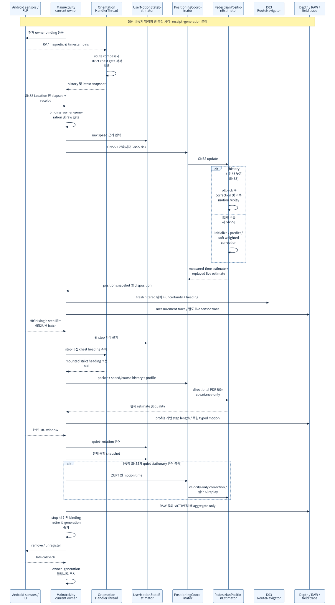

[Mermaid 원본](../diagrams/D04-sequence-sensor-fusion.mmd) · [SVG](../rendered/D04-sequence-sensor-fusion.svg)

[Mermaid 원본](../diagrams/D04-overview.mmd) · [SVG](../rendered/D04-overview.svg)

## F-D04-002 위치 신뢰와 원시 위치 기반 이동 방위

| 항목 | 명세 |
| --- | --- |
| 분야 | D04 방향·위치·GNSS·걸음·PDR·동작·보행 보정 |
| 목적 | 실제 fix 최신성 및 이동 방위의 근거를 분리 |
| 사용 주체 | 제품 사용자 MainActivity |
| 활성 상태 | ACTIVE |
| 진입점 | apps/android/app/src/main/java/kr/co/hanium/dreamup/walksafe/navigation/LocationPolicy.kt:33 LocationTrustPolicy / reliableMovementHeadingDegrees apps/android/app/src/main/java/kr/co/hanium/dreamup/walksafe/navigation/NavigationTestLocationPolicy.kt:4 freshOrNull apps/android/app/src/main/java/kr/co/hanium/dreamup/walksafe/MainActivity.kt:43554 currentRouteLocationOrNull |
| 실행 전제 | 제품 MainActivity의 현재 위치/보행 수집 소유권이 유효하고 해당 센서·권한이 허용된 경우. 기능별 입력 검사를 추가 적용한다. |
| 입력 출처 형식 검증 최신성 | 위경도 ±90/±180, accuracy≥0, elapsed ms. LocationTrustPolicy 기본 maxAccuracy=15, maxJumpSpeed=8, maxAge=10s. |

### 시작 이벤트와 처리 순서

| 이벤트 ID | 발생원 | 이벤트 | 수신부 | 흐름 |
| --- | --- | --- | --- | --- |
| E-D04-002-01 | 위치 소비자 | trustedOrNull 또는 freshOrNull | LocationTrustPolicy | 입력·age·jump 검사 → trusted fix 또는 null |
| E-D04-002-02 | 방위 소비자 | reliableMovementHeadingDegrees | LocationPolicy | 보고 bearing 우선 → stop 차단 → 유의 변위 검사 → heading 또는 null |

1. 1. trustedOrNull은 입력·mock·정확도·시간 및 이전 위치 대비 점프를 검사한다.
2. 2. freshOrNull은 현재-관측 나이가 0..10000ms인지 확인한다.
3. 3. reported bearing와 speed≥0.3가 유효하고 bearingAccuracy가 null 또는 유한0..35이면 반환하고, 보고 속도가 정확히 0이면 방위를 반환하지 않는다. 그 외 두 위치 불확실도보다 큰 이동에서 haversine bearing를 계산한다.
4. 4. Main 개발 안내 우회는 NavigationTestLocationPolicy로 거친 원시 위치를 그대로 제공한다.

| 분기 조건 | 실제 처리 결과 | 구현 근거 |
| --- | --- | --- |
| accuracy>15 또는 jump>8×dt+uncertainty | 일반 trustedOrNull null | apps/android/app/src/main/java/kr/co/hanium/dreamup/walksafe/navigation/LocationPolicy.kt:33 LocationTrustPolicy / reliableMovementHeadingDegrees |
| mock/미래/10초 초과 | 일반 및 개발 위치 null | apps/android/app/src/main/java/kr/co/hanium/dreamup/walksafe/navigation/LocationPolicy.kt:33 LocationTrustPolicy / reliableMovementHeadingDegrees |
| 속도=0 | 좌표 이동만으로 방위 대체하지 않음 | apps/android/app/src/main/java/kr/co/hanium/dreamup/walksafe/navigation/LocationPolicy.kt:33 LocationTrustPolicy / reliableMovementHeadingDegrees |

### 효과 종료와 복구

호출자에게 구조화된 결과를 반환; 이 클래스 자체의 네트워크·음성 출력 없음.

| 상황 | 동작 |
| --- | --- |
| 정상 완료 | 현재 입력의 결과를 반환한다. |
| 실패 | 아래 거부 분기에서 값을 생성하지 않거나 명시된 상태를 반환한다. |
| 시간 초과 | 내부 타이머 없음; 호출 시 명시된 관측 나이/시각을 검사한다. |
| 중복 입력 | 동일 입력 처리 여부는 아래 시각·정체성 분기를 따른다. |
| 취소 | 동기 계산이므로 별도 취소 API 없음. |
| 중단과 생명주기 | 동기 함수 호출 종료; worker나 보류 요청 없음. |
| 재시도 | 자동 재시도 없음; 다음 유효 입력에서 재평가한다. |
| 복구 | 다음 유효 입력과 기능별 복구 조건 충족 시 결과를 다시 제공한다. |
| 자원 정리 | 독립 resource 없음. 호출자가 보유한 입력·결과 참조의 수명만 적용. |

### 상태 실행 맥락과 연결

| 항목 | 명세 |
| --- | --- |
| 초기 상태 | S-D04-002-WAIT_INPUT |
| 상태 목록 | S-D04-002-WAIT_INPUT S-D04-002-VALID_RESULT S-D04-002-REJECTED |
| 전이 조건과 전이 동작 | 호출 입력 검증 통과 → VALID_RESULT → 호출 종료 호출 입력 검증 거부 → REJECTED → 호출 종료 |
| 허용되지 않는 전이 | 위 별칭은 호출 결과 분류이며 지속 상태 enum/worker를 추가하지 않는다. |
| 동시성 순서와 작업 소유권 | MainActivity의 직렬 콜백에서 동기 호출. 내부 코루틴·타이머 없음. 소유권 및 측정 시각 조건은 본문 참조. |
| 공유 상태와 다른 기능 연결 | 현재 제품 필터 입력은 F-D04-015. LocationTrustPolicy helper 자체를 전체 estimator 입구로 혼동하지 않는다. |

### 정책 근거와 검증 범위

| 항목 | 근거 |
| --- | --- |
| 정책 | [P-D04-002](#P-D04-002) |
| 구현 | [apps/android/app/src/main/java/kr/co/hanium/dreamup/walksafe/navigation/LocationPolicy.kt:33](/home/ddobagi/Hanium_Dreamup/apps/android/app/src/main/java/kr/co/hanium/dreamup/walksafe/navigation/LocationPolicy.kt:33) · `LocationTrustPolicy / reliableMovementHeadingDegrees` (범위 33–138) [apps/android/app/src/main/java/kr/co/hanium/dreamup/walksafe/navigation/NavigationTestLocationPolicy.kt:4](/home/ddobagi/Hanium_Dreamup/apps/android/app/src/main/java/kr/co/hanium/dreamup/walksafe/navigation/NavigationTestLocationPolicy.kt:4) · `freshOrNull` (범위 4–17) [apps/android/app/src/main/java/kr/co/hanium/dreamup/walksafe/MainActivity.kt:43554](/home/ddobagi/Hanium_Dreamup/apps/android/app/src/main/java/kr/co/hanium/dreamup/walksafe/MainActivity.kt:43554) · `currentRouteLocationOrNull` (범위 43554–43563) |
| 기존 개선 ID | 개별 동일성 미확인; 분야 연관은 별도 추적표 |
| 기존 분야 | 08 09 |
| 기존 실행 증거 | 이번 명세는 2026-10-04 10:33:40 KST 고정 snapshot의 정적 분석만 사용. 과거 DONE·시험 횟수·기기 결과를 현재 실행 증거로 채택하지 않음. |
| 한계 및 구분 | LocationTrustPolicy와 NavigationTestLocationPolicy는 적용 경계가 다름. exact 소비자마다 maxAge/uncertainty 의미가 다르다. |

| 테스트 위치 | 심볼 | 증거 수준 | 기대와 한계 |
| --- | --- | --- | --- |
| [apps/android/app/src/test/java/kr/co/hanium/dreamup/walksafe/navigation/LocationPolicyTest.kt](/home/ddobagi/Hanium_Dreamup/apps/android/app/src/test/java/kr/co/hanium/dreamup/walksafe/navigation/LocationPolicyTest.kt) | movementHeadingRequiresDisplacementBeyondBothFixUncertainties | TEST_EXPECTATION | 작은 위치 흔들림은 방위 근거가 되지 않는 기대; 이번 실행 없음. 해당 시험의 명명된 기대 및 관련 코드만 대조했다. |

### 이벤트 처리 그림


[Mermaid 원본](../diagrams/D04-F002.mmd) · [SVG](../rendered/D04-F002.svg)

[Mermaid 원본](../diagrams/D04-sequence-sensor-fusion.mmd) · [SVG](../rendered/D04-sequence-sensor-fusion.svg)

[Mermaid 원본](../diagrams/D04-overview.mmd) · [SVG](../rendered/D04-overview.svg)

## F-D04-003 걸음 센서 등록·누적 수·PDR 이벤트

| 항목 | 명세 |
| --- | --- |
| 분야 | D04 방향·위치·GNSS·걸음·PDR·동작·보행 보정 |
| 목적 | 세션 걸음 수와 물리 걸음 입력을 분리하고 센서 간 중복 제거 |
| 사용 주체 | 제품 사용자 MainActivity |
| 활성 상태 | ACTIVE |
| 진입점 | apps/android/app/src/main/java/kr/co/hanium/dreamup/walksafe/navigation/AndroidStepTracker.kt:192 start / onStepCounterTotal / onStepDetected / handOverCounterSteps apps/android/app/src/main/java/kr/co/hanium/dreamup/walksafe/MainActivity.kt:43932 handlePositioningStepEvent |
| 실행 전제 | 제품 MainActivity의 현재 위치/보행 수집 소유권이 유효하고 해당 센서·권한이 허용된 경우. 기능별 입력 검사를 추가 적용한다. |
| 입력 출처 형식 검증 최신성 | finite positive detector value는 1걸음. Counter finite≥0; source별 측정 ns 엄격 증가; receipt≥measurement 및 이전 알려진 receipt 이상. overflow 사전 거부. 원본 StepEvent에 ns/receipt/registration generation/counter observation 보존. |

### 시작 이벤트와 처리 순서

| 이벤트 ID | 발생원 | 이벤트 | 수신부 | 흐름 |
| --- | --- | --- | --- | --- |
| E-D04-003-01 | SensorManager hardware | TYPE_STEP_DETECTOR | onStepDetected | 원 ns·receipt·generation 검사 → counter coverage reconcile → HIGH 단일 걸음 |
| E-D04-003-02 | SensorManager hardware | TYPE_STEP_COUNTER | onStepCounterTotal | 새 세대 baseline → delta 저장 → detector stall 검사 → 미전달분 MEDIUM batch |
| E-D04-003-03 | Main 수집 소유자 | stop 또는 owner 변경 | AndroidStepTracker.stop | 논리 입력 retire → listener 해제 → baseline과 pending 정리 |

1. 1. Counter·Detector 독립 등록 후 둘 다 실패한 경우에만 accelerometer fallback을 등록한다. 등록 세대와 listener identity가 callback을 소유한다.
2. 2. Counter 최초값을 baseline으로 잡고 activeWindow offset에 이후 차이를 합산한다. baseline 전 Detector의 이중 계상은 10초 창에서 조정하며 표시 total은 감소시키지 않는다.
3. 3. Detector 정상 시 Counter surplus는 흡수한다. 10초 초과 침묵이면 uncovered만 Counter batch로 발행하고 counterCoveredUntilNs를 올린다.
4. 4. 각 외부 callback 후 generation을 재검사하여 재진입 stop/start가 남은 이전 이벤트를 발행하지 못하게 한다. Main은 epoch/binding/1..64/원래 시각 확인 후 motion tracker·calibration·PositioningCoordinator로 분기한다.

| 분기 조건 | 실제 처리 결과 | 구현 근거 |
| --- | --- | --- |
| started 재호출 | 중복 등록하지 않고 true | apps/android/app/src/main/java/kr/co/hanium/dreamup/walksafe/navigation/AndroidStepTracker.kt:192 start / onStepCounterTotal / onStepDetected / handOverCounterSteps |
| 모든 센서 미등록 또는 SecurityException | false와 cleanup; failed target 보존 | apps/android/app/src/main/java/kr/co/hanium/dreamup/walksafe/navigation/AndroidStepTracker.kt:192 start / onStepCounterTotal / onStepDetected / handOverCounterSteps |
| 잘못된 수치/중복·역순 측정/receipt 역순 | count와 clock을 소비하지 않고 거부 | apps/android/app/src/main/java/kr/co/hanium/dreamup/walksafe/navigation/AndroidStepTracker.kt:192 start / onStepCounterTotal / onStepDetected / handOverCounterSteps |
| 동작 callback 중 세대 변경 | 나머지 이전 callback 방출 중지 | apps/android/app/src/main/java/kr/co/hanium/dreamup/walksafe/navigation/AndroidStepTracker.kt:192 start / onStepCounterTotal / onStepDetected / handOverCounterSteps |

### 효과 종료와 복구

호출자에게 구조화된 결과를 반환; 이 클래스 자체의 네트워크·음성 출력 없음.

| 상황 | 동작 |
| --- | --- |
| 정상 완료 | 현재 입력의 결과를 반환한다. |
| 실패 | 아래 거부 분기에서 값을 생성하지 않거나 명시된 상태를 반환한다. |
| 시간 초과 | 내부 타이머 없음; 다음 입력/조회에서 명시된 나이를 평가한다. |
| 중복 입력 | 동일 입력 처리 여부는 아래 시각·정체성 분기를 따른다. |
| 취소 | 별도 취소 API 없음; 소유자가 기능/수집을 종료한다. |
| 중단과 생명주기 | 소유자의 reset 또는 세대 변경 시 이전 세션 근거를 재사용하지 않는다. |
| 재시도 | 자동 재시도 없음; 다음 유효 입력에서 재평가한다. |
| 복구 | 다음 유효 입력과 기능별 복구 조건 충족 시 결과를 다시 제공한다. |
| 자원 정리 | 기능별 reset/stop 또는 소유자 참조 해제. |

### 상태 실행 맥락과 연결

| 항목 | 명세 |
| --- | --- |
| 초기 상태 | S-D04-003-NO_BASELINE |
| 상태 목록 | S-D04-003-NO_BASELINE S-D04-003-DETECTOR_ACTIVE S-D04-003-COUNTER_WAIT S-D04-003-COUNTER_HANDOVER S-D04-003-STOPPED |
| 전이 조건과 전이 동작 | 첫 counter → baseline 기록; 과거 누적 발행 없음 detector event → HIGH; counter coverage 갱신 detector stall 10초 초과 → 미전달 counter MEDIUM batch detector 복귀 → overlap 공제 후 HIGH stop → STOPPED; 새 registration은 baseline부터 |
| 허용되지 않는 전이 | 같은 counter/detector 구간을 두 번 PDR에 전달하지 않음; 상태명은 public enum이 아닌 경우 코드 필드 조합의 문서 별칭이다. |
| 동시성 순서와 작업 소유권 | SensorManager main 스레드 등록. 외부 count/event callback은 재진입 가능하여 generation 재검사. health snapshot은 volatile immutable 발행. |
| 공유 상태와 다른 기능 연결 | F-D04-004 fallback, F-D04-005 최근 step, F-D04-019 calibration, F-D04-016 PDR. raw step confidence를 소비자가 높일 수 없음. |

### 정책 근거와 검증 범위

| 항목 | 근거 |
| --- | --- |
| 정책 | [P-D04-003](#P-D04-003) |
| 구현 | [apps/android/app/src/main/java/kr/co/hanium/dreamup/walksafe/navigation/AndroidStepTracker.kt:192](/home/ddobagi/Hanium_Dreamup/apps/android/app/src/main/java/kr/co/hanium/dreamup/walksafe/navigation/AndroidStepTracker.kt:192) · `start / onStepCounterTotal / onStepDetected / handOverCounterSteps` (범위 192–605) [apps/android/app/src/main/java/kr/co/hanium/dreamup/walksafe/MainActivity.kt:43932](/home/ddobagi/Hanium_Dreamup/apps/android/app/src/main/java/kr/co/hanium/dreamup/walksafe/MainActivity.kt:43932) · `handlePositioningStepEvent` (범위 43932–44003) |
| 기존 개선 ID | S09-18 S09-20 |
| 기존 분야 | 08 09 |
| 기존 실행 증거 | 이번 명세는 2026-10-04 10:33:40 KST 고정 snapshot의 정적 분석만 사용. 과거 DONE·시험 횟수·기기 결과를 현재 실행 증거로 채택하지 않음. |
| 한계 및 구분 | 현장 오차·기기 센서 정확도·사용자 청취는 미검증. |

| 테스트 위치 | 심볼 | 증거 수준 | 기대와 한계 |
| --- | --- | --- | --- |
| [apps/android/app/src/test/java/kr/co/hanium/dreamup/walksafe/navigation/AndroidStepTrackerDetectorStallTest.kt](/home/ddobagi/Hanium_Dreamup/apps/android/app/src/test/java/kr/co/hanium/dreamup/walksafe/navigation/AndroidStepTrackerDetectorStallTest.kt) | detectorStallHandsOnlyUncoveredStepsToTheCounterAndRecoversWithoutDuplicates | TEST_EXPECTATION | stall 보충과 복구 시 중복 없음 기대; 이번 실행 없음. 해당 시험의 명명된 기대 및 관련 코드만 대조했다. |
| [apps/android/app/src/test/java/kr/co/hanium/dreamup/walksafe/navigation/AndroidStepTrackerOriginalTimingRegressionTest.kt](/home/ddobagi/Hanium_Dreamup/apps/android/app/src/test/java/kr/co/hanium/dreamup/walksafe/navigation/AndroidStepTrackerOriginalTimingRegressionTest.kt) | suppliedActualReceiptSurvivesBothProducerPaths | TEST_EXPECTATION | 원 측정/수신 나노초 보존 기대; 이번 실행 없음. 해당 시험의 명명된 기대 및 관련 코드만 대조했다. |

### 이벤트 처리 그림


[Mermaid 원본](../diagrams/D04-F003.mmd) · [SVG](../rendered/D04-F003.svg)

[Mermaid 원본](../diagrams/D04-sequence-sensor-fusion.mmd) · [SVG](../rendered/D04-sequence-sensor-fusion.svg)

[Mermaid 원본](../diagrams/D04-overview.mmd) · [SVG](../rendered/D04-overview.svg)

## F-D04-004 가속도만 가능한 기기의 보조 걸음 검출

| 항목 | 명세 |
| --- | --- |
| 분야 | D04 방향·위치·GNSS·걸음·PDR·동작·보행 보정 |
| 목적 | 단일 충격을 걸음으로 세지 않는 LOW confidence fallback |
| 사용 주체 | 제품 사용자 MainActivity |
| 활성 상태 | ACTIVE |
| 진입점 | apps/android/app/src/main/java/kr/co/hanium/dreamup/walksafe/navigation/AccelerometerStepPeakDetector.kt:28 observe / acceptPeak / peakEmissionCount |
| 실행 전제 | 제품 MainActivity의 현재 위치/보행 수집 소유권이 유효하고 해당 센서·권한이 허용된 경우. 기능별 입력 검사를 추가 적용한다. |
| 입력 출처 형식 검증 최신성 | 3축 magnitude, 증가하는 원 측정 ns, 최대 허용 발행 수. nonfinite/음수/time 중복은 거부. |

### 시작 이벤트와 처리 순서

| 이벤트 ID | 발생원 | 이벤트 | 수신부 | 흐름 |
| --- | --- | --- | --- | --- |
| E-D04-004-01 | 가속도 callback | raw acceleration magnitude | AccelerometerStepPeakDetector.observe | 원 측정 시각 검사 → trough와 rising peak 검사 → interval 조건 → LOW 걸음 |
| E-D04-004-02 | sensor owner | reset | AccelerometerStepPeakDetector.reset | peak baseline과 마지막 sample 삭제 → 다음 독립 peak 대기 |

1. 1. 높은 excursion의 최고 peak와 시각을 기록하되 낮아지기 전에는 발행하지 않는다.
2. 2. trough와 interval continuity를 검사한다. 새 sequence는 첫 후보만 저장, 두 번째 일관 peak에서 두 걸음을 함께 발행한다.
3. 3. 리듬이 깨지면 새 sequence를 시작한다. integer capacity를 넘을 closing sample은 상태 변경 전에 거부한다.

| 분기 조건 | 실제 처리 결과 | 구현 근거 |
| --- | --- | --- |
| 단발 충격/지속 peak/trough 없음 | 0걸음 | apps/android/app/src/main/java/kr/co/hanium/dreamup/walksafe/navigation/AccelerometerStepPeakDetector.kt:28 observe / acceptPeak / peakEmissionCount |
| 연속 두 peak 이후 | 후속 peak 1걸음씩 발행 | apps/android/app/src/main/java/kr/co/hanium/dreamup/walksafe/navigation/AccelerometerStepPeakDetector.kt:28 observe / acceptPeak / peakEmissionCount |
| reset | gravity/peak/trough/간격 이력 해제 | apps/android/app/src/main/java/kr/co/hanium/dreamup/walksafe/navigation/AccelerometerStepPeakDetector.kt:28 observe / acceptPeak / peakEmissionCount |

### 효과 종료와 복구

호출자에게 구조화된 결과를 반환; 이 클래스 자체의 네트워크·음성 출력 없음.

| 상황 | 동작 |
| --- | --- |
| 정상 완료 | 현재 입력의 결과를 반환한다. |
| 실패 | 아래 거부 분기에서 값을 생성하지 않거나 명시된 상태를 반환한다. |
| 시간 초과 | 내부 타이머 없음; 다음 입력/조회에서 명시된 나이를 평가한다. |
| 중복 입력 | 동일 입력 처리 여부는 아래 시각·정체성 분기를 따른다. |
| 취소 | 별도 취소 API 없음; 소유자가 기능/수집을 종료한다. |
| 중단과 생명주기 | 소유자의 reset 또는 세대 변경 시 이전 세션 근거를 재사용하지 않는다. |
| 재시도 | 자동 재시도 없음; 다음 유효 입력에서 재평가한다. |
| 복구 | 다음 유효 입력과 기능별 복구 조건 충족 시 결과를 다시 제공한다. |
| 자원 정리 | 기능별 reset/stop 또는 소유자 참조 해제. |

### 상태 실행 맥락과 연결

| 항목 | 명세 |
| --- | --- |
| 초기 상태 | S-D04-004-WAIT_INPUT |
| 상태 목록 | S-D04-004-WAIT_INPUT S-D04-004-VALID_RESULT S-D04-004-REJECTED |
| 전이 조건과 전이 동작 | 호출 입력 검증 통과 → VALID_RESULT → 호출 종료 호출 입력 검증 거부 → REJECTED → 호출 종료 |
| 허용되지 않는 전이 | 위 별칭은 호출 결과 분류이며 지속 상태 enum/worker를 추가하지 않는다. |
| 동시성 순서와 작업 소유권 | MainActivity의 직렬 콜백에서 동기 호출. 내부 코루틴·타이머 없음. 소유권 및 측정 시각 조건은 본문 참조. |
| 공유 상태와 다른 기능 연결 | F-D04-003 AndroidStepTracker를 통해 Main에 전달되지만 LOW는 방향 PDR·walking 확정·보정 학습에서 제외. |

### 정책 근거와 검증 범위

| 항목 | 근거 |
| --- | --- |
| 정책 | [P-D04-004](#P-D04-004) |
| 구현 | [apps/android/app/src/main/java/kr/co/hanium/dreamup/walksafe/navigation/AccelerometerStepPeakDetector.kt:28](/home/ddobagi/Hanium_Dreamup/apps/android/app/src/main/java/kr/co/hanium/dreamup/walksafe/navigation/AccelerometerStepPeakDetector.kt:28) · `observe / acceptPeak / peakEmissionCount` (범위 28–132) |
| 기존 개선 ID | S09-17 |
| 기존 분야 | 08 09 |
| 기존 실행 증거 | 이번 명세는 2026-10-04 10:33:40 KST 고정 snapshot의 정적 분석만 사용. 과거 DONE·시험 횟수·기기 결과를 현재 실행 증거로 채택하지 않음. |
| 한계 및 구분 | 현장 오차·기기 센서 정확도·사용자 청취는 미검증. |

| 테스트 위치 | 심볼 | 증거 수준 | 기대와 한계 |
| --- | --- | --- | --- |
| [apps/android/app/src/test/java/kr/co/hanium/dreamup/walksafe/navigation/AccelerometerStepPeakDetectorTest.kt](/home/ddobagi/Hanium_Dreamup/apps/android/app/src/test/java/kr/co/hanium/dreamup/walksafe/navigation/AccelerometerStepPeakDetectorTest.kt) | fastShakingOneShockAndASustainedHighValueAreNotSteps | TEST_EXPECTATION | 빠른 흔들림·충격·지속 peak 제외 기대; 이번 실행 없음. 해당 시험의 명명된 기대 및 관련 코드만 대조했다. |

### 이벤트 처리 그림


[Mermaid 원본](../diagrams/D04-F004.mmd) · [SVG](../rendered/D04-F004.svg)

[Mermaid 원본](../diagrams/D04-sequence-sensor-fusion.mmd) · [SVG](../rendered/D04-sequence-sensor-fusion.svg)

[Mermaid 원본](../diagrams/D04-overview.mmd) · [SVG](../rendered/D04-overview.svg)

## F-D04-005 가속도·자이로 구간 통계와 운용 상태

| 항목 | 명세 |
| --- | --- |
| 분야 | D04 방향·위치·GNSS·걸음·PDR·동작·보행 보정 |
| 목적 | 부분 센서·등록 실패와 실제 관측을 구분하고 정지 검출용 창을 전달 |
| 사용 주체 | 제품 사용자 MainActivity |
| 활성 상태 | ACTIVE |
| 진입점 | apps/android/app/src/main/java/kr/co/hanium/dreamup/walksafe/navigation/positioning/AndroidPedestrianMotionTracker.kt:200 onSensorSample / magnitudeStatistics apps/android/app/src/main/java/kr/co/hanium/dreamup/walksafe/navigation/positioning/SensorTrackerHealthSnapshot.kt:40 SensorTrackerHealthRecorder |
| 실행 전제 | 제품 MainActivity의 현재 위치/보행 수집 소유권이 유효하고 해당 센서·권한이 허용된 경우. 기능별 입력 검사를 추가 적용한다. |
| 입력 출처 형식 검증 최신성 | 각 sensor의 finite xyz; magnitude; measurement ns; actual receipt ns. sampleCount와 start/end/maxGap을 원 측정 시각으로 기록. |

### 시작 이벤트와 처리 순서

| 이벤트 ID | 발생원 | 이벤트 | 수신부 | 흐름 |
| --- | --- | --- | --- | --- |
| E-D04-005-01 | SensorManager | accelerometer 또는 gyro onSensorChanged | AndroidPedestrianMotionTracker | generation·ns·receipt 검증 → bounded window → 완전성 확인 → motion callback |
| E-D04-005-02 | 하드웨어 걸음 tracker | 최근 step input | AndroidPedestrianMotionTracker.recordStep | 최신성 유지 → 다음 window에 once-only 걸음 연관 |
| E-D04-005-03 | Main lifecycle | close | AndroidPedestrianMotionTracker | 입력 admission 중단 → sensor unregister → window clear; health registration outcome 유지 |

1. 1. start는 가속도/gyro를 독립 등록하고 하나라도 성공하면 ACTIVE. 실패 정리 target을 보존하며 close 후 재시작 금지.
2. 2. 수용 sample을 1초 source 창에 저장하고 전체 결정 시각이 이전 ms보다 클 때 한 번 emit한다. 각 창의 표본 충분성 통과 후 mean/variance/RMS/peak 계산.
3. 3. recordStep은 현재 registration의 증가한 최근 걸음을 잠시 보관한다. 다음 sample이 걸음 이후가 될 때 한 번 소비하며 2초를 넘으면 false.
4. 4. immutable operationalHealth는 registration outcome과 마지막 수용 sample을 구분하며 registration 성공만으로 measurement 시각을 만들지 않는다.

| 분기 조건 | 실제 처리 결과 | 구현 근거 |
| --- | --- | --- |
| 표본 수/길이/gap 부족 | 그 source 통계를 null로 전달 | apps/android/app/src/main/java/kr/co/hanium/dreamup/walksafe/navigation/positioning/AndroidPedestrianMotionTracker.kt:200 onSensorSample / magnitudeStatistics |
| 잘못된 receipt/time | 창·watermark·health 변경 없이 false | apps/android/app/src/main/java/kr/co/hanium/dreamup/walksafe/navigation/positioning/AndroidPedestrianMotionTracker.kt:200 onSensorSample / magnitudeStatistics |
| stop | 세대 증가 후 unregister; finally 창과 detector reset | apps/android/app/src/main/java/kr/co/hanium/dreamup/walksafe/navigation/positioning/AndroidPedestrianMotionTracker.kt:200 onSensorSample / magnitudeStatistics |
| close | closed=true 이후 start=false | apps/android/app/src/main/java/kr/co/hanium/dreamup/walksafe/navigation/positioning/AndroidPedestrianMotionTracker.kt:200 onSensorSample / magnitudeStatistics |

### 효과 종료와 복구

호출자에게 구조화된 결과를 반환; 이 클래스 자체의 네트워크·음성 출력 없음.

| 상황 | 동작 |
| --- | --- |
| 정상 완료 | 현재 입력의 결과를 반환한다. |
| 실패 | 아래 거부 분기에서 값을 생성하지 않거나 명시된 상태를 반환한다. |
| 시간 초과 | 내부 타이머 없음; 다음 입력/조회에서 명시된 나이를 평가한다. |
| 중복 입력 | 동일 입력 처리 여부는 아래 시각·정체성 분기를 따른다. |
| 취소 | 별도 취소 API 없음; 소유자가 기능/수집을 종료한다. |
| 중단과 생명주기 | 소유자의 reset 또는 세대 변경 시 이전 세션 근거를 재사용하지 않는다. |
| 재시도 | 자동 재시도 없음; 다음 유효 입력에서 재평가한다. |
| 복구 | 다음 유효 입력과 기능별 복구 조건 충족 시 결과를 다시 제공한다. |
| 자원 정리 | 기능별 reset/stop 또는 소유자 참조 해제. |

### 상태 실행 맥락과 연결

| 항목 | 명세 |
| --- | --- |
| 초기 상태 | S-D04-005-UNREGISTERED |
| 상태 목록 | S-D04-005-UNREGISTERED S-D04-005-REGISTERED_NO_SAMPLE S-D04-005-PARTIAL_WINDOW S-D04-005-COMPLETE_WINDOW S-D04-005-CLOSED |
| 전이 조건과 전이 동작 | 센서별 등록 성공 → REGISTERED_NO_SAMPLE 수용 sample → PARTIAL_WINDOW 또는 COMPLETE_WINDOW window 독립성/완전성 실패 → 부분 관측으로 품질 표시 close → CLOSED; health 마지막 등록결과 보존 |
| 허용되지 않는 전이 | 등록 성공을 실제 sample 신선도와 동일시하지 않음; 상태명은 public enum이 아닌 경우 코드 필드 조합의 문서 별칭이다. |
| 동시성 순서와 작업 소유권 | MainActivity의 직렬 콜백에서 동기 호출. 내부 코루틴·타이머 없음. 소유권 및 측정 시각 조건은 본문 참조. |
| 공유 상태와 다른 기능 연결 | F-D04-006 장치 stillness, F-D04-007 물리 동작. Main motion evidence UI가 health를 읽는다. |

### 정책 근거와 검증 범위

| 항목 | 근거 |
| --- | --- |
| 정책 | [P-D04-005](#P-D04-005) |
| 구현 | [apps/android/app/src/main/java/kr/co/hanium/dreamup/walksafe/navigation/positioning/AndroidPedestrianMotionTracker.kt:200](/home/ddobagi/Hanium_Dreamup/apps/android/app/src/main/java/kr/co/hanium/dreamup/walksafe/navigation/positioning/AndroidPedestrianMotionTracker.kt:200) · `onSensorSample / magnitudeStatistics` (범위 200–419) [apps/android/app/src/main/java/kr/co/hanium/dreamup/walksafe/navigation/positioning/SensorTrackerHealthSnapshot.kt:40](/home/ddobagi/Hanium_Dreamup/apps/android/app/src/main/java/kr/co/hanium/dreamup/walksafe/navigation/positioning/SensorTrackerHealthSnapshot.kt:40) · `SensorTrackerHealthRecorder` (범위 40–131) |
| 기존 개선 ID | 개별 동일성 미확인; 분야 연관은 별도 추적표 |
| 기존 분야 | 08 09 |
| 기존 실행 증거 | 이번 명세는 2026-10-04 10:33:40 KST 고정 snapshot의 정적 분석만 사용. 과거 DONE·시험 횟수·기기 결과를 현재 실행 증거로 채택하지 않음. |
| 한계 및 구분 | 현장 오차·기기 센서 정확도·사용자 청취는 미검증. |

| 테스트 위치 | 심볼 | 증거 수준 | 기대와 한계 |
| --- | --- | --- | --- |
| [apps/android/app/src/test/java/kr/co/hanium/dreamup/walksafe/navigation/positioning/UserMotionStateEstimatorTest.kt](/home/ddobagi/Hanium_Dreamup/apps/android/app/src/test/java/kr/co/hanium/dreamup/walksafe/navigation/positioning/UserMotionStateEstimatorTest.kt) | invalidCoverageAndMissingGyroscopeCannotAuthorizeZupt | TEST_EXPECTATION | 불충분 구간·gyro 부재는 ZUPT 허가 불가 기대; 이번 실행 없음. 해당 시험의 명명된 기대 및 관련 코드만 대조했다. |

### 이벤트 처리 그림


[Mermaid 원본](../diagrams/D04-F005.mmd) · [SVG](../rendered/D04-F005.svg)

[Mermaid 원본](../diagrams/D04-sequence-sensor-fusion.mmd) · [SVG](../rendered/D04-sequence-sensor-fusion.svg)

[Mermaid 원본](../diagrams/D04-overview.mmd) · [SVG](../rendered/D04-overview.svg)

## F-D04-006 장치 움직임·정지 후보 상태

| 항목 | 명세 |
| --- | --- |
| 분야 | D04 방향·위치·GNSS·걸음·PDR·동작·보행 보정 |
| 목적 | 가속도와 gyro window에서 장치의 조용한 구간을 검출 |
| 사용 주체 | 제품 사용자 MainActivity |
| 활성 상태 | ACTIVE |
| 진입점 | apps/android/app/src/main/java/kr/co/hanium/dreamup/walksafe/navigation/positioning/PedestrianStationaryDetector.kt:5 observe / stillnessDwellMs |
| 실행 전제 | 제품 MainActivity의 현재 위치/보행 수집 소유권이 유효하고 해당 센서·권한이 허용된 경우. 기능별 입력 검사를 추가 적용한다. |
| 입력 출처 형식 검증 최신성 | PedestrianMotionSample: 원 측정 ms, step, mean/variance/RMS/peak, source coverage. 시간 음수/비증가·측정 음수/nonfinite 거부. |

### 시작 이벤트와 처리 순서

| 이벤트 ID | 발생원 | 이벤트 | 수신부 | 흐름 |
| --- | --- | --- | --- | --- |
| E-D04-006-01 | IMU tracker | MotionObservation | PedestrianStationaryDetector.observe | age와 독립 창 검사 → step/moving 즉시 MOVING 또는 quiet candidate → dwell 후 STATIONARY |
| E-D04-006-02 | 소유자 | reset | PedestrianStationaryDetector | 정지 후보 시각·watermark 제거 → UNKNOWN |

1. 1. 유효 시간 sample gap>250ms이면 기존 후보를 UNKNOWN으로 해제한다.
2. 2. step/움직임이면 즉시 MOVING. quiet 창이 불충분하거나 두 threshold 사이면 UNKNOWN.
3. 3. 독립 accelerationWindow.end가 이전보다 증가해야 후보 시간이 진행한다. gyro 없으면 3초, 있으면 1.5초 이후 STATIONARY.

| 분기 조건 | 실제 처리 결과 | 구현 근거 |
| --- | --- | --- |
| 동일 acceleration window 반복 | 정지 dwell을 진행하지 않음 | apps/android/app/src/main/java/kr/co/hanium/dreamup/walksafe/navigation/positioning/PedestrianStationaryDetector.kt:5 observe / stillnessDwellMs |
| expire 조회에서 최근 sample age>250 | UNKNOWN과 후보 제거 | apps/android/app/src/main/java/kr/co/hanium/dreamup/walksafe/navigation/positioning/PedestrianStationaryDetector.kt:5 observe / stillnessDwellMs |
| gyro만 있고 accel 없음 | 정지 확정 불가 | apps/android/app/src/main/java/kr/co/hanium/dreamup/walksafe/navigation/positioning/PedestrianStationaryDetector.kt:5 observe / stillnessDwellMs |

### 효과 종료와 복구

호출자에게 구조화된 결과를 반환; 이 클래스 자체의 네트워크·음성 출력 없음.

| 상황 | 동작 |
| --- | --- |
| 정상 완료 | 현재 입력의 결과를 반환한다. |
| 실패 | 아래 거부 분기에서 값을 생성하지 않거나 명시된 상태를 반환한다. |
| 시간 초과 | 내부 타이머 없음; 다음 입력/조회에서 명시된 나이를 평가한다. |
| 중복 입력 | 동일 입력 처리 여부는 아래 시각·정체성 분기를 따른다. |
| 취소 | 별도 취소 API 없음; 소유자가 기능/수집을 종료한다. |
| 중단과 생명주기 | 소유자의 reset 또는 세대 변경 시 이전 세션 근거를 재사용하지 않는다. |
| 재시도 | 자동 재시도 없음; 다음 유효 입력에서 재평가한다. |
| 복구 | 다음 유효 입력과 기능별 복구 조건 충족 시 결과를 다시 제공한다. |
| 자원 정리 | 기능별 reset/stop 또는 소유자 참조 해제. |

### 상태 실행 맥락과 연결

| 항목 | 명세 |
| --- | --- |
| 초기 상태 | S-D04-006-UNKNOWN |
| 상태 목록 | S-D04-006-UNKNOWN S-D04-006-MOVING S-D04-006-STATIONARY_CANDIDATE S-D04-006-STATIONARY |
| 전이 조건과 전이 동작 | step 또는 moving threshold → MOVING 충분한 quiet window → STATIONARY_CANDIDATE 독립 quiet dwell 1.5초 또는 gyro 부재3초 → STATIONARY stale/무효/불충분 → UNKNOWN 새 움직임 → candidate/confirmed 정지 해제 |
| 허용되지 않는 전이 | 동일 가속도 window 재전달만으로 정지 dwell 진행 금지; 상태명은 public enum이 아닌 경우 코드 필드 조합의 문서 별칭이다. |
| 동시성 순서와 작업 소유권 | MainActivity의 직렬 콜백에서 동기 호출. 내부 코루틴·타이머 없음. 소유권 및 측정 시각 조건은 본문 참조. |
| 공유 상태와 다른 기능 연결 | F-D04-007에서 GNSS 지면 이동과 결합; shouldApplyZeroVelocityUpdate는 중간 증거이고 최종 승인 아님. |

### 정책 근거와 검증 범위

| 항목 | 근거 |
| --- | --- |
| 정책 | [P-D04-006](#P-D04-006) |
| 구현 | [apps/android/app/src/main/java/kr/co/hanium/dreamup/walksafe/navigation/positioning/PedestrianStationaryDetector.kt:5](/home/ddobagi/Hanium_Dreamup/apps/android/app/src/main/java/kr/co/hanium/dreamup/walksafe/navigation/positioning/PedestrianStationaryDetector.kt:5) · `observe / stillnessDwellMs` (범위 5–271) |
| 기존 개선 ID | 개별 동일성 미확인; 분야 연관은 별도 추적표 |
| 기존 분야 | 08 09 |
| 기존 실행 증거 | 이번 명세는 2026-10-04 10:33:40 KST 고정 snapshot의 정적 분석만 사용. 과거 DONE·시험 횟수·기기 결과를 현재 실행 증거로 채택하지 않음. |
| 한계 및 구분 | 현장 오차·기기 센서 정확도·사용자 청취는 미검증. |

| 테스트 위치 | 심볼 | 증거 수준 | 기대와 한계 |
| --- | --- | --- | --- |
| [apps/android/app/src/test/java/kr/co/hanium/dreamup/walksafe/navigation/positioning/PedestrianStationaryDetectorTest.kt](/home/ddobagi/Hanium_Dreamup/apps/android/app/src/test/java/kr/co/hanium/dreamup/walksafe/navigation/positioning/PedestrianStationaryDetectorTest.kt) | noStepAloneNeverEntersStationaryState | TEST_EXPECTATION | 걸음 없음 단독으로 정지에 들어가지 않는 기대; 이번 실행 없음. 해당 시험의 명명된 기대 및 관련 코드만 대조했다. |

### 이벤트 처리 그림


[Mermaid 원본](../diagrams/D04-F006.mmd) · [SVG](../rendered/D04-F006.svg)


[Mermaid 원본](../diagrams/D04-state-stationary.mmd) · [SVG](../rendered/D04-state-stationary.svg)

[Mermaid 원본](../diagrams/D04-sequence-sensor-fusion.mmd) · [SVG](../rendered/D04-sequence-sensor-fusion.svg)

[Mermaid 원본](../diagrams/D04-overview.mmd) · [SVG](../rendered/D04-overview.svg)

## F-D04-007 사용자 물리 이동·보행·장치 회전·장착 상태

| 항목 | 명세 |
| --- | --- |
| 분야 | D04 방향·위치·GNSS·걸음·PDR·동작·보행 보정 |
| 목적 | 상태와 원 출처 근거를 함께 보존하고 UI/보행 세션 상태를 물리 정지로 오인하지 않음 |
| 사용 주체 | 제품 사용자 MainActivity |
| 활성 상태 | ACTIVE |
| 진입점 | apps/android/app/src/main/java/kr/co/hanium/dreamup/walksafe/navigation/positioning/UserMotionStateEstimator.kt:11 beginEpoch / observeMotion / observeSpeed / observeSteps / evaluate apps/android/app/src/main/java/kr/co/hanium/dreamup/walksafe/navigation/positioning/PositioningCoordinator.kt:153 beginUserMotionEpoch / observeUserMount / peekUserMotion |
| 실행 전제 | 제품 MainActivity의 현재 위치/보행 수집 소유권이 유효하고 해당 센서·권한이 허용된 경우. 기능별 입력 검사를 추가 적용한다. |
| 입력 출처 형식 검증 최신성 | 유효 owner·generation·epoch 이후의 원 위치/StepEvent/source window. 속도는 같은 fix의 시각 및 선택적 원 좌표/ns/id 검증. source별 watermark를 분리하여 다른 센서의 늦은 관측을 허용. |

### 시작 이벤트와 처리 순서

| 이벤트 ID | 발생원 | 이벤트 | 수신부 | 흐름 |
| --- | --- | --- | --- | --- |
| E-D04-007-01 | Main GNSS 처리 | 검증된 raw speed | UserMotionStateEstimator.observeSpeed | owner·원시각·accuracy 검사 → moving/stationary 근거 기록 → 통합 snapshot |
| E-D04-007-02 | Main IMU callback | 새 motion evidence | UserMotionStateEstimator.observeMotion | quiet·rotation·완전 창 판정 → movement/rotation 재평가 |
| E-D04-007-03 | Main hardware step callback | MEDIUM 이상 step evidence; LOW는 observeSteps에서 거부 | UserMotionStateEstimator.observeSteps | 원시각 기준 2초 수명 → 이동 우선 → 독립 2회면 WALKING |
| E-D04-007-04 | 각 소비자 | snapshot 또는 read-only peek | UserMotionStateEstimator | evaluation time과 expiry 검사 → UNKNOWN 포함 snapshot; peek는 publication clock 미변경 |

1. 1. beginEpoch는 같은 boot/process 내 generation·recovery·floor 역행을 거부하고 owner가 바뀌면 근거를 비운다.
2. 2. observeMotion은 원 window가 epoch를 넘나들지 않고 source end가 역행하지 않도록 확인한다. quiet 연속성은 같은 window 반복으로 갱신하지 않는다.
3. 3. observeSpeed는 mock·accuracy·time·원 metadata 및 동일 fix speed 시각을 검사한다. observeSteps는 quality/1..64/원 event 일관성을 검사한다.
4. 4. evaluate는 movement/locomotion/rotation을 별도로 만들고 evidenceRefs·coverage·conflicts 및 가장 이른 만료를 보존한다. 두 독립 step event에서만 WALKING.
5. 5. snapshot은 publication 시간과 stateSince를 진행시키지만 peek는 읽기만 수행한다. mount는 센서 추론이 아니라 현재 owner의 명시 입력이다.
6. 6. deviceRotation은 충분한 fresh gyro 창 RMS≥0.20rad/s면 TURNING, ≤0.08이면 STABLE, 사이·불충분이면 UNKNOWN이다. evidenceHealth는 NO_EVIDENCE→WARMING_UP, EXPIRED_EVIDENCE→EXPIRED, movement UNKNOWN→DEGRADED, 그 외 VALID이다. mount는 UNKNOWN/SUPPORTED_MOUNT/UNSUPPORTED_OR_CHANGED이며 실제 전진방향 증거가 아니다.

| 분기 조건 | 실제 처리 결과 | 구현 근거 |
| --- | --- | --- |
| owner 또는 generation 불일치 | 빈 UNKNOWN rejection snapshot 또는 입력 무시 | apps/android/app/src/main/java/kr/co/hanium/dreamup/walksafe/navigation/positioning/UserMotionStateEstimator.kt:11 beginEpoch / observeMotion / observeSpeed / observeSteps / evaluate |
| step와 stationary GNSS가 공존 | MOVING 유지 + STEP_WITH_STATIONARY_GNSS conflict 기록 | apps/android/app/src/main/java/kr/co/hanium/dreamup/walksafe/navigation/positioning/UserMotionStateEstimator.kt:11 beginEpoch / observeMotion / observeSpeed / observeSteps / evaluate |
| quiet phone과 moving GNSS 공존 | movement와 conflict 모두 유지; 휴대전화 고요=지면 정지로 승격 안 함 | apps/android/app/src/main/java/kr/co/hanium/dreamup/walksafe/navigation/positioning/UserMotionStateEstimator.kt:11 beginEpoch / observeMotion / observeSpeed / observeSteps / evaluate |
| gyro RMS≥0.20 / ≤0.08 | TURNING / STABLE; 사이 또는 stale면 UNKNOWN | apps/android/app/src/main/java/kr/co/hanium/dreamup/walksafe/navigation/positioning/UserMotionStateEstimator.kt:11 beginEpoch / observeMotion / observeSpeed / observeSteps / evaluate |

### 효과 종료와 복구

호출자에게 구조화된 결과를 반환; 이 클래스 자체의 네트워크·음성 출력 없음.

| 상황 | 동작 |
| --- | --- |
| 정상 완료 | 현재 입력의 결과를 반환한다. |
| 실패 | 아래 거부 분기에서 값을 생성하지 않거나 명시된 상태를 반환한다. |
| 시간 초과 | 내부 타이머 없음; 다음 입력/조회에서 명시된 나이를 평가한다. |
| 중복 입력 | 동일 입력 처리 여부는 아래 시각·정체성 분기를 따른다. |
| 취소 | 별도 취소 API 없음; 소유자가 기능/수집을 종료한다. |
| 중단과 생명주기 | 소유자의 reset 또는 세대 변경 시 이전 세션 근거를 재사용하지 않는다. |
| 재시도 | 자동 재시도 없음; 다음 유효 입력에서 재평가한다. |
| 복구 | 다음 유효 입력과 기능별 복구 조건 충족 시 결과를 다시 제공한다. |
| 자원 정리 | 기능별 reset/stop 또는 소유자 참조 해제. |

### 상태 실행 맥락과 연결

| 항목 | 명세 |
| --- | --- |
| 초기 상태 | S-D04-007-UNKNOWN |
| 상태 목록 | S-D04-007-UNKNOWN S-D04-007-MOVING S-D04-007-STATIONARY S-D04-007-LOCOMOTION_UNKNOWN S-D04-007-WALKING S-D04-007-ROTATION_UNKNOWN S-D04-007-STABLE S-D04-007-TURNING S-D04-007-MOUNT_UNKNOWN S-D04-007-SUPPORTED_MOUNT S-D04-007-UNSUPPORTED_OR_CHANGED S-D04-007-WARMING_UP S-D04-007-VALID_EVIDENCE S-D04-007-DEGRADED_EVIDENCE S-D04-007-EXPIRED_EVIDENCE |
| 전이 조건과 전이 동작 | fresh step 우선 → MOVING 허용 GNSS+IMU 상호 근거 → MOVING 또는 STATIONARY 정지 상충과 stale/partial → UNKNOWN 또는 현재 우선 evidence별 유지 독립 step 2회 → WALKING; 최근 step age 2초 초과 → LOCOMOTION_UNKNOWN; 독립 step 간격3초 초과는 연속 count reset 유효 gyro → STABLE/TURNING; gyro 부족 → ROTATION_UNKNOWN owner/epoch 교체 → 근거 reset |
| 허용되지 않는 전이 | mount는 별도 명시 epoch 입력; phone quiet만으로 지면 정지를 선언하지 않음; 상태명은 public enum이 아닌 경우 코드 필드 조합의 문서 별칭이다. |
| 동시성 순서와 작업 소유권 | MainActivity의 직렬 콜백에서 동기 호출. 내부 코루틴·타이머 없음. 소유권 및 측정 시각 조건은 본문 참조. |
| 공유 상태와 다른 기능 연결 | Main applyUserMotionState, motionEvidenceStatusMessage; RAW recordMotion은 peek. F-D04-017 ZUPT claim과 F-D04-016 directed-step conflict gate가 실제 소비. |

### 정책 근거와 검증 범위

| 항목 | 근거 |
| --- | --- |
| 정책 | [P-D04-007](#P-D04-007) |
| 구현 | [apps/android/app/src/main/java/kr/co/hanium/dreamup/walksafe/navigation/positioning/UserMotionStateEstimator.kt:11](/home/ddobagi/Hanium_Dreamup/apps/android/app/src/main/java/kr/co/hanium/dreamup/walksafe/navigation/positioning/UserMotionStateEstimator.kt:11) · `beginEpoch / observeMotion / observeSpeed / observeSteps / evaluate` (범위 11–691) [apps/android/app/src/main/java/kr/co/hanium/dreamup/walksafe/navigation/positioning/PositioningCoordinator.kt:153](/home/ddobagi/Hanium_Dreamup/apps/android/app/src/main/java/kr/co/hanium/dreamup/walksafe/navigation/positioning/PositioningCoordinator.kt:153) · `beginUserMotionEpoch / observeUserMount / peekUserMotion` (범위 153–472) |
| 기존 개선 ID | 개별 동일성 미확인; 분야 연관은 별도 추적표 |
| 기존 분야 | 08 09 |
| 기존 실행 증거 | 이번 명세는 2026-10-04 10:33:40 KST 고정 snapshot의 정적 분석만 사용. 과거 DONE·시험 횟수·기기 결과를 현재 실행 증거로 채택하지 않음. |
| 한계 및 구분 | 장치 회전은 사용자 몸의 회전 증거가 아님. SUPPORTED_MOUNT도 옆걸음·뒷걸음·고정 편향을 입증하지 않음. |

| 테스트 위치 | 심볼 | 증거 수준 | 기대와 한계 |
| --- | --- | --- | --- |
| [apps/android/app/src/test/java/kr/co/hanium/dreamup/walksafe/navigation/positioning/UserMotionStateEstimatorTest.kt](/home/ddobagi/Hanium_Dreamup/apps/android/app/src/test/java/kr/co/hanium/dreamup/walksafe/navigation/positioning/UserMotionStateEstimatorTest.kt) | oneBatchIsNotTwoIndependentWalkingEventsAndDuplicateIsIgnored | TEST_EXPECTATION | Counter batch 한 번이 독립 두 보행 사건이 되지 않는 기대; 이번 실행 없음. 해당 시험의 명명된 기대 및 관련 코드만 대조했다. |

### 이벤트 처리 그림


[Mermaid 원본](../diagrams/D04-F007.mmd) · [SVG](../rendered/D04-F007.svg)

[Mermaid 원본](../diagrams/D04-state-stationary.mmd) · [SVG](../rendered/D04-state-stationary.svg)

[Mermaid 원본](../diagrams/D04-sequence-sensor-fusion.mmd) · [SVG](../rendered/D04-sequence-sensor-fusion.svg)

[Mermaid 원본](../diagrams/D04-overview.mmd) · [SVG](../rendered/D04-overview.svg)

## F-D04-008 방향 센서 전용 스레드·관측 이력·제한 재등록

| 항목 | 명세 |
| --- | --- |
| 분야 | D04 방향·위치·GNSS·걸음·PDR·동작·보행 보정 |
| 목적 | UI 지연과 과거 registration callback을 분리하면서 route/PDR/AR 소비자에 원 시각을 제공 |
| 사용 주체 | 제품 사용자 MainActivity |
| 활성 상태 | ACTIVE |
| 진입점 | apps/android/app/src/main/java/kr/co/hanium/dreamup/walksafe/navigation/AndroidEarthOrientationTracker.kt:60 start / createListener / stop / orientationAt apps/android/app/src/main/java/kr/co/hanium/dreamup/walksafe/navigation/DeviceEarthOrientationHistory.kt:7 add / atOrBefore |
| 실행 전제 | 제품 MainActivity의 현재 위치/보행 수집 소유권이 유효하고 해당 센서·권한이 허용된 경우. 기능별 입력 검사를 추가 적용한다. |
| 입력 출처 형식 검증 최신성 | rotation vector, magnetic, gravity, accelerometer. rotation 정확도 변경은 history를 지우고 기존 값은 낮은 accuracy로만 downgrade. geomagnetic reference는 위치 provenance와 생성 elapsed time을 보존. |

### 시작 이벤트와 처리 순서

| 이벤트 ID | 발생원 | 이벤트 | 수신부 | 흐름 |
| --- | --- | --- | --- | --- |
| E-D04-008-01 | 방향 전용 SensorManager handler | RV·magnetic·gravity·accelerometer callback | AndroidEarthOrientationTracker | 원 측정값 저장 → route와 strict 경로 각각 평가 → history/callback |
| E-D04-008-02 | Main route compass 조회 | latestRouteCompassHeading | AndroidEarthOrientationTracker.reregisterStalledSensors | first sample·gap 검사 → health 진단 → cooldown/횟수 안에서 재등록 |
| E-D04-008-03 | Main lifecycle | stop | AndroidEarthOrientationTracker.stop | generation 증가·listener detach·started=false → unregister·quitSafely → cache clear |

1. 1. WalkSafeOrientation HandlerThread 및 SENSOR_DELAY_GAME Handler 등록. raw accel도 gravity와 별도로 등록한다.
2. 2. synchronized callback에서 registration generation과 원 ns floor·미래시각 검사 후 route state에 전달한다. RV matrix/history 및 strict chest history는 quality gate에 맞춰 따로 관리한다.
3. 3. latestRouteCompassHeading 조회에서 receipt stall을 검사하고 최대 2회 재등록. strict orientationAt은 촬영 이전 sample만 반환한다.
4. 4. stop은 generation 증가·listener detach 후 unregister와 quitSafely; monitor 보유 중 join하지 않는다.

| 분기 조건 | 실제 처리 결과 | 구현 근거 |
| --- | --- | --- |
| RV 없이 fallback만 성공 | route compass만 가능; latest strict orientation 없음 | apps/android/app/src/main/java/kr/co/hanium/dreamup/walksafe/navigation/AndroidEarthOrientationTracker.kt:60 start / createListener / stop / orientationAt |
| 품질 저하/잘못된 matrix 또는 error | 해당 trusted history 제거 | apps/android/app/src/main/java/kr/co/hanium/dreamup/walksafe/navigation/AndroidEarthOrientationTracker.kt:60 start / createListener / stop / orientationAt |
| 해당 registration callback 아님 | 무시 | apps/android/app/src/main/java/kr/co/hanium/dreamup/walksafe/navigation/AndroidEarthOrientationTracker.kt:60 start / createListener / stop / orientationAt |
| stall deadline 초과 | SENSOR_STALLED; 제한된 재등록 | apps/android/app/src/main/java/kr/co/hanium/dreamup/walksafe/navigation/AndroidEarthOrientationTracker.kt:60 start / createListener / stop / orientationAt |

### 효과 종료와 복구

호출자에게 구조화된 결과를 반환; 이 클래스 자체의 네트워크·음성 출력 없음.

| 상황 | 동작 |
| --- | --- |
| 정상 완료 | 현재 입력의 결과를 반환한다. |
| 실패 | 아래 거부 분기에서 값을 생성하지 않거나 명시된 상태를 반환한다. |
| 시간 초과 | 독립 watchdog timer 없음. latestRouteCompassHeading 조회가 first/gap 상태와 재등록 가능 여부를 검사한다. |
| 중복 입력 | 동일 입력 처리 여부는 아래 시각·정체성 분기를 따른다. |
| 취소 | stop은 generation 증가·listener 해제·started=false 후 unregister와 quitSafely를 수행한다. 다시 start할 수 있다. |
| 중단과 생명주기 | 소유자의 reset 또는 세대 변경 시 이전 세션 근거를 재사용하지 않는다. |
| 재시도 | 자동 재시도 없음; 다음 유효 입력에서 재평가한다. |
| 복구 | 다음 유효 입력과 기능별 복구 조건 충족 시 결과를 다시 제공한다. |
| 자원 정리 | stop으로 orientation·chest·route cache/history와 registration을 정리. geomagnetic reference는 별도 clear API이며 Main stop 경로에서 지운다. |

### 상태 실행 맥락과 연결

| 항목 | 명세 |
| --- | --- |
| 초기 상태 | S-D04-008-STOPPED |
| 상태 목록 | S-D04-008-STOPPED S-D04-008-REGISTERED_WAITING S-D04-008-STREAMING S-D04-008-RECOVERY_WAIT S-D04-008-EXHAUSTED |
| 전이 조건과 전이 동작 | start 등록 → REGISTERED_WAITING 허용 sample → STREAMING 1초 초기 무입력/2초 gap → RECOVERY_WAIT 30초 cooldown과 2회 budget 내 → 재등록 budget 소진 → EXHAUSTED 진단; 자동 무제한 반복 없음 stop → STOPPED; 명시 start로 새 등록 가능 |
| 허용되지 않는 전이 | stop 이후 이전 listener callback으로 cache/history 갱신 금지; 상태명은 public enum이 아닌 경우 코드 필드 조합의 문서 별칭이다. |
| 동시성 순서와 작업 소유권 | HandlerThread("WalkSafeOrientation") 전용 sensor queue + synchronized tracker/state. Main UI는 500ms 표시 Runnable에서 조회; stop 시 Runnable 제거. 늦은 callback은 listener/generation/floor로 차단. |
| 공유 상태와 다른 기능 연결 | F-D04-009/010/011 방향 분기. DeviceEarthOrientation의 행렬은 D07 AndroidTactileRouteGuidance와 capture orientationAt에서 소비. |

### 정책 근거와 검증 범위

| 항목 | 근거 |
| --- | --- |
| 정책 | [P-D04-008](#P-D04-008) |
| 구현 | [apps/android/app/src/main/java/kr/co/hanium/dreamup/walksafe/navigation/AndroidEarthOrientationTracker.kt:60](/home/ddobagi/Hanium_Dreamup/apps/android/app/src/main/java/kr/co/hanium/dreamup/walksafe/navigation/AndroidEarthOrientationTracker.kt:60) · `start / createListener / stop / orientationAt` (범위 60–265) [apps/android/app/src/main/java/kr/co/hanium/dreamup/walksafe/navigation/DeviceEarthOrientationHistory.kt:7](/home/ddobagi/Hanium_Dreamup/apps/android/app/src/main/java/kr/co/hanium/dreamup/walksafe/navigation/DeviceEarthOrientationHistory.kt:7) · `add / atOrBefore` (범위 7–49) |
| 기존 개선 ID | 개별 동일성 미확인; 분야 연관은 별도 추적표 |
| 기존 분야 | 08 09 |
| 기존 실행 증거 | 이번 명세는 2026-10-04 10:33:40 KST 고정 snapshot의 정적 분석만 사용. 과거 DONE·시험 횟수·기기 결과를 현재 실행 증거로 채택하지 않음. |
| 한계 및 구분 | 현장 오차·기기 센서 정확도·사용자 청취는 미검증. |

| 테스트 위치 | 심볼 | 증거 수준 | 기대와 한계 |
| --- | --- | --- | --- |
| [apps/android/app/src/test/java/kr/co/hanium/dreamup/walksafe/navigation/RouteCompassSensorLifecycleTest.kt](/home/ddobagi/Hanium_Dreamup/apps/android/app/src/test/java/kr/co/hanium/dreamup/walksafe/navigation/RouteCompassSensorLifecycleTest.kt) | registeredSensorsWithoutAFirstEventAreReportedAsStalledAndReregisteredWithLimits | TEST_EXPECTATION | 등록만 성공한 sensor를 관측 성공으로 표시하지 않는 기대; 이번 실행 없음. 해당 시험의 명명된 기대 및 관련 코드만 대조했다. |

### 이벤트 처리 그림


[Mermaid 원본](../diagrams/D04-F008.mmd) · [SVG](../rendered/D04-F008.svg)

[Mermaid 원본](../diagrams/D04-sequence-sensor-fusion.mmd) · [SVG](../rendered/D04-sequence-sensor-fusion.svg)

[Mermaid 원본](../diagrams/D04-overview.mmd) · [SVG](../rendered/D04-overview.svg)

## F-D04-009 회전 벡터 기반 경로 나침반

| 항목 | 명세 |
| --- | --- |
| 분야 | D04 방향·위치·GNSS·걸음·PDR·동작·보행 보정 |
| 목적 | 휴대전화 후면 -Z가 향하는 진북 방위를 독립적인 경로 기준으로 출력 |
| 사용 주체 | 제품 사용자 MainActivity |
| 활성 상태 | ACTIVE |
| 진입점 | apps/android/app/src/main/java/kr/co/hanium/dreamup/walksafe/navigation/RouteCompassHeading.kt:103 evaluate / project / crossCheckMagneticField apps/android/app/src/main/java/kr/co/hanium/dreamup/walksafe/navigation/RouteCompassSensorState.kt:234 evaluate |
| 실행 전제 | 제품 MainActivity의 현재 위치/보행 수집 소유권이 유효하고 해당 센서·권한이 허용된 경우. 기능별 입력 검사를 추가 적용한다. |
| 입력 출처 형식 검증 최신성 | DeviceEarthOrientation의 device→magnetic ENU 행렬/원 시각/reported error + declination. 후면 heading=atan2(-m02,-m12)+declination. |

### 시작 이벤트와 처리 순서

| 이벤트 ID | 발생원 | 이벤트 | 수신부 | 흐름 |
| --- | --- | --- | --- | --- |
| E-D04-009-01 | RouteCompassSensorState | rotation vector 조회 | RouteCompassHeading.evaluate | RV 근거 gate → rear-axis 진북 방위 → magnetic suspect 표시 |
| E-D04-009-02 | Main 위치 callback | geomagnetic reference 갱신 | RouteCompassSensorState | 실제 fresh 위치·UTC 기반 reference 저장 → 다음 route/strict 평가에 사용 |

1. 1. reference·시각·sensor accuracy·reported heading error를 검사한다.
2. 2. 행렬 정규직교와 후면 수평 projection을 검사한 후 projection으로 증가한 error가 30° 안인지 검사한다.
3. 3. 진북 0..360 방위와 source=ROTATION_VECTOR, reported/projected error, angular rate를 반환한다. fresh magnetic 크기 이상은 suspect 진단으로 붙인다.

| 분기 조건 | 실제 처리 결과 | 구현 근거 |
| --- | --- | --- |
| error NaN 또는 음수 | HEADING_ACCURACY_UNAVAILABLE; 허용된 fallback 경로 | apps/android/app/src/main/java/kr/co/hanium/dreamup/walksafe/navigation/RouteCompassHeading.kt:103 evaluate / project / crossCheckMagneticField |
| 명시 >30° 또는 quality LOW | 방위 없음; 최근 poor evidence 동안 fallback 차단 | apps/android/app/src/main/java/kr/co/hanium/dreamup/walksafe/navigation/RouteCompassHeading.kt:103 evaluate / project / crossCheckMagneticField |
| 후면 수평<0.5 | REAR_AXIS_VERTICAL | apps/android/app/src/main/java/kr/co/hanium/dreamup/walksafe/navigation/RouteCompassHeading.kt:103 evaluate / project / crossCheckMagneticField |

### 효과 종료와 복구

호출자에게 구조화된 결과를 반환; 이 클래스 자체의 네트워크·음성 출력 없음.

| 상황 | 동작 |
| --- | --- |
| 정상 완료 | 현재 입력의 결과를 반환한다. |
| 실패 | 아래 거부 분기에서 값을 생성하지 않거나 명시된 상태를 반환한다. |
| 시간 초과 | 내부 타이머 없음; 다음 입력/조회에서 명시된 나이를 평가한다. |
| 중복 입력 | 동일 입력 처리 여부는 아래 시각·정체성 분기를 따른다. |
| 취소 | 별도 취소 API 없음; 소유자가 기능/수집을 종료한다. |
| 중단과 생명주기 | 소유자의 reset 또는 세대 변경 시 이전 세션 근거를 재사용하지 않는다. |
| 재시도 | 자동 재시도 없음; 다음 유효 입력에서 재평가한다. |
| 복구 | 다음 유효 입력과 기능별 복구 조건 충족 시 결과를 다시 제공한다. |
| 자원 정리 | 기능별 reset/stop 또는 소유자 참조 해제. |

### 상태 실행 맥락과 연결

| 항목 | 명세 |
| --- | --- |
| 초기 상태 | S-D04-009-WAIT_INPUT |
| 상태 목록 | S-D04-009-WAIT_INPUT S-D04-009-VALID_RESULT S-D04-009-REJECTED |
| 전이 조건과 전이 동작 | 호출 입력 검증 통과 → VALID_RESULT → 호출 종료 호출 입력 검증 거부 → REJECTED → 호출 종료 |
| 허용되지 않는 전이 | 위 별칭은 호출 결과 분류이며 지속 상태 enum/worker를 추가하지 않는다. |
| 동시성 순서와 작업 소유권 | AndroidEarthOrientationTracker 전용 WalkSafeOrientation HandlerThread의 sensor/accuracy callback이 synchronized tracker 아래 RouteCompassSensorState를 갱신한다. Main 등 소비자의 latestRouteCompassHeading 조회도 같은 tracker monitor에서 state를 평가하고 필요할 때 재등록한다. 별도 fallback worker나 독립 timer는 없다. |
| 공유 상태와 다른 기능 연결 | F-D04-025의 FRONT/LEFT/RIGHT/BEHIND 판단 및 D03 RouteNavigator. PDR 엄격 heading는 F-D04-011 별도. |

### 정책 근거와 검증 범위

| 항목 | 근거 |
| --- | --- |
| 정책 | [P-D04-009](#P-D04-009) |
| 구현 | [apps/android/app/src/main/java/kr/co/hanium/dreamup/walksafe/navigation/RouteCompassHeading.kt:103](/home/ddobagi/Hanium_Dreamup/apps/android/app/src/main/java/kr/co/hanium/dreamup/walksafe/navigation/RouteCompassHeading.kt:103) · `evaluate / project / crossCheckMagneticField` (범위 103–188) [apps/android/app/src/main/java/kr/co/hanium/dreamup/walksafe/navigation/RouteCompassSensorState.kt:234](/home/ddobagi/Hanium_Dreamup/apps/android/app/src/main/java/kr/co/hanium/dreamup/walksafe/navigation/RouteCompassSensorState.kt:234) · `evaluate` (범위 234–274) [apps/android/app/src/main/java/kr/co/hanium/dreamup/walksafe/navigation/RouteCompassSensorState.kt:396](/home/ddobagi/Hanium_Dreamup/apps/android/app/src/main/java/kr/co/hanium/dreamup/walksafe/navigation/RouteCompassSensorState.kt:396) · `GeomagneticReferenceRecord.usableAt / MAXIMUM_AGE_MS` (범위 396–411) |
| 기존 개선 ID | 개별 동일성 미확인; 분야 연관은 별도 추적표 |
| 기존 분야 | 08 09 |
| 기존 실행 증거 | 이번 명세는 2026-10-04 10:33:40 KST 고정 snapshot의 정적 분석만 사용. 과거 DONE·시험 횟수·기기 결과를 현재 실행 증거로 채택하지 않음. |
| 한계 및 구분 | 현장 오차·기기 센서 정확도·사용자 청취는 미검증. |

| 테스트 위치 | 심볼 | 증거 수준 | 기대와 한계 |
| --- | --- | --- | --- |
| [apps/android/app/src/test/java/kr/co/hanium/dreamup/walksafe/navigation/RouteCompassFallbackTest.kt](/home/ddobagi/Hanium_Dreamup/apps/android/app/src/test/java/kr/co/hanium/dreamup/walksafe/navigation/RouteCompassFallbackTest.kt) | primaryMissingOrUnboundedErrorAllowsFallbackButExplicitPoorRvDoesNot | TEST_EXPECTATION | RV 오류 종류별 fallback 구분 기대; 이번 실행 없음. 해당 시험의 명명된 기대 및 관련 코드만 대조했다. |

### 이벤트 처리 그림


[Mermaid 원본](../diagrams/D04-F009.mmd) · [SVG](../rendered/D04-F009.svg)

[Mermaid 원본](../diagrams/D04-sequence-sensor-fusion.mmd) · [SVG](../rendered/D04-sequence-sensor-fusion.svg)

[Mermaid 원본](../diagrams/D04-overview.mmd) · [SVG](../rendered/D04-overview.svg)

## F-D04-010 대체 경로 나침반과 품질 회복 구간

| 항목 | 명세 |
| --- | --- |
| 분야 | D04 방향·위치·GNSS·걸음·PDR·동작·보행 보정 |
| 목적 | RV 부재/만료 시 독립 자기장·중력 근거로 route-only 방위 제공 |
| 사용 주체 | 제품 사용자 MainActivity |
| 활성 상태 | ACTIVE |
| 진입점 | apps/android/app/src/main/java/kr/co/hanium/dreamup/walksafe/navigation/RouteCompassHeading.kt:211 evaluateFallback / evaluateMagneticBasis apps/android/app/src/main/java/kr/co/hanium/dreamup/walksafe/navigation/RouteCompassSensorState.kt:191 fallback / onAccuracyChanged |
| 실행 전제 | 제품 MainActivity의 현재 위치/보행 수집 소유권이 유효하고 해당 센서·권한이 허용된 경우. 기능별 입력 검사를 추가 적용한다. |
| 입력 출처 형식 검증 최신성 | gravity 및 raw accel/magnetic history 최대 64개·500ms; timestamp ns 정체성. geomagnetic inclination/strength/declination; rate는 fresh RV/magnetic 중 최대. |

### 시작 이벤트와 처리 순서

| 이벤트 ID | 발생원 | 이벤트 | 수신부 | 흐름 |
| --- | --- | --- | --- | --- |
| E-D04-010-01 | route heading 조회 | RV fallback 허용 reason | RouteCompassSensorState.fallback | gravity/magnetic pair 우선 → 허용 실패에서만 accel steady window → route-only 결과 |
| E-D04-010-02 | sensor accuracy 또는 RV gate | poor RV episode | RouteCompassSensorState | fresh explicit poor 동안 fallback 차단 → 만료 후 대체 → 정상 RV면 episode 종료 |

1. 1. closest magnetic를 gravity에 맞추고 skew를 rate에 따라 축소한다. reference·시각·품질·세기·inclination·후면 projection을 검사한다.
2. 2. gravity가 유효할 때 paired raw acceleration은 움직임 residual을 검사한다. 해당 raw 값이 없으면 motion check 부재 품질로 반환한다.
3. 3. 허용된 gravity 실패면 200ms 내 독립 sample 3개 이상인 steady raw accel 평균을 쓴다. output 시각은 창 시작보다 늦어지지 않도록 오래된 원 근거에 결속한다.
4. 4. poor RV episode를 기록하고 fallback observation에 sequence/start/lastRejected를 붙인다. 유효 nonsuspect RV 복귀 시 episode 해제.

| 분기 조건 | 실제 처리 결과 | 구현 근거 |
| --- | --- | --- |
| fresh poor RV 근거≤500ms | QUALITY_LOW를 유지 | apps/android/app/src/main/java/kr/co/hanium/dreamup/walksafe/navigation/RouteCompassHeading.kt:211 evaluateFallback / evaluateMagneticBasis |
| fallback source의 자기 이상 또는 불충분 창 | 숫자 방위 반환하지 않음 | apps/android/app/src/main/java/kr/co/hanium/dreamup/walksafe/navigation/RouteCompassHeading.kt:211 evaluateFallback / evaluateMagneticBasis |
| RV 재생성 성공 | fallback episode 해제하고 RV 우선 | apps/android/app/src/main/java/kr/co/hanium/dreamup/walksafe/navigation/RouteCompassHeading.kt:211 evaluateFallback / evaluateMagneticBasis |

### 효과 종료와 복구

호출자에게 구조화된 결과를 반환; 이 클래스 자체의 네트워크·음성 출력 없음.

| 상황 | 동작 |
| --- | --- |
| 정상 완료 | 현재 입력의 결과를 반환한다. |
| 실패 | 아래 거부 분기에서 값을 생성하지 않거나 명시된 상태를 반환한다. |
| 시간 초과 | 내부 타이머 없음; 다음 입력/조회에서 명시된 나이를 평가한다. |
| 중복 입력 | 동일 입력 처리 여부는 아래 시각·정체성 분기를 따른다. |
| 취소 | 별도 취소 API 없음; 소유자가 기능/수집을 종료한다. |
| 중단과 생명주기 | 소유자의 reset 또는 세대 변경 시 이전 세션 근거를 재사용하지 않는다. |
| 재시도 | 자동 재시도 없음; 다음 유효 입력에서 재평가한다. |
| 복구 | 다음 유효 입력과 기능별 복구 조건 충족 시 결과를 다시 제공한다. |
| 자원 정리 | 기능별 reset/stop 또는 소유자 참조 해제. |

### 상태 실행 맥락과 연결

| 항목 | 명세 |
| --- | --- |
| 초기 상태 | S-D04-010-RV_PREFERRED |
| 상태 목록 | S-D04-010-RV_PREFERRED S-D04-010-RV_POOR_BLOCK S-D04-010-GRAVITY_FALLBACK S-D04-010-ACCEL_FALLBACK S-D04-010-UNAVAILABLE |
| 전이 조건과 전이 동작 | RV 정상 → RV_PREFERRED fresh explicit poor RV → RV_POOR_BLOCK 허용 RV 실패/poor 만료 + gravity gate → GRAVITY_FALLBACK 허용 gravity 실패 + steady accel gate → ACCEL_FALLBACK field/reference/quality 실패 → UNAVAILABLE 정상 nonsuspect RV 복귀 → episode clear |
| 허용되지 않는 전이 | route fallback을 strict PDR history에 넣지 않음; 상태명은 public enum이 아닌 경우 코드 필드 조합의 문서 별칭이다. |
| 동시성 순서와 작업 소유권 | AndroidEarthOrientationTracker 전용 WalkSafeOrientation HandlerThread의 sensor/accuracy callback이 synchronized tracker 아래 RouteCompassSensorState를 갱신한다. Main 등 소비자의 latestRouteCompassHeading 조회도 같은 tracker monitor에서 state를 평가하고 필요할 때 재등록한다. 별도 fallback worker나 독립 timer는 없다. |
| 공유 상태와 다른 기능 연결 | F-D04-009와 우선순위 공유; F-D04-025 fallback sector margin=20°. strict PDR latest/history와 분리. |

### 정책 근거와 검증 범위

| 항목 | 근거 |
| --- | --- |
| 정책 | [P-D04-010](#P-D04-010) |
| 구현 | [apps/android/app/src/main/java/kr/co/hanium/dreamup/walksafe/navigation/RouteCompassHeading.kt:211](/home/ddobagi/Hanium_Dreamup/apps/android/app/src/main/java/kr/co/hanium/dreamup/walksafe/navigation/RouteCompassHeading.kt:211) · `evaluateFallback / evaluateMagneticBasis` (범위 211–426) [apps/android/app/src/main/java/kr/co/hanium/dreamup/walksafe/navigation/RouteCompassSensorState.kt:191](/home/ddobagi/Hanium_Dreamup/apps/android/app/src/main/java/kr/co/hanium/dreamup/walksafe/navigation/RouteCompassSensorState.kt:191) · `fallback / onAccuracyChanged` (범위 191–302) [apps/android/app/src/main/java/kr/co/hanium/dreamup/walksafe/navigation/AndroidEarthOrientationTracker.kt:136](/home/ddobagi/Hanium_Dreamup/apps/android/app/src/main/java/kr/co/hanium/dreamup/walksafe/navigation/AndroidEarthOrientationTracker.kt:136) · `onSensorChanged` (범위 136–157) [apps/android/app/src/main/java/kr/co/hanium/dreamup/walksafe/navigation/AndroidEarthOrientationTracker.kt:218](/home/ddobagi/Hanium_Dreamup/apps/android/app/src/main/java/kr/co/hanium/dreamup/walksafe/navigation/AndroidEarthOrientationTracker.kt:218) · `latestRouteCompassHeading` (범위 218–223) [apps/android/app/src/main/java/kr/co/hanium/dreamup/walksafe/navigation/AndroidEarthOrientationTracker.kt:72](/home/ddobagi/Hanium_Dreamup/apps/android/app/src/main/java/kr/co/hanium/dreamup/walksafe/navigation/AndroidEarthOrientationTracker.kt:72) · `sensorThread` (범위 72–77) |
| 기존 개선 ID | 개별 동일성 미확인; 분야 연관은 별도 추적표 |
| 기존 분야 | 08 09 |
| 기존 실행 증거 | 이번 명세는 2026-10-04 10:33:40 KST 고정 snapshot의 정적 분석만 사용. 과거 DONE·시험 횟수·기기 결과를 현재 실행 증거로 채택하지 않음. |
| 한계 및 구분 | 현장 오차·기기 센서 정확도·사용자 청취는 미검증. |

| 테스트 위치 | 심볼 | 증거 수준 | 기대와 한계 |
| --- | --- | --- | --- |
| [apps/android/app/src/test/java/kr/co/hanium/dreamup/walksafe/navigation/RouteCompassFallbackTest.kt](/home/ddobagi/Hanium_Dreamup/apps/android/app/src/test/java/kr/co/hanium/dreamup/walksafe/navigation/RouteCompassFallbackTest.kt) | gravityCompassCarriesSourceAndQualityWithoutInventingAngularError | TEST_EXPECTATION | fallback 오차 불명은 숫자로 위조하지 않는 기대; 이번 실행 없음. 해당 시험의 명명된 기대 및 관련 코드만 대조했다. |

### 이벤트 처리 그림


[Mermaid 원본](../diagrams/D04-F010.mmd) · [SVG](../rendered/D04-F010.svg)

[Mermaid 원본](../diagrams/D04-sequence-sensor-fusion.mmd) · [SVG](../rendered/D04-sequence-sensor-fusion.svg)

[Mermaid 원본](../diagrams/D04-overview.mmd) · [SVG](../rendered/D04-overview.svg)

## F-D04-011 가슴 장착 진북 방향과 자기장 이상 복구

| 항목 | 명세 |
| --- | --- |
| 분야 | D04 방향·위치·GNSS·걸음·PDR·동작·보행 보정 |
| 목적 | PDR가 사용할 수 있는 엄격한 휴대전화 전방 방향 생성 |
| 사용 주체 | 제품 사용자 MainActivity |
| 활성 상태 | ACTIVE |
| 진입점 | apps/android/app/src/main/java/kr/co/hanium/dreamup/walksafe/navigation/positioning/ChestMountedHeading.kt:86 evaluate / recordNormalRecoverySample apps/android/app/src/main/java/kr/co/hanium/dreamup/walksafe/MainActivity.kt:44171 chestMountedHeadingForStep |
| 실행 전제 | 제품 MainActivity의 현재 위치/보행 수집 소유권이 유효하고 해당 센서·권한이 허용된 경우. 기능별 입력 검사를 추가 적용한다. |
| 입력 출처 형식 검증 최신성 | RV 행렬/heading error/rate, magnetic xyz/time, geomagnetic reference. Main은 step 시각 이전 chest history 최대 age500ms를 조회; course baseline은 100ms. |

### 시작 이벤트와 처리 순서

| 이벤트 ID | 발생원 | 이벤트 | 수신부 | 흐름 |
| --- | --- | --- | --- | --- |
| E-D04-011-01 | RV 또는 magnetic callback | 가슴 heading 재평가 | ChestMountedHeading.evaluate | 기본 gate → field anomaly latch 또는 독립 회복 sample → strict heading history |
| E-D04-011-02 | Main 걸음 | step-time chest heading 요청 | chestMountedHeadingForStep | 같은 walk CHEST_FORWARD 확인 → step 이전 history 조회 → selector |

1. 1. 센서 존재·원 측정 시각·품질·오차·행렬 및 두 posture projection gate를 순서대로 검사한다.
2. 2. magnetic를 magnetic ENU로 회전하고 strength·inclination·east direction residual을 검사한다. 이상은 fieldAnomalyActive latch와 recovery reset.
3. 3. 최종 skew 회전 오차가 30° 이내인지 확인한 뒤 독립 정상 magnetic 5개 및 1초 연속을 만족해야 latch를 해제한다.
4. 4. 후면 -Z 진북 heading을 원 RV 측정 시각으로 반환하고 sensor callback에서 gated history에 넣는다. Main 장착 확인이 없으면 history 조회 결과도 PDR에 전달하지 않는다.

| 분기 조건 | 실제 처리 결과 | 구현 근거 |
| --- | --- | --- |
| 부적합 gate | null heading와 구체 gateReason; 회복 누적 초기화 | apps/android/app/src/main/java/kr/co/hanium/dreamup/walksafe/navigation/positioning/ChestMountedHeading.kt:86 evaluate / recordNormalRecoverySample |
| 5개이나 1초 미달 또는 그 반대 | FIELD_RECOVERING | apps/android/app/src/main/java/kr/co/hanium/dreamup/walksafe/navigation/positioning/ChestMountedHeading.kt:86 evaluate / recordNormalRecoverySample |
| 회복 gap>500ms | 다시 회복 시작 | apps/android/app/src/main/java/kr/co/hanium/dreamup/walksafe/navigation/positioning/ChestMountedHeading.kt:86 evaluate / recordNormalRecoverySample |

### 효과 종료와 복구

호출자에게 구조화된 결과를 반환; 이 클래스 자체의 네트워크·음성 출력 없음.

| 상황 | 동작 |
| --- | --- |
| 정상 완료 | 현재 입력의 결과를 반환한다. |
| 실패 | 아래 거부 분기에서 값을 생성하지 않거나 명시된 상태를 반환한다. |
| 시간 초과 | 내부 타이머 없음; 다음 입력/조회에서 명시된 나이를 평가한다. |
| 중복 입력 | 동일 입력 처리 여부는 아래 시각·정체성 분기를 따른다. |
| 취소 | 별도 취소 API 없음; 소유자가 기능/수집을 종료한다. |
| 중단과 생명주기 | 소유자의 reset 또는 세대 변경 시 이전 세션 근거를 재사용하지 않는다. |
| 재시도 | 자동 재시도 없음; 다음 유효 입력에서 재평가한다. |
| 복구 | 다음 유효 입력과 기능별 복구 조건 충족 시 결과를 다시 제공한다. |
| 자원 정리 | 기능별 reset/stop 또는 소유자 참조 해제. |

### 상태 실행 맥락과 연결

| 항목 | 명세 |
| --- | --- |
| 초기 상태 | S-D04-011-NO_HEADING |
| 상태 목록 | S-D04-011-NO_HEADING S-D04-011-VALID S-D04-011-FIELD_ANOMALY S-D04-011-FIELD_RECOVERING |
| 전이 조건과 전이 동작 | 전체 gate 통과·latch 없음 → VALID magnetic field 이상 → FIELD_ANOMALY 정상 독립 sample → FIELD_RECOVERING 정상5개 및1초 둘 다 충족 → VALID 회복 gap>500ms/다른 gate 실패 → 회복 누적 reset |
| 허용되지 않는 전이 | 회복 count만 충족하거나 반복 sample만으로 VALID 복구 금지; 상태명은 public enum이 아닌 경우 코드 필드 조합의 문서 별칭이다. |
| 동시성 순서와 작업 소유권 | WalkSafeOrientation HandlerThread의 RV/magnetic callback과 Main의 chestMountedHeadingAt/latestChestMountedHeading 조회가 tracker synchronized monitor로 직렬화된다. ChestMountedHeading 자체의 latch/history는 해당 owner 안에서 갱신한다. Main step handler는 원 step 이전 history만 읽는다. |
| 공유 상태와 다른 기능 연결 | F-D04-012의 magnetic heading, D07 strict orientation은 동일 센서지만 다른 소비 gate. |

### 정책 근거와 검증 범위

| 항목 | 근거 |
| --- | --- |
| 정책 | [P-D04-011](#P-D04-011) |
| 구현 | [apps/android/app/src/main/java/kr/co/hanium/dreamup/walksafe/navigation/positioning/ChestMountedHeading.kt:86](/home/ddobagi/Hanium_Dreamup/apps/android/app/src/main/java/kr/co/hanium/dreamup/walksafe/navigation/positioning/ChestMountedHeading.kt:86) · `evaluate / recordNormalRecoverySample` (범위 86–326) [apps/android/app/src/main/java/kr/co/hanium/dreamup/walksafe/MainActivity.kt:44171](/home/ddobagi/Hanium_Dreamup/apps/android/app/src/main/java/kr/co/hanium/dreamup/walksafe/MainActivity.kt:44171) · `chestMountedHeadingForStep` (범위 44171–44207) |
| 기존 개선 ID | 개별 동일성 미확인; 분야 연관은 별도 추적표 |
| 기존 분야 | 08 09 |
| 기존 실행 증거 | 이번 명세는 2026-10-04 10:33:40 KST 고정 snapshot의 정적 분석만 사용. 과거 DONE·시험 횟수·기기 결과를 현재 실행 증거로 채택하지 않음. |
| 한계 및 구분 | 자세·명시 장착 확인으로 실제 몸의 전진방향·옆걸음·뒷걸음은 입증되지 않는다. |

| 테스트 위치 | 심볼 | 증거 수준 | 기대와 한계 |
| --- | --- | --- | --- |
| [apps/android/app/src/test/java/kr/co/hanium/dreamup/walksafe/navigation/positioning/ChestMountedHeadingTest.kt](/home/ddobagi/Hanium_Dreamup/apps/android/app/src/test/java/kr/co/hanium/dreamup/walksafe/navigation/positioning/ChestMountedHeadingTest.kt) | fiveNormalSamplesUnderOneSecondDoNotRecoverFromFieldAnomaly | TEST_EXPECTATION | 회복 count와 duration 모두 필요 기대; 이번 실행 없음. 해당 시험의 명명된 기대 및 관련 코드만 대조했다. |

### 이벤트 처리 그림


[Mermaid 원본](../diagrams/D04-F011.mmd) · [SVG](../rendered/D04-F011.svg)


[Mermaid 원본](../diagrams/D04-state-chest.mmd) · [SVG](../rendered/D04-state-chest.svg)

[Mermaid 원본](../diagrams/D04-sequence-sensor-fusion.mmd) · [SVG](../rendered/D04-sequence-sensor-fusion.svg)

[Mermaid 원본](../diagrams/D04-overview.mmd) · [SVG](../rendered/D04-overview.svg)

## F-D04-012 속도 기반 heading 선택·회전 전달·평활

| 항목 | 명세 |
| --- | --- |
| 분야 | D04 방향·위치·GNSS·걸음·PDR·동작·보행 보정 |
| 목적 | GNSS 이동방향과 phone heading의 의미를 유지하며 PDR 방향 선택 |
| 사용 주체 | 제품 사용자 MainActivity |
| 활성 상태 | ACTIVE |
| 진입점 | apps/android/app/src/main/java/kr/co/hanium/dreamup/walksafe/navigation/positioning/PedestrianHeadingSelector.kt:47 select / gpsCandidate / output |
| 실행 전제 | 제품 MainActivity의 현재 위치/보행 수집 소유권이 유효하고 해당 센서·권한이 허용된 경우. 기능별 입력 검사를 추가 적용한다. |
| 입력 출처 형식 검증 최신성 | speed 및 GPS course 원 측정 시간; 장착된 magnetic current와 GPS course 시각의 magnetic baseline. speed accuracy≤0.8. |

### 시작 이벤트와 처리 순서

| 이벤트 ID | 발생원 | 이벤트 | 수신부 | 흐름 |
| --- | --- | --- | --- | --- |
| E-D04-012-01 | Main step 처리 | step-time speed/course/chest inputs | PedestrianHeadingSelector.select | source hysteresis → 시간 회전 전달 → smoothing → 원시각 붙은 선택 결과 |
| E-D04-012-02 | 입력 없음·품질 저하 | source loss | PedestrianHeadingSelector | 허용된 대체만 전환 → 그 외 null; 과거 GPS course로 회전 덮지 않음 |

1. 1. source 선호와 hysteresis를 적용하고 pending count는 서로 다른 증가 관측에서만 진행한다.
2. 2. mounted magnetic current-baseline으로 GPS course 이후 회전을 전달한다. baseline≤100ms, transport≤2초, RSS 합성 error≤35° 필요; 확인된 회전 뒤 오래된 raw course는 반환하지 않는다.
3. 3. 동일 근거는 smoothing을 중복 적용하지 않는다. source·mode 같고 gap 이내면 원 주기에 기반한 circular EWMA를 적용한다. 기본 alpha0.35, significant turn≥max(30°,2×error)면0.85; nominal magnetic500ms/GPS1000ms.
4. 4. 평활 결과에 raw candidate와의 차이를 error로 더하고 원 source/rotation timestamp를 유지한다.

| 분기 조건 | 실제 처리 결과 | 구현 근거 |
| --- | --- | --- |
| 속도 없음/stale/accuracy 부적합 | heading null; phone 방향만으로 이동 방향 생성 안 함 | apps/android/app/src/main/java/kr/co/hanium/dreamup/walksafe/navigation/positioning/PedestrianHeadingSelector.kt:47 select / gpsCandidate / output |
| 시간 역행/관측 역행 | null | apps/android/app/src/main/java/kr/co/hanium/dreamup/walksafe/navigation/positioning/PedestrianHeadingSelector.kt:47 select / gpsCandidate / output |
| 원 source 상실 | 허용된 다른 source만 즉시 대체 | apps/android/app/src/main/java/kr/co/hanium/dreamup/walksafe/navigation/positioning/PedestrianHeadingSelector.kt:47 select / gpsCandidate / output |
| GPS 이후 회전 확인됐으나 transport 불가 | stale course withholding | apps/android/app/src/main/java/kr/co/hanium/dreamup/walksafe/navigation/positioning/PedestrianHeadingSelector.kt:47 select / gpsCandidate / output |

### 효과 종료와 복구

호출자에게 구조화된 결과를 반환; 이 클래스 자체의 네트워크·음성 출력 없음.

| 상황 | 동작 |
| --- | --- |
| 정상 완료 | 현재 입력의 결과를 반환한다. |
| 실패 | 아래 거부 분기에서 값을 생성하지 않거나 명시된 상태를 반환한다. |
| 시간 초과 | 내부 타이머 없음; 다음 입력/조회에서 명시된 나이를 평가한다. |
| 중복 입력 | 동일 입력 처리 여부는 아래 시각·정체성 분기를 따른다. |
| 취소 | 별도 취소 API 없음; 소유자가 기능/수집을 종료한다. |
| 중단과 생명주기 | 소유자의 reset 또는 세대 변경 시 이전 세션 근거를 재사용하지 않는다. |
| 재시도 | 자동 재시도 없음; 다음 유효 입력에서 재평가한다. |
| 복구 | 다음 유효 입력과 기능별 복구 조건 충족 시 결과를 다시 제공한다. |
| 자원 정리 | 기능별 reset/stop 또는 소유자 참조 해제. |

### 상태 실행 맥락과 연결

| 항목 | 명세 |
| --- | --- |
| 초기 상태 | S-D04-012-NO_SOURCE |
| 상태 목록 | S-D04-012-NO_SOURCE S-D04-012-GPS S-D04-012-MAGNETIC S-D04-012-SWITCH_PENDING S-D04-012-WITHHELD |
| 전이 조건과 전이 동작 | speed/source valid → 선호 source 다른 선호 source 새 관측 → SWITCH_PENDING hold1500ms+독립2관측 → source 전환 source 소실 → 허용 대체 즉시 또는 NO_SOURCE GPS 이후 회전 보정 실패 → WITHHELD |
| 허용되지 않는 전이 | 저속 magnetic 소실을 raw GPS로 무조건 대체하지 않음; 상태명은 public enum이 아닌 경우 코드 필드 조합의 문서 별칭이다. |
| 동시성 순서와 작업 소유권 | MainActivity의 직렬 콜백에서 동기 호출. 내부 코루틴·타이머 없음. 소유권 및 측정 시각 조건은 본문 참조. |
| 공유 상태와 다른 기능 연결 | F-D04-016 입력. Main gps history64/5초, chest history256/2.5초에서 step 이전을 선택. 무유효 heading면 covariance-only 경로. |

### 정책 근거와 검증 범위

| 항목 | 근거 |
| --- | --- |
| 정책 | [P-D04-012](#P-D04-012) |
| 구현 | [apps/android/app/src/main/java/kr/co/hanium/dreamup/walksafe/navigation/positioning/PedestrianHeadingSelector.kt:47](/home/ddobagi/Hanium_Dreamup/apps/android/app/src/main/java/kr/co/hanium/dreamup/walksafe/navigation/positioning/PedestrianHeadingSelector.kt:47) · `select / gpsCandidate / output` (범위 47–524) |
| 기존 개선 ID | 개별 동일성 미확인; 분야 연관은 별도 추적표 |
| 기존 분야 | 08 09 |
| 기존 실행 증거 | 이번 명세는 2026-10-04 10:33:40 KST 고정 snapshot의 정적 분석만 사용. 과거 DONE·시험 횟수·기기 결과를 현재 실행 증거로 채택하지 않음. |
| 한계 및 구분 | 현장 오차·기기 센서 정확도·사용자 청취는 미검증. |

| 테스트 위치 | 심볼 | 증거 수준 | 기대와 한계 |
| --- | --- | --- | --- |
| [apps/android/app/src/test/java/kr/co/hanium/dreamup/walksafe/navigation/positioning/PedestrianHeadingSelectorTest.kt](/home/ddobagi/Hanium_Dreamup/apps/android/app/src/test/java/kr/co/hanium/dreamup/walksafe/navigation/positioning/PedestrianHeadingSelectorTest.kt) | switchRequiresMinimumHoldAndConsecutiveNewObservations | TEST_EXPECTATION | source 전환 dwell와 새 관측 요구 기대; 이번 실행 없음. 해당 시험의 명명된 기대 및 관련 코드만 대조했다. |

### 이벤트 처리 그림


[Mermaid 원본](../diagrams/D04-F012.mmd) · [SVG](../rendered/D04-F012.svg)


[Mermaid 원본](../diagrams/D04-state-heading.mmd) · [SVG](../rendered/D04-state-heading.svg)

[Mermaid 원본](../diagrams/D04-sequence-sensor-fusion.mmd) · [SVG](../rendered/D04-sequence-sensor-fusion.svg)

[Mermaid 원본](../diagrams/D04-overview.mmd) · [SVG](../rendered/D04-overview.svg)

## F-D04-013 GNSS status·raw measurement 관측과 구독 수명

| 항목 | 명세 |
| --- | --- |
| 분야 | D04 방향·위치·GNSS·걸음·PDR·동작·보행 보정 |
| 목적 | raw 지원·관측 없음·등록 실패를 분리하고 측정 시각 출처를 보존 |
| 사용 주체 | 제품 사용자 MainActivity |
| 활성 상태 | ACTIVE |
| 진입점 | apps/android/app/src/main/java/kr/co/hanium/dreamup/walksafe/navigation/positioning/gnss/AndroidGnssObservationSource.kt:16 subscribeStatus / subscribeMeasurements apps/android/app/src/main/java/kr/co/hanium/dreamup/walksafe/navigation/positioning/gnss/GnssObservationSource.kt:17 gnssSignalEpochOrNull apps/android/app/src/main/java/kr/co/hanium/dreamup/walksafe/navigation/positioning/gnss/GnssQualityObserver.kt:22 start / mergeStatus / stopInternal |
| 실행 전제 | 제품 MainActivity의 현재 위치/보행 수집 소유권이 유효하고 해당 센서·권한이 허용된 경우. 기능별 입력 검사를 추가 적용한다. |
| 입력 출처 형식 검증 최신성 | Status constellation/svid/carrier/CN0/usedInFixKnown=true. raw measurement usedInFixKnown=false. elapsed 측정·receipt·uncertainty 및 timeSource. |

### 시작 이벤트와 처리 순서

| 이벤트 ID | 발생원 | 이벤트 | 수신부 | 흐름 |
| --- | --- | --- | --- | --- |
| E-D04-013-01 | 호출자 | subscribeStatus / subscribeMeasurements | subscribeStatus / subscribeMeasurements | 입력 검증 → 아래 처리 단계 및 조건 분기 → 결과 반환 |

1. 1. status와 raw 등록의 SecurityException/false를 각각 기록하고 둘 다 실패하면 active를 끈다.
2. 2. callback은 active/closed/generation/source time 검사 후 estimator를 갱신한다. status의 주파수 요약만 raw와 합성하며 최신성을 독립 확인한다.
3. 3. measurement 등록이 없을 때만 status 전용 CN0 estimator를 사용하고 cn0FromSatelliteStatus 표시.
4. 4. stop은 먼저 논리 retire/세대 증가·cache clear 후 두 subscription cancel. 실패 target은 pending에 보존; close는 재시작 금지.

| 분기 조건 | 실제 처리 결과 | 구현 근거 |
| --- | --- | --- |
| source별 duplicate/out-of-order 또는 future measurement | 입력 무시 | apps/android/app/src/main/java/kr/co/hanium/dreamup/walksafe/navigation/positioning/gnss/AndroidGnssObservationSource.kt:16 subscribeStatus / subscribeMeasurements |
| raw feed 미등록 + status 등록 | status CN0 fallback | apps/android/app/src/main/java/kr/co/hanium/dreamup/walksafe/navigation/positioning/gnss/AndroidGnssObservationSource.kt:16 subscribeStatus / subscribeMeasurements |
| cancel RuntimeException | pending target 유지; 다음 stop/close/start에서 재시도 | apps/android/app/src/main/java/kr/co/hanium/dreamup/walksafe/navigation/positioning/gnss/AndroidGnssObservationSource.kt:16 subscribeStatus / subscribeMeasurements |

### 효과 종료와 복구

호출자에게 구조화된 결과를 반환; 이 클래스 자체의 네트워크·음성 출력 없음.

| 상황 | 동작 |
| --- | --- |
| 정상 완료 | 현재 입력의 결과를 반환한다. |
| 실패 | 아래 거부 분기에서 값을 생성하지 않거나 명시된 상태를 반환한다. |
| 시간 초과 | 내부 타이머 없음; 다음 입력/조회에서 명시된 나이를 평가한다. |
| 중복 입력 | 동일 입력 처리 여부는 아래 시각·정체성 분기를 따른다. |
| 취소 | 별도 취소 API 없음; 소유자가 기능/수집을 종료한다. |
| 중단과 생명주기 | 소유자의 reset 또는 세대 변경 시 이전 세션 근거를 재사용하지 않는다. |
| 재시도 | 자동 재시도 없음; 다음 유효 입력에서 재평가한다. |
| 복구 | 다음 유효 입력과 기능별 복구 조건 충족 시 결과를 다시 제공한다. |
| 자원 정리 | 기능별 reset/stop 또는 소유자 참조 해제. |

### 상태 실행 맥락과 연결

| 항목 | 명세 |
| --- | --- |
| 초기 상태 | S-D04-013-INACTIVE |
| 상태 목록 | S-D04-013-INACTIVE S-D04-013-ACTIVE_RAW S-D04-013-ACTIVE_STATUS_FALLBACK S-D04-013-CLEANUP_PENDING S-D04-013-CLOSED |
| 전이 조건과 전이 동작 | raw 등록 성공 → ACTIVE_RAW raw 미등록/status 성공 → ACTIVE_STATUS_FALLBACK 모두 실패 → INACTIVE stop cancel 실패 → CLEANUP_PENDING 실패 handle 모두 해제 → INACTIVE close → CLOSED; 남은 해제는 재시도 가능 |
| 허용되지 않는 전이 | raw 등록 후 silence를 status CN0 fallback 조건으로 쓰지 않음; 상태명은 public enum이 아닌 경우 코드 필드 조합의 문서 별칭이다. |
| 동시성 순서와 작업 소유권 | Main ContextCompat main executor 콜백. observer public/callback 경로 synchronized. cancel handle은 OnceGnssSubscription으로 성공 이후 중복 취소 방지. |
| 공유 상태와 다른 기능 연결 | F-D04-014. Main은 gnssQualityObserver.snapshot(location.elapsedRealtimeNanos)로 F-D04-015 관측 시각의 noise를 구한다. |

### 정책 근거와 검증 범위

| 항목 | 근거 |
| --- | --- |
| 정책 | [P-D04-013](#P-D04-013) |
| 구현 | [apps/android/app/src/main/java/kr/co/hanium/dreamup/walksafe/navigation/positioning/gnss/AndroidGnssObservationSource.kt:16](/home/ddobagi/Hanium_Dreamup/apps/android/app/src/main/java/kr/co/hanium/dreamup/walksafe/navigation/positioning/gnss/AndroidGnssObservationSource.kt:16) · `subscribeStatus / subscribeMeasurements` (범위 16–115) [apps/android/app/src/main/java/kr/co/hanium/dreamup/walksafe/navigation/positioning/gnss/GnssObservationSource.kt:17](/home/ddobagi/Hanium_Dreamup/apps/android/app/src/main/java/kr/co/hanium/dreamup/walksafe/navigation/positioning/gnss/GnssObservationSource.kt:17) · `gnssSignalEpochOrNull` (범위 17–57) [apps/android/app/src/main/java/kr/co/hanium/dreamup/walksafe/navigation/positioning/gnss/GnssQualityObserver.kt:22](/home/ddobagi/Hanium_Dreamup/apps/android/app/src/main/java/kr/co/hanium/dreamup/walksafe/navigation/positioning/gnss/GnssQualityObserver.kt:22) · `start / mergeStatus / stopInternal` (범위 22–296) |
| 기존 개선 ID | 개별 동일성 미확인; 분야 연관은 별도 추적표 |
| 기존 분야 | 08 09 |
| 기존 실행 증거 | 이번 명세는 2026-10-04 10:33:40 KST 고정 snapshot의 정적 분석만 사용. 과거 DONE·시험 횟수·기기 결과를 현재 실행 증거로 채택하지 않음. |
| 한계 및 구분 | 현장 오차·기기 센서 정확도·사용자 청취는 미검증. |

| 테스트 위치 | 심볼 | 증거 수준 | 기대와 한계 |
| --- | --- | --- | --- |
| [apps/android/app/src/test/java/kr/co/hanium/dreamup/walksafe/navigation/positioning/gnss/GnssQualityObserverTest.kt](/home/ddobagi/Hanium_Dreamup/apps/android/app/src/test/java/kr/co/hanium/dreamup/walksafe/navigation/positioning/gnss/GnssQualityObserverTest.kt) | retriesFailedUnregistrationBeforeStartingNewCallbacks | TEST_EXPECTATION | 정리 실패 후 새 구독 차단 기대; 이번 실행 없음. 해당 시험의 명명된 기대 및 관련 코드만 대조했다. |

### 이벤트 처리 그림


[Mermaid 원본](../diagrams/D04-F013.mmd) · [SVG](../rendered/D04-F013.svg)


[Mermaid 원본](../diagrams/D04-state-gnss-subscription.mmd) · [SVG](../rendered/D04-state-gnss-subscription.svg)

[Mermaid 원본](../diagrams/D04-sequence-sensor-fusion.mmd) · [SVG](../rendered/D04-sequence-sensor-fusion.svg)

[Mermaid 원본](../diagrams/D04-overview.mmd) · [SVG](../rendered/D04-overview.svg)

## F-D04-014 GNSS 신호 위험·소실·이중주파수 진단

| 항목 | 명세 |
| --- | --- |
| 분야 | D04 방향·위치·GNSS·걸음·PDR·동작·보행 보정 |
| 목적 | 위성 신호의 품질 변화로 위치 noise를 완화하고 원 위치를 직접 거부하지 않음 |
| 사용 주체 | 제품 사용자 MainActivity |
| 활성 상태 | ACTIVE |
| 진입점 | apps/android/app/src/main/java/kr/co/hanium/dreamup/walksafe/navigation/positioning/gnss/GnssQualityEstimator.kt:6 addEpoch / buildSnapshot apps/android/app/src/main/java/kr/co/hanium/dreamup/walksafe/navigation/positioning/gnss/GnssSignalQuality.kt:29 GnssFrequencyClassifier / summarizeGnssFrequencies |
| 실행 전제 | 제품 MainActivity의 현재 위치/보행 수집 소유권이 유효하고 해당 센서·권한이 허용된 경우. 기능별 입력 검사를 추가 적용한다. |
| 입력 출처 형식 검증 최신성 | constellation+svid+frequency band별 finite CN0; 중복 identity는 최대 CN0. L1=1575420000Hz, L5=1176450000Hz, ±2MHz. |

### 시작 이벤트와 처리 순서

| 이벤트 ID | 발생원 | 이벤트 | 수신부 | 흐름 |
| --- | --- | --- | --- | --- |
| E-D04-014-01 | GNSS observer | validated independent signal epoch | GnssQualityEstimator.addEpoch | window reset/trim → CN0 risk·frequency 계산 → snapshot |
| E-D04-014-02 | Main fix 처리 | 관측 시각 snapshot | GnssQualityEstimator.snapshot | age5초 내 최근 risk 유지 → 초과 UNKNOWN 및 neutral noise |

1. 1. 원 측정 watermark를 증가시켜 창을 유지한다. snapshot 조회는 이력을 소비하거나 미래값을 과거로 빌려주지 않는다.
2. 2. window median/P25, latest dropout, 동일 signal 변화 RMS를 산출하고 충분한 근거에서 위험 점수 계산. LOW<1/3, MEDIUM<2/3, 나머지 HIGH.
3. 3. empty epoch는 UNSUPPORTED/LOST_HOLDING/LOST_EXPIRED를 분리하고 hold 만료 후 UNKNOWN·noise1 반환.
4. 4. 동일 constellation+svid가 L1/L5 양쪽에 관측되면 DUAL_FREQUENCY_OBSERVED. usedInFix 유무의 known도 별도 기록.

| 분기 조건 | 실제 처리 결과 | 구현 근거 |
| --- | --- | --- |
| 부족한 epoch/signal | risk UNKNOWN, multiplier1 | apps/android/app/src/main/java/kr/co/hanium/dreamup/walksafe/navigation/positioning/gnss/GnssQualityEstimator.kt:6 addEpoch / buildSnapshot |
| 과거 조회 | 조회 시각 이전 epoch만 사용 | apps/android/app/src/main/java/kr/co/hanium/dreamup/walksafe/navigation/positioning/gnss/GnssQualityEstimator.kt:6 addEpoch / buildSnapshot |
| empty after observed | 최대5초 hold 후 LOST_EXPIRED | apps/android/app/src/main/java/kr/co/hanium/dreamup/walksafe/navigation/positioning/gnss/GnssQualityEstimator.kt:6 addEpoch / buildSnapshot |

### 효과 종료와 복구

호출자에게 구조화된 결과를 반환; 이 클래스 자체의 네트워크·음성 출력 없음.

| 상황 | 동작 |
| --- | --- |
| 정상 완료 | 현재 입력의 결과를 반환한다. |
| 실패 | 아래 거부 분기에서 값을 생성하지 않거나 명시된 상태를 반환한다. |
| 시간 초과 | 내부 타이머 없음; 다음 입력/조회에서 명시된 나이를 평가한다. |
| 중복 입력 | 동일 입력 처리 여부는 아래 시각·정체성 분기를 따른다. |
| 취소 | 별도 취소 API 없음; 소유자가 기능/수집을 종료한다. |
| 중단과 생명주기 | 소유자의 reset 또는 세대 변경 시 이전 세션 근거를 재사용하지 않는다. |
| 재시도 | 자동 재시도 없음; 다음 유효 입력에서 재평가한다. |
| 복구 | 다음 유효 입력과 기능별 복구 조건 충족 시 결과를 다시 제공한다. |
| 자원 정리 | 기능별 reset/stop 또는 소유자 참조 해제. |

### 상태 실행 맥락과 연결

| 항목 | 명세 |
| --- | --- |
| 초기 상태 | S-D04-014-UNKNOWN |
| 상태 목록 | S-D04-014-UNKNOWN S-D04-014-LOW_RISK S-D04-014-MEDIUM_RISK S-D04-014-HIGH_RISK S-D04-014-HOLDING |
| 전이 조건과 전이 동작 | 3epoch+4signal 근거 → risk에 맞는 band raw signal 소실 → 최대5초 risk HOLDING 5초 초과 → UNKNOWN/noise1 gap>5초 새 epoch → window 새로 시작 |
| 허용되지 않는 전이 | 미관측을 좋은 품질의 실제 측정으로 표시하지 않음; 상태명은 public enum이 아닌 경우 코드 필드 조합의 문서 별칭이다. |
| 동시성 순서와 작업 소유권 | MainActivity의 직렬 콜백에서 동기 호출. 내부 코루틴·타이머 없음. 소유권 및 측정 시각 조건은 본문 참조. |
| 공유 상태와 다른 기능 연결 | F-D04-015에서 caller noise와 내부 noise의 max를 사용; 곱하여 이중 적용하지 않음. |

### 정책 근거와 검증 범위

| 항목 | 근거 |
| --- | --- |
| 정책 | [P-D04-014](#P-D04-014) |
| 구현 | [apps/android/app/src/main/java/kr/co/hanium/dreamup/walksafe/navigation/positioning/gnss/GnssQualityEstimator.kt:6](/home/ddobagi/Hanium_Dreamup/apps/android/app/src/main/java/kr/co/hanium/dreamup/walksafe/navigation/positioning/gnss/GnssQualityEstimator.kt:6) · `addEpoch / buildSnapshot` (범위 6–271) [apps/android/app/src/main/java/kr/co/hanium/dreamup/walksafe/navigation/positioning/gnss/GnssSignalQuality.kt:29](/home/ddobagi/Hanium_Dreamup/apps/android/app/src/main/java/kr/co/hanium/dreamup/walksafe/navigation/positioning/gnss/GnssSignalQuality.kt:29) · `GnssFrequencyClassifier / summarizeGnssFrequencies` (범위 29–171) |
| 기존 개선 ID | 개별 동일성 미확인; 분야 연관은 별도 추적표 |
| 기존 분야 | 08 09 |
| 기존 실행 증거 | 이번 명세는 2026-10-04 10:33:40 KST 고정 snapshot의 정적 분석만 사용. 과거 DONE·시험 횟수·기기 결과를 현재 실행 증거로 채택하지 않음. |
| 한계 및 구분 | 이중주파수 관측은 기기 기능 보장·실제 위치 사용·RTK FIX 성공과 다름. D16 PPK 평가와 별개. |

| 테스트 위치 | 심볼 | 증거 수준 | 기대와 한계 |
| --- | --- | --- | --- |
| [apps/android/app/src/test/java/kr/co/hanium/dreamup/walksafe/navigation/positioning/gnss/GnssQualityEstimatorTest.kt](/home/ddobagi/Hanium_Dreamup/apps/android/app/src/test/java/kr/co/hanium/dreamup/walksafe/navigation/positioning/gnss/GnssQualityEstimatorTest.kt) | historicalFixCannotBorrowFutureSignalQuality | TEST_EXPECTATION | 과거 위치가 미래 CN0를 빌리지 않는 기대; 이번 실행 없음. 해당 시험의 명명된 기대 및 관련 코드만 대조했다. |

### 이벤트 처리 그림


[Mermaid 원본](../diagrams/D04-F014.mmd) · [SVG](../rendered/D04-F014.svg)

[Mermaid 원본](../diagrams/D04-sequence-sensor-fusion.mmd) · [SVG](../rendered/D04-sequence-sensor-fusion.svg)

[Mermaid 원본](../diagrams/D04-overview.mmd) · [SVG](../rendered/D04-overview.svg)

## F-D04-015 GNSS 위치 필터와 지연 fix 재생

| 항목 | 명세 |
| --- | --- |
| 분야 | D04 방향·위치·GNSS·걸음·PDR·동작·보행 보정 |
| 목적 | 동·북 위치/속도 4차 상태 및 공분산으로 보행 위치 추정 |
| 사용 주체 | 제품 사용자 MainActivity |
| 활성 상태 | ACTIVE |
| 진입점 | apps/android/app/src/main/java/kr/co/hanium/dreamup/walksafe/navigation/positioning/PedestrianPositionEstimator.kt:162 observeGnss / applyGnssInOrder / replayWithGnss / buildEstimate apps/android/app/src/main/java/kr/co/hanium/dreamup/walksafe/navigation/positioning/PedestrianPositionEstimator.kt:587 replayWithGnss / validateObservation / buildEstimate apps/android/app/src/main/java/kr/co/hanium/dreamup/walksafe/navigation/positioning/PositioningCoordinator.kt:187 observeGnss |
| 실행 전제 | 제품 MainActivity의 현재 위치/보행 수집 소유권이 유효하고 해당 센서·권한이 허용된 경우. 기능별 입력 검사를 추가 적용한다. |
| 입력 출처 형식 검증 최신성 | GnssPositionObservation 위경도·reported accuracy·measurement/receipt ms·mock·noise≥1. 유효 origin \|lat\|<90, lon±180. raw/filtered/measurement-time filtered를 별도 snapshot 필드로 유지. |

### 시작 이벤트와 처리 순서

| 이벤트 ID | 발생원 | 이벤트 | 수신부 | 흐름 |
| --- | --- | --- | --- | --- |
| E-D04-015-01 | FLP 현재 binding | GNSS location | PositioningCoordinator.observeGnss / PedestrianPositionEstimator.observeGnss | mock·time·accuracy → initialize/predict/soft update 또는 replay → measured/live 결과 |
| E-D04-015-02 | 늦은 GNSS | history 안 측정 시각 | PedestrianPositionEstimator replay | checkpoint rollback → GNSS correction → 이후 step/ZUPT/GNSS 재적용 → live estimate 복원 |
| E-D04-015-03 | consumer | estimate query/reset | PedestrianPositionEstimator | age/수치 유효성 평가 또는 모든 anchor/history reset |

1. 1. LocalGeodesy origin에 [east,north,vEast,vNorth]=0과 위치sigma²/속도1.5² 공분산으로 초기화한다.
2. 2. 최대1초 prediction 단위로 공분산을 진행하고 extreme corrupt jump를 hard reject한다. Mahalanobis>5.991이면 weight=sqrt(5.991/d²), R를 weight² 역수로 확대하여 Joseph update한다.
3. 3. gateWeight≥0.25만 informative GNSS clock 갱신. quality는 posterior 최대 고유축 sigma와 informative GNSS age≤10초로 판단한다.
4. 4. 늦은 GNSS는 체크포인트 복구→원 관측 시각 update→뒤 motion/fix를 원 dynamics로 재생한다. 실패하면 state/history를 원복하며 measurement-time estimate와 live estimate를 구분한다.
5. 5. Main 제품 수집은 fresh estimate에 대한 단발 CORRUPT_JUMP만 무시하여 기존 trusted를 유지한다. 연속/그 외 hard rejection은 trusted를 지우고 안내를 중지한다. developmentGuidanceStartBypassEnabled의 NavigationTestLocationPolicy fix가 존재하면 이 단발 무시 분기를 타지 않으며, rejected/filtered-null 분기에서 trusted는 지우되 현재 navigation 수집이면 시험 fix로 안내하는 별도 debug 예외가 있다.

| 분기 조건 | 실제 처리 결과 | 구현 근거 |
| --- | --- | --- |
| last accepted GNSS와 같거나 이전 | OUT_OF_ORDER | apps/android/app/src/main/java/kr/co/hanium/dreamup/walksafe/navigation/positioning/PedestrianPositionEstimator.kt:162 observeGnss / applyGnssInOrder / replayWithGnss / buildEstimate |
| replay lag>5초/적절한 before checkpoint 없음 | REPLAY_WINDOW_EXCEEDED | apps/android/app/src/main/java/kr/co/hanium/dreamup/walksafe/navigation/positioning/PedestrianPositionEstimator.kt:162 observeGnss / applyGnssInOrder / replayWithGnss / buildEstimate |
| 수치 실패 또는 재생 중 reject/reinit | 원 상태로 rollback | apps/android/app/src/main/java/kr/co/hanium/dreamup/walksafe/navigation/positioning/PedestrianPositionEstimator.kt:162 observeGnss / applyGnssInOrder / replayWithGnss / buildEstimate |
| estimateAt state gap>30초 | 현재 state 위치를 UNAVAILABLE로 반환; 조회는 state를 변경하지 않음 | apps/android/app/src/main/java/kr/co/hanium/dreamup/walksafe/navigation/positioning/PedestrianPositionEstimator.kt:162 observeGnss / applyGnssInOrder / replayWithGnss / buildEstimate |

### 효과 종료와 복구

호출자에게 구조화된 결과를 반환; 이 클래스 자체의 네트워크·음성 출력 없음.

| 상황 | 동작 |
| --- | --- |
| 정상 완료 | 현재 입력의 결과를 반환한다. |
| 실패 | 아래 거부 분기에서 값을 생성하지 않거나 명시된 상태를 반환한다. |
| 시간 초과 | 내부 타이머 없음; 다음 입력/조회에서 명시된 나이를 평가한다. |
| 중복 입력 | 동일 입력 처리 여부는 아래 시각·정체성 분기를 따른다. |
| 취소 | 별도 취소 API 없음; 소유자가 기능/수집을 종료한다. |
| 중단과 생명주기 | 소유자의 reset 또는 세대 변경 시 이전 세션 근거를 재사용하지 않는다. |
| 재시도 | 자동 재시도 없음; 다음 유효 입력에서 재평가한다. |
| 복구 | 다음 유효 입력과 기능별 복구 조건 충족 시 결과를 다시 제공한다. |
| 자원 정리 | 기능별 reset/stop 또는 소유자 참조 해제. |

### 상태 실행 맥락과 연결

| 항목 | 명세 |
| --- | --- |
| 초기 상태 | S-D04-015-UNAVAILABLE |
| 상태 목록 | S-D04-015-UNAVAILABLE S-D04-015-HIGH S-D04-015-MEDIUM S-D04-015-LOW S-D04-015-REPLAYING |
| 전이 조건과 전이 동작 | 첫 유효 GNSS → initialize 및 covariance quality 정상 GNSS → update; Mahalanobis 초과는 soft DOWNWEIGHTED history 내 늦은 GNSS → REPLAYING → 현재 시각 복원 covariance max axis2/5/15와 age로 quality 평가 state gap>30초 → reinitialize reset/수치무효/신선도 초과 → UNAVAILABLE |
| 허용되지 않는 전이 | 과거 시각 GNSS correction을 재생 없이 현재 시각 correction처럼 적용하지 않음; 상태명은 public enum이 아닌 경우 코드 필드 조합의 문서 별칭이다. |
| 동시성 순서와 작업 소유권 | MainActivity의 직렬 콜백에서 동기 호출. 내부 코루틴·타이머 없음. 소유권 및 측정 시각 조건은 본문 참조. |
| 공유 상태와 다른 기능 연결 | F-D04-016/017과 동일 estimator state; F-D04-018 confidence; D03 route matching. 현재 코드의 replay를 과거 OUT_OF_ORDER 제한 메모와 혼동하지 않음. |

### 정책 근거와 검증 범위

| 항목 | 근거 |
| --- | --- |
| 정책 | [P-D04-015](#P-D04-015) |
| 구현 | [apps/android/app/src/main/java/kr/co/hanium/dreamup/walksafe/navigation/positioning/PedestrianPositionEstimator.kt:162](/home/ddobagi/Hanium_Dreamup/apps/android/app/src/main/java/kr/co/hanium/dreamup/walksafe/navigation/positioning/PedestrianPositionEstimator.kt:162) · `observeGnss / applyGnssInOrder / replayWithGnss / buildEstimate` (범위 162–445) [apps/android/app/src/main/java/kr/co/hanium/dreamup/walksafe/navigation/positioning/PedestrianPositionEstimator.kt:587](/home/ddobagi/Hanium_Dreamup/apps/android/app/src/main/java/kr/co/hanium/dreamup/walksafe/navigation/positioning/PedestrianPositionEstimator.kt:587) · `replayWithGnss / validateObservation / buildEstimate` (범위 587–1389) [apps/android/app/src/main/java/kr/co/hanium/dreamup/walksafe/navigation/positioning/PositioningCoordinator.kt:187](/home/ddobagi/Hanium_Dreamup/apps/android/app/src/main/java/kr/co/hanium/dreamup/walksafe/navigation/positioning/PositioningCoordinator.kt:187) · `observeGnss` (범위 187–270) [apps/android/app/src/main/java/kr/co/hanium/dreamup/walksafe/MainActivity.kt:44426](/home/ddobagi/Hanium_Dreamup/apps/android/app/src/main/java/kr/co/hanium/dreamup/walksafe/MainActivity.kt:44426) · `handleLocationUpdate` (범위 44426–44556) [apps/android/app/src/main/java/kr/co/hanium/dreamup/walksafe/navigation/positioning/PositioningCoordinator.kt:102](/home/ddobagi/Hanium_Dreamup/apps/android/app/src/main/java/kr/co/hanium/dreamup/walksafe/navigation/positioning/PositioningCoordinator.kt:102) · `singleOutlierAgainstFreshEstimate` (범위 102–108) |
| 기존 개선 ID | 개별 동일성 미확인; 분야 연관은 별도 추적표 |
| 기존 분야 | 08 09 |
| 기존 실행 증거 | 이번 명세는 2026-10-04 10:33:40 KST 고정 snapshot의 정적 분석만 사용. 과거 DONE·시험 횟수·기기 결과를 현재 실행 증거로 채택하지 않음. |
| 한계 및 구분 | 현장 오차·기기 센서 정확도·사용자 청취는 미검증. |

| 테스트 위치 | 심볼 | 증거 수준 | 기대와 한계 |
| --- | --- | --- | --- |
| [apps/android/app/src/test/java/kr/co/hanium/dreamup/walksafe/navigation/positioning/PedestrianPositionEstimatorTest.kt](/home/ddobagi/Hanium_Dreamup/apps/android/app/src/test/java/kr/co/hanium/dreamup/walksafe/navigation/positioning/PedestrianPositionEstimatorTest.kt) | downweightsPlausibleGpsJumpInsteadOfRejectingIt | TEST_EXPECTATION | 보통 innovation은 soft downweight 기대; 이번 실행 없음. 해당 시험의 명명된 기대 및 관련 코드만 대조했다. |
| [apps/android/app/src/test/java/kr/co/hanium/dreamup/walksafe/navigation/positioning/DelayedGnssIntegrationTest.kt](/home/ddobagi/Hanium_Dreamup/apps/android/app/src/test/java/kr/co/hanium/dreamup/walksafe/navigation/positioning/DelayedGnssIntegrationTest.kt) | coordinatorSeparatesMeasurementTraceFromReplayedLiveState | TEST_EXPECTATION | 관측 시각 trace와 재생된 현재 state 구분 기대; 이번 실행 없음. 해당 시험의 명명된 기대 및 관련 코드만 대조했다. |

### 이벤트 처리 그림


[Mermaid 원본](../diagrams/D04-F015.mmd) · [SVG](../rendered/D04-F015.svg)

[Mermaid 원본](../diagrams/D04-sequence-sensor-fusion.mmd) · [SVG](../rendered/D04-sequence-sensor-fusion.svg)

[Mermaid 원본](../diagrams/D04-overview.mmd) · [SVG](../rendered/D04-overview.svg)

## F-D04-016 걸음 기반 PDR 이동·불확실도 증가·역순 재생

| 항목 | 명세 |
| --- | --- |
| 분야 | D04 방향·위치·GNSS·걸음·PDR·동작·보행 보정 |
| 목적 | 유효한 방향 근거에서만 보폭 이동을 더하고 무방향 걸음은 불확실도에 반영 |
| 사용 주체 | 제품 사용자 MainActivity |
| 활성 상태 | ACTIVE |
| 진입점 | apps/android/app/src/main/java/kr/co/hanium/dreamup/walksafe/navigation/positioning/PedestrianPositionEstimator.kt:452 observePdrStep / replayWithLateMotion / placeFixesInsideStep apps/android/app/src/main/java/kr/co/hanium/dreamup/walksafe/navigation/positioning/PositioningCoordinator.kt:273 observeStep |
| 실행 전제 | 제품 MainActivity의 현재 위치/보행 수집 소유권이 유효하고 해당 센서·권한이 허용된 경우. 기능별 입력 검사를 추가 적용한다. |
| 입력 출처 형식 검증 최신성 | stepCount·프로필 보폭·sigma·quality·원 measurement/receipt; current generation/owner. calibrated source+mount 조건이 현재와 완전히 같을 때만 sigma0.08, 나머지0.15. |

### 시작 이벤트와 처리 순서

| 이벤트 ID | 발생원 | 이벤트 | 수신부 | 흐름 |
| --- | --- | --- | --- | --- |
| E-D04-016-01 | hardware step callback | StepObservation | Main handlePositioningStepEvent → coordinator | binding·age 검사 → heading/profile 선택 → 방향 이동 또는 covariance 확대 |
| E-D04-016-02 | step 지연 callback | state보다 과거 ≤2초 step | PedestrianPositionEstimator | 중복·배치시간 검사 → rollback/replay → GNSS와 일관된 현재 상태 |
| E-D04-016-03 | LOW/배치 방향 불명 | PDR 입구 | PedestrianPositionEstimator | 먼저 시각·지연 replay 검사를 통과 → 방향 이동 없이 공분산만 확대. velocityExtrapolationAllowed=false 변경은 directed step에서만 수행한다. |

1. 1. Coordinator는 시각/epoch/원 packet을 검사하고 UserMotionStateEstimator에 step을 먼저 관측하여 현재 conflict와 회전 근거를 얻는다.
2. 2. step 시각의 selector 출력이 현재 turning gyro 이전이거나 해당 step의 stationary GNSS conflict이면 heading을 null로 바꿔 estimator에 전달한다.
3. 3. 방향 가능하면 east+=distance×sin(theta), north+=distance×cos(theta); 보폭 분산 count×sigma² 및 heading Jacobian을 공분산에 더한다. 방향 불가면 mean 유지, 양 축에0.5×distance²+보폭분산을 더한다.
4. 4. 직전 step 사이 GNSS fixes만 있으면 step 진행률로 fix들을 배치하고 남은 distance만 현재 mean에 더한다. 휴지 후 gap>최근기간×2이면 최근기간만 적용한다.
5. 5. 늦은 motion≤2초는 관련 checkpoint부터 재생; numerical/replay 실패는 state/history를 원복. directed step 후 velocity extrapolation을 꺼서 걸음과 속도 이동을 이중 가산하지 않는다.

| 분기 조건 | 실제 처리 결과 | 구현 근거 |
| --- | --- | --- |
| filter 미초기화 | UNINITIALIZED | apps/android/app/src/main/java/kr/co/hanium/dreamup/walksafe/navigation/positioning/PedestrianPositionEstimator.kt:452 observePdrStep / replayWithLateMotion / placeFixesInsideStep |
| 중복 step time/범위 밖 late motion | OUT_OF_ORDER 및 late 통계 | apps/android/app/src/main/java/kr/co/hanium/dreamup/walksafe/navigation/positioning/PedestrianPositionEstimator.kt:452 observePdrStep / replayWithLateMotion / placeFixesInsideStep |
| LOW/heading 누락/다걸음 batch 방향 보장 없음 | COVARIANCE_ONLY | apps/android/app/src/main/java/kr/co/hanium/dreamup/walksafe/navigation/positioning/PedestrianPositionEstimator.kt:452 observePdrStep / replayWithLateMotion / placeFixesInsideStep |
| 정상 single directed step | APPLIED; position과 uncertainty 변경 | apps/android/app/src/main/java/kr/co/hanium/dreamup/walksafe/navigation/positioning/PedestrianPositionEstimator.kt:452 observePdrStep / replayWithLateMotion / placeFixesInsideStep |

### 효과 종료와 복구

호출자에게 구조화된 결과를 반환; 이 클래스 자체의 네트워크·음성 출력 없음.

| 상황 | 동작 |
| --- | --- |
| 정상 완료 | 현재 입력의 결과를 반환한다. |
| 실패 | 아래 거부 분기에서 값을 생성하지 않거나 명시된 상태를 반환한다. |
| 시간 초과 | 내부 타이머 없음; 다음 입력/조회에서 명시된 나이를 평가한다. |
| 중복 입력 | 동일 입력 처리 여부는 아래 시각·정체성 분기를 따른다. |
| 취소 | 별도 취소 API 없음; 소유자가 기능/수집을 종료한다. |
| 중단과 생명주기 | 소유자의 reset 또는 세대 변경 시 이전 세션 근거를 재사용하지 않는다. |
| 재시도 | 자동 재시도 없음; 다음 유효 입력에서 재평가한다. |
| 복구 | 다음 유효 입력과 기능별 복구 조건 충족 시 결과를 다시 제공한다. |
| 자원 정리 | 기능별 reset/stop 또는 소유자 참조 해제. |

### 상태 실행 맥락과 연결

| 항목 | 명세 |
| --- | --- |
| 초기 상태 | S-D04-016-WAIT_INPUT |
| 상태 목록 | S-D04-016-WAIT_INPUT S-D04-016-VALID_RESULT S-D04-016-REJECTED |
| 전이 조건과 전이 동작 | 호출 입력 검증 통과 → VALID_RESULT → 호출 종료 호출 입력 검증 거부 → REJECTED → 호출 종료 |
| 허용되지 않는 전이 | 위 별칭은 호출 결과 분류이며 지속 상태 enum/worker를 추가하지 않는다. |
| 동시성 순서와 작업 소유권 | MainActivity의 직렬 콜백에서 동기 호출. 내부 코루틴·타이머 없음. 소유권 및 측정 시각 조건은 본문 참조. |
| 공유 상태와 다른 기능 연결 | F-D04-003/012/021 입력; F-D04-015와 state 공유; D03 경로 갱신은 위치 consumer. |

### 정책 근거와 검증 범위

| 항목 | 근거 |
| --- | --- |
| 정책 | [P-D04-016](#P-D04-016) |
| 구현 | [apps/android/app/src/main/java/kr/co/hanium/dreamup/walksafe/navigation/positioning/PedestrianPositionEstimator.kt:452](/home/ddobagi/Hanium_Dreamup/apps/android/app/src/main/java/kr/co/hanium/dreamup/walksafe/navigation/positioning/PedestrianPositionEstimator.kt:452) · `observePdrStep / replayWithLateMotion / placeFixesInsideStep` (범위 452–915) [apps/android/app/src/main/java/kr/co/hanium/dreamup/walksafe/navigation/positioning/PositioningCoordinator.kt:273](/home/ddobagi/Hanium_Dreamup/apps/android/app/src/main/java/kr/co/hanium/dreamup/walksafe/navigation/positioning/PositioningCoordinator.kt:273) · `observeStep` (범위 273–392) |
| 기존 개선 ID | 개별 동일성 미확인; 분야 연관은 별도 추적표 |
| 기존 분야 | 08 09 |
| 기존 실행 증거 | 이번 명세는 2026-10-04 10:33:40 KST 고정 snapshot의 정적 분석만 사용. 과거 DONE·시험 횟수·기기 결과를 현재 실행 증거로 채택하지 않음. |
| 한계 및 구분 | 현장 오차·기기 센서 정확도·사용자 청취는 미검증. |

| 테스트 위치 | 심볼 | 증거 수준 | 기대와 한계 |
| --- | --- | --- | --- |
| [apps/android/app/src/test/java/kr/co/hanium/dreamup/walksafe/navigation/positioning/PedestrianPositionEstimatorTest.kt](/home/ddobagi/Hanium_Dreamup/apps/android/app/src/test/java/kr/co/hanium/dreamup/walksafe/navigation/positioning/PedestrianPositionEstimatorTest.kt) | missingHeadingAndLowQualityStepOnlyIncreaseCovariance | TEST_EXPECTATION | 무방향/LOW는 위치를 밀지 않는 기대; 이번 실행 없음. 해당 시험의 명명된 기대 및 관련 코드만 대조했다. |
| [apps/android/app/src/test/java/kr/co/hanium/dreamup/walksafe/navigation/positioning/PedestrianPositionEstimatorLateMotionTest.kt](/home/ddobagi/Hanium_Dreamup/apps/android/app/src/test/java/kr/co/hanium/dreamup/walksafe/navigation/positioning/PedestrianPositionEstimatorLateMotionTest.kt) | stepArrivingAfterANewerFixMatchesTimeOrderedProcessing | TEST_EXPECTATION | 늦은 step 재생이 시각순 결과와 일치 기대; 이번 실행 없음. 해당 시험의 명명된 기대 및 관련 코드만 대조했다. |

### 이벤트 처리 그림


[Mermaid 원본](../diagrams/D04-F016.mmd) · [SVG](../rendered/D04-F016.svg)

[Mermaid 원본](../diagrams/D04-sequence-sensor-fusion.mmd) · [SVG](../rendered/D04-sequence-sensor-fusion.svg)

[Mermaid 원본](../diagrams/D04-overview.mmd) · [SVG](../rendered/D04-overview.svg)

## F-D04-017 확정 정지 구간의 영속도 교정

| 항목 | 명세 |
| --- | --- |
| 분야 | D04 방향·위치·GNSS·걸음·PDR·동작·보행 보정 |
| 목적 | 동일 정지 근거를 반복 이용하지 않고 속도 드리프트를 줄이는 ZUPT |
| 사용 주체 | 제품 사용자 MainActivity |
| 활성 상태 | ACTIVE |
| 진입점 | apps/android/app/src/main/java/kr/co/hanium/dreamup/walksafe/navigation/positioning/UserMotionStateEstimator.kt:638 claimZeroVelocityUpdate apps/android/app/src/main/java/kr/co/hanium/dreamup/walksafe/navigation/positioning/PositioningCoordinator.kt:395 observeZupt apps/android/app/src/main/java/kr/co/hanium/dreamup/walksafe/navigation/positioning/PedestrianPositionEstimator.kt:533 observeZupt / correctVelocityOnly apps/android/app/src/main/java/kr/co/hanium/dreamup/walksafe/MainActivity.kt:43743 startPositioningObservationSources ZUPT callback |
| 실행 전제 | 제품 MainActivity의 현재 위치/보행 수집 소유권이 유효하고 해당 센서·권한이 허용된 경우. 기능별 입력 검사를 추가 적용한다. |
| 입력 출처 형식 검증 최신성 | ZuptObservation(measured ms, received ms, velocitySigma>0). 현재 motion owner/generation 및 전술한 독립 GNSS+IMU evidence. |

### 시작 이벤트와 처리 순서

| 이벤트 ID | 발생원 | 이벤트 | 수신부 | 흐름 |
| --- | --- | --- | --- | --- |
| E-D04-017-01 | Main IMU callback | 통합 정지 및 새 근거 | Main startPositioningObservationSources의 motion callback / PositioningCoordinator.observeZupt | 동일 시각 motion·독립 GNSS speed·새 window 확인 → ZUPT |
| E-D04-017-02 | 과거 ZUPT | ≤2초 late motion | PedestrianPositionEstimator | 독립 관측 검사 → 과거 velocity correction → replay; 위치 직접 고정 안 함 |

1. 1. Main은 motion 결정 후 unified state를 얻고 allowed=false면 기존 ZUPT 간격 marker를 비운다. 1초 이상 및 활성 navigation/field lease 조건으로 호출한다.
2. 2. Coordinator가 owner/time/sigma를 확인한 뒤 claimZeroVelocityUpdate로 최신 motion 시각·새 비중첩 accel window·새 speed fix를 소비한다.
3. 3. estimator는 covariance prediction과 velocity-only Joseph update를 수행한다. late≤2초는 F-D04-016과 같은 replay 경로를 쓴다.
4. 4. APPLIED일 때만 Main의 마지막 ZUPT timestamp를 갱신하고 motion snapshot과 field trace를 전달한다.

| 분기 조건 | 실제 처리 결과 | 구현 근거 |
| --- | --- | --- |
| 장치만 조용하거나 GNSS 없음/회전 중 | MOTION_NOT_CONFIRMED | apps/android/app/src/main/java/kr/co/hanium/dreamup/walksafe/navigation/positioning/UserMotionStateEstimator.kt:638 claimZeroVelocityUpdate |
| 같은 speed/겹친 window 재사용 | claim false | apps/android/app/src/main/java/kr/co/hanium/dreamup/walksafe/navigation/positioning/UserMotionStateEstimator.kt:638 claimZeroVelocityUpdate |
| position filter 없음/역순/수치 실패 | hard rejection | apps/android/app/src/main/java/kr/co/hanium/dreamup/walksafe/navigation/positioning/UserMotionStateEstimator.kt:638 claimZeroVelocityUpdate |

### 효과 종료와 복구

호출자에게 구조화된 결과를 반환; 이 클래스 자체의 네트워크·음성 출력 없음.

| 상황 | 동작 |
| --- | --- |
| 정상 완료 | 현재 입력의 결과를 반환한다. |
| 실패 | 아래 거부 분기에서 값을 생성하지 않거나 명시된 상태를 반환한다. |
| 시간 초과 | 내부 타이머 없음; 다음 입력/조회에서 명시된 나이를 평가한다. |
| 중복 입력 | 동일 입력 처리 여부는 아래 시각·정체성 분기를 따른다. |
| 취소 | 별도 취소 API 없음; 소유자가 기능/수집을 종료한다. |
| 중단과 생명주기 | 소유자의 reset 또는 세대 변경 시 이전 세션 근거를 재사용하지 않는다. |
| 재시도 | 자동 재시도 없음; 다음 유효 입력에서 재평가한다. |
| 복구 | 다음 유효 입력과 기능별 복구 조건 충족 시 결과를 다시 제공한다. |
| 자원 정리 | 기능별 reset/stop 또는 소유자 참조 해제. |

### 상태 실행 맥락과 연결

| 항목 | 명세 |
| --- | --- |
| 초기 상태 | S-D04-017-WAIT_INPUT |
| 상태 목록 | S-D04-017-WAIT_INPUT S-D04-017-VALID_RESULT S-D04-017-REJECTED |
| 전이 조건과 전이 동작 | 호출 입력 검증 통과 → VALID_RESULT → 호출 종료 호출 입력 검증 거부 → REJECTED → 호출 종료 |
| 허용되지 않는 전이 | 위 별칭은 호출 결과 분류이며 지속 상태 enum/worker를 추가하지 않는다. |
| 동시성 순서와 작업 소유권 | MainActivity의 직렬 콜백에서 동기 호출. 내부 코루틴·타이머 없음. 소유권 및 측정 시각 조건은 본문 참조. |
| 공유 상태와 다른 기능 연결 | F-D04-006은 후보, F-D04-007과 claim이 최종 승인. field trace zuptApplied에는 실제 APPLIED만 반영. |

### 정책 근거와 검증 범위

| 항목 | 근거 |
| --- | --- |
| 정책 | [P-D04-017](#P-D04-017) |
| 구현 | [apps/android/app/src/main/java/kr/co/hanium/dreamup/walksafe/navigation/positioning/UserMotionStateEstimator.kt:638](/home/ddobagi/Hanium_Dreamup/apps/android/app/src/main/java/kr/co/hanium/dreamup/walksafe/navigation/positioning/UserMotionStateEstimator.kt:638) · `claimZeroVelocityUpdate` (범위 638–655) [apps/android/app/src/main/java/kr/co/hanium/dreamup/walksafe/navigation/positioning/PositioningCoordinator.kt:395](/home/ddobagi/Hanium_Dreamup/apps/android/app/src/main/java/kr/co/hanium/dreamup/walksafe/navigation/positioning/PositioningCoordinator.kt:395) · `observeZupt` (범위 395–424) [apps/android/app/src/main/java/kr/co/hanium/dreamup/walksafe/navigation/positioning/PedestrianPositionEstimator.kt:533](/home/ddobagi/Hanium_Dreamup/apps/android/app/src/main/java/kr/co/hanium/dreamup/walksafe/navigation/positioning/PedestrianPositionEstimator.kt:533) · `observeZupt / correctVelocityOnly` (범위 533–569) [apps/android/app/src/main/java/kr/co/hanium/dreamup/walksafe/MainActivity.kt:43743](/home/ddobagi/Hanium_Dreamup/apps/android/app/src/main/java/kr/co/hanium/dreamup/walksafe/MainActivity.kt:43743) · `startPositioningObservationSources ZUPT callback` (범위 43743–43784) |
| 기존 개선 ID | 개별 동일성 미확인; 분야 연관은 별도 추적표 |
| 기존 분야 | 08 09 |
| 기존 실행 증거 | 이번 명세는 2026-10-04 10:33:40 KST 고정 snapshot의 정적 분석만 사용. 과거 DONE·시험 횟수·기기 결과를 현재 실행 증거로 채택하지 않음. |
| 한계 및 구분 | 현장 오차·기기 센서 정확도·사용자 청취는 미검증. |

| 테스트 위치 | 심볼 | 증거 수준 | 기대와 한계 |
| --- | --- | --- | --- |
| [apps/android/app/src/test/java/kr/co/hanium/dreamup/walksafe/navigation/positioning/UserMotionStateEstimatorTest.kt](/home/ddobagi/Hanium_Dreamup/apps/android/app/src/test/java/kr/co/hanium/dreamup/walksafe/navigation/positioning/UserMotionStateEstimatorTest.kt) | sameSpeedOrOverlappingWindowCannotGenerateRepeatedZupt | TEST_EXPECTATION | 반복 근거 재사용 금지 기대; 이번 실행 없음. 해당 시험의 명명된 기대 및 관련 코드만 대조했다. |
| [apps/android/app/src/test/java/kr/co/hanium/dreamup/walksafe/navigation/positioning/PedestrianPositionEstimatorTest.kt](/home/ddobagi/Hanium_Dreamup/apps/android/app/src/test/java/kr/co/hanium/dreamup/walksafe/navigation/positioning/PedestrianPositionEstimatorTest.kt) | zuptReducesVelocityWithoutJumpingPosition | TEST_EXPECTATION | 영속도 교정은 위치를 뛰게 하지 않는 기대; 이번 실행 없음. 해당 시험의 명명된 기대 및 관련 코드만 대조했다. |

### 이벤트 처리 그림


[Mermaid 원본](../diagrams/D04-F017.mmd) · [SVG](../rendered/D04-F017.svg)

[Mermaid 원본](../diagrams/D04-state-stationary.mmd) · [SVG](../rendered/D04-state-stationary.svg)

[Mermaid 원본](../diagrams/D04-sequence-sensor-fusion.mmd) · [SVG](../rendered/D04-sequence-sensor-fusion.svg)

[Mermaid 원본](../diagrams/D04-overview.mmd) · [SVG](../rendered/D04-overview.svg)

## F-D04-018 위치 신뢰도 안내 중지·회복 상태와 알림 토큰

| 항목 | 명세 |
| --- | --- |
| 분야 | D04 방향·위치·GNSS·걸음·PDR·동작·보행 보정 |
| 목적 | 지속적으로 낮은 위치에서 방향 안내를 멈추고 독립 HIGH 근거로 복구 |
| 사용 주체 | 제품 사용자 MainActivity |
| 활성 상태 | ACTIVE |
| 진입점 | apps/android/app/src/main/java/kr/co/hanium/dreamup/walksafe/navigation/positioning/PositionConfidencePolicy.kt:3 observe / evaluate / applyQuality / commitAnnouncementDelivered apps/android/app/src/main/java/kr/co/hanium/dreamup/walksafe/MainActivity.kt:44246 applyPositionConfidenceDecision |
| 실행 전제 | 제품 MainActivity의 현재 위치/보행 수집 소유권이 유효하고 해당 센서·권한이 허용된 경우. 기능별 입력 검사를 추가 적용한다. |
| 입력 출처 형식 검증 최신성 | PositionQuality, GNSS/motion 원 sample ms와 now, informative flag. publication now 역행은 INVALID_TIME, source 중복≤은 OUT_OF_ORDER. |

### 시작 이벤트와 처리 순서

| 이벤트 ID | 발생원 | 이벤트 | 수신부 | 흐름 |
| --- | --- | --- | --- | --- |
| E-D04-018-01 | Main estimate consumer | 위치 quality 평가 | PositionConfidencePolicy.observe / evaluate | valid/latest gate → degrade/recovery streak → announcement token |
| E-D04-018-02 | Main 음성/진동 처리 | announcement delivery commit | PositionConfidencePolicy.commitAnnouncementDelivered | 같은 token/episode 검사 → 반복 시간 기록; 실제 TTS 청취 완료와 별개 |
| E-D04-018-03 | 동일 low episode | 30초 경과 후 재평가 | PositionConfidencePolicy | 마지막 commit 기준 반복 token 생성; callback 자체 타이머 없음 |

1. 1. degraded episode를 만들고 LOW 또는 UNAVAILABLE 토큰을 요청한다. token과 episode counter는 reset 때 재사용하지 않는다.
2. 2. HIGH 두 독립 informative GNSS를 5초 안에 확인하여 RECOVERED 요청과 pause 해제. query/evaluate와 motion update는 회복 관측을 만들지 않는다.
3. 3. commit은 현재 token 및 issuedAt 이후 시간만 허용하고 last-delivered 시간부터 30초 repeat을 계산한다.
4. 4. Main은 route speech를 취소하고 TMAP on-route를 false로 바꾼다. 저하에는 진동과 한국어 음성, 복구에는 한국어 음성 요청을 호출한다.

| 분기 조건 | 실제 처리 결과 | 구현 근거 |
| --- | --- | --- |
| stale/시간 역행/순서 역전 | FAIL_CLOSED와 UNAVAILABLE | apps/android/app/src/main/java/kr/co/hanium/dreamup/walksafe/navigation/positioning/PositionConfidencePolicy.kt:3 observe / evaluate / applyQuality / commitAnnouncementDelivered |
| 회복 HIGH 한개 | RECOVERY_PENDING, pause 유지 | apps/android/app/src/main/java/kr/co/hanium/dreamup/walksafe/navigation/positioning/PositionConfidencePolicy.kt:3 observe / evaluate / applyQuality / commitAnnouncementDelivered |
| LOW에서 UNAVAILABLE | ESCALATED; episode당 unavailable 전달 한번 | apps/android/app/src/main/java/kr/co/hanium/dreamup/walksafe/navigation/positioning/PositionConfidencePolicy.kt:3 observe / evaluate / applyQuality / commitAnnouncementDelivered |
| pending token 불일치 | commit false | apps/android/app/src/main/java/kr/co/hanium/dreamup/walksafe/navigation/positioning/PositionConfidencePolicy.kt:3 observe / evaluate / applyQuality / commitAnnouncementDelivered |

### 효과 종료와 복구

Main이 low/unavailable 상태 UI와 경로 방향 안내 차단, 위치 신뢰도 음성 및 진동을 요청한다. 회복은 후속 경로 갱신과 회복 발화를 허용한다. commit은 실제 기기 소리·진동 또는 TTS 완료를 보증하지 않는다.

| 상황 | 동작 |
| --- | --- |
| 정상 완료 | 현재 입력의 결과를 반환한다. |
| 실패 | 아래 거부 분기에서 값을 생성하지 않거나 명시된 상태를 반환한다. |
| 시간 초과 | 내부 타이머 없음; 다음 입력/조회에서 명시된 나이를 평가한다. |
| 중복 입력 | 동일 입력 처리 여부는 아래 시각·정체성 분기를 따른다. |
| 취소 | 별도 취소 API 없음; 소유자가 기능/수집을 종료한다. |
| 중단과 생명주기 | 소유자의 reset 또는 세대 변경 시 이전 세션 근거를 재사용하지 않는다. |
| 재시도 | 자동 재시도 없음; 다음 유효 입력에서 재평가한다. |
| 복구 | 다음 유효 입력과 기능별 복구 조건 충족 시 결과를 다시 제공한다. |
| 자원 정리 | 기능별 reset/stop 또는 소유자 참조 해제. |

### 상태 실행 맥락과 연결

| 항목 | 명세 |
| --- | --- |
| 초기 상태 | S-D04-018-INITIAL |
| 상태 목록 | S-D04-018-INITIAL S-D04-018-HEALTHY S-D04-018-DEGRADED S-D04-018-RECOVERY_PENDING S-D04-018-ANNOUNCEMENT_PENDING |
| 전이 조건과 전이 동작 | LOW/UNAVAILABLE → DEGRADED 및 token 요청 첫 informative HIGH → RECOVERY_PENDING 5초 이내 두 번째 informative HIGH → HEALTHY 및 recovered token motion-only/downweighted/중복 → recovery count 증가 없음 commit token 일치 → 전달시각 기록 30초 경과 low episode → 반복 token |
| 허용되지 않는 전이 | 오래된 episode/token으로 현재 전달시각을 commit하지 않음; 상태명은 public enum이 아닌 경우 코드 필드 조합의 문서 별칭이다. |
| 동시성 순서와 작업 소유권 | MainActivity의 직렬 콜백에서 동기 호출. 내부 코루틴·타이머 없음. 소유권 및 측정 시각 조건은 본문 참조. |
| 공유 상태와 다른 기능 연결 | D03 RouteNavigator.onPositioningEvidenceInterrupted와 speech 취소. 음성 완료 callback 계약 자체는 음성 영역. |

### 정책 근거와 검증 범위

| 항목 | 근거 |
| --- | --- |
| 정책 | [P-D04-018](#P-D04-018) |
| 구현 | [apps/android/app/src/main/java/kr/co/hanium/dreamup/walksafe/navigation/positioning/PositionConfidencePolicy.kt:3](/home/ddobagi/Hanium_Dreamup/apps/android/app/src/main/java/kr/co/hanium/dreamup/walksafe/navigation/positioning/PositionConfidencePolicy.kt:3) · `observe / evaluate / applyQuality / commitAnnouncementDelivered` (범위 3–324) [apps/android/app/src/main/java/kr/co/hanium/dreamup/walksafe/MainActivity.kt:44246](/home/ddobagi/Hanium_Dreamup/apps/android/app/src/main/java/kr/co/hanium/dreamup/walksafe/MainActivity.kt:44246) · `applyPositionConfidenceDecision` (범위 44246–44288) |
| 기존 개선 ID | 개별 동일성 미확인; 분야 연관은 별도 추적표 |
| 기존 분야 | 08 09 |
| 기존 실행 증거 | 이번 명세는 2026-10-04 10:33:40 KST 고정 snapshot의 정적 분석만 사용. 과거 DONE·시험 횟수·기기 결과를 현재 실행 증거로 채택하지 않음. |
| 한계 및 구분 | Main의 commitAnnouncementDelivered 호출은 실제 청취 완료 증거로 해석하지 않는다. 클래스 요구와 Main speakInteraction 반환 기반 commit은 구분해야 한다. |

| 테스트 위치 | 심볼 | 증거 수준 | 기대와 한계 |
| --- | --- | --- | --- |
| [apps/android/app/src/test/java/kr/co/hanium/dreamup/walksafe/navigation/positioning/PositionConfidencePolicyTest.kt](/home/ddobagi/Hanium_Dreamup/apps/android/app/src/test/java/kr/co/hanium/dreamup/walksafe/navigation/positioning/PositionConfidencePolicyTest.kt) | announcementRemainsPendingUntilDeliveryIsCommitted | TEST_EXPECTATION | 요청과 전달 commit 구분 기대; 이번 실행 없음. 해당 시험의 명명된 기대 및 관련 코드만 대조했다. |
| [apps/android/app/src/test/java/kr/co/hanium/dreamup/walksafe/navigation/positioning/DelayedGnssIntegrationTest.kt](/home/ddobagi/Hanium_Dreamup/apps/android/app/src/test/java/kr/co/hanium/dreamup/walksafe/navigation/positioning/DelayedGnssIntegrationTest.kt) | motionAndWeakGnssCannotCountTowardRecoveryButMotionDegradationClearsIt | TEST_EXPECTATION | 회복 근거 제한 기대; 이번 실행 없음. 해당 시험의 명명된 기대 및 관련 코드만 대조했다. |

### 이벤트 처리 그림


[Mermaid 원본](../diagrams/D04-F018.mmd) · [SVG](../rendered/D04-F018.svg)


[Mermaid 원본](../diagrams/D04-state-confidence.mmd) · [SVG](../rendered/D04-state-confidence.svg)

[Mermaid 원본](../diagrams/D04-sequence-sensor-fusion.mmd) · [SVG](../rendered/D04-sequence-sensor-fusion.svg)

[Mermaid 원본](../diagrams/D04-overview.mmd) · [SVG](../rendered/D04-overview.svg)

## F-D04-019 보행 보정 입력의 측정시각 정렬

| 항목 | 명세 |
| --- | --- |
| 분야 | D04 방향·위치·GNSS·걸음·PDR·동작·보행 보정 |
| 목적 | 늦은 센서 배달이 보폭 학습의 구간 걸음 수를 바꾸지 않도록 봉인 |
| 사용 주체 | 제품 사용자 MainActivity |
| 활성 상태 | ACTIVE |
| 진입점 | apps/android/app/src/main/java/kr/co/hanium/dreamup/walksafe/navigation/positioning/TimestampAlignedWalkingCalibration.kt:18 onStep / onFix / drainConfirmedFixes apps/android/app/src/main/java/kr/co/hanium/dreamup/walksafe/MainActivity.kt:43956 handlePositioningStepEvent / attemptStepCalibration apps/android/app/src/main/java/kr/co/hanium/dreamup/walksafe/MainActivity.kt:45052 observeWalkingCalibrationFix |
| 실행 전제 | 제품 MainActivity의 현재 위치/보행 수집 소유권이 유효하고 해당 센서·권한이 허용된 경우. 기능별 입력 검사를 추가 적용한다. |
| 입력 출처 형식 검증 최신성 | Step 원 measurement/receipt·source/confidence. RawWalkingCalibrationFix 원 measurement/receipt와 raw effective accuracy; filtered covariance를 학습 근거로 사용하지 않음. |

### 시작 이벤트와 처리 순서

| 이벤트 ID | 발생원 | 이벤트 | 수신부 | 흐름 |
| --- | --- | --- | --- | --- |
| E-D04-019-01 | Main HIGH 단일 step | onStep | TimestampAlignedWalkingCalibration | 원시각·receipt·mount 조건 → bounded step history → pending fix flush |
| E-D04-019-02 | accepted non-downweighted GNSS | onFix | TimestampAlignedWalkingCalibration | newestStep≤fix이면 WAITING. watermark가 fix 뒤로 진행하면 dequeue 후 before/after·gap≤2초·confirm wait≤2초 검사 → PASSED 또는 REJECTED 및 segment reset. |
| E-D04-019-03 | owner/mount/profile reset | reset / clearPending | TimestampAlignedWalkingCalibration | 다른 세션 endpoint 연결 차단; diagnostics 보존 여부는 reset 유형별 |

1. 1. Main에서 새 actor/walk scope 동기화 후 HIGH 단일 detector만 onStep에 전달 가능. 그 외 입력은 보정 history reset을 유발한다.
2. 2. raw fix는 credibility 통과 후 최대16개 pending에 저장하며 원 receipt를 바꾸지 않는다.
3. 3. fix보다 늦게 측정된 step watermark를 기다렸다가 before/after bracket으로 fix 시점의 누적 count를 확정한다.
4. 4. 2초 step gap·delivery 역행·order 실패·wait 초과는 history를 끊는다. 정렬 완료 fix만 직선 구간 policy에 전달한다.

| 분기 조건 | 실제 처리 결과 | 구현 근거 |
| --- | --- | --- |
| Counter batch/fallback step | STEP_NOT_INDIVIDUAL로 보정 이력 폐기 | apps/android/app/src/main/java/kr/co/hanium/dreamup/walksafe/navigation/positioning/TimestampAlignedWalkingCalibration.kt:18 onStep / onFix / drainConfirmedFixes |
| 미래 next step 아직 없음 | WAITING_FOR_STEP_WATERMARK | apps/android/app/src/main/java/kr/co/hanium/dreamup/walksafe/navigation/positioning/TimestampAlignedWalkingCalibration.kt:18 onStep / onFix / drainConfirmedFixes |
| 시간 역행/대기 만료/부족 bracket | 정렬 reject; 이전 구간 학습하지 않음 | apps/android/app/src/main/java/kr/co/hanium/dreamup/walksafe/navigation/positioning/TimestampAlignedWalkingCalibration.kt:18 onStep / onFix / drainConfirmedFixes |

### 효과 종료와 복구

호출자에게 구조화된 결과를 반환; 이 클래스 자체의 네트워크·음성 출력 없음.

| 상황 | 동작 |
| --- | --- |
| 정상 완료 | 현재 입력의 결과를 반환한다. |
| 실패 | 아래 거부 분기에서 값을 생성하지 않거나 명시된 상태를 반환한다. |
| 시간 초과 | 내부 타이머 없음; 다음 입력/조회에서 명시된 나이를 평가한다. |
| 중복 입력 | 동일 입력 처리 여부는 아래 시각·정체성 분기를 따른다. |
| 취소 | 별도 취소 API 없음; 소유자가 기능/수집을 종료한다. |
| 중단과 생명주기 | 소유자의 reset 또는 세대 변경 시 이전 세션 근거를 재사용하지 않는다. |
| 재시도 | 자동 재시도 없음; 다음 유효 입력에서 재평가한다. |
| 복구 | 다음 유효 입력과 기능별 복구 조건 충족 시 결과를 다시 제공한다. |
| 자원 정리 | 기능별 reset/stop 또는 소유자 참조 해제. |

### 상태 실행 맥락과 연결

| 항목 | 명세 |
| --- | --- |
| 초기 상태 | S-D04-019-EMPTY |
| 상태 목록 | S-D04-019-EMPTY S-D04-019-STEP_HISTORY S-D04-019-FIX_WAITING S-D04-019-ALIGNED S-D04-019-REJECTED |
| 전이 조건과 전이 동작 | HIGH 단일 step → bounded history newestStep 없음 또는 newestStep≤fix → FIX_WAITING watermark가 fix 뒤로 진행 → dequeue; before≤fix<after 및 gap/wait 기준 충족 → ALIGNED watermark 후 bracket 없음·gap>2초·confirm wait>2초 → REJECTED 및 segment reset owner/reset → EMPTY |
| 허용되지 않는 전이 | callback receipt 순서를 측정 순서로 바꾸지 않음; 상태명은 public enum이 아닌 경우 코드 필드 조합의 문서 별칭이다. |
| 동시성 순서와 작업 소유권 | MainActivity의 직렬 콜백에서 동기 호출. 내부 코루틴·타이머 없음. 소유권 및 측정 시각 조건은 본문 참조. |
| 공유 상태와 다른 기능 연결 | F-D04-003 원 step → F-D04-019 → F-D04-020 → F-D04-021; UI에 stage/outcome/reason 누적 표시. |

### 정책 근거와 검증 범위

| 항목 | 근거 |
| --- | --- |
| 정책 | [P-D04-019](#P-D04-019) |
| 구현 | [apps/android/app/src/main/java/kr/co/hanium/dreamup/walksafe/navigation/positioning/TimestampAlignedWalkingCalibration.kt:18](/home/ddobagi/Hanium_Dreamup/apps/android/app/src/main/java/kr/co/hanium/dreamup/walksafe/navigation/positioning/TimestampAlignedWalkingCalibration.kt:18) · `onStep / onFix / drainConfirmedFixes` (범위 18–203) [apps/android/app/src/main/java/kr/co/hanium/dreamup/walksafe/MainActivity.kt:43956](/home/ddobagi/Hanium_Dreamup/apps/android/app/src/main/java/kr/co/hanium/dreamup/walksafe/MainActivity.kt:43956) · `handlePositioningStepEvent / attemptStepCalibration` (범위 43956–43971) [apps/android/app/src/main/java/kr/co/hanium/dreamup/walksafe/MainActivity.kt:45052](/home/ddobagi/Hanium_Dreamup/apps/android/app/src/main/java/kr/co/hanium/dreamup/walksafe/MainActivity.kt:45052) · `observeWalkingCalibrationFix` (범위 45052–45110) |
| 기존 개선 ID | 개별 동일성 미확인; 분야 연관은 별도 추적표 |
| 기존 분야 | 08 09 |
| 기존 실행 증거 | 이번 명세는 2026-10-04 10:33:40 KST 고정 snapshot의 정적 분석만 사용. 과거 DONE·시험 횟수·기기 결과를 현재 실행 증거로 채택하지 않음. |
| 한계 및 구분 | 현장 오차·기기 센서 정확도·사용자 청취는 미검증. |

| 테스트 위치 | 심볼 | 증거 수준 | 기대와 한계 |
| --- | --- | --- | --- |
| [apps/android/app/src/test/java/kr/co/hanium/dreamup/walksafe/navigation/positioning/TimestampAlignedWalkingCalibrationTest.kt](/home/ddobagi/Hanium_Dreamup/apps/android/app/src/test/java/kr/co/hanium/dreamup/walksafe/navigation/positioning/TimestampAlignedWalkingCalibrationTest.kt) | learnsTheSameStepsWhenDetectorCallbacksArriveAfterGnss | TEST_EXPECTATION | 배달 순서와 무관한 동일 측정시각 정렬 기대; 이번 실행 없음. 해당 시험의 명명된 기대 및 관련 코드만 대조했다. |

### 이벤트 처리 그림


[Mermaid 원본](../diagrams/D04-F019.mmd) · [SVG](../rendered/D04-F019.svg)


[Mermaid 원본](../diagrams/D04-state-calibration.mmd) · [SVG](../rendered/D04-state-calibration.svg)

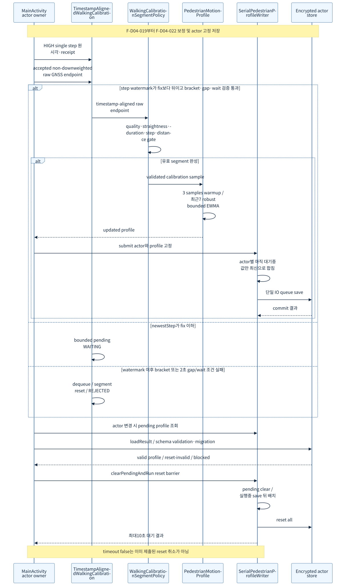

[Mermaid 원본](../diagrams/D04-sequence-profile.mmd) · [SVG](../rendered/D04-sequence-profile.svg)

[Mermaid 원본](../diagrams/D04-overview.mmd) · [SVG](../rendered/D04-overview.svg)

## F-D04-020 신뢰할 수 있는 직선 구간에서 보정 샘플 생성

| 항목 | 명세 |
| --- | --- |
| 분야 | D04 방향·위치·GNSS·걸음·PDR·동작·보행 보정 |
| 목적 | 턴·지터·위치 drift·정지 구간이 보폭 학습에 들어가지 않게 제한 |
| 사용 주체 | 제품 사용자 MainActivity |
| 활성 상태 | ACTIVE |
| 진입점 | apps/android/app/src/main/java/kr/co/hanium/dreamup/walksafe/navigation/positioning/WalkingCalibrationSegmentPolicy.kt:42 observe / credibilityRejectionReason apps/android/app/src/main/java/kr/co/hanium/dreamup/walksafe/navigation/positioning/WalkingCalibrationEndpointEvidence.kt:4 WalkingCalibrationStepBracket apps/android/app/src/main/java/kr/co/hanium/dreamup/walksafe/navigation/positioning/WalkingCalibrationDiagnostics.kt:3 WalkingCalibrationDecision |
| 실행 전제 | 제품 MainActivity의 현재 위치/보행 수집 소유권이 유효하고 해당 센서·권한이 허용된 경우. 기능별 입력 검사를 추가 적용한다. |
| 입력 출처 형식 검증 최신성 | aligned fix, count, step bracket. endpointAccuracy=hypot(start/end raw gate accuracy). distance는 전체 endpoint ENU chord이며 작은 GNSS segments 합이 아님. |

### 시작 이벤트와 처리 순서

| 이벤트 ID | 발생원 | 이벤트 | 수신부 | 흐름 |
| --- | --- | --- | --- | --- |
| E-D04-020-01 | 정렬된 calibration endpoint | observe | WalkingCalibrationSegmentPolicy | raw quality/직선성/시간/걸음 검사 → candidate 유지·재시작·완성 |
| E-D04-020-02 | segment 만료 또는 불일치 | 다음 endpoint | WalkingCalibrationSegmentPolicy | candidate 폐기와 diagnostics reason → 현재 유효 endpoint부터 재시작 |

1. 1. 첫 fix로 anchor를 세우고 raw quality·시각·걸음 연속성을 매 fix 검사한다.
2. 2. course offset 범위≤15°, 순간 displacement≤trapezoid speed distance+2×intervalAccuracy, 전방·횡방향 corridor를 검사한다.
3. 3. 20steps/10s/max(15m,5σproxy)를 채운 뒤 endpoint 거리와 raw speed trapezoid 적분의 차≤max(2m,25%) 확인한다.
4. 4. WalkingCalibrationSample에 원 두 endpoint time/gateAccuracyProxy/step bracket을 넣고 끝점을 다음 anchor로 사용한다.

| 분기 조건 | 실제 처리 결과 | 구현 근거 |
| --- | --- | --- |
| turn/reverse/lateral/jump 또는 raw 증거 누락 | reset·REJECTED | apps/android/app/src/main/java/kr/co/hanium/dreamup/walksafe/navigation/positioning/WalkingCalibrationSegmentPolicy.kt:42 observe / credibilityRejectionReason |
| 최소 step/duration/distance 미달 | WAITING 유지 | apps/android/app/src/main/java/kr/co/hanium/dreamup/walksafe/navigation/positioning/WalkingCalibrationSegmentPolicy.kt:42 observe / credibilityRejectionReason |
| fix gap/구간60초초과/count regression | 현재 fix를 새 anchor로 시작하고 기존 구간 거부 | apps/android/app/src/main/java/kr/co/hanium/dreamup/walksafe/navigation/positioning/WalkingCalibrationSegmentPolicy.kt:42 observe / credibilityRejectionReason |

### 효과 종료와 복구

호출자에게 구조화된 결과를 반환; 이 클래스 자체의 네트워크·음성 출력 없음.

| 상황 | 동작 |
| --- | --- |
| 정상 완료 | 현재 입력의 결과를 반환한다. |
| 실패 | 아래 거부 분기에서 값을 생성하지 않거나 명시된 상태를 반환한다. |
| 시간 초과 | 내부 타이머 없음; 다음 입력/조회에서 명시된 나이를 평가한다. |
| 중복 입력 | 동일 입력 처리 여부는 아래 시각·정체성 분기를 따른다. |
| 취소 | 별도 취소 API 없음; 소유자가 기능/수집을 종료한다. |
| 중단과 생명주기 | 소유자의 reset 또는 세대 변경 시 이전 세션 근거를 재사용하지 않는다. |
| 재시도 | 자동 재시도 없음; 다음 유효 입력에서 재평가한다. |
| 복구 | 다음 유효 입력과 기능별 복구 조건 충족 시 결과를 다시 제공한다. |
| 자원 정리 | 기능별 reset/stop 또는 소유자 참조 해제. |

### 상태 실행 맥락과 연결

| 항목 | 명세 |
| --- | --- |
| 초기 상태 | S-D04-020-NO_SEGMENT |
| 상태 목록 | S-D04-020-NO_SEGMENT S-D04-020-COLLECTING S-D04-020-COMPLETE S-D04-020-RESTARTED |
| 전이 조건과 전이 동작 | 유효 endpoint → COLLECTING 직선·품질 유지 → candidate 연장 duration10초·steps20·distance 기준 충족 → COMPLETE quality/straightness/gap 불만족 → RESTARTED 또는 NO_SEGMENT |
| 허용되지 않는 전이 | filtered/snapped 위치를 원시 GNSS endpoint로 보정하지 않음; 상태명은 public enum이 아닌 경우 코드 필드 조합의 문서 별칭이다. |
| 동시성 순서와 작업 소유권 | MainActivity의 직렬 콜백에서 동기 호출. 내부 코루틴·타이머 없음. 소유권 및 측정 시각 조건은 본문 참조. |
| 공유 상태와 다른 기능 연결 | F-D04-021 입력. gateAccuracyProxy는 원시 정확도 기반 허용 폭이며 실측 오차 보장이 아니다. |

### 정책 근거와 검증 범위

| 항목 | 근거 |
| --- | --- |
| 정책 | [P-D04-020](#P-D04-020) |
| 구현 | [apps/android/app/src/main/java/kr/co/hanium/dreamup/walksafe/navigation/positioning/WalkingCalibrationSegmentPolicy.kt:42](/home/ddobagi/Hanium_Dreamup/apps/android/app/src/main/java/kr/co/hanium/dreamup/walksafe/navigation/positioning/WalkingCalibrationSegmentPolicy.kt:42) · `observe / credibilityRejectionReason` (범위 42–269) [apps/android/app/src/main/java/kr/co/hanium/dreamup/walksafe/navigation/positioning/WalkingCalibrationEndpointEvidence.kt:4](/home/ddobagi/Hanium_Dreamup/apps/android/app/src/main/java/kr/co/hanium/dreamup/walksafe/navigation/positioning/WalkingCalibrationEndpointEvidence.kt:4) · `WalkingCalibrationStepBracket` (범위 4–24) [apps/android/app/src/main/java/kr/co/hanium/dreamup/walksafe/navigation/positioning/WalkingCalibrationDiagnostics.kt:3](/home/ddobagi/Hanium_Dreamup/apps/android/app/src/main/java/kr/co/hanium/dreamup/walksafe/navigation/positioning/WalkingCalibrationDiagnostics.kt:3) · `WalkingCalibrationDecision` (범위 3–83) |
| 기존 개선 ID | 개별 동일성 미확인; 분야 연관은 별도 추적표 |
| 기존 분야 | 08 09 |
| 기존 실행 증거 | 이번 명세는 2026-10-04 10:33:40 KST 고정 snapshot의 정적 분석만 사용. 과거 DONE·시험 횟수·기기 결과를 현재 실행 증거로 채택하지 않음. |
| 한계 및 구분 | 현장 오차·기기 센서 정확도·사용자 청취는 미검증. |

| 테스트 위치 | 심볼 | 증거 수준 | 기대와 한계 |
| --- | --- | --- | --- |
| [apps/android/app/src/test/java/kr/co/hanium/dreamup/walksafe/navigation/positioning/WalkingCalibrationSegmentPolicyTest.kt](/home/ddobagi/Hanium_Dreamup/apps/android/app/src/test/java/kr/co/hanium/dreamup/walksafe/navigation/positioning/WalkingCalibrationSegmentPolicyTest.kt) | rejectsPlausibleStrideWhenCoordinateDriftDisagreesWithRawSpeed | TEST_EXPECTATION | 보폭 숫자가 그럴듯해도 속도와 drift 불일치면 거부 기대; 이번 실행 없음. 해당 시험의 명명된 기대 및 관련 코드만 대조했다. |

### 이벤트 처리 그림


[Mermaid 원본](../diagrams/D04-F020.mmd) · [SVG](../rendered/D04-F020.svg)

[Mermaid 원본](../diagrams/D04-state-calibration.mmd) · [SVG](../rendered/D04-state-calibration.svg)

[Mermaid 원본](../diagrams/D04-sequence-profile.mmd) · [SVG](../rendered/D04-sequence-profile.svg)

[Mermaid 원본](../diagrams/D04-overview.mmd) · [SVG](../rendered/D04-overview.svg)

## F-D04-021 개인 보폭·속도·분산 프로필

| 항목 | 명세 |
| --- | --- |
| 분야 | D04 방향·위치·GNSS·걸음·PDR·동작·보행 보정 |
| 목적 | 제한된 신뢰 구간에서만 보폭과 PDR process noise를 갱신 |
| 사용 주체 | 제품 사용자 MainActivity |
| 활성 상태 | ACTIVE |
| 진입점 | apps/android/app/src/main/java/kr/co/hanium/dreamup/walksafe/navigation/positioning/PedestrianMotionProfile.kt:85 calibrate / currentSnapshot / updateCalibratedValues apps/android/app/src/main/java/kr/co/hanium/dreamup/walksafe/navigation/positioning/PositioningCoordinator.kt:657 stepLengthSigmaFor / applyProfileDynamics apps/android/app/src/main/java/kr/co/hanium/dreamup/walksafe/MainActivity.kt:45113 applyWalkingCalibrationResult |
| 실행 전제 | 제품 MainActivity의 현재 위치/보행 수집 소유권이 유효하고 해당 센서·권한이 허용된 경우. 기능별 입력 검사를 추가 적용한다. |
| 입력 출처 형식 검증 최신성 | WalkingCalibrationSample 및 stepInput/mounting 명시 condition. condition token은 [A-Z][A-Z0-9_]{0,39}. |

### 시작 이벤트와 처리 순서

| 이벤트 ID | 발생원 | 이벤트 | 수신부 | 흐름 |
| --- | --- | --- | --- | --- |
| E-D04-021-01 | 유효 calibration segment | apply sample | PedestrianMotionProfile | sample bounds → 3개 warmup → 최근7 robust 통계 → 제한된 EWMA profile |
| E-D04-021-02 | Main actor/load 변경 | restore/reset profile | PositioningCoordinator | 기존 profile 복원/기본값 → 신규 evidence warmup; process noise와 depth/step 소비자 반영 |

1. 1. 샘플 유효성 실패면 rejected counter만 증가하고 학습값은 유지한다.
2. 2. 유효 sample의 distance/steps와 distance/time을 최근7개에 추가한다. 3개 미만은 ACCEPTED_WARMUP이며 default를 반환한다.
3. 3. median 보폭/속도, 1.4826×MAD의 제곱 분산을 bounded EWMA로 갱신한다. 분산0.0025..1, process sigma=0.5+sqrt(variance)/0.4를0.5..3으로 clamp한다.
4. 4. Main은 보폭을 StepLengthEstimator와 기존/현재 objectDepthPipeline에 동시에 전달하며 보정된 persistence snapshot을 enqueue한다.

| 분기 조건 | 실제 처리 결과 | 구현 근거 |
| --- | --- | --- |
| 샘플3개 미만 | 기본0.65m/1.20m/s, persistence null | apps/android/app/src/main/java/kr/co/hanium/dreamup/walksafe/navigation/positioning/PedestrianMotionProfile.kt:85 calibrate / currentSnapshot / updateCalibratedValues |
| restore 숫자/범위/condition 부적합 | atomic false; 기존 상태 유지 | apps/android/app/src/main/java/kr/co/hanium/dreamup/walksafe/navigation/positioning/PedestrianMotionProfile.kt:85 calibrate / currentSnapshot / updateCalibratedValues |
| 현재 calibration source/mount 불일치 | 프로필 값은 유지하지만 PDR 보폭sigma0.15 | apps/android/app/src/main/java/kr/co/hanium/dreamup/walksafe/navigation/positioning/PedestrianMotionProfile.kt:85 calibrate / currentSnapshot / updateCalibratedValues |

### 효과 종료와 복구

profile 파라미터 갱신 후 depth fusion, motion segmentation, monocular depth estimator의 step-length 추정을 갱신하고 actor별 비동기 저장을 요청한다.

| 상황 | 동작 |
| --- | --- |
| 정상 완료 | 현재 입력의 결과를 반환한다. |
| 실패 | 아래 거부 분기에서 값을 생성하지 않거나 명시된 상태를 반환한다. |
| 시간 초과 | 내부 타이머 없음; 다음 입력/조회에서 명시된 나이를 평가한다. |
| 중복 입력 | 동일 입력 처리 여부는 아래 시각·정체성 분기를 따른다. |
| 취소 | 별도 취소 API 없음; 소유자가 기능/수집을 종료한다. |
| 중단과 생명주기 | 소유자의 reset 또는 세대 변경 시 이전 세션 근거를 재사용하지 않는다. |
| 재시도 | 자동 재시도 없음; 다음 유효 입력에서 재평가한다. |
| 복구 | 다음 유효 입력과 기능별 복구 조건 충족 시 결과를 다시 제공한다. |
| 자원 정리 | 기능별 reset/stop 또는 소유자 참조 해제. |

### 상태 실행 맥락과 연결

| 항목 | 명세 |
| --- | --- |
| 초기 상태 | S-D04-021-DEFAULT |
| 상태 목록 | S-D04-021-DEFAULT S-D04-021-WARMUP S-D04-021-CALIBRATED S-D04-021-RESTORED |
| 전이 조건과 전이 동작 | 첫 유효 sample → WARMUP 3개 유효 sample → robust bounded update → CALIBRATED load profile → RESTORED; 새 evidence warmup 필요 invalid sample → profile 유지; diagnostics reject reset → DEFAULT |
| 허용되지 않는 전이 | 저품질·짧은·회전 segment를 profile 학습으로 승인하지 않음; 상태명은 public enum이 아닌 경우 코드 필드 조합의 문서 별칭이다. |
| 동시성 순서와 작업 소유권 | MainActivity의 직렬 콜백에서 동기 호출. 내부 코루틴·타이머 없음. 소유권 및 측정 시각 조건은 본문 참조. |
| 공유 상태와 다른 기능 연결 | F-D04-016 PDR 및 D07 depth 보폭 소비. F-D04-022 actor별 저장. |

### 정책 근거와 검증 범위

| 항목 | 근거 |
| --- | --- |
| 정책 | [P-D04-021](#P-D04-021) |
| 구현 | [apps/android/app/src/main/java/kr/co/hanium/dreamup/walksafe/navigation/positioning/PedestrianMotionProfile.kt:85](/home/ddobagi/Hanium_Dreamup/apps/android/app/src/main/java/kr/co/hanium/dreamup/walksafe/navigation/positioning/PedestrianMotionProfile.kt:85) · `calibrate / currentSnapshot / updateCalibratedValues` (범위 85–328) [apps/android/app/src/main/java/kr/co/hanium/dreamup/walksafe/navigation/positioning/PositioningCoordinator.kt:657](/home/ddobagi/Hanium_Dreamup/apps/android/app/src/main/java/kr/co/hanium/dreamup/walksafe/navigation/positioning/PositioningCoordinator.kt:657) · `stepLengthSigmaFor / applyProfileDynamics` (범위 657–674) [apps/android/app/src/main/java/kr/co/hanium/dreamup/walksafe/MainActivity.kt:45113](/home/ddobagi/Hanium_Dreamup/apps/android/app/src/main/java/kr/co/hanium/dreamup/walksafe/MainActivity.kt:45113) · `applyWalkingCalibrationResult` (범위 45113–45147) |
| 기존 개선 ID | 개별 동일성 미확인; 분야 연관은 별도 추적표 |
| 기존 분야 | 08 09 |
| 기존 실행 증거 | 이번 명세는 2026-10-04 10:33:40 KST 고정 snapshot의 정적 분석만 사용. 과거 DONE·시험 횟수·기기 결과를 현재 실행 증거로 채택하지 않음. |
| 한계 및 구분 | 현장 오차·기기 센서 정확도·사용자 청취는 미검증. |

| 테스트 위치 | 심볼 | 증거 수준 | 기대와 한계 |
| --- | --- | --- | --- |
| [apps/android/app/src/test/java/kr/co/hanium/dreamup/walksafe/navigation/positioning/PedestrianMotionProfileTest.kt](/home/ddobagi/Hanium_Dreamup/apps/android/app/src/test/java/kr/co/hanium/dreamup/walksafe/navigation/positioning/PedestrianMotionProfileTest.kt) | usesRecentMedianAndBoundsEachEwmaUpdate | TEST_EXPECTATION | median/EWMA 및 갱신폭 제한 기대; 이번 실행 없음. 해당 시험의 명명된 기대 및 관련 코드만 대조했다. |

### 이벤트 처리 그림


[Mermaid 원본](../diagrams/D04-F021.mmd) · [SVG](../rendered/D04-F021.svg)

[Mermaid 원본](../diagrams/D04-state-calibration.mmd) · [SVG](../rendered/D04-state-calibration.svg)

[Mermaid 원본](../diagrams/D04-sequence-sensor-fusion.mmd) · [SVG](../rendered/D04-sequence-sensor-fusion.svg)

[Mermaid 원본](../diagrams/D04-sequence-profile.mmd) · [SVG](../rendered/D04-sequence-profile.svg)

[Mermaid 원본](../diagrams/D04-overview.mmd) · [SVG](../rendered/D04-overview.svg)

## F-D04-022 개인 보행 프로필 저장·복원·이전 형식 이관

| 항목 | 명세 |
| --- | --- |
| 분야 | D04 방향·위치·GNSS·걸음·PDR·동작·보행 보정 |
| 목적 | actor 교체와 지연 write에서 다른 사용자의 보폭이 섞이지 않게 저장 |
| 사용 주체 | 제품 사용자 MainActivity |
| 활성 상태 | ACTIVE |
| 진입점 | apps/android/app/src/main/java/kr/co/hanium/dreamup/walksafe/navigation/positioning/AndroidPedestrianProfileStore.kt:11 loadResult / save / resetAllProfiles apps/android/app/src/main/java/kr/co/hanium/dreamup/walksafe/navigation/positioning/SerialPedestrianProfileWriter.kt:17 submit / clearPendingAndRun / drain apps/android/app/src/main/java/kr/co/hanium/dreamup/walksafe/MainActivity.kt:43805 ensurePositioningProfileForCurrentActor / persistPositioningProfileForCurrentActor |
| 실행 전제 | 제품 MainActivity의 현재 위치/보행 수집 소유권이 유효하고 해당 센서·권한이 허용된 경우. 기능별 입력 검사를 추가 적용한다. |
| 입력 출처 형식 검증 최신성 | 검증된 persisted profile과 actor ID. 평문 위치나 센서 창은 저장하지 않음. v3의 step_input/mounting/last_calibrated_at metadata. |

### 시작 이벤트와 처리 순서

| 이벤트 ID | 발생원 | 이벤트 | 수신부 | 흐름 |
| --- | --- | --- | --- | --- |
| E-D04-022-01 | Main actor 변경 | loadResult | AndroidPedestrianProfileStore | 해당 actor pending 최신값 우선 → 암호화 record 검증/이관 → profile restore |
| E-D04-022-02 | profile 변경 | submit | SerialPedestrianProfileWriter | actor 고정 → 대기값 coalesce → 단일 IO queue save |
| E-D04-022-03 | 데이터 삭제/초기화 | clearPendingAndRun | SerialPedestrianProfileWriter | pending 제거 → 실행중 write 뒤 reset barrier → 10초까지 결과 대기 |

1. 1. load는 blocked/absence를 구분한다. 부적합 record만 삭제하거나 fail closed하고, 이전 schema는 현재 JSON으로 이관하되 실제 없는 보정 시각을 만들지 않는다.
2. 2. Main actor 변경 시 coordinator를 새로 만들고 해당 actor의 pending 최신 profile을 먼저 읽은 후 store를 복원한다.
3. 3. submit 시 actor/profile/save를 고정하며 한 actor의 아직 대기 중인 값은 최신값으로 바꾼다. 실행 중 save 이후 도착한 값은 이어서 저장한다.
4. 4. reset barrier는 pending map을 지우고 동일 IO queue에 reset을 제출하여 이미 실행 중 save 뒤에 배치한다.

| 분기 조건 | 실제 처리 결과 | 구현 근거 |
| --- | --- | --- |
| save executor rejected | pending 제거, false | apps/android/app/src/main/java/kr/co/hanium/dreamup/walksafe/navigation/positioning/AndroidPedestrianProfileStore.kt:11 loadResult / save / resetAllProfiles |
| save 실패 | drain이 예외를 밖으로 보내지 않음; 호출 true는 disk 완료 증거 아님 | apps/android/app/src/main/java/kr/co/hanium/dreamup/walksafe/navigation/positioning/AndroidPedestrianProfileStore.kt:11 loadResult / save / resetAllProfiles |
| unknown schema/model 또는 invalid row | 해당 row reset; 삭제 실패면 STORE_BLOCKED | apps/android/app/src/main/java/kr/co/hanium/dreamup/walksafe/navigation/positioning/AndroidPedestrianProfileStore.kt:11 loadResult / save / resetAllProfiles |
| barrier timeout/interrupted/execution failure | false; interrupt flag 복원 | apps/android/app/src/main/java/kr/co/hanium/dreamup/walksafe/navigation/positioning/AndroidPedestrianProfileStore.kt:11 loadResult / save / resetAllProfiles |

### 효과 종료와 복구

호출자에게 구조화된 결과를 반환; 이 클래스 자체의 네트워크·음성 출력 없음.

| 상황 | 동작 |
| --- | --- |
| 정상 완료 | 현재 입력의 결과를 반환한다. |
| 실패 | 아래 거부 분기에서 값을 생성하지 않거나 명시된 상태를 반환한다. |
| 시간 초과 | 내부 타이머 없음; 다음 입력/조회에서 명시된 나이를 평가한다. |
| 중복 입력 | 동일 입력 처리 여부는 아래 시각·정체성 분기를 따른다. |
| 취소 | 별도 취소 API 없음; 소유자가 기능/수집을 종료한다. |
| 중단과 생명주기 | 소유자의 reset 또는 세대 변경 시 이전 세션 근거를 재사용하지 않는다. |
| 재시도 | 자동 재시도 없음; 다음 유효 입력에서 재평가한다. |
| 복구 | 다음 유효 입력과 기능별 복구 조건 충족 시 결과를 다시 제공한다. |
| 자원 정리 | 기능별 reset/stop 또는 소유자 참조 해제. |

### 상태 실행 맥락과 연결

| 항목 | 명세 |
| --- | --- |
| 초기 상태 | S-D04-022-IDLE |
| 상태 목록 | S-D04-022-IDLE S-D04-022-QUEUED S-D04-022-WRITING S-D04-022-RESET_BARRIER S-D04-022-STORE_BLOCKED |
| 전이 조건과 전이 동작 | submit → QUEUED; actor별 최신 대기값 대체 drain → WRITING 추가 pending 없음 → IDLE clearPendingAndRun → RESET_BARRIER 암호화 store/무효 record 삭제 실패 → STORE_BLOCKED |
| 허용되지 않는 전이 | 대기 actor를 실행 시 현재 계정으로 다시 해석하지 않음; 상태명은 public enum이 아닌 경우 코드 필드 조합의 문서 별칭이다. |
| 동시성 순서와 작업 소유권 | walksafe-pedestrian-profile-io 단일 daemon executor. pending map synchronized, store load/save synchronized. main submit은 commit 완료를 기다리지 않음. clearPendingAndRun만 FutureTask 대기. |
| 공유 상태와 다른 기능 연결 | 개인정보 저장 원천 AndroidSensitivePreferenceStore 세부 암호화는 보안/저장 영역. F-D04-021 profile source. |

### 정책 근거와 검증 범위

| 항목 | 근거 |
| --- | --- |
| 정책 | [P-D04-022](#P-D04-022) |
| 구현 | [apps/android/app/src/main/java/kr/co/hanium/dreamup/walksafe/navigation/positioning/AndroidPedestrianProfileStore.kt:11](/home/ddobagi/Hanium_Dreamup/apps/android/app/src/main/java/kr/co/hanium/dreamup/walksafe/navigation/positioning/AndroidPedestrianProfileStore.kt:11) · `loadResult / save / resetAllProfiles` (범위 11–296) [apps/android/app/src/main/java/kr/co/hanium/dreamup/walksafe/navigation/positioning/SerialPedestrianProfileWriter.kt:17](/home/ddobagi/Hanium_Dreamup/apps/android/app/src/main/java/kr/co/hanium/dreamup/walksafe/navigation/positioning/SerialPedestrianProfileWriter.kt:17) · `submit / clearPendingAndRun / drain` (범위 17–107) [apps/android/app/src/main/java/kr/co/hanium/dreamup/walksafe/MainActivity.kt:43805](/home/ddobagi/Hanium_Dreamup/apps/android/app/src/main/java/kr/co/hanium/dreamup/walksafe/MainActivity.kt:43805) · `ensurePositioningProfileForCurrentActor / persistPositioningProfileForCurrentActor` (범위 43805–43855) |
| 기존 개선 ID | 개별 동일성 미확인; 분야 연관은 별도 추적표 |
| 기존 분야 | 08 09 |
| 기존 실행 증거 | 이번 명세는 2026-10-04 10:33:40 KST 고정 snapshot의 정적 분석만 사용. 과거 DONE·시험 횟수·기기 결과를 현재 실행 증거로 채택하지 않음. |
| 한계 및 구분 | 현장 오차·기기 센서 정확도·사용자 청취는 미검증. |

| 테스트 위치 | 심볼 | 증거 수준 | 기대와 한계 |
| --- | --- | --- | --- |
| [apps/android/app/src/test/java/kr/co/hanium/dreamup/walksafe/navigation/positioning/AndroidPedestrianProfileStoreTest.kt](/home/ddobagi/Hanium_Dreamup/apps/android/app/src/test/java/kr/co/hanium/dreamup/walksafe/navigation/positioning/AndroidPedestrianProfileStoreTest.kt) | v1RecordMigratesWithUnknownCalibrationTime | TEST_EXPECTATION | 이관 시 시각을 발명하지 않는 기대; 이번 실행 없음. 해당 시험의 명명된 기대 및 관련 코드만 대조했다. |
| [apps/android/app/src/test/java/kr/co/hanium/dreamup/walksafe/navigation/positioning/SerialPedestrianProfileWriterTest.kt](/home/ddobagi/Hanium_Dreamup/apps/android/app/src/test/java/kr/co/hanium/dreamup/walksafe/navigation/positioning/SerialPedestrianProfileWriterTest.kt) | theActorIsFixedAtSubmissionEvenIfTheAccountChangesBeforeTheWrite | TEST_EXPECTATION | actor가 저장 제출 시 고정되는 기대; 이번 실행 없음. 해당 시험의 명명된 기대 및 관련 코드만 대조했다. |

### 이벤트 처리 그림


[Mermaid 원본](../diagrams/D04-F022.mmd) · [SVG](../rendered/D04-F022.svg)

[Mermaid 원본](../diagrams/D04-sequence-profile.mmd) · [SVG](../rendered/D04-sequence-profile.svg)

[Mermaid 원본](../diagrams/D04-overview.mmd) · [SVG](../rendered/D04-overview.svg)

## F-D04-023 불확실도 기반 경로 좌표 매칭

| 항목 | 명세 |
| --- | --- |
| 분야 | D04 방향·위치·GNSS·걸음·PDR·동작·보행 보정 |
| 목적 | filtered 위치와 경로 투영 좌표를 분리하고 교차·평행 길의 잘못된 branch 확정을 늦춤 |
| 사용 주체 | 제품 사용자 MainActivity |
| 활성 상태 | ACTIVE |
| 진입점 | apps/android/app/src/main/java/kr/co/hanium/dreamup/walksafe/navigation/positioning/RouteCorridorMatcher.kt:95 match / resolveBranch / score / buildCandidates apps/android/app/src/main/java/kr/co/hanium/dreamup/walksafe/navigation/RouteNavigator.kt:139 routeCorridorMatcher construction |
| 실행 전제 | 제품 MainActivity의 현재 위치/보행 수집 소유권이 유효하고 해당 센서·권한이 허용된 경우. 기능별 입력 검사를 추가 적용한다. |
| 입력 출처 형식 검증 최신성 | routeId/polyline, FilteredRoutePosition(point, uncertainty kind, covariance, heading,time), previous progress/time 및 선택적인 evaluatedAt/maxAge. |

### 시작 이벤트와 처리 순서

| 이벤트 ID | 발생원 | 이벤트 | 수신부 | 흐름 |
| --- | --- | --- | --- | --- |
| E-D04-023-01 | D03 RouteNavigator | route position update | RouteCorridorMatcher.match | geometry·시각 검증 → corridor 후보 scoring → branch evidence → quality/match |
| E-D04-023-02 | route geometry 변경 | route points bits 변화 | RouteCorridorMatcher | active/pending/progress cache reset → 새 geometry로 재시작 |

1. 1. invalid·future·expired route/position를 검사하고 geometry를 캐시한다. 길이≤0.01m segment를 건너뛰며 같은 방향≤1°를 하나 corridor로 묶는다.
2. 2. 전체 경로의 후보를 조사하되 active 인근±12 segment부터 계산하고 bound로 불필요한 projection을 줄인다. corridor당 nearest를 scoring한다.
3. 3. cost·fit·경쟁분리도와 connected branch/역방향 ambiguity를 평가한다. 비연결 branch는 1.5 cost 우세와 2회 연속(≤5초)이 필요하다.
4. 4. HIGH/MEDIUM만 active corridor/progress/time/bearing을 갱신한다. filteredPoint와 matchedPoint를 별도 반환한다.

| 분기 조건 | 실제 처리 결과 | 구현 근거 |
| --- | --- | --- |
| corridor 외부 | UNMATCHED CORRIDOR_OUTSIDE | apps/android/app/src/main/java/kr/co/hanium/dreamup/walksafe/navigation/positioning/RouteCorridorMatcher.kt:95 match / resolveBranch / score / buildCandidates |
| branch 우세 미달 | ACTIVE_BRANCH_RETAINED LOW | apps/android/app/src/main/java/kr/co/hanium/dreamup/walksafe/navigation/positioning/RouteCorridorMatcher.kt:95 match / resolveBranch / score / buildCandidates |
| branch 첫 우세 관측 | BRANCH_SWITCH_PENDING LOW | apps/android/app/src/main/java/kr/co/hanium/dreamup/walksafe/navigation/positioning/RouteCorridorMatcher.kt:95 match / resolveBranch / score / buildCandidates |
| 역방향 branch가 방문순서로 배제되지 않음 | AMBIGUOUS_CANDIDATES LOW | apps/android/app/src/main/java/kr/co/hanium/dreamup/walksafe/navigation/positioning/RouteCorridorMatcher.kt:95 match / resolveBranch / score / buildCandidates |

### 효과 종료와 복구

호출자에게 구조화된 결과를 반환; 이 클래스 자체의 네트워크·음성 출력 없음.

| 상황 | 동작 |
| --- | --- |
| 정상 완료 | 현재 입력의 결과를 반환한다. |
| 실패 | 아래 거부 분기에서 값을 생성하지 않거나 명시된 상태를 반환한다. |
| 시간 초과 | 내부 타이머 없음; 다음 입력/조회에서 명시된 나이를 평가한다. |
| 중복 입력 | 동일 입력 처리 여부는 아래 시각·정체성 분기를 따른다. |
| 취소 | 별도 취소 API 없음; 소유자가 기능/수집을 종료한다. |
| 중단과 생명주기 | 소유자의 reset 또는 세대 변경 시 이전 세션 근거를 재사용하지 않는다. |
| 재시도 | 자동 재시도 없음; 다음 유효 입력에서 재평가한다. |
| 복구 | 다음 유효 입력과 기능별 복구 조건 충족 시 결과를 다시 제공한다. |
| 자원 정리 | 기능별 reset/stop 또는 소유자 참조 해제. |

### 상태 실행 맥락과 연결

| 항목 | 명세 |
| --- | --- |
| 초기 상태 | S-D04-023-UNMATCHED |
| 상태 목록 | S-D04-023-UNMATCHED S-D04-023-ACTIVE S-D04-023-BRANCH_SWITCH_PENDING S-D04-023-ACTIVE_BRANCH_RETAINED |
| 전이 조건과 전이 동작 | 유효 HIGH/MEDIUM match → ACTIVE 비연결 branch 첫 충분 우세 → BRANCH_SWITCH_PENDING 5초 내 두 번째 충분 우세 → 새 ACTIVE 우세 미달 → ACTIVE_BRANCH_RETAINED LOW geometry/invalid/outside → pending reset |
| 허용되지 않는 전이 | LOW 후보로 active corridor/progress 확정 금지; 상태명은 public enum이 아닌 경우 코드 필드 조합의 문서 별칭이다. |
| 동시성 순서와 작업 소유권 | MainActivity의 직렬 콜백에서 동기 호출. 내부 코루틴·타이머 없음. 소유권 및 측정 시각 조건은 본문 참조. |
| 공유 상태와 다른 기능 연결 | D03 RouteNavigator owns matcher; F-D04-024 route alignment와 D07 route projection은 match quality를 별도 소비. |

### 정책 근거와 검증 범위

| 항목 | 근거 |
| --- | --- |
| 정책 | [P-D04-023](#P-D04-023) |
| 구현 | [apps/android/app/src/main/java/kr/co/hanium/dreamup/walksafe/navigation/positioning/RouteCorridorMatcher.kt:95](/home/ddobagi/Hanium_Dreamup/apps/android/app/src/main/java/kr/co/hanium/dreamup/walksafe/navigation/positioning/RouteCorridorMatcher.kt:95) · `match / resolveBranch / score / buildCandidates` (범위 95–637) [apps/android/app/src/main/java/kr/co/hanium/dreamup/walksafe/navigation/RouteNavigator.kt:139](/home/ddobagi/Hanium_Dreamup/apps/android/app/src/main/java/kr/co/hanium/dreamup/walksafe/navigation/RouteNavigator.kt:139) · `routeCorridorMatcher construction` (범위 139–147) |
| 기존 개선 ID | 개별 동일성 미확인; 분야 연관은 별도 추적표 |
| 기존 분야 | 08 09 |
| 기존 실행 증거 | 이번 명세는 2026-10-04 10:33:40 KST 고정 snapshot의 정적 분석만 사용. 과거 DONE·시험 횟수·기기 결과를 현재 실행 증거로 채택하지 않음. |
| 한계 및 구분 | 현장 오차·기기 센서 정확도·사용자 청취는 미검증. |

| 테스트 위치 | 심볼 | 증거 수준 | 기대와 한계 |
| --- | --- | --- | --- |
| [apps/android/app/src/test/java/kr/co/hanium/dreamup/walksafe/navigation/positioning/RouteCorridorMatcherTest.kt](/home/ddobagi/Hanium_Dreamup/apps/android/app/src/test/java/kr/co/hanium/dreamup/walksafe/navigation/positioning/RouteCorridorMatcherTest.kt) | nonAdjacentIntersectionBranchRequiresTwoClearlyBetterSamples | TEST_EXPECTATION | 비인접 교차 branch 2회 우세 확인 기대; 이번 실행 없음. 해당 시험의 명명된 기대 및 관련 코드만 대조했다. |

### 이벤트 처리 그림


[Mermaid 원본](../diagrams/D04-F023.mmd) · [SVG](../rendered/D04-F023.svg)


[Mermaid 원본](../diagrams/D04-state-corridor.mmd) · [SVG](../rendered/D04-state-corridor.svg)

[Mermaid 원본](../diagrams/D04-overview.mmd) · [SVG](../rendered/D04-overview.svg)

## F-D04-024 경로 진행·출발·회전 통과에 맞춘 정렬 방위

| 항목 | 명세 |
| --- | --- |
| 분야 | D04 방향·위치·GNSS·걸음·PDR·동작·보행 보정 |
| 목적 | 가까운 좌표 하나만 보고 역방향 또는 아직 지나지 않은 회전 방향을 지시하지 않음 |
| 사용 주체 | 제품 사용자 MainActivity |
| 활성 상태 | ACTIVE |
| 진입점 | apps/android/app/src/main/java/kr/co/hanium/dreamup/walksafe/navigation/RouteAlignmentSelector.kt:59 select / continuingDepartureTarget / microLegTarget |
| 실행 전제 | 제품 MainActivity의 현재 위치/보행 수집 소유권이 유효하고 해당 센서·권한이 허용된 경우. 기능별 입력 검사를 추가 적용한다. |
| 입력 출처 형식 검증 최신성 | WalkingRoute, filtered position, corridor match, now, maxDistance, optional PendingRouteGuide(progress/vertexTolerance/passageMargin). |

### 시작 이벤트와 처리 순서

| 이벤트 ID | 발생원 | 이벤트 | 수신부 | 흐름 |
| --- | --- | --- | --- | --- |
| E-D04-024-01 | D03 RouteNavigator | 정렬방위 요청 | RouteAlignmentSelector.select | fresh position·local branch 검사 → 출발/일반 target → pending turn passage → bearing/null |

1. 1. route geometry와 projection을 계산하고 유효 이동이 확인되면 departure origin 고정을 해제한다.
2. 2. plausible local 후보의 반대방향>135° 또는 >45°이며 멀리 떨어진 진행도 경쟁을 검사한다. branch pending/retained일 때 방위를 내지 않는다.
3. 3. 출발 origin이 여전히 적합하면 첫 segment 혹은 connector를 선택한다. 1m 미만 micro segment는30°내 연속구간을 이어 15m lookahead/최소1m baseline을 확보한다.
4. 4. 일반 구간은 accepted match 우선, 없으면 모든 local bearing이 nearest와15°내인 경우만 선택한다. pending turn 이후 passageMargin 안이면 TURN_PASSAGE_PENDING, 최종1m 이내면 NEAR_ROUTE_END.

| 분기 조건 | 실제 처리 결과 | 구현 근거 |
| --- | --- | --- |
| 경쟁 branch/근처 loop 종점/짧은 baseline | 방위 null과 구체 reason | apps/android/app/src/main/java/kr/co/hanium/dreamup/walksafe/navigation/RouteAlignmentSelector.kt:59 select / continuingDepartureTarget / microLegTarget |
| accepted segment 뒤에 pending turn vertex를 아직 확실히 통과하지 않음 | TURN_PASSAGE_PENDING | apps/android/app/src/main/java/kr/co/hanium/dreamup/walksafe/navigation/RouteAlignmentSelector.kt:59 select / continuingDepartureTarget / microLegTarget |
| lateral distance>max(8,accuracy) | lateralOffsetBeyondUncertainty 진단 | apps/android/app/src/main/java/kr/co/hanium/dreamup/walksafe/navigation/RouteAlignmentSelector.kt:59 select / continuingDepartureTarget / microLegTarget |

### 효과 종료와 복구

호출자에게 구조화된 결과를 반환; 이 클래스 자체의 네트워크·음성 출력 없음.

| 상황 | 동작 |
| --- | --- |
| 정상 완료 | 현재 입력의 결과를 반환한다. |
| 실패 | 아래 거부 분기에서 값을 생성하지 않거나 명시된 상태를 반환한다. |
| 시간 초과 | 내부 타이머 없음; 호출 시 명시된 관측 나이/시각을 검사한다. |
| 중복 입력 | 동일 입력 처리 여부는 아래 시각·정체성 분기를 따른다. |
| 취소 | 동기 계산이므로 별도 취소 API 없음. |
| 중단과 생명주기 | 동기 함수 호출 종료; worker나 보류 요청 없음. |
| 재시도 | 자동 재시도 없음; 다음 유효 입력에서 재평가한다. |
| 복구 | 다음 유효 입력과 기능별 복구 조건 충족 시 결과를 다시 제공한다. |
| 자원 정리 | 독립 resource 없음. 호출자가 보유한 입력·결과 참조의 수명만 적용. |

### 상태 실행 맥락과 연결

| 항목 | 명세 |
| --- | --- |
| 초기 상태 | S-D04-024-WAIT_INPUT |
| 상태 목록 | S-D04-024-WAIT_INPUT S-D04-024-VALID_RESULT S-D04-024-REJECTED |
| 전이 조건과 전이 동작 | 호출 입력 검증 통과 → VALID_RESULT → 호출 종료 호출 입력 검증 거부 → REJECTED → 호출 종료 |
| 허용되지 않는 전이 | 위 별칭은 호출 결과 분류이며 지속 상태 enum/worker를 추가하지 않는다. |
| 동시성 순서와 작업 소유권 | MainActivity의 직렬 콜백에서 동기 호출. 내부 코루틴·타이머 없음. 소유권 및 측정 시각 조건은 본문 참조. |
| 공유 상태와 다른 기능 연결 | D03 RouteNavigator가 pending guide와 maximumDistance를 전달. F-D04-025와 통합하여 사용자 상대방향 계산. |

### 정책 근거와 검증 범위

| 항목 | 근거 |
| --- | --- |
| 정책 | [P-D04-024](#P-D04-024) |
| 구현 | [apps/android/app/src/main/java/kr/co/hanium/dreamup/walksafe/navigation/RouteAlignmentSelector.kt:59](/home/ddobagi/Hanium_Dreamup/apps/android/app/src/main/java/kr/co/hanium/dreamup/walksafe/navigation/RouteAlignmentSelector.kt:59) · `select / continuingDepartureTarget / microLegTarget` (범위 59–376) |
| 기존 개선 ID | 개별 동일성 미확인; 분야 연관은 별도 추적표 |
| 기존 분야 | 08 09 |
| 기존 실행 증거 | 이번 명세는 2026-10-04 10:33:40 KST 고정 snapshot의 정적 분석만 사용. 과거 DONE·시험 횟수·기기 결과를 현재 실행 증거로 채택하지 않음. |
| 한계 및 구분 | RouteAlignmentSelector 세부 회귀 파일들은 인벤토리에 있으나 이번 테스트 실행 없음. D03 guide 소비와 별도 교차검토 필요. |

| 테스트 위치 | 심볼 | 증거 수준 | 기대와 한계 |
| --- | --- | --- | --- |
| [apps/android/app/src/test/java/kr/co/hanium/dreamup/walksafe/navigation/positioning/RouteCorridorMatcherTest.kt](/home/ddobagi/Hanium_Dreamup/apps/android/app/src/test/java/kr/co/hanium/dreamup/walksafe/navigation/positioning/RouteCorridorMatcherTest.kt) | parallelSegmentsWithoutEvidenceReturnLowAmbiguousConfidence | TEST_EXPECTATION | 관련 branch 불확실성은 match LOW로 남는 기대; 이번 실행 없음. 해당 시험의 명명된 기대 및 관련 코드만 대조했다. |

### 이벤트 처리 그림


[Mermaid 원본](../diagrams/D04-F024.mmd) · [SVG](../rendered/D04-F024.svg)

[Mermaid 원본](../diagrams/D04-state-corridor.mmd) · [SVG](../rendered/D04-state-corridor.svg)

[Mermaid 원본](../diagrams/D04-overview.mmd) · [SVG](../rendered/D04-overview.svg)

## F-D04-025 경로 상대방향과 시계방향 표현 허용

| 항목 | 명세 |
| --- | --- |
| 분야 | D04 방향·위치·GNSS·걸음·PDR·동작·보행 보정 |
| 목적 | 진북 route bearing과 휴대전화 후면 facing을 비교하되 경계 오차에서는 지시를 보류 |
| 사용 주체 | 제품 사용자 MainActivity |
| 활성 상태 | ACTIVE |
| 진입점 | apps/android/app/src/main/java/kr/co/hanium/dreamup/walksafe/navigation/RouteFacingGuidance.kt:87 isUsableObservation / evaluate |
| 실행 전제 | 제품 MainActivity의 현재 위치/보행 수집 소유권이 유효하고 해당 센서·권한이 허용된 경우. 기능별 입력 검사를 추가 적용한다. |
| 입력 출처 형식 검증 최신성 | RouteFacingObservation source/error/quality/time/rate/recoveryEpisode 및 route bearing uncertainty≥0. fallback은 numeric error null 계약. |

### 시작 이벤트와 처리 순서

| 이벤트 ID | 발생원 | 이벤트 | 수신부 | 흐름 |
| --- | --- | --- | --- | --- |
| E-D04-025-01 | D03 경로 UI/음성 | route bearing와 device observation | RouteFacingGuidance.evaluate | typed source gate → age/rate/route uncertainty margin → 앞좌우뒤 또는 보류 → clock 정밀도 별도 판정 |

1. 1. usable observation 검사 후 signed difference를 [-180,180)로 계산한다.
2. 2. sensor margin에 observation 이후 회전량과 route bearing 불확실도를 합산한다.
3. 3. 엄격한 앞/뒤 sector 후 좌/우 부호 범위로 판정한다. 오차 범위가 직진 또는 반대방향 경계를 걸치면 UNKNOWN.
4. 4. 30°시계 sector 중앙과 총오차를 검사하여 clockDirectionAllowed/clockPrecisionAvailable을 분리한다.

| 분기 조건 | 실제 처리 결과 | 구현 근거 |
| --- | --- | --- |
| old/future/error/source 형식 불일치 | UNKNOWN, signedDifference null | apps/android/app/src/main/java/kr/co/hanium/dreamup/walksafe/navigation/RouteFacingGuidance.kt:87 isUsableObservation / evaluate |
| 분류 margin 경계와 정확히 같음 | strict 비교 미충족으로 UNKNOWN 또는 다른 명확 부호 방향 | apps/android/app/src/main/java/kr/co/hanium/dreamup/walksafe/navigation/RouteFacingGuidance.kt:87 isUsableObservation / evaluate |
| fallback/suspect | clock precision 없음; 넓은 좌우앞뒤만 가능 | apps/android/app/src/main/java/kr/co/hanium/dreamup/walksafe/navigation/RouteFacingGuidance.kt:87 isUsableObservation / evaluate |

### 효과 종료와 복구

호출자에게 구조화된 결과를 반환; 이 클래스 자체의 네트워크·음성 출력 없음.

| 상황 | 동작 |
| --- | --- |
| 정상 완료 | 현재 입력의 결과를 반환한다. |
| 실패 | 아래 거부 분기에서 값을 생성하지 않거나 명시된 상태를 반환한다. |
| 시간 초과 | 내부 타이머 없음; 호출 시 명시된 관측 나이/시각을 검사한다. |
| 중복 입력 | 동일 입력 처리 여부는 아래 시각·정체성 분기를 따른다. |
| 취소 | 동기 계산이므로 별도 취소 API 없음. |
| 중단과 생명주기 | 동기 함수 호출 종료; worker나 보류 요청 없음. |
| 재시도 | 자동 재시도 없음; 다음 유효 입력에서 재평가한다. |
| 복구 | 다음 유효 입력과 기능별 복구 조건 충족 시 결과를 다시 제공한다. |
| 자원 정리 | 독립 resource 없음. 호출자가 보유한 입력·결과 참조의 수명만 적용. |

### 상태 실행 맥락과 연결

| 항목 | 명세 |
| --- | --- |
| 초기 상태 | S-D04-025-WAIT_INPUT |
| 상태 목록 | S-D04-025-WAIT_INPUT S-D04-025-VALID_RESULT S-D04-025-REJECTED |
| 전이 조건과 전이 동작 | 호출 입력 검증 통과 → VALID_RESULT → 호출 종료 호출 입력 검증 거부 → REJECTED → 호출 종료 |
| 허용되지 않는 전이 | 위 별칭은 호출 결과 분류이며 지속 상태 enum/worker를 추가하지 않는다. |
| 동시성 순서와 작업 소유권 | MainActivity의 직렬 콜백에서 동기 호출. 내부 코루틴·타이머 없음. 소유권 및 측정 시각 조건은 본문 참조. |
| 공유 상태와 다른 기능 연결 | F-D04-009/010 source와 F-D04-024 route bearing; D03의 실제 발화 token/완료·취소 정책은 D03/음성 영역. |

### 정책 근거와 검증 범위

| 항목 | 근거 |
| --- | --- |
| 정책 | [P-D04-025](#P-D04-025) |
| 구현 | [apps/android/app/src/main/java/kr/co/hanium/dreamup/walksafe/navigation/RouteFacingGuidance.kt:87](/home/ddobagi/Hanium_Dreamup/apps/android/app/src/main/java/kr/co/hanium/dreamup/walksafe/navigation/RouteFacingGuidance.kt:87) · `isUsableObservation / evaluate` (범위 87–177) |
| 기존 개선 ID | 개별 동일성 미확인; 분야 연관은 별도 추적표 |
| 기존 분야 | 08 09 |
| 기존 실행 증거 | 이번 명세는 2026-10-04 10:33:40 KST 고정 snapshot의 정적 분석만 사용. 과거 DONE·시험 횟수·기기 결과를 현재 실행 증거로 채택하지 않음. |
| 한계 및 구분 | 현장 오차·기기 센서 정확도·사용자 청취는 미검증. |

| 테스트 위치 | 심볼 | 증거 수준 | 기대와 한계 |
| --- | --- | --- | --- |
| [apps/android/app/src/test/java/kr/co/hanium/dreamup/walksafe/navigation/RouteFacingGuidanceTest.kt](/home/ddobagi/Hanium_Dreamup/apps/android/app/src/test/java/kr/co/hanium/dreamup/walksafe/navigation/RouteFacingGuidanceTest.kt) | uncertaintyAcrossStraightOrOppositeCannotChooseAnAlignmentSide | TEST_EXPECTATION | 직진/반대 경계의 불확실한 좌우를 선택하지 않는 기대; 이번 실행 없음. 해당 시험의 명명된 기대 및 관련 코드만 대조했다. |

### 이벤트 처리 그림


[Mermaid 원본](../diagrams/D04-F025.mmd) · [SVG](../rendered/D04-F025.svg)

[Mermaid 원본](../diagrams/D04-overview.mmd) · [SVG](../rendered/D04-overview.svg)

## F-D04-026 깊이·상태 UI용 사용자 속도와 두 종류 방향

| 항목 | 명세 |
| --- | --- |
| 분야 | D04 방향·위치·GNSS·걸음·PDR·동작·보행 보정 |
| 목적 | 이동방향과 휴대전화가 향한 방향의 서로 다른 출처를 유지 |
| 사용 주체 | 제품 사용자 MainActivity |
| 활성 상태 | ACTIVE |
| 진입점 | apps/android/app/src/main/java/kr/co/hanium/dreamup/walksafe/navigation/UserMotionEstimate.kt:47 UserMotionEstimateFactory.estimate apps/android/app/src/main/java/kr/co/hanium/dreamup/walksafe/MainActivity.kt:44773 buildDepthMotionContext / currentUserMotionStatusText apps/android/app/src/main/java/kr/co/hanium/dreamup/walksafe/MainActivity.kt:44639 currentUserMotionStatusText |
| 실행 전제 | 제품 MainActivity의 현재 위치/보행 수집 소유권이 유효하고 해당 센서·권한이 허용된 경우. 기능별 입력 검사를 추가 적용한다. |
| 입력 출처 형식 검증 최신성 | 같은 original fix의 speed/course/evidence와 independent phone heading. optional raw lat/lon/ns/id도 제공된 경우 검증. |

### 시작 이벤트와 처리 순서

| 이벤트 ID | 발생원 | 이벤트 | 수신부 | 흐름 |
| --- | --- | --- | --- | --- |
| E-D04-026-01 | Main 거리·TTC/깊이 처리 | 현재 위치와 phone heading 조회 | UserMotionEstimateFactory | fix/course/phone 각각 time·quality 검사 → nullable 독립 typed motion fields |
| E-D04-026-02 | Main depth queue | motion/frame confidence 조회 | Main buildDepthMotionContext | GNSS age와 motion source confidence를 분리 적용 → depth 처리 |

1. 1. location을 mock·age·accuracy·원 metadata로 검증하고 같은 fix의 speed만 수용한다.
2. 2. course는 실제 이동의 lower bound≥0.5와 동일 시각·error를 통과해야 수용한다.
3. 3. phone heading는 위치 실패와 무관하게 자체 fresh/accuracy로 수용하며 각각 정규화한다.
4. 4. Main은 상태 텍스트 및 depth MotionContext에 전달한다. depth freshnessQuality는 trusted age≤2.5s:1, ≤7.5s:0.75, 이후0.45, 위치 없음0.7.

| 분기 조건 | 실제 처리 결과 | 구현 근거 |
| --- | --- | --- |
| missing/noisy/mock location | speed/course null, 독립 phone 값 가능 | apps/android/app/src/main/java/kr/co/hanium/dreamup/walksafe/navigation/UserMotionEstimate.kt:47 UserMotionEstimateFactory.estimate |
| reported 0이지만 accuracy>0.2 | speed도 null | apps/android/app/src/main/java/kr/co/hanium/dreamup/walksafe/navigation/UserMotionEstimate.kt:47 UserMotionEstimateFactory.estimate |
| 느린 속도 lower bound<0.5 | speed만, course null | apps/android/app/src/main/java/kr/co/hanium/dreamup/walksafe/navigation/UserMotionEstimate.kt:47 UserMotionEstimateFactory.estimate |

### 효과 종료와 복구

호출자에게 구조화된 결과를 반환; 이 클래스 자체의 네트워크·음성 출력 없음.

| 상황 | 동작 |
| --- | --- |
| 정상 완료 | 현재 입력의 결과를 반환한다. |
| 실패 | 아래 거부 분기에서 값을 생성하지 않거나 명시된 상태를 반환한다. |
| 시간 초과 | 내부 타이머 없음; 호출 시 명시된 관측 나이/시각을 검사한다. |
| 중복 입력 | 동일 입력 처리 여부는 아래 시각·정체성 분기를 따른다. |
| 취소 | 동기 계산이므로 별도 취소 API 없음. |
| 중단과 생명주기 | 동기 함수 호출 종료; worker나 보류 요청 없음. |
| 재시도 | 자동 재시도 없음; 다음 유효 입력에서 재평가한다. |
| 복구 | 다음 유효 입력과 기능별 복구 조건 충족 시 결과를 다시 제공한다. |
| 자원 정리 | 독립 resource 없음. 호출자가 보유한 입력·결과 참조의 수명만 적용. |

### 상태 실행 맥락과 연결

| 항목 | 명세 |
| --- | --- |
| 초기 상태 | S-D04-026-WAIT_INPUT |
| 상태 목록 | S-D04-026-WAIT_INPUT S-D04-026-VALID_RESULT S-D04-026-REJECTED |
| 전이 조건과 전이 동작 | 호출 입력 검증 통과 → VALID_RESULT → 호출 종료 호출 입력 검증 거부 → REJECTED → 호출 종료 |
| 허용되지 않는 전이 | 위 별칭은 호출 결과 분류이며 지속 상태 enum/worker를 추가하지 않는다. |
| 동시성 순서와 작업 소유권 | MainActivity의 직렬 콜백에서 동기 호출. 내부 코루틴·타이머 없음. 소유권 및 측정 시각 조건은 본문 참조. |
| 공유 상태와 다른 기능 연결 | D07/깊이 MotionContext userMotion와 상세 UI. 통합 movement/rotation state는 F-D04-007 별도. |

### 정책 근거와 검증 범위

| 항목 | 근거 |
| --- | --- |
| 정책 | [P-D04-026](#P-D04-026) |
| 구현 | [apps/android/app/src/main/java/kr/co/hanium/dreamup/walksafe/navigation/UserMotionEstimate.kt:47](/home/ddobagi/Hanium_Dreamup/apps/android/app/src/main/java/kr/co/hanium/dreamup/walksafe/navigation/UserMotionEstimate.kt:47) · `UserMotionEstimateFactory.estimate` (범위 47–121) [apps/android/app/src/main/java/kr/co/hanium/dreamup/walksafe/MainActivity.kt:44773](/home/ddobagi/Hanium_Dreamup/apps/android/app/src/main/java/kr/co/hanium/dreamup/walksafe/MainActivity.kt:44773) · `buildDepthMotionContext / currentUserMotionStatusText` (범위 44773–44803) [apps/android/app/src/main/java/kr/co/hanium/dreamup/walksafe/MainActivity.kt:44639](/home/ddobagi/Hanium_Dreamup/apps/android/app/src/main/java/kr/co/hanium/dreamup/walksafe/MainActivity.kt:44639) · `currentUserMotionStatusText` (범위 44639–44653) |
| 기존 개선 ID | 개별 동일성 미확인; 분야 연관은 별도 추적표 |
| 기존 분야 | 08 09 |
| 기존 실행 증거 | 이번 명세는 2026-10-04 10:33:40 KST 고정 snapshot의 정적 분석만 사용. 과거 DONE·시험 횟수·기기 결과를 현재 실행 증거로 채택하지 않음. |
| 한계 및 구분 | 현장 오차·기기 센서 정확도·사용자 청취는 미검증. |

| 테스트 위치 | 심볼 | 증거 수준 | 기대와 한계 |
| --- | --- | --- | --- |
| [apps/android/app/src/test/java/kr/co/hanium/dreamup/walksafe/navigation/UserMotionEstimateTest.kt](/home/ddobagi/Hanium_Dreamup/apps/android/app/src/test/java/kr/co/hanium/dreamup/walksafe/navigation/UserMotionEstimateTest.kt) | keepsMovementCourseSeparateFromWherePhoneFaces | TEST_EXPECTATION | 이동 course와 phone facing 분리 기대; 이번 실행 없음. 해당 시험의 명명된 기대 및 관련 코드만 대조했다. |

### 이벤트 처리 그림


[Mermaid 원본](../diagrams/D04-F026.mmd) · [SVG](../rendered/D04-F026.svg)

[Mermaid 원본](../diagrams/D04-sequence-sensor-fusion.mmd) · [SVG](../rendered/D04-sequence-sensor-fusion.svg)

[Mermaid 원본](../diagrams/D04-overview.mmd) · [SVG](../rendered/D04-overview.svg)

## F-D04-027 사용자 동작의 RAW 구간 집계

| 항목 | 명세 |
| --- | --- |
| 분야 | D04 방향·위치·GNSS·걸음·PDR·동작·보행 보정 |
| 목적 | 좌표·속도·센서 원시값 없이 상태 관측률과 지속시간을 요약 |
| 사용 주체 | 제품 사용자 MainActivity |
| 활성 상태 | ACTIVE |
| 진입점 | apps/android/app/src/main/java/kr/co/hanium/dreamup/walksafe/navigation/positioning/MotionStateAggregate.kt:6 MotionStateAggregate.observe / resetWindow apps/android/app/src/main/java/kr/co/hanium/dreamup/walksafe/MainActivity.kt:28199 RAW completion motion capture apps/android/app/src/main/java/kr/co/hanium/dreamup/walksafe/rawcollection/RawRuntimeWindowAccumulator.kt:103 recordMotion |
| 실행 전제 | 제품 MainActivity의 현재 위치/보행 수집 소유권이 유효하고 해당 센서·권한이 허용된 경우. 기능별 입력 검사를 추가 적용한다. |
| 입력 출처 형식 검증 최신성 | UserMotionStateSnapshot nullable 및 collectionAllowed. generation, evaluation time, expiry, reason, candidate/step/speed timestamps만 사용. |

### 시작 이벤트와 처리 순서

| 이벤트 ID | 발생원 | 이벤트 | 수신부 | 흐름 |
| --- | --- | --- | --- | --- |
| E-D04-027-01 | RAW 추론 완료 | 통합 motion state peek | MotionStateAggregate.observe | 동의/ACTIVE 검사 → 연속 interval bucket → reason/latency 통계 |
| E-D04-027-02 | RAW window flush | resetWindow | MotionStateAggregate | summary()를 별도로 조회한 뒤 resetWindow()가 count/time만 clear; previous snapshot 경계 유지. resetWindow 반환형은 Unit이다. |
| E-D04-027-03 | RAW 수집 종료/비동의 | reset | MotionStateAggregate | previous 포함 전체 집계 clear |

1. 1. 불허 시 reset; null은 집계하지 않는다. reason count를 먼저 올리되 INVALID_TIME/GENERATION_MISMATCH는 시간·snapshot count에 넣지 않는다.
2. 2. generation이 바뀌면 previous 연결을 끊고 이전 expiry를 넘긴 구간은 UNKNOWN으로 센다. 같은 generation의 비역행 interval만 누적한다.
3. 3. 상태 변경 count와 candidate→STATIONARY/증거→MOVING latency bucket를 센다.
4. 4. resetWindow는 previous를 남겨 다음 창 경계를 연결하며 reset은 previous도 버린다. summary.plus는 정확 덧셈 overflow 검사.

| 분기 조건 | 실제 처리 결과 | 구현 근거 |
| --- | --- | --- |
| 동의 없음 또는 pause/end에 collectionAllowed=false | 모든 기존 집계 폐기 | apps/android/app/src/main/java/kr/co/hanium/dreamup/walksafe/navigation/positioning/MotionStateAggregate.kt:6 MotionStateAggregate.observe / resetWindow |
| 역행 evaluation | reason만 관측하고 interval 누적하지 않음 | apps/android/app/src/main/java/kr/co/hanium/dreamup/walksafe/navigation/positioning/MotionStateAggregate.kt:6 MotionStateAggregate.observe / resetWindow |
| generation 변경 | 이전 세션 시간으로 연결하지 않음 | apps/android/app/src/main/java/kr/co/hanium/dreamup/walksafe/navigation/positioning/MotionStateAggregate.kt:6 MotionStateAggregate.observe / resetWindow |

### 효과 종료와 복구

RAW window summary의 상태 시간·카운트·reason histogram·latency buckets만 갱신한다. 이 클래스에 직접 파일/네트워크/음성 출력은 없다.

| 상황 | 동작 |
| --- | --- |
| 정상 완료 | 현재 입력의 결과를 반환한다. |
| 실패 | 아래 거부 분기에서 값을 생성하지 않거나 명시된 상태를 반환한다. |
| 시간 초과 | 내부 타이머 없음; 다음 입력/조회에서 명시된 나이를 평가한다. |
| 중복 입력 | 동일 입력 처리 여부는 아래 시각·정체성 분기를 따른다. |
| 취소 | 별도 취소 API 없음; 소유자가 기능/수집을 종료한다. |
| 중단과 생명주기 | 소유자의 reset 또는 세대 변경 시 이전 세션 근거를 재사용하지 않는다. |
| 재시도 | 자동 재시도 없음; 다음 유효 입력에서 재평가한다. |
| 복구 | 다음 유효 입력과 기능별 복구 조건 충족 시 결과를 다시 제공한다. |
| 자원 정리 | 기능별 reset/stop 또는 소유자 참조 해제. |

### 상태 실행 맥락과 연결

| 항목 | 명세 |
| --- | --- |
| 초기 상태 | S-D04-027-EMPTY |
| 상태 목록 | S-D04-027-EMPTY S-D04-027-OBSERVED S-D04-027-AGGREGATING S-D04-027-RESET |
| 전이 조건과 전이 동작 | allowed 첫 snapshot → OBSERVED 같은 generation 증가시각 → AGGREGATING window flush → count clear 및 previous 유지 비동의/비활성 → RESET → EMPTY |
| 허용되지 않는 전이 | expiry 지난 이전 상태 시간을 정상 상태 구간에 누적 금지; 상태명은 public enum이 아닌 경우 코드 필드 조합의 문서 별칭이다. |
| 동시성 순서와 작업 소유권 | RAW executeRawCollectionTask 소유 실행맥락. estimator.peek는 synchronized read-only로 publication clock을 변경하지 않음. aggregate 자체는 thread-safe가 아니며 단일 window owner 사용. |
| 공유 상태와 다른 기능 연결 | RAW 영역 RawRuntimeWindowAccumulator → RawCollectionRuntimeCoordinator motion JSON. 실제 전송·저장 gate는 RAW 영역. |

### 정책 근거와 검증 범위

| 항목 | 근거 |
| --- | --- |
| 정책 | [P-D04-027](#P-D04-027) |
| 구현 | [apps/android/app/src/main/java/kr/co/hanium/dreamup/walksafe/navigation/positioning/MotionStateAggregate.kt:6](/home/ddobagi/Hanium_Dreamup/apps/android/app/src/main/java/kr/co/hanium/dreamup/walksafe/navigation/positioning/MotionStateAggregate.kt:6) · `MotionStateAggregate.observe / resetWindow` (범위 6–161) [apps/android/app/src/main/java/kr/co/hanium/dreamup/walksafe/MainActivity.kt:28199](/home/ddobagi/Hanium_Dreamup/apps/android/app/src/main/java/kr/co/hanium/dreamup/walksafe/MainActivity.kt:28199) · `RAW completion motion capture` (범위 28199–28215) [apps/android/app/src/main/java/kr/co/hanium/dreamup/walksafe/rawcollection/RawRuntimeWindowAccumulator.kt:103](/home/ddobagi/Hanium_Dreamup/apps/android/app/src/main/java/kr/co/hanium/dreamup/walksafe/rawcollection/RawRuntimeWindowAccumulator.kt:103) · `recordMotion` (범위 103–110) |
| 기존 개선 ID | ADD-MOTION-045 |
| 기존 분야 | 08 09 |
| 기존 실행 증거 | 이번 명세는 2026-10-04 10:33:40 KST 고정 snapshot의 정적 분석만 사용. 과거 DONE·시험 횟수·기기 결과를 현재 실행 증거로 채택하지 않음. |
| 한계 및 구분 | 현장 오차·기기 센서 정확도·사용자 청취는 미검증. |

| 테스트 위치 | 심볼 | 증거 수준 | 기대와 한계 |
| --- | --- | --- | --- |
| [apps/android/app/src/test/java/kr/co/hanium/dreamup/walksafe/navigation/positioning/MotionStateAggregateTest.kt](/home/ddobagi/Hanium_Dreamup/apps/android/app/src/test/java/kr/co/hanium/dreamup/walksafe/navigation/positioning/MotionStateAggregateTest.kt) | theSummaryTypeCarriesNoLocationSpeedOrSensorField | TEST_EXPECTATION | summary의 민감 원시 필드 부재 기대; 이번 실행 없음. 해당 시험의 명명된 기대 및 관련 코드만 대조했다. |

### 이벤트 처리 그림


[Mermaid 원본](../diagrams/D04-F027.mmd) · [SVG](../rendered/D04-F027.svg)

[Mermaid 원본](../diagrams/D04-sequence-sensor-fusion.mmd) · [SVG](../rendered/D04-sequence-sensor-fusion.svg)

[Mermaid 원본](../diagrams/D04-overview.mmd) · [SVG](../rendered/D04-overview.svg)

## F-D04-028 전송 전 연속 정지 확인 helper

| 항목 | 명세 |
| --- | --- |
| 분야 | D04 방향·위치·GNSS·걸음·PDR·동작·보행 보정 |
| 목적 | 두 종류 정지 증거가 연속5초인지 확인하는 지원 함수 |
| 사용 주체 | 미연결 helper의 잠재 호출자 |
| 활성 상태 | UNCONNECTED |
| 진입점 | apps/android/app/src/main/java/kr/co/hanium/dreamup/walksafe/navigation/positioning/TransferStationaryEvidencePolicy.kt:12 confirmed |
| 실행 전제 | 이 helper를 호출하는 코드가 필요하다. 제품 runtime 호출 연결은 미확인 상태가 아니라 검색상 부재 관찰이다. |
| 입력 출처 형식 검증 최신성 | UserMotionStateSnapshot와 now. 실제 src/main 전체에서 선언 외 호출이 발견되지 않음. |

### 시작 이벤트와 처리 순서

| 이벤트 ID | 발생원 | 이벤트 | 수신부 | 흐름 |
| --- | --- | --- | --- | --- |
| E-D04-028-01 | 연결되지 않은 helper 호출 | confirmed(snapshot, now) | TransferStationaryEvidencePolicy | 동일 now·두 source·정지5초 검사 → Boolean; 제품 발신자 없음 |

1. 1. 현재 평가 snapshot, 정지 상태와 reason을 검사한다.
2. 2. 두 source의 시각·expiry를 확인한다.
3. 3. 지면 정지 publication과 IMU quiet 시작 모두5초 이상이면 true.

| 분기 조건 | 실제 처리 결과 | 구현 근거 |
| --- | --- | --- |
| snapshot evaluatedAt!=now/만료/partial | false | apps/android/app/src/main/java/kr/co/hanium/dreamup/walksafe/navigation/positioning/TransferStationaryEvidencePolicy.kt:12 confirmed |
| state 또는 quiet 지속5초 미달 | false | apps/android/app/src/main/java/kr/co/hanium/dreamup/walksafe/navigation/positioning/TransferStationaryEvidencePolicy.kt:12 confirmed |

### 효과 종료와 복구

호출자에게 구조화된 결과를 반환; 이 클래스 자체의 네트워크·음성 출력 없음.

| 상황 | 동작 |
| --- | --- |
| 정상 완료 | 현재 입력의 결과를 반환한다. |
| 실패 | 아래 거부 분기에서 값을 생성하지 않거나 명시된 상태를 반환한다. |
| 시간 초과 | 내부 타이머 없음; 호출 시 명시된 관측 나이/시각을 검사한다. |
| 중복 입력 | 동일 입력 처리 여부는 아래 시각·정체성 분기를 따른다. |
| 취소 | 동기 계산이므로 별도 취소 API 없음. |
| 중단과 생명주기 | 동기 함수 호출 종료; worker나 보류 요청 없음. |
| 재시도 | 자동 재시도 없음; 다음 유효 입력에서 재평가한다. |
| 복구 | 다음 유효 입력과 기능별 복구 조건 충족 시 결과를 다시 제공한다. |
| 자원 정리 | 독립 resource 없음. 호출자가 보유한 입력·결과 참조의 수명만 적용. |

### 상태 실행 맥락과 연결

| 항목 | 명세 |
| --- | --- |
| 초기 상태 | S-D04-028-WAIT_INPUT |
| 상태 목록 | S-D04-028-WAIT_INPUT S-D04-028-VALID_RESULT S-D04-028-REJECTED |
| 전이 조건과 전이 동작 | 호출 입력 검증 통과 → VALID_RESULT → 호출 종료 호출 입력 검증 거부 → REJECTED → 호출 종료 |
| 허용되지 않는 전이 | 위 별칭은 호출 결과 분류이며 지속 상태 enum/worker를 추가하지 않는다. |
| 동시성 순서와 작업 소유권 | 현재 production 호출부 없음. 동기 pure helper이며 호출 스레드는 연결 시 결정된다. 내부 코루틴·타이머 없음. |
| 공유 상태와 다른 기능 연결 | 전송/RAW 담당 영역에서 별도 gate를 쓰는지 교차검토 필요. |

### 정책 근거와 검증 범위

| 항목 | 근거 |
| --- | --- |
| 정책 | [P-D04-028](#P-D04-028) |
| 구현 | [apps/android/app/src/main/java/kr/co/hanium/dreamup/walksafe/navigation/positioning/TransferStationaryEvidencePolicy.kt:12](/home/ddobagi/Hanium_Dreamup/apps/android/app/src/main/java/kr/co/hanium/dreamup/walksafe/navigation/positioning/TransferStationaryEvidencePolicy.kt:12) · `confirmed` (범위 12–34) |
| 기존 개선 ID | ADD-MOTION-043 FP-035-DETAIL-01 |
| 기존 분야 | 08 09 |
| 기존 실행 증거 | 이번 명세는 2026-10-04 10:33:40 KST 고정 snapshot의 정적 분석만 사용. 과거 DONE·시험 횟수·기기 결과를 현재 실행 증거로 채택하지 않음. |
| 한계 및 구분 | 정책 클래스와 단위 테스트가 존재한다는 사실로 제품 전송에 이 정책이 적용된다고 쓰지 않는다. |

| 테스트 위치 | 심볼 | 증거 수준 | 기대와 한계 |
| --- | --- | --- | --- |
| [apps/android/app/src/test/java/kr/co/hanium/dreamup/walksafe/navigation/positioning/TransferStationaryEvidencePolicyTest.kt](/home/ddobagi/Hanium_Dreamup/apps/android/app/src/test/java/kr/co/hanium/dreamup/walksafe/navigation/positioning/TransferStationaryEvidencePolicyTest.kt) | quietPhoneAndStationaryGnssConfirmOnlyAfterTheContinuousWindow | TEST_EXPECTATION | GNSS와 quiet phone의 연속5초 조건 기대; 이번 실행 없음. 해당 시험의 명명된 기대 및 관련 코드만 대조했다. |

### 이벤트 처리 그림


[Mermaid 원본](../diagrams/D04-F028.mmd) · [SVG](../rendered/D04-F028.svg)

[Mermaid 원본](../diagrams/D04-overview.mmd) · [SVG](../rendered/D04-overview.svg)

## F-D04-029 제품 디버그 위치 trace 및 기준점 기록 계약

| 항목 | 명세 |
| --- | --- |
| 분야 | D04 방향·위치·GNSS·걸음·PDR·동작·보행 보정 |
| 목적 | GNSS 시각과 배달 시각, 원시·필터·매칭 위치를 분리해 D16 분석 앱에 전달할 수 있는 trace 생성 |
| 사용 주체 | 제품 사용자 MainActivity |
| 활성 상태 | CONDITIONAL |
| 진입점 | apps/android/app/src/main/java/kr/co/hanium/dreamup/walksafe/navigation/positioning/evaluation/PositioningTraceContract.kt:10 PositioningTraceRecord / PositioningTraceCheckpoint / toExportRecordJson apps/android/app/src/main/java/kr/co/hanium/dreamup/walksafe/MainActivity.kt:48289 markPositionFieldCheckpoint / positionFieldUtcEpochMsFor / appendPositionFieldGnssTrace / appendPositionFieldMotionTrace |
| 실행 전제 | BuildConfig.DEBUG 및 위치 field 세션 lease·동일 walk/gateway/scope·foreground·정확한 위치 권한. Main recorder 설정과 개인 정보 동의 상세는 저장/fieldlog 분야. |
| 입력 출처 형식 검증 최신성 | schema walksafe.positioning_trace.v2. header; position_sample; checkpoint_mark. 위치·속도·heading optional 유한검사; raw accel/gyro/audio/image/destination/query 없음. |

### 시작 이벤트와 처리 순서

| 이벤트 ID | 발생원 | 이벤트 | 수신부 | 흐름 |
| --- | --- | --- | --- | --- |
| E-D04-029-01 | DEBUG field lease의 FLP·IMU | append trace sample | Main appendPositionFieldGnssTrace / appendPositionFieldMotionTrace | 현재 lease 검사 → 원 측정 시각 행과 replay 현재 행 분리 → recorder append |
| E-D04-029-02 | 사용자 checkpoint 버튼 | markPositionFieldCheckpoint | Main | stationary 재평가 → 1.5초 gate → ordinal 및 monotonic/UTC source → mark |
| E-D04-029-03 | field session export | toExportRecordJson | PositioningTraceContract | 내부 scope prefix 제거 → 순번 부여 → canonical JSON; D16 parser 입력 |

1. 1. GNSS 행은 filteredAtGnssMeasurement를 우선 쓰며 replayed 현재 위치를 과거 GNSS 시각에 붙이지 않는다. replayed live state는 별도 sensor 행으로 추가한다.
2. 2. record elapsed ns는 증가시킨 기록 순번 시각이며 measurement ns는 호출자가 넘긴 관측/평가 시각이다. GNSS는 원 fix ns, step은 event.timestampMs, IMU telemetry는 Main callback nowMs, GNSS replay live 행은 live estimate 시각이다. 첫 GNSS elapsed/UTC anchor를 고정해 sensor UTC를 계산한다.
3. 3. checkpoint 버튼은 최신 통합 정지를 재평가하고 세션 시작 이후1.5초 정지 조건에만 CP ordinal을 생성한다. 실제 mark 성공에만 ordinal 증가.
4. 4. 저장 prefix의 scope/generation/walk 정보를 export에서 제거하고 seq+1, canonical sorted JSON line으로 변환한다. optional null은 쓰지 않는다.
5. 5. append 실패면 field session을 stop하고 저장 실패 UI; export 실패/부분 출력은 목적지 delete 또는 truncate 시도. 실제 암호화 recorder 내부는 저장/fieldlog 분야가 담당한다.

| 분기 조건 | 실제 처리 결과 | 구현 근거 |
| --- | --- | --- |
| synthetic header/잘못된 고정 mount 또는 시각 | contract reject | apps/android/app/src/main/java/kr/co/hanium/dreamup/walksafe/navigation/positioning/evaluation/PositioningTraceContract.kt:10 PositioningTraceRecord / PositioningTraceCheckpoint / toExportRecordJson |
| 아직 GNSS anchor 없음 | sensor/checkpoint MONOTONIC_ONLY, UTC 누락 | apps/android/app/src/main/java/kr/co/hanium/dreamup/walksafe/navigation/positioning/evaluation/PositioningTraceContract.kt:10 PositioningTraceRecord / PositioningTraceCheckpoint / toExportRecordJson |
| matchedEvidenceCurrent 아님 | matchedPosition을 이전 값으로 재사용하지 않음 | apps/android/app/src/main/java/kr/co/hanium/dreamup/walksafe/navigation/positioning/evaluation/PositioningTraceContract.kt:10 PositioningTraceRecord / PositioningTraceCheckpoint / toExportRecordJson |
| 정지1.5초 미달 | checkpoint 생성 거부 및 음성 안내 | apps/android/app/src/main/java/kr/co/hanium/dreamup/walksafe/navigation/positioning/evaluation/PositioningTraceContract.kt:10 PositioningTraceRecord / PositioningTraceCheckpoint / toExportRecordJson |

### 효과 종료와 복구

DEBUG field 세션에 위치/방향·quality·시각 trace를 저장한다. checkpoint 거부/저장 실패는 UI와 안내 발화 경로가 있다. export는 사용자 선택 문서 URI에 쓴다. recorder·동의·보관·암호화·공유 세부는 fieldlog 분야 참조.

| 상황 | 동작 |
| --- | --- |
| 정상 완료 | 현재 입력의 결과를 반환한다. |
| 실패 | 아래 거부 분기에서 값을 생성하지 않거나 명시된 상태를 반환한다. |
| 시간 초과 | 내부 타이머 없음; 다음 입력/조회에서 명시된 나이를 평가한다. |
| 중복 입력 | 동일 입력 처리 여부는 아래 시각·정체성 분기를 따른다. |
| 취소 | 별도 취소 API 없음; 소유자가 기능/수집을 종료한다. |
| 중단과 생명주기 | 소유자의 reset 또는 세대 변경 시 이전 세션 근거를 재사용하지 않는다. |
| 재시도 | 자동 재시도 없음; 다음 유효 입력에서 재평가한다. |
| 복구 | 다음 유효 입력과 기능별 복구 조건 충족 시 결과를 다시 제공한다. |
| 자원 정리 | 기능별 reset/stop 또는 소유자 참조 해제. |

### 상태 실행 맥락과 연결

| 항목 | 명세 |
| --- | --- |
| 초기 상태 | S-D04-029-NO_FIELD_LEASE |
| 상태 목록 | S-D04-029-NO_FIELD_LEASE S-D04-029-RECORDING_MONOTONIC S-D04-029-RECORDING_ANCHORED S-D04-029-STOPPED S-D04-029-EXPORTING |
| 전이 조건과 전이 동작 | DEBUG 유효 lease → RECORDING_MONOTONIC 첫 GNSS UTC anchor → RECORDING_ANCHORED checkpoint 정지 gate 성공 → 같은 recording state에 mark append 실패/lease 종료 → STOPPED 완료 세션 export → EXPORTING; 실패면 partial 삭제/절단 시도 |
| 허용되지 않는 전이 | GNSS measurement-time 행에 replay current 위치를 덮어 기록하지 않음; 상태명은 public enum이 아닌 경우 코드 필드 조합의 문서 별칭이다. |
| 동시성 순서와 작업 소유권 | MainActivity의 직렬 콜백에서 동기 호출. 내부 코루틴·타이머 없음. 소유권 및 측정 시각 조건은 본문 참조. |
| 공유 상태와 다른 기능 연결 | fieldlog PositionFieldSessionRecorder.append/markCheckpoint/export, D16 TraceV2Parser. F-D04-015 measurement-time estimate, F-D04-007 stationary를 사용. |

### 정책 근거와 검증 범위

| 항목 | 근거 |
| --- | --- |
| 정책 | [P-D04-029](#P-D04-029) |
| 구현 | [apps/android/app/src/main/java/kr/co/hanium/dreamup/walksafe/navigation/positioning/evaluation/PositioningTraceContract.kt:10](/home/ddobagi/Hanium_Dreamup/apps/android/app/src/main/java/kr/co/hanium/dreamup/walksafe/navigation/positioning/evaluation/PositioningTraceContract.kt:10) · `PositioningTraceRecord / PositioningTraceCheckpoint / toExportRecordJson` (범위 10–347) [apps/android/app/src/main/java/kr/co/hanium/dreamup/walksafe/MainActivity.kt:48289](/home/ddobagi/Hanium_Dreamup/apps/android/app/src/main/java/kr/co/hanium/dreamup/walksafe/MainActivity.kt:48289) · `markPositionFieldCheckpoint / positionFieldUtcEpochMsFor / appendPositionFieldGnssTrace / appendPositionFieldMotionTrace` (범위 48289–48539) |
| 기존 개선 ID | 개별 동일성 미확인; 분야 연관은 별도 추적표 |
| 기존 분야 | 08 09 |
| 기존 실행 증거 | 이번 명세는 2026-10-04 10:33:40 KST 고정 snapshot의 정적 분석만 사용. 과거 DONE·시험 횟수·기기 결과를 현재 실행 증거로 채택하지 않음. |
| 한계 및 구분 | mean_cn0_db_hz에 Main이 medianCn0DbHz를 넣는 의미 불일치를 R-D04-002로 기록. measurement_noise_m은 legacy weighted radius proxy이고 floor·soft gate·posterior sigma를 포함하지 않는다. 늦은 STEP의 trace 행은 원 step 시각에 현재로 재생된 filtered snapshot을 연결할 수 있어 R-D04-005로 별도 기록했다. IMU telemetry 시각도 raw IMU window endpoint와 동일하다고 해석하지 않는다. |

| 테스트 위치 | 심볼 | 증거 수준 | 기대와 한계 |
| --- | --- | --- | --- |

연결한 테스트 미확인: 이번 작성 범위에서 이 기능에 대응하는 시험 단언을 연결하지 않았다. 테스트 자체가 없다는 판정이 아니다.

### 이벤트 처리 그림


[Mermaid 원본](../diagrams/D04-F029.mmd) · [SVG](../rendered/D04-F029.svg)

[Mermaid 원본](../diagrams/D04-sequence-sensor-fusion.mmd) · [SVG](../rendered/D04-sequence-sensor-fusion.svg)

[Mermaid 원본](../diagrams/D04-overview.mmd) · [SVG](../rendered/D04-overview.svg)

## F-D04-030 위치·방향 좌표계와 uncertainty 자료 계약

| 항목 | 명세 |
| --- | --- |
| 분야 | D04 방향·위치·GNSS·걸음·PDR·동작·보행 보정 |
| 목적 | 여러 소비자가 같은 위치 숫자와 오차 숫자를 다르게 해석하지 않도록 경계를 명시 |
| 사용 주체 | 제품 사용자 MainActivity |
| 활성 상태 | ACTIVE |
| 진입점 | apps/android/app/src/main/java/kr/co/hanium/dreamup/walksafe/navigation/positioning/LocalGeodesy.kt:16 Frame / wrapLongitudeDegrees apps/android/app/src/main/java/kr/co/hanium/dreamup/walksafe/navigation/positioning/HorizontalUncertainty.kt:3 uncertainty value types apps/android/app/src/main/java/kr/co/hanium/dreamup/walksafe/navigation/AndroidTactileRouteGuidance.kt:23 RotationMatrix3 / DeviceEarthOrientation |
| 실행 전제 | 지원 자료형/순수 함수; 각 기능의 sensor·position 검증 이후 사용. |
| 입력 출처 형식 검증 최신성 | 위경도↔east/north 미터. row-major right-handed rotation; device→magnetic ENU. rear axis=-Z. accuracy type 태그. |

### 시작 이벤트와 처리 순서

| 이벤트 ID | 발생원 | 이벤트 | 수신부 | 흐름 |
| --- | --- | --- | --- | --- |
| E-D04-030-01 | 위치/방위 함수 | 좌표·행렬·uncertainty 접근 | LocalGeodesy / RotationMatrix3 / value classes | frame·범위·type 확인 → 변환 또는 typed value 반환; 독립 I/O 없음 |

1. 1. LocalGeodesy.Frame은 origin 위도에서 longitude scale를 고정하고 wrapped longitude delta로 east를 계산한다. reverse도 경도를 wrap한다.
2. 2. haversine helpers는 같은 earth radius를 사용한다. route covariance는 ENU symmetric matrix에서 segment 방향별 variance를 계산한다.
3. 3. ReportedAccuracyRadius68M는 Android 불확실도 반경, MeasurementAxisStdDevM는 기존 필터 모델 proxy, PositionMaxAxisSigmaM는 posterior covariance 최대 고유값의 제곱근이다.
4. 4. RotationMatrix3는 finite·column norm·dot product·determinant+1을 tolerance0.05로 검사하고 downstream은 자신의 age/quality gate를 적용한다.

| 분기 조건 | 실제 처리 결과 | 구현 근거 |
| --- | --- | --- |
| origin 극점/비유한 | Frame 생성 require 실패 | apps/android/app/src/main/java/kr/co/hanium/dreamup/walksafe/navigation/positioning/LocalGeodesy.kt:16 Frame / wrapLongitudeDegrees |
| uncertainty kind 불일치 | 해당 typed accessor null | apps/android/app/src/main/java/kr/co/hanium/dreamup/walksafe/navigation/positioning/LocalGeodesy.kt:16 Frame / wrapLongitudeDegrees |
| 회전이 finite이나 정규직교 아님 | heading 및 projection gate에서 거부 | apps/android/app/src/main/java/kr/co/hanium/dreamup/walksafe/navigation/positioning/LocalGeodesy.kt:16 Frame / wrapLongitudeDegrees |

### 효과 종료와 복구

호출자에게 구조화된 결과를 반환; 이 클래스 자체의 네트워크·음성 출력 없음.

| 상황 | 동작 |
| --- | --- |
| 정상 완료 | 현재 입력의 결과를 반환한다. |
| 실패 | 아래 거부 분기에서 값을 생성하지 않거나 명시된 상태를 반환한다. |
| 시간 초과 | 내부 타이머 없음; 호출 시 명시된 관측 나이/시각을 검사한다. |
| 중복 입력 | 동일 입력 처리 여부는 아래 시각·정체성 분기를 따른다. |
| 취소 | 동기 계산이므로 별도 취소 API 없음. |
| 중단과 생명주기 | 동기 함수 호출 종료; worker나 보류 요청 없음. |
| 재시도 | 자동 재시도 없음; 다음 유효 입력에서 재평가한다. |
| 복구 | 다음 유효 입력과 기능별 복구 조건 충족 시 결과를 다시 제공한다. |
| 자원 정리 | 독립 resource 없음. 호출자가 보유한 입력·결과 참조의 수명만 적용. |

### 상태 실행 맥락과 연결

| 항목 | 명세 |
| --- | --- |
| 초기 상태 | S-D04-030-WAIT_INPUT |
| 상태 목록 | S-D04-030-WAIT_INPUT S-D04-030-VALID_RESULT S-D04-030-REJECTED |
| 전이 조건과 전이 동작 | 호출 입력 검증 통과 → VALID_RESULT → 호출 종료 호출 입력 검증 거부 → REJECTED → 호출 종료 |
| 허용되지 않는 전이 | 위 별칭은 호출 결과 분류이며 지속 상태 enum/worker를 추가하지 않는다. |
| 동시성 순서와 작업 소유권 | MainActivity의 직렬 콜백에서 동기 호출. 내부 코루틴·타이머 없음. 소유권 및 측정 시각 조건은 본문 참조. |
| 공유 상태와 다른 기능 연결 | F-D04-015,023,024; D07 tactile/AR frame은 AndroidTactileRouteGuidance 계약. |

### 정책 근거와 검증 범위

| 항목 | 근거 |
| --- | --- |
| 정책 | [P-D04-030](#P-D04-030) |
| 구현 | [apps/android/app/src/main/java/kr/co/hanium/dreamup/walksafe/navigation/positioning/LocalGeodesy.kt:16](/home/ddobagi/Hanium_Dreamup/apps/android/app/src/main/java/kr/co/hanium/dreamup/walksafe/navigation/positioning/LocalGeodesy.kt:16) · `Frame / wrapLongitudeDegrees` (범위 16–46) [apps/android/app/src/main/java/kr/co/hanium/dreamup/walksafe/navigation/positioning/HorizontalUncertainty.kt:3](/home/ddobagi/Hanium_Dreamup/apps/android/app/src/main/java/kr/co/hanium/dreamup/walksafe/navigation/positioning/HorizontalUncertainty.kt:3) · `uncertainty value types` (범위 3–21) [apps/android/app/src/main/java/kr/co/hanium/dreamup/walksafe/navigation/AndroidTactileRouteGuidance.kt:23](/home/ddobagi/Hanium_Dreamup/apps/android/app/src/main/java/kr/co/hanium/dreamup/walksafe/navigation/AndroidTactileRouteGuidance.kt:23) · `RotationMatrix3 / DeviceEarthOrientation` (범위 23–90) |
| 기존 개선 ID | S09-52 |
| 기존 분야 | 08 09 |
| 기존 실행 증거 | 이번 명세는 2026-10-04 10:33:40 KST 고정 snapshot의 정적 분석만 사용. 과거 DONE·시험 횟수·기기 결과를 현재 실행 증거로 채택하지 않음. |
| 한계 및 구분 | nominal model sigma와 실제 오차 분포의 보정은 코드가 입증하지 않는다. 동기 순수 support 기능이다. |

| 테스트 위치 | 심볼 | 증거 수준 | 기대와 한계 |
| --- | --- | --- | --- |
| [apps/android/app/src/test/java/kr/co/hanium/dreamup/walksafe/navigation/positioning/PositioningAccuracySemanticsTest.kt](/home/ddobagi/Hanium_Dreamup/apps/android/app/src/test/java/kr/co/hanium/dreamup/walksafe/navigation/positioning/PositioningAccuracySemanticsTest.kt) | equalNumbersHaveSeparateRadiusModelAndPosteriorTypesWithoutConversion | TEST_EXPECTATION | 동일 숫자도 반경/모델/후방 sigma 의미를 구분 기대; 이번 실행 없음. 해당 시험의 명명된 기대 및 관련 코드만 대조했다. |
| [apps/android/app/src/test/java/kr/co/hanium/dreamup/walksafe/navigation/positioning/LocalGeodesySharedContractTest.kt](/home/ddobagi/Hanium_Dreamup/apps/android/app/src/test/java/kr/co/hanium/dreamup/walksafe/navigation/positioning/LocalGeodesySharedContractTest.kt) | antimeridianIsAShortStepAndCoordinatesStayInRange | TEST_EXPECTATION | 날짜변경선 부근 짧은 변위 기대; 이번 실행 없음. 해당 시험의 명명된 기대 및 관련 코드만 대조했다. |

### 이벤트 처리 그림


[Mermaid 원본](../diagrams/D04-F030.mmd) · [SVG](../rendered/D04-F030.svg)

[Mermaid 원본](../diagrams/D04-overview.mmd) · [SVG](../rendered/D04-overview.svg)

## F-D04-031 디버그 야외 시험 화면·권한·신호 미리보기

| 항목 | 명세 |
| --- | --- |
| 분야 | D04 방향·위치·GNSS·걸음·PDR·동작·보행 보정 |
| 목적 | 제품 계정과 별도인 전경 진단 화면에서 기록 전 신호·장착·동의를 확인 |
| 사용 주체 | 시험 운영자 OutdoorPositionTestActivity |
| 활성 상태 | CONDITIONAL |
| 진입점 | apps/android/app/src/debug/java/kr/co/hanium/dreamup/walksafe/fieldtest/OutdoorPositionTestActivity.kt:56 onCreate / buildUi / permissionsGranted / startSignalCheck apps/android/app/src/debug/AndroidManifest.xml:12 OutdoorPositionTestActivity debug launcher |
| 실행 전제 | debug source set의 별도 exported launcher Activity. release MainActivity 및 D16 eval 앱과 별도 실행·scope·profile을 갖는다. 신호 확인 시작에 storageReady, fine 및 API29+ activity 권한, mount/storage checkbox와 idle 조건이 필요하다. 화면 생성 자체에는 이 시작 gate를 요구하지 않는다. |
| 입력 출처 형식 검증 최신성 | debug manifest exported=true MAIN/LAUNCHER, configChanges orientation\|screenSize. 로컬 UUID RecorderBinding(scope,0), 별도 key prefix 및 noBackup outdoor_position_test, trace recorder max256MiB. |

### 시작 이벤트와 처리 순서

| 이벤트 ID | 발생원 | 이벤트 | 수신부 | 흐름 |
| --- | --- | --- | --- | --- |
| E-D04-031-01 | debug launcher | onCreate | OutdoorPositionTestActivity | 로컬 시험 storage 준비 → UI 생성 → 권한/장착/동의 gate |
| E-D04-031-02 | 사용자 | 신호 확인 | startSignalCheck | 조건 검사 → generation 등록 → preview |
| E-D04-031-03 | Android FLP | onLocationResult | 현재 debug callback | 현재 generation이면 모든 locations 처리 → status; stale callback 무시 |

1. 1. onCreate에서 전용 scope UUID를 commit하고 D06 recorder를 별도 root/key로 초기화한다. 실패하면 storageReady=false로 시작 버튼을 막는다.
2. 2. 정확한 위치 및 API29+ 신체활동 권한 결과는 문구만 갱신한다. mount/storage checkbox를 모두 선택해야 preview가 가능하다.
3. 3. GPS disabled는 settings 이동 후 반환. 정상 preview는 generation 증가, 새 coordinator, sensors/quality observer 및 FLP1000/500ms를 시작하고 화면 켜짐 flag·1초 heartbeat를 사용한다.
4. 4. FLP callback의 모든 result.locations를 처리한다. Main 제품의 lastLocation 하나 처리와 다르다. collecting/generation 불일치 callback은 무시한다.
5. 5. fine fix≤5초·nonmock·accuracy0..30일 때 출발가능 표시. 상태는 추정 반경·Raw/ADR/queue/drop·profile 정보이며 실제 오차·PPK 성공을 주장하지 않는다.

| 분기 조건 | 실제 처리 결과 | 구현 근거 |
| --- | --- | --- |
| GPS provider disabled | 설정 화면 및 명시 재시작 대기 | apps/android/app/src/debug/java/kr/co/hanium/dreamup/walksafe/fieldtest/OutdoorPositionTestActivity.kt:56 onCreate / buildUi / permissionsGranted / startSignalCheck |
| 권한/checkbox/storage/pending finalization 부적합 | 버튼 비활성 또는 start return | apps/android/app/src/debug/java/kr/co/hanium/dreamup/walksafe/fieldtest/OutdoorPositionTestActivity.kt:56 onCreate / buildUi / permissionsGranted / startSignalCheck |
| FLP 등록 실패 또는 권한 해제 | stopEverything 및 오류 표시 | apps/android/app/src/debug/java/kr/co/hanium/dreamup/walksafe/fieldtest/OutdoorPositionTestActivity.kt:56 onCreate / buildUi / permissionsGranted / startSignalCheck |

### 효과 종료와 복구

전용 화면·권한 dialog·설정 이동·KEEP_SCREEN_ON. 이 화면은 production gateway/account/profile을 사용하지 않는다.

| 상황 | 동작 |
| --- | --- |
| 정상 완료 | 현재 입력의 결과를 반환한다. |
| 실패 | 아래 거부 분기에서 값을 생성하지 않거나 명시된 상태를 반환한다. |
| 시간 초과 | 전체 신호 확인 세션의 고정 timeout은 없다. collecting 동안 main Handler heartbeat가 1초마다 상태를 갱신하고 ready이면 정지 freshness 및 ZUPT 호출을 평가한다. |
| 중복 입력 | 동일 입력 처리 여부는 아래 시각·정체성 분기를 따른다. |
| 취소 | 별도 취소 API 없음; 소유자가 기능/수집을 종료한다. |
| 중단과 생명주기 | 소유자의 reset 또는 세대 변경 시 이전 세션 근거를 재사용하지 않는다. |
| 재시도 | 자동 재시도 없음; 다음 유효 입력에서 재평가한다. |
| 복구 | 다음 유효 입력과 기능별 복구 조건 충족 시 결과를 다시 제공한다. |
| 자원 정리 | 기능별 reset/stop 또는 소유자 참조 해제. |

### 상태 실행 맥락과 연결

| 항목 | 명세 |
| --- | --- |
| 초기 상태 | S-D04-031-IDLE |
| 상태 목록 | S-D04-031-IDLE S-D04-031-WAITING S-D04-031-ACTIVE S-D04-031-STOPPING S-D04-031-COMPLETED S-D04-031-ERROR |
| 전이 조건과 전이 동작 | 시작 gate→WAITING; 준비 성공→ACTIVE 입력/저장/권한 오류→ERROR 또는 STOPPING 명시 종료와 완료조건→COMPLETED; 순수 formatter는 동기 입력→출력뿐 |
| 허용되지 않는 전이 | 문서 별칭이며 실제 지속 상태는 recordingReadiness/collecting/lease 또는 Raw State에 의해 표현된다. 순수 formatter에 지속 상태를 만들지 않는다. |
| 동시성 순서와 작업 소유권 | Activity control과 FLP/GNSS/motion/step 수신은 main Looper, 방향 tracker만 전용 HandlerThread. Raw writer는 별도 단일 thread, export는 single executor이며 완료 UI는 main에 전달한다. Activity generation과 recordingReadiness generation이 늦은 callback을 차단한다. |
| 공유 상태와 다른 기능 연결 | 제품 센서 구현 F003/005/008/013 재사용. D06 PositionFieldSessionRecorder 저장 계약. D16은 다른 앱이며 본 debug launcher와 별개. |

### 정책 근거와 검증 범위

| 항목 | 근거 |
| --- | --- |
| 정책 | [P-D04-031](#P-D04-031) |
| 구현 | [apps/android/app/src/debug/java/kr/co/hanium/dreamup/walksafe/fieldtest/OutdoorPositionTestActivity.kt:56](/home/ddobagi/Hanium_Dreamup/apps/android/app/src/debug/java/kr/co/hanium/dreamup/walksafe/fieldtest/OutdoorPositionTestActivity.kt:56) · `onCreate / buildUi / permissionsGranted / startSignalCheck` (범위 56–326) [apps/android/app/src/debug/AndroidManifest.xml:12](/home/ddobagi/Hanium_Dreamup/apps/android/app/src/debug/AndroidManifest.xml:12) · `OutdoorPositionTestActivity debug launcher` (범위 12–21) |
| 기존 개선 ID | 개별 동일성 미확인; 분야 연관은 별도 추적표 |
| 기존 분야 | 08 09 |
| 기존 실행 증거 | 이번 명세는 2026-10-04 10:33:40 KST 고정 snapshot의 정적 분석만 사용. 과거 DONE·시험 횟수·기기 결과를 현재 실행 증거로 채택하지 않음. |
| 한계 및 구분 | Root coverage 보완으로 추가된 범위. 최초30기능 독립검토 이후 추가되어 기존 교차검토 대상에는 없었다. 2026-10-04 Root coverage 보완 후 추가; 최초 D04 30개 기능의 D03 독립검토에는 포함되지 않음. |

| 테스트 위치 | 심볼 | 증거 수준 | 기대와 한계 |
| --- | --- | --- | --- |

연결한 테스트 미확인: 이번 작성 범위에서 이 기능에 대응하는 시험 단언을 연결하지 않았다. 테스트 자체가 없다는 판정이 아니다.

### 이벤트 처리 그림


[Mermaid 원본](../diagrams/D04-F031.mmd) · [SVG](../rendered/D04-F031.svg)


[Mermaid 원본](../diagrams/D04-debug-state-recording.mmd) · [SVG](../rendered/D04-debug-state-recording.svg)

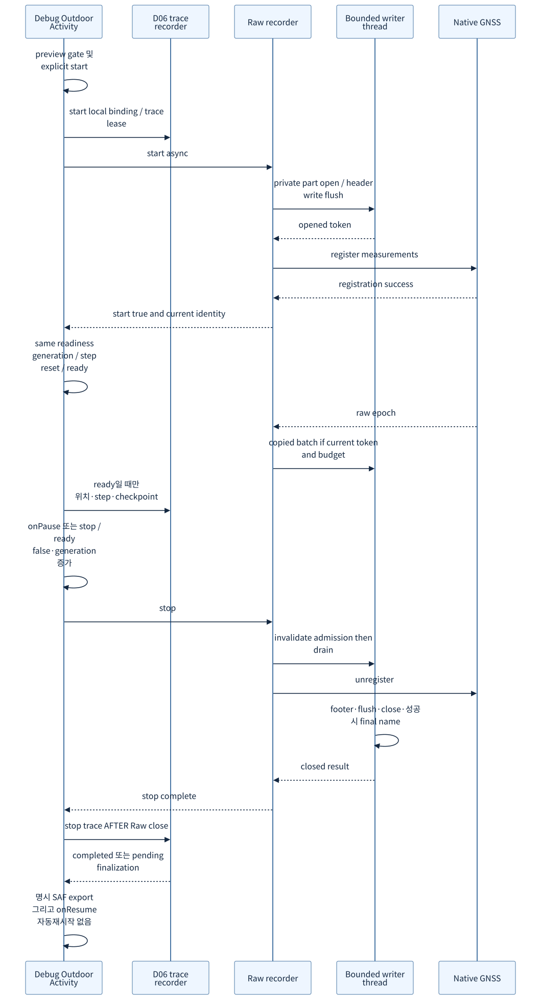

[Mermaid 원본](../diagrams/D04-debug-sequence.mmd) · [SVG](../rendered/D04-debug-sequence.svg)


[Mermaid 원본](../diagrams/D04-debug-overview.mmd) · [SVG](../rendered/D04-debug-overview.svg)

## F-D04-032 야외 시험 기록 시작·센서 융합·로컬 보행 보정

| 항목 | 명세 |
| --- | --- |
| 분야 | D04 방향·위치·GNSS·걸음·PDR·동작·보행 보정 |
| 목적 | Raw 기록 준비와 trace 시작을 맞추고 제품 profile을 바꾸지 않는 로컬 측정 파이프라인 |
| 사용 주체 | 시험 운영자 OutdoorPositionTestActivity |
| 활성 상태 | CONDITIONAL |
| 진입점 | apps/android/app/src/debug/java/kr/co/hanium/dreamup/walksafe/fieldtest/OutdoorPositionTestActivity.kt:61 RecordingReadiness / requestStartRecording / startRecording / onLocation / onStep / appendGnss / appendMotion apps/android/app/src/debug/java/kr/co/hanium/dreamup/walksafe/fieldtest/OutdoorPositionTestActivity.kt:328 recording and sensor handlers |
| 실행 전제 | F031 preview가 진행 중이며 mount 확인은 preview 시작에서 수행되고 수집 중 checkbox가 비활성이다. startRecording은 fine 및 API29+ activity 권한, storage 동의, fresh fix, 활성 lease 및 pendingFinalization 부재를 다시 검사한다. 실제 측정행은 현재 Raw 준비 token이 finish되어 recordingReady가 된 후에만 기록한다. |
| 입력 출처 형식 검증 최신성 | fresh fix≤5초·accuracy≤30; header scenario outdoor_roundtrip_local_profile, environment outdoor_unverified, direction roundtrip, routeId randomUUID. accepted GNSS=INITIALIZED/REINITIALIZED/APPLIED만. |

### 시작 이벤트와 처리 순서

| 이벤트 ID | 발생원 | 이벤트 | 수신부 | 흐름 |
| --- | --- | --- | --- | --- |
| E-D04-032-01 | 사용자 | 기록 시작 | requestStartRecording/startRecording | raw 부족 제한 확인 → trace lease → Raw async 준비 → step reset → ready |
| E-D04-032-02 | GNSS·step callback | 관측 | onLocation/onStep | generation→GNSS filter 또는 step PDR→ready일 때 trace/보정 |
| E-D04-032-03 | 1초 heartbeat | 정지 ZUPT 시도 | coordinator.observeZupt | device정지 fresh 확인→통합 evidence 부재로 rejected→zuptApplied=false trace |

1. 1. 기록 시작마다 coordinator/calibration/history/traceclock/anchor/count를 초기화하고 새 trace lease를 만든다. Raw callback이 동일 recorder/session/lease/collecting인지 확인한다.
2. 2. Raw 성공 후 RecordingReadiness.finish가 동일 token을 재확인하며 step reset→totalSteps0→tracker start 후 ready=true로 전환한다. stop/superseding token은 새 session 걸음을 reset하지 못한다.
3. 3. GNSS는 reported accuracy와 risk multiplier를 별도 전달한다. accepted+nonmock+fresh reference만 latestLocation/geomagnetic reference 및64개5초 speed/course history에 넣는다.
4. 4. HIGH 단일 hardware step과 accepted raw fix+fresh device MOVING으로 timestamp-aligned 보정을 수행하고 로컬 coordinator profile만 갱신한다. profile 저장 API를 부르지 않는다.
5. 5. 걸음은 step 이전 GPS/chest heading을 선택해 PDR에 전달한다. trace filteredPosition은 measurementMs와 filtered.elapsed가 같은 경우만 붙인다. GNSS 원 측정 estimate와 replay live sensor 행을 분리한다.
6. 6. Activity motion callback은 device stationary만 갱신한다. heartbeat가 stationary fresh≤1.5초일 때 coordinator.observeZupt(now)를 호출하지만 unified motion/speed 입력이 없어 적용이 거부되는 연결을 R-D04-006에 기록한다.

| 분기 조건 | 실제 처리 결과 | 구현 근거 |
| --- | --- | --- |
| Raw signal 미확인 | 제한 안내 dialog에서 더 기다리기 또는 명시 기록 | apps/android/app/src/debug/java/kr/co/hanium/dreamup/walksafe/fieldtest/OutdoorPositionTestActivity.kt:61 RecordingReadiness / requestStartRecording / startRecording / onLocation / onStep / appendGnss / appendMotion |
| Raw open/registration 실패 또는 동의 철회 | stopEverything; ready 없음 | apps/android/app/src/debug/java/kr/co/hanium/dreamup/walksafe/fieldtest/OutdoorPositionTestActivity.kt:61 RecordingReadiness / requestStartRecording / startRecording / onLocation / onStep / appendGnss / appendMotion |
| 이전 Raw start completion | 동일 lease/recorder/generation 아니면 무시 | apps/android/app/src/debug/java/kr/co/hanium/dreamup/walksafe/fieldtest/OutdoorPositionTestActivity.kt:61 RecordingReadiness / requestStartRecording / startRecording / onLocation / onStep / appendGnss / appendMotion |
| GNSS DOWNWEIGHTED | 필터 결과 trace 가능하나 latest reference/보정 accepted 아님 | apps/android/app/src/debug/java/kr/co/hanium/dreamup/walksafe/fieldtest/OutdoorPositionTestActivity.kt:61 RecordingReadiness / requestStartRecording / startRecording / onLocation / onStep / appendGnss / appendMotion |
| trace append false | session stop 및 저장오류 | apps/android/app/src/debug/java/kr/co/hanium/dreamup/walksafe/fieldtest/OutdoorPositionTestActivity.kt:61 RecordingReadiness / requestStartRecording / startRecording / onLocation / onStep / appendGnss / appendMotion |

### 효과 종료와 복구

전용 trace에 실제 GNSS·step/heading·profile·stationary 진단 저장; 경로매칭 없음. 제품 개인 보행프로필 변경 없음.

| 상황 | 동작 |
| --- | --- |
| 정상 완료 | 현재 입력의 결과를 반환한다. |
| 실패 | 아래 거부 분기에서 값을 생성하지 않거나 명시된 상태를 반환한다. |
| 시간 초과 | Raw 준비 완료의 고정 timeout은 없다. F031의 main 1초 heartbeat가 유지되며 recordingReady 이후에만 motion trace/ZUPT 경로를 호출한다. |
| 중복 입력 | 동일 입력 처리 여부는 아래 시각·정체성 분기를 따른다. |
| 취소 | 별도 취소 API 없음; 소유자가 기능/수집을 종료한다. |
| 중단과 생명주기 | 소유자의 reset 또는 세대 변경 시 이전 세션 근거를 재사용하지 않는다. |
| 재시도 | 자동 재시도 없음; 다음 유효 입력에서 재평가한다. |
| 복구 | 다음 유효 입력과 기능별 복구 조건 충족 시 결과를 다시 제공한다. |
| 자원 정리 | 기능별 reset/stop 또는 소유자 참조 해제. |

### 상태 실행 맥락과 연결

| 항목 | 명세 |
| --- | --- |
| 초기 상태 | S-D04-032-IDLE |
| 상태 목록 | S-D04-032-IDLE S-D04-032-WAITING S-D04-032-ACTIVE S-D04-032-STOPPING S-D04-032-COMPLETED S-D04-032-ERROR |
| 전이 조건과 전이 동작 | 시작 gate→WAITING; 준비 성공→ACTIVE 입력/저장/권한 오류→ERROR 또는 STOPPING 명시 종료와 완료조건→COMPLETED; 순수 formatter는 동기 입력→출력뿐 |
| 허용되지 않는 전이 | 문서 별칭이며 실제 지속 상태는 recordingReadiness/collecting/lease 또는 Raw State에 의해 표현된다. 순수 formatter에 지속 상태를 만들지 않는다. |
| 동시성 순서와 작업 소유권 | Activity control과 FLP/GNSS/motion/step 수신은 main Looper, 방향 tracker만 전용 HandlerThread. Raw writer는 별도 단일 thread, export는 single executor이며 완료 UI는 main에 전달한다. Activity generation과 recordingReadiness generation이 늦은 callback을 차단한다. |
| 공유 상태와 다른 기능 연결 | F019~021의 클래스 재사용이나 제품 Main의 actor profile/통합 motion 연결과 별개. F036 Raw 시작 ack, D06 trace lease. |

### 정책 근거와 검증 범위

| 항목 | 근거 |
| --- | --- |
| 정책 | [P-D04-032](#P-D04-032) |
| 구현 | [apps/android/app/src/debug/java/kr/co/hanium/dreamup/walksafe/fieldtest/OutdoorPositionTestActivity.kt:61](/home/ddobagi/Hanium_Dreamup/apps/android/app/src/debug/java/kr/co/hanium/dreamup/walksafe/fieldtest/OutdoorPositionTestActivity.kt:61) · `RecordingReadiness / requestStartRecording / startRecording / onLocation / onStep / appendGnss / appendMotion` (범위 61–164) [apps/android/app/src/debug/java/kr/co/hanium/dreamup/walksafe/fieldtest/OutdoorPositionTestActivity.kt:328](/home/ddobagi/Hanium_Dreamup/apps/android/app/src/debug/java/kr/co/hanium/dreamup/walksafe/fieldtest/OutdoorPositionTestActivity.kt:328) · `recording and sensor handlers` (범위 328–545) |
| 기존 개선 ID | 개별 동일성 미확인; 분야 연관은 별도 추적표 |
| 기존 분야 | 08 09 |
| 기존 실행 증거 | 이번 명세는 2026-10-04 10:33:40 KST 고정 snapshot의 정적 분석만 사용. 과거 DONE·시험 횟수·기기 결과를 현재 실행 증거로 채택하지 않음. |
| 한계 및 구분 | Raw quality snapshot은 debug callback의 현재 시각에 조회한다. meanCn0DbHz에 median 전달은 제품과 동일한 이름 불일치. F029와 달리 motion trace는 filtered 시각 일치 gate가 있다. 2026-10-04 Root coverage 보완 후 추가; 최초 D04 30개 기능의 D03 독립검토에는 포함되지 않음. |

| 테스트 위치 | 심볼 | 증거 수준 | 기대와 한계 |
| --- | --- | --- | --- |
| [apps/android/app/src/testDebug/java/kr/co/hanium/dreamup/walksafe/fieldtest/BoundedRawGnssWriterTest.kt](/home/ddobagi/Hanium_Dreamup/apps/android/app/src/testDebug/java/kr/co/hanium/dreamup/walksafe/fieldtest/BoundedRawGnssWriterTest.kt) | stoppedOrSupersededRawStartCannotEnableTraceOrResetNewSessionSteps | TEST_EXPECTATION | 늦은 준비완료가 새 세션을 활성화하지 않는 기대; 함수 선언 및 명명된 기대를 확인했으며 이번 실행 없음. |

### 이벤트 처리 그림


[Mermaid 원본](../diagrams/D04-F032.mmd) · [SVG](../rendered/D04-F032.svg)

[Mermaid 원본](../diagrams/D04-debug-state-recording.mmd) · [SVG](../rendered/D04-debug-state-recording.svg)

[Mermaid 원본](../diagrams/D04-debug-sequence.mmd) · [SVG](../rendered/D04-debug-sequence.svg)

[Mermaid 원본](../diagrams/D04-debug-overview.mmd) · [SVG](../rendered/D04-debug-overview.svg)

## F-D04-033 야외 시험 기준점 수동 표시

| 항목 | 명세 |
| --- | --- |
| 분야 | D04 방향·위치·GNSS·걸음·PDR·동작·보행 보정 |
| 목적 | 출발·복귀 등 같은 물리 표식을 사용자가 선택해 trace에 사건을 추가 |
| 사용 주체 | 시험 운영자 OutdoorPositionTestActivity |
| 활성 상태 | CONDITIONAL |
| 진입점 | apps/android/app/src/debug/java/kr/co/hanium/dreamup/walksafe/fieldtest/OutdoorPositionTestActivity.kt:547 markCheckpoint apps/android/app/src/debug/java/kr/co/hanium/dreamup/walksafe/fieldtest/OutdoorPositionTestActivity.kt:285 motion callback stationary state |
| 실행 전제 | 현재 recordingReady와 trace lease가 있어야 한다. markCheckpoint 자체는 fine/activity 권한이나 checkbox를 다시 검사하지 않으며 정지·freshness·duration gate를 적용한다. 권한과 동의는 수집 시작 및 Activity 중단 흐름에서 관리한다. |
| 입력 출처 형식 검증 최신성 | CP001부터 ordinal. now elapsed ns, 최초 GNSS anchor 기반 UTC 또는 monotonic-only. 저장한 checkpoint 좌표 ground truth 필드 없음. |

### 시작 이벤트와 처리 순서

| 이벤트 ID | 발생원 | 이벤트 | 수신부 | 흐름 |
| --- | --- | --- | --- | --- |
| E-D04-033-01 | 사용자 | 기준점 표시 클릭 | markCheckpoint | device정지 gate→checkpoint serialize→mark 성공 시 ordinal commit |

1. 1. 기준점 표시 호출에서 recordingReady가 false이거나 lease가 없으면 문구 변경 없이 반환한다. 유효한 현재 기록이면 device 정지·freshness·duration을 검사한다.
2. 2. 정지·freshness·duration 검사 실패만 3초 기다림 안내를 표시하고 ordinal을 유지한다.
3. 3. 성공 후보는 다음 CP ordinal과 source/시각/정지지속을 만든다. D06 recorder.markCheckpoint 성공에만 ordinal을 올린다.

| 분기 조건 | 실제 처리 결과 | 구현 근거 |
| --- | --- | --- |
| 정지/age/duration 실패 | mark 없음; 화면 안내 | apps/android/app/src/debug/java/kr/co/hanium/dreamup/walksafe/fieldtest/OutdoorPositionTestActivity.kt:547 markCheckpoint |
| mark 저장 실패 | 전체 수집 종료 | apps/android/app/src/debug/java/kr/co/hanium/dreamup/walksafe/fieldtest/OutdoorPositionTestActivity.kt:547 markCheckpoint |
| GNSS UTC anchor 없음 | CHECKPOINT_MONOTONIC_ONLY 및 UTC null | apps/android/app/src/debug/java/kr/co/hanium/dreamup/walksafe/fieldtest/OutdoorPositionTestActivity.kt:547 markCheckpoint |

### 효과 종료와 복구

trace checkpoint 및 화면 메시지. 실제 기준점 위치/재방문 동일성은 사용자가 제공하는 외부 조건.

| 상황 | 동작 |
| --- | --- |
| 정상 완료 | 현재 입력의 결과를 반환한다. |
| 실패 | 아래 거부 분기에서 값을 생성하지 않거나 명시된 상태를 반환한다. |
| 시간 초과 | 내부 타이머 없음; 다음 입력/조회에서 명시된 나이를 평가한다. |
| 중복 입력 | 동일 입력 처리 여부는 아래 시각·정체성 분기를 따른다. |
| 취소 | 별도 취소 API 없음; 소유자가 기능/수집을 종료한다. |
| 중단과 생명주기 | 소유자의 reset 또는 세대 변경 시 이전 세션 근거를 재사용하지 않는다. |
| 재시도 | 자동 재시도 없음; 다음 유효 입력에서 재평가한다. |
| 복구 | 다음 유효 입력과 기능별 복구 조건 충족 시 결과를 다시 제공한다. |
| 자원 정리 | 기능별 reset/stop 또는 소유자 참조 해제. |

### 상태 실행 맥락과 연결

| 항목 | 명세 |
| --- | --- |
| 초기 상태 | S-D04-033-IDLE |
| 상태 목록 | S-D04-033-IDLE S-D04-033-WAITING S-D04-033-ACTIVE S-D04-033-STOPPING S-D04-033-COMPLETED S-D04-033-ERROR |
| 전이 조건과 전이 동작 | 시작 gate→WAITING; 준비 성공→ACTIVE 입력/저장/권한 오류→ERROR 또는 STOPPING 명시 종료와 완료조건→COMPLETED; 순수 formatter는 동기 입력→출력뿐 |
| 허용되지 않는 전이 | 문서 별칭이며 실제 지속 상태는 recordingReadiness/collecting/lease 또는 Raw State에 의해 표현된다. 순수 formatter에 지속 상태를 만들지 않는다. |
| 동시성 순서와 작업 소유권 | Activity control과 FLP/GNSS/motion/step 수신은 main Looper, 방향 tracker만 전용 HandlerThread. Raw writer는 별도 단일 thread, export는 single executor이며 완료 UI는 main에 전달한다. Activity generation과 recordingReadiness generation이 늦은 callback을 차단한다. |
| 공유 상태와 다른 기능 연결 | D06 recorder.markCheckpoint; D16 checkpoint 분석 계약. |

### 정책 근거와 검증 범위

| 항목 | 근거 |
| --- | --- |
| 정책 | [P-D04-033](#P-D04-033) |
| 구현 | [apps/android/app/src/debug/java/kr/co/hanium/dreamup/walksafe/fieldtest/OutdoorPositionTestActivity.kt:547](/home/ddobagi/Hanium_Dreamup/apps/android/app/src/debug/java/kr/co/hanium/dreamup/walksafe/fieldtest/OutdoorPositionTestActivity.kt:547) · `markCheckpoint` (범위 547–567) [apps/android/app/src/debug/java/kr/co/hanium/dreamup/walksafe/fieldtest/OutdoorPositionTestActivity.kt:285](/home/ddobagi/Hanium_Dreamup/apps/android/app/src/debug/java/kr/co/hanium/dreamup/walksafe/fieldtest/OutdoorPositionTestActivity.kt:285) · `motion callback stationary state` (범위 285–296) |
| 기존 개선 ID | 개별 동일성 미확인; 분야 연관은 별도 추적표 |
| 기존 분야 | 08 09 |
| 기존 실행 증거 | 이번 명세는 2026-10-04 10:33:40 KST 고정 snapshot의 정적 분석만 사용. 과거 DONE·시험 횟수·기기 결과를 현재 실행 증거로 채택하지 않음. |
| 한계 및 구분 | 현장 오차·기기 센서 정확도·사용자 청취는 미검증. 2026-10-04 Root coverage 보완 후 추가; 최초 D04 30개 기능의 D03 독립검토에는 포함되지 않음. |

| 테스트 위치 | 심볼 | 증거 수준 | 기대와 한계 |
| --- | --- | --- | --- |

연결한 테스트 미확인: 이번 작성 범위에서 이 기능에 대응하는 시험 단언을 연결하지 않았다. 테스트 자체가 없다는 판정이 아니다.

### 이벤트 처리 그림


[Mermaid 원본](../diagrams/D04-F033.mmd) · [SVG](../rendered/D04-F033.svg)

[Mermaid 원본](../diagrams/D04-debug-state-recording.mmd) · [SVG](../rendered/D04-debug-state-recording.svg)

[Mermaid 원본](../diagrams/D04-debug-sequence.mmd) · [SVG](../rendered/D04-debug-sequence.svg)

[Mermaid 원본](../diagrams/D04-debug-overview.mmd) · [SVG](../rendered/D04-debug-overview.svg)

## F-D04-034 야외 시험 중단·Raw 닫기·trace 완료 재시도

| 항목 | 명세 |
| --- | --- |
| 분야 | D04 방향·위치·GNSS·걸음·PDR·동작·보행 보정 |
| 목적 | 화면 이탈과 저장 실패 때 입력을 끊고 닫힌 파일만 완료 목록에 공개 |
| 사용 주체 | 시험 운영자 OutdoorPositionTestActivity |
| 활성 상태 | CONDITIONAL |
| 진입점 | apps/android/app/src/debug/java/kr/co/hanium/dreamup/walksafe/fieldtest/OutdoorPositionTestActivity.kt:569 stopEverything / finishStoppedSession / retryFinalization / onPause / onDestroy apps/android/app/src/debug/java/kr/co/hanium/dreamup/walksafe/fieldtest/OutdoorPositionTestActivity.kt:715 onPause / onResume / onDestroy |
| 실행 전제 | debug Activity의 종료 버튼·onPause·권한/동의 철회·저장 실패 경로가 호출한다. 종료에는 fine/activity 권한, mount/storage 동의, foreground 또는 fresh fix가 필요하지 않다. stopping 재진입만 즉시 반환한다. |
| 입력 출처 형식 검증 최신성 | collecting/stopping/lease/readiness generation; Raw stop async completion; pendingFinalization trace lease. |

### 시작 이벤트와 처리 순서

| 이벤트 ID | 발생원 | 이벤트 | 수신부 | 흐름 |
| --- | --- | --- | --- | --- |
| E-D04-034-01 | UI/lifecycle/storage | stopEverything | Activity | 입력 retire→Raw async close→trace stop→완료/미완료 |
| E-D04-034-02 | 사용자 | 종료 저장 재시도 | retryFinalization | pending lease stop→성공 시 clear와 완료목록 갱신 |

1. 1. stop 재진입은 return한다. readiness.stop과 generation 증가로 신규/늦은 callback을 차단하고 센서·heartbeat·KEEP_SCREEN_ON을 정리한다.
2. 2. Raw recorder.stop 완료 후에만 trace recorder.stop을 호출한다. Raw 오류여도 trace 종료를 시도하여 완료기록을 발견 가능하게 한다.
3. 3. trace stop 성공이면 완료 session을 갱신하고 실패면 pendingFinalization을 보존하여 새 preview를 막는다. Raw 실패는 completedRawFile=null과 .part 보존 안내.
4. 4. 명시 종료 저장 재시도는 같은 pending lease의 recorder.stop 성공 후 완료 목록을 갱신한다. onResume은 상태표시만 하며 수집 자동재개 없음.

| 분기 조건 | 실제 처리 결과 | 구현 근거 |
| --- | --- | --- |
| stopping 중 재호출 | 중복 종료 없음 | apps/android/app/src/debug/java/kr/co/hanium/dreamup/walksafe/fieldtest/OutdoorPositionTestActivity.kt:569 stopEverything / finishStoppedSession / retryFinalization / onPause / onDestroy |
| trace stop 실패 | pendingFinalization; 사용자 재시도 버튼 | apps/android/app/src/debug/java/kr/co/hanium/dreamup/walksafe/fieldtest/OutdoorPositionTestActivity.kt:569 stopEverything / finishStoppedSession / retryFinalization / onPause / onDestroy |
| Raw close/publish 실패 | 불완전 .part 보존, Raw export 불가 | apps/android/app/src/debug/java/kr/co/hanium/dreamup/walksafe/fieldtest/OutdoorPositionTestActivity.kt:569 stopEverything / finishStoppedSession / retryFinalization / onPause / onDestroy |
| onDestroy | export executor shutdown; 진행중 작업 즉시취소 호출 없음 | apps/android/app/src/debug/java/kr/co/hanium/dreamup/walksafe/fieldtest/OutdoorPositionTestActivity.kt:569 stopEverything / finishStoppedSession / retryFinalization / onPause / onDestroy |

### 효과 종료와 복구

완료 session/UI 갱신 및 오류파일 보존. 신규수집은 명시 시작 필요.

| 상황 | 동작 |
| --- | --- |
| 정상 완료 | 현재 입력의 결과를 반환한다. |
| 실패 | 아래 거부 분기에서 값을 생성하지 않거나 명시된 상태를 반환한다. |
| 시간 초과 | Raw writer close와 FLP remove에 이 Activity 자체 고정 timeout 없음. |
| 중복 입력 | 동일 입력 처리 여부는 아래 시각·정체성 분기를 따른다. |
| 취소 | onPause는 기록을 종료하며 돌아와 자동 재개하지 않는다. |
| 중단과 생명주기 | 소유자의 reset 또는 세대 변경 시 이전 세션 근거를 재사용하지 않는다. |
| 재시도 | trace 종료 실패만 pendingFinalization으로 명시 재시도한다. |
| 복구 | Raw 닫기 결과와 별개로 trace stop을 시도한다. trace 실패는 pendingFinalization에 보존하고 명시 재시도하며, Raw 실패 .part는 완료 Raw로 공개하지 않는다. |
| 자원 정리 | heartbeat·센서·orientation·calibration/history·화면 flag 해제; FLP remove는 best effort Task 호출. |

### 상태 실행 맥락과 연결

| 항목 | 명세 |
| --- | --- |
| 초기 상태 | S-D04-034-IDLE |
| 상태 목록 | S-D04-034-IDLE S-D04-034-WAITING S-D04-034-ACTIVE S-D04-034-STOPPING S-D04-034-COMPLETED S-D04-034-ERROR |
| 전이 조건과 전이 동작 | 시작 gate→WAITING; 준비 성공→ACTIVE 입력/저장/권한 오류→ERROR 또는 STOPPING 명시 종료와 완료조건→COMPLETED; 순수 formatter는 동기 입력→출력뿐 |
| 허용되지 않는 전이 | 문서 별칭이며 실제 지속 상태는 recordingReadiness/collecting/lease 또는 Raw State에 의해 표현된다. 순수 formatter에 지속 상태를 만들지 않는다. |
| 동시성 순서와 작업 소유권 | Activity control과 FLP/GNSS/motion/step 수신은 main Looper, 방향 tracker만 전용 HandlerThread. Raw writer는 별도 단일 thread, export는 single executor이며 완료 UI는 main에 전달한다. Activity generation과 recordingReadiness generation이 늦은 callback을 차단한다. |
| 공유 상태와 다른 기능 연결 | F036/037 raw close/publication; D06 recorder.stop; F035 export 준비조건. |

### 정책 근거와 검증 범위

| 항목 | 근거 |
| --- | --- |
| 정책 | [P-D04-034](#P-D04-034) |
| 구현 | [apps/android/app/src/debug/java/kr/co/hanium/dreamup/walksafe/fieldtest/OutdoorPositionTestActivity.kt:569](/home/ddobagi/Hanium_Dreamup/apps/android/app/src/debug/java/kr/co/hanium/dreamup/walksafe/fieldtest/OutdoorPositionTestActivity.kt:569) · `stopEverything / finishStoppedSession / retryFinalization / onPause / onDestroy` (범위 569–629) [apps/android/app/src/debug/java/kr/co/hanium/dreamup/walksafe/fieldtest/OutdoorPositionTestActivity.kt:715](/home/ddobagi/Hanium_Dreamup/apps/android/app/src/debug/java/kr/co/hanium/dreamup/walksafe/fieldtest/OutdoorPositionTestActivity.kt:715) · `onPause / onResume / onDestroy` (범위 715–725) |
| 기존 개선 ID | 개별 동일성 미확인; 분야 연관은 별도 추적표 |
| 기존 분야 | 08 09 |
| 기존 실행 증거 | 이번 명세는 2026-10-04 10:33:40 KST 고정 snapshot의 정적 분석만 사용. 과거 DONE·시험 횟수·기기 결과를 현재 실행 증거로 채택하지 않음. |
| 한계 및 구분 | 현장 오차·기기 센서 정확도·사용자 청취는 미검증. 2026-10-04 Root coverage 보완 후 추가; 최초 D04 30개 기능의 D03 독립검토에는 포함되지 않음. |

| 테스트 위치 | 심볼 | 증거 수준 | 기대와 한계 |
| --- | --- | --- | --- |

연결한 테스트 미확인: 이번 작성 범위에서 이 기능에 대응하는 시험 단언을 연결하지 않았다. 테스트 자체가 없다는 판정이 아니다.

### 이벤트 처리 그림


[Mermaid 원본](../diagrams/D04-F034.mmd) · [SVG](../rendered/D04-F034.svg)

[Mermaid 원본](../diagrams/D04-debug-state-recording.mmd) · [SVG](../rendered/D04-debug-state-recording.svg)

[Mermaid 원본](../diagrams/D04-debug-sequence.mmd) · [SVG](../rendered/D04-debug-sequence.svg)

[Mermaid 원본](../diagrams/D04-debug-overview.mmd) · [SVG](../rendered/D04-debug-overview.svg)

## F-D04-035 야외 시험 완료기록 선택·파일 내보내기·취소 복원

| 항목 | 명세 |
| --- | --- |
| 분야 | D04 방향·위치·GNSS·걸음·PDR·동작·보행 보정 |
| 목적 | 로컬 완료본을 보존하면서 사용자가 선택한 외부 문서에 복사 |
| 사용 주체 | 시험 운영자 OutdoorPositionTestActivity |
| 활성 상태 | CONDITIONAL |
| 진입점 | apps/android/app/src/debug/java/kr/co/hanium/dreamup/walksafe/fieldtest/OutdoorPositionTestActivity.kt:631 requestExport / refreshCompletedSessions / selectCompletedSession / onSaveInstanceState / onActivityResult apps/android/app/src/debug/java/kr/co/hanium/dreamup/walksafe/fieldtest/OutdoorPositionTestActivity.kt:184 onCreate saved export restoration |
| 실행 전제 | 현재 선택한 COMPLETED 세션이 필요하며 Raw export는 완성 .txt 존재도 요구한다. 활성 lease, stopping, 닫히지 않은 Raw writer, exporting, pendingExport 동안 요청을 거부한다. fine/activity 권한과 mount/storage 동의를 재검사하지 않는다. pendingFinalization은 새 preview를 막는 조건이며 requestExport의 직접 gate가 아니다. |
| 입력 출처 형식 검증 최신성 | COMPLETED recorder session 목록과 raw_sessionId.txt. ACTION_CREATE_DOCUMENT, txt=text/plain, trace=application/octet-stream, suggested filename sessionId 앞8자. |

### 시작 이벤트와 처리 순서

| 이벤트 ID | 발생원 | 이벤트 | 수신부 | 흐름 |
| --- | --- | --- | --- | --- |
| E-D04-035-01 | 사용자 | 완료 선택/저장 버튼 | requestExport | 현재 완료세션 고정→SAF picker |
| E-D04-035-02 | Android picker | onActivityResult | exportExecutor | 취소또는URI→파일copy/recorder.export→main 결과 |

1. 1. 완료 세션 목록을 갱신하고 사용자가 날짜/행수/session 표시에서 하나를 고른다. Raw 확정 파일 존재를 별도로 확인한다.
2. 2. pendingExport에 session/file/title을 고정하고 document picker를 연다. onSaveInstanceState는 session+raw 여부만 보존하며 onCreate는 현재 완료목록/파일을 재검사해 복원한다.
3. 3. picker 취소는 pendingExport만 지우고 로컬 원본은 유지한다. 성공은 single executor에서 wt output을 열어 copy/export 후 flush/close한다.
4. 4. 외부 write 실패면 contentResolver.delete를 시도한다. 삭제 실패는 불완전 외부 파일 확인 문구를 보여주고 로컬 원본을 유지한다.

| 분기 조건 | 실제 처리 결과 | 구현 근거 |
| --- | --- | --- |
| picker 취소/URI 없음 | 원본 유지; 다시 요청 가능 | apps/android/app/src/debug/java/kr/co/hanium/dreamup/walksafe/fieldtest/OutdoorPositionTestActivity.kt:631 requestExport / refreshCompletedSessions / selectCompletedSession / onSaveInstanceState / onActivityResult |
| 완료 Raw 파일 없음 | Raw export 비활성 | apps/android/app/src/debug/java/kr/co/hanium/dreamup/walksafe/fieldtest/OutdoorPositionTestActivity.kt:631 requestExport / refreshCompletedSessions / selectCompletedSession / onSaveInstanceState / onActivityResult |
| write 실패+delete 실패 | 부분 파일 확인 안내 | apps/android/app/src/debug/java/kr/co/hanium/dreamup/walksafe/fieldtest/OutdoorPositionTestActivity.kt:631 requestExport / refreshCompletedSessions / selectCompletedSession / onSaveInstanceState / onActivityResult |
| Activity destroyed 전후 완료 | 파일작업은 끝날 수 있고 UI는 isDestroyed로 억제 | apps/android/app/src/debug/java/kr/co/hanium/dreamup/walksafe/fieldtest/OutdoorPositionTestActivity.kt:631 requestExport / refreshCompletedSessions / selectCompletedSession / onSaveInstanceState / onActivityResult |

### 효과 종료와 복구

외부 문서 쓰기·실패시 delete 시도; 원본 삭제 없음.

| 상황 | 동작 |
| --- | --- |
| 정상 완료 | 현재 입력의 결과를 반환한다. |
| 실패 | 아래 거부 분기에서 값을 생성하지 않거나 명시된 상태를 반환한다. |
| 시간 초과 | 내부 타이머 없음; 다음 입력/조회에서 명시된 나이를 평가한다. |
| 중복 입력 | 동일 입력 처리 여부는 아래 시각·정체성 분기를 따른다. |
| 취소 | picker 취소는 로컬 원본을 보존. executor 제출 후 개별 취소 API 없음. |
| 중단과 생명주기 | onDestroy executor.shutdown은 이미 제출된 작업을 즉시 중단하지 않는다. |
| 재시도 | 완료목록에서 명시 재선택/export. |
| 복구 | 다음 유효 입력과 기능별 복구 조건 충족 시 결과를 다시 제공한다. |
| 자원 정리 | use로 입출력 close; 실패 외부 target delete 시도. |

### 상태 실행 맥락과 연결

| 항목 | 명세 |
| --- | --- |
| 초기 상태 | S-D04-035-IDLE |
| 상태 목록 | S-D04-035-IDLE S-D04-035-WAITING S-D04-035-ACTIVE S-D04-035-STOPPING S-D04-035-COMPLETED S-D04-035-ERROR |
| 전이 조건과 전이 동작 | 시작 gate→WAITING; 준비 성공→ACTIVE 입력/저장/권한 오류→ERROR 또는 STOPPING 명시 종료와 완료조건→COMPLETED; 순수 formatter는 동기 입력→출력뿐 |
| 허용되지 않는 전이 | 문서 별칭이며 실제 지속 상태는 recordingReadiness/collecting/lease 또는 Raw State에 의해 표현된다. 순수 formatter에 지속 상태를 만들지 않는다. |
| 동시성 순서와 작업 소유권 | Activity control과 FLP/GNSS/motion/step 수신은 main Looper, 방향 tracker만 전용 HandlerThread. Raw writer는 별도 단일 thread, export는 single executor이며 완료 UI는 main에 전달한다. Activity generation과 recordingReadiness generation이 늦은 callback을 차단한다. |
| 공유 상태와 다른 기능 연결 | D06 recorder.list/export의 owner binding 검증; D16 import는 외부 사용자 선택 후 별도. |

### 정책 근거와 검증 범위

| 항목 | 근거 |
| --- | --- |
| 정책 | [P-D04-035](#P-D04-035) |
| 구현 | [apps/android/app/src/debug/java/kr/co/hanium/dreamup/walksafe/fieldtest/OutdoorPositionTestActivity.kt:631](/home/ddobagi/Hanium_Dreamup/apps/android/app/src/debug/java/kr/co/hanium/dreamup/walksafe/fieldtest/OutdoorPositionTestActivity.kt:631) · `requestExport / refreshCompletedSessions / selectCompletedSession / onSaveInstanceState / onActivityResult` (범위 631–713) [apps/android/app/src/debug/java/kr/co/hanium/dreamup/walksafe/fieldtest/OutdoorPositionTestActivity.kt:184](/home/ddobagi/Hanium_Dreamup/apps/android/app/src/debug/java/kr/co/hanium/dreamup/walksafe/fieldtest/OutdoorPositionTestActivity.kt:184) · `onCreate saved export restoration` (범위 184–194) |
| 기존 개선 ID | 개별 동일성 미확인; 분야 연관은 별도 추적표 |
| 기존 분야 | 08 09 |
| 기존 실행 증거 | 이번 명세는 2026-10-04 10:33:40 KST 고정 snapshot의 정적 분석만 사용. 과거 DONE·시험 횟수·기기 결과를 현재 실행 증거로 채택하지 않음. |
| 한계 및 구분 | 현장 오차·기기 센서 정확도·사용자 청취는 미검증. 2026-10-04 Root coverage 보완 후 추가; 최초 D04 30개 기능의 D03 독립검토에는 포함되지 않음. |

| 테스트 위치 | 심볼 | 증거 수준 | 기대와 한계 |
| --- | --- | --- | --- |

연결한 테스트 미확인: 이번 작성 범위에서 이 기능에 대응하는 시험 단언을 연결하지 않았다. 테스트 자체가 없다는 판정이 아니다.

### 이벤트 처리 그림


[Mermaid 원본](../diagrams/D04-F035.mmd) · [SVG](../rendered/D04-F035.svg)

[Mermaid 원본](../diagrams/D04-debug-state-recording.mmd) · [SVG](../rendered/D04-debug-state-recording.svg)

[Mermaid 원본](../diagrams/D04-debug-sequence.mmd) · [SVG](../rendered/D04-debug-sequence.svg)

[Mermaid 원본](../diagrams/D04-debug-overview.mmd) · [SVG](../rendered/D04-debug-overview.svg)

## F-D04-036 야외 Raw GNSS 구독·측정 변환·운영 상태

| 항목 | 명세 |
| --- | --- |
| 분야 | D04 방향·위치·GNSS·걸음·PDR·동작·보행 보정 |
| 목적 | 세션별 원시 위성 측정을 수신하고 쓰기완료 기준으로 카운트를 표시 |
| 사용 주체 | 시험 운영자 OutdoorPositionTestActivity OutdoorRawGnssRecorder Android GNSS callback |
| 활성 상태 | CONDITIONAL |
| 진입점 | apps/android/app/src/debug/java/kr/co/hanium/dreamup/walksafe/fieldtest/OutdoorRawGnssRecorder.kt:20 start / finishStart / record / stop / finishClose / snapshot |
| 실행 전제 | debug Raw recorder가 IDLE이어야 하며 start 자체는 ACCESS_FINE_LOCATION과 LocationManager를 검사한다. activity recognition·mount/storage checkbox는 호출 Activity의 시작 gate이며 Raw 클래스 자체 조건이 아니다. |
| 입력 출처 형식 검증 최신성 | GnssClock과 measurements의 실제 nullable fields, receipt elapsed ns/UTC. ADR-valid=(state bit1)!=0; missing code null/blank/UNKNOWN; fullBias 또는 leap 없으면 UTC fallback count. |

### 시작 이벤트와 처리 순서

| 이벤트 ID | 발생원 | 이벤트 | 수신부 | 흐름 |
| --- | --- | --- | --- | --- |
| E-D04-036-01 | Activity | raw.start | OutdoorRawGnssRecorder | writer 준비 완료→register→start ack |
| E-D04-036-02 | LocationManager | measurements callback | record | token→nullable 원 필드→CSV batch→writer append |
| E-D04-036-03 | Activity 또는 writer close | stop/finishClose | OutdoorRawGnssRecorder | admission retire→unregister→완료callbacks |

1. 1. 저장 파일과 staging canonical path가 noBackupFilesDir 내부인지 확인하고 기존 완성파일은 덮지 않는다. .part는 CREATE_NEW로 연다.
2. 2. writer header flush 완료 callback에서 현재 token인지 확인한 뒤 native register한다. 성공에만 start(true), 실패는 unregister/fail/start(false).
3. 3. 한 GnssMeasurementsEvent의 measurements를 CSV batch로 직렬화한다. empty event는 버리며 writer.accepts(token)이 아니면 늦은 관측을 저장하지 않는다.
4. 4. stop은 writer admission부터 무효화하고 unregister한다. close완료 callback에서 등록을 다시 정리하고 대기 stop completions에 실제 STOPPED 성공여부를 전달한다.
5. 5. 상태 publish는 AtomicBoolean으로 main message를 합친다. 오류/누락→FullBias없음→미관측→ADR없음→code없음→UTCfallback 순서로 경고를 선택한다.

| 분기 조건 | 실제 처리 결과 | 구현 근거 |
| --- | --- | --- |
| 권한/native register 실패 | Raw error; 시작완료 false | apps/android/app/src/debug/java/kr/co/hanium/dreamup/walksafe/fieldtest/OutdoorRawGnssRecorder.kt:20 start / finishStart / record / stop / finishClose / snapshot |
| STATUS_NOT_SUPPORTED 또는 LOCATION_DISABLED | writer.fail 및 종료 | apps/android/app/src/debug/java/kr/co/hanium/dreamup/walksafe/fieldtest/OutdoorRawGnssRecorder.kt:20 start / finishStart / record / stop / finishClose / snapshot |
| stale generation | raw record 무시 | apps/android/app/src/debug/java/kr/co/hanium/dreamup/walksafe/fieldtest/OutdoorRawGnssRecorder.kt:20 start / finishStart / record / stop / finishClose / snapshot |
| write/close 미완료 | closed=false 및 pending 수; 완료파일명 공개 안 함 | apps/android/app/src/debug/java/kr/co/hanium/dreamup/walksafe/fieldtest/OutdoorRawGnssRecorder.kt:20 start / finishStart / record / stop / finishClose / snapshot |

### 효과 종료와 복구

private plain-text Raw .part/.txt 기록, main 상태콜백. 암호화 trace와 파일형식/보호방식이 다름.

| 상황 | 동작 |
| --- | --- |
| 정상 완료 | 현재 입력의 결과를 반환한다. |
| 실패 | 아래 거부 분기에서 값을 생성하지 않거나 명시된 상태를 반환한다. |
| 시간 초과 | 내부 타이머 없음; 다음 입력/조회에서 명시된 나이를 평가한다. |
| 중복 입력 | IDLE이 아니거나 startCompletion이 있으면 onComplete(false)만 반환한다. stale 관측 token은 저장하지 않는다. |
| 취소 | stop은 신규 admission 무효화와 native unregister 후 비동기 writer close를 기다린다. |
| 중단과 생명주기 | 소유자의 reset 또는 세대 변경 시 이전 세션 근거를 재사용하지 않는다. |
| 재시도 | terminal 이후 동일 recorder를 재시작하지 않는다. 새 시험 session의 recorder instance가 필요하다. |
| 복구 | 실패 Raw .part를 보존하고 다음 시험에는 새 recorder/writer를 만든다. |
| 자원 정리 | stop/finishClose에서 native callback unregister를 시도한다. writer finally가 sink를 닫는다. |

### 상태 실행 맥락과 연결

| 항목 | 명세 |
| --- | --- |
| 초기 상태 | S-D04-036-IDLE |
| 상태 목록 | S-D04-036-IDLE S-D04-036-STARTING S-D04-036-RECORDING S-D04-036-STOPPING S-D04-036-STOPPED S-D04-036-ERROR |
| 전이 조건과 전이 동작 | IDLE→STARTING: start 승인 및 generation 증가 STARTING→RECORDING: header write/flush와 native register 성공(registered=true)이 모두 완료. writer가 RECORDING이어도 registered=false이면 Raw recorder status는 STARTING으로 투영한다. 등록 실패는 fail 경로. RECORDING→RECORDING: 현재 token의 budget 내 batch 저장 STARTING/RECORDING→STOPPING: stop/fail/overflow로 신규 admission 차단 STOPPING→STOPPED: error 없이 drain/footer/flush/close/publish 완료 worker 시작 또는 I/O/close/publish 실패→ERROR 및 closed IDLE 아닌 start 및 stale append: 현재 상태를 바꾸지 않고 거절 |
| 허용되지 않는 전이 | 실제 Raw State enum 이름을 사용한다. STOPPED/ERROR instance를 IDLE로 되돌려 재시작하는 경로는 없다. |
| 동시성 순서와 작업 소유권 | start/stop/native callbacks는 main. writer open/flush/close는 walksafe-raw-gnss thread. writer state @Volatile/lock, callbacks는 mainHandler; publish coalescing. native unregister 실패 재시도와 성공 ack fence는 없음. |
| 공유 상태와 다른 기능 연결 | F037 bounded sink와 F038 serializer. F032 readiness true의 선행조건. |

### 정책 근거와 검증 범위

| 항목 | 근거 |
| --- | --- |
| 정책 | [P-D04-036](#P-D04-036) |
| 구현 | [apps/android/app/src/debug/java/kr/co/hanium/dreamup/walksafe/fieldtest/OutdoorRawGnssRecorder.kt:20](/home/ddobagi/Hanium_Dreamup/apps/android/app/src/debug/java/kr/co/hanium/dreamup/walksafe/fieldtest/OutdoorRawGnssRecorder.kt:20) · `start / finishStart / record / stop / finishClose / snapshot` (범위 20–256) |
| 기존 개선 ID | 개별 동일성 미확인; 분야 연관은 별도 추적표 |
| 기존 분야 | 08 09 |
| 기존 실행 증거 | 이번 명세는 2026-10-04 10:33:40 KST 고정 snapshot의 정적 분석만 사용. 과거 DONE·시험 횟수·기기 결과를 현재 실행 증거로 채택하지 않음. |
| 한계 및 구분 | Raw ADR/FullBias가 있어도 PPK 변환·정답궤적 완성은 미검증. private Raw 파일은 이 클래스에서 암호화하지 않는다. 2026-10-04 Root coverage 보완 후 추가; 최초 D04 30개 기능의 D03 독립검토에는 포함되지 않음. |

| 테스트 위치 | 심볼 | 증거 수준 | 기대와 한계 |
| --- | --- | --- | --- |

연결한 테스트 미확인: 이번 작성 범위에서 이 기능에 대응하는 시험 단언을 연결하지 않았다. 테스트 자체가 없다는 판정이 아니다.

### 이벤트 처리 그림


[Mermaid 원본](../diagrams/D04-F036.mmd) · [SVG](../rendered/D04-F036.svg)

[Mermaid 원본](../diagrams/D04-debug-state-rawwriter.mmd) · [SVG](../rendered/D04-debug-state-rawwriter.svg)

[Mermaid 원본](../diagrams/D04-debug-sequence.mmd) · [SVG](../rendered/D04-debug-sequence.svg)

[Mermaid 원본](../diagrams/D04-debug-overview.mmd) · [SVG](../rendered/D04-debug-overview.svg)

## F-D04-037 원시 GNSS 파일 쓰기 큐·backpressure·완료 공개

| 항목 | 명세 |
| --- | --- |
| 분야 | D04 방향·위치·GNSS·걸음·PDR·동작·보행 보정 |
| 목적 | 느린 파일 I/O가 UI stop을 막지 않도록 한 writer와 제한된 대기자료를 사용 |
| 사용 주체 | 시험 운영자 OutdoorPositionTestActivity OutdoorRawGnssRecorder BoundedRawGnssWriter |
| 활성 상태 | CONDITIONAL |
| 진입점 | apps/android/app/src/debug/java/kr/co/hanium/dreamup/walksafe/fieldtest/BoundedRawGnssWriter.kt:7 start / append / requestStopLocked / runWriter |
| 실행 전제 | F036 Raw session이 생성한 전용 writer. debug 파일이며 Main production 수집 큐가 아니다. |
| 입력 출처 형식 검증 최신성 | Batch(bytes copy, measurements,ADR/missing/UTC fallback counts, callbackElapsed). volatile immutable Snapshot. error/drop를 불완전성으로 노출. |

### 시작 이벤트와 처리 순서

| 이벤트 ID | 발생원 | 이벤트 | 수신부 | 흐름 |
| --- | --- | --- | --- | --- |
| E-D04-037-01 | Raw callback | append | BoundedRawGnssWriter | token/budget→copy enqueue→writer flush 뒤통계 |
| E-D04-037-02 | Activity/error | stop 또는 fail | writer | generation invalid→drain→close+publish→terminal |

1. 1. start는 IDLE에서STARTING generation 증가 후 새 thread를 시작한다. header write/flush 성공에만 onOpened(true,token). stop이 먼저이면 false.
2. 2. append는 counts/bytes/file reservation을 검사하고 copy enqueue; budget에는 현재 write 중 batch가 빠지지 않는다.
3. 3. 단일 worker는 queue 순서대로 write/flush 후에만 measurements/epochs와 진단카운트를 올리고 pending을 줄인다.
4. 4. stop/error는 generation을 증가시켜 신규 admission 차단 후 승인된 queue를 drain한다. footer COMPLETE/INCOMPLETE와 PPK_UNVERIFIED를 쓴다.
5. 5. I/O 실패는 남은 pendingMeasurements를 dropped에 더하고 queue를 비운다. finally flush/close 후 오류가 없을 때만 최종 파일명 공개를 시도한다. Recorder가 제공한 Files.move는 ATOMIC_MOVE를 지정하지 않는다. 공개까지 성공하면 STOPPED, 하나라도 실패면 ERROR/closed와 onClosed.

| 분기 조건 | 실제 처리 결과 | 구현 근거 |
| --- | --- | --- |
| queue/file limit | 새batch dropped를 표시하며 STOPPING; 정상 완료파일 공개 안 함 | apps/android/app/src/debug/java/kr/co/hanium/dreamup/walksafe/fieldtest/BoundedRawGnssWriter.kt:7 start / append / requestStopLocked / runWriter |
| worker thread 시작 실패 | ERROR/closed 및 onOpened false/onClosed | apps/android/app/src/debug/java/kr/co/hanium/dreamup/walksafe/fieldtest/BoundedRawGnssWriter.kt:7 start / append / requestStopLocked / runWriter |
| flush/close/publish 실패 | ERROR; .part 보존 | apps/android/app/src/debug/java/kr/co/hanium/dreamup/walksafe/fieldtest/BoundedRawGnssWriter.kt:7 start / append / requestStopLocked / runWriter |
| IDLE에서 stop | not started ERROR | apps/android/app/src/debug/java/kr/co/hanium/dreamup/walksafe/fieldtest/BoundedRawGnssWriter.kt:7 start / append / requestStopLocked / runWriter |

### 효과 종료와 복구

plain Raw 파일 및 error/drop 진단. 실제 무손실 여부는 카운트·footer와 별도 사후검사 필요.

| 상황 | 동작 |
| --- | --- |
| 정상 완료 | 현재 입력의 결과를 반환한다. |
| 실패 | 아래 거부 분기에서 값을 생성하지 않거나 명시된 상태를 반환한다. |
| 시간 초과 | sink I/O에 자체 timeout 없음; UI stop은 기다리지 않지만 완료callback은 I/O 종료까지 미정. |
| 중복 입력 | IDLE이 아닌 start는 상태를 바꾸지 않고 onOpened(false)를 반환한다. stale/non-RECORDING append는 false만 반환한다. closed 상태의 stop/fail은 반환한다. |
| 취소 | 새입력만 차단하고 이미 승인된 queue는 정상 drain을 시도. |
| 중단과 생명주기 | 소유자의 reset 또는 세대 변경 시 이전 세션 근거를 재사용하지 않는다. |
| 재시도 | 한 writer instance는 terminal 이후 재시작 불가. 새 session instance 필요. |
| 복구 | terminal writer는 새 입력으로 복구되지 않는다. 실패 .part를 보존하고 새 session/writer instance를 생성해야 한다. |
| 자원 정리 | finally flush/close; 성공일 때만 publishClosedSink; 실패 .part 보존. |

### 상태 실행 맥락과 연결

| 항목 | 명세 |
| --- | --- |
| 초기 상태 | S-D04-037-IDLE |
| 상태 목록 | S-D04-037-IDLE S-D04-037-STARTING S-D04-037-RECORDING S-D04-037-STOPPING S-D04-037-STOPPED S-D04-037-ERROR |
| 전이 조건과 전이 동작 | IDLE→STARTING: start 승인 및 generation 증가 STARTING→RECORDING: header write/flush 성공; Raw native 등록 실패는 fail 경로 RECORDING→RECORDING: 현재 token의 budget 내 batch 저장 STARTING/RECORDING→STOPPING: stop/fail/overflow로 신규 admission 차단 STOPPING→STOPPED: error 없이 drain/footer/flush/close/publish 완료 worker 시작 또는 I/O/close/publish 실패→ERROR 및 closed IDLE 아닌 start 및 stale append: 현재 상태를 바꾸지 않고 거절 |
| 허용되지 않는 전이 | 실제 Raw State enum 이름을 사용한다. STOPPED/ERROR instance를 IDLE로 되돌려 재시작하는 경로는 없다. |
| 동시성 순서와 작업 소유권 | admission lock은 상태/queue만 보호; open/write/flush/close/publish는 별도 단일 raw thread 및 lock 밖. stop은 nonblocking, writer는 queue.wait/notifyAll; onChanged 예외는 runCatching. |
| 공유 상태와 다른 기능 연결 | F036의 MAX_FILE_BYTES64MiB 및 F034의 raw stop completion. sink name move는 F036 제공. |

### 정책 근거와 검증 범위

| 항목 | 근거 |
| --- | --- |
| 정책 | [P-D04-037](#P-D04-037) |
| 구현 | [apps/android/app/src/debug/java/kr/co/hanium/dreamup/walksafe/fieldtest/BoundedRawGnssWriter.kt:7](/home/ddobagi/Hanium_Dreamup/apps/android/app/src/debug/java/kr/co/hanium/dreamup/walksafe/fieldtest/BoundedRawGnssWriter.kt:7) · `start / append / requestStopLocked / runWriter` (범위 7–240) [apps/android/app/src/debug/java/kr/co/hanium/dreamup/walksafe/fieldtest/OutdoorRawGnssRecorder.kt:55](/home/ddobagi/Hanium_Dreamup/apps/android/app/src/debug/java/kr/co/hanium/dreamup/walksafe/fieldtest/OutdoorRawGnssRecorder.kt:55) · `publishClosedSink` (범위 55–75) |
| 기존 개선 ID | 개별 동일성 미확인; 분야 연관은 별도 추적표 |
| 기존 분야 | 08 09 |
| 기존 실행 증거 | 이번 명세는 2026-10-04 10:33:40 KST 고정 snapshot의 정적 분석만 사용. 과거 DONE·시험 횟수·기기 결과를 현재 실행 증거로 채택하지 않음. |
| 한계 및 구분 | 현장 오차·기기 센서 정확도·사용자 청취는 미검증. 2026-10-04 Root coverage 보완 후 추가; 최초 D04 30개 기능의 D03 독립검토에는 포함되지 않음. |

| 테스트 위치 | 심볼 | 증거 수준 | 기대와 한계 |
| --- | --- | --- | --- |
| [apps/android/app/src/testDebug/java/kr/co/hanium/dreamup/walksafe/fieldtest/BoundedRawGnssWriterTest.kt](/home/ddobagi/Hanium_Dreamup/apps/android/app/src/testDebug/java/kr/co/hanium/dreamup/walksafe/fieldtest/BoundedRawGnssWriterTest.kt) | queueCountOverflowStopsWithVisibleOmissionAndNeverPublishesCompleteFile | TEST_EXPECTATION | overflow 공개누락·완료파일 미공개 기대; 함수 선언 및 명명된 기대를 확인했으며 이번 실행 없음. |
| [apps/android/app/src/testDebug/java/kr/co/hanium/dreamup/walksafe/fieldtest/BoundedRawGnssWriterTest.kt](/home/ddobagi/Hanium_Dreamup/apps/android/app/src/testDebug/java/kr/co/hanium/dreamup/walksafe/fieldtest/BoundedRawGnssWriterTest.kt) | closeAndPublicationMustFinishBeforeStoppedOrExportReadiness | TEST_EXPECTATION | close/publication까지 끝나야 완료 기대; 함수 선언 및 명명된 기대를 확인했으며 이번 실행 없음. |

### 이벤트 처리 그림

[Mermaid 원본](../diagrams/D04-F037.mmd) · [SVG](../rendered/D04-F037.svg)

[Mermaid 원본](../diagrams/D04-debug-state-rawwriter.mmd) · [SVG](../rendered/D04-debug-state-rawwriter.svg)

[Mermaid 원본](../diagrams/D04-debug-sequence.mmd) · [SVG](../rendered/D04-debug-sequence.svg)

[Mermaid 원본](../diagrams/D04-debug-overview.mmd) · [SVG](../rendered/D04-debug-overview.svg)

## F-D04-038 Raw GNSS CSV 헤더·nullable 필드·UTC 정렬 지원

| 항목 | 명세 |
| --- | --- |
| 분야 | D04 방향·위치·GNSS·걸음·PDR·동작·보행 보정 |
| 목적 | 분석기가 실제 수신 필드와 기기시각 fallback을 구별하도록 원본 열을 유지 |
| 사용 주체 | 시험 운영자 OutdoorPositionTestActivity OutdoorRawGnssRecorder OutdoorRawGnssFormatter |
| 활성 상태 | CONDITIONAL |
| 진입점 | apps/android/app/src/debug/java/kr/co/hanium/dreamup/walksafe/fieldtest/OutdoorRawGnssFormatter.kt:5 fields / header / utcStamp / rawRow |
| 실행 전제 | F036 native Raw callback 변환 helper; 순수 serialization. 제품 location UTC와 별도. |
| 입력 출처 형식 검증 최신성 | Raw marker +27 named columns, 즉 CSV 값 총28개. GNSS integer time/fullBias, timeOffset/bias, leap; receiver elapsed와 callback elapsed/UTC를 별도 기록. model/manufacturer/code의 comma/CR/LF는 space로 치환. |

### 시작 이벤트와 처리 순서

| 이벤트 ID | 발생원 | 이벤트 | 수신부 | 흐름 |
| --- | --- | --- | --- | --- |
| E-D04-038-01 | Raw callback | rawRow | OutdoorRawGnssFormatter | nullable 원 필드→UTC source 결정→CSV |
| E-D04-038-02 | writer start | header | OutdoorRawGnssFormatter | sanitized metadata와 named columns→UTF8 header |

1. 1. 헤더는 포맷version, 제조사/model, ground-truth 아님, missing field와 UTC 출처 설명 및 유일한 Raw column list를 만든다.
2. 2. GNSS UTC는 time-fullBias를 정수 subtractExact 후 quotient/remainder와 offset-bias를 결합하여 floor ms를 계산하고 epoch와 reported leap을 적용한다.
3. 3. GNSS clock 조건 실패면 실제 callback wallclock을 measured elapsed 차만큼 보정하거나 callback UTC를 그대로 쓴다. source 문자열을 함께 내보낸다.
4. 4. rawRow는 원 필드를 열 순서대로 출력하고 null은 빈값으로 둔다. 별도 filtering 또는 위성 code 추론은 하지 않는다.

| 분기 조건 | 실제 처리 결과 | 구현 근거 |
| --- | --- | --- |
| FullBias/leap 없음 또는 finite/overflow 조건 실패 | DEVICE_UTC_PROJECTED 또는 DEVICE_UTC_CALLBACK | apps/android/app/src/debug/java/kr/co/hanium/dreamup/walksafe/fieldtest/OutdoorRawGnssFormatter.kt:5 fields / header / utcStamp / rawRow |
| receiver elapsed invalid/future | callback UTC source | apps/android/app/src/debug/java/kr/co/hanium/dreamup/walksafe/fieldtest/OutdoorRawGnssFormatter.kt:5 fields / header / utcStamp / rawRow |
| csv special chars | space로 치환; 추가 row 생성 차단 | apps/android/app/src/debug/java/kr/co/hanium/dreamup/walksafe/fieldtest/OutdoorRawGnssFormatter.kt:5 fields / header / utcStamp / rawRow |

### 효과 종료와 복구

문자열/byte 데이터 생성만; 직접 IO 없음.

| 상황 | 동작 |
| --- | --- |
| 정상 완료 | 현재 입력의 결과를 반환한다. |
| 실패 | 아래 거부 분기에서 값을 생성하지 않거나 명시된 상태를 반환한다. |
| 시간 초과 | 내부 타이머 없음; 다음 입력/조회에서 명시된 나이를 평가한다. |
| 중복 입력 | 동일 입력 처리 여부는 아래 시각·정체성 분기를 따른다. |
| 취소 | 순수함수 호출에는 취소 경로 없음. |
| 중단과 생명주기 | 동기 변환 완료 또는 예외. |
| 재시도 | 자동 재시도 없음; 다음 유효 입력에서 재평가한다. |
| 복구 | 다음 유효 입력과 기능별 복구 조건 충족 시 결과를 다시 제공한다. |
| 자원 정리 | 별도 resource 없음. |

### 상태 실행 맥락과 연결

| 항목 | 명세 |
| --- | --- |
| 초기 상태 | S-D04-038-WAIT_INPUT |
| 상태 목록 | S-D04-038-WAIT_INPUT S-D04-038-GNSS_CLOCK S-D04-038-DEVICE_UTC_PROJECTED S-D04-038-DEVICE_UTC_CALLBACK |
| 전이 조건과 전이 동작 | receiver clock gate 통과→GNSS_CLOCK 결과 실패+valid chipset elapsed→DEVICE_UTC_PROJECTED 그 외→DEVICE_UTC_CALLBACK |
| 허용되지 않는 전이 | 지속 상태 없음; 명시되지 않은 leap/code를 발명하지 않음. |
| 동시성 순서와 작업 소유권 | Raw callback main에서 동기 문자열 작성 후 F037에 bytes copy 전달. 별도 worker/상태/취소 없음. |
| 공유 상태와 다른 기능 연결 | F036 원 관측 자료→F037 file. D16 또는 외부 PPK 분석은 실제 format 지원/정답조건을 별도로 판단. |

### 정책 근거와 검증 범위

| 항목 | 근거 |
| --- | --- |
| 정책 | [P-D04-038](#P-D04-038) |
| 구현 | [apps/android/app/src/debug/java/kr/co/hanium/dreamup/walksafe/fieldtest/OutdoorRawGnssFormatter.kt:5](/home/ddobagi/Hanium_Dreamup/apps/android/app/src/debug/java/kr/co/hanium/dreamup/walksafe/fieldtest/OutdoorRawGnssFormatter.kt:5) · `fields / header / utcStamp / rawRow` (범위 5–116) |
| 기존 개선 ID | 개별 동일성 미확인; 분야 연관은 별도 추적표 |
| 기존 분야 | 08 09 |
| 기존 실행 증거 | 이번 명세는 2026-10-04 10:33:40 KST 고정 snapshot의 정적 분석만 사용. 과거 DONE·시험 횟수·기기 결과를 현재 실행 증거로 채택하지 않음. |
| 한계 및 구분 | 현장 오차·기기 센서 정확도·사용자 청취는 미검증. 2026-10-04 Root coverage 보완 후 추가; 최초 D04 30개 기능의 D03 독립검토에는 포함되지 않음. |

| 테스트 위치 | 심볼 | 증거 수준 | 기대와 한계 |
| --- | --- | --- | --- |
| [apps/android/app/src/testDebug/java/kr/co/hanium/dreamup/walksafe/fieldtest/OutdoorRawGnssFormatterTest.kt](/home/ddobagi/Hanium_Dreamup/apps/android/app/src/testDebug/java/kr/co/hanium/dreamup/walksafe/fieldtest/OutdoorRawGnssFormatterTest.kt) | missingLeapCodeFrequencyAndFullBiasStayEmptyWhileObservedDeviceUtcIsPreserved | TEST_EXPECTATION | 빠진 receiver 필드를 발명하지 않는 기대; 함수 선언 및 명명된 기대를 확인했으며 이번 실행 없음. |

### 이벤트 처리 그림

[Mermaid 원본](../diagrams/D04-F038.mmd) · [SVG](../rendered/D04-F038.svg)

[Mermaid 원본](../diagrams/D04-debug-sequence.mmd) · [SVG](../rendered/D04-debug-sequence.svg)

[Mermaid 원본](../diagrams/D04-debug-overview.mmd) · [SVG](../rendered/D04-debug-overview.svg)

## P-D04-001 위치 수집 소유권·등록·해제

| 순서 | 정책 |
| --- | --- |
| 범위 | F-D04-001 |
| 적용 조건 | 위치 수집 소유권·등록·해제 기능 입력 또는 평가 시 |
| 판단 기준 | foreground, 정확한 위치 권한과 기기 위치 서비스 필요. 저장 차단·삭제 복구 차단 시 거부. 검증된 GENERAL 세션 actor가 일치하거나 DEBUG field lease의 walk/gateway/scope가 일치해야 한다. pending fused removal이 있으면 새 등록을 막는다. |
| 실행 차단 동작 | 기준을 통과한 입력만 해당 기능에 적용하고 나머지는 명시된 거부·대기 상태로 반환한다. |
| 예외 | DEBUG 위치 field 소유권은 actor 없는 수집을 별도 허용. 실제 provider 전달 주기는 보장되지 않는다. |
| 사용자 결과 | 기준을 통과한 입력만 해당 기능에 적용하고 나머지는 명시된 거부·대기 상태로 반환한다. |
| 우선순위와 충돌 | 입력 유효성 및 소유권 검사가 기능별 처리보다 우선한다. |
| 적용 기능 | [F-D04-001](#F-D04-001) |
| 구현 근거 | [apps/android/app/src/main/java/kr/co/hanium/dreamup/walksafe/MainActivity.kt:43077](/home/ddobagi/Hanium_Dreamup/apps/android/app/src/main/java/kr/co/hanium/dreamup/walksafe/MainActivity.kt:43077) · `startLocationUpdatesIfAllowed / stopLocationUpdatesInternal` (범위 43077–43267) [apps/android/app/src/main/java/kr/co/hanium/dreamup/walksafe/MainActivity.kt:32290](/home/ddobagi/Hanium_Dreamup/apps/android/app/src/main/java/kr/co/hanium/dreamup/walksafe/MainActivity.kt:32290) · `currentLocationCollectionOwnerOrNull` (범위 32290–32350) [apps/android/app/src/main/java/kr/co/hanium/dreamup/walksafe/MainActivity.kt:43270](/home/ddobagi/Hanium_Dreamup/apps/android/app/src/main/java/kr/co/hanium/dreamup/walksafe/MainActivity.kt:43270) · `cancelFusedLocationUpdates` (범위 43270–43436) [apps/android/app/src/main/java/kr/co/hanium/dreamup/walksafe/MainActivity.kt:49515](/home/ddobagi/Hanium_Dreamup/apps/android/app/src/main/java/kr/co/hanium/dreamup/walksafe/MainActivity.kt:49515) · `LOCATION_UPDATE_INTERVAL_MS / LOCATION_FASTEST_INTERVAL_MS` (범위 49515–49516) |

| 수치 이름 | 값 | 단위 | 경계값 포함 | 변경 가능 여부 | 설정 출처와 적용 위치 |
| --- | --- | --- | --- | --- | --- |
| 요청 간격 | 1500 | ms | 설정값 | 코드 기본값; 사용자 UI 설정 없음 | apps/android/app/src/main/java/kr/co/hanium/dreamup/walksafe/MainActivity.kt:43077 startLocationUpdatesIfAllowed / stopLocationUpdatesInternal |
| 최소 간격 | 700 | ms | 설정값 | 코드 기본값; 사용자 UI 설정 없음 | apps/android/app/src/main/java/kr/co/hanium/dreamup/walksafe/MainActivity.kt:43077 startLocationUpdatesIfAllowed / stopLocationUpdatesInternal |
| 최대 기존 위치 age | 0 | ms | 설정값 | 코드 기본값; 사용자 UI 설정 없음 | apps/android/app/src/main/java/kr/co/hanium/dreamup/walksafe/MainActivity.kt:43077 startLocationUpdatesIfAllowed / stopLocationUpdatesInternal |

## P-D04-002 위치 신뢰·이동 방위·개발 경로 위치

| 순서 | 정책 |
| --- | --- |
| 범위 | F-D04-002 |
| 적용 조건 | 위치 신뢰·이동 방위·개발 경로 위치 기능 입력 또는 평가 시 |
| 판단 기준 | mock, 비유한 좌표/정확도, 음수 시각, 비증가 시각은 거부. 점프 한계=8m/s×dt+두 정확도 합. 보고 bearing는 speed≥0.3, bearingAccuracy가 null이거나 유한 0..35일 때 우선. reported stop 0은 변위 fallback 차단. 개발 우회는 정확도 상한 없이 실제 fresh fix만 보존. |
| 실행 차단 동작 | 기준을 통과한 입력만 해당 기능에 적용하고 나머지는 명시된 거부·대기 상태로 반환한다. |
| 예외 | NavigationTestLocationPolicy는 개발 우회 경로에서만 사용되고 quality를 승격하지 않는다. |
| 사용자 결과 | 기준을 통과한 입력만 해당 기능에 적용하고 나머지는 명시된 거부·대기 상태로 반환한다. |
| 우선순위와 충돌 | 입력 유효성 및 소유권 검사가 기능별 처리보다 우선한다. |
| 적용 기능 | [F-D04-002](#F-D04-002) |
| 구현 근거 | [apps/android/app/src/main/java/kr/co/hanium/dreamup/walksafe/navigation/LocationPolicy.kt:33](/home/ddobagi/Hanium_Dreamup/apps/android/app/src/main/java/kr/co/hanium/dreamup/walksafe/navigation/LocationPolicy.kt:33) · `LocationTrustPolicy / reliableMovementHeadingDegrees` (범위 33–138) [apps/android/app/src/main/java/kr/co/hanium/dreamup/walksafe/navigation/NavigationTestLocationPolicy.kt:4](/home/ddobagi/Hanium_Dreamup/apps/android/app/src/main/java/kr/co/hanium/dreamup/walksafe/navigation/NavigationTestLocationPolicy.kt:4) · `freshOrNull` (범위 4–17) [apps/android/app/src/main/java/kr/co/hanium/dreamup/walksafe/MainActivity.kt:43554](/home/ddobagi/Hanium_Dreamup/apps/android/app/src/main/java/kr/co/hanium/dreamup/walksafe/MainActivity.kt:43554) · `currentRouteLocationOrNull` (범위 43554–43563) |

| 수치 이름 | 값 | 단위 | 경계값 포함 | 변경 가능 여부 | 설정 출처와 적용 위치 |
| --- | --- | --- | --- | --- | --- |
| 정확도 | 15 | m | 이하 | 코드 기본값; 사용자 UI 설정 없음 | apps/android/app/src/main/java/kr/co/hanium/dreamup/walksafe/navigation/LocationPolicy.kt:33 LocationTrustPolicy / reliableMovementHeadingDegrees |
| 최신성 | 10000 | ms | 0 이상 이하 | 코드 기본값; 사용자 UI 설정 없음 | apps/android/app/src/main/java/kr/co/hanium/dreamup/walksafe/navigation/LocationPolicy.kt:33 LocationTrustPolicy / reliableMovementHeadingDegrees |
| 변위 heading 최소 거리 | max(3, 이전+현재 accuracy) | m | 이상 | 코드 기본값; 사용자 UI 설정 없음 | apps/android/app/src/main/java/kr/co/hanium/dreamup/walksafe/navigation/LocationPolicy.kt:33 LocationTrustPolicy / reliableMovementHeadingDegrees |

## P-D04-003 하드웨어 걸음 중복·Counter 기준선

| 순서 | 정책 |
| --- | --- |
| 범위 | F-D04-003 |
| 적용 조건 | 하드웨어 걸음 중복·Counter 기준선 기능 입력 또는 평가 시 |
| 판단 기준 | Counter와 Detector를 모두 등록하되 Detector HIGH를 PDR 우선 사용. Counter 최초 누적값은 세션 기준선이며 과거 누적을 더하지 않는다. detector stall >10초일 때만 아직 미전달한 Counter batch를 MEDIUM으로 발행. covered 시간 이내 늦은 Detector는 다시 발행하지 않음. |
| 실행 차단 동작 | 기준을 통과한 입력만 해당 기능에 적용하고 나머지는 명시된 거부·대기 상태로 반환한다. |
| 예외 | Main 새 binding의 첫 Counter 이벤트는 경계 수립용으로 버린다. Detector 없음이면 Counter 양수 차이를 즉시 MEDIUM 배치 발행. |
| 사용자 결과 | 기준을 통과한 입력만 해당 기능에 적용하고 나머지는 명시된 거부·대기 상태로 반환한다. |
| 우선순위와 충돌 | 입력 유효성 및 소유권 검사가 기능별 처리보다 우선한다. |
| 적용 기능 | [F-D04-003](#F-D04-003) |
| 구현 근거 | [apps/android/app/src/main/java/kr/co/hanium/dreamup/walksafe/navigation/AndroidStepTracker.kt:192](/home/ddobagi/Hanium_Dreamup/apps/android/app/src/main/java/kr/co/hanium/dreamup/walksafe/navigation/AndroidStepTracker.kt:192) · `start / onStepCounterTotal / onStepDetected / handOverCounterSteps` (범위 192–605) [apps/android/app/src/main/java/kr/co/hanium/dreamup/walksafe/MainActivity.kt:43932](/home/ddobagi/Hanium_Dreamup/apps/android/app/src/main/java/kr/co/hanium/dreamup/walksafe/MainActivity.kt:43932) · `handlePositioningStepEvent` (범위 43932–44003) |

| 수치 이름 | 값 | 단위 | 경계값 포함 | 변경 가능 여부 | 설정 출처와 적용 위치 |
| --- | --- | --- | --- | --- | --- |
| Detector stall | 10000000000 | ns | 초과 | 코드 기본값; 사용자 UI 설정 없음 | apps/android/app/src/main/java/kr/co/hanium/dreamup/walksafe/navigation/AndroidStepTracker.kt:192 start / onStepCounterTotal / onStepDetected / handOverCounterSteps |
| 기준선 재계산 창 | 10000000000 | ns | 이하 | 코드 기본값; 사용자 UI 설정 없음 | apps/android/app/src/main/java/kr/co/hanium/dreamup/walksafe/navigation/AndroidStepTracker.kt:192 start / onStepCounterTotal / onStepDetected / handOverCounterSteps |
| PDR 배치 | 64 | steps | 1 이상 이하 | 코드 기본값; 사용자 UI 설정 없음 | apps/android/app/src/main/java/kr/co/hanium/dreamup/walksafe/navigation/AndroidStepTracker.kt:192 start / onStepCounterTotal / onStepDetected / handOverCounterSteps |

## P-D04-004 가속도 대체 걸음 peak·trough·연속성

| 순서 | 정책 |
| --- | --- |
| 범위 | F-D04-004 |
| 적용 조건 | 가속도 대체 걸음 peak·trough·연속성 기능 입력 또는 평가 시 |
| 판단 기준 | 하드웨어 걸음 센서가 등록되지 않은 경우만 적용. \|a\|≥12.2 peak excursion이 끝나고 이전 trough가 있을 때 peak 후보. 처음에는 300ms..3000ms 간격의 두 peak가 있어야 둘 다 발행. 이후 간격은 이전의 0.5..2배. |
| 실행 차단 동작 | 단발 충격·지속 높은 값·trough 없는 hump는 걸음으로 발행하지 않으며 발행된 값도 LOW 유지. |
| 예외 | 해당 없음 |
| 사용자 결과 | 단발 충격·지속 높은 값·trough 없는 hump는 걸음으로 발행하지 않으며 발행된 값도 LOW 유지. |
| 우선순위와 충돌 | 입력 유효성 및 소유권 검사가 기능별 처리보다 우선한다. |
| 적용 기능 | [F-D04-004](#F-D04-004) |
| 구현 근거 | [apps/android/app/src/main/java/kr/co/hanium/dreamup/walksafe/navigation/AccelerometerStepPeakDetector.kt:28](/home/ddobagi/Hanium_Dreamup/apps/android/app/src/main/java/kr/co/hanium/dreamup/walksafe/navigation/AccelerometerStepPeakDetector.kt:28) · `observe / acceptPeak / peakEmissionCount` (범위 28–132) |

| 수치 이름 | 값 | 단위 | 경계값 포함 | 변경 가능 여부 | 설정 출처와 적용 위치 |
| --- | --- | --- | --- | --- | --- |
| peak | 12.2 | m/s² | 이상 | 코드 기본값; 사용자 UI 설정 없음 | apps/android/app/src/main/java/kr/co/hanium/dreamup/walksafe/navigation/AccelerometerStepPeakDetector.kt:28 observe / acceptPeak / peakEmissionCount |
| gravity | 9.80665 | m/s² | 기준 | 코드 기본값; 사용자 UI 설정 없음 | apps/android/app/src/main/java/kr/co/hanium/dreamup/walksafe/navigation/AccelerometerStepPeakDetector.kt:28 observe / acceptPeak / peakEmissionCount |
| trough fraction | 0.25 | ratio | g - 0.25×(이전 peak-g) 이하 | 코드 기본값; 사용자 UI 설정 없음 | apps/android/app/src/main/java/kr/co/hanium/dreamup/walksafe/navigation/AccelerometerStepPeakDetector.kt:28 observe / acceptPeak / peakEmissionCount |
| 최소 peak 간격 | 300000000 | ns | 이상 | 코드 기본값; 사용자 UI 설정 없음 | apps/android/app/src/main/java/kr/co/hanium/dreamup/walksafe/navigation/AccelerometerStepPeakDetector.kt:28 observe / acceptPeak / peakEmissionCount |
| 시작 최대 간격 | 3000 | ms | 이하 | 코드 기본값; 사용자 UI 설정 없음 | apps/android/app/src/main/java/kr/co/hanium/dreamup/walksafe/navigation/AccelerometerStepPeakDetector.kt:28 observe / acceptPeak / peakEmissionCount |
| 계속 간격 | 0.5..2 | 배 | 포함 | 코드 기본값; 사용자 UI 설정 없음 | apps/android/app/src/main/java/kr/co/hanium/dreamup/walksafe/navigation/AccelerometerStepPeakDetector.kt:28 observe / acceptPeak / peakEmissionCount |

## P-D04-005 IMU 창·시각·수명 검사

| 순서 | 정책 |
| --- | --- |
| 범위 | F-D04-005 |
| 적용 조건 | IMU 창·시각·수명 검사 기능 입력 또는 평가 시 |
| 판단 기준 | 독립 등록된 accelerometer/gyro만 수용. 원 ns source별 증가, receipt가 측정 이상·기존 알려진 receipt 이상. 1초 창을 trim하고 5개·200ms·gap≤250ms·마지막 age≤250ms일 때만 통계 제공. |
| 실행 차단 동작 | 기준을 통과한 입력만 해당 기능에 적용하고 나머지는 명시된 거부·대기 상태로 반환한다. |
| 예외 | 해당 없음 |
| 사용자 결과 | 기준을 통과한 입력만 해당 기능에 적용하고 나머지는 명시된 거부·대기 상태로 반환한다. |
| 우선순위와 충돌 | 입력 유효성 및 소유권 검사가 기능별 처리보다 우선한다. |
| 적용 기능 | [F-D04-005](#F-D04-005) |
| 구현 근거 | [apps/android/app/src/main/java/kr/co/hanium/dreamup/walksafe/navigation/positioning/AndroidPedestrianMotionTracker.kt:200](/home/ddobagi/Hanium_Dreamup/apps/android/app/src/main/java/kr/co/hanium/dreamup/walksafe/navigation/positioning/AndroidPedestrianMotionTracker.kt:200) · `onSensorSample / magnitudeStatistics` (범위 200–419) [apps/android/app/src/main/java/kr/co/hanium/dreamup/walksafe/navigation/positioning/SensorTrackerHealthSnapshot.kt:40](/home/ddobagi/Hanium_Dreamup/apps/android/app/src/main/java/kr/co/hanium/dreamup/walksafe/navigation/positioning/SensorTrackerHealthSnapshot.kt:40) · `SensorTrackerHealthRecorder` (범위 40–131) |

| 수치 이름 | 값 | 단위 | 경계값 포함 | 변경 가능 여부 | 설정 출처와 적용 위치 |
| --- | --- | --- | --- | --- | --- |
| 창 | 1000 | ms | 보존 범위 | 코드 기본값; 사용자 UI 설정 없음 | apps/android/app/src/main/java/kr/co/hanium/dreamup/walksafe/navigation/positioning/AndroidPedestrianMotionTracker.kt:200 onSensorSample / magnitudeStatistics |
| 표본 수 | 5 | count | 이상 | 코드 기본값; 사용자 UI 설정 없음 | apps/android/app/src/main/java/kr/co/hanium/dreamup/walksafe/navigation/positioning/AndroidPedestrianMotionTracker.kt:200 onSensorSample / magnitudeStatistics |
| 창 길이 | 200 | ms | 이상 | 코드 기본값; 사용자 UI 설정 없음 | apps/android/app/src/main/java/kr/co/hanium/dreamup/walksafe/navigation/positioning/AndroidPedestrianMotionTracker.kt:200 onSensorSample / magnitudeStatistics |
| 최대 gap 및 끝 age | 250 | ms | 이하 | 코드 기본값; 사용자 UI 설정 없음 | apps/android/app/src/main/java/kr/co/hanium/dreamup/walksafe/navigation/positioning/AndroidPedestrianMotionTracker.kt:200 onSensorSample / magnitudeStatistics |
| 최근 step | 2000 | ms | 이하 | 코드 기본값; 사용자 UI 설정 없음 | apps/android/app/src/main/java/kr/co/hanium/dreamup/walksafe/navigation/positioning/AndroidPedestrianMotionTracker.kt:200 onSensorSample / magnitudeStatistics |

## P-D04-006 장치 정지 후보·정지 dwell

| 순서 | 정책 |
| --- | --- |
| 범위 | F-D04-006 |
| 적용 조건 | 장치 정지 후보·정지 dwell 기능 입력 또는 평가 시 |
| 판단 기준 | 움직임/step 우선. accel mean deviation≥0.80 또는 variance≥0.25 또는 gyro RMS≥0.20 또는 peak≥0.45면 MOVING. 조용한 accel deviation≤0.35, variance≤0.08 및 충분한 창 필요; gyro quiet RMS≤0.08 peak≤0.18. |
| 실행 차단 동작 | UNKNOWN/MOVING → CANDIDATE → 독립 accel 시각 dwell → STATIONARY. 이 상태만으로 지면 정지·ZUPT 확정하지 않음. |
| 예외 | 해당 없음 |
| 사용자 결과 | UNKNOWN/MOVING → CANDIDATE → 독립 accel 시각 dwell → STATIONARY. 이 상태만으로 지면 정지·ZUPT 확정하지 않음. |
| 우선순위와 충돌 | step 또는 움직임 근거가 stillness보다 먼저 검사된다. 중간값은 UNKNOWN. |
| 적용 기능 | [F-D04-006](#F-D04-006) |
| 구현 근거 | [apps/android/app/src/main/java/kr/co/hanium/dreamup/walksafe/navigation/positioning/PedestrianStationaryDetector.kt:5](/home/ddobagi/Hanium_Dreamup/apps/android/app/src/main/java/kr/co/hanium/dreamup/walksafe/navigation/positioning/PedestrianStationaryDetector.kt:5) · `observe / stillnessDwellMs` (범위 5–271) |

| 수치 이름 | 값 | 단위 | 경계값 포함 | 변경 가능 여부 | 설정 출처와 적용 위치 |
| --- | --- | --- | --- | --- | --- |
| 기본 dwell | 1500 | ms | 이상 | 코드 기본값; 사용자 UI 설정 없음 | apps/android/app/src/main/java/kr/co/hanium/dreamup/walksafe/navigation/positioning/PedestrianStationaryDetector.kt:5 observe / stillnessDwellMs |
| gyro 없을 때 dwell | 3000 | ms | 이상 | 코드 기본값; 사용자 UI 설정 없음 | apps/android/app/src/main/java/kr/co/hanium/dreamup/walksafe/navigation/positioning/PedestrianStationaryDetector.kt:5 observe / stillnessDwellMs |
| 최대 source gap | 250 | ms | 이하 | 코드 기본값; 사용자 UI 설정 없음 | apps/android/app/src/main/java/kr/co/hanium/dreamup/walksafe/navigation/positioning/PedestrianStationaryDetector.kt:5 observe / stillnessDwellMs |

## P-D04-007 물리 동작의 소유권·우선순위·지면 정지

| 순서 | 정책 |
| --- | --- |
| 범위 | F-D04-007 |
| 적용 조건 | 물리 동작의 소유권·우선순위·지면 정지 기능 입력 또는 평가 시 |
| 판단 기준 | owner=(actorGeneration, walkEpoch, bootId, processInstanceId), notBefore epoch floor. fresh step 우선 MOVING; speed-accuracy≥0.5면 MOVING; quiet accel 1.5초와 speed+accuracy≤0.3이면 STATIONARY; 나머지 UNKNOWN. 이미 STATIONARY+quiet에서 단 한 moving GNSS는 STATIONARY 유지하되 ZUPT 차단, 독립 두 fix에서 MOVING. |
| 실행 차단 동작 | 기준을 통과한 입력만 해당 기능에 적용하고 나머지는 명시된 거부·대기 상태로 반환한다. |
| 예외 | LOW steps는 통합 locomotion/움직임 증거로 수용하지 않음. mount UNKNOWN은 속도·회전 근거를 바꾸지 않으며 명시 변경까지 epoch에 유지. |
| 사용자 결과 | 기준을 통과한 입력만 해당 기능에 적용하고 나머지는 명시된 거부·대기 상태로 반환한다. |
| 우선순위와 충돌 | fresh step > GNSS spike hold > speed moving > quiet+stationary speed > UNKNOWN. deviceRotation/mount는 별도 축. |
| 적용 기능 | [F-D04-007](#F-D04-007) |
| 구현 근거 | [apps/android/app/src/main/java/kr/co/hanium/dreamup/walksafe/navigation/positioning/UserMotionStateEstimator.kt:11](/home/ddobagi/Hanium_Dreamup/apps/android/app/src/main/java/kr/co/hanium/dreamup/walksafe/navigation/positioning/UserMotionStateEstimator.kt:11) · `beginEpoch / observeMotion / observeSpeed / observeSteps / evaluate` (범위 11–691) [apps/android/app/src/main/java/kr/co/hanium/dreamup/walksafe/navigation/positioning/PositioningCoordinator.kt:153](/home/ddobagi/Hanium_Dreamup/apps/android/app/src/main/java/kr/co/hanium/dreamup/walksafe/navigation/positioning/PositioningCoordinator.kt:153) · `beginUserMotionEpoch / observeUserMount / peekUserMotion` (범위 153–472) |

| 수치 이름 | 값 | 단위 | 경계값 포함 | 변경 가능 여부 | 설정 출처와 적용 위치 |
| --- | --- | --- | --- | --- | --- |
| motion age | 500 | ms | 이하 | 코드 기본값; 사용자 UI 설정 없음 | apps/android/app/src/main/java/kr/co/hanium/dreamup/walksafe/navigation/positioning/UserMotionStateEstimator.kt:11 beginEpoch / observeMotion / observeSpeed / observeSteps / evaluate |
| speed/step age | 2000 | ms | 이하 | 코드 기본값; 사용자 UI 설정 없음 | apps/android/app/src/main/java/kr/co/hanium/dreamup/walksafe/navigation/positioning/UserMotionStateEstimator.kt:11 beginEpoch / observeMotion / observeSpeed / observeSteps / evaluate |
| walking step gap | 3000 | ms | 이하 | 코드 기본값; 사용자 UI 설정 없음 | apps/android/app/src/main/java/kr/co/hanium/dreamup/walksafe/navigation/positioning/UserMotionStateEstimator.kt:11 beginEpoch / observeMotion / observeSpeed / observeSteps / evaluate |
| speed accuracy | 0.8 | m/s | 이하 | 코드 기본값; 사용자 UI 설정 없음 | apps/android/app/src/main/java/kr/co/hanium/dreamup/walksafe/navigation/positioning/UserMotionStateEstimator.kt:11 beginEpoch / observeMotion / observeSpeed / observeSteps / evaluate |
| location accuracy | 15 | m | 이하 | 코드 기본값; 사용자 UI 설정 없음 | apps/android/app/src/main/java/kr/co/hanium/dreamup/walksafe/navigation/positioning/UserMotionStateEstimator.kt:11 beginEpoch / observeMotion / observeSpeed / observeSteps / evaluate |
| speed 범위 | 0..80 | m/s | 포함 | 코드 기본값; 사용자 UI 설정 없음 | apps/android/app/src/main/java/kr/co/hanium/dreamup/walksafe/navigation/positioning/UserMotionStateEstimator.kt:11 beginEpoch / observeMotion / observeSpeed / observeSteps / evaluate |
| walking 확정 | 2 | 독립 step events | 이상 | 코드 기본값; 사용자 UI 설정 없음 | apps/android/app/src/main/java/kr/co/hanium/dreamup/walksafe/navigation/positioning/UserMotionStateEstimator.kt:11 beginEpoch / observeMotion / observeSpeed / observeSteps / evaluate |

## P-D04-008 방향 센서 등록·관측 이력·stall watchdog

| 순서 | 정책 |
| --- | --- |
| 범위 | F-D04-008 |
| 적용 조건 | 방향 센서 등록·관측 이력·stall watchdog 기능 입력 또는 평가 시 |
| 판단 기준 | RV 성공 또는 magnetic와 gravity/accel 조합 성공이면 시작. callback 등록 generation/listener와 start ns floor 검사. SensorTimestamp≤actual receipt만 처리. latest strict orientation은 RV numeric error 필요; route compass fallback 이력과 분리. |
| 실행 차단 동작 | 기준을 통과한 입력만 해당 기능에 적용하고 나머지는 명시된 거부·대기 상태로 반환한다. |
| 예외 | watchdog는 latestRouteCompassHeading 조회에서 작동하며 백그라운드 독립 타이머가 아니다. |
| 사용자 결과 | 기준을 통과한 입력만 해당 기능에 적용하고 나머지는 명시된 거부·대기 상태로 반환한다. |
| 우선순위와 충돌 | 입력 유효성 및 소유권 검사가 기능별 처리보다 우선한다. |
| 적용 기능 | [F-D04-008](#F-D04-008) |
| 구현 근거 | [apps/android/app/src/main/java/kr/co/hanium/dreamup/walksafe/navigation/AndroidEarthOrientationTracker.kt:60](/home/ddobagi/Hanium_Dreamup/apps/android/app/src/main/java/kr/co/hanium/dreamup/walksafe/navigation/AndroidEarthOrientationTracker.kt:60) · `start / createListener / stop / orientationAt` (범위 60–265) [apps/android/app/src/main/java/kr/co/hanium/dreamup/walksafe/navigation/DeviceEarthOrientationHistory.kt:7](/home/ddobagi/Hanium_Dreamup/apps/android/app/src/main/java/kr/co/hanium/dreamup/walksafe/navigation/DeviceEarthOrientationHistory.kt:7) · `add / atOrBefore` (범위 7–49) |

| 수치 이름 | 값 | 단위 | 경계값 포함 | 변경 가능 여부 | 설정 출처와 적용 위치 |
| --- | --- | --- | --- | --- | --- |
| 처음 delivery grace | 1000 | ms | 이하 | 코드 기본값; 사용자 UI 설정 없음 | apps/android/app/src/main/java/kr/co/hanium/dreamup/walksafe/navigation/AndroidEarthOrientationTracker.kt:60 start / createListener / stop / orientationAt |
| 최대 receipt gap | 2000 | ms | 이하 | 코드 기본값; 사용자 UI 설정 없음 | apps/android/app/src/main/java/kr/co/hanium/dreamup/walksafe/navigation/AndroidEarthOrientationTracker.kt:60 start / createListener / stop / orientationAt |
| 재등록 간격 | 30000 | ms | 이상 | 코드 기본값; 사용자 UI 설정 없음 | apps/android/app/src/main/java/kr/co/hanium/dreamup/walksafe/navigation/AndroidEarthOrientationTracker.kt:60 start / createListener / stop / orientationAt |
| start당 재등록 | 2 | 회 | 최대 | 코드 기본값; 사용자 UI 설정 없음 | apps/android/app/src/main/java/kr/co/hanium/dreamup/walksafe/navigation/AndroidEarthOrientationTracker.kt:60 start / createListener / stop / orientationAt |
| orientation history | 2500 | ms | 보존 age | 코드 기본값; 사용자 UI 설정 없음 | apps/android/app/src/main/java/kr/co/hanium/dreamup/walksafe/navigation/AndroidEarthOrientationTracker.kt:60 start / createListener / stop / orientationAt |
| history capacity | 256 | entry | 최대 | 코드 기본값; 사용자 UI 설정 없음 | apps/android/app/src/main/java/kr/co/hanium/dreamup/walksafe/navigation/AndroidEarthOrientationTracker.kt:60 start / createListener / stop / orientationAt |

## P-D04-009 RV 경로 나침반

| 순서 | 정책 |
| --- | --- |
| 범위 | F-D04-009 |
| 적용 조건 | RV 경로 나침반 기능 입력 또는 평가 시 |
| 판단 기준 | 진북 reference, age≤500ms, MEDIUM/HIGH, heading error 0..30°, 정규 직교 matrix, rear -Z 수평 크기≥0.5. 투영오차=max(rawError, rawError/horizontal)≤30°이어야 한다. 최신 자력 세기 이상이면 RV 출력은 유지하되 suspect. |
| 실행 차단 동작 | 기준을 통과한 입력만 해당 기능에 적용하고 나머지는 명시된 거부·대기 상태로 반환한다. |
| 예외 | RV의 fresh magnetic cross-check anomaly는 결과를 즉시 null로 만들지 않고 magneticFieldSuspect=true로 후속 방향 margin을 넓힌다. |
| 사용자 결과 | 기준을 통과한 입력만 해당 기능에 적용하고 나머지는 명시된 거부·대기 상태로 반환한다. |
| 우선순위와 충돌 | 유효 RV 우선. fallback 허용 이유는 SENSOR_UNAVAILABLE, ORIENTATION_MISSING, HEADING_ACCURACY_UNAVAILABLE, STALE뿐. 최근 explicit poor quality는 fallback을 막음. |
| 적용 기능 | [F-D04-009](#F-D04-009) |
| 구현 근거 | [apps/android/app/src/main/java/kr/co/hanium/dreamup/walksafe/navigation/RouteCompassHeading.kt:103](/home/ddobagi/Hanium_Dreamup/apps/android/app/src/main/java/kr/co/hanium/dreamup/walksafe/navigation/RouteCompassHeading.kt:103) · `evaluate / project / crossCheckMagneticField` (범위 103–188) [apps/android/app/src/main/java/kr/co/hanium/dreamup/walksafe/navigation/RouteCompassSensorState.kt:234](/home/ddobagi/Hanium_Dreamup/apps/android/app/src/main/java/kr/co/hanium/dreamup/walksafe/navigation/RouteCompassSensorState.kt:234) · `evaluate` (범위 234–274) [apps/android/app/src/main/java/kr/co/hanium/dreamup/walksafe/navigation/RouteCompassSensorState.kt:396](/home/ddobagi/Hanium_Dreamup/apps/android/app/src/main/java/kr/co/hanium/dreamup/walksafe/navigation/RouteCompassSensorState.kt:396) · `GeomagneticReferenceRecord.usableAt / MAXIMUM_AGE_MS` (범위 396–411) |

| 수치 이름 | 값 | 단위 | 경계값 포함 | 변경 가능 여부 | 설정 출처와 적용 위치 |
| --- | --- | --- | --- | --- | --- |
| age | 500 | ms | 이하 | 코드 기본값; 사용자 UI 설정 없음 | apps/android/app/src/main/java/kr/co/hanium/dreamup/walksafe/navigation/RouteCompassHeading.kt:103 evaluate / project / crossCheckMagneticField |
| heading error | 30 | deg | 이하 | 코드 기본값; 사용자 UI 설정 없음 | apps/android/app/src/main/java/kr/co/hanium/dreamup/walksafe/navigation/RouteCompassHeading.kt:103 evaluate / project / crossCheckMagneticField |
| rear horizontal | 0.5 | ratio | 이상 | 코드 기본값; 사용자 UI 설정 없음 | apps/android/app/src/main/java/kr/co/hanium/dreamup/walksafe/navigation/RouteCompassHeading.kt:103 evaluate / project / crossCheckMagneticField |
| reference age | 21600000 | ms | 이하 | 코드 기본값; 사용자 UI 설정 없음 | apps/android/app/src/main/java/kr/co/hanium/dreamup/walksafe/navigation/RouteCompassHeading.kt:103 evaluate / project / crossCheckMagneticField |

## P-D04-010 중력·가속도·자기장 대체 경로 나침반

| 순서 | 정책 |
| --- | --- |
| 범위 | F-D04-010 |
| 적용 조건 | 중력·가속도·자기장 대체 경로 나침반 기능 입력 또는 평가 시 |
| 판단 기준 | gravity+closest magnetic 우선. 불가한 일부 이유에서만 200ms raw accel window 3개 이상·tilt≤10° 대체. age≤500ms, sensor skew≤min(250ms,10°/rate). \|g-9.80665\|≤2.5, paired accel residual≤3, magnetic 15..100μT 및 model 차≤max(10,0.25expected), 수평비≥0.1, inclination 차≤20°. |
| 실행 차단 동작 | 기준을 통과한 입력만 해당 기능에 적용하고 나머지는 명시된 거부·대기 상태로 반환한다. |
| 예외 | fresh gravity이나 시간 맞는 raw accel가 없으면 CALIBRATED_WITHOUT_MOTION_CHECK로 표시. 대체 값에 숫자 heading error를 만들어 넣지 않음. |
| 사용자 결과 | 기준을 통과한 입력만 해당 기능에 적용하고 나머지는 명시된 거부·대기 상태로 반환한다. |
| 우선순위와 충돌 | gravity 성공 시 raw accel의 즉시 움직임 검사로 거부 가능. reference/magnetic missing, magnetic anomaly, rear vertical이면 accel로 우회 불가. 최신 저품질 RV 근거가 500ms 넘게 지난 뒤 fallback 허용. |
| 적용 기능 | [F-D04-010](#F-D04-010) |
| 구현 근거 | [apps/android/app/src/main/java/kr/co/hanium/dreamup/walksafe/navigation/RouteCompassHeading.kt:211](/home/ddobagi/Hanium_Dreamup/apps/android/app/src/main/java/kr/co/hanium/dreamup/walksafe/navigation/RouteCompassHeading.kt:211) · `evaluateFallback / evaluateMagneticBasis` (범위 211–426) [apps/android/app/src/main/java/kr/co/hanium/dreamup/walksafe/navigation/RouteCompassSensorState.kt:191](/home/ddobagi/Hanium_Dreamup/apps/android/app/src/main/java/kr/co/hanium/dreamup/walksafe/navigation/RouteCompassSensorState.kt:191) · `fallback / onAccuracyChanged` (범위 191–302) |

| 수치 이름 | 값 | 단위 | 경계값 포함 | 변경 가능 여부 | 설정 출처와 적용 위치 |
| --- | --- | --- | --- | --- | --- |
| skew | 250 | ms | 이하; 회전율에 따라 축소 | 코드 기본값; 사용자 UI 설정 없음 | apps/android/app/src/main/java/kr/co/hanium/dreamup/walksafe/navigation/RouteCompassHeading.kt:211 evaluateFallback / evaluateMagneticBasis |
| accel window | 200 | ms | 이내 | 코드 기본값; 사용자 UI 설정 없음 | apps/android/app/src/main/java/kr/co/hanium/dreamup/walksafe/navigation/RouteCompassHeading.kt:211 evaluateFallback / evaluateMagneticBasis |
| 독립 accel samples | 3 | count | 이상 | 코드 기본값; 사용자 UI 설정 없음 | apps/android/app/src/main/java/kr/co/hanium/dreamup/walksafe/navigation/RouteCompassHeading.kt:211 evaluateFallback / evaluateMagneticBasis |
| tilt | 10 | deg | 이하 | 코드 기본값; 사용자 UI 설정 없음 | apps/android/app/src/main/java/kr/co/hanium/dreamup/walksafe/navigation/RouteCompassHeading.kt:211 evaluateFallback / evaluateMagneticBasis |
| field inclination | 20 | deg | 이하 | 코드 기본값; 사용자 UI 설정 없음 | apps/android/app/src/main/java/kr/co/hanium/dreamup/walksafe/navigation/RouteCompassHeading.kt:211 evaluateFallback / evaluateMagneticBasis |

## P-D04-011 가슴 장착 보행 heading의 엄격 gate

| 순서 | 정책 |
| --- | --- |
| 범위 | F-D04-011 |
| 적용 조건 | 가슴 장착 보행 heading의 엄격 gate 기능 입력 또는 평가 시 |
| 판단 기준 | RV·magnetic 둘 다 존재 및 MEDIUM 이상, age≤500ms, skew≤250ms, error≤30°, orthonormal. deviceUpEarthUp와 rear horizontal 모두≥0.85. 자기장 strength 차≤max(10μT,expected×0.25), inclination≤20°, east residual≤15°. 최종 error=RVerror+rate×skew≤30°. |
| 실행 차단 동작 | 기준을 통과한 입력만 해당 기능에 적용하고 나머지는 명시된 거부·대기 상태로 반환한다. |
| 예외 | Main 제품 PDR는 같은 walk epoch CHEST_FORWARD 확인 및 outputsAllowed 또는 명시 debug field chest 확인 필요. NECKLACE의 일반 mount support와 PDR chest permission은 다름. |
| 사용자 결과 | 기준을 통과한 입력만 해당 기능에 적용하고 나머지는 명시된 거부·대기 상태로 반환한다. |
| 우선순위와 충돌 | 필드 이상 후 다른 모든 gate를 통과한 정상 sample만 회복에 사용. 5개와 1초 둘 다 필요. |
| 적용 기능 | [F-D04-011](#F-D04-011) |
| 구현 근거 | [apps/android/app/src/main/java/kr/co/hanium/dreamup/walksafe/navigation/positioning/ChestMountedHeading.kt:86](/home/ddobagi/Hanium_Dreamup/apps/android/app/src/main/java/kr/co/hanium/dreamup/walksafe/navigation/positioning/ChestMountedHeading.kt:86) · `evaluate / recordNormalRecoverySample` (범위 86–326) [apps/android/app/src/main/java/kr/co/hanium/dreamup/walksafe/MainActivity.kt:44171](/home/ddobagi/Hanium_Dreamup/apps/android/app/src/main/java/kr/co/hanium/dreamup/walksafe/MainActivity.kt:44171) · `chestMountedHeadingForStep` (범위 44171–44207) |

| 수치 이름 | 값 | 단위 | 경계값 포함 | 변경 가능 여부 | 설정 출처와 적용 위치 |
| --- | --- | --- | --- | --- | --- |
| 자세 alignment | 0.85 | ratio | 이상 | 코드 기본값; 사용자 UI 설정 없음 | apps/android/app/src/main/java/kr/co/hanium/dreamup/walksafe/navigation/positioning/ChestMountedHeading.kt:86 evaluate / recordNormalRecoverySample |
| 자기 회복 표본 | 5 | 독립 증가 magnetic samples | 이상 | 코드 기본값; 사용자 UI 설정 없음 | apps/android/app/src/main/java/kr/co/hanium/dreamup/walksafe/navigation/positioning/ChestMountedHeading.kt:86 evaluate / recordNormalRecoverySample |
| 자기 회복 duration | 1000 | ms | 이상 | 코드 기본값; 사용자 UI 설정 없음 | apps/android/app/src/main/java/kr/co/hanium/dreamup/walksafe/navigation/positioning/ChestMountedHeading.kt:86 evaluate / recordNormalRecoverySample |
| 회복 sample gap | 500 | ms | 이하 | 코드 기본값; 사용자 UI 설정 없음 | apps/android/app/src/main/java/kr/co/hanium/dreamup/walksafe/navigation/positioning/ChestMountedHeading.kt:86 evaluate / recordNormalRecoverySample |

## P-D04-012 보행 heading source 선택·시간 보정·평활

| 순서 | 정책 |
| --- | --- |
| 범위 | F-D04-012 |
| 적용 조건 | 보행 heading source 선택·시간 보정·평활 기능 입력 또는 평가 시 |
| 판단 기준 | 유효 속도 필수. speed≤0.5 magnetic 우선, ≥0.8 GPS 우선, 사이 현재 source 유지(초기 GPS 우선). 정상 전환은 최소 1500ms 유지와 새 source 관측 2개; source 소실 시 허용 대체 즉시. |
| 실행 차단 동작 | 기준을 통과한 입력만 해당 기능에 적용하고 나머지는 명시된 거부·대기 상태로 반환한다. |
| 예외 | 저속 magnetic 소실 때 GPS로 대체하지 않는다. GPS 원 관측은 있으나 회전 transport가 불가하면 phone heading로 대체하지 않는다. |
| 사용자 결과 | 기준을 통과한 입력만 해당 기능에 적용하고 나머지는 명시된 거부·대기 상태로 반환한다. |
| 우선순위와 충돌 | 입력 유효성 및 소유권 검사가 기능별 처리보다 우선한다. |
| 적용 기능 | [F-D04-012](#F-D04-012) |
| 구현 근거 | [apps/android/app/src/main/java/kr/co/hanium/dreamup/walksafe/navigation/positioning/PedestrianHeadingSelector.kt:47](/home/ddobagi/Hanium_Dreamup/apps/android/app/src/main/java/kr/co/hanium/dreamup/walksafe/navigation/positioning/PedestrianHeadingSelector.kt:47) · `select / gpsCandidate / output` (범위 47–524) |

| 수치 이름 | 값 | 단위 | 경계값 포함 | 변경 가능 여부 | 설정 출처와 적용 위치 |
| --- | --- | --- | --- | --- | --- |
| 속도/GPS age | 2000 | ms | 이하 | 코드 기본값; 사용자 UI 설정 없음 | apps/android/app/src/main/java/kr/co/hanium/dreamup/walksafe/navigation/positioning/PedestrianHeadingSelector.kt:47 select / gpsCandidate / output |
| magnetic age | 500 | ms | 이하 | 코드 기본값; 사용자 UI 설정 없음 | apps/android/app/src/main/java/kr/co/hanium/dreamup/walksafe/navigation/positioning/PedestrianHeadingSelector.kt:47 select / gpsCandidate / output |
| GPS error | 35 | deg | 이하 | 코드 기본값; 사용자 UI 설정 없음 | apps/android/app/src/main/java/kr/co/hanium/dreamup/walksafe/navigation/positioning/PedestrianHeadingSelector.kt:47 select / gpsCandidate / output |
| magnetic error | 30 | deg | 이하 | 코드 기본값; 사용자 UI 설정 없음 | apps/android/app/src/main/java/kr/co/hanium/dreamup/walksafe/navigation/positioning/PedestrianHeadingSelector.kt:47 select / gpsCandidate / output |
| hold | 1500 | ms | 이상 | 코드 기본값; 사용자 UI 설정 없음 | apps/android/app/src/main/java/kr/co/hanium/dreamup/walksafe/navigation/positioning/PedestrianHeadingSelector.kt:47 select / gpsCandidate / output |
| GPS turn baseline skew | 100 | ms | 이하 | 코드 기본값; 사용자 UI 설정 없음 | apps/android/app/src/main/java/kr/co/hanium/dreamup/walksafe/navigation/positioning/PedestrianHeadingSelector.kt:47 select / gpsCandidate / output |
| GPS turn transport | 2000 | ms | 이하 | 코드 기본값; 사용자 UI 설정 없음 | apps/android/app/src/main/java/kr/co/hanium/dreamup/walksafe/navigation/positioning/PedestrianHeadingSelector.kt:47 select / gpsCandidate / output |

## P-D04-013 GNSS feed 등록·원 시각·선택 fallback

| 순서 | 정책 |
| --- | --- |
| 범위 | F-D04-013 |
| 적용 조건 | GNSS feed 등록·원 시각·선택 fallback 기능 입력 또는 평가 시 |
| 판단 기준 | fine location 권한 아래 status/raw measurement를 독립 등록한다. API29+ clock elapsed가 있으면 원 measurement time, 없으면 callback receipt time이며 timeSource를 표시한다. receipt<measurement 또는 잘못된 uncertainty 거부. source별 measurement watermark. |
| 실행 차단 동작 | 기준을 통과한 입력만 해당 기능에 적용하고 나머지는 명시된 거부·대기 상태로 반환한다. |
| 예외 | 정리 실패 subscription을 보존하고 start 전에 재시도. 남으면 CLEANUP_PENDING으로 신규 등록 차단. |
| 사용자 결과 | 기준을 통과한 입력만 해당 기능에 적용하고 나머지는 명시된 거부·대기 상태로 반환한다. |
| 우선순위와 충돌 | measurement registration 자체가 없을 때만 status C/N0를 fallback으로 사용. raw 등록됐으나 값이 안 오는 것은 status로 덮지 않는다. |
| 적용 기능 | [F-D04-013](#F-D04-013) |
| 구현 근거 | [apps/android/app/src/main/java/kr/co/hanium/dreamup/walksafe/navigation/positioning/gnss/AndroidGnssObservationSource.kt:16](/home/ddobagi/Hanium_Dreamup/apps/android/app/src/main/java/kr/co/hanium/dreamup/walksafe/navigation/positioning/gnss/AndroidGnssObservationSource.kt:16) · `subscribeStatus / subscribeMeasurements` (범위 16–115) [apps/android/app/src/main/java/kr/co/hanium/dreamup/walksafe/navigation/positioning/gnss/GnssObservationSource.kt:17](/home/ddobagi/Hanium_Dreamup/apps/android/app/src/main/java/kr/co/hanium/dreamup/walksafe/navigation/positioning/gnss/GnssObservationSource.kt:17) · `gnssSignalEpochOrNull` (범위 17–57) [apps/android/app/src/main/java/kr/co/hanium/dreamup/walksafe/navigation/positioning/gnss/GnssQualityObserver.kt:22](/home/ddobagi/Hanium_Dreamup/apps/android/app/src/main/java/kr/co/hanium/dreamup/walksafe/navigation/positioning/gnss/GnssQualityObserver.kt:22) · `start / mergeStatus / stopInternal` (범위 22–296) |

| 수치 이름 | 값 | 단위 | 경계값 포함 | 변경 가능 여부 | 설정 출처와 적용 위치 |
| --- | --- | --- | --- | --- | --- |
| status freshness | 5000000000 | ns | 이하 | 코드 기본값; 사용자 UI 설정 없음 | apps/android/app/src/main/java/kr/co/hanium/dreamup/walksafe/navigation/positioning/gnss/AndroidGnssObservationSource.kt:16 subscribeStatus / subscribeMeasurements |

## P-D04-014 C/N0 환경 위험과 이중주파수 관측

| 순서 | 정책 |
| --- | --- |
| 범위 | F-D04-014 |
| 적용 조건 | C/N0 환경 위험과 이중주파수 관측 기능 입력 또는 평가 시 |
| 판단 기준 | 15초·최대30 epoch, gap>5초면 창 리셋. 3epoch와 최대4signal 이상 및 최신 finite signal이 있어야 위험 계산. weak P25, dropout, RMS volatility, scarcity를 0.4/0.3/0.15/0.15로 합성. noise=1+3×risk [1,4]. |
| 실행 차단 동작 | 기준을 통과한 입력만 해당 기능에 적용하고 나머지는 명시된 거부·대기 상태로 반환한다. |
| 예외 | 관측 소실 시 마지막 평가가능 risk는 마지막 finite signal부터 5초까지만 LOST_HOLDING. 만료/미지원 UNKNOWN multiplier1은 정상 품질 증거가 아니다. |
| 사용자 결과 | 기준을 통과한 입력만 해당 기능에 적용하고 나머지는 명시된 거부·대기 상태로 반환한다. |
| 우선순위와 충돌 | 입력 유효성 및 소유권 검사가 기능별 처리보다 우선한다. |
| 적용 기능 | [F-D04-014](#F-D04-014) |
| 구현 근거 | [apps/android/app/src/main/java/kr/co/hanium/dreamup/walksafe/navigation/positioning/gnss/GnssQualityEstimator.kt:6](/home/ddobagi/Hanium_Dreamup/apps/android/app/src/main/java/kr/co/hanium/dreamup/walksafe/navigation/positioning/gnss/GnssQualityEstimator.kt:6) · `addEpoch / buildSnapshot` (범위 6–271) [apps/android/app/src/main/java/kr/co/hanium/dreamup/walksafe/navigation/positioning/gnss/GnssSignalQuality.kt:29](/home/ddobagi/Hanium_Dreamup/apps/android/app/src/main/java/kr/co/hanium/dreamup/walksafe/navigation/positioning/gnss/GnssSignalQuality.kt:29) · `GnssFrequencyClassifier / summarizeGnssFrequencies` (범위 29–171) |

| 수치 이름 | 값 | 단위 | 경계값 포함 | 변경 가능 여부 | 설정 출처와 적용 위치 |
| --- | --- | --- | --- | --- | --- |
| window | 15000000000 | ns | 이하 | 코드 기본값; 사용자 UI 설정 없음 | apps/android/app/src/main/java/kr/co/hanium/dreamup/walksafe/navigation/positioning/gnss/GnssQualityEstimator.kt:6 addEpoch / buildSnapshot |
| stale | 5000000000 | ns | 초과 | 코드 기본값; 사용자 UI 설정 없음 | apps/android/app/src/main/java/kr/co/hanium/dreamup/walksafe/navigation/positioning/gnss/GnssQualityEstimator.kt:6 addEpoch / buildSnapshot |
| CN0 healthy P25 | 28 | dB-Hz | 기준 | 코드 기본값; 사용자 UI 설정 없음 | apps/android/app/src/main/java/kr/co/hanium/dreamup/walksafe/navigation/positioning/gnss/GnssQualityEstimator.kt:6 addEpoch / buildSnapshot |
| CN0 risk span | 15 | dB-Hz | 정규화 | 코드 기본값; 사용자 UI 설정 없음 | apps/android/app/src/main/java/kr/co/hanium/dreamup/walksafe/navigation/positioning/gnss/GnssQualityEstimator.kt:6 addEpoch / buildSnapshot |
| volatility full risk | 8 | dB-Hz | 정규화 | 코드 기본값; 사용자 UI 설정 없음 | apps/android/app/src/main/java/kr/co/hanium/dreamup/walksafe/navigation/positioning/gnss/GnssQualityEstimator.kt:6 addEpoch / buildSnapshot |
| L1/L5 tolerance | 2000000 | Hz | 각 중심과 차 이하 | 코드 기본값; 사용자 UI 설정 없음 | apps/android/app/src/main/java/kr/co/hanium/dreamup/walksafe/navigation/positioning/gnss/GnssQualityEstimator.kt:6 addEpoch / buildSnapshot |

## P-D04-015 GNSS ENU 필터·soft gate·지연 재생

| 순서 | 정책 |
| --- | --- |
| 범위 | F-D04-015 |
| 적용 조건 | GNSS ENU 필터·soft gate·지연 재생 기능 입력 또는 평가 시 |
| 판단 기준 | mock·극점 origin·잘못된 시각/accuracy/multiplier 및 age>10s 거부. lastAcceptedGnss 이하 duplicate는 OUT_OF_ORDER. state보다 이전/동시 GNSS는 이력 시작보다 뒤이고 lag≤5초인 경우 재생. gap>30초면 재초기화. |
| 실행 차단 동작 | 기준을 통과한 입력만 해당 기능에 적용하고 나머지는 명시된 거부·대기 상태로 반환한다. |
| 예외 | Android radius68을 축 sigma로 정확 변환한다고 주장하지 않으며 기존 proxy+floor+sqrt(noise) 모델이다. 무정확도는 즉시 hard reject 대신 sigma50 사용. |
| 사용자 결과 | 기준을 통과한 입력만 해당 기능에 적용하고 나머지는 명시된 거부·대기 상태로 반환한다. |
| 우선순위와 충돌 | 입력 유효성 및 소유권 검사가 기능별 처리보다 우선한다. |
| 적용 기능 | [F-D04-015](#F-D04-015) |
| 구현 근거 | [apps/android/app/src/main/java/kr/co/hanium/dreamup/walksafe/navigation/positioning/PedestrianPositionEstimator.kt:162](/home/ddobagi/Hanium_Dreamup/apps/android/app/src/main/java/kr/co/hanium/dreamup/walksafe/navigation/positioning/PedestrianPositionEstimator.kt:162) · `observeGnss / applyGnssInOrder / replayWithGnss / buildEstimate` (범위 162–445) [apps/android/app/src/main/java/kr/co/hanium/dreamup/walksafe/navigation/positioning/PedestrianPositionEstimator.kt:587](/home/ddobagi/Hanium_Dreamup/apps/android/app/src/main/java/kr/co/hanium/dreamup/walksafe/navigation/positioning/PedestrianPositionEstimator.kt:587) · `replayWithGnss / validateObservation / buildEstimate` (범위 587–1389) [apps/android/app/src/main/java/kr/co/hanium/dreamup/walksafe/navigation/positioning/PositioningCoordinator.kt:187](/home/ddobagi/Hanium_Dreamup/apps/android/app/src/main/java/kr/co/hanium/dreamup/walksafe/navigation/positioning/PositioningCoordinator.kt:187) · `observeGnss` (범위 187–270) |

| 수치 이름 | 값 | 단위 | 경계값 포함 | 변경 가능 여부 | 설정 출처와 적용 위치 |
| --- | --- | --- | --- | --- | --- |
| GNSS sigma floor | 1.5 | m | 이상 | 코드 기본값; 사용자 UI 설정 없음 | apps/android/app/src/main/java/kr/co/hanium/dreamup/walksafe/navigation/positioning/PedestrianPositionEstimator.kt:162 observeGnss / applyGnssInOrder / replayWithGnss / buildEstimate |
| accuracy missing sigma | 50 | m | 기본 | 코드 기본값; 사용자 UI 설정 없음 | apps/android/app/src/main/java/kr/co/hanium/dreamup/walksafe/navigation/positioning/PedestrianPositionEstimator.kt:162 observeGnss / applyGnssInOrder / replayWithGnss / buildEstimate |
| soft gate | 5.991 | Mahalanobis squared | 이하 full weight | 코드 기본값; 사용자 UI 설정 없음 | apps/android/app/src/main/java/kr/co/hanium/dreamup/walksafe/navigation/positioning/PedestrianPositionEstimator.kt:162 observeGnss / applyGnssInOrder / replayWithGnss / buildEstimate |
| informative weight | 0.25 | ratio | 이상 | 코드 기본값; 사용자 UI 설정 없음 | apps/android/app/src/main/java/kr/co/hanium/dreamup/walksafe/navigation/positioning/PedestrianPositionEstimator.kt:162 observeGnss / applyGnssInOrder / replayWithGnss / buildEstimate |
| corrupt jump | max(500,80×dt) AND 10×(predictedSigma+gnssSigma) | m | 둘 다 초과 | 코드 기본값; 사용자 UI 설정 없음 | apps/android/app/src/main/java/kr/co/hanium/dreamup/walksafe/navigation/positioning/PedestrianPositionEstimator.kt:162 observeGnss / applyGnssInOrder / replayWithGnss / buildEstimate |
| GNSS replay lag | 5000 | ms | 이하 | 코드 기본값; 사용자 UI 설정 없음 | apps/android/app/src/main/java/kr/co/hanium/dreamup/walksafe/navigation/positioning/PedestrianPositionEstimator.kt:162 observeGnss / applyGnssInOrder / replayWithGnss / buildEstimate |
| history capacity | 128 | events | 최대 | 코드 기본값; 사용자 UI 설정 없음 | apps/android/app/src/main/java/kr/co/hanium/dreamup/walksafe/navigation/positioning/PedestrianPositionEstimator.kt:162 observeGnss / applyGnssInOrder / replayWithGnss / buildEstimate |
| quality HIGH/MEDIUM/LOW | 2/5/15 | m max-axis sigma | 각 이하 | 코드 기본값; 사용자 UI 설정 없음 | apps/android/app/src/main/java/kr/co/hanium/dreamup/walksafe/navigation/positioning/PedestrianPositionEstimator.kt:162 observeGnss / applyGnssInOrder / replayWithGnss / buildEstimate |

## P-D04-016 PDR 방향 이동·불확실도·늦은 걸음

| 순서 | 정책 |
| --- | --- |
| 범위 | F-D04-016 |
| 적용 조건 | PDR 방향 이동·불확실도·늦은 걸음 기능 입력 또는 평가 시 |
| 판단 기준 | Main/Coordinator 입력 age≤2초, batch1..64 및 stepLengthSigma finite≥0. 원 StepEvent의 confidence보다 높은 PDR quality 불가. 방향 이동은 quality!=LOW, heading/error finite≤45°, single step 또는 coversWholeBatch=true일 때만. |
| 실행 차단 동작 | 기준을 통과한 입력만 해당 기능에 적용하고 나머지는 명시된 거부·대기 상태로 반환한다. |
| 예외 | Main은 headingCoversWholeBatch를 true로 전달하지 않으므로 Counter 다걸음 batch는 기본 covariance-only. 현재 step과 stationary GNSS 충돌 또는 현재 회전보다 옛 heading이면 directed heading을 보류한다. |
| 사용자 결과 | 기준을 통과한 입력만 해당 기능에 적용하고 나머지는 명시된 거부·대기 상태로 반환한다. |
| 우선순위와 충돌 | 입력 유효성 및 소유권 검사가 기능별 처리보다 우선한다. |
| 적용 기능 | [F-D04-016](#F-D04-016) |
| 구현 근거 | [apps/android/app/src/main/java/kr/co/hanium/dreamup/walksafe/navigation/positioning/PedestrianPositionEstimator.kt:452](/home/ddobagi/Hanium_Dreamup/apps/android/app/src/main/java/kr/co/hanium/dreamup/walksafe/navigation/positioning/PedestrianPositionEstimator.kt:452) · `observePdrStep / replayWithLateMotion / placeFixesInsideStep` (범위 452–915) [apps/android/app/src/main/java/kr/co/hanium/dreamup/walksafe/navigation/positioning/PositioningCoordinator.kt:273](/home/ddobagi/Hanium_Dreamup/apps/android/app/src/main/java/kr/co/hanium/dreamup/walksafe/navigation/positioning/PositioningCoordinator.kt:273) · `observeStep` (범위 273–392) |

| 수치 이름 | 값 | 단위 | 경계값 포함 | 변경 가능 여부 | 설정 출처와 적용 위치 |
| --- | --- | --- | --- | --- | --- |
| input age와 late replay lag | 2000 | ms | 이하 | 코드 기본값; 사용자 UI 설정 없음 | apps/android/app/src/main/java/kr/co/hanium/dreamup/walksafe/navigation/positioning/PedestrianPositionEstimator.kt:452 observePdrStep / replayWithLateMotion / placeFixesInsideStep |
| max heading error | 45 | deg | 이하 | 코드 기본값; 사용자 UI 설정 없음 | apps/android/app/src/main/java/kr/co/hanium/dreamup/walksafe/navigation/positioning/PedestrianPositionEstimator.kt:452 observePdrStep / replayWithLateMotion / placeFixesInsideStep |
| step batch | 64 | steps | 최대 | 코드 기본값; 사용자 UI 설정 없음 | apps/android/app/src/main/java/kr/co/hanium/dreamup/walksafe/navigation/positioning/PedestrianPositionEstimator.kt:452 observePdrStep / replayWithLateMotion / placeFixesInsideStep |
| 보정 일치 sigma | 0.08 | m | 기본 | 코드 기본값; 사용자 UI 설정 없음 | apps/android/app/src/main/java/kr/co/hanium/dreamup/walksafe/navigation/positioning/PedestrianPositionEstimator.kt:452 observePdrStep / replayWithLateMotion / placeFixesInsideStep |
| 미검증 조건 sigma | 0.15 | m | 기본 | 코드 기본값; 사용자 UI 설정 없음 | apps/android/app/src/main/java/kr/co/hanium/dreamup/walksafe/navigation/positioning/PedestrianPositionEstimator.kt:452 observePdrStep / replayWithLateMotion / placeFixesInsideStep |
| MEDIUM heading sigma 배율 | 1.5 | 배 | 적용 | 코드 기본값; 사용자 UI 설정 없음 | apps/android/app/src/main/java/kr/co/hanium/dreamup/walksafe/navigation/positioning/PedestrianPositionEstimator.kt:452 observePdrStep / replayWithLateMotion / placeFixesInsideStep |

## P-D04-017 ZUPT 최종 승인·독립 근거·속도만 교정

| 순서 | 정책 |
| --- | --- |
| 범위 | F-D04-017 |
| 적용 조건 | ZUPT 최종 승인·독립 근거·속도만 교정 기능 입력 또는 평가 시 |
| 판단 기준 | movement STATIONARY, GNSS conflict hold 아님, gyro STABLE, stationary detector accepted STATIONARY 필요. ZUPT measured time은 최신 motion sample과 같고 speed time≤measurement. 새 acceleration window 시작이 이전 ZUPT window 끝보다 뒤이고 speed fix도 이전보다 새로워야 한다. |
| 실행 차단 동작 | 0속도 관측으로 velocity block만 교정하며 위치 mean을 이동시키지 않는다. 증거 반복은 거부한다. |
| 예외 | 해당 없음 |
| 사용자 결과 | 0속도 관측으로 velocity block만 교정하며 위치 mean을 이동시키지 않는다. 증거 반복은 거부한다. |
| 우선순위와 충돌 | 최종 통합 상태·근거 독립성이 detector.shouldApplyZeroVelocityUpdate보다 우선한다. |
| 적용 기능 | [F-D04-017](#F-D04-017) |
| 구현 근거 | [apps/android/app/src/main/java/kr/co/hanium/dreamup/walksafe/navigation/positioning/UserMotionStateEstimator.kt:638](/home/ddobagi/Hanium_Dreamup/apps/android/app/src/main/java/kr/co/hanium/dreamup/walksafe/navigation/positioning/UserMotionStateEstimator.kt:638) · `claimZeroVelocityUpdate` (범위 638–655) [apps/android/app/src/main/java/kr/co/hanium/dreamup/walksafe/navigation/positioning/PositioningCoordinator.kt:395](/home/ddobagi/Hanium_Dreamup/apps/android/app/src/main/java/kr/co/hanium/dreamup/walksafe/navigation/positioning/PositioningCoordinator.kt:395) · `observeZupt` (범위 395–424) [apps/android/app/src/main/java/kr/co/hanium/dreamup/walksafe/navigation/positioning/PedestrianPositionEstimator.kt:533](/home/ddobagi/Hanium_Dreamup/apps/android/app/src/main/java/kr/co/hanium/dreamup/walksafe/navigation/positioning/PedestrianPositionEstimator.kt:533) · `observeZupt / correctVelocityOnly` (범위 533–569) [apps/android/app/src/main/java/kr/co/hanium/dreamup/walksafe/MainActivity.kt:43743](/home/ddobagi/Hanium_Dreamup/apps/android/app/src/main/java/kr/co/hanium/dreamup/walksafe/MainActivity.kt:43743) · `startPositioningObservationSources ZUPT callback` (범위 43743–43784) |

| 수치 이름 | 값 | 단위 | 경계값 포함 | 변경 가능 여부 | 설정 출처와 적용 위치 |
| --- | --- | --- | --- | --- | --- |
| 호출 간격 | 1000 | ms | Main 기준 이상 | 코드 기본값; 사용자 UI 설정 없음 | apps/android/app/src/main/java/kr/co/hanium/dreamup/walksafe/navigation/positioning/UserMotionStateEstimator.kt:638 claimZeroVelocityUpdate |
| velocity sigma | 0.15 | m/s | 기본 양수 | 코드 기본값; 사용자 UI 설정 없음 | apps/android/app/src/main/java/kr/co/hanium/dreamup/walksafe/navigation/positioning/UserMotionStateEstimator.kt:638 claimZeroVelocityUpdate |
| late ZUPT replay | 2000 | ms | 이하 | 코드 기본값; 사용자 UI 설정 없음 | apps/android/app/src/main/java/kr/co/hanium/dreamup/walksafe/navigation/positioning/UserMotionStateEstimator.kt:638 claimZeroVelocityUpdate |

## P-D04-018 위치 신뢰도 저하·회복·알림

| 순서 | 정책 |
| --- | --- |
| 범위 | F-D04-018 |
| 적용 조건 | 위치 신뢰도 저하·회복·알림 기능 입력 또는 평가 시 |
| 판단 기준 | LOW/UNAVAILABLE이면 즉시 degraded episode와 안내 pause. 회복은 informative HIGH의 서로 다른 원 GNSS 측정 2개, gap1..5000ms. MEDIUM/LOW/UNAVAILABLE은 recovery count reset; motion HIGH와 약한 GNSS는 회복 count를 올리지 않는다. |
| 실행 차단 동작 | 기준을 통과한 입력만 해당 기능에 적용하고 나머지는 명시된 거부·대기 상태로 반환한다. |
| 예외 | Main 개발 안내 bypass는 pause/announcement 적용을 건너뜀. Main은 LOW/UNAVAILABLE에 음성 반환 false여도 진동 호출 후 commit한다. RECOVERED는 speakInteraction 반환이 true여야 commit한다. |
| 사용자 결과 | 기준을 통과한 입력만 해당 기능에 적용하고 나머지는 명시된 거부·대기 상태로 반환한다. |
| 우선순위와 충돌 | UNAVAILABLE 승격은 episode당 한번 별도 요청; pending request가 있으면 repeat 발행하지 않는다. |
| 적용 기능 | [F-D04-018](#F-D04-018) |
| 구현 근거 | [apps/android/app/src/main/java/kr/co/hanium/dreamup/walksafe/navigation/positioning/PositionConfidencePolicy.kt:3](/home/ddobagi/Hanium_Dreamup/apps/android/app/src/main/java/kr/co/hanium/dreamup/walksafe/navigation/positioning/PositionConfidencePolicy.kt:3) · `observe / evaluate / applyQuality / commitAnnouncementDelivered` (범위 3–324) [apps/android/app/src/main/java/kr/co/hanium/dreamup/walksafe/MainActivity.kt:44246](/home/ddobagi/Hanium_Dreamup/apps/android/app/src/main/java/kr/co/hanium/dreamup/walksafe/MainActivity.kt:44246) · `applyPositionConfidenceDecision` (범위 44246–44288) |

| 수치 이름 | 값 | 단위 | 경계값 포함 | 변경 가능 여부 | 설정 출처와 적용 위치 |
| --- | --- | --- | --- | --- | --- |
| 회복 HIGH | 2 | samples | 이상 | 코드 기본값; 사용자 UI 설정 없음 | apps/android/app/src/main/java/kr/co/hanium/dreamup/walksafe/navigation/positioning/PositionConfidencePolicy.kt:3 observe / evaluate / applyQuality / commitAnnouncementDelivered |
| 회복 gap | 5000 | ms | 이하 | 코드 기본값; 사용자 UI 설정 없음 | apps/android/app/src/main/java/kr/co/hanium/dreamup/walksafe/navigation/positioning/PositionConfidencePolicy.kt:3 observe / evaluate / applyQuality / commitAnnouncementDelivered |
| sample max age | 10000 | ms | 이하 | 코드 기본값; 사용자 UI 설정 없음 | apps/android/app/src/main/java/kr/co/hanium/dreamup/walksafe/navigation/positioning/PositionConfidencePolicy.kt:3 observe / evaluate / applyQuality / commitAnnouncementDelivered |
| 반복 알림 | 30000 | ms | 전달 commit 이후 이상 | 코드 기본값; 사용자 UI 설정 없음 | apps/android/app/src/main/java/kr/co/hanium/dreamup/walksafe/navigation/positioning/PositionConfidencePolicy.kt:3 observe / evaluate / applyQuality / commitAnnouncementDelivered |

## P-D04-019 보정 원시 걸음과 fix 시각 정렬

| 순서 | 정책 |
| --- | --- |
| 범위 | F-D04-019 |
| 적용 조건 | 보정 원시 걸음과 fix 시각 정렬 기능 입력 또는 평가 시 |
| 판단 기준 | HIGH STEP_DETECTOR 개별 delta1만 보정 입력. receipt delay≤2초, 순서 증가, step gap≤2초. fix 원 receipt는 보존하고 다음 step이 fix 시각을 초과해야 endpoint를 확정. before≤fix<after bracket이 있어야 함. |
| 실행 차단 동작 | 기준을 통과한 입력만 해당 기능에 적용하고 나머지는 명시된 거부·대기 상태로 반환한다. |
| 예외 | reset은 진단 count 유지; resetForScope는 actor/walk 진단도 제거. |
| 사용자 결과 | 기준을 통과한 입력만 해당 기능에 적용하고 나머지는 명시된 거부·대기 상태로 반환한다. |
| 우선순위와 충돌 | 원 raw fix credibility 검사 이후 정렬. downweighted fix·mock 및 현재 MOVING+step 근거가 없는 fix는 Main에서 trustedRawFix=false. |
| 적용 기능 | [F-D04-019](#F-D04-019) |
| 구현 근거 | [apps/android/app/src/main/java/kr/co/hanium/dreamup/walksafe/navigation/positioning/TimestampAlignedWalkingCalibration.kt:18](/home/ddobagi/Hanium_Dreamup/apps/android/app/src/main/java/kr/co/hanium/dreamup/walksafe/navigation/positioning/TimestampAlignedWalkingCalibration.kt:18) · `onStep / onFix / drainConfirmedFixes` (범위 18–203) [apps/android/app/src/main/java/kr/co/hanium/dreamup/walksafe/MainActivity.kt:43956](/home/ddobagi/Hanium_Dreamup/apps/android/app/src/main/java/kr/co/hanium/dreamup/walksafe/MainActivity.kt:43956) · `handlePositioningStepEvent / attemptStepCalibration` (범위 43956–43971) [apps/android/app/src/main/java/kr/co/hanium/dreamup/walksafe/MainActivity.kt:45052](/home/ddobagi/Hanium_Dreamup/apps/android/app/src/main/java/kr/co/hanium/dreamup/walksafe/MainActivity.kt:45052) · `observeWalkingCalibrationFix` (범위 45052–45110) |

| 수치 이름 | 값 | 단위 | 경계값 포함 | 변경 가능 여부 | 설정 출처와 적용 위치 |
| --- | --- | --- | --- | --- | --- |
| step delivery/gap/fix wait | 2000 | ms | 이하 | 코드 기본값; 사용자 UI 설정 없음 | apps/android/app/src/main/java/kr/co/hanium/dreamup/walksafe/navigation/positioning/TimestampAlignedWalkingCalibration.kt:18 onStep / onFix / drainConfirmedFixes |
| step history age | 10000 | ms | 이하 | 코드 기본값; 사용자 UI 설정 없음 | apps/android/app/src/main/java/kr/co/hanium/dreamup/walksafe/navigation/positioning/TimestampAlignedWalkingCalibration.kt:18 onStep / onFix / drainConfirmedFixes |
| step history entries | 64 | count | 최대 | 코드 기본값; 사용자 UI 설정 없음 | apps/android/app/src/main/java/kr/co/hanium/dreamup/walksafe/navigation/positioning/TimestampAlignedWalkingCalibration.kt:18 onStep / onFix / drainConfirmedFixes |
| pending fixes | 16 | count | 최대 | 코드 기본값; 사용자 UI 설정 없음 | apps/android/app/src/main/java/kr/co/hanium/dreamup/walksafe/navigation/positioning/TimestampAlignedWalkingCalibration.kt:18 onStep / onFix / drainConfirmedFixes |

## P-D04-020 직선 보행 보정 구간

| 순서 | 정책 |
| --- | --- |
| 범위 | F-D04-020 |
| 적용 조건 | 직선 보행 보정 구간 기능 입력 또는 평가 시 |
| 판단 기준 | raw trusted, age≤500ms, accuracy>0..3m, speed0.6..2.4m/s, speedAccuracy0..0.35 및 speed-accuracy≥0.4, course0..<360, courseAccuracy0..15. 연속 fix gap≤2.5초, 걸음 침묵≤2초, 구간10..60초·20걸음 이상·거리≥max(15,5×endpointAccuracy). |
| 실행 차단 동작 | 기준을 통과한 입력만 해당 기능에 적용하고 나머지는 명시된 거부·대기 상태로 반환한다. |
| 예외 | 해당 없음 |
| 사용자 결과 | 기준을 통과한 입력만 해당 기능에 적용하고 나머지는 명시된 거부·대기 상태로 반환한다. |
| 우선순위와 충돌 | 신뢰/연속성 → course spread/점프 → 전후/횡변위 → 최소 구간 → speed 적분 일치 순. 부적합 중간 근거가 들어오면 이전·이후 구간을 붙이지 않는다. |
| 적용 기능 | [F-D04-020](#F-D04-020) |
| 구현 근거 | [apps/android/app/src/main/java/kr/co/hanium/dreamup/walksafe/navigation/positioning/WalkingCalibrationSegmentPolicy.kt:42](/home/ddobagi/Hanium_Dreamup/apps/android/app/src/main/java/kr/co/hanium/dreamup/walksafe/navigation/positioning/WalkingCalibrationSegmentPolicy.kt:42) · `observe / credibilityRejectionReason` (범위 42–269) [apps/android/app/src/main/java/kr/co/hanium/dreamup/walksafe/navigation/positioning/WalkingCalibrationEndpointEvidence.kt:4](/home/ddobagi/Hanium_Dreamup/apps/android/app/src/main/java/kr/co/hanium/dreamup/walksafe/navigation/positioning/WalkingCalibrationEndpointEvidence.kt:4) · `WalkingCalibrationStepBracket` (범위 4–24) [apps/android/app/src/main/java/kr/co/hanium/dreamup/walksafe/navigation/positioning/WalkingCalibrationDiagnostics.kt:3](/home/ddobagi/Hanium_Dreamup/apps/android/app/src/main/java/kr/co/hanium/dreamup/walksafe/navigation/positioning/WalkingCalibrationDiagnostics.kt:3) · `WalkingCalibrationDecision` (범위 3–83) |

| 수치 이름 | 값 | 단위 | 경계값 포함 | 변경 가능 여부 | 설정 출처와 적용 위치 |
| --- | --- | --- | --- | --- | --- |
| fix gap | 2500 | ms | 이하 | 코드 기본값; 사용자 UI 설정 없음 | apps/android/app/src/main/java/kr/co/hanium/dreamup/walksafe/navigation/positioning/WalkingCalibrationSegmentPolicy.kt:42 observe / credibilityRejectionReason |
| course spread | 15 | deg | 이하 | 코드 기본값; 사용자 UI 설정 없음 | apps/android/app/src/main/java/kr/co/hanium/dreamup/walksafe/navigation/positioning/WalkingCalibrationSegmentPolicy.kt:42 observe / credibilityRejectionReason |
| displacement-course 차 | 20 | deg | 이하 | 코드 기본값; 사용자 UI 설정 없음 | apps/android/app/src/main/java/kr/co/hanium/dreamup/walksafe/navigation/positioning/WalkingCalibrationSegmentPolicy.kt:42 observe / credibilityRejectionReason |
| 속도적분 거리 차 | max(2, 0.25×speedDistance) | m | 이하 | 코드 기본값; 사용자 UI 설정 없음 | apps/android/app/src/main/java/kr/co/hanium/dreamup/walksafe/navigation/positioning/WalkingCalibrationSegmentPolicy.kt:42 observe / credibilityRejectionReason |
| corridor allowance | max(2.5,2×endpointAccuracy) | m | 이하 | 코드 기본값; 사용자 UI 설정 없음 | apps/android/app/src/main/java/kr/co/hanium/dreamup/walksafe/navigation/positioning/WalkingCalibrationSegmentPolicy.kt:42 observe / credibilityRejectionReason |

## P-D04-021 개인 보행 프로필 학습

| 순서 | 정책 |
| --- | --- |
| 범위 | F-D04-021 |
| 적용 조건 | 개인 보행 프로필 학습 기능 입력 또는 평가 시 |
| 판단 기준 | trusted sample distance1..500m, steps2..2000, duration1..600초, 추정 stride0.30..1.20m, speed0.20..3m/s. 유효3회 이전 기본값. 최근7개 median/MAD 대상 EWMA alpha0.25 및 갱신폭 제한. |
| 실행 차단 동작 | 기준을 통과한 입력만 해당 기능에 적용하고 나머지는 명시된 거부·대기 상태로 반환한다. |
| 예외 | 저장 restore 이후에도 새 window 3개가 차야 다시 값을 갱신한다. calibrationConditionKnown=true여도 source/mount null이면 낮은 sigma가 허용되지 않는다. |
| 사용자 결과 | 기준을 통과한 입력만 해당 기능에 적용하고 나머지는 명시된 거부·대기 상태로 반환한다. |
| 우선순위와 충돌 | 입력 유효성 및 소유권 검사가 기능별 처리보다 우선한다. |
| 적용 기능 | [F-D04-021](#F-D04-021) |
| 구현 근거 | [apps/android/app/src/main/java/kr/co/hanium/dreamup/walksafe/navigation/positioning/PedestrianMotionProfile.kt:85](/home/ddobagi/Hanium_Dreamup/apps/android/app/src/main/java/kr/co/hanium/dreamup/walksafe/navigation/positioning/PedestrianMotionProfile.kt:85) · `calibrate / currentSnapshot / updateCalibratedValues` (범위 85–328) [apps/android/app/src/main/java/kr/co/hanium/dreamup/walksafe/navigation/positioning/PositioningCoordinator.kt:657](/home/ddobagi/Hanium_Dreamup/apps/android/app/src/main/java/kr/co/hanium/dreamup/walksafe/navigation/positioning/PositioningCoordinator.kt:657) · `stepLengthSigmaFor / applyProfileDynamics` (범위 657–674) [apps/android/app/src/main/java/kr/co/hanium/dreamup/walksafe/MainActivity.kt:45113](/home/ddobagi/Hanium_Dreamup/apps/android/app/src/main/java/kr/co/hanium/dreamup/walksafe/MainActivity.kt:45113) · `applyWalkingCalibrationResult` (범위 45113–45147) |

| 수치 이름 | 값 | 단위 | 경계값 포함 | 변경 가능 여부 | 설정 출처와 적용 위치 |
| --- | --- | --- | --- | --- | --- |
| 기본 보폭 | 0.65 | m | 미보정 | 코드 기본값; 사용자 UI 설정 없음 | apps/android/app/src/main/java/kr/co/hanium/dreamup/walksafe/navigation/positioning/PedestrianMotionProfile.kt:85 calibrate / currentSnapshot / updateCalibratedValues |
| 기본 속도 | 1.2 | m/s | 미보정 | 코드 기본값; 사용자 UI 설정 없음 | apps/android/app/src/main/java/kr/co/hanium/dreamup/walksafe/navigation/positioning/PedestrianMotionProfile.kt:85 calibrate / currentSnapshot / updateCalibratedValues |
| 기본 속도 분산 | 0.16 | m²/s² | 미보정 | 코드 기본값; 사용자 UI 설정 없음 | apps/android/app/src/main/java/kr/co/hanium/dreamup/walksafe/navigation/positioning/PedestrianMotionProfile.kt:85 calibrate / currentSnapshot / updateCalibratedValues |
| 유효 샘플 | 3 | count | 이상 | 코드 기본값; 사용자 UI 설정 없음 | apps/android/app/src/main/java/kr/co/hanium/dreamup/walksafe/navigation/positioning/PedestrianMotionProfile.kt:85 calibrate / currentSnapshot / updateCalibratedValues |
| 최근 창 | 7 | count | 최대 | 코드 기본값; 사용자 UI 설정 없음 | apps/android/app/src/main/java/kr/co/hanium/dreamup/walksafe/navigation/positioning/PedestrianMotionProfile.kt:85 calibrate / currentSnapshot / updateCalibratedValues |
| 보폭 갱신폭 | 0.05 | m | 최대 | 코드 기본값; 사용자 UI 설정 없음 | apps/android/app/src/main/java/kr/co/hanium/dreamup/walksafe/navigation/positioning/PedestrianMotionProfile.kt:85 calibrate / currentSnapshot / updateCalibratedValues |
| 속도 갱신폭 | 0.15 | m/s | 최대 | 코드 기본값; 사용자 UI 설정 없음 | apps/android/app/src/main/java/kr/co/hanium/dreamup/walksafe/navigation/positioning/PedestrianMotionProfile.kt:85 calibrate / currentSnapshot / updateCalibratedValues |
| 분산 갱신폭 | 0.1 | m²/s² | 최대 | 코드 기본값; 사용자 UI 설정 없음 | apps/android/app/src/main/java/kr/co/hanium/dreamup/walksafe/navigation/positioning/PedestrianMotionProfile.kt:85 calibrate / currentSnapshot / updateCalibratedValues |

## P-D04-022 actor별 암호화 프로필 저장·대기 write 정리

| 순서 | 정책 |
| --- | --- |
| 범위 | F-D04-022 |
| 적용 조건 | actor별 암호화 프로필 저장·대기 write 정리 기능 입력 또는 평가 시 |
| 판단 기준 | actor blank 거부; SHA256(actor) key. AEAD sensitive preferences; JSON≤1024자·정확 필드집합·schema v1/v2/v3 및 model1 검증. 무효 row만 삭제; row 삭제 실패/읽기 실패면 fail closed. 단일 IO executor로 actor별 대기 저장 최신값 합침. |
| 실행 차단 동작 | 기준을 통과한 입력만 해당 기능에 적용하고 나머지는 명시된 거부·대기 상태로 반환한다. |
| 예외 | v1 migration은 calibration time/condition unknown을 보존. barrier timeout false여도 이미 제출된 FutureTask는 취소되지 않아 나중 실행될 수 있음. |
| 사용자 결과 | 기준을 통과한 입력만 해당 기능에 적용하고 나머지는 명시된 거부·대기 상태로 반환한다. |
| 우선순위와 충돌 | 입력 유효성 및 소유권 검사가 기능별 처리보다 우선한다. |
| 적용 기능 | [F-D04-022](#F-D04-022) |
| 구현 근거 | [apps/android/app/src/main/java/kr/co/hanium/dreamup/walksafe/navigation/positioning/AndroidPedestrianProfileStore.kt:11](/home/ddobagi/Hanium_Dreamup/apps/android/app/src/main/java/kr/co/hanium/dreamup/walksafe/navigation/positioning/AndroidPedestrianProfileStore.kt:11) · `loadResult / save / resetAllProfiles` (범위 11–296) [apps/android/app/src/main/java/kr/co/hanium/dreamup/walksafe/navigation/positioning/SerialPedestrianProfileWriter.kt:17](/home/ddobagi/Hanium_Dreamup/apps/android/app/src/main/java/kr/co/hanium/dreamup/walksafe/navigation/positioning/SerialPedestrianProfileWriter.kt:17) · `submit / clearPendingAndRun / drain` (범위 17–107) [apps/android/app/src/main/java/kr/co/hanium/dreamup/walksafe/MainActivity.kt:43805](/home/ddobagi/Hanium_Dreamup/apps/android/app/src/main/java/kr/co/hanium/dreamup/walksafe/MainActivity.kt:43805) · `ensurePositioningProfileForCurrentActor / persistPositioningProfileForCurrentActor` (범위 43805–43855) |

| 수치 이름 | 값 | 단위 | 경계값 포함 | 변경 가능 여부 | 설정 출처와 적용 위치 |
| --- | --- | --- | --- | --- | --- |
| record length | 1024 | chars | 이하 | 코드 기본값; 사용자 UI 설정 없음 | apps/android/app/src/main/java/kr/co/hanium/dreamup/walksafe/navigation/positioning/AndroidPedestrianProfileStore.kt:11 loadResult / save / resetAllProfiles |
| reset barrier | 10000 | ms | 기본 대기 상한 | 코드 기본값; 사용자 UI 설정 없음 | apps/android/app/src/main/java/kr/co/hanium/dreamup/walksafe/navigation/positioning/AndroidPedestrianProfileStore.kt:11 loadResult / save / resetAllProfiles |

## P-D04-023 경로 corridor match·branch 확정

| 순서 | 정책 |
| --- | --- |
| 범위 | F-D04-023 |
| 적용 조건 | 경로 corridor match·branch 확정 기능 입력 또는 평가 시 |
| 판단 기준 | fresh source 검증과 duplicate≤watermark 차단. covariance를 segment 법선/접선에 투영. corridor width=min(35,8+2.5×crossSigma), sigma≥1. cost=Huber(cross)+0.45heading+0.35progress; confidence=fit×경쟁 분리도. |
| 실행 차단 동작 | 기준을 통과한 입력만 해당 기능에 적용하고 나머지는 명시된 거부·대기 상태로 반환한다. |
| 예외 | LOW 결과는 선택 좌표가 있어도 active progress를 확정하지 않는다. route id가 같아도 좌표 bit가 달라지면 geometry reset. |
| 사용자 결과 | 기준을 통과한 입력만 해당 기능에 적용하고 나머지는 명시된 거부·대기 상태로 반환한다. |
| 우선순위와 충돌 | invalid/expired/outside는 pending clear. duplicate는 pending 횟수를 늘리지 않는다. 실제 RouteNavigator는 allowReverseTravel=true 및 timeScaledProgressPrior=true. |
| 적용 기능 | [F-D04-023](#F-D04-023) |
| 구현 근거 | [apps/android/app/src/main/java/kr/co/hanium/dreamup/walksafe/navigation/positioning/RouteCorridorMatcher.kt:95](/home/ddobagi/Hanium_Dreamup/apps/android/app/src/main/java/kr/co/hanium/dreamup/walksafe/navigation/positioning/RouteCorridorMatcher.kt:95) · `match / resolveBranch / score / buildCandidates` (범위 95–637) [apps/android/app/src/main/java/kr/co/hanium/dreamup/walksafe/navigation/RouteNavigator.kt:139](/home/ddobagi/Hanium_Dreamup/apps/android/app/src/main/java/kr/co/hanium/dreamup/walksafe/navigation/RouteNavigator.kt:139) · `routeCorridorMatcher construction` (범위 139–147) |

| 수치 이름 | 값 | 단위 | 경계값 포함 | 변경 가능 여부 | 설정 출처와 적용 위치 |
| --- | --- | --- | --- | --- | --- |
| corridor max | 35 | m | 이하 | 코드 기본값; 사용자 UI 설정 없음 | apps/android/app/src/main/java/kr/co/hanium/dreamup/walksafe/navigation/positioning/RouteCorridorMatcher.kt:95 match / resolveBranch / score / buildCandidates |
| HIGH/MEDIUM confidence | 0.7/0.4 | ratio | 각 이상 | 코드 기본값; 사용자 UI 설정 없음 | apps/android/app/src/main/java/kr/co/hanium/dreamup/walksafe/navigation/positioning/RouteCorridorMatcher.kt:95 match / resolveBranch / score / buildCandidates |
| branch cost advantage | 1.5 | cost | 이상 | 코드 기본값; 사용자 UI 설정 없음 | apps/android/app/src/main/java/kr/co/hanium/dreamup/walksafe/navigation/positioning/RouteCorridorMatcher.kt:95 match / resolveBranch / score / buildCandidates |
| branch confirmations | 2 | samples | 이상 | 코드 기본값; 사용자 UI 설정 없음 | apps/android/app/src/main/java/kr/co/hanium/dreamup/walksafe/navigation/positioning/RouteCorridorMatcher.kt:95 match / resolveBranch / score / buildCandidates |
| confirmation gap | 5000 | ms | 이하 | 코드 기본값; 사용자 UI 설정 없음 | apps/android/app/src/main/java/kr/co/hanium/dreamup/walksafe/navigation/positioning/RouteCorridorMatcher.kt:95 match / resolveBranch / score / buildCandidates |
| 직선 corridor bearing | 1 | deg | 차 이하 | 코드 기본값; 사용자 UI 설정 없음 | apps/android/app/src/main/java/kr/co/hanium/dreamup/walksafe/navigation/positioning/RouteCorridorMatcher.kt:95 match / resolveBranch / score / buildCandidates |

## P-D04-024 사용자 정렬 대상 경로 방위

| 순서 | 정책 |
| --- | --- |
| 범위 | F-D04-024 |
| 적용 조건 | 사용자 정렬 대상 경로 방위 기능 입력 또는 평가 시 |
| 판단 기준 | 위치 age≤10초, scalar uncertainty≤100m, route valid, nearest distance≤caller max. searchRadius=max(8,2accuracy). 반대/먼 진행도의 후보 경쟁이면 방위 없음. matched branch pending/retained도 방위 보류. |
| 실행 차단 동작 | 기준을 통과한 입력만 해당 기능에 적용하고 나머지는 명시된 거부·대기 상태로 반환한다. |
| 예외 | 출발 request origin의 가까운 첫 segment를 사용하나 유의 이동 또는 다른 accepted segment로 진행하면 origin을 제거. 회전 안내 vertex 통과 보류는 D03 pendingGuide 계약을 소비한다. |
| 사용자 결과 | 기준을 통과한 입력만 해당 기능에 적용하고 나머지는 명시된 거부·대기 상태로 반환한다. |
| 우선순위와 충돌 | 입력 유효성 및 소유권 검사가 기능별 처리보다 우선한다. |
| 적용 기능 | [F-D04-024](#F-D04-024) |
| 구현 근거 | [apps/android/app/src/main/java/kr/co/hanium/dreamup/walksafe/navigation/RouteAlignmentSelector.kt:59](/home/ddobagi/Hanium_Dreamup/apps/android/app/src/main/java/kr/co/hanium/dreamup/walksafe/navigation/RouteAlignmentSelector.kt:59) · `select / continuingDepartureTarget / microLegTarget` (범위 59–376) |

| 수치 이름 | 값 | 단위 | 경계값 포함 | 변경 가능 여부 | 설정 출처와 적용 위치 |
| --- | --- | --- | --- | --- | --- |
| uncertainty | 100 | m | 이하 | 코드 기본값; 사용자 UI 설정 없음 | apps/android/app/src/main/java/kr/co/hanium/dreamup/walksafe/navigation/RouteAlignmentSelector.kt:59 select / continuingDepartureTarget / microLegTarget |
| local search floor | 8 | m | 최소 | 코드 기본값; 사용자 UI 설정 없음 | apps/android/app/src/main/java/kr/co/hanium/dreamup/walksafe/navigation/RouteAlignmentSelector.kt:59 select / continuingDepartureTarget / microLegTarget |
| lookahead | 15 | m | 목표 | 코드 기본값; 사용자 UI 설정 없음 | apps/android/app/src/main/java/kr/co/hanium/dreamup/walksafe/navigation/RouteAlignmentSelector.kt:59 select / continuingDepartureTarget / microLegTarget |
| bearing baseline | 1 | m | 이상 | 코드 기본값; 사용자 UI 설정 없음 | apps/android/app/src/main/java/kr/co/hanium/dreamup/walksafe/navigation/RouteAlignmentSelector.kt:59 select / continuingDepartureTarget / microLegTarget |
| departure continuation | 30 | deg | 이하 | 코드 기본값; 사용자 UI 설정 없음 | apps/android/app/src/main/java/kr/co/hanium/dreamup/walksafe/navigation/RouteAlignmentSelector.kt:59 select / continuingDepartureTarget / microLegTarget |
| agreed candidates spread | 15 | deg | 이하 | 코드 기본값; 사용자 UI 설정 없음 | apps/android/app/src/main/java/kr/co/hanium/dreamup/walksafe/navigation/RouteAlignmentSelector.kt:59 select / continuingDepartureTarget / microLegTarget |

## P-D04-025 경로 대비 앞·좌·우·뒤·시계방향

| 순서 | 정책 |
| --- | --- |
| 범위 | F-D04-025 |
| 적용 조건 | 경로 대비 앞·좌·우·뒤·시계방향 기능 입력 또는 평가 시 |
| 판단 기준 | 방위 둘 다0..<360, observation≤500ms, source와 quality/error 형식 일치. margin=RV error+5°(suspect면 최소20°) 또는 fallback20° + rate×age + route uncertainty. |
| 실행 차단 동작 | 기준을 통과한 입력만 해당 기능에 적용하고 나머지는 명시된 거부·대기 상태로 반환한다. |
| 예외 | clock 정밀도는 nonsuspect 숫자 heading error가 있을 때만. nearest30° center residual+error+motion+route+5<15인 경우만 허용. |
| 사용자 결과 | 기준을 통과한 입력만 해당 기능에 적용하고 나머지는 명시된 거부·대기 상태로 반환한다. |
| 우선순위와 충돌 | FRONT abs(diff)+margin<45, BEHIND abs(diff)-margin>135 먼저; RIGHT는 diff-margin>0와 diff+margin<180, LEFT는 diff-margin>-180와 diff+margin<0. 그 외 UNKNOWN. |
| 적용 기능 | [F-D04-025](#F-D04-025) |
| 구현 근거 | [apps/android/app/src/main/java/kr/co/hanium/dreamup/walksafe/navigation/RouteFacingGuidance.kt:87](/home/ddobagi/Hanium_Dreamup/apps/android/app/src/main/java/kr/co/hanium/dreamup/walksafe/navigation/RouteFacingGuidance.kt:87) · `isUsableObservation / evaluate` (범위 87–177) |

| 수치 이름 | 값 | 단위 | 경계값 포함 | 변경 가능 여부 | 설정 출처와 적용 위치 |
| --- | --- | --- | --- | --- | --- |
| observation age | 500 | ms | 이하 | 코드 기본값; 사용자 UI 설정 없음 | apps/android/app/src/main/java/kr/co/hanium/dreamup/walksafe/navigation/RouteFacingGuidance.kt:87 isUsableObservation / evaluate |
| 기본 boundary margin | 5 | deg | 추가 | 코드 기본값; 사용자 UI 설정 없음 | apps/android/app/src/main/java/kr/co/hanium/dreamup/walksafe/navigation/RouteFacingGuidance.kt:87 isUsableObservation / evaluate |
| fallback sector guard | 20 | deg | 기본 | 코드 기본값; 사용자 UI 설정 없음 | apps/android/app/src/main/java/kr/co/hanium/dreamup/walksafe/navigation/RouteFacingGuidance.kt:87 isUsableObservation / evaluate |
| clock half-sector | 15 | deg | 엄격 미만 | 코드 기본값; 사용자 UI 설정 없음 | apps/android/app/src/main/java/kr/co/hanium/dreamup/walksafe/navigation/RouteFacingGuidance.kt:87 isUsableObservation / evaluate |

## P-D04-026 속도·이동 course·phone heading 독립 모델

| 순서 | 정책 |
| --- | --- |
| 범위 | F-D04-026 |
| 적용 조건 | 속도·이동 course·phone heading 독립 모델 기능 입력 또는 평가 시 |
| 판단 기준 | 속도는 nonmock valid location age≤2초·accuracy≤15m 및 동일 measurement time 필요. speed0..3.5m/s, speedAccuracy≤0.8; 정확히0이면 accuracy≤0.2. course는 같은 speed time 및 speed-accuracy≥0.5, course accuracy≤35. phone heading은 독립 age≤500ms·error≤30. |
| 실행 차단 동작 | 기준을 통과한 입력만 해당 기능에 적용하고 나머지는 명시된 거부·대기 상태로 반환한다. |
| 예외 | UserMotionStateEstimator의 일반 이동 입력 speed max80과 다른 소비 계약. phone heading를 이동 course로 대체하지 않음. |
| 사용자 결과 | 기준을 통과한 입력만 해당 기능에 적용하고 나머지는 명시된 거부·대기 상태로 반환한다. |
| 우선순위와 충돌 | 입력 유효성 및 소유권 검사가 기능별 처리보다 우선한다. |
| 적용 기능 | [F-D04-026](#F-D04-026) |
| 구현 근거 | [apps/android/app/src/main/java/kr/co/hanium/dreamup/walksafe/navigation/UserMotionEstimate.kt:47](/home/ddobagi/Hanium_Dreamup/apps/android/app/src/main/java/kr/co/hanium/dreamup/walksafe/navigation/UserMotionEstimate.kt:47) · `UserMotionEstimateFactory.estimate` (범위 47–121) [apps/android/app/src/main/java/kr/co/hanium/dreamup/walksafe/MainActivity.kt:44773](/home/ddobagi/Hanium_Dreamup/apps/android/app/src/main/java/kr/co/hanium/dreamup/walksafe/MainActivity.kt:44773) · `buildDepthMotionContext / currentUserMotionStatusText` (범위 44773–44803) [apps/android/app/src/main/java/kr/co/hanium/dreamup/walksafe/MainActivity.kt:44639](/home/ddobagi/Hanium_Dreamup/apps/android/app/src/main/java/kr/co/hanium/dreamup/walksafe/MainActivity.kt:44639) · `currentUserMotionStatusText` (범위 44639–44653) |

| 수치 이름 | 값 | 단위 | 경계값 포함 | 변경 가능 여부 | 설정 출처와 적용 위치 |
| --- | --- | --- | --- | --- | --- |
| speed max | 3.5 | m/s | 이하 | 코드 기본값; 사용자 UI 설정 없음 | apps/android/app/src/main/java/kr/co/hanium/dreamup/walksafe/navigation/UserMotionEstimate.kt:47 UserMotionEstimateFactory.estimate |
| zero speed accuracy | 0.2 | m/s | 이하 | 코드 기본값; 사용자 UI 설정 없음 | apps/android/app/src/main/java/kr/co/hanium/dreamup/walksafe/navigation/UserMotionEstimate.kt:47 UserMotionEstimateFactory.estimate |
| phone age | 500 | ms | 이하 | 코드 기본값; 사용자 UI 설정 없음 | apps/android/app/src/main/java/kr/co/hanium/dreamup/walksafe/navigation/UserMotionEstimate.kt:47 UserMotionEstimateFactory.estimate |

## P-D04-027 RAW 동작 상태 비식별 집계

| 순서 | 정책 |
| --- | --- |
| 범위 | F-D04-027 |
| 적용 조건 | RAW 동작 상태 비식별 집계 기능 입력 또는 평가 시 |
| 판단 기준 | 호출자가 ACTIVE walk 및 RAW 동의를 먼저 확인. collectionAllowed=false면 기존 집계와 previous 모두 reset. valid source state의 지속시간·UNKNOWN·전이·reason·latency histogram만 저장. |
| 실행 차단 동작 | 기준을 통과한 입력만 해당 기능에 적용하고 나머지는 명시된 거부·대기 상태로 반환한다. |
| 예외 | 이 bucket은 측정 해상도이지 승인된 latency 통과 기준이 아님. 이전 state가 구간 끝에서 만료되었으면 구간 전체를 UNKNOWN 시간으로 집계. |
| 사용자 결과 | 기준을 통과한 입력만 해당 기능에 적용하고 나머지는 명시된 거부·대기 상태로 반환한다. |
| 우선순위와 충돌 | 입력 유효성 및 소유권 검사가 기능별 처리보다 우선한다. |
| 적용 기능 | [F-D04-027](#F-D04-027) |
| 구현 근거 | [apps/android/app/src/main/java/kr/co/hanium/dreamup/walksafe/navigation/positioning/MotionStateAggregate.kt:6](/home/ddobagi/Hanium_Dreamup/apps/android/app/src/main/java/kr/co/hanium/dreamup/walksafe/navigation/positioning/MotionStateAggregate.kt:6) · `MotionStateAggregate.observe / resetWindow` (범위 6–161) [apps/android/app/src/main/java/kr/co/hanium/dreamup/walksafe/MainActivity.kt:28199](/home/ddobagi/Hanium_Dreamup/apps/android/app/src/main/java/kr/co/hanium/dreamup/walksafe/MainActivity.kt:28199) · `RAW completion motion capture` (범위 28199–28215) [apps/android/app/src/main/java/kr/co/hanium/dreamup/walksafe/rawcollection/RawRuntimeWindowAccumulator.kt:103](/home/ddobagi/Hanium_Dreamup/apps/android/app/src/main/java/kr/co/hanium/dreamup/walksafe/rawcollection/RawRuntimeWindowAccumulator.kt:103) · `recordMotion` (범위 103–110) |

| 수치 이름 | 값 | 단위 | 경계값 포함 | 변경 가능 여부 | 설정 출처와 적용 위치 |
| --- | --- | --- | --- | --- | --- |
| latency bucket upper bounds | 250,500,1000,2000,5000,10000 | ms | 상한 미포함; 마지막 10000 이상 | 코드 기본값; 사용자 UI 설정 없음 | apps/android/app/src/main/java/kr/co/hanium/dreamup/walksafe/navigation/positioning/MotionStateAggregate.kt:6 MotionStateAggregate.observe / resetWindow |

## P-D04-028 전송용 연속 정지 helper

| 순서 | 정책 |
| --- | --- |
| 범위 | F-D04-028 |
| 적용 조건 | 전송용 연속 정지 helper 기능 입력 또는 평가 시 |
| 판단 기준 | 평가 시각과 now 정확히 동일, movement STATIONARY 및 reason STATIONARY_CONFIRMED, GNSS speed와 motion time 둘 다 존재 및 미래 아님, expiry 현재. stateSince와 quietSince 모두5초 이상. |
| 실행 차단 동작 | 조건을 만족하면 true, 나머지는 false. 현재 제품 호출 연결은 발견되지 않음. |
| 예외 | 동의·권한·PAUSED·걸음 침묵은 이 helper의 정지 증거가 아니다. |
| 사용자 결과 | 조건을 만족하면 true, 나머지는 false. 현재 제품 호출 연결은 발견되지 않음. |
| 우선순위와 충돌 | 입력 유효성 및 소유권 검사가 기능별 처리보다 우선한다. |
| 적용 기능 | [F-D04-028](#F-D04-028) |
| 구현 근거 | [apps/android/app/src/main/java/kr/co/hanium/dreamup/walksafe/navigation/positioning/TransferStationaryEvidencePolicy.kt:12](/home/ddobagi/Hanium_Dreamup/apps/android/app/src/main/java/kr/co/hanium/dreamup/walksafe/navigation/positioning/TransferStationaryEvidencePolicy.kt:12) · `confirmed` (범위 12–34) |

| 수치 이름 | 값 | 단위 | 경계값 포함 | 변경 가능 여부 | 설정 출처와 적용 위치 |
| --- | --- | --- | --- | --- | --- |
| continuous stationary | 5000 | ms | 이상 | 코드 기본값; 사용자 UI 설정 없음 | apps/android/app/src/main/java/kr/co/hanium/dreamup/walksafe/navigation/positioning/TransferStationaryEvidencePolicy.kt:12 confirmed |

## P-D04-029 위치 trace v2 시각·좌표 종류·checkpoint 계약

| 순서 | 정책 |
| --- | --- |
| 범위 | F-D04-029 |
| 적용 조건 | 위치 trace v2 시각·좌표 종류·checkpoint 계약 기능 입력 또는 평가 시 |
| 판단 기준 | debug recorder header는 canonical UUID routeId, 안전 token, API1..999, 고정 CHEST mount/source/timebase, synthetic=false 필요. measurementNs는0..recordNs. source.carriesUtc와 UTC 존재 일치. checkpoint는 STATIONARY≥1500ms. |
| 실행 차단 동작 | 기준을 통과한 입력만 해당 기능에 적용하고 나머지는 명시된 거부·대기 상태로 반환한다. |
| 예외 | sensor monotonic-only는 UTC를 채우지 않는다. GNSS 이후 sensor UTC는 첫 session anchor+floorDiv(deltaNs,1e6)이며 overflow 시 null. checkpoint는 참 좌표가 아니라 방문 사건이다. |
| 사용자 결과 | 기준을 통과한 입력만 해당 기능에 적용하고 나머지는 명시된 거부·대기 상태로 반환한다. |
| 우선순위와 충돌 | 입력 유효성 및 소유권 검사가 기능별 처리보다 우선한다. |
| 적용 기능 | [F-D04-029](#F-D04-029) |
| 구현 근거 | [apps/android/app/src/main/java/kr/co/hanium/dreamup/walksafe/navigation/positioning/evaluation/PositioningTraceContract.kt:10](/home/ddobagi/Hanium_Dreamup/apps/android/app/src/main/java/kr/co/hanium/dreamup/walksafe/navigation/positioning/evaluation/PositioningTraceContract.kt:10) · `PositioningTraceRecord / PositioningTraceCheckpoint / toExportRecordJson` (범위 10–347) [apps/android/app/src/main/java/kr/co/hanium/dreamup/walksafe/MainActivity.kt:48289](/home/ddobagi/Hanium_Dreamup/apps/android/app/src/main/java/kr/co/hanium/dreamup/walksafe/MainActivity.kt:48289) · `markPositionFieldCheckpoint / positionFieldUtcEpochMsFor / appendPositionFieldGnssTrace / appendPositionFieldMotionTrace` (범위 48289–48539) |

| 수치 이름 | 값 | 단위 | 경계값 포함 | 변경 가능 여부 | 설정 출처와 적용 위치 |
| --- | --- | --- | --- | --- | --- |
| checkpoint stationary | 1500 | ms | 이상 | 코드 기본값; 사용자 UI 설정 없음 | apps/android/app/src/main/java/kr/co/hanium/dreamup/walksafe/navigation/positioning/evaluation/PositioningTraceContract.kt:10 PositioningTraceRecord / PositioningTraceCheckpoint / toExportRecordJson |
| API | 999 | version | 1 이상 이하 | 코드 기본값; 사용자 UI 설정 없음 | apps/android/app/src/main/java/kr/co/hanium/dreamup/walksafe/navigation/positioning/evaluation/PositioningTraceContract.kt:10 PositioningTraceRecord / PositioningTraceCheckpoint / toExportRecordJson |
| metadata token | 64 | chars | 최대 | 코드 기본값; 사용자 UI 설정 없음 | apps/android/app/src/main/java/kr/co/hanium/dreamup/walksafe/navigation/positioning/evaluation/PositioningTraceContract.kt:10 PositioningTraceRecord / PositioningTraceCheckpoint / toExportRecordJson |

## P-D04-030 좌표 frame과 불확실도 의미 보존

| 순서 | 정책 |
| --- | --- |
| 범위 | F-D04-030 |
| 적용 조건 | 좌표 frame과 불확실도 의미 보존 기능 입력 또는 평가 시 |
| 판단 기준 | local ENU는 반경6371000m 구면의 짧은 거리 equirectangular frame. origin \|lat\|<90. 경도 차는±180 wrap. Android radius68, nominal model axis sigma, posterior max-axis sigma를 각 타입으로 분리하며 동일 숫자라도 의미 변환하지 않는다. |
| 실행 차단 동작 | 경도 경계에서 짧은 이동을 보존하고 불확실도 태그를 route boundary까지 유지한다. |
| 예외 | legacy scalar의 의미 미지정은 LEGACY_UNSPECIFIED로 남김. polar·장거리 측지 정확도를 보장하지 않는다. |
| 사용자 결과 | 경도 경계에서 짧은 이동을 보존하고 불확실도 태그를 route boundary까지 유지한다. |
| 우선순위와 충돌 | 입력 유효성 및 소유권 검사가 기능별 처리보다 우선한다. |
| 적용 기능 | [F-D04-030](#F-D04-030) |
| 구현 근거 | [apps/android/app/src/main/java/kr/co/hanium/dreamup/walksafe/navigation/positioning/LocalGeodesy.kt:16](/home/ddobagi/Hanium_Dreamup/apps/android/app/src/main/java/kr/co/hanium/dreamup/walksafe/navigation/positioning/LocalGeodesy.kt:16) · `Frame / wrapLongitudeDegrees` (범위 16–46) [apps/android/app/src/main/java/kr/co/hanium/dreamup/walksafe/navigation/positioning/HorizontalUncertainty.kt:3](/home/ddobagi/Hanium_Dreamup/apps/android/app/src/main/java/kr/co/hanium/dreamup/walksafe/navigation/positioning/HorizontalUncertainty.kt:3) · `uncertainty value types` (범위 3–21) [apps/android/app/src/main/java/kr/co/hanium/dreamup/walksafe/navigation/AndroidTactileRouteGuidance.kt:23](/home/ddobagi/Hanium_Dreamup/apps/android/app/src/main/java/kr/co/hanium/dreamup/walksafe/navigation/AndroidTactileRouteGuidance.kt:23) · `RotationMatrix3 / DeviceEarthOrientation` (범위 23–90) |

| 수치 이름 | 값 | 단위 | 경계값 포함 | 변경 가능 여부 | 설정 출처와 적용 위치 |
| --- | --- | --- | --- | --- | --- |
| earth radius | 6371000 | m | 고정 모델 | 코드 기본값; 사용자 UI 설정 없음 | apps/android/app/src/main/java/kr/co/hanium/dreamup/walksafe/navigation/positioning/LocalGeodesy.kt:16 Frame / wrapLongitudeDegrees |
| matrix orthonormal tolerance | 0.05 | ratio | norm/dot/determinant 오차 이하 | 코드 기본값; 사용자 UI 설정 없음 | apps/android/app/src/main/java/kr/co/hanium/dreamup/walksafe/navigation/positioning/LocalGeodesy.kt:16 Frame / wrapLongitudeDegrees |

## P-D04-031 야외 시험 진입·신호 확인 gate

| 순서 | 정책 |
| --- | --- |
| 범위 | F-D04-031 |
| 적용 조건 | 야외 시험 진입·신호 확인 gate 기능 입력 또는 평가 시 |
| 판단 기준 | debug launcher만 선언. fine location 및 API29 이상 activity recognition, mount/storage 두 checkbox, collecting/stopping/pendingFinalization 없음. GPS provider가 꺼졌으면 Settings를 열고 자동재시작하지 않는다. preview는 FLP/센서만 수신하고 recordingReady 전에는 trace/Raw 행 저장 안 함. |
| 실행 차단 동작 | 기준을 통과한 입력만 해당 기능에 적용하고 나머지는 명시된 거부·대기 상태로 반환한다. |
| 예외 | 명칭은 저장 안 함이나 local scope UUID와 recorder 저장 디렉터리 준비·기존 완료기록 목록 조회는 onCreate에서 수행한다. preview 신규 측정행은 저장하지 않는다. |
| 사용자 결과 | 기준을 통과한 입력만 해당 기능에 적용하고 나머지는 명시된 거부·대기 상태로 반환한다. |
| 우선순위와 충돌 | 입력 유효성 및 소유권 검사가 기능별 처리보다 우선한다. |
| 적용 기능 | [F-D04-031](#F-D04-031) |
| 구현 근거 | [apps/android/app/src/debug/java/kr/co/hanium/dreamup/walksafe/fieldtest/OutdoorPositionTestActivity.kt:56](/home/ddobagi/Hanium_Dreamup/apps/android/app/src/debug/java/kr/co/hanium/dreamup/walksafe/fieldtest/OutdoorPositionTestActivity.kt:56) · `onCreate / buildUi / permissionsGranted / startSignalCheck` (범위 56–326) [apps/android/app/src/debug/AndroidManifest.xml:12](/home/ddobagi/Hanium_Dreamup/apps/android/app/src/debug/AndroidManifest.xml:12) · `OutdoorPositionTestActivity debug launcher` (범위 12–21) |

| 수치 이름 | 값 | 단위 | 경계값 포함 | 변경 가능 여부 | 설정 출처와 적용 위치 |
| --- | --- | --- | --- | --- | --- |
| FLP interval | 1000 | ms | 설정 | 코드 기본값; 사용자 UI 설정 없음 | apps/android/app/src/debug/java/kr/co/hanium/dreamup/walksafe/fieldtest/OutdoorPositionTestActivity.kt:56 onCreate / buildUi / permissionsGranted / startSignalCheck |
| FLP min interval | 500 | ms | 설정 | 코드 기본값; 사용자 UI 설정 없음 | apps/android/app/src/debug/java/kr/co/hanium/dreamup/walksafe/fieldtest/OutdoorPositionTestActivity.kt:56 onCreate / buildUi / permissionsGranted / startSignalCheck |
| preview fix age | 5000 | ms | 0 이상 이하 | 코드 기본값; 사용자 UI 설정 없음 | apps/android/app/src/debug/java/kr/co/hanium/dreamup/walksafe/fieldtest/OutdoorPositionTestActivity.kt:56 onCreate / buildUi / permissionsGranted / startSignalCheck |
| preview accuracy | 30 | m | 0 이상 이하 | 코드 기본값; 사용자 UI 설정 없음 | apps/android/app/src/debug/java/kr/co/hanium/dreamup/walksafe/fieldtest/OutdoorPositionTestActivity.kt:56 onCreate / buildUi / permissionsGranted / startSignalCheck |
| heartbeat | 1000 | ms | 재게시 주기 | 코드 기본값; 사용자 UI 설정 없음 | apps/android/app/src/debug/java/kr/co/hanium/dreamup/walksafe/fieldtest/OutdoorPositionTestActivity.kt:56 onCreate / buildUi / permissionsGranted / startSignalCheck |

## P-D04-032 Raw 시작 완료와 trace readiness barrier

| 순서 | 정책 |
| --- | --- |
| 범위 | F-D04-032 |
| 적용 조건 | Raw 시작 완료와 trace readiness barrier 기능 입력 또는 평가 시 |
| 판단 기준 | preview 진행·fresh fix·fine/activity 권한·동의·lease/pendingFinalization 없음. raw 신호 quality가 stale 또는0이면 제한 확인 dialog. trace lease를 먼저 열지만 Raw open/header flush+native register 성공 후 현재 generation finish가 step reset을 완료해야 recordingReady. |
| 실행 차단 동작 | 기준을 통과한 입력만 해당 기능에 적용하고 나머지는 명시된 거부·대기 상태로 반환한다. |
| 예외 | 기기 quiet 판단은 Activity 표시용 detector 상태이며 coordinator.observeUserMotion/observeUserSpeed로 전달되지 않는다. heartbeat ZUPT 시도는 현재 연결상 MOTION_NOT_CONFIRMED 가능성이 아니라 lastMotion 부재로 거부된다. |
| 사용자 결과 | 기준을 통과한 입력만 해당 기능에 적용하고 나머지는 명시된 거부·대기 상태로 반환한다. |
| 우선순위와 충돌 | Raw readiness 이전에 preview 관측은 trace/보정/PDR 기록으로 넘어가지 않는다. product Main의 unified motion/owner gate와 동일하다고 쓰지 않는다. |
| 적용 기능 | [F-D04-032](#F-D04-032) |
| 구현 근거 | [apps/android/app/src/debug/java/kr/co/hanium/dreamup/walksafe/fieldtest/OutdoorPositionTestActivity.kt:61](/home/ddobagi/Hanium_Dreamup/apps/android/app/src/debug/java/kr/co/hanium/dreamup/walksafe/fieldtest/OutdoorPositionTestActivity.kt:61) · `RecordingReadiness / requestStartRecording / startRecording / onLocation / onStep / appendGnss / appendMotion` (범위 61–164) [apps/android/app/src/debug/java/kr/co/hanium/dreamup/walksafe/fieldtest/OutdoorPositionTestActivity.kt:328](/home/ddobagi/Hanium_Dreamup/apps/android/app/src/debug/java/kr/co/hanium/dreamup/walksafe/fieldtest/OutdoorPositionTestActivity.kt:328) · `recording and sensor handlers` (범위 328–545) |

| 수치 이름 | 값 | 단위 | 경계값 포함 | 변경 가능 여부 | 설정 출처와 적용 위치 |
| --- | --- | --- | --- | --- | --- |
| GNSS history | 64 | entries | 최대 | 코드 기본값; 사용자 UI 설정 없음 | apps/android/app/src/debug/java/kr/co/hanium/dreamup/walksafe/fieldtest/OutdoorPositionTestActivity.kt:61 RecordingReadiness / requestStartRecording / startRecording / onLocation / onStep / appendGnss / appendMotion |
| GNSS history age | 5000 | ms | 보존 | 코드 기본값; 사용자 UI 설정 없음 | apps/android/app/src/debug/java/kr/co/hanium/dreamup/walksafe/fieldtest/OutdoorPositionTestActivity.kt:61 RecordingReadiness / requestStartRecording / startRecording / onLocation / onStep / appendGnss / appendMotion |
| motion calibration freshness | 2000 | ms | 이하 | 코드 기본값; 사용자 UI 설정 없음 | apps/android/app/src/debug/java/kr/co/hanium/dreamup/walksafe/fieldtest/OutdoorPositionTestActivity.kt:61 RecordingReadiness / requestStartRecording / startRecording / onLocation / onStep / appendGnss / appendMotion |
| strict course baseline | 100 | ms | 최대 age | 코드 기본값; 사용자 UI 설정 없음 | apps/android/app/src/debug/java/kr/co/hanium/dreamup/walksafe/fieldtest/OutdoorPositionTestActivity.kt:61 RecordingReadiness / requestStartRecording / startRecording / onLocation / onStep / appendGnss / appendMotion |

## P-D04-033 야외 checkpoint device-stationary gate

| 순서 | 정책 |
| --- | --- |
| 범위 | F-D04-033 |
| 적용 조건 | 야외 checkpoint device-stationary gate 기능 입력 또는 평가 시 |
| 판단 기준 | recordingReady와 lease 필요. device stationary detector STATIONARY, 마지막 accepted motion callback receipt age0..1500ms, candidateSince 기준 경과≥1500ms. 화면 문구는 같은 표식에서3초 이상 대기하도록 안내한다. |
| 실행 차단 동작 | 기준을 통과한 입력만 해당 기능에 적용하고 나머지는 명시된 거부·대기 상태로 반환한다. |
| 예외 | 제품 F029의 통합 지면 정지와 달리 debug device detector 상태를 사용한다. checkpoint는 알려진 참좌표가 아니라 방문 사건이다. |
| 사용자 결과 | 기준을 통과한 입력만 해당 기능에 적용하고 나머지는 명시된 거부·대기 상태로 반환한다. |
| 우선순위와 충돌 | 입력 유효성 및 소유권 검사가 기능별 처리보다 우선한다. |
| 적용 기능 | [F-D04-033](#F-D04-033) |
| 구현 근거 | [apps/android/app/src/debug/java/kr/co/hanium/dreamup/walksafe/fieldtest/OutdoorPositionTestActivity.kt:547](/home/ddobagi/Hanium_Dreamup/apps/android/app/src/debug/java/kr/co/hanium/dreamup/walksafe/fieldtest/OutdoorPositionTestActivity.kt:547) · `markCheckpoint` (범위 547–567) [apps/android/app/src/debug/java/kr/co/hanium/dreamup/walksafe/fieldtest/OutdoorPositionTestActivity.kt:285](/home/ddobagi/Hanium_Dreamup/apps/android/app/src/debug/java/kr/co/hanium/dreamup/walksafe/fieldtest/OutdoorPositionTestActivity.kt:285) · `motion callback stationary state` (범위 285–296) |

| 수치 이름 | 값 | 단위 | 경계값 포함 | 변경 가능 여부 | 설정 출처와 적용 위치 |
| --- | --- | --- | --- | --- | --- |
| motion receipt age | 1500 | ms | 0 이상 이하 | 코드 기본값; 사용자 UI 설정 없음 | apps/android/app/src/debug/java/kr/co/hanium/dreamup/walksafe/fieldtest/OutdoorPositionTestActivity.kt:547 markCheckpoint |
| candidate duration | 1500 | ms | 이상 | 코드 기본값; 사용자 UI 설정 없음 | apps/android/app/src/debug/java/kr/co/hanium/dreamup/walksafe/fieldtest/OutdoorPositionTestActivity.kt:547 markCheckpoint |
| UI 기다림 안내 | 3 | s | 이상 요청 | 코드 기본값; 사용자 UI 설정 없음 | apps/android/app/src/debug/java/kr/co/hanium/dreamup/walksafe/fieldtest/OutdoorPositionTestActivity.kt:547 markCheckpoint |

## P-D04-034 야외 시험 종료·완료 공개 순서

| 순서 | 정책 |
| --- | --- |
| 범위 | F-D04-034 |
| 적용 조건 | 야외 시험 종료·완료 공개 순서 기능 입력 또는 평가 시 |
| 판단 기준 | stop은 readiness 무효→lease detach→collecting false/generation 증가를 먼저 한다. heartbeat remove·FLP remove·센서 stop 후 Raw close callback을 기다리고 trace recorder.stop으로 완료한다. onPause/onDestroy/동의철회가 stop 원인. |
| 실행 차단 동작 | 기준을 통과한 입력만 해당 기능에 적용하고 나머지는 명시된 거부·대기 상태로 반환한다. |
| 예외 | debug FLP remove Task 성공 ack를 보존/대기하지 않는다. 제품 F001의 pending-removal fence와 동일하지 않다. Raw 실패 .part는 보존되며 완료 Raw로 export하지 않는다. |
| 사용자 결과 | 기준을 통과한 입력만 해당 기능에 적용하고 나머지는 명시된 거부·대기 상태로 반환한다. |
| 우선순위와 충돌 | 입력 유효성 및 소유권 검사가 기능별 처리보다 우선한다. |
| 적용 기능 | [F-D04-034](#F-D04-034) |
| 구현 근거 | [apps/android/app/src/debug/java/kr/co/hanium/dreamup/walksafe/fieldtest/OutdoorPositionTestActivity.kt:569](/home/ddobagi/Hanium_Dreamup/apps/android/app/src/debug/java/kr/co/hanium/dreamup/walksafe/fieldtest/OutdoorPositionTestActivity.kt:569) · `stopEverything / finishStoppedSession / retryFinalization / onPause / onDestroy` (범위 569–629) [apps/android/app/src/debug/java/kr/co/hanium/dreamup/walksafe/fieldtest/OutdoorPositionTestActivity.kt:715](/home/ddobagi/Hanium_Dreamup/apps/android/app/src/debug/java/kr/co/hanium/dreamup/walksafe/fieldtest/OutdoorPositionTestActivity.kt:715) · `onPause / onResume / onDestroy` (범위 715–725) |

| 수치 이름 | 값 | 단위 | 경계값 포함 | 변경 가능 여부 | 설정 출처와 적용 위치 |
| --- | --- | --- | --- | --- | --- |
| 자동 재시작 | 0 | 회 | 없음 | 코드 기본값; 사용자 UI 설정 없음 | apps/android/app/src/debug/java/kr/co/hanium/dreamup/walksafe/fieldtest/OutdoorPositionTestActivity.kt:569 stopEverything / finishStoppedSession / retryFinalization / onPause / onDestroy |

## P-D04-035 완료한 야외 파일의 명시 선택·SAF export

| 순서 | 정책 |
| --- | --- |
| 범위 | F-D04-035 |
| 적용 조건 | 완료한 야외 파일의 명시 선택·SAF export 기능 입력 또는 평가 시 |
| 판단 기준 | active lease/stopping/unclosed Raw/exporting/pendingExport 없어야 요청. 완료 session 목록만 선택, raw는 확정 .txt 파일 존재 필요. picker 결과RESULT_OK+URI일 때만 IO executor. trace D06 export 또는 Raw copy; 실패 목적지 delete 시도. |
| 실행 차단 동작 | 기준을 통과한 입력만 해당 기능에 적용하고 나머지는 명시된 거부·대기 상태로 반환한다. |
| 예외 | 저장동의를 철회해 수집을 멈춰도 이미 완료된 파일의 명시 export는 해당 checkbox를 다시 요구하지 않는다. incomplete .part는 완료Raw 파일 목록에 넣지 않는다. |
| 사용자 결과 | 기준을 통과한 입력만 해당 기능에 적용하고 나머지는 명시된 거부·대기 상태로 반환한다. |
| 우선순위와 충돌 | 입력 유효성 및 소유권 검사가 기능별 처리보다 우선한다. |
| 적용 기능 | [F-D04-035](#F-D04-035) |
| 구현 근거 | [apps/android/app/src/debug/java/kr/co/hanium/dreamup/walksafe/fieldtest/OutdoorPositionTestActivity.kt:631](/home/ddobagi/Hanium_Dreamup/apps/android/app/src/debug/java/kr/co/hanium/dreamup/walksafe/fieldtest/OutdoorPositionTestActivity.kt:631) · `requestExport / refreshCompletedSessions / selectCompletedSession / onSaveInstanceState / onActivityResult` (범위 631–713) [apps/android/app/src/debug/java/kr/co/hanium/dreamup/walksafe/fieldtest/OutdoorPositionTestActivity.kt:184](/home/ddobagi/Hanium_Dreamup/apps/android/app/src/debug/java/kr/co/hanium/dreamup/walksafe/fieldtest/OutdoorPositionTestActivity.kt:184) · `onCreate saved export restoration` (범위 184–194) |

| 수치 이름 | 값 | 단위 | 경계값 포함 | 변경 가능 여부 | 설정 출처와 적용 위치 |
| --- | --- | --- | --- | --- | --- |
| 동시 export | 1 | request | 최대 | 코드 기본값; 사용자 UI 설정 없음 | apps/android/app/src/debug/java/kr/co/hanium/dreamup/walksafe/fieldtest/OutdoorPositionTestActivity.kt:631 requestExport / refreshCompletedSessions / selectCompletedSession / onSaveInstanceState / onActivityResult |

## P-D04-036 Raw native 구독과 완료 callback

| 순서 | 정책 |
| --- | --- |
| 범위 | F-D04-036 |
| 적용 조건 | Raw native 구독과 완료 callback 기능 입력 또는 평가 시 |
| 판단 기준 | fine 권한 후 writer open/header flush 완료에만 native register. API31+ GnssMeasurementRequest.fullTracking=true+main executor, 이전은 mainHandler API. 상태 unsupported/locationDisabled는 writer.fail. callbacks는 writer token admits 확인. |
| 실행 차단 동작 | 기준을 통과한 입력만 해당 기능에 적용하고 나머지는 명시된 거부·대기 상태로 반환한다. |
| 예외 | writer STOPPED가 아니면 status.file은 .part. unregister는 listener를 먼저 null로 만들고 runCatching으로 native 실패를 숨기며 재시도 handle을 보존하지 않는다. native full tracking 설정은 실제 연속관측 보증이 아니다. |
| 사용자 결과 | 기준을 통과한 입력만 해당 기능에 적용하고 나머지는 명시된 거부·대기 상태로 반환한다. |
| 우선순위와 충돌 | 입력 유효성 및 소유권 검사가 기능별 처리보다 우선한다. |
| 적용 기능 | [F-D04-036](#F-D04-036) |
| 구현 근거 | [apps/android/app/src/debug/java/kr/co/hanium/dreamup/walksafe/fieldtest/OutdoorRawGnssRecorder.kt:20](/home/ddobagi/Hanium_Dreamup/apps/android/app/src/debug/java/kr/co/hanium/dreamup/walksafe/fieldtest/OutdoorRawGnssRecorder.kt:20) · `start / finishStart / record / stop / finishClose / snapshot` (범위 20–256) |

| 수치 이름 | 값 | 단위 | 경계값 포함 | 변경 가능 여부 | 설정 출처와 적용 위치 |
| --- | --- | --- | --- | --- | --- |
| raw max file | 67108864 | bytes | footer 포함 상한 | 코드 기본값; 사용자 UI 설정 없음 | apps/android/app/src/debug/java/kr/co/hanium/dreamup/walksafe/fieldtest/OutdoorRawGnssRecorder.kt:20 start / finishStart / record / stop / finishClose / snapshot |
| Raw start success | header flush AND register | conditions | 모두 필요 | 코드 기본값; 사용자 UI 설정 없음 | apps/android/app/src/debug/java/kr/co/hanium/dreamup/walksafe/fieldtest/OutdoorRawGnssRecorder.kt:20 start / finishStart / record / stop / finishClose / snapshot |

## P-D04-037 Raw bounded queue·크기·닫기와 공개

| 순서 | 정책 |
| --- | --- |
| 범위 | F-D04-037 |
| 적용 조건 | Raw bounded queue·크기·닫기와 공개 기능 입력 또는 평가 시 |
| 판단 기준 | RECORDING+같은 generation만 admission. pending budget은 실제 write/flush 중 batch를 포함하여16개/1MiB. immutable copied payload. 파일 max64MiB에서 footer256bytes 예약. queue/file overflow는 dropped count+STOPPING이며 기존 승인 batch만 drain. |
| 실행 차단 동작 | 기준을 통과한 입력만 해당 기능에 적용하고 나머지는 명시된 거부·대기 상태로 반환한다. |
| 예외 | STOPPED는 flush+close+최종filename move가 모두 끝나고 error없을 때만. 오류는 ERROR/closed=true, .part 보존. 모든 sink I/O는 admission monitor 밖에서 수행한다. 최종 이름 공개는 Files.move이며 ATOMIC_MOVE 옵션이 없어 원자 이동을 보장한다고 해석하지 않는다. |
| 사용자 결과 | 기준을 통과한 입력만 해당 기능에 적용하고 나머지는 명시된 거부·대기 상태로 반환한다. |
| 우선순위와 충돌 | 입력 유효성 및 소유권 검사가 기능별 처리보다 우선한다. |
| 적용 기능 | [F-D04-037](#F-D04-037) |
| 구현 근거 | [apps/android/app/src/debug/java/kr/co/hanium/dreamup/walksafe/fieldtest/BoundedRawGnssWriter.kt:7](/home/ddobagi/Hanium_Dreamup/apps/android/app/src/debug/java/kr/co/hanium/dreamup/walksafe/fieldtest/BoundedRawGnssWriter.kt:7) · `start / append / requestStopLocked / runWriter` (범위 7–240) [apps/android/app/src/debug/java/kr/co/hanium/dreamup/walksafe/fieldtest/OutdoorRawGnssRecorder.kt:55](/home/ddobagi/Hanium_Dreamup/apps/android/app/src/debug/java/kr/co/hanium/dreamup/walksafe/fieldtest/OutdoorRawGnssRecorder.kt:55) · `publishClosedSink` (범위 55–75) |

| 수치 이름 | 값 | 단위 | 경계값 포함 | 변경 가능 여부 | 설정 출처와 적용 위치 |
| --- | --- | --- | --- | --- | --- |
| pending batches | 16 | count | 초과 admission 거부 | 코드 기본값; 사용자 UI 설정 없음 | apps/android/app/src/debug/java/kr/co/hanium/dreamup/walksafe/fieldtest/BoundedRawGnssWriter.kt:7 start / append / requestStopLocked / runWriter |
| pending bytes | 1048576 | bytes | 초과 admission 거부 | 코드 기본값; 사용자 UI 설정 없음 | apps/android/app/src/debug/java/kr/co/hanium/dreamup/walksafe/fieldtest/BoundedRawGnssWriter.kt:7 start / append / requestStopLocked / runWriter |
| footer reserve | 256 | bytes | 고정 | 코드 기본값; 사용자 UI 설정 없음 | apps/android/app/src/debug/java/kr/co/hanium/dreamup/walksafe/fieldtest/BoundedRawGnssWriter.kt:7 start / append / requestStopLocked / runWriter |
| file max | 67108864 | bytes | footer 포함 | 코드 기본값; 사용자 UI 설정 없음 | apps/android/app/src/debug/java/kr/co/hanium/dreamup/walksafe/fieldtest/BoundedRawGnssWriter.kt:7 start / append / requestStopLocked / runWriter |

## P-D04-038 Raw CSV 원 필드·UTC 출처

| 순서 | 정책 |
| --- | --- |
| 범위 | F-D04-038 |
| 적용 조건 | Raw CSV 원 필드·UTC 출처 기능 입력 또는 평가 시 |
| 판단 기준 | receiver FullBias와 leap0..64, finite offset/bias 및 정수 subtract 성공이면 GNSS_CLOCK 식. 없으면 chipset elapsed0..callback elapsed로 deviceUTC projected; 이것도 없으면 callback deviceUTC. 빠진 receiver 값은 빈칸, code/leap/carrier를 추정하지 않는다. |
| 실행 차단 동작 | 기준을 통과한 입력만 해당 기능에 적용하고 나머지는 명시된 거부·대기 상태로 반환한다. |
| 예외 | GNSS UTC 계산의 outer epoch 합은 일반 Long 연산; 모든 극단값 overflow를 일괄 보장하지 않는다. 로컬 timestamp 출처를 명시하며 GNSS 동기 정확도를 보증하지 않음. |
| 사용자 결과 | 기준을 통과한 입력만 해당 기능에 적용하고 나머지는 명시된 거부·대기 상태로 반환한다. |
| 우선순위와 충돌 | 입력 유효성 및 소유권 검사가 기능별 처리보다 우선한다. |
| 적용 기능 | [F-D04-038](#F-D04-038) |
| 구현 근거 | [apps/android/app/src/debug/java/kr/co/hanium/dreamup/walksafe/fieldtest/OutdoorRawGnssFormatter.kt:5](/home/ddobagi/Hanium_Dreamup/apps/android/app/src/debug/java/kr/co/hanium/dreamup/walksafe/fieldtest/OutdoorRawGnssFormatter.kt:5) · `fields / header / utcStamp / rawRow` (범위 5–116) |

| 수치 이름 | 값 | 단위 | 경계값 포함 | 변경 가능 여부 | 설정 출처와 적용 위치 |
| --- | --- | --- | --- | --- | --- |
| GPS Unix epoch | 315964800000 | ms | 고정 | 코드 기본값; 사용자 UI 설정 없음 | apps/android/app/src/debug/java/kr/co/hanium/dreamup/walksafe/fieldtest/OutdoorRawGnssFormatter.kt:5 fields / header / utcStamp / rawRow |
| leapSecond | 64 | s | 0 이상 이하 | 코드 기본값; 사용자 UI 설정 없음 | apps/android/app/src/debug/java/kr/co/hanium/dreamup/walksafe/fieldtest/OutdoorRawGnssFormatter.kt:5 fields / header / utcStamp / rawRow |
| ns per ms | 1000000 | ns/ms | 고정 | 코드 기본값; 사용자 UI 설정 없음 | apps/android/app/src/debug/java/kr/co/hanium/dreamup/walksafe/fieldtest/OutdoorRawGnssFormatter.kt:5 fields / header / utcStamp / rawRow |

## 읽은 범위와 미검토

실제 읽은 파일 목록은 [원본 구조화 명세](D04.json)의 coverage.read_files에 보존한다. 파일명 수는 파일 전체 정독·실행 검증 수가 아니다.

| 항목 | 범위 |
| --- | --- |
| 조사한 진입점 | apps/android/app/src/debug/AndroidManifest.xml:12 OutdoorPositionTestActivity debug launcher apps/android/app/src/debug/java/kr/co/hanium/dreamup/walksafe/fieldtest/BoundedRawGnssWriter.kt:7 start / append / requestStopLocked / runWriter apps/android/app/src/debug/java/kr/co/hanium/dreamup/walksafe/fieldtest/OutdoorPositionTestActivity.kt:184 onCreate saved export restoration apps/android/app/src/debug/java/kr/co/hanium/dreamup/walksafe/fieldtest/OutdoorPositionTestActivity.kt:285 motion callback stationary state apps/android/app/src/debug/java/kr/co/hanium/dreamup/walksafe/fieldtest/OutdoorPositionTestActivity.kt:328 recording and sensor handlers apps/android/app/src/debug/java/kr/co/hanium/dreamup/walksafe/fieldtest/OutdoorPositionTestActivity.kt:547 markCheckpoint apps/android/app/src/debug/java/kr/co/hanium/dreamup/walksafe/fieldtest/OutdoorPositionTestActivity.kt:56 onCreate / buildUi / permissionsGranted / startSignalCheck apps/android/app/src/debug/java/kr/co/hanium/dreamup/walksafe/fieldtest/OutdoorPositionTestActivity.kt:569 stopEverything / finishStoppedSession / retryFinalization / onPause / onDestroy apps/android/app/src/debug/java/kr/co/hanium/dreamup/walksafe/fieldtest/OutdoorPositionTestActivity.kt:61 RecordingReadiness / requestStartRecording / startRecording / onLocation / onStep / appendGnss / appendMotion apps/android/app/src/debug/java/kr/co/hanium/dreamup/walksafe/fieldtest/OutdoorPositionTestActivity.kt:631 requestExport / refreshCompletedSessions / selectCompletedSession / onSaveInstanceState / onActivityResult apps/android/app/src/debug/java/kr/co/hanium/dreamup/walksafe/fieldtest/OutdoorPositionTestActivity.kt:715 onPause / onResume / onDestroy apps/android/app/src/debug/java/kr/co/hanium/dreamup/walksafe/fieldtest/OutdoorRawGnssFormatter.kt:5 fields / header / utcStamp / rawRow apps/android/app/src/debug/java/kr/co/hanium/dreamup/walksafe/fieldtest/OutdoorRawGnssRecorder.kt:20 start / finishStart / record / stop / finishClose / snapshot apps/android/app/src/main/java/kr/co/hanium/dreamup/walksafe/MainActivity.kt:28199 RAW completion motion capture apps/android/app/src/main/java/kr/co/hanium/dreamup/walksafe/MainActivity.kt:32290 currentLocationCollectionOwnerOrNull apps/android/app/src/main/java/kr/co/hanium/dreamup/walksafe/MainActivity.kt:43077 startLocationUpdatesIfAllowed / stopLocationUpdatesInternal apps/android/app/src/main/java/kr/co/hanium/dreamup/walksafe/MainActivity.kt:43270 cancelFusedLocationUpdates apps/android/app/src/main/java/kr/co/hanium/dreamup/walksafe/MainActivity.kt:43554 currentRouteLocationOrNull apps/android/app/src/main/java/kr/co/hanium/dreamup/walksafe/MainActivity.kt:43743 startPositioningObservationSources ZUPT callback apps/android/app/src/main/java/kr/co/hanium/dreamup/walksafe/MainActivity.kt:43805 ensurePositioningProfileForCurrentActor / persistPositioningProfileForCurrentActor apps/android/app/src/main/java/kr/co/hanium/dreamup/walksafe/MainActivity.kt:43932 handlePositioningStepEvent apps/android/app/src/main/java/kr/co/hanium/dreamup/walksafe/MainActivity.kt:43956 handlePositioningStepEvent / attemptStepCalibration apps/android/app/src/main/java/kr/co/hanium/dreamup/walksafe/MainActivity.kt:44171 chestMountedHeadingForStep apps/android/app/src/main/java/kr/co/hanium/dreamup/walksafe/MainActivity.kt:44246 applyPositionConfidenceDecision apps/android/app/src/main/java/kr/co/hanium/dreamup/walksafe/MainActivity.kt:44639 currentUserMotionStatusText apps/android/app/src/main/java/kr/co/hanium/dreamup/walksafe/MainActivity.kt:44773 buildDepthMotionContext / currentUserMotionStatusText apps/android/app/src/main/java/kr/co/hanium/dreamup/walksafe/MainActivity.kt:45052 observeWalkingCalibrationFix apps/android/app/src/main/java/kr/co/hanium/dreamup/walksafe/MainActivity.kt:45113 applyWalkingCalibrationResult apps/android/app/src/main/java/kr/co/hanium/dreamup/walksafe/MainActivity.kt:48289 markPositionFieldCheckpoint / positionFieldUtcEpochMsFor / appendPositionFieldGnssTrace / appendPositionFieldMotionTrace apps/android/app/src/main/java/kr/co/hanium/dreamup/walksafe/navigation/AccelerometerStepPeakDetector.kt:28 observe / acceptPeak / peakEmissionCount apps/android/app/src/main/java/kr/co/hanium/dreamup/walksafe/navigation/AndroidEarthOrientationTracker.kt:60 start / createListener / stop / orientationAt apps/android/app/src/main/java/kr/co/hanium/dreamup/walksafe/navigation/AndroidStepTracker.kt:192 start / onStepCounterTotal / onStepDetected / handOverCounterSteps apps/android/app/src/main/java/kr/co/hanium/dreamup/walksafe/navigation/AndroidTactileRouteGuidance.kt:23 RotationMatrix3 / DeviceEarthOrientation apps/android/app/src/main/java/kr/co/hanium/dreamup/walksafe/navigation/DeviceEarthOrientationHistory.kt:7 add / atOrBefore apps/android/app/src/main/java/kr/co/hanium/dreamup/walksafe/navigation/LocationPolicy.kt:33 LocationTrustPolicy / reliableMovementHeadingDegrees apps/android/app/src/main/java/kr/co/hanium/dreamup/walksafe/navigation/NavigationTestLocationPolicy.kt:4 freshOrNull apps/android/app/src/main/java/kr/co/hanium/dreamup/walksafe/navigation/RouteAlignmentSelector.kt:59 select / continuingDepartureTarget / microLegTarget apps/android/app/src/main/java/kr/co/hanium/dreamup/walksafe/navigation/RouteCompassHeading.kt:103 evaluate / project / crossCheckMagneticField apps/android/app/src/main/java/kr/co/hanium/dreamup/walksafe/navigation/RouteCompassHeading.kt:211 evaluateFallback / evaluateMagneticBasis apps/android/app/src/main/java/kr/co/hanium/dreamup/walksafe/navigation/RouteCompassSensorState.kt:191 fallback / onAccuracyChanged apps/android/app/src/main/java/kr/co/hanium/dreamup/walksafe/navigation/RouteCompassSensorState.kt:234 evaluate apps/android/app/src/main/java/kr/co/hanium/dreamup/walksafe/navigation/RouteFacingGuidance.kt:87 isUsableObservation / evaluate apps/android/app/src/main/java/kr/co/hanium/dreamup/walksafe/navigation/RouteNavigator.kt:139 routeCorridorMatcher construction apps/android/app/src/main/java/kr/co/hanium/dreamup/walksafe/navigation/UserMotionEstimate.kt:47 UserMotionEstimateFactory.estimate apps/android/app/src/main/java/kr/co/hanium/dreamup/walksafe/navigation/positioning/AndroidPedestrianMotionTracker.kt:200 onSensorSample / magnitudeStatistics apps/android/app/src/main/java/kr/co/hanium/dreamup/walksafe/navigation/positioning/AndroidPedestrianProfileStore.kt:11 loadResult / save / resetAllProfiles apps/android/app/src/main/java/kr/co/hanium/dreamup/walksafe/navigation/positioning/ChestMountedHeading.kt:86 evaluate / recordNormalRecoverySample apps/android/app/src/main/java/kr/co/hanium/dreamup/walksafe/navigation/positioning/HorizontalUncertainty.kt:3 uncertainty value types apps/android/app/src/main/java/kr/co/hanium/dreamup/walksafe/navigation/positioning/LocalGeodesy.kt:16 Frame / wrapLongitudeDegrees apps/android/app/src/main/java/kr/co/hanium/dreamup/walksafe/navigation/positioning/MotionStateAggregate.kt:6 MotionStateAggregate.observe / resetWindow apps/android/app/src/main/java/kr/co/hanium/dreamup/walksafe/navigation/positioning/PedestrianHeadingSelector.kt:47 select / gpsCandidate / output apps/android/app/src/main/java/kr/co/hanium/dreamup/walksafe/navigation/positioning/PedestrianMotionProfile.kt:85 calibrate / currentSnapshot / updateCalibratedValues apps/android/app/src/main/java/kr/co/hanium/dreamup/walksafe/navigation/positioning/PedestrianPositionEstimator.kt:162 observeGnss / applyGnssInOrder / replayWithGnss / buildEstimate apps/android/app/src/main/java/kr/co/hanium/dreamup/walksafe/navigation/positioning/PedestrianPositionEstimator.kt:452 observePdrStep / replayWithLateMotion / placeFixesInsideStep apps/android/app/src/main/java/kr/co/hanium/dreamup/walksafe/navigation/positioning/PedestrianPositionEstimator.kt:533 observeZupt / correctVelocityOnly apps/android/app/src/main/java/kr/co/hanium/dreamup/walksafe/navigation/positioning/PedestrianPositionEstimator.kt:587 replayWithGnss / validateObservation / buildEstimate apps/android/app/src/main/java/kr/co/hanium/dreamup/walksafe/navigation/positioning/PedestrianStationaryDetector.kt:5 observe / stillnessDwellMs apps/android/app/src/main/java/kr/co/hanium/dreamup/walksafe/navigation/positioning/PositionConfidencePolicy.kt:3 observe / evaluate / applyQuality / commitAnnouncementDelivered apps/android/app/src/main/java/kr/co/hanium/dreamup/walksafe/navigation/positioning/PositioningCoordinator.kt:153 beginUserMotionEpoch / observeUserMount / peekUserMotion apps/android/app/src/main/java/kr/co/hanium/dreamup/walksafe/navigation/positioning/PositioningCoordinator.kt:187 observeGnss apps/android/app/src/main/java/kr/co/hanium/dreamup/walksafe/navigation/positioning/PositioningCoordinator.kt:273 observeStep apps/android/app/src/main/java/kr/co/hanium/dreamup/walksafe/navigation/positioning/PositioningCoordinator.kt:395 observeZupt apps/android/app/src/main/java/kr/co/hanium/dreamup/walksafe/navigation/positioning/PositioningCoordinator.kt:657 stepLengthSigmaFor / applyProfileDynamics apps/android/app/src/main/java/kr/co/hanium/dreamup/walksafe/navigation/positioning/RouteCorridorMatcher.kt:95 match / resolveBranch / score / buildCandidates apps/android/app/src/main/java/kr/co/hanium/dreamup/walksafe/navigation/positioning/SensorTrackerHealthSnapshot.kt:40 SensorTrackerHealthRecorder apps/android/app/src/main/java/kr/co/hanium/dreamup/walksafe/navigation/positioning/SerialPedestrianProfileWriter.kt:17 submit / clearPendingAndRun / drain apps/android/app/src/main/java/kr/co/hanium/dreamup/walksafe/navigation/positioning/TimestampAlignedWalkingCalibration.kt:18 onStep / onFix / drainConfirmedFixes apps/android/app/src/main/java/kr/co/hanium/dreamup/walksafe/navigation/positioning/TransferStationaryEvidencePolicy.kt:12 confirmed apps/android/app/src/main/java/kr/co/hanium/dreamup/walksafe/navigation/positioning/UserMotionStateEstimator.kt:11 beginEpoch / observeMotion / observeSpeed / observeSteps / evaluate apps/android/app/src/main/java/kr/co/hanium/dreamup/walksafe/navigation/positioning/UserMotionStateEstimator.kt:638 claimZeroVelocityUpdate apps/android/app/src/main/java/kr/co/hanium/dreamup/walksafe/navigation/positioning/WalkingCalibrationDiagnostics.kt:3 WalkingCalibrationDecision apps/android/app/src/main/java/kr/co/hanium/dreamup/walksafe/navigation/positioning/WalkingCalibrationEndpointEvidence.kt:4 WalkingCalibrationStepBracket apps/android/app/src/main/java/kr/co/hanium/dreamup/walksafe/navigation/positioning/WalkingCalibrationSegmentPolicy.kt:42 observe / credibilityRejectionReason apps/android/app/src/main/java/kr/co/hanium/dreamup/walksafe/navigation/positioning/evaluation/PositioningTraceContract.kt:10 PositioningTraceRecord / PositioningTraceCheckpoint / toExportRecordJson apps/android/app/src/main/java/kr/co/hanium/dreamup/walksafe/navigation/positioning/gnss/AndroidGnssObservationSource.kt:16 subscribeStatus / subscribeMeasurements apps/android/app/src/main/java/kr/co/hanium/dreamup/walksafe/navigation/positioning/gnss/GnssObservationSource.kt:17 gnssSignalEpochOrNull apps/android/app/src/main/java/kr/co/hanium/dreamup/walksafe/navigation/positioning/gnss/GnssQualityEstimator.kt:6 addEpoch / buildSnapshot apps/android/app/src/main/java/kr/co/hanium/dreamup/walksafe/navigation/positioning/gnss/GnssQualityObserver.kt:22 start / mergeStatus / stopInternal apps/android/app/src/main/java/kr/co/hanium/dreamup/walksafe/navigation/positioning/gnss/GnssSignalQuality.kt:29 GnssFrequencyClassifier / summarizeGnssFrequencies apps/android/app/src/main/java/kr/co/hanium/dreamup/walksafe/rawcollection/RawRuntimeWindowAccumulator.kt:103 recordMotion |
| 미검토 | positionevalapp 전체: Root 재배정에 따라 D16 담당. 16개 Kotlin source 경로/줄 수 인벤토리만 수행했고 본문 분석·artifact 작성은 중단했다. PositionFieldSessionRecorder 저장 암호화·보관·동의·SAF exporter 내부 전체는 fieldlog/저장 담당. D04는 Main 호출 시점과 PositioningTraceContract serializer만 검토했다. Android/Google FLP·SensorManager/Gnss vendor 구현 및 hardware 실제 센서 제공·시간 품질·야외 오차·청취·물리 진동은 미검증. 앱 코드의 등록 결과와 실제 운영 성공을 분리한다. Kotlin/JVM test 실행·Gradle build·APK install·실기기/현장/UTC 기준점 측정은 이번 문서 작업에서 실행하지 않았다. RAW 전송·파일 lifecycle·TTC/depth 내부·RouteNavigator 경로 상태 기계·tactile 계산은 연결 심볼을 넘긴 별도 분야이며 이 문서의 전체 읽기 범위가 아니다. |

