# D06 사용자 Android 신고·raw 수집·현장 및 개발 진단 로그

[전체 목차](../README.md) · [기능 목록](../02-features.md) · [정책 목록](../03-policies.md) · [추적표](../04-traceability.md)

2026-10-04 10:33:40 KST text snapshot /tmp/walksafe-spec-20261004-source, base 2e5744725a8c033a1817f3cc8a8ec679bc15ac9d와 WIP 기준. 사용자 app report/rawcollection/fieldlog/debuglog/diagnostics 및 관련 MainActivity·network 연결. 관리자 Android 전체는 D12, Gateway·Backend 서버 구현은 D08/D13/D15, 계정/동의·보행 FSM과 음성 출력 저장은 해당 담당 영역에 연결. 실제 실행·설치·서버 송수신·현장 시험을 수행하지 않은 정적 명세.

분석 기준: 2026-10-04 10:33:40 KST 작업트리 고정본. 정적 코드 분석과 테스트 기대를 기술하며, 이번 제품 실행 통과를 뜻하지 않는다.

## 기능 목록

| 기능 | 활성 상태 | 목적 |
| --- | --- | --- |
| [F-D06-001 신고 대기열 빌드 활성화와 전송 origin 고정](#F-D06-001) | CONDITIONAL | 승인 용량이 없는 빌드에서 사진·정확한 위치의 영속 저장/전송을 열지 않는다. |
| [F-D06-002 신고 프레임·깊이·JPEG 증거 고정](#F-D06-002) | CONDITIONAL | 다른 시각의 화면·깊이·좌표를 섞지 않고 같은 캡처의 신고 자료를 만든다. |
| [F-D06-003 손상 점자블록 신고 후보 승인과 거절 이유](#F-D06-003) | CONDITIONAL | 손상 점자블록 중 현재 측정·기기·위치·모델 근거가 모두 유효한 후보만 만든다. |
| [F-D06-004 직접 신고 건별 안내·단회 확인·취소](#F-D06-004) | CONDITIONAL | 사진과 정확한 위치 전송 내용을 전달한 뒤 사용자가 확인한 그 장면만 저장한다. |
| [F-D06-005 자동 신고 공간 중복·성공 cooldown·시도 lease](#F-D06-005) | CONDITIONAL | 같은 계정의 동일 손상 위치를 연속 신고하거나 늦은 결과가 새 시도를 덮지 못하게 한다. |
| [F-D06-006 신고 암호화 대기열 저장·용량 예약·원자 복구](#F-D06-006) | CONDITIONAL | 미전송 신고 exact bytes와 생성 actor/동의 provenance를 한도 내 보존한다. |
| [F-D06-007 보행 종료 후 신고 복구 배수·정확 영수증 처리](#F-D06-007) | CONDITIONAL | 서버 중복 생성 없이 미전송/응답유실 신고를 복구한다. |
| [F-D06-008 신고 multipart HTTP·목적별 permit·응답 계약](#F-D06-008) | CONDITIONAL | 현재 승인된 목적과 네트워크에 묶어 exact 신고 bytes를 전송하고 영수증을 검증한다. |
| [F-D06-009 신고 권한 철회·자동 선택 철회·계정삭제 fence](#F-D06-009) | ACTIVE | 철회 즉시 진행 호출을 중단하고 대상 로컬 자료와 암호키를 일관되게 정리한다. |
| [F-D06-010 신고 TTL 정리 Job과 구형 pending 저장소 폐기](#F-D06-010) | ACTIVE | 전송 비활성·앱 재시작 중에도 만료 신고와 제거된 legacy 저장소를 정리한다. |
| [F-D06-011 내 신고 목록·상태 필터·상세 조회](#F-D06-011) | CONDITIONAL | 현재 인증 계정의 신고와 관리자 수동 기록 상태를 보여준다. |
| [F-D06-012 신고 사용자 설명·분류의 직접 정정](#F-D06-012) | CONDITIONAL | 신고의 변경 가능한 사용자 내용만 revision compare-and-set으로 정정한다. |
| [F-D06-013 신고 정정 요청·삭제 요청 접수](#F-D06-013) | CONDITIONAL | 사용자 권리행사 의도를 중복 없이 서버에 접수하고 추적 참조를 보관한다. |
| [F-D06-014 신고 요청 이력·삭제 tombstone·정확 상태 조회](#F-D06-014) | CONDITIONAL | 삭제된 신고도 서버 이력으로 추적하고 오래된 화면 자료를 제거한다. |
| [F-D06-015 신고 요청 참조 암호화 추적 저장소](#F-D06-015) | ACTIVE | 서버 접수된 권리행사 요청의 최소 참조를 계정 세대별로 보관한다. |
| [F-D06-016 계정삭제 fallback marker 내구 보존과 단계별 복구 연결](#F-D06-016) | ACTIVE | 계정삭제의 진행 사실을 재시작 후 임의 되돌리지 않고 정확한 복구 동작으로 보낸다. |
| [F-D06-017 raw 탐지·성능·움직임 30초 집계 창](#F-D06-017) | CONDITIONAL | 개인 원본을 포함하지 않는 실행 성능 집계를 보행 중 수집한다. |
| [F-D06-018 raw 세그먼트 개시·집계 교체·경계 봉인](#F-D06-018) | CONDITIONAL | 긴 보행의 뒤쪽 집계도 보존하며 model·receipt·보행 경계를 표현한다. |
| [F-D06-019 raw 암호화 저장소·용량·만료·불독립 자료 격리](#F-D06-019) | ACTIVE | 수집을 보행 기능과 분리해 용량 부족에서 조용히 보류한다. |
| [F-D06-020 raw 보행 종료 후 전송 예약·배치·재검증](#F-D06-020) | CONDITIONAL | 보행 중 네트워크 전송 없이 종료된 세그먼트를 허용 상태에서 배출한다. |
| [F-D06-021 raw manifest·status·chunk·commit 전송 프로토콜](#F-D06-021) | CONDITIONAL | 작은 집계 세그먼트를 원본 hash와 매핑에 맞춰 서버에 저장한다. |
| [F-D06-022 raw 영수증 확인·ACK 보존·격리·거절 처분](#F-D06-022) | ACTIVE | 서버 저장 확인 뒤에만 원본을 지우고 영구/일시 실패를 구분한다. |
| [F-D06-023 raw 동의 receipt 연속성·철회·정책 변경·계정삭제](#F-D06-023) | ACTIVE | 생성 당시 동의를 보존하며 중단 없는 선택에만 이전 자료 전송을 허용한다. |
| [F-D06-024 raw 수집·전송 결과 집계와 내부 진단](#F-D06-024) | ACTIVE | 빈 큐·gate 차단·읽기 실패를 구분하되 사용자 보행 안내를 방해하지 않는다. |
| [F-D06-025 현장 로그 시작·중지와 활성 포인터 복원](#F-D06-025) | CONDITIONAL | DEBUG 앱에서 명시적으로 켠 현장 세션의 진단 이벤트를 암호화해 보존한다. |
| [F-D06-026 현장 telemetry·카메라 비측정 샘플·이벤트 allowlist](#F-D06-026) | CONDITIONAL | 현장 문제 재현에 필요한 수치와 상태만 제한된 암호화 레코드에 기록한다. |
| [F-D06-027 프레임 독립 heartbeat와 로그 생존 상태 분류](#F-D06-027) | CONDITIONAL | 렌더 callback이 멈춘 경우에도 현장 로그에 gap 이유와 지속시간을 남긴다. |
| [F-D06-028 현장 세션 통계 요약과 archive 구분](#F-D06-028) | CONDITIONAL | 앱 화면에 세션 분량·gap·inference histogram을 식별 데이터 없이 표시한다. |
| [F-D06-029 현장 로그 보존·raw 철회·계정삭제 암호키 폐기](#F-D06-029) | CONDITIONAL | 로그와 공유 음성 저장의 개인정보 차단을 지속하고 검증된 purge 후에만 새 키를 연다. |
| [F-D06-030 정밀 위치 평가 기록의 명시 시작과 lease 결합](#F-D06-030) | CONDITIONAL | DEBUG 현장 평가용 정확한 위치 trace를 무작위 로컬 scope와 현재 보행 epoch에 묶어 저장한다. |
| [F-D06-031 정밀 위치 평가 checkpoint와 원본 레코드 무결성](#F-D06-031) | CONDITIONAL | 정지 확인점의 순번·지속시간을 trace chain에 남기고 내보내기 전 완전성을 검사한다. |
| [F-D06-032 위치 평가 NDJSON 내보내기와 선택창 복귀 재인가](#F-D06-032) | CONDITIONAL | 완료된 자기 scope 기록만 사용자 선택 목적지에 내보내고 stale 권한과 부분 출력물을 다룬다. |
| [F-D06-033 위치 평가 보존·삭제·계정전환 purge 복구](#F-D06-033) | CONDITIONAL | 로컬 위치 평가 기록을 한정 보존하고 계정전환 시 이전 scope를 되살리지 않는다. |
| [F-D06-034 디버그 원본 전송 admission과 보행 재시작 취소](#F-D06-034) | CONDITIONAL | DEBUG frame/metadata를 보행 후·충전·Wi-Fi·raw 동의 조건에서만 전송한다. |
| [F-D06-035 디버그 depth metadata 배치 HTTP 로그](#F-D06-035) | CONDITIONAL | 허용된 감지·depth 수치 metadata를 소규모 메모리 큐로 loopback 진단 서버에 전송한다. |
| [F-D06-036 디버그 단일 프레임 캡처와 유계 multipart 전송](#F-D06-036) | CONDITIONAL | 사용자가 요청한 DEBUG 사진과 metadata를 하나의 취소 가능한 업로드로 보낸다. |
| [F-D06-037 유계 로컬 runtime 진단 파일과 typed metadata](#F-D06-037) | CONDITIONAL | 음성·탐색 상태 전이의 제한된 수치/enum을 UI를 막지 않는 DEBUG cache 로그에 남긴다. |

## 분야 연결도


[Mermaid 원본](../diagrams/D06-overview.mmd)

## F-D06-001 신고 대기열 빌드 활성화와 전송 origin 고정

| 항목 | 명세 |
| --- | --- |
| 분야 | D06 사용자 Android 신고·raw 수집·현장 및 개발 진단 로그 |
| 목적 | 승인 용량이 없는 빌드에서 사진·정확한 위치의 영속 저장/전송을 열지 않는다. |
| 사용 주체 | 사용자 Android MainActivity/신고 controller Gateway·Backend 연결(D08/D15) |
| 활성 상태 | CONDITIONAL |
| 진입점 | apps/android/app/src/main/java/kr/co/hanium/dreamup/walksafe/report/ReportQueueContract.kt:202 PRODUCTION_REPORT_QUEUE_CAPACITY_PROFILE apps/android/app/build.gradle.kts:83 reportQueueEnabled apps/android/app/build.gradle.kts:465 developmentReportQueue |
| 실행 전제 | debug AND WALKSAFE_REPORT_QUEUE_ENABLED 및 모든 정수 상한 검증; release 강제 false. |
| 입력 출처 형식 검증 최신성 | Gradle property 우선, 동일 환경변수 후순위. HTTPS 또는 loopback HTTP 고정 origin. 일반 debug 기본 off; developmentReportQueue가 명시됐을 때만 8건/64MiB, 자동 6건/48MiB, payload 4MiB, 저장 entry 12MiB. |

### 시작 이벤트와 처리 순서

| 이벤트 ID | 발생원 | 이벤트 | 수신부 | 흐름 |
| --- | --- | --- | --- | --- |
| E-D06-001-01 | Gradle 구성값 로드 | Gradle 구성값 로드 | PRODUCTION_REPORT_QUEUE_CAPACITY_PROFILE | Gradle 구성값 로드→debug capacity 검증→프로파일 생성 또는 null |
| E-D06-001-02 | 사용자 직접 신고 | 사용자 직접 신고 | PRODUCTION_REPORT_QUEUE_CAPACITY_PROFILE | 사용자 직접 신고→queue profile 확인→비활성 안내 |

1. 1. enabled와 6개 용량값을 검증한다. [apps/android/app/src/main/java/kr/co/hanium/dreamup/walksafe/report/ReportQueueContract.kt:202 PRODUCTION_REPORT_QUEUE_CAPACITY_PROFILE]
2. 2. automaticMaxEntries는 1 이상 total 미만, 전체-자동 바이트 여유는 최대 entry 이상이어야 한다. [apps/android/app/src/main/java/kr/co/hanium/dreamup/walksafe/report/ReportQueueContract.kt:202 PRODUCTION_REPORT_QUEUE_CAPACITY_PROFILE]
3. 3. runtime은 BuildConfig.DEBUG를 다시 검사해 capacity 없으면 신규 저장/조회/전송을 막는다. [apps/android/app/src/main/java/kr/co/hanium/dreamup/walksafe/report/ReportQueueContract.kt:202 PRODUCTION_REPORT_QUEUE_CAPACITY_PROFILE]
4. 4. Gateway session origin과 build-approved origin이 정확히 같아야 status/POST 호출을 만든다. [apps/android/app/src/main/java/kr/co/hanium/dreamup/walksafe/report/ReportQueueContract.kt:202 PRODUCTION_REPORT_QUEUE_CAPACITY_PROFILE]

| 분기 조건 | 실제 처리 결과 | 구현 근거 |
| --- | --- | --- |
| release 또는 profile null | 명시 신고 UI에서 현재 빌드 사용 불가 안내; 저장 null | apps/android/app/src/main/java/kr/co/hanium/dreamup/walksafe/report/ReportQueueContract.kt:202 PRODUCTION_REPORT_QUEUE_CAPACITY_PROFILE |
| developmentReportQueue 및 명시 profile 없음 | loopback 8081 개발 한도 적용 | apps/android/app/src/main/java/kr/co/hanium/dreamup/walksafe/report/ReportQueueContract.kt:202 PRODUCTION_REPORT_QUEUE_CAPACITY_PROFILE |
| 로그인 origin 불일치 | 신고 복구 전송 생성 거부 | apps/android/app/src/main/java/kr/co/hanium/dreamup/walksafe/report/ReportQueueContract.kt:202 PRODUCTION_REPORT_QUEUE_CAPACITY_PROFILE |

### 효과 종료와 복구

신고 버튼 enabled/설명 및 queue 생성 가능성을 결정. privacy purge/만료 정리는 비활성 빌드에도 실행.

| 상황 | 동작 |
| --- | --- |
| 정상 완료 | 빌드 profile 또는 null 확정. |
| 실패 | 잘못된 enabled/capacity 설정은 Gradle require/error. |
| 시간 초과 | 이 기능에 별도의 시간초과 경로는 정의되지 않음. 연결된 호출자·저장소 경로는 shared/code_refs 참조. |
| 중복 입력 | 이 기능에 별도의 중복처리 경로는 정의되지 않음. 연결된 호출자·저장소 경로는 shared/code_refs 참조. |
| 취소 | 이 기능에 별도의 취소 경로는 정의되지 않음. 연결된 호출자·저장소 경로는 shared/code_refs 참조. |
| 중단과 생명주기 | 이 기능에 별도의 중단 경로는 정의되지 않음. 연결된 호출자·저장소 경로는 shared/code_refs 참조. |
| 재시도 | 실행 중 URL 입력만으로 origin 승인 변경 불가; 새 빌드 필요. |
| 복구 | 이 기능에 별도의 복구 경로는 정의되지 않음. 연결된 호출자·저장소 경로는 shared/code_refs 참조. |
| 자원 정리 | 이 기능에 별도의 정리 경로는 정의되지 않음. 연결된 호출자·저장소 경로는 shared/code_refs 참조. |

### 상태 실행 맥락과 연결

| 항목 | 명세 |
| --- | --- |
| 초기 상태 | S-D06-001-DISABLED |
| 상태 목록 | S-D06-001-DISABLED S-D06-001-DEBUG_CONFIGURED S-D06-001-ORIGIN_BLOCKED |
| 전이 조건과 전이 동작 | debug 유효 profile→DEBUG_CONFIGURED release/profile 누락→DISABLED session origin 불일치→ORIGIN_BLOCKED |
| 허용되지 않는 전이 | preconditions/branches에 명시된 gate 실패 상태에서 다음 처리로 진입 금지. 여기에 붙인 S-D06 ID는 명세 탐색용이며 코드 enum과 운영상태를 그대로 혼동하지 않음. |
| 동시성 순서와 작업 소유권 | 빌드 설정 평가와 runtime 순수 값 평가. 네트워크 없음. |
| 공유 상태와 다른 기능 연결 | MainActivity.ensureExplicitReportAuthorityPreconditions, D08 Gateway reports v2. |

### 정책 근거와 검증 범위

| 항목 | 근거 |
| --- | --- |
| 정책 | [P-D06-001](#P-D06-001) |
| 구현 | [apps/android/app/src/main/java/kr/co/hanium/dreamup/walksafe/report/ReportQueueContract.kt:202](/home/ddobagi/Hanium_Dreamup/apps/android/app/src/main/java/kr/co/hanium/dreamup/walksafe/report/ReportQueueContract.kt:202) · `PRODUCTION_REPORT_QUEUE_CAPACITY_PROFILE` (범위 202–228) [apps/android/app/build.gradle.kts:83](/home/ddobagi/Hanium_Dreamup/apps/android/app/build.gradle.kts:83) · `reportQueueEnabled` (범위 83–174) [apps/android/app/build.gradle.kts:465](/home/ddobagi/Hanium_Dreamup/apps/android/app/build.gradle.kts:465) · `developmentReportQueue` (범위 465–523) |
| 기존 개선 ID | 개별 동일성 미확인; 분야 연관은 별도 추적표 |
| 기존 분야 | 해당 없음 |
| 기존 실행 증거 | 이번 고정 소스 정적 분석 외 과거 실행/기기/서버 증거는 이 기능에서 재검증하지 않았음. 기존 DONE을 이번 실행 성공으로 간주하지 않음. |
| 한계 및 구분 | 코드에 연결된 동작과 활성 조건을 기록한 정적 명세. 실제 배포 설정·현장·API 송수신 결과는 미확인. 관리자 앱은 D12 담당. |

| 테스트 위치 | 심볼 | 증거 수준 | 기대와 한계 |
| --- | --- | --- | --- |
| [apps/android/app/src/test/java/kr/co/hanium/dreamup/walksafe/report/ReportQueueContractTest.kt](/home/ddobagi/Hanium_Dreamup/apps/android/app/src/test/java/kr/co/hanium/dreamup/walksafe/report/ReportQueueContractTest.kt) | ReportQueueContractTest | TEST_EXPECTATION | capacity·payload·priority 계약 기대; 미실행; 이번 작업에서는 실행하지 않음. |

### 이벤트 처리 그림


[Mermaid 원본](../diagrams/D06-F001.mmd) · [SVG](../rendered/D06-F001.svg)

## F-D06-002 신고 프레임·깊이·JPEG 증거 고정

| 항목 | 명세 |
| --- | --- |
| 분야 | D06 사용자 Android 신고·raw 수집·현장 및 개발 진단 로그 |
| 목적 | 다른 시각의 화면·깊이·좌표를 섞지 않고 같은 캡처의 신고 자료를 만든다. |
| 사용 주체 | 사용자 Android MainActivity/신고 controller Gateway·Backend 연결(D08/D15) |
| 활성 상태 | CONDITIONAL |
| 진입점 | apps/android/app/src/main/java/kr/co/hanium/dreamup/walksafe/MainActivity.kt:39964 publishCurrentFrameReportState apps/android/app/src/main/java/kr/co/hanium/dreamup/walksafe/MainActivity.kt:40130 buildFrozenReportCandidateInput apps/android/app/src/main/java/kr/co/hanium/dreamup/walksafe/MainActivity.kt:34659 encodeReportFrameJpeg apps/android/app/src/main/java/kr/co/hanium/dreamup/walksafe/report/JpegStructureValidator.kt:13 isStructurallyValid |
| 실행 전제 | 현재 frameGeneration/runtimeMetricGeneration/walk epoch; partial 아닌 DetectionSnapshot; metric-depth 출력과 이미지 동일 객체. |
| 입력 출처 형식 검증 최신성 | JPEG 긴 변 320px quality 80. frameId/cameraTimestamp/geometryVersion/elapsed capture time/depth mapper/sourceDetectionIndex 일치. JPEG 20bytes 이상, 상한 이내, SOI·SOF0/1/2·SOS·entropy·끝 EOI. |

### 시작 이벤트와 처리 순서

| 이벤트 ID | 발생원 | 이벤트 | 수신부 | 흐름 |
| --- | --- | --- | --- | --- |
| E-D06-002-01 | 현재 추론 프레임 완료 | 현재 추론 프레임 완료 | publishCurrentFrameReportState | 현재 추론 프레임 완료→publishCurrentFrameReportState→자동 후보와 직접 신고 snapshot 게시 |
| E-D06-002-02 | 명시 신고 첫 동작 | 명시 신고 첫 동작 | publishCurrentFrameReportState | 명시 신고 첫 동작→고정 snapshot 검증→JPEG/metadata 복사 |

1. 1. YUV→ARGB→축소 JPEG 재인코딩한다. [apps/android/app/src/main/java/kr/co/hanium/dreamup/walksafe/MainActivity.kt:39964 publishCurrentFrameReportState]
2. 2. frameStateLock 이후 runtimeMetricStateLock 순서로 현재 프레임을 재검사한다. [apps/android/app/src/main/java/kr/co/hanium/dreamup/walksafe/MainActivity.kt:39964 publishCurrentFrameReportState]
3. 3. snapshot.frameEvidence 동일성·geometry·mapper·출력 참조·reportImage 참조를 대조해 coordinate_gate_status pass를 부여한다. [apps/android/app/src/main/java/kr/co/hanium/dreamup/walksafe/MainActivity.kt:39964 publishCurrentFrameReportState]
4. 4. 구조 JPEG 검증은 마커 길이와 프레임/스캔 구성만 검사하며 픽셀 디코딩 보장은 하지 않는다. [apps/android/app/src/main/java/kr/co/hanium/dreamup/walksafe/MainActivity.kt:39964 publishCurrentFrameReportState]

| 분기 조건 | 실제 처리 결과 | 구현 근거 |
| --- | --- | --- |
| 세대·geometry·프레임 증거 불일치 | 게시 거부 또는 coordinate gate 미통과 | apps/android/app/src/main/java/kr/co/hanium/dreamup/walksafe/MainActivity.kt:39964 publishCurrentFrameReportState |
| SOI/EOI만 있고 유효 scan 없음 | 동결/queue 거부 | apps/android/app/src/main/java/kr/co/hanium/dreamup/walksafe/MainActivity.kt:39964 publishCurrentFrameReportState |
| ARGB/JPEG 변환 RuntimeException | 이미지 null, 신고 후보 저장 차단 | apps/android/app/src/main/java/kr/co/hanium/dreamup/walksafe/MainActivity.kt:39964 publishCurrentFrameReportState |

### 효과 종료와 복구

탐지 메타데이터·GPS·사진의 고정 자료. 사진 모자이크 없음. GPS는 촬영 기기의 위치 CAPTURE_DEVICE.

| 상황 | 동작 |
| --- | --- |
| 정상 완료 | 검증된 snapshot을 후보 처리로 전달. |
| 실패 | 이 기능에 별도의 실패종료 경로는 정의되지 않음. 연결된 호출자·저장소 경로는 shared/code_refs 참조. |
| 시간 초과 | 이 기능에 별도의 시간초과 경로는 정의되지 않음. 연결된 호출자·저장소 경로는 shared/code_refs 참조. |
| 중복 입력 | 이 기능에 별도의 중복처리 경로는 정의되지 않음. 연결된 호출자·저장소 경로는 shared/code_refs 참조. |
| 취소 | 프레임 상태 reset이 보관 참조와 캡처 시간을 무효화. |
| 중단과 생명주기 | 이 기능에 별도의 중단 경로는 정의되지 않음. 연결된 호출자·저장소 경로는 shared/code_refs 참조. |
| 재시도 | 이 기능에 별도의 재시도 경로는 정의되지 않음. 연결된 호출자·저장소 경로는 shared/code_refs 참조. |
| 복구 | 이 기능에 별도의 복구 경로는 정의되지 않음. 연결된 호출자·저장소 경로는 shared/code_refs 참조. |
| 자원 정리 | 명시 동결 payload는 소비/만료/취소 후 zeroize. |

### 상태 실행 맥락과 연결

| 항목 | 명세 |
| --- | --- |
| 초기 상태 | S-D06-002-FRAME_PENDING |
| 상태 목록 | S-D06-002-FRAME_PENDING S-D06-002-FROZEN_VALID S-D06-002-REJECTED |
| 전이 조건과 전이 동작 | 현재 완전 프레임→FROZEN_VALID stale 또는 구조 오류→REJECTED |
| 허용되지 않는 전이 | preconditions/branches에 명시된 gate 실패 상태에서 다음 처리로 진입 금지. 여기에 붙인 S-D06 ID는 명세 탐색용이며 코드 enum과 운영상태를 그대로 혼동하지 않음. |
| 동시성 순서와 작업 소유권 | GL/추론 callback과 UI의 frame/runtime lock 공유; 늦은 세대 결과 차단. |
| 공유 상태와 다른 기능 연결 | Camera/ARCore 프레임 합성·depth mapper 담당 publishCurrentFrameReportState, F-D06-003/004. |

### 정책 근거와 검증 범위

| 항목 | 근거 |
| --- | --- |
| 정책 | [P-D06-002](#P-D06-002) |
| 구현 | [apps/android/app/src/main/java/kr/co/hanium/dreamup/walksafe/MainActivity.kt:39964](/home/ddobagi/Hanium_Dreamup/apps/android/app/src/main/java/kr/co/hanium/dreamup/walksafe/MainActivity.kt:39964) · `publishCurrentFrameReportState` (범위 39964–39999) [apps/android/app/src/main/java/kr/co/hanium/dreamup/walksafe/MainActivity.kt:40130](/home/ddobagi/Hanium_Dreamup/apps/android/app/src/main/java/kr/co/hanium/dreamup/walksafe/MainActivity.kt:40130) · `buildFrozenReportCandidateInput` (범위 40130–40194) [apps/android/app/src/main/java/kr/co/hanium/dreamup/walksafe/MainActivity.kt:34659](/home/ddobagi/Hanium_Dreamup/apps/android/app/src/main/java/kr/co/hanium/dreamup/walksafe/MainActivity.kt:34659) · `encodeReportFrameJpeg` (범위 34659–34670) [apps/android/app/src/main/java/kr/co/hanium/dreamup/walksafe/report/JpegStructureValidator.kt:13](/home/ddobagi/Hanium_Dreamup/apps/android/app/src/main/java/kr/co/hanium/dreamup/walksafe/report/JpegStructureValidator.kt:13) · `isStructurallyValid` (범위 13–98) |
| 기존 개선 ID | 개별 동일성 미확인; 분야 연관은 별도 추적표 |
| 기존 분야 | 해당 없음 |
| 기존 실행 증거 | 이번 고정 소스 정적 분석 외 과거 실행/기기/서버 증거는 이 기능에서 재검증하지 않았음. 기존 DONE을 이번 실행 성공으로 간주하지 않음. |
| 한계 및 구분 | 코드에 연결된 동작과 활성 조건을 기록한 정적 명세. 실제 배포 설정·현장·API 송수신 결과는 미확인. 관리자 앱은 D12 담당. |

| 테스트 위치 | 심볼 | 증거 수준 | 기대와 한계 |
| --- | --- | --- | --- |
| [apps/android/app/src/test/java/kr/co/hanium/dreamup/walksafe/report/JpegStructureValidatorTest.kt](/home/ddobagi/Hanium_Dreamup/apps/android/app/src/test/java/kr/co/hanium/dreamup/walksafe/report/JpegStructureValidatorTest.kt) | JpegStructureValidatorTest | TEST_EXPECTATION | 실제 marker 구조를 요구하는 기대; 미실행; 이번 작업에서는 실행하지 않음. |

### 이벤트 처리 그림


[Mermaid 원본](../diagrams/D06-F002.mmd) · [SVG](../rendered/D06-F002.svg)

## F-D06-003 손상 점자블록 신고 후보 승인과 거절 이유

| 항목 | 명세 |
| --- | --- |
| 분야 | D06 사용자 Android 신고·raw 수집·현장 및 개발 진단 로그 |
| 목적 | 손상 점자블록 중 현재 측정·기기·위치·모델 근거가 모두 유효한 후보만 만든다. |
| 사용 주체 | 사용자 Android MainActivity/신고 controller Gateway·Backend 연결(D08/D15) |
| 활성 상태 | CONDITIONAL |
| 진입점 | apps/android/app/src/main/java/kr/co/hanium/dreamup/walksafe/report/AndroidReportCandidatePolicy.kt:83 evaluate apps/android/app/src/main/java/kr/co/hanium/dreamup/walksafe/report/AndroidReportCandidatePolicy.kt:239 reportEvidenceRejectionOrNull apps/android/app/src/main/java/kr/co/hanium/dreamup/walksafe/MainActivity.kt:40012 prepareReportCandidate |
| 실행 전제 | 보행 runtime active, 카메라/정확한 위치 권한, 로그인 actor, 현재 서버 동의 확인, device resource READY, metric output 허용. |
| 입력 출처 형식 검증 최신성 | ARCORE_RAW_DEPTH/ARCORE_FULL_DEPTH MEASURED; riskDistanceM finite >0; now<=sourceValidUntil; detection age 0..1200ms; GPS accuracy 0..15m, elapsed age<=10000ms; 정규 bbox와 0..1 유한 confidence. auto는 trackAge>=3, trackStable>=700ms, confidence>=0.70. |

### 시작 이벤트와 처리 순서

| 이벤트 ID | 발생원 | 이벤트 | 수신부 | 흐름 |
| --- | --- | --- | --- | --- |
| E-D06-003-01 | 자동 탐지 또는 명시 신고 요청 | 자동 탐지 또는 명시 신고 요청 | evaluate | 자동 탐지 또는 명시 신고 요청→evaluate→Ready 또는 최초 Rejected 이유 |

1. 1. 좌표·깊이·수치·bbox 증거를 먼저 검사한다. [apps/android/app/src/main/java/kr/co/hanium/dreamup/walksafe/report/AndroidReportCandidatePolicy.kt:83 evaluate]
2. 2. device gate, damage class, trigger allowlist, 자동 안정성/신뢰도 조건을 검사한다. [apps/android/app/src/main/java/kr/co/hanium/dreamup/walksafe/report/AndroidReportCandidatePolicy.kt:83 evaluate]
3. 3. custom_tactile class1/unified_walksafe class8/walkmate 손상 선형1·점형3을 공통 damaged_tactile_block으로 변환한다. [apps/android/app/src/main/java/kr/co/hanium/dreamup/walksafe/report/AndroidReportCandidatePolicy.kt:83 evaluate]
4. 4. fresh GPS·threshold·source model·source commit 40hex 또는 unverified를 검사한다. [apps/android/app/src/main/java/kr/co/hanium/dreamup/walksafe/report/AndroidReportCandidatePolicy.kt:83 evaluate]
5. 5. detect.v2 allowlist metadata에 provenance와 CAPTURE_DEVICE를 기록하고 다음 저장 단계로 전달한다. [apps/android/app/src/main/java/kr/co/hanium/dreamup/walksafe/report/AndroidReportCandidatePolicy.kt:83 evaluate]

| 분기 조건 | 실제 처리 결과 | 구현 근거 |
| --- | --- | --- |
| auto opt-in 미허용 또는 Gateway capacity가 자동 후보 차단 | 고정 blocked 코드로 종료 | apps/android/app/src/main/java/kr/co/hanium/dreamup/walksafe/report/AndroidReportCandidatePolicy.kt:83 evaluate |
| 직접 voice/on_screen | 3회·700ms·0.70 자동 기준만 면제; metric/GPS 근거는 계속 필요 | apps/android/app/src/main/java/kr/co/hanium/dreamup/walksafe/report/AndroidReportCandidatePolicy.kt:83 evaluate |
| 손상은 보이나 metric 없음 | 화면·음성·TalkBack에 거리 확인 불가 및 재시도 행동 안내 | apps/android/app/src/main/java/kr/co/hanium/dreamup/walksafe/report/AndroidReportCandidatePolicy.kt:83 evaluate |

### 효과 종료와 복구

수치·좌표·이미지를 로그 이유에 넣지 않는 고정 diagnostic token. 시설 좌표 추정 또는 기관 제출 없음.

| 상황 | 동작 |
| --- | --- |
| 정상 완료 | Ready 후보. |
| 실패 | 각 실패 이유의 Rejected; 후보 생성/전송 없음. |
| 시간 초과 | 이 기능에 별도의 시간초과 경로는 정의되지 않음. 연결된 호출자·저장소 경로는 shared/code_refs 참조. |
| 중복 입력 | 이 기능에 별도의 중복처리 경로는 정의되지 않음. 연결된 호출자·저장소 경로는 shared/code_refs 참조. |
| 취소 | 이 기능에 별도의 취소 경로는 정의되지 않음. 연결된 호출자·저장소 경로는 shared/code_refs 참조. |
| 중단과 생명주기 | 이 기능에 별도의 중단 경로는 정의되지 않음. 연결된 호출자·저장소 경로는 shared/code_refs 참조. |
| 재시도 | 다음 유효 프레임 또는 사용자 재요청에서 새 판정. |
| 복구 | 이 기능에 별도의 복구 경로는 정의되지 않음. 연결된 호출자·저장소 경로는 shared/code_refs 참조. |
| 자원 정리 | 이 기능에 별도의 정리 경로는 정의되지 않음. 연결된 호출자·저장소 경로는 shared/code_refs 참조. |

### 상태 실행 맥락과 연결

| 항목 | 명세 |
| --- | --- |
| 초기 상태 | S-D06-003-CHECKING |
| 상태 목록 | S-D06-003-CHECKING S-D06-003-READY S-D06-003-REJECTED |
| 전이 조건과 전이 동작 | 모든 조건 통과→READY 첫 실패→REJECTED diagnosticCode |
| 허용되지 않는 전이 | preconditions/branches에 명시된 gate 실패 상태에서 다음 처리로 진입 금지. 여기에 붙인 S-D06 ID는 명세 탐색용이며 코드 enum과 운영상태를 그대로 혼동하지 않음. |
| 동시성 순서와 작업 소유권 | 후보 정책은 순수 평가; MainActivity는 현재 walk/actor/frame을 저장 직전 재검사. |
| 공유 상태와 다른 기능 연결 | D01 IntegratedConsentSession, D02 WalkSessionState, D04 trusted GPS, 감지·depth 담당 AndroidReportCandidatePolicy 입력, D08 capacity. |

### 정책 근거와 검증 범위

| 항목 | 근거 |
| --- | --- |
| 정책 | [P-D06-002](#P-D06-002) [P-D06-003](#P-D06-003) |
| 구현 | [apps/android/app/src/main/java/kr/co/hanium/dreamup/walksafe/report/AndroidReportCandidatePolicy.kt:83](/home/ddobagi/Hanium_Dreamup/apps/android/app/src/main/java/kr/co/hanium/dreamup/walksafe/report/AndroidReportCandidatePolicy.kt:83) · `evaluate` (범위 83–171) [apps/android/app/src/main/java/kr/co/hanium/dreamup/walksafe/report/AndroidReportCandidatePolicy.kt:239](/home/ddobagi/Hanium_Dreamup/apps/android/app/src/main/java/kr/co/hanium/dreamup/walksafe/report/AndroidReportCandidatePolicy.kt:239) · `reportEvidenceRejectionOrNull` (범위 239–303) [apps/android/app/src/main/java/kr/co/hanium/dreamup/walksafe/MainActivity.kt:40012](/home/ddobagi/Hanium_Dreamup/apps/android/app/src/main/java/kr/co/hanium/dreamup/walksafe/MainActivity.kt:40012) · `prepareReportCandidate` (범위 40012–40128) |
| 기존 개선 ID | 개별 동일성 미확인; 분야 연관은 별도 추적표 |
| 기존 분야 | 해당 없음 |
| 기존 실행 증거 | 이번 고정 소스 정적 분석 외 과거 실행/기기/서버 증거는 이 기능에서 재검증하지 않았음. 기존 DONE을 이번 실행 성공으로 간주하지 않음. |
| 한계 및 구분 | 코드에 연결된 동작과 활성 조건을 기록한 정적 명세. 실제 배포 설정·현장·API 송수신 결과는 미확인. 관리자 앱은 D12 담당. |

| 테스트 위치 | 심볼 | 증거 수준 | 기대와 한계 |
| --- | --- | --- | --- |
| [apps/android/app/src/test/java/kr/co/hanium/dreamup/walksafe/report/AndroidReportCandidateRejectionTest.kt](/home/ddobagi/Hanium_Dreamup/apps/android/app/src/test/java/kr/co/hanium/dreamup/walksafe/report/AndroidReportCandidateRejectionTest.kt) | eachFailedCheckReportsItsOwnReasonInsteadOfAnAnonymousNull | TEST_EXPECTATION | 최초 실패 이유와 입력 미노출 기대; 미실행; 이번 작업에서는 실행하지 않음. |

### 이벤트 처리 그림


[Mermaid 원본](../diagrams/D06-F003.mmd) · [SVG](../rendered/D06-F003.svg)

## F-D06-004 직접 신고 건별 안내·단회 확인·취소

| 항목 | 명세 |
| --- | --- |
| 분야 | D06 사용자 Android 신고·raw 수집·현장 및 개발 진단 로그 |
| 목적 | 사진과 정확한 위치 전송 내용을 전달한 뒤 사용자가 확인한 그 장면만 저장한다. |
| 사용 주체 | 사용자 Android MainActivity/신고 controller Gateway·Backend 연결(D08/D15) |
| 활성 상태 | CONDITIONAL |
| 진입점 | apps/android/app/src/main/java/kr/co/hanium/dreamup/walksafe/report/ExplicitReportConfirmationPolicy.kt:114 ExplicitReportConfirmationPolicy apps/android/app/src/main/java/kr/co/hanium/dreamup/walksafe/MainActivity.kt:40315 requestExplicitReport apps/android/app/src/main/java/kr/co/hanium/dreamup/walksafe/MainActivity.kt:40538 beginExplicitReportConfirmationDisclosure |
| 실행 전제 | debug queue 활성; verified actor/general session/build origin/동의/보행 runtime/신고 권한. capture 성공. |
| 입력 출처 형식 검증 최신성 | 문맥은 walkSessionId+recoveryGeneration+reporterId+consentReceiptSha256+gatewaySessionGeneration. disclosure 미완료 유효 120000ms, arm 뒤 유효 30000ms; 경과 > 한도 또는 시계 역행 때 만료. VOICE는 TTS onCompleted, ON_SCREEN은 연결된 TextView의 첫 OnDraw 뒤 post한 delivered callback을 건별 안내 완료로 사용한다. 두 경로 모두 generation/context를 다시 검사한다. |

### 시작 이벤트와 처리 순서

| 이벤트 ID | 발생원 | 이벤트 | 수신부 | 흐름 |
| --- | --- | --- | --- | --- |
| E-D06-004-01 | 버튼/음성 첫 신고 | 버튼/음성 첫 신고 | ExplicitReportConfirmationPolicy | 버튼/음성 첫 신고→payload stage→안내 완료 대기 |
| E-D06-004-02 | 음성 TTS onCompleted 또는 화면 OnDraw | 음성 TTS onCompleted 또는 화면 OnDraw | ExplicitReportConfirmationPolicy | 음성 TTS onCompleted 또는 화면 OnDraw→arm→30초 확인 창 |
| E-D06-004-03 | 두 번째 신고 동작 | 두 번째 신고 동작 | ExplicitReportConfirmationPolicy | 두 번째 신고 동작→consumeIfConfirmed→동일 frozen bytes queue |
| E-D06-004-04 | 취소·문맥변경·timer | 취소·문맥변경·timer | ExplicitReportConfirmationPolicy | 취소·문맥변경·timer→invalidate→zeroize |

1. 1. 첫 동작 시 이미지·metadata 사본을 고정하고 기존 pending을 지운다. [apps/android/app/src/main/java/kr/co/hanium/dreamup/walksafe/report/ExplicitReportConfirmationPolicy.kt:114 ExplicitReportConfirmationPolicy]
2. 2. 화면 요청은 실제 draw callback, 음성 요청은 TTS 완료 callback 이후에만 arm한다. [apps/android/app/src/main/java/kr/co/hanium/dreamup/walksafe/report/ExplicitReportConfirmationPolicy.kt:114 ExplicitReportConfirmationPolicy]
3. 3. 안내 도중 재요청은 전송 확인으로 소비하지 않는다. [apps/android/app/src/main/java/kr/co/hanium/dreamup/walksafe/report/ExplicitReportConfirmationPolicy.kt:114 ExplicitReportConfirmationPolicy]
4. 4. 두 번째 동작은 일치 문맥·시간에서 단회 consume한다. [apps/android/app/src/main/java/kr/co/hanium/dreamup/walksafe/report/ExplicitReportConfirmationPolicy.kt:114 ExplicitReportConfirmationPolicy]
5. 5. 저장 직전 권한/환경/actor generation을 재검사하고 exact bytes enqueue 뒤 close로 zeroize한다. [apps/android/app/src/main/java/kr/co/hanium/dreamup/walksafe/report/ExplicitReportConfirmationPolicy.kt:114 ExplicitReportConfirmationPolicy]
6. 화면 신고는 deliverExplicitReportDisclosureAfterDraw가 view attached/observer alive를 확인한 뒤 첫 OnDraw를 한 번만 post한다. delivered callback은 generation/context와 policy.arm을 재검사한다. [MainActivity.kt:40598]

| 분기 조건 | 실제 처리 결과 | 구현 근거 |
| --- | --- | --- |
| TTS 실패/취소 또는 안내 120초 초과 | 안내 실패/만료 표시; 저장하지 않음 | apps/android/app/src/main/java/kr/co/hanium/dreamup/walksafe/report/ExplicitReportConfirmationPolicy.kt:114 ExplicitReportConfirmationPolicy |
| 확인 30초 초과·문맥 불일치 | 동결 자료 zeroize, 재신고 필요 | apps/android/app/src/main/java/kr/co/hanium/dreamup/walksafe/report/ExplicitReportConfirmationPolicy.kt:114 ExplicitReportConfirmationPolicy |
| queue 저장 성공 | 휴대전화 저장·아직 미접수·보행 종료 뒤 전송 안내 | apps/android/app/src/main/java/kr/co/hanium/dreamup/walksafe/report/ExplicitReportConfirmationPolicy.kt:114 ExplicitReportConfirmationPolicy |
| ON_SCREEN view 미부착 또는 observer가 살아있지 않음 | disclosure delivery 실패로 현재 동결 payload 무효화; 저장하지 않음 | apps/android/app/src/main/java/kr/co/hanium/dreamup/walksafe/MainActivity.kt:40598 deliverExplicitReportDisclosureAfterDraw |

### 효과 종료와 복구

‘방금 고정한 신고 보내기’ 버튼/설명 변경, 음성·live-region 안내. raw/학습 동의로 전용하지 않음.

| 상황 | 동작 |
| --- | --- |
| 정상 완료 | 해당 1건 local queue 저장. |
| 실패 | freeze/authority/queue 실패, 접수 성공 안내 없음. |
| 시간 초과 | 안내 120초, 확인 30초; timer는 한도+1ms 예약. |
| 중복 입력 | payload는 한 번만 consume/useExactBytes 가능. |
| 취소 | invalidate와 TTS onCancelled에서 pending 삭제. |
| 중단과 생명주기 | 이 기능에 별도의 중단 경로는 정의되지 않음. 연결된 호출자·저장소 경로는 shared/code_refs 참조. |
| 재시도 | 이 기능에 별도의 재시도 경로는 정의되지 않음. 연결된 호출자·저장소 경로는 shared/code_refs 참조. |
| 복구 | process-local pending은 재시작 복원 안 됨. |
| 자원 정리 | metadata/image 배열 0으로 덮음. |

### 상태 실행 맥락과 연결

| 항목 | 명세 |
| --- | --- |
| 초기 상태 | S-D06-004-IDLE |
| 상태 목록 | S-D06-004-IDLE S-D06-004-DISCLOSURE_PENDING S-D06-004-ARMED S-D06-004-CONSUMED S-D06-004-INVALIDATED |
| 전이 조건과 전이 동작 | 첫 동작→DISCLOSURE_PENDING 안내 완료→ARMED 30초 내 확인→CONSUMED 실패·만료·문맥변경→INVALIDATED→IDLE |
| 허용되지 않는 전이 | preconditions/branches에 명시된 gate 실패 상태에서 다음 처리로 진입 금지. 여기에 붙인 S-D06 ID는 명세 탐색용이며 코드 enum과 운영상태를 그대로 혼동하지 않음. |
| 동시성 순서와 작업 소유권 | main Handler timeout generation, frame/runtime locks, TTS/draw callback에서 exact context와 timeout generation 재검사. |
| 공유 상태와 다른 기능 연결 | D02 UtteranceCallbackRegistry TTS 완료, F-D06-002/006. |

### 정책 근거와 검증 범위

| 항목 | 근거 |
| --- | --- |
| 정책 | [P-D06-004](#P-D06-004) |
| 구현 | [apps/android/app/src/main/java/kr/co/hanium/dreamup/walksafe/report/ExplicitReportConfirmationPolicy.kt:114](/home/ddobagi/Hanium_Dreamup/apps/android/app/src/main/java/kr/co/hanium/dreamup/walksafe/report/ExplicitReportConfirmationPolicy.kt:114) · `ExplicitReportConfirmationPolicy` (범위 114–226) [apps/android/app/src/main/java/kr/co/hanium/dreamup/walksafe/MainActivity.kt:40315](/home/ddobagi/Hanium_Dreamup/apps/android/app/src/main/java/kr/co/hanium/dreamup/walksafe/MainActivity.kt:40315) · `requestExplicitReport` (범위 40315–40370) [apps/android/app/src/main/java/kr/co/hanium/dreamup/walksafe/MainActivity.kt:40538](/home/ddobagi/Hanium_Dreamup/apps/android/app/src/main/java/kr/co/hanium/dreamup/walksafe/MainActivity.kt:40538) · `beginExplicitReportConfirmationDisclosure` (범위 40538–40727) |
| 기존 개선 ID | 개별 동일성 미확인; 분야 연관은 별도 추적표 |
| 기존 분야 | 해당 없음 |
| 기존 실행 증거 | 이번 고정 소스 정적 분석 외 과거 실행/기기/서버 증거는 이 기능에서 재검증하지 않았음. 기존 DONE을 이번 실행 성공으로 간주하지 않음. |
| 한계 및 구분 | 코드에 연결된 동작과 활성 조건을 기록한 정적 명세. 실제 배포 설정·현장·API 송수신 결과는 미확인. 관리자 앱은 D12 담당. |

| 테스트 위치 | 심볼 | 증거 수준 | 기대와 한계 |
| --- | --- | --- | --- |
| [apps/android/app/src/test/java/kr/co/hanium/dreamup/walksafe/report/ExplicitReportConfirmationPolicyTest.kt](/home/ddobagi/Hanium_Dreamup/apps/android/app/src/test/java/kr/co/hanium/dreamup/walksafe/report/ExplicitReportConfirmationPolicyTest.kt) | firstActionCopiesExactBytesAndSecondActionConsumesThemOnlyOnce | TEST_EXPECTATION | 고정 bytes 단회 소비와 context/시간 invalidation 기대; 미실행; 이번 작업에서는 실행하지 않음. |

### 이벤트 처리 그림


[Mermaid 원본](../diagrams/D06-F004.mmd) · [SVG](../rendered/D06-F004.svg)


[Mermaid 원본](../diagrams/D06-explicit-state.mmd) · [SVG](../rendered/D06-explicit-state.svg)

## F-D06-005 자동 신고 공간 중복·성공 cooldown·시도 lease

| 항목 | 명세 |
| --- | --- |
| 분야 | D06 사용자 Android 신고·raw 수집·현장 및 개발 진단 로그 |
| 목적 | 같은 계정의 동일 손상 위치를 연속 신고하거나 늦은 결과가 새 시도를 덮지 못하게 한다. |
| 사용 주체 | 사용자 Android MainActivity/신고 controller Gateway·Backend 연결(D08/D15) |
| 활성 상태 | CONDITIONAL |
| 진입점 | apps/android/app/src/main/java/kr/co/hanium/dreamup/walksafe/report/AndroidReportCooldownPolicy.kt:100 AndroidReportCooldownPolicy apps/android/app/src/main/java/kr/co/hanium/dreamup/walksafe/report/AndroidReportCooldownPolicy.kt:230 acquire apps/android/app/src/main/java/kr/co/hanium/dreamup/walksafe/MainActivity.kt:28980 persistAutomaticReportCooldownBeforeQueueDelete |
| 실행 전제 | named actor+공통 damage class+유효 촬영 GPS. 자동 후보만 cooldown 적용. |
| 입력 출처 형식 검증 최신성 | 동일 actor/class 실제 거리<=25m, 성공 후 600000ms. pending automatic 600000ms 이내도 중복 억제. 최대 state 512; wall/monotonic/bootCount 성공 mark 복원. |

### 시작 이벤트와 처리 순서

| 이벤트 ID | 발생원 | 이벤트 | 수신부 | 흐름 |
| --- | --- | --- | --- | --- |
| E-D06-005-01 | 자동 후보 저장 전 | 자동 후보 저장 전 | AndroidReportCooldownPolicy | 자동 후보 저장 전→scope acquire→허용/쿨다운/진행중/용량 거절 |
| E-D06-005-02 | exact 서버 접수 | exact 서버 접수 | AndroidReportCooldownPolicy | exact 서버 접수→성공 cooldown 내구 저장→queue 삭제 |

1. 1. tracker ID나 위치 cell 대신 실제 공간 거리로 중복 scope를 비교한다. [apps/android/app/src/main/java/kr/co/hanium/dreamup/walksafe/report/AndroidReportCooldownPolicy.kt:100 AndroidReportCooldownPolicy]
2. 2. in-flight/retry-not-before/cooldown을 검사하고 고유 attempt lease를 발급한다. [apps/android/app/src/main/java/kr/co/hanium/dreamup/walksafe/report/AndroidReportCooldownPolicy.kt:100 AndroidReportCooldownPolicy]
3. 3. 현재 lease의 성공/실패만 반영한다. [apps/android/app/src/main/java/kr/co/hanium/dreamup/walksafe/report/AndroidReportCooldownPolicy.kt:100 AndroidReportCooldownPolicy]
4. 4. 성공 receipt를 받은 자동 항목은 prefs cooldown commit 성공 후에만 원본 삭제한다. [apps/android/app/src/main/java/kr/co/hanium/dreamup/walksafe/report/AndroidReportCooldownPolicy.kt:100 AndroidReportCooldownPolicy]
5. 5. 복원 시 동일 boot monotonic 잔여와 wall 시간 경계로 남은 cooldown을 계산한다. [apps/android/app/src/main/java/kr/co/hanium/dreamup/walksafe/report/AndroidReportCooldownPolicy.kt:100 AndroidReportCooldownPolicy]

| 분기 조건 | 실제 처리 결과 | 구현 근거 |
| --- | --- | --- |
| 직접 신고 | 자동 cooldown 우회; 별도 건별 확인 유지 | apps/android/app/src/main/java/kr/co/hanium/dreamup/walksafe/report/AndroidReportCooldownPolicy.kt:100 AndroidReportCooldownPolicy |
| cooldown commit 실패 | LOCAL_COMMIT_FAILED, 원본 보존 | apps/android/app/src/main/java/kr/co/hanium/dreamup/walksafe/report/AndroidReportCooldownPolicy.kt:100 AndroidReportCooldownPolicy |
| 다른 actor 또는 class | 공간이 같아도 별도 scope | apps/android/app/src/main/java/kr/co/hanium/dreamup/walksafe/report/AndroidReportCooldownPolicy.kt:100 AndroidReportCooldownPolicy |

### 효과 종료와 복구

자동 후보의 조용한 억제, 성공 공간 상태 prefs 저장.

| 상황 | 동작 |
| --- | --- |
| 정상 완료 | lease 해제 또는 cooldown 갱신. |
| 실패 | 이 기능에 별도의 실패종료 경로는 정의되지 않음. 연결된 호출자·저장소 경로는 shared/code_refs 참조. |
| 시간 초과 | 이 기능에 별도의 시간초과 경로는 정의되지 않음. 연결된 호출자·저장소 경로는 shared/code_refs 참조. |
| 중복 입력 | 같은 범위 pending/성공 기록 억제. |
| 취소 | 이 기능에 별도의 취소 경로는 정의되지 않음. 연결된 호출자·저장소 경로는 shared/code_refs 참조. |
| 중단과 생명주기 | 이 기능에 별도의 중단 경로는 정의되지 않음. 연결된 호출자·저장소 경로는 shared/code_refs 참조. |
| 재시도 | retry delay helper는 일반 2초 지수 증가 최대30초, 429=30초, 401/403/422=60초와 Retry-After 중 큰 값. |
| 복구 | 성공 cooldown만 prefs에서 복원; 셀/track 변경으로 우회하지 않음. |
| 자원 정리 | 이 기능에 별도의 정리 경로는 정의되지 않음. 연결된 호출자·저장소 경로는 shared/code_refs 참조. |

### 상태 실행 맥락과 연결

| 항목 | 명세 |
| --- | --- |
| 초기 상태 | S-D06-005-AVAILABLE |
| 상태 목록 | S-D06-005-AVAILABLE S-D06-005-IN_FLIGHT S-D06-005-COOLDOWN S-D06-005-RETRY_WAIT |
| 전이 조건과 전이 동작 | acquire→IN_FLIGHT 현재 lease 성공→COOLDOWN 실패→RETRY_WAIT 시간 만료→AVAILABLE |
| 허용되지 않는 전이 | preconditions/branches에 명시된 gate 실패 상태에서 다음 처리로 진입 금지. 여기에 붙인 S-D06 ID는 명세 탐색용이며 코드 enum과 운영상태를 그대로 혼동하지 않음. |
| 동시성 순서와 작업 소유권 | synchronized attempt store; lease ID 비교, MainActivity durable commit 후 markSucceeded. |
| 공유 상태와 다른 기능 연결 | queue pending 중복 검사·F-D06-007 receipt deletion. |

### 정책 근거와 검증 범위

| 항목 | 근거 |
| --- | --- |
| 정책 | [P-D06-005](#P-D06-005) |
| 구현 | [apps/android/app/src/main/java/kr/co/hanium/dreamup/walksafe/report/AndroidReportCooldownPolicy.kt:100](/home/ddobagi/Hanium_Dreamup/apps/android/app/src/main/java/kr/co/hanium/dreamup/walksafe/report/AndroidReportCooldownPolicy.kt:100) · `AndroidReportCooldownPolicy` (범위 100–192) [apps/android/app/src/main/java/kr/co/hanium/dreamup/walksafe/report/AndroidReportCooldownPolicy.kt:230](/home/ddobagi/Hanium_Dreamup/apps/android/app/src/main/java/kr/co/hanium/dreamup/walksafe/report/AndroidReportCooldownPolicy.kt:230) · `acquire` (범위 230–352) [apps/android/app/src/main/java/kr/co/hanium/dreamup/walksafe/MainActivity.kt:28980](/home/ddobagi/Hanium_Dreamup/apps/android/app/src/main/java/kr/co/hanium/dreamup/walksafe/MainActivity.kt:28980) · `persistAutomaticReportCooldownBeforeQueueDelete` (범위 28980–29012) |
| 기존 개선 ID | 개별 동일성 미확인; 분야 연관은 별도 추적표 |
| 기존 분야 | 해당 없음 |
| 기존 실행 증거 | 이번 고정 소스 정적 분석 외 과거 실행/기기/서버 증거는 이 기능에서 재검증하지 않았음. 기존 DONE을 이번 실행 성공으로 간주하지 않음. |
| 한계 및 구분 | 코드에 연결된 동작과 활성 조건을 기록한 정적 명세. 실제 배포 설정·현장·API 송수신 결과는 미확인. 관리자 앱은 D12 담당. |

| 테스트 위치 | 심볼 | 증거 수준 | 기대와 한계 |
| --- | --- | --- | --- |
| [apps/android/app/src/test/java/kr/co/hanium/dreamup/walksafe/report/AndroidReportCooldownPolicyTest.kt](/home/ddobagi/Hanium_Dreamup/apps/android/app/src/test/java/kr/co/hanium/dreamup/walksafe/report/AndroidReportCooldownPolicyTest.kt) | AndroidReportCooldownPolicyTest | TEST_EXPECTATION | 공간 cooldown 및 시도 lease 계약 기대; 미실행; 이번 작업에서는 실행하지 않음. |

### 이벤트 처리 그림


[Mermaid 원본](../diagrams/D06-F005.mmd) · [SVG](../rendered/D06-F005.svg)

## F-D06-006 신고 암호화 대기열 저장·용량 예약·원자 복구

| 항목 | 명세 |
| --- | --- |
| 분야 | D06 사용자 Android 신고·raw 수집·현장 및 개발 진단 로그 |
| 목적 | 미전송 신고 exact bytes와 생성 actor/동의 provenance를 한도 내 보존한다. |
| 사용 주체 | 사용자 Android MainActivity/신고 controller Gateway·Backend 연결(D08/D15) |
| 활성 상태 | CONDITIONAL |
| 진입점 | apps/android/app/src/main/java/kr/co/hanium/dreamup/walksafe/report/AndroidReportQueueStore.kt:63 enqueue apps/android/app/src/main/java/kr/co/hanium/dreamup/walksafe/report/AndroidReportQueueStore.kt:784 writeAtomicallyWithOutcome apps/android/app/src/main/java/kr/co/hanium/dreamup/walksafe/report/ReportQueueContract.kt:75 FrozenReportPayload |
| 실행 전제 | F-D06-001 profile, canonical actor/walk UUID/receipt, priority와 metadata trigger 일치, privacy fence 없음. |
| 입력 출처 형식 검증 최신성 | UTF-8 metadata+구조 JPEG; payload 상한 profile<=16MiB, encrypted entry<=44MiB; TTL=30일. EXPLICIT 우선 정렬 후 생성 시각/ID. 자동은 OS 할당 여유도 검사. |

### 시작 이벤트와 처리 순서

| 이벤트 ID | 발생원 | 이벤트 | 수신부 | 흐름 |
| --- | --- | --- | --- | --- |
| E-D06-006-01 | 후보/명시 확인 payload | 후보/명시 확인 payload | enqueue | 후보/명시 확인 payload→enqueue→암호화 entry 게시 |
| E-D06-006-02 | 게시 후 fsync 불확실 | 게시 후 fsync 불확실 | enqueue | 게시 후 fsync 불확실→동일 ID 내용 재확인 |

1. 1. actor와 trigger/auto_reported로 priority를 검증하고 TTL/용량/중복 후보를 검사한다. [apps/android/app/src/main/java/kr/co/hanium/dreamup/walksafe/report/AndroidReportQueueStore.kt:63 enqueue]
2. 2. 고유 report UUID와 길이 접두어 포함 domain-separated SHA-256을 생성한다. [apps/android/app/src/main/java/kr/co/hanium/dreamup/walksafe/report/AndroidReportQueueStore.kt:63 enqueue]
3. 3. 같은 OS file lock 안에서 자동 중복·fence·실제 encrypted footprint를 다시 검사한다. [apps/android/app/src/main/java/kr/co/hanium/dreamup/walksafe/report/AndroidReportQueueStore.kt:63 enqueue]
4. 4. AEAD schema2/AAD report ID로 봉인 후 temp fsync→atomic move→file/dir fsync 한다. [apps/android/app/src/main/java/kr/co/hanium/dreamup/walksafe/report/AndroidReportQueueStore.kt:63 enqueue]
5. 5. UNCERTAIN은 같은 ID/hash/전체 데이터 재조회가 일치해야 저장 성공으로 취급한다. [apps/android/app/src/main/java/kr/co/hanium/dreamup/walksafe/report/AndroidReportQueueStore.kt:63 enqueue]

| 분기 조건 | 실제 처리 결과 | 구현 근거 |
| --- | --- | --- |
| symlink·특수 파일·예상 밖 폴더·측정불가 | 신규 저장 거부, 임의 삭제 없음 | apps/android/app/src/main/java/kr/co/hanium/dreamup/walksafe/report/AndroidReportQueueStore.kt:63 enqueue |
| 자동 한도 도달 | 명시 신고 reserve를 보존하고 자동 저장 거부 | apps/android/app/src/main/java/kr/co/hanium/dreamup/walksafe/report/AndroidReportQueueStore.kt:63 enqueue |
| 게시 전 실패 | FAILED 반환 | apps/android/app/src/main/java/kr/co/hanium/dreamup/walksafe/report/AndroidReportQueueStore.kt:63 enqueue |
| 게시 후 sync 실패 | UNCERTAIN→동일 entry 확인 | apps/android/app/src/main/java/kr/co/hanium/dreamup/walksafe/report/AndroidReportQueueStore.kt:63 enqueue |

### 효과 종료와 복구

files/report_queue_v1/reports/*.aead와 fences. 생성 receipt/actor/account generation 보존.

| 상황 | 동작 |
| --- | --- |
| 정상 완료 | QueuedReport 반환. |
| 실패 | null; 부분 게시 시 exact recheck. |
| 시간 초과 | 이 기능에 별도의 시간초과 경로는 정의되지 않음. 연결된 호출자·저장소 경로는 shared/code_refs 참조. |
| 중복 입력 | 기존 ID 덮어쓰기 거부, 자동 공간 pending 중복 차단. |
| 취소 | 이 기능에 별도의 취소 경로는 정의되지 않음. 연결된 호출자·저장소 경로는 shared/code_refs 참조. |
| 중단과 생명주기 | 이 기능에 별도의 중단 경로는 정의되지 않음. 연결된 호출자·저장소 경로는 shared/code_refs 참조. |
| 재시도 | 이 기능에 별도의 재시도 경로는 정의되지 않음. 연결된 호출자·저장소 경로는 shared/code_refs 참조. |
| 복구 | 이전 보행/앱의 same actor 항목을 현재 동의로 복구 전송. |
| 자원 정리 | TTL/receipt/privacy purge만 제거; 공간 확보를 위한 유효 미전송 삭제 없음. |

### 상태 실행 맥락과 연결

| 항목 | 명세 |
| --- | --- |
| 초기 상태 | S-D06-006-CANDIDATE |
| 상태 목록 | S-D06-006-CANDIDATE S-D06-006-STORED S-D06-006-UNCERTAIN S-D06-006-REJECTED S-D06-006-QUARANTINED |
| 전이 조건과 전이 동작 | 검증·원자 쓰기→STORED 후속 sync 실패→UNCERTAIN 정확 재확인→STORED |
| 허용되지 않는 전이 | preconditions/branches에 명시된 gate 실패 상태에서 다음 처리로 진입 금지. 여기에 붙인 S-D06 ID는 명세 탐색용이며 코드 enum과 운영상태를 그대로 혼동하지 않음. |
| 동시성 순서와 작업 소유권 | instance synchronization+process storage lock+OS FileChannel.lock; sealing부터 최종 publish까지 같은 lock. |
| 공유 상태와 다른 기능 연결 | security.LocalAead 공통 보안 모듈, F-D06-007/009/010. |

### 정책 근거와 검증 범위

| 항목 | 근거 |
| --- | --- |
| 정책 | [P-D06-001](#P-D06-001) [P-D06-006](#P-D06-006) |
| 구현 | [apps/android/app/src/main/java/kr/co/hanium/dreamup/walksafe/report/AndroidReportQueueStore.kt:63](/home/ddobagi/Hanium_Dreamup/apps/android/app/src/main/java/kr/co/hanium/dreamup/walksafe/report/AndroidReportQueueStore.kt:63) · `enqueue` (범위 63–224) [apps/android/app/src/main/java/kr/co/hanium/dreamup/walksafe/report/AndroidReportQueueStore.kt:782](/home/ddobagi/Hanium_Dreamup/apps/android/app/src/main/java/kr/co/hanium/dreamup/walksafe/report/AndroidReportQueueStore.kt:782) · `writeAtomicallyWithOutcome` (범위 782–833) [apps/android/app/src/main/java/kr/co/hanium/dreamup/walksafe/report/ReportQueueContract.kt:75](/home/ddobagi/Hanium_Dreamup/apps/android/app/src/main/java/kr/co/hanium/dreamup/walksafe/report/ReportQueueContract.kt:75) · `FrozenReportPayload` (범위 75–126) |
| 기존 개선 ID | 개별 동일성 미확인; 분야 연관은 별도 추적표 |
| 기존 분야 | 해당 없음 |
| 기존 실행 증거 | 이번 고정 소스 정적 분석 외 과거 실행/기기/서버 증거는 이 기능에서 재검증하지 않았음. 기존 DONE을 이번 실행 성공으로 간주하지 않음. |
| 한계 및 구분 | 코드에 연결된 동작과 활성 조건을 기록한 정적 명세. 실제 배포 설정·현장·API 송수신 결과는 미확인. 관리자 앱은 D12 담당. |

| 테스트 위치 | 심볼 | 증거 수준 | 기대와 한계 |
| --- | --- | --- | --- |
| [apps/android/app/src/test/java/kr/co/hanium/dreamup/walksafe/report/ReportQueueUncertainWriteTest.kt](/home/ddobagi/Hanium_Dreamup/apps/android/app/src/test/java/kr/co/hanium/dreamup/walksafe/report/ReportQueueUncertainWriteTest.kt) | ReportQueueUncertainWriteTest | TEST_EXPECTATION | 불확실 게시 후 동일 ID 복구 기대; 미실행; 이번 작업에서는 실행하지 않음. |
| [apps/android/app/src/test/java/kr/co/hanium/dreamup/walksafe/report/ReportQueueAutomaticDuplicateRaceTest.kt](/home/ddobagi/Hanium_Dreamup/apps/android/app/src/test/java/kr/co/hanium/dreamup/walksafe/report/ReportQueueAutomaticDuplicateRaceTest.kt) | ReportQueueAutomaticDuplicateRaceTest | TEST_EXPECTATION | 최종 lock 내부 중복 재검사 기대; 미실행; 이번 작업에서는 실행하지 않음. |

### 이벤트 처리 그림


[Mermaid 원본](../diagrams/D06-F006.mmd) · [SVG](../rendered/D06-F006.svg)


[Mermaid 원본](../diagrams/D06-report-queue-state.mmd) · [SVG](../rendered/D06-report-queue-state.svg)

## F-D06-007 보행 종료 후 신고 복구 배수·정확 영수증 처리

| 항목 | 명세 |
| --- | --- |
| 분야 | D06 사용자 Android 신고·raw 수집·현장 및 개발 진단 로그 |
| 목적 | 서버 중복 생성 없이 미전송/응답유실 신고를 복구한다. |
| 사용 주체 | 사용자 Android MainActivity/신고 controller Gateway·Backend 연결(D08/D15) |
| 활성 상태 | CONDITIONAL |
| 진입점 | apps/android/app/src/main/java/kr/co/hanium/dreamup/walksafe/report/ReportQueueDrainCoordinator.kt:129 startNextWithResult apps/android/app/src/main/java/kr/co/hanium/dreamup/walksafe/report/ReportQueueDrainPolicy.kt:54 acquire apps/android/app/src/main/java/kr/co/hanium/dreamup/walksafe/MainActivity.kt:28875 drainInitialExactReportQueue |
| 실행 전제 | READY 또는 ENDED, 앱 전경, 허용 네트워크(Wi-Fi 또는 사용자 허용 cellular), 현재 actor/account/session/receipt, 승인 origin/profile. ACTIVE/PAUSED/SAFE_STOP 금지. 신고 충전 조건 없음. policy의 stationary 필드도 true여야 하며 Main의 post-walk 문맥에서 채워진다; 물리 정지 추정기를 종료 후 새로 요구하는 경로가 아님. |
| 입력 출처 형식 검증 최신성 | same actor/account generation의 이전 walk 큐도 선택. 한 lease당 status 1회, 필요한 경우 POST 1회. 시작 시 queue count만큼 bounded loop; explicit 우선. |

### 시작 이벤트와 처리 순서

| 이벤트 ID | 발생원 | 이벤트 | 수신부 | 흐름 |
| --- | --- | --- | --- | --- |
| E-D06-007-01 | 보행 종료/앱 시작·전경 복귀/로그인·네트워크 변경 | 보행 종료/앱 시작·전경 복귀/로그인·네트워크 변경 | startNextWithResult | 보행 종료/앱 시작·전경 복귀/로그인·네트워크 변경→post-walk trigger |
| E-D06-007-02 | status 응답 | status 응답 | startNextWithResult | status 응답→기존 receipt 삭제 또는 POST 1회 |
| E-D06-007-03 | 보행/계정/동의/network 세대 변경 | 보행/계정/동의/network 세대 변경 | startNextWithResult | 보행/계정/동의/network 세대 변경→revalidate→cancel |

1. 1. 현재 context로 단일 drain lease를 획득한다. [apps/android/app/src/main/java/kr/co/hanium/dreamup/walksafe/report/ReportQueueDrainCoordinator.kt:129 startNextWithResult]
2. 2. GET status가 exact receipt면 POST 없이 commit callback 후 삭제한다. [apps/android/app/src/main/java/kr/co/hanium/dreamup/walksafe/report/ReportQueueDrainCoordinator.kt:129 startNextWithResult]
3. 3. status 404면 자동 선택 동의까지 재검사하고 exact payload POST한다. [apps/android/app/src/main/java/kr/co/hanium/dreamup/walksafe/report/ReportQueueDrainCoordinator.kt:129 startNextWithResult]
4. 4. 각 네트워크 경계와 삭제 전 lease/context를 재검사한다. [apps/android/app/src/main/java/kr/co/hanium/dreamup/walksafe/report/ReportQueueDrainCoordinator.kt:129 startNextWithResult]
5. 5. 자동 success cooldown을 먼저 내구 저장하고 deleteAfterReceipt 성공 뒤 사용자 접수 결과를 표시한다. [apps/android/app/src/main/java/kr/co/hanium/dreamup/walksafe/report/ReportQueueDrainCoordinator.kt:129 startNextWithResult]

| 분기 조건 | 실제 처리 결과 | 구현 근거 |
| --- | --- | --- |
| 400/413/415/422 | 항목 격리하고 다음 항목 진행 | apps/android/app/src/main/java/kr/co/hanium/dreamup/walksafe/report/ReportQueueDrainCoordinator.kt:129 startNextWithResult |
| 401/403 | AUTHORITY_BLOCKED로 배수 종료 | apps/android/app/src/main/java/kr/co/hanium/dreamup/walksafe/report/ReportQueueDrainCoordinator.kt:129 startNextWithResult |
| Retry-After 존재 | not-before 내구화하고 보류 | apps/android/app/src/main/java/kr/co/hanium/dreamup/walksafe/report/ReportQueueDrainCoordinator.kt:129 startNextWithResult |
| 409 report_walk_in_progress | 원본 보존; 현 post-walk ID당 105초 후 한 번 재시도 | apps/android/app/src/main/java/kr/co/hanium/dreamup/walksafe/report/ReportQueueDrainCoordinator.kt:129 startNextWithResult |
| receipt mismatch 또는 local commit/delete 실패 | 원본 유지; 다음 status 복구 가능 | apps/android/app/src/main/java/kr/co/hanium/dreamup/walksafe/report/ReportQueueDrainCoordinator.kt:129 startNextWithResult |

### 효과 종료와 복구

CREATED는 접수, REPLAYED/status는 이전 접수 확인, 격리는 기기 보존 안내. 자동만인 batch는 음성 없음; 명시 결과도 다른 음성 중이면 끼어들지 않음.

| 상황 | 동작 |
| --- | --- |
| 정상 완료 | 원본 삭제 또는 bounded batch 종료. |
| 실패 | 원본 유지/격리; 후속 효과 결과 숨김. |
| 시간 초과 | 이 기능에 별도의 시간초과 경로는 정의되지 않음. 연결된 호출자·저장소 경로는 shared/code_refs 참조. |
| 중복 입력 | 단일 activeDrain; status가 있으면 POST 없음. |
| 취소 | outer.cancel은 현재 nestedCall.cancel을 전달한다. lease를 해제하고 실행 전 exact outer activeDrain을 비운다; 실행 시작 뒤 해제는 finally의 객체 동일성 검사로 보호한다. |
| 중단과 생명주기 | 이 기능에 별도의 중단 경로는 정의되지 않음. 연결된 호출자·저장소 경로는 shared/code_refs 참조. |
| 재시도 | 일반 자동 반복 timer 없음; 다음 허용 trigger 또는 walk-in-progress 1회 timer. |
| 복구 | 삭제 실패 후 재시작은 status receipt로 POST 없이 삭제. |
| 자원 정리 | execute finally에서 policy.release(lease), activeDrain.call이 이 exact outer와 같을 때 activeDrain=null. cancel도 policy.release하고 실행 전이면 exact outer를 해제하며 nestedCall.cancel을 전달한다. |

### 상태 실행 맥락과 연결

| 항목 | 명세 |
| --- | --- |
| 초기 상태 | S-D06-007-IDLE |
| 상태 목록 | S-D06-007-IDLE S-D06-007-STATUS_CHECK S-D06-007-POSTING S-D06-007-COMMITTING S-D06-007-DELETED S-D06-007-DEFERRED S-D06-007-CANCELLED |
| 전이 조건과 전이 동작 | lease 획득→STATUS_CHECK status 없음→POSTING exact receipt→COMMITTING→DELETED 상태 변경→CANCELLED |
| 허용되지 않는 전이 | preconditions/branches에 명시된 gate 실패 상태에서 다음 처리로 진입 금지. 여기에 붙인 S-D06 ID는 명세 탐색용이며 코드 enum과 운영상태를 그대로 혼동하지 않음. |
| 동시성 순서와 작업 소유권 | MainActivity report executor와 UI callback; generation·객체 동일성·network binding을 매 경계 검증. 늦은 결과 UI도 activity/walk/session 조건 검사. |
| 공유 상태와 다른 기능 연결 | D08 /api/reports/v2; D15 transport_receipt persistence; F-D06-005/006/008. |

### 정책 근거와 검증 범위

| 항목 | 근거 |
| --- | --- |
| 정책 | [P-D06-007](#P-D06-007) [P-D06-008](#P-D06-008) |
| 구현 | [apps/android/app/src/main/java/kr/co/hanium/dreamup/walksafe/report/ReportQueueDrainCoordinator.kt:123](/home/ddobagi/Hanium_Dreamup/apps/android/app/src/main/java/kr/co/hanium/dreamup/walksafe/report/ReportQueueDrainCoordinator.kt:123) · `startNextWithResult` (범위 123–246) [apps/android/app/src/main/java/kr/co/hanium/dreamup/walksafe/report/ReportQueueDrainPolicy.kt:52](/home/ddobagi/Hanium_Dreamup/apps/android/app/src/main/java/kr/co/hanium/dreamup/walksafe/report/ReportQueueDrainPolicy.kt:52) · `acquire` (범위 52–143) [apps/android/app/src/main/java/kr/co/hanium/dreamup/walksafe/MainActivity.kt:28875](/home/ddobagi/Hanium_Dreamup/apps/android/app/src/main/java/kr/co/hanium/dreamup/walksafe/MainActivity.kt:28875) · `drainInitialExactReportQueue` (범위 28875–28979) |
| 기존 개선 ID | 개별 동일성 미확인; 분야 연관은 별도 추적표 |
| 기존 분야 | 해당 없음 |
| 기존 실행 증거 | 이번 고정 소스 정적 분석 외 과거 실행/기기/서버 증거는 이 기능에서 재검증하지 않았음. 기존 DONE을 이번 실행 성공으로 간주하지 않음. |
| 한계 및 구분 | 코드에 연결된 동작과 활성 조건을 기록한 정적 명세. 실제 배포 설정·현장·API 송수신 결과는 미확인. 관리자 앱은 D12 담당. |

| 테스트 위치 | 심볼 | 증거 수준 | 기대와 한계 |
| --- | --- | --- | --- |
| [apps/android/app/src/test/java/kr/co/hanium/dreamup/walksafe/report/ReportQueueDrainCoordinatorTest.kt](/home/ddobagi/Hanium_Dreamup/apps/android/app/src/test/java/kr/co/hanium/dreamup/walksafe/report/ReportQueueDrainCoordinatorTest.kt) | activeOrPausedWalkCreatesZeroTransportCallbacks | TEST_EXPECTATION | 보행 중 전송 미생성 기대; 미실행; 이번 작업에서는 실행하지 않음. |
| [apps/android/app/src/test/java/kr/co/hanium/dreamup/walksafe/report/ReportQueueLocalDeleteFailureRecoveryTest.kt](/home/ddobagi/Hanium_Dreamup/apps/android/app/src/test/java/kr/co/hanium/dreamup/walksafe/report/ReportQueueLocalDeleteFailureRecoveryTest.kt) | localDeleteFailureKeepsBytesAndTheNextStatusCallRecoversWithoutPost | TEST_EXPECTATION | 삭제 실패 복구 기대; 미실행; 이번 작업에서는 실행하지 않음. |

### 이벤트 처리 그림


[Mermaid 원본](../diagrams/D06-F007.mmd) · [SVG](../rendered/D06-F007.svg)

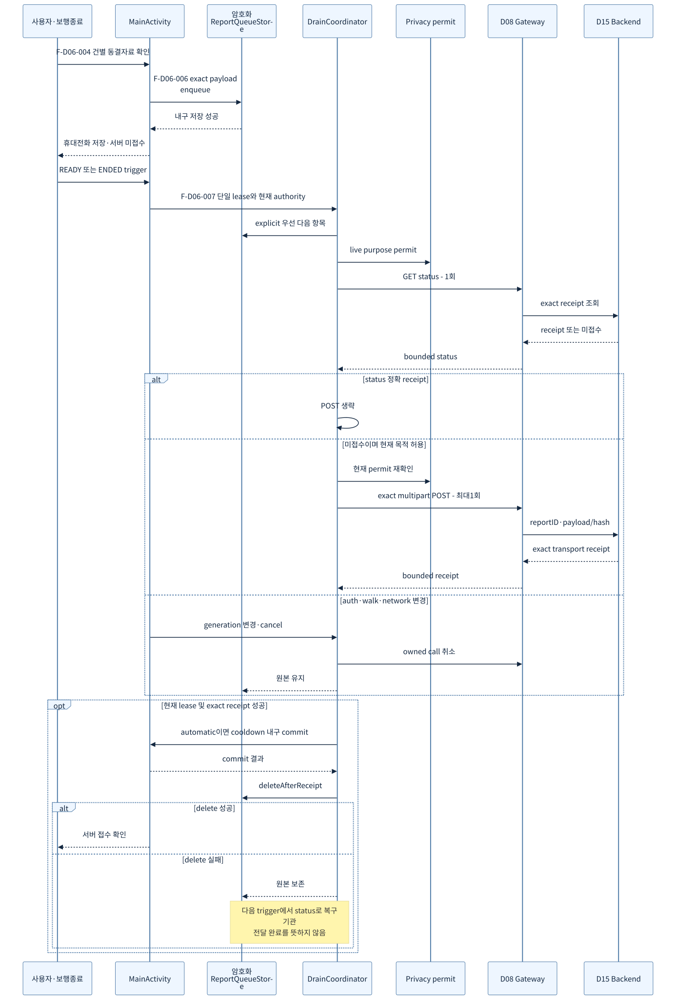

[Mermaid 원본](../diagrams/D06-report-sequence.mmd) · [SVG](../rendered/D06-report-sequence.svg)

[Mermaid 원본](../diagrams/D06-report-queue-state.mmd) · [SVG](../rendered/D06-report-queue-state.svg)

## F-D06-008 신고 multipart HTTP·목적별 permit·응답 계약

| 항목 | 명세 |
| --- | --- |
| 분야 | D06 사용자 Android 신고·raw 수집·현장 및 개발 진단 로그 |
| 목적 | 현재 승인된 목적과 네트워크에 묶어 exact 신고 bytes를 전송하고 영수증을 검증한다. |
| 사용 주체 | 사용자 Android MainActivity/신고 controller Gateway·Backend 연결(D08/D15) |
| 활성 상태 | CONDITIONAL |
| 진입점 | apps/android/app/src/main/java/kr/co/hanium/dreamup/walksafe/report/AndroidReportUploader.kt:212 queuedUploadResultCall apps/android/app/src/main/java/kr/co/hanium/dreamup/walksafe/report/AndroidReportUploader.kt:276 queuedStatusCall apps/android/app/src/main/java/kr/co/hanium/dreamup/walksafe/report/AndroidReportUploader.kt:96 strictTransportReceipt apps/android/app/src/main/java/kr/co/hanium/dreamup/walksafe/report/ReportPrivacyConsentSession.kt:132 withLiveUploadPermit |
| 실행 전제 | permit generation·purpose live, actor=session.actorId, 승인 origin exact, current consent/network binding. |
| 입력 출처 형식 검증 최신성 | POST /api/reports/v2, GET /api/reports/v2/{UUID}/status. purpose explicit/automatic, report ID/hash/byte headers, 현재 consent headers 및 session authentication. response<=512KiB. |

### 시작 이벤트와 처리 순서

| 이벤트 ID | 발생원 | 이벤트 | 수신부 | 흐름 |
| --- | --- | --- | --- | --- |
| E-D06-008-01 | drain transport 생성 | drain transport 생성 | queuedUploadResultCall | drain transport 생성→permit 발급→socket 열기→status/POST |
| E-D06-008-02 | HTTP 응답 | HTTP 응답 | queuedUploadResultCall | HTTP 응답→bounded body→strict receipt 판정 |

1. 1. socket open 안에서 live permit/purpose를 확인한다. [apps/android/app/src/main/java/kr/co/hanium/dreamup/walksafe/report/AndroidReportUploader.kt:212 queuedUploadResultCall]
2. 2. networkBinding.openConnection에 연결하고 redirect를 막는다. [apps/android/app/src/main/java/kr/co/hanium/dreamup/walksafe/report/AndroidReportUploader.kt:212 queuedUploadResultCall]
3. 3. 정확 multipart length를 지정하고 metadata/image를 스트림으로 쓴 뒤 임시 복사본을 zeroize한다. [apps/android/app/src/main/java/kr/co/hanium/dreamup/walksafe/report/AndroidReportUploader.kt:212 queuedUploadResultCall]
4. 4. status 404만 미접수로 해석; 2xx는 strict 필드·PERSISTED·receipt marker/UUID/hash/bytes를 검증한다. [apps/android/app/src/main/java/kr/co/hanium/dreamup/walksafe/report/AndroidReportUploader.kt:212 queuedUploadResultCall]
5. 5. POST creation_outcome CREATED/REPLAYED를 보존하며 SUPPRESSED 성공 payload는 거부한다. [apps/android/app/src/main/java/kr/co/hanium/dreamup/walksafe/report/AndroidReportUploader.kt:212 queuedUploadResultCall]

| 분기 조건 | 실제 처리 결과 | 구현 근거 |
| --- | --- | --- |
| 목적 permit 오래됨/다른 목적 | 연결 생성 거부 | apps/android/app/src/main/java/kr/co/hanium/dreamup/walksafe/report/AndroidReportUploader.kt:212 queuedUploadResultCall |
| 2xx malformed/mismatched receipt | ReportUploadProtocolException; 성공 처리 없음 | apps/android/app/src/main/java/kr/co/hanium/dreamup/walksafe/report/AndroidReportUploader.kt:212 queuedUploadResultCall |
| POST auth stale 응답 | Gateway 인증 무효화 소비 후 HTTP 오류 전달 | apps/android/app/src/main/java/kr/co/hanium/dreamup/walksafe/report/AndroidReportUploader.kt:212 queuedUploadResultCall |

### 효과 종료와 복구

Gateway를 거쳐 WalkSafe 서버에 업로드. 공공기관 자동 제출 아님.

| 상황 | 동작 |
| --- | --- |
| 정상 완료 | exact transport receipt 반환. |
| 실패 | 이 기능에 별도의 실패종료 경로는 정의되지 않음. 연결된 호출자·저장소 경로는 shared/code_refs 참조. |
| 시간 초과 | connect 8000ms/read12000ms; status whole deadline20000ms, POST35000ms. |
| 중복 입력 | 이 기능에 별도의 중복처리 경로는 정의되지 않음. 연결된 호출자·저장소 경로는 shared/code_refs 참조. |
| 취소 | 연결·stream attach cancellation으로 닫기. |
| 중단과 생명주기 | 이 기능에 별도의 중단 경로는 정의되지 않음. 연결된 호출자·저장소 경로는 shared/code_refs 참조. |
| 재시도 | 이 client 내부 자동 재시도 없음; 호출자 결정. |
| 복구 | 이 기능에 별도의 복구 경로는 정의되지 않음. 연결된 호출자·저장소 경로는 shared/code_refs 참조. |
| 자원 정리 | finally disconnect, payload 사본 zeroize. |

### 상태 실행 맥락과 연결

| 항목 | 명세 |
| --- | --- |
| 초기 상태 | S-D06-008-PERMIT_CHECK |
| 상태 목록 | S-D06-008-PERMIT_CHECK S-D06-008-CONNECTING S-D06-008-TRANSFERRING S-D06-008-RECEIPT_VALID S-D06-008-FAILED |
| 전이 조건과 전이 동작 | live permit→CONNECTING→TRANSFERRING exact receipt→RECEIPT_VALID 취소/기한/프로토콜→FAILED |
| 허용되지 않는 전이 | preconditions/branches에 명시된 gate 실패 상태에서 다음 처리로 진입 금지. 여기에 붙인 S-D06 ID는 명세 탐색용이며 코드 enum과 운영상태를 그대로 혼동하지 않음. |
| 동시성 순서와 작업 소유권 | CancellableNetworkCall worker; deadline scheduler는 공통 network 모듈. direct uploadCall 호환 경로와 queued path 구분. |
| 공유 상태와 다른 기능 연결 | D01 인증 stale coordinator, D08 proxy, D15 transport receipt. |

### 정책 근거와 검증 범위

| 항목 | 근거 |
| --- | --- |
| 정책 | [P-D06-008](#P-D06-008) [P-D06-009](#P-D06-009) |
| 구현 | [apps/android/app/src/main/java/kr/co/hanium/dreamup/walksafe/report/AndroidReportUploader.kt:212](/home/ddobagi/Hanium_Dreamup/apps/android/app/src/main/java/kr/co/hanium/dreamup/walksafe/report/AndroidReportUploader.kt:212) · `queuedUploadResultCall` (범위 212–274) [apps/android/app/src/main/java/kr/co/hanium/dreamup/walksafe/report/AndroidReportUploader.kt:276](/home/ddobagi/Hanium_Dreamup/apps/android/app/src/main/java/kr/co/hanium/dreamup/walksafe/report/AndroidReportUploader.kt:276) · `queuedStatusCall` (범위 276–363) [apps/android/app/src/main/java/kr/co/hanium/dreamup/walksafe/report/AndroidReportUploader.kt:94](/home/ddobagi/Hanium_Dreamup/apps/android/app/src/main/java/kr/co/hanium/dreamup/walksafe/report/AndroidReportUploader.kt:94) · `strictTransportReceipt` (범위 94–116) [apps/android/app/src/main/java/kr/co/hanium/dreamup/walksafe/report/ReportPrivacyConsentSession.kt:132](/home/ddobagi/Hanium_Dreamup/apps/android/app/src/main/java/kr/co/hanium/dreamup/walksafe/report/ReportPrivacyConsentSession.kt:132) · `withLiveUploadPermit` (범위 132–159) |
| 기존 개선 ID | 개별 동일성 미확인; 분야 연관은 별도 추적표 |
| 기존 분야 | 해당 없음 |
| 기존 실행 증거 | 이번 고정 소스 정적 분석 외 과거 실행/기기/서버 증거는 이 기능에서 재검증하지 않았음. 기존 DONE을 이번 실행 성공으로 간주하지 않음. |
| 한계 및 구분 | 코드에 연결된 동작과 활성 조건을 기록한 정적 명세. 실제 배포 설정·현장·API 송수신 결과는 미확인. 관리자 앱은 D12 담당. |

| 테스트 위치 | 심볼 | 증거 수준 | 기대와 한계 |
| --- | --- | --- | --- |
| [apps/android/app/src/test/java/kr/co/hanium/dreamup/walksafe/report/AndroidReportUploaderStreamingTest.kt](/home/ddobagi/Hanium_Dreamup/apps/android/app/src/test/java/kr/co/hanium/dreamup/walksafe/report/AndroidReportUploaderStreamingTest.kt) | AndroidReportUploaderStreamingTest | TEST_EXPECTATION | 고정 길이 multipart와 byte 복사 정리 기대; 미실행; 이번 작업에서는 실행하지 않음. |

### 이벤트 처리 그림


[Mermaid 원본](../diagrams/D06-F008.mmd) · [SVG](../rendered/D06-F008.svg)

## F-D06-009 신고 권한 철회·자동 선택 철회·계정삭제 fence

| 항목 | 명세 |
| --- | --- |
| 분야 | D06 사용자 Android 신고·raw 수집·현장 및 개발 진단 로그 |
| 목적 | 철회 즉시 진행 호출을 중단하고 대상 로컬 자료와 암호키를 일관되게 정리한다. |
| 사용 주체 | 사용자 Android MainActivity/신고 controller Gateway·Backend 연결(D08/D15) |
| 활성 상태 | ACTIVE |
| 진입점 | apps/android/app/src/main/java/kr/co/hanium/dreamup/walksafe/report/ReportPrivacyConsentSession.kt:64 withdraw apps/android/app/src/main/java/kr/co/hanium/dreamup/walksafe/report/AndroidReportQueueStore.kt:337 onConsentRevoked apps/android/app/src/main/java/kr/co/hanium/dreamup/walksafe/report/AndroidReportQueueStore.kt:835 purgeAllWithFence apps/android/app/src/main/java/kr/co/hanium/dreamup/walksafe/report/AndroidReportQueueStore.kt:903 deleteMatchingWithFences |
| 실행 전제 | receipt 64lowerhex; privacy hook은 profile 없어도 동작. |
| 입력 출처 형식 검증 최신성 | EXPLICIT/AUTOMATIC 목적별 active calls와 generation; accountDeletionBlocked는 새 enrollment reset 전 유지. |

### 시작 이벤트와 처리 순서

| 이벤트 ID | 발생원 | 이벤트 | 수신부 | 흐름 |
| --- | --- | --- | --- | --- |
| E-D06-009-01 | 신고 권한 철회 | 신고 권한 철회 | withdraw | 신고 권한 철회→permit generation 증가/호출 취소→전체 queue purge |
| E-D06-009-02 | 자동신고만 철회 | 자동신고만 철회 | withdraw | 자동신고만 철회→automatic 호출/자료만 삭제 |
| E-D06-009-03 | 계정삭제 | 계정삭제 | withdraw | 계정삭제→terminal account fence→자료 및 키 폐기 |

1. 1. 메모리 승인과 목적별 generation을 먼저 무효화하고 active calls를 취소한다. [apps/android/app/src/main/java/kr/co/hanium/dreamup/walksafe/report/ReportPrivacyConsentSession.kt:64 withdraw]
2. 2. 전체 purge는 lifecycle-pending에 미완료 intent를 내구 기록하고 모든 기존 intent fence를 복구한다. [apps/android/app/src/main/java/kr/co/hanium/dreamup/walksafe/report/ReportPrivacyConsentSession.kt:64 withdraw]
3. 3. 같은 OS lock에서 파일 삭제·키 폐기를 수행한다. [apps/android/app/src/main/java/kr/co/hanium/dreamup/walksafe/report/ReportPrivacyConsentSession.kt:64 withdraw]
4. 4. 동의 purge 성공 시 future enrollment용 fresh key 가능; account terminal이면 생성하지 않는다. [apps/android/app/src/main/java/kr/co/hanium/dreamup/walksafe/report/ReportPrivacyConsentSession.kt:64 withdraw]
5. 5. 자동-only purge는 automatic pending과 각 생성 receipt fence 후 자동 항목만 삭제하고 explicit/shared key를 보존한다. [apps/android/app/src/main/java/kr/co/hanium/dreamup/walksafe/report/ReportPrivacyConsentSession.kt:64 withdraw]

| 분기 조건 | 실제 처리 결과 | 구현 근거 |
| --- | --- | --- |
| 자료 삭제 또는 key lifecycle 실패 | pending 유지; 신규/조회 fail closed | apps/android/app/src/main/java/kr/co/hanium/dreamup/walksafe/report/ReportPrivacyConsentSession.kt:64 withdraw |
| 자동-only purge 중 실패 | automatic만 차단, explicit 유지 | apps/android/app/src/main/java/kr/co/hanium/dreamup/walksafe/report/ReportPrivacyConsentSession.kt:64 withdraw |
| raw/학습/통신 선택만 변경 | 진행 전송 재검증·취소; explicit queue 자체는 삭제하지 않음 | apps/android/app/src/main/java/kr/co/hanium/dreamup/walksafe/report/ReportPrivacyConsentSession.kt:64 withdraw |

### 효과 종료와 복구

네트워크 취소, 암호자료/키 삭제 또는 fence 보존. 삭제 완료를 실패 상황에서 주장하지 않음.

| 상황 | 동작 |
| --- | --- |
| 정상 완료 | 대상 purge true. |
| 실패 | pending 유지 false. |
| 시간 초과 | 이 기능에 별도의 시간초과 경로는 정의되지 않음. 연결된 호출자·저장소 경로는 shared/code_refs 참조. |
| 중복 입력 | 이 기능에 별도의 중복처리 경로는 정의되지 않음. 연결된 호출자·저장소 경로는 shared/code_refs 참조. |
| 취소 | privacy hook 자체가 호출 취소 주체. |
| 중단과 생명주기 | 이 기능에 별도의 중단 경로는 정의되지 않음. 연결된 호출자·저장소 경로는 shared/code_refs 참조. |
| 재시도 | 이 기능에 별도의 재시도 경로는 정의되지 않음. 연결된 호출자·저장소 경로는 shared/code_refs 참조. |
| 복구 | 다음 privacy hook에서 기존 intent 재실행. |
| 자원 정리 | 전체/자동 범위에 맞춘 암호키 lifecycle. |

### 상태 실행 맥락과 연결

| 항목 | 명세 |
| --- | --- |
| 초기 상태 | S-D06-009-GRANTED |
| 상태 목록 | S-D06-009-GRANTED S-D06-009-REVOKED S-D06-009-PURGE_PENDING S-D06-009-ACCOUNT_BLOCKED |
| 전이 조건과 전이 동작 | withdraw→REVOKED/PURGE_PENDING account delete→ACCOUNT_BLOCKED verified new enrollment→미승인 초기 |
| 허용되지 않는 전이 | preconditions/branches에 명시된 gate 실패 상태에서 다음 처리로 진입 금지. 여기에 붙인 S-D06 ID는 명세 탐색용이며 코드 enum과 운영상태를 그대로 혼동하지 않음. |
| 동시성 순서와 작업 소유권 | authority guard를 report permit lock 밖에서 획득하여 lock 역순 회피; storage 단일 process/OS lock. |
| 공유 상태와 다른 기능 연결 | D01 통합동의·계정삭제 state machine, F-D06-006/008. |

### 정책 근거와 검증 범위

| 항목 | 근거 |
| --- | --- |
| 정책 | [P-D06-009](#P-D06-009) [P-D06-010](#P-D06-010) |
| 구현 | [apps/android/app/src/main/java/kr/co/hanium/dreamup/walksafe/report/ReportPrivacyConsentSession.kt:64](/home/ddobagi/Hanium_Dreamup/apps/android/app/src/main/java/kr/co/hanium/dreamup/walksafe/report/ReportPrivacyConsentSession.kt:64) · `withdraw` (범위 64–223) [apps/android/app/src/main/java/kr/co/hanium/dreamup/walksafe/report/AndroidReportQueueStore.kt:337](/home/ddobagi/Hanium_Dreamup/apps/android/app/src/main/java/kr/co/hanium/dreamup/walksafe/report/AndroidReportQueueStore.kt:337) · `onConsentRevoked` (범위 337–375) [apps/android/app/src/main/java/kr/co/hanium/dreamup/walksafe/report/AndroidReportQueueStore.kt:828](/home/ddobagi/Hanium_Dreamup/apps/android/app/src/main/java/kr/co/hanium/dreamup/walksafe/report/AndroidReportQueueStore.kt:828) · `purgeAllWithFence` (범위 828–901) [apps/android/app/src/main/java/kr/co/hanium/dreamup/walksafe/report/AndroidReportQueueStore.kt:903](/home/ddobagi/Hanium_Dreamup/apps/android/app/src/main/java/kr/co/hanium/dreamup/walksafe/report/AndroidReportQueueStore.kt:903) · `deleteMatchingWithFences` (범위 903–949) |
| 기존 개선 ID | 개별 동일성 미확인; 분야 연관은 별도 추적표 |
| 기존 분야 | 해당 없음 |
| 기존 실행 증거 | 이번 고정 소스 정적 분석 외 과거 실행/기기/서버 증거는 이 기능에서 재검증하지 않았음. 기존 DONE을 이번 실행 성공으로 간주하지 않음. |
| 한계 및 구분 | 코드에 연결된 동작과 활성 조건을 기록한 정적 명세. 실제 배포 설정·현장·API 송수신 결과는 미확인. 관리자 앱은 D12 담당. |

| 테스트 위치 | 심볼 | 증거 수준 | 기대와 한계 |
| --- | --- | --- | --- |
| [apps/android/app/src/test/java/kr/co/hanium/dreamup/walksafe/report/ReportPurposePermitRegressionTest.kt](/home/ddobagi/Hanium_Dreamup/apps/android/app/src/test/java/kr/co/hanium/dreamup/walksafe/report/ReportPurposePermitRegressionTest.kt) | ReportPurposePermitRegressionTest | TEST_EXPECTATION | purpose별 permit와 자동 철회 분리 기대; 미실행; 이번 작업에서는 실행하지 않음. |
| [apps/android/app/src/test/java/kr/co/hanium/dreamup/walksafe/report/ReportPrivacyAccountDeletionTest.kt](/home/ddobagi/Hanium_Dreamup/apps/android/app/src/test/java/kr/co/hanium/dreamup/walksafe/report/ReportPrivacyAccountDeletionTest.kt) | ReportPrivacyAccountDeletionTest | TEST_EXPECTATION | account terminal 우선 기대; 미실행; 이번 작업에서는 실행하지 않음. |

### 이벤트 처리 그림


[Mermaid 원본](../diagrams/D06-F009.mmd) · [SVG](../rendered/D06-F009.svg)

## F-D06-010 신고 TTL 정리 Job과 구형 pending 저장소 폐기

| 항목 | 명세 |
| --- | --- |
| 분야 | D06 사용자 Android 신고·raw 수집·현장 및 개발 진단 로그 |
| 목적 | 전송 비활성·앱 재시작 중에도 만료 신고와 제거된 legacy 저장소를 정리한다. |
| 사용 주체 | 사용자 Android MainActivity/신고 controller Gateway·Backend 연결(D08/D15) |
| 활성 상태 | ACTIVE |
| 진입점 | apps/android/app/src/main/java/kr/co/hanium/dreamup/walksafe/report/ReportQueueCleanupJobService.kt:26 onStartJob apps/android/app/src/main/java/kr/co/hanium/dreamup/walksafe/report/AndroidReportQueueStore.kt:377 pruneExpiredLocked apps/android/app/src/main/java/kr/co/hanium/dreamup/walksafe/report/AndroidPendingReportStore.kt:22 purgeAllWithoutLoading apps/android/app/src/main/java/kr/co/hanium/dreamup/walksafe/MainActivity.kt:6773 scheduleLegacyPendingReportQueuePurge apps/android/app/src/main/java/kr/co/hanium/dreamup/walksafe/voice/WalkSafeApplication.kt:21 onCreate |
| 실행 전제 | queue profile 불필요. 동일 Job ID가 있으면 등록 중복 생략. legacy purge 전 durable marker. |
| 입력 출처 형식 검증 최신성 | TTL 생성부터 30일; 읽기 불가 entry는 lastModified부터 30일; orphan temp는 storage lock에서 제거. Job interval 1일. |

### 시작 이벤트와 처리 순서

| 이벤트 ID | 발생원 | 이벤트 | 수신부 | 흐름 |
| --- | --- | --- | --- | --- |
| E-D06-010-01 | 앱 초기화 | 앱 초기화 | onStartJob | 앱 초기화→하루 주기 persisted Job 등록 |
| E-D06-010-02 | Job 실행 | Job 실행 | onStartJob | Job 실행→통신 없이 pruneExpired |
| E-D06-010-03 | legacy queue 발견/앱 초기화 | legacy queue 발견/앱 초기화 | onStartJob | legacy queue 발견/앱 초기화→pending marker→암호문 미복호화 삭제 |

1. 0. WalkSafeApplication.onCreate가 schedule을 호출하며 동일 JOB_ID가 있으면 중복 예약하지 않는다. manifest는 exported=false와 BIND_JOB_SERVICE로 등록하고 boot permission과 persisted Job을 사용한다.
2. 1. background single cleanup executor에서 store.pruneExpired를 수행한다. [apps/android/app/src/main/java/kr/co/hanium/dreamup/walksafe/report/ReportQueueCleanupJobService.kt:26 onStartJob]
3. 2. 현재 job identity가 같은 경우만 UI handler에서 jobFinished한다. [apps/android/app/src/main/java/kr/co/hanium/dreamup/walksafe/report/ReportQueueCleanupJobService.kt:26 onStartJob]
4. 3. onStopJob은 future cancel 후 재스케줄 요청, destroy는 executor shutdown 한다. [apps/android/app/src/main/java/kr/co/hanium/dreamup/walksafe/report/ReportQueueCleanupJobService.kt:26 onStartJob]
5. 4. legacy는 process/file lock 제한시간 아래 키 파괴·디렉터리 삭제·marker 해제 순서로 정리한다. [apps/android/app/src/main/java/kr/co/hanium/dreamup/walksafe/report/ReportQueueCleanupJobService.kt:26 onStartJob]

| 분기 조건 | 실제 처리 결과 | 구현 근거 |
| --- | --- | --- |
| 만료 전 유효 신고 | 보존 | apps/android/app/src/main/java/kr/co/hanium/dreamup/walksafe/report/ReportQueueCleanupJobService.kt:26 onStartJob |
| legacy lock/삭제/키 폐기 실패 | pending marker 유지, cleanup 재시도 경로 | apps/android/app/src/main/java/kr/co/hanium/dreamup/walksafe/report/ReportQueueCleanupJobService.kt:26 onStartJob |
| Job 예외 | jobFinished needsReschedule=true | apps/android/app/src/main/java/kr/co/hanium/dreamup/walksafe/report/ReportQueueCleanupJobService.kt:26 onStartJob |

### 효과 종료와 복구

네트워크·업로드 없음. best-effort 물리 정리이므로 정확히 30일 시점 삭제 보장 아님.

| 상황 | 동작 |
| --- | --- |
| 정상 완료 | 만료 파일 수 반환/legacy clear. |
| 실패 | 이 기능에 별도의 실패종료 경로는 정의되지 않음. 연결된 호출자·저장소 경로는 shared/code_refs 참조. |
| 시간 초과 | legacy shared lock budget 제한; Job 실제 실행시간은 OS 결정. |
| 중복 입력 | 같은 JOB_ID 존재 시 schedule 생략. |
| 취소 | onStopJob future interrupt. |
| 중단과 생명주기 | 이 기능에 별도의 중단 경로는 정의되지 않음. 연결된 호출자·저장소 경로는 shared/code_refs 참조. |
| 재시도 | 이 기능에 별도의 재시도 경로는 정의되지 않음. 연결된 호출자·저장소 경로는 shared/code_refs 참조. |
| 복구 | OS 재스케줄 및 다음 앱 cleanup. |
| 자원 정리 | legacy ciphertext는 복호화하지 않음. |

### 상태 실행 맥락과 연결

| 항목 | 명세 |
| --- | --- |
| 초기 상태 | S-D06-010-SCHEDULED |
| 상태 목록 | S-D06-010-SCHEDULED S-D06-010-CLEANING S-D06-010-RESCHEDULE S-D06-010-CLEAN |
| 전이 조건과 전이 동작 | 주기→CLEANING→CLEAN 실패/stop→RESCHEDULE |
| 허용되지 않는 전이 | preconditions/branches에 명시된 gate 실패 상태에서 다음 처리로 진입 금지. 여기에 붙인 S-D06 ID는 명세 탐색용이며 코드 enum과 운영상태를 그대로 혼동하지 않음. |
| 동시성 순서와 작업 소유권 | Job worker와 main callback의 ActiveJob identity; legacy cleanup executor/process/file lock. |
| 공유 상태와 다른 기능 연결 | Android Manifest JobService 선언, 계정삭제 cleanup. |

### 정책 근거와 검증 범위

| 항목 | 근거 |
| --- | --- |
| 정책 | [P-D06-006](#P-D06-006) [P-D06-010](#P-D06-010) |
| 구현 | [apps/android/app/src/main/java/kr/co/hanium/dreamup/walksafe/report/ReportQueueCleanupJobService.kt:26](/home/ddobagi/Hanium_Dreamup/apps/android/app/src/main/java/kr/co/hanium/dreamup/walksafe/report/ReportQueueCleanupJobService.kt:26) · `onStartJob` (범위 26–89) [apps/android/app/src/main/java/kr/co/hanium/dreamup/walksafe/report/AndroidReportQueueStore.kt:377](/home/ddobagi/Hanium_Dreamup/apps/android/app/src/main/java/kr/co/hanium/dreamup/walksafe/report/AndroidReportQueueStore.kt:377) · `pruneExpiredLocked` (범위 377–400) [apps/android/app/src/main/java/kr/co/hanium/dreamup/walksafe/report/AndroidPendingReportStore.kt:22](/home/ddobagi/Hanium_Dreamup/apps/android/app/src/main/java/kr/co/hanium/dreamup/walksafe/report/AndroidPendingReportStore.kt:22) · `purgeAllWithoutLoading` (범위 22–127) [apps/android/app/src/main/java/kr/co/hanium/dreamup/walksafe/MainActivity.kt:6773](/home/ddobagi/Hanium_Dreamup/apps/android/app/src/main/java/kr/co/hanium/dreamup/walksafe/MainActivity.kt:6773) · `scheduleLegacyPendingReportQueuePurge` (범위 6773–6805) [apps/android/app/src/main/java/kr/co/hanium/dreamup/walksafe/voice/WalkSafeApplication.kt:21](/home/ddobagi/Hanium_Dreamup/apps/android/app/src/main/java/kr/co/hanium/dreamup/walksafe/voice/WalkSafeApplication.kt:21) · `onCreate` (범위 21–24) [apps/android/app/src/main/AndroidManifest.xml:50](/home/ddobagi/Hanium_Dreamup/apps/android/app/src/main/AndroidManifest.xml:50) · `ReportQueueCleanupJobService` (범위 50–55) |
| 기존 개선 ID | 개별 동일성 미확인; 분야 연관은 별도 추적표 |
| 기존 분야 | 해당 없음 |
| 기존 실행 증거 | 이번 고정 소스 정적 분석 외 과거 실행/기기/서버 증거는 이 기능에서 재검증하지 않았음. 기존 DONE을 이번 실행 성공으로 간주하지 않음. |
| 한계 및 구분 | 코드에 연결된 동작과 활성 조건을 기록한 정적 명세. 실제 배포 설정·현장·API 송수신 결과는 미확인. 관리자 앱은 D12 담당. 하루 periodic JobScheduler는 best effort이므로30일 경과 정각의 물리삭제를 보장하지 않는다. |

| 테스트 위치 | 심볼 | 증거 수준 | 기대와 한계 |
| --- | --- | --- | --- |
| [apps/android/app/src/test/java/kr/co/hanium/dreamup/walksafe/report/ReportQueueCleanupSchedulingStaticTest.kt](/home/ddobagi/Hanium_Dreamup/apps/android/app/src/test/java/kr/co/hanium/dreamup/walksafe/report/ReportQueueCleanupSchedulingStaticTest.kt) | ReportQueueCleanupSchedulingStaticTest | TEST_EXPECTATION | 정리 job 연결 기대; 미실행; 이번 작업에서는 실행하지 않음. |

### 이벤트 처리 그림


[Mermaid 원본](../diagrams/D06-F010.mmd) · [SVG](../rendered/D06-F010.svg)

## F-D06-011 내 신고 목록·상태 필터·상세 조회

| 항목 | 명세 |
| --- | --- |
| 분야 | D06 사용자 Android 신고·raw 수집·현장 및 개발 진단 로그 |
| 목적 | 현재 인증 계정의 신고와 관리자 수동 기록 상태를 보여준다. |
| 사용 주체 | 사용자 Android MainActivity/신고 controller Gateway·Backend 연결(D08/D15) |
| 활성 상태 | CONDITIONAL |
| 진입점 | apps/android/app/src/main/java/kr/co/hanium/dreamup/walksafe/report/UserReportController.kt:148 loadReports apps/android/app/src/main/java/kr/co/hanium/dreamup/walksafe/report/UserReportController.kt:440 startList apps/android/app/src/main/java/kr/co/hanium/dreamup/walksafe/network/AndroidUserReportClient.kt:80 listReportsCall apps/android/app/src/main/java/kr/co/hanium/dreamup/walksafe/MainActivity.kt:11176 currentUserReportAuthorityOrNull |
| 실행 전제 | 완료된 first-run actor binding, GENERAL VERIFIED backend/device/accountGeneration session, local identity epoch, 허용 네트워크. 계정삭제/복구전용/storageBlocked 제외. |
| 입력 출처 형식 검증 최신성 | GET /api/reports/mine?limit=25&cursor&user_status; filter ALL/RECEIVED/REJECTED/INSTITUTION_SUBMITTED/RESOLVED. canonical UUID/cursor, response<=128KiB. |

### 시작 이벤트와 처리 순서

| 이벤트 ID | 발생원 | 이벤트 | 수신부 | 흐름 |
| --- | --- | --- | --- | --- |
| E-D06-011-01 | 내 신고 새로고침/필터 변경 | 내 신고 새로고침/필터 변경 | loadReports | 내 신고 새로고침/필터 변경→25건 첫 페이지 |
| E-D06-011-02 | 다음 페이지 | 다음 페이지 | loadReports | 다음 페이지→현재 cursor/filter 확인→추가 |
| E-D06-011-03 | 리스트 항목 선택 | 리스트 항목 선택 | loadReports | 리스트 항목 선택→동일 report 상세 조회 |

1. 1. bound authority와 현재 session 객체/generation/local epoch가 일치할 때만 단일 호출을 시작한다. [apps/android/app/src/main/java/kr/co/hanium/dreamup/walksafe/report/UserReportController.kt:148 loadReports]
2. 2. 목록 새로고침 동안 기존 list를 유지하고 상세/정정 선택을 초기화한다. [apps/android/app/src/main/java/kr/co/hanium/dreamup/walksafe/report/UserReportController.kt:148 loadReports]
3. 3. cursor 재반복·중복 report ID를 거부하고 page를 이어붙인다. [apps/android/app/src/main/java/kr/co/hanium/dreamup/walksafe/report/UserReportController.kt:148 loadReports]
4. 4. 목록 안의 ID만 상세 열고 반환 reportId 일치를 검증한다. [apps/android/app/src/main/java/kr/co/hanium/dreamup/walksafe/report/UserReportController.kt:148 loadReports]
5. 5. 기관 제출/처리 완료 label은 관리자가 수동 기록한 전달 상태라고 표시한다. [apps/android/app/src/main/java/kr/co/hanium/dreamup/walksafe/report/UserReportController.kt:148 loadReports]

| 분기 조건 | 실제 처리 결과 | 구현 근거 |
| --- | --- | --- |
| 목록 404 | 전체 신고 메모리 정리, NOT_FOUND_OR_SIGNED_OUT | apps/android/app/src/main/java/kr/co/hanium/dreamup/walksafe/report/UserReportController.kt:148 loadReports |
| 네트워크 제한/변경 | 진행 취소, 이전 캐시 복원 및 명시 retry | apps/android/app/src/main/java/kr/co/hanium/dreamup/walksafe/report/UserReportController.kt:148 loadReports |
| session 만료/교체 | 민감 UI 및 pending 의도 제거 | apps/android/app/src/main/java/kr/co/hanium/dreamup/walksafe/report/UserReportController.kt:148 loadReports |

### 효과 종료와 복구

목록·상세·status/filter 버튼과 접근성 문구. 기관 외부 전송 호출 없음.

| 상황 | 동작 |
| --- | --- |
| 정상 완료 | 조회 결과 게시. |
| 실패 | 프로토콜/서버 오류와 retry 상태. |
| 시간 초과 | HTTP connect8000ms/read15000ms. controller는 오류로 표시하고 해당 의도/authority 정책에 따라 명시 retry 허용 여부를 결정한다. |
| 중복 입력 | active operation 중 추가 호출 거절. |
| 취소 | 권한·network·destroy 취소. |
| 중단과 생명주기 | 이 기능에 별도의 중단 경로는 정의되지 않음. 연결된 호출자·저장소 경로는 shared/code_refs 참조. |
| 재시도 | 사용자 retry; 자동 복구는 history cursor 별도 기능. |
| 복구 | 이 기능에 별도의 복구 경로는 정의되지 않음. 연결된 호출자·저장소 경로는 shared/code_refs 참조. |
| 자원 정리 | 권한 변경 때 전체 사용자 신고 메모리 초기화. |

### 상태 실행 맥락과 연결

| 항목 | 명세 |
| --- | --- |
| 초기 상태 | S-D06-011-SIGNED_OUT |
| 상태 목록 | S-D06-011-SIGNED_OUT S-D06-011-IDLE S-D06-011-LOADING_LIST S-D06-011-LOADING_MORE S-D06-011-LOADING_DETAIL S-D06-011-READY S-D06-011-EMPTY S-D06-011-ERROR |
| 전이 조건과 전이 동작 | authority→IDLE load→LOADING→READY/EMPTY 권한 소실→SIGNED_OUT |
| 허용되지 않는 전이 | preconditions/branches에 명시된 gate 실패 상태에서 다음 처리로 진입 금지. 여기에 붙인 S-D06 ID는 명세 탐색용이며 코드 enum과 운영상태를 그대로 혼동하지 않음. |
| 동시성 순서와 작업 소유권 | workerExecutor→callbackExecutor; generation+call identity+현재 authority/network를 실행/완료/observer에 재검사. |
| 공유 상태와 다른 기능 연결 | D08 /api/reports/mine, D15 사용자 신고 API, D12 관리자 수동 전달. |

### 정책 근거와 검증 범위

| 항목 | 근거 |
| --- | --- |
| 정책 | [P-D06-011](#P-D06-011) [P-D06-012](#P-D06-012) |
| 구현 | [apps/android/app/src/main/java/kr/co/hanium/dreamup/walksafe/report/UserReportController.kt:148](/home/ddobagi/Hanium_Dreamup/apps/android/app/src/main/java/kr/co/hanium/dreamup/walksafe/report/UserReportController.kt:148) · `loadReports` (범위 148–216) [apps/android/app/src/main/java/kr/co/hanium/dreamup/walksafe/report/UserReportController.kt:440](/home/ddobagi/Hanium_Dreamup/apps/android/app/src/main/java/kr/co/hanium/dreamup/walksafe/report/UserReportController.kt:440) · `startList` (범위 440–498) [apps/android/app/src/main/java/kr/co/hanium/dreamup/walksafe/network/AndroidUserReportClient.kt:76](/home/ddobagi/Hanium_Dreamup/apps/android/app/src/main/java/kr/co/hanium/dreamup/walksafe/network/AndroidUserReportClient.kt:76) · `listReportsCall` (범위 76–140) [apps/android/app/src/main/java/kr/co/hanium/dreamup/walksafe/MainActivity.kt:11176](/home/ddobagi/Hanium_Dreamup/apps/android/app/src/main/java/kr/co/hanium/dreamup/walksafe/MainActivity.kt:11176) · `currentUserReportAuthorityOrNull` (범위 11176–11294) [apps/android/app/src/main/java/kr/co/hanium/dreamup/walksafe/network/AndroidUserReportClient.kt:283](/home/ddobagi/Hanium_Dreamup/apps/android/app/src/main/java/kr/co/hanium/dreamup/walksafe/network/AndroidUserReportClient.kt:283) · `requestCall` (범위 283–363) |
| 기존 개선 ID | 개별 동일성 미확인; 분야 연관은 별도 추적표 |
| 기존 분야 | 해당 없음 |
| 기존 실행 증거 | 이번 고정 소스 정적 분석 외 과거 실행/기기/서버 증거는 이 기능에서 재검증하지 않았음. 기존 DONE을 이번 실행 성공으로 간주하지 않음. |
| 한계 및 구분 | 코드에 연결된 동작과 활성 조건을 기록한 정적 명세. 실제 배포 설정·현장·API 송수신 결과는 미확인. 관리자 앱은 D12 담당. |

| 테스트 위치 | 심볼 | 증거 수준 | 기대와 한계 |
| --- | --- | --- | --- |
| [apps/android/app/src/test/java/kr/co/hanium/dreamup/walksafe/report/UserReportControllerTest.kt](/home/ddobagi/Hanium_Dreamup/apps/android/app/src/test/java/kr/co/hanium/dreamup/walksafe/report/UserReportControllerTest.kt) | pagesRemainBoundToStableFilterCursorAndUniqueReportIds | TEST_EXPECTATION | 필터/cursor/ID 일관성 기대; 미실행; 이번 작업에서는 실행하지 않음. |

### 이벤트 처리 그림


[Mermaid 원본](../diagrams/D06-F011.mmd) · [SVG](../rendered/D06-F011.svg)

## F-D06-012 신고 사용자 설명·분류의 직접 정정

| 항목 | 명세 |
| --- | --- |
| 분야 | D06 사용자 Android 신고·raw 수집·현장 및 개발 진단 로그 |
| 목적 | 신고의 변경 가능한 사용자 내용만 revision compare-and-set으로 정정한다. |
| 사용 주체 | 사용자 Android MainActivity/신고 controller Gateway·Backend 연결(D08/D15) |
| 활성 상태 | CONDITIONAL |
| 진입점 | apps/android/app/src/main/java/kr/co/hanium/dreamup/walksafe/report/UserReportController.kt:217 submitCorrection apps/android/app/src/main/java/kr/co/hanium/dreamup/walksafe/report/UserReportController.kt:724 startCorrection apps/android/app/src/main/java/kr/co/hanium/dreamup/walksafe/report/UserReportModels.kt:128 UserReportCorrectionIntent apps/android/app/src/main/java/kr/co/hanium/dreamup/walksafe/MainActivity.kt:11836 confirmUserReportCorrection |
| 실행 전제 | 현재 상세 및 content.reportId 일치, 현재 F-D06-011 authority. |
| 입력 출처 형식 검증 최신성 | userDescription/categoryHint 각각 Omitted/Value/Clear; 설명 NFC, 공백 한 칸, 제어문자 금지, 1..500 code points. expectedRevision와 idempotency UUID. API: GET /api/reports/mine/{reportId}/content, POST /api/reports/mine/{reportId}/corrections. HTTP 성공 허용200/201, reportId/expectedRevision/idempotencyKey 응답 일치 필수. |

### 시작 이벤트와 처리 순서

| 이벤트 ID | 발생원 | 이벤트 | 수신부 | 흐름 |
| --- | --- | --- | --- | --- |
| E-D06-012-01 | 내용 불러오기 | 내용 불러오기 | submitCorrection | 내용 불러오기→현재 revision 확보 |
| E-D06-012-02 | 설명/분류 수정 확인 | 설명/분류 수정 확인 | submitCorrection | 설명/분류 수정 확인→정확 patch+UUID 보존→정정 호출 |

1. 1. current content를 먼저 가져온다. [apps/android/app/src/main/java/kr/co/hanium/dreamup/walksafe/report/UserReportController.kt:217 submitCorrection]
2. 2. 사용자 확인 시 선택 patch와 expectedRevision을 고정한다. [apps/android/app/src/main/java/kr/co/hanium/dreamup/walksafe/report/UserReportController.kt:217 submitCorrection]
3. 3. 동일 pending intent일 때만 재사용하고 다른 patch 동시 제출을 거절한다. [apps/android/app/src/main/java/kr/co/hanium/dreamup/walksafe/report/UserReportController.kt:217 submitCorrection]
4. 4. 응답 reportId/expectedRevision/idempotencyKey 일치 후 새 revision/hash/content로 교체한다. [apps/android/app/src/main/java/kr/co/hanium/dreamup/walksafe/report/UserReportController.kt:217 submitCorrection]

| 분기 조건 | 실제 처리 결과 | 구현 근거 |
| --- | --- | --- |
| 임시 network/5xx/프로토콜 실패 | 동일 UUID·revision·patch로 명시 retry | apps/android/app/src/main/java/kr/co/hanium/dreamup/walksafe/report/UserReportController.kt:217 submitCorrection |
| 404/409/413/415/422 | pending intent 종료, 자동 재전송 없음 | apps/android/app/src/main/java/kr/co/hanium/dreamup/walksafe/report/UserReportController.kt:217 submitCorrection |
| 권한 변경/tombstone | pending correction 및 선택 content 제거 | apps/android/app/src/main/java/kr/co/hanium/dreamup/walksafe/report/UserReportController.kt:217 submitCorrection |

### 효과 종료와 복구

변경된 사용자 설명/분류 UI. 모델 탐지/원본 evidence의 직접 수정과 구분.

| 상황 | 동작 |
| --- | --- |
| 정상 완료 | 새 content revision 게시. |
| 실패 | 이 기능에 별도의 실패종료 경로는 정의되지 않음. 연결된 호출자·저장소 경로는 shared/code_refs 참조. |
| 시간 초과 | HTTP connect8000ms/read15000ms. controller는 오류로 표시하고 해당 의도/authority 정책에 따라 명시 retry 허용 여부를 결정한다. |
| 중복 입력 | 동일 idempotency 의도 유지. |
| 취소 | authority/network/destroy의 공통 취소. |
| 중단과 생명주기 | 이 기능에 별도의 중단 경로는 정의되지 않음. 연결된 호출자·저장소 경로는 shared/code_refs 참조. |
| 재시도 | 동일 intent 사용자 retry. |
| 복구 | process 재시작 pending draft 자동 복원 없음. |
| 자원 정리 | 이 기능에 별도의 정리 경로는 정의되지 않음. 연결된 호출자·저장소 경로는 shared/code_refs 참조. |

### 상태 실행 맥락과 연결

| 항목 | 명세 |
| --- | --- |
| 초기 상태 | S-D06-012-CONTENT_READY |
| 상태 목록 | S-D06-012-CONTENT_READY S-D06-012-SUBMITTING_CORRECTION S-D06-012-CORRECTED S-D06-012-ERROR |
| 전이 조건과 전이 동작 | 확인→SUBMITTING_CORRECTION→CORRECTED 일시 실패→ERROR→동일 의도 retry |
| 허용되지 않는 전이 | preconditions/branches에 명시된 gate 실패 상태에서 다음 처리로 진입 금지. 여기에 붙인 S-D06 ID는 명세 탐색용이며 코드 enum과 운영상태를 그대로 혼동하지 않음. |
| 동시성 순서와 작업 소유권 | UserReportController 단일 operation/generation; UI 확인 때 현재 state 재검사. |
| 공유 상태와 다른 기능 연결 | D15 content revision API; F-D06-013의 ‘정정 요청’과 별개. |

### 정책 근거와 검증 범위

| 항목 | 근거 |
| --- | --- |
| 정책 | [P-D06-011](#P-D06-011) [P-D06-013](#P-D06-013) |
| 구현 | [apps/android/app/src/main/java/kr/co/hanium/dreamup/walksafe/report/UserReportController.kt:217](/home/ddobagi/Hanium_Dreamup/apps/android/app/src/main/java/kr/co/hanium/dreamup/walksafe/report/UserReportController.kt:217) · `submitCorrection` (범위 217–245) [apps/android/app/src/main/java/kr/co/hanium/dreamup/walksafe/report/UserReportController.kt:724](/home/ddobagi/Hanium_Dreamup/apps/android/app/src/main/java/kr/co/hanium/dreamup/walksafe/report/UserReportController.kt:724) · `startCorrection` (범위 724–750) [apps/android/app/src/main/java/kr/co/hanium/dreamup/walksafe/report/UserReportModels.kt:128](/home/ddobagi/Hanium_Dreamup/apps/android/app/src/main/java/kr/co/hanium/dreamup/walksafe/report/UserReportModels.kt:128) · `UserReportCorrectionIntent` (범위 128–184) [apps/android/app/src/main/java/kr/co/hanium/dreamup/walksafe/MainActivity.kt:11836](/home/ddobagi/Hanium_Dreamup/apps/android/app/src/main/java/kr/co/hanium/dreamup/walksafe/MainActivity.kt:11836) · `confirmUserReportCorrection` (범위 11836–11891) [apps/android/app/src/main/java/kr/co/hanium/dreamup/walksafe/network/AndroidUserReportClient.kt:283](/home/ddobagi/Hanium_Dreamup/apps/android/app/src/main/java/kr/co/hanium/dreamup/walksafe/network/AndroidUserReportClient.kt:283) · `requestCall` (범위 283–363) |
| 기존 개선 ID | 개별 동일성 미확인; 분야 연관은 별도 추적표 |
| 기존 분야 | 해당 없음 |
| 기존 실행 증거 | 이번 고정 소스 정적 분석 외 과거 실행/기기/서버 증거는 이 기능에서 재검증하지 않았음. 기존 DONE을 이번 실행 성공으로 간주하지 않음. |
| 한계 및 구분 | 코드에 연결된 동작과 활성 조건을 기록한 정적 명세. 실제 배포 설정·현장·API 송수신 결과는 미확인. 관리자 앱은 D12 담당. |

| 테스트 위치 | 심볼 | 증거 수준 | 기대와 한계 |
| --- | --- | --- | --- |
| [apps/android/app/src/test/java/kr/co/hanium/dreamup/walksafe/report/UserReportControllerTest.kt](/home/ddobagi/Hanium_Dreamup/apps/android/app/src/test/java/kr/co/hanium/dreamup/walksafe/report/UserReportControllerTest.kt) | structuredCorrectionRetryKeepsExactUuidCasAndPatch | TEST_EXPECTATION | 정확 CAS patch 재시도 기대; 미실행; 이번 작업에서는 실행하지 않음. |

### 이벤트 처리 그림


[Mermaid 원본](../diagrams/D06-F012.mmd) · [SVG](../rendered/D06-F012.svg)

## F-D06-013 신고 정정 요청·삭제 요청 접수

| 항목 | 명세 |
| --- | --- |
| 분야 | D06 사용자 Android 신고·raw 수집·현장 및 개발 진단 로그 |
| 목적 | 사용자 권리행사 의도를 중복 없이 서버에 접수하고 추적 참조를 보관한다. |
| 사용 주체 | 사용자 Android MainActivity/신고 controller Gateway·Backend 연결(D08/D15) |
| 활성 상태 | CONDITIONAL |
| 진입점 | apps/android/app/src/main/java/kr/co/hanium/dreamup/walksafe/report/UserReportController.kt:363 submitRequest apps/android/app/src/main/java/kr/co/hanium/dreamup/walksafe/report/UserReportController.kt:659 startRequest apps/android/app/src/main/java/kr/co/hanium/dreamup/walksafe/MainActivity.kt:11932 confirmUserReportDeleteRequest |
| 실행 전제 | 현재 선택 상세 ID, F-D06-011 authority; DELETE는 v7 backend account/device bound+accountGeneration+deletionTracker 필수. |
| 입력 출처 형식 검증 최신성 | CORRECTION 또는 DELETE; trim과 원문이 같고 1..500 code points 요청문. 첫 동작 canonical clientRequestId. API: POST /api/reports/mine/{reportId}/requests; HTTP200/201만 접수 응답 처리. |

### 시작 이벤트와 처리 순서

| 이벤트 ID | 발생원 | 이벤트 | 수신부 | 흐름 |
| --- | --- | --- | --- | --- |
| E-D06-013-01 | 정정/삭제 요청 입력 및 확인 | 정정/삭제 요청 입력 및 확인 | submitRequest | 정정/삭제 요청 입력 및 확인→clientRequestId 고정→POST requests |
| E-D06-013-02 | 접수 성공 | 접수 성공 | submitRequest | 접수 성공→tracker 저장→latest request/이력 갱신 |

1. 1. 새 의도를 UUID와 함께 메모리에 고정한다. [apps/android/app/src/main/java/kr/co/hanium/dreamup/walksafe/report/UserReportController.kt:363 submitRequest]
2. 2. POST /mine/{reportId}/requests를 실행한다. [apps/android/app/src/main/java/kr/co/hanium/dreamup/walksafe/report/UserReportController.kt:363 submitRequest]
3. 3. response requestType 일치 후 report/request/type 참조를 tracker에 기록한다. [apps/android/app/src/main/java/kr/co/hanium/dreamup/walksafe/report/UserReportController.kt:363 submitRequest]
4. 4. 목록·상세의 latestRequest를 갱신하고 history refresh sequence를 증가한다. [apps/android/app/src/main/java/kr/co/hanium/dreamup/walksafe/report/UserReportController.kt:363 submitRequest]

| 분기 조건 | 실제 처리 결과 | 구현 근거 |
| --- | --- | --- |
| 같은 의도 더블탭 | active/pending으로 두 번째 호출 거절 | apps/android/app/src/main/java/kr/co/hanium/dreamup/walksafe/report/UserReportController.kt:363 submitRequest |
| 접수 성공 후 로컬 추적 실패 | 서버 접수 결과 유지, LOCAL_TRACKING, retryAvailable=false | apps/android/app/src/main/java/kr/co/hanium/dreamup/walksafe/report/UserReportController.kt:363 submitRequest |
| terminal4xx | pending 해제 후 새 요청 가능 | apps/android/app/src/main/java/kr/co/hanium/dreamup/walksafe/report/UserReportController.kt:363 submitRequest |
| 일시 실패 | exact clientRequestId와 본문 재시도 | apps/android/app/src/main/java/kr/co/hanium/dreamup/walksafe/report/UserReportController.kt:363 submitRequest |

### 효과 종료와 복구

요청 접수와 물리 삭제를 구별한 문구. 외부 기관 보관본 삭제 완료로 표시하지 않음.

| 상황 | 동작 |
| --- | --- |
| 정상 완료 | request summary와 참조 저장. |
| 실패 | local tracking 실패는 서버 요청 재POST 금지. |
| 시간 초과 | HTTP connect8000ms/read15000ms. controller는 오류로 표시하고 해당 의도/authority 정책에 따라 명시 retry 허용 여부를 결정한다. |
| 중복 입력 | 이 기능에 별도의 중복처리 경로는 정의되지 않음. 연결된 호출자·저장소 경로는 shared/code_refs 참조. |
| 취소 | 공통 authority/network fence. |
| 중단과 생명주기 | 이 기능에 별도의 중단 경로는 정의되지 않음. 연결된 호출자·저장소 경로는 shared/code_refs 참조. |
| 재시도 | 일시 실패에만 explicit exact-intent retry. |
| 복구 | 이 기능에 별도의 복구 경로는 정의되지 않음. 연결된 호출자·저장소 경로는 shared/code_refs 참조. |
| 자원 정리 | 이 기능에 별도의 정리 경로는 정의되지 않음. 연결된 호출자·저장소 경로는 shared/code_refs 참조. |

### 상태 실행 맥락과 연결

| 항목 | 명세 |
| --- | --- |
| 초기 상태 | S-D06-013-READY |
| 상태 목록 | S-D06-013-READY S-D06-013-SUBMITTING_REQUEST S-D06-013-RECEIVED S-D06-013-LOCAL_TRACKING_ERROR |
| 전이 조건과 전이 동작 | 확인→SUBMITTING_REQUEST→RECEIVED 서버 성공·추적 실패→LOCAL_TRACKING_ERROR |
| 허용되지 않는 전이 | preconditions/branches에 명시된 gate 실패 상태에서 다음 처리로 진입 금지. 여기에 붙인 S-D06 ID는 명세 탐색용이며 코드 enum과 운영상태를 그대로 혼동하지 않음. |
| 동시성 순서와 작업 소유권 | UserReportController executor pair, completion identity 검증. |
| 공유 상태와 다른 기능 연결 | D15 request/deletion tombstone API; D12 AdminReportRequestController. |

### 정책 근거와 검증 범위

| 항목 | 근거 |
| --- | --- |
| 정책 | [P-D06-011](#P-D06-011) [P-D06-013](#P-D06-013) [P-D06-014](#P-D06-014) |
| 구현 | [apps/android/app/src/main/java/kr/co/hanium/dreamup/walksafe/report/UserReportController.kt:363](/home/ddobagi/Hanium_Dreamup/apps/android/app/src/main/java/kr/co/hanium/dreamup/walksafe/report/UserReportController.kt:363) · `submitRequest` (범위 363–424) [apps/android/app/src/main/java/kr/co/hanium/dreamup/walksafe/report/UserReportController.kt:659](/home/ddobagi/Hanium_Dreamup/apps/android/app/src/main/java/kr/co/hanium/dreamup/walksafe/report/UserReportController.kt:659) · `startRequest` (범위 659–722) [apps/android/app/src/main/java/kr/co/hanium/dreamup/walksafe/MainActivity.kt:11932](/home/ddobagi/Hanium_Dreamup/apps/android/app/src/main/java/kr/co/hanium/dreamup/walksafe/MainActivity.kt:11932) · `confirmUserReportDeleteRequest` (범위 11932–11989) [apps/android/app/src/main/java/kr/co/hanium/dreamup/walksafe/network/AndroidUserReportClient.kt:283](/home/ddobagi/Hanium_Dreamup/apps/android/app/src/main/java/kr/co/hanium/dreamup/walksafe/network/AndroidUserReportClient.kt:283) · `requestCall` (범위 283–363) |
| 기존 개선 ID | 개별 동일성 미확인; 분야 연관은 별도 추적표 |
| 기존 분야 | 해당 없음 |
| 기존 실행 증거 | 이번 고정 소스 정적 분석 외 과거 실행/기기/서버 증거는 이 기능에서 재검증하지 않았음. 기존 DONE을 이번 실행 성공으로 간주하지 않음. |
| 한계 및 구분 | 코드에 연결된 동작과 활성 조건을 기록한 정적 명세. 실제 배포 설정·현장·API 송수신 결과는 미확인. 관리자 앱은 D12 담당. |

| 테스트 위치 | 심볼 | 증거 수준 | 기대와 한계 |
| --- | --- | --- | --- |
| [apps/android/app/src/test/java/kr/co/hanium/dreamup/walksafe/report/UserReportControllerTest.kt](/home/ddobagi/Hanium_Dreamup/apps/android/app/src/test/java/kr/co/hanium/dreamup/walksafe/report/UserReportControllerTest.kt) | successfulPostWithLocalTrackingFailureIsNotRetriedAndKeepsCreatedResult | TEST_EXPECTATION | 서버 접수 후 중복 재POST 방지 기대; 미실행; 이번 작업에서는 실행하지 않음. |

### 이벤트 처리 그림


[Mermaid 원본](../diagrams/D06-F013.mmd) · [SVG](../rendered/D06-F013.svg)

## F-D06-014 신고 요청 이력·삭제 tombstone·정확 상태 조회

| 항목 | 명세 |
| --- | --- |
| 분야 | D06 사용자 Android 신고·raw 수집·현장 및 개발 진단 로그 |
| 목적 | 삭제된 신고도 서버 이력으로 추적하고 오래된 화면 자료를 제거한다. |
| 사용 주체 | 사용자 Android MainActivity/신고 controller Gateway·Backend 연결(D08/D15) |
| 활성 상태 | CONDITIONAL |
| 진입점 | apps/android/app/src/main/java/kr/co/hanium/dreamup/walksafe/report/UserReportController.kt:500 startRequestHistory apps/android/app/src/main/java/kr/co/hanium/dreamup/walksafe/report/UserReportController.kt:298 refreshRequestStatus apps/android/app/src/main/java/kr/co/hanium/dreamup/walksafe/report/UserReportController.kt:247 refreshDeletionStatus apps/android/app/src/main/java/kr/co/hanium/dreamup/walksafe/report/UserReportModels.kt:243 UserReportRequestHistoryPage |
| 실행 전제 | 현재 authority와 서버에서 받은 active reference; tombstone 대상에는 일반 요청 상태 호출 금지. |
| 입력 출처 형식 검증 최신성 | 25건, snapshotRevision/totalCount/엄격 내림차순 revision; ACTIVE_REQUEST 또는 DELETION_TOMBSTONE. PENDING/LEGAL_HOLD/REJECTED/DELETED; 외부 copy 세부 상태는 DELETED에서만. API: GET /api/reports/mine/requests/history?limit=25&cursor&report_id, GET /api/reports/mine/{reportId}/requests/{requestId}, GET /api/reports/mine/deletions/{requestId}. history 응답 최대48KiB, 나머지 최대128KiB. |

### 시작 이벤트와 처리 순서

| 이벤트 ID | 발생원 | 이벤트 | 수신부 | 흐름 |
| --- | --- | --- | --- | --- |
| E-D06-014-01 | 이력 조회/다음 페이지 | 이력 조회/다음 페이지 | startRequestHistory | 이력 조회/다음 페이지→pinned snapshot pagination |
| E-D06-014-02 | 요청 상태 새로고침 | 요청 상태 새로고침 | startRequestHistory | 요청 상태 새로고침→report/request 바인딩 GET |
| E-D06-014-03 | 삭제 상태 조회 | 삭제 상태 조회 | startRequestHistory | 삭제 상태 조회→local physical 상태와 기관 회신 표시 |

1. 1. 첫 item revision=snapshotRevision, 다음 페이지 same snapshot/total·중복 없음·끝 count 일치를 검사한다. [apps/android/app/src/main/java/kr/co/hanium/dreamup/walksafe/report/UserReportController.kt:500 startRequestHistory]
2. 2. tombstone 발견 시 list/detail/content/latest result/pending 의도에서 해당 report를 제거한다. [apps/android/app/src/main/java/kr/co/hanium/dreamup/walksafe/report/UserReportController.kt:500 startRequestHistory]
3. 3. active references와 삭제 IDs를 서버 이력에서 새로 도출한다. [apps/android/app/src/main/java/kr/co/hanium/dreamup/walksafe/report/UserReportController.kt:500 startRequestHistory]
4. 4. 요청 상태는 정확 reportId/requestId/type, 삭제 상태는 tracker-bound reportId를 검증한다. [apps/android/app/src/main/java/kr/co/hanium/dreamup/walksafe/report/UserReportController.kt:500 startRequestHistory]
5. 5. history cursor422는 보이는 이력을 유지하며 첫 페이지를 다시 요청한다. [apps/android/app/src/main/java/kr/co/hanium/dreamup/walksafe/report/UserReportController.kt:500 startRequestHistory]

| 분기 조건 | 실제 처리 결과 | 구현 근거 |
| --- | --- | --- |
| DELETION_TOMBSTONE | request 본문 null 및 deletion DELETED 필수 | apps/android/app/src/main/java/kr/co/hanium/dreamup/walksafe/report/UserReportController.kt:500 startRequestHistory |
| 전체 history404 | 개인 신고 메모리 비움 | apps/android/app/src/main/java/kr/co/hanium/dreamup/walksafe/report/UserReportController.kt:500 startRequestHistory |
| report-filtered404/일반 오류 | 현재 표시 보존, concealed 오류 표시 | apps/android/app/src/main/java/kr/co/hanium/dreamup/walksafe/report/UserReportController.kt:500 startRequestHistory |
| 기관 REQUEST_SENT/REPLY_ACKNOWLEDGED | 삭제 완료가 아님을 표시 | apps/android/app/src/main/java/kr/co/hanium/dreamup/walksafe/report/UserReportController.kt:500 startRequestHistory |

### 효과 종료와 복구

물리 삭제와 기관 회신 사실을 분리한 접근성 텍스트. 서버 이력만 현재 화면 기준.

| 상황 | 동작 |
| --- | --- |
| 정상 완료 | 정확 공개 상태 게시. |
| 실패 | 불일치 페이지/상태 MALFORMED_RESPONSE. |
| 시간 초과 | HTTP connect8000ms/read15000ms. controller는 오류로 표시하고 해당 의도/authority 정책에 따라 명시 retry 허용 여부를 결정한다. |
| 중복 입력 | 이 기능에 별도의 중복처리 경로는 정의되지 않음. 연결된 호출자·저장소 경로는 shared/code_refs 참조. |
| 취소 | 이 기능에 별도의 취소 경로는 정의되지 않음. 연결된 호출자·저장소 경로는 shared/code_refs 참조. |
| 중단과 생명주기 | 이 기능에 별도의 중단 경로는 정의되지 않음. 연결된 호출자·저장소 경로는 shared/code_refs 참조. |
| 재시도 | 명시 retry; history cursor422만 자동 첫-page 복구. |
| 복구 | 로컬 tracker 상태로 authority 변경 후 화면 이력을 재수화하지 않음. |
| 자원 정리 | tombstone가 stale report 메모리를 제거. |

### 상태 실행 맥락과 연결

| 항목 | 명세 |
| --- | --- |
| 초기 상태 | S-D06-014-LOADING_HISTORY |
| 상태 목록 | S-D06-014-LOADING_HISTORY S-D06-014-HISTORY_READY S-D06-014-LOADING_STATUS S-D06-014-TOMBSTONED S-D06-014-ERROR |
| 전이 조건과 전이 동작 | page 검증→HISTORY_READY tombstone→TOMBSTONED cursor422→첫 페이지 복구 |
| 허용되지 않는 전이 | preconditions/branches에 명시된 gate 실패 상태에서 다음 처리로 진입 금지. 여기에 붙인 S-D06 ID는 명세 탐색용이며 코드 enum과 운영상태를 그대로 혼동하지 않음. |
| 동시성 순서와 작업 소유권 | single operation, pinned pagination snapshot, generation fence. |
| 공유 상태와 다른 기능 연결 | D15 request history/tombstone; D12 기관 보관본 삭제 기록. |

### 정책 근거와 검증 범위

| 항목 | 근거 |
| --- | --- |
| 정책 | [P-D06-011](#P-D06-011) [P-D06-014](#P-D06-014) |
| 구현 | [apps/android/app/src/main/java/kr/co/hanium/dreamup/walksafe/report/UserReportController.kt:500](/home/ddobagi/Hanium_Dreamup/apps/android/app/src/main/java/kr/co/hanium/dreamup/walksafe/report/UserReportController.kt:500) · `startRequestHistory` (범위 500–657) [apps/android/app/src/main/java/kr/co/hanium/dreamup/walksafe/report/UserReportController.kt:298](/home/ddobagi/Hanium_Dreamup/apps/android/app/src/main/java/kr/co/hanium/dreamup/walksafe/report/UserReportController.kt:298) · `refreshRequestStatus` (범위 298–361) [apps/android/app/src/main/java/kr/co/hanium/dreamup/walksafe/report/UserReportController.kt:247](/home/ddobagi/Hanium_Dreamup/apps/android/app/src/main/java/kr/co/hanium/dreamup/walksafe/report/UserReportController.kt:247) · `refreshDeletionStatus` (범위 247–296) [apps/android/app/src/main/java/kr/co/hanium/dreamup/walksafe/report/UserReportModels.kt:243](/home/ddobagi/Hanium_Dreamup/apps/android/app/src/main/java/kr/co/hanium/dreamup/walksafe/report/UserReportModels.kt:243) · `UserReportRequestHistoryPage` (범위 243–312) [apps/android/app/src/main/java/kr/co/hanium/dreamup/walksafe/network/AndroidUserReportClient.kt:283](/home/ddobagi/Hanium_Dreamup/apps/android/app/src/main/java/kr/co/hanium/dreamup/walksafe/network/AndroidUserReportClient.kt:283) · `requestCall` (범위 283–363) |
| 기존 개선 ID | 개별 동일성 미확인; 분야 연관은 별도 추적표 |
| 기존 분야 | 해당 없음 |
| 기존 실행 증거 | 이번 고정 소스 정적 분석 외 과거 실행/기기/서버 증거는 이 기능에서 재검증하지 않았음. 기존 DONE을 이번 실행 성공으로 간주하지 않음. |
| 한계 및 구분 | 코드에 연결된 동작과 활성 조건을 기록한 정적 명세. 실제 배포 설정·현장·API 송수신 결과는 미확인. 관리자 앱은 D12 담당. |

| 테스트 위치 | 심볼 | 증거 수준 | 기대와 한계 |
| --- | --- | --- | --- |
| [apps/android/app/src/test/java/kr/co/hanium/dreamup/walksafe/report/UserReportControllerTest.kt](/home/ddobagi/Hanium_Dreamup/apps/android/app/src/test/java/kr/co/hanium/dreamup/walksafe/report/UserReportControllerTest.kt) | deletionTombstoneScrubsStaleCrossEndpointReportStateAndStatusActions | TEST_EXPECTATION | tombstone 정리 기대; 미실행; 이번 작업에서는 실행하지 않음. |

### 이벤트 처리 그림


[Mermaid 원본](../diagrams/D06-F014.mmd) · [SVG](../rendered/D06-F014.svg)

## F-D06-015 신고 요청 참조 암호화 추적 저장소

| 항목 | 명세 |
| --- | --- |
| 분야 | D06 사용자 Android 신고·raw 수집·현장 및 개발 진단 로그 |
| 목적 | 서버 접수된 권리행사 요청의 최소 참조를 계정 세대별로 보관한다. |
| 사용 주체 | 사용자 Android MainActivity/신고 controller Gateway·Backend 연결(D08/D15) |
| 활성 상태 | ACTIVE |
| 진입점 | apps/android/app/src/main/java/kr/co/hanium/dreamup/walksafe/report/AndroidReportDeletionTrackerStore.kt:84 trackRequest apps/android/app/src/main/java/kr/co/hanium/dreamup/walksafe/report/AndroidReportDeletionTrackerStore.kt:149 read apps/android/app/src/main/java/kr/co/hanium/dreamup/walksafe/report/AndroidReportDeletionTrackerStore.kt:179 write |
| 실행 전제 | GENERAL VERIFIED backend-bound session, canonical actor와 account generation. |
| 입력 출처 형식 검증 최신성 | 최대256개 distinct request UUID. v1 deletion IDs와 v2 reportId/requestId/type 참조. noBackupFilesDir 아래 계정 hash storage key 및 AAD. |

### 시작 이벤트와 처리 순서

| 이벤트 ID | 발생원 | 이벤트 | 수신부 | 흐름 |
| --- | --- | --- | --- | --- |
| E-D06-015-01 | 요청 접수 | 요청 접수 | trackRequest | 요청 접수→trackRequest→암호화 AtomicFile |
| E-D06-015-02 | 같은 계정 조회 | 같은 계정 조회 | trackRequest | 같은 계정 조회→AEAD 검증/구형 v1 upgrade |

1. 1. 기존 snapshot을 엄격 decode한다. [apps/android/app/src/main/java/kr/co/hanium/dreamup/walksafe/report/AndroidReportDeletionTrackerStore.kt:84 trackRequest]
2. 2. 동일 request ID의 다른 report/type 충돌을 거절한다. [apps/android/app/src/main/java/kr/co/hanium/dreamup/walksafe/report/AndroidReportDeletionTrackerStore.kt:84 trackRequest]
3. 3. 중복 요청은 성공으로 처리하되 총 distinct256을 넘기지 않는다. [apps/android/app/src/main/java/kr/co/hanium/dreamup/walksafe/report/AndroidReportDeletionTrackerStore.kt:84 trackRequest]
4. 4. schema2 암호화 저장하고 평문 byte를 zeroize한다. [apps/android/app/src/main/java/kr/co/hanium/dreamup/walksafe/report/AndroidReportDeletionTrackerStore.kt:84 trackRequest]
5. 5. v1은 삭제 ID를 보존하여 best-effort schema upgrade; AEAD key rewrap 실패는 차단한다. [apps/android/app/src/main/java/kr/co/hanium/dreamup/walksafe/report/AndroidReportDeletionTrackerStore.kt:84 trackRequest]

| 분기 조건 | 실제 처리 결과 | 구현 근거 |
| --- | --- | --- |
| tamper/invalid JSON | 파일 삭제 시도 후 Blocked; 값 반환 안 함 | apps/android/app/src/main/java/kr/co/hanium/dreamup/walksafe/report/AndroidReportDeletionTrackerStore.kt:84 trackRequest |
| v1 schema-upgrade write 실패 | 유효 v1 읽기는 유지 | apps/android/app/src/main/java/kr/co/hanium/dreamup/walksafe/report/AndroidReportDeletionTrackerStore.kt:84 trackRequest |
| 상한/교차 type 충돌 | track false | apps/android/app/src/main/java/kr/co/hanium/dreamup/walksafe/report/AndroidReportDeletionTrackerStore.kt:84 trackRequest |

### 효과 종료와 복구

요청 참조 ciphertext만 보관. 화면 재접근 권한을 제공하는 인증 자료가 아님.

| 상황 | 동작 |
| --- | --- |
| 정상 완료 | track true. |
| 실패 | Blocked/false/empty. |
| 시간 초과 | 이 기능에 별도의 시간초과 경로는 정의되지 않음. 연결된 호출자·저장소 경로는 shared/code_refs 참조. |
| 중복 입력 | 같은 ID/참조 idempotent. |
| 취소 | 이 기능에 별도의 취소 경로는 정의되지 않음. 연결된 호출자·저장소 경로는 shared/code_refs 참조. |
| 중단과 생명주기 | 이 기능에 별도의 중단 경로는 정의되지 않음. 연결된 호출자·저장소 경로는 shared/code_refs 참조. |
| 재시도 | 이 기능에 별도의 재시도 경로는 정의되지 않음. 연결된 호출자·저장소 경로는 shared/code_refs 참조. |
| 복구 | 유효 v1→v2 읽기 호환. |
| 자원 정리 | 손상 ciphertext 삭제 시도. |

### 상태 실행 맥락과 연결

| 항목 | 명세 |
| --- | --- |
| 초기 상태 | S-D06-015-ABSENT |
| 상태 목록 | S-D06-015-ABSENT S-D06-015-LOADED S-D06-015-BLOCKED |
| 전이 조건과 전이 동작 | 첫 track→LOADED 무결성 실패→BLOCKED |
| 허용되지 않는 전이 | preconditions/branches에 명시된 gate 실패 상태에서 다음 처리로 진입 금지. 여기에 붙인 S-D06 ID는 명세 탐색용이며 코드 enum과 운영상태를 그대로 혼동하지 않음. |
| 동시성 순서와 작업 소유권 | Synchronized store와 AtomicFile write. UserReportController worker result에서 호출. |
| 공유 상태와 다른 기능 연결 | security.LocalAead 공통 보안 모듈, F-D06-013/014. |

### 정책 근거와 검증 범위

| 항목 | 근거 |
| --- | --- |
| 정책 | [P-D06-014](#P-D06-014) |
| 구현 | [apps/android/app/src/main/java/kr/co/hanium/dreamup/walksafe/report/AndroidReportDeletionTrackerStore.kt:84](/home/ddobagi/Hanium_Dreamup/apps/android/app/src/main/java/kr/co/hanium/dreamup/walksafe/report/AndroidReportDeletionTrackerStore.kt:84) · `trackRequest` (범위 84–139) [apps/android/app/src/main/java/kr/co/hanium/dreamup/walksafe/report/AndroidReportDeletionTrackerStore.kt:138](/home/ddobagi/Hanium_Dreamup/apps/android/app/src/main/java/kr/co/hanium/dreamup/walksafe/report/AndroidReportDeletionTrackerStore.kt:138) · `read` (범위 138–177) [apps/android/app/src/main/java/kr/co/hanium/dreamup/walksafe/report/AndroidReportDeletionTrackerStore.kt:179](/home/ddobagi/Hanium_Dreamup/apps/android/app/src/main/java/kr/co/hanium/dreamup/walksafe/report/AndroidReportDeletionTrackerStore.kt:179) · `write` (범위 179–221) |
| 기존 개선 ID | 개별 동일성 미확인; 분야 연관은 별도 추적표 |
| 기존 분야 | 해당 없음 |
| 기존 실행 증거 | 이번 고정 소스 정적 분석 외 과거 실행/기기/서버 증거는 이 기능에서 재검증하지 않았음. 기존 DONE을 이번 실행 성공으로 간주하지 않음. |
| 한계 및 구분 | 코드에 연결된 동작과 활성 조건을 기록한 정적 명세. 실제 배포 설정·현장·API 송수신 결과는 미확인. 관리자 앱은 D12 담당. |

| 테스트 위치 | 심볼 | 증거 수준 | 기대와 한계 |
| --- | --- | --- | --- |
| [apps/android/app/src/test/java/kr/co/hanium/dreamup/walksafe/report/AndroidReportDeletionTrackerStoreTest.kt](/home/ddobagi/Hanium_Dreamup/apps/android/app/src/test/java/kr/co/hanium/dreamup/walksafe/report/AndroidReportDeletionTrackerStoreTest.kt) | combinedTrackerLimitRemainsTwoHundredFiftySixDistinctRequestIds | TEST_EXPECTATION | 256개 합산 한도 기대; 미실행; 이번 작업에서는 실행하지 않음. |

### 이벤트 처리 그림

[Mermaid 원본](../diagrams/D06-F015.mmd) · [SVG](../rendered/D06-F015.svg)

## F-D06-016 계정삭제 fallback marker 내구 보존과 단계별 복구 연결

| 항목 | 명세 |
| --- | --- |
| 분야 | D06 사용자 Android 신고·raw 수집·현장 및 개발 진단 로그 |
| 목적 | 계정삭제의 진행 사실을 재시작 후 임의 되돌리지 않고 정확한 복구 동작으로 보낸다. |
| 사용 주체 | 사용자 Android MainActivity/신고 controller Gateway·Backend 연결(D08/D13) |
| 활성 상태 | ACTIVE |
| 진입점 | apps/android/app/src/main/java/kr/co/hanium/dreamup/walksafe/report/AndroidAccountDeletionFallbackMarker.kt:48 Phase apps/android/app/src/main/java/kr/co/hanium/dreamup/walksafe/report/AndroidAccountDeletionFallbackMarker.kt:443 validTransition apps/android/app/src/main/java/kr/co/hanium/dreamup/walksafe/report/AndroidAccountDeletionFallbackMarker.kt:823 dispatchAndroidAccountDeletionResume |
| 실행 전제 | 정확 requestId+actorHash; accountDeletionNetworkEntryAllowed journal. 다른 identity·corrupt·unavailable는 덮어쓰기 금지. |
| 입력 출처 형식 검증 최신성 | PREPARED/ACCEPTED/LOCAL_PURGED/EVIDENCE_PENDING/EVIDENCE_ACKED/TERMINAL_RECEIPT. phase/status revision 단조; accepted 영수증, evidence 필수 필드, terminal completion digest. marker 최대8192bytes, lock budget2000ms. |

### 시작 이벤트와 처리 순서

| 이벤트 ID | 발생원 | 이벤트 | 수신부 | 흐름 |
| --- | --- | --- | --- | --- |
| E-D06-016-01 | 계정삭제 prepare/update | 계정삭제 prepare/update | Phase | 계정삭제 prepare/update→AEAD marker durable write |
| E-D06-016-02 | 앱 재시작 | 앱 재시작 | Phase | 앱 재시작→marker read→phase별 부모 계정삭제 동작 dispatch |
| E-D06-016-03 | terminal receipt | terminal receipt | Phase | terminal receipt→정확 identity clear→key-reset 복구 |

1. 1. create/update는 같은 identity/secret/origin/install/clientRevision 및 허용 단조 전이를 검사한다. [apps/android/app/src/main/java/kr/co/hanium/dreamup/walksafe/report/AndroidAccountDeletionFallbackMarker.kt:48 Phase]
2. 2. PREPARED에서 recovery actor를 hash 검증 후 1회 결속 가능; ACCEPTED 이후 제거하고 재결속 불가. [apps/android/app/src/main/java/kr/co/hanium/dreamup/walksafe/report/AndroidAccountDeletionFallbackMarker.kt:48 Phase]
3. 3. temp file sync·atomic move/replace·directory sync 후 exact durability를 확인한다. [apps/android/app/src/main/java/kr/co/hanium/dreamup/walksafe/report/AndroidAccountDeletionFallbackMarker.kt:48 Phase]
4. 4. dispatch는 prepare replay, accepted local purge, local-purged missing evidence 거절, pending evidence 전송, ack status, terminal cleanup으로 분기한다. [apps/android/app/src/main/java/kr/co/hanium/dreamup/walksafe/report/AndroidAccountDeletionFallbackMarker.kt:48 Phase]

| 분기 조건 | 실제 처리 결과 | 구현 근거 |
| --- | --- | --- |
| identity conflict | 부모 rejectIdentityConflict callback | apps/android/app/src/main/java/kr/co/hanium/dreamup/walksafe/report/AndroidAccountDeletionFallbackMarker.kt:48 Phase |
| corrupt/symlink/hardlink/불확실 저장 | 기존 evidence 보존, fail closed | apps/android/app/src/main/java/kr/co/hanium/dreamup/walksafe/report/AndroidAccountDeletionFallbackMarker.kt:48 Phase |
| EVIDENCE_PENDING CAS revision 상승 | 같은 삭제 결과·완료시간을 보존하는 evidence rebase 허용 | apps/android/app/src/main/java/kr/co/hanium/dreamup/walksafe/report/AndroidAccountDeletionFallbackMarker.kt:48 Phase |

### 효과 종료와 복구

비밀값이 있는 marker는 AEAD 저장; toString secret redacted. 실제 계정삭제 UI/API/서버 결과는 D02/D13 경계.

| 상황 | 동작 |
| --- | --- |
| 정상 완료 | 정확 단계 저장/dispatch. |
| 실패 | false/Corrupt/Unavailable 반환. |
| 시간 초과 | process/file lock 공유2000ms. |
| 중복 입력 | 동일 record create/update는 다시 durability 확인. |
| 취소 | 이 기능에 별도의 취소 경로는 정의되지 않음. 연결된 호출자·저장소 경로는 shared/code_refs 참조. |
| 중단과 생명주기 | 이 기능에 별도의 중단 경로는 정의되지 않음. 연결된 호출자·저장소 경로는 shared/code_refs 참조. |
| 재시도 | 이 기능에 별도의 재시도 경로는 정의되지 않음. 연결된 호출자·저장소 경로는 shared/code_refs 참조. |
| 복구 | key-reset pending을 먼저 reconcile. |
| 자원 정리 | terminal exact identity만 clear. |

### 상태 실행 맥락과 연결

| 항목 | 명세 |
| --- | --- |
| 초기 상태 | S-D06-016-PREPARED |
| 상태 목록 | S-D06-016-PREPARED S-D06-016-ACCEPTED S-D06-016-LOCAL_PURGED S-D06-016-EVIDENCE_PENDING S-D06-016-EVIDENCE_ACKED S-D06-016-TERMINAL_RECEIPT |
| 전이 조건과 전이 동작 | 검증된 phase 증가만 허용 terminal receipt→key-reset pending→marker clear |
| 허용되지 않는 전이 | preconditions/branches에 명시된 gate 실패 상태에서 다음 처리로 진입 금지. 여기에 붙인 S-D06 ID는 명세 탐색용이며 코드 enum과 운영상태를 그대로 혼동하지 않음. |
| 동시성 순서와 작업 소유권 | bounded process+OS exclusive lock; late phase 회귀 금지. |
| 공유 상태와 다른 기능 연결 | D01 AccountDeletionJournal/state machine, D08/D13 account deletion protocol. |

### 정책 근거와 검증 범위

| 항목 | 근거 |
| --- | --- |
| 정책 | [P-D06-015](#P-D06-015) |
| 구현 | [apps/android/app/src/main/java/kr/co/hanium/dreamup/walksafe/report/AndroidAccountDeletionFallbackMarker.kt:48](/home/ddobagi/Hanium_Dreamup/apps/android/app/src/main/java/kr/co/hanium/dreamup/walksafe/report/AndroidAccountDeletionFallbackMarker.kt:48) · `Phase` (범위 48–108) [apps/android/app/src/main/java/kr/co/hanium/dreamup/walksafe/report/AndroidAccountDeletionFallbackMarker.kt:443](/home/ddobagi/Hanium_Dreamup/apps/android/app/src/main/java/kr/co/hanium/dreamup/walksafe/report/AndroidAccountDeletionFallbackMarker.kt:443) · `validTransition` (범위 443–551) [apps/android/app/src/main/java/kr/co/hanium/dreamup/walksafe/report/AndroidAccountDeletionFallbackMarker.kt:823](/home/ddobagi/Hanium_Dreamup/apps/android/app/src/main/java/kr/co/hanium/dreamup/walksafe/report/AndroidAccountDeletionFallbackMarker.kt:823) · `dispatchAndroidAccountDeletionResume` (범위 823–855) |
| 기존 개선 ID | 개별 동일성 미확인; 분야 연관은 별도 추적표 |
| 기존 분야 | 해당 없음 |
| 기존 실행 증거 | 이번 고정 소스 정적 분석 외 과거 실행/기기/서버 증거는 이 기능에서 재검증하지 않았음. 기존 DONE을 이번 실행 성공으로 간주하지 않음. |
| 한계 및 구분 | 코드에 연결된 동작과 활성 조건을 기록한 정적 명세. 실제 배포 설정·현장·API 송수신 결과는 미확인. 관리자 앱은 D12 담당. |

| 테스트 위치 | 심볼 | 증거 수준 | 기대와 한계 |
| --- | --- | --- | --- |
| [apps/android/app/src/test/java/kr/co/hanium/dreamup/walksafe/report/AndroidAccountDeletionFallbackMarkerTest.kt](/home/ddobagi/Hanium_Dreamup/apps/android/app/src/test/java/kr/co/hanium/dreamup/walksafe/report/AndroidAccountDeletionFallbackMarkerTest.kt) | acceptedTransitionPurgesRecoveryActorAndNeverAllowsRebinding | TEST_EXPECTATION | 단조 marker 복구 기대; 미실행; 이번 작업에서는 실행하지 않음. |

### 이벤트 처리 그림


[Mermaid 원본](../diagrams/D06-F016.mmd) · [SVG](../rendered/D06-F016.svg)

## F-D06-017 raw 탐지·성능·움직임 30초 집계 창

| 항목 | 명세 |
| --- | --- |
| 분야 | D06 사용자 Android 신고·raw 수집·현장 및 개발 진단 로그 |
| 목적 | 개인 원본을 포함하지 않는 실행 성능 집계를 보행 중 수집한다. |
| 사용 주체 | Android raw coordinator 보행 lifecycle Gateway·Backend 연결(D08/D13) |
| 활성 상태 | CONDITIONAL |
| 진입점 | apps/android/app/src/main/java/kr/co/hanium/dreamup/walksafe/rawcollection/RawRuntimeWindowAccumulator.kt:58 recordCompletedInference apps/android/app/src/main/java/kr/co/hanium/dreamup/walksafe/rawcollection/RawDetectorRuntimeIdentity.kt:12 RawDetectorRuntimeIdentity apps/android/app/src/main/java/kr/co/hanium/dreamup/walksafe/MainActivity.kt:28151 recordRawCollectionDetectionMetadata |
| 실행 전제 | ACTIVE current walk epoch; raw 동의는 최종 coordinator gate에서 재검사; 정확 detector loaded generation/hash token. |
| 입력 출처 형식 검증 최신성 | completed inference 수, busy-dropped 수, inference 평균/최대/histogram, 완료간격 평균/최대/histogram, thermal 및 enum motion 집계. buckets exclusive upper33/66/100/200/400/800ms와 >=800. model/config/class-list SHA256, cpu/gpu/nnapi, fallback bool. |

### 시작 이벤트와 처리 순서

| 이벤트 ID | 발생원 | 이벤트 | 수신부 | 흐름 |
| --- | --- | --- | --- | --- |
| E-D06-017-01 | 완료 추론 callback | 완료 추론 callback | recordCompletedInference | 완료 추론 callback→raw executor→window counters |
| E-D06-017-02 | 30초 창 도달 | 30초 창 도달 | recordCompletedInference | 30초 창 도달→동일시각 DETECTION/PERFORMANCE pair |
| E-D06-017-03 | detector identity 변경 | detector identity 변경 | recordCompletedInference | detector identity 변경→이전 짧은 창 폐기/분리 count |

1. 1. MainActivity가 완료 추론 시각과 drop 수를 캡처해 single raw executor로 넘긴다. [apps/android/app/src/main/java/kr/co/hanium/dreamup/walksafe/rawcollection/RawRuntimeWindowAccumulator.kt:58 recordCompletedInference]
2. 2. walk/epoch stale이면 창 전체를 reset한다. [apps/android/app/src/main/java/kr/co/hanium/dreamup/walksafe/rawcollection/RawRuntimeWindowAccumulator.kt:58 recordCompletedInference]
3. 3. identity가 창 도중 바뀌면 짧은 이전 창을 저장하지 않고 split count를 올린다. [apps/android/app/src/main/java/kr/co/hanium/dreamup/walksafe/rawcollection/RawRuntimeWindowAccumulator.kt:58 recordCompletedInference]
4. 4. 동의가 있을 때 motion read-only peek로 상태 집계만 더한다. [apps/android/app/src/main/java/kr/co/hanium/dreamup/walksafe/rawcollection/RawRuntimeWindowAccumulator.kt:58 recordCompletedInference]
5. 5. 30초 후 pair 생성·창 reset을 하되 같은 보행의 마지막 completion timestamp는 보존하여 경계 stall을 측정한다. [apps/android/app/src/main/java/kr/co/hanium/dreamup/walksafe/rawcollection/RawRuntimeWindowAccumulator.kt:58 recordCompletedInference]

| 분기 조건 | 실제 처리 결과 | 구현 근거 |
| --- | --- | --- |
| runtime identity 없음/검증 세대 불일치 | 최종 INVALID_WINDOW | apps/android/app/src/main/java/kr/co/hanium/dreamup/walksafe/rawcollection/RawRuntimeWindowAccumulator.kt:58 recordCompletedInference |
| 서로 다른 walk | 전체 reset, 과거 interval 안 섞음 | apps/android/app/src/main/java/kr/co/hanium/dreamup/walksafe/rawcollection/RawRuntimeWindowAccumulator.kt:58 recordCompletedInference |
| raw 동의 없음 | motion aggregate 보존하지 않음 | apps/android/app/src/main/java/kr/co/hanium/dreamup/walksafe/rawcollection/RawRuntimeWindowAccumulator.kt:58 recordCompletedInference |

### 효과 종료와 복구

메모리 집계. 영상/사진/오디오/정확 좌표/route geometry·bbox 없음. bucket은 성능 합격기준이 아님.

| 상황 | 동작 |
| --- | --- |
| 정상 완료 | captureMetadataBatch에 pair 전달. |
| 실패 | 누락 identity/시간 불일치 저장 차단. |
| 시간 초과 | 이 기능에 별도의 시간초과 경로는 정의되지 않음. 연결된 호출자·저장소 경로는 shared/code_refs 참조. |
| 중복 입력 | 모델 identity와 walk로 창 분리. |
| 취소 | 이 기능에 별도의 취소 경로는 정의되지 않음. 연결된 호출자·저장소 경로는 shared/code_refs 참조. |
| 중단과 생명주기 | pause/end/동의 변경에서 reset. |
| 재시도 | 이 기능에 별도의 재시도 경로는 정의되지 않음. 연결된 호출자·저장소 경로는 shared/code_refs 참조. |
| 복구 | 이 기능에 별도의 복구 경로는 정의되지 않음. 연결된 호출자·저장소 경로는 shared/code_refs 참조. |
| 자원 정리 | 메모리 counters reset. |

### 상태 실행 맥락과 연결

| 항목 | 명세 |
| --- | --- |
| 초기 상태 | S-D06-017-EMPTY |
| 상태 목록 | S-D06-017-EMPTY S-D06-017-ACCUMULATING S-D06-017-WINDOW_READY S-D06-017-SPLIT |
| 전이 조건과 전이 동작 | 완료 추론→ACCUMULATING elapsed>=30000→WINDOW_READY→창 reset identity 변경→SPLIT→새 창 |
| 허용되지 않는 전이 | preconditions/branches에 명시된 gate 실패 상태에서 다음 처리로 진입 금지. 여기에 붙인 S-D06 ID는 명세 탐색용이며 코드 enum과 운영상태를 그대로 혼동하지 않음. |
| 동시성 순서와 작업 소유권 | RawRuntimeWindowAccumulator는 thread-safe 아님; Main rawCollectionExecutor만 접근. detector callback 데이터는 실행 시 epoch 재확인. |
| 공유 상태와 다른 기능 연결 | 탐지 담당 RawDetectorRuntimeIdentity token, D04 motion aggregate, F-D06-018. |

### 정책 근거와 검증 범위

| 항목 | 근거 |
| --- | --- |
| 정책 | [P-D06-016](#P-D06-016) |
| 구현 | [apps/android/app/src/main/java/kr/co/hanium/dreamup/walksafe/rawcollection/RawRuntimeWindowAccumulator.kt:58](/home/ddobagi/Hanium_Dreamup/apps/android/app/src/main/java/kr/co/hanium/dreamup/walksafe/rawcollection/RawRuntimeWindowAccumulator.kt:58) · `recordCompletedInference` (범위 58–113) [apps/android/app/src/main/java/kr/co/hanium/dreamup/walksafe/rawcollection/RawDetectorRuntimeIdentity.kt:12](/home/ddobagi/Hanium_Dreamup/apps/android/app/src/main/java/kr/co/hanium/dreamup/walksafe/rawcollection/RawDetectorRuntimeIdentity.kt:12) · `RawDetectorRuntimeIdentity` (범위 12–47) [apps/android/app/src/main/java/kr/co/hanium/dreamup/walksafe/MainActivity.kt:28151](/home/ddobagi/Hanium_Dreamup/apps/android/app/src/main/java/kr/co/hanium/dreamup/walksafe/MainActivity.kt:28151) · `recordRawCollectionDetectionMetadata` (범위 28151–28247) |
| 기존 개선 ID | 개별 동일성 미확인; 분야 연관은 별도 추적표 |
| 기존 분야 | 해당 없음 |
| 기존 실행 증거 | 이번 고정 소스 정적 분석 외 과거 실행/기기/서버 증거는 이 기능에서 재검증하지 않았음. 기존 DONE을 이번 실행 성공으로 간주하지 않음. |
| 한계 및 구분 | 코드에 연결된 동작과 활성 조건을 기록한 정적 명세. 실제 배포 설정·현장·API 송수신 결과는 미확인. 관리자 앱은 D12 담당. |

| 테스트 위치 | 심볼 | 증거 수준 | 기대와 한계 |
| --- | --- | --- | --- |
| [apps/android/app/src/test/java/kr/co/hanium/dreamup/walksafe/rawcollection/RawRuntimeWindowAccumulatorTest.kt](/home/ddobagi/Hanium_Dreamup/apps/android/app/src/test/java/kr/co/hanium/dreamup/walksafe/rawcollection/RawRuntimeWindowAccumulatorTest.kt) | RawRuntimeWindowAccumulatorTest | TEST_EXPECTATION | 완료간격·drop·창 경계 기대; 미실행; 이번 작업에서는 실행하지 않음. |

### 이벤트 처리 그림


[Mermaid 원본](../diagrams/D06-F017.mmd) · [SVG](../rendered/D06-F017.svg)

## F-D06-018 raw 세그먼트 개시·집계 교체·경계 봉인

| 항목 | 명세 |
| --- | --- |
| 분야 | D06 사용자 Android 신고·raw 수집·현장 및 개발 진단 로그 |
| 목적 | 긴 보행의 뒤쪽 집계도 보존하며 model·receipt·보행 경계를 표현한다. |
| 사용 주체 | Android raw coordinator 보행 lifecycle Gateway·Backend 연결(D08/D13) |
| 활성 상태 | CONDITIONAL |
| 진입점 | apps/android/app/src/main/java/kr/co/hanium/dreamup/walksafe/rawcollection/RawCollectionRuntimeCoordinator.kt:365 captureMetadataBatchFromStorage apps/android/app/src/main/java/kr/co/hanium/dreamup/walksafe/rawcollection/RawCollectionRuntimeCoordinator.kt:562 replaceMergedAggregate apps/android/app/src/main/java/kr/co/hanium/dreamup/walksafe/rawcollection/RawCollectionStore.kt:346 replaceActiveBatch apps/android/app/src/main/java/kr/co/hanium/dreamup/walksafe/rawcollection/RawCollectionStore.kt:486 sealActiveSegment |
| 실행 전제 | GENERAL backend actor/device/account generation, deviceCheck PASS와 동일 session/attempt generation, current RAW consent, ACTIVE에서 usable 동일 Gateway walk lease. |
| 입력 출처 형식 검증 최신성 | pair의 시작/끝/processedCount 같음, windowCount=1, boundaryCount=0, identity 필수, duration>=30000ms 및 직전 capture monotonic 간격>=30000ms. chunk 각<=64KiB, pair<=128KiB. |

### 시작 이벤트와 처리 순서

| 이벤트 ID | 발생원 | 이벤트 | 수신부 | 흐름 |
| --- | --- | --- | --- | --- |
| E-D06-018-01 | 유효 집계 pair | 유효 집계 pair | captureMetadataBatchFromStorage | 유효 집계 pair→active segment 생성 또는 merge |
| E-D06-018-02 | 모델·detector·시계 경계 | 모델·detector·시계 경계 | captureMetadataBatchFromStorage | 모델·detector·시계 경계→seal 후 새 segment |
| E-D06-018-03 | ENDED/SAFE_STOP/재시작 잔여 | ENDED/SAFE_STOP/재시작 잔여 | captureMetadataBatchFromStorage | ENDED/SAFE_STOP/재시작 잔여→완전 pair seal 또는 incomplete discard |

1. 1. owner/session/consent/walk lease gate를 먼저 검사한다. [apps/android/app/src/main/java/kr/co/hanium/dreamup/walksafe/rawcollection/RawCollectionRuntimeCoordinator.kt:365 captureMetadataBatchFromStorage]
2. 2. continuation receipt면 기존 pair를 원래 receipt로 seal; 미승인 이전 receipt partial은 버린다. [apps/android/app/src/main/java/kr/co/hanium/dreamup/walksafe/rawcollection/RawCollectionRuntimeCoordinator.kt:365 captureMetadataBatchFromStorage]
3. 3. merge 가능한 창은 새 collection ID에 완전 replacement를 쓰고 active pointer 게시 뒤 이전 사본을 삭제한다. [apps/android/app/src/main/java/kr/co/hanium/dreamup/walksafe/rawcollection/RawCollectionRuntimeCoordinator.kt:365 captureMetadataBatchFromStorage]
4. 4. 경계에서 seal하되 no-profile 마지막 slot을 쓰는 경우 opening identity를 유지하며 boundary_window_count에 다른 실행 창을 집계한다. [apps/android/app/src/main/java/kr/co/hanium/dreamup/walksafe/rawcollection/RawCollectionRuntimeCoordinator.kt:365 captureMetadataBatchFromStorage]
5. 5. 완전 DETECTION/PERFORMANCE pair와 저장 hash를 확인해야 COMPLETE로 seal한다. [apps/android/app/src/main/java/kr/co/hanium/dreamup/walksafe/rawcollection/RawCollectionRuntimeCoordinator.kt:365 captureMetadataBatchFromStorage]

| 분기 조건 | 실제 처리 결과 | 구현 근거 |
| --- | --- | --- |
| replacement 저장 실패/ENOSPC/시계 역행 | 기존 PARTIAL과 집계 보존, 새 창만 유실 | apps/android/app/src/main/java/kr/co/hanium/dreamup/walksafe/rawcollection/RawCollectionRuntimeCoordinator.kt:365 captureMetadataBatchFromStorage |
| incomplete/손상 pair | seal 불가; 종료/다음 admission에서 discard | apps/android/app/src/main/java/kr/co/hanium/dreamup/walksafe/rawcollection/RawCollectionRuntimeCoordinator.kt:365 captureMetadataBatchFromStorage |
| SAFE_STOP | 봉인은 허용; 업로드는 사용자의 종료/새 보행 준비까지 보류 | apps/android/app/src/main/java/kr/co/hanium/dreamup/walksafe/rawcollection/RawCollectionRuntimeCoordinator.kt:365 captureMetadataBatchFromStorage |

### 효과 종료와 복구

원래 walkId/receipt/model opening identity를 유지한 암호 세그먼트; 경계 병합 count.

| 상황 | 동작 |
| --- | --- |
| 정상 완료 | CAPTURED 또는 SEALED. |
| 실패 | STORAGE_FAILURE/INVALID_WINDOW/GATE_BLOCKED. |
| 시간 초과 | 이 기능에 별도의 시간초과 경로는 정의되지 않음. 연결된 호출자·저장소 경로는 shared/code_refs 참조. |
| 중복 입력 | capture 최소간격 미충족 RATE_LIMITED. |
| 취소 | 이 기능에 별도의 취소 경로는 정의되지 않음. 연결된 호출자·저장소 경로는 shared/code_refs 참조. |
| 중단과 생명주기 | 이 기능에 별도의 중단 경로는 정의되지 않음. 연결된 호출자·저장소 경로는 shared/code_refs 참조. |
| 재시도 | 이 기능에 별도의 재시도 경로는 정의되지 않음. 연결된 호출자·저장소 경로는 shared/code_refs 참조. |
| 복구 | 이전 process partial 완전 pair는 다음 admission에 seal 가능. |
| 자원 정리 | 새 replacement 실패 시 이전 사본 보존. |

### 상태 실행 맥락과 연결

| 항목 | 명세 |
| --- | --- |
| 초기 상태 | S-D06-018-PARTIAL |
| 상태 목록 | S-D06-018-PARTIAL S-D06-018-COMPLETE S-D06-018-DISCARDED S-D06-018-CAPACITY_HOLD |
| 전이 조건과 전이 동작 | open+pair→PARTIAL merge→새 PARTIAL ID 종료/경계→COMPLETE 불완전 잔여→DISCARDED |
| 허용되지 않는 전이 | preconditions/branches에 명시된 gate 실패 상태에서 다음 처리로 진입 금지. 여기에 붙인 S-D06 ID는 명세 탐색용이며 코드 enum과 운영상태를 그대로 혼동하지 않음. |
| 동시성 순서와 작업 소유권 | coordinator synchronized와 단일 raw worker. write replacement 후 pointer 원자 게시; 늦은 epoch sample은 Main에서 차단. |
| 공유 상태와 다른 기능 연결 | D02 WalkSessionState, F-D06-017/019/023. |

### 정책 근거와 검증 범위

| 항목 | 근거 |
| --- | --- |
| 정책 | [P-D06-016](#P-D06-016) [P-D06-017](#P-D06-017) |
| 구현 | [apps/android/app/src/main/java/kr/co/hanium/dreamup/walksafe/rawcollection/RawCollectionRuntimeCoordinator.kt:365](/home/ddobagi/Hanium_Dreamup/apps/android/app/src/main/java/kr/co/hanium/dreamup/walksafe/rawcollection/RawCollectionRuntimeCoordinator.kt:365) · `captureMetadataBatchFromStorage` (범위 365–560) [apps/android/app/src/main/java/kr/co/hanium/dreamup/walksafe/rawcollection/RawCollectionRuntimeCoordinator.kt:562](/home/ddobagi/Hanium_Dreamup/apps/android/app/src/main/java/kr/co/hanium/dreamup/walksafe/rawcollection/RawCollectionRuntimeCoordinator.kt:562) · `replaceMergedAggregate` (범위 562–612) [apps/android/app/src/main/java/kr/co/hanium/dreamup/walksafe/rawcollection/RawCollectionStore.kt:346](/home/ddobagi/Hanium_Dreamup/apps/android/app/src/main/java/kr/co/hanium/dreamup/walksafe/rawcollection/RawCollectionStore.kt:346) · `replaceActiveBatch` (범위 346–423) [apps/android/app/src/main/java/kr/co/hanium/dreamup/walksafe/rawcollection/RawCollectionStore.kt:486](/home/ddobagi/Hanium_Dreamup/apps/android/app/src/main/java/kr/co/hanium/dreamup/walksafe/rawcollection/RawCollectionStore.kt:486) · `sealActiveSegment` (범위 486–520) |
| 기존 개선 ID | 개별 동일성 미확인; 분야 연관은 별도 추적표 |
| 기존 분야 | 해당 없음 |
| 기존 실행 증거 | 이번 고정 소스 정적 분석 외 과거 실행/기기/서버 증거는 이 기능에서 재검증하지 않았음. 기존 DONE을 이번 실행 성공으로 간주하지 않음. |
| 한계 및 구분 | 코드에 연결된 동작과 활성 조건을 기록한 정적 명세. 실제 배포 설정·현장·API 송수신 결과는 미확인. 관리자 앱은 D12 담당. |

| 테스트 위치 | 심볼 | 증거 수준 | 기대와 한계 |
| --- | --- | --- | --- |
| [apps/android/app/src/test/java/kr/co/hanium/dreamup/walksafe/rawcollection/RawNoProfileQueueCoverageTest.kt](/home/ddobagi/Hanium_Dreamup/apps/android/app/src/test/java/kr/co/hanium/dreamup/walksafe/rawcollection/RawNoProfileQueueCoverageTest.kt) | theFirstBoundarySealsAndLaterBoundariesAreMergedAndCountedInsteadOfHoldingTheWalk | TEST_EXPECTATION | 경계 집계 보존 기대; 미실행; 이번 작업에서는 실행하지 않음. |

### 이벤트 처리 그림


[Mermaid 원본](../diagrams/D06-F018.mmd) · [SVG](../rendered/D06-F018.svg)


[Mermaid 원본](../diagrams/D06-raw-state.mmd) · [SVG](../rendered/D06-raw-state.svg)

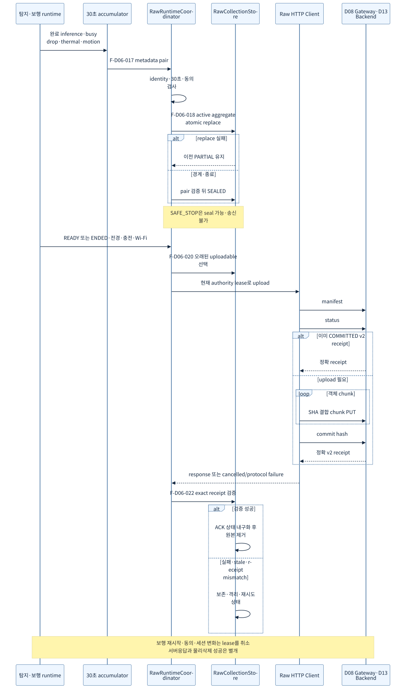

[Mermaid 원본](../diagrams/D06-raw-sequence.mmd) · [SVG](../rendered/D06-raw-sequence.svg)

## F-D06-019 raw 암호화 저장소·용량·만료·불독립 자료 격리

| 항목 | 명세 |
| --- | --- |
| 분야 | D06 사용자 Android 신고·raw 수집·현장 및 개발 진단 로그 |
| 목적 | 수집을 보행 기능과 분리해 용량 부족에서 조용히 보류한다. |
| 사용 주체 | Android raw coordinator 보행 lifecycle Gateway·Backend 연결(D08/D13) |
| 활성 상태 | ACTIVE |
| 진입점 | apps/android/app/src/main/java/kr/co/hanium/dreamup/walksafe/rawcollection/RawQueueCapacity.kt:13 ApprovedRawQueueCapacityProfile apps/android/app/src/main/java/kr/co/hanium/dreamup/walksafe/rawcollection/RawCollectionStore.kt:159 admitNewSegmentLocked apps/android/app/src/main/java/kr/co/hanium/dreamup/walksafe/rawcollection/RawCollectionStorage.kt:41 FileRawCollectionStorage apps/android/app/src/main/java/kr/co/hanium/dreamup/walksafe/rawcollection/RawCollectionModels.kt:454 RAW_MAX_CHUNK_BYTES |
| 실행 전제 | 유효 collection UUID/owner/AAD, account fence 없음; OS allocatable space와 usage를 확인할 수 있어야 함. |
| 입력 출처 형식 검증 최신성 | no-profile retained uploadable 전체2개(active 포함), unreadable quarantine 별도2개. debug 승인 profile maxSegments/maxTotalBytes, release profile null. TTL30일; encrypted on-disk bytes 측정. |

### 시작 이벤트와 처리 순서

| 이벤트 ID | 발생원 | 이벤트 | 수신부 | 흐름 |
| --- | --- | --- | --- | --- |
| E-D06-019-01 | 새 segment admission | 새 segment admission | ApprovedRawQueueCapacityProfile | 새 segment admission→cleanup/usage/profile 판정 |
| E-D06-019-02 | expire/prune | expire/prune | ApprovedRawQueueCapacityProfile | expire/prune→만료 자료 제거 |
| E-D06-019-03 | manifest 읽기 불가 | manifest 읽기 불가 | ApprovedRawQueueCapacityProfile | manifest 읽기 불가→quarantine 이동 |

1. 1. ACKNOWLEDGED/rejected/revoked/expired 등 제거 가능한 자료를 먼저 정리한다. [apps/android/app/src/main/java/kr/co/hanium/dreamup/walksafe/rawcollection/RawQueueCapacity.kt:13 ApprovedRawQueueCapacityProfile]
2. 2. 재시작 이전 walk partial을 seal 또는 discard하고 실제 live/quarantine footprint를 센다. [apps/android/app/src/main/java/kr/co/hanium/dreamup/walksafe/rawcollection/RawQueueCapacity.kt:13 ApprovedRawQueueCapacityProfile]
3. 3. 유효 미전송/미만료 자료는 공간을 위해 제거하지 않는다. [apps/android/app/src/main/java/kr/co/hanium/dreamup/walksafe/rawcollection/RawQueueCapacity.kt:13 ApprovedRawQueueCapacityProfile]
4. 4. manifest와 chunks를 AEAD로 봉인하고 temp fsync→atomic rename→dir fsync 한다. [apps/android/app/src/main/java/kr/co/hanium/dreamup/walksafe/rawcollection/RawQueueCapacity.kt:13 ApprovedRawQueueCapacityProfile]
5. 5. 읽기 불가 collection은 bytes를 해석하지 않고 별도 quarantine으로 이동한다. [apps/android/app/src/main/java/kr/co/hanium/dreamup/walksafe/rawcollection/RawQueueCapacity.kt:13 ApprovedRawQueueCapacityProfile]

| 분기 조건 | 실제 처리 결과 | 구현 근거 |
| --- | --- | --- |
| 측정불가/symlink/알 수 없는 저장 상태 | HOLD_USAGE_UNKNOWN | apps/android/app/src/main/java/kr/co/hanium/dreamup/walksafe/rawcollection/RawQueueCapacity.kt:13 ApprovedRawQueueCapacityProfile |
| no-profile uploadable2개 또는 unreadable quarantine2개 | 새 raw collection만 보류 | apps/android/app/src/main/java/kr/co/hanium/dreamup/walksafe/rawcollection/RawQueueCapacity.kt:13 ApprovedRawQueueCapacityProfile |
| profile count/byte 상한 또는 OS 공간 부족 | CAPACITY_HOLD; 보행 상태/사용자 경고 변경 없음 | apps/android/app/src/main/java/kr/co/hanium/dreamup/walksafe/rawcollection/RawQueueCapacity.kt:13 ApprovedRawQueueCapacityProfile |

### 효과 종료와 복구

암호화 local raw store, 삭제/격리/hold counters. enum VIDEO/AUDIO/EXACT_LOCATION 등이 있어도 runtime chunk allowlist는 DETECTION/PERFORMANCE뿐.

| 상황 | 동작 |
| --- | --- |
| 정상 완료 | admission과 manifest 보존. |
| 실패 | RawCollectionStorageReadException을 empty queue와 구별. |
| 시간 초과 | 이 기능에 별도의 시간초과 경로는 정의되지 않음. 연결된 호출자·저장소 경로는 shared/code_refs 참조. |
| 중복 입력 | 이 기능에 별도의 중복처리 경로는 정의되지 않음. 연결된 호출자·저장소 경로는 shared/code_refs 참조. |
| 취소 | 이 기능에 별도의 취소 경로는 정의되지 않음. 연결된 호출자·저장소 경로는 shared/code_refs 참조. |
| 중단과 생명주기 | 이 기능에 별도의 중단 경로는 정의되지 않음. 연결된 호출자·저장소 경로는 shared/code_refs 참조. |
| 재시도 | 다음 admission/전송/정리 기회에 재검사. |
| 복구 | active pointer reconcile·완전 partial seal. |
| 자원 정리 | unreadable quarantine은 소유/만료를 추정하지 않으며 account purge 때 제거. |

### 상태 실행 맥락과 연결

| 항목 | 명세 |
| --- | --- |
| 초기 상태 | S-D06-019-ADMITTED |
| 상태 목록 | S-D06-019-ADMITTED S-D06-019-HOLD_NO_APPROVED_PROFILE S-D06-019-HOLD_QUARANTINE_LIMIT S-D06-019-HOLD_BYTE_LIMIT S-D06-019-QUARANTINED |
| 전이 조건과 전이 동작 | cleanup 후 여유→ADMITTED 한도 도달→HOLD unreadable→QUARANTINED |
| 허용되지 않는 전이 | preconditions/branches에 명시된 gate 실패 상태에서 다음 처리로 진입 금지. 여기에 붙인 S-D06 ID는 명세 탐색용이며 코드 enum과 운영상태를 그대로 혼동하지 않음. |
| 동시성 순서와 작업 소유권 | store/storage synchronized; 보행 thread가 아닌 raw executor 사용. file write durability 구현과 실기기 내구 검증은 별개. |
| 공유 상태와 다른 기능 연결 | security.LocalAead, D02 FeatureStorageAllowance, F-D06-020. |

### 정책 근거와 검증 범위

| 항목 | 근거 |
| --- | --- |
| 정책 | [P-D06-017](#P-D06-017) |
| 구현 | [apps/android/app/src/main/java/kr/co/hanium/dreamup/walksafe/rawcollection/RawQueueCapacity.kt:13](/home/ddobagi/Hanium_Dreamup/apps/android/app/src/main/java/kr/co/hanium/dreamup/walksafe/rawcollection/RawQueueCapacity.kt:13) · `ApprovedRawQueueCapacityProfile` (범위 13–104) [apps/android/app/src/main/java/kr/co/hanium/dreamup/walksafe/rawcollection/RawCollectionStore.kt:159](/home/ddobagi/Hanium_Dreamup/apps/android/app/src/main/java/kr/co/hanium/dreamup/walksafe/rawcollection/RawCollectionStore.kt:159) · `admitNewSegmentLocked` (범위 159–225) [apps/android/app/src/main/java/kr/co/hanium/dreamup/walksafe/rawcollection/RawCollectionStorage.kt:41](/home/ddobagi/Hanium_Dreamup/apps/android/app/src/main/java/kr/co/hanium/dreamup/walksafe/rawcollection/RawCollectionStorage.kt:41) · `FileRawCollectionStorage` (범위 41–225) [apps/android/app/src/main/java/kr/co/hanium/dreamup/walksafe/rawcollection/RawCollectionModels.kt:454](/home/ddobagi/Hanium_Dreamup/apps/android/app/src/main/java/kr/co/hanium/dreamup/walksafe/rawcollection/RawCollectionModels.kt:454) · `RAW_MAX_CHUNK_BYTES` (범위 454–491) |
| 기존 개선 ID | 개별 동일성 미확인; 분야 연관은 별도 추적표 |
| 기존 분야 | 해당 없음 |
| 기존 실행 증거 | 이번 고정 소스 정적 분석 외 과거 실행/기기/서버 증거는 이 기능에서 재검증하지 않았음. 기존 DONE을 이번 실행 성공으로 간주하지 않음. |
| 한계 및 구분 | 코드에 연결된 동작과 활성 조건을 기록한 정적 명세. 실제 배포 설정·현장·API 송수신 결과는 미확인. 관리자 앱은 D12 담당. |

| 테스트 위치 | 심볼 | 증거 수준 | 기대와 한계 |
| --- | --- | --- | --- |
| [apps/android/app/src/test/java/kr/co/hanium/dreamup/walksafe/rawcollection/RawQueueCapacityStoreTest.kt](/home/ddobagi/Hanium_Dreamup/apps/android/app/src/test/java/kr/co/hanium/dreamup/walksafe/rawcollection/RawQueueCapacityStoreTest.kt) | RawQueueCapacityStoreTest | TEST_EXPECTATION | retained count/byte와 정리 순서 기대; 미실행; 이번 작업에서는 실행하지 않음. |

### 이벤트 처리 그림


[Mermaid 원본](../diagrams/D06-F019.mmd) · [SVG](../rendered/D06-F019.svg)

## F-D06-020 raw 보행 종료 후 전송 예약·배치·재검증

| 항목 | 명세 |
| --- | --- |
| 분야 | D06 사용자 Android 신고·raw 수집·현장 및 개발 진단 로그 |
| 목적 | 보행 중 네트워크 전송 없이 종료된 세그먼트를 허용 상태에서 배출한다. |
| 사용 주체 | Android raw coordinator 보행 lifecycle Gateway·Backend 연결(D08/D13) |
| 활성 상태 | CONDITIONAL |
| 진입점 | apps/android/app/src/main/java/kr/co/hanium/dreamup/walksafe/rawcollection/RawCollectionRuntimeCoordinator.kt:1023 uploadAdmission apps/android/app/src/main/java/kr/co/hanium/dreamup/walksafe/MainActivity.kt:28263 scheduleRawCollectionPostWalkUpload apps/android/app/src/main/java/kr/co/hanium/dreamup/walksafe/MainActivity.kt:28315 schedulePostWalkTransfers apps/android/app/src/main/java/kr/co/hanium/dreamup/walksafe/MainActivity.kt:49506 RAW_COLLECTION_POST_WALK_UPLOADS_PER_TASK |
| 실행 전제 | READY/ENDED, app foreground, Gateway walk lease 없음, 정확 current owner/RAW consent, WIFI transport+WIFI network binding, 충전 true(unknown false). |
| 입력 출처 형식 검증 최신성 | 오래된 segment 우선, 각 원본 walk ID/receipt 유지. task당 최대4회. 409 walk-in-progress는 post-walk ID당 한 번 105000ms 후 재시도. |

### 시작 이벤트와 처리 순서

| 이벤트 ID | 발생원 | 이벤트 | 수신부 | 흐름 |
| --- | --- | --- | --- | --- |
| E-D06-020-01 | walk end/앱 시작·전경 복귀/session·network 변경/충전 시작 | walk end/앱 시작·전경 복귀/session·network 변경/충전 시작 | uploadAdmission | walk end/앱 시작·전경 복귀/session·network 변경/충전 시작→예약 |
| E-D06-020-02 | batch 완료 | batch 완료 | uploadAdmission | batch 완료→남은 자료가 있으면 새 task |
| E-D06-020-03 | 새 보행/동의/network·charging 변경 | 새 보행/동의/network·charging 변경 | uploadAdmission | 새 보행/동의/network·charging 변경→cancel |

1. 1. 예약 task에서 current context를 다시 얻고 활성 upload를 revalidate한다. [apps/android/app/src/main/java/kr/co/hanium/dreamup/walksafe/rawcollection/RawCollectionRuntimeCoordinator.kt:1023 uploadAdmission]
2. 2. 남은 partial을 먼저 seal한다. [apps/android/app/src/main/java/kr/co/hanium/dreamup/walksafe/rawcollection/RawCollectionRuntimeCoordinator.kt:1023 uploadAdmission]
3. 3. current admission에 맞는 가장 오래된 COMPLETE를 선택한다. [apps/android/app/src/main/java/kr/co/hanium/dreamup/walksafe/rawcollection/RawCollectionRuntimeCoordinator.kt:1023 uploadAdmission]
4. 4. 최대4개 처리 후 새 task를 enqueue하여 다른 consent/metadata 작업이 실행되게 한다. [apps/android/app/src/main/java/kr/co/hanium/dreamup/walksafe/rawcollection/RawCollectionRuntimeCoordinator.kt:1023 uploadAdmission]
5. 5. 각 socket/완료/로컬 삭제 경계에서 session instance/generation/device attempt/consent object/network를 비교한다. [apps/android/app/src/main/java/kr/co/hanium/dreamup/walksafe/rawcollection/RawCollectionRuntimeCoordinator.kt:1023 uploadAdmission]

| 분기 조건 | 실제 처리 결과 | 구현 근거 |
| --- | --- | --- |
| ACTIVE/PAUSED/SAFE_STOP | 전송 시작 안 함 | apps/android/app/src/main/java/kr/co/hanium/dreamup/walksafe/rawcollection/RawCollectionRuntimeCoordinator.kt:1023 uploadAdmission |
| cellular 또는 비충전/unknown | raw 업로드 보류 | apps/android/app/src/main/java/kr/co/hanium/dreamup/walksafe/rawcollection/RawCollectionRuntimeCoordinator.kt:1023 uploadAdmission |
| DELETED/QUARANTINED/WALK_REJECTED | 동일 task의 다음 항목 가능 | apps/android/app/src/main/java/kr/co/hanium/dreamup/walksafe/rawcollection/RawCollectionRuntimeCoordinator.kt:1023 uploadAdmission |
| 그 외 실패/서버 off | batch 종료 | apps/android/app/src/main/java/kr/co/hanium/dreamup/walksafe/rawcollection/RawCollectionRuntimeCoordinator.kt:1023 uploadAdmission |

### 효과 종료와 복구

백그라운드 전송 service 없음. raw 결과는 사용자 음성/화면을 방해하지 않음.

| 상황 | 동작 |
| --- | --- |
| 정상 완료 | 4개 또는 queue 소진. |
| 실패 | 상태별 F-D06-022 처리. |
| 시간 초과 | 이 기능에 별도의 시간초과 경로는 정의되지 않음. 연결된 호출자·저장소 경로는 shared/code_refs 참조. |
| 중복 입력 | activeUpload 하나; source walk ID 변경 안 함. |
| 취소 | nested call 취소, plaintext zeroize. |
| 중단과 생명주기 | 이 기능에 별도의 중단 경로는 정의되지 않음. 연결된 호출자·저장소 경로는 shared/code_refs 참조. |
| 재시도 | 다음 허용 trigger; walk-in-progress만 105초 1회. |
| 복구 | 이전 앱 실행의 ended walk도 원래 ID로 전송. |
| 자원 정리 | 이 기능에 별도의 정리 경로는 정의되지 않음. 연결된 호출자·저장소 경로는 shared/code_refs 참조. |

### 상태 실행 맥락과 연결

| 항목 | 명세 |
| --- | --- |
| 초기 상태 | S-D06-020-HELD |
| 상태 목록 | S-D06-020-HELD S-D06-020-ELIGIBLE S-D06-020-UPLOADING S-D06-020-CANCELLED S-D06-020-BATCH_DONE |
| 전이 조건과 전이 동작 | 허용 trigger→ELIGIBLE→UPLOADING gate 변화→CANCELLED 4개 처리→BATCH_DONE→새 task |
| 허용되지 않는 전이 | preconditions/branches에 명시된 gate 실패 상태에서 다음 처리로 진입 금지. 여기에 붙인 S-D06 ID는 명세 탐색용이며 코드 enum과 운영상태를 그대로 혼동하지 않음. |
| 동시성 순서와 작업 소유권 | rawCollectionExecutor single worker; power receiver/UI trigger는 worker enqueue; activeUpload AtomicReference/lease. |
| 공유 상태와 다른 기능 연결 | D02 allowsPostWalkTransfer, D08 Gateway walk history, F-D06-021/022. |

### 정책 근거와 검증 범위

| 항목 | 근거 |
| --- | --- |
| 정책 | [P-D06-018](#P-D06-018) |
| 구현 | [apps/android/app/src/main/java/kr/co/hanium/dreamup/walksafe/rawcollection/RawCollectionRuntimeCoordinator.kt:1023](/home/ddobagi/Hanium_Dreamup/apps/android/app/src/main/java/kr/co/hanium/dreamup/walksafe/rawcollection/RawCollectionRuntimeCoordinator.kt:1023) · `uploadAdmission` (범위 1023–1147) [apps/android/app/src/main/java/kr/co/hanium/dreamup/walksafe/MainActivity.kt:28263](/home/ddobagi/Hanium_Dreamup/apps/android/app/src/main/java/kr/co/hanium/dreamup/walksafe/MainActivity.kt:28263) · `scheduleRawCollectionPostWalkUpload` (범위 28263–28308) [apps/android/app/src/main/java/kr/co/hanium/dreamup/walksafe/MainActivity.kt:28315](/home/ddobagi/Hanium_Dreamup/apps/android/app/src/main/java/kr/co/hanium/dreamup/walksafe/MainActivity.kt:28315) · `schedulePostWalkTransfers` (범위 28315–28345) [apps/android/app/src/main/java/kr/co/hanium/dreamup/walksafe/MainActivity.kt:49506](/home/ddobagi/Hanium_Dreamup/apps/android/app/src/main/java/kr/co/hanium/dreamup/walksafe/MainActivity.kt:49506) · `RAW_COLLECTION_POST_WALK_UPLOADS_PER_TASK` (범위 49506–49509) |
| 기존 개선 ID | 개별 동일성 미확인; 분야 연관은 별도 추적표 |
| 기존 분야 | 해당 없음 |
| 기존 실행 증거 | 이번 고정 소스 정적 분석 외 과거 실행/기기/서버 증거는 이 기능에서 재검증하지 않았음. 기존 DONE을 이번 실행 성공으로 간주하지 않음. |
| 한계 및 구분 | 코드에 연결된 동작과 활성 조건을 기록한 정적 명세. 실제 배포 설정·현장·API 송수신 결과는 미확인. 관리자 앱은 D12 담당. |

| 테스트 위치 | 심볼 | 증거 수준 | 기대와 한계 |
| --- | --- | --- | --- |
| [apps/android/app/src/test/java/kr/co/hanium/dreamup/walksafe/rawcollection/RawPostWalkUploadTest.kt](/home/ddobagi/Hanium_Dreamup/apps/android/app/src/test/java/kr/co/hanium/dreamup/walksafe/rawcollection/RawPostWalkUploadTest.kt) | safeStopSealsTheSegmentButSendsItOnlyAfterTheUserEndsTheWalk | TEST_EXPECTATION | SAFE_STOP 봉인/전송 분리 기대; 미실행; 이번 작업에서는 실행하지 않음. |

### 이벤트 처리 그림


[Mermaid 원본](../diagrams/D06-F020.mmd) · [SVG](../rendered/D06-F020.svg)

[Mermaid 원본](../diagrams/D06-raw-sequence.mmd) · [SVG](../rendered/D06-raw-sequence.svg)

## F-D06-021 raw manifest·status·chunk·commit 전송 프로토콜

| 항목 | 명세 |
| --- | --- |
| 분야 | D06 사용자 Android 신고·raw 수집·현장 및 개발 진단 로그 |
| 목적 | 작은 집계 세그먼트를 원본 hash와 매핑에 맞춰 서버에 저장한다. |
| 사용 주체 | Android raw coordinator 보행 lifecycle Gateway·Backend 연결(D08/D13) |
| 활성 상태 | CONDITIONAL |
| 진입점 | apps/android/app/src/main/java/kr/co/hanium/dreamup/walksafe/rawcollection/AndroidRawCollectionClient.kt:40 uploadCall apps/android/app/src/main/java/kr/co/hanium/dreamup/walksafe/rawcollection/AndroidRawCollectionClient.kt:198 requestJson apps/android/app/src/main/java/kr/co/hanium/dreamup/walksafe/rawcollection/RawCollectionModels.kt:106 BackendRawManifest |
| 실행 전제 | GENERAL backend session·original walk·current/continued consent·Wi-Fi bound network. 2chunk와 backend object mapping이 exact. |
| 입력 출처 형식 검증 최신성 | /api/raw-collections/{collectionId}/manifest, /status, /objects/{objectId}/chunks/{index}, /commit. manifest<=512KiB; commit<=16KiB; response<=512KiB; chunk SHA와 commit SHA headers. |

### 시작 이벤트와 처리 순서

| 이벤트 ID | 발생원 | 이벤트 | 수신부 | 흐름 |
| --- | --- | --- | --- | --- |
| E-D06-021-01 | uploadCall | uploadCall | uploadCall | uploadCall→PUT manifest→GET status→모든 chunk PUT→status→POST commit |

1. 1. local ordinal 0,1과 object mapping/hash/size를 사전 검증한다. [apps/android/app/src/main/java/kr/co/hanium/dreamup/walksafe/rawcollection/AndroidRawCollectionClient.kt:40 uploadCall]
2. 2. manifest PUT 뒤 status를 읽어 이미 committed receipt면 곧바로 반환한다. [apps/android/app/src/main/java/kr/co/hanium/dreamup/walksafe/rawcollection/AndroidRawCollectionClient.kt:40 uploadCall]
3. 3. 미완료이면 status missing subset을 따르지 않고 매 시도 첫 chunk부터 두 chunk를 재전송한다. [apps/android/app/src/main/java/kr/co/hanium/dreamup/walksafe/rawcollection/AndroidRawCollectionClient.kt:40 uploadCall]
4. 4. 마지막 ack READY_TO_COMMIT 및 status를 확인한 뒤 commit한다. [apps/android/app/src/main/java/kr/co/hanium/dreamup/walksafe/rawcollection/AndroidRawCollectionClient.kt:40 uploadCall]
5. 5. JSON content type/no-store·엄격 상태/schema·receipt digest를 확인한다. [apps/android/app/src/main/java/kr/co/hanium/dreamup/walksafe/rawcollection/AndroidRawCollectionClient.kt:40 uploadCall]

| 분기 조건 | 실제 처리 결과 | 구현 근거 |
| --- | --- | --- |
| 이미 COMMITTED v2 receipt | chunk 재전송 없이 완료 | apps/android/app/src/main/java/kr/co/hanium/dreamup/walksafe/rawcollection/AndroidRawCollectionClient.kt:40 uploadCall |
| 기존 동일 chunk | 서버 재ack 기대; client 자동 누락-chunk 재개 아님 | apps/android/app/src/main/java/kr/co/hanium/dreamup/walksafe/rawcollection/AndroidRawCollectionClient.kt:40 uploadCall |
| lease stale/body write 중 취소 | CancellationException, 연결/stream 해제 | apps/android/app/src/main/java/kr/co/hanium/dreamup/walksafe/rawcollection/AndroidRawCollectionClient.kt:40 uploadCall |
| 응답 type/no-store/schema 오류 | protocol failure | apps/android/app/src/main/java/kr/co/hanium/dreamup/walksafe/rawcollection/AndroidRawCollectionClient.kt:40 uploadCall |

### 효과 종료와 복구

D08 Gateway→D13 raw backend; 목적 GENERAL_RAW. raw v2 수신은 RAW_QUARANTINE_14D.

| 상황 | 동작 |
| --- | --- |
| 정상 완료 | 정확 v2 receipt 반환. |
| 실패 | 이 기능에 별도의 실패종료 경로는 정의되지 않음. 연결된 호출자·저장소 경로는 shared/code_refs 참조. |
| 시간 초과 | 연결8000ms/read20000ms; 이 client에는 전체 upload deadline 인자가 없음. |
| 중복 입력 | collection/object/hash idempotency; 이미 receipt면 종료. |
| 취소 | 16KiB write chunk마다 currentOrCancel. |
| 중단과 생명주기 | 이 기능에 별도의 중단 경로는 정의되지 않음. 연결된 호출자·저장소 경로는 shared/code_refs 참조. |
| 재시도 | client 내부 loop retry 없음; 다음 시도는 두 chunk 처음부터. |
| 복구 | 이 기능에 별도의 복구 경로는 정의되지 않음. 연결된 호출자·저장소 경로는 shared/code_refs 참조. |
| 자원 정리 | coordinator finally plaintext zeroize. |

### 상태 실행 맥락과 연결

| 항목 | 명세 |
| --- | --- |
| 초기 상태 | S-D06-021-MANIFEST_ACCEPTED |
| 상태 목록 | S-D06-021-MANIFEST_ACCEPTED S-D06-021-RECEIVING S-D06-021-READY_TO_COMMIT S-D06-021-COMMITTED S-D06-021-QUARANTINED |
| 전이 조건과 전이 동작 | manifest→MANIFEST_ACCEPTED chunk→RECEIVING→READY_TO_COMMIT commit→COMMITTED |
| 허용되지 않는 전이 | preconditions/branches에 명시된 gate 실패 상태에서 다음 처리로 진입 금지. 여기에 붙인 S-D06 ID는 명세 탐색용이며 코드 enum과 운영상태를 그대로 혼동하지 않음. |
| 동시성 순서와 작업 소유권 | 한 cancellable call의 순차 HTTP. request마다 실제 network binding과 isCurrent 검사. |
| 공유 상태와 다른 기능 연결 | D08 raw proxy; D13 Raw collection API. |

### 정책 근거와 검증 범위

| 항목 | 근거 |
| --- | --- |
| 정책 | [P-D06-019](#P-D06-019) |
| 구현 | [apps/android/app/src/main/java/kr/co/hanium/dreamup/walksafe/rawcollection/AndroidRawCollectionClient.kt:40](/home/ddobagi/Hanium_Dreamup/apps/android/app/src/main/java/kr/co/hanium/dreamup/walksafe/rawcollection/AndroidRawCollectionClient.kt:40) · `uploadCall` (범위 40–172) [apps/android/app/src/main/java/kr/co/hanium/dreamup/walksafe/rawcollection/AndroidRawCollectionClient.kt:198](/home/ddobagi/Hanium_Dreamup/apps/android/app/src/main/java/kr/co/hanium/dreamup/walksafe/rawcollection/AndroidRawCollectionClient.kt:198) · `requestJson` (범위 198–302) [apps/android/app/src/main/java/kr/co/hanium/dreamup/walksafe/rawcollection/RawCollectionModels.kt:106](/home/ddobagi/Hanium_Dreamup/apps/android/app/src/main/java/kr/co/hanium/dreamup/walksafe/rawcollection/RawCollectionModels.kt:106) · `BackendRawManifest` (범위 106–138) |
| 기존 개선 ID | 개별 동일성 미확인; 분야 연관은 별도 추적표 |
| 기존 분야 | 해당 없음 |
| 기존 실행 증거 | 이번 고정 소스 정적 분석 외 과거 실행/기기/서버 증거는 이 기능에서 재검증하지 않았음. 기존 DONE을 이번 실행 성공으로 간주하지 않음. |
| 한계 및 구분 | 코드에 연결된 동작과 활성 조건을 기록한 정적 명세. 실제 배포 설정·현장·API 송수신 결과는 미확인. 관리자 앱은 D12 담당. |

| 테스트 위치 | 심볼 | 증거 수준 | 기대와 한계 |
| --- | --- | --- | --- |
| [apps/android/app/src/test/java/kr/co/hanium/dreamup/walksafe/rawcollection/AndroidRawCollectionClientNetworkTest.kt](/home/ddobagi/Hanium_Dreamup/apps/android/app/src/test/java/kr/co/hanium/dreamup/walksafe/rawcollection/AndroidRawCollectionClientNetworkTest.kt) | AndroidRawCollectionClientNetworkTest | TEST_EXPECTATION | manifest/chunk/status/commit 계약 기대; 미실행; 이번 작업에서는 실행하지 않음. |

### 이벤트 처리 그림


[Mermaid 원본](../diagrams/D06-F021.mmd) · [SVG](../rendered/D06-F021.svg)

## F-D06-022 raw 영수증 확인·ACK 보존·격리·거절 처분

| 항목 | 명세 |
| --- | --- |
| 분야 | D06 사용자 Android 신고·raw 수집·현장 및 개발 진단 로그 |
| 목적 | 서버 저장 확인 뒤에만 원본을 지우고 영구/일시 실패를 구분한다. |
| 사용 주체 | Android raw coordinator 보행 lifecycle Gateway·Backend 연결(D08/D13) |
| 활성 상태 | ACTIVE |
| 진입점 | apps/android/app/src/main/java/kr/co/hanium/dreamup/walksafe/rawcollection/RawCollectionRuntimeCoordinator.kt:715 startNextUpload apps/android/app/src/main/java/kr/co/hanium/dreamup/walksafe/rawcollection/RawCollectionStore.kt:749 completeAfterReceipt apps/android/app/src/main/java/kr/co/hanium/dreamup/walksafe/rawcollection/RawCollectionStore.kt:565 discardRejected apps/android/app/src/main/java/kr/co/hanium/dreamup/walksafe/rawcollection/RawCollectionModels.kt:332 validBackendReceipt |
| 실행 전제 | same owner/collection/manifest binding; current lease 계속 허용. |
| 입력 출처 형식 검증 최신성 | receipt v2, collectionId/manifestSha256/purpose/marker/object count/chunk count/bytes/object hashes/receipt digest 정확; quarantine expiry=committed+14일. legacy v1 180일 parsing은 호환 참조만. |

### 시작 이벤트와 처리 순서

| 이벤트 ID | 발생원 | 이벤트 | 수신부 | 흐름 |
| --- | --- | --- | --- | --- |
| E-D06-022-01 | upload receipt | upload receipt | startNextUpload | upload receipt→exact 검증→ACKNOWLEDGED marker→local purge |
| E-D06-022-02 | HTTP 거절 | HTTP 거절 | startNextUpload | HTTP 거절→quarantine/reject/delete/hold 분기 |

1. 1. store는 v2 receipt만 현재 완료로 허용한다. [apps/android/app/src/main/java/kr/co/hanium/dreamup/walksafe/rawcollection/RawCollectionRuntimeCoordinator.kt:715 startNextUpload]
2. 2. ACKNOWLEDGED를 내구 기록한 후 원본을 삭제한다. [apps/android/app/src/main/java/kr/co/hanium/dreamup/walksafe/rawcollection/RawCollectionRuntimeCoordinator.kt:715 startNextUpload]
3. 3. 삭제 실패는 ACKNOWLEDGED_PURGE_PENDING, 다음 작업은 네트워크 없이 삭제를 재시도한다. [apps/android/app/src/main/java/kr/co/hanium/dreamup/walksafe/rawcollection/RawCollectionRuntimeCoordinator.kt:715 startNextUpload]
4. 4. 400/413/415/422는 QUARANTINED, 401/403은 authority hold로 분리한다. [apps/android/app/src/main/java/kr/co/hanium/dreamup/walksafe/rawcollection/RawCollectionRuntimeCoordinator.kt:715 startNextUpload]
5. 5. 409 consent rejected/walk never uploadable은 각 marker 후 삭제, active walk는 보존; 503 raw_ingest_disabled는 process 내 재시도 중지한다. [apps/android/app/src/main/java/kr/co/hanium/dreamup/walksafe/rawcollection/RawCollectionRuntimeCoordinator.kt:715 startNextUpload]

| 분기 조건 | 실제 처리 결과 | 구현 근거 |
| --- | --- | --- |
| receipt mismatch/legacy v1 | 원본 보존, RECEIPT_REJECTED | apps/android/app/src/main/java/kr/co/hanium/dreamup/walksafe/rawcollection/RawCollectionRuntimeCoordinator.kt:715 startNextUpload |
| 일시 network/기타 서버 실패 | RETRYABLE_FAILURE, 원본 유지 | apps/android/app/src/main/java/kr/co/hanium/dreamup/walksafe/rawcollection/RawCollectionRuntimeCoordinator.kt:715 startNextUpload |
| 서버 ingest disabled | process 내 SERVER_DISABLED; 새 프로세스까지 upload start 거절 | apps/android/app/src/main/java/kr/co/hanium/dreamup/walksafe/rawcollection/RawCollectionRuntimeCoordinator.kt:715 startNextUpload |
| 거절 marker 또는 삭제 실패 | 반환 outcome과 실제 물리 삭제 성공은 동일하지 않음; 다음 cleanup 대상 | apps/android/app/src/main/java/kr/co/hanium/dreamup/walksafe/rawcollection/RawCollectionRuntimeCoordinator.kt:715 startNextUpload |

### 효과 종료와 복구

컬렉션 삭제/암호 격리, 내부 counter만. receipt는 학습 재사용 승인 또는 제품 현장 PASS 아님.

| 상황 | 동작 |
| --- | --- |
| 정상 완료 | DELETED_AFTER_EXACT_RECEIPT. |
| 실패 | 원본 보존·격리·거절 cleanup 분리. |
| 시간 초과 | 이 기능에 별도의 시간초과 경로는 정의되지 않음. 연결된 호출자·저장소 경로는 shared/code_refs 참조. |
| 중복 입력 | ACKNOWLEDGED면 네트워크 재POST 없이 purge. |
| 취소 | 이 기능에 별도의 취소 경로는 정의되지 않음. 연결된 호출자·저장소 경로는 shared/code_refs 참조. |
| 중단과 생명주기 | 이 기능에 별도의 중단 경로는 정의되지 않음. 연결된 호출자·저장소 경로는 shared/code_refs 참조. |
| 재시도 | 일시 실패 후 다음 trigger. |
| 복구 | ACK/rejected marker cleanup. |
| 자원 정리 | 평문 chunks finally zeroize. |

### 상태 실행 맥락과 연결

| 항목 | 명세 |
| --- | --- |
| 초기 상태 | S-D06-022-READY |
| 상태 목록 | S-D06-022-READY S-D06-022-ACKNOWLEDGED S-D06-022-PURGE_PENDING S-D06-022-QUARANTINED S-D06-022-CONSENT_REJECTED S-D06-022-WALK_REJECTED |
| 전이 조건과 전이 동작 | exact receipt→ACKNOWLEDGED→삭제 영구 요청오류→QUARANTINED consent/walk reject→marker→삭제 |
| 허용되지 않는 전이 | preconditions/branches에 명시된 gate 실패 상태에서 다음 처리로 진입 금지. 여기에 붙인 S-D06 ID는 명세 탐색용이며 코드 enum과 운영상태를 그대로 혼동하지 않음. |
| 동시성 순서와 작업 소유권 | receipt 처리 synchronized, lease current 검증 후 저장/삭제. cancel 뒤 늦은 receipt는 로컬 삭제 못 함. |
| 공유 상태와 다른 기능 연결 | D13 raw quarantine/retention; F-D06-019/020. |

### 정책 근거와 검증 범위

| 항목 | 근거 |
| --- | --- |
| 정책 | [P-D06-019](#P-D06-019) [P-D06-020](#P-D06-020) |
| 구현 | [apps/android/app/src/main/java/kr/co/hanium/dreamup/walksafe/rawcollection/RawCollectionRuntimeCoordinator.kt:715](/home/ddobagi/Hanium_Dreamup/apps/android/app/src/main/java/kr/co/hanium/dreamup/walksafe/rawcollection/RawCollectionRuntimeCoordinator.kt:715) · `startNextUpload` (범위 715–917) [apps/android/app/src/main/java/kr/co/hanium/dreamup/walksafe/rawcollection/RawCollectionStore.kt:749](/home/ddobagi/Hanium_Dreamup/apps/android/app/src/main/java/kr/co/hanium/dreamup/walksafe/rawcollection/RawCollectionStore.kt:749) · `completeAfterReceipt` (범위 749–793) [apps/android/app/src/main/java/kr/co/hanium/dreamup/walksafe/rawcollection/RawCollectionStore.kt:565](/home/ddobagi/Hanium_Dreamup/apps/android/app/src/main/java/kr/co/hanium/dreamup/walksafe/rawcollection/RawCollectionStore.kt:565) · `discardRejected` (범위 565–600) [apps/android/app/src/main/java/kr/co/hanium/dreamup/walksafe/rawcollection/RawCollectionModels.kt:332](/home/ddobagi/Hanium_Dreamup/apps/android/app/src/main/java/kr/co/hanium/dreamup/walksafe/rawcollection/RawCollectionModels.kt:332) · `validBackendReceipt` (범위 332–379) |
| 기존 개선 ID | 개별 동일성 미확인; 분야 연관은 별도 추적표 |
| 기존 분야 | 해당 없음 |
| 기존 실행 증거 | 이번 고정 소스 정적 분석 외 과거 실행/기기/서버 증거는 이 기능에서 재검증하지 않았음. 기존 DONE을 이번 실행 성공으로 간주하지 않음. |
| 한계 및 구분 | 코드에 연결된 동작과 활성 조건을 기록한 정적 명세. 실제 배포 설정·현장·API 송수신 결과는 미확인. 관리자 앱은 D12 담당. |

| 테스트 위치 | 심볼 | 증거 수준 | 기대와 한계 |
| --- | --- | --- | --- |
| [apps/android/app/src/test/java/kr/co/hanium/dreamup/walksafe/rawcollection/RawWalkRejectedDispositionTest.kt](/home/ddobagi/Hanium_Dreamup/apps/android/app/src/test/java/kr/co/hanium/dreamup/walksafe/rawcollection/RawWalkRejectedDispositionTest.kt) | RawWalkRejectedDispositionTest | TEST_EXPECTATION | walk 거절 marker 분리 기대; 미실행; 이번 작업에서는 실행하지 않음. |

### 이벤트 처리 그림


[Mermaid 원본](../diagrams/D06-F022.mmd) · [SVG](../rendered/D06-F022.svg)

[Mermaid 원본](../diagrams/D06-raw-state.mmd) · [SVG](../rendered/D06-raw-state.svg)

## F-D06-023 raw 동의 receipt 연속성·철회·정책 변경·계정삭제

| 항목 | 명세 |
| --- | --- |
| 분야 | D06 사용자 Android 신고·raw 수집·현장 및 개발 진단 로그 |
| 목적 | 생성 당시 동의를 보존하며 중단 없는 선택에만 이전 자료 전송을 허용한다. |
| 사용 주체 | Android raw coordinator 보행 lifecycle Gateway·Backend 연결(D08/D13) |
| 활성 상태 | ACTIVE |
| 진입점 | apps/android/app/src/main/java/kr/co/hanium/dreamup/walksafe/rawcollection/RawCollectionRuntimeCoordinator.kt:1165 rawConsentSupersede apps/android/app/src/main/java/kr/co/hanium/dreamup/walksafe/rawcollection/RawCollectionRuntimeCoordinator.kt:307 holdReceiptUntilDecided apps/android/app/src/main/java/kr/co/hanium/dreamup/walksafe/rawcollection/RawCollectionStore.kt:533 onConsentRevoked apps/android/app/src/main/java/kr/co/hanium/dreamup/walksafe/rawcollection/RawCollectionStore.kt:630 alignConsentPolicy apps/android/app/src/main/java/kr/co/hanium/dreamup/walksafe/rawcollection/RawCollectionStore.kt:822 resetForNewEnrollment |
| 실행 전제 | raw consent receipt 변경·철회·정책 alignment 또는 계정삭제 이벤트를 받은 coordinator/store. RAW_CONTINUED의 성립 조건은 분기에서 검사하며, previous null/RAW false/버전·revision gap도 RAW_REVOKED 판정 경로로 들어온다. |
| 입력 출처 형식 검증 최신성 | 64hex receipt; revision gap/버전변경은 연속성 불인정. undecided receipt는 현재 process 보관만 허용. |

### 시작 이벤트와 처리 순서

| 이벤트 ID | 발생원 | 이벤트 | 수신부 | 흐름 |
| --- | --- | --- | --- | --- |
| E-D06-023-01 | 새 consent receipt | 새 consent receipt | rawConsentSupersede | 새 consent receipt→old receipt hold→CONTINUED/REVOKED 결정 |
| E-D06-023-02 | raw 철회 | raw 철회 | rawConsentSupersede | raw 철회→호출 취소·chain fence·미전송 삭제 |
| E-D06-023-03 | policy 변경 | policy 변경 | rawConsentSupersede | policy 변경→이전 continuity 종료 |
| E-D06-023-04 | 계정삭제 | 계정삭제 | rawConsentSupersede | 계정삭제→전체 자료/키 purge→새 enrollment reset |

1. 1. 결정 전 이전 receipt를 hold하여 queued capture가 기존 aggregate를 성급히 지우지 않게 한다. [apps/android/app/src/main/java/kr/co/hanium/dreamup/walksafe/rawcollection/RawCollectionRuntimeCoordinator.kt:1165 rawConsentSupersede]
2. 2. 연속성이 증명되면 현재 정책 marker 아래 previous continuity fence를 내구 기록한다. [apps/android/app/src/main/java/kr/co/hanium/dreamup/walksafe/rawcollection/RawCollectionRuntimeCoordinator.kt:1165 rawConsentSupersede]
3. 3. manifest의 원래 receipt/walk는 바꾸지 않고 selectable receipt 집합만 확장한다. [apps/android/app/src/main/java/kr/co/hanium/dreamup/walksafe/rawcollection/RawCollectionRuntimeCoordinator.kt:1165 rawConsentSupersede]
4. 4. 철회는 전체 predecessor chain fence 후 미전송 자료 삭제; 실패해도 fence 유지한다. [apps/android/app/src/main/java/kr/co/hanium/dreamup/walksafe/rawcollection/RawCollectionRuntimeCoordinator.kt:1165 rawConsentSupersede]
5. 5. account delete는 global fence·pointer clear·live/quarantine 삭제·key destroy·verified marker, 새 enrollment는 정확 empty 증거 뒤 fresh key/reset한다. [apps/android/app/src/main/java/kr/co/hanium/dreamup/walksafe/rawcollection/RawCollectionRuntimeCoordinator.kt:1165 rawConsentSupersede]

| 분기 조건 | 실제 처리 결과 | 구현 근거 |
| --- | --- | --- |
| previous 존재, 이전·현재 RAW grant, currentRawEffective, 같은 installation/policy/itemVersions, revision=previous+1, receipt 변경을 모두 충족 | RAW_CONTINUED; continuity fence 내구화 성공 뒤만 selectable 확장 | apps/android/app/src/main/java/kr/co/hanium/dreamup/walksafe/rawcollection/RawCollectionRuntimeCoordinator.kt:1165 rawConsentSupersede |
| revision gap·다른 policy/item version | RAW_REVOKED 판단 | apps/android/app/src/main/java/kr/co/hanium/dreamup/walksafe/rawcollection/RawCollectionRuntimeCoordinator.kt:1165 rawConsentSupersede |
| 새 정책 첫 alignment | 이전 continuation selectable 중지; 이 메서드 자체는 즉시 삭제하지 않음 | apps/android/app/src/main/java/kr/co/hanium/dreamup/walksafe/rawcollection/RawCollectionRuntimeCoordinator.kt:1165 rawConsentSupersede |
| continuity 기록 실패 | process 내 kept/undecided, 전송 선택 안 됨 | apps/android/app/src/main/java/kr/co/hanium/dreamup/walksafe/rawcollection/RawCollectionRuntimeCoordinator.kt:1165 rawConsentSupersede |
| purge/fresh key 실패 | account fence 보존 | apps/android/app/src/main/java/kr/co/hanium/dreamup/walksafe/rawcollection/RawCollectionRuntimeCoordinator.kt:1165 rawConsentSupersede |

### 효과 종료와 복구

raw 권한·보존·전송의 연결만 변경. 직접 신고의 건별 확인과 독립.

| 상황 | 동작 |
| --- | --- |
| 정상 완료 | continuity/fence true. |
| 실패 | storage false 시 허용하지 않음. |
| 시간 초과 | 이 기능에 별도의 시간초과 경로는 정의되지 않음. 연결된 호출자·저장소 경로는 shared/code_refs 참조. |
| 중복 입력 | 이 기능에 별도의 중복처리 경로는 정의되지 않음. 연결된 호출자·저장소 경로는 shared/code_refs 참조. |
| 취소 | 해당 active upload 취소. |
| 중단과 생명주기 | 이 기능에 별도의 중단 경로는 정의되지 않음. 연결된 호출자·저장소 경로는 shared/code_refs 참조. |
| 재시도 | 이 기능에 별도의 재시도 경로는 정의되지 않음. 연결된 호출자·저장소 경로는 shared/code_refs 참조. |
| 복구 | persistent fences는 restart 유지; undecided memory는 process 종료에 끝. |
| 자원 정리 | 미전송 삭제/키 폐기, 새 가입 verified purge 필요. |

### 상태 실행 맥락과 연결

| 항목 | 명세 |
| --- | --- |
| 초기 상태 | S-D06-023-CURRENT |
| 상태 목록 | S-D06-023-CURRENT S-D06-023-UNDECIDED S-D06-023-CONTINUED S-D06-023-REVOKED S-D06-023-ACCOUNT_BLOCKED |
| 전이 조건과 전이 동작 | receipt 교체→UNDECIDED→CONTINUED 또는 REVOKED policy 변경→옛 chain 차단 account delete→ACCOUNT_BLOCKED |
| 허용되지 않는 전이 | preconditions/branches에 명시된 gate 실패 상태에서 다음 처리로 진입 금지. 여기에 붙인 S-D06 ID는 명세 탐색용이며 코드 enum과 운영상태를 그대로 혼동하지 않음. |
| 동시성 순서와 작업 소유권 | coordinator synchronized, consent update 전에 old hold, raw executor queue 순서 경계. |
| 공유 상태와 다른 기능 연결 | D01 IntegratedConsentSession/account reset, D08/D13 raw consent continuity. |

### 정책 근거와 검증 범위

| 항목 | 근거 |
| --- | --- |
| 정책 | [P-D06-021](#P-D06-021) |
| 구현 | [apps/android/app/src/main/java/kr/co/hanium/dreamup/walksafe/rawcollection/RawCollectionRuntimeCoordinator.kt:1165](/home/ddobagi/Hanium_Dreamup/apps/android/app/src/main/java/kr/co/hanium/dreamup/walksafe/rawcollection/RawCollectionRuntimeCoordinator.kt:1165) · `rawConsentSupersede` (범위 1165–1181) [apps/android/app/src/main/java/kr/co/hanium/dreamup/walksafe/rawcollection/RawCollectionRuntimeCoordinator.kt:307](/home/ddobagi/Hanium_Dreamup/apps/android/app/src/main/java/kr/co/hanium/dreamup/walksafe/rawcollection/RawCollectionRuntimeCoordinator.kt:307) · `holdReceiptUntilDecided` (범위 307–315) [apps/android/app/src/main/java/kr/co/hanium/dreamup/walksafe/rawcollection/RawCollectionStore.kt:533](/home/ddobagi/Hanium_Dreamup/apps/android/app/src/main/java/kr/co/hanium/dreamup/walksafe/rawcollection/RawCollectionStore.kt:533) · `onConsentRevoked` (범위 533–563) [apps/android/app/src/main/java/kr/co/hanium/dreamup/walksafe/rawcollection/RawCollectionStore.kt:630](/home/ddobagi/Hanium_Dreamup/apps/android/app/src/main/java/kr/co/hanium/dreamup/walksafe/rawcollection/RawCollectionStore.kt:630) · `alignConsentPolicy` (범위 630–664) [apps/android/app/src/main/java/kr/co/hanium/dreamup/walksafe/rawcollection/RawCollectionStore.kt:822](/home/ddobagi/Hanium_Dreamup/apps/android/app/src/main/java/kr/co/hanium/dreamup/walksafe/rawcollection/RawCollectionStore.kt:822) · `resetForNewEnrollment` (범위 822–855) |
| 기존 개선 ID | 개별 동일성 미확인; 분야 연관은 별도 추적표 |
| 기존 분야 | 해당 없음 |
| 기존 실행 증거 | 이번 고정 소스 정적 분석 외 과거 실행/기기/서버 증거는 이 기능에서 재검증하지 않았음. 기존 DONE을 이번 실행 성공으로 간주하지 않음. |
| 한계 및 구분 | 코드에 연결된 동작과 활성 조건을 기록한 정적 명세. 실제 배포 설정·현장·API 송수신 결과는 미확인. 관리자 앱은 D12 담당. |

| 테스트 위치 | 심볼 | 증거 수준 | 기대와 한계 |
| --- | --- | --- | --- |
| [apps/android/app/src/test/java/kr/co/hanium/dreamup/walksafe/rawcollection/RawReceiptSupersedeBarrierTest.kt](/home/ddobagi/Hanium_Dreamup/apps/android/app/src/test/java/kr/co/hanium/dreamup/walksafe/rawcollection/RawReceiptSupersedeBarrierTest.kt) | anUnrecordedContinuityKeepsTheSegmentForThisProcessButNeverMakesItSelectable | TEST_EXPECTATION | 미확정 hold 비전송 기대; 미실행; 이번 작업에서는 실행하지 않음. |
| [apps/android/app/src/test/java/kr/co/hanium/dreamup/walksafe/rawcollection/RawConsentPolicyUpgradeHoldTest.kt](/home/ddobagi/Hanium_Dreamup/apps/android/app/src/test/java/kr/co/hanium/dreamup/walksafe/rawcollection/RawConsentPolicyUpgradeHoldTest.kt) | afterReconsentAContinuityFromBeforeThePolicyMarkerIsNotSentButStaysUntilExpiry | TEST_EXPECTATION | 정책변경 hold 기대; 미실행; 이번 작업에서는 실행하지 않음. |

### 이벤트 처리 그림


[Mermaid 원본](../diagrams/D06-F023.mmd) · [SVG](../rendered/D06-F023.svg)

## F-D06-024 raw 수집·전송 결과 집계와 내부 진단

| 항목 | 명세 |
| --- | --- |
| 분야 | D06 사용자 Android 신고·raw 수집·현장 및 개발 진단 로그 |
| 목적 | 빈 큐·gate 차단·읽기 실패를 구분하되 사용자 보행 안내를 방해하지 않는다. |
| 사용 주체 | Android raw coordinator 보행 lifecycle Gateway·Backend 연결(D08/D13) |
| 활성 상태 | ACTIVE |
| 진입점 | apps/android/app/src/main/java/kr/co/hanium/dreamup/walksafe/rawcollection/RawCollectionOutcomes.kt:22 RawReadyStatus apps/android/app/src/main/java/kr/co/hanium/dreamup/walksafe/rawcollection/RawCollectionRuntimeCoordinator.kt:654 readyStatus apps/android/app/src/main/java/kr/co/hanium/dreamup/walksafe/MainActivity.kt:28426 recordRawCollectionOutcomesIfChanged |
| 실행 전제 | counter는 메모리; field event 저장은 field log 활성 조건에 따름. |
| 입력 출처 형식 검증 최신성 | capture 결과/각 gate reason/segment 경계·폐기·expiry/upload fail 등 고정 enum. count long 포화 덧셈. |

### 시작 이벤트와 처리 순서

| 이벤트 ID | 발생원 | 이벤트 | 수신부 | 흐름 |
| --- | --- | --- | --- | --- |
| E-D06-024-01 | capture/upload 결과 | capture/upload 결과 | RawReadyStatus | capture/upload 결과→closed enum counter 증가 |
| E-D06-024-02 | walk 종료/batch 종료 | walk 종료/batch 종료 | RawReadyStatus | walk 종료/batch 종료→changed snapshot만 field event |

1. 1. RawReadyStatus.Count(0), GateBlocked(reason), ReadFailed를 구분한다. [apps/android/app/src/main/java/kr/co/hanium/dreamup/walksafe/rawcollection/RawCollectionOutcomes.kt:22 RawReadyStatus]
2. 2. capture/upload 경계마다 해당 counter를 증가한다. [apps/android/app/src/main/java/kr/co/hanium/dreamup/walksafe/rawcollection/RawCollectionOutcomes.kt:22 RawReadyStatus]
3. 3. 0이 아닌 항목만 stable key map으로 내보낸다. [apps/android/app/src/main/java/kr/co/hanium/dreamup/walksafe/rawcollection/RawCollectionOutcomes.kt:22 RawReadyStatus]
4. 4. 마지막 저장 snapshot과 바뀐 경우 및 보행 종료에서 field 로그에 기록한다. [apps/android/app/src/main/java/kr/co/hanium/dreamup/walksafe/rawcollection/RawCollectionOutcomes.kt:22 RawReadyStatus]

| 분기 조건 | 실제 처리 결과 | 구현 근거 |
| --- | --- | --- |
| counter overflow 가능 | Long.MAX_VALUE로 포화 | apps/android/app/src/main/java/kr/co/hanium/dreamup/walksafe/rawcollection/RawCollectionOutcomes.kt:22 RawReadyStatus |
| 동일 snapshot | 중복 event 생략 | apps/android/app/src/main/java/kr/co/hanium/dreamup/walksafe/rawcollection/RawCollectionOutcomes.kt:22 RawReadyStatus |
| field log 없음/비활성 | 로그 저장 없음 | apps/android/app/src/main/java/kr/co/hanium/dreamup/walksafe/rawcollection/RawCollectionOutcomes.kt:22 RawReadyStatus |

### 효과 종료와 복구

좌표·식별자·payload/time series 없는 집계. 화면·음성 알림 없음.

| 상황 | 동작 |
| --- | --- |
| 정상 완료 | counter/snapshot 기록. |
| 실패 | 진단 저장 실패가 보행을 중단하는 경로 없음. |
| 시간 초과 | 이 기능에 별도의 시간초과 경로는 정의되지 않음. 연결된 호출자·저장소 경로는 shared/code_refs 참조. |
| 중복 입력 | 이 기능에 별도의 중복처리 경로는 정의되지 않음. 연결된 호출자·저장소 경로는 shared/code_refs 참조. |
| 취소 | 이 기능에 별도의 취소 경로는 정의되지 않음. 연결된 호출자·저장소 경로는 shared/code_refs 참조. |
| 중단과 생명주기 | 이 기능에 별도의 중단 경로는 정의되지 않음. 연결된 호출자·저장소 경로는 shared/code_refs 참조. |
| 재시도 | 다음 변경 때 기록. |
| 복구 | process-local counters 재시작 초기화. |
| 자원 정리 | 이 기능에 별도의 정리 경로는 정의되지 않음. 연결된 호출자·저장소 경로는 shared/code_refs 참조. |

### 상태 실행 맥락과 연결

| 항목 | 명세 |
| --- | --- |
| 초기 상태 | S-D06-024-COUNTING |
| 상태 목록 | S-D06-024-COUNTING S-D06-024-SNAPSHOT_CHANGED S-D06-024-RECORDED |
| 전이 조건과 전이 동작 | 결과→COUNTING 변화→SNAPSHOT_CHANGED→RECORDED |
| 허용되지 않는 전이 | preconditions/branches에 명시된 gate 실패 상태에서 다음 처리로 진입 금지. 여기에 붙인 S-D06 ID는 명세 탐색용이며 코드 enum과 운영상태를 그대로 혼동하지 않음. |
| 동시성 순서와 작업 소유권 | EnumMap counters synchronized; Main raw worker에서 changed snapshot 비교. |
| 공유 상태와 다른 기능 연결 | F-D06-027 field event allowlist, D04 motion metrics. |

### 정책 근거와 검증 범위

| 항목 | 근거 |
| --- | --- |
| 정책 | [P-D06-016](#P-D06-016) [P-D06-022](#P-D06-022) |
| 구현 | [apps/android/app/src/main/java/kr/co/hanium/dreamup/walksafe/rawcollection/RawCollectionOutcomes.kt:22](/home/ddobagi/Hanium_Dreamup/apps/android/app/src/main/java/kr/co/hanium/dreamup/walksafe/rawcollection/RawCollectionOutcomes.kt:22) · `RawReadyStatus` (범위 22–127) [apps/android/app/src/main/java/kr/co/hanium/dreamup/walksafe/rawcollection/RawCollectionRuntimeCoordinator.kt:654](/home/ddobagi/Hanium_Dreamup/apps/android/app/src/main/java/kr/co/hanium/dreamup/walksafe/rawcollection/RawCollectionRuntimeCoordinator.kt:654) · `readyStatus` (범위 654–713) [apps/android/app/src/main/java/kr/co/hanium/dreamup/walksafe/MainActivity.kt:28426](/home/ddobagi/Hanium_Dreamup/apps/android/app/src/main/java/kr/co/hanium/dreamup/walksafe/MainActivity.kt:28426) · `recordRawCollectionOutcomesIfChanged` (범위 28426–28434) |
| 기존 개선 ID | 개별 동일성 미확인; 분야 연관은 별도 추적표 |
| 기존 분야 | 해당 없음 |
| 기존 실행 증거 | 이번 고정 소스 정적 분석 외 과거 실행/기기/서버 증거는 이 기능에서 재검증하지 않았음. 기존 DONE을 이번 실행 성공으로 간주하지 않음. |
| 한계 및 구분 | 코드에 연결된 동작과 활성 조건을 기록한 정적 명세. 실제 배포 설정·현장·API 송수신 결과는 미확인. 관리자 앱은 D12 담당. |

| 테스트 위치 | 심볼 | 증거 수준 | 기대와 한계 |
| --- | --- | --- | --- |
| [apps/android/app/src/test/java/kr/co/hanium/dreamup/walksafe/rawcollection/RawCollectionRuntimeCoordinatorTest.kt](/home/ddobagi/Hanium_Dreamup/apps/android/app/src/test/java/kr/co/hanium/dreamup/walksafe/rawcollection/RawCollectionRuntimeCoordinatorTest.kt) | RawCollectionRuntimeCoordinatorTest | TEST_EXPECTATION | gate/read/count 분리 기대; 미실행; 이번 작업에서는 실행하지 않음. |

### 이벤트 처리 그림


[Mermaid 원본](../diagrams/D06-F024.mmd) · [SVG](../rendered/D06-F024.svg)

## F-D06-025 현장 로그 시작·중지와 활성 포인터 복원

| 항목 | 명세 |
| --- | --- |
| 분야 | D06 사용자 Android 신고·raw 수집·현장 및 개발 진단 로그 |
| 목적 | DEBUG 앱에서 명시적으로 켠 현장 세션의 진단 이벤트를 암호화해 보존한다. |
| 사용 주체 | DEBUG 사용자 Android 현장·진단 logger |
| 활성 상태 | CONDITIONAL |
| 진입점 | apps/android/app/src/main/java/kr/co/hanium/dreamup/walksafe/fieldlog/FieldSessionLog.kt:115 PersistentFieldSessionLog apps/android/app/src/main/java/kr/co/hanium/dreamup/walksafe/fieldlog/FieldSessionLog.kt:868 restoreActiveSession apps/android/app/src/main/java/kr/co/hanium/dreamup/walksafe/MainActivity.kt:48550 toggleFieldSessionLog |
| 실행 전제 | DEBUG; 시작 UI는 permission recovery 차단 없음, ACTIVE 보행, 필수 권한 충족, 신규 raw session 용량 허용. 저장소 account/raw/crypto fence가 없어야 한다. |
| 입력 출처 형식 검증 최신성 | 시작시 앱·모델 provenance와 session ID. 복원시 AEAD pointer/manifest 및 record ordinal/tail SHA 일치 검증. 활성 최대14일. |

### 시작 이벤트와 처리 순서

| 이벤트 ID | 발생원 | 이벤트 | 수신부 | 흐름 |
| --- | --- | --- | --- | --- |
| E-D06-025-01 | 현장 로그 버튼 | 현장 로그 버튼 | PersistentFieldSessionLog | 현장 로그 버튼→DEBUG·권한·ACTIVE·용량 확인→시작 또는 중지 |
| E-D06-025-02 | 앱 시작 | 앱 시작 | PersistentFieldSessionLog | 앱 시작→암호화 active pointer와 manifest 검사→복원 또는 차단 |
| E-D06-025-03 | Activity close | Activity close | PersistentFieldSessionLog | Activity close→app_process_closed 기록→활성 포인터 유지 |

1. 1. Main은 startAfterUserConfirmation을 호출하고 성공하면 위치·걸음 서비스를 유지한다. [apps/android/app/src/main/java/kr/co/hanium/dreamup/walksafe/fieldlog/FieldSessionLog.kt:115 PersistentFieldSessionLog]
2. 2. 새 세션은 디렉터리, AEAD manifest와 active pointer를 기록한다. 포인터 쓰기 실패는 해당 신규 디렉터리만 제거하고 crypto block한다. [apps/android/app/src/main/java/kr/co/hanium/dreamup/walksafe/fieldlog/FieldSessionLog.kt:115 PersistentFieldSessionLog]
3. 3. 이미 활성 세션이면 같은 ID를 반환한다. 중지는 summary/event와 completed manifest를 기록하고 active pointer를 제거한다. [apps/android/app/src/main/java/kr/co/hanium/dreamup/walksafe/fieldlog/FieldSessionLog.kt:115 PersistentFieldSessionLog]
4. 4. 프로세스 재생성은 활성 포인터를 검증하고 이어쓴다. 앱·모델 provenance가 달라졌으면 이전 세션을 종료하고 새 세션을 시작한다. [apps/android/app/src/main/java/kr/co/hanium/dreamup/walksafe/fieldlog/FieldSessionLog.kt:115 PersistentFieldSessionLog]

| 분기 조건 | 실제 처리 결과 | 구현 근거 |
| --- | --- | --- |
| release | NoopFieldSessionLog: 영속 기록하지 않음 | apps/android/app/src/main/java/kr/co/hanium/dreamup/walksafe/fieldlog/FieldSessionLog.kt:115 PersistentFieldSessionLog |
| 권한/ACTIVE/raw/account/crypto gate 실패 | 시작 거부 또는 null, UI 안내 | apps/android/app/src/main/java/kr/co/hanium/dreamup/walksafe/fieldlog/FieldSessionLog.kt:115 PersistentFieldSessionLog |
| 꼬리 삭제/순서·manifest·암호화 불일치 | cryptoBlocked; 미검증 세션 이어쓰기 거부 | apps/android/app/src/main/java/kr/co/hanium/dreamup/walksafe/fieldlog/FieldSessionLog.kt:115 PersistentFieldSessionLog |
| close 호출 | 일반 stop과 다르게 restart 복구용 활성 상태 유지 | apps/android/app/src/main/java/kr/co/hanium/dreamup/walksafe/fieldlog/FieldSessionLog.kt:115 PersistentFieldSessionLog |

### 효과 종료와 복구

field_sessions 내부 암호문과 화면 상태/요약, 위치·걸음 구독 유지. 서버 자동 전송 기능 아님.

| 상황 | 동작 |
| --- | --- |
| 정상 완료 | stop은 완료 요약과 manifest를 저장한다. |
| 실패 | 포인터/AEAD/manifest 실패시 crypto block한다. |
| 시간 초과 | 활성 age >=14일이면 삭제 후 새 시작 판단. |
| 중복 입력 | 중복 start는 현재 session ID 반환. |
| 취소 | 이 기능에 별도의 취소 경로는 정의되지 않음. 연결된 호출자·저장소 경로는 shared/code_refs 참조. |
| 중단과 생명주기 | close는 active pointer를 남겨 재시작 복원 허용. |
| 재시도 | 이 기능에 별도의 재시도 경로는 정의되지 않음. 연결된 호출자·저장소 경로는 shared/code_refs 참조. |
| 복구 | provenance·tail chain 확인 후에만 복원; 승인 시작으로 restore-only block 해제 가능. |
| 자원 정리 | stop 후 권한·route 등 다른 위치 사용자가 없으면 Main이 위치/걸음 서비스를 중지. |

### 상태 실행 맥락과 연결

| 항목 | 명세 |
| --- | --- |
| 초기 상태 | S-D06-025-IDLE |
| 상태 목록 | S-D06-025-IDLE S-D06-025-ACTIVE S-D06-025-COMPLETED S-D06-025-RESTORE_BLOCKED S-D06-025-CRYPTO_BLOCKED |
| 전이 조건과 전이 동작 | 명시 시작 성공→ACTIVE stop 성공→COMPLETED 정상 close와 재시작 검증 성공→ACTIVE 복원 무결성 실패→CRYPTO_BLOCKED |
| 허용되지 않는 전이 | preconditions/branches에 명시된 gate 실패 상태에서 다음 처리로 진입 금지. 여기에 붙인 S-D06 ID는 명세 탐색용이며 코드 enum과 운영상태를 그대로 혼동하지 않음. |
| 동시성 순서와 작업 소유권 | Main UI/센서 호출과 파일 작업은 synchronized 및 PROCESS_LOCK으로 직렬화. 복원·정리도 같은 lock. 장기 background service가 아닌 전경 세션. |
| 공유 상태와 다른 기능 연결 | D04 위치/걸음 구독, D01 account/raw 동의, D02 FieldSpeechOutputStorageProvider 공유키·보존. |

### 정책 근거와 검증 범위

| 항목 | 근거 |
| --- | --- |
| 정책 | [P-D06-023](#P-D06-023) [P-D06-024](#P-D06-024) |
| 구현 | [apps/android/app/src/main/java/kr/co/hanium/dreamup/walksafe/fieldlog/FieldSessionLog.kt:115](/home/ddobagi/Hanium_Dreamup/apps/android/app/src/main/java/kr/co/hanium/dreamup/walksafe/fieldlog/FieldSessionLog.kt:115) · `PersistentFieldSessionLog` (범위 115–346) [apps/android/app/src/main/java/kr/co/hanium/dreamup/walksafe/fieldlog/FieldSessionLog.kt:868](/home/ddobagi/Hanium_Dreamup/apps/android/app/src/main/java/kr/co/hanium/dreamup/walksafe/fieldlog/FieldSessionLog.kt:868) · `restoreActiveSession` (범위 868–988) [apps/android/app/src/main/java/kr/co/hanium/dreamup/walksafe/MainActivity.kt:48550](/home/ddobagi/Hanium_Dreamup/apps/android/app/src/main/java/kr/co/hanium/dreamup/walksafe/MainActivity.kt:48550) · `toggleFieldSessionLog` (범위 48550–48635) |
| 기존 개선 ID | 개별 동일성 미확인; 분야 연관은 별도 추적표 |
| 기존 분야 | 해당 없음 |
| 기존 실행 증거 | 이번 고정 소스 정적 분석 외 과거 실행/기기/서버 증거는 이 기능에서 재검증하지 않았음. 기존 DONE을 이번 실행 성공으로 간주하지 않음. |
| 한계 및 구분 | 코드에 연결된 동작과 활성 조건을 기록한 정적 명세. 실제 배포 설정·현장·API 송수신 결과는 미확인. 관리자 앱은 D12 담당. |

| 테스트 위치 | 심볼 | 증거 수준 | 기대와 한계 |
| --- | --- | --- | --- |
| [apps/android/app/src/test/java/kr/co/hanium/dreamup/walksafe/fieldlog/PersistentFieldSessionLogTest.kt](/home/ddobagi/Hanium_Dreamup/apps/android/app/src/test/java/kr/co/hanium/dreamup/walksafe/fieldlog/PersistentFieldSessionLogTest.kt) | persistsRateLimitedTelemetryAndResumesActiveSessionAfterRestart | TEST_EXPECTATION | 암호화 저장·재시작 복원 기대; 이번 작업에서는 실행하지 않음. |

### 이벤트 처리 그림


[Mermaid 원본](../diagrams/D06-F025.mmd) · [SVG](../rendered/D06-F025.svg)


[Mermaid 원본](../diagrams/D06-fieldlog-state.mmd) · [SVG](../rendered/D06-fieldlog-state.svg)

## F-D06-026 현장 telemetry·카메라 비측정 샘플·이벤트 allowlist

| 항목 | 명세 |
| --- | --- |
| 분야 | D06 사용자 Android 신고·raw 수집·현장 및 개발 진단 로그 |
| 목적 | 현장 문제 재현에 필요한 수치와 상태만 제한된 암호화 레코드에 기록한다. |
| 사용 주체 | DEBUG 사용자 Android 현장·진단 logger |
| 활성 상태 | CONDITIONAL |
| 진입점 | apps/android/app/src/main/java/kr/co/hanium/dreamup/walksafe/fieldlog/FieldSessionLog.kt:552 appendTelemetry apps/android/app/src/main/java/kr/co/hanium/dreamup/walksafe/fieldlog/FieldSessionLog.kt:1096 appendRecord apps/android/app/src/main/java/kr/co/hanium/dreamup/walksafe/fieldlog/FieldSessionLog.kt:1391 ALLOWED_EVENT_FIELDS apps/android/app/src/main/java/kr/co/hanium/dreamup/walksafe/debuglog/MetadataLogJsonEncoder.kt:1 MetadataLogJsonEncoder |
| 실행 전제 | 활성 현장 로그, privacy/crypto fence 없음, 세션32MiB 미도달. |
| 입력 출처 형식 검증 최신성 | telemetry 위치 신뢰·정확도·age·heading, route·step·device state와 detection metadata. exact lat/lon 및 임의 발화 문장은 일반 event allowlist에 없음. CameraNonMetricSample은 elapsed>=0이고 역행 불가. |

### 시작 이벤트와 처리 순서

| 이벤트 ID | 발생원 | 이벤트 | 수신부 | 흐름 |
| --- | --- | --- | --- | --- |
| E-D06-026-01 | 새 telemetry | 새 telemetry | appendTelemetry | 새 telemetry→1000ms 제한→runtime와 depth_debug 저장 |
| E-D06-026-02 | camera fallback sample | camera fallback sample | appendTelemetry | camera fallback sample→monotonic 간격 확인→metric false 기록 |
| E-D06-026-03 | 허용 event | 허용 event | appendTelemetry | 허용 event→이름/field allowlist 검사→암호화 append |

1. 1. telemetry는 벽시각 기준 최소1000ms 간격으로 rate limit한다. [apps/android/app/src/main/java/kr/co/hanium/dreamup/walksafe/fieldlog/FieldSessionLog.kt:552 appendTelemetry]
2. 2. 카메라 대체 샘플은 단조시각 최소1000ms 간격, metric=false/reports_allowed=false로 저장한다. [apps/android/app/src/main/java/kr/co/hanium/dreamup/walksafe/fieldlog/FieldSessionLog.kt:552 appendTelemetry]
3. 3. event 이름과 허용된 key만 보존하며 문자열은 제한된 token 문자·길이로 필터한다. [apps/android/app/src/main/java/kr/co/hanium/dreamup/walksafe/fieldlog/FieldSessionLog.kt:552 appendTelemetry]
4. 4. 각 레코드는 ordinal·segment AAD로 봉인한다. 기존 bytes와 예상이 다르면 chain을 복원·검증한다. [apps/android/app/src/main/java/kr/co/hanium/dreamup/walksafe/fieldlog/FieldSessionLog.kt:552 appendTelemetry]
5. 5. segment rotate, append fsync 후 tail hash/ordinal manifest를 갱신한다. [apps/android/app/src/main/java/kr/co/hanium/dreamup/walksafe/fieldlog/FieldSessionLog.kt:552 appendTelemetry]

| 분기 조건 | 실제 처리 결과 | 구현 근거 |
| --- | --- | --- |
| 레이트 제한/허용되지 않은 field | 해당 샘플 또는 field 생략 | apps/android/app/src/main/java/kr/co/hanium/dreamup/walksafe/fieldlog/FieldSessionLog.kt:552 appendTelemetry |
| session bytes 상한 초과 | storageLimitReached=true, 이후 신규 record 차단 | apps/android/app/src/main/java/kr/co/hanium/dreamup/walksafe/fieldlog/FieldSessionLog.kt:552 appendTelemetry |
| append/manifest 실패 | cryptoBlocked | apps/android/app/src/main/java/kr/co/hanium/dreamup/walksafe/fieldlog/FieldSessionLog.kt:552 appendTelemetry |
| 한 segment4MiB 도달 예상 | 비어있지 않으면 다음 segment로 회전 | apps/android/app/src/main/java/kr/co/hanium/dreamup/walksafe/fieldlog/FieldSessionLog.kt:552 appendTelemetry |

### 효과 종료와 복구

암호화 records-NNNN.jsonl·manifest; 표준 event는 정확한 좌표/발화 텍스트 비수집.

| 상황 | 동작 |
| --- | --- |
| 정상 완료 | 하나의 암호화 레코드 및 manifest 기록. |
| 실패 | crypto failure 차단; 부분 실패를 정상 기록으로 표시하지 않음. |
| 시간 초과 | 이 기능에 별도의 시간초과 경로는 정의되지 않음. 연결된 호출자·저장소 경로는 shared/code_refs 참조. |
| 중복 입력 | 간격 제한이 같은 시간의 반복 입력을 생략하나 이벤트 일반 중복제거는 없음. |
| 취소 | 이 기능에 별도의 취소 경로는 정의되지 않음. 연결된 호출자·저장소 경로는 shared/code_refs 참조. |
| 중단과 생명주기 | 이 기능에 별도의 중단 경로는 정의되지 않음. 연결된 호출자·저장소 경로는 shared/code_refs 참조. |
| 재시도 | 별도 자동 재전송 없음. |
| 복구 | 이 기능에 별도의 복구 경로는 정의되지 않음. 연결된 호출자·저장소 경로는 shared/code_refs 참조. |
| 자원 정리 | 단기 plaintext byte 배열 사용 후 지움. |

### 상태 실행 맥락과 연결

| 항목 | 명세 |
| --- | --- |
| 초기 상태 | S-D06-026-ACCEPTING |
| 상태 목록 | S-D06-026-ACCEPTING S-D06-026-RATE_LIMITED S-D06-026-STORAGE_LIMIT_REACHED S-D06-026-CRYPTO_BLOCKED |
| 전이 조건과 전이 동작 | 유효 샘플→ACCEPTING 기록 너무 이른 샘플→RATE_LIMITED 32MiB 초과→STORAGE_LIMIT_REACHED I/O/chain 오류→CRYPTO_BLOCKED |
| 허용되지 않는 전이 | preconditions/branches에 명시된 gate 실패 상태에서 다음 처리로 진입 금지. 여기에 붙인 S-D06 ID는 명세 탐색용이며 코드 enum과 운영상태를 그대로 혼동하지 않음. |
| 동시성 순서와 작업 소유권 | 센서/렌더 callback 호출을 PROCESS_LOCK과 객체 동기화로 직렬화. 필드 allowlist는 빌드 코드에 고정. |
| 공유 상태와 다른 기능 연결 | MetadataLogJsonEncoder를 local log와 debug HTTP가 재사용. D04 GNSS/compass 입력, 감지 담당 detection metadata 입력. |

### 정책 근거와 검증 범위

| 항목 | 근거 |
| --- | --- |
| 정책 | [P-D06-024](#P-D06-024) [P-D06-025](#P-D06-025) |
| 구현 | [apps/android/app/src/main/java/kr/co/hanium/dreamup/walksafe/fieldlog/FieldSessionLog.kt:552](/home/ddobagi/Hanium_Dreamup/apps/android/app/src/main/java/kr/co/hanium/dreamup/walksafe/fieldlog/FieldSessionLog.kt:552) · `appendTelemetry` (범위 552–643) [apps/android/app/src/main/java/kr/co/hanium/dreamup/walksafe/fieldlog/FieldSessionLog.kt:1096](/home/ddobagi/Hanium_Dreamup/apps/android/app/src/main/java/kr/co/hanium/dreamup/walksafe/fieldlog/FieldSessionLog.kt:1096) · `appendRecord` (범위 1096–1182) [apps/android/app/src/main/java/kr/co/hanium/dreamup/walksafe/fieldlog/FieldSessionLog.kt:1391](/home/ddobagi/Hanium_Dreamup/apps/android/app/src/main/java/kr/co/hanium/dreamup/walksafe/fieldlog/FieldSessionLog.kt:1391) · `ALLOWED_EVENT_FIELDS` (범위 1391–1460) [apps/android/app/src/main/java/kr/co/hanium/dreamup/walksafe/debuglog/MetadataLogJsonEncoder.kt:1](/home/ddobagi/Hanium_Dreamup/apps/android/app/src/main/java/kr/co/hanium/dreamup/walksafe/debuglog/MetadataLogJsonEncoder.kt:1) · `MetadataLogJsonEncoder` (범위 1–118) |
| 기존 개선 ID | 개별 동일성 미확인; 분야 연관은 별도 추적표 |
| 기존 분야 | 해당 없음 |
| 기존 실행 증거 | 이번 고정 소스 정적 분석 외 과거 실행/기기/서버 증거는 이 기능에서 재검증하지 않았음. 기존 DONE을 이번 실행 성공으로 간주하지 않음. |
| 한계 및 구분 | 코드에 연결된 동작과 활성 조건을 기록한 정적 명세. 실제 배포 설정·현장·API 송수신 결과는 미확인. 관리자 앱은 D12 담당. |

| 테스트 위치 | 심볼 | 증거 수준 | 기대와 한계 |
| --- | --- | --- | --- |
| [apps/android/app/src/test/java/kr/co/hanium/dreamup/walksafe/fieldlog/RouteCompassFieldEventAllowlistRegressionTest.kt](/home/ddobagi/Hanium_Dreamup/apps/android/app/src/test/java/kr/co/hanium/dreamup/walksafe/fieldlog/RouteCompassFieldEventAllowlistRegressionTest.kt) | RouteCompassFieldEventAllowlistRegressionTest | TEST_EXPECTATION | 경로 compass 진단 허용 필드와 민감 텍스트 배제 기대; 이번 작업에서는 실행하지 않음. |

### 이벤트 처리 그림


[Mermaid 원본](../diagrams/D06-F026.mmd) · [SVG](../rendered/D06-F026.svg)

## F-D06-027 프레임 독립 heartbeat와 로그 생존 상태 분류

| 항목 | 명세 |
| --- | --- |
| 분야 | D06 사용자 Android 신고·raw 수집·현장 및 개발 진단 로그 |
| 목적 | 렌더 callback이 멈춘 경우에도 현장 로그에 gap 이유와 지속시간을 남긴다. |
| 사용 주체 | DEBUG 사용자 Android 현장·진단 logger |
| 활성 상태 | CONDITIONAL |
| 진입점 | apps/android/app/src/main/java/kr/co/hanium/dreamup/walksafe/fieldlog/FieldSessionHeartbeat.kt:1 FieldSessionHeartbeat apps/android/app/src/main/java/kr/co/hanium/dreamup/walksafe/MainActivity.kt:14198 fieldSessionHeartbeat |
| 실행 전제 | 현장 세션 활성. 로그 비활성이면 이전 상태와 gap 메타데이터 초기화. |
| 입력 출처 형식 검증 최신성 | 단조 now, 마지막 render/frame 시각; stale threshold3000ms 초과; gap repeat10000ms 이상. route_active/step_count/location_age 등 숫자·고정 enum. |

### 시작 이벤트와 처리 순서

| 이벤트 ID | 발생원 | 이벤트 | 수신부 | 흐름 |
| --- | --- | --- | --- | --- |
| E-D06-027-01 | 1초 heartbeat tick | 1초 heartbeat tick | FieldSessionHeartbeat | 1초 heartbeat tick→렌더/프레임 age·위치신뢰 검사→상태변화 또는10초 gap 기록 |
| E-D06-027-02 | render/frame callback | render/frame callback | FieldSessionHeartbeat | render/frame callback→마지막 관측 시각 갱신 |

1. 1. 렌더 없음 또는 age>3000ms를 먼저 RENDERING_STOPPED로 분류한다. [apps/android/app/src/main/java/kr/co/hanium/dreamup/walksafe/fieldlog/FieldSessionHeartbeat.kt:1 FieldSessionHeartbeat]
2. 2. 렌더가 살아있지만 frame 없음/age>3000ms면 NO_FRAME, 위치 신뢰 없으면 SENSOR_NOT_READY, 나머지는 FRAMES_FLOWING이다. [apps/android/app/src/main/java/kr/co/hanium/dreamup/walksafe/fieldlog/FieldSessionHeartbeat.kt:1 FieldSessionHeartbeat]
3. 3. gap 전이시 즉시 기록하고 동일 gap은 최소10000ms 뒤 다시 기록한다. [apps/android/app/src/main/java/kr/co/hanium/dreamup/walksafe/fieldlog/FieldSessionHeartbeat.kt:1 FieldSessionHeartbeat]
4. 4. FRAMES_FLOWING 회복시 한번 기록하고 끝난 gap duration을 붙인다. [apps/android/app/src/main/java/kr/co/hanium/dreamup/walksafe/fieldlog/FieldSessionHeartbeat.kt:1 FieldSessionHeartbeat]

| 분기 조건 | 실제 처리 결과 | 구현 근거 |
| --- | --- | --- |
| inactive | state/gap 타이머 초기화, 기록 없음 | apps/android/app/src/main/java/kr/co/hanium/dreamup/walksafe/fieldlog/FieldSessionHeartbeat.kt:1 FieldSessionHeartbeat |
| 동일 gap이고10초 미만 | 기록 생략 | apps/android/app/src/main/java/kr/co/hanium/dreamup/walksafe/fieldlog/FieldSessionHeartbeat.kt:1 FieldSessionHeartbeat |
| 정상 상태 계속 | 매 tick 기록하지 않음 | apps/android/app/src/main/java/kr/co/hanium/dreamup/walksafe/fieldlog/FieldSessionHeartbeat.kt:1 FieldSessionHeartbeat |

### 효과 종료와 복구

field_heartbeat 암호화 event. 사용자에게 이 값만으로 센서 정확도/보행 안전을 확정하지 않음.

| 상황 | 동작 |
| --- | --- |
| 정상 완료 | tick 후 다음 예약 tick까지 반환. |
| 실패 | 이 기능에 별도의 실패종료 경로는 정의되지 않음. 연결된 호출자·저장소 경로는 shared/code_refs 참조. |
| 시간 초과 | 3000ms 초과 분류,10초 이상 gap 반복. |
| 중복 입력 | 이 기능에 별도의 중복처리 경로는 정의되지 않음. 연결된 호출자·저장소 경로는 shared/code_refs 참조. |
| 취소 | 이 기능에 별도의 취소 경로는 정의되지 않음. 연결된 호출자·저장소 경로는 shared/code_refs 참조. |
| 중단과 생명주기 | 현장 로그 비활성→측정 상태 초기화. |
| 재시도 | 이 기능에 별도의 재시도 경로는 정의되지 않음. 연결된 호출자·저장소 경로는 shared/code_refs 참조. |
| 복구 | 이 기능에 별도의 복구 경로는 정의되지 않음. 연결된 호출자·저장소 경로는 shared/code_refs 참조. |
| 자원 정리 | Main heartbeat 작업 생명주기에 따라 예약 해제. |

### 상태 실행 맥락과 연결

| 항목 | 명세 |
| --- | --- |
| 초기 상태 | S-D06-027-FRAMES_FLOWING |
| 상태 목록 | S-D06-027-FRAMES_FLOWING S-D06-027-NO_FRAME S-D06-027-SENSOR_NOT_READY S-D06-027-RENDERING_STOPPED |
| 전이 조건과 전이 동작 | render stale→RENDERING_STOPPED frame stale→NO_FRAME 위치 신뢰 없음→SENSOR_NOT_READY 전부 유효→FRAMES_FLOWING |
| 허용되지 않는 전이 | preconditions/branches에 명시된 gate 실패 상태에서 다음 처리로 진입 금지. 여기에 붙인 S-D06 ID는 명세 탐색용이며 코드 enum과 운영상태를 그대로 혼동하지 않음. |
| 동시성 순서와 작업 소유권 | Main이 frame callback과 독립된1초 timer를 운영. 마지막 render/frame은 volatile timestamp, tick 기록은 현장 log 직렬화. |
| 공유 상태와 다른 기능 연결 | F-D06-025/026, D04 위치 신뢰와 step baseline. |

### 정책 근거와 검증 범위

| 항목 | 근거 |
| --- | --- |
| 정책 | [P-D06-026](#P-D06-026) |
| 구현 | [apps/android/app/src/main/java/kr/co/hanium/dreamup/walksafe/fieldlog/FieldSessionHeartbeat.kt:1](/home/ddobagi/Hanium_Dreamup/apps/android/app/src/main/java/kr/co/hanium/dreamup/walksafe/fieldlog/FieldSessionHeartbeat.kt:1) · `FieldSessionHeartbeat` (범위 1–126) [apps/android/app/src/main/java/kr/co/hanium/dreamup/walksafe/MainActivity.kt:14198](/home/ddobagi/Hanium_Dreamup/apps/android/app/src/main/java/kr/co/hanium/dreamup/walksafe/MainActivity.kt:14198) · `fieldSessionHeartbeat` (범위 14198–14240) |
| 기존 개선 ID | 개별 동일성 미확인; 분야 연관은 별도 추적표 |
| 기존 분야 | 해당 없음 |
| 기존 실행 증거 | 이번 고정 소스 정적 분석 외 과거 실행/기기/서버 증거는 이 기능에서 재검증하지 않았음. 기존 DONE을 이번 실행 성공으로 간주하지 않음. |
| 한계 및 구분 | 코드에 연결된 동작과 활성 조건을 기록한 정적 명세. 실제 배포 설정·현장·API 송수신 결과는 미확인. 관리자 앱은 D12 담당. |

| 테스트 위치 | 심볼 | 증거 수준 | 기대와 한계 |
| --- | --- | --- | --- |
| [apps/android/app/src/test/java/kr/co/hanium/dreamup/walksafe/fieldlog/FieldSessionHeartbeatTest.kt](/home/ddobagi/Hanium_Dreamup/apps/android/app/src/test/java/kr/co/hanium/dreamup/walksafe/fieldlog/FieldSessionHeartbeatTest.kt) | withoutAnyRenderCallbackTheGapIsRecordedOnChangeAndEveryTenSecondsWithItsDuration | TEST_EXPECTATION | 렌더 중단 시 상태변화+10초 반복 기대; 이번 작업에서는 실행하지 않음. |

### 이벤트 처리 그림


[Mermaid 원본](../diagrams/D06-F027.mmd) · [SVG](../rendered/D06-F027.svg)

## F-D06-028 현장 세션 통계 요약과 archive 구분

| 항목 | 명세 |
| --- | --- |
| 분야 | D06 사용자 Android 신고·raw 수집·현장 및 개발 진단 로그 |
| 목적 | 앱 화면에 세션 분량·gap·inference histogram을 식별 데이터 없이 표시한다. |
| 사용 주체 | DEBUG 사용자 Android 현장·진단 logger |
| 활성 상태 | CONDITIONAL |
| 진입점 | apps/android/app/src/main/java/kr/co/hanium/dreamup/walksafe/fieldlog/FieldSessionStatsSummary.kt:1 FieldSessionStatsSummary apps/android/app/src/main/java/kr/co/hanium/dreamup/walksafe/fieldlog/FieldSessionLog.kt:645 lastSessionStatsSummary apps/android/app/src/main/java/kr/co/hanium/dreamup/walksafe/MainActivity.kt:48752 updateFieldSessionLogButton |
| 실행 전제 | 세션 summary는 현장 로그 start/stop과 연계. raw 동의 철회시 이전 summary 삭제. |
| 입력 출처 형식 검증 최신성 | 샘플수, 기간, stale 비율, inference latency histogram.33/66/100/200/400/800ms 미만 구간과>=800 구간; p50/p95은 구간 상한 추정. |

### 시작 이벤트와 처리 순서

| 이벤트 ID | 발생원 | 이벤트 | 수신부 | 흐름 |
| --- | --- | --- | --- | --- |
| E-D06-028-01 | 현장 샘플/heartbeat | 현장 샘플/heartbeat | FieldSessionStatsSummary | 현장 샘플/heartbeat→메모리 accumulator 갱신 |
| E-D06-028-02 | stop | stop | FieldSessionStatsSummary | stop→summary 암호화 및 메모리 보존→버튼/결과 UI |
| E-D06-028-03 | 재시작 archive 존재 | 재시작 archive 존재 | FieldSessionStatsSummary | 재시작 archive 존재→ARCHIVE_ONLY 표시 |

1. 1. 세션 동안 숫자 통계를 누적하고 중지시 encrypted summary record에 넣는다. [apps/android/app/src/main/java/kr/co/hanium/dreamup/walksafe/fieldlog/FieldSessionStatsSummary.kt:1 FieldSessionStatsSummary]
2. 2. 앱 메모리에 분석 가능한 종료 summary가 있으면 ANALYZABLE을 반환한다. [apps/android/app/src/main/java/kr/co/hanium/dreamup/walksafe/fieldlog/FieldSessionStatsSummary.kt:1 FieldSessionStatsSummary]
3. 3. 파일 archive만 있으면 ARCHIVE_ONLY, 아무것도 없으면 NONE이다. [apps/android/app/src/main/java/kr/co/hanium/dreamup/walksafe/fieldlog/FieldSessionStatsSummary.kt:1 FieldSessionStatsSummary]
4. 4. 재시작 후 이어쓰기는 coversWholeSession=false로 부분 통계임을 명시한다. [apps/android/app/src/main/java/kr/co/hanium/dreamup/walksafe/fieldlog/FieldSessionStatsSummary.kt:1 FieldSessionStatsSummary]

| 분기 조건 | 실제 처리 결과 | 구현 근거 |
| --- | --- | --- |
| 과거 archive만 존재 | 현재 화면이 전체 archive를 복호화·재분석하지 않음 | apps/android/app/src/main/java/kr/co/hanium/dreamup/walksafe/fieldlog/FieldSessionStatsSummary.kt:1 FieldSessionStatsSummary |
| 복원 세션 일부 accumulator | 전체 세션 통계처럼 표시하지 않음 | apps/android/app/src/main/java/kr/co/hanium/dreamup/walksafe/fieldlog/FieldSessionStatsSummary.kt:1 FieldSessionStatsSummary |
| 원본 동의 철회 | summary도 버림 | apps/android/app/src/main/java/kr/co/hanium/dreamup/walksafe/fieldlog/FieldSessionStatsSummary.kt:1 FieldSessionStatsSummary |

### 효과 종료와 복구

앱내 숫자 통계. latency 분위수는 측정치 전체 정렬값이나 합격 판정 기준이 아님.

| 상황 | 동작 |
| --- | --- |
| 정상 완료 | UI용 snapshot 반환. |
| 실패 | 이 기능에 별도의 실패종료 경로는 정의되지 않음. 연결된 호출자·저장소 경로는 shared/code_refs 참조. |
| 시간 초과 | 이 기능에 별도의 시간초과 경로는 정의되지 않음. 연결된 호출자·저장소 경로는 shared/code_refs 참조. |
| 중복 입력 | 이 기능에 별도의 중복처리 경로는 정의되지 않음. 연결된 호출자·저장소 경로는 shared/code_refs 참조. |
| 취소 | 이 기능에 별도의 취소 경로는 정의되지 않음. 연결된 호출자·저장소 경로는 shared/code_refs 참조. |
| 중단과 생명주기 | 이 기능에 별도의 중단 경로는 정의되지 않음. 연결된 호출자·저장소 경로는 shared/code_refs 참조. |
| 재시도 | 이 기능에 별도의 재시도 경로는 정의되지 않음. 연결된 호출자·저장소 경로는 shared/code_refs 참조. |
| 복구 | archive 존재와 앱내 summary 가용성을 별개로 취급. |
| 자원 정리 | purge와 raw withdrawal이 메모리 summary를 제거. |

### 상태 실행 맥락과 연결

| 항목 | 명세 |
| --- | --- |
| 초기 상태 | S-D06-028-NONE |
| 상태 목록 | S-D06-028-NONE S-D06-028-ARCHIVE_ONLY S-D06-028-ANALYZABLE |
| 전이 조건과 전이 동작 | 신규 종료 summary→ANALYZABLE 프로세스 재시작 archive만→ARCHIVE_ONLY 철회/전체 삭제→NONE |
| 허용되지 않는 전이 | preconditions/branches에 명시된 gate 실패 상태에서 다음 처리로 진입 금지. 여기에 붙인 S-D06 ID는 명세 탐색용이며 코드 enum과 운영상태를 그대로 혼동하지 않음. |
| 동시성 순서와 작업 소유권 | 같은 현장 logger lock 아래 accumulator 갱신 및 snapshot. 별도 백그라운드 archive analytics 없음. |
| 공유 상태와 다른 기능 연결 | MainActivity 현장 결과 화면, F-D06-025/027. |

### 정책 근거와 검증 범위

| 항목 | 근거 |
| --- | --- |
| 정책 | [P-D06-025](#P-D06-025) |
| 구현 | [apps/android/app/src/main/java/kr/co/hanium/dreamup/walksafe/fieldlog/FieldSessionStatsSummary.kt:1](/home/ddobagi/Hanium_Dreamup/apps/android/app/src/main/java/kr/co/hanium/dreamup/walksafe/fieldlog/FieldSessionStatsSummary.kt:1) · `FieldSessionStatsSummary` (범위 1–151) [apps/android/app/src/main/java/kr/co/hanium/dreamup/walksafe/fieldlog/FieldSessionLog.kt:645](/home/ddobagi/Hanium_Dreamup/apps/android/app/src/main/java/kr/co/hanium/dreamup/walksafe/fieldlog/FieldSessionLog.kt:645) · `lastSessionStatsSummary` (범위 645–663) [apps/android/app/src/main/java/kr/co/hanium/dreamup/walksafe/MainActivity.kt:48752](/home/ddobagi/Hanium_Dreamup/apps/android/app/src/main/java/kr/co/hanium/dreamup/walksafe/MainActivity.kt:48752) · `updateFieldSessionLogButton` (범위 48752–48835) |
| 기존 개선 ID | 개별 동일성 미확인; 분야 연관은 별도 추적표 |
| 기존 분야 | 해당 없음 |
| 기존 실행 증거 | 이번 고정 소스 정적 분석 외 과거 실행/기기/서버 증거는 이 기능에서 재검증하지 않았음. 기존 DONE을 이번 실행 성공으로 간주하지 않음. |
| 한계 및 구분 | 코드에 연결된 동작과 활성 조건을 기록한 정적 명세. 실제 배포 설정·현장·API 송수신 결과는 미확인. 관리자 앱은 D12 담당. |

| 테스트 위치 | 심볼 | 증거 수준 | 기대와 한계 |
| --- | --- | --- | --- |
| [apps/android/app/src/test/java/kr/co/hanium/dreamup/walksafe/fieldlog/PersistentFieldSessionLogTest.kt](/home/ddobagi/Hanium_Dreamup/apps/android/app/src/test/java/kr/co/hanium/dreamup/walksafe/fieldlog/PersistentFieldSessionLogTest.kt) | stopKeepsAnApprovedInAppStatsSummaryWithoutCoordinatesOrText | TEST_EXPECTATION | 좌표/텍스트 없는 종료 요약 기대; 이번 작업에서는 실행하지 않음. |

### 이벤트 처리 그림


[Mermaid 원본](../diagrams/D06-F028.mmd) · [SVG](../rendered/D06-F028.svg)

## F-D06-029 현장 로그 보존·raw 철회·계정삭제 암호키 폐기

| 항목 | 명세 |
| --- | --- |
| 분야 | D06 사용자 Android 신고·raw 수집·현장 및 개발 진단 로그 |
| 목적 | 로그와 공유 음성 저장의 개인정보 차단을 지속하고 검증된 purge 후에만 새 키를 연다. |
| 사용 주체 | DEBUG 사용자 Android 현장·진단 logger |
| 활성 상태 | CONDITIONAL |
| 진입점 | apps/android/app/src/main/java/kr/co/hanium/dreamup/walksafe/fieldlog/FieldSessionLog.kt:357 purgeStorageLocked apps/android/app/src/main/java/kr/co/hanium/dreamup/walksafe/fieldlog/FieldSessionLog.kt:1242 pruneCompletedSessions apps/android/app/src/main/java/kr/co/hanium/dreamup/walksafe/fieldlog/DebugCollectionArtifacts.kt:1 purgeOutdoorPositionTest |
| 실행 전제 | PROCESS_LOCK 직렬화; 계정삭제 intent는 raw 재동의로 낮출 수 없다. cryptoBlocked 또는 verified purge marker가 있는 복구는 정확한 marker와 예상 잔여 파일 증거를 요구한다. 그 표식이 없는 건강한 첫 grant/기존 raw-only fence는 별도 clear-and-recheck 경로다. 새 enrollment reset은 항상 verified purge 증거를 요구하며 계정 fence 해제는 이 경로만 허용한다. |
| 입력 출처 형식 검증 최신성 | field log14일/최대20개 완료 archive, 활성 최대14일, 세션32MiB. 공유 speech windows 보존 동시 고려. outdoor_position_test 별도 root. |

### 시작 이벤트와 처리 순서

| 이벤트 ID | 발생원 | 이벤트 | 수신부 | 흐름 |
| --- | --- | --- | --- | --- |
| E-D06-029-01 | 완료 세션 정리 | 완료 세션 정리 | purgeStorageLocked | 완료 세션 정리→14일/20개 초과 archive 삭제 |
| E-D06-029-02 | raw withdrawal | raw withdrawal | purgeStorageLocked | raw withdrawal→raw fence·crypto fence·키/루트 purge |
| E-D06-029-03 | 계정삭제 | 계정삭제 | purgeStorageLocked | 계정삭제→account fence 우선→검증 purge |
| E-D06-029-04 | 재동의/재가입 | 재동의/재가입 | purgeStorageLocked | 재동의/재가입→검증 marker와 잔여 파일 검사→새 키 |

1. 1. 완료 archive와 공유 speech window를 최신순으로 정리하며 active는 일반 archive count 정리에서 보호한다. [apps/android/app/src/main/java/kr/co/hanium/dreamup/walksafe/fieldlog/FieldSessionLog.kt:357 purgeStorageLocked]
2. 2. purge는 active/stats를 비우고 알려진 AEAD 키 버전 파괴, root 제거, 부모 fsync, root 재생성·fsync를 확인한다. [apps/android/app/src/main/java/kr/co/hanium/dreamup/walksafe/fieldlog/FieldSessionLog.kt:357 purgeStorageLocked]
3. 3. 필요한 account/raw/crypto fences와 key-purge-verified marker를 영속화한다. 실패하면 검증 marker를 제거하고 crypto fence를 남긴다. [apps/android/app/src/main/java/kr/co/hanium/dreamup/walksafe/fieldlog/FieldSessionLog.kt:357 purgeStorageLocked]
4. 4. raw 재동의는 account deletion보다 낮은 우선순위다. cryptoBlocked 또는 key-purge-verified marker가 있으면 정확한 marker·잔여파일 검증 뒤 fresh key를 생성한다. 둘 다 없는 건강한 경로는 raw fence를 해제하고 archive 정리 후 crypto/account 상태를 다시 검사한다. [apps/android/app/src/main/java/kr/co/hanium/dreamup/walksafe/fieldlog/FieldSessionLog.kt:466 resetAfterConfirmedRawConsent]
5. 5. outdoor_position_test 디버그 수집 자료는 심볼릭 링크를 따라가지 않고 지정 root만 삭제한다. [apps/android/app/src/main/java/kr/co/hanium/dreamup/walksafe/fieldlog/FieldSessionLog.kt:357 purgeStorageLocked]

| 분기 조건 | 실제 처리 결과 | 구현 근거 |
| --- | --- | --- |
| age>14일 또는 완료 archive index>=20 | 완료 archive 삭제 | apps/android/app/src/main/java/kr/co/hanium/dreamup/walksafe/fieldlog/FieldSessionLog.kt:357 purgeStorageLocked |
| 활성 age>=14일 | 활성 pointer와 세션 삭제 | apps/android/app/src/main/java/kr/co/hanium/dreamup/walksafe/fieldlog/FieldSessionLog.kt:357 purgeStorageLocked |
| purge/키/동기화/marker 실패 | 차단 유지, 성공으로 표시하지 않음 | apps/android/app/src/main/java/kr/co/hanium/dreamup/walksafe/fieldlog/FieldSessionLog.kt:357 purgeStorageLocked |
| 늦게 들어온 account deletion intent | raw purge 도중에도 account fence 유지 | apps/android/app/src/main/java/kr/co/hanium/dreamup/walksafe/fieldlog/FieldSessionLog.kt:357 purgeStorageLocked |
| confirmed raw consent이며 cryptoBlocked=false, verified purge marker 없음 | 기존 raw-only fence를 clear하고 prune 후 account/crypto 재검사; 새 키를 무조건 만들지 않음 | apps/android/app/src/main/java/kr/co/hanium/dreamup/walksafe/fieldlog/FieldSessionLog.kt:466 resetAfterConfirmedRawConsent |

### 효과 종료와 복구

공유 암호키 파괴와 로컬 아티팩트 제거, 수집 및 복원 차단. 서버 삭제 처리는 D13 별개.

| 상황 | 동작 |
| --- | --- |
| 정상 완료 | 검증된 purge만 true 반환. |
| 실패 | crypto block·영속 fence 유지. |
| 시간 초과 | 이 기능에 별도의 시간초과 경로는 정의되지 않음. 연결된 호출자·저장소 경로는 shared/code_refs 참조. |
| 중복 입력 | 이 기능에 별도의 중복처리 경로는 정의되지 않음. 연결된 호출자·저장소 경로는 shared/code_refs 참조. |
| 취소 | 이 기능에 별도의 취소 경로는 정의되지 않음. 연결된 호출자·저장소 경로는 shared/code_refs 참조. |
| 중단과 생명주기 | 이 기능에 별도의 중단 경로는 정의되지 않음. 연결된 호출자·저장소 경로는 shared/code_refs 참조. |
| 재시도 | 재시작/명시 재가입·동의 경로에서 검증된 purge 상태 재검사. |
| 복구 | marker·잔여파일·계정 intent를 모두 통과한 뒤 fresh key. |
| 자원 정리 | 공유 field/speech 저장 root 및 명시된 debug root 범위만 삭제. |

### 상태 실행 맥락과 연결

| 항목 | 명세 |
| --- | --- |
| 초기 상태 | S-D06-029-WRITABLE |
| 상태 목록 | S-D06-029-WRITABLE S-D06-029-RAW_BLOCKED S-D06-029-ACCOUNT_BLOCKED S-D06-029-CRYPTO_BLOCKED S-D06-029-PURGE_VERIFIED |
| 전이 조건과 전이 동작 | 철회→RAW_BLOCKED 계정삭제→ACCOUNT_BLOCKED 완전 purge 검증→PURGE_VERIFIED 정확한 재동의/재가입 복구→WRITABLE |
| 허용되지 않는 전이 | preconditions/branches에 명시된 gate 실패 상태에서 다음 처리로 진입 금지. 여기에 붙인 S-D06 ID는 명세 탐색용이며 코드 enum과 운영상태를 그대로 혼동하지 않음. |
| 동시성 순서와 작업 소유권 | 동기화 lock 중에도 늦은 account intent를 재조회. 디렉터리 및 키 확인을 단계별 수행. |
| 공유 상태와 다른 기능 연결 | D02 FieldSpeechOutputStorageProvider 저장 provider와 키/보존 공유, D01 account deletion/consent 변경 호출. |

### 정책 근거와 검증 범위

| 항목 | 근거 |
| --- | --- |
| 정책 | [P-D06-024](#P-D06-024) [P-D06-027](#P-D06-027) |
| 구현 | [apps/android/app/src/main/java/kr/co/hanium/dreamup/walksafe/fieldlog/FieldSessionLog.kt:357](/home/ddobagi/Hanium_Dreamup/apps/android/app/src/main/java/kr/co/hanium/dreamup/walksafe/fieldlog/FieldSessionLog.kt:357) · `purgeStorageLocked` (범위 357–535) [apps/android/app/src/main/java/kr/co/hanium/dreamup/walksafe/fieldlog/FieldSessionLog.kt:1242](/home/ddobagi/Hanium_Dreamup/apps/android/app/src/main/java/kr/co/hanium/dreamup/walksafe/fieldlog/FieldSessionLog.kt:1242) · `pruneCompletedSessions` (범위 1242–1297) [apps/android/app/src/main/java/kr/co/hanium/dreamup/walksafe/fieldlog/DebugCollectionArtifacts.kt:1](/home/ddobagi/Hanium_Dreamup/apps/android/app/src/main/java/kr/co/hanium/dreamup/walksafe/fieldlog/DebugCollectionArtifacts.kt:1) · `purgeOutdoorPositionTest` (범위 1–32) |
| 기존 개선 ID | 개별 동일성 미확인; 분야 연관은 별도 추적표 |
| 기존 분야 | 해당 없음 |
| 기존 실행 증거 | 이번 고정 소스 정적 분석 외 과거 실행/기기/서버 증거는 이 기능에서 재검증하지 않았음. 기존 DONE을 이번 실행 성공으로 간주하지 않음. |
| 한계 및 구분 | 코드에 연결된 동작과 활성 조건을 기록한 정적 명세. 실제 배포 설정·현장·API 송수신 결과는 미확인. 관리자 앱은 D12 담당. |

| 테스트 위치 | 심볼 | 증거 수준 | 기대와 한계 |
| --- | --- | --- | --- |
| [apps/android/app/src/test/java/kr/co/hanium/dreamup/walksafe/fieldlog/FieldSessionAccountDeletionPrivacyFenceTest.kt](/home/ddobagi/Hanium_Dreamup/apps/android/app/src/test/java/kr/co/hanium/dreamup/walksafe/fieldlog/FieldSessionAccountDeletionPrivacyFenceTest.kt) | FieldSessionAccountDeletionPrivacyFenceTest | TEST_EXPECTATION | 계정삭제 fence와 재동의 우선순위 기대; 이번 작업에서는 실행하지 않음. |
| [apps/android/app/src/test/java/kr/co/hanium/dreamup/walksafe/fieldlog/DebugCollectionArtifactsTest.kt](/home/ddobagi/Hanium_Dreamup/apps/android/app/src/test/java/kr/co/hanium/dreamup/walksafe/fieldlog/DebugCollectionArtifactsTest.kt) | DebugCollectionArtifactsTest | TEST_EXPECTATION | debug 지정 root 삭제와 symlink 범위 기대; 이번 작업에서는 실행하지 않음. |

### 이벤트 처리 그림


[Mermaid 원본](../diagrams/D06-F029.mmd) · [SVG](../rendered/D06-F029.svg)

[Mermaid 원본](../diagrams/D06-fieldlog-state.mmd) · [SVG](../rendered/D06-fieldlog-state.svg)

## F-D06-030 정밀 위치 평가 기록의 명시 시작과 lease 결합

| 항목 | 명세 |
| --- | --- |
| 분야 | D06 사용자 Android 신고·raw 수집·현장 및 개발 진단 로그 |
| 목적 | DEBUG 현장 평가용 정확한 위치 trace를 무작위 로컬 scope와 현재 보행 epoch에 묶어 저장한다. |
| 사용 주체 | DEBUG 사용자 Android 현장·진단 logger |
| 활성 상태 | CONDITIONAL |
| 진입점 | apps/android/app/src/main/java/kr/co/hanium/dreamup/walksafe/fieldlog/PositionFieldSessionRecorder.kt:22 RecorderBinding apps/android/app/src/main/java/kr/co/hanium/dreamup/walksafe/MainActivity.kt:47907 startPositionFieldSession |
| 실행 전제 | DEBUG, 위치 저장 차단 없음, foreground ACTIVE·fine location 권한. 사용자 checkbox 확인. RecorderBinding은 UUID scope와 epoch>=0. |
| 입력 출처 형식 검증 최신성 | D04가 생성한 GNSS/motion trace와 route opaque UUID, device/환경 고정 enum metadata. 시작시 wall·monotonic≥0. Lease는 sessionId·scopeSHA·generation·walkEpoch. |

### 시작 이벤트와 처리 순서

| 이벤트 ID | 발생원 | 이벤트 | 수신부 | 흐름 |
| --- | --- | --- | --- | --- |
| E-D06-030-01 | 위치 평가 시작 버튼 | 위치 평가 시작 버튼 | RecorderBinding | 위치 평가 시작 버튼→정확 좌표/평문 export 및 가슴부착·8자보정 확인→lease 생성 |
| E-D06-030-02 | GNSS/motion trace | GNSS/motion trace | RecorderBinding | GNSS/motion trace→scope·generation·epoch·시간 확인→암호화 append |
| E-D06-030-03 | 종료 버튼 | 종료 버튼 | RecorderBinding | 종료 버튼→COMPLETED manifest→lease 해제 |

1. 1. UI 경고와 사용자 확인 후 현재 로컬 scope 및 보행 recoveryGeneration으로 binding을 만든다. [apps/android/app/src/main/java/kr/co/hanium/dreamup/walksafe/fieldlog/PositionFieldSessionRecorder.kt:22 RecorderBinding]
2. 2. 보존 정리 후 빈 용량을 확보하고 ACTIVE AEAD manifest를 쓴다. [apps/android/app/src/main/java/kr/co/hanium/dreamup/walksafe/fieldlog/PositionFieldSessionRecorder.kt:22 RecorderBinding]
3. 3. 각 trace는 일치하는 lease와 증가한 단조시각을 검증하고 AAD에 scope/session/generation/epoch/sequence를 넣어 봉인한다. [apps/android/app/src/main/java/kr/co/hanium/dreamup/walksafe/fieldlog/PositionFieldSessionRecorder.kt:22 RecorderBinding]
4. 4. 기록 fsync 후 manifest를 원자 갱신한다. manifest 실패시 append 전 길이로 되돌리기를 시도한다. [apps/android/app/src/main/java/kr/co/hanium/dreamup/walksafe/fieldlog/PositionFieldSessionRecorder.kt:22 RecorderBinding]
5. 5. 정상 stop은 COMPLETED manifest를 쓰며 성공 후 Main이 메모리 lease와 관련 anchor 상태를 해제한다. [apps/android/app/src/main/java/kr/co/hanium/dreamup/walksafe/fieldlog/PositionFieldSessionRecorder.kt:22 RecorderBinding]

| 분기 조건 | 실제 처리 결과 | 구현 근거 |
| --- | --- | --- |
| stale scope/generation/epoch 또는 timestamp 역행 | append 거부; rollback/age 조건이면 INTERRUPTED | apps/android/app/src/main/java/kr/co/hanium/dreamup/walksafe/fieldlog/PositionFieldSessionRecorder.kt:22 RecorderBinding |
| 중복 start 또는 metadata/binding 무효 | 새 세션 생성 거부 | apps/android/app/src/main/java/kr/co/hanium/dreamup/walksafe/fieldlog/PositionFieldSessionRecorder.kt:22 RecorderBinding |
| stop I/O 실패 | 종료 실패 안내, 재종료/전체삭제 가능 | apps/android/app/src/main/java/kr/co/hanium/dreamup/walksafe/fieldlog/PositionFieldSessionRecorder.kt:22 RecorderBinding |
| 화면잠금/백그라운드/보행 epoch 변경 | Main 환경 검증으로 현재 lease 사용 중단 | apps/android/app/src/main/java/kr/co/hanium/dreamup/walksafe/fieldlog/PositionFieldSessionRecorder.kt:22 RecorderBinding |

### 효과 종료와 복구

noBackup/position_field_sessions_v1의 AEAD manifest/records; 화면유지·센서 구독 연결. 정확 좌표 포함.

| 상황 | 동작 |
| --- | --- |
| 정상 완료 | COMPLETED가 된 경우에만 정상 종료. |
| 실패 | 유효하지 않은 lease/입력은 false, manifest 실패시 파일 truncate 복구 시도. |
| 시간 초과 | 활성14일 이상이면 INTERRUPTED. |
| 중복 입력 | 활성 상태에서 start 거부, sequence/time 중복 거부. |
| 취소 | 이 기능에 별도의 취소 경로는 정의되지 않음. 연결된 호출자·저장소 경로는 shared/code_refs 참조. |
| 중단과 생명주기 | 프로세스 재시작 active는 INTERRUPTED; 자동 재개 안 함. |
| 재시도 | 이 기능에 별도의 재시도 경로는 정의되지 않음. 연결된 호출자·저장소 경로는 shared/code_refs 참조. |
| 복구 | 새 사용자 시작은 새로운 lease. |
| 자원 정리 | Main 종료 성공 후 lease/anchor/checkpoint 메모리 초기화. |

### 상태 실행 맥락과 연결

| 항목 | 명세 |
| --- | --- |
| 초기 상태 | S-D06-030-IDLE |
| 상태 목록 | S-D06-030-IDLE S-D06-030-ACTIVE S-D06-030-COMPLETED S-D06-030-INTERRUPTED |
| 전이 조건과 전이 동작 | 명시 확인과 start 성공→ACTIVE stop 성공→COMPLETED wall/monotonic rollback 또는 만료→INTERRUPTED |
| 허용되지 않는 전이 | preconditions/branches에 명시된 gate 실패 상태에서 다음 처리로 진입 금지. 여기에 붙인 S-D06 ID는 명세 탐색용이며 코드 enum과 운영상태를 그대로 혼동하지 않음. |
| 동시성 순서와 작업 소유권 | Recorder는 PROCESS_LOCK으로 직렬화. Main 센서 callback은 lease·walk epoch·gateway generation을 검사한 뒤 기록. |
| 공유 상태와 다른 기능 연결 | D04 Main measurement/UTC anchor/trace 계약. 서버 업로드 연결 없는 로컬 DEBUG 평가 경로. |

### 정책 근거와 검증 범위

| 항목 | 근거 |
| --- | --- |
| 정책 | [P-D06-028](#P-D06-028) [P-D06-029](#P-D06-029) |
| 구현 | [apps/android/app/src/main/java/kr/co/hanium/dreamup/walksafe/fieldlog/PositionFieldSessionRecorder.kt:22](/home/ddobagi/Hanium_Dreamup/apps/android/app/src/main/java/kr/co/hanium/dreamup/walksafe/fieldlog/PositionFieldSessionRecorder.kt:22) · `RecorderBinding` (범위 22–187) [apps/android/app/src/main/java/kr/co/hanium/dreamup/walksafe/MainActivity.kt:47907](/home/ddobagi/Hanium_Dreamup/apps/android/app/src/main/java/kr/co/hanium/dreamup/walksafe/MainActivity.kt:47907) · `startPositionFieldSession` (범위 47907–48026) |
| 기존 개선 ID | 개별 동일성 미확인; 분야 연관은 별도 추적표 |
| 기존 분야 | 해당 없음 |
| 기존 실행 증거 | 이번 고정 소스 정적 분석 외 과거 실행/기기/서버 증거는 이 기능에서 재검증하지 않았음. 기존 DONE을 이번 실행 성공으로 간주하지 않음. |
| 한계 및 구분 | 코드에 연결된 동작과 활성 조건을 기록한 정적 명세. 실제 배포 설정·현장·API 송수신 결과는 미확인. 관리자 앱은 D12 담당. |

| 테스트 위치 | 심볼 | 증거 수준 | 기대와 한계 |
| --- | --- | --- | --- |
| [apps/android/app/src/test/java/kr/co/hanium/dreamup/walksafe/fieldlog/PositionFieldSessionRecorderTest.kt](/home/ddobagi/Hanium_Dreamup/apps/android/app/src/test/java/kr/co/hanium/dreamup/walksafe/fieldlog/PositionFieldSessionRecorderTest.kt) | rejectsStaleScopeGenerationWalkEpochCheckpointAndTime | TEST_EXPECTATION | stale lease와 time 거부 기대; 이번 작업에서는 실행하지 않음. |
| [apps/android/app/src/test/java/kr/co/hanium/dreamup/walksafe/fieldlog/PositionFieldSessionRecorderTest.kt](/home/ddobagi/Hanium_Dreamup/apps/android/app/src/test/java/kr/co/hanium/dreamup/walksafe/fieldlog/PositionFieldSessionRecorderTest.kt) | restartInterruptsActiveSessionAndNeverResumesIt | TEST_EXPECTATION | 재시작 active 자동재개 금지 기대; 이번 작업에서는 실행하지 않음. |

### 이벤트 처리 그림


[Mermaid 원본](../diagrams/D06-F030.mmd) · [SVG](../rendered/D06-F030.svg)


[Mermaid 원본](../diagrams/D06-position-state.mmd) · [SVG](../rendered/D06-position-state.svg)

## F-D06-031 정밀 위치 평가 checkpoint와 원본 레코드 무결성

| 항목 | 명세 |
| --- | --- |
| 분야 | D06 사용자 Android 신고·raw 수집·현장 및 개발 진단 로그 |
| 목적 | 정지 확인점의 순번·지속시간을 trace chain에 남기고 내보내기 전 완전성을 검사한다. |
| 사용 주체 | DEBUG 사용자 Android 현장·진단 logger |
| 활성 상태 | CONDITIONAL |
| 진입점 | apps/android/app/src/main/java/kr/co/hanium/dreamup/walksafe/fieldlog/PositionFieldSessionRecorder.kt:209 markCheckpoint apps/android/app/src/main/java/kr/co/hanium/dreamup/walksafe/fieldlog/PositionFieldSessionRecorder.kt:566 readAndValidateExportRecords apps/android/app/src/main/java/kr/co/hanium/dreamup/walksafe/MainActivity.kt:48289 markPositionFieldCheckpoint |
| 실행 전제 | 현재 유효 ACTIVE lease, 정지상태 STATIONARY, 동일 세션 stationary since, 유지>=1500ms. |
| 입력 출처 형식 검증 최신성 | 다음 ordinal=현재+1; checkpoint ID CPnnn, strictly increasing monotonic time. GNSS UTC anchor 가용시 연결하며 없으면 monotonic만 기록. |

### 시작 이벤트와 처리 순서

| 이벤트 ID | 발생원 | 이벤트 | 수신부 | 흐름 |
| --- | --- | --- | --- | --- |
| E-D06-031-01 | checkpoint 버튼 | checkpoint 버튼 | markCheckpoint | checkpoint 버튼→현재 motion 다시 조회→동일 세션 정지1500ms 확인→CPnnn 저장 |
| E-D06-031-02 | export 준비 | export 준비 | markCheckpoint | export 준비→전체 record count/seq/time/checkpoint 검사 |

1. 1. 버튼 시점의 motion을 새로 읽어 stale 정지값을 쓰지 않는다. [apps/android/app/src/main/java/kr/co/hanium/dreamup/walksafe/fieldlog/PositionFieldSessionRecorder.kt:209 markCheckpoint]
2. 2. 정지1500ms와 lease 결합을 통과하면 checkpoint ordinal/time를 검증해 append한다. [apps/android/app/src/main/java/kr/co/hanium/dreamup/walksafe/fieldlog/PositionFieldSessionRecorder.kt:209 markCheckpoint]
3. 3. 성공한 경우만 Main ordinal을 증가시킨다. [apps/android/app/src/main/java/kr/co/hanium/dreamup/walksafe/fieldlog/PositionFieldSessionRecorder.kt:209 markCheckpoint]
4. 4. 내보내기 전 각 AEAD record의 session/scope/generation/epoch/seq/type/time와 manifest count를 확인하고 checkpoint 순서·정지1500ms도 다시 검사한다. [apps/android/app/src/main/java/kr/co/hanium/dreamup/walksafe/fieldlog/PositionFieldSessionRecorder.kt:209 markCheckpoint]

| 분기 조건 | 실제 처리 결과 | 구현 근거 |
| --- | --- | --- |
| 움직임/UNKNOWN/짧은 정지/다른 세션 | checkpoint 생성 거부 | apps/android/app/src/main/java/kr/co/hanium/dreamup/walksafe/fieldlog/PositionFieldSessionRecorder.kt:209 markCheckpoint |
| record 누락/중복/순서역전/허용 type 외/AEAD 오류 | export source 무결성 실패 | apps/android/app/src/main/java/kr/co/hanium/dreamup/walksafe/fieldlog/PositionFieldSessionRecorder.kt:209 markCheckpoint |
| UTC anchor 없음 | 단조 timestamp만 저장하며 UTC를 생성하지 않음 | apps/android/app/src/main/java/kr/co/hanium/dreamup/walksafe/fieldlog/PositionFieldSessionRecorder.kt:209 markCheckpoint |

### 효과 종료와 복구

암호화 checkpoint record, UI checkpoint 순번. D04 ground truth 검증 자체를 제공하지 않음.

| 상황 | 동작 |
| --- | --- |
| 정상 완료 | checkpoint 성공/거부 Boolean. |
| 실패 | 실패시 ordinal 증가 없음. |
| 시간 초과 | 이 기능에 별도의 시간초과 경로는 정의되지 않음. 연결된 호출자·저장소 경로는 shared/code_refs 참조. |
| 중복 입력 | 연속 ordinal와 증가 시간 요구로 중복 거부. |
| 취소 | 이 기능에 별도의 취소 경로는 정의되지 않음. 연결된 호출자·저장소 경로는 shared/code_refs 참조. |
| 중단과 생명주기 | 이 기능에 별도의 중단 경로는 정의되지 않음. 연결된 호출자·저장소 경로는 shared/code_refs 참조. |
| 재시도 | 이 기능에 별도의 재시도 경로는 정의되지 않음. 연결된 호출자·저장소 경로는 shared/code_refs 참조. |
| 복구 | stationary 조건 재충족 후 사용자 재입력 가능. |
| 자원 정리 | 이 기능에 별도의 정리 경로는 정의되지 않음. 연결된 호출자·저장소 경로는 shared/code_refs 참조. |

### 상태 실행 맥락과 연결

| 항목 | 명세 |
| --- | --- |
| 초기 상태 | S-D06-031-AWAITING_STATIONARY |
| 상태 목록 | S-D06-031-AWAITING_STATIONARY S-D06-031-CHECKPOINT_ELIGIBLE S-D06-031-CHECKPOINT_RECORDED S-D06-031-SOURCE_INVALID |
| 전이 조건과 전이 동작 | 동일세션 정지>=1500ms→CHECKPOINT_ELIGIBLE append 성공→CHECKPOINT_RECORDED export chain 불일치→SOURCE_INVALID |
| 허용되지 않는 전이 | preconditions/branches에 명시된 gate 실패 상태에서 다음 처리로 진입 금지. 여기에 붙인 S-D06 ID는 명세 탐색용이며 코드 enum과 운영상태를 그대로 혼동하지 않음. |
| 동시성 순서와 작업 소유권 | Main 센서 snapshot 재조회 후 recorder lock. 늦은 callback lease는 F-D06-030에서 거부. |
| 공유 상태와 다른 기능 연결 | D04 PositionGnssTrace·PositionMotionTrace 생산과 UTC anchor 계산. |

### 정책 근거와 검증 범위

| 항목 | 근거 |
| --- | --- |
| 정책 | [P-D06-028](#P-D06-028) [P-D06-030](#P-D06-030) |
| 구현 | [apps/android/app/src/main/java/kr/co/hanium/dreamup/walksafe/fieldlog/PositionFieldSessionRecorder.kt:182](/home/ddobagi/Hanium_Dreamup/apps/android/app/src/main/java/kr/co/hanium/dreamup/walksafe/fieldlog/PositionFieldSessionRecorder.kt:182) · `markCheckpoint` (범위 182–229) [apps/android/app/src/main/java/kr/co/hanium/dreamup/walksafe/fieldlog/PositionFieldSessionRecorder.kt:557](/home/ddobagi/Hanium_Dreamup/apps/android/app/src/main/java/kr/co/hanium/dreamup/walksafe/fieldlog/PositionFieldSessionRecorder.kt:557) · `readAndValidateExportRecords` (범위 557–631) [apps/android/app/src/main/java/kr/co/hanium/dreamup/walksafe/MainActivity.kt:48289](/home/ddobagi/Hanium_Dreamup/apps/android/app/src/main/java/kr/co/hanium/dreamup/walksafe/MainActivity.kt:48289) · `markPositionFieldCheckpoint` (범위 48289–48353) |
| 기존 개선 ID | 개별 동일성 미확인; 분야 연관은 별도 추적표 |
| 기존 분야 | 해당 없음 |
| 기존 실행 증거 | 이번 고정 소스 정적 분석 외 과거 실행/기기/서버 증거는 이 기능에서 재검증하지 않았음. 기존 DONE을 이번 실행 성공으로 간주하지 않음. |
| 한계 및 구분 | 코드에 연결된 동작과 활성 조건을 기록한 정적 명세. 실제 배포 설정·현장·API 송수신 결과는 미확인. 관리자 앱은 D12 담당. |

| 테스트 위치 | 심볼 | 증거 수준 | 기대와 한계 |
| --- | --- | --- | --- |
| [apps/android/app/src/test/java/kr/co/hanium/dreamup/walksafe/fieldlog/PositionFieldSessionRecorderTest.kt](/home/ddobagi/Hanium_Dreamup/apps/android/app/src/test/java/kr/co/hanium/dreamup/walksafe/fieldlog/PositionFieldSessionRecorderTest.kt) | rejectsStaleScopeGenerationWalkEpochCheckpointAndTime | TEST_EXPECTATION | checkpoint 순번·시간·정지계약 기대; 이번 작업에서는 실행하지 않음. |

### 이벤트 처리 그림


[Mermaid 원본](../diagrams/D06-F031.mmd) · [SVG](../rendered/D06-F031.svg)

## F-D06-032 위치 평가 NDJSON 내보내기와 선택창 복귀 재인가

| 항목 | 명세 |
| --- | --- |
| 분야 | D06 사용자 Android 신고·raw 수집·현장 및 개발 진단 로그 |
| 목적 | 완료된 자기 scope 기록만 사용자 선택 목적지에 내보내고 stale 권한과 부분 출력물을 다룬다. |
| 사용 주체 | DEBUG 사용자 Android 현장·진단 logger |
| 활성 상태 | CONDITIONAL |
| 진입점 | apps/android/app/src/main/java/kr/co/hanium/dreamup/walksafe/fieldlog/PositionFieldSessionRecorder.kt:249 export apps/android/app/src/main/java/kr/co/hanium/dreamup/walksafe/MainActivity.kt:48135 currentPositionFieldExportAuthorityOrNull apps/android/app/src/main/java/kr/co/hanium/dreamup/walksafe/MainActivity.kt:48210 deleteOrTruncatePositionFieldDestination |
| 실행 전제 | DEBUG; GENERAL VERIFIED usable gateway session, 동일 actor permission authentication, account deletion 차단 없음. 같은 scope/walkEpoch COMPLETED 기록. |
| 입력 출처 형식 검증 최신성 | SAF URI, pending export generation/binding/authority. NDJSON은 header→canonical records→record_count/content_sha256 footer. 정확한 위치 좌표 포함 평문. |

### 시작 이벤트와 처리 순서

| 이벤트 ID | 발생원 | 이벤트 | 수신부 | 흐름 |
| --- | --- | --- | --- | --- |
| E-D06-032-01 | 최근 기록 export | 최근 기록 export | export | 최근 기록 export→검증된 권한/binding 캡처→ACTION_CREATE_DOCUMENT |
| E-D06-032-02 | SAF 결과 | SAF 결과 | export | SAF 결과→generation·scope·actor·gateway·walk 재확인→export 또는 목적지 정리 |

1. 1. 현재 binding에서 최근 COMPLETED 하나를 고르고 pending export authority와 generation을 저장한다. [apps/android/app/src/main/java/kr/co/hanium/dreamup/walksafe/fieldlog/PositionFieldSessionRecorder.kt:249 export]
2. 2. SAF ACTION_CREATE_DOCUMENT로 NDJSON 목적지를 요청한다. [apps/android/app/src/main/java/kr/co/hanium/dreamup/walksafe/fieldlog/PositionFieldSessionRecorder.kt:249 export]
3. 3. callback에서 pending 상태를 먼저 소비하고 현재 권한과 captured authority가 정확히 같은지 확인한다. [apps/android/app/src/main/java/kr/co/hanium/dreamup/walksafe/fieldlog/PositionFieldSessionRecorder.kt:249 export]
4. 4. Recorder는 전체 AEAD record chain을 검증한 후에만 출력에 쓰고 scope hash 같은 내부 결합 값은 export에서 제외한다. [apps/android/app/src/main/java/kr/co/hanium/dreamup/walksafe/fieldlog/PositionFieldSessionRecorder.kt:249 export]
5. 5. 실패·취소·stale 권한이면 부분 목적지를 delete 또는0바이트 truncate한다; 둘 다 실패하면 정확 위치가 남을 수 있음을 화면으로 알린다. [apps/android/app/src/main/java/kr/co/hanium/dreamup/walksafe/fieldlog/PositionFieldSessionRecorder.kt:249 export]

| 분기 조건 | 실제 처리 결과 | 구현 근거 |
| --- | --- | --- |
| 다른 actor/session/generation/walk 또는 계정삭제 | export 금지, 선택된 목적지 정리 | apps/android/app/src/main/java/kr/co/hanium/dreamup/walksafe/fieldlog/PositionFieldSessionRecorder.kt:249 export |
| ACTIVE/INTERRUPTED 또는 scope mismatch | NOT_COMPLETED/NOT_FOUND 등 반환 | apps/android/app/src/main/java/kr/co/hanium/dreamup/walksafe/fieldlog/PositionFieldSessionRecorder.kt:249 export |
| 원본 손상 | CORRUPT_SOURCE; 정상 export 미표시 | apps/android/app/src/main/java/kr/co/hanium/dreamup/walksafe/fieldlog/PositionFieldSessionRecorder.kt:249 export |
| 목적지 쓰기 실패 | DESTINATION_WRITE_FAILED·부분파일 제거 필요 | apps/android/app/src/main/java/kr/co/hanium/dreamup/walksafe/fieldlog/PositionFieldSessionRecorder.kt:249 export |
| SAF 사용자 취소 | pending 소모 후 종료 | apps/android/app/src/main/java/kr/co/hanium/dreamup/walksafe/fieldlog/PositionFieldSessionRecorder.kt:249 export |

### 효과 종료와 복구

사용자 선택 저장소 평문 NDJSON, 성공/실패 음성. 외부 기관 서버 전송은 없음.

| 상황 | 동작 |
| --- | --- |
| 정상 완료 | EXPORTED 후 사용자 안내. |
| 실패 | 부분 출력물 제거/절단 시도, 실패도 명시. |
| 시간 초과 | 이 기능에 별도의 시간초과 경로는 정의되지 않음. 연결된 호출자·저장소 경로는 shared/code_refs 참조. |
| 중복 입력 | pending export 있을 때 중복 생성 차단, callback pending 단회 소비. |
| 취소 | 취소 callback에서 pending 정리 및 대상 URI 있을 때 정리. |
| 중단과 생명주기 | 계정·보행 바뀐 늦은 callback는 거부. |
| 재시도 | 사용자가 다시 export 선택; 자동 재시도 없음. |
| 복구 | SAF 반환 뒤 원본과 authority를 새로 검사. |
| 자원 정리 | delete 실패하면 wt truncate, 둘 다 실패시 잔존 가능 안내. |

### 상태 실행 맥락과 연결

| 항목 | 명세 |
| --- | --- |
| 초기 상태 | S-D06-032-IDLE |
| 상태 목록 | S-D06-032-IDLE S-D06-032-PICKER_PENDING S-D06-032-AUTHORIZED_EXPORT S-D06-032-EXPORTED S-D06-032-CLEANUP_REQUIRED |
| 전이 조건과 전이 동작 | 버튼→PICKER_PENDING 현재 권한 동일→AUTHORIZED_EXPORT 완료→EXPORTED stale/쓰기실패→CLEANUP_REQUIRED |
| 허용되지 않는 전이 | preconditions/branches에 명시된 gate 실패 상태에서 다음 처리로 진입 금지. 여기에 붙인 S-D06 ID는 명세 탐색용이며 코드 enum과 운영상태를 그대로 혼동하지 않음. |
| 동시성 순서와 작업 소유권 | 외부 document picker 비동기 구간에 captured authority+generation으로 stale callback 차단. 실제 writer는 검증된 source만 씀. |
| 공유 상태와 다른 기능 연결 | D01 session authority, D02 보행 epoch, F-D06-033 purge가 export generation 증가. |

### 정책 근거와 검증 범위

| 항목 | 근거 |
| --- | --- |
| 정책 | [P-D06-028](#P-D06-028) [P-D06-031](#P-D06-031) |
| 구현 | [apps/android/app/src/main/java/kr/co/hanium/dreamup/walksafe/fieldlog/PositionFieldSessionRecorder.kt:249](/home/ddobagi/Hanium_Dreamup/apps/android/app/src/main/java/kr/co/hanium/dreamup/walksafe/fieldlog/PositionFieldSessionRecorder.kt:249) · `export` (범위 249–324) [apps/android/app/src/main/java/kr/co/hanium/dreamup/walksafe/MainActivity.kt:48135](/home/ddobagi/Hanium_Dreamup/apps/android/app/src/main/java/kr/co/hanium/dreamup/walksafe/MainActivity.kt:48135) · `currentPositionFieldExportAuthorityOrNull` (범위 48135–48209) [apps/android/app/src/main/java/kr/co/hanium/dreamup/walksafe/MainActivity.kt:48271](/home/ddobagi/Hanium_Dreamup/apps/android/app/src/main/java/kr/co/hanium/dreamup/walksafe/MainActivity.kt:48271) · `deleteOrTruncatePositionFieldDestination` (범위 48271–48287) |
| 기존 개선 ID | 개별 동일성 미확인; 분야 연관은 별도 추적표 |
| 기존 분야 | 해당 없음 |
| 기존 실행 증거 | 이번 고정 소스 정적 분석 외 과거 실행/기기/서버 증거는 이 기능에서 재검증하지 않았음. 기존 DONE을 이번 실행 성공으로 간주하지 않음. |
| 한계 및 구분 | 코드에 연결된 동작과 활성 조건을 기록한 정적 명세. 실제 배포 설정·현장·API 송수신 결과는 미확인. 관리자 앱은 D12 담당. |

| 테스트 위치 | 심볼 | 증거 수준 | 기대와 한계 |
| --- | --- | --- | --- |
| [apps/android/app/src/test/java/kr/co/hanium/dreamup/walksafe/fieldlog/PositionFieldSessionRecorderTest.kt](/home/ddobagi/Hanium_Dreamup/apps/android/app/src/test/java/kr/co/hanium/dreamup/walksafe/fieldlog/PositionFieldSessionRecorderTest.kt) | exportsCanonicalHeaderRecordsAndHashedFooterWithoutScope | TEST_EXPECTATION | canonical export·해시·내부scope 제외 기대; 이번 작업에서는 실행하지 않음. |
| [apps/android/app/src/test/java/kr/co/hanium/dreamup/walksafe/fieldlog/PositionFieldSessionRecorderTest.kt](/home/ddobagi/Hanium_Dreamup/apps/android/app/src/test/java/kr/co/hanium/dreamup/walksafe/fieldlog/PositionFieldSessionRecorderTest.kt) | failedExportFlagsPartialDestinationAndPurgeInvalidatesOnlyAfterDelete | TEST_EXPECTATION | 부분 output과 purge 실패 계약 기대; 이번 작업에서는 실행하지 않음. |

### 이벤트 처리 그림


[Mermaid 원본](../diagrams/D06-F032.mmd) · [SVG](../rendered/D06-F032.svg)

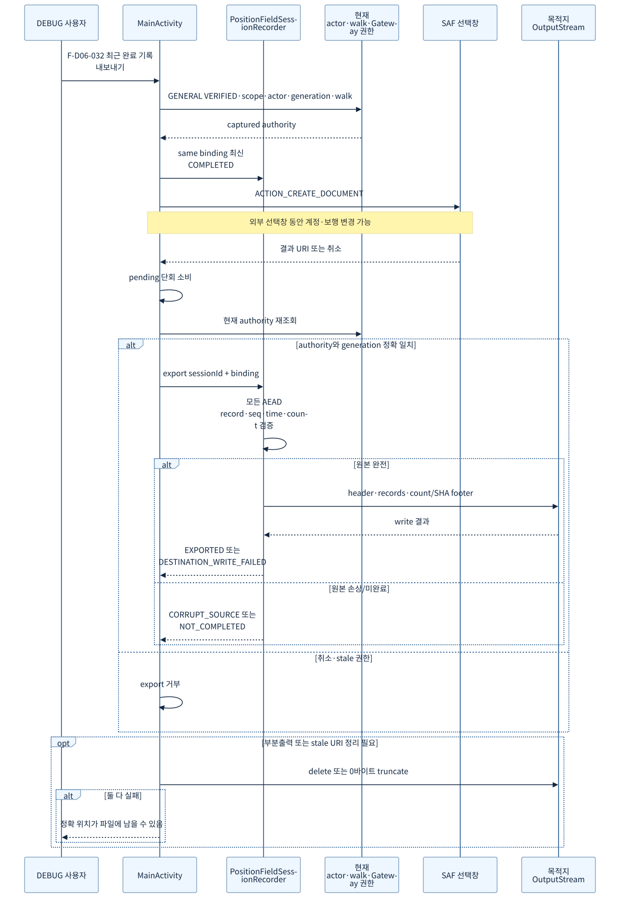

[Mermaid 원본](../diagrams/D06-position-export-sequence.mmd) · [SVG](../rendered/D06-position-export-sequence.svg)

## F-D06-033 위치 평가 보존·삭제·계정전환 purge 복구

| 항목 | 명세 |
| --- | --- |
| 분야 | D06 사용자 Android 신고·raw 수집·현장 및 개발 진단 로그 |
| 목적 | 로컬 위치 평가 기록을 한정 보존하고 계정전환 시 이전 scope를 되살리지 않는다. |
| 사용 주체 | DEBUG 사용자 Android 현장·진단 logger |
| 활성 상태 | CONDITIONAL |
| 진입점 | apps/android/app/src/main/java/kr/co/hanium/dreamup/walksafe/fieldlog/PositionFieldSessionRecorder.kt:313 purge apps/android/app/src/main/java/kr/co/hanium/dreamup/walksafe/MainActivity.kt:47847 initializePositionFieldRecorder apps/android/app/src/main/java/kr/co/hanium/dreamup/walksafe/MainActivity.kt:48028 completePendingPositionFieldPurge |
| 실행 전제 | DEBUG recorder. 일반 삭제는 scope binding 일치/비활성만. purge는 marker 또는 preference fence 최소하나를 영속화해야 시작. |
| 입력 출처 형식 검증 최신성 | 완료/중단 기록 최대14일·20개·총32MiB; retained active는 일반 eviction에서 보호. 새 local scope 무작위 UUID. |

### 시작 이벤트와 처리 순서

| 이벤트 ID | 발생원 | 이벤트 | 수신부 | 흐름 |
| --- | --- | --- | --- | --- |
| E-D06-033-01 | recorder 초기화 | recorder 초기화 | purge | recorder 초기화→orphan ACTIVE interrupted→보존 정리 |
| E-D06-033-02 | delete 요청 | delete 요청 | purge | delete 요청→같은 scope 비활성 session 확인→삭제 |
| E-D06-033-03 | 계정변경 purge | 계정변경 purge | purge | 계정변경 purge→durable fence→root 삭제→새scope 저장→fence 해제 |
| E-D06-033-04 | 앱 재시작 pending marker | 앱 재시작 pending marker | purge | 앱 재시작 pending marker→purge 복구 |

1. 1. constructor는 남은 ACTIVE manifest를 INTERRUPTED로 바꾸고 자동 재개하지 않는다. [apps/android/app/src/main/java/kr/co/hanium/dreamup/walksafe/fieldlog/PositionFieldSessionRecorder.kt:313 purge]
2. 2. 비활성 age>=14일 자료를 지우고 count/bytes를 맞추기 위해 오래된 것부터 제거한다. [apps/android/app/src/main/java/kr/co/hanium/dreamup/walksafe/fieldlog/PositionFieldSessionRecorder.kt:313 purge]
3. 3. 계정전환은 storageBlocked=true 후 marker fsync 또는 purgePending commit을 보존한다. [apps/android/app/src/main/java/kr/co/hanium/dreamup/walksafe/fieldlog/PositionFieldSessionRecorder.kt:313 purge]
4. 4. purge 성공 후 lease/anchor/pending export를 비우고 export generation을 증가시킨다. [apps/android/app/src/main/java/kr/co/hanium/dreamup/walksafe/fieldlog/PositionFieldSessionRecorder.kt:313 purge]
5. 5. 새 scope와 purgePending=false를 commit하고 marker 삭제까지 성공해야 다시 허용한다. [apps/android/app/src/main/java/kr/co/hanium/dreamup/walksafe/fieldlog/PositionFieldSessionRecorder.kt:313 purge]

| 분기 조건 | 실제 처리 결과 | 구현 근거 |
| --- | --- | --- |
| fence 둘 다 저장실패 | 계정전환 중단·기록 접근 차단 | apps/android/app/src/main/java/kr/co/hanium/dreamup/walksafe/fieldlog/PositionFieldSessionRecorder.kt:313 purge |
| purge 실패 | 이전자료 남음 가능, blocked 유지 | apps/android/app/src/main/java/kr/co/hanium/dreamup/walksafe/fieldlog/PositionFieldSessionRecorder.kt:313 purge |
| 새 scope 저장/marker 해제 실패 | blocked 유지, 다음 시작 때 복구 | apps/android/app/src/main/java/kr/co/hanium/dreamup/walksafe/fieldlog/PositionFieldSessionRecorder.kt:313 purge |
| 다른 scope 또는 active 개별삭제 | 거부 | apps/android/app/src/main/java/kr/co/hanium/dreamup/walksafe/fieldlog/PositionFieldSessionRecorder.kt:313 purge |
| 손상 manifest | 전용 위치 trace artifact 제거 | apps/android/app/src/main/java/kr/co/hanium/dreamup/walksafe/fieldlog/PositionFieldSessionRecorder.kt:313 purge |

### 효과 종료와 복구

정해진 noBackup 위치 기록 root 삭제, 계정 연계가 아닌 무작위 scope 교체. 기존 SAF export는 별도 사용자 파일이므로 이 purge가 일괄 삭제하지 않음.

| 상황 | 동작 |
| --- | --- |
| 정상 완료 | purge+scope+marker 모두 성공한 뒤 unblock. |
| 실패 | 오류 화면과 blocked 상태 유지. |
| 시간 초과 | 비활성 age>=14일 보존삭제. |
| 중복 입력 | 이 기능에 별도의 중복처리 경로는 정의되지 않음. 연결된 호출자·저장소 경로는 shared/code_refs 참조. |
| 취소 | purge 도중 임의 취소로 차단해제하지 않음. |
| 중단과 생명주기 | pending marker/prefs를 통해 재시작 복구. |
| 재시도 | 이 기능에 별도의 재시도 경로는 정의되지 않음. 연결된 호출자·저장소 경로는 shared/code_refs 참조. |
| 복구 | initialize에서 completePendingPositionFieldPurge. |
| 자원 정리 | 메모리 lease/pending export/anchor 초기화, root만 제거. |

### 상태 실행 맥락과 연결

| 항목 | 명세 |
| --- | --- |
| 초기 상태 | S-D06-033-READY |
| 상태 목록 | S-D06-033-READY S-D06-033-PURGE_PENDING S-D06-033-PURGED_BLOCKED S-D06-033-READY_NEW_SCOPE |
| 전이 조건과 전이 동작 | 계정전환→PURGE_PENDING 삭제성공→PURGED_BLOCKED 새scope저장·marker해제→READY_NEW_SCOPE 실패→PURGE_PENDING 또는 PURGED_BLOCKED 유지 |
| 허용되지 않는 전이 | preconditions/branches에 명시된 gate 실패 상태에서 다음 처리로 진입 금지. 여기에 붙인 S-D06 ID는 명세 탐색용이며 코드 enum과 운영상태를 그대로 혼동하지 않음. |
| 동시성 순서와 작업 소유권 | Recorder PROCESS_LOCK과 Main durable preferences/marker 단계. 늦은 picker callback는 export generation 변경으로 거부. |
| 공유 상태와 다른 기능 연결 | D01 account transition, D04 OutdoorPositionTestActivity 별도 도구, SAF 외부 export 책임은 F-D06-032. |

### 정책 근거와 검증 범위

| 항목 | 근거 |
| --- | --- |
| 정책 | [P-D06-029](#P-D06-029) [P-D06-032](#P-D06-032) |
| 구현 | [apps/android/app/src/main/java/kr/co/hanium/dreamup/walksafe/fieldlog/PositionFieldSessionRecorder.kt:298](/home/ddobagi/Hanium_Dreamup/apps/android/app/src/main/java/kr/co/hanium/dreamup/walksafe/fieldlog/PositionFieldSessionRecorder.kt:298) · `purge` (범위 298–452) [apps/android/app/src/main/java/kr/co/hanium/dreamup/walksafe/MainActivity.kt:47847](/home/ddobagi/Hanium_Dreamup/apps/android/app/src/main/java/kr/co/hanium/dreamup/walksafe/MainActivity.kt:47847) · `initializePositionFieldRecorder` (범위 47847–47905) [apps/android/app/src/main/java/kr/co/hanium/dreamup/walksafe/MainActivity.kt:48028](/home/ddobagi/Hanium_Dreamup/apps/android/app/src/main/java/kr/co/hanium/dreamup/walksafe/MainActivity.kt:48028) · `completePendingPositionFieldPurge` (범위 48028–48133) |
| 기존 개선 ID | 개별 동일성 미확인; 분야 연관은 별도 추적표 |
| 기존 분야 | 해당 없음 |
| 기존 실행 증거 | 이번 고정 소스 정적 분석 외 과거 실행/기기/서버 증거는 이 기능에서 재검증하지 않았음. 기존 DONE을 이번 실행 성공으로 간주하지 않음. |
| 한계 및 구분 | 코드에 연결된 동작과 활성 조건을 기록한 정적 명세. 실제 배포 설정·현장·API 송수신 결과는 미확인. 관리자 앱은 D12 담당. |

| 테스트 위치 | 심볼 | 증거 수준 | 기대와 한계 |
| --- | --- | --- | --- |
| [apps/android/app/src/test/java/kr/co/hanium/dreamup/walksafe/fieldlog/PositionFieldSessionRecorderTest.kt](/home/ddobagi/Hanium_Dreamup/apps/android/app/src/test/java/kr/co/hanium/dreamup/walksafe/fieldlog/PositionFieldSessionRecorderTest.kt) | enforcesCountAgeAndStorageCaps | TEST_EXPECTATION | 14일/20건/32MiB 보존 기대; 이번 작업에서는 실행하지 않음. |

### 이벤트 처리 그림


[Mermaid 원본](../diagrams/D06-F033.mmd) · [SVG](../rendered/D06-F033.svg)

[Mermaid 원본](../diagrams/D06-position-state.mmd) · [SVG](../rendered/D06-position-state.svg)

## F-D06-034 디버그 원본 전송 admission과 보행 재시작 취소

| 항목 | 명세 |
| --- | --- |
| 분야 | D06 사용자 Android 신고·raw 수집·현장 및 개발 진단 로그 |
| 목적 | DEBUG frame/metadata를 보행 후·충전·Wi-Fi·raw 동의 조건에서만 전송한다. |
| 사용 주체 | DEBUG 사용자 Android 현장·진단 logger |
| 활성 상태 | CONDITIONAL |
| 진입점 | apps/android/app/src/main/java/kr/co/hanium/dreamup/walksafe/network/AndroidNetworkTransferPolicy.kt:169 decideAfterWalk apps/android/app/src/main/java/kr/co/hanium/dreamup/walksafe/MainActivity.kt:11033 sensitiveDebugTransferAllowed apps/android/app/src/main/java/kr/co/hanium/dreamup/walksafe/MainActivity.kt:19212 debugUploadButton |
| 실행 전제 | DEBUG factory, RAW_SOURCE_COLLECTION 허용, walk allowsPostWalkTransfer(READY/ENDED), charging=true, Wi-Fi. unknown 상태는 ACTIVE로 fail closed. |
| 입력 출처 형식 검증 최신성 | current walk state, consent, lazy charging probe, network transport. 일반 모바일데이터 허용이어도 디버그 원본 cellular은 대기. |

### 시작 이벤트와 처리 순서

| 이벤트 ID | 발생원 | 이벤트 | 수신부 | 흐름 |
| --- | --- | --- | --- | --- |
| E-D06-034-01 | 로그 toggle/프레임 버튼 | 로그 toggle/프레임 버튼 | decideAfterWalk | 로그 toggle/프레임 버튼→민감전송 gate→enabled 또는 요청 flag |
| E-D06-034-02 | actual upload | actual upload | decideAfterWalk | actual upload→lock 안 admission 재평가→전송 dispatch |
| E-D06-034-03 | 보행 ACTIVE/PAUSED 등 재진입 | 보행 ACTIVE/PAUSED 등 재진입 | decideAfterWalk | 보행 ACTIVE/PAUSED 등 재진입→generation 증가→두 transport 취소 |

1. 1. UI 동작 시 gate 불충족이면 toggle/요청 flag를 false로 하고 동의·네트워크 안내를 한다. [apps/android/app/src/main/java/kr/co/hanium/dreamup/walksafe/network/AndroidNetworkTransferPolicy.kt:169 decideAfterWalk]
2. 2. actual action은 같은 admission lock 아래 상태를 재확인한 뒤 실행한다. [apps/android/app/src/main/java/kr/co/hanium/dreamup/walksafe/network/AndroidNetworkTransferPolicy.kt:169 decideAfterWalk]
3. 3. 보행 재진입은 admissionClosed와 generation을 바꾼 다음 metadata/frame active 연결을 취소한다. [apps/android/app/src/main/java/kr/co/hanium/dreamup/walksafe/network/AndroidNetworkTransferPolicy.kt:169 decideAfterWalk]
4. 4. 원래 motion기반 helper decide가 있어도 이 Main 경로는 decideAfterWalk를 사용하고 종료 후 stillness 근거를 요구하지 않는다. [apps/android/app/src/main/java/kr/co/hanium/dreamup/walksafe/network/AndroidNetworkTransferPolicy.kt:169 decideAfterWalk]

| 분기 조건 | 실제 처리 결과 | 구현 근거 |
| --- | --- | --- |
| ACTIVE/PAUSED/SAFE_STOP 또는 미초기화 | 보행중 차단 | apps/android/app/src/main/java/kr/co/hanium/dreamup/walksafe/network/AndroidNetworkTransferPolicy.kt:169 decideAfterWalk |
| charging unknown/false | 충전 대기 | apps/android/app/src/main/java/kr/co/hanium/dreamup/walksafe/network/AndroidNetworkTransferPolicy.kt:169 decideAfterWalk |
| cellular | Wi-Fi 대기 | apps/android/app/src/main/java/kr/co/hanium/dreamup/walksafe/network/AndroidNetworkTransferPolicy.kt:169 decideAfterWalk |
| OTHER/OFFLINE/raw 미동의 | fail closed | apps/android/app/src/main/java/kr/co/hanium/dreamup/walksafe/network/AndroidNetworkTransferPolicy.kt:169 decideAfterWalk |

### 효과 종료와 복구

네트워크 시작/취소와 debug UI 상태. Debug factory의 실제 endpoint는 loopback.

| 상황 | 동작 |
| --- | --- |
| 정상 완료 | 조건 통과 dispatch 결과 Boolean. |
| 실패 | probe exception은 charging=false로 처리. |
| 시간 초과 | 이 기능에 별도의 시간초과 경로는 정의되지 않음. 연결된 호출자·저장소 경로는 shared/code_refs 참조. |
| 중복 입력 | 세부 transport가 queue/inFlight 중복을 제한. |
| 취소 | 상태변경시 cancelActiveUpload 호출. |
| 중단과 생명주기 | generation이 달라지면 이미 허용됐어도 admitted 결과 false. |
| 재시도 | 조건 회복 후 이후 사용자/producer 이벤트에서 재평가. |
| 복구 | 이 기능에 별도의 복구 경로는 정의되지 않음. 연결된 호출자·저장소 경로는 shared/code_refs 참조. |
| 자원 정리 | 이 기능에 별도의 정리 경로는 정의되지 않음. 연결된 호출자·저장소 경로는 shared/code_refs 참조. |

### 상태 실행 맥락과 연결

| 항목 | 명세 |
| --- | --- |
| 초기 상태 | S-D06-034-CLOSED |
| 상태 목록 | S-D06-034-CLOSED S-D06-034-ADMITTED S-D06-034-CANCELLED |
| 전이 조건과 전이 동작 | READY/ENDED·동의·충전·Wi-Fi→ADMITTED 보행재진입→CANCELLED 및 CLOSED |
| 허용되지 않는 전이 | preconditions/branches에 명시된 gate 실패 상태에서 다음 처리로 진입 금지. 여기에 붙인 S-D06 ID는 명세 탐색용이며 코드 enum과 운영상태를 그대로 혼동하지 않음. |
| 동시성 순서와 작업 소유권 | admission lock 안에서 결정과 action을 묶어 보행상태 전이와 시작을 직렬화. transport generation으로 늦은 작업도 취소. |
| 공유 상태와 다른 기능 연결 | F-D06-035/036, D01 consent, D02 walk lifecycle. postwalk 실제 frame 가용성은 현장 미검증. |

### 정책 근거와 검증 범위

| 항목 | 근거 |
| --- | --- |
| 정책 | [P-D06-018](#P-D06-018) [P-D06-033](#P-D06-033) |
| 구현 | [apps/android/app/src/main/java/kr/co/hanium/dreamup/walksafe/network/AndroidNetworkTransferPolicy.kt:169](/home/ddobagi/Hanium_Dreamup/apps/android/app/src/main/java/kr/co/hanium/dreamup/walksafe/network/AndroidNetworkTransferPolicy.kt:169) · `decideAfterWalk` (범위 169–270) [apps/android/app/src/main/java/kr/co/hanium/dreamup/walksafe/MainActivity.kt:11033](/home/ddobagi/Hanium_Dreamup/apps/android/app/src/main/java/kr/co/hanium/dreamup/walksafe/MainActivity.kt:11033) · `sensitiveDebugTransferAllowed` (범위 11033–11081) [apps/android/app/src/main/java/kr/co/hanium/dreamup/walksafe/MainActivity.kt:19212](/home/ddobagi/Hanium_Dreamup/apps/android/app/src/main/java/kr/co/hanium/dreamup/walksafe/MainActivity.kt:19212) · `debugUploadButton` (범위 19212–19240) |
| 기존 개선 ID | 개별 동일성 미확인; 분야 연관은 별도 추적표 |
| 기존 분야 | 해당 없음 |
| 기존 실행 증거 | 이번 고정 소스 정적 분석 외 과거 실행/기기/서버 증거는 이 기능에서 재검증하지 않았음. 기존 DONE을 이번 실행 성공으로 간주하지 않음. |
| 한계 및 구분 | 코드에 연결된 동작과 활성 조건을 기록한 정적 명세. 실제 배포 설정·현장·API 송수신 결과는 미확인. 관리자 앱은 D12 담당. |

| 테스트 위치 | 심볼 | 증거 수준 | 기대와 한계 |
| --- | --- | --- | --- |
| [apps/android/app/src/test/java/kr/co/hanium/dreamup/walksafe/network/AndroidNetworkTransferPolicyTest.kt](/home/ddobagi/Hanium_Dreamup/apps/android/app/src/test/java/kr/co/hanium/dreamup/walksafe/network/AndroidNetworkTransferPolicyTest.kt) | AndroidNetworkTransferPolicyTest | TEST_EXPECTATION | 전송 정책 기대; 해당 세부 test symbol은 클래스 수준 참조; 이번 작업에서는 실행하지 않음. |

### 이벤트 처리 그림


[Mermaid 원본](../diagrams/D06-F034.mmd) · [SVG](../rendered/D06-F034.svg)

## F-D06-035 디버그 depth metadata 배치 HTTP 로그

| 항목 | 명세 |
| --- | --- |
| 분야 | D06 사용자 Android 신고·raw 수집·현장 및 개발 진단 로그 |
| 목적 | 허용된 감지·depth 수치 metadata를 소규모 메모리 큐로 loopback 진단 서버에 전송한다. |
| 사용 주체 | DEBUG 사용자 Android 현장·진단 logger |
| 활성 상태 | CONDITIONAL |
| 진입점 | apps/android/app/src/debug/java/kr/co/hanium/dreamup/walksafe/debuglog/HttpMetadataLogUploader.kt:1 HttpMetadataLogUploader apps/android/app/src/debug/java/kr/co/hanium/dreamup/walksafe/debuglog/DebugMetadataLogUploaderFactory.kt:1 DebugMetadataLogUploaderFactory apps/android/app/src/main/java/kr/co/hanium/dreamup/walksafe/debuglog/MetadataLogJsonEncoder.kt:1 MetadataLogJsonEncoder apps/android/app/src/main/java/kr/co/hanium/dreamup/walksafe/MainActivity.kt:14810 captureLogEntry |
| 실행 전제 | DEBUG factory, enabled=true, 유효 HTTP/HTTPS host endpoint, F-D06-034 admission 허용. release factory Noop. |
| 입력 출처 형식 검증 최신성 | depth_debug.v1 allowlist JSON; exact 좌표/음성/원본 이미지 없음. factory endpoint http://127.0.0.1:8000/android/debug/depth-logs. 일반 endpoint validator는 host·scheme만 검사. |

### 시작 이벤트와 처리 순서

| 이벤트 ID | 발생원 | 이벤트 | 수신부 | 흐름 |
| --- | --- | --- | --- | --- |
| E-D06-035-01 | 사용자 server-log toggle | 사용자 server-log toggle | HttpMetadataLogUploader | 사용자 server-log toggle→enabled 전환 |
| E-D06-035-02 | 렌더 metadata enqueue | 렌더 metadata enqueue | HttpMetadataLogUploader | 렌더 metadata enqueue→최대30 queue→최소2초 간격 최대5개 POST |
| E-D06-035-03 | cancel/close | cancel/close | HttpMetadataLogUploader | cancel/close→generation 변경·transport disconnect |

1. 1. encoder가 감지 bbox/class/depth/confidence/runtime/timing을 선택적으로 JSON에 넣는다. [apps/android/app/src/debug/java/kr/co/hanium/dreamup/walksafe/debuglog/HttpMetadataLogUploader.kt:1 HttpMetadataLogUploader]
2. 2. enqueue는 큐30개를 넘으면 oldest를 제거한다. [apps/android/app/src/debug/java/kr/co/hanium/dreamup/walksafe/debuglog/HttpMetadataLogUploader.kt:1 HttpMetadataLogUploader]
3. 3. inFlight 하나만, 최소2000ms 간격, 한 batch5개를 worker에 보낸다. [apps/android/app/src/debug/java/kr/co/hanium/dreamup/walksafe/debuglog/HttpMetadataLogUploader.kt:1 HttpMetadataLogUploader]
4. 4. worker 시작 전 generation이 달라졌으면 batch를 앞에 재삽입한다. 전송 실패한 batch는 재삽입하지 않는다. [apps/android/app/src/debug/java/kr/co/hanium/dreamup/walksafe/debuglog/HttpMetadataLogUploader.kt:1 HttpMetadataLogUploader]
5. 5. disable은 대기 큐를 비운다. active HTTP 취소는 별도 cancelActiveUpload 경로다. [apps/android/app/src/debug/java/kr/co/hanium/dreamup/walksafe/debuglog/HttpMetadataLogUploader.kt:1 HttpMetadataLogUploader]

| 분기 조건 | 실제 처리 결과 | 구현 근거 |
| --- | --- | --- |
| disabled/closed/invalid endpoint | enqueue 무시 | apps/android/app/src/debug/java/kr/co/hanium/dreamup/walksafe/debuglog/HttpMetadataLogUploader.kt:1 HttpMetadataLogUploader |
| queue>30 | 가장 오래된 metadata drop | apps/android/app/src/debug/java/kr/co/hanium/dreamup/walksafe/debuglog/HttpMetadataLogUploader.kt:1 HttpMetadataLogUploader |
| network I/O/RuntimeException | 오류를 삼키고 inFlight 해제, batch 자동재시도 없음 | apps/android/app/src/debug/java/kr/co/hanium/dreamup/walksafe/debuglog/HttpMetadataLogUploader.kt:1 HttpMetadataLogUploader |
| worker가 시작되기 전 취소 | batch requeue; 이후 enable/admission 조건 필요 | apps/android/app/src/debug/java/kr/co/hanium/dreamup/walksafe/debuglog/HttpMetadataLogUploader.kt:1 HttpMetadataLogUploader |

### 효과 종료와 복구

loopback HTTP JSON POST; 로컬 영속 queue나 서버 receipt 검증 없음.

| 상황 | 동작 |
| --- | --- |
| 정상 완료 | HTTP status stream 닫고 inFlight 해제. |
| 실패 | 실패 batch 손실 허용 진단 로그. |
| 시간 초과 | connect1000ms/read2000ms. |
| 중복 입력 | inFlight 단일, metadata 단위 idempotency 없음. |
| 취소 | generation 증가·active transport disconnect. |
| 중단과 생명주기 | pre-run 취소 batch만 앞에 재삽입. |
| 재시도 | 실패 batch 자동재전송 없음; 후속 sample은 가능. |
| 복구 | 이 기능에 별도의 복구 경로는 정의되지 않음. 연결된 호출자·저장소 경로는 shared/code_refs 참조. |
| 자원 정리 | disable 큐clear, close clear·shutdownNow. |

### 상태 실행 맥락과 연결

| 항목 | 명세 |
| --- | --- |
| 초기 상태 | S-D06-035-DISABLED |
| 상태 목록 | S-D06-035-DISABLED S-D06-035-QUEUED S-D06-035-IN_FLIGHT S-D06-035-CLOSED |
| 전이 조건과 전이 동작 | setEnabled(true)→QUEUED 가능 schedule→IN_FLIGHT 전송종료→QUEUED/IDLE close→CLOSED |
| 허용되지 않는 전이 | preconditions/branches에 명시된 gate 실패 상태에서 다음 처리로 진입 금지. 여기에 붙인 S-D06 ID는 명세 탐색용이며 코드 enum과 운영상태를 그대로 혼동하지 않음. |
| 동시성 순서와 작업 소유권 | 단일 executor, queue lock, inFlight flag, AtomicReference active connection과 cancellationGeneration 사용. |
| 공유 상태와 다른 기능 연결 | Main 현장로그와 MetadataLogJsonEncoder 공유; D08 debug endpoint 실제 서버 동작 별도. |

### 정책 근거와 검증 범위

| 항목 | 근거 |
| --- | --- |
| 정책 | [P-D06-033](#P-D06-033) [P-D06-034](#P-D06-034) [P-D06-035](#P-D06-035) |
| 구현 | [apps/android/app/src/debug/java/kr/co/hanium/dreamup/walksafe/debuglog/HttpMetadataLogUploader.kt:1](/home/ddobagi/Hanium_Dreamup/apps/android/app/src/debug/java/kr/co/hanium/dreamup/walksafe/debuglog/HttpMetadataLogUploader.kt:1) · `HttpMetadataLogUploader` (범위 1–183) [apps/android/app/src/debug/java/kr/co/hanium/dreamup/walksafe/debuglog/DebugMetadataLogUploaderFactory.kt:1](/home/ddobagi/Hanium_Dreamup/apps/android/app/src/debug/java/kr/co/hanium/dreamup/walksafe/debuglog/DebugMetadataLogUploaderFactory.kt:1) · `DebugMetadataLogUploaderFactory` (범위 1–17) [apps/android/app/src/main/java/kr/co/hanium/dreamup/walksafe/debuglog/MetadataLogJsonEncoder.kt:1](/home/ddobagi/Hanium_Dreamup/apps/android/app/src/main/java/kr/co/hanium/dreamup/walksafe/debuglog/MetadataLogJsonEncoder.kt:1) · `MetadataLogJsonEncoder` (범위 1–118) [apps/android/app/src/main/java/kr/co/hanium/dreamup/walksafe/MainActivity.kt:14810](/home/ddobagi/Hanium_Dreamup/apps/android/app/src/main/java/kr/co/hanium/dreamup/walksafe/MainActivity.kt:14810) · `captureLogEntry` (범위 14810–14835) |
| 기존 개선 ID | 개별 동일성 미확인; 분야 연관은 별도 추적표 |
| 기존 분야 | 해당 없음 |
| 기존 실행 증거 | 이번 고정 소스 정적 분석 외 과거 실행/기기/서버 증거는 이 기능에서 재검증하지 않았음. 기존 DONE을 이번 실행 성공으로 간주하지 않음. |
| 한계 및 구분 | 코드에 연결된 동작과 활성 조건을 기록한 정적 명세. 실제 배포 설정·현장·API 송수신 결과는 미확인. 관리자 앱은 D12 담당. |

| 테스트 위치 | 심볼 | 증거 수준 | 기대와 한계 |
| --- | --- | --- | --- |
| [apps/android/app/src/test/java/kr/co/hanium/dreamup/walksafe/debuglog/HttpMetadataLogUploaderTest.kt](/home/ddobagi/Hanium_Dreamup/apps/android/app/src/test/java/kr/co/hanium/dreamup/walksafe/debuglog/HttpMetadataLogUploaderTest.kt) | HttpMetadataLogUploaderTest | TEST_EXPECTATION | 배치/주기/취소 기대; 이번 작업에서는 실행하지 않음. |
| [apps/android/app/src/test/java/kr/co/hanium/dreamup/walksafe/debuglog/MetadataLogJsonEncoderTest.kt](/home/ddobagi/Hanium_Dreamup/apps/android/app/src/test/java/kr/co/hanium/dreamup/walksafe/debuglog/MetadataLogJsonEncoderTest.kt) | MetadataLogJsonEncoderTest | TEST_EXPECTATION | metadata JSON allowlist 기대; 이번 작업에서는 실행하지 않음. |

### 이벤트 처리 그림


[Mermaid 원본](../diagrams/D06-F035.mmd) · [SVG](../rendered/D06-F035.svg)

## F-D06-036 디버그 단일 프레임 캡처와 유계 multipart 전송

| 항목 | 명세 |
| --- | --- |
| 분야 | D06 사용자 Android 신고·raw 수집·현장 및 개발 진단 로그 |
| 목적 | 사용자가 요청한 DEBUG 사진과 metadata를 하나의 취소 가능한 업로드로 보낸다. |
| 사용 주체 | DEBUG 사용자 Android 현장·진단 logger |
| 활성 상태 | CONDITIONAL |
| 진입점 | apps/android/app/src/debug/java/kr/co/hanium/dreamup/walksafe/debuglog/HttpFrameCaptureUploader.kt:1 HttpFrameCaptureUploader apps/android/app/src/debug/java/kr/co/hanium/dreamup/walksafe/debuglog/DebugFrameCaptureUploaderFactory.kt:1 DebugFrameCaptureUploaderFactory apps/android/app/src/main/java/kr/co/hanium/dreamup/walksafe/MainActivity.kt:34582 encodeDebugFrameJpeg |
| 실행 전제 | DEBUG, F-D06-034 gate, image nonempty·endpoint valid, inFlight 없음, retained payload<=8MiB. |
| 입력 출처 형식 검증 최신성 | image byte 배열 복사본과 wrapper metadata JSON. 크기계산 image.size+metadata.length*3. endpoint http://127.0.0.1:8000/android/debug/frame-captures. |

### 시작 이벤트와 처리 순서

| 이벤트 ID | 발생원 | 이벤트 | 수신부 | 흐름 |
| --- | --- | --- | --- | --- |
| E-D06-036-01 | 이미지1장 버튼 | 이미지1장 버튼 | HttpFrameCaptureUploader | 이미지1장 버튼→frameCaptureRequested=true→detector 프레임 JPEG 생성 |
| E-D06-036-02 | current frame 결과 | current frame 결과 | HttpFrameCaptureUploader | current frame 결과→admission 재검사→uploader snapshot copy |
| E-D06-036-03 | 취소/close | 취소/close | HttpFrameCaptureUploader | 취소/close→단회 CANCELLED outcome·연결해제·buffer zeroize |

1. 1. Main이 current frame generation/walk epoch를 확인한 성공 detection 결과에서 capture JPEG와 metadata를 만든다. [apps/android/app/src/debug/java/kr/co/hanium/dreamup/walksafe/debuglog/HttpFrameCaptureUploader.kt:1 HttpFrameCaptureUploader]
2. 2. upload admission 통과 후 uploader는8MiB와 단일 inFlight를 검사하고 image.copyOf로 caller 변경을 격리한다. [apps/android/app/src/debug/java/kr/co/hanium/dreamup/walksafe/debuglog/HttpFrameCaptureUploader.kt:1 HttpFrameCaptureUploader]
3. 3. worker가 generation을 확인하고16KiB chunked multipart POST를 쓴다. [apps/android/app/src/debug/java/kr/co/hanium/dreamup/walksafe/debuglog/HttpFrameCaptureUploader.kt:1 HttpFrameCaptureUploader]
4. 4. HTTP2xx는 succeeded, 다른 status와 IO는 failed로 집계하며 terminal outcome은 한 번만 기록한다. [apps/android/app/src/debug/java/kr/co/hanium/dreamup/walksafe/debuglog/HttpFrameCaptureUploader.kt:1 HttpFrameCaptureUploader]
5. 5. finally에서 retained image를0으로 덮고 reference/inFlight를 해제한다. [apps/android/app/src/debug/java/kr/co/hanium/dreamup/walksafe/debuglog/HttpFrameCaptureUploader.kt:1 HttpFrameCaptureUploader]

| 분기 조건 | 실제 처리 결과 | 구현 근거 |
| --- | --- | --- |
| busy/oversize/empty/closed/invalid endpoint | drop counter, 실제 전송 안 함 | apps/android/app/src/debug/java/kr/co/hanium/dreamup/walksafe/debuglog/HttpFrameCaptureUploader.kt:1 HttpFrameCaptureUploader |
| generation stale 또는 cancel | CANCELLED 단회 | apps/android/app/src/debug/java/kr/co/hanium/dreamup/walksafe/debuglog/HttpFrameCaptureUploader.kt:1 HttpFrameCaptureUploader |
| 2xx | 성공 counter; 서버 영속 receipt 보장은 없음 | apps/android/app/src/debug/java/kr/co/hanium/dreamup/walksafe/debuglog/HttpFrameCaptureUploader.kt:1 HttpFrameCaptureUploader |
| non2xx/IO | 실패 counter | apps/android/app/src/debug/java/kr/co/hanium/dreamup/walksafe/debuglog/HttpFrameCaptureUploader.kt:1 HttpFrameCaptureUploader |

### 효과 종료와 복구

HTTP multipart 이미지+metadata, debug 상태 UI. 사용자 신고 queue와 다른 경로.

| 상황 | 동작 |
| --- | --- |
| 정상 완료 | success 후 buffer wipe. |
| 실패 | 실패 counter와 제한된 reason; callback exception은 무시. |
| 시간 초과 | connect2000ms/read4000ms. |
| 중복 입력 | active 한 개, terminal outcome 한번. |
| 취소 | generation 증가, 소유 연결 detach 후 disconnect; worker finally까지 buffer 소유 유지. |
| 중단과 생명주기 | shutdownNow로 미실행 task를 회수해 buffer 정리. |
| 재시도 | 자동 재시도 없음; 사용자가 새 프레임 요청. |
| 복구 | 이 기능에 별도의 복구 경로는 정의되지 않음. 연결된 호출자·저장소 경로는 shared/code_refs 참조. |
| 자원 정리 | accepted copy zeroize, retained bytes 해제. |

### 상태 실행 맥락과 연결

| 항목 | 명세 |
| --- | --- |
| 초기 상태 | S-D06-036-IDLE |
| 상태 목록 | S-D06-036-IDLE S-D06-036-RETAINED S-D06-036-IN_FLIGHT S-D06-036-SUCCEEDED S-D06-036-FAILED S-D06-036-CANCELLED |
| 전이 조건과 전이 동작 | accept→RETAINED worker→IN_FLIGHT 2xx→SUCCEEDED IO/status→FAILED cancel→CANCELLED |
| 허용되지 않는 전이 | preconditions/branches에 명시된 gate 실패 상태에서 다음 처리로 진입 금지. 여기에 붙인 S-D06 ID는 명세 탐색용이며 코드 enum과 운영상태를 그대로 혼동하지 않음. |
| 동시성 순서와 작업 소유권 | 낮은 우선순위 단일 worker, lock으로 연결소유권·terminal outcome 관리. frameStateLock과 gate가 Main stale result를 거부. |
| 공유 상태와 다른 기능 연결 | 감지 담당 OwnedYuvFrame/detector source, F-D06-034 admission. 일반 신고 동결사진/queue F-D06-002와 독립. |

### 정책 근거와 검증 범위

| 항목 | 근거 |
| --- | --- |
| 정책 | [P-D06-033](#P-D06-033) [P-D06-035](#P-D06-035) [P-D06-036](#P-D06-036) |
| 구현 | [apps/android/app/src/debug/java/kr/co/hanium/dreamup/walksafe/debuglog/HttpFrameCaptureUploader.kt:1](/home/ddobagi/Hanium_Dreamup/apps/android/app/src/debug/java/kr/co/hanium/dreamup/walksafe/debuglog/HttpFrameCaptureUploader.kt:1) · `HttpFrameCaptureUploader` (범위 1–290) [apps/android/app/src/debug/java/kr/co/hanium/dreamup/walksafe/debuglog/DebugFrameCaptureUploaderFactory.kt:1](/home/ddobagi/Hanium_Dreamup/apps/android/app/src/debug/java/kr/co/hanium/dreamup/walksafe/debuglog/DebugFrameCaptureUploaderFactory.kt:1) · `DebugFrameCaptureUploaderFactory` (범위 1–25) [apps/android/app/src/main/java/kr/co/hanium/dreamup/walksafe/MainActivity.kt:34582](/home/ddobagi/Hanium_Dreamup/apps/android/app/src/main/java/kr/co/hanium/dreamup/walksafe/MainActivity.kt:34582) · `encodeDebugFrameJpeg` (범위 34582–34664) |
| 기존 개선 ID | 개별 동일성 미확인; 분야 연관은 별도 추적표 |
| 기존 분야 | 해당 없음 |
| 기존 실행 증거 | 이번 고정 소스 정적 분석 외 과거 실행/기기/서버 증거는 이 기능에서 재검증하지 않았음. 기존 DONE을 이번 실행 성공으로 간주하지 않음. |
| 한계 및 구분 | 코드에 연결된 동작과 활성 조건을 기록한 정적 명세. 실제 배포 설정·현장·API 송수신 결과는 미확인. 관리자 앱은 D12 담당. |

| 테스트 위치 | 심볼 | 증거 수준 | 기대와 한계 |
| --- | --- | --- | --- |
| [apps/android/app/src/testDebug/java/kr/co/hanium/dreamup/walksafe/debuglog/HttpFrameCaptureUploaderTest.kt](/home/ddobagi/Hanium_Dreamup/apps/android/app/src/testDebug/java/kr/co/hanium/dreamup/walksafe/debuglog/HttpFrameCaptureUploaderTest.kt) | HttpFrameCaptureUploaderTest | TEST_EXPECTATION | 단일 전송/취소/메모리 제한 기대; 이번 작업에서는 실행하지 않음. |

### 이벤트 처리 그림


[Mermaid 원본](../diagrams/D06-F036.mmd) · [SVG](../rendered/D06-F036.svg)

## F-D06-037 유계 로컬 runtime 진단 파일과 typed metadata

| 항목 | 명세 |
| --- | --- |
| 분야 | D06 사용자 Android 신고·raw 수집·현장 및 개발 진단 로그 |
| 목적 | 음성·탐색 상태 전이의 제한된 수치/enum을 UI를 막지 않는 DEBUG cache 로그에 남긴다. |
| 사용 주체 | DEBUG 사용자 Android 현장·진단 logger |
| 활성 상태 | CONDITIONAL |
| 진입점 | apps/android/app/src/main/java/kr/co/hanium/dreamup/walksafe/diagnostics/BoundedRuntimeDiagnosticLog.kt:1 BoundedRuntimeDiagnosticLog |
| 실행 전제 | BuildConfig.DEBUG와 initialize 완료. 외부 공개 API는 arbitrary text/exception/audio/identity를 받지 않음. |
| 입력 출처 형식 검증 최신성 | VOICE_DIALOG/NAVIGATION, compile-time enum stage/reason/context/origin; enum token<=64,[A-Z][A-Z0-9_]*. page0..9999, 아니면 NA. voice 진단의 typed 값은 음성 담당 formatter. |

### 시작 이벤트와 처리 순서

| 이벤트 ID | 발생원 | 이벤트 | 수신부 | 흐름 |
| --- | --- | --- | --- | --- |
| E-D06-037-01 | 앱 initialize | 앱 initialize | BoundedRuntimeDiagnosticLog | 앱 initialize→무작위 run ID·run_start 예약→writer 공개 |
| E-D06-037-02 | recordState/recordVoiceInput | recordState/recordVoiceInput | BoundedRuntimeDiagnosticLog | recordState/recordVoiceInput→typed formatter→bounded queue |
| E-D06-037-03 | worker append | worker append | BoundedRuntimeDiagnosticLog | worker append→파일회전 또는 drop count |

1. 1. cache/runtime-diagnostics에 run_start를 먼저 enqueue하고 writer를 공개한다. [apps/android/app/src/main/java/kr/co/hanium/dreamup/walksafe/diagnostics/BoundedRuntimeDiagnosticLog.kt:1 BoundedRuntimeDiagnosticLog]
2. 2. 부트 단조시각과 프로세스 무작위8byte run ID, dropped_total을 typed metadata에 붙인다. [apps/android/app/src/main/java/kr/co/hanium/dreamup/walksafe/diagnostics/BoundedRuntimeDiagnosticLog.kt:1 BoundedRuntimeDiagnosticLog]
3. 3. 단일 daemon worker queue64에 넣고 포화면 drop을 증가시킨다. [apps/android/app/src/main/java/kr/co/hanium/dreamup/walksafe/diagnostics/BoundedRuntimeDiagnosticLog.kt:1 BoundedRuntimeDiagnosticLog]
4. 4. 한 record1024bytes 초과면 drop. events.log와 events.previous.log를 각128KiB 이내로 회전한다. [apps/android/app/src/main/java/kr/co/hanium/dreamup/walksafe/diagnostics/BoundedRuntimeDiagnosticLog.kt:1 BoundedRuntimeDiagnosticLog]
5. 5. I/O 실패는 drop count로 남기고 caller 예외로 퍼뜨리지 않는다. [apps/android/app/src/main/java/kr/co/hanium/dreamup/walksafe/diagnostics/BoundedRuntimeDiagnosticLog.kt:1 BoundedRuntimeDiagnosticLog]

| 분기 조건 | 실제 처리 결과 | 구현 근거 |
| --- | --- | --- |
| release/미초기화 | 기록 안 함 | apps/android/app/src/main/java/kr/co/hanium/dreamup/walksafe/diagnostics/BoundedRuntimeDiagnosticLog.kt:1 BoundedRuntimeDiagnosticLog |
| queue full/record>1024/IO실패 | drop count 증가 | apps/android/app/src/main/java/kr/co/hanium/dreamup/walksafe/diagnostics/BoundedRuntimeDiagnosticLog.kt:1 BoundedRuntimeDiagnosticLog |
| 현재파일+record>128KiB | previous 제거 후 current 회전 | apps/android/app/src/main/java/kr/co/hanium/dreamup/walksafe/diagnostics/BoundedRuntimeDiagnosticLog.kt:1 BoundedRuntimeDiagnosticLog |
| Android cache eviction | 파일 소실 가능, 감사기록으로 사용 불가 | apps/android/app/src/main/java/kr/co/hanium/dreamup/walksafe/diagnostics/BoundedRuntimeDiagnosticLog.kt:1 BoundedRuntimeDiagnosticLog |

### 효과 종료와 복구

로컬 cache 평문 숫자/enum metadata. 네트워크 전송 없음.

| 상황 | 동작 |
| --- | --- |
| 정상 완료 | worker append 완료. |
| 실패 | best effort drop, 제품 기능 영향 최소화. |
| 시간 초과 | 이 기능에 별도의 시간초과 경로는 정의되지 않음. 연결된 호출자·저장소 경로는 shared/code_refs 참조. |
| 중복 입력 | 기록별 중복제거 없음, run_start는 writer 생성당 한번. |
| 취소 | 이 기능에 별도의 취소 경로는 정의되지 않음. 연결된 호출자·저장소 경로는 shared/code_refs 참조. |
| 중단과 생명주기 | 이 기능에 별도의 중단 경로는 정의되지 않음. 연결된 호출자·저장소 경로는 shared/code_refs 참조. |
| 재시도 | 실패 record 재시도 없음; 후속 기록은 계속 가능. |
| 복구 | 다음 프로세스의 새 run ID로 이전 파일과 구분. |
| 자원 정리 | 두 고정 cache 파일 외 삭제하지 않음; Android cache 삭제 가능. |

### 상태 실행 맥락과 연결

| 항목 | 명세 |
| --- | --- |
| 초기 상태 | S-D06-037-UNINITIALIZED |
| 상태 목록 | S-D06-037-UNINITIALIZED S-D06-037-READY S-D06-037-QUEUED S-D06-037-DROPPED |
| 전이 조건과 전이 동작 | DEBUG initialize→READY typed input→QUEUED 포화/I/O오류→DROPPED 후속 정상 input→QUEUED |
| 허용되지 않는 전이 | preconditions/branches에 명시된 gate 실패 상태에서 다음 처리로 진입 금지. 여기에 붙인 S-D06 ID는 명세 탐색용이며 코드 enum과 운영상태를 그대로 혼동하지 않음. |
| 동시성 순서와 작업 소유권 | ThreadPoolExecutor1·ArrayBlockingQueue64·AbortPolicy; recognition/UI 호출자는 파일 I/O하지 않음. |
| 공유 상태와 다른 기능 연결 | 음성 담당 formatVoiceInputDiagnostic, 탐색/음성 state callers. 서버·관리자 감사로그와 다름. |

### 정책 근거와 검증 범위

| 항목 | 근거 |
| --- | --- |
| 정책 | [P-D06-037](#P-D06-037) |
| 구현 | [apps/android/app/src/main/java/kr/co/hanium/dreamup/walksafe/diagnostics/BoundedRuntimeDiagnosticLog.kt:1](/home/ddobagi/Hanium_Dreamup/apps/android/app/src/main/java/kr/co/hanium/dreamup/walksafe/diagnostics/BoundedRuntimeDiagnosticLog.kt:1) · `BoundedRuntimeDiagnosticLog` (범위 1–180) |
| 기존 개선 ID | 개별 동일성 미확인; 분야 연관은 별도 추적표 |
| 기존 분야 | 해당 없음 |
| 기존 실행 증거 | 이번 고정 소스 정적 분석 외 과거 실행/기기/서버 증거는 이 기능에서 재검증하지 않았음. 기존 DONE을 이번 실행 성공으로 간주하지 않음. |
| 한계 및 구분 | 코드에 연결된 동작과 활성 조건을 기록한 정적 명세. 실제 배포 설정·현장·API 송수신 결과는 미확인. 관리자 앱은 D12 담당. |

| 테스트 위치 | 심볼 | 증거 수준 | 기대와 한계 |
| --- | --- | --- | --- |
| [apps/android/app/src/test/java/kr/co/hanium/dreamup/walksafe/diagnostics/BoundedRuntimeDiagnosticLogTest.kt](/home/ddobagi/Hanium_Dreamup/apps/android/app/src/test/java/kr/co/hanium/dreamup/walksafe/diagnostics/BoundedRuntimeDiagnosticLogTest.kt) | publicRecordingApiDoesNotAcceptArbitraryTextOrExceptions | TEST_EXPECTATION | 임의 문자열 API 배제 기대; 이번 작업에서는 실행하지 않음. |
| [apps/android/app/src/test/java/kr/co/hanium/dreamup/walksafe/diagnostics/BoundedRuntimeDiagnosticLogTest.kt](/home/ddobagi/Hanium_Dreamup/apps/android/app/src/test/java/kr/co/hanium/dreamup/walksafe/diagnostics/BoundedRuntimeDiagnosticLogTest.kt) | rotationRetainsOnlyTwoBoundedFiles | TEST_EXPECTATION | 두 파일 제한 기대; 이번 작업에서는 실행하지 않음. |

### 이벤트 처리 그림


[Mermaid 원본](../diagrams/D06-F037.mmd) · [SVG](../rendered/D06-F037.svg)

## P-D06-001 신고 queue의 DEBUG 프로파일·origin 승인

| 순서 | 정책 |
| --- | --- |
| 범위 | 공통: F-D06-001, F-D06-006 |
| 적용 조건 | 신규 queue 저장·status/POST 시작 |
| 판단 기준 | DEBUG에서 enabled와 모든 capacity 입력이 유효해야 profile 생성; release는 null. session origin과 build approved origin 정확 일치. |
| 실행 차단 동작 | profile 없으면 저장/전송 거부; privacy cleanup은 수행 |
| 예외 | developmentReportQueue 명시 개발 빌드만 기본 profile 제공 |
| 사용자 결과 | 활성 불가 안내 또는 휴대전화 큐 사용 가능 |
| 우선순위와 충돌 | 해당 조건은 다른 필수 권한/동의/무결성 조건을 면제하지 않는다. |
| 적용 기능 | [F-D06-001](#F-D06-001) [F-D06-006](#F-D06-006) |
| 구현 근거 | [apps/android/app/src/main/java/kr/co/hanium/dreamup/walksafe/report/ReportQueueContract.kt:202](/home/ddobagi/Hanium_Dreamup/apps/android/app/src/main/java/kr/co/hanium/dreamup/walksafe/report/ReportQueueContract.kt:202) · `PRODUCTION_REPORT_QUEUE_CAPACITY_PROFILE` (범위 202–228) [apps/android/app/build.gradle.kts:83](/home/ddobagi/Hanium_Dreamup/apps/android/app/build.gradle.kts:83) · `reportQueueEnabled` (범위 83–174) [apps/android/app/build.gradle.kts:465](/home/ddobagi/Hanium_Dreamup/apps/android/app/build.gradle.kts:465) · `developmentReportQueue` (범위 465–523) [apps/android/app/src/main/java/kr/co/hanium/dreamup/walksafe/report/AndroidReportQueueStore.kt:63](/home/ddobagi/Hanium_Dreamup/apps/android/app/src/main/java/kr/co/hanium/dreamup/walksafe/report/AndroidReportQueueStore.kt:63) · `enqueue` (범위 63–224) [apps/android/app/src/main/java/kr/co/hanium/dreamup/walksafe/report/AndroidReportQueueStore.kt:782](/home/ddobagi/Hanium_Dreamup/apps/android/app/src/main/java/kr/co/hanium/dreamup/walksafe/report/AndroidReportQueueStore.kt:782) · `writeAtomicallyWithOutcome` (범위 782–833) [apps/android/app/src/main/java/kr/co/hanium/dreamup/walksafe/report/ReportQueueContract.kt:75](/home/ddobagi/Hanium_Dreamup/apps/android/app/src/main/java/kr/co/hanium/dreamup/walksafe/report/ReportQueueContract.kt:75) · `FrozenReportPayload` (범위 75–126) |

| 수치 이름 | 값 | 단위 | 경계값 포함 | 변경 가능 여부 | 설정 출처와 적용 위치 |
| --- | --- | --- | --- | --- | --- |
| 전체 항목 | 8 | 건 | 개발 기본, 최대 이내 | Gradle/환경 프로파일 | apps/android/app/src/main/java/kr/co/hanium/dreamup/walksafe/report/ReportQueueContract.kt:202 PRODUCTION_REPORT_QUEUE_CAPACITY_PROFILE; $gradle:83 reportQueueEnabled; $gradle:465 developmentReportQueue |
| 전체 바이트 | 64 | MiB | 개발 기본, 최대 이내 | Gradle/환경 프로파일 | apps/android/app/src/main/java/kr/co/hanium/dreamup/walksafe/report/ReportQueueContract.kt:202 PRODUCTION_REPORT_QUEUE_CAPACITY_PROFILE; $gradle:83 reportQueueEnabled; $gradle:465 developmentReportQueue |
| 자동 항목 | 6 | 건 | 개발 기본, 전체 미만 | Gradle/환경 프로파일 | apps/android/app/src/main/java/kr/co/hanium/dreamup/walksafe/report/ReportQueueContract.kt:202 PRODUCTION_REPORT_QUEUE_CAPACITY_PROFILE; $gradle:83 reportQueueEnabled; $gradle:465 developmentReportQueue |
| 자동 바이트 | 48 | MiB | 개발 기본, 전체와 충분한 reserve | Gradle/환경 프로파일 | apps/android/app/src/main/java/kr/co/hanium/dreamup/walksafe/report/ReportQueueContract.kt:202 PRODUCTION_REPORT_QUEUE_CAPACITY_PROFILE; $gradle:83 reportQueueEnabled; $gradle:465 developmentReportQueue |

## P-D06-002 신고 사진·감지·측정 위치 증거 결합

| 순서 | 정책 |
| --- | --- |
| 범위 | 공통: F-D06-002, F-D06-003 |
| 적용 조건 | 직접/자동 손상 점자블록 신고 후보 |
| 판단 기준 | 동일 현재 frame/geometry/depth evidence, 구조 JPEG, MEASURED metric source, riskDistance finite>0; 감지/GPS freshness와 accuracy 모두 통과 |
| 실행 차단 동작 | 통과시 동결 입력; 실패는 구체적 거절 이유 |
| 예외 | 직접신고도 metric/GPS/JPEG 기준을 면제하지 않음 |
| 사용자 결과 | 신고 후보 승인 또는 거리/위치 재확인 안내 |
| 우선순위와 충돌 | 해당 조건은 다른 필수 권한/동의/무결성 조건을 면제하지 않는다. |
| 적용 기능 | [F-D06-002](#F-D06-002) [F-D06-003](#F-D06-003) |
| 구현 근거 | [apps/android/app/src/main/java/kr/co/hanium/dreamup/walksafe/MainActivity.kt:39964](/home/ddobagi/Hanium_Dreamup/apps/android/app/src/main/java/kr/co/hanium/dreamup/walksafe/MainActivity.kt:39964) · `publishCurrentFrameReportState` (범위 39964–39999) [apps/android/app/src/main/java/kr/co/hanium/dreamup/walksafe/MainActivity.kt:40130](/home/ddobagi/Hanium_Dreamup/apps/android/app/src/main/java/kr/co/hanium/dreamup/walksafe/MainActivity.kt:40130) · `buildFrozenReportCandidateInput` (범위 40130–40194) [apps/android/app/src/main/java/kr/co/hanium/dreamup/walksafe/MainActivity.kt:34659](/home/ddobagi/Hanium_Dreamup/apps/android/app/src/main/java/kr/co/hanium/dreamup/walksafe/MainActivity.kt:34659) · `encodeReportFrameJpeg` (범위 34659–34670) [apps/android/app/src/main/java/kr/co/hanium/dreamup/walksafe/report/JpegStructureValidator.kt:13](/home/ddobagi/Hanium_Dreamup/apps/android/app/src/main/java/kr/co/hanium/dreamup/walksafe/report/JpegStructureValidator.kt:13) · `isStructurallyValid` (범위 13–98) [apps/android/app/src/main/java/kr/co/hanium/dreamup/walksafe/report/AndroidReportCandidatePolicy.kt:83](/home/ddobagi/Hanium_Dreamup/apps/android/app/src/main/java/kr/co/hanium/dreamup/walksafe/report/AndroidReportCandidatePolicy.kt:83) · `evaluate` (범위 83–171) [apps/android/app/src/main/java/kr/co/hanium/dreamup/walksafe/report/AndroidReportCandidatePolicy.kt:239](/home/ddobagi/Hanium_Dreamup/apps/android/app/src/main/java/kr/co/hanium/dreamup/walksafe/report/AndroidReportCandidatePolicy.kt:239) · `reportEvidenceRejectionOrNull` (범위 239–303) [apps/android/app/src/main/java/kr/co/hanium/dreamup/walksafe/MainActivity.kt:40012](/home/ddobagi/Hanium_Dreamup/apps/android/app/src/main/java/kr/co/hanium/dreamup/walksafe/MainActivity.kt:40012) · `prepareReportCandidate` (범위 40012–40128) |

| 수치 이름 | 값 | 단위 | 경계값 포함 | 변경 가능 여부 | 설정 출처와 적용 위치 |
| --- | --- | --- | --- | --- | --- |
| 감지 age | 0..1200 | ms | 범위 포함 | 빌드/코드 고정, 런타임 사용자 변경 불가 | MainActivity.kt:39964 publishCurrentFrameReportState; MainActivity.kt:40130 buildFrozenReportCandidateInput; MainActivity.kt:34659 encodeReportFrameJpeg; apps/android/app/src/main/java/kr/co/hanium/dreamup/walksafe/report/JpegStructureValidator.kt:13 isStructurallyValid |
| GPS age | 10000 | ms | 이하 | 빌드/코드 고정, 런타임 사용자 변경 불가 | MainActivity.kt:39964 publishCurrentFrameReportState; MainActivity.kt:40130 buildFrozenReportCandidateInput; MainActivity.kt:34659 encodeReportFrameJpeg; apps/android/app/src/main/java/kr/co/hanium/dreamup/walksafe/report/JpegStructureValidator.kt:13 isStructurallyValid |
| GPS accuracy | 0..15 | m | 범위 포함 | 빌드/코드 고정, 런타임 사용자 변경 불가 | MainActivity.kt:39964 publishCurrentFrameReportState; MainActivity.kt:40130 buildFrozenReportCandidateInput; MainActivity.kt:34659 encodeReportFrameJpeg; apps/android/app/src/main/java/kr/co/hanium/dreamup/walksafe/report/JpegStructureValidator.kt:13 isStructurallyValid |
| JPEG 최소 | 20 | bytes | 이상 | 빌드/코드 고정, 런타임 사용자 변경 불가 | MainActivity.kt:39964 publishCurrentFrameReportState; MainActivity.kt:40130 buildFrozenReportCandidateInput; MainActivity.kt:34659 encodeReportFrameJpeg; apps/android/app/src/main/java/kr/co/hanium/dreamup/walksafe/report/JpegStructureValidator.kt:13 isStructurallyValid |
| 신고 JPEG 긴 변 | 320 | px | 최대 | 빌드/코드 고정, 런타임 사용자 변경 불가 | MainActivity.kt:39964 publishCurrentFrameReportState; MainActivity.kt:40130 buildFrozenReportCandidateInput; MainActivity.kt:34659 encodeReportFrameJpeg; apps/android/app/src/main/java/kr/co/hanium/dreamup/walksafe/report/JpegStructureValidator.kt:13 isStructurallyValid |
| 신고 JPEG quality | 80 | 점 | 설정값 | 빌드/코드 고정, 런타임 사용자 변경 불가 | MainActivity.kt:39964 publishCurrentFrameReportState; MainActivity.kt:40130 buildFrozenReportCandidateInput; MainActivity.kt:34659 encodeReportFrameJpeg; apps/android/app/src/main/java/kr/co/hanium/dreamup/walksafe/report/JpegStructureValidator.kt:13 isStructurallyValid |

## P-D06-003 자동 후보 track·confidence 안정성

| 순서 | 정책 |
| --- | --- |
| 범위 | 기능별 |
| 적용 조건 | automatic report |
| 판단 기준 | trackAge>=3, stableDuration>=700ms, confidence>=0.70; 자동 동의·Gateway capacity 허용 |
| 실행 차단 동작 | 자동 후보만 승인 |
| 예외 | 직접 voice/on_screen은 이 세 가지 자동 임계값만 면제 |
| 사용자 결과 | 자동 신고 빈약한 근거 제한 |
| 우선순위와 충돌 | 해당 조건은 다른 필수 권한/동의/무결성 조건을 면제하지 않는다. |
| 적용 기능 | [F-D06-003](#F-D06-003) |
| 구현 근거 | [apps/android/app/src/main/java/kr/co/hanium/dreamup/walksafe/report/AndroidReportCandidatePolicy.kt:83](/home/ddobagi/Hanium_Dreamup/apps/android/app/src/main/java/kr/co/hanium/dreamup/walksafe/report/AndroidReportCandidatePolicy.kt:83) · `evaluate` (범위 83–171) [apps/android/app/src/main/java/kr/co/hanium/dreamup/walksafe/report/AndroidReportCandidatePolicy.kt:239](/home/ddobagi/Hanium_Dreamup/apps/android/app/src/main/java/kr/co/hanium/dreamup/walksafe/report/AndroidReportCandidatePolicy.kt:239) · `reportEvidenceRejectionOrNull` (범위 239–303) [apps/android/app/src/main/java/kr/co/hanium/dreamup/walksafe/MainActivity.kt:40012](/home/ddobagi/Hanium_Dreamup/apps/android/app/src/main/java/kr/co/hanium/dreamup/walksafe/MainActivity.kt:40012) · `prepareReportCandidate` (범위 40012–40128) |

| 수치 이름 | 값 | 단위 | 경계값 포함 | 변경 가능 여부 | 설정 출처와 적용 위치 |
| --- | --- | --- | --- | --- | --- |
| trackAge | 3 | 회 | 이상 | 빌드/코드 고정, 런타임 사용자 변경 불가 | apps/android/app/src/main/java/kr/co/hanium/dreamup/walksafe/report/AndroidReportCandidatePolicy.kt:83 evaluate; apps/android/app/src/main/java/kr/co/hanium/dreamup/walksafe/report/AndroidReportCandidatePolicy.kt:239 reportEvidenceRejectionOrNull; MainActivity.kt:40012 prepareReportCandidate |
| stable | 700 | ms | 이상 | 빌드/코드 고정, 런타임 사용자 변경 불가 | apps/android/app/src/main/java/kr/co/hanium/dreamup/walksafe/report/AndroidReportCandidatePolicy.kt:83 evaluate; apps/android/app/src/main/java/kr/co/hanium/dreamup/walksafe/report/AndroidReportCandidatePolicy.kt:239 reportEvidenceRejectionOrNull; MainActivity.kt:40012 prepareReportCandidate |
| confidence | 0.70 | 비율 | 이상 | 빌드/코드 고정, 런타임 사용자 변경 불가 | apps/android/app/src/main/java/kr/co/hanium/dreamup/walksafe/report/AndroidReportCandidatePolicy.kt:83 evaluate; apps/android/app/src/main/java/kr/co/hanium/dreamup/walksafe/report/AndroidReportCandidatePolicy.kt:239 reportEvidenceRejectionOrNull; MainActivity.kt:40012 prepareReportCandidate |

## P-D06-004 직접 신고 disclosure 완료와 단회 확인

| 순서 | 정책 |
| --- | --- |
| 범위 | 기능별 |
| 적용 조건 | 명시 신고 건별 confirmation |
| 판단 기준 | VOICE는 TTS onCompleted, ON_SCREEN은 첫 OnDraw 뒤 posted delivered callback 완료 후 arm. 동일 actor/walk/recovery/consent/session generation과 시간 유효성을 재확인한다. |
| 실행 차단 동작 | frozen exact bytes 단회 소비 후 queue 저장; 취소·만료 zeroize |
| 예외 | 현재 frame이 달라져도 frozen payload는 바꾸지 않음; 문맥변경은 거부 |
| 사용자 결과 | 휴대전화 저장과 서버 접수 구별 안내 |
| 우선순위와 충돌 | 동의/권한 변화·취소는 확인보다 우선; 한 건 성공이 다음 건 확인을 대신하지 않는다. |
| 적용 기능 | [F-D06-004](#F-D06-004) |
| 구현 근거 | [apps/android/app/src/main/java/kr/co/hanium/dreamup/walksafe/report/ExplicitReportConfirmationPolicy.kt:114](/home/ddobagi/Hanium_Dreamup/apps/android/app/src/main/java/kr/co/hanium/dreamup/walksafe/report/ExplicitReportConfirmationPolicy.kt:114) · `ExplicitReportConfirmationPolicy` (범위 114–226) [apps/android/app/src/main/java/kr/co/hanium/dreamup/walksafe/MainActivity.kt:40315](/home/ddobagi/Hanium_Dreamup/apps/android/app/src/main/java/kr/co/hanium/dreamup/walksafe/MainActivity.kt:40315) · `requestExplicitReport` (범위 40315–40370) [apps/android/app/src/main/java/kr/co/hanium/dreamup/walksafe/MainActivity.kt:40538](/home/ddobagi/Hanium_Dreamup/apps/android/app/src/main/java/kr/co/hanium/dreamup/walksafe/MainActivity.kt:40538) · `beginExplicitReportConfirmationDisclosure` (범위 40538–40727) |

| 수치 이름 | 값 | 단위 | 경계값 포함 | 변경 가능 여부 | 설정 출처와 적용 위치 |
| --- | --- | --- | --- | --- | --- |
| disclosure 기한 | 120000 | ms | 경과 초과 만료 | 빌드/코드 고정, 런타임 사용자 변경 불가 | apps/android/app/src/main/java/kr/co/hanium/dreamup/walksafe/report/ExplicitReportConfirmationPolicy.kt:114 ExplicitReportConfirmationPolicy; MainActivity.kt:40315 requestExplicitReport; MainActivity.kt:40538 beginExplicitReportConfirmationDisclosure |
| armed 확인 기한 | 30000 | ms | 경과 초과 만료 | 빌드/코드 고정, 런타임 사용자 변경 불가 | apps/android/app/src/main/java/kr/co/hanium/dreamup/walksafe/report/ExplicitReportConfirmationPolicy.kt:114 ExplicitReportConfirmationPolicy; MainActivity.kt:40315 requestExplicitReport; MainActivity.kt:40538 beginExplicitReportConfirmationDisclosure |

## P-D06-005 자동 신고 실제 거리 중복·성공 cooldown

| 순서 | 정책 |
| --- | --- |
| 범위 | 기능별 |
| 적용 조건 | automatic class/actor 동일 후보 |
| 판단 기준 | 실제 거리<=25m이며 성공 후10분 또는 pending10분 이내 중복 억제; 성공 mark 내구화 먼저 |
| 실행 차단 동작 | 성공 cooldown commit 후 queue 삭제; 실패는 원본 보존 |
| 예외 | 직접신고 cooldown 우회 |
| 사용자 결과 | 같은 위험 반복 자동신고 완화 |
| 우선순위와 충돌 | actor/class 분리; 로컬 성공 commit이 queue 삭제보다 선행. |
| 적용 기능 | [F-D06-005](#F-D06-005) |
| 구현 근거 | [apps/android/app/src/main/java/kr/co/hanium/dreamup/walksafe/report/AndroidReportCooldownPolicy.kt:100](/home/ddobagi/Hanium_Dreamup/apps/android/app/src/main/java/kr/co/hanium/dreamup/walksafe/report/AndroidReportCooldownPolicy.kt:100) · `AndroidReportCooldownPolicy` (범위 100–192) [apps/android/app/src/main/java/kr/co/hanium/dreamup/walksafe/report/AndroidReportCooldownPolicy.kt:230](/home/ddobagi/Hanium_Dreamup/apps/android/app/src/main/java/kr/co/hanium/dreamup/walksafe/report/AndroidReportCooldownPolicy.kt:230) · `acquire` (범위 230–352) [apps/android/app/src/main/java/kr/co/hanium/dreamup/walksafe/MainActivity.kt:28980](/home/ddobagi/Hanium_Dreamup/apps/android/app/src/main/java/kr/co/hanium/dreamup/walksafe/MainActivity.kt:28980) · `persistAutomaticReportCooldownBeforeQueueDelete` (범위 28980–29012) |

| 수치 이름 | 값 | 단위 | 경계값 포함 | 변경 가능 여부 | 설정 출처와 적용 위치 |
| --- | --- | --- | --- | --- | --- |
| 공간 반경 | 25 | m | 이하 | 빌드/코드 고정, 런타임 사용자 변경 불가 | apps/android/app/src/main/java/kr/co/hanium/dreamup/walksafe/report/AndroidReportCooldownPolicy.kt:100 AndroidReportCooldownPolicy; apps/android/app/src/main/java/kr/co/hanium/dreamup/walksafe/report/AndroidReportCooldownPolicy.kt:230 acquire; MainActivity.kt:28980 persistAutomaticReportCooldownBeforeQueueDelete |
| 성공/pending cooldown | 600000 | ms | 구간 이내 | 빌드/코드 고정, 런타임 사용자 변경 불가 | apps/android/app/src/main/java/kr/co/hanium/dreamup/walksafe/report/AndroidReportCooldownPolicy.kt:100 AndroidReportCooldownPolicy; apps/android/app/src/main/java/kr/co/hanium/dreamup/walksafe/report/AndroidReportCooldownPolicy.kt:230 acquire; MainActivity.kt:28980 persistAutomaticReportCooldownBeforeQueueDelete |
| 최대 state | 512 | 개 | 최대 | 빌드/코드 고정, 런타임 사용자 변경 불가 | apps/android/app/src/main/java/kr/co/hanium/dreamup/walksafe/report/AndroidReportCooldownPolicy.kt:100 AndroidReportCooldownPolicy; apps/android/app/src/main/java/kr/co/hanium/dreamup/walksafe/report/AndroidReportCooldownPolicy.kt:230 acquire; MainActivity.kt:28980 persistAutomaticReportCooldownBeforeQueueDelete |

## P-D06-006 신고 용량 reserve·AEAD·TTL

| 순서 | 정책 |
| --- | --- |
| 범위 | 공통: F-D06-006, F-D06-010 |
| 적용 조건 | queue enqueue/read/cleanup |
| 판단 기준 | profile 전체·automatic 상한과 OS 여유 모두 충족; 신뢰 가능한 파일 측정 및 AEAD envelope; explicit 우선 |
| 실행 차단 동작 | 자동 reserve 소진시 자동만 거부, 원자 게시, 만료 정리 |
| 예외 | 비활성 빌드도 TTL/개인정보 정리 |
| 사용자 결과 | 직접신고 저장 공간을 보호하고 오래된 원본 제거 |
| 우선순위와 충돌 | 개인정보 fence와 무결성 실패는 capacity 허용보다 우선. |
| 적용 기능 | [F-D06-006](#F-D06-006) [F-D06-010](#F-D06-010) |
| 구현 근거 | [apps/android/app/src/main/java/kr/co/hanium/dreamup/walksafe/report/AndroidReportQueueStore.kt:63](/home/ddobagi/Hanium_Dreamup/apps/android/app/src/main/java/kr/co/hanium/dreamup/walksafe/report/AndroidReportQueueStore.kt:63) · `enqueue` (범위 63–224) [apps/android/app/src/main/java/kr/co/hanium/dreamup/walksafe/report/AndroidReportQueueStore.kt:782](/home/ddobagi/Hanium_Dreamup/apps/android/app/src/main/java/kr/co/hanium/dreamup/walksafe/report/AndroidReportQueueStore.kt:782) · `writeAtomicallyWithOutcome` (범위 782–833) [apps/android/app/src/main/java/kr/co/hanium/dreamup/walksafe/report/ReportQueueContract.kt:75](/home/ddobagi/Hanium_Dreamup/apps/android/app/src/main/java/kr/co/hanium/dreamup/walksafe/report/ReportQueueContract.kt:75) · `FrozenReportPayload` (범위 75–126) [apps/android/app/src/main/java/kr/co/hanium/dreamup/walksafe/report/ReportQueueCleanupJobService.kt:26](/home/ddobagi/Hanium_Dreamup/apps/android/app/src/main/java/kr/co/hanium/dreamup/walksafe/report/ReportQueueCleanupJobService.kt:26) · `onStartJob` (범위 26–89) [apps/android/app/src/main/java/kr/co/hanium/dreamup/walksafe/report/AndroidReportQueueStore.kt:377](/home/ddobagi/Hanium_Dreamup/apps/android/app/src/main/java/kr/co/hanium/dreamup/walksafe/report/AndroidReportQueueStore.kt:377) · `pruneExpiredLocked` (범위 377–400) [apps/android/app/src/main/java/kr/co/hanium/dreamup/walksafe/report/AndroidPendingReportStore.kt:22](/home/ddobagi/Hanium_Dreamup/apps/android/app/src/main/java/kr/co/hanium/dreamup/walksafe/report/AndroidPendingReportStore.kt:22) · `purgeAllWithoutLoading` (범위 22–127) [apps/android/app/src/main/java/kr/co/hanium/dreamup/walksafe/MainActivity.kt:6773](/home/ddobagi/Hanium_Dreamup/apps/android/app/src/main/java/kr/co/hanium/dreamup/walksafe/MainActivity.kt:6773) · `scheduleLegacyPendingReportQueuePurge` (범위 6773–6805) |

| 수치 이름 | 값 | 단위 | 경계값 포함 | 변경 가능 여부 | 설정 출처와 적용 위치 |
| --- | --- | --- | --- | --- | --- |
| TTL | 30 | 일 | 생성 또는 읽기불가 lastModified 기준 만료 | 빌드/코드 고정, 런타임 사용자 변경 불가 | apps/android/app/src/main/java/kr/co/hanium/dreamup/walksafe/report/AndroidReportQueueStore.kt:63 enqueue; apps/android/app/src/main/java/kr/co/hanium/dreamup/walksafe/report/AndroidReportQueueStore.kt:784 writeAtomicallyWithOutcome; apps/android/app/src/main/java/kr/co/hanium/dreamup/walksafe/report/ReportQueueContract.kt:75 FrozenReportPayload |
| payload 절대상한 | 16 | MiB | 이하 | 빌드/코드 고정, 런타임 사용자 변경 불가 | apps/android/app/src/main/java/kr/co/hanium/dreamup/walksafe/report/AndroidReportQueueStore.kt:63 enqueue; apps/android/app/src/main/java/kr/co/hanium/dreamup/walksafe/report/AndroidReportQueueStore.kt:784 writeAtomicallyWithOutcome; apps/android/app/src/main/java/kr/co/hanium/dreamup/walksafe/report/ReportQueueContract.kt:75 FrozenReportPayload |
| entry 절대상한 | 44 | MiB | 이하 | 빌드/코드 고정, 런타임 사용자 변경 불가 | apps/android/app/src/main/java/kr/co/hanium/dreamup/walksafe/report/AndroidReportQueueStore.kt:63 enqueue; apps/android/app/src/main/java/kr/co/hanium/dreamup/walksafe/report/AndroidReportQueueStore.kt:784 writeAtomicallyWithOutcome; apps/android/app/src/main/java/kr/co/hanium/dreamup/walksafe/report/ReportQueueContract.kt:75 FrozenReportPayload |
| cleanup job | 1 | 일 | periodic 요청값 | 빌드/코드 고정, 런타임 사용자 변경 불가 | apps/android/app/src/main/java/kr/co/hanium/dreamup/walksafe/report/AndroidReportQueueStore.kt:63 enqueue; apps/android/app/src/main/java/kr/co/hanium/dreamup/walksafe/report/AndroidReportQueueStore.kt:784 writeAtomicallyWithOutcome; apps/android/app/src/main/java/kr/co/hanium/dreamup/walksafe/report/ReportQueueContract.kt:75 FrozenReportPayload |

## P-D06-007 신고 post-walk 배수 admission

| 순서 | 정책 |
| --- | --- |
| 범위 | 기능별 |
| 적용 조건 | queued report recovery drain |
| 판단 기준 | READY/ENDED·앱 전경·현재 actor/session/consent authority·network 허용(Wi-Fi 또는 선택한 cellular), stationary 문맥 flag=true; EXPLICIT 우선, 초기 queue 개수만큼 순회. 신고는 충전을 요구하지 않는다. |
| 실행 차단 동작 | 각 lease status1회 뒤 필요한 POST1회 |
| 예외 | 자동 opt-out도 이미 접수된 정확 receipt status 확인/삭제 복구 가능 |
| 사용자 결과 | 보행중 신규 전송 없음, 보행후 복구 |
| 우선순위와 충돌 | 보행 재시작/권한변경 취소가 worker 진행보다 우선. |
| 적용 기능 | [F-D06-007](#F-D06-007) |
| 구현 근거 | [apps/android/app/src/main/java/kr/co/hanium/dreamup/walksafe/report/ReportQueueDrainCoordinator.kt:123](/home/ddobagi/Hanium_Dreamup/apps/android/app/src/main/java/kr/co/hanium/dreamup/walksafe/report/ReportQueueDrainCoordinator.kt:123) · `startNextWithResult` (범위 123–237) [apps/android/app/src/main/java/kr/co/hanium/dreamup/walksafe/report/ReportQueueDrainPolicy.kt:52](/home/ddobagi/Hanium_Dreamup/apps/android/app/src/main/java/kr/co/hanium/dreamup/walksafe/report/ReportQueueDrainPolicy.kt:52) · `acquire` (범위 52–143) [apps/android/app/src/main/java/kr/co/hanium/dreamup/walksafe/MainActivity.kt:28875](/home/ddobagi/Hanium_Dreamup/apps/android/app/src/main/java/kr/co/hanium/dreamup/walksafe/MainActivity.kt:28875) · `drainInitialExactReportQueue` (범위 28875–28979) |

| 수치 이름 | 값 | 단위 | 경계값 포함 | 변경 가능 여부 | 설정 출처와 적용 위치 |
| --- | --- | --- | --- | --- | --- |
| walk-in-progress delay | 105000 | ms | 이후 | 빌드/코드 고정, 런타임 사용자 변경 불가 | apps/android/app/src/main/java/kr/co/hanium/dreamup/walksafe/report/ReportQueueDrainCoordinator.kt:129 startNextWithResult; apps/android/app/src/main/java/kr/co/hanium/dreamup/walksafe/report/ReportQueueDrainPolicy.kt:54 acquire; MainActivity.kt:28875 drainInitialExactReportQueue |
| 동일 post-walk 재시도 | 1 | 회 | 최대 | 빌드/코드 고정, 런타임 사용자 변경 불가 | apps/android/app/src/main/java/kr/co/hanium/dreamup/walksafe/report/ReportQueueDrainCoordinator.kt:129 startNextWithResult; apps/android/app/src/main/java/kr/co/hanium/dreamup/walksafe/report/ReportQueueDrainPolicy.kt:54 acquire; MainActivity.kt:28875 drainInitialExactReportQueue |

## P-D06-008 신고 exact receipt·HTTP 처분

| 순서 | 정책 |
| --- | --- |
| 범위 | 공통: F-D06-007, F-D06-008 |
| 적용 조건 | status/POST 응답 처리 |
| 판단 기준 | reportID/purpose/hash/bytes/receipt가 exact; bounded response와 schema 검증 |
| 실행 차단 동작 | 정확 receipt만 성공 commit/delete; 400/413/415/422 격리,401/403 중단,Retry-After not-before 저장 |
| 예외 | mismatch·local commit/delete failure는 원본 유지 |
| 사용자 결과 | HTTP2xx만으로 접수 성공을 오표시하지 않음 |
| 우선순위와 충돌 | 물리삭제보다 로컬 commit, commit보다 정확 receipt 검증이 선행. |
| 적용 기능 | [F-D06-007](#F-D06-007) [F-D06-008](#F-D06-008) |
| 구현 근거 | [apps/android/app/src/main/java/kr/co/hanium/dreamup/walksafe/report/ReportQueueDrainCoordinator.kt:123](/home/ddobagi/Hanium_Dreamup/apps/android/app/src/main/java/kr/co/hanium/dreamup/walksafe/report/ReportQueueDrainCoordinator.kt:123) · `startNextWithResult` (범위 123–237) [apps/android/app/src/main/java/kr/co/hanium/dreamup/walksafe/report/ReportQueueDrainPolicy.kt:52](/home/ddobagi/Hanium_Dreamup/apps/android/app/src/main/java/kr/co/hanium/dreamup/walksafe/report/ReportQueueDrainPolicy.kt:52) · `acquire` (범위 52–143) [apps/android/app/src/main/java/kr/co/hanium/dreamup/walksafe/MainActivity.kt:28875](/home/ddobagi/Hanium_Dreamup/apps/android/app/src/main/java/kr/co/hanium/dreamup/walksafe/MainActivity.kt:28875) · `drainInitialExactReportQueue` (범위 28875–28979) [apps/android/app/src/main/java/kr/co/hanium/dreamup/walksafe/report/AndroidReportUploader.kt:212](/home/ddobagi/Hanium_Dreamup/apps/android/app/src/main/java/kr/co/hanium/dreamup/walksafe/report/AndroidReportUploader.kt:212) · `queuedUploadResultCall` (범위 212–274) [apps/android/app/src/main/java/kr/co/hanium/dreamup/walksafe/report/AndroidReportUploader.kt:276](/home/ddobagi/Hanium_Dreamup/apps/android/app/src/main/java/kr/co/hanium/dreamup/walksafe/report/AndroidReportUploader.kt:276) · `queuedStatusCall` (범위 276–363) [apps/android/app/src/main/java/kr/co/hanium/dreamup/walksafe/report/AndroidReportUploader.kt:94](/home/ddobagi/Hanium_Dreamup/apps/android/app/src/main/java/kr/co/hanium/dreamup/walksafe/report/AndroidReportUploader.kt:94) · `strictTransportReceipt` (범위 94–116) [apps/android/app/src/main/java/kr/co/hanium/dreamup/walksafe/report/ReportPrivacyConsentSession.kt:132](/home/ddobagi/Hanium_Dreamup/apps/android/app/src/main/java/kr/co/hanium/dreamup/walksafe/report/ReportPrivacyConsentSession.kt:132) · `withLiveUploadPermit` (범위 132–159) |

| 수치 이름 | 값 | 단위 | 경계값 포함 | 변경 가능 여부 | 설정 출처와 적용 위치 |
| --- | --- | --- | --- | --- | --- |
| 응답 최대 | 512 | KiB | 이하 | 빌드/코드 고정, 런타임 사용자 변경 불가 | apps/android/app/src/main/java/kr/co/hanium/dreamup/walksafe/report/ReportQueueDrainCoordinator.kt:129 startNextWithResult; apps/android/app/src/main/java/kr/co/hanium/dreamup/walksafe/report/ReportQueueDrainPolicy.kt:54 acquire; MainActivity.kt:28875 drainInitialExactReportQueue |
| status/POST | 각1 | 회/lease | 최대 | 빌드/코드 고정, 런타임 사용자 변경 불가 | apps/android/app/src/main/java/kr/co/hanium/dreamup/walksafe/report/ReportQueueDrainCoordinator.kt:129 startNextWithResult; apps/android/app/src/main/java/kr/co/hanium/dreamup/walksafe/report/ReportQueueDrainPolicy.kt:54 acquire; MainActivity.kt:28875 drainInitialExactReportQueue |

## P-D06-009 신고 목적별 upload permit 세대

| 순서 | 정책 |
| --- | --- |
| 범위 | 공통: F-D06-008, F-D06-009 |
| 적용 조건 | 연결 생성/진행 중 privacy 변경 |
| 판단 기준 | EXPLICIT/AUTOMATIC 별 현재 generation와 purpose permit 정확 일치 |
| 실행 차단 동작 | live permit 하에서만 HTTP 생성, 철회시 해당 call cancel |
| 예외 | 한 목적 opt-out이 다른 목적 permit을 자동 파기하지 않는 분리 |
| 사용자 결과 | 허용한 신고 종류만 송신 |
| 우선순위와 충돌 | 계정삭제 전면 fence가 목적별 허용보다 우선. |
| 적용 기능 | [F-D06-008](#F-D06-008) [F-D06-009](#F-D06-009) |
| 구현 근거 | [apps/android/app/src/main/java/kr/co/hanium/dreamup/walksafe/report/AndroidReportUploader.kt:212](/home/ddobagi/Hanium_Dreamup/apps/android/app/src/main/java/kr/co/hanium/dreamup/walksafe/report/AndroidReportUploader.kt:212) · `queuedUploadResultCall` (범위 212–274) [apps/android/app/src/main/java/kr/co/hanium/dreamup/walksafe/report/AndroidReportUploader.kt:276](/home/ddobagi/Hanium_Dreamup/apps/android/app/src/main/java/kr/co/hanium/dreamup/walksafe/report/AndroidReportUploader.kt:276) · `queuedStatusCall` (범위 276–363) [apps/android/app/src/main/java/kr/co/hanium/dreamup/walksafe/report/AndroidReportUploader.kt:94](/home/ddobagi/Hanium_Dreamup/apps/android/app/src/main/java/kr/co/hanium/dreamup/walksafe/report/AndroidReportUploader.kt:94) · `strictTransportReceipt` (범위 94–116) [apps/android/app/src/main/java/kr/co/hanium/dreamup/walksafe/report/ReportPrivacyConsentSession.kt:132](/home/ddobagi/Hanium_Dreamup/apps/android/app/src/main/java/kr/co/hanium/dreamup/walksafe/report/ReportPrivacyConsentSession.kt:132) · `withLiveUploadPermit` (범위 132–159) [apps/android/app/src/main/java/kr/co/hanium/dreamup/walksafe/report/ReportPrivacyConsentSession.kt:64](/home/ddobagi/Hanium_Dreamup/apps/android/app/src/main/java/kr/co/hanium/dreamup/walksafe/report/ReportPrivacyConsentSession.kt:64) · `withdraw` (범위 64–223) [apps/android/app/src/main/java/kr/co/hanium/dreamup/walksafe/report/AndroidReportQueueStore.kt:337](/home/ddobagi/Hanium_Dreamup/apps/android/app/src/main/java/kr/co/hanium/dreamup/walksafe/report/AndroidReportQueueStore.kt:337) · `onConsentRevoked` (범위 337–375) [apps/android/app/src/main/java/kr/co/hanium/dreamup/walksafe/report/AndroidReportQueueStore.kt:828](/home/ddobagi/Hanium_Dreamup/apps/android/app/src/main/java/kr/co/hanium/dreamup/walksafe/report/AndroidReportQueueStore.kt:828) · `purgeAllWithFence` (범위 828–901) [apps/android/app/src/main/java/kr/co/hanium/dreamup/walksafe/report/AndroidReportQueueStore.kt:903](/home/ddobagi/Hanium_Dreamup/apps/android/app/src/main/java/kr/co/hanium/dreamup/walksafe/report/AndroidReportQueueStore.kt:903) · `deleteMatchingWithFences` (범위 903–949) |

수치 임계: 해당 없음 또는 수치 미정의. 정책 본문을 확인한다.

## P-D06-010 신고 영속 purge fence와 legacy 정리

| 순서 | 정책 |
| --- | --- |
| 범위 | 공통: F-D06-009, F-D06-010 |
| 적용 조건 | 철회·계정삭제·legacy pending purge |
| 판단 기준 | 삭제/키폐기 확정 전 pending marker를 지우지 않음 |
| 실행 차단 동작 | 자동-only purge는 자동 범위만 차단; account purge 전체 차단 |
| 예외 | raw/학습/통신 선택 변화만으로 explicit queue 삭제하지 않음 |
| 사용자 결과 | 실패시 신규 처리 차단과 다음 정리 복구 |
| 우선순위와 충돌 | 계정삭제 fence는 새 enrollment reset 전 지속; 일반 전송보다 삭제/권한변경 우선. |
| 적용 기능 | [F-D06-009](#F-D06-009) [F-D06-010](#F-D06-010) |
| 구현 근거 | [apps/android/app/src/main/java/kr/co/hanium/dreamup/walksafe/report/ReportPrivacyConsentSession.kt:64](/home/ddobagi/Hanium_Dreamup/apps/android/app/src/main/java/kr/co/hanium/dreamup/walksafe/report/ReportPrivacyConsentSession.kt:64) · `withdraw` (범위 64–223) [apps/android/app/src/main/java/kr/co/hanium/dreamup/walksafe/report/AndroidReportQueueStore.kt:337](/home/ddobagi/Hanium_Dreamup/apps/android/app/src/main/java/kr/co/hanium/dreamup/walksafe/report/AndroidReportQueueStore.kt:337) · `onConsentRevoked` (범위 337–375) [apps/android/app/src/main/java/kr/co/hanium/dreamup/walksafe/report/AndroidReportQueueStore.kt:828](/home/ddobagi/Hanium_Dreamup/apps/android/app/src/main/java/kr/co/hanium/dreamup/walksafe/report/AndroidReportQueueStore.kt:828) · `purgeAllWithFence` (범위 828–901) [apps/android/app/src/main/java/kr/co/hanium/dreamup/walksafe/report/AndroidReportQueueStore.kt:903](/home/ddobagi/Hanium_Dreamup/apps/android/app/src/main/java/kr/co/hanium/dreamup/walksafe/report/AndroidReportQueueStore.kt:903) · `deleteMatchingWithFences` (범위 903–949) [apps/android/app/src/main/java/kr/co/hanium/dreamup/walksafe/report/ReportQueueCleanupJobService.kt:26](/home/ddobagi/Hanium_Dreamup/apps/android/app/src/main/java/kr/co/hanium/dreamup/walksafe/report/ReportQueueCleanupJobService.kt:26) · `onStartJob` (범위 26–89) [apps/android/app/src/main/java/kr/co/hanium/dreamup/walksafe/report/AndroidReportQueueStore.kt:377](/home/ddobagi/Hanium_Dreamup/apps/android/app/src/main/java/kr/co/hanium/dreamup/walksafe/report/AndroidReportQueueStore.kt:377) · `pruneExpiredLocked` (범위 377–400) [apps/android/app/src/main/java/kr/co/hanium/dreamup/walksafe/report/AndroidPendingReportStore.kt:22](/home/ddobagi/Hanium_Dreamup/apps/android/app/src/main/java/kr/co/hanium/dreamup/walksafe/report/AndroidPendingReportStore.kt:22) · `purgeAllWithoutLoading` (범위 22–127) [apps/android/app/src/main/java/kr/co/hanium/dreamup/walksafe/MainActivity.kt:6773](/home/ddobagi/Hanium_Dreamup/apps/android/app/src/main/java/kr/co/hanium/dreamup/walksafe/MainActivity.kt:6773) · `scheduleLegacyPendingReportQueuePurge` (범위 6773–6805) |

수치 임계: 해당 없음 또는 수치 미정의. 정책 본문을 확인한다.

## P-D06-011 내 신고 authority·세대·캐시 경계

| 순서 | 정책 |
| --- | --- |
| 범위 | 공통: F-D06-011, F-D06-012, F-D06-013, F-D06-014 |
| 적용 조건 | 조회/정정/요청/후속 callback |
| 판단 기준 | 현재 actor·GENERAL session·verification·permission·network authority 일치; operation generation stale 거부 |
| 실행 차단 동작 | 세션 교체시 민감 UI/의도 제거, 네트워크 차단은 취소/명시 retry |
| 예외 | report-filtered404와 전체404 처리 차이 유지 |
| 사용자 결과 | 다른 계정 결과가 화면을 덮지 않음 |
| 우선순위와 충돌 | authority 변경이 늦은 response보다 우선. |
| 적용 기능 | [F-D06-011](#F-D06-011) [F-D06-012](#F-D06-012) [F-D06-013](#F-D06-013) [F-D06-014](#F-D06-014) |
| 구현 근거 | [apps/android/app/src/main/java/kr/co/hanium/dreamup/walksafe/report/UserReportController.kt:148](/home/ddobagi/Hanium_Dreamup/apps/android/app/src/main/java/kr/co/hanium/dreamup/walksafe/report/UserReportController.kt:148) · `loadReports` (범위 148–216) [apps/android/app/src/main/java/kr/co/hanium/dreamup/walksafe/report/UserReportController.kt:440](/home/ddobagi/Hanium_Dreamup/apps/android/app/src/main/java/kr/co/hanium/dreamup/walksafe/report/UserReportController.kt:440) · `startList` (범위 440–498) [apps/android/app/src/main/java/kr/co/hanium/dreamup/walksafe/network/AndroidUserReportClient.kt:76](/home/ddobagi/Hanium_Dreamup/apps/android/app/src/main/java/kr/co/hanium/dreamup/walksafe/network/AndroidUserReportClient.kt:76) · `listReportsCall` (범위 76–140) [apps/android/app/src/main/java/kr/co/hanium/dreamup/walksafe/MainActivity.kt:11176](/home/ddobagi/Hanium_Dreamup/apps/android/app/src/main/java/kr/co/hanium/dreamup/walksafe/MainActivity.kt:11176) · `currentUserReportAuthorityOrNull` (범위 11176–11294) [apps/android/app/src/main/java/kr/co/hanium/dreamup/walksafe/report/UserReportController.kt:217](/home/ddobagi/Hanium_Dreamup/apps/android/app/src/main/java/kr/co/hanium/dreamup/walksafe/report/UserReportController.kt:217) · `submitCorrection` (범위 217–245) [apps/android/app/src/main/java/kr/co/hanium/dreamup/walksafe/report/UserReportController.kt:724](/home/ddobagi/Hanium_Dreamup/apps/android/app/src/main/java/kr/co/hanium/dreamup/walksafe/report/UserReportController.kt:724) · `startCorrection` (범위 724–750) [apps/android/app/src/main/java/kr/co/hanium/dreamup/walksafe/report/UserReportModels.kt:128](/home/ddobagi/Hanium_Dreamup/apps/android/app/src/main/java/kr/co/hanium/dreamup/walksafe/report/UserReportModels.kt:128) · `UserReportCorrectionIntent` (범위 128–184) [apps/android/app/src/main/java/kr/co/hanium/dreamup/walksafe/MainActivity.kt:11836](/home/ddobagi/Hanium_Dreamup/apps/android/app/src/main/java/kr/co/hanium/dreamup/walksafe/MainActivity.kt:11836) · `confirmUserReportCorrection` (범위 11836–11891) [apps/android/app/src/main/java/kr/co/hanium/dreamup/walksafe/report/UserReportController.kt:363](/home/ddobagi/Hanium_Dreamup/apps/android/app/src/main/java/kr/co/hanium/dreamup/walksafe/report/UserReportController.kt:363) · `submitRequest` (범위 363–424) [apps/android/app/src/main/java/kr/co/hanium/dreamup/walksafe/report/UserReportController.kt:659](/home/ddobagi/Hanium_Dreamup/apps/android/app/src/main/java/kr/co/hanium/dreamup/walksafe/report/UserReportController.kt:659) · `startRequest` (범위 659–722) [apps/android/app/src/main/java/kr/co/hanium/dreamup/walksafe/MainActivity.kt:11932](/home/ddobagi/Hanium_Dreamup/apps/android/app/src/main/java/kr/co/hanium/dreamup/walksafe/MainActivity.kt:11932) · `confirmUserReportDeleteRequest` (범위 11932–11989) [apps/android/app/src/main/java/kr/co/hanium/dreamup/walksafe/report/UserReportController.kt:500](/home/ddobagi/Hanium_Dreamup/apps/android/app/src/main/java/kr/co/hanium/dreamup/walksafe/report/UserReportController.kt:500) · `startRequestHistory` (범위 500–657) [apps/android/app/src/main/java/kr/co/hanium/dreamup/walksafe/report/UserReportController.kt:298](/home/ddobagi/Hanium_Dreamup/apps/android/app/src/main/java/kr/co/hanium/dreamup/walksafe/report/UserReportController.kt:298) · `refreshRequestStatus` (범위 298–361) [apps/android/app/src/main/java/kr/co/hanium/dreamup/walksafe/report/UserReportController.kt:247](/home/ddobagi/Hanium_Dreamup/apps/android/app/src/main/java/kr/co/hanium/dreamup/walksafe/report/UserReportController.kt:247) · `refreshDeletionStatus` (범위 247–296) [apps/android/app/src/main/java/kr/co/hanium/dreamup/walksafe/report/UserReportModels.kt:243](/home/ddobagi/Hanium_Dreamup/apps/android/app/src/main/java/kr/co/hanium/dreamup/walksafe/report/UserReportModels.kt:243) · `UserReportRequestHistoryPage` (범위 243–312) |

수치 임계: 해당 없음 또는 수치 미정의. 정책 본문을 확인한다.

## P-D06-012 내 신고 cursor·필터·응답 bound

| 순서 | 정책 |
| --- | --- |
| 범위 | 기능별 |
| 적용 조건 | list/detail GET |
| 판단 기준 | ALL/RECEIVED/REJECTED/INSTITUTION_SUBMITTED/RESOLVED enum, canonical ID/cursor, strict schema |
| 실행 차단 동작 | 25개 page 단위 읽고 제한초과/계약오류 거부 |
| 예외 | 서버기관 상태 의미는 D15/D12와 연결 |
| 사용자 결과 | 자기 신고 목록/상세 표시 |
| 우선순위와 충돌 | 해당 조건은 다른 필수 권한/동의/무결성 조건을 면제하지 않는다. |
| 적용 기능 | [F-D06-011](#F-D06-011) |
| 구현 근거 | [apps/android/app/src/main/java/kr/co/hanium/dreamup/walksafe/report/UserReportController.kt:148](/home/ddobagi/Hanium_Dreamup/apps/android/app/src/main/java/kr/co/hanium/dreamup/walksafe/report/UserReportController.kt:148) · `loadReports` (범위 148–216) [apps/android/app/src/main/java/kr/co/hanium/dreamup/walksafe/report/UserReportController.kt:440](/home/ddobagi/Hanium_Dreamup/apps/android/app/src/main/java/kr/co/hanium/dreamup/walksafe/report/UserReportController.kt:440) · `startList` (범위 440–498) [apps/android/app/src/main/java/kr/co/hanium/dreamup/walksafe/network/AndroidUserReportClient.kt:76](/home/ddobagi/Hanium_Dreamup/apps/android/app/src/main/java/kr/co/hanium/dreamup/walksafe/network/AndroidUserReportClient.kt:76) · `listReportsCall` (범위 76–140) [apps/android/app/src/main/java/kr/co/hanium/dreamup/walksafe/MainActivity.kt:11176](/home/ddobagi/Hanium_Dreamup/apps/android/app/src/main/java/kr/co/hanium/dreamup/walksafe/MainActivity.kt:11176) · `currentUserReportAuthorityOrNull` (범위 11176–11294) |

| 수치 이름 | 값 | 단위 | 경계값 포함 | 변경 가능 여부 | 설정 출처와 적용 위치 |
| --- | --- | --- | --- | --- | --- |
| page limit | 25 | 건 | 요청값 | 빌드/코드 고정, 런타임 사용자 변경 불가 | apps/android/app/src/main/java/kr/co/hanium/dreamup/walksafe/report/UserReportController.kt:148 loadReports; apps/android/app/src/main/java/kr/co/hanium/dreamup/walksafe/report/UserReportController.kt:440 startList; network/AndroidUserReportClient.kt:80 listReportsCall; MainActivity.kt:11176 currentUserReportAuthorityOrNull |
| response | 128 | KiB | 최대 | 빌드/코드 고정, 런타임 사용자 변경 불가 | apps/android/app/src/main/java/kr/co/hanium/dreamup/walksafe/report/UserReportController.kt:148 loadReports; apps/android/app/src/main/java/kr/co/hanium/dreamup/walksafe/report/UserReportController.kt:440 startList; network/AndroidUserReportClient.kt:80 listReportsCall; MainActivity.kt:11176 currentUserReportAuthorityOrNull |

## P-D06-013 정정 patch·요청 텍스트·idempotency

| 순서 | 정책 |
| --- | --- |
| 범위 | 공통: F-D06-012, F-D06-013 |
| 적용 조건 | 직접 correction 또는 request submit |
| 판단 기준 | patch Omitted/Value/Clear, NFC·공백정리·제어문자배제·codepoint 한도; request는 trim과 원문 일치 |
| 실행 차단 동작 | expectedRevision/clientRequestId를 실패 재시도에서 고정 |
| 예외 | 직접 patch 정정과 관리자 정정 요청은 다른 API/의도 |
| 사용자 결과 | 중복 제출·낡은 revision 수정을 제한 |
| 우선순위와 충돌 | 일시실패만 exact intent 보존; terminal4xx/권한변경은 pending 해제. |
| 적용 기능 | [F-D06-012](#F-D06-012) [F-D06-013](#F-D06-013) |
| 구현 근거 | [apps/android/app/src/main/java/kr/co/hanium/dreamup/walksafe/report/UserReportController.kt:217](/home/ddobagi/Hanium_Dreamup/apps/android/app/src/main/java/kr/co/hanium/dreamup/walksafe/report/UserReportController.kt:217) · `submitCorrection` (범위 217–245) [apps/android/app/src/main/java/kr/co/hanium/dreamup/walksafe/report/UserReportController.kt:724](/home/ddobagi/Hanium_Dreamup/apps/android/app/src/main/java/kr/co/hanium/dreamup/walksafe/report/UserReportController.kt:724) · `startCorrection` (범위 724–750) [apps/android/app/src/main/java/kr/co/hanium/dreamup/walksafe/report/UserReportModels.kt:128](/home/ddobagi/Hanium_Dreamup/apps/android/app/src/main/java/kr/co/hanium/dreamup/walksafe/report/UserReportModels.kt:128) · `UserReportCorrectionIntent` (범위 128–184) [apps/android/app/src/main/java/kr/co/hanium/dreamup/walksafe/MainActivity.kt:11836](/home/ddobagi/Hanium_Dreamup/apps/android/app/src/main/java/kr/co/hanium/dreamup/walksafe/MainActivity.kt:11836) · `confirmUserReportCorrection` (범위 11836–11891) [apps/android/app/src/main/java/kr/co/hanium/dreamup/walksafe/report/UserReportController.kt:363](/home/ddobagi/Hanium_Dreamup/apps/android/app/src/main/java/kr/co/hanium/dreamup/walksafe/report/UserReportController.kt:363) · `submitRequest` (범위 363–424) [apps/android/app/src/main/java/kr/co/hanium/dreamup/walksafe/report/UserReportController.kt:659](/home/ddobagi/Hanium_Dreamup/apps/android/app/src/main/java/kr/co/hanium/dreamup/walksafe/report/UserReportController.kt:659) · `startRequest` (범위 659–722) [apps/android/app/src/main/java/kr/co/hanium/dreamup/walksafe/MainActivity.kt:11932](/home/ddobagi/Hanium_Dreamup/apps/android/app/src/main/java/kr/co/hanium/dreamup/walksafe/MainActivity.kt:11932) · `confirmUserReportDeleteRequest` (범위 11932–11989) |

| 수치 이름 | 값 | 단위 | 경계값 포함 | 변경 가능 여부 | 설정 출처와 적용 위치 |
| --- | --- | --- | --- | --- | --- |
| 문자수 | 1..500 | Unicode code points | 범위 포함 | 빌드/코드 고정, 런타임 사용자 변경 불가 | apps/android/app/src/main/java/kr/co/hanium/dreamup/walksafe/report/UserReportController.kt:217 submitCorrection; apps/android/app/src/main/java/kr/co/hanium/dreamup/walksafe/report/UserReportController.kt:724 startCorrection; apps/android/app/src/main/java/kr/co/hanium/dreamup/walksafe/report/UserReportModels.kt:128 UserReportCorrectionIntent; MainActivity.kt:11836 confirmUserReportCorrection |

## P-D06-014 신고 요청 추적·tombstone·외부 복사 상태

| 순서 | 정책 |
| --- | --- |
| 범위 | 공통: F-D06-013, F-D06-014, F-D06-015 |
| 적용 조건 | 접수 응답/이력/추적 store |
| 판단 기준 | 요청ID/type/reportID 일관성; history revision 내림차순·snapshot 일치; tombstone은 본문null+DELETED |
| 실행 차단 동작 | 접수성공과 local tracking 실패 분리, tracker AEAD, 삭제상태는 별도 조회 |
| 예외 | 기관 REQUEST_SENT/REPLY_ACKNOWLEDGED는 삭제 완료 아님 |
| 사용자 결과 | 신고 삭제 요청/실제 삭제/외부기관 회신 구별 |
| 우선순위와 충돌 | 서버접수 성공은 local tracker 실패로 취소되지 않음; 복사본 물리삭제를 추론하지 않음. |
| 적용 기능 | [F-D06-013](#F-D06-013) [F-D06-014](#F-D06-014) [F-D06-015](#F-D06-015) |
| 구현 근거 | [apps/android/app/src/main/java/kr/co/hanium/dreamup/walksafe/report/UserReportController.kt:363](/home/ddobagi/Hanium_Dreamup/apps/android/app/src/main/java/kr/co/hanium/dreamup/walksafe/report/UserReportController.kt:363) · `submitRequest` (범위 363–424) [apps/android/app/src/main/java/kr/co/hanium/dreamup/walksafe/report/UserReportController.kt:659](/home/ddobagi/Hanium_Dreamup/apps/android/app/src/main/java/kr/co/hanium/dreamup/walksafe/report/UserReportController.kt:659) · `startRequest` (범위 659–722) [apps/android/app/src/main/java/kr/co/hanium/dreamup/walksafe/MainActivity.kt:11932](/home/ddobagi/Hanium_Dreamup/apps/android/app/src/main/java/kr/co/hanium/dreamup/walksafe/MainActivity.kt:11932) · `confirmUserReportDeleteRequest` (범위 11932–11989) [apps/android/app/src/main/java/kr/co/hanium/dreamup/walksafe/report/UserReportController.kt:500](/home/ddobagi/Hanium_Dreamup/apps/android/app/src/main/java/kr/co/hanium/dreamup/walksafe/report/UserReportController.kt:500) · `startRequestHistory` (범위 500–657) [apps/android/app/src/main/java/kr/co/hanium/dreamup/walksafe/report/UserReportController.kt:298](/home/ddobagi/Hanium_Dreamup/apps/android/app/src/main/java/kr/co/hanium/dreamup/walksafe/report/UserReportController.kt:298) · `refreshRequestStatus` (범위 298–361) [apps/android/app/src/main/java/kr/co/hanium/dreamup/walksafe/report/UserReportController.kt:247](/home/ddobagi/Hanium_Dreamup/apps/android/app/src/main/java/kr/co/hanium/dreamup/walksafe/report/UserReportController.kt:247) · `refreshDeletionStatus` (범위 247–296) [apps/android/app/src/main/java/kr/co/hanium/dreamup/walksafe/report/UserReportModels.kt:243](/home/ddobagi/Hanium_Dreamup/apps/android/app/src/main/java/kr/co/hanium/dreamup/walksafe/report/UserReportModels.kt:243) · `UserReportRequestHistoryPage` (범위 243–312) [apps/android/app/src/main/java/kr/co/hanium/dreamup/walksafe/report/AndroidReportDeletionTrackerStore.kt:84](/home/ddobagi/Hanium_Dreamup/apps/android/app/src/main/java/kr/co/hanium/dreamup/walksafe/report/AndroidReportDeletionTrackerStore.kt:84) · `trackRequest` (범위 84–139) [apps/android/app/src/main/java/kr/co/hanium/dreamup/walksafe/report/AndroidReportDeletionTrackerStore.kt:138](/home/ddobagi/Hanium_Dreamup/apps/android/app/src/main/java/kr/co/hanium/dreamup/walksafe/report/AndroidReportDeletionTrackerStore.kt:138) · `read` (범위 138–177) [apps/android/app/src/main/java/kr/co/hanium/dreamup/walksafe/report/AndroidReportDeletionTrackerStore.kt:179](/home/ddobagi/Hanium_Dreamup/apps/android/app/src/main/java/kr/co/hanium/dreamup/walksafe/report/AndroidReportDeletionTrackerStore.kt:179) · `write` (범위 179–221) |

| 수치 이름 | 값 | 단위 | 경계값 포함 | 변경 가능 여부 | 설정 출처와 적용 위치 |
| --- | --- | --- | --- | --- | --- |
| 추적 distinct 요청 | 256 | 개 | 최대 | 빌드/코드 고정, 런타임 사용자 변경 불가 | apps/android/app/src/main/java/kr/co/hanium/dreamup/walksafe/report/UserReportController.kt:363 submitRequest; apps/android/app/src/main/java/kr/co/hanium/dreamup/walksafe/report/UserReportController.kt:659 startRequest; MainActivity.kt:11932 confirmUserReportDeleteRequest |
| 이력 page | 25 | 건 | 요청값 | 빌드/코드 고정, 런타임 사용자 변경 불가 | apps/android/app/src/main/java/kr/co/hanium/dreamup/walksafe/report/UserReportController.kt:363 submitRequest; apps/android/app/src/main/java/kr/co/hanium/dreamup/walksafe/report/UserReportController.kt:659 startRequest; MainActivity.kt:11932 confirmUserReportDeleteRequest |
| history response | 48 | KiB | 최대 | 코드 고정 | apps/android/app/src/main/java/kr/co/hanium/dreamup/walksafe/network/AndroidUserReportClient.kt:362 USER_REPORT_REQUEST_HISTORY_MAX_RESPONSE_BYTES |

## P-D06-015 계정삭제 fallback marker 단계·잠금

| 순서 | 정책 |
| --- | --- |
| 범위 | 기능별 |
| 적용 조건 | D01 account-deletion fallback 영속화/복구 |
| 판단 기준 | PREPARED→ACCEPTED→LOCAL_PURGED→EVIDENCE_PENDING→EVIDENCE_ACKED→TERMINAL_RECEIPT 계약; revision 단조·identity 불변·증거 필수 |
| 실행 차단 동작 | 불확실/손상 파일 보존 fail closed, 유효 단계만 dispatch |
| 예외 | 동일 삭제결과/완료시간으로 evidence CAS revision rebase 허용 |
| 사용자 결과 | 앱 재시작시 계정삭제 작업 정확 단계 복구 |
| 우선순위와 충돌 | accepted 이후 actor recovery 재결합 금지; account 삭제 본 정책은 D01 연결. |
| 적용 기능 | [F-D06-016](#F-D06-016) |
| 구현 근거 | [apps/android/app/src/main/java/kr/co/hanium/dreamup/walksafe/report/AndroidAccountDeletionFallbackMarker.kt:48](/home/ddobagi/Hanium_Dreamup/apps/android/app/src/main/java/kr/co/hanium/dreamup/walksafe/report/AndroidAccountDeletionFallbackMarker.kt:48) · `Phase` (범위 48–108) [apps/android/app/src/main/java/kr/co/hanium/dreamup/walksafe/report/AndroidAccountDeletionFallbackMarker.kt:443](/home/ddobagi/Hanium_Dreamup/apps/android/app/src/main/java/kr/co/hanium/dreamup/walksafe/report/AndroidAccountDeletionFallbackMarker.kt:443) · `validTransition` (범위 443–551) [apps/android/app/src/main/java/kr/co/hanium/dreamup/walksafe/report/AndroidAccountDeletionFallbackMarker.kt:823](/home/ddobagi/Hanium_Dreamup/apps/android/app/src/main/java/kr/co/hanium/dreamup/walksafe/report/AndroidAccountDeletionFallbackMarker.kt:823) · `dispatchAndroidAccountDeletionResume` (범위 823–855) |

| 수치 이름 | 값 | 단위 | 경계값 포함 | 변경 가능 여부 | 설정 출처와 적용 위치 |
| --- | --- | --- | --- | --- | --- |
| marker | 8192 | bytes | 최대 | 빌드/코드 고정, 런타임 사용자 변경 불가 | apps/android/app/src/main/java/kr/co/hanium/dreamup/walksafe/report/AndroidAccountDeletionFallbackMarker.kt:48 Phase; apps/android/app/src/main/java/kr/co/hanium/dreamup/walksafe/report/AndroidAccountDeletionFallbackMarker.kt:443 validTransition; apps/android/app/src/main/java/kr/co/hanium/dreamup/walksafe/report/AndroidAccountDeletionFallbackMarker.kt:823 dispatchAndroidAccountDeletionResume |
| lock budget | 2000 | ms | 시간예산 | 빌드/코드 고정, 런타임 사용자 변경 불가 | apps/android/app/src/main/java/kr/co/hanium/dreamup/walksafe/report/AndroidAccountDeletionFallbackMarker.kt:48 Phase; apps/android/app/src/main/java/kr/co/hanium/dreamup/walksafe/report/AndroidAccountDeletionFallbackMarker.kt:443 validTransition; apps/android/app/src/main/java/kr/co/hanium/dreamup/walksafe/report/AndroidAccountDeletionFallbackMarker.kt:823 dispatchAndroidAccountDeletionResume |

## P-D06-016 raw runtime metadata allowlist·30초 창

| 순서 | 정책 |
| --- | --- |
| 범위 | 공통: F-D06-017, F-D06-018, F-D06-024 |
| 적용 조건 | 완료 inference 기반 capture |
| 판단 기준 | 실제 수집 source는 DETECTION_METADATA+PERFORMANCE_LOG pair, runtime identity 필수; 영상/음성/정확좌표 enum 존재가 수집 연결을 뜻하지 않음 |
| 실행 차단 동작 | 30초 요약 pair만 봉인 후보, 입력 부적합은 outcome에 고정 enum으로 기록 |
| 예외 | busy drop은 처리완료 수와 분리 |
| 사용자 결과 | raw 소규모 진단 집계만 수집 |
| 우선순위와 충돌 | 해당 조건은 다른 필수 권한/동의/무결성 조건을 면제하지 않는다. |
| 적용 기능 | [F-D06-017](#F-D06-017) [F-D06-018](#F-D06-018) [F-D06-024](#F-D06-024) |
| 구현 근거 | [apps/android/app/src/main/java/kr/co/hanium/dreamup/walksafe/rawcollection/RawRuntimeWindowAccumulator.kt:58](/home/ddobagi/Hanium_Dreamup/apps/android/app/src/main/java/kr/co/hanium/dreamup/walksafe/rawcollection/RawRuntimeWindowAccumulator.kt:58) · `recordCompletedInference` (범위 58–113) [apps/android/app/src/main/java/kr/co/hanium/dreamup/walksafe/rawcollection/RawDetectorRuntimeIdentity.kt:12](/home/ddobagi/Hanium_Dreamup/apps/android/app/src/main/java/kr/co/hanium/dreamup/walksafe/rawcollection/RawDetectorRuntimeIdentity.kt:12) · `RawDetectorRuntimeIdentity` (범위 12–47) [apps/android/app/src/main/java/kr/co/hanium/dreamup/walksafe/MainActivity.kt:28151](/home/ddobagi/Hanium_Dreamup/apps/android/app/src/main/java/kr/co/hanium/dreamup/walksafe/MainActivity.kt:28151) · `recordRawCollectionDetectionMetadata` (범위 28151–28247) [apps/android/app/src/main/java/kr/co/hanium/dreamup/walksafe/rawcollection/RawCollectionRuntimeCoordinator.kt:365](/home/ddobagi/Hanium_Dreamup/apps/android/app/src/main/java/kr/co/hanium/dreamup/walksafe/rawcollection/RawCollectionRuntimeCoordinator.kt:365) · `captureMetadataBatchFromStorage` (범위 365–560) [apps/android/app/src/main/java/kr/co/hanium/dreamup/walksafe/rawcollection/RawCollectionRuntimeCoordinator.kt:562](/home/ddobagi/Hanium_Dreamup/apps/android/app/src/main/java/kr/co/hanium/dreamup/walksafe/rawcollection/RawCollectionRuntimeCoordinator.kt:562) · `replaceMergedAggregate` (범위 562–612) [apps/android/app/src/main/java/kr/co/hanium/dreamup/walksafe/rawcollection/RawCollectionStore.kt:346](/home/ddobagi/Hanium_Dreamup/apps/android/app/src/main/java/kr/co/hanium/dreamup/walksafe/rawcollection/RawCollectionStore.kt:346) · `replaceActiveBatch` (범위 346–423) [apps/android/app/src/main/java/kr/co/hanium/dreamup/walksafe/rawcollection/RawCollectionStore.kt:486](/home/ddobagi/Hanium_Dreamup/apps/android/app/src/main/java/kr/co/hanium/dreamup/walksafe/rawcollection/RawCollectionStore.kt:486) · `sealActiveSegment` (범위 486–520) [apps/android/app/src/main/java/kr/co/hanium/dreamup/walksafe/rawcollection/RawCollectionOutcomes.kt:22](/home/ddobagi/Hanium_Dreamup/apps/android/app/src/main/java/kr/co/hanium/dreamup/walksafe/rawcollection/RawCollectionOutcomes.kt:22) · `RawReadyStatus` (범위 22–127) [apps/android/app/src/main/java/kr/co/hanium/dreamup/walksafe/rawcollection/RawCollectionRuntimeCoordinator.kt:654](/home/ddobagi/Hanium_Dreamup/apps/android/app/src/main/java/kr/co/hanium/dreamup/walksafe/rawcollection/RawCollectionRuntimeCoordinator.kt:654) · `readyStatus` (범위 654–713) [apps/android/app/src/main/java/kr/co/hanium/dreamup/walksafe/MainActivity.kt:28426](/home/ddobagi/Hanium_Dreamup/apps/android/app/src/main/java/kr/co/hanium/dreamup/walksafe/MainActivity.kt:28426) · `recordRawCollectionOutcomesIfChanged` (범위 28426–28434) |

| 수치 이름 | 값 | 단위 | 경계값 포함 | 변경 가능 여부 | 설정 출처와 적용 위치 |
| --- | --- | --- | --- | --- | --- |
| 창길이/간격 | 30000 | ms | 각각 이상 | 빌드/코드 고정, 런타임 사용자 변경 불가 | apps/android/app/src/main/java/kr/co/hanium/dreamup/walksafe/rawcollection/RawRuntimeWindowAccumulator.kt:58 recordCompletedInference; apps/android/app/src/main/java/kr/co/hanium/dreamup/walksafe/rawcollection/RawDetectorRuntimeIdentity.kt:12 RawDetectorRuntimeIdentity; MainActivity.kt:28151 recordRawCollectionDetectionMetadata |
| chunk | 64 | KiB | 최대 | 빌드/코드 고정, 런타임 사용자 변경 불가 | apps/android/app/src/main/java/kr/co/hanium/dreamup/walksafe/rawcollection/RawRuntimeWindowAccumulator.kt:58 recordCompletedInference; apps/android/app/src/main/java/kr/co/hanium/dreamup/walksafe/rawcollection/RawDetectorRuntimeIdentity.kt:12 RawDetectorRuntimeIdentity; MainActivity.kt:28151 recordRawCollectionDetectionMetadata |
| pair | 128 | KiB | 최대 | 빌드/코드 고정, 런타임 사용자 변경 불가 | apps/android/app/src/main/java/kr/co/hanium/dreamup/walksafe/rawcollection/RawRuntimeWindowAccumulator.kt:58 recordCompletedInference; apps/android/app/src/main/java/kr/co/hanium/dreamup/walksafe/rawcollection/RawDetectorRuntimeIdentity.kt:12 RawDetectorRuntimeIdentity; MainActivity.kt:28151 recordRawCollectionDetectionMetadata |

## P-D06-017 raw 저장 용량·부분세그먼트·TTL

| 순서 | 정책 |
| --- | --- |
| 범위 | 공통: F-D06-018, F-D06-019 |
| 적용 조건 | segment 시작/교체/봉인/cleanup |
| 판단 기준 | pair 동일기간·count, windowCount1·boundaryCount0 입력; AEAD 저장·파일 사용량 측정 가능; no-profile 보수 한도 |
| 실행 차단 동작 | 새 자료 hold는 보행을 막지 않음; replacement 실패시 이전 aggregate 유지 |
| 예외 | debug 승인 profile만 별도 count/bytes; release null |
| 사용자 결과 | 공간부족에도 보행 유지, 오래된 raw 폐기 |
| 우선순위와 충돌 | 손상/측정불가 fail closed가 capacity 숫자보다 우선. |
| 적용 기능 | [F-D06-018](#F-D06-018) [F-D06-019](#F-D06-019) |
| 구현 근거 | [apps/android/app/src/main/java/kr/co/hanium/dreamup/walksafe/rawcollection/RawCollectionRuntimeCoordinator.kt:365](/home/ddobagi/Hanium_Dreamup/apps/android/app/src/main/java/kr/co/hanium/dreamup/walksafe/rawcollection/RawCollectionRuntimeCoordinator.kt:365) · `captureMetadataBatchFromStorage` (범위 365–560) [apps/android/app/src/main/java/kr/co/hanium/dreamup/walksafe/rawcollection/RawCollectionRuntimeCoordinator.kt:562](/home/ddobagi/Hanium_Dreamup/apps/android/app/src/main/java/kr/co/hanium/dreamup/walksafe/rawcollection/RawCollectionRuntimeCoordinator.kt:562) · `replaceMergedAggregate` (범위 562–612) [apps/android/app/src/main/java/kr/co/hanium/dreamup/walksafe/rawcollection/RawCollectionStore.kt:346](/home/ddobagi/Hanium_Dreamup/apps/android/app/src/main/java/kr/co/hanium/dreamup/walksafe/rawcollection/RawCollectionStore.kt:346) · `replaceActiveBatch` (범위 346–423) [apps/android/app/src/main/java/kr/co/hanium/dreamup/walksafe/rawcollection/RawCollectionStore.kt:486](/home/ddobagi/Hanium_Dreamup/apps/android/app/src/main/java/kr/co/hanium/dreamup/walksafe/rawcollection/RawCollectionStore.kt:486) · `sealActiveSegment` (범위 486–520) [apps/android/app/src/main/java/kr/co/hanium/dreamup/walksafe/rawcollection/RawQueueCapacity.kt:13](/home/ddobagi/Hanium_Dreamup/apps/android/app/src/main/java/kr/co/hanium/dreamup/walksafe/rawcollection/RawQueueCapacity.kt:13) · `ApprovedRawQueueCapacityProfile` (범위 13–104) [apps/android/app/src/main/java/kr/co/hanium/dreamup/walksafe/rawcollection/RawCollectionStore.kt:159](/home/ddobagi/Hanium_Dreamup/apps/android/app/src/main/java/kr/co/hanium/dreamup/walksafe/rawcollection/RawCollectionStore.kt:159) · `admitNewSegmentLocked` (범위 159–225) [apps/android/app/src/main/java/kr/co/hanium/dreamup/walksafe/rawcollection/RawCollectionStorage.kt:41](/home/ddobagi/Hanium_Dreamup/apps/android/app/src/main/java/kr/co/hanium/dreamup/walksafe/rawcollection/RawCollectionStorage.kt:41) · `FileRawCollectionStorage` (범위 41–225) [apps/android/app/src/main/java/kr/co/hanium/dreamup/walksafe/rawcollection/RawCollectionModels.kt:454](/home/ddobagi/Hanium_Dreamup/apps/android/app/src/main/java/kr/co/hanium/dreamup/walksafe/rawcollection/RawCollectionModels.kt:454) · `RAW_MAX_CHUNK_BYTES` (범위 454–491) |

| 수치 이름 | 값 | 단위 | 경계값 포함 | 변경 가능 여부 | 설정 출처와 적용 위치 |
| --- | --- | --- | --- | --- | --- |
| uploadable no-profile | 2 | 개 | active 포함 최대 | 빌드/코드 고정, 런타임 사용자 변경 불가 | apps/android/app/src/main/java/kr/co/hanium/dreamup/walksafe/rawcollection/RawCollectionRuntimeCoordinator.kt:365 captureMetadataBatchFromStorage; apps/android/app/src/main/java/kr/co/hanium/dreamup/walksafe/rawcollection/RawCollectionRuntimeCoordinator.kt:562 replaceMergedAggregate; apps/android/app/src/main/java/kr/co/hanium/dreamup/walksafe/rawcollection/RawCollectionStore.kt:346 replaceActiveBatch; apps/android/app/src/main/java/kr/co/hanium/dreamup/walksafe/rawcollection/RawCollectionStore.kt:486 sealActiveSegment |
| unreadable quarantine | 2 | 개 | 별도 최대 | 빌드/코드 고정, 런타임 사용자 변경 불가 | apps/android/app/src/main/java/kr/co/hanium/dreamup/walksafe/rawcollection/RawCollectionRuntimeCoordinator.kt:365 captureMetadataBatchFromStorage; apps/android/app/src/main/java/kr/co/hanium/dreamup/walksafe/rawcollection/RawCollectionRuntimeCoordinator.kt:562 replaceMergedAggregate; apps/android/app/src/main/java/kr/co/hanium/dreamup/walksafe/rawcollection/RawCollectionStore.kt:346 replaceActiveBatch; apps/android/app/src/main/java/kr/co/hanium/dreamup/walksafe/rawcollection/RawCollectionStore.kt:486 sealActiveSegment |
| TTL | 30 | 일 | 만료 | 빌드/코드 고정, 런타임 사용자 변경 불가 | apps/android/app/src/main/java/kr/co/hanium/dreamup/walksafe/rawcollection/RawCollectionRuntimeCoordinator.kt:365 captureMetadataBatchFromStorage; apps/android/app/src/main/java/kr/co/hanium/dreamup/walksafe/rawcollection/RawCollectionRuntimeCoordinator.kt:562 replaceMergedAggregate; apps/android/app/src/main/java/kr/co/hanium/dreamup/walksafe/rawcollection/RawCollectionStore.kt:346 replaceActiveBatch; apps/android/app/src/main/java/kr/co/hanium/dreamup/walksafe/rawcollection/RawCollectionStore.kt:486 sealActiveSegment |
| window | 30000 | ms | 최소 | 빌드/코드 고정, 런타임 사용자 변경 불가 | apps/android/app/src/main/java/kr/co/hanium/dreamup/walksafe/rawcollection/RawCollectionRuntimeCoordinator.kt:365 captureMetadataBatchFromStorage; apps/android/app/src/main/java/kr/co/hanium/dreamup/walksafe/rawcollection/RawCollectionRuntimeCoordinator.kt:562 replaceMergedAggregate; apps/android/app/src/main/java/kr/co/hanium/dreamup/walksafe/rawcollection/RawCollectionStore.kt:346 replaceActiveBatch; apps/android/app/src/main/java/kr/co/hanium/dreamup/walksafe/rawcollection/RawCollectionStore.kt:486 sealActiveSegment |

## P-D06-018 raw·debug 원본의 post-walk·충전·Wi-Fi

| 순서 | 정책 |
| --- | --- |
| 범위 | 공통: F-D06-020, F-D06-034 |
| 적용 조건 | 원본 업로드 admission |
| 판단 기준 | READY/ENDED, raw consent,charging true,Wi-Fi; cellular 허용 설정과 무관 |
| 실행 차단 동작 | ACTIVE/PAUSED/SAFE_STOP/unknown 전송 차단; raw task 최대4개 |
| 예외 | SAFE_STOP은 봉인만 가능; 종료 뒤 물리 stillness는 검사하지 않음 |
| 사용자 결과 | 보행 후 충전 Wi-Fi에 전송 대기 |
| 우선순위와 충돌 | 보행재진입/권한변경 cancellation이 진행중 transport보다 우선. |
| 적용 기능 | [F-D06-020](#F-D06-020) [F-D06-034](#F-D06-034) |
| 구현 근거 | [apps/android/app/src/main/java/kr/co/hanium/dreamup/walksafe/rawcollection/RawCollectionRuntimeCoordinator.kt:1023](/home/ddobagi/Hanium_Dreamup/apps/android/app/src/main/java/kr/co/hanium/dreamup/walksafe/rawcollection/RawCollectionRuntimeCoordinator.kt:1023) · `uploadAdmission` (범위 1023–1147) [apps/android/app/src/main/java/kr/co/hanium/dreamup/walksafe/MainActivity.kt:28263](/home/ddobagi/Hanium_Dreamup/apps/android/app/src/main/java/kr/co/hanium/dreamup/walksafe/MainActivity.kt:28263) · `scheduleRawCollectionPostWalkUpload` (범위 28263–28308) [apps/android/app/src/main/java/kr/co/hanium/dreamup/walksafe/MainActivity.kt:28315](/home/ddobagi/Hanium_Dreamup/apps/android/app/src/main/java/kr/co/hanium/dreamup/walksafe/MainActivity.kt:28315) · `schedulePostWalkTransfers` (범위 28315–28345) [apps/android/app/src/main/java/kr/co/hanium/dreamup/walksafe/MainActivity.kt:49506](/home/ddobagi/Hanium_Dreamup/apps/android/app/src/main/java/kr/co/hanium/dreamup/walksafe/MainActivity.kt:49506) · `RAW_COLLECTION_POST_WALK_UPLOADS_PER_TASK` (범위 49506–49509) [apps/android/app/src/main/java/kr/co/hanium/dreamup/walksafe/network/AndroidNetworkTransferPolicy.kt:169](/home/ddobagi/Hanium_Dreamup/apps/android/app/src/main/java/kr/co/hanium/dreamup/walksafe/network/AndroidNetworkTransferPolicy.kt:169) · `decideAfterWalk` (범위 169–270) [apps/android/app/src/main/java/kr/co/hanium/dreamup/walksafe/MainActivity.kt:11033](/home/ddobagi/Hanium_Dreamup/apps/android/app/src/main/java/kr/co/hanium/dreamup/walksafe/MainActivity.kt:11033) · `sensitiveDebugTransferAllowed` (범위 11033–11081) [apps/android/app/src/main/java/kr/co/hanium/dreamup/walksafe/MainActivity.kt:19212](/home/ddobagi/Hanium_Dreamup/apps/android/app/src/main/java/kr/co/hanium/dreamup/walksafe/MainActivity.kt:19212) · `debugUploadButton` (범위 19212–19240) |

| 수치 이름 | 값 | 단위 | 경계값 포함 | 변경 가능 여부 | 설정 출처와 적용 위치 |
| --- | --- | --- | --- | --- | --- |
| raw task | 4 | 개 | 최대 | 빌드/코드 고정, 런타임 사용자 변경 불가 | apps/android/app/src/main/java/kr/co/hanium/dreamup/walksafe/rawcollection/RawCollectionRuntimeCoordinator.kt:1023 uploadAdmission; MainActivity.kt:28263 scheduleRawCollectionPostWalkUpload; MainActivity.kt:28315 schedulePostWalkTransfers; MainActivity.kt:49506 RAW_COLLECTION_POST_WALK_UPLOADS_PER_TASK |
| walk409 delay | 105000 | ms | 이후 | 빌드/코드 고정, 런타임 사용자 변경 불가 | apps/android/app/src/main/java/kr/co/hanium/dreamup/walksafe/rawcollection/RawCollectionRuntimeCoordinator.kt:1023 uploadAdmission; MainActivity.kt:28263 scheduleRawCollectionPostWalkUpload; MainActivity.kt:28315 schedulePostWalkTransfers; MainActivity.kt:49506 RAW_COLLECTION_POST_WALK_UPLOADS_PER_TASK |
| 동일 post-walk retry | 1 | 회 | 최대 | 빌드/코드 고정, 런타임 사용자 변경 불가 | apps/android/app/src/main/java/kr/co/hanium/dreamup/walksafe/rawcollection/RawCollectionRuntimeCoordinator.kt:1023 uploadAdmission; MainActivity.kt:28263 scheduleRawCollectionPostWalkUpload; MainActivity.kt:28315 schedulePostWalkTransfers; MainActivity.kt:49506 RAW_COLLECTION_POST_WALK_UPLOADS_PER_TASK |

## P-D06-019 raw protocol·v2 exact receipt

| 순서 | 정책 |
| --- | --- |
| 범위 | 공통: F-D06-021, F-D06-022 |
| 적용 조건 | manifest/status/chunk/commit와 종료 |
| 판단 기준 | no-store·strict schema·collection/manifest/purpose/marker/object/hash/count/bytes/digest 모두 일치 |
| 실행 차단 동작 | receipt v2만 local 완료 허용; status COMMITTED면 chunk 생략 |
| 예외 | legacy v1 parser가 있어도 current completeAfterReceipt는 거부 |
| 사용자 결과 | 원본 삭제 근거를 정확 영수증에 제한 |
| 우선순위와 충돌 | 해당 조건은 다른 필수 권한/동의/무결성 조건을 면제하지 않는다. |
| 적용 기능 | [F-D06-021](#F-D06-021) [F-D06-022](#F-D06-022) |
| 구현 근거 | [apps/android/app/src/main/java/kr/co/hanium/dreamup/walksafe/rawcollection/AndroidRawCollectionClient.kt:40](/home/ddobagi/Hanium_Dreamup/apps/android/app/src/main/java/kr/co/hanium/dreamup/walksafe/rawcollection/AndroidRawCollectionClient.kt:40) · `uploadCall` (범위 40–172) [apps/android/app/src/main/java/kr/co/hanium/dreamup/walksafe/rawcollection/AndroidRawCollectionClient.kt:198](/home/ddobagi/Hanium_Dreamup/apps/android/app/src/main/java/kr/co/hanium/dreamup/walksafe/rawcollection/AndroidRawCollectionClient.kt:198) · `requestJson` (범위 198–302) [apps/android/app/src/main/java/kr/co/hanium/dreamup/walksafe/rawcollection/RawCollectionModels.kt:106](/home/ddobagi/Hanium_Dreamup/apps/android/app/src/main/java/kr/co/hanium/dreamup/walksafe/rawcollection/RawCollectionModels.kt:106) · `BackendRawManifest` (범위 106–138) [apps/android/app/src/main/java/kr/co/hanium/dreamup/walksafe/rawcollection/RawCollectionRuntimeCoordinator.kt:715](/home/ddobagi/Hanium_Dreamup/apps/android/app/src/main/java/kr/co/hanium/dreamup/walksafe/rawcollection/RawCollectionRuntimeCoordinator.kt:715) · `startNextUpload` (범위 715–917) [apps/android/app/src/main/java/kr/co/hanium/dreamup/walksafe/rawcollection/RawCollectionStore.kt:749](/home/ddobagi/Hanium_Dreamup/apps/android/app/src/main/java/kr/co/hanium/dreamup/walksafe/rawcollection/RawCollectionStore.kt:749) · `completeAfterReceipt` (범위 749–793) [apps/android/app/src/main/java/kr/co/hanium/dreamup/walksafe/rawcollection/RawCollectionStore.kt:565](/home/ddobagi/Hanium_Dreamup/apps/android/app/src/main/java/kr/co/hanium/dreamup/walksafe/rawcollection/RawCollectionStore.kt:565) · `discardRejected` (범위 565–600) [apps/android/app/src/main/java/kr/co/hanium/dreamup/walksafe/rawcollection/RawCollectionModels.kt:332](/home/ddobagi/Hanium_Dreamup/apps/android/app/src/main/java/kr/co/hanium/dreamup/walksafe/rawcollection/RawCollectionModels.kt:332) · `validBackendReceipt` (범위 332–379) |

| 수치 이름 | 값 | 단위 | 경계값 포함 | 변경 가능 여부 | 설정 출처와 적용 위치 |
| --- | --- | --- | --- | --- | --- |
| manifest/response | 512 | KiB | 각 최대 | 빌드/코드 고정, 런타임 사용자 변경 불가 | apps/android/app/src/main/java/kr/co/hanium/dreamup/walksafe/rawcollection/AndroidRawCollectionClient.kt:40 uploadCall; apps/android/app/src/main/java/kr/co/hanium/dreamup/walksafe/rawcollection/AndroidRawCollectionClient.kt:198 requestJson; apps/android/app/src/main/java/kr/co/hanium/dreamup/walksafe/rawcollection/RawCollectionModels.kt:106 BackendRawManifest |
| commit body | 16 | KiB | 최대 | 빌드/코드 고정, 런타임 사용자 변경 불가 | apps/android/app/src/main/java/kr/co/hanium/dreamup/walksafe/rawcollection/AndroidRawCollectionClient.kt:40 uploadCall; apps/android/app/src/main/java/kr/co/hanium/dreamup/walksafe/rawcollection/AndroidRawCollectionClient.kt:198 requestJson; apps/android/app/src/main/java/kr/co/hanium/dreamup/walksafe/rawcollection/RawCollectionModels.kt:106 BackendRawManifest |
| quarantine expiry | 14 | 일 | committed 시점부터 | 빌드/코드 고정, 런타임 사용자 변경 불가 | apps/android/app/src/main/java/kr/co/hanium/dreamup/walksafe/rawcollection/AndroidRawCollectionClient.kt:40 uploadCall; apps/android/app/src/main/java/kr/co/hanium/dreamup/walksafe/rawcollection/AndroidRawCollectionClient.kt:198 requestJson; apps/android/app/src/main/java/kr/co/hanium/dreamup/walksafe/rawcollection/RawCollectionModels.kt:106 BackendRawManifest |

## P-D06-020 raw 종료 결과와 물리삭제 분리

| 순서 | 정책 |
| --- | --- |
| 범위 | 기능별 |
| 적용 조건 | server rejection/receipt/local commit 후 |
| 판단 기준 | DELETED/QUARANTINED/WALK_REJECTED와 실제 delete 반환값 분리; receipt mismatch 보존 |
| 실행 차단 동작 | reject marker/ACK 보존 후 cleanup 재시도, ingest-disabled process fence |
| 예외 | 서버 off는 새 process에서 다시 판단 |
| 사용자 결과 | 전송 결과와 원본잔존 상태를 혼동하지 않음 |
| 우선순위와 충돌 | receipt검증→로컬 상태저장→물리삭제 순서; 실패는 재복구 가능한 원본 유지. |
| 적용 기능 | [F-D06-022](#F-D06-022) |
| 구현 근거 | [apps/android/app/src/main/java/kr/co/hanium/dreamup/walksafe/rawcollection/RawCollectionRuntimeCoordinator.kt:715](/home/ddobagi/Hanium_Dreamup/apps/android/app/src/main/java/kr/co/hanium/dreamup/walksafe/rawcollection/RawCollectionRuntimeCoordinator.kt:715) · `startNextUpload` (범위 715–917) [apps/android/app/src/main/java/kr/co/hanium/dreamup/walksafe/rawcollection/RawCollectionStore.kt:749](/home/ddobagi/Hanium_Dreamup/apps/android/app/src/main/java/kr/co/hanium/dreamup/walksafe/rawcollection/RawCollectionStore.kt:749) · `completeAfterReceipt` (범위 749–793) [apps/android/app/src/main/java/kr/co/hanium/dreamup/walksafe/rawcollection/RawCollectionStore.kt:565](/home/ddobagi/Hanium_Dreamup/apps/android/app/src/main/java/kr/co/hanium/dreamup/walksafe/rawcollection/RawCollectionStore.kt:565) · `discardRejected` (범위 565–600) [apps/android/app/src/main/java/kr/co/hanium/dreamup/walksafe/rawcollection/RawCollectionModels.kt:332](/home/ddobagi/Hanium_Dreamup/apps/android/app/src/main/java/kr/co/hanium/dreamup/walksafe/rawcollection/RawCollectionModels.kt:332) · `validBackendReceipt` (범위 332–379) |

수치 임계: 해당 없음 또는 수치 미정의. 정책 본문을 확인한다.

## P-D06-021 raw consent continuity·정책변경·계정삭제

| 순서 | 정책 |
| --- | --- |
| 범위 | 기능별 |
| 적용 조건 | 동의 receipt supersede/revoke/policy align |
| 판단 기준 | 64hex receipt, 연속 revision 및 동일 policy/item version; unknown은 전송불가 |
| 실행 차단 동작 | RAW_REVOKED 또는 old continuity hold, 원본 purge와 fresh-key fence |
| 예외 | policy align 자체는 이전 자료 즉시 물리삭제 아님; undecided process keep만 |
| 사용자 결과 | 재동의가 과거 허용되지 않은 segment 업로드를 열지 않음 |
| 우선순위와 충돌 | account deletion fence가 재동의보다 우선. |
| 적용 기능 | [F-D06-023](#F-D06-023) |
| 구현 근거 | [apps/android/app/src/main/java/kr/co/hanium/dreamup/walksafe/rawcollection/RawCollectionRuntimeCoordinator.kt:1165](/home/ddobagi/Hanium_Dreamup/apps/android/app/src/main/java/kr/co/hanium/dreamup/walksafe/rawcollection/RawCollectionRuntimeCoordinator.kt:1165) · `rawConsentSupersede` (범위 1165–1181) [apps/android/app/src/main/java/kr/co/hanium/dreamup/walksafe/rawcollection/RawCollectionRuntimeCoordinator.kt:307](/home/ddobagi/Hanium_Dreamup/apps/android/app/src/main/java/kr/co/hanium/dreamup/walksafe/rawcollection/RawCollectionRuntimeCoordinator.kt:307) · `holdReceiptUntilDecided` (범위 307–315) [apps/android/app/src/main/java/kr/co/hanium/dreamup/walksafe/rawcollection/RawCollectionStore.kt:533](/home/ddobagi/Hanium_Dreamup/apps/android/app/src/main/java/kr/co/hanium/dreamup/walksafe/rawcollection/RawCollectionStore.kt:533) · `onConsentRevoked` (범위 533–563) [apps/android/app/src/main/java/kr/co/hanium/dreamup/walksafe/rawcollection/RawCollectionStore.kt:630](/home/ddobagi/Hanium_Dreamup/apps/android/app/src/main/java/kr/co/hanium/dreamup/walksafe/rawcollection/RawCollectionStore.kt:630) · `alignConsentPolicy` (범위 630–664) [apps/android/app/src/main/java/kr/co/hanium/dreamup/walksafe/rawcollection/RawCollectionStore.kt:822](/home/ddobagi/Hanium_Dreamup/apps/android/app/src/main/java/kr/co/hanium/dreamup/walksafe/rawcollection/RawCollectionStore.kt:822) · `resetForNewEnrollment` (범위 822–855) |

수치 임계: 해당 없음 또는 수치 미정의. 정책 본문을 확인한다.

## P-D06-022 raw 고정 outcome·포화 counter

| 순서 | 정책 |
| --- | --- |
| 범위 | 기능별 |
| 적용 조건 | 수집·전송 status snapshot |
| 판단 기준 | 고정 enum 사유와 Long count만, 동일 snapshot 로그 생략 |
| 실행 차단 동작 | overflow는 Long.MAX_VALUE 포화; active field log일 때 기록 |
| 예외 | 원본payload/좌표 포함하지 않음 |
| 사용자 결과 | 설정화면 readiness와 내부 진단 수치 |
| 우선순위와 충돌 | 해당 조건은 다른 필수 권한/동의/무결성 조건을 면제하지 않는다. |
| 적용 기능 | [F-D06-024](#F-D06-024) |
| 구현 근거 | [apps/android/app/src/main/java/kr/co/hanium/dreamup/walksafe/rawcollection/RawCollectionOutcomes.kt:22](/home/ddobagi/Hanium_Dreamup/apps/android/app/src/main/java/kr/co/hanium/dreamup/walksafe/rawcollection/RawCollectionOutcomes.kt:22) · `RawReadyStatus` (범위 22–127) [apps/android/app/src/main/java/kr/co/hanium/dreamup/walksafe/rawcollection/RawCollectionRuntimeCoordinator.kt:654](/home/ddobagi/Hanium_Dreamup/apps/android/app/src/main/java/kr/co/hanium/dreamup/walksafe/rawcollection/RawCollectionRuntimeCoordinator.kt:654) · `readyStatus` (범위 654–713) [apps/android/app/src/main/java/kr/co/hanium/dreamup/walksafe/MainActivity.kt:28426](/home/ddobagi/Hanium_Dreamup/apps/android/app/src/main/java/kr/co/hanium/dreamup/walksafe/MainActivity.kt:28426) · `recordRawCollectionOutcomesIfChanged` (범위 28426–28434) |

| 수치 이름 | 값 | 단위 | 경계값 포함 | 변경 가능 여부 | 설정 출처와 적용 위치 |
| --- | --- | --- | --- | --- | --- |
| counter | Long.MAX_VALUE | 건 | 포화 상한 | 빌드/코드 고정, 런타임 사용자 변경 불가 | apps/android/app/src/main/java/kr/co/hanium/dreamup/walksafe/rawcollection/RawCollectionOutcomes.kt:22 RawReadyStatus; apps/android/app/src/main/java/kr/co/hanium/dreamup/walksafe/rawcollection/RawCollectionRuntimeCoordinator.kt:654 readyStatus; MainActivity.kt:28426 recordRawCollectionOutcomesIfChanged |

## P-D06-023 현장 로그 DEBUG·시작·복원 권한

| 순서 | 정책 |
| --- | --- |
| 범위 | 기능별 |
| 적용 조건 | 현장 logger 생성/시작/복원 |
| 판단 기준 | DEBUG·ACTIVE·권한·raw/account/crypto fence 확인; pointer/manifest/chain 무결성 및 provenance 일치 |
| 실행 차단 동작 | 정상만 start/restore; release Noop; provenance 변경시 이전 종료 후 새 세션 |
| 예외 | close는 정상 stop이 아니며 active 유지 |
| 사용자 결과 | 명시 세션 기록과 제한된 재시작 복구 |
| 우선순위와 충돌 | privacy/crypto fence가 명시 시작보다 우선. |
| 적용 기능 | [F-D06-025](#F-D06-025) |
| 구현 근거 | [apps/android/app/src/main/java/kr/co/hanium/dreamup/walksafe/fieldlog/FieldSessionLog.kt:115](/home/ddobagi/Hanium_Dreamup/apps/android/app/src/main/java/kr/co/hanium/dreamup/walksafe/fieldlog/FieldSessionLog.kt:115) · `PersistentFieldSessionLog` (범위 115–346) [apps/android/app/src/main/java/kr/co/hanium/dreamup/walksafe/fieldlog/FieldSessionLog.kt:868](/home/ddobagi/Hanium_Dreamup/apps/android/app/src/main/java/kr/co/hanium/dreamup/walksafe/fieldlog/FieldSessionLog.kt:868) · `restoreActiveSession` (범위 868–988) [apps/android/app/src/main/java/kr/co/hanium/dreamup/walksafe/MainActivity.kt:48550](/home/ddobagi/Hanium_Dreamup/apps/android/app/src/main/java/kr/co/hanium/dreamup/walksafe/MainActivity.kt:48550) · `toggleFieldSessionLog` (범위 48550–48635) |

수치 임계: 해당 없음 또는 수치 미정의. 정책 본문을 확인한다.

## P-D06-024 현장 AEAD 기록 상한·보존

| 순서 | 정책 |
| --- | --- |
| 범위 | 공통 |
| 적용 조건 | record append/rotation/prune |
| 판단 기준 | ordinal/segment AAD·tail SHA, manifest atomic, bytes 변화시 chain 검증 |
| 실행 차단 동작 | 4MiB segment 회전,32MiB 세션 cap; 완료 보존삭제 |
| 예외 | active는 count eviction 보호하나14일 만료 적용 |
| 사용자 결과 | 현장 archive 저장의 무결성과 용량 제한 |
| 우선순위와 충돌 | 무결성 실패는 crypto block, 복원강행 없음. |
| 적용 기능 | [F-D06-025](#F-D06-025) [F-D06-026](#F-D06-026) [F-D06-029](#F-D06-029) |
| 구현 근거 | [apps/android/app/src/main/java/kr/co/hanium/dreamup/walksafe/fieldlog/FieldSessionLog.kt:115](/home/ddobagi/Hanium_Dreamup/apps/android/app/src/main/java/kr/co/hanium/dreamup/walksafe/fieldlog/FieldSessionLog.kt:115) · `PersistentFieldSessionLog` (범위 115–346) [apps/android/app/src/main/java/kr/co/hanium/dreamup/walksafe/fieldlog/FieldSessionLog.kt:868](/home/ddobagi/Hanium_Dreamup/apps/android/app/src/main/java/kr/co/hanium/dreamup/walksafe/fieldlog/FieldSessionLog.kt:868) · `restoreActiveSession` (범위 868–988) [apps/android/app/src/main/java/kr/co/hanium/dreamup/walksafe/MainActivity.kt:48550](/home/ddobagi/Hanium_Dreamup/apps/android/app/src/main/java/kr/co/hanium/dreamup/walksafe/MainActivity.kt:48550) · `toggleFieldSessionLog` (범위 48550–48635) [apps/android/app/src/main/java/kr/co/hanium/dreamup/walksafe/fieldlog/FieldSessionLog.kt:552](/home/ddobagi/Hanium_Dreamup/apps/android/app/src/main/java/kr/co/hanium/dreamup/walksafe/fieldlog/FieldSessionLog.kt:552) · `appendTelemetry` (범위 552–643) [apps/android/app/src/main/java/kr/co/hanium/dreamup/walksafe/fieldlog/FieldSessionLog.kt:1096](/home/ddobagi/Hanium_Dreamup/apps/android/app/src/main/java/kr/co/hanium/dreamup/walksafe/fieldlog/FieldSessionLog.kt:1096) · `appendRecord` (범위 1096–1182) [apps/android/app/src/main/java/kr/co/hanium/dreamup/walksafe/fieldlog/FieldSessionLog.kt:1391](/home/ddobagi/Hanium_Dreamup/apps/android/app/src/main/java/kr/co/hanium/dreamup/walksafe/fieldlog/FieldSessionLog.kt:1391) · `ALLOWED_EVENT_FIELDS` (범위 1391–1460) [apps/android/app/src/main/java/kr/co/hanium/dreamup/walksafe/debuglog/MetadataLogJsonEncoder.kt:1](/home/ddobagi/Hanium_Dreamup/apps/android/app/src/main/java/kr/co/hanium/dreamup/walksafe/debuglog/MetadataLogJsonEncoder.kt:1) · `MetadataLogJsonEncoder` (범위 1–118) [apps/android/app/src/main/java/kr/co/hanium/dreamup/walksafe/fieldlog/FieldSessionLog.kt:357](/home/ddobagi/Hanium_Dreamup/apps/android/app/src/main/java/kr/co/hanium/dreamup/walksafe/fieldlog/FieldSessionLog.kt:357) · `purgeStorageLocked` (범위 357–535) [apps/android/app/src/main/java/kr/co/hanium/dreamup/walksafe/fieldlog/FieldSessionLog.kt:1242](/home/ddobagi/Hanium_Dreamup/apps/android/app/src/main/java/kr/co/hanium/dreamup/walksafe/fieldlog/FieldSessionLog.kt:1242) · `pruneCompletedSessions` (범위 1242–1297) [apps/android/app/src/main/java/kr/co/hanium/dreamup/walksafe/fieldlog/DebugCollectionArtifacts.kt:1](/home/ddobagi/Hanium_Dreamup/apps/android/app/src/main/java/kr/co/hanium/dreamup/walksafe/fieldlog/DebugCollectionArtifacts.kt:1) · `purgeOutdoorPositionTest` (범위 1–32) |

| 수치 이름 | 값 | 단위 | 경계값 포함 | 변경 가능 여부 | 설정 출처와 적용 위치 |
| --- | --- | --- | --- | --- | --- |
| segment | 4 | MiB | 최대 목표 | 코드 고정 | apps/android/app/src/main/java/kr/co/hanium/dreamup/walksafe/fieldlog/FieldSessionLog.kt:115 |
| session | 32 | MiB | 최대 | 코드 고정 | apps/android/app/src/main/java/kr/co/hanium/dreamup/walksafe/fieldlog/FieldSessionLog.kt:115 |
| 완료 archive | 20 | 개 | index>=20 삭제 | 코드 고정 | apps/android/app/src/main/java/kr/co/hanium/dreamup/walksafe/fieldlog/FieldSessionLog.kt:115 |
| 완료 age | 14 | 일 | 초과 삭제 | 코드 고정 | apps/android/app/src/main/java/kr/co/hanium/dreamup/walksafe/fieldlog/FieldSessionLog.kt:115 |
| 활성 age | 14 | 일 | 이상 삭제 | 코드 고정 | apps/android/app/src/main/java/kr/co/hanium/dreamup/walksafe/fieldlog/FieldSessionLog.kt:115 |

## P-D06-025 현장 metadata 최소화·통계 가용성

| 순서 | 정책 |
| --- | --- |
| 범위 | 공통 |
| 적용 조건 | 일반 telemetry/event/summary |
| 판단 기준 | event allowlist·제한된 문자열 token; telemetry/camera 최소1초; exact coordinates/발화 텍스트 일반로그 배제 |
| 실행 차단 동작 | 허용 수치 저장, 부분 restored summary는 coversWholeSession=false, archive와 분석가능 summary 구분 |
| 예외 | 위치평가 전용 recorder는 정확좌표를 저장하는 별도 F-D06-030 |
| 사용자 결과 | 앱 통계를 전체 archive/현장성능 검증으로 오해하지 않음 |
| 우선순위와 충돌 | raw 동의철회가 메모리 summary 보존보다 우선. |
| 적용 기능 | [F-D06-026](#F-D06-026) [F-D06-028](#F-D06-028) |
| 구현 근거 | [apps/android/app/src/main/java/kr/co/hanium/dreamup/walksafe/fieldlog/FieldSessionLog.kt:552](/home/ddobagi/Hanium_Dreamup/apps/android/app/src/main/java/kr/co/hanium/dreamup/walksafe/fieldlog/FieldSessionLog.kt:552) · `appendTelemetry` (범위 552–643) [apps/android/app/src/main/java/kr/co/hanium/dreamup/walksafe/fieldlog/FieldSessionLog.kt:1096](/home/ddobagi/Hanium_Dreamup/apps/android/app/src/main/java/kr/co/hanium/dreamup/walksafe/fieldlog/FieldSessionLog.kt:1096) · `appendRecord` (범위 1096–1182) [apps/android/app/src/main/java/kr/co/hanium/dreamup/walksafe/fieldlog/FieldSessionLog.kt:1391](/home/ddobagi/Hanium_Dreamup/apps/android/app/src/main/java/kr/co/hanium/dreamup/walksafe/fieldlog/FieldSessionLog.kt:1391) · `ALLOWED_EVENT_FIELDS` (범위 1391–1460) [apps/android/app/src/main/java/kr/co/hanium/dreamup/walksafe/debuglog/MetadataLogJsonEncoder.kt:1](/home/ddobagi/Hanium_Dreamup/apps/android/app/src/main/java/kr/co/hanium/dreamup/walksafe/debuglog/MetadataLogJsonEncoder.kt:1) · `MetadataLogJsonEncoder` (범위 1–118) [apps/android/app/src/main/java/kr/co/hanium/dreamup/walksafe/fieldlog/FieldSessionStatsSummary.kt:1](/home/ddobagi/Hanium_Dreamup/apps/android/app/src/main/java/kr/co/hanium/dreamup/walksafe/fieldlog/FieldSessionStatsSummary.kt:1) · `FieldSessionStatsSummary` (범위 1–151) [apps/android/app/src/main/java/kr/co/hanium/dreamup/walksafe/fieldlog/FieldSessionLog.kt:645](/home/ddobagi/Hanium_Dreamup/apps/android/app/src/main/java/kr/co/hanium/dreamup/walksafe/fieldlog/FieldSessionLog.kt:645) · `lastSessionStatsSummary` (범위 645–663) [apps/android/app/src/main/java/kr/co/hanium/dreamup/walksafe/MainActivity.kt:48752](/home/ddobagi/Hanium_Dreamup/apps/android/app/src/main/java/kr/co/hanium/dreamup/walksafe/MainActivity.kt:48752) · `updateFieldSessionLogButton` (범위 48752–48835) |

| 수치 이름 | 값 | 단위 | 경계값 포함 | 변경 가능 여부 | 설정 출처와 적용 위치 |
| --- | --- | --- | --- | --- | --- |
| 샘플 간격 | 1000 | ms | 이상 | 코드 고정 | apps/android/app/src/main/java/kr/co/hanium/dreamup/walksafe/fieldlog/FieldSessionLog.kt:552 |
| histogram upper | 33/66/100/200/400/800 | ms | 각 미만, 마지막800이상 | 코드 고정 | apps/android/app/src/main/java/kr/co/hanium/dreamup/walksafe/fieldlog/FieldSessionLog.kt:552 |

## P-D06-026 heartbeat 상태 우선순위·gap 기록

| 순서 | 정책 |
| --- | --- |
| 범위 | 기능별 |
| 적용 조건 | 독립1초 tick |
| 판단 기준 | render stale 먼저, frame stale 다음, 위치신뢰 다음; stale는>3000ms |
| 실행 차단 동작 | 상태변화 즉시, 동일 gap은10초 이상 간격, 회복1회 |
| 예외 | 정상 계속은 매 tick 로그하지 않음 |
| 사용자 결과 | 프레임 단절 기간 진단 |
| 우선순위와 충돌 | RENDERING_STOPPED > NO_FRAME > SENSOR_NOT_READY > FRAMES_FLOWING. |
| 적용 기능 | [F-D06-027](#F-D06-027) |
| 구현 근거 | [apps/android/app/src/main/java/kr/co/hanium/dreamup/walksafe/fieldlog/FieldSessionHeartbeat.kt:1](/home/ddobagi/Hanium_Dreamup/apps/android/app/src/main/java/kr/co/hanium/dreamup/walksafe/fieldlog/FieldSessionHeartbeat.kt:1) · `FieldSessionHeartbeat` (범위 1–126) [apps/android/app/src/main/java/kr/co/hanium/dreamup/walksafe/MainActivity.kt:14198](/home/ddobagi/Hanium_Dreamup/apps/android/app/src/main/java/kr/co/hanium/dreamup/walksafe/MainActivity.kt:14198) · `fieldSessionHeartbeat` (범위 14198–14240) |

| 수치 이름 | 값 | 단위 | 경계값 포함 | 변경 가능 여부 | 설정 출처와 적용 위치 |
| --- | --- | --- | --- | --- | --- |
| tick | 1000 | ms | 예약주기 | 코드 고정 | apps/android/app/src/main/java/kr/co/hanium/dreamup/walksafe/fieldlog/FieldSessionHeartbeat.kt:1 |
| stale | 3000 | ms | 초과 | 코드 고정 | apps/android/app/src/main/java/kr/co/hanium/dreamup/walksafe/fieldlog/FieldSessionHeartbeat.kt:1 |
| gap repeat | 10000 | ms | 이상 | 코드 고정 | apps/android/app/src/main/java/kr/co/hanium/dreamup/walksafe/fieldlog/FieldSessionHeartbeat.kt:1 |

## P-D06-027 현장 공유키 purge·재동의 우선순위

| 순서 | 정책 |
| --- | --- |
| 범위 | 기능별 |
| 적용 조건 | raw/account 삭제 및 reset |
| 판단 기준 | purge 성공은 키 삭제·root 삭제/재생성·directory fsync·fence·검증 marker 모두 성공해야 한다. cryptoBlocked/verified marker가 있는 reset은 정확한 purge 증거와 예상 잔여물만 허용한다. 둘 다 없는 건강한 confirmed raw grant는 raw fence clear와 prune 후 account/crypto 재검사 경로를 사용한다. 새 enrollment reset은 항상 verified purge 증거를 요구한다. |
| 실행 차단 동작 | 실패시 crypto block 유지, verified purge 뒤만 fresh key |
| 예외 | raw-only reset은 account intent 해제 불가; enrollment reset은 지정 계정 단계에서만 |
| 사용자 결과 | 동의 철회 후 로그/공유 음성 저장 잔존에 대해 검증된 차단 |
| 우선순위와 충돌 | 늦은 account deletion intent를 재조회하여 raw reconsent보다 우선. |
| 적용 기능 | [F-D06-029](#F-D06-029) |
| 구현 근거 | [apps/android/app/src/main/java/kr/co/hanium/dreamup/walksafe/fieldlog/FieldSessionLog.kt:357](/home/ddobagi/Hanium_Dreamup/apps/android/app/src/main/java/kr/co/hanium/dreamup/walksafe/fieldlog/FieldSessionLog.kt:357) · `purgeStorageLocked` (범위 357–535) [apps/android/app/src/main/java/kr/co/hanium/dreamup/walksafe/fieldlog/FieldSessionLog.kt:1242](/home/ddobagi/Hanium_Dreamup/apps/android/app/src/main/java/kr/co/hanium/dreamup/walksafe/fieldlog/FieldSessionLog.kt:1242) · `pruneCompletedSessions` (범위 1242–1297) [apps/android/app/src/main/java/kr/co/hanium/dreamup/walksafe/fieldlog/DebugCollectionArtifacts.kt:1](/home/ddobagi/Hanium_Dreamup/apps/android/app/src/main/java/kr/co/hanium/dreamup/walksafe/fieldlog/DebugCollectionArtifacts.kt:1) · `purgeOutdoorPositionTest` (범위 1–32) |

수치 임계: 해당 없음 또는 수치 미정의. 정책 본문을 확인한다.

## P-D06-028 위치 평가 scope·lease·단조시각

| 순서 | 정책 |
| --- | --- |
| 범위 | 공통 |
| 적용 조건 | append/checkpoint/export |
| 판단 기준 | UUID scope·sessionId·positive generation·nonnegative walkEpoch 결합; seq/time 증가; export same binding |
| 실행 차단 동작 | stale 입력 거부, rollback/활성만료 INTERRUPTED |
| 예외 | 로컬 scope는 actor ID 아님; export에는 내부scope 제외 |
| 사용자 결과 | 다른 보행·scope 기록 혼합 방지 |
| 우선순위와 충돌 | lease 실패는 사용자 확인보다 우선. |
| 적용 기능 | [F-D06-030](#F-D06-030) [F-D06-031](#F-D06-031) [F-D06-032](#F-D06-032) |
| 구현 근거 | [apps/android/app/src/main/java/kr/co/hanium/dreamup/walksafe/fieldlog/PositionFieldSessionRecorder.kt:22](/home/ddobagi/Hanium_Dreamup/apps/android/app/src/main/java/kr/co/hanium/dreamup/walksafe/fieldlog/PositionFieldSessionRecorder.kt:22) · `RecorderBinding` (범위 22–187) [apps/android/app/src/main/java/kr/co/hanium/dreamup/walksafe/MainActivity.kt:47907](/home/ddobagi/Hanium_Dreamup/apps/android/app/src/main/java/kr/co/hanium/dreamup/walksafe/MainActivity.kt:47907) · `startPositionFieldSession` (범위 47907–48026) [apps/android/app/src/main/java/kr/co/hanium/dreamup/walksafe/fieldlog/PositionFieldSessionRecorder.kt:182](/home/ddobagi/Hanium_Dreamup/apps/android/app/src/main/java/kr/co/hanium/dreamup/walksafe/fieldlog/PositionFieldSessionRecorder.kt:182) · `markCheckpoint` (범위 182–229) [apps/android/app/src/main/java/kr/co/hanium/dreamup/walksafe/fieldlog/PositionFieldSessionRecorder.kt:557](/home/ddobagi/Hanium_Dreamup/apps/android/app/src/main/java/kr/co/hanium/dreamup/walksafe/fieldlog/PositionFieldSessionRecorder.kt:557) · `readAndValidateExportRecords` (범위 557–631) [apps/android/app/src/main/java/kr/co/hanium/dreamup/walksafe/MainActivity.kt:48289](/home/ddobagi/Hanium_Dreamup/apps/android/app/src/main/java/kr/co/hanium/dreamup/walksafe/MainActivity.kt:48289) · `markPositionFieldCheckpoint` (범위 48289–48353) [apps/android/app/src/main/java/kr/co/hanium/dreamup/walksafe/fieldlog/PositionFieldSessionRecorder.kt:249](/home/ddobagi/Hanium_Dreamup/apps/android/app/src/main/java/kr/co/hanium/dreamup/walksafe/fieldlog/PositionFieldSessionRecorder.kt:249) · `export` (범위 249–324) [apps/android/app/src/main/java/kr/co/hanium/dreamup/walksafe/MainActivity.kt:48135](/home/ddobagi/Hanium_Dreamup/apps/android/app/src/main/java/kr/co/hanium/dreamup/walksafe/MainActivity.kt:48135) · `currentPositionFieldExportAuthorityOrNull` (범위 48135–48209) [apps/android/app/src/main/java/kr/co/hanium/dreamup/walksafe/MainActivity.kt:48271](/home/ddobagi/Hanium_Dreamup/apps/android/app/src/main/java/kr/co/hanium/dreamup/walksafe/MainActivity.kt:48271) · `deleteOrTruncatePositionFieldDestination` (범위 48271–48287) |

수치 임계: 해당 없음 또는 수치 미정의. 정책 본문을 확인한다.

## P-D06-029 위치 평가 storage retention·restart

| 순서 | 정책 |
| --- | --- |
| 범위 | 공통 |
| 적용 조건 | constructor/start/append/prune |
| 판단 기준 | noBackup AEAD 파일, ACTIVE 자동 재개 금지, 오래된 비활성부터 정리 |
| 실행 차단 동작 | orphan ACTIVE INTERRUPTED, age/count/byte cap |
| 예외 | active는 일반 eviction 보호 |
| 사용자 결과 | 정해진 범위 위치평가 archive 보존 |
| 우선순위와 충돌 | capacity 없으면 시작/append 거부; 기존 active 무단 eviction 없음. |
| 적용 기능 | [F-D06-030](#F-D06-030) [F-D06-033](#F-D06-033) |
| 구현 근거 | [apps/android/app/src/main/java/kr/co/hanium/dreamup/walksafe/fieldlog/PositionFieldSessionRecorder.kt:22](/home/ddobagi/Hanium_Dreamup/apps/android/app/src/main/java/kr/co/hanium/dreamup/walksafe/fieldlog/PositionFieldSessionRecorder.kt:22) · `RecorderBinding` (범위 22–187) [apps/android/app/src/main/java/kr/co/hanium/dreamup/walksafe/MainActivity.kt:47907](/home/ddobagi/Hanium_Dreamup/apps/android/app/src/main/java/kr/co/hanium/dreamup/walksafe/MainActivity.kt:47907) · `startPositionFieldSession` (범위 47907–48026) [apps/android/app/src/main/java/kr/co/hanium/dreamup/walksafe/fieldlog/PositionFieldSessionRecorder.kt:298](/home/ddobagi/Hanium_Dreamup/apps/android/app/src/main/java/kr/co/hanium/dreamup/walksafe/fieldlog/PositionFieldSessionRecorder.kt:298) · `purge` (범위 298–452) [apps/android/app/src/main/java/kr/co/hanium/dreamup/walksafe/MainActivity.kt:47847](/home/ddobagi/Hanium_Dreamup/apps/android/app/src/main/java/kr/co/hanium/dreamup/walksafe/MainActivity.kt:47847) · `initializePositionFieldRecorder` (범위 47847–47905) [apps/android/app/src/main/java/kr/co/hanium/dreamup/walksafe/MainActivity.kt:48028](/home/ddobagi/Hanium_Dreamup/apps/android/app/src/main/java/kr/co/hanium/dreamup/walksafe/MainActivity.kt:48028) · `completePendingPositionFieldPurge` (범위 48028–48133) |

| 수치 이름 | 값 | 단위 | 경계값 포함 | 변경 가능 여부 | 설정 출처와 적용 위치 |
| --- | --- | --- | --- | --- | --- |
| age | 14 | 일 | 이상 | 코드 고정 | apps/android/app/src/main/java/kr/co/hanium/dreamup/walksafe/fieldlog/PositionFieldSessionRecorder.kt:22 |
| count | 20 | 개 | 최대 | 코드 고정 | apps/android/app/src/main/java/kr/co/hanium/dreamup/walksafe/fieldlog/PositionFieldSessionRecorder.kt:22 |
| total | 32 | MiB | 최대 | 코드 고정 | apps/android/app/src/main/java/kr/co/hanium/dreamup/walksafe/fieldlog/PositionFieldSessionRecorder.kt:22 |

## P-D06-030 정지 checkpoint

| 순서 | 정책 |
| --- | --- |
| 범위 | 기능별 |
| 적용 조건 | checkpoint button와 export validation |
| 판단 기준 | 현재 동일세션 STATIONARY 지속>=1500ms; next ordinal와 timestamp strictly increasing |
| 실행 차단 동작 | CPnnn append, 성공때만 ordinal 증가 |
| 예외 | UTC anchor 없으면 monotonic만 기록 |
| 사용자 결과 | 정지 확인점 provenance 보존 |
| 우선순위와 충돌 | stale motion은 현재 체크를 대신하지 못함. |
| 적용 기능 | [F-D06-031](#F-D06-031) |
| 구현 근거 | [apps/android/app/src/main/java/kr/co/hanium/dreamup/walksafe/fieldlog/PositionFieldSessionRecorder.kt:182](/home/ddobagi/Hanium_Dreamup/apps/android/app/src/main/java/kr/co/hanium/dreamup/walksafe/fieldlog/PositionFieldSessionRecorder.kt:182) · `markCheckpoint` (범위 182–229) [apps/android/app/src/main/java/kr/co/hanium/dreamup/walksafe/fieldlog/PositionFieldSessionRecorder.kt:557](/home/ddobagi/Hanium_Dreamup/apps/android/app/src/main/java/kr/co/hanium/dreamup/walksafe/fieldlog/PositionFieldSessionRecorder.kt:557) · `readAndValidateExportRecords` (범위 557–631) [apps/android/app/src/main/java/kr/co/hanium/dreamup/walksafe/MainActivity.kt:48289](/home/ddobagi/Hanium_Dreamup/apps/android/app/src/main/java/kr/co/hanium/dreamup/walksafe/MainActivity.kt:48289) · `markPositionFieldCheckpoint` (범위 48289–48353) |

| 수치 이름 | 값 | 단위 | 경계값 포함 | 변경 가능 여부 | 설정 출처와 적용 위치 |
| --- | --- | --- | --- | --- | --- |
| stationary | 1500 | ms | 이상 | 코드 고정 | apps/android/app/src/main/java/kr/co/hanium/dreamup/walksafe/fieldlog/PositionFieldSessionRecorder.kt:209 |

## P-D06-031 위치 export 사전고지·재인가·부분파일

| 순서 | 정책 |
| --- | --- |
| 범위 | 기능별 |
| 적용 조건 | SAF export |
| 판단 기준 | 정확좌표/평문고지,GENERAL VERIFIED session·동일actor·scope·gateway generation·walk ID; COMPLETED와 chain 검증 |
| 실행 차단 동작 | picker 전후 authority 일치해야 쓰기, 실패목적지 delete→truncate |
| 예외 | 사용자 선택 외부파일의 이후 수동관리/기관전송은 구현없음 |
| 사용자 결과 | 성공 NDJSON 또는 오류·잔존 가능 명시 |
| 우선순위와 충돌 | 계정삭제·권한/세대변경이 늦은 picker 성공보다 우선. |
| 적용 기능 | [F-D06-032](#F-D06-032) |
| 구현 근거 | [apps/android/app/src/main/java/kr/co/hanium/dreamup/walksafe/fieldlog/PositionFieldSessionRecorder.kt:249](/home/ddobagi/Hanium_Dreamup/apps/android/app/src/main/java/kr/co/hanium/dreamup/walksafe/fieldlog/PositionFieldSessionRecorder.kt:249) · `export` (범위 249–324) [apps/android/app/src/main/java/kr/co/hanium/dreamup/walksafe/MainActivity.kt:48135](/home/ddobagi/Hanium_Dreamup/apps/android/app/src/main/java/kr/co/hanium/dreamup/walksafe/MainActivity.kt:48135) · `currentPositionFieldExportAuthorityOrNull` (범위 48135–48209) [apps/android/app/src/main/java/kr/co/hanium/dreamup/walksafe/MainActivity.kt:48271](/home/ddobagi/Hanium_Dreamup/apps/android/app/src/main/java/kr/co/hanium/dreamup/walksafe/MainActivity.kt:48271) · `deleteOrTruncatePositionFieldDestination` (범위 48271–48287) |

수치 임계: 해당 없음 또는 수치 미정의. 정책 본문을 확인한다.

## P-D06-032 위치 purge durable fence와 새scope

| 순서 | 정책 |
| --- | --- |
| 범위 | 기능별 |
| 적용 조건 | 계정전환/재시작 purge |
| 판단 기준 | marker 또는 preferences fence 하나는 영속; purge+replacement scope commit+marker clear 모두 성공 |
| 실행 차단 동작 | 실패시 storageBlocked, 다음 initialize 복구 |
| 예외 | 기존 SAF export는 root purge 범위 밖 |
| 사용자 결과 | 다른 계정에서 이전 로컬자료 접근 차단 |
| 우선순위와 충돌 | 새scope 사용은 old root 삭제 검증 뒤. |
| 적용 기능 | [F-D06-033](#F-D06-033) |
| 구현 근거 | [apps/android/app/src/main/java/kr/co/hanium/dreamup/walksafe/fieldlog/PositionFieldSessionRecorder.kt:298](/home/ddobagi/Hanium_Dreamup/apps/android/app/src/main/java/kr/co/hanium/dreamup/walksafe/fieldlog/PositionFieldSessionRecorder.kt:298) · `purge` (범위 298–452) [apps/android/app/src/main/java/kr/co/hanium/dreamup/walksafe/MainActivity.kt:47847](/home/ddobagi/Hanium_Dreamup/apps/android/app/src/main/java/kr/co/hanium/dreamup/walksafe/MainActivity.kt:47847) · `initializePositionFieldRecorder` (범위 47847–47905) [apps/android/app/src/main/java/kr/co/hanium/dreamup/walksafe/MainActivity.kt:48028](/home/ddobagi/Hanium_Dreamup/apps/android/app/src/main/java/kr/co/hanium/dreamup/walksafe/MainActivity.kt:48028) · `completePendingPositionFieldPurge` (범위 48028–48133) |

수치 임계: 해당 없음 또는 수치 미정의. 정책 본문을 확인한다.

## P-D06-033 DEBUG endpoint/원본 admission

| 순서 | 정책 |
| --- | --- |
| 범위 | 공통 |
| 적용 조건 | debug log/frame factory 및 실제 action |
| 판단 기준 | debug loopback factory, release Noop; raw consent·READY/ENDED·charging·Wi-Fi |
| 실행 차단 동작 | UI와 dispatch 양쪽 gate, 상태변화 generation cancel |
| 예외 | endpoint helper 자체는 http/https+host 검사로 loopback만 강제하지 않음 |
| 사용자 결과 | 일반 앱 기능과 구별되는 제한된 진단 전송 |
| 우선순위와 충돌 | gate취소 > stale action; build factory와 helper 검증 범위를 구별. |
| 적용 기능 | [F-D06-034](#F-D06-034) [F-D06-035](#F-D06-035) [F-D06-036](#F-D06-036) |
| 구현 근거 | [apps/android/app/src/main/java/kr/co/hanium/dreamup/walksafe/network/AndroidNetworkTransferPolicy.kt:169](/home/ddobagi/Hanium_Dreamup/apps/android/app/src/main/java/kr/co/hanium/dreamup/walksafe/network/AndroidNetworkTransferPolicy.kt:169) · `decideAfterWalk` (범위 169–270) [apps/android/app/src/main/java/kr/co/hanium/dreamup/walksafe/MainActivity.kt:11033](/home/ddobagi/Hanium_Dreamup/apps/android/app/src/main/java/kr/co/hanium/dreamup/walksafe/MainActivity.kt:11033) · `sensitiveDebugTransferAllowed` (범위 11033–11081) [apps/android/app/src/main/java/kr/co/hanium/dreamup/walksafe/MainActivity.kt:19212](/home/ddobagi/Hanium_Dreamup/apps/android/app/src/main/java/kr/co/hanium/dreamup/walksafe/MainActivity.kt:19212) · `debugUploadButton` (범위 19212–19240) [apps/android/app/src/debug/java/kr/co/hanium/dreamup/walksafe/debuglog/HttpMetadataLogUploader.kt:1](/home/ddobagi/Hanium_Dreamup/apps/android/app/src/debug/java/kr/co/hanium/dreamup/walksafe/debuglog/HttpMetadataLogUploader.kt:1) · `HttpMetadataLogUploader` (범위 1–183) [apps/android/app/src/debug/java/kr/co/hanium/dreamup/walksafe/debuglog/DebugMetadataLogUploaderFactory.kt:1](/home/ddobagi/Hanium_Dreamup/apps/android/app/src/debug/java/kr/co/hanium/dreamup/walksafe/debuglog/DebugMetadataLogUploaderFactory.kt:1) · `DebugMetadataLogUploaderFactory` (범위 1–17) [apps/android/app/src/main/java/kr/co/hanium/dreamup/walksafe/debuglog/MetadataLogJsonEncoder.kt:1](/home/ddobagi/Hanium_Dreamup/apps/android/app/src/main/java/kr/co/hanium/dreamup/walksafe/debuglog/MetadataLogJsonEncoder.kt:1) · `MetadataLogJsonEncoder` (범위 1–118) [apps/android/app/src/main/java/kr/co/hanium/dreamup/walksafe/MainActivity.kt:14810](/home/ddobagi/Hanium_Dreamup/apps/android/app/src/main/java/kr/co/hanium/dreamup/walksafe/MainActivity.kt:14810) · `captureLogEntry` (범위 14810–14835) [apps/android/app/src/debug/java/kr/co/hanium/dreamup/walksafe/debuglog/HttpFrameCaptureUploader.kt:1](/home/ddobagi/Hanium_Dreamup/apps/android/app/src/debug/java/kr/co/hanium/dreamup/walksafe/debuglog/HttpFrameCaptureUploader.kt:1) · `HttpFrameCaptureUploader` (범위 1–290) [apps/android/app/src/debug/java/kr/co/hanium/dreamup/walksafe/debuglog/DebugFrameCaptureUploaderFactory.kt:1](/home/ddobagi/Hanium_Dreamup/apps/android/app/src/debug/java/kr/co/hanium/dreamup/walksafe/debuglog/DebugFrameCaptureUploaderFactory.kt:1) · `DebugFrameCaptureUploaderFactory` (범위 1–25) [apps/android/app/src/main/java/kr/co/hanium/dreamup/walksafe/MainActivity.kt:34582](/home/ddobagi/Hanium_Dreamup/apps/android/app/src/main/java/kr/co/hanium/dreamup/walksafe/MainActivity.kt:34582) · `encodeDebugFrameJpeg` (범위 34582–34664) |

수치 임계: 해당 없음 또는 수치 미정의. 정책 본문을 확인한다.

## P-D06-034 metadata batch bound·손실정책

| 순서 | 정책 |
| --- | --- |
| 범위 | 기능별 |
| 적용 조건 | metadata enqueue/worker |
| 판단 기준 | enabled·valid endpoint·single inFlight; 최소간격과 batch cap |
| 실행 차단 동작 | oldest drop, 실패 batch 재시도 없음, pre-run 취소 batch requeue |
| 예외 | setEnabled(false)는 active transport 취소를 대신하지 않음 |
| 사용자 결과 | 진단 metadata best effort 전송 |
| 우선순위와 충돌 | cancel은 Main의 별도 cancelActiveUpload로 연결. |
| 적용 기능 | [F-D06-035](#F-D06-035) |
| 구현 근거 | [apps/android/app/src/debug/java/kr/co/hanium/dreamup/walksafe/debuglog/HttpMetadataLogUploader.kt:1](/home/ddobagi/Hanium_Dreamup/apps/android/app/src/debug/java/kr/co/hanium/dreamup/walksafe/debuglog/HttpMetadataLogUploader.kt:1) · `HttpMetadataLogUploader` (범위 1–183) [apps/android/app/src/debug/java/kr/co/hanium/dreamup/walksafe/debuglog/DebugMetadataLogUploaderFactory.kt:1](/home/ddobagi/Hanium_Dreamup/apps/android/app/src/debug/java/kr/co/hanium/dreamup/walksafe/debuglog/DebugMetadataLogUploaderFactory.kt:1) · `DebugMetadataLogUploaderFactory` (범위 1–17) [apps/android/app/src/main/java/kr/co/hanium/dreamup/walksafe/debuglog/MetadataLogJsonEncoder.kt:1](/home/ddobagi/Hanium_Dreamup/apps/android/app/src/main/java/kr/co/hanium/dreamup/walksafe/debuglog/MetadataLogJsonEncoder.kt:1) · `MetadataLogJsonEncoder` (범위 1–118) [apps/android/app/src/main/java/kr/co/hanium/dreamup/walksafe/MainActivity.kt:14810](/home/ddobagi/Hanium_Dreamup/apps/android/app/src/main/java/kr/co/hanium/dreamup/walksafe/MainActivity.kt:14810) · `captureLogEntry` (범위 14810–14835) |

| 수치 이름 | 값 | 단위 | 경계값 포함 | 변경 가능 여부 | 설정 출처와 적용 위치 |
| --- | --- | --- | --- | --- | --- |
| queue | 30 | 개 | 최대 | 코드 고정 | apps/android/app/src/debug/java/kr/co/hanium/dreamup/walksafe/apps/android/app/src/main/java/kr/co/hanium/dreamup/walksafe/debuglog/HttpMetadataLogUploader.kt:1 |
| batch | 5 | 개 | 최대 | 코드 고정 | apps/android/app/src/debug/java/kr/co/hanium/dreamup/walksafe/apps/android/app/src/main/java/kr/co/hanium/dreamup/walksafe/debuglog/HttpMetadataLogUploader.kt:1 |
| 간격 | 2000 | ms | 최소 | 코드 고정 | apps/android/app/src/debug/java/kr/co/hanium/dreamup/walksafe/apps/android/app/src/main/java/kr/co/hanium/dreamup/walksafe/debuglog/HttpMetadataLogUploader.kt:1 |
| connect | 1000 | ms | timeout | 코드 고정 | apps/android/app/src/debug/java/kr/co/hanium/dreamup/walksafe/apps/android/app/src/main/java/kr/co/hanium/dreamup/walksafe/debuglog/HttpMetadataLogUploader.kt:1 |
| read | 2000 | ms | timeout | 코드 고정 | apps/android/app/src/debug/java/kr/co/hanium/dreamup/walksafe/apps/android/app/src/main/java/kr/co/hanium/dreamup/walksafe/debuglog/HttpMetadataLogUploader.kt:1 |

## P-D06-035 debug HTTP 결과·취소·close

| 순서 | 정책 |
| --- | --- |
| 범위 | 공통 |
| 적용 조건 | transport response/cancel/close |
| 판단 기준 | generation 현재일 때만 write, active connection 소유권 원자 관리 |
| 실행 차단 동작 | cancel disconnect,close shutdown/queue cleanup |
| 예외 | debug2xx는 서버 지속 receipt 증명 없음 |
| 사용자 결과 | 성공/실패/취소 진단 상태 |
| 우선순위와 충돌 | privacy/walk 취소가 후속 callback보다 우선. |
| 적용 기능 | [F-D06-035](#F-D06-035) [F-D06-036](#F-D06-036) |
| 구현 근거 | [apps/android/app/src/debug/java/kr/co/hanium/dreamup/walksafe/debuglog/HttpMetadataLogUploader.kt:1](/home/ddobagi/Hanium_Dreamup/apps/android/app/src/debug/java/kr/co/hanium/dreamup/walksafe/debuglog/HttpMetadataLogUploader.kt:1) · `HttpMetadataLogUploader` (범위 1–183) [apps/android/app/src/debug/java/kr/co/hanium/dreamup/walksafe/debuglog/DebugMetadataLogUploaderFactory.kt:1](/home/ddobagi/Hanium_Dreamup/apps/android/app/src/debug/java/kr/co/hanium/dreamup/walksafe/debuglog/DebugMetadataLogUploaderFactory.kt:1) · `DebugMetadataLogUploaderFactory` (범위 1–17) [apps/android/app/src/main/java/kr/co/hanium/dreamup/walksafe/debuglog/MetadataLogJsonEncoder.kt:1](/home/ddobagi/Hanium_Dreamup/apps/android/app/src/main/java/kr/co/hanium/dreamup/walksafe/debuglog/MetadataLogJsonEncoder.kt:1) · `MetadataLogJsonEncoder` (범위 1–118) [apps/android/app/src/main/java/kr/co/hanium/dreamup/walksafe/MainActivity.kt:14810](/home/ddobagi/Hanium_Dreamup/apps/android/app/src/main/java/kr/co/hanium/dreamup/walksafe/MainActivity.kt:14810) · `captureLogEntry` (범위 14810–14835) [apps/android/app/src/debug/java/kr/co/hanium/dreamup/walksafe/debuglog/HttpFrameCaptureUploader.kt:1](/home/ddobagi/Hanium_Dreamup/apps/android/app/src/debug/java/kr/co/hanium/dreamup/walksafe/debuglog/HttpFrameCaptureUploader.kt:1) · `HttpFrameCaptureUploader` (범위 1–290) [apps/android/app/src/debug/java/kr/co/hanium/dreamup/walksafe/debuglog/DebugFrameCaptureUploaderFactory.kt:1](/home/ddobagi/Hanium_Dreamup/apps/android/app/src/debug/java/kr/co/hanium/dreamup/walksafe/debuglog/DebugFrameCaptureUploaderFactory.kt:1) · `DebugFrameCaptureUploaderFactory` (범위 1–25) [apps/android/app/src/main/java/kr/co/hanium/dreamup/walksafe/MainActivity.kt:34582](/home/ddobagi/Hanium_Dreamup/apps/android/app/src/main/java/kr/co/hanium/dreamup/walksafe/MainActivity.kt:34582) · `encodeDebugFrameJpeg` (범위 34582–34664) |

수치 임계: 해당 없음 또는 수치 미정의. 정책 본문을 확인한다.

## P-D06-036 frame 단일 payload·메모리 wipe

| 순서 | 정책 |
| --- | --- |
| 범위 | 기능별 |
| 적용 조건 | frame upload accept/finish |
| 판단 기준 | image nonempty,endpoint valid,one inFlight,retained image+3*metadata length<=8MiB |
| 실행 차단 동작 | copy bytes,terminal outcome단회,finally zeroize |
| 예외 | busy/oversize는 drop,자동재시도 없음 |
| 사용자 결과 | 진단사진 한 건 전송과 메모리 제한 |
| 우선순위와 충돌 | cancel 후 worker가 buffer소유권을 놓기 전 새 소유자로 넘기지 않음. |
| 적용 기능 | [F-D06-036](#F-D06-036) |
| 구현 근거 | [apps/android/app/src/debug/java/kr/co/hanium/dreamup/walksafe/debuglog/HttpFrameCaptureUploader.kt:1](/home/ddobagi/Hanium_Dreamup/apps/android/app/src/debug/java/kr/co/hanium/dreamup/walksafe/debuglog/HttpFrameCaptureUploader.kt:1) · `HttpFrameCaptureUploader` (범위 1–290) [apps/android/app/src/debug/java/kr/co/hanium/dreamup/walksafe/debuglog/DebugFrameCaptureUploaderFactory.kt:1](/home/ddobagi/Hanium_Dreamup/apps/android/app/src/debug/java/kr/co/hanium/dreamup/walksafe/debuglog/DebugFrameCaptureUploaderFactory.kt:1) · `DebugFrameCaptureUploaderFactory` (범위 1–25) [apps/android/app/src/main/java/kr/co/hanium/dreamup/walksafe/MainActivity.kt:34582](/home/ddobagi/Hanium_Dreamup/apps/android/app/src/main/java/kr/co/hanium/dreamup/walksafe/MainActivity.kt:34582) · `encodeDebugFrameJpeg` (범위 34582–34664) |

| 수치 이름 | 값 | 단위 | 경계값 포함 | 변경 가능 여부 | 설정 출처와 적용 위치 |
| --- | --- | --- | --- | --- | --- |
| retained | 8 | MiB | 이하 | 코드 고정 | apps/android/app/src/debug/java/kr/co/hanium/dreamup/walksafe/apps/android/app/src/main/java/kr/co/hanium/dreamup/walksafe/debuglog/HttpFrameCaptureUploader.kt:1 |
| chunk | 16 | KiB | stream chunk | 코드 고정 | apps/android/app/src/debug/java/kr/co/hanium/dreamup/walksafe/apps/android/app/src/main/java/kr/co/hanium/dreamup/walksafe/debuglog/HttpFrameCaptureUploader.kt:1 |
| connect | 2000 | ms | timeout | 코드 고정 | apps/android/app/src/debug/java/kr/co/hanium/dreamup/walksafe/apps/android/app/src/main/java/kr/co/hanium/dreamup/walksafe/debuglog/HttpFrameCaptureUploader.kt:1 |
| read | 4000 | ms | timeout | 코드 고정 | apps/android/app/src/debug/java/kr/co/hanium/dreamup/walksafe/apps/android/app/src/main/java/kr/co/hanium/dreamup/walksafe/debuglog/HttpFrameCaptureUploader.kt:1 |

## P-D06-037 runtime typed log·queue·파일 bound

| 순서 | 정책 |
| --- | --- |
| 범위 | 기능별 |
| 적용 조건 | DEBUG diagnostics |
| 판단 기준 | compile-time enum<=64 token,page0..9999,typed voice formatter; arbitrary message API 없음 |
| 실행 차단 동작 | queue full/IO/oversize drop,두128KiB 파일회전 |
| 예외 | cache는 Android가 제거가능; 감사기록 아님 |
| 사용자 결과 | UI/음성 worker를 막지 않는 bounded 진단 |
| 우선순위와 충돌 | 제품콜백 정상진행이 진단로그 보존보다 우선. |
| 적용 기능 | [F-D06-037](#F-D06-037) |
| 구현 근거 | [apps/android/app/src/main/java/kr/co/hanium/dreamup/walksafe/diagnostics/BoundedRuntimeDiagnosticLog.kt:1](/home/ddobagi/Hanium_Dreamup/apps/android/app/src/main/java/kr/co/hanium/dreamup/walksafe/diagnostics/BoundedRuntimeDiagnosticLog.kt:1) · `BoundedRuntimeDiagnosticLog` (범위 1–180) |

| 수치 이름 | 값 | 단위 | 경계값 포함 | 변경 가능 여부 | 설정 출처와 적용 위치 |
| --- | --- | --- | --- | --- | --- |
| worker queue | 64 | 개 | 최대 | 코드 고정 | apps/android/app/src/main/java/kr/co/hanium/dreamup/walksafe/diagnostics/BoundedRuntimeDiagnosticLog.kt:1 |
| record | 1024 | bytes | 이하 | 코드 고정 | apps/android/app/src/main/java/kr/co/hanium/dreamup/walksafe/diagnostics/BoundedRuntimeDiagnosticLog.kt:1 |
| file | 128 | KiB | 각 최대 | 코드 고정 | apps/android/app/src/main/java/kr/co/hanium/dreamup/walksafe/diagnostics/BoundedRuntimeDiagnosticLog.kt:1 |
| files | 2 | 개 | 최대 | 코드 고정 | apps/android/app/src/main/java/kr/co/hanium/dreamup/walksafe/diagnostics/BoundedRuntimeDiagnosticLog.kt:1 |
| runId | 8 | random bytes | 생성값 | 코드 고정 | apps/android/app/src/main/java/kr/co/hanium/dreamup/walksafe/diagnostics/BoundedRuntimeDiagnosticLog.kt:1 |

## 읽은 범위와 미검토

실제 읽은 파일 목록은 [원본 구조화 명세](D06.json)의 coverage.read_files에 보존한다. 파일명 수는 파일 전체 정독·실행 검증 수가 아니다.

| 항목 | 범위 |
| --- | --- |
| 조사한 진입점 | Gradle 구성값 로드 사용자 직접 신고 현재 추론 프레임 완료 명시 신고 첫 동작 자동 탐지 또는 명시 신고 요청 버튼/음성 첫 신고 음성 TTS onCompleted 또는 화면 OnDraw 두 번째 신고 동작 취소·문맥변경·timer 자동 후보 저장 전 exact 서버 접수 후보/명시 확인 payload 게시 후 fsync 불확실 보행 종료/앱 시작·전경 복귀/로그인·네트워크 변경 status 응답 보행/계정/동의/network 세대 변경 drain transport 생성 HTTP 응답 신고 권한 철회 자동신고만 철회 계정삭제 앱 초기화 Job 실행 legacy queue 발견/앱 초기화 내 신고 새로고침/필터 변경 다음 페이지 리스트 항목 선택 내용 불러오기 설명/분류 수정 확인 정정/삭제 요청 입력 및 확인 접수 성공 이력 조회/다음 페이지 요청 상태 새로고침 삭제 상태 조회 요청 접수 같은 계정 조회 계정삭제 prepare/update 앱 재시작 terminal receipt 완료 추론 callback 30초 창 도달 detector identity 변경 유효 집계 pair 모델·detector·시계 경계 ENDED/SAFE_STOP/재시작 잔여 새 segment admission expire/prune manifest 읽기 불가 walk end/앱 시작·전경 복귀/session·network 변경/충전 시작 batch 완료 새 보행/동의/network·charging 변경 uploadCall upload receipt HTTP 거절 새 consent receipt raw 철회 policy 변경 capture/upload 결과 walk 종료/batch 종료 현장 로그 버튼 앱 시작 Activity close 새 telemetry camera fallback sample 허용 event 1초 heartbeat tick render/frame callback 현장 샘플/heartbeat stop 재시작 archive 존재 완료 세션 정리 raw withdrawal 재동의/재가입 위치 평가 시작 버튼 GNSS/motion trace 종료 버튼 checkpoint 버튼 export 준비 최근 기록 export SAF 결과 recorder 초기화 delete 요청 계정변경 purge 앱 재시작 pending marker 로그 toggle/프레임 버튼 actual upload 보행 ACTIVE/PAUSED 등 재진입 사용자 server-log toggle 렌더 metadata enqueue cancel/close 이미지1장 버튼 current frame 결과 취소/close 앱 initialize recordState/recordVoiceInput worker append |
| 미검토 | 실기기·실제 서버·실제 보행/음성·배포 구성은 실행하지 않았음. 코드의 활성 조건과 배포 활성 여부는 별개. MainActivity는 D06 관련 진입점/콜백/설정/상수 및 연결 블록을 검토. 다른 기능의 49,733줄 전체는 해당 영역 담당 범위. 테스트는 관련 기대·assertion/테스트 이름을 정적 참조했으며 이번에 실행하지 않음. 과거 DONE/기기 기록은 증거로 승격하지 않음. 음성 저장 FieldSpeechOutputStorageProvider 구현은 음성 담당 범위. D06은 field 공유키/보존/provider 호출 경계만 확인. GNSS/motion trace 값 조립 및 UTC/정확도 검증은 D04 담당. 디버그 호스트 회수 script는 D06 범위 밖 담당으로 연결하며 README의 암호문 archive/legacy 설명만 확인; script 실행 없음. 테스트 파일 전체의 모든 assertion을 전수 읽은 것은 아니며, 기능별 지정 test symbol/기대와 관련 fixture를 확인했다. 독립검토와 Mermaid 시각 렌더 확인은 통합 담당 후속 절차. OutdoorPositionTestActivity의 별도 DEBUG GPS/센서/기준점/trace UI와 lifecycle은 D04 담당으로 확정. D06 DebugCollectionArtifacts는 그 저장 root 삭제 경계만 포함. |

