# D07 ARCore 깊이·객체 추적·접근 위험·unknown 깊이·점자블록 및 횡단보도 보조

[전체 목차](../README.md) · [기능 목록](../02-features.md) · [정책 목록](../03-policies.md) · [추적표](../04-traceability.md)

2026-10-04 10:33:40 KST 고정 작업트리 snapshot, base 2e5744725a8c033a1817f3cc8a8ec679bc15ac9d + WIP. depth 전체와 AndroidRiskSelectionPolicy 및 tactile/crosswalk navigation, 관련 MainActivity 실경로를 정적 분석한다. D05가 원본 RGB·검출·LK material point·FastSAM mask와 token을 공급하며 D04가 위치·heading·user motion을 공급한다. D02가 최종 전달·쿨다운·음성·진동·출력 취소를 소유한다. ARCore 장치 지원·보행 세션(D02), 일반 경로 제공(D03), 사용자 신고 저장/전송(D06)·Gateway 중계(D08)은 호출 경계만 기록한다. 현재 활성 연결과 미연결 helper를 분리하며 실제 Android/Native/현장 실행을 주장하지 않는다.

분석 기준: 2026-10-04 10:33:40 KST 작업트리 고정본. 정적 코드 분석과 테스트 기대를 기술하며, 이번 제품 실행 통과를 뜻하지 않는다.

## 기능 목록

| 기능 | 활성 상태 | 목적 |
| --- | --- | --- |
| [F-D07-001 ARCore 카메라 receipt와 pose 소유권](#F-D07-001) | ACTIVE | 원본 카메라와 깊이의 소유권을 연결하고 서로 다른 캡처의 시각·pose를 섞지 않는다. |
| [F-D07-002 Raw·Full Depth 획득과 실패 진단](#F-D07-002) | ACTIVE | 깊이 자원 소유권과 프레임별 실패 원인을 분리하여 이전 camera 오류가 다음 유효 깊이를 끊지 않게 한다. |
| [F-D07-003 깊이 좌표와 원본 관측 시계·age lease](#F-D07-003) | ACTIVE | Frame·CPU Image·elapsed clock의 출처를 보존하고 display/risk/TTC 유효기간을 분리한다. |
| [F-D07-004 객체 polygon ROI와 robust depth sampling](#F-D07-004) | ACTIVE | 객체 밖 배경과 nearer 혼합 층이 대표거리로 바뀌지 않게 한다. |
| [F-D07-005 객체 거리·confidence·Full fallback 및 pseudo trend](#F-D07-005) | ACTIVE | 정량거리와 제한된 근접 경고, 비정량 추세를 서로 다른 증거로 반환한다. |
| [F-D07-006 검출 객체 identity·mask association와 거리 연속성](#F-D07-006) | ACTIVE | ID 교환·재검출·깊이 점프가 가짜 접근 속도나 TTC를 만들지 않게 한다. |
| [F-D07-007 현재 LK 프레임과 detector source의 깊이 합성](#F-D07-007) | ACTIVE | 새 detector count를 부풀리지 않고 현재 시각의 이동 geometry와 원본 source 유효기간을 함께 유지한다. |
| [F-D07-008 독립 depth 접근 속도·접근 시간·point CPA](#F-D07-008) | ACTIVE | 축방향 접근 urgency와 실제 한 점의 3D 상대운동을 분리해 불확실한 충돌 주장을 피한다. |
| [F-D07-009 짧은 depth 공백의 display 전용 예측](#F-D07-009) | ACTIVE | 짧은 depth 손실 때 표시 연속성만 제공하고 숫자 경고나 TTC로 승격하지 않는다. |
| [F-D07-010 근접 거리 표시와 별도 숫자 만료](#F-D07-010) | ACTIVE | 안내 유효기간이 끝난 거리와 잠깐 남는 화면 표시를 혼동하지 않는다. |
| [F-D07-011 거리·접근 urgency와 사용자 문구 후보](#F-D07-011) | ACTIVE | 위험 수준과 문구 후보를 만들되 class·camera side·실측 movement direction을 구분한다. |
| [F-D07-012 다중 위험 우선순위·상충 상태·신고 후보](#F-D07-012) | ACTIVE | 여러 대상의 위험·신고 목적을 각각 선택하고 상태 상충이 반대 의미의 안내를 만들지 않게 한다. |
| [F-D07-013 Main 실시간 depth 허용·손실·공백 처리](#F-D07-013) | ACTIVE | camera timeout 재사용과 depth fatal/loss를 분리하여 원본 유효기간을 갱신하지 않는다. |
| [F-D07-014 unknown 원본 캡처 동결과 비동기 join](#F-D07-014) | ACTIVE | 늦은 FastSAM mask가 최신 depth/pose로 잘못 합쳐지지 않게 한다. |
| [F-D07-015 unknown actual mask별 Raw·Full depth 층 추정](#F-D07-015) | ACTIVE | 단일 mask 안 서로 다른 물리적 층과 구멍을 분리하여 과도한 전체 거리 권한을 피한다. |
| [F-D07-016 unknown mask identity·material point·supported extent](#F-D07-016) | ACTIVE | unknown track identity와 실제 한 점 motion 증거를 분리하고 크기 근사치로 작은 장애물을 성급히 제거하지 않는다. |
| [F-D07-017 unknown 3D 진행 방향·corridor·바닥 제외](#F-D07-017) | ACTIVE | 화면 아래의 unknown을 보행 장애물로 선택할 때 실제 공간 지지와 불확실성을 반영한다. |
| [F-D07-018 unknown 지원 근접 region의 중복·시간 연속성](#F-D07-018) | ACTIVE | 같은 물리 지원 영역이 여러 FastSAM mask로 나와도 warning/count를 중복 생산하지 않는다. |
| [F-D07-019 unknown feedback admission과 원본 lease](#F-D07-019) | ACTIVE | FastSAM 관측이 늦게 완료되어도 새 위험 유효기간을 만들지 않게 한다. |
| [F-D07-020 점자블록 실제 contact depth와 TMAP corridor 관측](#F-D07-020) | ACTIVE | 점자블록과 현재 TMAP 구간의 공간적 관계를 관측하되 이동 방향 지시를 만들지는 않는다. |
| [F-D07-021 actual tactile semantic mask의 측정 표면·contact](#F-D07-021) | ACTIVE | 점자블록 표면에서 실제 관측 cell별 깊이와 contact 출처를 보존한다. |
| [F-D07-022 점자 표면의 실제 경로 교차·axis·topology 관측](#F-D07-022) | ACTIVE | 카메라 heading이나 bbox 모양 대신 실제 측정 표면의 축·구멍·교차 구간을 관측한다. |
| [F-D07-023 점자블록 후보 선택과 TMAP 유지 정책](#F-D07-023) | ACTIVE | 점자블록 관측 자격을 유지하면서 검증되지 않은 local steering을 차단한다. |
| [F-D07-024 점형 점자블록 참고 알림](#F-D07-024) | ACTIVE | 안정된 근접 dot 관측을 이동 지시와 별개 참고로 전달한다. |
| [F-D07-025 현재 횡단보도 시각 관측과 경로 참고 알림](#F-D07-025) | ACTIVE | 깊이가 없어도 현재 관측한 횡단보도를 조심스러운 경로 참고로 전달한다. |
| [F-D07-026 tactile 프레임 합성·결과 순서·mask upgrade·feedback 전달](#F-D07-026) | ACTIVE | 늦은 원본 mask 결과가 다른 frame/route를 덮거나 depth tracker를 두 번 소비하지 않게 한다. |
| [F-D07-027 점자 관측 거절 사유와 프레임 통계](#F-D07-027) | ACTIVE | 관측이 없는 이유를 frame 기준으로 남겨 성공 여부와 분모를 오해하지 않게 한다. |
| [F-D07-028 실측 신체·예상 지면 등록과 한 점 간격 helper](#F-D07-028) | UNCONNECTED | 실제 측정된 신체 모델이 주어졌을 때만 한 depth point와의 간격을 계산하는 독립 API를 명세한다. |
| [F-D07-029 tracked·tactile depth와 측정 신체 helper 연결 wrapper](#F-D07-029) | UNCONNECTED | 기존 출력·lease를 변경하지 않고 선택적 실측 신체 한점간격을 동반하는 미연결 wrapper를 기록한다. |
| [F-D07-030 선택적 ARCore semantic label·confidence 복사](#F-D07-030) | UNCONNECTED | 구현된 선택적 ARCore ML label 메타데이터의 자료소유권과 실제 runtime 미활성 상태를 구분한다. |
| [F-D07-031 미연결 TTC·risk helper와 폐기 tactile 호환 정책](#F-D07-031) | LEGACY_REFERENCE | 정의된 보조 정책의 수치를 활성 Android runtime 정책과 혼동하지 않게 한다. |
| [F-D07-032 unknown 같은 측정 표면의 warning 중복 축소](#F-D07-032) | ACTIVE | 같은 실제 표면이 여러 unknown fragment로 나올 때 warning 중복만 줄인다. |

## 분야 연결도


[Mermaid 원본](../diagrams/D07-overview.mmd)

## F-D07-001 ARCore 카메라 receipt와 pose 소유권

| 항목 | 명세 |
| --- | --- |
| 분야 | D07 ARCore 깊이·객체 추적·접근 위험·unknown 깊이·점자블록 및 횡단보도 보조 |
| 목적 | 원본 카메라와 깊이의 소유권을 연결하고 서로 다른 캡처의 시각·pose를 섞지 않는다. |
| 사용 주체 | MainActivity ArCoreFrameProvider D05 capture/inference D04 motion/heading D02 feedback |
| 활성 상태 | ACTIVE |
| 진입점 | apps/android/app/src/main/java/kr/co/hanium/dreamup/walksafe/depth/ArCoreFrameProvider.kt:21 ArCoreFrameProvider apps/android/app/src/main/java/kr/co/hanium/dreamup/walksafe/depth/RecognitionCameraImage.kt:1 RecognitionCameraImage apps/android/app/src/main/java/kr/co/hanium/dreamup/walksafe/depth/CapturedSpatialMetadata.kt:1 CapturedSpatialMetadata apps/android/app/src/main/java/kr/co/hanium/dreamup/walksafe/MainActivity.kt:14025 acquireRuntimeRecognitionFrame |
| 실행 전제 | ACTIVE는 Main 경로 존재를 뜻하며 장치 PASS가 아니다. 현재 session/epoch/generation과 원본 capture 관계가 유효해야 한다. |
| 입력 출처 형식 검증 최신성 | ARCore Session/Frame, tracking state, CameraImageConsumer, owner epoch; CPU image의 실제 timestamp. |

### 시작 이벤트와 처리 순서

| 이벤트 ID | 발생원 | 이벤트 | 수신부 | 흐름 |
| --- | --- | --- | --- | --- |
| E-D07-001-01 | 상위 소유자가 전달하는 현재 capture/관측 또는 공개 helper 호출 | ARCore 카메라 receipt와 pose 소유권 입력 도착 | ArCoreFrameProvider | 현재 tracking 분기를 먼저 선택한다 → camera image를 획득해 receipt를 발급하고 caller가 복사 후 close한다 → 동일 capture pose·중력·수평 plane 후보를 복사한다 → 상위 세션 폐기 시 provider.close가 receipt와 anchor를 퇴역한다 |

1. 1. 현재 tracking 분기를 먼저 선택한다
2. 2. camera image를 획득해 receipt를 발급하고 caller가 복사 후 close한다
3. 3. 동일 capture pose·중력·수평 plane 후보를 복사한다
4. 4. 상위 세션 폐기 시 provider.close가 receipt와 anchor를 퇴역한다

| 분기 조건 | 실제 처리 결과 | 구현 근거 |
| --- | --- | --- |
| TRACKING이며 Frame/CPU 시각 양수·동일 캡처 | 소유된 receipt와 RGB 반환 | apps/android/app/src/main/java/kr/co/hanium/dreamup/walksafe/depth/ArCoreFrameProvider.kt:21 ArCoreFrameProvider |
| receipt가 외부·만료·없음 | depth CPU timestamp 자격 없음; 재획득 없음 | apps/android/app/src/main/java/kr/co/hanium/dreamup/walksafe/depth/RecognitionCameraImage.kt:1 RecognitionCameraImage |
| 비추적 또는 anchor 이탈 | RGB 전용/pose 초기화; 깊이 권한 없음 | apps/android/app/src/main/java/kr/co/hanium/dreamup/walksafe/depth/CapturedSpatialMetadata.kt:1 CapturedSpatialMetadata |

### 효과 종료와 복구

후속 정책의 메모리 값/후보만 반환한다. 실제 음성·진동은 D02 최종 gate와 actuator가 결정한다.

| 상황 | 동작 |
| --- | --- |
| 정상 완료 | 자격을 만족한 현재 입력의 결과를 반환하고 호출자에게 제어를 돌려준다. |
| 실패 | 분기별 거절/빈 결과/UNKNOWN; 누락 자료를 합성하지 않는다. |
| 시간 초과 | 원본 capture age와 lease를 검사하며 반복 호출로 만료를 연장하지 않는다. 자체 timeout 작업은 없다. |
| 중복 입력 | 새 camera 획득 시 이전 receipt epoch가 만료된다. |
| 취소 | 독립 취소 API 없음; 소유 세션·generation·capture 변경 후 결과를 폐기한다. |
| 중단과 생명주기 | 상위 owner 만료/추적 손실은 해당 경로의 상태를 폐기한다. |
| 재시도 | 자체 재시도 없음; 다음 실제 capture가 새 입력이다. |
| 복구 | 현재 frame/source/소유권과 새 실측 증거가 재자격을 만족해야 한다. |
| 자원 정리 | close는 closed=true, semantic flag false, receipt 무효화, anchor.detach. 이후 native 접근 없음. |

### 상태 실행 맥락과 연결

| 항목 | 명세 |
| --- | --- |
| 초기 상태 | S-D07-001-WAITING |
| 상태 목록 | S-D07-001-WAITING S-D07-001-QUALIFYING S-D07-001-ACCEPTED S-D07-001-REJECTED S-D07-001-RETIRED |
| 전이 조건과 전이 동작 | TRACKING이며 Frame/CPU 시각 양수·동일 캡처 → 소유된 receipt와 RGB 반환 receipt가 외부·만료·없음 → depth CPU timestamp 자격 없음; 재획득 없음 비추적 또는 anchor 이탈 → RGB 전용/pose 초기화; 깊이 권한 없음 |
| 허용되지 않는 전이 | 미확인/예측/만료 관측에서 실측·보행 허가로의 승격 금지. 상태 ID는 코드 enum과 일치한다고 별도 명시한 경우 외 문서상의 흐름 상태다. |
| 동시성 순서와 작업 소유권 | provider 획득은 synchronized 상태로 receipt epoch를 직렬화한다. native Image는 use/close로 해제하며 선택적 metadata는 예외를 삼켜 독립 처리한다. |
| 공유 상태와 다른 기능 연결 | D05 원본 frame/source/geometry와 D04 위치·방향 증거를 보존한다. 깊이/track/lease는 D07 소유이고 D02 전달 시 원본 provenance를 보존한다.  |

### 정책 근거와 검증 범위

| 항목 | 근거 |
| --- | --- |
| 정책 | [P-D07-001](#P-D07-001) |
| 구현 | [apps/android/app/src/main/java/kr/co/hanium/dreamup/walksafe/depth/ArCoreFrameProvider.kt:21](/home/ddobagi/Hanium_Dreamup/apps/android/app/src/main/java/kr/co/hanium/dreamup/walksafe/depth/ArCoreFrameProvider.kt:21) · `ArCoreFrameProvider` (범위 21–195) [apps/android/app/src/main/java/kr/co/hanium/dreamup/walksafe/depth/RecognitionCameraImage.kt:1](/home/ddobagi/Hanium_Dreamup/apps/android/app/src/main/java/kr/co/hanium/dreamup/walksafe/depth/RecognitionCameraImage.kt:1) · `RecognitionCameraImage` (범위 1–28) [apps/android/app/src/main/java/kr/co/hanium/dreamup/walksafe/depth/CapturedSpatialMetadata.kt:1](/home/ddobagi/Hanium_Dreamup/apps/android/app/src/main/java/kr/co/hanium/dreamup/walksafe/depth/CapturedSpatialMetadata.kt:1) · `CapturedSpatialMetadata` (범위 1–73) [apps/android/app/src/main/java/kr/co/hanium/dreamup/walksafe/MainActivity.kt:14025](/home/ddobagi/Hanium_Dreamup/apps/android/app/src/main/java/kr/co/hanium/dreamup/walksafe/MainActivity.kt:14025) · `acquireRuntimeRecognitionFrame` (범위 14025–14107) |
| 기존 개선 ID | 개별 동일성 미확인; 분야 연관은 별도 추적표 |
| 기존 분야 | 10 객체 인식·추적 11 깊이·접근 위험 |
| 기존 실행 증거 | 이번에는 정적 코드와 시험 기대만 확인했다. 기존 DONE/시험 로그를 이 snapshot 실행 증거로 이전하지 않는다. |
| 한계 및 구분 | 수치와 경계는 snapshot 코드 기준이다. 실제 성능·안전·장치 지원은 이번 분석으로 검증하지 않았다. |

| 테스트 위치 | 심볼 | 증거 수준 | 기대와 한계 |
| --- | --- | --- | --- |
| [apps/android/app/src/test/java/kr/co/hanium/dreamup/walksafe/depth/ArCoreSemanticFrameCaptureTest.kt](/home/ddobagi/Hanium_Dreamup/apps/android/app/src/test/java/kr/co/hanium/dreamup/walksafe/depth/ArCoreSemanticFrameCaptureTest.kt) | missingForeignAndExpiredReceiptsNeverInventCpuOrAcquireAnotherCameraImage | TEST_EXPECTATION | 부정 receipt가 CPU 시각 생성·재획득을 하지 않는 기대; 이번 미실행. JVM/SDK double 기대는 Native·기기·현장 증거가 아니다. |

### 이벤트 처리 그림


[Mermaid 원본](../diagrams/D07-F001.mmd) · [SVG](../rendered/D07-F001.svg)

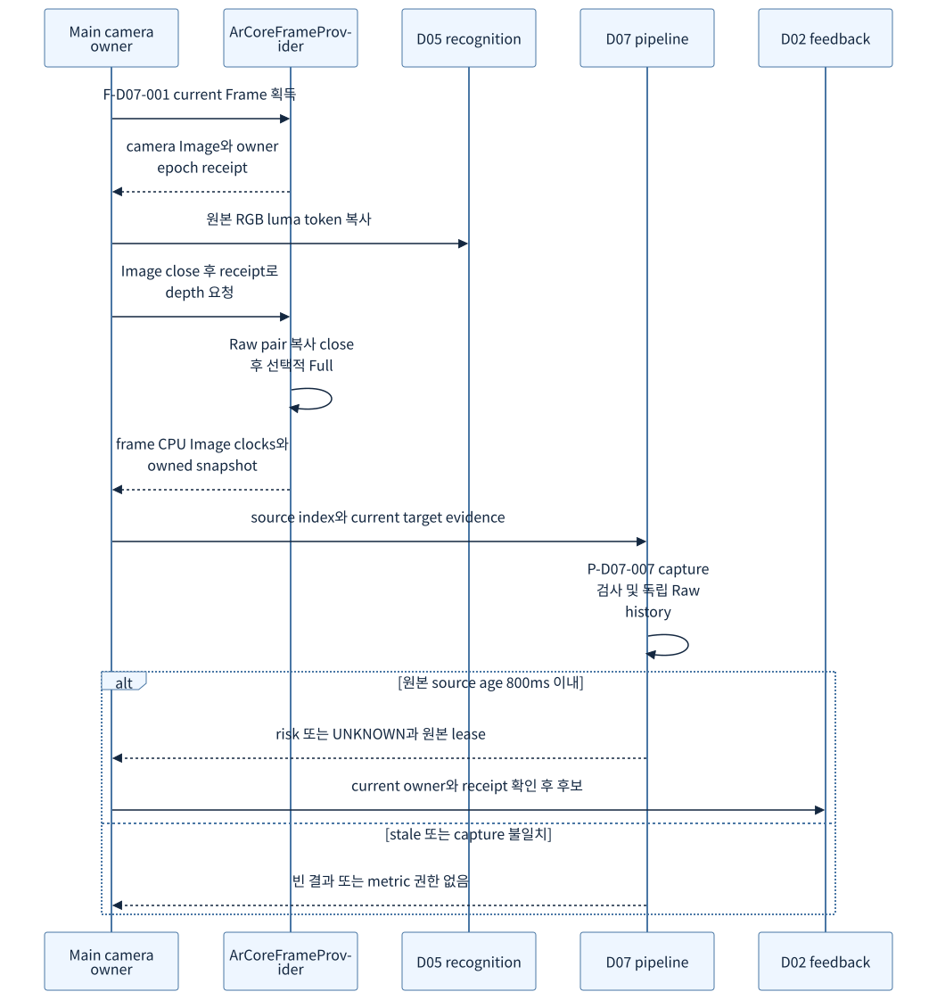

[Mermaid 원본](../diagrams/D07-capture-sequence.mmd) · [SVG](../rendered/D07-capture-sequence.svg)

## F-D07-002 Raw·Full Depth 획득과 실패 진단

| 항목 | 명세 |
| --- | --- |
| 분야 | D07 ARCore 깊이·객체 추적·접근 위험·unknown 깊이·점자블록 및 횡단보도 보조 |
| 목적 | 깊이 자원 소유권과 프레임별 실패 원인을 분리하여 이전 camera 오류가 다음 유효 깊이를 끊지 않게 한다. |
| 사용 주체 | MainActivity acquireDepthSnapshot D05 capture/inference D04 motion/heading D02 feedback |
| 활성 상태 | ACTIVE |
| 진입점 | apps/android/app/src/main/java/kr/co/hanium/dreamup/walksafe/depth/ArCoreFrameProvider.kt:195 acquireDepthSnapshot apps/android/app/src/main/java/kr/co/hanium/dreamup/walksafe/depth/ArCoreFrameProvider.kt:426 DepthAcquisitionFailureCounters apps/android/app/src/main/java/kr/co/hanium/dreamup/walksafe/depth/ArCoreImageConverters.kt:1 toDepthImage16Snapshot apps/android/app/src/main/java/kr/co/hanium/dreamup/walksafe/depth/FullDepthTiming.kt:1 FullDepthTiming |
| 실행 전제 | ACTIVE는 Main 경로 존재를 뜻하며 장치 PASS가 아니다. 현재 session/epoch/generation과 원본 capture 관계가 유효해야 한다. |
| 입력 출처 형식 검증 최신성 | Raw16 mm 및 confidence8 plane stride; Full16; 요청 purpose; capture-local 실패창. |

### 시작 이벤트와 처리 순서

| 이벤트 ID | 발생원 | 이벤트 | 수신부 | 흐름 |
| --- | --- | --- | --- | --- |
| E-D07-002-01 | 상위 소유자가 전달하는 현재 capture/관측 또는 공개 helper 호출 | Raw·Full Depth 획득과 실패 진단 입력 도착 | acquireDepthSnapshot | Raw pair를 획득·검증·복사하고 두 native 자원을 해제한다 → 필요한 Full을 복사·해제하며 실제 세 단계 소요시간을 기록한다 → preflight/실시간 및 camera consumer별 counter를 구분한다 → frame-local 심각도만 runtime gate로 넘긴다 |

1. 1. Raw pair를 획득·검증·복사하고 두 native 자원을 해제한다
2. 2. 필요한 Full을 복사·해제하며 실제 세 단계 소요시간을 기록한다
3. 3. preflight/실시간 및 camera consumer별 counter를 구분한다
4. 4. frame-local 심각도만 runtime gate로 넘긴다

| 분기 조건 | 실제 처리 결과 | 구현 근거 |
| --- | --- | --- |
| Raw timestamp/shape 불일치 | 쌍을 해제하고 Raw 사용 불가 | apps/android/app/src/main/java/kr/co/hanium/dreamup/walksafe/depth/ArCoreFrameProvider.kt:195 acquireDepthSnapshot |
| Full timing clock/observer 실패 | 획득 소유권·기존 예외를 변경하지 않음 | apps/android/app/src/main/java/kr/co/hanium/dreamup/walksafe/depth/ArCoreFrameProvider.kt:426 DepthAcquisitionFailureCounters |
| camera 단계 RESOURCE_EXHAUSTED | counter만 증가; 다음 depth 프레임 fatal 아님 | apps/android/app/src/main/java/kr/co/hanium/dreamup/walksafe/depth/ArCoreImageConverters.kt:1 ArCoreImageConverters |

### 효과 종료와 복구

후속 정책의 메모리 값/후보만 반환한다. 실제 음성·진동은 D02 최종 gate와 actuator가 결정한다.

| 상황 | 동작 |
| --- | --- |
| 정상 완료 | 자격을 만족한 현재 입력의 결과를 반환하고 호출자에게 제어를 돌려준다. |
| 실패 | 원래 변환 오류는 유지하며 close 오류는 suppressed로 붙는다. 획득 실패 사유를 기록한다. |
| 시간 초과 | 원본 capture age와 lease를 검사하며 반복 호출로 만료를 연장하지 않는다. 자체 timeout 작업은 없다. |
| 중복 입력 | 같은 프레임·source·depth identity를 새 관측으로 세지 않는 상위/해당 정책 경계를 따른다. |
| 취소 | 독립 취소 API 없음; 소유 세션·generation·capture 변경 후 결과를 폐기한다. |
| 중단과 생명주기 | 상위 owner 만료/추적 손실은 해당 경로의 상태를 폐기한다. |
| 재시도 | 자체 재시도 없음; 다음 실제 capture가 새 입력이다. |
| 복구 | 현재 frame/source/소유권과 새 실측 증거가 재자격을 만족해야 한다. |
| 자원 정리 | 모든 획득된 native depth/confidence/Full image를 use/close; Raw pair 한쪽 실패도 두 자원 정리. |

### 상태 실행 맥락과 연결

| 항목 | 명세 |
| --- | --- |
| 초기 상태 | S-D07-002-WAITING |
| 상태 목록 | S-D07-002-WAITING S-D07-002-QUALIFYING S-D07-002-ACCEPTED S-D07-002-REJECTED S-D07-002-RETIRED |
| 전이 조건과 전이 동작 | Raw timestamp/shape 불일치 → 쌍을 해제하고 Raw 사용 불가 Full timing clock/observer 실패 → 획득 소유권·기존 예외를 변경하지 않음 camera 단계 RESOURCE_EXHAUSTED → counter만 증가; 다음 depth 프레임 fatal 아님 |
| 허용되지 않는 전이 | 미확인/예측/만료 관측에서 실측·보행 허가로의 승격 금지. 상태 ID는 코드 enum과 일치한다고 별도 명시한 경우 외 문서상의 흐름 상태다. |
| 동시성 순서와 작업 소유권 | 호출 스레드에서 동기 계산한다. 자체 coroutine·타이머·자동 재시도 없음. Main의 frameStateLock 및 세션 소유권 검사 경계를 따른다. |
| 공유 상태와 다른 기능 연결 | D05 원본 frame/source/geometry와 D04 위치·방향 증거를 보존한다. 깊이/track/lease는 D07 소유이고 D02 전달 시 원본 provenance를 보존한다.  |

### 정책 근거와 검증 범위

| 항목 | 근거 |
| --- | --- |
| 정책 | [P-D07-002](#P-D07-002) |
| 구현 | [apps/android/app/src/main/java/kr/co/hanium/dreamup/walksafe/depth/ArCoreFrameProvider.kt:195](/home/ddobagi/Hanium_Dreamup/apps/android/app/src/main/java/kr/co/hanium/dreamup/walksafe/depth/ArCoreFrameProvider.kt:195) · `acquireDepthSnapshot` (범위 195–325) [apps/android/app/src/main/java/kr/co/hanium/dreamup/walksafe/depth/ArCoreFrameProvider.kt:426](/home/ddobagi/Hanium_Dreamup/apps/android/app/src/main/java/kr/co/hanium/dreamup/walksafe/depth/ArCoreFrameProvider.kt:426) · `DepthAcquisitionFailureCounters` (범위 426–811) [apps/android/app/src/main/java/kr/co/hanium/dreamup/walksafe/depth/ArCoreImageConverters.kt:1](/home/ddobagi/Hanium_Dreamup/apps/android/app/src/main/java/kr/co/hanium/dreamup/walksafe/depth/ArCoreImageConverters.kt:1) · `toDepthImage16Snapshot` (범위 1–46) [apps/android/app/src/main/java/kr/co/hanium/dreamup/walksafe/depth/FullDepthTiming.kt:1](/home/ddobagi/Hanium_Dreamup/apps/android/app/src/main/java/kr/co/hanium/dreamup/walksafe/depth/FullDepthTiming.kt:1) · `FullDepthTiming` (범위 1–91) |
| 기존 개선 ID | 개별 동일성 미확인; 분야 연관은 별도 추적표 |
| 기존 분야 | 10 객체 인식·추적 11 깊이·접근 위험 |
| 기존 실행 증거 | 이번에는 정적 코드와 시험 기대만 확인했다. 기존 DONE/시험 로그를 이 snapshot 실행 증거로 이전하지 않는다. |
| 한계 및 구분 | 수치와 경계는 snapshot 코드 기준이다. 실제 성능·안전·장치 지원은 이번 분석으로 검증하지 않았다. |

| 테스트 위치 | 심볼 | 증거 수준 | 기대와 한계 |
| --- | --- | --- | --- |
| [apps/android/app/src/test/java/kr/co/hanium/dreamup/walksafe/depth/DepthAcquisitionFrameLocalFailureTest.kt](/home/ddobagi/Hanium_Dreamup/apps/android/app/src/test/java/kr/co/hanium/dreamup/walksafe/depth/DepthAcquisitionFrameLocalFailureTest.kt) | aDetectorStageExhaustionDoesNotStopTheNextValidDepthFrame | TEST_EXPECTATION | camera resource 오류 후 다음 유효 depth는 출력 허용 기대; 이번 미실행. JVM/SDK double 기대는 Native·기기·현장 증거가 아니다. |

### 이벤트 처리 그림


[Mermaid 원본](../diagrams/D07-F002.mmd) · [SVG](../rendered/D07-F002.svg)

## F-D07-003 깊이 좌표와 원본 관측 시계·age lease

| 항목 | 명세 |
| --- | --- |
| 분야 | D07 ARCore 깊이·객체 추적·접근 위험·unknown 깊이·점자블록 및 횡단보도 보조 |
| 목적 | Frame·CPU Image·elapsed clock의 출처를 보존하고 display/risk/TTC 유효기간을 분리한다. |
| 사용 주체 | MainActivity CoordinateMapper D05 capture/inference D04 motion/heading D02 feedback |
| 활성 상태 | ACTIVE |
| 진입점 | apps/android/app/src/main/java/kr/co/hanium/dreamup/walksafe/depth/CoordinateMapper.kt:1 CoordinateMapper apps/android/app/src/main/java/kr/co/hanium/dreamup/walksafe/depth/DepthGeometry.kt:1 depthPixelToCameraPoint apps/android/app/src/main/java/kr/co/hanium/dreamup/walksafe/depth/DepthFrameSnapshot.kt:1 DepthFrameSnapshot apps/android/app/src/main/java/kr/co/hanium/dreamup/walksafe/depth/DepthCaptureTimes.kt:1 DepthCaptureTimes apps/android/app/src/main/java/kr/co/hanium/dreamup/walksafe/depth/DepthAgeBudget.kt:1 DepthAgeBudget |
| 실행 전제 | ACTIVE는 Main 경로 존재를 뜻하며 장치 PASS가 아니다. 현재 session/epoch/generation과 원본 capture 관계가 유효해야 한다. |
| 입력 출처 형식 검증 최신성 | frame ns, actual CPU ns, depth Image ns, 동결된 mapper와 intrinsics; metric positive finite distance. |

### 시작 이벤트와 처리 순서

| 이벤트 ID | 발생원 | 이벤트 | 수신부 | 흐름 |
| --- | --- | --- | --- | --- |
| E-D07-003-01 | 상위 소유자가 전달하는 현재 capture/관측 또는 공개 helper 호출 | 깊이 좌표와 원본 관측 시계·age lease 입력 도착 | CoordinateMapper | 각 source 원본 Image identity를 검증한다 → 최초 실제 capture 시각을 제한된 ledger에 기록한다 → depth 용도별 age와 reprojection 조건을 적용한다 → 거리 유효 시 ceil(distance/stepLength), 최소1보 계산한다 |

1. 1. 각 source 원본 Image identity를 검증한다
2. 2. 최초 실제 capture 시각을 제한된 ledger에 기록한다
3. 3. depth 용도별 age와 reprojection 조건을 적용한다
4. 4. 거리 유효 시 ceil(distance/stepLength), 최소1보 계산한다

| 분기 조건 | 실제 처리 결과 | 구현 근거 |
| --- | --- | --- |
| 같은 depth Image 재사용 | 기존 observed/lease 유지; 새 motion sample 없음 | apps/android/app/src/main/java/kr/co/hanium/dreamup/walksafe/depth/CoordinateMapper.kt:1 CoordinateMapper |
| 미확인 과거 Image 또는 시각 역행 | 원본 캡처 시각을 재생성하지 않음 | apps/android/app/src/main/java/kr/co/hanium/dreamup/walksafe/depth/DepthGeometry.kt:1 DepthGeometry |
| risk 만료·display 미만료 | 숫자 표시만 가능; 안내에 재사용 금지 | apps/android/app/src/main/java/kr/co/hanium/dreamup/walksafe/depth/DepthFrameSnapshot.kt:1 DepthFrameSnapshot |

### 효과 종료와 복구

후속 정책의 메모리 값/후보만 반환한다. 실제 음성·진동은 D02 최종 gate와 actuator가 결정한다.

| 상황 | 동작 |
| --- | --- |
| 정상 완료 | 자격을 만족한 현재 입력의 결과를 반환하고 호출자에게 제어를 돌려준다. |
| 실패 | 분기별 거절/빈 결과/UNKNOWN; 누락 자료를 합성하지 않는다. |
| 시간 초과 | 원본 capture age와 lease를 검사하며 반복 호출로 만료를 연장하지 않는다. 자체 timeout 작업은 없다. |
| 중복 입력 | 같은 프레임·source·depth identity를 새 관측으로 세지 않는 상위/해당 정책 경계를 따른다. |
| 취소 | 독립 취소 API 없음; 소유 세션·generation·capture 변경 후 결과를 폐기한다. |
| 중단과 생명주기 | 상위 owner 만료/추적 손실은 해당 경로의 상태를 폐기한다. |
| 재시도 | 자체 재시도 없음; 다음 실제 capture가 새 입력이다. |
| 복구 | 현재 frame/source/소유권과 새 실측 증거가 재자격을 만족해야 한다. |
| 자원 정리 | 반환 값은 native Image 소유권을 가지지 않는다. 상태 보유 객체의 reset/폐기는 해당 소유자가 담당한다. |

### 상태 실행 맥락과 연결

| 항목 | 명세 |
| --- | --- |
| 초기 상태 | S-D07-003-WAITING |
| 상태 목록 | S-D07-003-WAITING S-D07-003-QUALIFYING S-D07-003-ACCEPTED S-D07-003-REJECTED S-D07-003-RETIRED |
| 전이 조건과 전이 동작 | 같은 depth Image 재사용 → 기존 observed/lease 유지; 새 motion sample 없음 미확인 과거 Image 또는 시각 역행 → 원본 캡처 시각을 재생성하지 않음 risk 만료·display 미만료 → 숫자 표시만 가능; 안내에 재사용 금지 |
| 허용되지 않는 전이 | 미확인/예측/만료 관측에서 실측·보행 허가로의 승격 금지. 상태 ID는 코드 enum과 일치한다고 별도 명시한 경우 외 문서상의 흐름 상태다. |
| 동시성 순서와 작업 소유권 | 호출 스레드에서 동기 계산한다. 자체 coroutine·타이머·자동 재시도 없음. Main의 frameStateLock 및 세션 소유권 검사 경계를 따른다. |
| 공유 상태와 다른 기능 연결 | D05 원본 frame/source/geometry와 D04 위치·방향 증거를 보존한다. 깊이/track/lease는 D07 소유이고 D02 전달 시 원본 provenance를 보존한다. WEBXR/MONOCULAR/OBJECT_SIZE source enum은 계약에 존재하나 이 Android runtime의 producer 연결은 확인되지 않았다. |

### 정책 근거와 검증 범위

| 항목 | 근거 |
| --- | --- |
| 정책 | [P-D07-003](#P-D07-003) |
| 구현 | [apps/android/app/src/main/java/kr/co/hanium/dreamup/walksafe/depth/CoordinateMapper.kt:1](/home/ddobagi/Hanium_Dreamup/apps/android/app/src/main/java/kr/co/hanium/dreamup/walksafe/depth/CoordinateMapper.kt:1) · `CoordinateMapper` (범위 1–109) [apps/android/app/src/main/java/kr/co/hanium/dreamup/walksafe/depth/DepthGeometry.kt:1](/home/ddobagi/Hanium_Dreamup/apps/android/app/src/main/java/kr/co/hanium/dreamup/walksafe/depth/DepthGeometry.kt:1) · `depthPixelToCameraPoint` (범위 1–72) [apps/android/app/src/main/java/kr/co/hanium/dreamup/walksafe/depth/DepthFrameSnapshot.kt:1](/home/ddobagi/Hanium_Dreamup/apps/android/app/src/main/java/kr/co/hanium/dreamup/walksafe/depth/DepthFrameSnapshot.kt:1) · `DepthFrameSnapshot` (범위 1–103) [apps/android/app/src/main/java/kr/co/hanium/dreamup/walksafe/depth/DepthCaptureTimes.kt:1](/home/ddobagi/Hanium_Dreamup/apps/android/app/src/main/java/kr/co/hanium/dreamup/walksafe/depth/DepthCaptureTimes.kt:1) · `DepthCaptureTimes` (범위 1–69) [apps/android/app/src/main/java/kr/co/hanium/dreamup/walksafe/depth/DepthAgeBudget.kt:1](/home/ddobagi/Hanium_Dreamup/apps/android/app/src/main/java/kr/co/hanium/dreamup/walksafe/depth/DepthAgeBudget.kt:1) · `DepthAgeBudget` (범위 1–38) |
| 기존 개선 ID | 개별 동일성 미확인; 분야 연관은 별도 추적표 |
| 기존 분야 | 10 객체 인식·추적 11 깊이·접근 위험 |
| 기존 실행 증거 | 이번에는 정적 코드와 시험 기대만 확인했다. 기존 DONE/시험 로그를 이 snapshot 실행 증거로 이전하지 않는다. |
| 한계 및 구분 | WEBXR/MONOCULAR/OBJECT_SIZE source enum은 계약에 존재하나 이 Android runtime의 producer 연결은 확인되지 않았다. |

| 테스트 위치 | 심볼 | 증거 수준 | 기대와 한계 |
| --- | --- | --- | --- |
| [apps/android/app/src/test/java/kr/co/hanium/dreamup/walksafe/depth/DepthClockProvenanceRegressionTest.kt](/home/ddobagi/Hanium_Dreamup/apps/android/app/src/test/java/kr/co/hanium/dreamup/walksafe/depth/DepthClockProvenanceRegressionTest.kt) | freshRawUsesItsVerifiedFrameCaptureInsteadOfTheImageClockOrigin | TEST_EXPECTATION | 서로 다른 image/frame 원점을 보존하고 capture+800 lease 부여 기대; 이번 미실행. JVM/SDK double 기대는 Native·기기·현장 증거가 아니다. |

### 이벤트 처리 그림


[Mermaid 원본](../diagrams/D07-F003.mmd) · [SVG](../rendered/D07-F003.svg)

## F-D07-004 객체 polygon ROI와 robust depth sampling

| 항목 | 명세 |
| --- | --- |
| 분야 | D07 ARCore 깊이·객체 추적·접근 위험·unknown 깊이·점자블록 및 횡단보도 보조 |
| 목적 | 객체 밖 배경과 nearer 혼합 층이 대표거리로 바뀌지 않게 한다. |
| 사용 주체 | MainActivity MaskPolygonExtractor D05 capture/inference D04 motion/heading D02 feedback |
| 활성 상태 | ACTIVE |
| 진입점 | apps/android/app/src/main/java/kr/co/hanium/dreamup/walksafe/depth/MaskPolygonExtractor.kt:1 MaskPolygonExtractor apps/android/app/src/main/java/kr/co/hanium/dreamup/walksafe/depth/DepthSampler.kt:1 DepthSampler |
| 실행 전제 | ACTIVE는 Main 경로 존재를 뜻하며 장치 PASS가 아니다. 현재 session/epoch/generation과 원본 capture 관계가 유효해야 한다. |
| 입력 출처 형식 검증 최신성 | 원본 bbox/polygon·upright quarter-turn0..3, Raw/Full depth와 mapper. |

### 시작 이벤트와 처리 순서

| 이벤트 ID | 발생원 | 이벤트 | 수신부 | 흐름 |
| --- | --- | --- | --- | --- |
| E-D07-004-01 | 상위 소유자가 전달하는 현재 capture/관측 또는 공개 helper 호출 | 객체 polygon ROI와 robust depth sampling 입력 도착 | MaskPolygonExtractor | sensor plane geometry를 추출한다 → 원본 polygon 내부만 bounded grid sampling한다 → 전경 혼합 검사와 MAD 필터를 수행한다 → 통계·거절 사유·공간 분포를 함께 반환한다 |

1. 1. sensor plane geometry를 추출한다
2. 2. 원본 polygon 내부만 bounded grid sampling한다
3. 3. 전경 혼합 검사와 MAD 필터를 수행한다
4. 4. 통계·거절 사유·공간 분포를 함께 반환한다

| 분기 조건 | 실제 처리 결과 | 구현 근거 |
| --- | --- | --- |
| 실제 mask 없음 | bbox fallback 표시; mask 존재로 승격하지 않음 | apps/android/app/src/main/java/kr/co/hanium/dreamup/walksafe/depth/MaskPolygonExtractor.kt:1 MaskPolygonExtractor |
| near 혼합층 존재 | foregroundAmbiguous; Full로 덮어 안전한 거리 생성 금지 | apps/android/app/src/main/java/kr/co/hanium/dreamup/walksafe/depth/DepthSampler.kt:1 DepthSampler |
| 표본수/분포 부족 | metric 부족 또는 제한적 근접 증거로 후속 전달 | apps/android/app/src/main/java/kr/co/hanium/dreamup/walksafe/depth/DepthSampler.kt:1 DepthSampler |

### 효과 종료와 복구

후속 정책의 메모리 값/후보만 반환한다. 실제 음성·진동은 D02 최종 gate와 actuator가 결정한다.

| 상황 | 동작 |
| --- | --- |
| 정상 완료 | 자격을 만족한 현재 입력의 결과를 반환하고 호출자에게 제어를 돌려준다. |
| 실패 | 분기별 거절/빈 결과/UNKNOWN; 누락 자료를 합성하지 않는다. |
| 시간 초과 | 원본 capture age와 lease를 검사하며 반복 호출로 만료를 연장하지 않는다. 자체 timeout 작업은 없다. |
| 중복 입력 | 같은 프레임·source·depth identity를 새 관측으로 세지 않는 상위/해당 정책 경계를 따른다. |
| 취소 | 독립 취소 API 없음; 소유 세션·generation·capture 변경 후 결과를 폐기한다. |
| 중단과 생명주기 | 상위 owner 만료/추적 손실은 해당 경로의 상태를 폐기한다. |
| 재시도 | 자체 재시도 없음; 다음 실제 capture가 새 입력이다. |
| 복구 | 현재 frame/source/소유권과 새 실측 증거가 재자격을 만족해야 한다. |
| 자원 정리 | 반환 값은 native Image 소유권을 가지지 않는다. 상태 보유 객체의 reset/폐기는 해당 소유자가 담당한다. |

### 상태 실행 맥락과 연결

| 항목 | 명세 |
| --- | --- |
| 초기 상태 | S-D07-004-WAITING |
| 상태 목록 | S-D07-004-WAITING S-D07-004-QUALIFYING S-D07-004-ACCEPTED S-D07-004-REJECTED S-D07-004-RETIRED |
| 전이 조건과 전이 동작 | 실제 mask 없음 → bbox fallback 표시; mask 존재로 승격하지 않음 near 혼합층 존재 → foregroundAmbiguous; Full로 덮어 안전한 거리 생성 금지 표본수/분포 부족 → metric 부족 또는 제한적 근접 증거로 후속 전달 |
| 허용되지 않는 전이 | 미확인/예측/만료 관측에서 실측·보행 허가로의 승격 금지. 상태 ID는 코드 enum과 일치한다고 별도 명시한 경우 외 문서상의 흐름 상태다. |
| 동시성 순서와 작업 소유권 | 호출 스레드에서 동기 계산한다. 자체 coroutine·타이머·자동 재시도 없음. Main의 frameStateLock 및 세션 소유권 검사 경계를 따른다. |
| 공유 상태와 다른 기능 연결 | D05 원본 frame/source/geometry와 D04 위치·방향 증거를 보존한다. 깊이/track/lease는 D07 소유이고 D02 전달 시 원본 provenance를 보존한다.  |

### 정책 근거와 검증 범위

| 항목 | 근거 |
| --- | --- |
| 정책 | [P-D07-004](#P-D07-004) |
| 구현 | [apps/android/app/src/main/java/kr/co/hanium/dreamup/walksafe/depth/MaskPolygonExtractor.kt:1](/home/ddobagi/Hanium_Dreamup/apps/android/app/src/main/java/kr/co/hanium/dreamup/walksafe/depth/MaskPolygonExtractor.kt:1) · `MaskPolygonExtractor` (범위 1–137) [apps/android/app/src/main/java/kr/co/hanium/dreamup/walksafe/depth/DepthSampler.kt:1](/home/ddobagi/Hanium_Dreamup/apps/android/app/src/main/java/kr/co/hanium/dreamup/walksafe/depth/DepthSampler.kt:1) · `DepthSampler` (범위 1–441) |
| 기존 개선 ID | 개별 동일성 미확인; 분야 연관은 별도 추적표 |
| 기존 분야 | 10 객체 인식·추적 11 깊이·접근 위험 |
| 기존 실행 증거 | 이번에는 정적 코드와 시험 기대만 확인했다. 기존 DONE/시험 로그를 이 snapshot 실행 증거로 이전하지 않는다. |
| 한계 및 구분 | 수치와 경계는 snapshot 코드 기준이다. 실제 성능·안전·장치 지원은 이번 분석으로 검증하지 않았다. |

| 테스트 위치 | 심볼 | 증거 수준 | 기대와 한계 |
| --- | --- | --- | --- |
| [apps/android/app/src/test/java/kr/co/hanium/dreamup/walksafe/depth/DepthSamplerPolygonContainmentTest.kt](/home/ddobagi/Hanium_Dreamup/apps/android/app/src/test/java/kr/co/hanium/dreamup/walksafe/depth/DepthSamplerPolygonContainmentTest.kt) | concavePolygonNeverAcceptsDepthFromOutsideItsOriginalExtent | TEST_EXPECTATION | 오목 mask 밖 depth가 erosion ROI에 들어오지 않는 기대; 이번 미실행. JVM/SDK double 기대는 Native·기기·현장 증거가 아니다. |

### 이벤트 처리 그림


[Mermaid 원본](../diagrams/D07-F004.mmd) · [SVG](../rendered/D07-F004.svg)

## F-D07-005 객체 거리·confidence·Full fallback 및 pseudo trend

| 항목 | 명세 |
| --- | --- |
| 분야 | D07 ARCore 깊이·객체 추적·접근 위험·unknown 깊이·점자블록 및 횡단보도 보조 |
| 목적 | 정량거리와 제한된 근접 경고, 비정량 추세를 서로 다른 증거로 반환한다. |
| 사용 주체 | MainActivity DepthEstimator D05 capture/inference D04 motion/heading D02 feedback |
| 활성 상태 | ACTIVE |
| 진입점 | apps/android/app/src/main/java/kr/co/hanium/dreamup/walksafe/depth/DepthEstimator.kt:1 DepthEstimator apps/android/app/src/main/java/kr/co/hanium/dreamup/walksafe/depth/DepthContracts.kt:1 TrackedObjectDepth apps/android/app/src/main/java/kr/co/hanium/dreamup/walksafe/depth/MessagePolicy.kt:1 MessagePolicy |
| 실행 전제 | ACTIVE는 Main 경로 존재를 뜻하며 장치 PASS가 아니다. 현재 session/epoch/generation과 원본 capture 관계가 유효해야 한다. |
| 입력 출처 형식 검증 최신성 | ROI robust stats, track 안정도, pose/motion/freshness, source raw/full, original capture clocks. |

### 시작 이벤트와 처리 순서

| 이벤트 ID | 발생원 | 이벤트 | 수신부 | 흐름 |
| --- | --- | --- | --- | --- |
| E-D07-005-01 | 상위 소유자가 전달하는 현재 capture/관측 또는 공개 helper 호출 | 객체 거리·confidence·Full fallback 및 pseudo trend 입력 도착 | DepthEstimator | Raw 후보를 만들고 hard veto를 적용한다 → 필요한 Full 후보와 원본 age를 비교한다 → 거리 종류·신뢰도 breakdown 및 limited flag를 보존한다 → metric 불가 시 pseudo 접근 caution 또는 침묵을 선택한다 |

1. 1. Raw 후보를 만들고 hard veto를 적용한다
2. 2. 필요한 Full 후보와 원본 age를 비교한다
3. 3. 거리 종류·신뢰도 breakdown 및 limited flag를 보존한다
4. 4. metric 불가 시 pseudo 접근 caution 또는 침묵을 선택한다

| 분기 조건 | 실제 처리 결과 | 구현 근거 |
| --- | --- | --- |
| Raw foreground ambiguity | Full 사용 불가; metric 없음 | apps/android/app/src/main/java/kr/co/hanium/dreamup/walksafe/depth/DepthEstimator.kt:1 DepthEstimator |
| 부분 coverage이며 가까운 일반 장애물 | WARNING 상한; TTC/report 없음 | apps/android/app/src/main/java/kr/co/hanium/dreamup/walksafe/depth/DepthContracts.kt:1 DepthContracts |
| metric 실패하지만 visual approach 조건 만족 | 숫자·보수 없는 CAUTION | apps/android/app/src/main/java/kr/co/hanium/dreamup/walksafe/depth/MessagePolicy.kt:1 MessagePolicy |

### 효과 종료와 복구

후속 정책의 메모리 값/후보만 반환한다. 실제 음성·진동은 D02 최종 gate와 actuator가 결정한다.

| 상황 | 동작 |
| --- | --- |
| 정상 완료 | 자격을 만족한 현재 입력의 결과를 반환하고 호출자에게 제어를 돌려준다. |
| 실패 | 분기별 거절/빈 결과/UNKNOWN; 누락 자료를 합성하지 않는다. |
| 시간 초과 | 원본 capture age와 lease를 검사하며 반복 호출로 만료를 연장하지 않는다. 자체 timeout 작업은 없다. |
| 중복 입력 | 같은 프레임·source·depth identity를 새 관측으로 세지 않는 상위/해당 정책 경계를 따른다. |
| 취소 | 독립 취소 API 없음; 소유 세션·generation·capture 변경 후 결과를 폐기한다. |
| 중단과 생명주기 | 상위 owner 만료/추적 손실은 해당 경로의 상태를 폐기한다. |
| 재시도 | 자체 재시도 없음; 다음 실제 capture가 새 입력이다. |
| 복구 | 현재 frame/source/소유권과 새 실측 증거가 재자격을 만족해야 한다. |
| 자원 정리 | 반환 값은 native Image 소유권을 가지지 않는다. 상태 보유 객체의 reset/폐기는 해당 소유자가 담당한다. |

### 상태 실행 맥락과 연결

| 항목 | 명세 |
| --- | --- |
| 초기 상태 | S-D07-005-WAITING |
| 상태 목록 | S-D07-005-WAITING S-D07-005-QUALIFYING S-D07-005-ACCEPTED S-D07-005-REJECTED S-D07-005-RETIRED |
| 전이 조건과 전이 동작 | Raw foreground ambiguity → Full 사용 불가; metric 없음 부분 coverage이며 가까운 일반 장애물 → WARNING 상한; TTC/report 없음 metric 실패하지만 visual approach 조건 만족 → 숫자·보수 없는 CAUTION |
| 허용되지 않는 전이 | 미확인/예측/만료 관측에서 실측·보행 허가로의 승격 금지. 상태 ID는 코드 enum과 일치한다고 별도 명시한 경우 외 문서상의 흐름 상태다. |
| 동시성 순서와 작업 소유권 | 호출 스레드에서 동기 계산한다. 자체 coroutine·타이머·자동 재시도 없음. Main의 frameStateLock 및 세션 소유권 검사 경계를 따른다. |
| 공유 상태와 다른 기능 연결 | D05 원본 frame/source/geometry와 D04 위치·방향 증거를 보존한다. 깊이/track/lease는 D07 소유이고 D02 전달 시 원본 provenance를 보존한다.  |

### 정책 근거와 검증 범위

| 항목 | 근거 |
| --- | --- |
| 정책 | [P-D07-005](#P-D07-005) [P-D07-033](#P-D07-033) [P-D07-034](#P-D07-034) |
| 구현 | [apps/android/app/src/main/java/kr/co/hanium/dreamup/walksafe/depth/DepthEstimator.kt:1](/home/ddobagi/Hanium_Dreamup/apps/android/app/src/main/java/kr/co/hanium/dreamup/walksafe/depth/DepthEstimator.kt:1) · `DepthEstimator` (범위 1–668) [apps/android/app/src/main/java/kr/co/hanium/dreamup/walksafe/depth/DepthContracts.kt:1](/home/ddobagi/Hanium_Dreamup/apps/android/app/src/main/java/kr/co/hanium/dreamup/walksafe/depth/DepthContracts.kt:1) · `TrackedObjectDepth` (범위 1–330) [apps/android/app/src/main/java/kr/co/hanium/dreamup/walksafe/depth/MessagePolicy.kt:1](/home/ddobagi/Hanium_Dreamup/apps/android/app/src/main/java/kr/co/hanium/dreamup/walksafe/depth/MessagePolicy.kt:1) · `MessagePolicy` (범위 1–400) |
| 기존 개선 ID | 개별 동일성 미확인; 분야 연관은 별도 추적표 |
| 기존 분야 | 10 객체 인식·추적 11 깊이·접근 위험 |
| 기존 실행 증거 | 이번에는 정적 코드와 시험 기대만 확인했다. 기존 DONE/시험 로그를 이 snapshot 실행 증거로 이전하지 않는다. |
| 한계 및 구분 | 수치와 경계는 snapshot 코드 기준이다. 실제 성능·안전·장치 지원은 이번 분석으로 검증하지 않았다. groundDistanceM은 ObjectDepthInput의 optional 입력이며 기본null이다. 현재 ObjectDepthRuntimePipeline/unknown/Main 호출에는 공급 assignment가 없다. 실제 gravity-horizontal range·unknown plane 관측과 별도이며 지면거리 producer가 활성이라고 볼 수 없다. |

| 테스트 위치 | 심볼 | 증거 수준 | 기대와 한계 |
| --- | --- | --- | --- |
| [apps/android/app/src/test/java/kr/co/hanium/dreamup/walksafe/depth/DepthEstimatorSpatialCoverageTest.kt](/home/ddobagi/Hanium_Dreamup/apps/android/app/src/test/java/kr/co/hanium/dreamup/walksafe/depth/DepthEstimatorSpatialCoverageTest.kt) | sameCountAndRatioKeepMetricWhenSpreadButAreDemotedWhenCrowdedIntoOneSide | TEST_EXPECTATION | 같은 수·비율이라도 한쪽 편중 depth는 metric으로 유지하지 않는 기대; 이번 미실행. JVM/SDK double 기대는 Native·기기·현장 증거가 아니다. |

### 이벤트 처리 그림


[Mermaid 원본](../diagrams/D07-F005.mmd) · [SVG](../rendered/D07-F005.svg)

## F-D07-006 검출 객체 identity·mask association와 거리 연속성

| 항목 | 명세 |
| --- | --- |
| 분야 | D07 ARCore 깊이·객체 추적·접근 위험·unknown 깊이·점자블록 및 횡단보도 보조 |
| 목적 | ID 교환·재검출·깊이 점프가 가짜 접근 속도나 TTC를 만들지 않게 한다. |
| 사용 주체 | MainActivity ObjectTracker D05 capture/inference D04 motion/heading D02 feedback |
| 활성 상태 | ACTIVE |
| 진입점 | apps/android/app/src/main/java/kr/co/hanium/dreamup/walksafe/depth/ObjectTracker.kt:1 ObjectTracker apps/android/app/src/main/java/kr/co/hanium/dreamup/walksafe/depth/MaskAssociationEvidence.kt:1 MaskAssociationEvidence apps/android/app/src/main/java/kr/co/hanium/dreamup/walksafe/depth/MetricDistanceContinuityPolicy.kt:1 MetricDistanceContinuityPolicy |
| 실행 전제 | ACTIVE는 Main 경로 존재를 뜻하며 장치 PASS가 아니다. 현재 session/epoch/generation과 원본 capture 관계가 유효해야 한다. |
| 입력 출처 형식 검증 최신성 | 검출별 source index, class geometry, actual binary mask, material-point identity, source clocks, metric candidate. |

### 시작 이벤트와 처리 순서

| 이벤트 ID | 발생원 | 이벤트 | 수신부 | 흐름 |
| --- | --- | --- | --- | --- |
| E-D07-006-01 | 상위 소유자가 전달하는 현재 capture/관측 또는 공개 helper 호출 | 검출 객체 identity·mask association와 거리 연속성 입력 도착 | ObjectTracker | 후보 간 기하/실제 mask correspondence를 평가한다 → 모호·교차·소실은 identity 추측을 금지한다 → 새 detector 관측과 metric 독립 sample을 별도 기록한다 → distance jump는 보류 후 새 독립 series로 회복한다 |

1. 1. 후보 간 기하/실제 mask correspondence를 평가한다
2. 2. 모호·교차·소실은 identity 추측을 금지한다
3. 3. 새 detector 관측과 metric 독립 sample을 별도 기록한다
4. 4. distance jump는 보류 후 새 독립 series로 회복한다

| 분기 조건 | 실제 처리 결과 | 구현 근거 |
| --- | --- | --- |
| 유일한 correspondence 확보 | 기존 track 유지 | apps/android/app/src/main/java/kr/co/hanium/dreamup/walksafe/depth/ObjectTracker.kt:1 ObjectTracker |
| mask crossing/누락 후 복귀 | NEW id 및 비어있는 motion history | apps/android/app/src/main/java/kr/co/hanium/dreamup/walksafe/depth/MaskAssociationEvidence.kt:1 MaskAssociationEvidence |
| 거리 jump 불연속 | 기존 TTC 폐기; pending 확인 전 후보 거리 사용 제한 | apps/android/app/src/main/java/kr/co/hanium/dreamup/walksafe/depth/MetricDistanceContinuityPolicy.kt:1 MetricDistanceContinuityPolicy |

### 효과 종료와 복구

후속 정책의 메모리 값/후보만 반환한다. 실제 음성·진동은 D02 최종 gate와 actuator가 결정한다.

| 상황 | 동작 |
| --- | --- |
| 정상 완료 | 자격을 만족한 현재 입력의 결과를 반환하고 호출자에게 제어를 돌려준다. |
| 실패 | 분기별 거절/빈 결과/UNKNOWN; 누락 자료를 합성하지 않는다. |
| 시간 초과 | 원본 capture age와 lease를 검사하며 반복 호출로 만료를 연장하지 않는다. 자체 timeout 작업은 없다. |
| 중복 입력 | 같은 프레임·source·depth identity를 새 관측으로 세지 않는 상위/해당 정책 경계를 따른다. |
| 취소 | 독립 취소 API 없음; 소유 세션·generation·capture 변경 후 결과를 폐기한다. |
| 중단과 생명주기 | 상위 owner 만료/추적 손실은 해당 경로의 상태를 폐기한다. |
| 재시도 | 자체 재시도 없음; 다음 실제 capture가 새 입력이다. |
| 복구 | 현재 frame/source/소유권과 새 실측 증거가 재자격을 만족해야 한다. |
| 자원 정리 | 반환 값은 native Image 소유권을 가지지 않는다. 상태 보유 객체의 reset/폐기는 해당 소유자가 담당한다. |

### 상태 실행 맥락과 연결

| 항목 | 명세 |
| --- | --- |
| 초기 상태 | S-D07-006-WAITING |
| 상태 목록 | S-D07-006-WAITING S-D07-006-QUALIFYING S-D07-006-ACCEPTED S-D07-006-REJECTED S-D07-006-RETIRED |
| 전이 조건과 전이 동작 | 유일한 correspondence 확보 → 기존 track 유지 mask crossing/누락 후 복귀 → NEW id 및 비어있는 motion history 거리 jump 불연속 → 기존 TTC 폐기; pending 확인 전 후보 거리 사용 제한 |
| 허용되지 않는 전이 | 미확인/예측/만료 관측에서 실측·보행 허가로의 승격 금지. 상태 ID는 코드 enum과 일치한다고 별도 명시한 경우 외 문서상의 흐름 상태다. |
| 동시성 순서와 작업 소유권 | 호출 스레드에서 동기 계산한다. 자체 coroutine·타이머·자동 재시도 없음. Main의 frameStateLock 및 세션 소유권 검사 경계를 따른다. |
| 공유 상태와 다른 기능 연결 | D05 원본 frame/source/geometry와 D04 위치·방향 증거를 보존한다. 깊이/track/lease는 D07 소유이고 D02 전달 시 원본 provenance를 보존한다.  |

### 정책 근거와 검증 범위

| 항목 | 근거 |
| --- | --- |
| 정책 | [P-D07-006](#P-D07-006) |
| 구현 | [apps/android/app/src/main/java/kr/co/hanium/dreamup/walksafe/depth/ObjectTracker.kt:1](/home/ddobagi/Hanium_Dreamup/apps/android/app/src/main/java/kr/co/hanium/dreamup/walksafe/depth/ObjectTracker.kt:1) · `ObjectTracker` (범위 1–1153) [apps/android/app/src/main/java/kr/co/hanium/dreamup/walksafe/depth/MaskAssociationEvidence.kt:1](/home/ddobagi/Hanium_Dreamup/apps/android/app/src/main/java/kr/co/hanium/dreamup/walksafe/depth/MaskAssociationEvidence.kt:1) · `MaskAssociationEvidence` (범위 1–192) [apps/android/app/src/main/java/kr/co/hanium/dreamup/walksafe/depth/MetricDistanceContinuityPolicy.kt:1](/home/ddobagi/Hanium_Dreamup/apps/android/app/src/main/java/kr/co/hanium/dreamup/walksafe/depth/MetricDistanceContinuityPolicy.kt:1) · `MetricDistanceContinuityPolicy` (범위 1–155) |
| 기존 개선 ID | 개별 동일성 미확인; 분야 연관은 별도 추적표 |
| 기존 분야 | 10 객체 인식·추적 11 깊이·접근 위험 |
| 기존 실행 증거 | 이번에는 정적 코드와 시험 기대만 확인했다. 기존 DONE/시험 로그를 이 snapshot 실행 증거로 이전하지 않는다. |
| 한계 및 구분 | 수치와 경계는 snapshot 코드 기준이다. 실제 성능·안전·장치 지원은 이번 분석으로 검증하지 않았다. |

| 테스트 위치 | 심볼 | 증거 수준 | 기대와 한계 |
| --- | --- | --- | --- |
| [apps/android/app/src/test/java/kr/co/hanium/dreamup/walksafe/depth/ObjectTrackerMaskAssociationTest.kt](/home/ddobagi/Hanium_Dreamup/apps/android/app/src/test/java/kr/co/hanium/dreamup/walksafe/depth/ObjectTrackerMaskAssociationTest.kt) | ambiguousCrossingKeepsOldHistoryButPublishesNoGuessedIdentityOrMotion | TEST_EXPECTATION | 교차 모호 시 guessed identity/motion 없음, 회복은 새 id 기대; 이번 미실행. JVM/SDK double 기대는 Native·기기·현장 증거가 아니다. |

### 이벤트 처리 그림


[Mermaid 원본](../diagrams/D07-F006.mmd) · [SVG](../rendered/D07-F006.svg)

## F-D07-007 현재 LK 프레임과 detector source의 깊이 합성

| 항목 | 명세 |
| --- | --- |
| 분야 | D07 ARCore 깊이·객체 추적·접근 위험·unknown 깊이·점자블록 및 횡단보도 보조 |
| 목적 | 새 detector count를 부풀리지 않고 현재 시각의 이동 geometry와 원본 source 유효기간을 함께 유지한다. |
| 사용 주체 | MainActivity CurrentTrackedFrameObservation D05 capture/inference D04 motion/heading D02 feedback |
| 활성 상태 | ACTIVE |
| 진입점 | apps/android/app/src/main/java/kr/co/hanium/dreamup/walksafe/depth/CurrentTrackedFrameObservation.kt:1 CurrentTrackedFrameObservation apps/android/app/src/main/java/kr/co/hanium/dreamup/walksafe/depth/ObjectDepthRuntimePipeline.kt:1 ObjectDepthRuntimePipeline apps/android/app/src/main/java/kr/co/hanium/dreamup/walksafe/navigation/CurrentTrackedFrameEvidence.kt:1 CurrentTrackedFrameEvidence apps/android/app/src/main/java/kr/co/hanium/dreamup/walksafe/MainActivity.kt:14400 processTracked |
| 실행 전제 | ACTIVE는 Main 경로 존재를 뜻하며 장치 PASS가 아니다. 현재 session/epoch/generation과 원본 capture 관계가 유효해야 한다. |
| 입력 출처 형식 검증 최신성 | D05 VisualTrackingResult, 완료 DetectionSnapshot, source/target VisualFrameKey, 현재 DepthSnapshot·mapper·Tactile context. |

### 시작 이벤트와 처리 순서

| 이벤트 ID | 발생원 | 이벤트 | 수신부 | 흐름 |
| --- | --- | --- | --- | --- |
| E-D07-007-01 | 상위 소유자가 전달하는 현재 capture/관측 또는 공개 helper 호출 | 현재 LK 프레임과 detector source의 깊이 합성 입력 도착 | CurrentTrackedFrameObservation | 완료 source와 current evidence의 전체 capture identity를 검증한다 → TRACKED/LOST 및 budget row를 tracker로 전달한다 → 독립 Raw depth만 motion sample로 평가한다 → sourceObserved/sourceMaxAge/validUntil을 원본 source로 고정해 반환한다 |

1. 1. 완료 source와 current evidence의 전체 capture identity를 검증한다
2. 2. TRACKED/LOST 및 budget row를 tracker로 전달한다
3. 3. 독립 Raw depth만 motion sample로 평가한다
4. 4. sourceObserved/sourceMaxAge/validUntil을 원본 source로 고정해 반환한다

| 분기 조건 | 실제 처리 결과 | 구현 근거 |
| --- | --- | --- |
| target/depth/camera/mapper/pose 불일치 | 빈 결과 | apps/android/app/src/main/java/kr/co/hanium/dreamup/walksafe/depth/CurrentTrackedFrameObservation.kt:1 CurrentTrackedFrameObservation |
| 동일 capture replay | cached output; 관측 count 증가 없음 | apps/android/app/src/main/java/kr/co/hanium/dreamup/walksafe/depth/ObjectDepthRuntimePipeline.kt:1 ObjectDepthRuntimePipeline |
| object budget defer 또는 LOST | 해당 metric/motion/gap 폐기; source count 구분 | apps/android/app/src/main/java/kr/co/hanium/dreamup/walksafe/navigation/CurrentTrackedFrameEvidence.kt:1 CurrentTrackedFrameEvidence |

### 효과 종료와 복구

후속 정책의 메모리 값/후보만 반환한다. 실제 음성·진동은 D02 최종 gate와 actuator가 결정한다.

| 상황 | 동작 |
| --- | --- |
| 정상 완료 | 자격을 만족한 현재 입력의 결과를 반환하고 호출자에게 제어를 돌려준다. |
| 실패 | 분기별 거절/빈 결과/UNKNOWN; 누락 자료를 합성하지 않는다. |
| 시간 초과 | 원본 capture age와 lease를 검사하며 반복 호출로 만료를 연장하지 않는다. 자체 timeout 작업은 없다. |
| 중복 입력 | 같은 프레임·source·depth identity를 새 관측으로 세지 않는 상위/해당 정책 경계를 따른다. |
| 취소 | 독립 취소 API 없음; 소유 세션·generation·capture 변경 후 결과를 폐기한다. |
| 중단과 생명주기 | 상위 owner 만료/추적 손실은 해당 경로의 상태를 폐기한다. |
| 재시도 | 자체 재시도 없음; 다음 실제 capture가 새 입력이다. |
| 복구 | 현재 frame/source/소유권과 새 실측 증거가 재자격을 만족해야 한다. |
| 자원 정리 | 반환 값은 native Image 소유권을 가지지 않는다. 상태 보유 객체의 reset/폐기는 해당 소유자가 담당한다. |

### 상태 실행 맥락과 연결

| 항목 | 명세 |
| --- | --- |
| 초기 상태 | S-D07-007-WAITING |
| 상태 목록 | S-D07-007-WAITING S-D07-007-QUALIFYING S-D07-007-ACCEPTED S-D07-007-REJECTED S-D07-007-RETIRED |
| 전이 조건과 전이 동작 | target/depth/camera/mapper/pose 불일치 → 빈 결과 동일 capture replay → cached output; 관측 count 증가 없음 object budget defer 또는 LOST → 해당 metric/motion/gap 폐기; source count 구분 |
| 허용되지 않는 전이 | 미확인/예측/만료 관측에서 실측·보행 허가로의 승격 금지. 상태 ID는 코드 enum과 일치한다고 별도 명시한 경우 외 문서상의 흐름 상태다. |
| 동시성 순서와 작업 소유권 | Main render/worker 경계의 generation·walkEpoch·AR session lease를 재검사하고 frameStateLock 안에서 pipeline 상태를 변경한다. LK 자체 수행·history/budget은 D05 담당. |
| 공유 상태와 다른 기능 연결 | D05 원본 frame/source/geometry와 D04 위치·방향 증거를 보존한다. 깊이/track/lease는 D07 소유이고 D02 전달 시 원본 provenance를 보존한다.  |

### 정책 근거와 검증 범위

| 항목 | 근거 |
| --- | --- |
| 정책 | [P-D07-007](#P-D07-007) |
| 구현 | [apps/android/app/src/main/java/kr/co/hanium/dreamup/walksafe/depth/CurrentTrackedFrameObservation.kt:1](/home/ddobagi/Hanium_Dreamup/apps/android/app/src/main/java/kr/co/hanium/dreamup/walksafe/depth/CurrentTrackedFrameObservation.kt:1) · `CurrentTrackedFrameObservation` (범위 1–321) [apps/android/app/src/main/java/kr/co/hanium/dreamup/walksafe/depth/ObjectDepthRuntimePipeline.kt:1](/home/ddobagi/Hanium_Dreamup/apps/android/app/src/main/java/kr/co/hanium/dreamup/walksafe/depth/ObjectDepthRuntimePipeline.kt:1) · `ObjectDepthRuntimePipeline` (범위 1–401) [apps/android/app/src/main/java/kr/co/hanium/dreamup/walksafe/navigation/CurrentTrackedFrameEvidence.kt:1](/home/ddobagi/Hanium_Dreamup/apps/android/app/src/main/java/kr/co/hanium/dreamup/walksafe/navigation/CurrentTrackedFrameEvidence.kt:1) · `CurrentTrackedFrameEvidence` (범위 1–54) [apps/android/app/src/main/java/kr/co/hanium/dreamup/walksafe/MainActivity.kt:14400](/home/ddobagi/Hanium_Dreamup/apps/android/app/src/main/java/kr/co/hanium/dreamup/walksafe/MainActivity.kt:14400) · `processTracked` (범위 14400–14580) |
| 기존 개선 ID | 개별 동일성 미확인; 분야 연관은 별도 추적표 |
| 기존 분야 | 10 객체 인식·추적 11 깊이·접근 위험 |
| 기존 실행 증거 | 이번에는 정적 코드와 시험 기대만 확인했다. 기존 DONE/시험 로그를 이 snapshot 실행 증거로 이전하지 않는다. |
| 한계 및 구분 | 수치와 경계는 snapshot 코드 기준이다. 실제 성능·안전·장치 지원은 이번 분석으로 검증하지 않았다. |

| 테스트 위치 | 심볼 | 증거 수준 | 기대와 한계 |
| --- | --- | --- | --- |
| [apps/android/app/src/test/java/kr/co/hanium/dreamup/walksafe/depth/TrackedObjectDepthRuntimePipelineTest.kt](/home/ddobagi/Hanium_Dreamup/apps/android/app/src/test/java/kr/co/hanium/dreamup/walksafe/depth/TrackedObjectDepthRuntimePipelineTest.kt) | feedbackProvenanceKeepsTheOriginalCaptureClockThroughCurrentVisualFrames | TEST_EXPECTATION | current visual frame가 바뀌어도 source capture+800 lease 유지 기대; 이번 미실행. JVM/SDK double 기대는 Native·기기·현장 증거가 아니다. |

### 이벤트 처리 그림


[Mermaid 원본](../diagrams/D07-F007.mmd) · [SVG](../rendered/D07-F007.svg)

## F-D07-008 독립 depth 접근 속도·접근 시간·point CPA

| 항목 | 명세 |
| --- | --- |
| 분야 | D07 ARCore 깊이·객체 추적·접근 위험·unknown 깊이·점자블록 및 횡단보도 보조 |
| 목적 | 축방향 접근 urgency와 실제 한 점의 3D 상대운동을 분리해 불확실한 충돌 주장을 피한다. |
| 사용 주체 | MainActivity MotionObservationWindow D05 capture/inference D04 motion/heading D02 feedback |
| 활성 상태 | ACTIVE |
| 진입점 | apps/android/app/src/main/java/kr/co/hanium/dreamup/walksafe/depth/MotionObservationWindow.kt:1 MotionObservationWindow apps/android/app/src/main/java/kr/co/hanium/dreamup/walksafe/depth/ObjectTracker.kt:780 approachKinematics apps/android/app/src/main/java/kr/co/hanium/dreamup/walksafe/depth/TrackerRiskPolicy.kt:1 ObjectMotionPolicy apps/android/app/src/main/java/kr/co/hanium/dreamup/walksafe/depth/MotionContext.kt:1 MotionContext apps/android/app/src/main/java/kr/co/hanium/dreamup/walksafe/depth/DepthContracts.kt:1 TrackedObjectDepth |
| 실행 전제 | ACTIVE는 Main 경로 존재를 뜻하며 장치 PASS가 아니다. 현재 session/epoch/generation과 원본 capture 관계가 유효해야 한다. |
| 입력 출처 형식 검증 최신성 | 독립 Raw 실측 sample와 pose, 원본 materialPointId, 동일 capture clocks; GNSS course를 AR camera motion으로 대체하지 않는다. |

### 시작 이벤트와 처리 순서

| 이벤트 ID | 발생원 | 이벤트 | 수신부 | 흐름 |
| --- | --- | --- | --- | --- |
| E-D07-008-01 | 상위 소유자가 전달하는 현재 capture/관측 또는 공개 helper 호출 | 독립 depth 접근 속도·접근 시간·point CPA 입력 도착 | MotionObservationWindow | 독립 depth history → scalar 회귀 자격 평가 → 별도 actual point spatial 자격 평가 → 유한 동시 nonclosing veto와 publication lease 적용. scalar에는 actual point가 필수가 아니다. |

1. 1. 독립 image sample window와 source/reference 연속성을 검사한다. sampling의 1500ms는 종료 목표이며 자격 하한이 아니다.
2. 2. scalar 거리 회귀는 4개 이상·600..4000ms span·100..1500ms 이웃 간격과 stable/통계 자격을 평가한다. actual point는 scalar의 필수 조건이 아니다.
3. 3. 별도 spatial 자격에는 동일 actual point·pose·독립 capture가 필요하다. 자격을 만족하면 3D 상대운동과 point CPA를 계산한다.
4. 4. 유한 동시 3D nonclosing 증거가 있을 때만 scalar 접근시간을 veto한다. 원본 publication lease와 collision UNKNOWN을 유지한다.

| 분기 조건 | 실제 처리 결과 | 구현 근거 |
| --- | --- | --- |
| 거리 회귀 표본/시간 또는 source 연속성 부족 | 속도·접근시간 미확인; 별도 공간 자격도 확인 | apps/android/app/src/main/java/kr/co/hanium/dreamup/walksafe/depth/MotionObservationWindow.kt:1 MotionObservationWindow |
| 유한 동시 3D nonclosing | trend/near warning은 유지; TTC null | apps/android/app/src/main/java/kr/co/hanium/dreamup/walksafe/depth/ObjectTracker.kt:780 approachKinematics |
| CPA가 과거/zero velocity | signed time 또는 null을 보존; 통행 안전 판단 없음 | apps/android/app/src/main/java/kr/co/hanium/dreamup/walksafe/depth/TrackerRiskPolicy.kt:1 ObjectMotionPolicy |
| actual material point만 미확인 또는 변경 | 3D velocity·CPA 없음; qualified scalar 접근시간은 독립 평가 | apps/android/app/src/main/java/kr/co/hanium/dreamup/walksafe/depth/MotionObservationWindow.kt:71 |

### 효과 종료와 복구

후속 정책의 메모리 값/후보만 반환한다. 실제 음성·진동은 D02 최종 gate와 actuator가 결정한다.

| 상황 | 동작 |
| --- | --- |
| 정상 완료 | 자격을 만족한 현재 입력의 결과를 반환하고 호출자에게 제어를 돌려준다. |
| 실패 | 분기별 거절/빈 결과/UNKNOWN; 누락 자료를 합성하지 않는다. |
| 시간 초과 | 원본 capture age와 lease를 검사하며 반복 호출로 만료를 연장하지 않는다. 자체 timeout 작업은 없다. |
| 중복 입력 | 같은 프레임·source·depth identity를 새 관측으로 세지 않는 상위/해당 정책 경계를 따른다. |
| 취소 | 독립 취소 API 없음; 소유 세션·generation·capture 변경 후 결과를 폐기한다. |
| 중단과 생명주기 | 상위 owner 만료/추적 손실은 해당 경로의 상태를 폐기한다. |
| 재시도 | 자체 재시도 없음; 다음 실제 capture가 새 입력이다. |
| 복구 | 현재 frame/source/소유권과 새 실측 증거가 재자격을 만족해야 한다. |
| 자원 정리 | 반환 값은 native Image 소유권을 가지지 않는다. 상태 보유 객체의 reset/폐기는 해당 소유자가 담당한다. |

### 상태 실행 맥락과 연결

| 항목 | 명세 |
| --- | --- |
| 초기 상태 | S-D07-008-WAITING |
| 상태 목록 | S-D07-008-WAITING S-D07-008-QUALIFYING S-D07-008-ACCEPTED S-D07-008-REJECTED S-D07-008-RETIRED |
| 전이 조건과 전이 동작 | 거리 회귀 표본/시간 또는 source 연속성 부족 → 속도·접근시간 미확인; 별도 공간 자격도 확인 유한 동시 3D nonclosing → trend/near warning은 유지; TTC null CPA가 과거/zero velocity → signed time 또는 null을 보존; 통행 안전 판단 없음 actual material point만 미확인 또는 변경 → 3D velocity·CPA 없음; qualified scalar 접근시간은 독립 평가 |
| 허용되지 않는 전이 | 미확인/예측/만료 관측에서 실측·보행 허가로의 승격 금지. 상태 ID는 코드 enum과 일치한다고 별도 명시한 경우 외 문서상의 흐름 상태다. |
| 동시성 순서와 작업 소유권 | 호출 스레드에서 동기 계산한다. 자체 coroutine·타이머·자동 재시도 없음. Main의 frameStateLock 및 세션 소유권 검사 경계를 따른다. |
| 공유 상태와 다른 기능 연결 | D05 원본 frame/source/geometry와 D04 위치·방향 증거를 보존한다. 깊이/track/lease는 D07 소유이고 D02 전달 시 원본 provenance를 보존한다. timeToCollisionMs는 호환 backing slot이며 공개 approachTimeMs가 같은 값이다. 사용자·전체 물체 extent/오차/통행 공간 동기 증거는 없다. |

### 정책 근거와 검증 범위

| 항목 | 근거 |
| --- | --- |
| 정책 | [P-D07-008](#P-D07-008) [P-D07-033](#P-D07-033) [P-D07-034](#P-D07-034) |
| 구현 | [apps/android/app/src/main/java/kr/co/hanium/dreamup/walksafe/depth/MotionObservationWindow.kt:1](/home/ddobagi/Hanium_Dreamup/apps/android/app/src/main/java/kr/co/hanium/dreamup/walksafe/depth/MotionObservationWindow.kt:1) · `MotionObservationWindow` (범위 1–160) [apps/android/app/src/main/java/kr/co/hanium/dreamup/walksafe/depth/ObjectTracker.kt:780](/home/ddobagi/Hanium_Dreamup/apps/android/app/src/main/java/kr/co/hanium/dreamup/walksafe/depth/ObjectTracker.kt:780) · `approachKinematics` (범위 780–1000) [apps/android/app/src/main/java/kr/co/hanium/dreamup/walksafe/depth/TrackerRiskPolicy.kt:1](/home/ddobagi/Hanium_Dreamup/apps/android/app/src/main/java/kr/co/hanium/dreamup/walksafe/depth/TrackerRiskPolicy.kt:1) · `ObjectMotionPolicy` (범위 1–228) [apps/android/app/src/main/java/kr/co/hanium/dreamup/walksafe/depth/MotionContext.kt:1](/home/ddobagi/Hanium_Dreamup/apps/android/app/src/main/java/kr/co/hanium/dreamup/walksafe/depth/MotionContext.kt:1) · `MotionContext` (범위 1–199) [apps/android/app/src/main/java/kr/co/hanium/dreamup/walksafe/depth/DepthContracts.kt:1](/home/ddobagi/Hanium_Dreamup/apps/android/app/src/main/java/kr/co/hanium/dreamup/walksafe/depth/DepthContracts.kt:1) · `TrackedObjectDepth` (범위 1–330) |
| 기존 개선 ID | 개별 동일성 미확인; 분야 연관은 별도 추적표 |
| 기존 분야 | 10 객체 인식·추적 11 깊이·접근 위험 |
| 기존 실행 증거 | 이번에는 정적 코드와 시험 기대만 확인했다. 기존 DONE/시험 로그를 이 snapshot 실행 증거로 이전하지 않는다. |
| 한계 및 구분 | timeToCollisionMs는 호환 backing slot이며 공개 approachTimeMs가 같은 값이다. 사용자·전체 물체 extent/오차/통행 공간 동기 증거는 없다. |

| 테스트 위치 | 심볼 | 증거 수준 | 기대와 한계 |
| --- | --- | --- | --- |
| [apps/android/app/src/test/java/kr/co/hanium/dreamup/walksafe/depth/ObjectTrackerTtcEvidenceQualityTest.kt](/home/ddobagi/Hanium_Dreamup/apps/android/app/src/test/java/kr/co/hanium/dreamup/walksafe/depth/ObjectTrackerTtcEvidenceQualityTest.kt) | steadyApproachKeepsSpeedAndTtc | TEST_EXPECTATION | steady synthetic approach가 속도와 TTC를 유지하는 기대; 이번 미실행. JVM/SDK double 기대는 Native·기기·현장 증거가 아니다. |
| [apps/android/app/src/test/java/kr/co/hanium/dreamup/walksafe/depth/PointClosestApproachPipelineRegressionTest.kt](/home/ddobagi/Hanium_Dreamup/apps/android/app/src/test/java/kr/co/hanium/dreamup/walksafe/depth/PointClosestApproachPipelineRegressionTest.kt) | sameRadialApproachTimeCanHaveDifferentPointClosestDistance | TEST_EXPECTATION | 같은 접근시간이라도 CPA가 다르며 collision UNKNOWN 기대; 이번 미실행. JVM/SDK double 기대는 Native·기기·현장 증거가 아니다. |

### 이벤트 처리 그림


[Mermaid 원본](../diagrams/D07-F008.mmd) · [SVG](../rendered/D07-F008.svg)

## F-D07-009 짧은 depth 공백의 display 전용 예측

| 항목 | 명세 |
| --- | --- |
| 분야 | D07 ARCore 깊이·객체 추적·접근 위험·unknown 깊이·점자블록 및 횡단보도 보조 |
| 목적 | 짧은 depth 손실 때 표시 연속성만 제공하고 숫자 경고나 TTC로 승격하지 않는다. |
| 사용 주체 | MainActivity ShortDepthGapState D05 capture/inference D04 motion/heading D02 feedback |
| 활성 상태 | ACTIVE |
| 진입점 | apps/android/app/src/main/java/kr/co/hanium/dreamup/walksafe/depth/ShortDepthGapState.kt:1 ShortDepthGapState apps/android/app/src/main/java/kr/co/hanium/dreamup/walksafe/depth/DepthPredictionPresentation.kt:1 DepthPredictionPresentation apps/android/app/src/main/java/kr/co/hanium/dreamup/walksafe/depth/RuntimeDepthFramePolicy.kt:1 assessRuntimeDepthFrame |
| 실행 전제 | ACTIVE는 Main 경로 존재를 뜻하며 장치 PASS가 아니다. 현재 session/epoch/generation과 원본 capture 관계가 유효해야 한다. |
| 입력 출처 형식 검증 최신성 | accepted independent depth seed와 현재 pose/visual quality; 원본 observed/horizon. |

### 시작 이벤트와 처리 순서

| 이벤트 ID | 발생원 | 이벤트 | 수신부 | 흐름 |
| --- | --- | --- | --- | --- |
| E-D07-009-01 | 상위 소유자가 전달하는 현재 capture/관측 또는 공개 helper 호출 | 짧은 depth 공백의 display 전용 예측 입력 도착 | ShortDepthGapState | 실측 seed를 제한된 창에 기록한다 → 현재 gap과 pose/시각/point 연속성을 검증한다 → 고정 horizon과 보수적 error bound 안에서 display prediction을 만든다 → 만료 또는 단절 시 prediction을 폐기하고 새 실측에서 회복한다 |

1. 1. 실측 seed를 제한된 창에 기록한다
2. 2. 현재 gap과 pose/시각/point 연속성을 검증한다
3. 3. 고정 horizon과 보수적 error bound 안에서 display prediction을 만든다
4. 4. 만료 또는 단절 시 prediction을 폐기하고 새 실측에서 회복한다

| 분기 조건 | 실제 처리 결과 | 구현 근거 |
| --- | --- | --- |
| 모든 seed/gap/error 조건 만족 | PREDICTED; metric distance/TTC/보수 없음 | apps/android/app/src/main/java/kr/co/hanium/dreamup/walksafe/depth/ShortDepthGapState.kt:1 ShortDepthGapState |
| 공간 증거만 단절 | spatial seed 영구 retire; 허용되는 scalar 경로만 검토 | apps/android/app/src/main/java/kr/co/hanium/dreamup/walksafe/depth/DepthPredictionPresentation.kt:1 DepthPredictionPresentation |
| age>horizon 또는 context/pose 단절 | UNAVAILABLE; 예측 하한≤0 등 error gate 실패는 TEMPORARILY_UNAVAILABLE | apps/android/app/src/main/java/kr/co/hanium/dreamup/walksafe/depth/RuntimeDepthFramePolicy.kt:1 RuntimeDepthFramePolicy |

### 효과 종료와 복구

후속 정책의 메모리 값/후보만 반환한다. 실제 음성·진동은 D02 최종 gate와 actuator가 결정한다.

| 상황 | 동작 |
| --- | --- |
| 정상 완료 | 자격을 만족한 현재 입력의 결과를 반환하고 호출자에게 제어를 돌려준다. |
| 실패 | 분기별 거절/빈 결과/UNKNOWN; 누락 자료를 합성하지 않는다. |
| 시간 초과 | 원본 마지막 실측에서 정한 horizon≤600ms를 넘으면 prediction null. 반복 렌더는 연장하지 않는다. |
| 중복 입력 | 예측은 history/count에 넣지 않는다. |
| 취소 | 독립 취소 API 없음; 소유 세션·generation·capture 변경 후 결과를 폐기한다. |
| 중단과 생명주기 | 상위 owner 만료/추적 손실은 해당 경로의 상태를 폐기한다. |
| 재시도 | 자체 재시도 없음; 다음 실제 capture가 새 입력이다. |
| 복구 | 현재 frame/source/소유권과 새 실측 증거가 재자격을 만족해야 한다. |
| 자원 정리 | 반환 값은 native Image 소유권을 가지지 않는다. 상태 보유 객체의 reset/폐기는 해당 소유자가 담당한다. |

### 상태 실행 맥락과 연결

| 항목 | 명세 |
| --- | --- |
| 초기 상태 | S-D07-009-UNAVAILABLE |
| 상태 목록 | S-D07-009-UNAVAILABLE S-D07-009-MEASURED S-D07-009-PREDICTED S-D07-009-TEMPORARILY_UNAVAILABLE |
| 전이 조건과 전이 동작 | 모든 seed/gap/error 조건 만족 → PREDICTED; metric distance/TTC/보수 없음 공간 증거만 단절 → spatial seed 영구 retire; 허용되는 scalar 경로만 검토 age>horizon 또는 context/pose 단절 → UNAVAILABLE; 예측 하한≤0 등 error gate 실패는 TEMPORARILY_UNAVAILABLE |
| 허용되지 않는 전이 | 미확인/예측/만료 관측에서 실측·보행 허가로의 승격 금지. 상태 ID는 코드 enum과 일치한다고 별도 명시한 경우 외 문서상의 흐름 상태다. |
| 동시성 순서와 작업 소유권 | 호출 스레드에서 동기 계산한다. 자체 coroutine·타이머·자동 재시도 없음. Main의 frameStateLock 및 세션 소유권 검사 경계를 따른다. |
| 공유 상태와 다른 기능 연결 | D05 원본 frame/source/geometry와 D04 위치·방향 증거를 보존한다. 깊이/track/lease는 D07 소유이고 D02 전달 시 원본 provenance를 보존한다.  |

### 정책 근거와 검증 범위

| 항목 | 근거 |
| --- | --- |
| 정책 | [P-D07-009](#P-D07-009) [P-D07-033](#P-D07-033) |
| 구현 | [apps/android/app/src/main/java/kr/co/hanium/dreamup/walksafe/depth/ShortDepthGapState.kt:1](/home/ddobagi/Hanium_Dreamup/apps/android/app/src/main/java/kr/co/hanium/dreamup/walksafe/depth/ShortDepthGapState.kt:1) · `ShortDepthGapState` (범위 1–272) [apps/android/app/src/main/java/kr/co/hanium/dreamup/walksafe/depth/DepthPredictionPresentation.kt:1](/home/ddobagi/Hanium_Dreamup/apps/android/app/src/main/java/kr/co/hanium/dreamup/walksafe/depth/DepthPredictionPresentation.kt:1) · `DepthPredictionPresentation` (범위 1–16) [apps/android/app/src/main/java/kr/co/hanium/dreamup/walksafe/depth/RuntimeDepthFramePolicy.kt:1](/home/ddobagi/Hanium_Dreamup/apps/android/app/src/main/java/kr/co/hanium/dreamup/walksafe/depth/RuntimeDepthFramePolicy.kt:1) · `assessRuntimeDepthFrame` (범위 1–50) |
| 기존 개선 ID | 개별 동일성 미확인; 분야 연관은 별도 추적표 |
| 기존 분야 | 10 객체 인식·추적 11 깊이·접근 위험 |
| 기존 실행 증거 | 이번에는 정적 코드와 시험 기대만 확인했다. 기존 DONE/시험 로그를 이 snapshot 실행 증거로 이전하지 않는다. |
| 한계 및 구분 | 수치와 경계는 snapshot 코드 기준이다. 실제 성능·안전·장치 지원은 이번 분석으로 검증하지 않았다. |

| 테스트 위치 | 심볼 | 증거 수준 | 기대와 한계 |
| --- | --- | --- | --- |
| [apps/android/app/src/test/java/kr/co/hanium/dreamup/walksafe/depth/DepthGapPredictionTest.kt](/home/ddobagi/Hanium_Dreamup/apps/android/app/src/test/java/kr/co/hanium/dreamup/walksafe/depth/DepthGapPredictionTest.kt) | measuredGapPredictionExpiresAndRecoversWithoutInventingSamples | TEST_EXPECTATION | prediction이 실제 history를 늘리지 않고 만료/새 실측 회복하는 기대; 이번 미실행. JVM/SDK double 기대는 Native·기기·현장 증거가 아니다. |

### 이벤트 처리 그림


[Mermaid 원본](../diagrams/D07-F009.mmd) · [SVG](../rendered/D07-F009.svg)


[Mermaid 원본](../diagrams/D07-depth-state.mmd) · [SVG](../rendered/D07-depth-state.svg)

## F-D07-010 근접 거리 표시와 별도 숫자 만료

| 항목 | 명세 |
| --- | --- |
| 분야 | D07 ARCore 깊이·객체 추적·접근 위험·unknown 깊이·점자블록 및 횡단보도 보조 |
| 목적 | 안내 유효기간이 끝난 거리와 잠깐 남는 화면 표시를 혼동하지 않는다. |
| 사용 주체 | MainActivity ProximityDepthDisplay D05 capture/inference D04 motion/heading D02 feedback |
| 활성 상태 | ACTIVE |
| 진입점 | apps/android/app/src/main/java/kr/co/hanium/dreamup/walksafe/depth/ProximityDepthDisplay.kt:1 ProximityDepthDisplay apps/android/app/src/main/java/kr/co/hanium/dreamup/walksafe/depth/DepthPredictionPresentation.kt:1 DepthPredictionPresentation apps/android/app/src/main/java/kr/co/hanium/dreamup/walksafe/MainActivity.kt:14998 refreshLiveDepthStatus |
| 실행 전제 | ACTIVE는 Main 경로 존재를 뜻하며 장치 PASS가 아니다. 현재 session/epoch/generation과 원본 capture 관계가 유효해야 한다. |
| 입력 출처 형식 검증 최신성 | 원본 output measured/predicted availability, observed elapsed, source lease, 현재 elapsed. |

### 시작 이벤트와 처리 순서

| 이벤트 ID | 발생원 | 이벤트 | 수신부 | 흐름 |
| --- | --- | --- | --- | --- |
| E-D07-010-01 | 상위 소유자가 전달하는 현재 capture/관측 또는 공개 helper 호출 | 근접 거리 표시와 별도 숫자 만료 입력 도착 | ProximityDepthDisplay | 측정/예측 표시 자격을 분리한다 → 원본 age에서 남은 표시 시간을 계산한다 → 숫자와 prediction label을 표시한다 → owner/current output를 재검사하는 expiry callback으로 숫자를 지운다 |

1. 1. 측정/예측 표시 자격을 분리한다
2. 2. 원본 age에서 남은 표시 시간을 계산한다
3. 3. 숫자와 prediction label을 표시한다
4. 4. owner/current output를 재검사하는 expiry callback으로 숫자를 지운다

| 분기 조건 | 실제 처리 결과 | 구현 근거 |
| --- | --- | --- |
| age900ms인 실측 | risk 금지지만 display 허용 | apps/android/app/src/main/java/kr/co/hanium/dreamup/walksafe/depth/ProximityDepthDisplay.kt:1 ProximityDepthDisplay |
| prediction 근거 없음/만료 | 숫자 제거 | apps/android/app/src/main/java/kr/co/hanium/dreamup/walksafe/depth/DepthPredictionPresentation.kt:1 DepthPredictionPresentation |
| 동일 출력 재렌더 | 원본 deadline 유지 | apps/android/app/src/main/java/kr/co/hanium/dreamup/walksafe/MainActivity.kt:36880 proximity publication |

### 효과 종료와 복구

근접 거리 숫자/예측 표시. 표시만으로 음성·진동 후보를 갱신하지 않는다.

| 상황 | 동작 |
| --- | --- |
| 정상 완료 | 자격을 만족한 현재 입력의 결과를 반환하고 호출자에게 제어를 돌려준다. |
| 실패 | 분기별 거절/빈 결과/UNKNOWN; 누락 자료를 합성하지 않는다. |
| 시간 초과 | 원본 capture age와 lease를 검사하며 반복 호출로 만료를 연장하지 않는다. 자체 timeout 작업은 없다. |
| 중복 입력 | 같은 프레임·source·depth identity를 새 관측으로 세지 않는 상위/해당 정책 경계를 따른다. |
| 취소 | 독립 취소 API 없음; 소유 세션·generation·capture 변경 후 결과를 폐기한다. |
| 중단과 생명주기 | 상위 owner 만료/추적 손실은 해당 경로의 상태를 폐기한다. |
| 재시도 | 자체 재시도 없음; 다음 실제 capture가 새 입력이다. |
| 복구 | 현재 frame/source/소유권과 새 실측 증거가 재자격을 만족해야 한다. |
| 자원 정리 | 반환 값은 native Image 소유권을 가지지 않는다. 상태 보유 객체의 reset/폐기는 해당 소유자가 담당한다. |

### 상태 실행 맥락과 연결

| 항목 | 명세 |
| --- | --- |
| 초기 상태 | S-D07-010-WAITING |
| 상태 목록 | S-D07-010-WAITING S-D07-010-QUALIFYING S-D07-010-ACCEPTED S-D07-010-REJECTED S-D07-010-RETIRED |
| 전이 조건과 전이 동작 | age900ms인 실측 → risk 금지지만 display 허용 prediction 근거 없음/만료 → 숫자 제거 동일 출력 재렌더 → 원본 deadline 유지 |
| 허용되지 않는 전이 | 미확인/예측/만료 관측에서 실측·보행 허가로의 승격 금지. 상태 ID는 코드 enum과 일치한다고 별도 명시한 경우 외 문서상의 흐름 상태다. |
| 동시성 순서와 작업 소유권 | 표시 계산은 동기이며 Main UI statusText.postDelayed가 원본 output/capture를 보유한다. callback은 liveDepthStatusContextIsCurrent, statusPresentationOwner identity 및 기존 status/detail/contentDescription/camera text가 일치할 때만 갱신한다. 지연 runnable 자체를 즉시 제거한다고 보장하지 않으며 소유권/표시 검사로 늦은 결과를 차단한다. |
| 공유 상태와 다른 기능 연결 | D05 원본 frame/source/geometry와 D04 위치·방향 증거를 보존한다. 깊이/track/lease는 D07 소유이고 D02 전달 시 원본 provenance를 보존한다.  |

### 정책 근거와 검증 범위

| 항목 | 근거 |
| --- | --- |
| 정책 | [P-D07-010](#P-D07-010) |
| 구현 | [apps/android/app/src/main/java/kr/co/hanium/dreamup/walksafe/depth/ProximityDepthDisplay.kt:1](/home/ddobagi/Hanium_Dreamup/apps/android/app/src/main/java/kr/co/hanium/dreamup/walksafe/depth/ProximityDepthDisplay.kt:1) · `ProximityDepthDisplay` (범위 1–115) [apps/android/app/src/main/java/kr/co/hanium/dreamup/walksafe/depth/DepthPredictionPresentation.kt:1](/home/ddobagi/Hanium_Dreamup/apps/android/app/src/main/java/kr/co/hanium/dreamup/walksafe/depth/DepthPredictionPresentation.kt:1) · `DepthPredictionPresentation` (범위 1–16) [apps/android/app/src/main/java/kr/co/hanium/dreamup/walksafe/MainActivity.kt:14998](/home/ddobagi/Hanium_Dreamup/apps/android/app/src/main/java/kr/co/hanium/dreamup/walksafe/MainActivity.kt:14998) · `refreshLiveDepthStatus` (범위 14998–15037) |
| 기존 개선 ID | 개별 동일성 미확인; 분야 연관은 별도 추적표 |
| 기존 분야 | 10 객체 인식·추적 11 깊이·접근 위험 |
| 기존 실행 증거 | 이번에는 정적 코드와 시험 기대만 확인했다. 기존 DONE/시험 로그를 이 snapshot 실행 증거로 이전하지 않는다. |
| 한계 및 구분 | 수치와 경계는 snapshot 코드 기준이다. 실제 성능·안전·장치 지원은 이번 분석으로 검증하지 않았다. |

| 테스트 위치 | 심볼 | 증거 수준 | 기대와 한계 |
| --- | --- | --- | --- |
| [apps/android/app/src/test/java/kr/co/hanium/dreamup/walksafe/depth/ProximityDepthDisplayTest.kt](/home/ddobagi/Hanium_Dreamup/apps/android/app/src/test/java/kr/co/hanium/dreamup/walksafe/depth/ProximityDepthDisplayTest.kt) | nineHundredMillisecondDepthMayDisplayAfterItsRiskLeaseEnds | TEST_EXPECTATION | 900ms depth가 risk lease 뒤 display 되는 기대; 이번 미실행. JVM/SDK double 기대는 Native·기기·현장 증거가 아니다. |

### 이벤트 처리 그림


[Mermaid 원본](../diagrams/D07-F010.mmd) · [SVG](../rendered/D07-F010.svg)

## F-D07-011 거리·접근 urgency와 사용자 문구 후보

| 항목 | 명세 |
| --- | --- |
| 분야 | D07 ARCore 깊이·객체 추적·접근 위험·unknown 깊이·점자블록 및 횡단보도 보조 |
| 목적 | 위험 수준과 문구 후보를 만들되 class·camera side·실측 movement direction을 구분한다. |
| 사용 주체 | MainActivity MessagePolicy D05 capture/inference D04 motion/heading D02 feedback |
| 활성 상태 | ACTIVE |
| 진입점 | apps/android/app/src/main/java/kr/co/hanium/dreamup/walksafe/depth/MessagePolicy.kt:1 MessagePolicy apps/android/app/src/main/java/kr/co/hanium/dreamup/walksafe/depth/DepthContracts.kt:1 TrackedObjectDepth |
| 실행 전제 | ACTIVE는 Main 경로 존재를 뜻하며 장치 PASS가 아니다. 현재 session/epoch/generation과 원본 capture 관계가 유효해야 한다. |
| 입력 출처 형식 검증 최신성 | MetricDepthDecision/TrackedObjectDepth, source/age/confidence/limited flag, camera screen side, same-capture motion. |

### 시작 이벤트와 처리 순서

| 이벤트 ID | 발생원 | 이벤트 | 수신부 | 흐름 |
| --- | --- | --- | --- | --- |
| E-D07-011-01 | 상위 소유자가 전달하는 현재 capture/관측 또는 공개 helper 호출 | 거리·접근 urgency와 사용자 문구 후보 입력 도착 | MessagePolicy | class별 report-only/참고/장애물 목적을 분류한다 → metric·pseudo·weak evidence gate를 적용한다 → 가까운 거리와 접근시간 중 위험 조건을 선택한다 → 카메라 기준 위치/실측 방향을 문구에 붙이고 D02에 넘긴다 |

1. 1. class별 report-only/참고/장애물 목적을 분류한다
2. 2. metric·pseudo·weak evidence gate를 적용한다
3. 3. 가까운 거리와 접근시간 중 위험 조건을 선택한다
4. 4. 카메라 기준 위치/실측 방향을 문구에 붙이고 D02에 넘긴다

| 분기 조건 | 실제 처리 결과 | 구현 근거 |
| --- | --- | --- |
| 접근 TTC≤3초 또는 가까운 STOP 조건 | STOP 문구 후보 | apps/android/app/src/main/java/kr/co/hanium/dreamup/walksafe/depth/MessagePolicy.kt:1 MessagePolicy |
| AWARE 또는 report-only tactile | 음성 문구 없음 | apps/android/app/src/main/java/kr/co/hanium/dreamup/walksafe/depth/DepthContracts.kt:1 DepthContracts |
| pseudo/weak 근접 | CAUTION, 정량 숫자·보수 없음 | apps/android/app/src/main/java/kr/co/hanium/dreamup/walksafe/depth/DepthContracts.kt:1 DepthContracts |

### 효과 종료와 복구

후속 정책의 메모리 값/후보만 반환한다. 실제 음성·진동은 D02 최종 gate와 actuator가 결정한다.

| 상황 | 동작 |
| --- | --- |
| 정상 완료 | 자격을 만족한 현재 입력의 결과를 반환하고 호출자에게 제어를 돌려준다. |
| 실패 | 분기별 거절/빈 결과/UNKNOWN; 누락 자료를 합성하지 않는다. |
| 시간 초과 | 원본 capture age와 lease를 검사하며 반복 호출로 만료를 연장하지 않는다. 자체 timeout 작업은 없다. |
| 중복 입력 | 같은 프레임·source·depth identity를 새 관측으로 세지 않는 상위/해당 정책 경계를 따른다. |
| 취소 | 독립 취소 API 없음; 소유 세션·generation·capture 변경 후 결과를 폐기한다. |
| 중단과 생명주기 | 상위 owner 만료/추적 손실은 해당 경로의 상태를 폐기한다. |
| 재시도 | 자체 재시도 없음; 다음 실제 capture가 새 입력이다. |
| 복구 | 현재 frame/source/소유권과 새 실측 증거가 재자격을 만족해야 한다. |
| 자원 정리 | 반환 값은 native Image 소유권을 가지지 않는다. 상태 보유 객체의 reset/폐기는 해당 소유자가 담당한다. |

### 상태 실행 맥락과 연결

| 항목 | 명세 |
| --- | --- |
| 초기 상태 | S-D07-011-WAITING |
| 상태 목록 | S-D07-011-WAITING S-D07-011-QUALIFYING S-D07-011-ACCEPTED S-D07-011-REJECTED S-D07-011-RETIRED |
| 전이 조건과 전이 동작 | 접근 TTC≤3초 또는 가까운 STOP 조건 → STOP 문구 후보 AWARE 또는 report-only tactile → 음성 문구 없음 pseudo/weak 근접 → CAUTION, 정량 숫자·보수 없음 |
| 허용되지 않는 전이 | 미확인/예측/만료 관측에서 실측·보행 허가로의 승격 금지. 상태 ID는 코드 enum과 일치한다고 별도 명시한 경우 외 문서상의 흐름 상태다. |
| 동시성 순서와 작업 소유권 | 호출 스레드에서 동기 계산한다. 자체 coroutine·타이머·자동 재시도 없음. Main의 frameStateLock 및 세션 소유권 검사 경계를 따른다. |
| 공유 상태와 다른 기능 연결 | D05 원본 frame/source/geometry와 D04 위치·방향 증거를 보존한다. 깊이/track/lease는 D07 소유이고 D02 전달 시 원본 provenance를 보존한다.  |

### 정책 근거와 검증 범위

| 항목 | 근거 |
| --- | --- |
| 정책 | [P-D07-011](#P-D07-011) |
| 구현 | [apps/android/app/src/main/java/kr/co/hanium/dreamup/walksafe/depth/MessagePolicy.kt:1](/home/ddobagi/Hanium_Dreamup/apps/android/app/src/main/java/kr/co/hanium/dreamup/walksafe/depth/MessagePolicy.kt:1) · `MessagePolicy` (범위 1–400) [apps/android/app/src/main/java/kr/co/hanium/dreamup/walksafe/depth/DepthContracts.kt:1](/home/ddobagi/Hanium_Dreamup/apps/android/app/src/main/java/kr/co/hanium/dreamup/walksafe/depth/DepthContracts.kt:1) · `TrackedObjectDepth` (범위 1–330) |
| 기존 개선 ID | 개별 동일성 미확인; 분야 연관은 별도 추적표 |
| 기존 분야 | 10 객체 인식·추적 11 깊이·접근 위험 |
| 기존 실행 증거 | 이번에는 정적 코드와 시험 기대만 확인했다. 기존 DONE/시험 로그를 이 snapshot 실행 증거로 이전하지 않는다. |
| 한계 및 구분 | 수치와 경계는 snapshot 코드 기준이다. 실제 성능·안전·장치 지원은 이번 분석으로 검증하지 않았다. |

| 테스트 위치 | 심볼 | 증거 수준 | 기대와 한계 |
| --- | --- | --- | --- |
| [apps/android/app/src/test/java/kr/co/hanium/dreamup/walksafe/depth/MessagePolicyTest.kt](/home/ddobagi/Hanium_Dreamup/apps/android/app/src/test/java/kr/co/hanium/dreamup/walksafe/depth/MessagePolicyTest.kt) | crossedScreenPositionAndMeasuredMotionRemainSeparate | TEST_EXPECTATION | 화면 위치와 이동 방향을 분리한 표현 기대; 이번 미실행. JVM/SDK double 기대는 Native·기기·현장 증거가 아니다. |

### 이벤트 처리 그림


[Mermaid 원본](../diagrams/D07-F011.mmd) · [SVG](../rendered/D07-F011.svg)

## F-D07-012 다중 위험 우선순위·상충 상태·신고 후보

| 항목 | 명세 |
| --- | --- |
| 분야 | D07 ARCore 깊이·객체 추적·접근 위험·unknown 깊이·점자블록 및 횡단보도 보조 |
| 목적 | 여러 대상의 위험·신고 목적을 각각 선택하고 상태 상충이 반대 의미의 안내를 만들지 않게 한다. |
| 사용 주체 | MainActivity AndroidRiskSelectionPolicy D05 capture/inference D04 motion/heading D02 feedback |
| 활성 상태 | ACTIVE |
| 진입점 | apps/android/app/src/main/java/kr/co/hanium/dreamup/walksafe/AndroidRiskSelectionPolicy.kt:1 AndroidRiskSelectionPolicy |
| 실행 전제 | ACTIVE는 Main 경로 존재를 뜻하며 장치 PASS가 아니다. 현재 session/epoch/generation과 원본 capture 관계가 유효해야 한다. |
| 입력 출처 형식 검증 최신성 | 동일/여러 frame TrackedObjectDepth list, 선택적으로 nowElapsed. |

### 시작 이벤트와 처리 순서

| 이벤트 ID | 발생원 | 이벤트 | 수신부 | 흐름 |
| --- | --- | --- | --- | --- |
| E-D07-012-01 | 상위 소유자가 전달하는 현재 capture/관측 또는 공개 helper 호출 | 다중 위험 우선순위·상충 상태·신고 후보 입력 도착 | AndroidRiskSelectionPolicy | 위험 후보를 level·urgency·거리·confidence로 정렬한다 → 같은 capture 상충 pair만 중립 상태문구로 처리한다 → 신고-grade damage와 automatic 안정 후보를 독립 선택한다 |

1. 1. 위험 후보를 level·urgency·거리·confidence로 정렬한다
2. 2. 같은 capture 상충 pair만 중립 상태문구로 처리한다
3. 3. 신고-grade damage와 automatic 안정 후보를 독립 선택한다

| 분기 조건 | 실제 처리 결과 | 구현 근거 |
| --- | --- | --- |
| 높은 위험 대상과 별개 손상 점자블록 | 위험과 신고 각각 선택 | apps/android/app/src/main/java/kr/co/hanium/dreamup/walksafe/AndroidRiskSelectionPolicy.kt:1 AndroidRiskSelectionPolicy |
| 같은 대상 정상/손상 상충 | 중립 warning; 신고와 tactile reference 차단 | apps/android/app/src/main/java/kr/co/hanium/dreamup/walksafe/AndroidRiskSelectionPolicy.kt:1 AndroidRiskSelectionPolicy |
| metric 없는/limited 손상 | report depth 부족 사유; 신고 선택 없음 | apps/android/app/src/main/java/kr/co/hanium/dreamup/walksafe/AndroidRiskSelectionPolicy.kt:1 AndroidRiskSelectionPolicy |

### 효과 종료와 복구

후속 정책의 메모리 값/후보만 반환한다. 실제 음성·진동은 D02 최종 gate와 actuator가 결정한다.

| 상황 | 동작 |
| --- | --- |
| 정상 완료 | 자격을 만족한 현재 입력의 결과를 반환하고 호출자에게 제어를 돌려준다. |
| 실패 | 분기별 거절/빈 결과/UNKNOWN; 누락 자료를 합성하지 않는다. |
| 시간 초과 | 원본 capture age와 lease를 검사하며 반복 호출로 만료를 연장하지 않는다. 자체 timeout 작업은 없다. |
| 중복 입력 | 같은 프레임·source·depth identity를 새 관측으로 세지 않는 상위/해당 정책 경계를 따른다. |
| 취소 | 독립 취소 API 없음; 소유 세션·generation·capture 변경 후 결과를 폐기한다. |
| 중단과 생명주기 | 상위 owner 만료/추적 손실은 해당 경로의 상태를 폐기한다. |
| 재시도 | 자체 재시도 없음; 다음 실제 capture가 새 입력이다. |
| 복구 | 현재 frame/source/소유권과 새 실측 증거가 재자격을 만족해야 한다. |
| 자원 정리 | 반환 값은 native Image 소유권을 가지지 않는다. 상태 보유 객체의 reset/폐기는 해당 소유자가 담당한다. |

### 상태 실행 맥락과 연결

| 항목 | 명세 |
| --- | --- |
| 초기 상태 | S-D07-012-WAITING |
| 상태 목록 | S-D07-012-WAITING S-D07-012-QUALIFYING S-D07-012-ACCEPTED S-D07-012-REJECTED S-D07-012-RETIRED |
| 전이 조건과 전이 동작 | 높은 위험 대상과 별개 손상 점자블록 → 위험과 신고 각각 선택 같은 대상 정상/손상 상충 → 중립 warning; 신고와 tactile reference 차단 metric 없는/limited 손상 → report depth 부족 사유; 신고 선택 없음 |
| 허용되지 않는 전이 | 미확인/예측/만료 관측에서 실측·보행 허가로의 승격 금지. 상태 ID는 코드 enum과 일치한다고 별도 명시한 경우 외 문서상의 흐름 상태다. |
| 동시성 순서와 작업 소유권 | 호출 스레드에서 동기 계산한다. 자체 coroutine·타이머·자동 재시도 없음. Main의 frameStateLock 및 세션 소유권 검사 경계를 따른다. |
| 공유 상태와 다른 기능 연결 | D05 원본 frame/source/geometry와 D04 위치·방향 증거를 보존한다. 깊이/track/lease는 D07 소유이고 D02 전달 시 원본 provenance를 보존한다. conflict geometry 수치의 최종 정의는 D05 ConflictingStateGrouping. 자동신고 안정성·저장·전송은 D06 AndroidReportCandidatePolicy, Gateway 중계는 D08. |

### 정책 근거와 검증 범위

| 항목 | 근거 |
| --- | --- |
| 정책 | [P-D07-012](#P-D07-012) |
| 구현 | [apps/android/app/src/main/java/kr/co/hanium/dreamup/walksafe/AndroidRiskSelectionPolicy.kt:1](/home/ddobagi/Hanium_Dreamup/apps/android/app/src/main/java/kr/co/hanium/dreamup/walksafe/AndroidRiskSelectionPolicy.kt:1) · `AndroidRiskSelectionPolicy` (범위 1–171) |
| 기존 개선 ID | 개별 동일성 미확인; 분야 연관은 별도 추적표 |
| 기존 분야 | 10 객체 인식·추적 11 깊이·접근 위험 |
| 기존 실행 증거 | 이번에는 정적 코드와 시험 기대만 확인했다. 기존 DONE/시험 로그를 이 snapshot 실행 증거로 이전하지 않는다. |
| 한계 및 구분 | conflict geometry 수치의 최종 정의는 D05 ConflictingStateGrouping. 자동신고 안정성·저장·전송은 D06 AndroidReportCandidatePolicy, Gateway 중계는 D08. |

| 테스트 위치 | 심볼 | 증거 수준 | 기대와 한계 |
| --- | --- | --- | --- |
| [apps/android/app/src/test/java/kr/co/hanium/dreamup/walksafe/AndroidRiskSelectionPolicyTest.kt](/home/ddobagi/Hanium_Dreamup/apps/android/app/src/test/java/kr/co/hanium/dreamup/walksafe/AndroidRiskSelectionPolicyTest.kt) | keepsStopWarningPriorityWhileSelectingDamagedTactileForReport | TEST_EXPECTATION | STOP person과 damage report를 별개로 선택하는 기대; 이번 미실행. JVM/SDK double 기대는 Native·기기·현장 증거가 아니다. |

### 이벤트 처리 그림


[Mermaid 원본](../diagrams/D07-F012.mmd) · [SVG](../rendered/D07-F012.svg)

## F-D07-013 Main 실시간 depth 허용·손실·공백 처리

| 항목 | 명세 |
| --- | --- |
| 분야 | D07 ARCore 깊이·객체 추적·접근 위험·unknown 깊이·점자블록 및 횡단보도 보조 |
| 목적 | camera timeout 재사용과 depth fatal/loss를 분리하여 원본 유효기간을 갱신하지 않는다. |
| 사용 주체 | MainActivity RuntimeDepthFramePolicy D05 capture/inference D04 motion/heading D02 feedback |
| 활성 상태 | ACTIVE |
| 진입점 | apps/android/app/src/main/java/kr/co/hanium/dreamup/walksafe/depth/RuntimeDepthFramePolicy.kt:1 assessRuntimeDepthFrame apps/android/app/src/main/java/kr/co/hanium/dreamup/walksafe/MainActivity.kt:15150 updateRuntimeMetricFrameEvidence apps/android/app/src/main/java/kr/co/hanium/dreamup/walksafe/MainActivity.kt:49310 RUNTIME_METRIC_STALE_TIMEOUT_MS |
| 실행 전제 | ACTIVE는 Main 경로 존재를 뜻하며 장치 PASS가 아니다. 현재 session/epoch/generation과 원본 capture 관계가 유효해야 한다. |
| 입력 출처 형식 검증 최신성 | runtime current purpose/generation/walk epoch, foreground confirmed device capability, frame sample evidence and acquisition failure. |

### 시작 이벤트와 처리 순서

| 이벤트 ID | 발생원 | 이벤트 | 수신부 | 흐름 |
| --- | --- | --- | --- | --- |
| E-D07-013-01 | 상위 소유자가 전달하는 현재 capture/관측 또는 공개 helper 호출 | Main 실시간 depth 허용·손실·공백 처리 입력 도착 | RuntimeDepthFramePolicy | Main 소유권과 metric capability를 확인한다 → frame chronological/sample/failure assessment를 수행한다 → 새 유효 frame만 lastValid를 갱신한다 → loss이면 metric output/report frame를 제거하고 session fallback으로 넘긴다 |

1. 1. Main 소유권과 metric capability를 확인한다
2. 2. frame chronological/sample/failure assessment를 수행한다
3. 3. 새 유효 frame만 lastValid를 갱신한다
4. 4. loss이면 metric output/report frame를 제거하고 session fallback으로 넘긴다

| 분기 조건 | 실제 처리 결과 | 구현 근거 |
| --- | --- | --- |
| 같은 frame이고 previousFresh·samplesValid | 출력 허용, lastValid 갱신 없음 | apps/android/app/src/main/java/kr/co/hanium/dreamup/walksafe/depth/RuntimeDepthFramePolicy.kt:1 RuntimeDepthFramePolicy |
| fatal 또는 timestamp 역행 | 즉시 loss 처리 | apps/android/app/src/main/java/kr/co/hanium/dreamup/walksafe/MainActivity.kt:15150 onRuntimeMetricFrame |
| samples 불가지만 lastValid age≤600 | 제한된 gap prediction 경로만 | apps/android/app/src/main/java/kr/co/hanium/dreamup/walksafe/MainActivity.kt:49310 RUNTIME_METRIC_STALE_TIMEOUT_MS |

### 효과 종료와 복구

후속 정책의 메모리 값/후보만 반환한다. 실제 음성·진동은 D02 최종 gate와 actuator가 결정한다.

| 상황 | 동작 |
| --- | --- |
| 정상 완료 | 자격을 만족한 현재 입력의 결과를 반환하고 호출자에게 제어를 돌려준다. |
| 실패 | runtimeMetricOutputAllowed=false; stale report frame 제거 후 handle loss와 capability fallback. |
| 시간 초과 | 원본 capture age와 lease를 검사하며 반복 호출로 만료를 연장하지 않는다. 자체 timeout 작업은 없다. |
| 중복 입력 | 같은 프레임·source·depth identity를 새 관측으로 세지 않는 상위/해당 정책 경계를 따른다. |
| 취소 | 독립 취소 API 없음; 소유 세션·generation·capture 변경 후 결과를 폐기한다. |
| 중단과 생명주기 | 상위 owner 만료/추적 손실은 해당 경로의 상태를 폐기한다. |
| 재시도 | 자체 재시도 없음; 다음 실제 capture가 새 입력이다. |
| 복구 | D02의 실제 새 depth session 자격 확보와 새 유효 frame 필요. |
| 자원 정리 | 반환 값은 native Image 소유권을 가지지 않는다. 상태 보유 객체의 reset/폐기는 해당 소유자가 담당한다. |

### 상태 실행 맥락과 연결

| 항목 | 명세 |
| --- | --- |
| 초기 상태 | S-D07-013-WAITING |
| 상태 목록 | S-D07-013-WAITING S-D07-013-QUALIFYING S-D07-013-ACCEPTED S-D07-013-REJECTED S-D07-013-RETIRED |
| 전이 조건과 전이 동작 | 같은 frame이고 previousFresh·samplesValid → 출력 허용, lastValid 갱신 없음 fatal 또는 timestamp 역행 → 즉시 loss 처리 samples 불가지만 lastValid age≤600 → 제한된 gap prediction 경로만 |
| 허용되지 않는 전이 | 미확인/예측/만료 관측에서 실측·보행 허가로의 승격 금지. 상태 ID는 코드 enum과 일치한다고 별도 명시한 경우 외 문서상의 흐름 상태다. |
| 동시성 순서와 작업 소유권 | Main runtime callbacks는 metric session generation과 frameStateLock으로 상태를 제한한다. device activation/foreground 종료(D02)가 허가를 퇴역한다. |
| 공유 상태와 다른 기능 연결 | D05 원본 frame/source/geometry와 D04 위치·방향 증거를 보존한다. 깊이/track/lease는 D07 소유이고 D02 전달 시 원본 provenance를 보존한다.  |

### 정책 근거와 검증 범위

| 항목 | 근거 |
| --- | --- |
| 정책 | [P-D07-013](#P-D07-013) |
| 구현 | [apps/android/app/src/main/java/kr/co/hanium/dreamup/walksafe/depth/RuntimeDepthFramePolicy.kt:1](/home/ddobagi/Hanium_Dreamup/apps/android/app/src/main/java/kr/co/hanium/dreamup/walksafe/depth/RuntimeDepthFramePolicy.kt:1) · `assessRuntimeDepthFrame` (범위 1–50) [apps/android/app/src/main/java/kr/co/hanium/dreamup/walksafe/MainActivity.kt:15150](/home/ddobagi/Hanium_Dreamup/apps/android/app/src/main/java/kr/co/hanium/dreamup/walksafe/MainActivity.kt:15150) · `updateRuntimeMetricFrameEvidence` (범위 15150–15395) [apps/android/app/src/main/java/kr/co/hanium/dreamup/walksafe/MainActivity.kt:49310](/home/ddobagi/Hanium_Dreamup/apps/android/app/src/main/java/kr/co/hanium/dreamup/walksafe/MainActivity.kt:49310) · `RUNTIME_METRIC_STALE_TIMEOUT_MS` (범위 49310–49314) |
| 기존 개선 ID | 개별 동일성 미확인; 분야 연관은 별도 추적표 |
| 기존 분야 | 10 객체 인식·추적 11 깊이·접근 위험 |
| 기존 실행 증거 | 이번에는 정적 코드와 시험 기대만 확인했다. 기존 DONE/시험 로그를 이 snapshot 실행 증거로 이전하지 않는다. |
| 한계 및 구분 | 수치와 경계는 snapshot 코드 기준이다. 실제 성능·안전·장치 지원은 이번 분석으로 검증하지 않았다. |

| 테스트 위치 | 심볼 | 증거 수준 | 기대와 한계 |
| --- | --- | --- | --- |
| [apps/android/app/src/test/java/kr/co/hanium/dreamup/walksafe/depth/RuntimeDepthFramePolicyTest.kt](/home/ddobagi/Hanium_Dreamup/apps/android/app/src/test/java/kr/co/hanium/dreamup/walksafe/depth/RuntimeDepthFramePolicyTest.kt) | cameraTimeoutRepeatsFrameWithoutStoppingSessionOrRefreshingEvidenceAge | TEST_EXPECTATION | 반복 frame가 세션을 멈추거나 evidence age를 새로 만들지 않는 기대; 이번 미실행. JVM/SDK double 기대는 Native·기기·현장 증거가 아니다. |

### 이벤트 처리 그림


[Mermaid 원본](../diagrams/D07-F013.mmd) · [SVG](../rendered/D07-F013.svg)


[Mermaid 원본](../diagrams/D07-runtime-state.mmd) · [SVG](../rendered/D07-runtime-state.svg)

## F-D07-014 unknown 원본 캡처 동결과 비동기 join

| 항목 | 명세 |
| --- | --- |
| 분야 | D07 ARCore 깊이·객체 추적·접근 위험·unknown 깊이·점자블록 및 횡단보도 보조 |
| 목적 | 늦은 FastSAM mask가 최신 depth/pose로 잘못 합쳐지지 않게 한다. |
| 사용 주체 | MainActivity FrozenUnknownDepthCapture D05 capture/inference D04 pose/heading D02 feedback |
| 활성 상태 | ACTIVE |
| 진입점 | apps/android/app/src/main/java/kr/co/hanium/dreamup/walksafe/depth/unknown/FrozenUnknownDepthCapture.kt:1 FrozenUnknownDepthCapture apps/android/app/src/main/java/kr/co/hanium/dreamup/walksafe/depth/unknown/UnknownObjectDepthPipeline.kt:1 UnknownObjectDepthPipeline apps/android/app/src/main/java/kr/co/hanium/dreamup/walksafe/MainActivity.kt:35335 processUnknownMaterialPointCapture |
| 실행 전제 | 현재 소유자/epoch/generation과 원본 캡처가 유효해야 한다. 활성 연결은 정적 코드 근거이며 장치 PASS가 아니다. |
| 입력 출처 형식 검증 최신성 | FastSamFrameToken LIVE, FrozenUnknownDepthCapture, 원본 BinaryImageMask list, UnknownMaterialPointObservation map. |

### 시작 이벤트와 처리 순서

| 이벤트 ID | 발생원 | 이벤트 | 수신부 | 흐름 |
| --- | --- | --- | --- | --- |
| E-D07-014-01 | 원본 capture의 완료 결과 또는 공개 helper 호출 | unknown 원본 캡처 동결과 비동기 join 입력 | FrozenUnknownDepthCapture | 원본 capture의 실제 depth/calibration/pose를 동결한다 → token·epoch·clock·geometry·age를 입구에서 검사한다 → 원본 luma budget 안 실제 material point를 소비한다 → 처리/선택 후 age·context를 다시 확인하고 결과를 게시한다 |

1. 1. 원본 capture의 실제 depth/calibration/pose를 동결한다
2. 2. token·epoch·clock·geometry·age를 입구에서 검사한다
3. 3. 원본 luma budget 안 실제 material point를 소비한다
4. 4. 처리/선택 후 age·context를 다시 확인하고 결과를 게시한다

| 분기 조건 | 실제 처리 결과 | 구현 근거 |
| --- | --- | --- |
| foreign token/frame/CPU/mapper/pose 또는 stale | 출력 없음 | apps/android/app/src/main/java/kr/co/hanium/dreamup/walksafe/depth/unknown/FrozenUnknownDepthCapture.kt:1 |
| 새 epoch 또는 geometry/dimensions 교체 | trackerGeneration 증가·상태 reset | apps/android/app/src/main/java/kr/co/hanium/dreamup/walksafe/depth/unknown/UnknownObjectDepthPipeline.kt:1 |
| callback 동안 context/age 만료 | 계산 결과 폐기 | apps/android/app/src/main/java/kr/co/hanium/dreamup/walksafe/MainActivity.kt:35335 |

### 효과 종료와 복구

메모리 관측/후보 반환. 음성·진동은 D02의 별도 전달 gate·actuator를 통과해야 한다.

| 상황 | 동작 |
| --- | --- |
| 정상 완료 | 현재 입력의 자격에 해당하는 관측/후보를 반환한다. |
| 실패 | 분기에 따라 빈 결과·거절·UNKNOWN 반환. 누락 자료 합성 없음. |
| 시간 초과 | 원본 캡처 age와 lease 만료는 출력 불허. 계산 helper 자체 timer 없음. |
| 중복 입력 | 동일 capture를 새 관측으로 재등록하지 않는 해당/상위 경계를 따른다. |
| 취소 | 독립 취소 API 없음. 상위 owner/epoch/generation 퇴역 시 결과 폐기. |
| 중단과 생명주기 | 추적/pose/capture 단절은 관계된 연속성 증거를 무효화한다. |
| 재시도 | 자동 재시도 없음. 다음 실제 capture를 새 입력으로 처리한다. |
| 복구 | 새 독립 실측과 동일 owner/capture 조건이 다시 자격을 만족해야 한다. |
| 자원 정리 | native Image를 소유하지 않는 복사 자료. 상위 소유자가 상태 객체 reset/폐기. |

### 상태 실행 맥락과 연결

| 항목 | 명세 |
| --- | --- |
| 초기 상태 | S-D07-014-WAITING |
| 상태 목록 | S-D07-014-WAITING S-D07-014-QUALIFYING S-D07-014-ACCEPTED S-D07-014-REJECTED S-D07-014-RETIRED |
| 전이 조건과 전이 동작 | foreign token/frame/CPU/mapper/pose 또는 stale → 출력 없음 새 epoch 또는 geometry/dimensions 교체 → trackerGeneration 증가·상태 reset callback 동안 context/age 만료 → 계산 결과 폐기 |
| 허용되지 않는 전이 | 예측/만료/누락된 자료로 실측·신체 충돌·통행 안전·이동 허가를 생성하지 않는다. ID는 실제 enum이라고 명시한 경우 외 문서 흐름 상태다. |
| 동시성 순서와 작업 소유권 | UnknownObjectDepthPipeline은 synchronized process/reset. Main worker callback은 원래 callbackStartedNs budget과 service context/activeCaptureLease를 전후 검증한다. D05가 native LK와 luma owner/큐를 소유한다. |
| 공유 상태와 다른 기능 연결 |  D05 원본 token·geometry, D04 센서 capture, D02 최종 전달과 연결한다. |

### 정책 근거와 검증 범위

| 항목 | 근거 |
| --- | --- |
| 정책 | [P-D07-014](#P-D07-014) |
| 구현 | [apps/android/app/src/main/java/kr/co/hanium/dreamup/walksafe/depth/unknown/FrozenUnknownDepthCapture.kt:1](/home/ddobagi/Hanium_Dreamup/apps/android/app/src/main/java/kr/co/hanium/dreamup/walksafe/depth/unknown/FrozenUnknownDepthCapture.kt:1) · `FrozenUnknownDepthCapture` (범위 1–116) [apps/android/app/src/main/java/kr/co/hanium/dreamup/walksafe/depth/unknown/UnknownObjectDepthPipeline.kt:1](/home/ddobagi/Hanium_Dreamup/apps/android/app/src/main/java/kr/co/hanium/dreamup/walksafe/depth/unknown/UnknownObjectDepthPipeline.kt:1) · `UnknownObjectDepthPipeline` (범위 1–689) [apps/android/app/src/main/java/kr/co/hanium/dreamup/walksafe/MainActivity.kt:35335](/home/ddobagi/Hanium_Dreamup/apps/android/app/src/main/java/kr/co/hanium/dreamup/walksafe/MainActivity.kt:35335) · `processUnknownMaterialPointCapture` (범위 35335–35490) |
| 기존 개선 ID | 개별 동일성 미확인; 분야 연관은 별도 추적표 |
| 기존 분야 | 11 깊이·접근 위험 |
| 기존 실행 증거 | 이번에는 정적 코드와 시험 기대만 확인했다. 기존 DONE/시험 로그를 이 snapshot 실행 증거로 이전하지 않는다. |
| 한계 및 구분 |  |

| 테스트 위치 | 심볼 | 증거 수준 | 기대와 한계 |
| --- | --- | --- | --- |
| [apps/android/app/src/test/java/kr/co/hanium/dreamup/walksafe/depth/unknown/UnknownObjectDepthPipelineTest.kt](/home/ddobagi/Hanium_Dreamup/apps/android/app/src/test/java/kr/co/hanium/dreamup/walksafe/depth/unknown/UnknownObjectDepthPipelineTest.kt) | frozenCaptureSeparatesCameraClocksAndCopiesMutableInputs | TEST_EXPECTATION | Frame/CPU/mapper/pose 불일치 거절과 mutable 배열 복사 기대; 이번 미실행. 합성·JVM/SDK double 시험은 Native·기기·현장 증거가 아니다. |

### 이벤트 처리 그림


[Mermaid 원본](../diagrams/D07-F014.mmd) · [SVG](../rendered/D07-F014.svg)

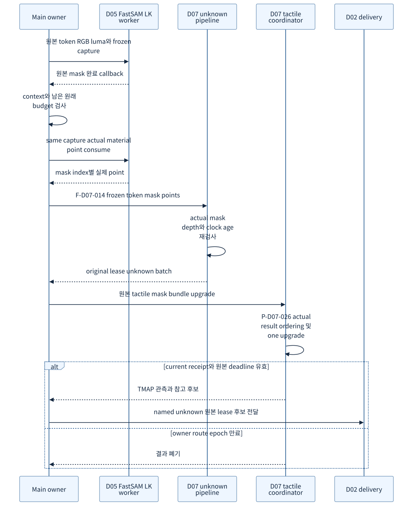

[Mermaid 원본](../diagrams/D07-unknown-sequence.mmd) · [SVG](../rendered/D07-unknown-sequence.svg)

## F-D07-015 unknown actual mask별 Raw·Full depth 층 추정

| 항목 | 명세 |
| --- | --- |
| 분야 | D07 ARCore 깊이·객체 추적·접근 위험·unknown 깊이·점자블록 및 횡단보도 보조 |
| 목적 | 단일 mask 안 서로 다른 물리적 층과 구멍을 분리하여 과도한 전체 거리 권한을 피한다. |
| 사용 주체 | MainActivity MaskDepthEstimator D05 capture/inference D04 pose/heading D02 feedback |
| 활성 상태 | ACTIVE |
| 진입점 | apps/android/app/src/main/java/kr/co/hanium/dreamup/walksafe/depth/unknown/MaskDepthEstimator.java:1 MaskDepthEstimator apps/android/app/src/main/java/kr/co/hanium/dreamup/walksafe/depth/unknown/UnknownProximityRegions.kt:1 UnknownProximityRegions |
| 실행 전제 | 현재 소유자/epoch/generation과 원본 캡처가 유효해야 한다. 활성 연결은 정적 코드 근거이며 장치 PASS가 아니다. |
| 입력 출처 형식 검증 최신성 | 원본 foreground bitset, calibration H·K, copied Raw/confidence/Full arrays, independent depth clock ledger. |

### 시작 이벤트와 처리 순서

| 이벤트 ID | 발생원 | 이벤트 | 수신부 | 흐름 |
| --- | --- | --- | --- | --- |
| E-D07-015-01 | 원본 capture의 완료 결과 또는 공개 helper 호출 | unknown actual mask별 Raw·Full depth 층 추정 입력 | MaskDepthEstimator | 실제 foreground component와 depth cell 후보를 만든다 → Raw robust cluster·nearer layers를 평가한다 → 허용된 경우에만 Full fallback을 검토한다 → KNOWN/PARTIAL/UNKNOWN과 실제 inlier cell/clock을 반환한다 |

1. 1. 실제 foreground component와 depth cell 후보를 만든다
2. 2. Raw robust cluster·nearer layers를 평가한다
3. 3. 허용된 경우에만 Full fallback을 검토한다
4. 4. KNOWN/PARTIAL/UNKNOWN과 실제 inlier cell/clock을 반환한다

| 분기 조건 | 실제 처리 결과 | 구현 근거 |
| --- | --- | --- |
| 분리된 component 거리 불일치 | 전체 mask 거리 UNKNOWN 또는 PARTIAL | apps/android/app/src/main/java/kr/co/hanium/dreamup/walksafe/depth/unknown/MaskDepthEstimator.java:1 |
| Raw nearer/conflicting 지원 존재 | Full로 지워 전체 KNOWN 만들지 않음 | apps/android/app/src/main/java/kr/co/hanium/dreamup/walksafe/depth/unknown/UnknownProximityRegions.kt:1 |
| 반복 depth Image | 거리 관측은 가능하나 새로운 sample/안정 count 아님 | apps/android/app/src/main/java/kr/co/hanium/dreamup/walksafe/depth/unknown/UnknownProximityRegions.kt:1 |

### 효과 종료와 복구

메모리 관측/후보 반환. 음성·진동은 D02의 별도 전달 gate·actuator를 통과해야 한다.

| 상황 | 동작 |
| --- | --- |
| 정상 완료 | 현재 입력의 자격에 해당하는 관측/후보를 반환한다. |
| 실패 | 분기에 따라 빈 결과·거절·UNKNOWN 반환. 누락 자료 합성 없음. |
| 시간 초과 | 원본 캡처 age와 lease 만료는 출력 불허. 계산 helper 자체 timer 없음. |
| 중복 입력 | 동일 capture를 새 관측으로 재등록하지 않는 해당/상위 경계를 따른다. |
| 취소 | 독립 취소 API 없음. 상위 owner/epoch/generation 퇴역 시 결과 폐기. |
| 중단과 생명주기 | 추적/pose/capture 단절은 관계된 연속성 증거를 무효화한다. |
| 재시도 | 자동 재시도 없음. 다음 실제 capture를 새 입력으로 처리한다. |
| 복구 | 새 독립 실측과 동일 owner/capture 조건이 다시 자격을 만족해야 한다. |
| 자원 정리 | native Image를 소유하지 않는 복사 자료. 상위 소유자가 상태 객체 reset/폐기. |

### 상태 실행 맥락과 연결

| 항목 | 명세 |
| --- | --- |
| 초기 상태 | S-D07-015-WAITING |
| 상태 목록 | S-D07-015-WAITING S-D07-015-QUALIFYING S-D07-015-ACCEPTED S-D07-015-REJECTED S-D07-015-RETIRED |
| 전이 조건과 전이 동작 | 분리된 component 거리 불일치 → 전체 mask 거리 UNKNOWN 또는 PARTIAL Raw nearer/conflicting 지원 존재 → Full로 지워 전체 KNOWN 만들지 않음 반복 depth Image → 거리 관측은 가능하나 새로운 sample/안정 count 아님 |
| 허용되지 않는 전이 | 예측/만료/누락된 자료로 실측·신체 충돌·통행 안전·이동 허가를 생성하지 않는다. ID는 실제 enum이라고 명시한 경우 외 문서 흐름 상태다. |
| 동시성 순서와 작업 소유권 | 호출 스레드의 동기 계산이다. 자체 coroutine·자동 재시도·타이머 없음. 상위 capture/세션 소유자가 입력 순서를 관리한다. |
| 공유 상태와 다른 기능 연결 | MaskDepthEstimator.java는 Android 독립 Java helper이며 reference/static 입력을 LIVE risk로 승격하지 않는다. 세부 독립 Java 시험군은 coverage 미검토에 명시한다. D05 원본 token·geometry, D04 센서 capture, D02 최종 전달과 연결한다. |

### 정책 근거와 검증 범위

| 항목 | 근거 |
| --- | --- |
| 정책 | [P-D07-015](#P-D07-015) |
| 구현 | [apps/android/app/src/main/java/kr/co/hanium/dreamup/walksafe/depth/unknown/MaskDepthEstimator.java:1](/home/ddobagi/Hanium_Dreamup/apps/android/app/src/main/java/kr/co/hanium/dreamup/walksafe/depth/unknown/MaskDepthEstimator.java:1) · `MaskDepthEstimator` (범위 1–565) [apps/android/app/src/main/java/kr/co/hanium/dreamup/walksafe/depth/unknown/UnknownProximityRegions.kt:1](/home/ddobagi/Hanium_Dreamup/apps/android/app/src/main/java/kr/co/hanium/dreamup/walksafe/depth/unknown/UnknownProximityRegions.kt:1) · `UnknownProximityRegions` (범위 1–87) |
| 기존 개선 ID | 개별 동일성 미확인; 분야 연관은 별도 추적표 |
| 기존 분야 | 11 깊이·접근 위험 |
| 기존 실행 증거 | 이번에는 정적 코드와 시험 기대만 확인했다. 기존 DONE/시험 로그를 이 snapshot 실행 증거로 이전하지 않는다. |
| 한계 및 구분 | MaskDepthEstimator.java는 Android 독립 Java helper이며 reference/static 입력을 LIVE risk로 승격하지 않는다. 세부 독립 Java 시험군은 coverage 미검토에 명시한다. |

| 테스트 위치 | 심볼 | 증거 수준 | 기대와 한계 |
| --- | --- | --- | --- |
| [apps/android/app/src/test/java/kr/co/hanium/dreamup/walksafe/depth/unknown/UnknownObjectDepthPipelineTest.kt](/home/ddobagi/Hanium_Dreamup/apps/android/app/src/test/java/kr/co/hanium/dreamup/walksafe/depth/unknown/UnknownObjectDepthPipelineTest.kt) | frozenCaptureSeparatesCameraClocksAndCopiesMutableInputs | TEST_EXPECTATION | 동결된 실제 mask/depth가 KNOWN 2m를 생성하는 pipeline 기대; 이번 미실행. 합성·JVM/SDK double 시험은 Native·기기·현장 증거가 아니다. |
| [apps/android/app/src/test/java/kr/co/hanium/dreamup/walksafe/depth/unknown/UnknownIndependentRegionRegressionTest.kt](/home/ddobagi/Hanium_Dreamup/apps/android/app/src/test/java/kr/co/hanium/dreamup/walksafe/depth/unknown/UnknownIndependentRegionRegressionTest.kt) | supportedNearLayerSurvivesTheDominantFractionBoundaryAndBalancedMixture | TEST_EXPECTATION | 실제 pipeline/feedback admission 합성 입력에서 dominant 경계와 혼합층을 넘어 nearer Raw 지원이 보존되고 Full smooth로 사라지지 않는 기대; 이번 미실행. |

### 이벤트 처리 그림


[Mermaid 원본](../diagrams/D07-F015.mmd) · [SVG](../rendered/D07-F015.svg)

## F-D07-016 unknown mask identity·material point·supported extent

| 항목 | 명세 |
| --- | --- |
| 분야 | D07 ARCore 깊이·객체 추적·접근 위험·unknown 깊이·점자블록 및 횡단보도 보조 |
| 목적 | unknown track identity와 실제 한 점 motion 증거를 분리하고 크기 근사치로 작은 장애물을 성급히 제거하지 않는다. |
| 사용 주체 | MainActivity UnknownObjectDepthPipeline D05 capture/inference D04 pose/heading D02 feedback |
| 활성 상태 | ACTIVE |
| 진입점 | apps/android/app/src/main/java/kr/co/hanium/dreamup/walksafe/depth/unknown/UnknownObjectDepthPipeline.kt:1 UnknownObjectDepthPipeline apps/android/app/src/main/java/kr/co/hanium/dreamup/walksafe/depth/unknown/UnknownMaterialPointObservation.kt:1 UnknownMaterialPointObservation apps/android/app/src/main/java/kr/co/hanium/dreamup/walksafe/depth/unknown/ObservedMaskExtent.kt:1 ObservedMaskExtent apps/android/app/src/main/java/kr/co/hanium/dreamup/walksafe/depth/MaskAssociationEvidence.kt:1 MaskAssociationEvidence |
| 실행 전제 | 현재 소유자/epoch/generation과 원본 캡처가 유효해야 한다. 활성 연결은 정적 코드 근거이며 장치 PASS가 아니다. |
| 입력 출처 형식 검증 최신성 | decoded owned mask, source mask index, FrozenUnknownDepthCapture, actual D05 materialPoint map, optional samecapture named evidence. |

### 시작 이벤트와 처리 순서

| 이벤트 ID | 발생원 | 이벤트 | 수신부 | 흐름 |
| --- | --- | --- | --- | --- |
| E-D07-016-01 | 원본 capture의 완료 결과 또는 공개 helper 호출 | unknown mask identity·material point·supported extent 입력 | UnknownObjectDepthPipeline | actual mask correspondence를 평가한다 → material point token·ownership·pixel membership을 확인한다 → scope/calibration 변화 시 거리·motion series를 초기화한다 → 지원된 extent는 진단으로 남기고 walking selector에 독립 거리 증거를 넘긴다 |

1. 1. actual mask correspondence를 평가한다
2. 2. material point token·ownership·pixel membership을 확인한다
3. 3. scope/calibration 변화 시 거리·motion series를 초기화한다
4. 4. 지원된 extent는 진단으로 남기고 walking selector에 독립 거리 증거를 넘긴다

| 분기 조건 | 실제 처리 결과 | 구현 근거 |
| --- | --- | --- |
| mask id는 같지만 point identity 변경 | motion continuity 폐기 | apps/android/app/src/main/java/kr/co/hanium/dreamup/walksafe/depth/unknown/UnknownObjectDepthPipeline.kt:1 |
| 부분 mask/새 지원 영역 | whole-mask distance 권한 없음 | apps/android/app/src/main/java/kr/co/hanium/dreamup/walksafe/depth/unknown/UnknownMaterialPointObservation.kt:1 |
| 작은 extent diagnostic | 이유만으로 obstacle 숨김 없음 | apps/android/app/src/main/java/kr/co/hanium/dreamup/walksafe/depth/unknown/ObservedMaskExtent.kt:1 |

### 효과 종료와 복구

메모리 관측/후보 반환. 음성·진동은 D02의 별도 전달 gate·actuator를 통과해야 한다.

| 상황 | 동작 |
| --- | --- |
| 정상 완료 | 현재 입력의 자격에 해당하는 관측/후보를 반환한다. |
| 실패 | 분기에 따라 빈 결과·거절·UNKNOWN 반환. 누락 자료 합성 없음. |
| 시간 초과 | 원본 캡처 age와 lease 만료는 출력 불허. 계산 helper 자체 timer 없음. |
| 중복 입력 | 동일 capture를 새 관측으로 재등록하지 않는 해당/상위 경계를 따른다. |
| 취소 | 독립 취소 API 없음. 상위 owner/epoch/generation 퇴역 시 결과 폐기. |
| 중단과 생명주기 | 추적/pose/capture 단절은 관계된 연속성 증거를 무효화한다. |
| 재시도 | 자동 재시도 없음. 다음 실제 capture를 새 입력으로 처리한다. |
| 복구 | 새 독립 실측과 동일 owner/capture 조건이 다시 자격을 만족해야 한다. |
| 자원 정리 | native Image를 소유하지 않는 복사 자료. 상위 소유자가 상태 객체 reset/폐기. |

### 상태 실행 맥락과 연결

| 항목 | 명세 |
| --- | --- |
| 초기 상태 | S-D07-016-WAITING |
| 상태 목록 | S-D07-016-WAITING S-D07-016-QUALIFYING S-D07-016-ACCEPTED S-D07-016-REJECTED S-D07-016-RETIRED |
| 전이 조건과 전이 동작 | mask id는 같지만 point identity 변경 → motion continuity 폐기 부분 mask/새 지원 영역 → whole-mask distance 권한 없음 작은 extent diagnostic → 이유만으로 obstacle 숨김 없음 |
| 허용되지 않는 전이 | 예측/만료/누락된 자료로 실측·신체 충돌·통행 안전·이동 허가를 생성하지 않는다. ID는 실제 enum이라고 명시한 경우 외 문서 흐름 상태다. |
| 동시성 순서와 작업 소유권 | 호출 스레드의 동기 계산이다. 자체 coroutine·자동 재시도·타이머 없음. 상위 capture/세션 소유자가 입력 순서를 관리한다. |
| 공유 상태와 다른 기능 연결 |  D05 원본 token·geometry, D04 센서 capture, D02 최종 전달과 연결한다. |

### 정책 근거와 검증 범위

| 항목 | 근거 |
| --- | --- |
| 정책 | [P-D07-016](#P-D07-016) [P-D07-034](#P-D07-034) |
| 구현 | [apps/android/app/src/main/java/kr/co/hanium/dreamup/walksafe/depth/unknown/UnknownObjectDepthPipeline.kt:1](/home/ddobagi/Hanium_Dreamup/apps/android/app/src/main/java/kr/co/hanium/dreamup/walksafe/depth/unknown/UnknownObjectDepthPipeline.kt:1) · `UnknownObjectDepthPipeline` (범위 1–689) [apps/android/app/src/main/java/kr/co/hanium/dreamup/walksafe/depth/unknown/UnknownMaterialPointObservation.kt:1](/home/ddobagi/Hanium_Dreamup/apps/android/app/src/main/java/kr/co/hanium/dreamup/walksafe/depth/unknown/UnknownMaterialPointObservation.kt:1) · `UnknownMaterialPointObservation` (범위 1–11) [apps/android/app/src/main/java/kr/co/hanium/dreamup/walksafe/depth/unknown/ObservedMaskExtent.kt:1](/home/ddobagi/Hanium_Dreamup/apps/android/app/src/main/java/kr/co/hanium/dreamup/walksafe/depth/unknown/ObservedMaskExtent.kt:1) · `ObservedMaskExtent` (범위 1–55) [apps/android/app/src/main/java/kr/co/hanium/dreamup/walksafe/depth/MaskAssociationEvidence.kt:1](/home/ddobagi/Hanium_Dreamup/apps/android/app/src/main/java/kr/co/hanium/dreamup/walksafe/depth/MaskAssociationEvidence.kt:1) · `MaskAssociationEvidence` (범위 1–192) |
| 기존 개선 ID | 개별 동일성 미확인; 분야 연관은 별도 추적표 |
| 기존 분야 | 11 깊이·접근 위험 |
| 기존 실행 증거 | 이번에는 정적 코드와 시험 기대만 확인했다. 기존 DONE/시험 로그를 이 snapshot 실행 증거로 이전하지 않는다. |
| 한계 및 구분 |  |

| 테스트 위치 | 심볼 | 증거 수준 | 기대와 한계 |
| --- | --- | --- | --- |
| [apps/android/app/src/test/java/kr/co/hanium/dreamup/walksafe/depth/ObjectTrackerMaskAssociationTest.kt](/home/ddobagi/Hanium_Dreamup/apps/android/app/src/test/java/kr/co/hanium/dreamup/walksafe/depth/ObjectTrackerMaskAssociationTest.kt) | exactMasksPreserveIdentityDespiteIdenticalBoundingBoxes | TEST_EXPECTATION | 같은 bbox라도 actual mask로 identity 구분하는 기대; 이번 미실행. 합성·JVM/SDK double 시험은 Native·기기·현장 증거가 아니다. |

### 이벤트 처리 그림


[Mermaid 원본](../diagrams/D07-F016.mmd) · [SVG](../rendered/D07-F016.svg)

## F-D07-017 unknown 3D 진행 방향·corridor·바닥 제외

| 항목 | 명세 |
| --- | --- |
| 분야 | D07 ARCore 깊이·객체 추적·접근 위험·unknown 깊이·점자블록 및 횡단보도 보조 |
| 목적 | 화면 아래의 unknown을 보행 장애물로 선택할 때 실제 공간 지지와 불확실성을 반영한다. |
| 사용 주체 | MainActivity CapturedUnknownSpatialSupport D05 capture/inference D04 pose/heading D02 feedback |
| 활성 상태 | ACTIVE |
| 진입점 | apps/android/app/src/main/java/kr/co/hanium/dreamup/walksafe/depth/unknown/CapturedUnknownSpatialSupport.kt:1 CapturedUnknownSpatialSupport apps/android/app/src/main/java/kr/co/hanium/dreamup/walksafe/depth/unknown/UnknownSpatialRelevance.kt:1 UnknownSpatialRelevance apps/android/app/src/main/java/kr/co/hanium/dreamup/walksafe/depth/unknown/UnknownWalkingObstaclePolicy.kt:1 UnknownWalkingObstaclePolicy |
| 실행 전제 | 현재 소유자/epoch/generation과 원본 캡처가 유효해야 한다. 활성 연결은 정적 코드 근거이며 장치 PASS가 아니다. |
| 입력 출처 형식 검증 최신성 | samecapture owned mask/raw/Full/K/pose/gravity/planes; calibrated radial distance; upright rotation. |

### 시작 이벤트와 처리 순서

| 이벤트 ID | 발생원 | 이벤트 | 수신부 | 흐름 |
| --- | --- | --- | --- | --- |
| E-D07-017-01 | 원본 capture의 완료 결과 또는 공개 helper 호출 | unknown 3D 진행 방향·corridor·바닥 제외 입력 | CapturedUnknownSpatialSupport | actual mask/scene의 공간 표본과 capture 연속성을 만든다 → 가능하면 camera travel 방향을 추정한다 → 충분한 물리적 지원에서만 floor 또는 corridor outside를 제외한다 → 근접/반복/lease 기준으로 display와 warning 후보를 분리한다 |

1. 1. actual mask/scene의 공간 표본과 capture 연속성을 만든다
2. 2. 가능하면 camera travel 방향을 추정한다
3. 3. 충분한 물리적 지원에서만 floor 또는 corridor outside를 제외한다
4. 4. 근접/반복/lease 기준으로 display와 warning 후보를 분리한다

| 분기 조건 | 실제 처리 결과 | 구현 근거 |
| --- | --- | --- |
| 강한 floor 또는 모든 점이 corridor 밖 같은 side | 숨김 | apps/android/app/src/main/java/kr/co/hanium/dreamup/walksafe/depth/unknown/CapturedUnknownSpatialSupport.kt:1 |
| 공간 증거 약함 | screen corridor fallback; 안전 판정 없음 | apps/android/app/src/main/java/kr/co/hanium/dreamup/walksafe/depth/unknown/UnknownSpatialRelevance.kt:1 |
| radial3.001m 또는 calibration/metric 없음 | near warning 없음; 접근해도 범위 override 없음 | apps/android/app/src/main/java/kr/co/hanium/dreamup/walksafe/depth/unknown/UnknownWalkingObstaclePolicy.kt:1 |

### 효과 종료와 복구

메모리 관측/후보 반환. 음성·진동은 D02의 별도 전달 gate·actuator를 통과해야 한다.

| 상황 | 동작 |
| --- | --- |
| 정상 완료 | 현재 입력의 자격에 해당하는 관측/후보를 반환한다. |
| 실패 | 분기에 따라 빈 결과·거절·UNKNOWN 반환. 누락 자료 합성 없음. |
| 시간 초과 | 원본 캡처 age와 lease 만료는 출력 불허. 계산 helper 자체 timer 없음. |
| 중복 입력 | 동일 capture를 새 관측으로 재등록하지 않는 해당/상위 경계를 따른다. |
| 취소 | 독립 취소 API 없음. 상위 owner/epoch/generation 퇴역 시 결과 폐기. |
| 중단과 생명주기 | 추적/pose/capture 단절은 관계된 연속성 증거를 무효화한다. |
| 재시도 | 자동 재시도 없음. 다음 실제 capture를 새 입력으로 처리한다. |
| 복구 | 새 독립 실측과 동일 owner/capture 조건이 다시 자격을 만족해야 한다. |
| 자원 정리 | native Image를 소유하지 않는 복사 자료. 상위 소유자가 상태 객체 reset/폐기. |

### 상태 실행 맥락과 연결

| 항목 | 명세 |
| --- | --- |
| 초기 상태 | S-D07-017-WAITING |
| 상태 목록 | S-D07-017-WAITING S-D07-017-QUALIFYING S-D07-017-ACCEPTED S-D07-017-REJECTED S-D07-017-RETIRED |
| 전이 조건과 전이 동작 | 강한 floor 또는 모든 점이 corridor 밖 같은 side → 숨김 공간 증거 약함 → screen corridor fallback; 안전 판정 없음 radial3.001m 또는 calibration/metric 없음 → near warning 없음; 접근해도 범위 override 없음 |
| 허용되지 않는 전이 | 예측/만료/누락된 자료로 실측·신체 충돌·통행 안전·이동 허가를 생성하지 않는다. ID는 실제 enum이라고 명시한 경우 외 문서 흐름 상태다. |
| 동시성 순서와 작업 소유권 | 호출 스레드의 동기 계산이다. 자체 coroutine·자동 재시도·타이머 없음. 상위 capture/세션 소유자가 입력 순서를 관리한다. |
| 공유 상태와 다른 기능 연결 |  D05 원본 token·geometry, D04 센서 capture, D02 최종 전달과 연결한다. |

### 정책 근거와 검증 범위

| 항목 | 근거 |
| --- | --- |
| 정책 | [P-D07-017](#P-D07-017) |
| 구현 | [apps/android/app/src/main/java/kr/co/hanium/dreamup/walksafe/depth/unknown/CapturedUnknownSpatialSupport.kt:1](/home/ddobagi/Hanium_Dreamup/apps/android/app/src/main/java/kr/co/hanium/dreamup/walksafe/depth/unknown/CapturedUnknownSpatialSupport.kt:1) · `CapturedUnknownSpatialSupport` (범위 1–229) [apps/android/app/src/main/java/kr/co/hanium/dreamup/walksafe/depth/unknown/UnknownSpatialRelevance.kt:1](/home/ddobagi/Hanium_Dreamup/apps/android/app/src/main/java/kr/co/hanium/dreamup/walksafe/depth/unknown/UnknownSpatialRelevance.kt:1) · `UnknownSpatialRelevance` (범위 1–171) [apps/android/app/src/main/java/kr/co/hanium/dreamup/walksafe/depth/unknown/UnknownWalkingObstaclePolicy.kt:1](/home/ddobagi/Hanium_Dreamup/apps/android/app/src/main/java/kr/co/hanium/dreamup/walksafe/depth/unknown/UnknownWalkingObstaclePolicy.kt:1) · `UnknownWalkingObstaclePolicy` (범위 1–62) |
| 기존 개선 ID | 개별 동일성 미확인; 분야 연관은 별도 추적표 |
| 기존 분야 | 11 깊이·접근 위험 |
| 기존 실행 증거 | 이번에는 정적 코드와 시험 기대만 확인했다. 기존 DONE/시험 로그를 이 snapshot 실행 증거로 이전하지 않는다. |
| 한계 및 구분 |  |

| 테스트 위치 | 심볼 | 증거 수준 | 기대와 한계 |
| --- | --- | --- | --- |
| [apps/android/app/src/test/java/kr/co/hanium/dreamup/walksafe/depth/unknown/UnknownSpatialRelevanceTest.kt](/home/ddobagi/Hanium_Dreamup/apps/android/app/src/test/java/kr/co/hanium/dreamup/walksafe/depth/unknown/UnknownSpatialRelevanceTest.kt) | threeMetersIncludedButOneMillimeterBeyondExcludedEvenApproaching | TEST_EXPECTATION | 3m 포함·3.001m 제외가 접근 속도보다 우선하는 기대; 이번 미실행. 합성·JVM/SDK double 시험은 Native·기기·현장 증거가 아니다. |

### 이벤트 처리 그림


[Mermaid 원본](../diagrams/D07-F017.mmd) · [SVG](../rendered/D07-F017.svg)

## F-D07-018 unknown 지원 근접 region의 중복·시간 연속성

| 항목 | 명세 |
| --- | --- |
| 분야 | D07 ARCore 깊이·객체 추적·접근 위험·unknown 깊이·점자블록 및 횡단보도 보조 |
| 목적 | 같은 물리 지원 영역이 여러 FastSAM mask로 나와도 warning/count를 중복 생산하지 않는다. |
| 사용 주체 | MainActivity UnknownProximityRegions D05 capture/inference D04 pose/heading D02 feedback |
| 활성 상태 | ACTIVE |
| 진입점 | apps/android/app/src/main/java/kr/co/hanium/dreamup/walksafe/depth/unknown/UnknownProximityRegions.kt:1 UnknownProximityRegions apps/android/app/src/main/java/kr/co/hanium/dreamup/walksafe/depth/unknown/UnknownObjectDepthPipeline.kt:1 UnknownObjectDepthPipeline |
| 실행 전제 | 현재 소유자/epoch/generation과 원본 캡처가 유효해야 한다. 활성 연결은 정적 코드 근거이며 장치 PASS가 아니다. |
| 입력 출처 형식 검증 최신성 | nearer layer/component inlier depth cell, 원본 foreground, 실제 newDepthInformation flag. |

### 시작 이벤트와 처리 순서

| 이벤트 ID | 발생원 | 이벤트 | 수신부 | 흐름 |
| --- | --- | --- | --- | --- |
| E-D07-018-01 | 원본 capture의 완료 결과 또는 공개 helper 호출 | unknown 지원 근접 region의 중복·시간 연속성 입력 | UnknownProximityRegions | 실제 support만 원본 foreground region으로 복원한다 → 동일 capture 중복 region을 all-pair 비교한다 → 독립 source 관측과 reused depth를 나누어 temporal association한다 → warning 후보 또는 retained-only lease를 반환한다 |

1. 1. 실제 support만 원본 foreground region으로 복원한다
2. 2. 동일 capture 중복 region을 all-pair 비교한다
3. 3. 독립 source 관측과 reused depth를 나누어 temporal association한다
4. 4. warning 후보 또는 retained-only lease를 반환한다

| 분기 조건 | 실제 처리 결과 | 구현 근거 |
| --- | --- | --- |
| 겹친 decoded mask가 같은 depth support | 하나의 region/count/candidate | apps/android/app/src/main/java/kr/co/hanium/dreamup/walksafe/depth/unknown/UnknownProximityRegions.kt:1 |
| 같은 depth Image 재사용 | 원본 lease/count 유지; 새 output 발급 안함 | apps/android/app/src/main/java/kr/co/hanium/dreamup/walksafe/depth/unknown/UnknownObjectDepthPipeline.kt:1 |
| region gap/IoU/depth 불연속 | 새 region 안정화 시작 | apps/android/app/src/main/java/kr/co/hanium/dreamup/walksafe/depth/unknown/UnknownObjectDepthPipeline.kt:1 |

### 효과 종료와 복구

메모리 관측/후보 반환. 음성·진동은 D02의 별도 전달 gate·actuator를 통과해야 한다.

| 상황 | 동작 |
| --- | --- |
| 정상 완료 | 현재 입력의 자격에 해당하는 관측/후보를 반환한다. |
| 실패 | 분기에 따라 빈 결과·거절·UNKNOWN 반환. 누락 자료 합성 없음. |
| 시간 초과 | 원본 캡처 age와 lease 만료는 출력 불허. 계산 helper 자체 timer 없음. |
| 중복 입력 | 동일 capture를 새 관측으로 재등록하지 않는 해당/상위 경계를 따른다. |
| 취소 | 독립 취소 API 없음. 상위 owner/epoch/generation 퇴역 시 결과 폐기. |
| 중단과 생명주기 | 추적/pose/capture 단절은 관계된 연속성 증거를 무효화한다. |
| 재시도 | 자동 재시도 없음. 다음 실제 capture를 새 입력으로 처리한다. |
| 복구 | 새 독립 실측과 동일 owner/capture 조건이 다시 자격을 만족해야 한다. |
| 자원 정리 | native Image를 소유하지 않는 복사 자료. 상위 소유자가 상태 객체 reset/폐기. |

### 상태 실행 맥락과 연결

| 항목 | 명세 |
| --- | --- |
| 초기 상태 | S-D07-018-WAITING |
| 상태 목록 | S-D07-018-WAITING S-D07-018-QUALIFYING S-D07-018-ACCEPTED S-D07-018-REJECTED S-D07-018-RETIRED |
| 전이 조건과 전이 동작 | 겹친 decoded mask가 같은 depth support → 하나의 region/count/candidate 같은 depth Image 재사용 → 원본 lease/count 유지; 새 output 발급 안함 region gap/IoU/depth 불연속 → 새 region 안정화 시작 |
| 허용되지 않는 전이 | 예측/만료/누락된 자료로 실측·신체 충돌·통행 안전·이동 허가를 생성하지 않는다. ID는 실제 enum이라고 명시한 경우 외 문서 흐름 상태다. |
| 동시성 순서와 작업 소유권 | 호출 스레드의 동기 계산이다. 자체 coroutine·자동 재시도·타이머 없음. 상위 capture/세션 소유자가 입력 순서를 관리한다. |
| 공유 상태와 다른 기능 연결 |  D05 원본 token·geometry, D04 센서 capture, D02 최종 전달과 연결한다. |

### 정책 근거와 검증 범위

| 항목 | 근거 |
| --- | --- |
| 정책 | [P-D07-018](#P-D07-018) |
| 구현 | [apps/android/app/src/main/java/kr/co/hanium/dreamup/walksafe/depth/unknown/UnknownProximityRegions.kt:1](/home/ddobagi/Hanium_Dreamup/apps/android/app/src/main/java/kr/co/hanium/dreamup/walksafe/depth/unknown/UnknownProximityRegions.kt:1) · `UnknownProximityRegions` (범위 1–87) [apps/android/app/src/main/java/kr/co/hanium/dreamup/walksafe/depth/unknown/UnknownObjectDepthPipeline.kt:1](/home/ddobagi/Hanium_Dreamup/apps/android/app/src/main/java/kr/co/hanium/dreamup/walksafe/depth/unknown/UnknownObjectDepthPipeline.kt:1) · `UnknownObjectDepthPipeline` (범위 1–689) |
| 기존 개선 ID | 개별 동일성 미확인; 분야 연관은 별도 추적표 |
| 기존 분야 | 11 깊이·접근 위험 |
| 기존 실행 증거 | 이번에는 정적 코드와 시험 기대만 확인했다. 기존 DONE/시험 로그를 이 snapshot 실행 증거로 이전하지 않는다. |
| 한계 및 구분 |  |

| 테스트 위치 | 심볼 | 증거 수준 | 기대와 한계 |
| --- | --- | --- | --- |
| [apps/android/app/src/test/java/kr/co/hanium/dreamup/walksafe/depth/unknown/UnknownRegionTemporalRegressionTest.kt](/home/ddobagi/Hanium_Dreamup/apps/android/app/src/test/java/kr/co/hanium/dreamup/walksafe/depth/unknown/UnknownRegionTemporalRegressionTest.kt) | overlappingDecodedMasksShareOneRegionOneCountAndOneFeedbackCandidate | TEST_EXPECTATION | 겹친 decoded mask가 region·count·feedback 하나로 수렴하는 기대; 이번 미실행. 합성·JVM/SDK double 시험은 Native·기기·현장 증거가 아니다. |

### 이벤트 처리 그림


[Mermaid 원본](../diagrams/D07-F018.mmd) · [SVG](../rendered/D07-F018.svg)

## F-D07-019 unknown feedback admission과 원본 lease

| 항목 | 명세 |
| --- | --- |
| 분야 | D07 ARCore 깊이·객체 추적·접근 위험·unknown 깊이·점자블록 및 횡단보도 보조 |
| 목적 | FastSAM 관측이 늦게 완료되어도 새 위험 유효기간을 만들지 않게 한다. |
| 사용 주체 | MainActivity UnknownObjectFeedbackPolicy D05 capture/inference D04 pose/heading D02 feedback |
| 활성 상태 | ACTIVE |
| 진입점 | apps/android/app/src/main/java/kr/co/hanium/dreamup/walksafe/depth/UnknownObjectFeedbackPolicy.kt:1 UnknownObjectFeedbackPolicy apps/android/app/src/main/java/kr/co/hanium/dreamup/walksafe/MainActivity.kt:35378 consumeUnknownObjectResult |
| 실행 전제 | 현재 소유자/epoch/generation과 원본 캡처가 유효해야 한다. 활성 연결은 정적 코드 근거이며 장치 PASS가 아니다. |
| 입력 출처 형식 검증 최신성 | UnknownObjectDepthResult, current sessionEpoch, source token capture/complete elapsed, raw/full output list. |

### 시작 이벤트와 처리 순서

| 이벤트 ID | 발생원 | 이벤트 | 수신부 | 흐름 |
| --- | --- | --- | --- | --- |
| E-D07-019-01 | 원본 capture의 완료 결과 또는 공개 helper 호출 | unknown feedback admission과 원본 lease 입력 | UnknownObjectFeedbackPolicy | source epoch·clock·age와 metric 자격을 검증한다 → 실제 walking obstacle output만 선별한다 → 원본 elapsed provenance와 짧은 lease를 bound한다 → D02 queue에 batch와 retained region ID를 넘긴다 |

1. 1. source epoch·clock·age와 metric 자격을 검증한다
2. 2. 실제 walking obstacle output만 선별한다
3. 3. 원본 elapsed provenance와 짧은 lease를 bound한다
4. 4. D02 queue에 batch와 retained region ID를 넘긴다

| 분기 조건 | 실제 처리 결과 | 구현 근거 |
| --- | --- | --- |
| captured source가800ms 초과 | batch 거절 | apps/android/app/src/main/java/kr/co/hanium/dreamup/walksafe/depth/UnknownObjectFeedbackPolicy.kt:1 |
| Full 지원50 미만 또는 ray>3 | 후보 제외 | apps/android/app/src/main/java/kr/co/hanium/dreamup/walksafe/MainActivity.kt:35378 |
| existing retained region | 이전 source lease 연장 없이 유지 | apps/android/app/src/main/java/kr/co/hanium/dreamup/walksafe/MainActivity.kt:35378 |

### 효과 종료와 복구

메모리 관측/후보 반환. 음성·진동은 D02의 별도 전달 gate·actuator를 통과해야 한다.

| 상황 | 동작 |
| --- | --- |
| 정상 완료 | 현재 입력의 자격에 해당하는 관측/후보를 반환한다. |
| 실패 | 분기에 따라 빈 결과·거절·UNKNOWN 반환. 누락 자료 합성 없음. |
| 시간 초과 | 원본 캡처 age와 lease 만료는 출력 불허. 계산 helper 자체 timer 없음. |
| 중복 입력 | 동일 capture를 새 관측으로 재등록하지 않는 해당/상위 경계를 따른다. |
| 취소 | 독립 취소 API 없음. 상위 owner/epoch/generation 퇴역 시 결과 폐기. |
| 중단과 생명주기 | 추적/pose/capture 단절은 관계된 연속성 증거를 무효화한다. |
| 재시도 | 자동 재시도 없음. 다음 실제 capture를 새 입력으로 처리한다. |
| 복구 | 새 독립 실측과 동일 owner/capture 조건이 다시 자격을 만족해야 한다. |
| 자원 정리 | native Image를 소유하지 않는 복사 자료. 상위 소유자가 상태 객체 reset/폐기. |

### 상태 실행 맥락과 연결

| 항목 | 명세 |
| --- | --- |
| 초기 상태 | S-D07-019-WAITING |
| 상태 목록 | S-D07-019-WAITING S-D07-019-QUALIFYING S-D07-019-ACCEPTED S-D07-019-REJECTED S-D07-019-RETIRED |
| 전이 조건과 전이 동작 | captured source가800ms 초과 → batch 거절 Full 지원50 미만 또는 ray>3 → 후보 제외 existing retained region → 이전 source lease 연장 없이 유지 |
| 허용되지 않는 전이 | 예측/만료/누락된 자료로 실측·신체 충돌·통행 안전·이동 허가를 생성하지 않는다. ID는 실제 enum이라고 명시한 경우 외 문서 흐름 상태다. |
| 동시성 순서와 작업 소유권 | Main unknown completion callback에서 context admission을 확인한 후 feedbackPolicy와 합성한다. 실제 안정화·coalescing·cooldown·delivery는 D02. |
| 공유 상태와 다른 기능 연결 |  D05 원본 token·geometry, D04 센서 capture, D02 최종 전달과 연결한다. |

### 정책 근거와 검증 범위

| 항목 | 근거 |
| --- | --- |
| 정책 | [P-D07-019](#P-D07-019) |
| 구현 | [apps/android/app/src/main/java/kr/co/hanium/dreamup/walksafe/depth/UnknownObjectFeedbackPolicy.kt:1](/home/ddobagi/Hanium_Dreamup/apps/android/app/src/main/java/kr/co/hanium/dreamup/walksafe/depth/UnknownObjectFeedbackPolicy.kt:1) · `UnknownObjectFeedbackPolicy` (범위 1–152) [apps/android/app/src/main/java/kr/co/hanium/dreamup/walksafe/MainActivity.kt:35378](/home/ddobagi/Hanium_Dreamup/apps/android/app/src/main/java/kr/co/hanium/dreamup/walksafe/MainActivity.kt:35378) · `consumeUnknownObjectResult` (범위 35378–35490) |
| 기존 개선 ID | 개별 동일성 미확인; 분야 연관은 별도 추적표 |
| 기존 분야 | 11 깊이·접근 위험 |
| 기존 실행 증거 | 이번에는 정적 코드와 시험 기대만 확인했다. 기존 DONE/시험 로그를 이 snapshot 실행 증거로 이전하지 않는다. |
| 한계 및 구분 |  |

| 테스트 위치 | 심볼 | 증거 수준 | 기대와 한계 |
| --- | --- | --- | --- |
| [apps/android/app/src/test/java/kr/co/hanium/dreamup/walksafe/depth/UnknownObjectFeedbackPolicyTest.kt](/home/ddobagi/Hanium_Dreamup/apps/android/app/src/test/java/kr/co/hanium/dreamup/walksafe/depth/UnknownObjectFeedbackPolicyTest.kt) | admittedFeedbackUsesTheFrozenElapsedCaptureRatherThanTheRawCameraClock | TEST_EXPECTATION | frozen elapsed capture와800ms 원본 lease가 feedback으로 이어지는 기대; 이번 미실행. 합성·JVM/SDK double 시험은 Native·기기·현장 증거가 아니다. |

### 이벤트 처리 그림


[Mermaid 원본](../diagrams/D07-F019.mmd) · [SVG](../rendered/D07-F019.svg)

## F-D07-020 점자블록 실제 contact depth와 TMAP corridor 관측

| 항목 | 명세 |
| --- | --- |
| 분야 | D07 ARCore 깊이·객체 추적·접근 위험·unknown 깊이·점자블록 및 횡단보도 보조 |
| 목적 | 점자블록과 현재 TMAP 구간의 공간적 관계를 관측하되 이동 방향 지시를 만들지는 않는다. |
| 사용 주체 | MainActivity AndroidTactileRouteGuidance D05 capture/inference D04 pose/heading D02 feedback |
| 활성 상태 | ACTIVE |
| 진입점 | apps/android/app/src/main/java/kr/co/hanium/dreamup/walksafe/navigation/AndroidTactileRouteGuidance.kt:1 AndroidTactileRouteGuidance apps/android/app/src/main/java/kr/co/hanium/dreamup/walksafe/navigation/ArCoreTactileProjectionContextFactory.kt:1 ArCoreTactileProjectionContextFactory apps/android/app/src/main/java/kr/co/hanium/dreamup/walksafe/navigation/TactileObservationEvidence.kt:1 TactileObservationEvidence apps/android/app/src/main/java/kr/co/hanium/dreamup/walksafe/depth/DepthSampler.kt:1 DepthSampler |
| 실행 전제 | 현재 소유자/epoch/generation과 원본 캡처가 유효해야 한다. 활성 연결은 정적 코드 근거이며 장치 PASS가 아니다. |
| 입력 출처 형식 검증 최신성 | 같은 frame의 contact depth·pose·orientation·location·routeProjection, 원본 capture time와 decision time. |

### 시작 이벤트와 처리 순서

| 이벤트 ID | 발생원 | 이벤트 | 수신부 | 흐름 |
| --- | --- | --- | --- | --- |
| E-D07-020-01 | 원본 capture의 완료 결과 또는 공개 helper 호출 | 점자블록 실제 contact depth와 TMAP corridor 관측 입력 | AndroidTactileRouteGuidance | 공유 capture/decision freshness와 trusted depth를 확인한다 → bottom-contact 실제 주변 픽셀 지원을 검사한다 → K·pose·orientation·location으로 contact를 경위도에 투영한다 → 현재 segment와 보수적 오차를 비교하여 corridor 관측/거절사유를 반환한다 |

1. 1. 공유 capture/decision freshness와 trusted depth를 확인한다
2. 2. bottom-contact 실제 주변 픽셀 지원을 검사한다
3. 3. K·pose·orientation·location으로 contact를 경위도에 투영한다
4. 4. 현재 segment와 보수적 오차를 비교하여 corridor 관측/거절사유를 반환한다

| 분기 조건 | 실제 처리 결과 | 구현 근거 |
| --- | --- | --- |
| mask median 유효하지만 contact 주변 depth 없음 | contact 관측 거절 | apps/android/app/src/main/java/kr/co/hanium/dreamup/walksafe/navigation/AndroidTactileRouteGuidance.kt:1 |
| location/orientation/pose age 또는 정합 실패 | 관측 없음 | apps/android/app/src/main/java/kr/co/hanium/dreamup/walksafe/navigation/ArCoreTactileProjectionContextFactory.kt:1 |
| distance+error≤15m | OVERLAPS 관측; 보행 허가 아님 | apps/android/app/src/main/java/kr/co/hanium/dreamup/walksafe/navigation/TactileObservationEvidence.kt:1 |

### 효과 종료와 복구

메모리 관측/후보 반환. 음성·진동은 D02의 별도 전달 gate·actuator를 통과해야 한다.

| 상황 | 동작 |
| --- | --- |
| 정상 완료 | 현재 입력의 자격에 해당하는 관측/후보를 반환한다. |
| 실패 | 분기에 따라 빈 결과·거절·UNKNOWN 반환. 누락 자료 합성 없음. |
| 시간 초과 | 원본 캡처 age와 lease 만료는 출력 불허. 계산 helper 자체 timer 없음. |
| 중복 입력 | 동일 capture를 새 관측으로 재등록하지 않는 해당/상위 경계를 따른다. |
| 취소 | 독립 취소 API 없음. 상위 owner/epoch/generation 퇴역 시 결과 폐기. |
| 중단과 생명주기 | 추적/pose/capture 단절은 관계된 연속성 증거를 무효화한다. |
| 재시도 | 자동 재시도 없음. 다음 실제 capture를 새 입력으로 처리한다. |
| 복구 | 새 독립 실측과 동일 owner/capture 조건이 다시 자격을 만족해야 한다. |
| 자원 정리 | native Image를 소유하지 않는 복사 자료. 상위 소유자가 상태 객체 reset/폐기. |

### 상태 실행 맥락과 연결

| 항목 | 명세 |
| --- | --- |
| 초기 상태 | S-D07-020-WAITING |
| 상태 목록 | S-D07-020-WAITING S-D07-020-QUALIFYING S-D07-020-ACCEPTED S-D07-020-REJECTED S-D07-020-RETIRED |
| 전이 조건과 전이 동작 | mask median 유효하지만 contact 주변 depth 없음 → contact 관측 거절 location/orientation/pose age 또는 정합 실패 → 관측 없음 distance+error≤15m → OVERLAPS 관측; 보행 허가 아님 |
| 허용되지 않는 전이 | 예측/만료/누락된 자료로 실측·신체 충돌·통행 안전·이동 허가를 생성하지 않는다. ID는 실제 enum이라고 명시한 경우 외 문서 흐름 상태다. |
| 동시성 순서와 작업 소유권 | 호출 스레드의 동기 계산이다. 자체 coroutine·자동 재시도·타이머 없음. 상위 capture/세션 소유자가 입력 순서를 관리한다. |
| 공유 상태와 다른 기능 연결 | D04가 heading/위치 provenance를 제공한다. 지구 좌표 변환은 antimeridian longitude wrap을 공유한다. D05 원본 token·geometry, D04 센서 capture, D02 최종 전달과 연결한다. |

### 정책 근거와 검증 범위

| 항목 | 근거 |
| --- | --- |
| 정책 | [P-D07-020](#P-D07-020) |
| 구현 | [apps/android/app/src/main/java/kr/co/hanium/dreamup/walksafe/navigation/AndroidTactileRouteGuidance.kt:1](/home/ddobagi/Hanium_Dreamup/apps/android/app/src/main/java/kr/co/hanium/dreamup/walksafe/navigation/AndroidTactileRouteGuidance.kt:1) · `AndroidTactileRouteGuidance` (범위 1–874) [apps/android/app/src/main/java/kr/co/hanium/dreamup/walksafe/navigation/ArCoreTactileProjectionContextFactory.kt:1](/home/ddobagi/Hanium_Dreamup/apps/android/app/src/main/java/kr/co/hanium/dreamup/walksafe/navigation/ArCoreTactileProjectionContextFactory.kt:1) · `ArCoreTactileProjectionContextFactory` (범위 1–68) [apps/android/app/src/main/java/kr/co/hanium/dreamup/walksafe/navigation/TactileObservationEvidence.kt:1](/home/ddobagi/Hanium_Dreamup/apps/android/app/src/main/java/kr/co/hanium/dreamup/walksafe/navigation/TactileObservationEvidence.kt:1) · `TactileObservationEvidence` (범위 1–51) [apps/android/app/src/main/java/kr/co/hanium/dreamup/walksafe/depth/DepthSampler.kt:1](/home/ddobagi/Hanium_Dreamup/apps/android/app/src/main/java/kr/co/hanium/dreamup/walksafe/depth/DepthSampler.kt:1) · `DepthSampler` (범위 1–441) |
| 기존 개선 ID | 개별 동일성 미확인; 분야 연관은 별도 추적표 |
| 기존 분야 | 09 길 안내 11 깊이·접근 위험 |
| 기존 실행 증거 | 이번에는 정적 코드와 시험 기대만 확인했다. 기존 DONE/시험 로그를 이 snapshot 실행 증거로 이전하지 않는다. |
| 한계 및 구분 | D04가 heading/위치 provenance를 제공한다. 지구 좌표 변환은 antimeridian longitude wrap을 공유한다. |

| 테스트 위치 | 심볼 | 증거 수준 | 기대와 한계 |
| --- | --- | --- | --- |
| [apps/android/app/src/test/java/kr/co/hanium/dreamup/walksafe/navigation/TactileContactDepthRegressionTest.kt](/home/ddobagi/Hanium_Dreamup/apps/android/app/src/test/java/kr/co/hanium/dreamup/walksafe/navigation/TactileContactDepthRegressionTest.kt) | bottomContactUsesItsLocalDepthRatherThanTheWholeMaskMedian | TEST_EXPECTATION | mask median과 다른 실제 bottom contact depth를 이용하는 기대; 이번 미실행. 합성·JVM/SDK double 시험은 Native·기기·현장 증거가 아니다. |

### 이벤트 처리 그림


[Mermaid 원본](../diagrams/D07-F020.mmd) · [SVG](../rendered/D07-F020.svg)

## F-D07-021 actual tactile semantic mask의 측정 표면·contact

| 항목 | 명세 |
| --- | --- |
| 분야 | D07 ARCore 깊이·객체 추적·접근 위험·unknown 깊이·점자블록 및 횡단보도 보조 |
| 목적 | 점자블록 표면에서 실제 관측 cell별 깊이와 contact 출처를 보존한다. |
| 사용 주체 | MainActivity TactileMaskSurface D05 capture/inference D04 pose/heading D02 feedback |
| 활성 상태 | ACTIVE |
| 진입점 | apps/android/app/src/main/java/kr/co/hanium/dreamup/walksafe/depth/TactileMaskSurface.kt:1 TactileMaskSurface apps/android/app/src/main/java/kr/co/hanium/dreamup/walksafe/MainActivity.kt:44962 projectTactileMaskCaptureBundle |
| 실행 전제 | 현재 소유자/epoch/generation과 원본 캡처가 유효해야 한다. 활성 연결은 정적 코드 근거이며 장치 PASS가 아니다. |
| 입력 출처 형식 검증 최신성 | original named candidate와 실제 binary mask, frozen depth/K/H/pose/receipt, captureContext, decisionNs. |

### 시작 이벤트와 처리 순서

| 이벤트 ID | 발생원 | 이벤트 | 수신부 | 흐름 |
| --- | --- | --- | --- | --- |
| E-D07-021-01 | 원본 capture의 완료 결과 또는 공개 helper 호출 | actual tactile semantic mask의 측정 표면·contact 입력 | TactileMaskSurface | 동일 원본 capture와 deadline을 검증한다 → actual mask에 속한 robust depth cells를 선택한다 → cell center·own axial depth로 3D sample을 만든다 → 지원된 bottom band에서 실제 contact를 선택한다 |

1. 1. 동일 원본 capture와 deadline을 검증한다
2. 2. actual mask에 속한 robust depth cells를 선택한다
3. 3. cell center·own axial depth로 3D sample을 만든다
4. 4. 지원된 bottom band에서 실제 contact를 선택한다

| 분기 조건 | 실제 처리 결과 | 구현 근거 |
| --- | --- | --- |
| 같은 bbox라도 token/receipt/CPU 불일치 | surface 거절 | apps/android/app/src/main/java/kr/co/hanium/dreamup/walksafe/depth/TactileMaskSurface.kt:1 |
| 부분 support 또는 여러 bottom band component | 관측 surface만; measured contact 없음 | apps/android/app/src/main/java/kr/co/hanium/dreamup/walksafe/MainActivity.kt:44962 |
| samecapture own-cell contact지원 | contact와 sample 출처 함께 반환 | apps/android/app/src/main/java/kr/co/hanium/dreamup/walksafe/MainActivity.kt:44962 |

### 효과 종료와 복구

메모리 관측/후보 반환. 음성·진동은 D02의 별도 전달 gate·actuator를 통과해야 한다.

| 상황 | 동작 |
| --- | --- |
| 정상 완료 | 현재 입력의 자격에 해당하는 관측/후보를 반환한다. |
| 실패 | 분기에 따라 빈 결과·거절·UNKNOWN 반환. 누락 자료 합성 없음. |
| 시간 초과 | 원본 캡처 age와 lease 만료는 출력 불허. 계산 helper 자체 timer 없음. |
| 중복 입력 | 동일 capture를 새 관측으로 재등록하지 않는 해당/상위 경계를 따른다. |
| 취소 | 독립 취소 API 없음. 상위 owner/epoch/generation 퇴역 시 결과 폐기. |
| 중단과 생명주기 | 추적/pose/capture 단절은 관계된 연속성 증거를 무효화한다. |
| 재시도 | 자동 재시도 없음. 다음 실제 capture를 새 입력으로 처리한다. |
| 복구 | 새 독립 실측과 동일 owner/capture 조건이 다시 자격을 만족해야 한다. |
| 자원 정리 | native Image를 소유하지 않는 복사 자료. 상위 소유자가 상태 객체 reset/폐기. |

### 상태 실행 맥락과 연결

| 항목 | 명세 |
| --- | --- |
| 초기 상태 | S-D07-021-WAITING |
| 상태 목록 | S-D07-021-WAITING S-D07-021-QUALIFYING S-D07-021-ACCEPTED S-D07-021-REJECTED S-D07-021-RETIRED |
| 전이 조건과 전이 동작 | 같은 bbox라도 token/receipt/CPU 불일치 → surface 거절 부분 support 또는 여러 bottom band component → 관측 surface만; measured contact 없음 samecapture own-cell contact지원 → contact와 sample 출처 함께 반환 |
| 허용되지 않는 전이 | 예측/만료/누락된 자료로 실측·신체 충돌·통행 안전·이동 허가를 생성하지 않는다. ID는 실제 enum이라고 명시한 경우 외 문서 흐름 상태다. |
| 동시성 순서와 작업 소유권 | 호출 스레드의 동기 계산이다. 자체 coroutine·자동 재시도·타이머 없음. 상위 capture/세션 소유자가 입력 순서를 관리한다. |
| 공유 상태와 다른 기능 연결 | Main 실제 경로는 projector.project를 호출한다. projectWithMeasuredBody wrapper는 F-D07-029 미연결로 별도 기록. D05 원본 token·geometry, D04 센서 capture, D02 최종 전달과 연결한다. |

### 정책 근거와 검증 범위

| 항목 | 근거 |
| --- | --- |
| 정책 | [P-D07-021](#P-D07-021) |
| 구현 | [apps/android/app/src/main/java/kr/co/hanium/dreamup/walksafe/depth/TactileMaskSurface.kt:1](/home/ddobagi/Hanium_Dreamup/apps/android/app/src/main/java/kr/co/hanium/dreamup/walksafe/depth/TactileMaskSurface.kt:1) · `TactileMaskSurface` (범위 1–311) [apps/android/app/src/main/java/kr/co/hanium/dreamup/walksafe/MainActivity.kt:44962](/home/ddobagi/Hanium_Dreamup/apps/android/app/src/main/java/kr/co/hanium/dreamup/walksafe/MainActivity.kt:44962) · `projectTactileMaskCaptureBundle` (범위 44962–44973) |
| 기존 개선 ID | 개별 동일성 미확인; 분야 연관은 별도 추적표 |
| 기존 분야 | 09 길 안내 11 깊이·접근 위험 |
| 기존 실행 증거 | 이번에는 정적 코드와 시험 기대만 확인했다. 기존 DONE/시험 로그를 이 snapshot 실행 증거로 이전하지 않는다. |
| 한계 및 구분 | Main 실제 경로는 projector.project를 호출한다. projectWithMeasuredBody wrapper는 F-D07-029 미연결로 별도 기록. |

| 테스트 위치 | 심볼 | 증거 수준 | 기대와 한계 |
| --- | --- | --- | --- |
| [apps/android/app/src/test/java/kr/co/hanium/dreamup/walksafe/depth/TactileMaskSurfaceTest.kt](/home/ddobagi/Hanium_Dreamup/apps/android/app/src/test/java/kr/co/hanium/dreamup/walksafe/depth/TactileMaskSurfaceTest.kt) | everyMeasuredCellKeepsOwnDepthAndSubpixelOriginBeyondTheOld256Bound | TEST_EXPECTATION | 256개를 넘는 실제 cell 각각 own depth와 subpixel origin을 보존하는 기대; 이번 미실행. 합성·JVM/SDK double 시험은 Native·기기·현장 증거가 아니다. |

### 이벤트 처리 그림


[Mermaid 원본](../diagrams/D07-F021.mmd) · [SVG](../rendered/D07-F021.svg)

## F-D07-022 점자 표면의 실제 경로 교차·axis·topology 관측

| 항목 | 명세 |
| --- | --- |
| 분야 | D07 ARCore 깊이·객체 추적·접근 위험·unknown 깊이·점자블록 및 횡단보도 보조 |
| 목적 | 카메라 heading이나 bbox 모양 대신 실제 측정 표면의 축·구멍·교차 구간을 관측한다. |
| 사용 주체 | MainActivity TactileSurfaceRouteProjection D05 capture/inference D04 pose/heading D02 feedback |
| 활성 상태 | ACTIVE |
| 진입점 | apps/android/app/src/main/java/kr/co/hanium/dreamup/walksafe/navigation/TactileSurfaceRouteProjection.kt:1 TactileSurfaceRouteProjector apps/android/app/src/main/java/kr/co/hanium/dreamup/walksafe/navigation/AndroidTactileRouteGuidance.kt:1 AndroidTactileRouteGuidance |
| 실행 전제 | 현재 소유자/epoch/generation과 원본 캡처가 유효해야 한다. 활성 연결은 정적 코드 근거이며 장치 PASS가 아니다. |
| 입력 출처 형식 검증 최신성 | TactileMaskSurface, 원본 context, route/loc/orientation/camera evidence, samecapture captured plane polygon. |

### 시작 이벤트와 처리 순서

| 이벤트 ID | 발생원 | 이벤트 | 수신부 | 흐름 |
| --- | --- | --- | --- | --- |
| E-D07-022-01 | 원본 capture의 완료 결과 또는 공개 helper 호출 | 점자 표면의 실제 경로 교차·axis·topology 관측 입력 | TactileSurfaceRouteProjection | context·lease·route·센서 freshness를 검증한다 → 유일한 samecapture plane 지원을 선택한다 → actual cells로 component/axis/tangent/route patch overlap을 계산한다 → 관측 support 또는 topology/plane rejection을 반환한다 |

1. 1. context·lease·route·센서 freshness를 검증한다
2. 2. 유일한 samecapture plane 지원을 선택한다
3. 3. actual cells로 component/axis/tangent/route patch overlap을 계산한다
4. 4. 관측 support 또는 topology/plane rejection을 반환한다

| 분기 조건 | 실제 처리 결과 | 구현 근거 |
| --- | --- | --- |
| plane 없음 또는 서로 다른 여러 plane | PLANE_UNAVAILABLE 또는 PLANE_AMBIGUOUS | apps/android/app/src/main/java/kr/co/hanium/dreamup/walksafe/navigation/TactileSurfaceRouteProjection.kt:1 |
| mask 구멍/단절/branch | topology unresolved; hull/평균축으로 이동지시 생성 없음 | apps/android/app/src/main/java/kr/co/hanium/dreamup/walksafe/navigation/AndroidTactileRouteGuidance.kt:1 |
| 유효 axis와 multipoint overlap | AXIS_AND_MULTIPOINT_OVERLAP 관측 | apps/android/app/src/main/java/kr/co/hanium/dreamup/walksafe/navigation/AndroidTactileRouteGuidance.kt:1 |

### 효과 종료와 복구

메모리 관측/후보 반환. 음성·진동은 D02의 별도 전달 gate·actuator를 통과해야 한다.

| 상황 | 동작 |
| --- | --- |
| 정상 완료 | 현재 입력의 자격에 해당하는 관측/후보를 반환한다. |
| 실패 | 분기에 따라 빈 결과·거절·UNKNOWN 반환. 누락 자료 합성 없음. |
| 시간 초과 | 원본 캡처 age와 lease 만료는 출력 불허. 계산 helper 자체 timer 없음. |
| 중복 입력 | 동일 capture를 새 관측으로 재등록하지 않는 해당/상위 경계를 따른다. |
| 취소 | 독립 취소 API 없음. 상위 owner/epoch/generation 퇴역 시 결과 폐기. |
| 중단과 생명주기 | 추적/pose/capture 단절은 관계된 연속성 증거를 무효화한다. |
| 재시도 | 자동 재시도 없음. 다음 실제 capture를 새 입력으로 처리한다. |
| 복구 | 새 독립 실측과 동일 owner/capture 조건이 다시 자격을 만족해야 한다. |
| 자원 정리 | native Image를 소유하지 않는 복사 자료. 상위 소유자가 상태 객체 reset/폐기. |

### 상태 실행 맥락과 연결

| 항목 | 명세 |
| --- | --- |
| 초기 상태 | S-D07-022-WAITING |
| 상태 목록 | S-D07-022-WAITING S-D07-022-QUALIFYING S-D07-022-ACCEPTED S-D07-022-REJECTED S-D07-022-RETIRED |
| 전이 조건과 전이 동작 | plane 없음 또는 서로 다른 여러 plane → PLANE_UNAVAILABLE 또는 PLANE_AMBIGUOUS mask 구멍/단절/branch → topology unresolved; hull/평균축으로 이동지시 생성 없음 유효 axis와 multipoint overlap → AXIS_AND_MULTIPOINT_OVERLAP 관측 |
| 허용되지 않는 전이 | 예측/만료/누락된 자료로 실측·신체 충돌·통행 안전·이동 허가를 생성하지 않는다. ID는 실제 enum이라고 명시한 경우 외 문서 흐름 상태다. |
| 동시성 순서와 작업 소유권 | 호출 스레드의 동기 계산이다. 자체 coroutine·자동 재시도·타이머 없음. 상위 capture/세션 소유자가 입력 순서를 관리한다. |
| 공유 상태와 다른 기능 연결 |  D05 원본 token·geometry, D04 센서 capture, D02 최종 전달과 연결한다. |

### 정책 근거와 검증 범위

| 항목 | 근거 |
| --- | --- |
| 정책 | [P-D07-022](#P-D07-022) |
| 구현 | [apps/android/app/src/main/java/kr/co/hanium/dreamup/walksafe/navigation/TactileSurfaceRouteProjection.kt:1](/home/ddobagi/Hanium_Dreamup/apps/android/app/src/main/java/kr/co/hanium/dreamup/walksafe/navigation/TactileSurfaceRouteProjection.kt:1) · `TactileSurfaceRouteProjector` (범위 1–315) [apps/android/app/src/main/java/kr/co/hanium/dreamup/walksafe/navigation/AndroidTactileRouteGuidance.kt:1](/home/ddobagi/Hanium_Dreamup/apps/android/app/src/main/java/kr/co/hanium/dreamup/walksafe/navigation/AndroidTactileRouteGuidance.kt:1) · `AndroidTactileRouteGuidance` (범위 1–874) |
| 기존 개선 ID | 개별 동일성 미확인; 분야 연관은 별도 추적표 |
| 기존 분야 | 09 길 안내 11 깊이·접근 위험 |
| 기존 실행 증거 | 이번에는 정적 코드와 시험 기대만 확인했다. 기존 DONE/시험 로그를 이 snapshot 실행 증거로 이전하지 않는다. |
| 한계 및 구분 |  |

| 테스트 위치 | 심볼 | 증거 수준 | 기대와 한계 |
| --- | --- | --- | --- |
| [apps/android/app/src/test/java/kr/co/hanium/dreamup/walksafe/navigation/TactileSurfaceRouteProjectionTest.kt](/home/ddobagi/Hanium_Dreamup/apps/android/app/src/test/java/kr/co/hanium/dreamup/walksafe/navigation/TactileSurfaceRouteProjectionTest.kt) | parallelAndPerpendicularMasksHaveDifferentActualAxesWithTheSameCamera | TEST_EXPECTATION | 같은 카메라에서 실제 mask 방향에 따라 축이 달라지는 기대; 이번 미실행. 합성·JVM/SDK double 시험은 Native·기기·현장 증거가 아니다. |

### 이벤트 처리 그림


[Mermaid 원본](../diagrams/D07-F022.mmd) · [SVG](../rendered/D07-F022.svg)

## F-D07-023 점자블록 후보 선택과 TMAP 유지 정책

| 항목 | 명세 |
| --- | --- |
| 분야 | D07 ARCore 깊이·객체 추적·접근 위험·unknown 깊이·점자블록 및 횡단보도 보조 |
| 목적 | 점자블록 관측 자격을 유지하면서 검증되지 않은 local steering을 차단한다. |
| 사용 주체 | MainActivity TactileRoutePolicy D05 capture/inference D04 pose/heading D02 feedback |
| 활성 상태 | ACTIVE |
| 진입점 | apps/android/app/src/main/java/kr/co/hanium/dreamup/walksafe/navigation/TactileRoutePolicy.kt:1 TactileRoutePolicy apps/android/app/src/main/java/kr/co/hanium/dreamup/walksafe/navigation/AndroidTactileRouteGuidance.kt:1 AndroidTactileRouteGuidance |
| 실행 전제 | 현재 소유자/epoch/generation과 원본 캡처가 유효해야 한다. 활성 연결은 정적 코드 근거이며 장치 PASS가 아니다. |
| 입력 출처 형식 검증 최신성 | tactile observations/blockers, active routeId/progress, navigation/onRoute/accuracy. |

### 시작 이벤트와 처리 순서

| 이벤트 ID | 발생원 | 이벤트 | 수신부 | 흐름 |
| --- | --- | --- | --- | --- |
| E-D07-023-01 | 원본 capture의 완료 결과 또는 공개 helper 호출 | 점자블록 후보 선택과 TMAP 유지 정책 입력 | TactileRoutePolicy | 현재 route에 해당하는 traversable 후보와 blocker를 비교한다 → class·안정도·age·heading·corridor 기준을 적용한다 → 거절사유 또는 motion evidence unavailable 사유를 만든다 → 항상 TMAP·null steering·null instruction을 반환한다 |

1. 1. 현재 route에 해당하는 traversable 후보와 blocker를 비교한다
2. 2. class·안정도·age·heading·corridor 기준을 적용한다
3. 3. 거절사유 또는 motion evidence unavailable 사유를 만든다
4. 4. 항상 TMAP·null steering·null instruction을 반환한다

| 분기 조건 | 실제 처리 결과 | 구현 근거 |
| --- | --- | --- |
| candidate 없음·route mismatch·blocker | TMAP와 해당 거절사유 | apps/android/app/src/main/java/kr/co/hanium/dreamup/walksafe/navigation/TactileRoutePolicy.kt:1 |
| 모든 현재 조건 충족 | TMAP tactile_motion_evidence_unavailable | apps/android/app/src/main/java/kr/co/hanium/dreamup/walksafe/navigation/AndroidTactileRouteGuidance.kt:1 |
| TACTILE_LOCAL 요청 가정 | 현재 evaluate 생성 경로 없음 | apps/android/app/src/main/java/kr/co/hanium/dreamup/walksafe/navigation/AndroidTactileRouteGuidance.kt:1 |

### 효과 종료와 복구

TMAP 경로 유지. 점자블록 local 좌/우/직진 이동 문구 없음. 별도 dot 참고는 F-D07-024.

| 상황 | 동작 |
| --- | --- |
| 정상 완료 | 현재 입력의 자격에 해당하는 관측/후보를 반환한다. |
| 실패 | 분기에 따라 빈 결과·거절·UNKNOWN 반환. 누락 자료 합성 없음. |
| 시간 초과 | 원본 캡처 age와 lease 만료는 출력 불허. 계산 helper 자체 timer 없음. |
| 중복 입력 | 동일 capture를 새 관측으로 재등록하지 않는 해당/상위 경계를 따른다. |
| 취소 | 독립 취소 API 없음. 상위 owner/epoch/generation 퇴역 시 결과 폐기. |
| 중단과 생명주기 | 추적/pose/capture 단절은 관계된 연속성 증거를 무효화한다. |
| 재시도 | 자동 재시도 없음. 다음 실제 capture를 새 입력으로 처리한다. |
| 복구 | 새 독립 실측과 동일 owner/capture 조건이 다시 자격을 만족해야 한다. |
| 자원 정리 | native Image를 소유하지 않는 복사 자료. 상위 소유자가 상태 객체 reset/폐기. |

### 상태 실행 맥락과 연결

| 항목 | 명세 |
| --- | --- |
| 초기 상태 | S-D07-023-WAITING |
| 상태 목록 | S-D07-023-WAITING S-D07-023-QUALIFYING S-D07-023-ACCEPTED S-D07-023-REJECTED S-D07-023-RETIRED |
| 전이 조건과 전이 동작 | candidate 없음·route mismatch·blocker → TMAP와 해당 거절사유 모든 현재 조건 충족 → TMAP tactile_motion_evidence_unavailable TACTILE_LOCAL 요청 가정 → 현재 evaluate 생성 경로 없음 |
| 허용되지 않는 전이 | 예측/만료/누락된 자료로 실측·신체 충돌·통행 안전·이동 허가를 생성하지 않는다. ID는 실제 enum이라고 명시한 경우 외 문서 흐름 상태다. |
| 동시성 순서와 작업 소유권 | 호출 스레드의 동기 계산이다. 자체 coroutine·자동 재시도·타이머 없음. 상위 capture/세션 소유자가 입력 순서를 관리한다. |
| 공유 상태와 다른 기능 연결 | depth/README.md의 local path guidance 가능 서술은 현재 정책과 일치하지 않는 과거 설명이다. 외부 권위 있는 보행 허가로 사용하지 않는다. D05 원본 token·geometry, D04 센서 capture, D02 최종 전달과 연결한다. |

### 정책 근거와 검증 범위

| 항목 | 근거 |
| --- | --- |
| 정책 | [P-D07-023](#P-D07-023) |
| 구현 | [apps/android/app/src/main/java/kr/co/hanium/dreamup/walksafe/navigation/TactileRoutePolicy.kt:1](/home/ddobagi/Hanium_Dreamup/apps/android/app/src/main/java/kr/co/hanium/dreamup/walksafe/navigation/TactileRoutePolicy.kt:1) · `TactileRoutePolicy` (범위 1–213) [apps/android/app/src/main/java/kr/co/hanium/dreamup/walksafe/navigation/AndroidTactileRouteGuidance.kt:1](/home/ddobagi/Hanium_Dreamup/apps/android/app/src/main/java/kr/co/hanium/dreamup/walksafe/navigation/AndroidTactileRouteGuidance.kt:1) · `AndroidTactileRouteGuidance` (범위 1–874) |
| 기존 개선 ID | 개별 동일성 미확인; 분야 연관은 별도 추적표 |
| 기존 분야 | 09 길 안내 11 깊이·접근 위험 |
| 기존 실행 증거 | 이번에는 정적 코드와 시험 기대만 확인했다. 기존 DONE/시험 로그를 이 snapshot 실행 증거로 이전하지 않는다. |
| 한계 및 구분 | depth/README.md의 local path guidance 가능 서술은 현재 정책과 일치하지 않는 과거 설명이다. 외부 권위 있는 보행 허가로 사용하지 않는다. |

| 테스트 위치 | 심볼 | 증거 수준 | 기대와 한계 |
| --- | --- | --- | --- |
| [apps/android/app/src/test/java/kr/co/hanium/dreamup/walksafe/navigation/TactileRoutePolicyTest.kt](/home/ddobagi/Hanium_Dreamup/apps/android/app/src/test/java/kr/co/hanium/dreamup/walksafe/navigation/TactileRoutePolicyTest.kt) | followsSharedTactileRouteContractCases | TEST_EXPECTATION | 기존 shared fixture의3 tactile_local 경우도 Android는 TMAP/무지시를 기대; 이번 미실행. 합성·JVM/SDK double 시험은 Native·기기·현장 증거가 아니다. |

### 이벤트 처리 그림


[Mermaid 원본](../diagrams/D07-F023.mmd) · [SVG](../rendered/D07-F023.svg)

## F-D07-024 점형 점자블록 참고 알림

| 항목 | 명세 |
| --- | --- |
| 분야 | D07 ARCore 깊이·객체 추적·접근 위험·unknown 깊이·점자블록 및 횡단보도 보조 |
| 목적 | 안정된 근접 dot 관측을 이동 지시와 별개 참고로 전달한다. |
| 사용 주체 | MainActivity TactileDotReferenceNotice D05 capture/inference D04 pose/heading D02 feedback |
| 활성 상태 | ACTIVE |
| 진입점 | apps/android/app/src/main/java/kr/co/hanium/dreamup/walksafe/navigation/TactileDotReferenceNotice.kt:1 TactileDotReferenceNotice apps/android/app/src/main/java/kr/co/hanium/dreamup/walksafe/navigation/AndroidTactileRouteGuidance.kt:1 AndroidTactileRouteGuidance |
| 실행 전제 | 현재 소유자/epoch/generation과 원본 캡처가 유효해야 한다. 활성 연결은 정적 코드 근거이며 장치 PASS가 아니다. |
| 입력 출처 형식 검증 최신성 | samecapture output/context, capture·decision clocks와 trusted metric depth. |

### 시작 이벤트와 처리 순서

| 이벤트 ID | 발생원 | 이벤트 | 수신부 | 흐름 |
| --- | --- | --- | --- | --- |
| E-D07-024-01 | 실제 capture/callback 또는 명시적 helper 호출 | 점형 점자블록 참고 알림 입력 | TactileDotReferenceNotice | 현재 카메라와 detector age를 확인한다 → 동일 capture dot의 depth/안정/geometry/lease를 검사한다 → 가장 가까운 유효 dot을 고른다 → 원본 deadline을 유지한 참고 notice를 D02에 넘긴다 |

1. 1. 현재 카메라와 detector age를 확인한다
2. 2. 동일 capture dot의 depth/안정/geometry/lease를 검사한다
3. 3. 가장 가까운 유효 dot을 고른다
4. 4. 원본 deadline을 유지한 참고 notice를 D02에 넘긴다

| 분기 조건 | 실제 처리 결과 | 구현 근거 |
| --- | --- | --- |
| route geometry 없음·dot 자격 만족 | 참고 notice 가능 | apps/android/app/src/main/java/kr/co/hanium/dreamup/walksafe/navigation/TactileDotReferenceNotice.kt:1 |
| stale/부분coverage/depth 미확인 | notice 없음 | apps/android/app/src/main/java/kr/co/hanium/dreamup/walksafe/navigation/AndroidTactileRouteGuidance.kt:1 |
| 점자 상태 상충 | Main 결과 소비 단계에서 notice 제거 | apps/android/app/src/main/java/kr/co/hanium/dreamup/walksafe/navigation/AndroidTactileRouteGuidance.kt:1 |

### 효과 종료와 복구

참고 문구 후보만 생성. 전달·중복·우선순위·취소는 D02 TactileDotReferenceDeliveryPolicy.

| 상황 | 동작 |
| --- | --- |
| 정상 완료 | 현재 입력의 자격에 해당하는 관측/후보를 반환한다. |
| 실패 | 분기에 따라 빈 결과·거절·UNKNOWN 반환. 누락 자료 합성 없음. |
| 시간 초과 | 원본 캡처 age와 lease 만료는 출력 불허. 계산 helper 자체 timer 없음. |
| 중복 입력 | 동일 capture를 새 관측으로 재등록하지 않는 해당/상위 경계를 따른다. |
| 취소 | 독립 취소 API 없음. 상위 owner/epoch/generation 퇴역 시 결과 폐기. |
| 중단과 생명주기 | 추적/pose/capture 단절은 관계된 연속성 증거를 무효화한다. |
| 재시도 | 자동 재시도 없음. 다음 실제 capture를 새 입력으로 처리한다. |
| 복구 | 새 독립 실측과 동일 owner/capture 조건이 다시 자격을 만족해야 한다. |
| 자원 정리 | 복사된 자료만 보유. 상위 소유자가 상태 객체 reset/폐기하며 native Image를 이 helper가 장기 보유하지 않는다. |

### 상태 실행 맥락과 연결

| 항목 | 명세 |
| --- | --- |
| 초기 상태 | S-D07-024-WAITING |
| 상태 목록 | S-D07-024-WAITING S-D07-024-QUALIFYING S-D07-024-ACCEPTED S-D07-024-REJECTED S-D07-024-RETIRED |
| 전이 조건과 전이 동작 | route geometry 없음·dot 자격 만족 → 참고 notice 가능 stale/부분coverage/depth 미확인 → notice 없음 점자 상태 상충 → Main 결과 소비 단계에서 notice 제거 |
| 허용되지 않는 전이 | 만료·불확실 관측으로 실측·충돌·통행 안전·이동 허가를 생성하지 않는다. ID는 코드 enum이라고 명시한 경우 외 문서 흐름 상태다. |
| 동시성 순서와 작업 소유권 | 호출 스레드의 동기 계산이다. 자체 coroutine·자동 재시도·타이머 없음. 상위 소유자가 상태와 입력 순서를 관리한다. |
| 공유 상태와 다른 기능 연결 |  원본 token·capture·lease 관계를 보존하며 D02 최종 전달과 구분한다. |

### 정책 근거와 검증 범위

| 항목 | 근거 |
| --- | --- |
| 정책 | [P-D07-024](#P-D07-024) |
| 구현 | [apps/android/app/src/main/java/kr/co/hanium/dreamup/walksafe/navigation/TactileDotReferenceNotice.kt:1](/home/ddobagi/Hanium_Dreamup/apps/android/app/src/main/java/kr/co/hanium/dreamup/walksafe/navigation/TactileDotReferenceNotice.kt:1) · `TactileDotReferenceNotice` (범위 1–71) [apps/android/app/src/main/java/kr/co/hanium/dreamup/walksafe/navigation/AndroidTactileRouteGuidance.kt:1](/home/ddobagi/Hanium_Dreamup/apps/android/app/src/main/java/kr/co/hanium/dreamup/walksafe/navigation/AndroidTactileRouteGuidance.kt:1) · `AndroidTactileRouteGuidance` (범위 1–874) |
| 기존 개선 ID | 개별 동일성 미확인; 분야 연관은 별도 추적표 |
| 기존 분야 | 09 길 안내 11 깊이·접근 위험 |
| 기존 실행 증거 | 이번에는 정적 코드와 시험 기대만 확인했다. 기존 DONE/시험 로그를 이 snapshot 실행 증거로 이전하지 않는다. |
| 한계 및 구분 |  |

| 테스트 위치 | 심볼 | 증거 수준 | 기대와 한계 |
| --- | --- | --- | --- |
| [apps/android/app/src/test/java/kr/co/hanium/dreamup/walksafe/navigation/TactileDotReferenceNoticeRegressionTest.kt](/home/ddobagi/Hanium_Dreamup/apps/android/app/src/test/java/kr/co/hanium/dreamup/walksafe/navigation/TactileDotReferenceNoticeRegressionTest.kt) | trustedNearDotProducesAReferenceEvenWithoutRouteGeometryAndKeepsMovementSilent | TEST_EXPECTATION | routegeometry 없이 참고만 생성하고 movement silent 기대; 이번 미실행. synthetic/JVM/SDK double은 Native·기기·현장 증거가 아니다. |

### 이벤트 처리 그림


[Mermaid 원본](../diagrams/D07-F024.mmd) · [SVG](../rendered/D07-F024.svg)

## F-D07-025 현재 횡단보도 시각 관측과 경로 참고 알림

| 항목 | 명세 |
| --- | --- |
| 분야 | D07 ARCore 깊이·객체 추적·접근 위험·unknown 깊이·점자블록 및 횡단보도 보조 |
| 목적 | 깊이가 없어도 현재 관측한 횡단보도를 조심스러운 경로 참고로 전달한다. |
| 사용 주체 | MainActivity CrosswalkReferenceNotice D05 capture/inference D04 pose/heading D02 feedback |
| 활성 상태 | ACTIVE |
| 진입점 | apps/android/app/src/main/java/kr/co/hanium/dreamup/walksafe/navigation/CrosswalkReferenceNotice.kt:1 CrosswalkReferenceNotice apps/android/app/src/main/java/kr/co/hanium/dreamup/walksafe/navigation/CrosswalkReferencePolicy.kt:1 CrosswalkReferencePolicy apps/android/app/src/main/java/kr/co/hanium/dreamup/walksafe/navigation/AndroidTactileRouteGuidance.kt:1 AndroidTactileRouteGuidance |
| 실행 전제 | 현재 소유자/epoch/generation과 원본 캡처가 유효해야 한다. 활성 연결은 정적 코드 근거이며 장치 PASS가 아니다. |
| 입력 출처 형식 검증 최신성 | CurrentTrackedFrameObservation와 output sourceIndex, exact current route/progress·fresh location/camera. |

### 시작 이벤트와 처리 순서

| 이벤트 ID | 발생원 | 이벤트 | 수신부 | 흐름 |
| --- | --- | --- | --- | --- |
| E-D07-025-01 | 실제 capture/callback 또는 명시적 helper 호출 | 현재 횡단보도 시각 관측과 경로 참고 알림 입력 | CrosswalkReferenceNotice | 현재 image-source와 navigation/route/센서 관계를 검증한다 → 실제 tracked source index와 crosswalk label/안정도를 검사한다 → 원본 visual/location deadline으로 notice를 만든다 → 기존 crosswalk INFO metric 문구는 위험 출력에서 제거하고 참고 owner로 전달한다 |

1. 1. 현재 image-source와 navigation/route/센서 관계를 검증한다
2. 2. 실제 tracked source index와 crosswalk label/안정도를 검사한다
3. 3. 원본 visual/location deadline으로 notice를 만든다
4. 4. 기존 crosswalk INFO metric 문구는 위험 출력에서 제거하고 참고 owner로 전달한다

| 분기 조건 | 실제 처리 결과 | 구현 근거 |
| --- | --- | --- |
| depth sample 없음·시각/경로 자격 있음 | depthless reference 가능 | apps/android/app/src/main/java/kr/co/hanium/dreamup/walksafe/navigation/CrosswalkReferenceNotice.kt:1 |
| 다음segment 또는 route version 변경 | notice 무효 | apps/android/app/src/main/java/kr/co/hanium/dreamup/walksafe/navigation/CrosswalkReferencePolicy.kt:1 |
| 현재 source index 연결 또는tracking 품질 없음 | bbox equality로 복원하지 않고 거절 | apps/android/app/src/main/java/kr/co/hanium/dreamup/walksafe/navigation/AndroidTactileRouteGuidance.kt:1 |

### 효과 종료와 복구

“횡단보도 참고 안내입니다. 주변을 확인하세요. 횡단 판단은 대신하지 않습니다.” 후보. 건너기·신호판단·거리·route progress authority 없음. D02 CrosswalkReferenceDeliveryPolicy가 전달.

| 상황 | 동작 |
| --- | --- |
| 정상 완료 | 현재 입력의 자격에 해당하는 관측/후보를 반환한다. |
| 실패 | 분기에 따라 빈 결과·거절·UNKNOWN 반환. 누락 자료 합성 없음. |
| 시간 초과 | 원본 캡처 age와 lease 만료는 출력 불허. 계산 helper 자체 timer 없음. |
| 중복 입력 | 동일 capture를 새 관측으로 재등록하지 않는 해당/상위 경계를 따른다. |
| 취소 | 독립 취소 API 없음. 상위 owner/epoch/generation 퇴역 시 결과 폐기. |
| 중단과 생명주기 | 추적/pose/capture 단절은 관계된 연속성 증거를 무효화한다. |
| 재시도 | 자동 재시도 없음. 다음 실제 capture를 새 입력으로 처리한다. |
| 복구 | 새 독립 실측과 동일 owner/capture 조건이 다시 자격을 만족해야 한다. |
| 자원 정리 | 복사된 자료만 보유. 상위 소유자가 상태 객체 reset/폐기하며 native Image를 이 helper가 장기 보유하지 않는다. |

### 상태 실행 맥락과 연결

| 항목 | 명세 |
| --- | --- |
| 초기 상태 | S-D07-025-WAITING |
| 상태 목록 | S-D07-025-WAITING S-D07-025-QUALIFYING S-D07-025-ACCEPTED S-D07-025-REJECTED S-D07-025-RETIRED |
| 전이 조건과 전이 동작 | depth sample 없음·시각/경로 자격 있음 → depthless reference 가능 다음segment 또는 route version 변경 → notice 무효 현재 source index 연결 또는tracking 품질 없음 → bbox equality로 복원하지 않고 거절 |
| 허용되지 않는 전이 | 만료·불확실 관측으로 실측·충돌·통행 안전·이동 허가를 생성하지 않는다. ID는 코드 enum이라고 명시한 경우 외 문서 흐름 상태다. |
| 동시성 순서와 작업 소유권 | 호출 스레드의 동기 계산이다. 자체 coroutine·자동 재시도·타이머 없음. 상위 소유자가 상태와 입력 순서를 관리한다. |
| 공유 상태와 다른 기능 연결 |  원본 token·capture·lease 관계를 보존하며 D02 최종 전달과 구분한다. |

### 정책 근거와 검증 범위

| 항목 | 근거 |
| --- | --- |
| 정책 | [P-D07-025](#P-D07-025) |
| 구현 | [apps/android/app/src/main/java/kr/co/hanium/dreamup/walksafe/navigation/CrosswalkReferenceNotice.kt:1](/home/ddobagi/Hanium_Dreamup/apps/android/app/src/main/java/kr/co/hanium/dreamup/walksafe/navigation/CrosswalkReferenceNotice.kt:1) · `CrosswalkReferenceNotice` (범위 1–101) [apps/android/app/src/main/java/kr/co/hanium/dreamup/walksafe/navigation/CrosswalkReferencePolicy.kt:1](/home/ddobagi/Hanium_Dreamup/apps/android/app/src/main/java/kr/co/hanium/dreamup/walksafe/navigation/CrosswalkReferencePolicy.kt:1) · `CrosswalkReferencePolicy` (범위 1–30) [apps/android/app/src/main/java/kr/co/hanium/dreamup/walksafe/navigation/AndroidTactileRouteGuidance.kt:1](/home/ddobagi/Hanium_Dreamup/apps/android/app/src/main/java/kr/co/hanium/dreamup/walksafe/navigation/AndroidTactileRouteGuidance.kt:1) · `AndroidTactileRouteGuidance` (범위 1–874) |
| 기존 개선 ID | 개별 동일성 미확인; 분야 연관은 별도 추적표 |
| 기존 분야 | 09 길 안내 11 깊이·접근 위험 |
| 기존 실행 증거 | 이번에는 정적 코드와 시험 기대만 확인했다. 기존 DONE/시험 로그를 이 snapshot 실행 증거로 이전하지 않는다. |
| 한계 및 구분 |  |

| 테스트 위치 | 심볼 | 증거 수준 | 기대와 한계 |
| --- | --- | --- | --- |
| [apps/android/app/src/test/java/kr/co/hanium/dreamup/walksafe/navigation/CrosswalkDepthlessReferenceRegressionTest.kt](/home/ddobagi/Hanium_Dreamup/apps/android/app/src/test/java/kr/co/hanium/dreamup/walksafe/navigation/CrosswalkDepthlessReferenceRegressionTest.kt) | currentPipelineKeepsTheExactSourceIndexEvenWhenNoMetricSamplesExist | TEST_EXPECTATION | metric 없는 pipeline도 sourceIndex와 안정 관측을 보존하는 기대; 이번 미실행. synthetic/JVM/SDK double은 Native·기기·현장 증거가 아니다. |
| [apps/android/app/src/test/java/kr/co/hanium/dreamup/walksafe/navigation/CrosswalkDepthlessReferenceRegressionTest.kt](/home/ddobagi/Hanium_Dreamup/apps/android/app/src/test/java/kr/co/hanium/dreamup/walksafe/navigation/CrosswalkDepthlessReferenceRegressionTest.kt) | stableCurrentCrosswalkWithZeroRoiDepthStillProducesADistanceFreeReference | TEST_EXPECTATION | ROI depth0에서도 현재 안정 시각관측은 거리·보수·이동 없는 crosswalk reference를 생성하는 기대; 이번 미실행. |

### 이벤트 처리 그림


[Mermaid 원본](../diagrams/D07-F025.mmd) · [SVG](../rendered/D07-F025.svg)

## F-D07-026 tactile 프레임 합성·결과 순서·mask upgrade·feedback 전달

| 항목 | 명세 |
| --- | --- |
| 분야 | D07 ARCore 깊이·객체 추적·접근 위험·unknown 깊이·점자블록 및 횡단보도 보조 |
| 목적 | 늦은 원본 mask 결과가 다른 frame/route를 덮거나 depth tracker를 두 번 소비하지 않게 한다. |
| 사용 주체 | MainActivity AndroidTactileFrameCoordinator D05 capture/inference D04 pose/heading D02 feedback |
| 활성 상태 | ACTIVE |
| 진입점 | apps/android/app/src/main/java/kr/co/hanium/dreamup/walksafe/navigation/AndroidTactileFrameCoordinator.kt:1 AndroidTactileFrameCoordinator apps/android/app/src/main/java/kr/co/hanium/dreamup/walksafe/MainActivity.kt:44847 consumeTactileFrameResult |
| 실행 전제 | 현재 소유자/epoch/generation과 원본 캡처가 유효해야 한다. 활성 연결은 정적 코드 근거이며 장치 PASS가 아니다. |
| 입력 출처 형식 검증 최신성 | snapshot/current tracked evidence, TactileResultSource(owner/frame/captured/CPU/geometry/route/progress), frozen mask bundle, independent unknown batches. |

### 시작 이벤트와 처리 순서

| 이벤트 ID | 발생원 | 이벤트 | 수신부 | 흐름 |
| --- | --- | --- | --- | --- |
| E-D07-026-01 | 실제 capture/callback 또는 명시적 helper 호출 | tactile 프레임 합성·결과 순서·mask upgrade·feedback 전달 입력 | AndroidTactileFrameCoordinator | source identity와 현재 navigation/route를 합성한다 → depth/observation/reference 결과를 계산한다 → 실제 소비 receipt를 frame/capture 순서와 one-upgrade 규칙으로 발급한다 → current receipt에서만 feedback을 선택하고 D02 actuator로 전달한다 |

1. 1. source identity와 현재 navigation/route를 합성한다
2. 2. depth/observation/reference 결과를 계산한다
3. 3. 실제 소비 receipt를 frame/capture 순서와 one-upgrade 규칙으로 발급한다
4. 4. current receipt에서만 feedback을 선택하고 D02 actuator로 전달한다

| 분기 조건 | 실제 처리 결과 | 구현 근거 |
| --- | --- | --- |
| camera만 더 최신으로 도착했지만 원본 결과 아직 current | 원본 bounded mask 결과 소비 가능 | apps/android/app/src/main/java/kr/co/hanium/dreamup/walksafe/navigation/AndroidTactileFrameCoordinator.kt:1 |
| 더 새 결과 소비 뒤 old callback | receipt/source 거절 | apps/android/app/src/main/java/kr/co/hanium/dreamup/walksafe/MainActivity.kt:44847 |
| 같은 frame 두번째 mask upgrade | 거절; depth 재처리 없음 | apps/android/app/src/main/java/kr/co/hanium/dreamup/walksafe/MainActivity.kt:44847 |

### 효과 종료와 복구

메모리 관측/후보 반환. 실제 음성·진동은 D02의 별도 gate·actuator를 통과해야 한다.

| 상황 | 동작 |
| --- | --- |
| 정상 완료 | 현재 입력의 자격에 해당하는 관측/후보를 반환한다. |
| 실패 | 분기에 따라 빈 결과·거절·UNKNOWN 반환. 누락 자료 합성 없음. |
| 시간 초과 | 원본 캡처 age와 lease 만료는 출력 불허. 계산 helper 자체 timer 없음. |
| 중복 입력 | 같은 source 최초 결과와 정확히 한 번의 mask upgrade만 허용; identical replay 재발행 없음. |
| 취소 | route/owner/generation 변화 시 latest receipt의 current검사 실패로 결과 및 지연출력 차단. |
| 중단과 생명주기 | 추적/pose/capture 단절은 관계된 연속성 증거를 무효화한다. |
| 재시도 | 자동 재시도 없음. 다음 실제 capture를 새 입력으로 처리한다. |
| 복구 | 새 owner/source의 현재 결과가 receipt를 새로 만들 수 있다. |
| 자원 정리 | 복사된 자료만 보유. 상위 소유자가 상태 객체 reset/폐기하며 native Image를 이 helper가 장기 보유하지 않는다. |

### 상태 실행 맥락과 연결

| 항목 | 명세 |
| --- | --- |
| 초기 상태 | S-D07-026-WAITING |
| 상태 목록 | S-D07-026-WAITING S-D07-026-QUALIFYING S-D07-026-ACCEPTED S-D07-026-REJECTED S-D07-026-RETIRED |
| 전이 조건과 전이 동작 | camera만 더 최신으로 도착했지만 원본 결과 아직 current → 원본 bounded mask 결과 소비 가능 더 새 결과 소비 뒤 old callback → receipt/source 거절 같은 frame 두번째 mask upgrade → 거절; depth 재처리 없음 |
| 허용되지 않는 전이 | 만료·불확실 관측으로 실측·충돌·통행 안전·이동 허가를 생성하지 않는다. ID는 코드 enum이라고 명시한 경우 외 문서 흐름 상태다. |
| 동시성 순서와 작업 소유권 | Main frameStateLock에서 admission·latestConsumedTactileResult·route를 직렬화한다. compute worker와 UI delivery 사이 receipt를 재확인한다. 결정은 lock 안, actuator emit은 lock 밖. D02가 경고 취소와 named/unknown region coalescing의 최종 책임을 가진다. |
| 공유 상태와 다른 기능 연결 |  원본 token·capture·lease 관계를 보존하며 D02 최종 전달과 구분한다. |

### 정책 근거와 검증 범위

| 항목 | 근거 |
| --- | --- |
| 정책 | [P-D07-026](#P-D07-026) |
| 구현 | [apps/android/app/src/main/java/kr/co/hanium/dreamup/walksafe/navigation/AndroidTactileFrameCoordinator.kt:1](/home/ddobagi/Hanium_Dreamup/apps/android/app/src/main/java/kr/co/hanium/dreamup/walksafe/navigation/AndroidTactileFrameCoordinator.kt:1) · `AndroidTactileFrameCoordinator` (범위 1–469) [apps/android/app/src/main/java/kr/co/hanium/dreamup/walksafe/MainActivity.kt:44847](/home/ddobagi/Hanium_Dreamup/apps/android/app/src/main/java/kr/co/hanium/dreamup/walksafe/MainActivity.kt:44847) · `consumeTactileFrameResult` (범위 44847–45010) |
| 기존 개선 ID | 개별 동일성 미확인; 분야 연관은 별도 추적표 |
| 기존 분야 | 09 길 안내 11 깊이·접근 위험 |
| 기존 실행 증거 | 이번에는 정적 코드와 시험 기대만 확인했다. 기존 DONE/시험 로그를 이 snapshot 실행 증거로 이전하지 않는다. |
| 한계 및 구분 |  |

| 테스트 위치 | 심볼 | 증거 수준 | 기대와 한계 |
| --- | --- | --- | --- |
| [apps/android/app/src/test/java/kr/co/hanium/dreamup/walksafe/MainActivityTactileResultConsumptionBehaviorTest.kt](/home/ddobagi/Hanium_Dreamup/apps/android/app/src/test/java/kr/co/hanium/dreamup/walksafe/MainActivityTactileResultConsumptionBehaviorTest.kt) | originalMaskAxisReachesExistingCoordinatorDeliveryAfterNewerArrivalOnly | TEST_EXPECTATION | 새camera arrival만 있을 때 원본 surface가 delivery로 도달하되 depth 재실행 없음 기대; 이번 미실행. synthetic/JVM/SDK double은 Native·기기·현장 증거가 아니다. |

### 이벤트 처리 그림


[Mermaid 원본](../diagrams/D07-F026.mmd) · [SVG](../rendered/D07-F026.svg)


[Mermaid 원본](../diagrams/D07-result-state.mmd) · [SVG](../rendered/D07-result-state.svg)

## F-D07-027 점자 관측 거절 사유와 프레임 통계

| 항목 | 명세 |
| --- | --- |
| 분야 | D07 ARCore 깊이·객체 추적·접근 위험·unknown 깊이·점자블록 및 횡단보도 보조 |
| 목적 | 관측이 없는 이유를 frame 기준으로 남겨 성공 여부와 분모를 오해하지 않게 한다. |
| 사용 주체 | MainActivity TactileCurrentFrameDiagnostics D05 capture/inference D04 pose/heading D02 feedback |
| 활성 상태 | ACTIVE |
| 진입점 | apps/android/app/src/main/java/kr/co/hanium/dreamup/walksafe/navigation/TactileCurrentFrameDiagnostics.kt:1 TactileCurrentFrameDiagnostics apps/android/app/src/main/java/kr/co/hanium/dreamup/walksafe/navigation/TactileObservationFrameStatistics.kt:1 TactileObservationFrameStatistics apps/android/app/src/main/java/kr/co/hanium/dreamup/walksafe/navigation/AndroidTactileFrameCoordinator.kt:1 AndroidTactileFrameCoordinator |
| 실행 전제 | 현재 소유자/epoch/generation과 원본 캡처가 유효해야 한다. 활성 연결은 정적 코드 근거이며 장치 PASS가 아니다. |
| 입력 출처 형식 검증 최신성 | current completed snapshot와 source age, depth mapper/processing attempted, typed observation rejection codes. |

### 시작 이벤트와 처리 순서

| 이벤트 ID | 발생원 | 이벤트 | 수신부 | 흐름 |
| --- | --- | --- | --- | --- |
| E-D07-027-01 | 실제 capture/callback 또는 명시적 helper 호출 | 점자 관측 거절 사유와 프레임 통계 입력 | TactileCurrentFrameDiagnostics | 관측 전에 발생한 frame-level 거절을 수집한다 → 동일frame duplicate reason을 제거한다 → 유한 history와 watermark로 aggregate한다 → obsFrame·이유별 count/비율 진단 문자열을 반환한다 |

1. 1. 관측 전에 발생한 frame-level 거절을 수집한다
2. 2. 동일frame duplicate reason을 제거한다
3. 3. 유한 history와 watermark로 aggregate한다
4. 4. obsFrame·이유별 count/비율 진단 문자열을 반환한다

| 분기 조건 | 실제 처리 결과 | 구현 근거 |
| --- | --- | --- |
| completed tactile frame지만 mapper 없음 | depth_insufficient 기록; depth 처리 없음 | apps/android/app/src/main/java/kr/co/hanium/dreamup/walksafe/navigation/TactileCurrentFrameDiagnostics.kt:1 |
| 동일frame 재평가 | 집계 증가 없음 | apps/android/app/src/main/java/kr/co/hanium/dreamup/walksafe/navigation/TactileObservationFrameStatistics.kt:1 |
| history에서 퇴역한 oldframe 재전달 | watermark로 재집계 차단 | apps/android/app/src/main/java/kr/co/hanium/dreamup/walksafe/navigation/AndroidTactileFrameCoordinator.kt:1 |

### 효과 종료와 복구

진단 문자열·메모리 통계. 음성·진동·경로 권한 없음.

| 상황 | 동작 |
| --- | --- |
| 정상 완료 | 현재 입력의 자격에 해당하는 관측/후보를 반환한다. |
| 실패 | 분기에 따라 빈 결과·거절·UNKNOWN 반환. 누락 자료 합성 없음. |
| 시간 초과 | 원본 캡처 age와 lease 만료는 출력 불허. 계산 helper 자체 timer 없음. |
| 중복 입력 | 동일 capture를 새 관측으로 재등록하지 않는 해당/상위 경계를 따른다. |
| 취소 | 독립 취소 API 없음. 상위 owner/epoch/generation 퇴역 시 결과 폐기. |
| 중단과 생명주기 | 추적/pose/capture 단절은 관계된 연속성 증거를 무효화한다. |
| 재시도 | 자동 재시도 없음. 다음 실제 capture를 새 입력으로 처리한다. |
| 복구 | 새 독립 실측과 동일 owner/capture 조건이 다시 자격을 만족해야 한다. |
| 자원 정리 | 복사된 자료만 보유. 상위 소유자가 상태 객체 reset/폐기하며 native Image를 이 helper가 장기 보유하지 않는다. |

### 상태 실행 맥락과 연결

| 항목 | 명세 |
| --- | --- |
| 초기 상태 | S-D07-027-WAITING |
| 상태 목록 | S-D07-027-WAITING S-D07-027-QUALIFYING S-D07-027-ACCEPTED S-D07-027-REJECTED S-D07-027-RETIRED |
| 전이 조건과 전이 동작 | completed tactile frame지만 mapper 없음 → depth_insufficient 기록; depth 처리 없음 동일frame 재평가 → 집계 증가 없음 history에서 퇴역한 oldframe 재전달 → watermark로 재집계 차단 |
| 허용되지 않는 전이 | 만료·불확실 관측으로 실측·충돌·통행 안전·이동 허가를 생성하지 않는다. ID는 코드 enum이라고 명시한 경우 외 문서 흐름 상태다. |
| 동시성 순서와 작업 소유권 | 호출 스레드의 동기 계산이다. 자체 coroutine·자동 재시도·타이머 없음. 상위 소유자가 상태와 입력 순서를 관리한다. |
| 공유 상태와 다른 기능 연결 |  원본 token·capture·lease 관계를 보존하며 D02 최종 전달과 구분한다. |

### 정책 근거와 검증 범위

| 항목 | 근거 |
| --- | --- |
| 정책 | [P-D07-027](#P-D07-027) |
| 구현 | [apps/android/app/src/main/java/kr/co/hanium/dreamup/walksafe/navigation/TactileCurrentFrameDiagnostics.kt:1](/home/ddobagi/Hanium_Dreamup/apps/android/app/src/main/java/kr/co/hanium/dreamup/walksafe/navigation/TactileCurrentFrameDiagnostics.kt:1) · `TactileCurrentFrameDiagnostics` (범위 1–85) [apps/android/app/src/main/java/kr/co/hanium/dreamup/walksafe/navigation/TactileObservationFrameStatistics.kt:1](/home/ddobagi/Hanium_Dreamup/apps/android/app/src/main/java/kr/co/hanium/dreamup/walksafe/navigation/TactileObservationFrameStatistics.kt:1) · `TactileObservationFrameStatistics` (범위 1–62) [apps/android/app/src/main/java/kr/co/hanium/dreamup/walksafe/navigation/AndroidTactileFrameCoordinator.kt:1](/home/ddobagi/Hanium_Dreamup/apps/android/app/src/main/java/kr/co/hanium/dreamup/walksafe/navigation/AndroidTactileFrameCoordinator.kt:1) · `AndroidTactileFrameCoordinator` (범위 1–469) |
| 기존 개선 ID | 개별 동일성 미확인; 분야 연관은 별도 추적표 |
| 기존 분야 | 09 길 안내 11 깊이·접근 위험 |
| 기존 실행 증거 | 이번에는 정적 코드와 시험 기대만 확인했다. 기존 DONE/시험 로그를 이 snapshot 실행 증거로 이전하지 않는다. |
| 한계 및 구분 |  |

| 테스트 위치 | 심볼 | 증거 수준 | 기대와 한계 |
| --- | --- | --- | --- |
| [apps/android/app/src/test/java/kr/co/hanium/dreamup/walksafe/navigation/TactileObservationFrameStatisticsRegressionTest.kt](/home/ddobagi/Hanium_Dreamup/apps/android/app/src/test/java/kr/co/hanium/dreamup/walksafe/navigation/TactileObservationFrameStatisticsRegressionTest.kt) | completedTactileFrameWithoutMapperReportsDepthFailureBeforeAnyTrackExists | TEST_EXPECTATION | track가 없어도 mapper 부재를1/1 depth_insufficient로 진단 기대; 이번 미실행. synthetic/JVM/SDK double은 Native·기기·현장 증거가 아니다. |

### 이벤트 처리 그림


[Mermaid 원본](../diagrams/D07-F027.mmd) · [SVG](../rendered/D07-F027.svg)

## F-D07-028 실측 신체·예상 지면 등록과 한 점 간격 helper

| 항목 | 명세 |
| --- | --- |
| 분야 | D07 ARCore 깊이·객체 추적·접근 위험·unknown 깊이·점자블록 및 횡단보도 보조 |
| 목적 | 실제 측정된 신체 모델이 주어졌을 때만 한 depth point와의 간격을 계산하는 독립 API를 명세한다. |
| 사용 주체 | MainActivity MeasuredBodySpace D05 capture/inference D04 pose/heading D02 feedback |
| 활성 상태 | UNCONNECTED |
| 진입점 | apps/android/app/src/main/java/kr/co/hanium/dreamup/walksafe/depth/MeasuredBodySpace.kt:1 MeasuredBodySpace |
| 실행 전제 | Main 연결이 없으며 직접 helper/시험 호출 범위에서만 동작한다. |
| 입력 출처 형식 검증 최신성 | 명시적 measured registration·captureKey·오차 basis·samecapture mapper/K/depth/semantic. captureKey·pointClearance 시간은 elapsed ns이며 ms로 섞지 않는다. |

### 시작 이벤트와 처리 순서

| 이벤트 ID | 발생원 | 이벤트 | 수신부 | 흐름 |
| --- | --- | --- | --- | --- |
| E-D07-028-01 | 실제 capture/callback 또는 명시적 helper 호출 | 실측 신체·예상 지면 등록과 한 점 간격 helper 입력 | MeasuredBodySpace | 명시 측정 provenance를 검증하고 owner에 등록한다 → 현재capture를 bind하고 이전capture를 퇴역한다 → actual depthcell을 camera→measured body 좌표로 변환한다 → 원본 오차를 합산한 point-only interval을 반환한다 |

1. 1. 명시 측정 provenance를 검증하고 owner에 등록한다
2. 2. 현재capture를 bind하고 이전capture를 퇴역한다
3. 3. actual depthcell을 camera→measured body 좌표로 변환한다
4. 4. 원본 오차를 합산한 point-only interval을 반환한다

| 분기 조건 | 실제 처리 결과 | 구현 근거 |
| --- | --- | --- |
| 측정값/오차/provenance 없음 | 등록/capture/clearance 거절 | apps/android/app/src/main/java/kr/co/hanium/dreamup/walksafe/depth/MeasuredBodySpace.kt:1 |
| owner/reference 변경 | 등록 또는 capture retire | apps/android/app/src/main/java/kr/co/hanium/dreamup/walksafe/depth/MeasuredBodySpace.kt:1 |
| 동일 capture own cell 모든 증거 충족 | point-only bounds 반환; 실제 runtime 연결 없음 | apps/android/app/src/main/java/kr/co/hanium/dreamup/walksafe/depth/MeasuredBodySpace.kt:1 |

### 효과 종료와 복구

직접 helper 호출의 한 점 거리/오차/semantic 진단 반환만. Main 사용자 출력 영향 없음.

| 상황 | 동작 |
| --- | --- |
| 정상 완료 | 현재 입력의 자격에 해당하는 관측/후보를 반환한다. |
| 실패 | 분기에 따라 빈 결과·거절·UNKNOWN 반환. 누락 자료 합성 없음. |
| 시간 초과 | 원본 캡처 age와 lease 만료는 출력 불허. 계산 helper 자체 timer 없음. |
| 중복 입력 | 동일 capture를 새 관측으로 재등록하지 않는 해당/상위 경계를 따른다. |
| 취소 | 독립 취소 API 없음. 상위 owner/epoch/generation 퇴역 시 결과 폐기. |
| 중단과 생명주기 | 추적/pose/capture 단절은 관계된 연속성 증거를 무효화한다. |
| 재시도 | 자동 재시도 없음. 다음 실제 capture를 새 입력으로 처리한다. |
| 복구 | 새 독립 실측과 동일 owner/capture 조건이 다시 자격을 만족해야 한다. |
| 자원 정리 | 복사된 자료만 보유. 상위 소유자가 상태 객체 reset/폐기하며 native Image를 이 helper가 장기 보유하지 않는다. |

### 상태 실행 맥락과 연결

| 항목 | 명세 |
| --- | --- |
| 초기 상태 | S-D07-028-WAITING |
| 상태 목록 | S-D07-028-WAITING S-D07-028-QUALIFYING S-D07-028-ACCEPTED S-D07-028-REJECTED S-D07-028-RETIRED |
| 전이 조건과 전이 동작 | 측정값/오차/provenance 없음 → 등록/capture/clearance 거절 owner/reference 변경 → 등록 또는 capture retire 동일 capture own cell 모든 증거 충족 → point-only bounds 반환; 실제 runtime 연결 없음 |
| 허용되지 않는 전이 | 만료·불확실 관측으로 실측·충돌·통행 안전·이동 허가를 생성하지 않는다. ID는 코드 enum이라고 명시한 경우 외 문서 흐름 상태다. |
| 동시성 순서와 작업 소유권 | 호출 스레드의 동기 계산이다. 자체 coroutine·자동 재시도·타이머 없음. 상위 소유자가 상태와 입력 순서를 관리한다. |
| 공유 상태와 다른 기능 연결 | 전체 main 소스 참조 검색에서 Main instantiation/call 없음. 제품에 측정 신체 등록 UX가 활성이라고 주장하지 않는다. 원본 token·capture·lease 관계를 보존하며 D02 최종 전달과 구분한다. |

### 정책 근거와 검증 범위

| 항목 | 근거 |
| --- | --- |
| 정책 | [P-D07-028](#P-D07-028) |
| 구현 | [apps/android/app/src/main/java/kr/co/hanium/dreamup/walksafe/depth/MeasuredBodySpace.kt:1](/home/ddobagi/Hanium_Dreamup/apps/android/app/src/main/java/kr/co/hanium/dreamup/walksafe/depth/MeasuredBodySpace.kt:1) · `MeasuredBodySpace` (범위 1–278) |
| 기존 개선 ID | 개별 동일성 미확인; 분야 연관은 별도 추적표 |
| 기존 분야 | 09 길 안내 11 깊이·접근 위험 |
| 기존 실행 증거 | 이번에는 정적 코드와 시험 기대만 확인했다. 기존 DONE/시험 로그를 이 snapshot 실행 증거로 이전하지 않는다. |
| 한계 및 구분 | 전체 main 소스 참조 검색에서 Main instantiation/call 없음. 제품에 측정 신체 등록 UX가 활성이라고 주장하지 않는다. |

| 테스트 위치 | 심볼 | 증거 수준 | 기대와 한계 |
| --- | --- | --- | --- |
| [apps/android/app/src/test/java/kr/co/hanium/dreamup/walksafe/depth/MeasuredBodySpaceTest.kt](/home/ddobagi/Hanium_Dreamup/apps/android/app/src/test/java/kr/co/hanium/dreamup/walksafe/depth/MeasuredBodySpaceTest.kt) | actualCellBackprojectionAndMeasuredExpectedGeometryHavePointOnlyIntervals | TEST_EXPECTATION | 실제 cell 역투영과 주어진 body/ground 모델의 point interval 기대; 이번 미실행. synthetic/JVM/SDK double은 Native·기기·현장 증거가 아니다. |

### 이벤트 처리 그림


[Mermaid 원본](../diagrams/D07-F028.mmd) · [SVG](../rendered/D07-F028.svg)


[Mermaid 원본](../diagrams/D07-body-state.mmd) · [SVG](../rendered/D07-body-state.svg)

## F-D07-029 tracked·tactile depth와 측정 신체 helper 연결 wrapper

| 항목 | 명세 |
| --- | --- |
| 분야 | D07 ARCore 깊이·객체 추적·접근 위험·unknown 깊이·점자블록 및 횡단보도 보조 |
| 목적 | 기존 출력·lease를 변경하지 않고 선택적 실측 신체 한점간격을 동반하는 미연결 wrapper를 기록한다. |
| 사용 주체 | MainActivity TrackedMeasuredBodyDepth D05 capture/inference D04 pose/heading D02 feedback |
| 활성 상태 | UNCONNECTED |
| 진입점 | apps/android/app/src/main/java/kr/co/hanium/dreamup/walksafe/depth/TrackedMeasuredBodyDepth.kt:1 TrackedMeasuredBodyDepth apps/android/app/src/main/java/kr/co/hanium/dreamup/walksafe/depth/TactileMeasuredBodySurface.kt:1 TactileMeasuredBodySurface apps/android/app/src/main/java/kr/co/hanium/dreamup/walksafe/depth/TactileMaskSurface.kt:1 TactileMaskSurface |
| 실행 전제 | Main 연결이 없으며 직접 helper/시험 호출 범위에서만 동작한다. |
| 입력 출처 형식 검증 최신성 | 동결된 measured body binding와 원본 tracked/tactile capture, exact original sample. |

### 시작 이벤트와 처리 순서

| 이벤트 ID | 발생원 | 이벤트 | 수신부 | 흐름 |
| --- | --- | --- | --- | --- |
| E-D07-029-01 | 실제 capture/callback 또는 명시적 helper 호출 | tracked·tactile depth와 측정 신체 helper 연결 wrapper 입력 | TrackedMeasuredBodyDepth | 원본 capture와 measured registration 관계를 freeze한다 → 기존 pipeline 또는 surface projector를 한번 호출한다 → actual sample owncell과 body transform cell을 대조한다 → 원본 출력 그대로와 optional clearance를 묶는다 |

1. 1. 원본 capture와 measured registration 관계를 freeze한다
2. 2. 기존 pipeline 또는 surface projector를 한번 호출한다
3. 3. actual sample owncell과 body transform cell을 대조한다
4. 4. 원본 출력 그대로와 optional clearance를 묶는다

| 분기 조건 | 실제 처리 결과 | 구현 근거 |
| --- | --- | --- |
| cell/owner/mapper/capture mismatch | clearance null; 원본출력 변조 없음 | apps/android/app/src/main/java/kr/co/hanium/dreamup/walksafe/depth/TrackedMeasuredBodyDepth.kt:1 |
| 모든 own-cell 관계 동일 | optional point evidence 반환 | apps/android/app/src/main/java/kr/co/hanium/dreamup/walksafe/depth/TactileMeasuredBodySurface.kt:1 |
| 현재 Main 호출 | wrapper 경로 없음 | apps/android/app/src/main/java/kr/co/hanium/dreamup/walksafe/depth/TactileMaskSurface.kt:1 |

### 효과 종료와 복구

독립 API/시험에서 optional point evidence. 현재 Main 거리·TTC·feedback·route 판단 변화 없음.

| 상황 | 동작 |
| --- | --- |
| 정상 완료 | 현재 입력의 자격에 해당하는 관측/후보를 반환한다. |
| 실패 | 분기에 따라 빈 결과·거절·UNKNOWN 반환. 누락 자료 합성 없음. |
| 시간 초과 | 원본 캡처 age와 lease 만료는 출력 불허. 계산 helper 자체 timer 없음. |
| 중복 입력 | 동일 capture를 새 관측으로 재등록하지 않는 해당/상위 경계를 따른다. |
| 취소 | 독립 취소 API 없음. 상위 owner/epoch/generation 퇴역 시 결과 폐기. |
| 중단과 생명주기 | 추적/pose/capture 단절은 관계된 연속성 증거를 무효화한다. |
| 재시도 | 자동 재시도 없음. 다음 실제 capture를 새 입력으로 처리한다. |
| 복구 | 새 독립 실측과 동일 owner/capture 조건이 다시 자격을 만족해야 한다. |
| 자원 정리 | 복사된 자료만 보유. 상위 소유자가 상태 객체 reset/폐기하며 native Image를 이 helper가 장기 보유하지 않는다. |

### 상태 실행 맥락과 연결

| 항목 | 명세 |
| --- | --- |
| 초기 상태 | S-D07-029-WAITING |
| 상태 목록 | S-D07-029-WAITING S-D07-029-QUALIFYING S-D07-029-ACCEPTED S-D07-029-REJECTED S-D07-029-RETIRED |
| 전이 조건과 전이 동작 | cell/owner/mapper/capture mismatch → clearance null; 원본출력 변조 없음 모든 own-cell 관계 동일 → optional point evidence 반환 현재 Main 호출 → wrapper 경로 없음 |
| 허용되지 않는 전이 | 만료·불확실 관측으로 실측·충돌·통행 안전·이동 허가를 생성하지 않는다. ID는 코드 enum이라고 명시한 경우 외 문서 흐름 상태다. |
| 동시성 순서와 작업 소유권 | 호출 스레드의 동기 계산이다. 자체 coroutine·자동 재시도·타이머 없음. 상위 소유자가 상태와 입력 순서를 관리한다. |
| 공유 상태와 다른 기능 연결 |  원본 token·capture·lease 관계를 보존하며 D02 최종 전달과 구분한다. |

### 정책 근거와 검증 범위

| 항목 | 근거 |
| --- | --- |
| 정책 | [P-D07-029](#P-D07-029) |
| 구현 | [apps/android/app/src/main/java/kr/co/hanium/dreamup/walksafe/depth/TrackedMeasuredBodyDepth.kt:1](/home/ddobagi/Hanium_Dreamup/apps/android/app/src/main/java/kr/co/hanium/dreamup/walksafe/depth/TrackedMeasuredBodyDepth.kt:1) · `TrackedMeasuredBodyDepth` (범위 1–129) [apps/android/app/src/main/java/kr/co/hanium/dreamup/walksafe/depth/TactileMeasuredBodySurface.kt:1](/home/ddobagi/Hanium_Dreamup/apps/android/app/src/main/java/kr/co/hanium/dreamup/walksafe/depth/TactileMeasuredBodySurface.kt:1) · `TactileMeasuredBodySurface` (범위 1–108) [apps/android/app/src/main/java/kr/co/hanium/dreamup/walksafe/depth/TactileMaskSurface.kt:1](/home/ddobagi/Hanium_Dreamup/apps/android/app/src/main/java/kr/co/hanium/dreamup/walksafe/depth/TactileMaskSurface.kt:1) · `TactileMaskSurface` (범위 1–311) |
| 기존 개선 ID | 개별 동일성 미확인; 분야 연관은 별도 추적표 |
| 기존 분야 | 09 길 안내 11 깊이·접근 위험 |
| 기존 실행 증거 | 이번에는 정적 코드와 시험 기대만 확인했다. 기존 DONE/시험 로그를 이 snapshot 실행 증거로 이전하지 않는다. |
| 한계 및 구분 |  |

| 테스트 위치 | 심볼 | 증거 수준 | 기대와 한계 |
| --- | --- | --- | --- |
| [apps/android/app/src/test/java/kr/co/hanium/dreamup/walksafe/depth/TrackedMeasuredBodyDepthTest.kt](/home/ddobagi/Hanium_Dreamup/apps/android/app/src/test/java/kr/co/hanium/dreamup/walksafe/depth/TrackedMeasuredBodyDepthTest.kt) | rawAndFullBindOwnPixelRatherThanOutputMedianAndKeepOriginalPublication | TEST_EXPECTATION | 원본 output/lease를 유지하며 owncell만 body와 연결 기대; 이번 미실행. synthetic/JVM/SDK double은 Native·기기·현장 증거가 아니다. |
| [apps/android/app/src/test/java/kr/co/hanium/dreamup/walksafe/depth/TactileMeasuredBodySurfaceTest.kt](/home/ddobagi/Hanium_Dreamup/apps/android/app/src/test/java/kr/co/hanium/dreamup/walksafe/depth/TactileMeasuredBodySurfaceTest.kt) | publicEntryJoinsActualRawCellsWithoutConvertingServiceEpochToWalkEpoch | TEST_EXPECTATION | 실제 Raw cells와 별도 epoch가 보존되는 helper 기대; 이번 미실행. synthetic/JVM/SDK double은 Native·기기·현장 증거가 아니다. |

### 이벤트 처리 그림


[Mermaid 원본](../diagrams/D07-F029.mmd) · [SVG](../rendered/D07-F029.svg)

## F-D07-030 선택적 ARCore semantic label·confidence 복사

| 항목 | 명세 |
| --- | --- |
| 분야 | D07 ARCore 깊이·객체 추적·접근 위험·unknown 깊이·점자블록 및 횡단보도 보조 |
| 목적 | 구현된 선택적 ARCore ML label 메타데이터의 자료소유권과 실제 runtime 미활성 상태를 구분한다. |
| 사용 주체 | MainActivity SemanticFrameSnapshot D05 capture/inference D04 pose/heading D02 feedback |
| 활성 상태 | UNCONNECTED |
| 진입점 | apps/android/app/src/main/java/kr/co/hanium/dreamup/walksafe/depth/SemanticFrameSnapshot.kt:1 SemanticFrameSnapshot apps/android/app/src/main/java/kr/co/hanium/dreamup/walksafe/depth/ArCoreFrameProvider.kt:21 refreshSemanticAcquisitionConfiguration apps/android/app/src/main/java/kr/co/hanium/dreamup/walksafe/depth/ArCoreFrameProvider.kt:271 withSemanticObservation |
| 실행 전제 | Main 연결이 없으며 직접 helper/시험 호출 범위에서만 동작한다. |
| 입력 출처 형식 검증 최신성 | ARCore semantic Image8 labels/confidence, explicit refreshed config, existing depth snapshot. |

### 시작 이벤트와 처리 순서

| 이벤트 ID | 발생원 | 이벤트 | 수신부 | 흐름 |
| --- | --- | --- | --- | --- |
| E-D07-030-01 | 실제 capture/callback 또는 명시적 helper 호출 | 선택적 ARCore semantic label·confidence 복사 입력 | SemanticFrameSnapshot | 명시 refresh가 cached config를 확인한다 → 활성 helper에서 label/confidence image를 획득한다 → 각 시계·stride·padding을 보존한 owned immutable snapshot을 만든다 → 선택적 failure는 삼키고 기존 depth 결과를 유지한다 |

1. 1. 명시 refresh가 cached config를 확인한다
2. 2. 활성 helper에서 label/confidence image를 획득한다
3. 3. 각 시계·stride·padding을 보존한 owned immutable snapshot을 만든다
4. 4. 선택적 failure는 삼키고 기존 depth 결과를 유지한다

| 분기 조건 | 실제 처리 결과 | 구현 근거 |
| --- | --- | --- |
| default/unsupported/refresh실패 | semantic API 호출 없음 | apps/android/app/src/main/java/kr/co/hanium/dreamup/walksafe/depth/SemanticFrameSnapshot.kt:1 |
| shape/plane/byte 부족 또는 acquisition 실패 | semantic null, 원래 depth gate 유지 | apps/android/app/src/main/java/kr/co/hanium/dreamup/walksafe/depth/ArCoreFrameProvider.kt:21 |
| 직접 helper 활성화·지원 | ML 관측 복사만; 물리적 공간 권한 없음 | apps/android/app/src/main/java/kr/co/hanium/dreamup/walksafe/depth/ArCoreFrameProvider.kt:271 |

### 효과 종료와 복구

현재 Main에서는 semantic 소비 활성 근거 없음. 직접 활성 helper의 optional 메타데이터만 반환.

| 상황 | 동작 |
| --- | --- |
| 정상 완료 | 현재 입력의 자격에 해당하는 관측/후보를 반환한다. |
| 실패 | 분기에 따라 빈 결과·거절·UNKNOWN 반환. 누락 자료 합성 없음. |
| 시간 초과 | 원본 캡처 age와 lease 만료는 출력 불허. 계산 helper 자체 timer 없음. |
| 중복 입력 | 동일 capture를 새 관측으로 재등록하지 않는 해당/상위 경계를 따른다. |
| 취소 | 독립 취소 API 없음. 상위 owner/epoch/generation 퇴역 시 결과 폐기. |
| 중단과 생명주기 | 추적/pose/capture 단절은 관계된 연속성 증거를 무효화한다. |
| 재시도 | 자동 재시도 없음. 다음 실제 capture를 새 입력으로 처리한다. |
| 복구 | 새 독립 실측과 동일 owner/capture 조건이 다시 자격을 만족해야 한다. |
| 자원 정리 | 복사된 자료만 보유. 상위 소유자가 상태 객체 reset/폐기하며 native Image를 이 helper가 장기 보유하지 않는다. |

### 상태 실행 맥락과 연결

| 항목 | 명세 |
| --- | --- |
| 초기 상태 | S-D07-030-WAITING |
| 상태 목록 | S-D07-030-WAITING S-D07-030-QUALIFYING S-D07-030-ACCEPTED S-D07-030-REJECTED S-D07-030-RETIRED |
| 전이 조건과 전이 동작 | default/unsupported/refresh실패 → semantic API 호출 없음 shape/plane/byte 부족 또는 acquisition 실패 → semantic null, 원래 depth gate 유지 직접 helper 활성화·지원 → ML 관측 복사만; 물리적 공간 권한 없음 |
| 허용되지 않는 전이 | 만료·불확실 관측으로 실측·충돌·통행 안전·이동 허가를 생성하지 않는다. ID는 코드 enum이라고 명시한 경우 외 문서 흐름 상태다. |
| 동시성 순서와 작업 소유권 | 호출 스레드의 동기 계산이다. 자체 coroutine·자동 재시도·타이머 없음. 상위 소유자가 상태와 입력 순서를 관리한다. |
| 공유 상태와 다른 기능 연결 |  원본 token·capture·lease 관계를 보존하며 D02 최종 전달과 구분한다. |

### 정책 근거와 검증 범위

| 항목 | 근거 |
| --- | --- |
| 정책 | [P-D07-030](#P-D07-030) |
| 구현 | [apps/android/app/src/main/java/kr/co/hanium/dreamup/walksafe/depth/SemanticFrameSnapshot.kt:1](/home/ddobagi/Hanium_Dreamup/apps/android/app/src/main/java/kr/co/hanium/dreamup/walksafe/depth/SemanticFrameSnapshot.kt:1) · `SemanticFrameSnapshot` (범위 1–68) [apps/android/app/src/main/java/kr/co/hanium/dreamup/walksafe/depth/ArCoreFrameProvider.kt:21](/home/ddobagi/Hanium_Dreamup/apps/android/app/src/main/java/kr/co/hanium/dreamup/walksafe/depth/ArCoreFrameProvider.kt:21) · `refreshSemanticAcquisitionConfiguration` (범위 21–64) [apps/android/app/src/main/java/kr/co/hanium/dreamup/walksafe/depth/ArCoreFrameProvider.kt:271](/home/ddobagi/Hanium_Dreamup/apps/android/app/src/main/java/kr/co/hanium/dreamup/walksafe/depth/ArCoreFrameProvider.kt:271) · `withSemanticObservation` (범위 271–324) |
| 기존 개선 ID | 개별 동일성 미확인; 분야 연관은 별도 추적표 |
| 기존 분야 | 09 길 안내 11 깊이·접근 위험 |
| 기존 실행 증거 | 이번에는 정적 코드와 시험 기대만 확인했다. 기존 DONE/시험 로그를 이 snapshot 실행 증거로 이전하지 않는다. |
| 한계 및 구분 |  |

| 테스트 위치 | 심볼 | 증거 수준 | 기대와 한계 |
| --- | --- | --- | --- |
| [apps/android/app/src/test/java/kr/co/hanium/dreamup/walksafe/depth/ArCoreSemanticFrameCaptureTest.kt](/home/ddobagi/Hanium_Dreamup/apps/android/app/src/test/java/kr/co/hanium/dreamup/walksafe/depth/ArCoreSemanticFrameCaptureTest.kt) | defaultDisabledAndUnsupportedNeverCallSemanticFrameApis | TEST_EXPECTATION | 기본/unsupported에서 semantic API 및 configure 호출이 없는 기대; 이번 미실행. synthetic/JVM/SDK double은 Native·기기·현장 증거가 아니다. |
| [apps/android/app/src/test/java/kr/co/hanium/dreamup/walksafe/depth/ArCoreSemanticFrameCaptureTest.kt](/home/ddobagi/Hanium_Dreamup/apps/android/app/src/test/java/kr/co/hanium/dreamup/walksafe/depth/ArCoreSemanticFrameCaptureTest.kt) | paddedPixelsOwnBytesAndPreserveIndependentClocksAndReference | TEST_EXPECTATION | owned padding bytes와 독립 timestamp 보존 기대; 이번 미실행. synthetic/JVM/SDK double은 Native·기기·현장 증거가 아니다. |

### 이벤트 처리 그림


[Mermaid 원본](../diagrams/D07-F030.mmd) · [SVG](../rendered/D07-F030.svg)

## F-D07-031 미연결 TTC·risk helper와 폐기 tactile 호환 정책

| 항목 | 명세 |
| --- | --- |
| 분야 | D07 ARCore 깊이·객체 추적·접근 위험·unknown 깊이·점자블록 및 횡단보도 보조 |
| 목적 | 정의된 보조 정책의 수치를 활성 Android runtime 정책과 혼동하지 않게 한다. |
| 사용 주체 | MainActivity TTC D05 capture/inference D04 pose/heading D02 feedback |
| 활성 상태 | LEGACY_REFERENCE |
| 진입점 | apps/android/app/src/main/java/kr/co/hanium/dreamup/walksafe/depth/TrackerRiskPolicy.kt:229 TTC apps/android/app/src/main/java/kr/co/hanium/dreamup/walksafe/depth/TactilePathPolicy.kt:1 TactilePathPolicy apps/android/app/src/main/java/kr/co/hanium/dreamup/walksafe/depth/TrackerRiskPolicy.kt:178 fromDistanceHistory |
| 실행 전제 | Main 연결이 없으며 직접 helper/시험 호출 범위에서만 동작한다. |
| 입력 출처 형식 검증 최신성 | 직접 helper 호출의 TrackState/history/TrackRiskSignals,deprecated geometry-only tactile input. |

### 시작 이벤트와 처리 순서

| 이벤트 ID | 발생원 | 이벤트 | 수신부 | 흐름 |
| --- | --- | --- | --- | --- |
| E-D07-031-01 | 실제 capture/callback 또는 명시적 helper 호출 | 미연결 TTC·risk helper와 폐기 tactile 호환 정책 입력 | TTC | 공개 helper 직접 입력에 정의된 단순정책을 적용한다 → TTC 또는 DISPLAY_ONLY/APPROACH/BLOCKING 값을 반환한다 → deprecated tactile policy는 항상 침묵한다 → Main 활성 위험 결과의 근거로 사용하지 않는다 |

1. 1. 공개 helper 직접 입력에 정의된 단순정책을 적용한다
2. 2. TTC 또는 DISPLAY_ONLY/APPROACH/BLOCKING 값을 반환한다
3. 3. deprecated tactile policy는 항상 침묵한다
4. 4. Main 활성 위험 결과의 근거로 사용하지 않는다

| 분기 조건 | 실제 처리 결과 | 구현 근거 |
| --- | --- | --- |
| 직접 TTC/risk helper 호출 | 해당 독립 수치로 결과 | apps/android/app/src/main/java/kr/co/hanium/dreamup/walksafe/depth/TrackerRiskPolicy.kt:229 |
| production Main/object pipeline | 호출 연결 없음 | apps/android/app/src/main/java/kr/co/hanium/dreamup/walksafe/depth/TactilePathPolicy.kt:1 |
| depth-only tactile 호환 호출 | NONE/null | apps/android/app/src/main/java/kr/co/hanium/dreamup/walksafe/depth/TactilePathPolicy.kt:1 |

### 효과 종료와 복구

Main 사용자 영향 없음. 직접 helper시험과 호환 API의 반환 계약만 존재.

| 상황 | 동작 |
| --- | --- |
| 정상 완료 | 현재 입력의 자격에 해당하는 관측/후보를 반환한다. |
| 실패 | 분기에 따라 빈 결과·거절·UNKNOWN 반환. 누락 자료 합성 없음. |
| 시간 초과 | 원본 캡처 age와 lease 만료는 출력 불허. 계산 helper 자체 timer 없음. |
| 중복 입력 | 동일 capture를 새 관측으로 재등록하지 않는 해당/상위 경계를 따른다. |
| 취소 | 독립 취소 API 없음. 상위 owner/epoch/generation 퇴역 시 결과 폐기. |
| 중단과 생명주기 | 추적/pose/capture 단절은 관계된 연속성 증거를 무효화한다. |
| 재시도 | 자동 재시도 없음. 다음 실제 capture를 새 입력으로 처리한다. |
| 복구 | 새 독립 실측과 동일 owner/capture 조건이 다시 자격을 만족해야 한다. |
| 자원 정리 | 복사된 자료만 보유. 상위 소유자가 상태 객체 reset/폐기하며 native Image를 이 helper가 장기 보유하지 않는다. |

### 상태 실행 맥락과 연결

| 항목 | 명세 |
| --- | --- |
| 초기 상태 | S-D07-031-WAITING |
| 상태 목록 | S-D07-031-WAITING S-D07-031-QUALIFYING S-D07-031-ACCEPTED S-D07-031-REJECTED S-D07-031-RETIRED |
| 전이 조건과 전이 동작 | 직접 TTC/risk helper 호출 → 해당 독립 수치로 결과 production Main/object pipeline → 호출 연결 없음 depth-only tactile 호환 호출 → NONE/null |
| 허용되지 않는 전이 | 만료·불확실 관측으로 실측·충돌·통행 안전·이동 허가를 생성하지 않는다. ID는 코드 enum이라고 명시한 경우 외 문서 흐름 상태다. |
| 동시성 순서와 작업 소유권 | 호출 스레드의 동기 계산이다. 자체 coroutine·자동 재시도·타이머 없음. 상위 소유자가 상태와 입력 순서를 관리한다. |
| 공유 상태와 다른 기능 연결 |  원본 token·capture·lease 관계를 보존하며 D02 최종 전달과 구분한다. |

### 정책 근거와 검증 범위

| 항목 | 근거 |
| --- | --- |
| 정책 | [P-D07-031](#P-D07-031) |
| 구현 | [apps/android/app/src/main/java/kr/co/hanium/dreamup/walksafe/depth/TrackerRiskPolicy.kt:229](/home/ddobagi/Hanium_Dreamup/apps/android/app/src/main/java/kr/co/hanium/dreamup/walksafe/depth/TrackerRiskPolicy.kt:229) · `TTC` (범위 229–438) [apps/android/app/src/main/java/kr/co/hanium/dreamup/walksafe/depth/TactilePathPolicy.kt:1](/home/ddobagi/Hanium_Dreamup/apps/android/app/src/main/java/kr/co/hanium/dreamup/walksafe/depth/TactilePathPolicy.kt:1) · `TactilePathPolicy` (범위 1–13) [apps/android/app/src/main/java/kr/co/hanium/dreamup/walksafe/depth/TrackerRiskPolicy.kt:178](/home/ddobagi/Hanium_Dreamup/apps/android/app/src/main/java/kr/co/hanium/dreamup/walksafe/depth/TrackerRiskPolicy.kt:178) · `fromDistanceHistory` (범위 178–228) |
| 기존 개선 ID | 개별 동일성 미확인; 분야 연관은 별도 추적표 |
| 기존 분야 | 09 길 안내 11 깊이·접근 위험 |
| 기존 실행 증거 | 이번에는 정적 코드와 시험 기대만 확인했다. 기존 DONE/시험 로그를 이 snapshot 실행 증거로 이전하지 않는다. |
| 한계 및 구분 |  |

| 테스트 위치 | 심볼 | 증거 수준 | 기대와 한계 |
| --- | --- | --- | --- |
| [apps/android/app/src/test/java/kr/co/hanium/dreamup/walksafe/depth/TactilePathPolicyTest.kt](/home/ddobagi/Hanium_Dreamup/apps/android/app/src/test/java/kr/co/hanium/dreamup/walksafe/depth/TactilePathPolicyTest.kt) | depthOnlyCompatibilityPolicyCannotAuthorizeTactileGuidance | TEST_EXPECTATION | depth-only compatibility policy가 guidance를 허가하지 않는 기대; 이번 미실행. synthetic/JVM/SDK double은 Native·기기·현장 증거가 아니다. |
| [apps/android/app/src/test/java/kr/co/hanium/dreamup/walksafe/depth/TrackingRiskPolicyTest.kt](/home/ddobagi/Hanium_Dreamup/apps/android/app/src/test/java/kr/co/hanium/dreamup/walksafe/depth/TrackingRiskPolicyTest.kt) | rejectsRiskWhenOnlyOneTrackingStabilityGatePasses | TEST_EXPECTATION | 미연결 helper는3frame과700ms 둘 다 필요하고 한 gate만 충족하면 alertable=false라는 기대; 이번 미실행. |

### 이벤트 처리 그림


[Mermaid 원본](../diagrams/D07-F031.mmd) · [SVG](../rendered/D07-F031.svg)

## F-D07-032 unknown 같은 측정 표면의 warning 중복 축소

| 항목 | 명세 |
| --- | --- |
| 분야 | D07 ARCore 깊이·객체 추적·접근 위험·unknown 깊이·점자블록 및 횡단보도 보조 |
| 목적 | 같은 실제 표면이 여러 unknown fragment로 나올 때 warning 중복만 줄인다. |
| 사용 주체 | MainActivity UnknownSurfaceGrouping D05 capture/inference D04 pose/heading D02 feedback |
| 활성 상태 | ACTIVE |
| 진입점 | apps/android/app/src/main/java/kr/co/hanium/dreamup/walksafe/depth/unknown/UnknownSurfaceGrouping.kt:1 UnknownSurfaceGrouping apps/android/app/src/main/java/kr/co/hanium/dreamup/walksafe/depth/unknown/UnknownObjectDepthPipeline.kt:1 UnknownObjectDepthPipeline |
| 실행 전제 | 현재 소유자/epoch/generation과 원본 캡처가 유효해야 한다. 활성 연결은 정적 코드 근거이며 장치 PASS가 아니다. |
| 입력 출처 형식 검증 최신성 | 측정 fragment mask/actual3D cells/capture/time/source/pose/ref, 원본 warning risk. |

### 시작 이벤트와 처리 순서

| 이벤트 ID | 발생원 | 이벤트 | 수신부 | 흐름 |
| --- | --- | --- | --- | --- |
| E-D07-032-01 | 실제 capture/callback 또는 명시적 helper 호출 | unknown 같은 측정 표면의 warning 중복 축소 입력 | UnknownSurfaceGrouping | 각 fragment가 같은capture의 강한 measured surface인지 확인한다 → coplanar fit과 actual foreground contact를 비교한다 → 모든 pair가 지지하는 그룹에서 strongest representative를 고른다 → 다른 member의 warning만 mute하고 원본 track identity를 유지한다 |

1. 1. 각 fragment가 같은capture의 강한 measured surface인지 확인한다
2. 2. coplanar fit과 actual foreground contact를 비교한다
3. 3. 모든 pair가 지지하는 그룹에서 strongest representative를 고른다
4. 4. 다른 member의 warning만 mute하고 원본 track identity를 유지한다

| 분기 조건 | 실제 처리 결과 | 구현 근거 |
| --- | --- | --- |
| 같은 coplanar 실제foreground 접촉 | strongest 실제 warning만 유지 | apps/android/app/src/main/java/kr/co/hanium/dreamup/walksafe/depth/unknown/UnknownSurfaceGrouping.kt:1 |
| hole/diagonal seam/partial/clock mismatch | 병합하지 않음 | apps/android/app/src/main/java/kr/co/hanium/dreamup/walksafe/depth/unknown/UnknownObjectDepthPipeline.kt:1 |
| 세번째로 이어지는 transitive chain | all-pair 불성립이면 한그룹으로 확장하지 않음 | apps/android/app/src/main/java/kr/co/hanium/dreamup/walksafe/depth/unknown/UnknownObjectDepthPipeline.kt:1 |

### 효과 종료와 복구

메모리 관측/후보 반환. 실제 음성·진동은 D02의 별도 gate·actuator를 통과해야 한다.

| 상황 | 동작 |
| --- | --- |
| 정상 완료 | 현재 입력의 자격에 해당하는 관측/후보를 반환한다. |
| 실패 | 분기에 따라 빈 결과·거절·UNKNOWN 반환. 누락 자료 합성 없음. |
| 시간 초과 | 원본 캡처 age와 lease 만료는 출력 불허. 계산 helper 자체 timer 없음. |
| 중복 입력 | 동일 capture를 새 관측으로 재등록하지 않는 해당/상위 경계를 따른다. |
| 취소 | 독립 취소 API 없음. 상위 owner/epoch/generation 퇴역 시 결과 폐기. |
| 중단과 생명주기 | 추적/pose/capture 단절은 관계된 연속성 증거를 무효화한다. |
| 재시도 | 자동 재시도 없음. 다음 실제 capture를 새 입력으로 처리한다. |
| 복구 | 새 독립 실측과 동일 owner/capture 조건이 다시 자격을 만족해야 한다. |
| 자원 정리 | 복사된 자료만 보유. 상위 소유자가 상태 객체 reset/폐기하며 native Image를 이 helper가 장기 보유하지 않는다. |

### 상태 실행 맥락과 연결

| 항목 | 명세 |
| --- | --- |
| 초기 상태 | S-D07-032-WAITING |
| 상태 목록 | S-D07-032-WAITING S-D07-032-QUALIFYING S-D07-032-ACCEPTED S-D07-032-REJECTED S-D07-032-RETIRED |
| 전이 조건과 전이 동작 | 같은 coplanar 실제foreground 접촉 → strongest 실제 warning만 유지 hole/diagonal seam/partial/clock mismatch → 병합하지 않음 세번째로 이어지는 transitive chain → all-pair 불성립이면 한그룹으로 확장하지 않음 |
| 허용되지 않는 전이 | 만료·불확실 관측으로 실측·충돌·통행 안전·이동 허가를 생성하지 않는다. ID는 코드 enum이라고 명시한 경우 외 문서 흐름 상태다. |
| 동시성 순서와 작업 소유권 | 호출 스레드의 동기 계산이다. 자체 coroutine·자동 재시도·타이머 없음. 상위 소유자가 상태와 입력 순서를 관리한다. |
| 공유 상태와 다른 기능 연결 |  원본 token·capture·lease 관계를 보존하며 D02 최종 전달과 구분한다. |

### 정책 근거와 검증 범위

| 항목 | 근거 |
| --- | --- |
| 정책 | [P-D07-032](#P-D07-032) |
| 구현 | [apps/android/app/src/main/java/kr/co/hanium/dreamup/walksafe/depth/unknown/UnknownSurfaceGrouping.kt:1](/home/ddobagi/Hanium_Dreamup/apps/android/app/src/main/java/kr/co/hanium/dreamup/walksafe/depth/unknown/UnknownSurfaceGrouping.kt:1) · `UnknownSurfaceGrouping` (범위 1–166) [apps/android/app/src/main/java/kr/co/hanium/dreamup/walksafe/depth/unknown/UnknownObjectDepthPipeline.kt:1](/home/ddobagi/Hanium_Dreamup/apps/android/app/src/main/java/kr/co/hanium/dreamup/walksafe/depth/unknown/UnknownObjectDepthPipeline.kt:1) · `UnknownObjectDepthPipeline` (범위 1–689) |
| 기존 개선 ID | 개별 동일성 미확인; 분야 연관은 별도 추적표 |
| 기존 분야 | 09 길 안내 11 깊이·접근 위험 |
| 기존 실행 증거 | 이번에는 정적 코드와 시험 기대만 확인했다. 기존 DONE/시험 로그를 이 snapshot 실행 증거로 이전하지 않는다. |
| 한계 및 구분 |  |

| 테스트 위치 | 심볼 | 증거 수준 | 기대와 한계 |
| --- | --- | --- | --- |
| [apps/android/app/src/test/java/kr/co/hanium/dreamup/walksafe/depth/unknown/UnknownSurfaceGroupingTest.kt](/home/ddobagi/Hanium_Dreamup/apps/android/app/src/test/java/kr/co/hanium/dreamup/walksafe/depth/unknown/UnknownSurfaceGroupingTest.kt) | overlappingMeasuredSurfaceKeepsTheHighestActualWarning | TEST_EXPECTATION | near CAUTION보다 실제 STOP fragment를 대표로 남기는 기대; 이번 미실행. synthetic/JVM/SDK double은 Native·기기·현장 증거가 아니다. |

### 이벤트 처리 그림


[Mermaid 원본](../diagrams/D07-F032.mmd) · [SVG](../rendered/D07-F032.svg)

## P-D07-001 ARCore 카메라 receipt와 pose 소유권 판단 규칙

| 순서 | 정책 |
| --- | --- |
| 범위 | F-D07-001 |
| 적용 조건 | ARCore Session/Frame, tracking state, CameraImageConsumer, owner epoch; CPU image의 실제 timestamp. |
| 판단 기준 | TRACKING과 양수 Frame/CPU image 시각을 검사한다. camera 획득 시마다 receipt epoch를 갱신하고 provider identity·Frame 객체·Frame 시각·CPU image 시각을 묶는다. receipt 누락/외부/만료는 다른 image를 재획득하여 보완하지 않는다. 비추적 분기는 RGB만 허용하고 anchor와 receipt를 폐기한다. pose는 동일 anchor reference 안에서만 보존하며 tracking 손실 또는 anchor에서 8m 초과 이동 시 폐기한다. 선택적 gravity/plane 획득 실패는 유효 pose 자체를 무효화하지 않는다. |
| 실행 차단 동작 | 현재 tracking 분기를 먼저 선택한다; camera image를 획득해 receipt를 발급하고 caller가 복사 후 close한다; 동일 capture pose·중력·수평 plane 후보를 복사한다; 상위 세션 폐기 시 provider.close가 receipt와 anchor를 퇴역한다 |
| 예외 | 입력 누락·비유한값·시각/소유권 불일치는 명시된 거절 또는 UNKNOWN으로 처리한다. 추가 허용 예외를 추론하지 않는다. |
| 사용자 결과 | 후속 정책의 메모리 값/후보만 반환한다. 실제 음성·진동은 D02 최종 gate와 actuator가 결정한다. |
| 우선순위와 충돌 | 분기와 명시된 source 우선순위를 따른다. 최종 전달은 D02; 예측/semantic/표면 관측으로 위험 해제나 보행 허가를 만들지 않는다. |
| 적용 기능 | [F-D07-001](#F-D07-001) |
| 구현 근거 | [apps/android/app/src/main/java/kr/co/hanium/dreamup/walksafe/depth/ArCoreFrameProvider.kt:21](/home/ddobagi/Hanium_Dreamup/apps/android/app/src/main/java/kr/co/hanium/dreamup/walksafe/depth/ArCoreFrameProvider.kt:21) · `ArCoreFrameProvider` (범위 21–195) [apps/android/app/src/main/java/kr/co/hanium/dreamup/walksafe/depth/RecognitionCameraImage.kt:1](/home/ddobagi/Hanium_Dreamup/apps/android/app/src/main/java/kr/co/hanium/dreamup/walksafe/depth/RecognitionCameraImage.kt:1) · `RecognitionCameraImage` (범위 1–28) [apps/android/app/src/main/java/kr/co/hanium/dreamup/walksafe/depth/CapturedSpatialMetadata.kt:1](/home/ddobagi/Hanium_Dreamup/apps/android/app/src/main/java/kr/co/hanium/dreamup/walksafe/depth/CapturedSpatialMetadata.kt:1) · `CapturedSpatialMetadata` (범위 1–73) [apps/android/app/src/main/java/kr/co/hanium/dreamup/walksafe/MainActivity.kt:14025](/home/ddobagi/Hanium_Dreamup/apps/android/app/src/main/java/kr/co/hanium/dreamup/walksafe/MainActivity.kt:14025) · `acquireRuntimeRecognitionFrame` (범위 14025–14107) |

| 수치 이름 | 값 | 단위 | 경계값 포함 | 변경 가능 여부 | 설정 출처와 적용 위치 |
| --- | --- | --- | --- | --- | --- |
| Frame 및 CPU timestamp | 0 | ns | 초과 | 코드 기본값; 사용자 설정 아님 | apps/android/app/src/main/java/kr/co/hanium/dreamup/walksafe/depth/ArCoreFrameProvider.kt ArCoreFrameProvider |
| anchor 이탈 제곱거리 | 64 | m² | 초과 시 폐기 | 코드 기본값; 사용자 설정 아님 | apps/android/app/src/main/java/kr/co/hanium/dreamup/walksafe/depth/ArCoreFrameProvider.kt ArCoreFrameProvider |
| gravity 단위벡터 오차 | 0.001 | 무차원 | 이하 | 코드 기본값; 사용자 설정 아님 | apps/android/app/src/main/java/kr/co/hanium/dreamup/walksafe/depth/ArCoreFrameProvider.kt ArCoreFrameProvider |
| 평면 검사/보관 | 64 / 16 | 개 | 각 상한 | 코드 기본값; 사용자 설정 아님 | apps/android/app/src/main/java/kr/co/hanium/dreamup/walksafe/depth/ArCoreFrameProvider.kt ArCoreFrameProvider |
| 평면 꼭짓점 | 3..128 | 개 | 양끝 포함 | 코드 기본값; 사용자 설정 아님 | apps/android/app/src/main/java/kr/co/hanium/dreamup/walksafe/depth/ArCoreFrameProvider.kt ArCoreFrameProvider |

## P-D07-002 Raw·Full Depth 획득과 실패 진단 판단 규칙

| 순서 | 정책 |
| --- | --- |
| 범위 | F-D07-002 |
| 적용 조건 | Raw16 mm 및 confidence8 plane stride; Full16; 요청 purpose; capture-local 실패창. |
| 판단 기준 | Raw depth와 confidence는 양수 동일 timestamp·동일 양수 크기로 한 쌍이어야 한다. Raw 변환/해제를 마친 뒤 raw 없음 fallback 또는 요청된 supplement Full을 획득한다. preflight는 Full 우선이며 실패 때 Raw를 시도한다. CAMERA_IMAGE 오류는 진단하되 depth fatal window에는 넣지 않는다. depth 획득 시작마다 local failure window를 새로 열고 최심각 사유를 한 번 소비한다. NOT_YET_AVAILABLE/DEADLINE_EXCEEDED/PAIR_MISMATCH는 transient, NOT_TRACKING은 tracking loss, RESOURCE_EXHAUSTED/ILLEGAL_STATE는 fatal이다. Full acquisition·conversion·close ns는 관측값이며 gate 기준이 아니다. |
| 실행 차단 동작 | Raw pair를 획득·검증·복사하고 두 native 자원을 해제한다; 필요한 Full을 복사·해제하며 실제 세 단계 소요시간을 기록한다; preflight/실시간 및 camera consumer별 counter를 구분한다; frame-local 심각도만 runtime gate로 넘긴다 |
| 예외 | 입력 누락·비유한값·시각/소유권 불일치는 명시된 거절 또는 UNKNOWN으로 처리한다. 추가 허용 예외를 추론하지 않는다. |
| 사용자 결과 | 후속 정책의 메모리 값/후보만 반환한다. 실제 음성·진동은 D02 최종 gate와 actuator가 결정한다. |
| 우선순위와 충돌 | 분기와 명시된 source 우선순위를 따른다. 최종 전달은 D02; 예측/semantic/표면 관측으로 위험 해제나 보행 허가를 만들지 않는다. |
| 적용 기능 | [F-D07-002](#F-D07-002) |
| 구현 근거 | [apps/android/app/src/main/java/kr/co/hanium/dreamup/walksafe/depth/ArCoreFrameProvider.kt:195](/home/ddobagi/Hanium_Dreamup/apps/android/app/src/main/java/kr/co/hanium/dreamup/walksafe/depth/ArCoreFrameProvider.kt:195) · `acquireDepthSnapshot` (범위 195–325) [apps/android/app/src/main/java/kr/co/hanium/dreamup/walksafe/depth/ArCoreFrameProvider.kt:426](/home/ddobagi/Hanium_Dreamup/apps/android/app/src/main/java/kr/co/hanium/dreamup/walksafe/depth/ArCoreFrameProvider.kt:426) · `DepthAcquisitionFailureCounters` (범위 426–811) [apps/android/app/src/main/java/kr/co/hanium/dreamup/walksafe/depth/ArCoreImageConverters.kt:1](/home/ddobagi/Hanium_Dreamup/apps/android/app/src/main/java/kr/co/hanium/dreamup/walksafe/depth/ArCoreImageConverters.kt:1) · `toDepthImage16Snapshot` (범위 1–46) [apps/android/app/src/main/java/kr/co/hanium/dreamup/walksafe/depth/FullDepthTiming.kt:1](/home/ddobagi/Hanium_Dreamup/apps/android/app/src/main/java/kr/co/hanium/dreamup/walksafe/depth/FullDepthTiming.kt:1) · `FullDepthTiming` (범위 1–91) |

| 수치 이름 | 값 | 단위 | 경계값 포함 | 변경 가능 여부 | 설정 출처와 적용 위치 |
| --- | --- | --- | --- | --- | --- |
| Raw pair timestamp | 0 | ns | 초과 및 서로 동일 | 코드 기본값; 사용자 설정 아님 | apps/android/app/src/main/java/kr/co/hanium/dreamup/walksafe/depth/ArCoreFrameProvider.kt acquireDepthSnapshot |
| 진단 counter | 2147483647 | 회 | 포화 상한 | 코드 기본값; 사용자 설정 아님 | apps/android/app/src/main/java/kr/co/hanium/dreamup/walksafe/depth/ArCoreFrameProvider.kt acquireDepthSnapshot |
| 변경된 field log 간격 | 30000 | ms | 이상 | 코드 기본값; 사용자 설정 아님 | apps/android/app/src/main/java/kr/co/hanium/dreamup/walksafe/depth/ArCoreFrameProvider.kt acquireDepthSnapshot |

## P-D07-003 깊이 좌표와 원본 관측 시계·age lease 판단 규칙

| 순서 | 정책 |
| --- | --- |
| 범위 | F-D07-003 |
| 적용 조건 | frame ns, actual CPU ns, depth Image ns, 동결된 mapper와 intrinsics; metric positive finite distance. |
| 판단 기준 | 모델 letterbox·회전·mirror는 image normalized plane으로 되돌린다. Letterbox mapper의 정규좌표 동일 가정은 production ARCore frame transform을 대체하지 않는다. Raw freshness는 AR Frame 시각이 아닌 실제 CPU image 시각과의 equality로 판정한다. Raw pair가 재투영이어도 metric source가 될 수 있으나 depth freshness factor .70이며 TTC 불가다. Full은 동일 CPU image fresh 조건에서만 사용한다. DepthCaptureClock은 source+Image identity의 최초 동일-capture 관측을 Frame/elapsed에 매핑하고 재사용 시 원본 시각을 유지한다. Image ns를 Frame/elapsed로 단순 나누거나 퇴역 old ID를 현재 시각에 재등록하지 않는다. |
| 실행 차단 동작 | 각 source 원본 Image identity를 검증한다; 최초 실제 capture 시각을 제한된 ledger에 기록한다; depth 용도별 age와 reprojection 조건을 적용한다; 거리 유효 시 ceil(distance/stepLength), 최소1보 계산한다 |
| 예외 | 입력 누락·비유한값·시각/소유권 불일치는 명시된 거절 또는 UNKNOWN으로 처리한다. 추가 허용 예외를 추론하지 않는다. |
| 사용자 결과 | 후속 정책의 메모리 값/후보만 반환한다. 실제 음성·진동은 D02 최종 gate와 actuator가 결정한다. |
| 우선순위와 충돌 | 분기와 명시된 source 우선순위를 따른다. 최종 전달은 D02; 예측/semantic/표면 관측으로 위험 해제나 보행 허가를 만들지 않는다. |
| 적용 기능 | [F-D07-003](#F-D07-003) |
| 구현 근거 | [apps/android/app/src/main/java/kr/co/hanium/dreamup/walksafe/depth/CoordinateMapper.kt:1](/home/ddobagi/Hanium_Dreamup/apps/android/app/src/main/java/kr/co/hanium/dreamup/walksafe/depth/CoordinateMapper.kt:1) · `CoordinateMapper` (범위 1–109) [apps/android/app/src/main/java/kr/co/hanium/dreamup/walksafe/depth/DepthGeometry.kt:1](/home/ddobagi/Hanium_Dreamup/apps/android/app/src/main/java/kr/co/hanium/dreamup/walksafe/depth/DepthGeometry.kt:1) · `depthPixelToCameraPoint` (범위 1–72) [apps/android/app/src/main/java/kr/co/hanium/dreamup/walksafe/depth/DepthFrameSnapshot.kt:1](/home/ddobagi/Hanium_Dreamup/apps/android/app/src/main/java/kr/co/hanium/dreamup/walksafe/depth/DepthFrameSnapshot.kt:1) · `DepthFrameSnapshot` (범위 1–103) [apps/android/app/src/main/java/kr/co/hanium/dreamup/walksafe/depth/DepthCaptureTimes.kt:1](/home/ddobagi/Hanium_Dreamup/apps/android/app/src/main/java/kr/co/hanium/dreamup/walksafe/depth/DepthCaptureTimes.kt:1) · `DepthCaptureTimes` (범위 1–69) [apps/android/app/src/main/java/kr/co/hanium/dreamup/walksafe/depth/DepthAgeBudget.kt:1](/home/ddobagi/Hanium_Dreamup/apps/android/app/src/main/java/kr/co/hanium/dreamup/walksafe/depth/DepthAgeBudget.kt:1) · `DepthAgeBudget` (범위 1–38) |

| 수치 이름 | 값 | 단위 | 경계값 포함 | 변경 가능 여부 | 설정 출처와 적용 위치 |
| --- | --- | --- | --- | --- | --- |
| 원본 depth clock history | 64 | identity | 상한 | 코드 기본값; 사용자 설정 아님 | apps/android/app/src/main/java/kr/co/hanium/dreamup/walksafe/depth/DepthCaptureTimes.kt:18-51 DepthCaptureClock |
| display age | 1200 | ms | 0 이상·이하 | 코드 기본값; 사용자 설정 아님 | apps/android/app/src/main/java/kr/co/hanium/dreamup/walksafe/depth/DepthAgeBudget.kt:13-36 DepthAgeBudget |
| risk age | 800 | ms | 0 이상·이하 | 코드 기본값; 사용자 설정 아님 | apps/android/app/src/main/java/kr/co/hanium/dreamup/walksafe/depth/DepthAgeBudget.kt:13-36 DepthAgeBudget |
| TTC source | Raw 및 depthReprojected=false | 논리 | 두 조건 필수 | 코드 기본값; 사용자 설정 아님 | apps/android/app/src/main/java/kr/co/hanium/dreamup/walksafe/depth/DepthAgeBudget.kt:13-36 DepthAgeBudget |
| 재투영 Raw depth freshness factor | 0.70 | 비율 | 고정 | 코드 기본값; 사용자 설정 아님 | apps/android/app/src/main/java/kr/co/hanium/dreamup/walksafe/depth/DepthFrameSnapshot.kt:103 REPROJECTED_RAW_DEPTH_QUALITY |
| 보폭 허용 | 0.3..1.2 | m/보 | 양끝 포함 | 코드 기본값; 사용자 설정 아님 | apps/android/app/src/main/java/kr/co/hanium/dreamup/walksafe/depth/DepthContracts.kt:322-326 distanceMetersToSteps |
| 기본 보폭 | 0.65 | m/보 | 허용 범위 밖 대체 | 코드 기본값; 사용자 설정 아님 | apps/android/app/src/main/java/kr/co/hanium/dreamup/walksafe/depth/DepthContracts.kt:322-326 distanceMetersToSteps |

## P-D07-004 객체 polygon ROI와 robust depth sampling 판단 규칙

| 순서 | 정책 |
| --- | --- |
| 범위 | F-D07-004 |
| 적용 조건 | 원본 bbox/polygon·upright quarter-turn0..3, Raw/Full depth와 mapper. |
| 판단 기준 | 실제 segmentation polygon이 있으면 정규화·중복제거하여 사용하고 없으면 bbox 내부10% erosion ROI를 만든다. 후자는 segmentation 증거가 아니다. polygon 샘플은 erosion 후에도 원본 concave polygon 내부여야 한다. bounded grid는 전체 영역을 덮고 invalid0→low confidence→near→far 순서로 제외한다. MAD band max(.25,3MAD) 안 robust 통계 이전·이후 최소 수를 검사한다. p20<median-band 또는 충분한 near 표본 또는 인접 near 두 점이면 foregroundAmbiguous로 거리 무효화한다. 긴축 thirds coverage를 평가하며 짧은축이 긴축 절반 이상이면 두 축 최솟값을 사용한다. |
| 실행 차단 동작 | sensor plane geometry를 추출한다; 원본 polygon 내부만 bounded grid sampling한다; 전경 혼합 검사와 MAD 필터를 수행한다; 통계·거절 사유·공간 분포를 함께 반환한다 |
| 예외 | 입력 누락·비유한값·시각/소유권 불일치는 명시된 거절 또는 UNKNOWN으로 처리한다. 추가 허용 예외를 추론하지 않는다. |
| 사용자 결과 | 후속 정책의 메모리 값/후보만 반환한다. 실제 음성·진동은 D02 최종 gate와 actuator가 결정한다. |
| 우선순위와 충돌 | 분기와 명시된 source 우선순위를 따른다. 최종 전달은 D02; 예측/semantic/표면 관측으로 위험 해제나 보행 허가를 만들지 않는다. |
| 적용 기능 | [F-D07-004](#F-D07-004) |
| 구현 근거 | [apps/android/app/src/main/java/kr/co/hanium/dreamup/walksafe/depth/MaskPolygonExtractor.kt:1](/home/ddobagi/Hanium_Dreamup/apps/android/app/src/main/java/kr/co/hanium/dreamup/walksafe/depth/MaskPolygonExtractor.kt:1) · `MaskPolygonExtractor` (범위 1–137) [apps/android/app/src/main/java/kr/co/hanium/dreamup/walksafe/depth/DepthSampler.kt:1](/home/ddobagi/Hanium_Dreamup/apps/android/app/src/main/java/kr/co/hanium/dreamup/walksafe/depth/DepthSampler.kt:1) · `DepthSampler` (범위 1–441) |

| 수치 이름 | 값 | 단위 | 경계값 포함 | 변경 가능 여부 | 설정 출처와 적용 위치 |
| --- | --- | --- | --- | --- | --- |
| mask polygon | 3 | 점 | 이상 | 코드 기본값; 사용자 설정 아님 | apps/android/app/src/main/java/kr/co/hanium/dreamup/walksafe/depth/MaskPolygonExtractor.kt MaskPolygonExtractor |
| bbox erosion | 0.10 | 비율 | 추출기 기본 | 코드 기본값; 사용자 설정 아님 | apps/android/app/src/main/java/kr/co/hanium/dreamup/walksafe/depth/MaskPolygonExtractor.kt MaskPolygonExtractor |
| polygon erosion | 0.02 | 비율 | sampler 기본 | 코드 기본값; 사용자 설정 아님 | apps/android/app/src/main/java/kr/co/hanium/dreamup/walksafe/depth/MaskPolygonExtractor.kt MaskPolygonExtractor |
| sampling depth | 0.2..8 | m | 양끝 포함 | 코드 기본값; 사용자 설정 아님 | apps/android/app/src/main/java/kr/co/hanium/dreamup/walksafe/depth/MaskPolygonExtractor.kt MaskPolygonExtractor |
| Raw confidence | 0.35 | 0..1 | 이상 | 코드 기본값; 사용자 설정 아님 | apps/android/app/src/main/java/kr/co/hanium/dreamup/walksafe/depth/MaskPolygonExtractor.kt MaskPolygonExtractor |
| max samples | 500 | 개 | 이하 | 코드 기본값; 사용자 설정 아님 | apps/android/app/src/main/java/kr/co/hanium/dreamup/walksafe/depth/MaskPolygonExtractor.kt MaskPolygonExtractor |
| min samples / quality target | 30 / 160 | 개 | min 이상; target 품질분모 | 코드 기본값; 사용자 설정 아님 | apps/android/app/src/main/java/kr/co/hanium/dreamup/walksafe/depth/MaskPolygonExtractor.kt MaskPolygonExtractor |
| MAD band | 0.25 또는 3MAD | m | 큰 값 이하 | 코드 기본값; 사용자 설정 아님 | apps/android/app/src/main/java/kr/co/hanium/dreamup/walksafe/depth/MaskPolygonExtractor.kt MaskPolygonExtractor |
| 충분한 spatial coverage | 2/3 | 비율 | 이상 | 코드 기본값; 사용자 설정 아님 | apps/android/app/src/main/java/kr/co/hanium/dreamup/walksafe/depth/MaskPolygonExtractor.kt MaskPolygonExtractor |
| contact bottom band | 0.10 | 높이 비율 | 하단10% | 코드 기본값; 사용자 설정 아님 | apps/android/app/src/main/java/kr/co/hanium/dreamup/walksafe/depth/MaskPolygonExtractor.kt MaskPolygonExtractor |
| clipped upright bottom | 0.995 | 정규좌표 | 이상 접촉점 제거 | 코드 기본값; 사용자 설정 아님 | apps/android/app/src/main/java/kr/co/hanium/dreamup/walksafe/depth/MaskPolygonExtractor.kt MaskPolygonExtractor |

## P-D07-005 객체 거리·confidence·Full fallback 및 pseudo trend 판단 규칙

| 순서 | 정책 |
| --- | --- |
| 범위 | F-D07-005 |
| 적용 조건 | ROI robust stats, track 안정도, pose/motion/freshness, source raw/full, original capture clocks. |
| 판단 기준 | Raw30 이상 conf .55 이상 후보를 우선하며 raw foreground ambiguity는 hardGate0으로 Full fallback도 금지한다. Full50 이상 conf .60 이상이면 fallback 가능하다. Raw risk age800 초과 시 유효 Full로 전환하되 Full 실패가 남은 Raw display를 지우지는 않는다. 부분 coverage는 근접 일반 장애물≤2.5m(활성 hysteresis .25m)만 WARNING 이하로 남기고 motion/TTC/report/안전해제에는 사용하지 않는다. risk z는 tactile p20, person min(median,p20+.2), 나머지 p20; 최종 risk는 유효 z/ray/gravity horizontal/ground 중 최솟값이고 동률은 z 우선이다. confidence=sourceQuality×(.20sample+.20depth+.16detector+.16track+.12motion+.10fresh+.06corridor)×clamp(hardGate). sample=.5min(n/160)+.3min(ratio/.6)+.2min(maskArea/.003), Raw depth=.45pixelMedian+.35spread+.20outlier; Full=.45spread+.35fresh+.20outlier; spread=clamp(1-IQR/1.2). stable track1, age2 .55, 그 외 .25, IDswitch0에 LKquality 곱한다. metric 불가 시 안정 track·motion 자격과 bbox loggrowth/bottomgrowth로 pseudo trend만 만든다. sourceQuality에는 Raw/Full enum quality와 depthFreshness factor의 곱이 들어가며 freshnessQuality는 motion freshness와 depthFreshness의 최솟값이다. corridorQuality는 upright x.30..70,y≥.35이면1,그외 LOWER .75,LEFT/RIGHT .45,그외 또는회전불명 .30이다. 이 화면 분포는 route corridor가 아니다. groundDistanceM 공급 경로는 현재 Main pipeline에 없어 기본null이다. gravity-horizontal range는 samecapture pose+gravity가 있을 때 활성 계산된다. |
| 실행 차단 동작 | Raw 후보를 만들고 hard veto를 적용한다; 필요한 Full 후보와 원본 age를 비교한다; 거리 종류·신뢰도 breakdown 및 limited flag를 보존한다; metric 불가 시 pseudo 접근 caution 또는 침묵을 선택한다 |
| 예외 | 입력 누락·비유한값·시각/소유권 불일치는 명시된 거절 또는 UNKNOWN으로 처리한다. 추가 허용 예외를 추론하지 않는다. |
| 사용자 결과 | 후속 정책의 메모리 값/후보만 반환한다. 실제 음성·진동은 D02 최종 gate와 actuator가 결정한다. |
| 우선순위와 충돌 | 분기와 명시된 source 우선순위를 따른다. 최종 전달은 D02; 예측/semantic/표면 관측으로 위험 해제나 보행 허가를 만들지 않는다. |
| 적용 기능 | [F-D07-005](#F-D07-005) |
| 구현 근거 | [apps/android/app/src/main/java/kr/co/hanium/dreamup/walksafe/depth/DepthEstimator.kt:1](/home/ddobagi/Hanium_Dreamup/apps/android/app/src/main/java/kr/co/hanium/dreamup/walksafe/depth/DepthEstimator.kt:1) · `DepthEstimator` (범위 1–668) [apps/android/app/src/main/java/kr/co/hanium/dreamup/walksafe/depth/DepthContracts.kt:1](/home/ddobagi/Hanium_Dreamup/apps/android/app/src/main/java/kr/co/hanium/dreamup/walksafe/depth/DepthContracts.kt:1) · `TrackedObjectDepth` (범위 1–330) [apps/android/app/src/main/java/kr/co/hanium/dreamup/walksafe/depth/MessagePolicy.kt:1](/home/ddobagi/Hanium_Dreamup/apps/android/app/src/main/java/kr/co/hanium/dreamup/walksafe/depth/MessagePolicy.kt:1) · `MessagePolicy` (범위 1–400) |

| 수치 이름 | 값 | 단위 | 경계값 포함 | 변경 가능 여부 | 설정 출처와 적용 위치 |
| --- | --- | --- | --- | --- | --- |
| Raw / Full sample 최소 | 30 / 50 | 개 | 각 이상 | 코드 기본값; 사용자 설정 아님 | apps/android/app/src/main/java/kr/co/hanium/dreamup/walksafe/depth/DepthEstimator.kt DepthEstimator |
| Raw / Full confidence 최소 | 0.55 / 0.60 | 비율 | 각 이상 | 코드 기본값; 사용자 설정 아님 | apps/android/app/src/main/java/kr/co/hanium/dreamup/walksafe/depth/DepthEstimator.kt DepthEstimator |
| Raw / Full source quality | 0.95 / 0.80 | 비율 | 기본 | 코드 기본값; 사용자 설정 아님 | apps/android/app/src/main/java/kr/co/hanium/dreamup/walksafe/depth/DepthEstimator.kt DepthEstimator |
| limited coverage 근접 | 2.5 + 활성0.25 | m | 이하 | 코드 기본값; 사용자 설정 아님 | apps/android/app/src/main/java/kr/co/hanium/dreamup/walksafe/depth/DepthEstimator.kt DepthEstimator |
| person p20 가산 | 0.20 | m | min(median,p20+값) | 코드 기본값; 사용자 설정 아님 | apps/android/app/src/main/java/kr/co/hanium/dreamup/walksafe/depth/DepthEstimator.kt DepthEstimator |
| pseudo motion quality | 0.45 | 비율 | 이상 | 코드 기본값; 사용자 설정 아님 | apps/android/app/src/main/java/kr/co/hanium/dreamup/walksafe/depth/DepthEstimator.kt DepthEstimator |
| pseudo history / minimum / span | 1500 / 3 / 400 | ms / 개 / ms | history 이하; count/span 이상 | 코드 기본값; 사용자 설정 아님 | apps/android/app/src/main/java/kr/co/hanium/dreamup/walksafe/depth/DepthEstimator.kt DepthEstimator |
| pseudo reference | 1200 | ms | reference window | 코드 기본값; 사용자 설정 아님 | apps/android/app/src/main/java/kr/co/hanium/dreamup/walksafe/depth/DepthEstimator.kt DepthEstimator |
| pseudo approach score | 0.45 | 비율 | 이상 | 코드 기본값; 사용자 설정 아님 | apps/android/app/src/main/java/kr/co/hanium/dreamup/walksafe/depth/DepthEstimator.kt DepthEstimator |
| pseudo corridor | x 0.30..0.70, y>0.35 | 정규좌표 | x포함 y초과 | 코드 기본값; 사용자 설정 아님 | apps/android/app/src/main/java/kr/co/hanium/dreamup/walksafe/depth/DepthEstimator.kt DepthEstimator |
| pseudo approach score 식 | 0.6*loggrowth/0.35+0.4*bottomgrowth/0.15 | 비율 | 0..1 clamp | 코드 기본값; 사용자 설정 아님 | apps/android/app/src/main/java/kr/co/hanium/dreamup/walksafe/depth/DepthEstimator.kt DepthEstimator |
| receding loggrowth | -0.25 | log 비율 | 미만 | 코드 기본값; 사용자 설정 아님 | apps/android/app/src/main/java/kr/co/hanium/dreamup/walksafe/depth/DepthEstimator.kt DepthEstimator |
| current LK caution quality | 0.65 | 비율 | 이상 | 코드 기본값; 사용자 설정 아님 | apps/android/app/src/main/java/kr/co/hanium/dreamup/walksafe/depth/DepthEstimator.kt DepthEstimator |

## P-D07-006 검출 객체 identity·mask association와 거리 연속성 판단 규칙

| 순서 | 정책 |
| --- | --- |
| 범위 | F-D07-006 |
| 적용 조건 | 검출별 source index, class geometry, actual binary mask, material-point identity, source clocks, metric candidate. |
| 판단 기준 | 완료 detector source만 안정 frame count를 올린다. 같은 의미군 중 car/passenger_car/bus/truck만 누적 confidence로 class를 바꾸며 scooter/tactile 상태는 합치지 않는다. IoU/중심 gate 후 endpoint 상호 유일성이 필요하고 uncertainty(중심>.35,면적비>4)는 motion/gap을 지운다. partial strong IoU .75 또는 완전 dominant .75와 양 endpoint margin>.20, 교차없음, 또는 실제 공통-image material-point handoff proof가 있어야 crowded association을 유지한다. actual mask IoU .15 이상·margin .10 이상·gap1..1500·CPU 증가가 필요하며 z/spatial 보조점수는 각각최대.10이다. mask 모호/소실 뒤 복귀는 NEW id로 motion warmup을 다시 시작한다. depth jump≤1.2는 연속, 초과는 pending 확인; source/conf/pose ref 동일과 최소100ms·camera≤3.5·방향 정합을 만족한 독립 관측만 연속 series 재시작을 허용한다. |
| 실행 차단 동작 | 후보 간 기하/실제 mask correspondence를 평가한다; 모호·교차·소실은 identity 추측을 금지한다; 새 detector 관측과 metric 독립 sample을 별도 기록한다; distance jump는 보류 후 새 독립 series로 회복한다 |
| 예외 | 입력 누락·비유한값·시각/소유권 불일치는 명시된 거절 또는 UNKNOWN으로 처리한다. 추가 허용 예외를 추론하지 않는다. |
| 사용자 결과 | 후속 정책의 메모리 값/후보만 반환한다. 실제 음성·진동은 D02 최종 gate와 actuator가 결정한다. |
| 우선순위와 충돌 | 분기와 명시된 source 우선순위를 따른다. 최종 전달은 D02; 예측/semantic/표면 관측으로 위험 해제나 보행 허가를 만들지 않는다. |
| 적용 기능 | [F-D07-006](#F-D07-006) |
| 구현 근거 | [apps/android/app/src/main/java/kr/co/hanium/dreamup/walksafe/depth/ObjectTracker.kt:1](/home/ddobagi/Hanium_Dreamup/apps/android/app/src/main/java/kr/co/hanium/dreamup/walksafe/depth/ObjectTracker.kt:1) · `ObjectTracker` (범위 1–1153) [apps/android/app/src/main/java/kr/co/hanium/dreamup/walksafe/depth/MaskAssociationEvidence.kt:1](/home/ddobagi/Hanium_Dreamup/apps/android/app/src/main/java/kr/co/hanium/dreamup/walksafe/depth/MaskAssociationEvidence.kt:1) · `MaskAssociationEvidence` (범위 1–192) [apps/android/app/src/main/java/kr/co/hanium/dreamup/walksafe/depth/MetricDistanceContinuityPolicy.kt:1](/home/ddobagi/Hanium_Dreamup/apps/android/app/src/main/java/kr/co/hanium/dreamup/walksafe/depth/MetricDistanceContinuityPolicy.kt:1) · `MetricDistanceContinuityPolicy` (범위 1–155) |

| 수치 이름 | 값 | 단위 | 경계값 포함 | 변경 가능 여부 | 설정 출처와 적용 위치 |
| --- | --- | --- | --- | --- | --- |
| bbox IoU / center gate | 0.20 / 0.25 | 비율/정규거리 | IoU이상 또는 center이하 후보 | 코드 기본값; 사용자 설정 아님 | apps/android/app/src/main/java/kr/co/hanium/dreamup/walksafe/depth/ObjectTracker.kt ObjectTracker |
| stable detector count | 3 | frame | 이상 | 코드 기본값; 사용자 설정 아님 | apps/android/app/src/main/java/kr/co/hanium/dreamup/walksafe/depth/ObjectTracker.kt ObjectTracker |
| missed / gap eviction | 5 / 1500 | frame / ms | 초과 | 코드 기본값; 사용자 설정 아님 | apps/android/app/src/main/java/kr/co/hanium/dreamup/walksafe/depth/ObjectTracker.kt ObjectTracker |
| geometry uncertainty | 0.35 / 4 | 정규거리 / 면적비 | 초과 | 코드 기본값; 사용자 설정 아님 | apps/android/app/src/main/java/kr/co/hanium/dreamup/walksafe/depth/ObjectTracker.kt ObjectTracker |
| strong IoU / dominant margin | 0.75 / 0.20 | 비율 | IoU이상 margin초과 | 코드 기본값; 사용자 설정 아님 | apps/android/app/src/main/java/kr/co/hanium/dreamup/walksafe/depth/ObjectTracker.kt ObjectTracker |
| mask IoU / margin | 0.15 / 0.10 | 비율 | 이상 | 코드 기본값; 사용자 설정 아님 | apps/android/app/src/main/java/kr/co/hanium/dreamup/walksafe/depth/ObjectTracker.kt ObjectTracker |
| mask dt | 1..1500 | ms | 양끝 포함 | 코드 기본값; 사용자 설정 아님 | apps/android/app/src/main/java/kr/co/hanium/dreamup/walksafe/depth/ObjectTracker.kt ObjectTracker |
| optional depth/spatial bonus | 0.10 / 0.10 | 점수 | 각 상한 | 코드 기본값; 사용자 설정 아님 | apps/android/app/src/main/java/kr/co/hanium/dreamup/walksafe/depth/ObjectTracker.kt ObjectTracker |
| association sigma | 0.25+5*dtSeconds | m | 가중 scale | 코드 기본값; 사용자 설정 아님 | apps/android/app/src/main/java/kr/co/hanium/dreamup/walksafe/depth/ObjectTracker.kt ObjectTracker |
| distance jump | 1.2 | m | 이하 연속 | 코드 기본값; 사용자 설정 아님 | apps/android/app/src/main/java/kr/co/hanium/dreamup/walksafe/depth/ObjectTracker.kt ObjectTracker |
| jump confirm delay | 100 | ms | 이상 | 코드 기본값; 사용자 설정 아님 | apps/android/app/src/main/java/kr/co/hanium/dreamup/walksafe/depth/ObjectTracker.kt ObjectTracker |
| jump confidence | 0.55 | 비율 | 이상 | 코드 기본값; 사용자 설정 아님 | apps/android/app/src/main/java/kr/co/hanium/dreamup/walksafe/depth/ObjectTracker.kt ObjectTracker |
| camera speed / lateral | 3.5 / max(0.35,0.5forward) | m/s / m | 이하 | 코드 기본값; 사용자 설정 아님 | apps/android/app/src/main/java/kr/co/hanium/dreamup/walksafe/depth/ObjectTracker.kt ObjectTracker |
| speed difference | 0.5 | m/s | 이하 | 코드 기본값; 사용자 설정 아님 | apps/android/app/src/main/java/kr/co/hanium/dreamup/walksafe/depth/ObjectTracker.kt ObjectTracker |

## P-D07-007 현재 LK 프레임과 detector source의 깊이 합성 판단 규칙

| 순서 | 정책 |
| --- | --- |
| 범위 | F-D07-007 |
| 적용 조건 | D05 VisualTrackingResult, 완료 DetectionSnapshot, source/target VisualFrameKey, 현재 DepthSnapshot·mapper·Tactile context. |
| 판단 기준 | 현재 target와 변하지 않는 완료 source를 분리한다. source age≤800ms, epoch·geometry 일치, frame/CPU chronology 및 source index 전부에 대한 TRACKED/LOST row가 필요하다. target frame와 depth frame·mapper·pose 시각이 일치해야 한다. 동일 target replay는 완전히 같은 capture일 때 cached result만 반환하고 같은 frame의 변경 metadata/source는 거절한다. global WORK/TIME budget 결과는 tracker 입력을 소비하지 않는다. 객체별 budget defer는 detector count를 보존하되 metric/motion/gap을 지운다. LOST 전체도 invalidate 처리에 도달한다. Main의 named/current 두 pipeline은 rawDepthMotionOnly=true이다. |
| 실행 차단 동작 | 완료 source와 current evidence의 전체 capture identity를 검증한다; TRACKED/LOST 및 budget row를 tracker로 전달한다; 독립 Raw depth만 motion sample로 평가한다; sourceObserved/sourceMaxAge/validUntil을 원본 source로 고정해 반환한다 |
| 예외 | 입력 누락·비유한값·시각/소유권 불일치는 명시된 거절 또는 UNKNOWN으로 처리한다. 추가 허용 예외를 추론하지 않는다. |
| 사용자 결과 | 후속 정책의 메모리 값/후보만 반환한다. 실제 음성·진동은 D02 최종 gate와 actuator가 결정한다. |
| 우선순위와 충돌 | 분기와 명시된 source 우선순위를 따른다. 최종 전달은 D02; 예측/semantic/표면 관측으로 위험 해제나 보행 허가를 만들지 않는다. |
| 적용 기능 | [F-D07-007](#F-D07-007) |
| 구현 근거 | [apps/android/app/src/main/java/kr/co/hanium/dreamup/walksafe/depth/CurrentTrackedFrameObservation.kt:1](/home/ddobagi/Hanium_Dreamup/apps/android/app/src/main/java/kr/co/hanium/dreamup/walksafe/depth/CurrentTrackedFrameObservation.kt:1) · `CurrentTrackedFrameObservation` (범위 1–321) [apps/android/app/src/main/java/kr/co/hanium/dreamup/walksafe/depth/ObjectDepthRuntimePipeline.kt:1](/home/ddobagi/Hanium_Dreamup/apps/android/app/src/main/java/kr/co/hanium/dreamup/walksafe/depth/ObjectDepthRuntimePipeline.kt:1) · `ObjectDepthRuntimePipeline` (범위 1–401) [apps/android/app/src/main/java/kr/co/hanium/dreamup/walksafe/navigation/CurrentTrackedFrameEvidence.kt:1](/home/ddobagi/Hanium_Dreamup/apps/android/app/src/main/java/kr/co/hanium/dreamup/walksafe/navigation/CurrentTrackedFrameEvidence.kt:1) · `CurrentTrackedFrameEvidence` (범위 1–54) [apps/android/app/src/main/java/kr/co/hanium/dreamup/walksafe/MainActivity.kt:14400](/home/ddobagi/Hanium_Dreamup/apps/android/app/src/main/java/kr/co/hanium/dreamup/walksafe/MainActivity.kt:14400) · `processTracked` (범위 14400–14580) |

| 수치 이름 | 값 | 단위 | 경계값 포함 | 변경 가능 여부 | 설정 출처와 적용 위치 |
| --- | --- | --- | --- | --- | --- |
| source age | 800 | ms | 0 이상·이하 | 코드 기본값; 사용자 설정 아님 | apps/android/app/src/main/java/kr/co/hanium/dreamup/walksafe/depth/CurrentTrackedFrameObservation.kt CurrentTrackedFrameObservation |
| 검출 confidence | 0.10 | 비율 | 이상 | 코드 기본값; 사용자 설정 아님 | apps/android/app/src/main/java/kr/co/hanium/dreamup/walksafe/depth/CurrentTrackedFrameObservation.kt CurrentTrackedFrameObservation |
| source와 target epoch/geometry | 동일 | identity | 필수 | 코드 기본값; 사용자 설정 아님 | apps/android/app/src/main/java/kr/co/hanium/dreamup/walksafe/depth/CurrentTrackedFrameObservation.kt CurrentTrackedFrameObservation |
| mapper/pose/depth target frame | 동일 | ns/frame | 필수 | 코드 기본값; 사용자 설정 아님 | apps/android/app/src/main/java/kr/co/hanium/dreamup/walksafe/depth/CurrentTrackedFrameObservation.kt CurrentTrackedFrameObservation |
| Raw motion only | true | boolean | Main 생성 시 고정 | 코드 기본값; 사용자 설정 아님 | apps/android/app/src/main/java/kr/co/hanium/dreamup/walksafe/depth/CurrentTrackedFrameObservation.kt CurrentTrackedFrameObservation |

## P-D07-008 독립 depth 접근 속도·접근 시간·point CPA 판단 규칙

| 순서 | 정책 |
| --- | --- |
| 범위 | F-D07-008 |
| 적용 조건 | 독립 Raw 실측 sample와 pose, 원본 materialPointId, 동일 capture clocks; GNSS course를 AR camera motion으로 대체하지 않는다. |
| 판단 기준 | 축방향 회귀는 동일 source/pose-reference의 독립 depth identity를 사용하며 공간회귀는 추가로 동일 actual material point를 요구한다. history 최대256/4000ms, timestamp 역행·source/ref 변경 시 초기화한다. metric history conf≥.35, spatial≥.55이며 뒤에서 200ms 이상 간격으로 표본을 고르며 4개 이상·1500ms span 확보를 탐색 종료 목표로 삼는다. 1500ms 미달이어도 보유 표본을 반환하며, 독립 관측 모드 접근 회귀의 실제 자격은 4개 이상·span 600..4000ms·이웃 간격 100..1500ms다. 예를 들어 200ms 간격의 4개/600ms는 다른 stable·통계 gate도 만족하면 자격을 가질 수 있다. 모든 sigma=IQR/1.349가 양수면 inverse-variance 회귀, 아니면 일반회귀다. slope<-.10은 접근,>.10 후퇴; 속도≥.25 및≥2stderr일 때 접근시간 distance/speed. 실제 활성 경로에는 TTC 60초 cap이 없다. camera forward cos5° 미만 회전은 motion 미확인. 3D ObjectMotion은4점,600..4000ms,간격100..1500ms,동일 actual material point와 pose를 요구한다. conf≥.55인 유한 동시 3D relativeClosing≤0은 TTC만 억제한다. CPA는 t=-r·v/\|v\|², 거리는 \|r+vt\|, zero velocity의 time null; 원본 source/frame/elapsed lease publication과 같을 때만 노출한다. CollisionAssessment는 항상 UNKNOWN. |
| 실행 차단 동작 | 독립 image sample window와 reference 연속성을 검사한다; 거리 회귀로 trend·speed·접근시간을 계산한다; 동일 point 3D motion으로 object/camera/relative velocity와 CPA를 계산한다; nonclosing veto와 publication lease를 적용하고 UNKNOWN collision을 유지한다 |
| 예외 | 입력 누락·비유한값·시각/소유권 불일치는 명시된 거절 또는 UNKNOWN으로 처리한다. 추가 허용 예외를 추론하지 않는다. |
| 사용자 결과 | 후속 정책의 메모리 값/후보만 반환한다. 실제 음성·진동은 D02 최종 gate와 actuator가 결정한다. |
| 우선순위와 충돌 | 분기와 명시된 source 우선순위를 따른다. 최종 전달은 D02; 예측/semantic/표면 관측으로 위험 해제나 보행 허가를 만들지 않는다. |
| 적용 기능 | [F-D07-008](#F-D07-008) |
| 구현 근거 | [apps/android/app/src/main/java/kr/co/hanium/dreamup/walksafe/depth/MotionObservationWindow.kt:1](/home/ddobagi/Hanium_Dreamup/apps/android/app/src/main/java/kr/co/hanium/dreamup/walksafe/depth/MotionObservationWindow.kt:1) · `MotionObservationWindow` (범위 1–160) [apps/android/app/src/main/java/kr/co/hanium/dreamup/walksafe/depth/ObjectTracker.kt:780](/home/ddobagi/Hanium_Dreamup/apps/android/app/src/main/java/kr/co/hanium/dreamup/walksafe/depth/ObjectTracker.kt:780) · `approachKinematics` (범위 780–1000) [apps/android/app/src/main/java/kr/co/hanium/dreamup/walksafe/depth/TrackerRiskPolicy.kt:1](/home/ddobagi/Hanium_Dreamup/apps/android/app/src/main/java/kr/co/hanium/dreamup/walksafe/depth/TrackerRiskPolicy.kt:1) · `ObjectMotionPolicy` (범위 1–228) [apps/android/app/src/main/java/kr/co/hanium/dreamup/walksafe/depth/MotionContext.kt:1](/home/ddobagi/Hanium_Dreamup/apps/android/app/src/main/java/kr/co/hanium/dreamup/walksafe/depth/MotionContext.kt:1) · `MotionContext` (범위 1–199) [apps/android/app/src/main/java/kr/co/hanium/dreamup/walksafe/depth/DepthContracts.kt:1](/home/ddobagi/Hanium_Dreamup/apps/android/app/src/main/java/kr/co/hanium/dreamup/walksafe/depth/DepthContracts.kt:1) · `TrackedObjectDepth` (범위 1–330) |

| 수치 이름 | 값 | 단위 | 경계값 포함 | 변경 가능 여부 | 설정 출처와 적용 위치 |
| --- | --- | --- | --- | --- | --- |
| motion history | 256 / 4000 | 개 / ms | 상한 | 코드 기본값; 사용자 설정 아님 | apps/android/app/src/main/java/kr/co/hanium/dreamup/walksafe/depth/MotionObservationWindow.kt MotionObservationWindow |
| metric / spatial confidence | 0.35 / 0.55 | 비율 | 이상 | 코드 기본값; 사용자 설정 아님 | apps/android/app/src/main/java/kr/co/hanium/dreamup/walksafe/depth/MotionObservationWindow.kt MotionObservationWindow |
| sampling 종료 목표 / 선택 간격 | 4개 및 1500 / 200 | 개 및 ms / ms | 4개 이상과 span1500ms 이상이면 탐색 종료; 부족해도 보유 표본 반환. 선택 간격은200ms 이상 | 코드 기본값; 사용자 설정 아님 | apps/android/app/src/main/java/kr/co/hanium/dreamup/walksafe/depth/MotionObservationWindow.kt MotionObservationWindow |
| trend slope | -0.10 / 0.10 | m/s | 미만 접근/초과 후퇴 | 코드 기본값; 사용자 설정 아님 | apps/android/app/src/main/java/kr/co/hanium/dreamup/walksafe/depth/ObjectTracker.kt:796-837 approachKinematics |
| 접근 속도 및 통계 지지 | 0.25 및 2stderr | m/s | 둘 다 이상 | 코드 기본값; 사용자 설정 아님 | apps/android/app/src/main/java/kr/co/hanium/dreamup/walksafe/depth/ObjectTracker.kt:796-837 approachKinematics |
| pose alignment | 0.9961947 | cos | 이상 | 코드 기본값; 사용자 설정 아님 | apps/android/app/src/main/java/kr/co/hanium/dreamup/walksafe/depth/ObjectTracker.kt:844-868 rotationMakesAxialTrendAmbiguous; apps/android/app/src/main/java/kr/co/hanium/dreamup/walksafe/depth/TrackerRiskPolicy.kt:31-74 ObjectMotionPolicy.estimate |
| 3D motion span / gap | 600..4000 / 100..1500 | ms | 포함 | 코드 기본값; 사용자 설정 아님 | apps/android/app/src/main/java/kr/co/hanium/dreamup/walksafe/depth/TrackerRiskPolicy.kt:12-206 ObjectMotionPolicy |
| camera speed | 3.5 | m/s | 이하 | 코드 기본값; 사용자 설정 아님 | apps/android/app/src/main/java/kr/co/hanium/dreamup/walksafe/depth/TrackerRiskPolicy.kt:12-206 ObjectMotionPolicy |
| segment velocity variation | 0.35 | m/s | 이하 | 코드 기본값; 사용자 설정 아님 | apps/android/app/src/main/java/kr/co/hanium/dreamup/walksafe/depth/TrackerRiskPolicy.kt:12-206 ObjectMotionPolicy |
| stationary / toward / away / lateral | 0.20 / 0.45 / -0.45 / 0.25 | m/s | stationary이하 toward이상 away이하 lateral절대이상 | 코드 기본값; 사용자 설정 아님 | apps/android/app/src/main/java/kr/co/hanium/dreamup/walksafe/depth/TrackerRiskPolicy.kt:12-206 ObjectMotionPolicy |
| object-center classification corridor | x0.35..0.65 | 정규좌표 | 포함 | 코드 기본값; 사용자 설정 아님 | apps/android/app/src/main/java/kr/co/hanium/dreamup/walksafe/depth/TrackerRiskPolicy.kt:12-206 ObjectMotionPolicy |
| classify closing / camera toward | 0.25 / 0.35 | m/s | 이상 | 코드 기본값; 사용자 설정 아님 | apps/android/app/src/main/java/kr/co/hanium/dreamup/walksafe/depth/TrackerRiskPolicy.kt:12-206 ObjectMotionPolicy |
| 독립 관측 scalar 접근 회귀 자격 | 4 / 600..4000 / 100..1500 | 개 / ms / ms | 표본4개 이상; span과 이웃 간격 양끝 포함 | 코드 상수; 사용자 설정 아님 | apps/android/app/src/main/java/kr/co/hanium/dreamup/walksafe/depth/ObjectTracker.kt:796-807 approachKinematics |

## P-D07-009 짧은 depth 공백의 display 전용 예측 판단 규칙

| 순서 | 정책 |
| --- | --- |
| 범위 | F-D07-009 |
| 적용 조건 | accepted independent depth seed와 현재 pose/visual quality; 원본 observed/horizon. |
| 판단 기준 | 최소3 독립 관측 span200ms의 안정된 seed만 gap을 예측한다. 실제 sample8개/4000ms, gap1500ms; LK≥.65,tracking/motion≥.8,fresh≥.7,shake≤.2,source/rotation/ref 동일과 cos10° 정합을 요구한다. pose displacement≤.05+3.5dt, jump≤1.2. cadence median(기본100ms)의2배를100..600ms로 제한하고 오차한계를 더 엄격하게 적용한다. \|slope\|≤8,residual≤.25,slopevariation≤1.5; error=max(.05,IQR 또는 .35)+residual+max(.5,variation)*t+1.5t²이며 maxerror=min(.5,.2distance), 하한>0. 공간 upper-bound는 실제 material point 연속성과4개 aligned motion이 있어야 한다. spatial seed가 한번 끊기면 과거 point가 돌아와도 복원하지 않는다. user speed는 pose 없는 불확실성만 늘릴 수 있다. 공간 velocity가 신뢰되고 pointZ와 선택거리 차≤.25m이면 현재pose에서 재투영하고 velocity uncertainty=max(.35,slopevariation)를 사용한다. scalar pose 경로는 모든 forward 차이norm≤.0001이어야 하며 현재 camera displacement와 fitted motion 차/seconds를 uncertainty에 더한다. |
| 실행 차단 동작 | 실측 seed를 제한된 창에 기록한다; 현재 gap과 pose/시각/point 연속성을 검증한다; 고정 horizon과 보수적 error bound 안에서 display prediction을 만든다; 만료 또는 단절 시 prediction을 폐기하고 새 실측에서 회복한다 |
| 예외 | 입력 누락·비유한값·시각/소유권 불일치는 명시된 거절 또는 UNKNOWN으로 처리한다. 추가 허용 예외를 추론하지 않는다. |
| 사용자 결과 | 후속 정책의 메모리 값/후보만 반환한다. 실제 음성·진동은 D02 최종 gate와 actuator가 결정한다. |
| 우선순위와 충돌 | 분기와 명시된 source 우선순위를 따른다. 최종 전달은 D02; 예측/semantic/표면 관측으로 위험 해제나 보행 허가를 만들지 않는다. |
| 적용 기능 | [F-D07-009](#F-D07-009) |
| 구현 근거 | [apps/android/app/src/main/java/kr/co/hanium/dreamup/walksafe/depth/ShortDepthGapState.kt:1](/home/ddobagi/Hanium_Dreamup/apps/android/app/src/main/java/kr/co/hanium/dreamup/walksafe/depth/ShortDepthGapState.kt:1) · `ShortDepthGapState` (범위 1–272) [apps/android/app/src/main/java/kr/co/hanium/dreamup/walksafe/depth/DepthPredictionPresentation.kt:1](/home/ddobagi/Hanium_Dreamup/apps/android/app/src/main/java/kr/co/hanium/dreamup/walksafe/depth/DepthPredictionPresentation.kt:1) · `DepthPredictionPresentation` (범위 1–16) [apps/android/app/src/main/java/kr/co/hanium/dreamup/walksafe/depth/RuntimeDepthFramePolicy.kt:1](/home/ddobagi/Hanium_Dreamup/apps/android/app/src/main/java/kr/co/hanium/dreamup/walksafe/depth/RuntimeDepthFramePolicy.kt:1) · `assessRuntimeDepthFrame` (범위 1–50) |

| 수치 이름 | 값 | 단위 | 경계값 포함 | 변경 가능 여부 | 설정 출처와 적용 위치 |
| --- | --- | --- | --- | --- | --- |
| gap max / horizon | 600 / clamp(2cadence,100,600) | ms | 이하 | 코드 기본값; 사용자 설정 아님 | apps/android/app/src/main/java/kr/co/hanium/dreamup/walksafe/depth/ShortDepthGapState.kt ShortDepthGapState |
| seed count / span | 3 / 200 | 개 / ms | 이상 | 코드 기본값; 사용자 설정 아님 | apps/android/app/src/main/java/kr/co/hanium/dreamup/walksafe/depth/ShortDepthGapState.kt ShortDepthGapState |
| seed retained | 8 / 4000 | 개 / ms | 상한 | 코드 기본값; 사용자 설정 아님 | apps/android/app/src/main/java/kr/co/hanium/dreamup/walksafe/depth/ShortDepthGapState.kt ShortDepthGapState |
| LK / motion / freshness / shake | 0.65 / 0.8 / 0.7 / 0.2 | 비율 | 앞3이상 shake이하 | 코드 기본값; 사용자 설정 아님 | apps/android/app/src/main/java/kr/co/hanium/dreamup/walksafe/depth/ShortDepthGapState.kt ShortDepthGapState |
| pose cos / displacement | 0.9848077 / 0.05+3.5dt | cos / m | cos이상 거리이하 | 코드 기본값; 사용자 설정 아님 | apps/android/app/src/main/java/kr/co/hanium/dreamup/walksafe/depth/ShortDepthGapState.kt ShortDepthGapState |
| slope / residual / variation | 8 / 0.25 / 1.5 | m/s / m / m/s | 절대상한 | 코드 기본값; 사용자 설정 아님 | apps/android/app/src/main/java/kr/co/hanium/dreamup/walksafe/depth/ShortDepthGapState.kt ShortDepthGapState |
| max error | min(0.5,0.2distance) | m | 이하 | 코드 기본값; 사용자 설정 아님 | apps/android/app/src/main/java/kr/co/hanium/dreamup/walksafe/depth/ShortDepthGapState.kt ShortDepthGapState |
| user speed provenance | age2000 accuracy0.8 speed0..3.5 | ms / m/s / m/s | age/accuracy이하 speed포함 | 코드 기본값; 사용자 설정 아님 | apps/android/app/src/main/java/kr/co/hanium/dreamup/walksafe/depth/ShortDepthGapState.kt ShortDepthGapState |

## P-D07-010 근접 거리 표시와 별도 숫자 만료 판단 규칙

| 순서 | 정책 |
| --- | --- |
| 범위 | F-D07-010 |
| 적용 조건 | 원본 output measured/predicted availability, observed elapsed, source lease, 현재 elapsed. |
| 판단 기준 | 실측 표시 age1200ms와 위험800ms를 분리한다. 원본 Frame capture와 elapsed capture offset에서 display age를 정규화하되 기존 더 이른 producer observed provenance는 보존한다. sourceMaxAge/sourceValidUntil은 display 상한이 아니며 risk lease와 독립이다. 예측은 마지막 실측의 고정 horizon과 rangeUpperBound 규칙을 따른다. 표시 expiry는 남은 시간+1ms 예약하여 inclusive 경계 다음 tick에 숫자를 지운다. 이미 소진되어 remaining이 null인 경우에도0ms 재검사를 예약한다. |
| 실행 차단 동작 | 측정/예측 표시 자격을 분리한다; 원본 age에서 남은 표시 시간을 계산한다; 숫자와 prediction label을 표시한다; owner/current output를 재검사하는 expiry callback으로 숫자를 지운다 |
| 예외 | 입력 누락·비유한값·시각/소유권 불일치는 명시된 거절 또는 UNKNOWN으로 처리한다. 추가 허용 예외를 추론하지 않는다. |
| 사용자 결과 | 근접 거리 숫자/예측 표시. 표시만으로 음성·진동 후보를 갱신하지 않는다. |
| 우선순위와 충돌 | 분기와 명시된 source 우선순위를 따른다. 최종 전달은 D02; 예측/semantic/표면 관측으로 위험 해제나 보행 허가를 만들지 않는다. |
| 적용 기능 | [F-D07-010](#F-D07-010) |
| 구현 근거 | [apps/android/app/src/main/java/kr/co/hanium/dreamup/walksafe/depth/ProximityDepthDisplay.kt:1](/home/ddobagi/Hanium_Dreamup/apps/android/app/src/main/java/kr/co/hanium/dreamup/walksafe/depth/ProximityDepthDisplay.kt:1) · `ProximityDepthDisplay` (범위 1–115) [apps/android/app/src/main/java/kr/co/hanium/dreamup/walksafe/depth/DepthPredictionPresentation.kt:1](/home/ddobagi/Hanium_Dreamup/apps/android/app/src/main/java/kr/co/hanium/dreamup/walksafe/depth/DepthPredictionPresentation.kt:1) · `DepthPredictionPresentation` (범위 1–16) [apps/android/app/src/main/java/kr/co/hanium/dreamup/walksafe/MainActivity.kt:14998](/home/ddobagi/Hanium_Dreamup/apps/android/app/src/main/java/kr/co/hanium/dreamup/walksafe/MainActivity.kt:14998) · `refreshLiveDepthStatus` (범위 14998–15037) |

| 수치 이름 | 값 | 단위 | 경계값 포함 | 변경 가능 여부 | 설정 출처와 적용 위치 |
| --- | --- | --- | --- | --- | --- |
| measured display budget | 1200 | ms | 0 이상·이하 | 코드 기본값; 사용자 설정 아님 | apps/android/app/src/main/java/kr/co/hanium/dreamup/walksafe/depth/ProximityDepthDisplay.kt ProximityDepthDisplay |
| risk budget | 800 | ms | 0 이상·이하 | 코드 기본값; 사용자 설정 아님 | apps/android/app/src/main/java/kr/co/hanium/dreamup/walksafe/depth/ProximityDepthDisplay.kt ProximityDepthDisplay |
| 숫자 제거 지연 | remaining+1 | ms | 포함 경계 직후 | 코드 기본값; 사용자 설정 아님 | apps/android/app/src/main/java/kr/co/hanium/dreamup/walksafe/depth/ProximityDepthDisplay.kt ProximityDepthDisplay |
| 이미 만료된 숫자 재검사 | 0 | ms | remaining null이고 실제 숫자가 렌더되었을 때 | 코드 고정 | apps/android/app/src/main/java/kr/co/hanium/dreamup/walksafe/depth/ProximityDepthDisplay.kt:7 |

## P-D07-011 거리·접근 urgency와 사용자 문구 후보 판단 규칙

| 순서 | 정책 |
| --- | --- |
| 범위 | F-D07-011 |
| 적용 조건 | MetricDepthDecision/TrackedObjectDepth, source/age/confidence/limited flag, camera screen side, same-capture motion. |
| 판단 기준 | 유효 metric source별 confidence Raw.55 Full.60 WebXR.62 Mono.70을 적용한다. weak .35 이상 미달 confidence의 가까운 거리≤2.75는 CAUTION만 가능하다. source 충분이면 distance≤1.2 STOP; distance≤2.5에서 confidence≥.75도 STOP, 아니면 WARNING. approaching TTC≤3000 STOP,≤10000 WARNING,≤30000 AWARE(문구없음); TTC 없는 approaching distance≤3도 WARNING. active hysteresis는 distance+.25,confidence-.05이며 STOP 연장은 이전 STOP에만 적용한다. limited coverage는 WARNING 상한이다. pseudo approaching positive finite score는 거리/보수 없는 CAUTION. tactile traverse/damage/dot/area는 기본 침묵, traffic-light는 해당 owner에 위임, crosswalk conf≥.45 INFO는 tactile guidance에서 별도 advisory로 분리한다. 실제 runtime은 forFeedbackQueue로 내부 cooldown을 모두0으로 만들어 D02가 중복·전달을 소유한다. |
| 실행 차단 동작 | class별 report-only/참고/장애물 목적을 분류한다; metric·pseudo·weak evidence gate를 적용한다; 가까운 거리와 접근시간 중 위험 조건을 선택한다; 카메라 기준 위치/실측 방향을 문구에 붙이고 D02에 넘긴다 |
| 예외 | 입력 누락·비유한값·시각/소유권 불일치는 명시된 거절 또는 UNKNOWN으로 처리한다. 추가 허용 예외를 추론하지 않는다. |
| 사용자 결과 | 후속 정책의 메모리 값/후보만 반환한다. 실제 음성·진동은 D02 최종 gate와 actuator가 결정한다. |
| 우선순위와 충돌 | 분기와 명시된 source 우선순위를 따른다. 최종 전달은 D02; 예측/semantic/표면 관측으로 위험 해제나 보행 허가를 만들지 않는다. |
| 적용 기능 | [F-D07-011](#F-D07-011) |
| 구현 근거 | [apps/android/app/src/main/java/kr/co/hanium/dreamup/walksafe/depth/MessagePolicy.kt:1](/home/ddobagi/Hanium_Dreamup/apps/android/app/src/main/java/kr/co/hanium/dreamup/walksafe/depth/MessagePolicy.kt:1) · `MessagePolicy` (범위 1–400) [apps/android/app/src/main/java/kr/co/hanium/dreamup/walksafe/depth/DepthContracts.kt:1](/home/ddobagi/Hanium_Dreamup/apps/android/app/src/main/java/kr/co/hanium/dreamup/walksafe/depth/DepthContracts.kt:1) · `TrackedObjectDepth` (범위 1–330) |

| 수치 이름 | 값 | 단위 | 경계값 포함 | 변경 가능 여부 | 설정 출처와 적용 위치 |
| --- | --- | --- | --- | --- | --- |
| source confidence | Raw0.55 Full0.60 WebXR0.62 Mono0.70 | 비율 | 이상 | 코드 기본값; 사용자 설정 아님 | apps/android/app/src/main/java/kr/co/hanium/dreamup/walksafe/depth/MessagePolicy.kt MessagePolicy |
| weak / path / confident STOP | 0.35 / 0.45 / 0.75 | 비율 | 이상 | 코드 기본값; 사용자 설정 아님 | apps/android/app/src/main/java/kr/co/hanium/dreamup/walksafe/depth/MessagePolicy.kt MessagePolicy |
| STOP / WARNING / approaching | 1.2 / 2.5 / 3 | m | 이하 | 코드 기본값; 사용자 설정 아님 | apps/android/app/src/main/java/kr/co/hanium/dreamup/walksafe/depth/MessagePolicy.kt MessagePolicy |
| TTC STOP / WARNING / AWARE | 3000 / 10000 / 30000 | ms | 이하 | 코드 기본값; 사용자 설정 아님 | apps/android/app/src/main/java/kr/co/hanium/dreamup/walksafe/depth/MessagePolicy.kt MessagePolicy |
| hysteresis distance/confidence | +0.25 / -0.05 | m / 비율 | 활성상태 연장 | 코드 기본값; 사용자 설정 아님 | apps/android/app/src/main/java/kr/co/hanium/dreamup/walksafe/depth/MessagePolicy.kt MessagePolicy |
| standalone cooldown | 2500 obstacle, 8000 path | ms | 이상 | 코드 기본값; 사용자 설정 아님 | apps/android/app/src/main/java/kr/co/hanium/dreamup/walksafe/depth/MessagePolicy.kt MessagePolicy |
| runtime cooldown | 0 | ms | forFeedbackQueue override | 코드 기본값; 사용자 설정 아님 | apps/android/app/src/main/java/kr/co/hanium/dreamup/walksafe/depth/MessagePolicy.kt MessagePolicy |

## P-D07-012 다중 위험 우선순위·상충 상태·신고 후보 판단 규칙

| 순서 | 정책 |
| --- | --- |
| 범위 | F-D07-012 |
| 적용 조건 | 동일/여러 frame TrackedObjectDepth list, 선택적으로 nowElapsed. |
| 판단 기준 | 피드백 priority STOP4>WARNING3>CAUTION2>AWARE/INFO1>NONE0, 이어서 유효 nonnegative approachTime 짧은 순, metric distance 가까운 순, confidence 큰 순이다. 문구 있는 모든 후보를 유지하여 D02 per-track cooldown 시 다음 후보를 선택할 수 있다. 같은 frame의 conflicting scooter/tactile pair는 현재 lease가 살아있는 strongest member의 거리/track/lease를 보존하고 상태 불확실 문구만 바꾼다. 모호한 세번째는 transitive merge하지 않는다. 신고 damage는 metric·full coverage·confidence≥.55, 자동신고는 D06 stable 조건 추가, 같은 대상 정상/손상 상충이면 제외한다. |
| 실행 차단 동작 | 위험 후보를 level·urgency·거리·confidence로 정렬한다; 같은 capture 상충 pair만 중립 상태문구로 처리한다; 신고-grade damage와 automatic 안정 후보를 독립 선택한다 |
| 예외 | 입력 누락·비유한값·시각/소유권 불일치는 명시된 거절 또는 UNKNOWN으로 처리한다. 추가 허용 예외를 추론하지 않는다. |
| 사용자 결과 | 후속 정책의 메모리 값/후보만 반환한다. 실제 음성·진동은 D02 최종 gate와 actuator가 결정한다. |
| 우선순위와 충돌 | 분기와 명시된 source 우선순위를 따른다. 최종 전달은 D02; 예측/semantic/표면 관측으로 위험 해제나 보행 허가를 만들지 않는다. |
| 적용 기능 | [F-D07-012](#F-D07-012) |
| 구현 근거 | [apps/android/app/src/main/java/kr/co/hanium/dreamup/walksafe/AndroidRiskSelectionPolicy.kt:1](/home/ddobagi/Hanium_Dreamup/apps/android/app/src/main/java/kr/co/hanium/dreamup/walksafe/AndroidRiskSelectionPolicy.kt:1) · `AndroidRiskSelectionPolicy` (범위 1–171) |

| 수치 이름 | 값 | 단위 | 경계값 포함 | 변경 가능 여부 | 설정 출처와 적용 위치 |
| --- | --- | --- | --- | --- | --- |
| message level score | STOP4 WARNING3 CAUTION2 AWARE1 INFO1 NONE0 | 순위 | 내림차순 | 코드 기본값; 사용자 설정 아님 | apps/android/app/src/main/java/kr/co/hanium/dreamup/walksafe/AndroidRiskSelectionPolicy.kt AndroidRiskSelectionPolicy |
| report confidence | 0.55 | 비율 | 이상 | 코드 기본값; 사용자 설정 아님 | apps/android/app/src/main/java/kr/co/hanium/dreamup/walksafe/AndroidRiskSelectionPolicy.kt AndroidRiskSelectionPolicy |
| live lease | now≤validUntil | ms | 포함 | 코드 기본값; 사용자 설정 아님 | apps/android/app/src/main/java/kr/co/hanium/dreamup/walksafe/AndroidRiskSelectionPolicy.kt AndroidRiskSelectionPolicy |

## P-D07-013 Main 실시간 depth 허용·손실·공백 처리 판단 규칙

| 순서 | 정책 |
| --- | --- |
| 범위 | F-D07-013 |
| 적용 조건 | runtime current purpose/generation/walk epoch, foreground confirmed device capability, frame sample evidence and acquisition failure. |
| 판단 기준 | 새 frame은 timestamp>previous, regressed는 <previous. previousFresh는 lastValid>0이고 age0≤age<2000. 출력은 fatal없음·양수frame·역행없음·samplesValid·(new 또는 previousFresh)일 때만 허용한다. lastValidTime은 새 유효 frame에서만 갱신한다. fatal/regressed 또는 허용불가면서 previousFresh없으면 depth loss로 세션을 닫고 fallback 요청한다. 샘플 자격은 D02 preflight configured thresholds와 현재 camera/depth match를 사용한다. runtime gap 처리는 TRACKING·동일 최신frame·lastValid>0·age0..600만 허용한다. |
| 실행 차단 동작 | Main 소유권과 metric capability를 확인한다; frame chronological/sample/failure assessment를 수행한다; 새 유효 frame만 lastValid를 갱신한다; loss이면 metric output/report frame를 제거하고 session fallback으로 넘긴다 |
| 예외 | 입력 누락·비유한값·시각/소유권 불일치는 명시된 거절 또는 UNKNOWN으로 처리한다. 추가 허용 예외를 추론하지 않는다. |
| 사용자 결과 | 후속 정책의 메모리 값/후보만 반환한다. 실제 음성·진동은 D02 최종 gate와 actuator가 결정한다. |
| 우선순위와 충돌 | 분기와 명시된 source 우선순위를 따른다. 최종 전달은 D02; 예측/semantic/표면 관측으로 위험 해제나 보행 허가를 만들지 않는다. |
| 적용 기능 | [F-D07-013](#F-D07-013) |
| 구현 근거 | [apps/android/app/src/main/java/kr/co/hanium/dreamup/walksafe/depth/RuntimeDepthFramePolicy.kt:1](/home/ddobagi/Hanium_Dreamup/apps/android/app/src/main/java/kr/co/hanium/dreamup/walksafe/depth/RuntimeDepthFramePolicy.kt:1) · `assessRuntimeDepthFrame` (범위 1–50) [apps/android/app/src/main/java/kr/co/hanium/dreamup/walksafe/MainActivity.kt:15150](/home/ddobagi/Hanium_Dreamup/apps/android/app/src/main/java/kr/co/hanium/dreamup/walksafe/MainActivity.kt:15150) · `updateRuntimeMetricFrameEvidence` (범위 15150–15395) [apps/android/app/src/main/java/kr/co/hanium/dreamup/walksafe/MainActivity.kt:49310](/home/ddobagi/Hanium_Dreamup/apps/android/app/src/main/java/kr/co/hanium/dreamup/walksafe/MainActivity.kt:49310) · `RUNTIME_METRIC_STALE_TIMEOUT_MS` (범위 49310–49314) |

| 수치 이름 | 값 | 단위 | 경계값 포함 | 변경 가능 여부 | 설정 출처와 적용 위치 |
| --- | --- | --- | --- | --- | --- |
| stale timeout | 2000 | ms | age 미만 fresh | 코드 기본값; 사용자 설정 아님 | apps/android/app/src/main/java/kr/co/hanium/dreamup/walksafe/depth/RuntimeDepthFramePolicy.kt RuntimeDepthFramePolicy |
| gap processing | 600 | ms | age0 이상·이하 | 코드 기본값; 사용자 설정 아님 | apps/android/app/src/main/java/kr/co/hanium/dreamup/walksafe/depth/RuntimeDepthFramePolicy.kt RuntimeDepthFramePolicy |
| Frame timestamp | 0 | ns | 초과 | 코드 기본값; 사용자 설정 아님 | apps/android/app/src/main/java/kr/co/hanium/dreamup/walksafe/depth/RuntimeDepthFramePolicy.kt RuntimeDepthFramePolicy |
| new / regressed frame | timestamp>previous / timestamp<previous | ns | 엄격 비교 | 코드 기본값; 사용자 설정 아님 | apps/android/app/src/main/java/kr/co/hanium/dreamup/walksafe/depth/RuntimeDepthFramePolicy.kt RuntimeDepthFramePolicy |

## P-D07-014 unknown 원본 캡처 동결과 비동기 join 판단 규칙

| 순서 | 정책 |
| --- | --- |
| 범위 | F-D07-014 |
| 적용 조건 | FastSamFrameToken LIVE, FrozenUnknownDepthCapture, 원본 BinaryImageMask list, UnknownMaterialPointObservation map. |
| 판단 기준 | LIVE token의 session/frame/cameraCPU/elapsed/dimensions/geometry와 frozen snapshot의 Frame·CPU·pose·mapper frame가 모두 일치해야 한다. 회전0..3 및 finite9 H를 실제 transform으로 복사하고 arrays/pose planes도 복사한다. pipeline 기본 source1000ms이나 Main은800ms로 override한다. 처리 전후 clock 재검사하고 epoch가 작으면 거절·크면 reset; Frame/CPU는 엄격 증가,elapsed는 비감소이며 dimensions/geometry 변경은 tracker를 reset한다. Main은 callback 최초 budget에서 남은 시간을 계산한 뒤 actual luma tracker consume, context 재검사, pipeline에 mask-index별 actual material point를 제공한다. |
| 실행 차단 동작 | 원본 capture의 실제 depth/calibration/pose를 동결한다; token·epoch·clock·geometry·age를 입구에서 검사한다; 원본 luma budget 안 실제 material point를 소비한다; 처리/선택 후 age·context를 다시 확인하고 결과를 게시한다 |
| 예외 | 명시한 예외 외 누락·불일치는 거절/UNKNOWN. Main 미연결 계층을 활성 기능으로 추론하지 않는다. |
| 사용자 결과 | 메모리 관측/후보 반환. 음성·진동은 D02의 별도 전달 gate·actuator를 통과해야 한다. |
| 우선순위와 충돌 | 원본 capture/소유권·freshness가 먼저다. source 선택과 해당 feature 분기를 따른다. 최종 전달은 D02가 소유한다. |
| 적용 기능 | [F-D07-014](#F-D07-014) |
| 구현 근거 | [apps/android/app/src/main/java/kr/co/hanium/dreamup/walksafe/depth/unknown/FrozenUnknownDepthCapture.kt:1](/home/ddobagi/Hanium_Dreamup/apps/android/app/src/main/java/kr/co/hanium/dreamup/walksafe/depth/unknown/FrozenUnknownDepthCapture.kt:1) · `FrozenUnknownDepthCapture` (범위 1–116) [apps/android/app/src/main/java/kr/co/hanium/dreamup/walksafe/depth/unknown/UnknownObjectDepthPipeline.kt:1](/home/ddobagi/Hanium_Dreamup/apps/android/app/src/main/java/kr/co/hanium/dreamup/walksafe/depth/unknown/UnknownObjectDepthPipeline.kt:1) · `UnknownObjectDepthPipeline` (범위 1–689) [apps/android/app/src/main/java/kr/co/hanium/dreamup/walksafe/MainActivity.kt:35335](/home/ddobagi/Hanium_Dreamup/apps/android/app/src/main/java/kr/co/hanium/dreamup/walksafe/MainActivity.kt:35335) · `processUnknownMaterialPointCapture` (범위 35335–35490) |

| 수치 이름 | 값 | 단위 | 경계값 포함 | 변경 가능 여부 | 설정 출처와 적용 위치 |
| --- | --- | --- | --- | --- | --- |
| pipeline 기본 / Main source max age | 1000 / 800 | ms | 0 이상·이하 | 코드 기본/정책 상수; 사용자 설정 아님 | apps/android/app/src/main/java/kr/co/hanium/dreamup/walksafe/depth/unknown/FrozenUnknownDepthCapture.kt FrozenUnknownDepthCapture |
| image rotation | 0..3 | quarter-turn | 정수 포함 | 코드 기본/정책 상수; 사용자 설정 아님 | apps/android/app/src/main/java/kr/co/hanium/dreamup/walksafe/depth/unknown/FrozenUnknownDepthCapture.kt FrozenUnknownDepthCapture |
| image-to-depth H | 9 finite | 원소 | 필수 | 코드 기본/정책 상수; 사용자 설정 아님 | apps/android/app/src/main/java/kr/co/hanium/dreamup/walksafe/depth/unknown/FrozenUnknownDepthCapture.kt FrozenUnknownDepthCapture |
| frame 및 CPU chronology | strictly increasing | ns | 초과 | 코드 기본/정책 상수; 사용자 설정 아님 | apps/android/app/src/main/java/kr/co/hanium/dreamup/walksafe/depth/unknown/FrozenUnknownDepthCapture.kt FrozenUnknownDepthCapture |
| elapsed chronology | nondecreasing | ns | 이상 | 코드 기본/정책 상수; 사용자 설정 아님 | apps/android/app/src/main/java/kr/co/hanium/dreamup/walksafe/depth/unknown/FrozenUnknownDepthCapture.kt FrozenUnknownDepthCapture |

## P-D07-015 unknown actual mask별 Raw·Full depth 층 추정 판단 규칙

| 순서 | 정책 |
| --- | --- |
| 범위 | F-D07-015 |
| 적용 조건 | 원본 foreground bitset, calibration H·K, copied Raw/confidence/Full arrays, independent depth clock ledger. |
| 판단 기준 | 실제 mask 내부1pixel erosion과4-connected component마다 inverse H로 depth grid center를 원본 foreground에 투영한다. H determinant 절대값≥1e-15; projective corner 동일 부호면 ROI±1, 그렇지 않으면 전체 grid를 검토한다. depth .2..15m, Raw conf128/255, age≤250ms; Full은 실제 CPU timestamp 동일. source ledger의 반복 Image는 newDepthInformation=false, 역행 거절이다. z cluster gap>max(.15,.08mean), dominant≥.65, MAD band max(.06,3*1.4826MAD), robust count≥12 ratio≥.10 IQR≤.30. 모든 component KNOWN·상호차≤.25·nearer없으면 전체KNOWN; dominant mask component≥.80은 PARTIAL scoped, 나머지UNKNOWN. coherent nearer layer는 대표보다>.25m가깝고12개·IQR≤.30; 전체분율<.10이면 Raw30/conf192 또는 Full50으로 추가지지해야 남긴다. Raw primary, Full은 raw 미KNOWN이며 component conflict/ambiguous/지원된 z차>.40 없는 때만 대체한다. public riskEligible은 항상 false이고 pipeline가 별도 gate를 한다. |
| 실행 차단 동작 | 실제 foreground component와 depth cell 후보를 만든다; Raw robust cluster·nearer layers를 평가한다; 허용된 경우에만 Full fallback을 검토한다; KNOWN/PARTIAL/UNKNOWN과 실제 inlier cell/clock을 반환한다 |
| 예외 | 명시한 예외 외 누락·불일치는 거절/UNKNOWN. Main 미연결 계층을 활성 기능으로 추론하지 않는다. |
| 사용자 결과 | 메모리 관측/후보 반환. 음성·진동은 D02의 별도 전달 gate·actuator를 통과해야 한다. |
| 우선순위와 충돌 | 원본 capture/소유권·freshness가 먼저다. source 선택과 해당 feature 분기를 따른다. 최종 전달은 D02가 소유한다. |
| 적용 기능 | [F-D07-015](#F-D07-015) |
| 구현 근거 | [apps/android/app/src/main/java/kr/co/hanium/dreamup/walksafe/depth/unknown/MaskDepthEstimator.java:1](/home/ddobagi/Hanium_Dreamup/apps/android/app/src/main/java/kr/co/hanium/dreamup/walksafe/depth/unknown/MaskDepthEstimator.java:1) · `MaskDepthEstimator` (범위 1–565) [apps/android/app/src/main/java/kr/co/hanium/dreamup/walksafe/depth/unknown/UnknownProximityRegions.kt:1](/home/ddobagi/Hanium_Dreamup/apps/android/app/src/main/java/kr/co/hanium/dreamup/walksafe/depth/unknown/UnknownProximityRegions.kt:1) · `UnknownProximityRegions` (범위 1–87) |

| 수치 이름 | 값 | 단위 | 경계값 포함 | 변경 가능 여부 | 설정 출처와 적용 위치 |
| --- | --- | --- | --- | --- | --- |
| unknown depth | 0.2..15 | m | 양끝 포함 | 코드 기본/정책 상수; 사용자 설정 아님 | apps/android/app/src/main/java/kr/co/hanium/dreamup/walksafe/depth/unknown/MaskDepthEstimator.java MaskDepthEstimator |
| Raw confidence / near confidence | 128 / 192 | 0..255 | 이상 | 코드 기본/정책 상수; 사용자 설정 아님 | apps/android/app/src/main/java/kr/co/hanium/dreamup/walksafe/depth/unknown/MaskDepthEstimator.java MaskDepthEstimator |
| Raw age | 250 | ms | 0 이상·이하 | 코드 기본/정책 상수; 사용자 설정 아님 | apps/android/app/src/main/java/kr/co/hanium/dreamup/walksafe/depth/unknown/MaskDepthEstimator.java MaskDepthEstimator |
| erosion | 1 | pixel | 내부 이웃 | 코드 기본/정책 상수; 사용자 설정 아님 | apps/android/app/src/main/java/kr/co/hanium/dreamup/walksafe/depth/unknown/MaskDepthEstimator.java MaskDepthEstimator |
| inverse determinant | 1e-15 | 절대 determinant | 이상 | 코드 기본/정책 상수; 사용자 설정 아님 | apps/android/app/src/main/java/kr/co/hanium/dreamup/walksafe/depth/unknown/MaskDepthEstimator.java MaskDepthEstimator |
| robust count / ratio | 12 / 0.10 | 개 / 비율 | 이상 | 코드 기본/정책 상수; 사용자 설정 아님 | apps/android/app/src/main/java/kr/co/hanium/dreamup/walksafe/depth/unknown/MaskDepthEstimator.java MaskDepthEstimator |
| cluster gap | max(0.15,0.08mean) | m | 초과 분리 | 코드 기본/정책 상수; 사용자 설정 아님 | apps/android/app/src/main/java/kr/co/hanium/dreamup/walksafe/depth/unknown/MaskDepthEstimator.java MaskDepthEstimator |
| dominant cluster / component | 0.65 / 0.80 | 비율 | 이상 | 코드 기본/정책 상수; 사용자 설정 아님 | apps/android/app/src/main/java/kr/co/hanium/dreamup/walksafe/depth/unknown/MaskDepthEstimator.java MaskDepthEstimator |
| MAD scale / floor | 3*1.4826 / 0.06 | 배수 / m | 큰 값 band | 코드 기본/정책 상수; 사용자 설정 아님 | apps/android/app/src/main/java/kr/co/hanium/dreamup/walksafe/depth/unknown/MaskDepthEstimator.java MaskDepthEstimator |
| IQR / component agreement | 0.30 / 0.25 | m | 이하 | 코드 기본/정책 상수; 사용자 설정 아님 | apps/android/app/src/main/java/kr/co/hanium/dreamup/walksafe/depth/unknown/MaskDepthEstimator.java MaskDepthEstimator |
| near layer separation | 0.25 | m | 초과 | 코드 기본/정책 상수; 사용자 설정 아님 | apps/android/app/src/main/java/kr/co/hanium/dreamup/walksafe/depth/unknown/MaskDepthEstimator.java MaskDepthEstimator |
| sparse near Raw / Full count | 30 / 50 | 개 | 이상 | 코드 기본/정책 상수; 사용자 설정 아님 | apps/android/app/src/main/java/kr/co/hanium/dreamup/walksafe/depth/unknown/MaskDepthEstimator.java MaskDepthEstimator |
| Full conflict z delta | 0.40 | m | 초과 사용 제한 | 코드 기본/정책 상수; 사용자 설정 아님 | apps/android/app/src/main/java/kr/co/hanium/dreamup/walksafe/depth/unknown/MaskDepthEstimator.java MaskDepthEstimator |

## P-D07-016 unknown mask identity·material point·supported extent 판단 규칙

| 순서 | 정책 |
| --- | --- |
| 범위 | F-D07-016 |
| 적용 조건 | decoded owned mask, source mask index, FrozenUnknownDepthCapture, actual D05 materialPoint map, optional samecapture named evidence. |
| 판단 기준 | Unknown mask association은 actual BinaryImageMask와 typed observation을 사용한다. material point는 exact original token/rotation/capture, 고유 id, own mask 내부이며 다른 mask overlap이 없어야 한다. rawDepthMotionOnly 기본true이므로 Full은 proximity만 허용한다. 지원 scope/component, supportMaskIoU<.80,calibration 변경은 ID는 유지해도 metric/spatial history를 비운다. partial/ambiguity/nearer relation 변경도 reset한다. named duplicate는 같은capture fresh Raw conf≥.55,z차≤.25,actual maskIoU≥.80일 때만 suppressed. ObservedMaskExtent는 전체KNOWN/calibrated/fullycovered에서 실제 depth로 width,height를 추정한다. farZ=max(z,p80)+max(.1z,3MAD)+2pixel allowance; clip≤1pixel,Raw independent confidence200,robust ratio≥.60,IQR≤.10,3회700ms·gap1..1000·dimension ratio≥.80이면 small-rejection diagnostic을 만들지만 실제 selector는 이 인자를 사용하여 물체를 숨기지 않는다. |
| 실행 차단 동작 | actual mask correspondence를 평가한다; material point token·ownership·pixel membership을 확인한다; scope/calibration 변화 시 거리·motion series를 초기화한다; 지원된 extent는 진단으로 남기고 walking selector에 독립 거리 증거를 넘긴다 |
| 예외 | 명시한 예외 외 누락·불일치는 거절/UNKNOWN. Main 미연결 계층을 활성 기능으로 추론하지 않는다. |
| 사용자 결과 | 메모리 관측/후보 반환. 음성·진동은 D02의 별도 전달 gate·actuator를 통과해야 한다. |
| 우선순위와 충돌 | 원본 capture/소유권·freshness가 먼저다. source 선택과 해당 feature 분기를 따른다. 최종 전달은 D02가 소유한다. |
| 적용 기능 | [F-D07-016](#F-D07-016) |
| 구현 근거 | [apps/android/app/src/main/java/kr/co/hanium/dreamup/walksafe/depth/unknown/UnknownObjectDepthPipeline.kt:1](/home/ddobagi/Hanium_Dreamup/apps/android/app/src/main/java/kr/co/hanium/dreamup/walksafe/depth/unknown/UnknownObjectDepthPipeline.kt:1) · `UnknownObjectDepthPipeline` (범위 1–689) [apps/android/app/src/main/java/kr/co/hanium/dreamup/walksafe/depth/unknown/UnknownMaterialPointObservation.kt:1](/home/ddobagi/Hanium_Dreamup/apps/android/app/src/main/java/kr/co/hanium/dreamup/walksafe/depth/unknown/UnknownMaterialPointObservation.kt:1) · `UnknownMaterialPointObservation` (범위 1–11) [apps/android/app/src/main/java/kr/co/hanium/dreamup/walksafe/depth/unknown/ObservedMaskExtent.kt:1](/home/ddobagi/Hanium_Dreamup/apps/android/app/src/main/java/kr/co/hanium/dreamup/walksafe/depth/unknown/ObservedMaskExtent.kt:1) · `ObservedMaskExtent` (범위 1–55) [apps/android/app/src/main/java/kr/co/hanium/dreamup/walksafe/depth/MaskAssociationEvidence.kt:1](/home/ddobagi/Hanium_Dreamup/apps/android/app/src/main/java/kr/co/hanium/dreamup/walksafe/depth/MaskAssociationEvidence.kt:1) · `MaskAssociationEvidence` (범위 1–192) |

| 수치 이름 | 값 | 단위 | 경계값 포함 | 변경 가능 여부 | 설정 출처와 적용 위치 |
| --- | --- | --- | --- | --- | --- |
| support IoU reset | 0.80 | 비율 | 미만 | 코드 기본/정책 상수; 사용자 설정 아님 | apps/android/app/src/main/java/kr/co/hanium/dreamup/walksafe/depth/unknown/UnknownObjectDepthPipeline.kt UnknownObjectDepthPipeline |
| named duplicate mask IoU / z delta / conf | 0.80 / 0.25 / 0.55 | 비율 / m / 비율 | IoU/conf이상 delta이하 | 코드 기본/정책 상수; 사용자 설정 아님 | apps/android/app/src/main/java/kr/co/hanium/dreamup/walksafe/depth/unknown/UnknownObjectDepthPipeline.kt UnknownObjectDepthPipeline |
| extent clipping margin | 1 | pixel | 이하 clipped | 코드 기본/정책 상수; 사용자 설정 아님 | apps/android/app/src/main/java/kr/co/hanium/dreamup/walksafe/depth/unknown/UnknownObjectDepthPipeline.kt UnknownObjectDepthPipeline |
| extent Raw confidence / robust ratio / IQR | 200 / 0.60 / 0.10 | 0..255 / 비율 / m | 앞2이상 IQR이하 | 코드 기본/정책 상수; 사용자 설정 아님 | apps/android/app/src/main/java/kr/co/hanium/dreamup/walksafe/depth/unknown/UnknownObjectDepthPipeline.kt UnknownObjectDepthPipeline |
| extent stability | 3 / 700 / 1..1000 | 회 / ms / gap ms | count/span이상 gap포함 | 코드 기본/정책 상수; 사용자 설정 아님 | apps/android/app/src/main/java/kr/co/hanium/dreamup/walksafe/depth/unknown/UnknownObjectDepthPipeline.kt UnknownObjectDepthPipeline |
| extent dimension agreement | 0.80 | 비율 | 이상 | 코드 기본/정책 상수; 사용자 설정 아님 | apps/android/app/src/main/java/kr/co/hanium/dreamup/walksafe/depth/unknown/UnknownObjectDepthPipeline.kt UnknownObjectDepthPipeline |

## P-D07-017 unknown 3D 진행 방향·corridor·바닥 제외 판단 규칙

| 순서 | 정책 |
| --- | --- |
| 범위 | F-D07-017 |
| 적용 조건 | samecapture owned mask/raw/Full/K/pose/gravity/planes; calibrated radial distance; upright rotation. |
| 판단 기준 | 실제 supported depth cell을 inverseH와 samecapture K/pose로 투영한다. Raw point confidence≥.55,Full에는 .60을 부여해 strong floor/side veto를 만들지 못한다. 균등지원 최대약256+axis extrema+nearest16, fresh scene grid 최대약4096을 사용하고 raw foreground≥.75 전체를 다시 검사하여 제외된 돌출물을 놓치지 않게 한다. camera travel는 동일 ref 최대8/1500ms history의3점·400ms·camera speed≤3.5·net/path≥.8·.20..3m/s에서만 채택하고 없으면 camera-forward 근사다. spatial 기본3 valid points·conf≥.55·range.1..20,3 coherent range spread≤.08,gravity norm오차≤.01,horizontal travel≥.15 및 forwardnorm≥.25. corridor half.60+margin.15. strong fullycovered8points/medianconf≥.75/valid≥90%일 때만 전부 ahead·같은side·abs lateral>.75이면 outside. floor는 같은 capture 실제 plane와 scene의 조밀·연결된 support를 모두 요구한다; 의미 label은 필요하지 않으며 물리적 walkability 증명이 아니다. walking selector는 floor/outside만 hide하며 fallback upright x.25..75에 mask≥20%; measured fullycovered calibrated radial0<d≤3m만 후보. 아직 반복2회250ms 미만이고 d>1.2면 보류한다. PREDICTED는 partialcoverage=false,finite 양수distance,nonnegativeerror,positivehorizon,age0..horizon,output.timestamp-observed=age,calibrated upper≥distance+error 및 upper≤3m일 때 display만 허용하고 warning은항상false다. |
| 실행 차단 동작 | actual mask/scene의 공간 표본과 capture 연속성을 만든다; 가능하면 camera travel 방향을 추정한다; 충분한 물리적 지원에서만 floor 또는 corridor outside를 제외한다; 근접/반복/lease 기준으로 display와 warning 후보를 분리한다 |
| 예외 | 명시한 예외 외 누락·불일치는 거절/UNKNOWN. Main 미연결 계층을 활성 기능으로 추론하지 않는다. |
| 사용자 결과 | 메모리 관측/후보 반환. 음성·진동은 D02의 별도 전달 gate·actuator를 통과해야 한다. |
| 우선순위와 충돌 | 원본 capture/소유권·freshness가 먼저다. source 선택과 해당 feature 분기를 따른다. 최종 전달은 D02가 소유한다. |
| 적용 기능 | [F-D07-017](#F-D07-017) |
| 구현 근거 | [apps/android/app/src/main/java/kr/co/hanium/dreamup/walksafe/depth/unknown/CapturedUnknownSpatialSupport.kt:1](/home/ddobagi/Hanium_Dreamup/apps/android/app/src/main/java/kr/co/hanium/dreamup/walksafe/depth/unknown/CapturedUnknownSpatialSupport.kt:1) · `CapturedUnknownSpatialSupport` (범위 1–229) [apps/android/app/src/main/java/kr/co/hanium/dreamup/walksafe/depth/unknown/UnknownSpatialRelevance.kt:1](/home/ddobagi/Hanium_Dreamup/apps/android/app/src/main/java/kr/co/hanium/dreamup/walksafe/depth/unknown/UnknownSpatialRelevance.kt:1) · `UnknownSpatialRelevance` (범위 1–171) [apps/android/app/src/main/java/kr/co/hanium/dreamup/walksafe/depth/unknown/UnknownWalkingObstaclePolicy.kt:1](/home/ddobagi/Hanium_Dreamup/apps/android/app/src/main/java/kr/co/hanium/dreamup/walksafe/depth/unknown/UnknownWalkingObstaclePolicy.kt:1) · `UnknownWalkingObstaclePolicy` (범위 1–62) |

| 수치 이름 | 값 | 단위 | 경계값 포함 | 변경 가능 여부 | 설정 출처와 적용 위치 |
| --- | --- | --- | --- | --- | --- |
| point depth capture / analysis range | 0.1..15 / 0.1..20 | m | 포함 | 코드 기본/정책 상수; 사용자 설정 아님 | apps/android/app/src/main/java/kr/co/hanium/dreamup/walksafe/depth/unknown/CapturedUnknownSpatialSupport.kt CapturedUnknownSpatialSupport |
| travel history / min span | 8개,1500 / 3개,400 | 개 ms / 개 ms | history이하 min이상 | 코드 기본/정책 상수; 사용자 설정 아님 | apps/android/app/src/main/java/kr/co/hanium/dreamup/walksafe/depth/unknown/CapturedUnknownSpatialSupport.kt CapturedUnknownSpatialSupport |
| travel net/path / speed | 0.8 / 0.20..3 | 비율 / m/s | 비율이상 속도포함 | 코드 기본/정책 상수; 사용자 설정 아님 | apps/android/app/src/main/java/kr/co/hanium/dreamup/walksafe/depth/unknown/CapturedUnknownSpatialSupport.kt CapturedUnknownSpatialSupport |
| spatial minimum / coherent spread | 3 / 0.08 | 점 / m | 점이상 spread이하 | 코드 기본/정책 상수; 사용자 설정 아님 | apps/android/app/src/main/java/kr/co/hanium/dreamup/walksafe/depth/unknown/CapturedUnknownSpatialSupport.kt CapturedUnknownSpatialSupport |
| strong support | 8 / 0.75 / 0.90 | 점 / confidence / valid비율 | 각 이상 | 코드 기본/정책 상수; 사용자 설정 아님 | apps/android/app/src/main/java/kr/co/hanium/dreamup/walksafe/depth/unknown/CapturedUnknownSpatialSupport.kt CapturedUnknownSpatialSupport |
| corridor half / margin | 0.60 / 0.15 | m | outside 절대횡거리>합계 | 코드 기본/정책 상수; 사용자 설정 아님 | apps/android/app/src/main/java/kr/co/hanium/dreamup/walksafe/depth/unknown/CapturedUnknownSpatialSupport.kt CapturedUnknownSpatialSupport |
| floor camera height / residual | 1.1..2.2 / 0.015 | m | height포함 residual이하 | 코드 기본/정책 상수; 사용자 설정 아님 | apps/android/app/src/main/java/kr/co/hanium/dreamup/walksafe/depth/unknown/CapturedUnknownSpatialSupport.kt CapturedUnknownSpatialSupport |
| floor polygon width/span | 0.9 / 1.2 | m | 이상 | 코드 기본/정책 상수; 사용자 설정 아님 | apps/android/app/src/main/java/kr/co/hanium/dreamup/walksafe/depth/unknown/CapturedUnknownSpatialSupport.kt CapturedUnknownSpatialSupport |
| floor point-height tolerance | 0.012 | m | 절대이하 | 코드 기본/정책 상수; 사용자 설정 아님 | apps/android/app/src/main/java/kr/co/hanium/dreamup/walksafe/depth/unknown/CapturedUnknownSpatialSupport.kt CapturedUnknownSpatialSupport |
| floor scene support | 24 | 점 | 이상 | 코드 기본/정책 상수; 사용자 설정 아님 | apps/android/app/src/main/java/kr/co/hanium/dreamup/walksafe/depth/unknown/CapturedUnknownSpatialSupport.kt CapturedUnknownSpatialSupport |
| floor scene extent | forward0.1..3 lateral-1.2..1.2 | m | 포함 | 코드 기본/정책 상수; 사용자 설정 아님 | apps/android/app/src/main/java/kr/co/hanium/dreamup/walksafe/depth/unknown/CapturedUnknownSpatialSupport.kt CapturedUnknownSpatialSupport |
| floor grid/connectivity | 0.20 / 0.25 | m | cell size / 거리이하 | 코드 기본/정책 상수; 사용자 설정 아님 | apps/android/app/src/main/java/kr/co/hanium/dreamup/walksafe/depth/unknown/CapturedUnknownSpatialSupport.kt CapturedUnknownSpatialSupport |
| floor scene component | near≤0.70 far≥1.5 length≥1 lateral min≤-0.4 max≥0.4 | m | 명시 부등식 | 코드 기본/정책 상수; 사용자 설정 아님 | apps/android/app/src/main/java/kr/co/hanium/dreamup/walksafe/depth/unknown/CapturedUnknownSpatialSupport.kt CapturedUnknownSpatialSupport |
| mask-to-floor scene support | 0.25 | m | 횡/진행각 이하 | 코드 기본/정책 상수; 사용자 설정 아님 | apps/android/app/src/main/java/kr/co/hanium/dreamup/walksafe/depth/unknown/CapturedUnknownSpatialSupport.kt CapturedUnknownSpatialSupport |
| fallback corridor mask | x0.25..0.75, fraction0.20 | 정규좌표 / 비율 | 범위포함 fraction이상 | 코드 기본/정책 상수; 사용자 설정 아님 | apps/android/app/src/main/java/kr/co/hanium/dreamup/walksafe/depth/unknown/CapturedUnknownSpatialSupport.kt CapturedUnknownSpatialSupport |
| near obstacle radial | 3 | m | 양수 이하 | 코드 기본/정책 상수; 사용자 설정 아님 | apps/android/app/src/main/java/kr/co/hanium/dreamup/walksafe/depth/unknown/CapturedUnknownSpatialSupport.kt CapturedUnknownSpatialSupport |
| unknown repeat / stability / immediate | 2 / 250 / 1.2 | 회 / ms / m | 반복/안정이상 또는 거리이하 | 코드 기본/정책 상수; 사용자 설정 아님 | apps/android/app/src/main/java/kr/co/hanium/dreamup/walksafe/depth/unknown/CapturedUnknownSpatialSupport.kt CapturedUnknownSpatialSupport |

## P-D07-018 unknown 지원 근접 region의 중복·시간 연속성 판단 규칙

| 순서 | 정책 |
| --- | --- |
| 범위 | F-D07-018 |
| 적용 조건 | nearer layer/component inlier depth cell, 원본 foreground, 실제 newDepthInformation flag. |
| 판단 기준 | whole mask metric이 불가능해도 confirmed component/nearer layer actual robust support를 원본 foreground로 역투영한다. mask fullycovered와 calibrated source/depth clock가 필수, median/axial≤3m region만 만든다. 같은 source/depth/new flag에 IoU≥.85,z차≤.15인 후보끼리 all-pair로 중복 제거한다. temporal match gap1..800,IoU≥.60; 독립 depth는 차≤min(1,.1+2dtSeconds),재사용은 같은ID 및≤.15. 반복 depth는 안정 count/최초시각/lease를 늘리지 않으며 retained region으로 전달한다. warning은3회와700ms 이후이며 display nearest는 그 전 별도 가능하다. |
| 실행 차단 동작 | 실제 support만 원본 foreground region으로 복원한다; 동일 capture 중복 region을 all-pair 비교한다; 독립 source 관측과 reused depth를 나누어 temporal association한다; warning 후보 또는 retained-only lease를 반환한다 |
| 예외 | 명시한 예외 외 누락·불일치는 거절/UNKNOWN. Main 미연결 계층을 활성 기능으로 추론하지 않는다. |
| 사용자 결과 | 메모리 관측/후보 반환. 음성·진동은 D02의 별도 전달 gate·actuator를 통과해야 한다. |
| 우선순위와 충돌 | 원본 capture/소유권·freshness가 먼저다. source 선택과 해당 feature 분기를 따른다. 최종 전달은 D02가 소유한다. |
| 적용 기능 | [F-D07-018](#F-D07-018) |
| 구현 근거 | [apps/android/app/src/main/java/kr/co/hanium/dreamup/walksafe/depth/unknown/UnknownProximityRegions.kt:1](/home/ddobagi/Hanium_Dreamup/apps/android/app/src/main/java/kr/co/hanium/dreamup/walksafe/depth/unknown/UnknownProximityRegions.kt:1) · `UnknownProximityRegions` (범위 1–87) [apps/android/app/src/main/java/kr/co/hanium/dreamup/walksafe/depth/unknown/UnknownObjectDepthPipeline.kt:1](/home/ddobagi/Hanium_Dreamup/apps/android/app/src/main/java/kr/co/hanium/dreamup/walksafe/depth/unknown/UnknownObjectDepthPipeline.kt:1) · `UnknownObjectDepthPipeline` (범위 1–689) |

| 수치 이름 | 값 | 단위 | 경계값 포함 | 변경 가능 여부 | 설정 출처와 적용 위치 |
| --- | --- | --- | --- | --- | --- |
| region range | 3 | m | 이하 | 코드 기본/정책 상수; 사용자 설정 아님 | apps/android/app/src/main/java/kr/co/hanium/dreamup/walksafe/depth/unknown/UnknownProximityRegions.kt UnknownProximityRegions |
| duplicate mask IoU / z delta | 0.85 / 0.15 | 비율 / m | IoU이상 delta이하 | 코드 기본/정책 상수; 사용자 설정 아님 | apps/android/app/src/main/java/kr/co/hanium/dreamup/walksafe/depth/unknown/UnknownProximityRegions.kt UnknownProximityRegions |
| temporal gap / IoU | 1..800 / 0.60 | ms / 비율 | gap포함 IoU이상 | 코드 기본/정책 상수; 사용자 설정 아님 | apps/android/app/src/main/java/kr/co/hanium/dreamup/walksafe/depth/unknown/UnknownProximityRegions.kt UnknownProximityRegions |
| independent z delta | min(1,0.1+2dtSeconds) | m | 이하 | 코드 기본/정책 상수; 사용자 설정 아님 | apps/android/app/src/main/java/kr/co/hanium/dreamup/walksafe/depth/unknown/UnknownProximityRegions.kt UnknownProximityRegions |
| reused z delta | 0.15 | m | 이하 및 같은depthID | 코드 기본/정책 상수; 사용자 설정 아님 | apps/android/app/src/main/java/kr/co/hanium/dreamup/walksafe/depth/unknown/UnknownProximityRegions.kt UnknownProximityRegions |
| warning stable count/span | 3 / 700 | 회 / ms | 둘 다 이상 | 코드 기본/정책 상수; 사용자 설정 아님 | apps/android/app/src/main/java/kr/co/hanium/dreamup/walksafe/depth/unknown/UnknownProximityRegions.kt UnknownProximityRegions |

## P-D07-019 unknown feedback admission과 원본 lease 판단 규칙

| 순서 | 정책 |
| --- | --- |
| 범위 | F-D07-019 |
| 적용 조건 | UnknownObjectDepthResult, current sessionEpoch, source token capture/complete elapsed, raw/full output list. |
| 판단 기준 | current session epoch, source frame consistent Frame ns/1e6, captured≥0, capture≤completed≤now와 age≤800을 확인한다. unnamed validtrack walking flag, measured positive riskdistance,hardGate/fresh>0,ratio>0,Raw30 또는 Full50 samples 및 calibrated ray≤3m만 D02 후보로 넘긴다. validUntil은 기존 shorter lease와 capture+800의 min, original observed/maxAge를 보존한다. motion 문구는 현재 aligned motion만 허용하고 알 수 없는 object category/신체 좌우를 주장하지 않는다. retained region은 기존 lease를 재사용하며 새 warning을 생산하지 않는다. batch의 validUntilElapsedRealtimeMs=capture+800이며 isFreshAt은 completed≤now≤batch deadline을 허용한다. output마다 더 짧은 sourceValidUntilElapsedRealtimeMs도 보존하며 최종 전달 gate에서 재검사한다. |
| 실행 차단 동작 | source epoch·clock·age와 metric 자격을 검증한다; 실제 walking obstacle output만 선별한다; 원본 elapsed provenance와 짧은 lease를 bound한다; D02 queue에 batch와 retained region ID를 넘긴다 |
| 예외 | 명시한 예외 외 누락·불일치는 거절/UNKNOWN. Main 미연결 계층을 활성 기능으로 추론하지 않는다. |
| 사용자 결과 | 메모리 관측/후보 반환. 음성·진동은 D02의 별도 전달 gate·actuator를 통과해야 한다. |
| 우선순위와 충돌 | 원본 capture/소유권·freshness가 먼저다. source 선택과 해당 feature 분기를 따른다. 최종 전달은 D02가 소유한다. |
| 적용 기능 | [F-D07-019](#F-D07-019) |
| 구현 근거 | [apps/android/app/src/main/java/kr/co/hanium/dreamup/walksafe/depth/UnknownObjectFeedbackPolicy.kt:1](/home/ddobagi/Hanium_Dreamup/apps/android/app/src/main/java/kr/co/hanium/dreamup/walksafe/depth/UnknownObjectFeedbackPolicy.kt:1) · `UnknownObjectFeedbackPolicy` (범위 1–152) [apps/android/app/src/main/java/kr/co/hanium/dreamup/walksafe/MainActivity.kt:35378](/home/ddobagi/Hanium_Dreamup/apps/android/app/src/main/java/kr/co/hanium/dreamup/walksafe/MainActivity.kt:35378) · `consumeUnknownObjectResult` (범위 35378–35490) |

| 수치 이름 | 값 | 단위 | 경계값 포함 | 변경 가능 여부 | 설정 출처와 적용 위치 |
| --- | --- | --- | --- | --- | --- |
| source max age | 800 | ms | 0 이상·이하 | 코드 기본/정책 상수; 사용자 설정 아님 | apps/android/app/src/main/java/kr/co/hanium/dreamup/walksafe/depth/UnknownObjectFeedbackPolicy.kt UnknownObjectFeedbackPolicy |
| Raw / Full sample | 30 / 50 | 개 | 이상 | 코드 기본/정책 상수; 사용자 설정 아님 | apps/android/app/src/main/java/kr/co/hanium/dreamup/walksafe/depth/UnknownObjectFeedbackPolicy.kt UnknownObjectFeedbackPolicy |
| radial max | 3 | m | 양수 이하 | 코드 기본/정책 상수; 사용자 설정 아님 | apps/android/app/src/main/java/kr/co/hanium/dreamup/walksafe/depth/UnknownObjectFeedbackPolicy.kt UnknownObjectFeedbackPolicy |
| hardGate/freshness/sample ratio | 0 | 비율 | 초과 | 코드 기본/정책 상수; 사용자 설정 아님 | apps/android/app/src/main/java/kr/co/hanium/dreamup/walksafe/depth/UnknownObjectFeedbackPolicy.kt UnknownObjectFeedbackPolicy |
| output lease와 batch freshness | output min(previous,capture+800); batch capture+800 | ms | batch는 completed≤now≤deadline 허용; now>deadline 만료. output의 더 짧은 lease는 별도 보존 | 코드 기본/정책 상수; 사용자 설정 아님 | apps/android/app/src/main/java/kr/co/hanium/dreamup/walksafe/depth/UnknownObjectFeedbackPolicy.kt UnknownObjectFeedbackPolicy |

## P-D07-020 점자블록 실제 contact depth와 TMAP corridor 관측 판단 규칙

| 순서 | 정책 |
| --- | --- |
| 범위 | F-D07-020 |
| 적용 조건 | 같은 frame의 contact depth·pose·orientation·location·routeProjection, 원본 capture time와 decision time. |
| 판단 기준 | capture와 decision 양 시점 freshness를 검사한다. detection≤400,camera≤100ms TRACKING orthonormal,location≤2000ms/accuracy0..5m,orientation≤150ms/MEDIUM+/headingerror0..15°. route id/progress가 현재이며 segment length≥1m,contact 자체 depth.5..5m·5점·ratio.6·spread≤.35,Raw30/Full50 ratio≥.25/conf≥.55,maskarea≥.003,bottom upright y.35..1을 요구한다. cameraK와 sensor→ENU magnetic orientation 및 declination으로 그 contact를 투영한다. camera horizontal≥.5, projected horizontal.35..5,verticaldrop.15..2.5. corridor error=2GPS+range*sin(headingerror+2°)+max(IQR,contactSpread,Raw.25/Full.50)+2m TMAP; point-to-current-segment distance+error≤15면 OVERLAPS 관측이다. 대표 mask depth나 bbox bottom을 접촉점 실측으로 대체하지 않는다. |
| 실행 차단 동작 | 공유 capture/decision freshness와 trusted depth를 확인한다; bottom-contact 실제 주변 픽셀 지원을 검사한다; K·pose·orientation·location으로 contact를 경위도에 투영한다; 현재 segment와 보수적 오차를 비교하여 corridor 관측/거절사유를 반환한다 |
| 예외 | 명시한 예외 외 누락·불일치는 거절/UNKNOWN. Main 미연결 계층을 활성 기능으로 추론하지 않는다. |
| 사용자 결과 | 메모리 관측/후보 반환. 음성·진동은 D02의 별도 전달 gate·actuator를 통과해야 한다. |
| 우선순위와 충돌 | 원본 capture/소유권·freshness가 먼저다. source 선택과 해당 feature 분기를 따른다. 최종 전달은 D02가 소유한다. |
| 적용 기능 | [F-D07-020](#F-D07-020) |
| 구현 근거 | [apps/android/app/src/main/java/kr/co/hanium/dreamup/walksafe/navigation/AndroidTactileRouteGuidance.kt:1](/home/ddobagi/Hanium_Dreamup/apps/android/app/src/main/java/kr/co/hanium/dreamup/walksafe/navigation/AndroidTactileRouteGuidance.kt:1) · `AndroidTactileRouteGuidance` (범위 1–874) [apps/android/app/src/main/java/kr/co/hanium/dreamup/walksafe/navigation/ArCoreTactileProjectionContextFactory.kt:1](/home/ddobagi/Hanium_Dreamup/apps/android/app/src/main/java/kr/co/hanium/dreamup/walksafe/navigation/ArCoreTactileProjectionContextFactory.kt:1) · `ArCoreTactileProjectionContextFactory` (범위 1–68) [apps/android/app/src/main/java/kr/co/hanium/dreamup/walksafe/navigation/TactileObservationEvidence.kt:1](/home/ddobagi/Hanium_Dreamup/apps/android/app/src/main/java/kr/co/hanium/dreamup/walksafe/navigation/TactileObservationEvidence.kt:1) · `TactileObservationEvidence` (범위 1–51) [apps/android/app/src/main/java/kr/co/hanium/dreamup/walksafe/depth/DepthSampler.kt:1](/home/ddobagi/Hanium_Dreamup/apps/android/app/src/main/java/kr/co/hanium/dreamup/walksafe/depth/DepthSampler.kt:1) · `DepthSampler` (범위 1–441) |

| 수치 이름 | 값 | 단위 | 경계값 포함 | 변경 가능 여부 | 설정 출처와 적용 위치 |
| --- | --- | --- | --- | --- | --- |
| detect / camera / location / orientation age | 400 / 100 / 2000 / 150 | ms | capture와decision 각각0..이하 | 코드 기본/정책 상수; 사용자 설정 아님 | apps/android/app/src/main/java/kr/co/hanium/dreamup/walksafe/navigation/AndroidTactileRouteGuidance.kt AndroidTactileRouteGuidance |
| GPS accuracy | 0..5 | m | 포함 | 코드 기본/정책 상수; 사용자 설정 아님 | apps/android/app/src/main/java/kr/co/hanium/dreamup/walksafe/navigation/AndroidTactileRouteGuidance.kt AndroidTactileRouteGuidance |
| heading error | 0..15 | degree | 포함 및 accuracyMEDIUM이상 | 코드 기본/정책 상수; 사용자 설정 아님 | apps/android/app/src/main/java/kr/co/hanium/dreamup/walksafe/navigation/AndroidTactileRouteGuidance.kt AndroidTactileRouteGuidance |
| orientation orthonormal tolerance | 0.05 | 비율 | 이하 | 코드 기본/정책 상수; 사용자 설정 아님 | apps/android/app/src/main/java/kr/co/hanium/dreamup/walksafe/navigation/AndroidTactileRouteGuidance.kt AndroidTactileRouteGuidance |
| declination | -90..90 | degree | 포함 | 코드 기본/정책 상수; 사용자 설정 아님 | apps/android/app/src/main/java/kr/co/hanium/dreamup/walksafe/navigation/AndroidTactileRouteGuidance.kt AndroidTactileRouteGuidance |
| route segment length | 1 | m | 이상 | 코드 기본/정책 상수; 사용자 설정 아님 | apps/android/app/src/main/java/kr/co/hanium/dreamup/walksafe/navigation/AndroidTactileRouteGuidance.kt AndroidTactileRouteGuidance |
| contact depth / count / ratio / spread | 0.5..5 / 5 / 0.6 / 0.35 | m / 점 / 비율 / m | 범위포함 count/ratio이상 spread이하 | 코드 기본/정책 상수; 사용자 설정 아님 | apps/android/app/src/main/java/kr/co/hanium/dreamup/walksafe/navigation/AndroidTactileRouteGuidance.kt AndroidTactileRouteGuidance |
| Raw Full sample / ratio / conf | 30 50 / 0.25 / 0.55 | 개 / 비율 / 비율 | 각 이상 | 코드 기본/정책 상수; 사용자 설정 아님 | apps/android/app/src/main/java/kr/co/hanium/dreamup/walksafe/navigation/AndroidTactileRouteGuidance.kt AndroidTactileRouteGuidance |
| mask area / bottom y | 0.003 / 0.35..1 | 비율 / 정규좌표 | area이상 y포함 | 코드 기본/정책 상수; 사용자 설정 아님 | apps/android/app/src/main/java/kr/co/hanium/dreamup/walksafe/navigation/AndroidTactileRouteGuidance.kt AndroidTactileRouteGuidance |
| projection horizontal / drop | 0.35..5 / 0.15..2.5 | m | 포함 | 코드 기본/정책 상수; 사용자 설정 아님 | apps/android/app/src/main/java/kr/co/hanium/dreamup/walksafe/navigation/AndroidTactileRouteGuidance.kt AndroidTactileRouteGuidance |
| corridor budget | 15 | m | segmentdistance+error 이하 | 코드 기본/정책 상수; 사용자 설정 아님 | apps/android/app/src/main/java/kr/co/hanium/dreamup/walksafe/navigation/AndroidTactileRouteGuidance.kt AndroidTactileRouteGuidance |
| error allowances | GPS*2 + angular(error+2deg) + max(IQR,spread,Raw0.25 or Full0.50) + TMAP2 | m | 합산 | 코드 기본/정책 상수; 사용자 설정 아님 | apps/android/app/src/main/java/kr/co/hanium/dreamup/walksafe/navigation/AndroidTactileRouteGuidance.kt AndroidTactileRouteGuidance |

## P-D07-021 actual tactile semantic mask의 측정 표면·contact 판단 규칙

| 순서 | 정책 |
| --- | --- |
| 범위 | F-D07-021 |
| 적용 조건 | original named candidate와 실제 binary mask, frozen depth/K/H/pose/receipt, captureContext, decisionNs. |
| 판단 기준 | D05 TactileSemanticMaskSelector가 named detection과 FastSAM actual mask를 원본 token으로 연결한 후보를 받는다. 여기 semantic mask는 ARCore SemanticFrameSnapshot과 다른 계층이다. candidate/frozen token·receipt CPU·rotation·frame·captureContext·원본 deadline이 일치하고 finite K/ref>0가 필요하다. MaskDepthEstimator KNOWN component의 실제 inlier cells를 각 own depth로 투영한다. Raw pixel quality≥.55,Full.60,depth.1..15. 표면은 partial일 수 있지만 measured contact는 전체KNOWN 및 actual CPU fresh가 필수다. 실제 mask 하단10%에서 clippedbottom≥.995면 접촉점 없음; band4connected component가 정확히1개여야 한다. center-column/row median 근처 실제 supported cell을 선택하고 그 cell own z와 주변5x5 mask내5개·ratio.6·.5..5m·spread≤.35를 요구한다. |
| 실행 차단 동작 | 동일 원본 capture와 deadline을 검증한다; actual mask에 속한 robust depth cells를 선택한다; cell center·own axial depth로 3D sample을 만든다; 지원된 bottom band에서 실제 contact를 선택한다 |
| 예외 | 명시한 예외 외 누락·불일치는 거절/UNKNOWN. Main 미연결 계층을 활성 기능으로 추론하지 않는다. |
| 사용자 결과 | 메모리 관측/후보 반환. 음성·진동은 D02의 별도 전달 gate·actuator를 통과해야 한다. |
| 우선순위와 충돌 | 원본 capture/소유권·freshness가 먼저다. source 선택과 해당 feature 분기를 따른다. 최종 전달은 D02가 소유한다. |
| 적용 기능 | [F-D07-021](#F-D07-021) |
| 구현 근거 | [apps/android/app/src/main/java/kr/co/hanium/dreamup/walksafe/depth/TactileMaskSurface.kt:1](/home/ddobagi/Hanium_Dreamup/apps/android/app/src/main/java/kr/co/hanium/dreamup/walksafe/depth/TactileMaskSurface.kt:1) · `TactileMaskSurface` (범위 1–311) [apps/android/app/src/main/java/kr/co/hanium/dreamup/walksafe/MainActivity.kt:44962](/home/ddobagi/Hanium_Dreamup/apps/android/app/src/main/java/kr/co/hanium/dreamup/walksafe/MainActivity.kt:44962) · `projectTactileMaskCaptureBundle` (범위 44962–44973) |

| 수치 이름 | 값 | 단위 | 경계값 포함 | 변경 가능 여부 | 설정 출처와 적용 위치 |
| --- | --- | --- | --- | --- | --- |
| surface depth | 0.1..15 | m | 포함 | 코드 기본/정책 상수; 사용자 설정 아님 | apps/android/app/src/main/java/kr/co/hanium/dreamup/walksafe/depth/TactileMaskSurface.kt TactileMaskSurface |
| Raw pixel quality / Full assigned quality | 0.55 / 0.60 | 비율 | Raw이상 Full상수 | 코드 기본/정책 상수; 사용자 설정 아님 | apps/android/app/src/main/java/kr/co/hanium/dreamup/walksafe/depth/TactileMaskSurface.kt TactileMaskSurface |
| contact bottom band | 10 | percent | 하단 | 코드 기본/정책 상수; 사용자 설정 아님 | apps/android/app/src/main/java/kr/co/hanium/dreamup/walksafe/depth/TactileMaskSurface.kt TactileMaskSurface |
| bottom clipped | 0.995 | 정규좌표 | 이상 contact불가 | 코드 기본/정책 상수; 사용자 설정 아님 | apps/android/app/src/main/java/kr/co/hanium/dreamup/walksafe/depth/TactileMaskSurface.kt TactileMaskSurface |
| contact band connected components | 1 | 개 | 정확히 | 코드 기본/정책 상수; 사용자 설정 아님 | apps/android/app/src/main/java/kr/co/hanium/dreamup/walksafe/depth/TactileMaskSurface.kt TactileMaskSurface |
| contact patch | 5x5 / 5 / 0.6 / 0.35 | pixel / 개 / 비율 / m | 5개·비율이상 spread이하 | 코드 기본/정책 상수; 사용자 설정 아님 | apps/android/app/src/main/java/kr/co/hanium/dreamup/walksafe/depth/TactileMaskSurface.kt TactileMaskSurface |
| contact depth | 0.5..5 | m | 포함 | 코드 기본/정책 상수; 사용자 설정 아님 | apps/android/app/src/main/java/kr/co/hanium/dreamup/walksafe/depth/TactileMaskSurface.kt TactileMaskSurface |

## P-D07-022 점자 표면의 실제 경로 교차·axis·topology 관측 판단 규칙

| 순서 | 정책 |
| --- | --- |
| 범위 | F-D07-022 |
| 적용 조건 | TactileMaskSurface, 원본 context, route/loc/orientation/camera evidence, samecapture captured plane polygon. |
| 판단 기준 | surface captureContext는 detectionAge/decision만 제외하고 현재 전달 context와 같아야 하며 exact source clock/deadline, route id/version/segment를 검사한다. GPS5m/2000ms,orientation150ms/heading15°,camera100ms를 다시 적용한다. samecapture gravity/수평 plane 중 모든 samples를 지지하는 동일 높이±.015 plane을 찾아 정확히 같은 경계만 dedupe하고 없음/여러개면 거절한다. contact는 선택된 plane 상대 residual 최솟값이지 floor 증명이 아니다. cell별 local ENU와 corridor error를 계산한다. actual mask component/hole/thinning으로 topology를 만들고 측정된4cell patch와 route의 실제 교차만 overlap으로 인정한다. gaps를 convex hull로 잇지 않는다. PCA axis는 unoriented0..90°이며 tangent는 실제 depthcell 연결로만 정의한다. consumer는1component/0hole/no branch/2endpoint/degree1..2/connected 및 각 tangent route angle≤35°를 요구하되 이동 authority로 승격하지 않는다. |
| 실행 차단 동작 | context·lease·route·센서 freshness를 검증한다; 유일한 samecapture plane 지원을 선택한다; actual cells로 component/axis/tangent/route patch overlap을 계산한다; 관측 support 또는 topology/plane rejection을 반환한다 |
| 예외 | 명시한 예외 외 누락·불일치는 거절/UNKNOWN. Main 미연결 계층을 활성 기능으로 추론하지 않는다. |
| 사용자 결과 | 메모리 관측/후보 반환. 음성·진동은 D02의 별도 전달 gate·actuator를 통과해야 한다. |
| 우선순위와 충돌 | 원본 capture/소유권·freshness가 먼저다. source 선택과 해당 feature 분기를 따른다. 최종 전달은 D02가 소유한다. |
| 적용 기능 | [F-D07-022](#F-D07-022) |
| 구현 근거 | [apps/android/app/src/main/java/kr/co/hanium/dreamup/walksafe/navigation/TactileSurfaceRouteProjection.kt:1](/home/ddobagi/Hanium_Dreamup/apps/android/app/src/main/java/kr/co/hanium/dreamup/walksafe/navigation/TactileSurfaceRouteProjection.kt:1) · `TactileSurfaceRouteProjector` (범위 1–315) [apps/android/app/src/main/java/kr/co/hanium/dreamup/walksafe/navigation/AndroidTactileRouteGuidance.kt:1](/home/ddobagi/Hanium_Dreamup/apps/android/app/src/main/java/kr/co/hanium/dreamup/walksafe/navigation/AndroidTactileRouteGuidance.kt:1) · `AndroidTactileRouteGuidance` (범위 1–874) |

| 수치 이름 | 값 | 단위 | 경계값 포함 | 변경 가능 여부 | 설정 출처와 적용 위치 |
| --- | --- | --- | --- | --- | --- |
| plane height coherence | 0.015 | m | 절대이하 | 코드 기본/정책 상수; 사용자 설정 아님 | apps/android/app/src/main/java/kr/co/hanium/dreamup/walksafe/navigation/TactileSurfaceRouteProjection.kt TactileSurfaceRouteProjection |
| gravity norm tolerance | 0.01 | 비율 | 이하 | 코드 기본/정책 상수; 사용자 설정 아님 | apps/android/app/src/main/java/kr/co/hanium/dreamup/walksafe/navigation/TactileSurfaceRouteProjection.kt TactileSurfaceRouteProjection |
| surface multipoint patch | 4 | 측정cell | 2x2 모두 실제 foreground | 코드 기본/정책 상수; 사용자 설정 아님 | apps/android/app/src/main/java/kr/co/hanium/dreamup/walksafe/navigation/TactileSurfaceRouteProjection.kt TactileSurfaceRouteProjection |
| consumer components/holes/endpoints | 1 / 0 / 2 | 개 | 정확값 | 코드 기본/정책 상수; 사용자 설정 아님 | apps/android/app/src/main/java/kr/co/hanium/dreamup/walksafe/navigation/TactileSurfaceRouteProjection.kt TactileSurfaceRouteProjection |
| consumer graph degree | 1..2 | 개 | 포함·connected | 코드 기본/정책 상수; 사용자 설정 아님 | apps/android/app/src/main/java/kr/co/hanium/dreamup/walksafe/navigation/TactileSurfaceRouteProjection.kt TactileSurfaceRouteProjection |
| consumer tangent angle | 35 | degree | 이하 | 코드 기본/정책 상수; 사용자 설정 아님 | apps/android/app/src/main/java/kr/co/hanium/dreamup/walksafe/navigation/TactileSurfaceRouteProjection.kt TactileSurfaceRouteProjection |
| axis orientation | 0..90 | degree | unoriented | 코드 기본/정책 상수; 사용자 설정 아님 | apps/android/app/src/main/java/kr/co/hanium/dreamup/walksafe/navigation/TactileSurfaceRouteProjection.kt TactileSurfaceRouteProjection |

## P-D07-023 점자블록 후보 선택과 TMAP 유지 정책 판단 규칙

| 순서 | 정책 |
| --- | --- |
| 범위 | F-D07-023 |
| 적용 조건 | tactile observations/blockers, active routeId/progress, navigation/onRoute/accuracy. |
| 판단 기준 | 현재 active navigation,onRoute,GPS≤25m,routeId exact nonblank, progress version exact/segment current 또는다음1개, class traversable,confidence≥.55,stable3회700ms,age≤1200ms,heading delta≤35°,corridor OVERLAPS를 검사한다. 실제 supplier는 detection400ms/GPS5m로 더 엄격하다. damage_area가 normal bbox와 겹칠 수 있거나 invalid geometry면 normal 후보를 제외하며 unprojected blocker는 관계 미확인으로 blocker가 된다. eligible candidate라도 최종 evaluate는 항상 TMAP(reason=tactile_motion_evidence_unavailable),steering/instruction null이다. TACTILE_LOCAL enum과 legacy shared fixture의3 permission case는 현재 Android가 허용하지 않는다. |
| 실행 차단 동작 | 현재 route에 해당하는 traversable 후보와 blocker를 비교한다; class·안정도·age·heading·corridor 기준을 적용한다; 거절사유 또는 motion evidence unavailable 사유를 만든다; 항상 TMAP·null steering·null instruction을 반환한다 |
| 예외 | 명시한 예외 외 누락·불일치는 거절/UNKNOWN. Main 미연결 계층을 활성 기능으로 추론하지 않는다. |
| 사용자 결과 | TMAP 경로 유지. 점자블록 local 좌/우/직진 이동 문구 없음. 별도 dot 참고는 F-D07-024. |
| 우선순위와 충돌 | 원본 capture/소유권·freshness가 먼저다. source 선택과 해당 feature 분기를 따른다. 최종 전달은 D02가 소유한다. |
| 적용 기능 | [F-D07-023](#F-D07-023) |
| 구현 근거 | [apps/android/app/src/main/java/kr/co/hanium/dreamup/walksafe/navigation/TactileRoutePolicy.kt:1](/home/ddobagi/Hanium_Dreamup/apps/android/app/src/main/java/kr/co/hanium/dreamup/walksafe/navigation/TactileRoutePolicy.kt:1) · `TactileRoutePolicy` (범위 1–213) [apps/android/app/src/main/java/kr/co/hanium/dreamup/walksafe/navigation/AndroidTactileRouteGuidance.kt:1](/home/ddobagi/Hanium_Dreamup/apps/android/app/src/main/java/kr/co/hanium/dreamup/walksafe/navigation/AndroidTactileRouteGuidance.kt:1) · `AndroidTactileRouteGuidance` (범위 1–874) |

| 수치 이름 | 값 | 단위 | 경계값 포함 | 변경 가능 여부 | 설정 출처와 적용 위치 |
| --- | --- | --- | --- | --- | --- |
| policy confidence | 0.55 | 비율 | 이상 | 코드 기본/정책 상수; 사용자 설정 아님 | apps/android/app/src/main/java/kr/co/hanium/dreamup/walksafe/navigation/TactileRoutePolicy.kt TactileRoutePolicy |
| stable frame / span | 3 / 700 | 회 / ms | 이상 | 코드 기본/정책 상수; 사용자 설정 아님 | apps/android/app/src/main/java/kr/co/hanium/dreamup/walksafe/navigation/TactileRoutePolicy.kt TactileRoutePolicy |
| policy detection age | 1200 | ms | 0 이상·이하 | 코드 기본/정책 상수; 사용자 설정 아님 | apps/android/app/src/main/java/kr/co/hanium/dreamup/walksafe/navigation/TactileRoutePolicy.kt TactileRoutePolicy |
| policy GPS accuracy | 25 | m | 이하 | 코드 기본/정책 상수; 사용자 설정 아님 | apps/android/app/src/main/java/kr/co/hanium/dreamup/walksafe/navigation/TactileRoutePolicy.kt TactileRoutePolicy |
| heading delta | 35 | degree | 절대이하 | 코드 기본/정책 상수; 사용자 설정 아님 | apps/android/app/src/main/java/kr/co/hanium/dreamup/walksafe/navigation/TactileRoutePolicy.kt TactileRoutePolicy |
| route lookahead | 0..1 | segment 차 | 포함 | 코드 기본/정책 상수; 사용자 설정 아님 | apps/android/app/src/main/java/kr/co/hanium/dreamup/walksafe/navigation/TactileRoutePolicy.kt TactileRoutePolicy |
| steering dead zone | 0.15 | 정규좌표 | 현재 steering 미생성 값 | 코드 기본/정책 상수; 사용자 설정 아님 | apps/android/app/src/main/java/kr/co/hanium/dreamup/walksafe/navigation/TactileRoutePolicy.kt TactileRoutePolicy |

## P-D07-024 점형 점자블록 참고 알림 판단 규칙

| 순서 | 정책 |
| --- | --- |
| 범위 | F-D07-024 |
| 적용 조건 | samecapture output/context, capture·decision clocks와 trusted metric depth. |
| 판단 기준 | route 방향/geometry 없이도 fresh camera·detect≤400ms,동일 captureframe, measured fullcoverage trusted Raw/Full depth,detection/conf≥.55,stable3/700ms,positive riskdistance≤2.5,원본 source lease 및 valid normalized geometry를 만족한 dot_tactile_paving을 선택한다. 거리 가까운 순→confidence 높은 순→trackId 순. deadline=min(source lease,decision+400-detectionAge). 문구는 점형 점자블록 참고 정보입니다. 주변 환경을 확인하세요.이며 건널목/계단/승강장/미터/보수/이동을 추론하지 않는다. |
| 실행 차단 동작 | 현재 카메라와 detector age를 확인한다; 동일 capture dot의 depth/안정/geometry/lease를 검사한다; 가장 가까운 유효 dot을 고른다; 원본 deadline을 유지한 참고 notice를 D02에 넘긴다 |
| 예외 | 현재 코드의 예외만 인정하며 미연결 계층을 활성 기능으로 승격하지 않는다. |
| 사용자 결과 | 참고 문구 후보만 생성. 전달·중복·우선순위·취소는 D02 TactileDotReferenceDeliveryPolicy. |
| 우선순위와 충돌 | capture/소유권/freshness가 먼저다. 최종 전달은 D02가 소유하며 관측 표면/CPA/semantic은 이동 허가를 만들지 않는다. |
| 적용 기능 | [F-D07-024](#F-D07-024) |
| 구현 근거 | [apps/android/app/src/main/java/kr/co/hanium/dreamup/walksafe/navigation/TactileDotReferenceNotice.kt:1](/home/ddobagi/Hanium_Dreamup/apps/android/app/src/main/java/kr/co/hanium/dreamup/walksafe/navigation/TactileDotReferenceNotice.kt:1) · `TactileDotReferenceNotice` (범위 1–71) [apps/android/app/src/main/java/kr/co/hanium/dreamup/walksafe/navigation/AndroidTactileRouteGuidance.kt:1](/home/ddobagi/Hanium_Dreamup/apps/android/app/src/main/java/kr/co/hanium/dreamup/walksafe/navigation/AndroidTactileRouteGuidance.kt:1) · `AndroidTactileRouteGuidance` (범위 1–874) |

| 수치 이름 | 값 | 단위 | 경계값 포함 | 변경 가능 여부 | 설정 출처와 적용 위치 |
| --- | --- | --- | --- | --- | --- |
| detector max age | 400 | ms | 0 이상·이하 | 코드 기본/상수; 사용자 설정 아님 | apps/android/app/src/main/java/kr/co/hanium/dreamup/walksafe/navigation/TactileDotReferenceNotice.kt TactileDotReferenceNotice |
| confidence / stable count/span | 0.55 / 3 / 700 | 비율 / 회 / ms | 이상 | 코드 기본/상수; 사용자 설정 아님 | apps/android/app/src/main/java/kr/co/hanium/dreamup/walksafe/navigation/TactileDotReferenceNotice.kt TactileDotReferenceNotice |
| dot max distance | 2.5 | m | 양수 이하 | 코드 기본/상수; 사용자 설정 아님 | apps/android/app/src/main/java/kr/co/hanium/dreamup/walksafe/navigation/TactileDotReferenceNotice.kt TactileDotReferenceNotice |
| camera age | 100 | ms | capture와decision0..이하 | 코드 기본/상수; 사용자 설정 아님 | apps/android/app/src/main/java/kr/co/hanium/dreamup/walksafe/navigation/TactileDotReferenceNotice.kt TactileDotReferenceNotice |
| notice lease | min(depthLease,decision+400-detectorAge) | elapsed ms | now≤deadline | 코드 기본/상수; 사용자 설정 아님 | apps/android/app/src/main/java/kr/co/hanium/dreamup/walksafe/navigation/TactileDotReferenceNotice.kt TactileDotReferenceNotice |

## P-D07-025 현재 횡단보도 시각 관측과 경로 참고 알림 판단 규칙

| 순서 | 정책 |
| --- | --- |
| 범위 | F-D07-025 |
| 적용 조건 | CurrentTrackedFrameObservation와 output sourceIndex, exact current route/progress·fresh location/camera. |
| 판단 기준 | 횡단보도 참고는 metric depth 없이 가능하지만 current tracked observation·navigationactive/onRoute·fresh camera/location·sourceage≤400·현재target capture exact가 필수다. routeId exact/version>0/currentsegment exact(다음segment 불허),유효 경위도·bearing·distance를 확인한다. output sourceDetectionIndex에 정확히 하나의 actual tracked row가 연결되고 class/confidence가 같아야 한다. tracking quality .65..1,detector .45..1,stable3/700,validrotation0..3 및 normalized geometry를 요구한다. 높은detector conf→긴stable→trackId로 선택한다. deadline=min(detector source+400,location+2000). crosswalk detector는 trim lowercase crosswalk/zebra; route 참고는 turnType211/212/213 또는 instruction/pointtype/name의 횡단보도/crosswalk/zebra 표식이다. route 텍스트가 camera detection을 대신하지 않으며 참고는 crossing permission이 아니다. |
| 실행 차단 동작 | 현재 image-source와 navigation/route/센서 관계를 검증한다; 실제 tracked source index와 crosswalk label/안정도를 검사한다; 원본 visual/location deadline으로 notice를 만든다; 기존 crosswalk INFO metric 문구는 위험 출력에서 제거하고 참고 owner로 전달한다 |
| 예외 | 현재 코드의 예외만 인정하며 미연결 계층을 활성 기능으로 승격하지 않는다. |
| 사용자 결과 | “횡단보도 참고 안내입니다. 주변을 확인하세요. 횡단 판단은 대신하지 않습니다.” 후보. 건너기·신호판단·거리·route progress authority 없음. D02 CrosswalkReferenceDeliveryPolicy가 전달. |
| 우선순위와 충돌 | capture/소유권/freshness가 먼저다. 최종 전달은 D02가 소유하며 관측 표면/CPA/semantic은 이동 허가를 만들지 않는다. |
| 적용 기능 | [F-D07-025](#F-D07-025) |
| 구현 근거 | [apps/android/app/src/main/java/kr/co/hanium/dreamup/walksafe/navigation/CrosswalkReferenceNotice.kt:1](/home/ddobagi/Hanium_Dreamup/apps/android/app/src/main/java/kr/co/hanium/dreamup/walksafe/navigation/CrosswalkReferenceNotice.kt:1) · `CrosswalkReferenceNotice` (범위 1–101) [apps/android/app/src/main/java/kr/co/hanium/dreamup/walksafe/navigation/CrosswalkReferencePolicy.kt:1](/home/ddobagi/Hanium_Dreamup/apps/android/app/src/main/java/kr/co/hanium/dreamup/walksafe/navigation/CrosswalkReferencePolicy.kt:1) · `CrosswalkReferencePolicy` (범위 1–30) [apps/android/app/src/main/java/kr/co/hanium/dreamup/walksafe/navigation/AndroidTactileRouteGuidance.kt:1](/home/ddobagi/Hanium_Dreamup/apps/android/app/src/main/java/kr/co/hanium/dreamup/walksafe/navigation/AndroidTactileRouteGuidance.kt:1) · `AndroidTactileRouteGuidance` (범위 1–874) |

| 수치 이름 | 값 | 단위 | 경계값 포함 | 변경 가능 여부 | 설정 출처와 적용 위치 |
| --- | --- | --- | --- | --- | --- |
| visual source max age | 400 | ms | 0 이상·이하 | 코드 기본/상수; 사용자 설정 아님 | apps/android/app/src/main/java/kr/co/hanium/dreamup/walksafe/navigation/CrosswalkReferenceNotice.kt CrosswalkReferenceNotice |
| tracking / detector confidence | 0.65..1 / 0.45..1 | 비율 | 양끝 포함 | 코드 기본/상수; 사용자 설정 아님 | apps/android/app/src/main/java/kr/co/hanium/dreamup/walksafe/navigation/CrosswalkReferenceNotice.kt CrosswalkReferenceNotice |
| stable count/span | 3 / 700 | 회 / ms | 이상 | 코드 기본/상수; 사용자 설정 아님 | apps/android/app/src/main/java/kr/co/hanium/dreamup/walksafe/navigation/CrosswalkReferenceNotice.kt CrosswalkReferenceNotice |
| route version / segment | >0 / current exact | version / index | 명시 조건 | 코드 기본/상수; 사용자 설정 아님 | apps/android/app/src/main/java/kr/co/hanium/dreamup/walksafe/navigation/CrosswalkReferenceNotice.kt CrosswalkReferenceNotice |
| route marker turnType | 211,212,213 | code | 멤버 | 코드 기본/상수; 사용자 설정 아님 | apps/android/app/src/main/java/kr/co/hanium/dreamup/walksafe/navigation/CrosswalkReferenceNotice.kt CrosswalkReferenceNotice |
| reference lease | min(source+400,location+2000) | elapsed ms | now≤deadline | 코드 기본/상수; 사용자 설정 아님 | apps/android/app/src/main/java/kr/co/hanium/dreamup/walksafe/navigation/CrosswalkReferenceNotice.kt CrosswalkReferenceNotice |

## P-D07-026 tactile 프레임 합성·결과 순서·mask upgrade·feedback 전달 판단 규칙

| 순서 | 정책 |
| --- | --- |
| 범위 | F-D07-026 |
| 적용 조건 | snapshot/current tracked evidence, TactileResultSource(owner/frame/captured/CPU/geometry/route/progress), frozen mask bundle, independent unknown batches. |
| 판단 기준 | snapshot은 detection/evidence/depth/mapper/context identity가 동일하고 completed nonpartial fresh nonempty일 때만 depth처리를 한다. current tracked path는 LOST 전부라도 invalidation으로 전달한다. navigationactive와 onRoute는 capture와now 둘 다 true여야 한다. Main은 실제 결과(빈/거절 포함)를 frameStateLock에서 소비하여 latest receipt를 갱신하며 camera arrival만으로 결과 순서를 바꾸지 않는다. 동일owner+geometry에서 frame 또는capturedElapsed 역행은 거절; 같은frame이면 source exact,maskUpgrade=true,기존upgrade=false인 단1회만 허용한다. routeId/progress가 현재와 같아야 한다. 상충 tactile output은 observation/dot/crosswalk를 제거하고 TMAP·null instruction으로 바꾼다. mask bundle은 원본 token/frame/CPU/deadline을 검증하고 outputs/depth tracker를 재실행하지 않는다. dispatch는 receipt identity를 다시 검증하여 결정하고 lock 밖 actuator에 전달한다. named/independent unknown의 실제 lease를 각자 검사하고 stale라도 D02 재평가에 필요한 관측을 보존한다. |
| 실행 차단 동작 | source identity와 현재 navigation/route를 합성한다; depth/observation/reference 결과를 계산한다; 실제 소비 receipt를 frame/capture 순서와 one-upgrade 규칙으로 발급한다; current receipt에서만 feedback을 선택하고 D02 actuator로 전달한다 |
| 예외 | 현재 코드의 예외만 인정하며 미연결 계층을 활성 기능으로 승격하지 않는다. |
| 사용자 결과 | 메모리 관측/후보 반환. 실제 음성·진동은 D02의 별도 gate·actuator를 통과해야 한다. |
| 우선순위와 충돌 | capture/소유권/freshness가 먼저다. 최종 전달은 D02가 소유하며 관측 표면/CPA/semantic은 이동 허가를 만들지 않는다. |
| 적용 기능 | [F-D07-026](#F-D07-026) |
| 구현 근거 | [apps/android/app/src/main/java/kr/co/hanium/dreamup/walksafe/navigation/AndroidTactileFrameCoordinator.kt:1](/home/ddobagi/Hanium_Dreamup/apps/android/app/src/main/java/kr/co/hanium/dreamup/walksafe/navigation/AndroidTactileFrameCoordinator.kt:1) · `AndroidTactileFrameCoordinator` (범위 1–469) [apps/android/app/src/main/java/kr/co/hanium/dreamup/walksafe/MainActivity.kt:44847](/home/ddobagi/Hanium_Dreamup/apps/android/app/src/main/java/kr/co/hanium/dreamup/walksafe/MainActivity.kt:44847) · `consumeTactileFrameResult` (범위 44847–45010) |

| 수치 이름 | 값 | 단위 | 경계값 포함 | 변경 가능 여부 | 설정 출처와 적용 위치 |
| --- | --- | --- | --- | --- | --- |
| sameframe mask upgrade | 1 | 회 | 기존 upgrade=false일 때만 | 코드 기본/상수; 사용자 설정 아님 | apps/android/app/src/main/java/kr/co/hanium/dreamup/walksafe/navigation/AndroidTactileFrameCoordinator.kt AndroidTactileFrameCoordinator |
| frame/capture ordering | nondecreasing | ns / ms | 역행 금지 | 코드 기본/상수; 사용자 설정 아님 | apps/android/app/src/main/java/kr/co/hanium/dreamup/walksafe/navigation/AndroidTactileFrameCoordinator.kt AndroidTactileFrameCoordinator |
| result route identity | routeId+progress exact | identity | 필수 | 코드 기본/상수; 사용자 설정 아님 | apps/android/app/src/main/java/kr/co/hanium/dreamup/walksafe/navigation/AndroidTactileFrameCoordinator.kt AndroidTactileFrameCoordinator |
| mask deadline | capture≤decision≤originalDeadline | elapsed ns | 양끝 포함 | 코드 기본/상수; 사용자 설정 아님 | apps/android/app/src/main/java/kr/co/hanium/dreamup/walksafe/navigation/AndroidTactileFrameCoordinator.kt AndroidTactileFrameCoordinator |

## P-D07-027 점자 관측 거절 사유와 프레임 통계 판단 규칙

| 순서 | 정책 |
| --- | --- |
| 범위 | F-D07-027 |
| 적용 조건 | current completed snapshot와 source age, depth mapper/processing attempted, typed observation rejection codes. |
| 판단 기준 | 관측 전에 source/신선도/mapper/depth 자격이 실패해도 현재 frame의 거절 원인을 생성한다. processed frame key는 captureFrameId+capturedElapsed로 추적하고 history64개 및 retired watermark를 보존한다. 같은frame reason은한번만 aggregate되며 replay 또는 오래된 frame가 분모/분자를 다시 늘리지 않는다. rejected typed surface와 source 불일치 진단은 fallback geometry로 숨기지 않는다. 진단 통계는 route/local steering/feedback 허가가 아니다. |
| 실행 차단 동작 | 관측 전에 발생한 frame-level 거절을 수집한다; 동일frame duplicate reason을 제거한다; 유한 history와 watermark로 aggregate한다; obsFrame·이유별 count/비율 진단 문자열을 반환한다 |
| 예외 | 현재 코드의 예외만 인정하며 미연결 계층을 활성 기능으로 승격하지 않는다. |
| 사용자 결과 | 진단 문자열·메모리 통계. 음성·진동·경로 권한 없음. |
| 우선순위와 충돌 | capture/소유권/freshness가 먼저다. 최종 전달은 D02가 소유하며 관측 표면/CPA/semantic은 이동 허가를 만들지 않는다. |
| 적용 기능 | [F-D07-027](#F-D07-027) |
| 구현 근거 | [apps/android/app/src/main/java/kr/co/hanium/dreamup/walksafe/navigation/TactileCurrentFrameDiagnostics.kt:1](/home/ddobagi/Hanium_Dreamup/apps/android/app/src/main/java/kr/co/hanium/dreamup/walksafe/navigation/TactileCurrentFrameDiagnostics.kt:1) · `TactileCurrentFrameDiagnostics` (범위 1–85) [apps/android/app/src/main/java/kr/co/hanium/dreamup/walksafe/navigation/TactileObservationFrameStatistics.kt:1](/home/ddobagi/Hanium_Dreamup/apps/android/app/src/main/java/kr/co/hanium/dreamup/walksafe/navigation/TactileObservationFrameStatistics.kt:1) · `TactileObservationFrameStatistics` (범위 1–62) [apps/android/app/src/main/java/kr/co/hanium/dreamup/walksafe/navigation/AndroidTactileFrameCoordinator.kt:1](/home/ddobagi/Hanium_Dreamup/apps/android/app/src/main/java/kr/co/hanium/dreamup/walksafe/navigation/AndroidTactileFrameCoordinator.kt:1) · `AndroidTactileFrameCoordinator` (범위 1–469) |

| 수치 이름 | 값 | 단위 | 경계값 포함 | 변경 가능 여부 | 설정 출처와 적용 위치 |
| --- | --- | --- | --- | --- | --- |
| 기억하는 frame key | 64 | 개 | 상한 | 코드 기본/상수; 사용자 설정 아님 | apps/android/app/src/main/java/kr/co/hanium/dreamup/walksafe/navigation/TactileCurrentFrameDiagnostics.kt TactileCurrentFrameDiagnostics |
| 동일frame·reason count | 1 | 회 | 최대 | 코드 기본/상수; 사용자 설정 아님 | apps/android/app/src/main/java/kr/co/hanium/dreamup/walksafe/navigation/TactileCurrentFrameDiagnostics.kt TactileCurrentFrameDiagnostics |
| retired frame | watermark 이하 | 순서 | 재집계 금지 | 코드 기본/상수; 사용자 설정 아님 | apps/android/app/src/main/java/kr/co/hanium/dreamup/walksafe/navigation/TactileCurrentFrameDiagnostics.kt TactileCurrentFrameDiagnostics |

## P-D07-028 실측 신체·예상 지면 등록과 한 점 간격 helper 판단 규칙

| 순서 | 정책 |
| --- | --- |
| 범위 | F-D07-028 |
| 적용 조건 | 명시적 measured registration·captureKey·오차 basis·samecapture mapper/K/depth/semantic. |
| 판단 기준 | bindOwner는 positive walkEpoch/nonblank mount/generation의 변화마다 기존 등록과 capture를 퇴역한다. register는 측정 provenance(method/clock/date>0/축right-up-back/origin/errorbasis),유한 nonzero quaternion4 입력을 정규화하여 사용하고,translation3,occupied min<max,ground model5와forward≥0,explicit errors≥0 및rotation≤π를 요구하며 기본 인체 크기/오차를 가정하지 않는다. capture는 현재 등록 객체·owner·frame/CPU/ref·geometry·mapper·elapsed lease exact와samecapture pose/K/semantic을 확인하고 자료를 복사한다. reference 변경은 등록 자체를 퇴역하고 새capture 시도는 이전capture를 무효화한다. pointClearance는 exact currentcapture/key·원본lease 및 explicit depth/quant error를 요구한다. inverse H/K의 actual cell center own depth를 body quaternion으로 변환하고 occupied AABB 바깥 한점거리·예상ground region 점거리·height를 계산한다. totalerror=position+raynorm*quant+translation+2\|cameraPoint\|sin(rotation/2)+body/modelerror; lower=max(0,d-error),upper=d+error. 단일점 값은 전체 객체/사용자 충돌 판정이 아니다. |
| 실행 차단 동작 | 명시 측정 provenance를 검증하고 owner에 등록한다; 현재capture를 bind하고 이전capture를 퇴역한다; actual depthcell을 camera→measured body 좌표로 변환한다; 원본 오차를 합산한 point-only interval을 반환한다 |
| 예외 | 현재 코드의 예외만 인정하며 미연결 계층을 활성 기능으로 승격하지 않는다. |
| 사용자 결과 | 직접 helper 호출의 한 점 거리/오차/semantic 진단 반환만. Main 사용자 출력 영향 없음. |
| 우선순위와 충돌 | capture/소유권/freshness가 먼저다. 최종 전달은 D02가 소유하며 관측 표면/CPA/semantic은 이동 허가를 만들지 않는다. |
| 적용 기능 | [F-D07-028](#F-D07-028) |
| 구현 근거 | [apps/android/app/src/main/java/kr/co/hanium/dreamup/walksafe/depth/MeasuredBodySpace.kt:1](/home/ddobagi/Hanium_Dreamup/apps/android/app/src/main/java/kr/co/hanium/dreamup/walksafe/depth/MeasuredBodySpace.kt:1) · `MeasuredBodySpace` (범위 1–278) |

| 수치 이름 | 값 | 단위 | 경계값 포함 | 변경 가능 여부 | 설정 출처와 적용 위치 |
| --- | --- | --- | --- | --- | --- |
| owner epoch / capture frame CPU ref | 0 | 정수/ns | 초과 | 코드 기본/상수; 사용자 설정 아님 | apps/android/app/src/main/java/kr/co/hanium/dreamup/walksafe/depth/MeasuredBodySpace.kt MeasuredBodySpace |
| quaternion | 4 finite nonzero, 내부 정규화 | 원소 | 필수 | 코드 기본/상수; 사용자 설정 아님 | apps/android/app/src/main/java/kr/co/hanium/dreamup/walksafe/depth/MeasuredBodySpace.kt MeasuredBodySpace |
| translation / bounds | 3 / min<max | 원소/각축 | 필수 | 코드 기본/상수; 사용자 설정 아님 | apps/android/app/src/main/java/kr/co/hanium/dreamup/walksafe/depth/MeasuredBodySpace.kt MeasuredBodySpace |
| rotation error | 0..π | rad | 포함 | 코드 기본/상수; 사용자 설정 아님 | apps/android/app/src/main/java/kr/co/hanium/dreamup/walksafe/depth/MeasuredBodySpace.kt MeasuredBodySpace |
| explicit error | 0 | m 또는rad | 이상·basis필수 | 코드 기본/상수; 사용자 설정 아님 | apps/android/app/src/main/java/kr/co/hanium/dreamup/walksafe/depth/MeasuredBodySpace.kt MeasuredBodySpace |
| lease | captured≤now≤until | elapsed ns | 포함 | 코드 기본/상수; 사용자 설정 아님 | apps/android/app/src/main/java/kr/co/hanium/dreamup/walksafe/depth/MeasuredBodySpace.kt MeasuredBodySpace |
| clearance lower bound | max(0,nominal-error) | m | 비음수 | 코드 기본/상수; 사용자 설정 아님 | apps/android/app/src/main/java/kr/co/hanium/dreamup/walksafe/depth/MeasuredBodySpace.kt MeasuredBodySpace |

## P-D07-029 tracked·tactile depth와 측정 신체 helper 연결 wrapper 판단 규칙

| 순서 | 정책 |
| --- | --- |
| 범위 | F-D07-029 |
| 적용 조건 | 동결된 measured body binding와 원본 tracked/tactile capture, exact original sample. |
| 판단 기준 | TrackedMeasuredBodyBinding.freeze는 producer/capture/key/mapper/error exact를 동결한다. wrapper는 기존 processTracked를정확히한번 실행하고 원본 output/materialpoint own cell과 body mapper floor cell이 일치할 때만 clearance를 붙인다. sampler의 round와 body cell floor가 다르면 결과null로 보존하며 median depth로 보완하지 않는다. TactileMeasuredBodyBinding은 original frozen capture object/nsdeadline/keys/RawFull shape/H를 확인하고 각 actual surface sample owncell과 body backprojection을 연결한다. serviceEpoch를 walkEpoch로 변환하지 않는다. Main은 project만 부르고 projectWithMeasuredBody 및 tracked wrapper 호출 없음. |
| 실행 차단 동작 | 원본 capture와 measured registration 관계를 freeze한다; 기존 pipeline 또는 surface projector를 한번 호출한다; actual sample owncell과 body transform cell을 대조한다; 원본 출력 그대로와 optional clearance를 묶는다 |
| 예외 | 현재 코드의 예외만 인정하며 미연결 계층을 활성 기능으로 승격하지 않는다. |
| 사용자 결과 | 독립 API/시험에서 optional point evidence. 현재 Main 거리·TTC·feedback·route 판단 변화 없음. |
| 우선순위와 충돌 | capture/소유권/freshness가 먼저다. 최종 전달은 D02가 소유하며 관측 표면/CPA/semantic은 이동 허가를 만들지 않는다. |
| 적용 기능 | [F-D07-029](#F-D07-029) |
| 구현 근거 | [apps/android/app/src/main/java/kr/co/hanium/dreamup/walksafe/depth/TrackedMeasuredBodyDepth.kt:1](/home/ddobagi/Hanium_Dreamup/apps/android/app/src/main/java/kr/co/hanium/dreamup/walksafe/depth/TrackedMeasuredBodyDepth.kt:1) · `TrackedMeasuredBodyDepth` (범위 1–129) [apps/android/app/src/main/java/kr/co/hanium/dreamup/walksafe/depth/TactileMeasuredBodySurface.kt:1](/home/ddobagi/Hanium_Dreamup/apps/android/app/src/main/java/kr/co/hanium/dreamup/walksafe/depth/TactileMeasuredBodySurface.kt:1) · `TactileMeasuredBodySurface` (범위 1–108) [apps/android/app/src/main/java/kr/co/hanium/dreamup/walksafe/depth/TactileMaskSurface.kt:1](/home/ddobagi/Hanium_Dreamup/apps/android/app/src/main/java/kr/co/hanium/dreamup/walksafe/depth/TactileMaskSurface.kt:1) · `TactileMaskSurface` (범위 1–311) |

| 수치 이름 | 값 | 단위 | 경계값 포함 | 변경 가능 여부 | 설정 출처와 적용 위치 |
| --- | --- | --- | --- | --- | --- |
| 기존 pipeline 호출 | 1 | 회 | wrapper 당 정확히 | 코드 기본/상수; 사용자 설정 아님 | apps/android/app/src/main/java/kr/co/hanium/dreamup/walksafe/depth/TrackedMeasuredBodyDepth.kt TrackedMeasuredBodyDepth |
| producer/capture/key/mapper | exact original | identity | 필수 | 코드 기본/상수; 사용자 설정 아님 | apps/android/app/src/main/java/kr/co/hanium/dreamup/walksafe/depth/TrackedMeasuredBodyDepth.kt TrackedMeasuredBodyDepth |
| depth cell identity | sample cell=body floor cell | pixel | 동일 | 코드 기본/상수; 사용자 설정 아님 | apps/android/app/src/main/java/kr/co/hanium/dreamup/walksafe/depth/TrackedMeasuredBodyDepth.kt TrackedMeasuredBodyDepth |
| serviceEpoch 대 walkEpoch | 서로 별도 | epoch | 대입·변환 금지 | 코드 기본/상수; 사용자 설정 아님 | apps/android/app/src/main/java/kr/co/hanium/dreamup/walksafe/depth/TrackedMeasuredBodyDepth.kt TrackedMeasuredBodyDepth |

## P-D07-030 선택적 ARCore semantic label·confidence 복사 판단 규칙

| 순서 | 정책 |
| --- | --- |
| 범위 | F-D07-030 |
| 적용 조건 | ARCore semantic Image8 labels/confidence, explicit refreshed config, existing depth snapshot. |
| 판단 기준 | provider cached semantic flag는false로 시작한다. 명시 refresh에서 현재Session config SemanticMode.ENABLED와device support가 둘다true일 때만 활성화하며 오류면false. refresh는session configure를하지 않는다. Main에는 ENABLED설정 또는refresh 호출이 없다. helper가 활성일 때 sameFrame label/confidence를 각각획득·복사·close하며 matching positive dimensions만 요구한다. 각 image timestamp는 독립 보존하며 equality를 강제하지 않는다. 한 plane,positive strides,rowBytes≤rowStride,requiredBytes≤buffer.limit을 검사하고 padding까지 owned bytes 복사한다. semantic 실패는 기존 depth/fatal failure를 덮지 않으며 Full timing에포함하지 않는다. label confidence는 pixel correspondence 관측이며 metric/floor/foot/body/walkability증명이 아니다. |
| 실행 차단 동작 | 명시 refresh가 cached config를 확인한다; 활성 helper에서 label/confidence image를 획득한다; 각 시계·stride·padding을 보존한 owned immutable snapshot을 만든다; 선택적 failure는 삼키고 기존 depth 결과를 유지한다 |
| 예외 | 현재 코드의 예외만 인정하며 미연결 계층을 활성 기능으로 승격하지 않는다. |
| 사용자 결과 | 현재 Main에서는 semantic 소비 활성 근거 없음. 직접 활성 helper의 optional 메타데이터만 반환. |
| 우선순위와 충돌 | capture/소유권/freshness가 먼저다. 최종 전달은 D02가 소유하며 관측 표면/CPA/semantic은 이동 허가를 만들지 않는다. |
| 적용 기능 | [F-D07-030](#F-D07-030) |
| 구현 근거 | [apps/android/app/src/main/java/kr/co/hanium/dreamup/walksafe/depth/SemanticFrameSnapshot.kt:1](/home/ddobagi/Hanium_Dreamup/apps/android/app/src/main/java/kr/co/hanium/dreamup/walksafe/depth/SemanticFrameSnapshot.kt:1) · `SemanticFrameSnapshot` (범위 1–68) [apps/android/app/src/main/java/kr/co/hanium/dreamup/walksafe/depth/ArCoreFrameProvider.kt:21](/home/ddobagi/Hanium_Dreamup/apps/android/app/src/main/java/kr/co/hanium/dreamup/walksafe/depth/ArCoreFrameProvider.kt:21) · `refreshSemanticAcquisitionConfiguration` (범위 21–64) [apps/android/app/src/main/java/kr/co/hanium/dreamup/walksafe/depth/ArCoreFrameProvider.kt:271](/home/ddobagi/Hanium_Dreamup/apps/android/app/src/main/java/kr/co/hanium/dreamup/walksafe/depth/ArCoreFrameProvider.kt:271) · `withSemanticObservation` (범위 271–324) |

| 수치 이름 | 값 | 단위 | 경계값 포함 | 변경 가능 여부 | 설정 출처와 적용 위치 |
| --- | --- | --- | --- | --- | --- |
| semantic cached initial | false | boolean | 기본 | 코드 기본/상수; 사용자 설정 아님 | apps/android/app/src/main/java/kr/co/hanium/dreamup/walksafe/depth/SemanticFrameSnapshot.kt SemanticFrameSnapshot |
| activation | config ENABLED and supported and not closed | 논리 | 모두 필요 | 코드 기본/상수; 사용자 설정 아님 | apps/android/app/src/main/java/kr/co/hanium/dreamup/walksafe/depth/SemanticFrameSnapshot.kt SemanticFrameSnapshot |
| planes | 1 | 개 | 정확히 | 코드 기본/상수; 사용자 설정 아님 | apps/android/app/src/main/java/kr/co/hanium/dreamup/walksafe/depth/SemanticFrameSnapshot.kt SemanticFrameSnapshot |
| dimensions/strides | 0 | pixel/byte | 초과 | 코드 기본/상수; 사용자 설정 아님 | apps/android/app/src/main/java/kr/co/hanium/dreamup/walksafe/depth/SemanticFrameSnapshot.kt SemanticFrameSnapshot |
| bytes bounds | rowBytes≤rowStride and required≤limit | byte | 이하 | 코드 기본/상수; 사용자 설정 아님 | apps/android/app/src/main/java/kr/co/hanium/dreamup/walksafe/depth/SemanticFrameSnapshot.kt SemanticFrameSnapshot |
| label/confidence shapes | 동일 width,height | pixel | 필수 | 코드 기본/상수; 사용자 설정 아님 | apps/android/app/src/main/java/kr/co/hanium/dreamup/walksafe/depth/SemanticFrameSnapshot.kt SemanticFrameSnapshot |
| label/confidence clocks | 독립 | ns | 동일 시각 추정 금지 | 코드 기본/상수; 사용자 설정 아님 | apps/android/app/src/main/java/kr/co/hanium/dreamup/walksafe/depth/SemanticFrameSnapshot.kt SemanticFrameSnapshot |

## P-D07-031 미연결 TTC·risk helper와 폐기 tactile 호환 정책 판단 규칙

| 순서 | 정책 |
| --- | --- |
| 범위 | F-D07-031 |
| 적용 조건 | 직접 helper 호출의 TrackState/history/TrackRiskSignals,deprecated geometry-only tactile input. |
| 판단 기준 | TTC.fromMetricDistance/fromBboxScale·IdSwitchSuspicionPolicy·TrackingRiskPolicy는 정의/시험이 있으나 production caller 검색에서 Main/object pipeline 연결 없음. metric helper horizon60000ms, bbox minElapsed500ms/max60000 및relative scale만 계산한다. IdSwitch weighted score=.45center/.35area/.20distance와 threshold.50. TrackingRisk stable3/700,metricconf.50,close2.20,stop1.20, TTC3/10/30초,areaGrowth.25 또는persec.30와high.60를 사용한다. 이 수치는 실제 MessagePolicy/objectTracker 활성 기준과 구분한다. deprecated TactilePathPolicy.buildGuidance는항상NONE/null이며 depth alone steering을허가하지 않는다. 같은 파일의 ObjectMotionPolicy는 F-D07-008에서 실제 활성이다. 같은 미연결 파일의 ApproachSpeed.fromDistanceHistory는 metric conf≥.35인 최소2개·100ms history를 first/latest 차로 계산한다. speed≥.25 접근,≤-.25후퇴,절대≤.15안정,나머지UNKNOWN; confidence는 사용 sample 최솟값이다. |
| 실행 차단 동작 | 공개 helper 직접 입력에 정의된 단순정책을 적용한다; TTC 또는 DISPLAY_ONLY/APPROACH/BLOCKING 값을 반환한다; deprecated tactile policy는 항상 침묵한다; Main 활성 위험 결과의 근거로 사용하지 않는다 |
| 예외 | 현재 코드의 예외만 인정하며 미연결 계층을 활성 기능으로 승격하지 않는다. |
| 사용자 결과 | Main 사용자 영향 없음. 직접 helper시험과 호환 API의 반환 계약만 존재. |
| 우선순위와 충돌 | capture/소유권/freshness가 먼저다. 최종 전달은 D02가 소유하며 관측 표면/CPA/semantic은 이동 허가를 만들지 않는다. |
| 적용 기능 | [F-D07-031](#F-D07-031) |
| 구현 근거 | [apps/android/app/src/main/java/kr/co/hanium/dreamup/walksafe/depth/TrackerRiskPolicy.kt:229](/home/ddobagi/Hanium_Dreamup/apps/android/app/src/main/java/kr/co/hanium/dreamup/walksafe/depth/TrackerRiskPolicy.kt:229) · `TTC` (범위 229–438) [apps/android/app/src/main/java/kr/co/hanium/dreamup/walksafe/depth/TactilePathPolicy.kt:1](/home/ddobagi/Hanium_Dreamup/apps/android/app/src/main/java/kr/co/hanium/dreamup/walksafe/depth/TactilePathPolicy.kt:1) · `TactilePathPolicy` (범위 1–13) [apps/android/app/src/main/java/kr/co/hanium/dreamup/walksafe/depth/TrackerRiskPolicy.kt:178](/home/ddobagi/Hanium_Dreamup/apps/android/app/src/main/java/kr/co/hanium/dreamup/walksafe/depth/TrackerRiskPolicy.kt:178) · `fromDistanceHistory` (범위 178–228) |

| 수치 이름 | 값 | 단위 | 경계값 포함 | 변경 가능 여부 | 설정 출처와 적용 위치 |
| --- | --- | --- | --- | --- | --- |
| helper TTC horizon | 60000 | ms | 60000이하 | 코드 기본/상수; 사용자 설정 아님 | apps/android/app/src/main/java/kr/co/hanium/dreamup/walksafe/depth/TrackerRiskPolicy.kt TTC |
| bbox min duration | 500 | ms | 이상 | 코드 기본/상수; 사용자 설정 아님 | apps/android/app/src/main/java/kr/co/hanium/dreamup/walksafe/depth/TrackerRiskPolicy.kt TTC |
| ID suspicion center/area/depth | 0.35 / 4 / 1.2 | 정규거리/비율/m | score정규화 | 코드 기본/상수; 사용자 설정 아님 | apps/android/app/src/main/java/kr/co/hanium/dreamup/walksafe/depth/TrackerRiskPolicy.kt TTC |
| ID suspicion confidence | 0.50 | 비율 | 이상 | 코드 기본/상수; 사용자 설정 아님 | apps/android/app/src/main/java/kr/co/hanium/dreamup/walksafe/depth/TrackerRiskPolicy.kt TTC |
| helper stable count/span | 3 / 700 | 회/ms | 이상 | 코드 기본/상수; 사용자 설정 아님 | apps/android/app/src/main/java/kr/co/hanium/dreamup/walksafe/depth/TrackerRiskPolicy.kt TTC |
| helper metric conf/close/stop | 0.50 / 2.20 / 1.20 | 비율/m/m | conf이상 거리이하 | 코드 기본/상수; 사용자 설정 아님 | apps/android/app/src/main/java/kr/co/hanium/dreamup/walksafe/depth/TrackerRiskPolicy.kt TTC |
| helper TTC levels | 3000 / 10000 / 30000 | ms | 이하 | 코드 기본/상수; 사용자 설정 아님 | apps/android/app/src/main/java/kr/co/hanium/dreamup/walksafe/depth/TrackerRiskPolicy.kt TTC |
| helper area growth/high rate | 0.25 / 0.30 / 0.60 | 비율 / 초당 / 초당 | 이상 | 코드 기본/상수; 사용자 설정 아님 | apps/android/app/src/main/java/kr/co/hanium/dreamup/walksafe/depth/TrackerRiskPolicy.kt TTC |
| deprecated tactile output | NONE/null | 값 | 항상 | 코드 기본/상수; 사용자 설정 아님 | apps/android/app/src/main/java/kr/co/hanium/dreamup/walksafe/depth/TrackerRiskPolicy.kt TTC |

## P-D07-032 unknown 같은 측정 표면의 warning 중복 축소 판단 규칙

| 순서 | 정책 |
| --- | --- |
| 범위 | F-D07-032 |
| 적용 조건 | 측정 fragment mask/actual3D cells/capture/time/source/pose/ref, 원본 warning risk. |
| 판단 기준 | 완전히 지원된 measured fragments의confidence≥.75,distinct point≥6,sameframe/source/depth/ref,age≤250ms만 비교한다. 실제3D plane fit은span≥.02,crossheight≥.01,residual≤.008,normal dot절대≥.995를 요구한다. actual foreground를 통해4pixel 이내·3D≤.04m인contact3점씩 이어져야 한다. hole/diagonal seam을bbox로 연결하지 않고 all-pair relation으로transitive union을차단한다. 대표는 MessageLevel·TTC·거리·id 순 실제 strongest를 유지하고 다른 member의walkingCandidate/문구만억제한다. 원본 identity/depth/track를합치지 않는다. |
| 실행 차단 동작 | 각 fragment가 같은capture의 강한 measured surface인지 확인한다; coplanar fit과 actual foreground contact를 비교한다; 모든 pair가 지지하는 그룹에서 strongest representative를 고른다; 다른 member의 warning만 mute하고 원본 track identity를 유지한다 |
| 예외 | 현재 코드의 예외만 인정하며 미연결 계층을 활성 기능으로 승격하지 않는다. |
| 사용자 결과 | 메모리 관측/후보 반환. 실제 음성·진동은 D02의 별도 gate·actuator를 통과해야 한다. |
| 우선순위와 충돌 | capture/소유권/freshness가 먼저다. 최종 전달은 D02가 소유하며 관측 표면/CPA/semantic은 이동 허가를 만들지 않는다. |
| 적용 기능 | [F-D07-032](#F-D07-032) |
| 구현 근거 | [apps/android/app/src/main/java/kr/co/hanium/dreamup/walksafe/depth/unknown/UnknownSurfaceGrouping.kt:1](/home/ddobagi/Hanium_Dreamup/apps/android/app/src/main/java/kr/co/hanium/dreamup/walksafe/depth/unknown/UnknownSurfaceGrouping.kt:1) · `UnknownSurfaceGrouping` (범위 1–166) [apps/android/app/src/main/java/kr/co/hanium/dreamup/walksafe/depth/unknown/UnknownObjectDepthPipeline.kt:1](/home/ddobagi/Hanium_Dreamup/apps/android/app/src/main/java/kr/co/hanium/dreamup/walksafe/depth/unknown/UnknownObjectDepthPipeline.kt:1) · `UnknownObjectDepthPipeline` (범위 1–689) |

| 수치 이름 | 값 | 단위 | 경계값 포함 | 변경 가능 여부 | 설정 출처와 적용 위치 |
| --- | --- | --- | --- | --- | --- |
| fragment confidence/point count | 0.75 / 6 | 비율 / 점 | 이상·distinct | 코드 기본/상수; 사용자 설정 아님 | apps/android/app/src/main/java/kr/co/hanium/dreamup/walksafe/depth/unknown/UnknownSurfaceGrouping.kt UnknownSurfaceGrouping |
| fragment max age | 250 | ms | 0 이상·이하 | 코드 기본/상수; 사용자 설정 아님 | apps/android/app/src/main/java/kr/co/hanium/dreamup/walksafe/depth/unknown/UnknownSurfaceGrouping.kt UnknownSurfaceGrouping |
| plane span / crossheight | 0.02 / 0.01 | m | 이상 | 코드 기본/상수; 사용자 설정 아님 | apps/android/app/src/main/java/kr/co/hanium/dreamup/walksafe/depth/unknown/UnknownSurfaceGrouping.kt UnknownSurfaceGrouping |
| plane residual / normal dot | 0.008 / 0.995 | m / abs cosine | residual이하 dot이상 | 코드 기본/상수; 사용자 설정 아님 | apps/android/app/src/main/java/kr/co/hanium/dreamup/walksafe/depth/unknown/UnknownSurfaceGrouping.kt UnknownSurfaceGrouping |
| contact pixels / 3D distance / support | 4 / 0.04 / 3 | pixel / m / 점 | 거리이하 점이상 | 코드 기본/상수; 사용자 설정 아님 | apps/android/app/src/main/java/kr/co/hanium/dreamup/walksafe/depth/unknown/UnknownSurfaceGrouping.kt UnknownSurfaceGrouping |

## P-D07-033 D04 motion context를 일반 depth confidence에 연결

| 순서 | 정책 |
| --- | --- |
| 범위 | F-D07-005,F-D07-008,F-D07-009 |
| 적용 조건 | 현재 depth output에 사용할 motion/point source가 공급될 때 |
| 판단 기준 | Main buildDepthMotionContext는 destination/route와 무관하다. freshTrustedLocationOrNull이 공급한 age가 음수면 .8,≤2500ms이면1,≤7500ms이면.75,그외.45; 위치가없으면.7. GPS speed/course/evidence와 chestMountedHeadingForStep을 UserMotionEstimateFactory에 넘기며 heading을 이동course로 대체하지 않는다. MotionContext.safeMotionQuality=min(motionQuality,routeAlignmentQuality)를 .2..1로 clamp한다. reliable pose는motion/tracking≥.8,freshness≥.7,shake≤.2를 요구한다. routeBearingAlignmentQuality helper는 입력없음1,angle≤30°1,≤75°.75,≤120°.55,그외.35이나 Main 일반장애물 경로는 default routeAlignment1을 유지한다. 실제 camera point 역투영은 finite K양수,right/up/forward 단위노름·직교오차≤.001을 검사한다. |
| 실행 차단 동작 | 각 검사 실패는 해당 motion/공간 권한을 제거하고 원본 source 시각을 유지한다. |
| 예외 | 일반 장애물의 route 부재는 motion confidence를 낮추는 요인이 아니다. body/foot/안전 허가를 추론하지 않는다. |
| 사용자 결과 | 현행 위험 candidate에 필요한 confidence와 optional actual point 증거. 물리적 움직임과 카메라 방향을 혼동하지 않는다. |
| 우선순위와 충돌 | source identity·원본 clock·freshness 검사 우선; same point 부족은 spatial 증거에 국한되고 qualified scalar depth 회귀와 구분한다. |
| 적용 기능 | [F-D07-005](#F-D07-005) [F-D07-008](#F-D07-008) [F-D07-009](#F-D07-009) |
| 구현 근거 | [apps/android/app/src/main/java/kr/co/hanium/dreamup/walksafe/MainActivity.kt:44773](/home/ddobagi/Hanium_Dreamup/apps/android/app/src/main/java/kr/co/hanium/dreamup/walksafe/MainActivity.kt:44773) · `buildDepthMotionContext` (범위 44773–44796) [apps/android/app/src/main/java/kr/co/hanium/dreamup/walksafe/depth/MotionContext.kt:1](/home/ddobagi/Hanium_Dreamup/apps/android/app/src/main/java/kr/co/hanium/dreamup/walksafe/depth/MotionContext.kt:1) · `MotionContext` (범위 1–199) |

| 수치 이름 | 값 | 단위 | 경계값 포함 | 변경 가능 여부 | 설정 출처와 적용 위치 |
| --- | --- | --- | --- | --- | --- |
| location freshness tiers | age<0 .8 / ≤2500 1 / ≤7500 .75 / else .45 / absent .7 | ms / quality | 명시 단계 | 코드 정책 또는 구성 기본; Main override는 명시 | apps/android/app/src/main/java/kr/co/hanium/dreamup/walksafe/MainActivity.kt |
| safe motion clamp | 0.2..1 | 비율 | 포함 | 코드 정책 또는 구성 기본; Main override는 명시 | apps/android/app/src/main/java/kr/co/hanium/dreamup/walksafe/MainActivity.kt |
| reliable pose | motion/tracking≥.8 freshness≥.7 shake≤.2 | 비율 | 명시 부등식 | 코드 정책 또는 구성 기본; Main override는 명시 | apps/android/app/src/main/java/kr/co/hanium/dreamup/walksafe/MainActivity.kt |
| route helper alignment | 30 / 75 / 120 | degree | 각 이하 단계; Main default1 | 코드 정책 또는 구성 기본; Main override는 명시 | apps/android/app/src/main/java/kr/co/hanium/dreamup/walksafe/MainActivity.kt |
| projection orthonormal tolerance | 0.001 | 비율 | 이하 | 코드 정책 또는 구성 기본; Main override는 명시 | apps/android/app/src/main/java/kr/co/hanium/dreamup/walksafe/MainActivity.kt |

## P-D07-034 실제 material point own depth와 same-capture pose 자격

| 순서 | 정책 |
| --- | --- |
| 범위 | F-D07-005,F-D07-008,F-D07-016 |
| 적용 조건 | 현재 depth output에 사용할 motion/point source가 공급될 때 |
| 판단 기준 | 객체 center 추정과 실제 material point를 구분한다. target Frame 및 Frame/1e6 timestamp 일치,polygon≥3,bbox내 point,동일camera Raw depth timestamp>0가 필요하다. Full point는 rawDepthMotionOnly=false인 직접 설정에서만 가능하며 Main은true다. image-to-depth mapper로 실제 point를 보낸 뒤 mapped polygon 안 center own z와 주변 지지를 sampleMaterialPointDepth로 검사한다. \|ownZ-maskMedian\|≤max(.25,3MAD)인 지지 population만 동일point3D로 사용한다. sameCapturePose는 MotionContext reliable gate 외 pose.timestamp=input.timestamp,depthFreshness≥.8,depth original Frame time=input.timestamp 및 selected source가 actual camera image와같아야 한다. point ID 부족/변경은 spatial series/CPA를 끊지만 그 자체로 별도의 qualified scalar 거리 회귀를 부정하지 않는다. |
| 실행 차단 동작 | 각 검사 실패는 해당 motion/공간 권한을 제거하고 원본 source 시각을 유지한다. |
| 예외 | 일반 장애물의 route 부재는 motion confidence를 낮추는 요인이 아니다. body/foot/안전 허가를 추론하지 않는다. |
| 사용자 결과 | 현행 위험 candidate에 필요한 confidence와 optional actual point 증거. 물리적 움직임과 카메라 방향을 혼동하지 않는다. |
| 우선순위와 충돌 | source identity·원본 clock·freshness 검사 우선; same point 부족은 spatial 증거에 국한되고 qualified scalar depth 회귀와 구분한다. |
| 적용 기능 | [F-D07-005](#F-D07-005) [F-D07-008](#F-D07-008) [F-D07-016](#F-D07-016) |
| 구현 근거 | [apps/android/app/src/main/java/kr/co/hanium/dreamup/walksafe/depth/DepthEstimator.kt:309](/home/ddobagi/Hanium_Dreamup/apps/android/app/src/main/java/kr/co/hanium/dreamup/walksafe/depth/DepthEstimator.kt:309) · `materialPointInAnchor` (범위 309–370) [apps/android/app/src/main/java/kr/co/hanium/dreamup/walksafe/depth/DepthSampler.kt:1](/home/ddobagi/Hanium_Dreamup/apps/android/app/src/main/java/kr/co/hanium/dreamup/walksafe/depth/DepthSampler.kt:1) · `DepthSampler` (범위 1–441) [apps/android/app/src/main/java/kr/co/hanium/dreamup/walksafe/depth/MotionObservationWindow.kt:71](/home/ddobagi/Hanium_Dreamup/apps/android/app/src/main/java/kr/co/hanium/dreamup/walksafe/depth/MotionObservationWindow.kt:71) · `appendAccepted` (범위 71–90) |

| 수치 이름 | 값 | 단위 | 경계값 포함 | 변경 가능 여부 | 설정 출처와 적용 위치 |
| --- | --- | --- | --- | --- | --- |
| samecapture depth freshness | 0.8 | 비율 | 이상 | 코드 정책 또는 구성 기본; Main override는 명시 | apps/android/app/src/main/java/kr/co/hanium/dreamup/walksafe/depth/DepthEstimator.kt |
| point population difference | max(0.25,3MAD) | m | 이하 | 코드 정책 또는 구성 기본; Main override는 명시 | apps/android/app/src/main/java/kr/co/hanium/dreamup/walksafe/depth/DepthEstimator.kt |
| source timestamp | 0 | ns | 초과 및 actualCPU동일 | 코드 정책 또는 구성 기본; Main override는 명시 | apps/android/app/src/main/java/kr/co/hanium/dreamup/walksafe/depth/DepthEstimator.kt |
| point source polygon | 3 | 꼭짓점 | 이상·actual sampler membership | 코드 정책 또는 구성 기본; Main override는 명시 | apps/android/app/src/main/java/kr/co/hanium/dreamup/walksafe/depth/DepthEstimator.kt |

## 읽은 범위와 미검토

실제 읽은 파일 목록은 [원본 구조화 명세](D07.json)의 coverage.read_files에 보존한다. 파일명 수는 파일 전체 정독·실행 검증 수가 아니다.

| 항목 | 범위 |
| --- | --- |
| 조사한 진입점 | apps/android/app/src/main/java/kr/co/hanium/dreamup/walksafe/depth/ArCoreFrameProvider.kt:21 ArCoreFrameProvider apps/android/app/src/main/java/kr/co/hanium/dreamup/walksafe/depth/RecognitionCameraImage.kt:1 RecognitionCameraImage apps/android/app/src/main/java/kr/co/hanium/dreamup/walksafe/depth/CapturedSpatialMetadata.kt:1 CapturedSpatialMetadata apps/android/app/src/main/java/kr/co/hanium/dreamup/walksafe/MainActivity.kt:14025 acquireRuntimeRecognitionFrame apps/android/app/src/main/java/kr/co/hanium/dreamup/walksafe/depth/ArCoreFrameProvider.kt:195 acquireDepthSnapshot apps/android/app/src/main/java/kr/co/hanium/dreamup/walksafe/depth/ArCoreFrameProvider.kt:426 DepthAcquisitionFailureCounters apps/android/app/src/main/java/kr/co/hanium/dreamup/walksafe/depth/ArCoreImageConverters.kt:1 toDepthImage16Snapshot apps/android/app/src/main/java/kr/co/hanium/dreamup/walksafe/depth/FullDepthTiming.kt:1 FullDepthTiming apps/android/app/src/main/java/kr/co/hanium/dreamup/walksafe/depth/CoordinateMapper.kt:1 CoordinateMapper apps/android/app/src/main/java/kr/co/hanium/dreamup/walksafe/depth/DepthGeometry.kt:1 depthPixelToCameraPoint apps/android/app/src/main/java/kr/co/hanium/dreamup/walksafe/depth/DepthFrameSnapshot.kt:1 DepthFrameSnapshot apps/android/app/src/main/java/kr/co/hanium/dreamup/walksafe/depth/DepthCaptureTimes.kt:1 DepthCaptureTimes apps/android/app/src/main/java/kr/co/hanium/dreamup/walksafe/depth/DepthAgeBudget.kt:1 DepthAgeBudget apps/android/app/src/main/java/kr/co/hanium/dreamup/walksafe/depth/MaskPolygonExtractor.kt:1 MaskPolygonExtractor apps/android/app/src/main/java/kr/co/hanium/dreamup/walksafe/depth/DepthSampler.kt:1 DepthSampler apps/android/app/src/main/java/kr/co/hanium/dreamup/walksafe/depth/DepthEstimator.kt:1 DepthEstimator apps/android/app/src/main/java/kr/co/hanium/dreamup/walksafe/depth/DepthContracts.kt:1 TrackedObjectDepth apps/android/app/src/main/java/kr/co/hanium/dreamup/walksafe/depth/MessagePolicy.kt:1 MessagePolicy apps/android/app/src/main/java/kr/co/hanium/dreamup/walksafe/depth/ObjectTracker.kt:1 ObjectTracker apps/android/app/src/main/java/kr/co/hanium/dreamup/walksafe/depth/MaskAssociationEvidence.kt:1 MaskAssociationEvidence apps/android/app/src/main/java/kr/co/hanium/dreamup/walksafe/depth/MetricDistanceContinuityPolicy.kt:1 MetricDistanceContinuityPolicy apps/android/app/src/main/java/kr/co/hanium/dreamup/walksafe/depth/CurrentTrackedFrameObservation.kt:1 CurrentTrackedFrameObservation apps/android/app/src/main/java/kr/co/hanium/dreamup/walksafe/depth/ObjectDepthRuntimePipeline.kt:1 ObjectDepthRuntimePipeline apps/android/app/src/main/java/kr/co/hanium/dreamup/walksafe/navigation/CurrentTrackedFrameEvidence.kt:1 CurrentTrackedFrameEvidence apps/android/app/src/main/java/kr/co/hanium/dreamup/walksafe/MainActivity.kt:14400 processTracked apps/android/app/src/main/java/kr/co/hanium/dreamup/walksafe/depth/MotionObservationWindow.kt:1 MotionObservationWindow apps/android/app/src/main/java/kr/co/hanium/dreamup/walksafe/depth/ObjectTracker.kt:780 approachKinematics apps/android/app/src/main/java/kr/co/hanium/dreamup/walksafe/depth/TrackerRiskPolicy.kt:1 ObjectMotionPolicy apps/android/app/src/main/java/kr/co/hanium/dreamup/walksafe/depth/MotionContext.kt:1 MotionContext apps/android/app/src/main/java/kr/co/hanium/dreamup/walksafe/depth/ShortDepthGapState.kt:1 ShortDepthGapState apps/android/app/src/main/java/kr/co/hanium/dreamup/walksafe/depth/DepthPredictionPresentation.kt:1 DepthPredictionPresentation apps/android/app/src/main/java/kr/co/hanium/dreamup/walksafe/depth/RuntimeDepthFramePolicy.kt:1 assessRuntimeDepthFrame apps/android/app/src/main/java/kr/co/hanium/dreamup/walksafe/depth/ProximityDepthDisplay.kt:1 ProximityDepthDisplay apps/android/app/src/main/java/kr/co/hanium/dreamup/walksafe/MainActivity.kt:14998 refreshLiveDepthStatus apps/android/app/src/main/java/kr/co/hanium/dreamup/walksafe/AndroidRiskSelectionPolicy.kt:1 AndroidRiskSelectionPolicy apps/android/app/src/main/java/kr/co/hanium/dreamup/walksafe/MainActivity.kt:15150 updateRuntimeMetricFrameEvidence apps/android/app/src/main/java/kr/co/hanium/dreamup/walksafe/MainActivity.kt:49310 RUNTIME_METRIC_STALE_TIMEOUT_MS apps/android/app/src/main/java/kr/co/hanium/dreamup/walksafe/depth/unknown/FrozenUnknownDepthCapture.kt:1 FrozenUnknownDepthCapture apps/android/app/src/main/java/kr/co/hanium/dreamup/walksafe/depth/unknown/UnknownObjectDepthPipeline.kt:1 UnknownObjectDepthPipeline apps/android/app/src/main/java/kr/co/hanium/dreamup/walksafe/MainActivity.kt:35335 processUnknownMaterialPointCapture apps/android/app/src/main/java/kr/co/hanium/dreamup/walksafe/depth/unknown/MaskDepthEstimator.java:1 MaskDepthEstimator apps/android/app/src/main/java/kr/co/hanium/dreamup/walksafe/depth/unknown/UnknownProximityRegions.kt:1 UnknownProximityRegions apps/android/app/src/main/java/kr/co/hanium/dreamup/walksafe/depth/unknown/UnknownMaterialPointObservation.kt:1 UnknownMaterialPointObservation apps/android/app/src/main/java/kr/co/hanium/dreamup/walksafe/depth/unknown/ObservedMaskExtent.kt:1 ObservedMaskExtent apps/android/app/src/main/java/kr/co/hanium/dreamup/walksafe/depth/unknown/CapturedUnknownSpatialSupport.kt:1 CapturedUnknownSpatialSupport apps/android/app/src/main/java/kr/co/hanium/dreamup/walksafe/depth/unknown/UnknownSpatialRelevance.kt:1 UnknownSpatialRelevance apps/android/app/src/main/java/kr/co/hanium/dreamup/walksafe/depth/unknown/UnknownWalkingObstaclePolicy.kt:1 UnknownWalkingObstaclePolicy apps/android/app/src/main/java/kr/co/hanium/dreamup/walksafe/depth/UnknownObjectFeedbackPolicy.kt:1 UnknownObjectFeedbackPolicy apps/android/app/src/main/java/kr/co/hanium/dreamup/walksafe/MainActivity.kt:35378 consumeUnknownObjectResult apps/android/app/src/main/java/kr/co/hanium/dreamup/walksafe/navigation/AndroidTactileRouteGuidance.kt:1 AndroidTactileRouteGuidance apps/android/app/src/main/java/kr/co/hanium/dreamup/walksafe/navigation/ArCoreTactileProjectionContextFactory.kt:1 ArCoreTactileProjectionContextFactory apps/android/app/src/main/java/kr/co/hanium/dreamup/walksafe/navigation/TactileObservationEvidence.kt:1 TactileObservationEvidence apps/android/app/src/main/java/kr/co/hanium/dreamup/walksafe/depth/TactileMaskSurface.kt:1 TactileMaskSurface apps/android/app/src/main/java/kr/co/hanium/dreamup/walksafe/MainActivity.kt:44962 projectTactileMaskCaptureBundle apps/android/app/src/main/java/kr/co/hanium/dreamup/walksafe/navigation/TactileSurfaceRouteProjection.kt:1 TactileSurfaceRouteProjector apps/android/app/src/main/java/kr/co/hanium/dreamup/walksafe/navigation/TactileRoutePolicy.kt:1 TactileRoutePolicy apps/android/app/src/main/java/kr/co/hanium/dreamup/walksafe/navigation/TactileDotReferenceNotice.kt:1 TactileDotReferenceNotice apps/android/app/src/main/java/kr/co/hanium/dreamup/walksafe/navigation/CrosswalkReferenceNotice.kt:1 CrosswalkReferenceNotice apps/android/app/src/main/java/kr/co/hanium/dreamup/walksafe/navigation/CrosswalkReferencePolicy.kt:1 CrosswalkReferencePolicy apps/android/app/src/main/java/kr/co/hanium/dreamup/walksafe/navigation/AndroidTactileFrameCoordinator.kt:1 AndroidTactileFrameCoordinator apps/android/app/src/main/java/kr/co/hanium/dreamup/walksafe/MainActivity.kt:44847 consumeTactileFrameResult apps/android/app/src/main/java/kr/co/hanium/dreamup/walksafe/navigation/TactileCurrentFrameDiagnostics.kt:1 TactileCurrentFrameDiagnostics apps/android/app/src/main/java/kr/co/hanium/dreamup/walksafe/navigation/TactileObservationFrameStatistics.kt:1 TactileObservationFrameStatistics apps/android/app/src/main/java/kr/co/hanium/dreamup/walksafe/depth/MeasuredBodySpace.kt:1 MeasuredBodySpace apps/android/app/src/main/java/kr/co/hanium/dreamup/walksafe/depth/TrackedMeasuredBodyDepth.kt:1 TrackedMeasuredBodyDepth apps/android/app/src/main/java/kr/co/hanium/dreamup/walksafe/depth/TactileMeasuredBodySurface.kt:1 TactileMeasuredBodySurface apps/android/app/src/main/java/kr/co/hanium/dreamup/walksafe/depth/SemanticFrameSnapshot.kt:1 SemanticFrameSnapshot apps/android/app/src/main/java/kr/co/hanium/dreamup/walksafe/depth/ArCoreFrameProvider.kt:21 refreshSemanticAcquisitionConfiguration apps/android/app/src/main/java/kr/co/hanium/dreamup/walksafe/depth/ArCoreFrameProvider.kt:271 withSemanticObservation apps/android/app/src/main/java/kr/co/hanium/dreamup/walksafe/depth/TrackerRiskPolicy.kt:229 TTC apps/android/app/src/main/java/kr/co/hanium/dreamup/walksafe/depth/TactilePathPolicy.kt:1 TactilePathPolicy apps/android/app/src/main/java/kr/co/hanium/dreamup/walksafe/depth/TrackerRiskPolicy.kt:178 fromDistanceHistory apps/android/app/src/main/java/kr/co/hanium/dreamup/walksafe/depth/unknown/UnknownSurfaceGrouping.kt:1 UnknownSurfaceGrouping |
| 미검토 | MainActivity 전체 약5만줄 중 D07 진입/생성/정리/현재성/소비/출력 참조 구간만 읽었다. 나머지 기능은 타 분야 담당 범위이다. 연결한 테스트는 명시 test body와 인접 fixture/경계 일부를 읽었다. 모든 test method/fixture 및 독립 Java·device 전체 시험군을 전수검토하지 않았다. 실제 테스트·Gradle build·ARCore native·OpenCV native·장치·센서·음성·보행/현장 검증은 이번 미실행. 고정 snapshot은 코드 관찰 기준이며 실제 설치 버전 또는 최종 통합 완료를 증명하지 않는다. D05 detector/LK/FastSAM/actual mask selector 내부, D04 위치·orientation·heading 추정기 내부, D02 queue/coalescing/delivery 내부, D02 AR 활성, D03 경로 제공, D06 사용자 신고 저장/전송·D08 Gateway 중계은 해당 담당자가 상세 분석한다. Mermaid 렌더·시각 QA는 Root 통합 담당. D07에서는 원본 작성과 JSON/참조 구조 검사만 한다. |

