# D08 Android Gateway 계정·보안·세션·프록시·내구 상태

[전체 목차](../README.md) · [기능 목록](../02-features.md) · [정책 목록](../03-policies.md) · [추적표](../04-traceability.md)

고정 snapshot apps/android-gateway/server.ts 와 src 전모듈의 공개 26 경로/메서드/query 변형, 내부 health/ready, CLI·worker·상태지원. Android는 D01 계정·동의·삭제, D02 보행, D03 음성·경로, D06 신고·원본 수집으로 구분한다. 서버는 D09 공통 실행·인증·추론·경로·capacity, D13 계정·동의·계정 삭제·원본 수집, D15 신고·권리요청·신고 삭제와 연결하며, D12 관리자 앱은 해당 Backend 결과를 다루는 별도 경계다. 배포·백업·복원 운영과 apps/web 제품경로는 D11이며 Gateway에서 제품 Web fallback/import 연결 발견 없음. 실제배포·네트워크·기기·테스트실행증거는없음.

분석 기준: 2026-10-04 10:33:40 KST 작업트리 고정본. 정적 코드 분석과 테스트 기대를 기술하며, 이번 제품 실행 통과를 뜻하지 않는다.

## 기능 목록

| 기능 | 활성 상태 | 목적 |
| --- | --- | --- |
| [F-D08-001 단일 서비스 시작·정상 종료](#F-D08-001) | ACTIVE | 상태 손상·중복 서버를 시작 전에 차단하고 삭제 전달 작업을 종료 시 정리한다. |
| [F-D08-002 공개 경로 allowlist·메서드·query 분기](#F-D08-002) | ACTIVE | Android 전용 Gateway 의 노출 범위와 공개·은닉 오류 경계를 고정한다. |
| [F-D08-003 요청 target·신뢰 IP·JSON body 한계](#F-D08-003) | ACTIVE | 모호한 framing·과대 body·중복 JSON key 를 business logic 전에 제한한다. |
| [F-D08-004 내부 readiness 및 의존 서비스 준비 점검](#F-D08-004) | ACTIVE | 저장소·삭제 전달·Backend/활성 Voice 가 요청을 받을 준비가 되었는지 점검한다. |
| [F-D08-005 이메일 OTP 발급 중계](#F-D08-005) | ACTIVE | 회원 가입용 이메일 OTP 요청을 Backend 에 전달하고 최소 계약만 반환한다. |
| [F-D08-006 OTP 확인·계정 생성 중계](#F-D08-006) | ACTIVE | 가입 handle·OTP·암호·가입 동의를 Backend 계정 생성 계약으로 전달한다. |
| [F-D08-007 이메일·암호 단기 로그인](#F-D08-007) | ACTIVE | Backend 인증 actor·generation·auth epoch 에 묶인 단기 쿠키 세션을 발급한다. |
| [F-D08-008 정적 field token 및 삭제복구 제한 세션](#F-D08-008) | CONDITIONAL | 설정된 field actor/token 및 제한된 recovery scope 를 지원한다. |
| [F-D08-009 로그인 전체 요청·credential 실패 예산](#F-D08-009) | ACTIVE | 성공 로그인도 자원 사용량에는 포함하고 실패 공격 예산은 실제 credentials 거부에만 적용한다. |
| [F-D08-010 기기별 장기 family 발급·용량](#F-D08-010) | CONDITIONAL | 명시 opt-in 의 기기 인증을 access-cookie 와 회전 refresh family 로 유지한다. |
| [F-D08-011 refresh admission·proof 회전·재사용 폐기](#F-D08-011) | CONDITIONAL | refresh 증명을 한 번만 소비하고 확인된 과거 token 재사용 시 계정 전체 세션을 폐기한다. |
| [F-D08-012 현재 세션·권한 상태 조회](#F-D08-012) | ACTIVE | 현재 쿠키·영속 상태·Backend binding 의 일치를 확인하여 Android 복원 판단에 제공한다. |
| [F-D08-013 기기 세션 목록](#F-D08-013) | ACTIVE | 현재 인증 쿠키가 속한 세션 계열의 활성 기기 목록을 조회한다. |
| [F-D08-014 자기 세션 로그아웃·refresh 기반 폐기](#F-D08-014) | ACTIVE | 현재 쿠키 또는 제공한 refresh family 의 인증을 종료한다. |
| [F-D08-015 다른 기기 선택 로그아웃](#F-D08-015) | ACTIVE | 현재 계정의 지정 기기만 폐기하며 원격 조작에는 최근 credential 로그인을 요구한다. |
| [F-D08-016 계정 보행 lease 조회·만료 정리](#F-D08-016) | ACTIVE | 계정당 하나의 활성 보행과 현재 기기의 소유권을 읽는다. |
| [F-D08-017 보행 시작·중복 시작](#F-D08-017) | ACTIVE | 활성 보행이 없을 때 단일 lease 를 발급하고 중복 재획득을 막는다. |
| [F-D08-018 보행 lease 갱신](#F-D08-018) | ACTIVE | 현재 holder 만 보행 lease 를 server_time 기준 90 초 갱신한다. |
| [F-D08-019 명시 확인 보행 takeover](#F-D08-019) | ACTIVE | 다른 기기가 보던 현재 보행을 정확 CAS 와 확인으로 교체한다. |
| [F-D08-020 보행 종료·세션 폐기에 따른 회수](#F-D08-020) | ACTIVE | 정상 종료 또는 일치하는 폐기된 세션의 보행을 terminal 저장 공간으로 해제한다. |
| [F-D08-021 보행 시계·멱등성 watermark·shard·감사 보존](#F-D08-021) | ACTIVE | 벽시계 변동·응답기록 퇴출·재시작 뒤에도 lease 와 오래된 명령이 잘못 살아나지 않게 한다. |
| [F-D08-022 보행 경로 검색 중계](#F-D08-022) | ACTIVE | Gateway 인증·계정 보행 소유권 아래 Backend/TMAP 경로 요청을 제한된 시간 내 중계한다. |
| [F-D08-023 목적지 후보 검색 중계](#F-D08-023) | ACTIVE | 텍스트·선택 현재위치로 Backend 목적지 후보를 찾는다. |
| [F-D08-024 신고 이미지·metadata 전송](#F-D08-024) | ACTIVE | 보행 종료 후 선택된 동의·전송 메타데이터에 결합한 신고 JPEG 를 전달한다. |
| [F-D08-025 신고 transport 상태 확인](#F-D08-025) | ACTIVE | 전송 결과불명 뒤 자기 신고의 저장 상태를 최소 계약으로 확인한다. |
| [F-D08-026 내 신고 목록](#F-D08-026) | ACTIVE | 본인 신고의 진행 상태 목록을 조회한다. |
| [F-D08-027 내 신고 상세](#F-D08-027) | ACTIVE | 선택 신고의 진행 상세를 조회한다. |
| [F-D08-028 신고 원문·revision 조회](#F-D08-028) | ACTIVE | 정정 전 현재 원문과 revision 을 조회한다. |
| [F-D08-029 신고 원문 CAS 정정](#F-D08-029) | ACTIVE | 사용자 설명·category 를 기대 revision 과 멱등키로 수정한다. |
| [F-D08-030 신고 정정·삭제 요청 접수](#F-D08-030) | ACTIVE | 기관 처리 등이 관련된 권리 요청을 사용자 문구와 함께 접수한다. |
| [F-D08-031 신고 권리 요청 상세](#F-D08-031) | ACTIVE | 접수한 정정·삭제 요청의 처리 상태를 조회한다. |
| [F-D08-032 신고 권리 요청 이력](#F-D08-032) | ACTIVE | 본인 권리 요청 이력을 cursor 로 탐색한다. |
| [F-D08-033 신고 삭제 요청 결과·외부사본 상태](#F-D08-033) | ACTIVE | 신고 삭제 처리와 기관사본 상태를 구분해 조회한다. |
| [F-D08-034 동의 bootstrap 조회](#F-D08-034) | ACTIVE | 현재 계정과 installation 의 Backend 권위 동의 상태를 초기화한다. |
| [F-D08-035 현재 통합 동의 확인](#F-D08-035) | ACTIVE | 로컬 receipt 와 Backend current 동의를 대조해 오래된 동의를 감지한다. |
| [F-D08-036 통합 동의 기록·철회·멱등 replay](#F-D08-036) | ACTIVE | 네 선택의 독립적인 동의 또는 철회를 Backend receipt 와 로컬 감사체인에 기록한다. |
| [F-D08-037 전송별 동의 권한 gate·archive 검증](#F-D08-037) | ACTIVE | 각 전송이 최신 installation receipt 와 필요한 목적별 선택에 묶여 있는지 검사한다. |
| [F-D08-038 개인정보 권리 안내·퇴역 v1 경계](#F-D08-038) | ACTIVE | 개인정보 권리 외부 안내 링크를 제공하고 구형 삭제 제어 API 를 종료한다. |
| [F-D08-039 계정 generation·진행 작업 lease·삭제 fence](#F-D08-039) | ACTIVE | 계정 삭제·재가입·인증 epoch 변화 중 진행중인 전송이 옛 계정으로 끝나지 않게 한다. |
| [F-D08-040 계정 삭제 v2 접수·capability·세션폐기](#F-D08-040) | ACTIVE | 새 삭제 요청을 영속 fence/outbox 에 수락하고 로그인 종료 뒤에도 비밀 capability 로 이어갈 수 있게 한다. |
| [F-D08-041 삭제 상태 capability 조회·키 전환](#F-D08-041) | ACTIVE | 로그아웃 후 capability 로 삭제 상태를 조회하고 Backend 상태 revision 을 단조롭게 반영한다. |
| [F-D08-042 기기 삭제 증거 접수·revision supersede](#F-D08-042) | ACTIVE | Android 가 제출한 기기삭제 결과를 canonical digest 와 상태 revision 에 묶어 outbox 로 전달한다. |
| [F-D08-043 삭제 outbox 지속 전달·backoff·pause·readiness](#F-D08-043) | ACTIVE | HTTP 연결이 끊겨도 삭제 전달을 계속하고 계약·자격증명 오류를 자동무한재시도로 숨기지 않는다. |
| [F-D08-044 삭제 outbox 운영자 list·교정 후 resume](#F-D08-044) | CONDITIONAL | pause 원인을 교정한 운영자가 정확한 pause 세대만 다시 시도하게 한다. |
| [F-D08-045 민감 JSON 암호화·keyring·원자 저장](#F-D08-045) | ACTIVE | 세션·보행·동의·삭제·capacity 저장을 종류/record 에 결합하고 키 폐기 상태를 강제한다. |
| [F-D08-046 오프라인 상태 inspect·평문 이관·key rotate·secret retire 점검](#F-D08-046) | CONDITIONAL | 서버 중단 상태에서 관리 store 전체를 검증한 뒤 명시 이관/키교체를 수행한다. |
| [F-D08-047 초기화 marker·분실 ledger 재생성 차단](#F-D08-047) | ACTIVE | 잘못된 빈 volume 이나 삭제된 원장을 새서비스처럼 초기화하지 않게 한다. |
| [F-D08-048 커널 flock·actor/installation queue·보안 우선 barrier](#F-D08-048) | ACTIVE | 같은키의상태갱신을직렬화하며보안전량폐기가일반대기작업보다먼저진행되게 한다. |
| [F-D08-049 서버 STT 중계](#F-D08-049) | CONDITIONAL | 인증된오디오를전용 Voice 에전달하고실행명령을제외한허용음성인식증거를반환한다. |
| [F-D08-050 서버 TTS 중계·WAV 검증](#F-D08-050) | CONDITIONAL | 짧은텍스트를캐시·fallback 없이전용 Voice 로합성하고 boundedWAV 만반환한다. |
| [F-D08-051 원본 collection manifest 전송](#F-D08-051) | ACTIVE | 종료보행원본의정렬된 object/chunk 목록과전송동의를결합한다. |
| [F-D08-052 원본 chunk 바이트 전송](#F-D08-052) | ACTIVE | manifest 에묶인원본조각의길이·digest 를검증해전달한다. |
| [F-D08-053 원본 collection commit](#F-D08-053) | ACTIVE | manifest 와전송집계에일치하는원본묶음을 Backend 에서확정한다. |
| [F-D08-054 원본 collection 상태 조회](#F-D08-054) | ACTIVE | 전송중단후 collection 상태를현재계정 binding 으로읽는다. |
| [F-D08-055 서버 capacity snapshot 병합·fallback](#F-D08-055) | ACTIVE | 기본세션상태에 Backend 용량제약정보를선택첨부하며부가조회실패가로그인을실패시키지않게한다. |
| [F-D08-056 요청 준비·body 전달완료 telemetry](#F-D08-056) | ACTIVE | handler 응답생성과실제 body 전달의완료·취소·오류를구분하여관측한다. |
| [F-D08-057 Nginx·systemd 배포 예시 경계](#F-D08-057) | CONDITIONAL | Android 전용 host 와 loopbackupstream 을구성할수있는예시를제공한다. |
| [F-D08-058 세션 오류→Android 다음 행동 계약](#F-D08-058) | ACTIVE | 클라이언트가일시실패·폐기·재인증·결과불명을서로다르게처리하게오류계약을정의한다. |
| [F-D08-059 Backend actor·RAW·삭제 요청 assertion](#F-D08-059) | ACTIVE | 신뢰가능한 Gateway 계정정체성과정확 HTTP 요청내용을 Backend 검증에결합한다. |
| [F-D08-060 완료 삭제 원장 archive·fence 보존·index 복구](#F-D08-060) | ACTIVE | 완료 요청을 active ledger 에서 옮겨 용량을 확보하되 capability 조회와 영구 삭제 fence 를 보존한다. |
| [F-D08-061 통합 동의 감사 archive·단조 철회 여유·재시작 복구](#F-D08-061) | ACTIVE | 동의감사이력과 actor 별 revision 을보존하면서 current tail 의크기를제한한다. |
| [F-D08-062 퇴역 v1 삭제 접수·항목 전이 helper](#F-D08-062) | UNCONNECTED | 기존원장의 v1 삭제/tombstone/CAS 계약을보존하는 source 를현재 v2 경로와구분한다. |
| [F-D08-063 내부 liveness](#F-D08-063) | ACTIVE | 외부의존성준비상태와분리하여 Gateway 프로세스가응답하는지확인한다. |

## 분야 연결도


[Mermaid 원본](../diagrams/D08-overview.mmd)

## F-D08-001 단일 서비스 시작·정상 종료

| 항목 | 명세 |
| --- | --- |
| 분야 | D08 Android Gateway 계정·보안·세션·프록시·내구 상태 |
| 목적 | 상태 손상·중복 서버를 시작 전에 차단하고 삭제 전달 작업을 종료 시 정리한다. |
| 사용 주체 | Gateway 프로세스 운영자 |
| 활성 상태 | ACTIVE |
| 진입점 | server.ts main / SIGINT / SIGTERM apps/android-gateway/server.ts:33 main |
| 실행 전제 | 공개 HTTP 는 Node adapter 의 요청 검증과 경로별 인증·권한 조건을 만족해야 한다. |
| 입력 출처 형식 검증 최신성 | primary 프로세스만 허용; production 의 RATE_LIMIT_DIR·FIELD_WALK_LEDGER_PATH·외부 keyring; loopback bind. |

### 시작 이벤트와 처리 순서

| 이벤트 ID | 발생원 | 이벤트 | 수신부 | 흐름 |
| --- | --- | --- | --- | --- |
| E-D08-001-01 | server.ts main / SIGINT / SIGTERM | 요청 또는 호출 | main | 진입 조건 확인 → 아래 단계 및 분기 실행 → loopback HTTP 서비스와 worker 시작 또는 종료 |

1. 1. config 검증 후 runtime shared lock 과 service instance exclusive lock 두 개를 잡는다.
2. 2. 암호화 초기화와 관리 상태 preflight 를 완료한 다음 HTTP listen 한다.
3. 3. listen 성공 후 삭제 outbox worker 를 시작한다.
4. 4. 신호 수신 시 shuttingDown 으로 중복 처리를 막고 server.close 와 worker.stop 을 함께 기다린다.
5. 5. 20 초 내 종료 성공 시 lock 을 해제한다. 실패·기한 초과 시 비정상 종료한다.

| 분기 조건 | 실제 처리 결과 | 구현 근거 |
| --- | --- | --- |
| cluster.isPrimary 가 false | 시작 실패 | apps/android-gateway/server.ts:33 main |
| 상태·키·lock 검증 실패 | listen/worker 시작 전 거부 | apps/android-gateway/server.ts:33 main |
| 종료 기한 20 초 초과 | exit 1; 프로세스 종료에 따른 커널 lock 회수 | apps/android-gateway/server.ts:33 main |

### 효과 종료와 복구

loopback HTTP 서비스와 worker 시작 또는 종료

| 상황 | 동작 |
| --- | --- |
| 정상 완료 | loopback HTTP 서비스와 worker 시작 또는 종료 |
| 실패 | 명시한 분기에서 거부하고 상위 고정 오류 응답으로 종료한다. |
| 시간 초과 | 외부 요청은 Node 전체 deadline 적용; 본 기능의 추가 제한은 입력·단계·연결 정책 참조. |
| 중복 입력 | 자동 중복 제거 없음; 명시한 idempotency 또는 CAS 규칙만 적용한다. |
| 취소 | 운영 신호가 종료 트리거다. 시작을 취소하는 별도 API 는 없다. |
| 중단과 생명주기 | SIGTERM/SIGINT 시 신규 서버 연결을 닫고 진행 요청·삭제 worker 종료를 기다린다. 강제 종료는 마지막 내구 저장 상태를 남긴다. |
| 재시도 | 자동 재시도 없음. 응답의 Retry-After 와 다음 행동 계약이 있는 경우에만 그 의미를 전달한다. |
| 복구 | 새 요청에서 현재 인증·상태를 다시 확인한다. |
| 자원 정리 | finally 에서 해당 기능이 획득한 lease·slot·lock 을 반납하고 body reader 를 종료한다. |

### 상태 실행 맥락과 연결

| 항목 | 명세 |
| --- | --- |
| 초기 상태 | S-D08-001-00: 미시작 |
| 상태 목록 | S-D08-001-00: 미시작 S-D08-001-01: 구성 검증 S-D08-001-02: lock 보유 S-D08-001-03: 상태 준비 S-D08-001-04: listen 및 worker 실행 S-D08-001-05: 종료 중 S-D08-001-06: 종료 |
| 전이 조건과 전이 동작 | S-D08-001-00: 미시작 → S-D08-001-01: 구성 검증: 단계 1 또는 해당 분기 조건 적용 S-D08-001-01: 구성 검증 → S-D08-001-02: lock 보유: 단계 2 또는 해당 분기 조건 적용 S-D08-001-02: lock 보유 → S-D08-001-03: 상태 준비: 단계 3 또는 해당 분기 조건 적용 S-D08-001-03: 상태 준비 → S-D08-001-04: listen 및 worker 실행: 단계 4 또는 해당 분기 조건 적용 S-D08-001-04: listen 및 worker 실행 → S-D08-001-05: 종료 중: 단계 5 또는 해당 분기 조건 적용 S-D08-001-05: 종료 중 → S-D08-001-06: 종료: 단계 5 또는 해당 분기 조건 적용 |
| 허용되지 않는 전이 | 검증 실패 후 성공 응답으로 진행하지 않는다. 재진입·복구는 명시한 현재 상태/CAS/내구 기록을 다시 읽는다. |
| 동시성 순서와 작업 소유권 | 메인 Node 이벤트 루프. worker 는 listen 후 생성된 타이머에서 실행; 종료는 Promise.allSettled 로 서버와 실제 drain 완료를 함께 기다린다. |
| 공유 상태와 다른 기능 연결 | D01 계정·동의·삭제, D02 보행, D03 음성·경로, D06 신고·원본 수집 클라이언트 ↔ D08 Gateway. 서버 공통은 D09, 계정·동의·계정 삭제·원본 수집은 D13, 신고·권리요청은 D15, Voice는 D10, 배포·백업 운영은 D11 경계다. Gateway 성공 응답은 외부 공급자·실기기·현장 성공 증명이 아니다. |

### 정책 근거와 검증 범위

| 항목 | 근거 |
| --- | --- |
| 정책 | [P-D08-001](#P-D08-001) [P-D08-002](#P-D08-002) [P-D08-022](#P-D08-022) [P-D08-023](#P-D08-023) [P-D08-024](#P-D08-024) |
| 구현 | [apps/android-gateway/server.ts:33](/home/ddobagi/Hanium_Dreamup/apps/android-gateway/server.ts:33) · `main` (범위 33–141) |
| 기존 개선 ID | 개별 동일성 미확인; 분야 연관은 별도 추적표 |
| 기존 분야 | 해당 없음 |
| 기존 실행 증거 | 이번 근거는 2026-10-04 10:33:40 KST snapshot, base 2e5744725a8c033a1817f3cc8a8ec679bc15ac9d + WIP의 정적 코드다. 과거 실행 결과의 이 snapshot 재현 여부는 미확인. |
| 한계 및 구분 | systemd 예시는 운영 적용 증거가 아니다. 서비스 instance lock 과 maintenance runtime lock 의 역할을 구분한다. |

| 테스트 위치 | 심볼 | 증거 수준 | 기대와 한계 |
| --- | --- | --- | --- |
| [apps/android-gateway/test/account-deletion-shutdown.test.ts](/home/ddobagi/Hanium_Dreamup/apps/android-gateway/test/account-deletion-shutdown.test.ts) | shutdown ${mode} settles or terminates before runtime lock release | TEST_EXPECTATION | worker 작업과 종료 deadline 의 관계; 테스트명·관련 코드의 기대행동을 읽었으며 이번 작업에서는 실행하지 않았다. |

### 이벤트 처리 그림


[Mermaid 원본](../diagrams/D08-F001.mmd) · [SVG](../rendered/D08-F001.svg)


[Mermaid 원본](../diagrams/D08-F001-state.mmd) · [SVG](../rendered/D08-F001-state.svg)

## F-D08-002 공개 경로 allowlist·메서드·query 분기

| 항목 | 명세 |
| --- | --- |
| 분야 | D08 Android Gateway 계정·보안·세션·프록시·내구 상태 |
| 목적 | Android 전용 Gateway 의 노출 범위와 공개·은닉 오류 경계를 고정한다. |
| 사용 주체 | Gateway 프로세스 운영자 |
| 활성 상태 | ACTIVE |
| 진입점 | handleGatewayRequest / matchGatewayRoute apps/android-gateway/src/route-registry.ts:30 GATEWAY_PUBLIC_ROUTES / matchGatewayRoute |
| 실행 전제 | 공개 HTTP 는 Node adapter 의 요청 검증과 경로별 인증·권한 조건을 만족해야 한다. |
| 입력 출처 형식 검증 최신성 | 26 개 canonical 경로 template; report/raw UUID 소문자; chunk index 0..2047; privacy control query variants. |

### 시작 이벤트와 처리 순서

| 이벤트 ID | 발생원 | 이벤트 | 수신부 | 흐름 |
| --- | --- | --- | --- | --- |
| E-D08-002-01 | handleGatewayRequest / matchGatewayRoute | 요청 또는 호출 | GATEWAY_PUBLIC_ROUTES / matchGatewayRoute | 진입 조건 확인 → 아래 단계 및 분기 실행 → 등록된 Android handler 로만 전달 |

1. 1. 경로 정규식으로 template 와 route policy 를 결정한다.
2. 2. privacy/rights 의 control=integrated-consent-bootstrap, integrated-consent, account-deletion 을 별도 match 로 분기한다.
3. 3. 지원 메서드 외 요청은 경로별 concealed 정책 및 Allow 계약으로 거부한다.
4. 4. 개별 handler 의 query·body·auth policy 를 적용한다.
5. 5. 등록 밖 경로는 404 이며 Web/admin fallback 을 호출하지 않는다.

| 분기 조건 | 실제 처리 결과 | 구현 근거 |
| --- | --- | --- |
| control=account-deletion | retired 경로 410; recovery scope 의 제한도 별도 적용 | apps/android-gateway/src/route-registry.ts:30 GATEWAY_PUBLIC_ROUTES / matchGatewayRoute |
| 올바르지 않은 raw index 또는 UUID | 등록 경로가 아니므로 404 | apps/android-gateway/src/route-registry.ts:30 GATEWAY_PUBLIC_ROUTES / matchGatewayRoute |
| 등록 경로의 지원하지 않는 method | 정책에 따라 405 Allow 또는 concealed 404 | apps/android-gateway/src/route-registry.ts:30 GATEWAY_PUBLIC_ROUTES / matchGatewayRoute |

### 효과 종료와 복구

등록된 Android handler 로만 전달

| 상황 | 동작 |
| --- | --- |
| 정상 완료 | 등록된 Android handler 로만 전달 |
| 실패 | 명시한 분기에서 거부하고 상위 고정 오류 응답으로 종료한다. |
| 시간 초과 | 외부 요청은 Node 전체 deadline 적용; 본 기능의 추가 제한은 입력·단계·연결 정책 참조. |
| 중복 입력 | 자동 중복 제거 없음; 명시한 idempotency 또는 CAS 규칙만 적용한다. |
| 취소 | 클라이언트 종료 시 request.signal 이 abort 된다. 이미 내구 저장된 변경은 롤백하지 않는다. |
| 중단과 생명주기 | SIGTERM/SIGINT 시 신규 서버 연결을 닫고 진행 요청·삭제 worker 종료를 기다린다. 강제 종료는 마지막 내구 저장 상태를 남긴다. |
| 재시도 | 자동 재시도 없음. 응답의 Retry-After 와 다음 행동 계약이 있는 경우에만 그 의미를 전달한다. |
| 복구 | 새 요청에서 현재 인증·상태를 다시 확인한다. |
| 자원 정리 | finally 에서 해당 기능이 획득한 lease·slot·lock 을 반납하고 body reader 를 종료한다. |

### 상태 실행 맥락과 연결

| 항목 | 명세 |
| --- | --- |
| 초기 상태 | S-D08-002-00: 대기 |
| 상태 목록 | S-D08-002-00: 대기 S-D08-002-01: 검증 중 S-D08-002-02: 처리 중 S-D08-002-03: 응답 준비 S-D08-002-04: 거부 또는 실패 |
| 전이 조건과 전이 동작 | 요청 진입 → 검증 중 모든 선행 조건 통과 → 처리 중 정상 처리 및 후속 검사 통과 → 응답 준비 어느 단계의 명시 거부·예외·기한 초과 → 거부 또는 실패 |
| 허용되지 않는 전이 | 이 항목의 상태명은 요청 처리 단계를 설명하는 명세용 상태이며 별도 영속 enum 이 아니다. 오류가 성공의 다음 상태라는 뜻이 아니다. |
| 동시성 순서와 작업 소유권 | Node 단일 프로세스 비동기 요청 처리. request.signal 은 연결 종료 및 전체 요청 deadline 과 연결된다. 저장 commit 뒤 연결 종료는 이미 발생한 변경을 되돌리지 않는다. |
| 공유 상태와 다른 기능 연결 | D01 계정·동의·삭제, D02 보행, D03 음성·경로, D06 신고·원본 수집 클라이언트 ↔ D08 Gateway. 서버 공통은 D09, 계정·동의·계정 삭제·원본 수집은 D13, 신고·권리요청은 D15, Voice는 D10, 배포·백업 운영은 D11 경계다. Gateway 성공 응답은 외부 공급자·실기기·현장 성공 증명이 아니다. |

### 정책 근거와 검증 범위

| 항목 | 근거 |
| --- | --- |
| 정책 | [P-D08-002](#P-D08-002) [P-D08-003](#P-D08-003) |
| 구현 | [apps/android-gateway/src/route-registry.ts:30](/home/ddobagi/Hanium_Dreamup/apps/android-gateway/src/route-registry.ts:30) · `GATEWAY_PUBLIC_ROUTES / matchGatewayRoute` (범위 30–97) |
| 기존 개선 ID | 개별 동일성 미확인; 분야 연관은 별도 추적표 |
| 기존 분야 | 해당 없음 |
| 기존 실행 증거 | 이번 근거는 2026-10-04 10:33:40 KST snapshot, base 2e5744725a8c033a1817f3cc8a8ec679bc15ac9d + WIP의 정적 코드다. 과거 실행 결과의 이 snapshot 재현 여부는 미확인. |
| 한계 및 구분 | base privacy/rights 는 알 수 없는 control 값도 HTML variant 로 match 된다. 개별 query 검사 위치를 보아야 한다. |

| 테스트 위치 | 심볼 | 증거 수준 | 기대와 한계 |
| --- | --- | --- | --- |
| [apps/android-gateway/test/node-adapter.test.ts](/home/ddobagi/Hanium_Dreamup/apps/android-gateway/test/node-adapter.test.ts) | real HTTP route matrix follows OpenAPI methods with concealed and query variants | TEST_EXPECTATION | OpenAPI 와 실제 메서드·query 라우팅 행렬 일치; 테스트명·관련 코드의 기대행동을 읽었으며 이번 작업에서는 실행하지 않았다. |

### 이벤트 처리 그림


[Mermaid 원본](../diagrams/D08-F002.mmd) · [SVG](../rendered/D08-F002.svg)

## F-D08-003 요청 target·신뢰 IP·JSON body 한계

| 항목 | 명세 |
| --- | --- |
| 분야 | D08 Android Gateway 계정·보안·세션·프록시·내구 상태 |
| 목적 | 모호한 framing·과대 body·중복 JSON key 를 business logic 전에 제한한다. |
| 사용 주체 | Gateway 프로세스 운영자 |
| 활성 상태 | ACTIVE |
| 진입점 | createGatewayNodeServer / readBoundedJsonBody apps/android-gateway/src/request-body.ts:1 readBoundedJsonBody |
| 실행 전제 | 공개 HTTP 는 Node adapter 의 요청 검증과 경로별 인증·권한 조건을 만족해야 한다. |
| 입력 출처 형식 검증 최신성 | JSON 은 application/json, 숫자 Content-Length, fatal UTF-8, 중첩을 포함한 동일 decode key 중복 금지. 공통 body 읽기 10 초. |

### 시작 이벤트와 처리 순서

| 이벤트 ID | 발생원 | 이벤트 | 수신부 | 흐름 |
| --- | --- | --- | --- | --- |
| E-D08-003-01 | createGatewayNodeServer / readBoundedJsonBody | 요청 또는 호출 | readBoundedJsonBody | 진입 조건 확인 → 아래 단계 및 분기 실행 → 검증된 JSON 또는 고정 오류 |

1. 1. Node adapter 는 target 이 /로 시작하고 //·역슬래시가 없음을 검사한다.
2. 2. GET/HEAD 에 nonzero body framing 을 거부한다.
3. 3. production 은 설정된 trusted IP header 하나의 canonical IPv4/IPv6 를 요구한다.
4. 4. JSON reader 가 chunk 누적 크기·UTF-8·중복 key 와 syntax 를 확인한다.
5. 5. reader 종료 및 타이머 해제로 각 handler 에 검증 결과를 반환한다.

| 분기 조건 | 실제 처리 결과 | 구현 근거 |
| --- | --- | --- |
| content type 부적합 | 415 | apps/android-gateway/src/request-body.ts:1 readBoundedJsonBody |
| 크기 초과 | 413 | apps/android-gateway/src/request-body.ts:1 readBoundedJsonBody |
| 읽기 10 초 초과 | 408 | apps/android-gateway/src/request-body.ts:1 readBoundedJsonBody |
| abort | 499 | apps/android-gateway/src/request-body.ts:1 readBoundedJsonBody |
| 중복 key·잘못된 UTF-8 | 400 | apps/android-gateway/src/request-body.ts:1 readBoundedJsonBody |
| production trusted IP 없거나 malformed | Node adapter 503 | apps/android-gateway/src/request-body.ts:1 readBoundedJsonBody |

### 효과 종료와 복구

검증된 JSON 또는 고정 오류

| 상황 | 동작 |
| --- | --- |
| 정상 완료 | 검증된 JSON 또는 고정 오류 |
| 실패 | 명시한 분기에서 거부하고 상위 고정 오류 응답으로 종료한다. |
| 시간 초과 | 외부 요청은 Node 전체 deadline 적용; 본 기능의 추가 제한은 입력·단계·연결 정책 참조. |
| 중복 입력 | 자동 중복 제거 없음; 명시한 idempotency 또는 CAS 규칙만 적용한다. |
| 취소 | 클라이언트 종료 시 request.signal 이 abort 된다. 이미 내구 저장된 변경은 롤백하지 않는다. |
| 중단과 생명주기 | SIGTERM/SIGINT 시 신규 서버 연결을 닫고 진행 요청·삭제 worker 종료를 기다린다. 강제 종료는 마지막 내구 저장 상태를 남긴다. |
| 재시도 | 자동 재시도 없음. 응답의 Retry-After 와 다음 행동 계약이 있는 경우에만 그 의미를 전달한다. |
| 복구 | 새 요청에서 현재 인증·상태를 다시 확인한다. |
| 자원 정리 | finally 에서 해당 기능이 획득한 lease·slot·lock 을 반납하고 body reader 를 종료한다. |

### 상태 실행 맥락과 연결

| 항목 | 명세 |
| --- | --- |
| 초기 상태 | S-D08-003-00: 대기 |
| 상태 목록 | S-D08-003-00: 대기 S-D08-003-01: 검증 중 S-D08-003-02: 처리 중 S-D08-003-03: 응답 준비 S-D08-003-04: 거부 또는 실패 |
| 전이 조건과 전이 동작 | 요청 진입 → 검증 중 모든 선행 조건 통과 → 처리 중 정상 처리 및 후속 검사 통과 → 응답 준비 어느 단계의 명시 거부·예외·기한 초과 → 거부 또는 실패 |
| 허용되지 않는 전이 | 이 항목의 상태명은 요청 처리 단계를 설명하는 명세용 상태이며 별도 영속 enum 이 아니다. 오류가 성공의 다음 상태라는 뜻이 아니다. |
| 동시성 순서와 작업 소유권 | Node 단일 프로세스 비동기 요청 처리. request.signal 은 연결 종료 및 전체 요청 deadline 과 연결된다. 저장 commit 뒤 연결 종료는 이미 발생한 변경을 되돌리지 않는다. |
| 공유 상태와 다른 기능 연결 | D01 계정·동의·삭제, D02 보행, D03 음성·경로, D06 신고·원본 수집 클라이언트 ↔ D08 Gateway. 서버 공통은 D09, 계정·동의·계정 삭제·원본 수집은 D13, 신고·권리요청은 D15, Voice는 D10, 배포·백업 운영은 D11 경계다. Gateway 성공 응답은 외부 공급자·실기기·현장 성공 증명이 아니다. |

### 정책 근거와 검증 범위

| 항목 | 근거 |
| --- | --- |
| 정책 | [P-D08-002](#P-D08-002) [P-D08-003](#P-D08-003) [P-D08-004](#P-D08-004) |
| 구현 | [apps/android-gateway/src/request-body.ts:1](/home/ddobagi/Hanium_Dreamup/apps/android-gateway/src/request-body.ts:1) · `readBoundedJsonBody` (범위 1–138) [apps/android-gateway/src/node-adapter.ts:279](/home/ddobagi/Hanium_Dreamup/apps/android-gateway/src/node-adapter.ts:279) · `toWebRequest` (범위 279–365) |
| 기존 개선 ID | 개별 동일성 미확인; 분야 연관은 별도 추적표 |
| 기존 분야 | 해당 없음 |
| 기존 실행 증거 | 이번 근거는 2026-10-04 10:33:40 KST snapshot, base 2e5744725a8c033a1817f3cc8a8ec679bc15ac9d + WIP의 정적 코드다. 과거 실행 결과의 이 snapshot 재현 여부는 미확인. |
| 한계 및 구분 | Node adapter 는 URL 을 127.0.0.1 기준으로 재구성한다. inbound Host/Origin 의 별도 allowlist 검사나 CSRF token 검사는 확인되지 않았다; 쿠키 SameSite 와 혼동하지 않는다. |

| 테스트 위치 | 심볼 | 증거 수준 | 기대와 한계 |
| --- | --- | --- | --- |
| [apps/android-gateway/test/request-body.test.ts](/home/ddobagi/Hanium_Dreamup/apps/android-gateway/test/request-body.test.ts) | malformed JSON stays a typed 400 without reflecting input | TEST_EXPECTATION | 잘못된 JSON 이 입력을 반영하지 않는 typed400 으로 남는 기대; 이번 실행하지 않음. |

### 이벤트 처리 그림


[Mermaid 원본](../diagrams/D08-F003.mmd) · [SVG](../rendered/D08-F003.svg)

## F-D08-004 내부 readiness 및 의존 서비스 준비 점검

| 항목 | 명세 |
| --- | --- |
| 분야 | D08 Android Gateway 계정·보안·세션·프록시·내구 상태 |
| 목적 | 저장소·삭제 전달·Backend/활성 Voice 가 요청을 받을 준비가 되었는지 점검한다. |
| 사용 주체 | Android 사용자 또는 호출자 Gateway 프로세스 |
| 활성 상태 | ACTIVE |
| 진입점 | GET /internal/ready apps/android-gateway/src/node-adapter.ts:124 internalHealthResponse / createGatewayReadinessProbe |
| 실행 전제 | 공개 HTTP 는 Node adapter 의 요청 검증과 경로별 인증·권한 조건을 만족해야 한다. |
| 입력 출처 형식 검증 최신성 | loopback peer 만, query 금지. readiness 5 초 전체; Backend 와 활성 Voice probe 각각 3 초 및 64 KiB 응답. |

### 시작 이벤트와 처리 순서

| 이벤트 ID | 발생원 | 이벤트 | 수신부 | 흐름 |
| --- | --- | --- | --- | --- |
| E-D08-004-01 | GET /internal/ready | 준비 상태 조회 | createGatewayReadinessProbe | loopback 및 query검증 → 저장소/worker → Backend와활성Voice병렬probe → worker재검사 → ready 또는not_ready |

1. 1. ready 는 관리 저장소 keyring·권한·공간·durable write 및 포화도를 검사한다.
2. 2. outbox readiness 를 검사한 후 Backend/ready 와 활성 Voice/ready 를 병렬 인증 요청한다.
3. 3. upstream 완료 후 outbox 를 다시 확인한다.
4. 4. 전체 기한·검증 실패면 503 not_ready, 성공이면 ready 만 반환한다.

| 분기 조건 | 실제 처리 결과 | 구현 근거 |
| --- | --- | --- |
| 저장소 free space 64 KiB 미만 또는 shared ledger envelope ceiling 90% 이상 | not_ready | apps/android-gateway/src/node-adapter.ts:124 internalHealthResponse / createGatewayReadinessProbe |
| 삭제 worker paused/failed/stale 또는 stopped | not_ready | apps/android-gateway/src/node-adapter.ts:124 internalHealthResponse / createGatewayReadinessProbe |
| Voice disabled | Voice probe 생략 | apps/android-gateway/src/node-adapter.ts:124 internalHealthResponse / createGatewayReadinessProbe |
| 외부 peer 또는 query 존재 | 내부 API 를 노출하지 않음 | apps/android-gateway/src/node-adapter.ts:124 internalHealthResponse / createGatewayReadinessProbe |

### 효과 종료와 복구

200 ready 또는 503 not_ready; liveness 와 독립

| 상황 | 동작 |
| --- | --- |
| 정상 완료 | 200 ready 또는 503 not_ready; liveness 와 독립 |
| 실패 | 명시한 분기에서 거부하고 상위 고정 오류 응답으로 종료한다. |
| 시간 초과 | 외부 요청은 Node 전체 deadline 적용; 본 기능의 추가 제한은 입력·단계·연결 정책 참조. |
| 중복 입력 | 자동 중복 제거 없음; 명시한 idempotency 또는 CAS 규칙만 적용한다. |
| 취소 | 클라이언트 종료 시 request.signal 이 abort 된다. 이미 내구 저장된 변경은 롤백하지 않는다. |
| 중단과 생명주기 | SIGTERM/SIGINT 시 신규 서버 연결을 닫고 진행 요청·삭제 worker 종료를 기다린다. 강제 종료는 마지막 내구 저장 상태를 남긴다. |
| 재시도 | 자동 재시도 없음. 응답의 Retry-After 와 다음 행동 계약이 있는 경우에만 그 의미를 전달한다. |
| 복구 | 새 요청에서 현재 인증·상태를 다시 확인한다. |
| 자원 정리 | finally 에서 해당 기능이 획득한 lease·slot·lock 을 반납하고 body reader 를 종료한다. |

### 상태 실행 맥락과 연결

| 항목 | 명세 |
| --- | --- |
| 초기 상태 | S-D08-004-00: 대기 |
| 상태 목록 | S-D08-004-00: 대기 S-D08-004-01: 검증 중 S-D08-004-02: 처리 중 S-D08-004-03: 응답 준비 S-D08-004-04: 거부 또는 실패 |
| 전이 조건과 전이 동작 | 요청 진입 → 검증 중 모든 선행 조건 통과 → 처리 중 정상 처리 및 후속 검사 통과 → 응답 준비 어느 단계의 명시 거부·예외·기한 초과 → 거부 또는 실패 |
| 허용되지 않는 전이 | 이 항목의 상태명은 요청 처리 단계를 설명하는 명세용 상태이며 별도 영속 enum 이 아니다. 오류가 성공의 다음 상태라는 뜻이 아니다. |
| 동시성 순서와 작업 소유권 | Node 단일 프로세스 비동기 요청 처리. request.signal 은 연결 종료 및 전체 요청 deadline 과 연결된다. 저장 commit 뒤 연결 종료는 이미 발생한 변경을 되돌리지 않는다. |
| 공유 상태와 다른 기능 연결 | D01 계정·동의·삭제, D02 보행, D03 음성·경로, D06 신고·원본 수집 클라이언트 ↔ D08 Gateway. 서버 공통은 D09, 계정·동의·계정 삭제·원본 수집은 D13, 신고·권리요청은 D15, Voice는 D10, 배포·백업 운영은 D11 경계다. Gateway 성공 응답은 외부 공급자·실기기·현장 성공 증명이 아니다. |

### 정책 근거와 검증 범위

| 항목 | 근거 |
| --- | --- |
| 정책 | [P-D08-001](#P-D08-001) [P-D08-004](#P-D08-004) [P-D08-022](#P-D08-022) [P-D08-023](#P-D08-023) |
| 구현 | [apps/android-gateway/src/node-adapter.ts:124](/home/ddobagi/Hanium_Dreamup/apps/android-gateway/src/node-adapter.ts:124) · `internalHealthResponse / createGatewayReadinessProbe` (범위 124–277) [apps/android-gateway/src/state-encryption-maintenance.ts:680](/home/ddobagi/Hanium_Dreamup/apps/android-gateway/src/state-encryption-maintenance.ts:680) · `probeGatewayManagedStorageReady` (범위 680–822) |
| 기존 개선 ID | 개별 동일성 미확인; 분야 연관은 별도 추적표 |
| 기존 분야 | 해당 없음 |
| 기존 실행 증거 | 이번 근거는 2026-10-04 10:33:40 KST snapshot, base 2e5744725a8c033a1817f3cc8a8ec679bc15ac9d + WIP의 정적 코드다. 과거 실행 결과의 이 snapshot 재현 여부는 미확인. |
| 한계 및 구분 | readiness 는 실제 원본 삭제·사용자 기능·현장 안전 완료를 뜻하지 않는다. |

| 테스트 위치 | 심볼 | 증거 수준 | 기대와 한계 |
| --- | --- | --- | --- |
| [apps/android-gateway/test/node-adapter.test.ts](/home/ddobagi/Hanium_Dreamup/apps/android-gateway/test/node-adapter.test.ts) | readiness checks authenticated Backend and enabled Voice with deadlines | TEST_EXPECTATION | 각 의존 서비스 deadline 과 readiness fail-closed; 테스트명·관련 코드의 기대행동을 읽었으며 이번 작업에서는 실행하지 않았다. |

### 이벤트 처리 그림


[Mermaid 원본](../diagrams/D08-F004.mmd) · [SVG](../rendered/D08-F004.svg)

## F-D08-005 이메일 OTP 발급 중계

| 항목 | 명세 |
| --- | --- |
| 분야 | D08 Android Gateway 계정·보안·세션·프록시·내구 상태 |
| 목적 | 회원 가입용 이메일 OTP 요청을 Backend 에 전달하고 최소 계약만 반환한다. |
| 사용 주체 | Android 사용자 또는 호출자 Gateway 프로세스 |
| 활성 상태 | ACTIVE |
| 진입점 | POST /api/account-enrollments/email-otp apps/android-gateway/src/account-relay.ts:241 relayAccountEnrollment / enrollmentRequest |
| 실행 전제 | 공개 HTTP 는 Node adapter 의 요청 검증과 경로별 인증·권한 조건을 만족해야 한다. |
| 입력 출처 형식 검증 최신성 | body 4 KiB; schema walksafe.account-enrollment-email-otp.v1; email 3..254, local 1..64, 도메인 IDNA ASCII·2 개 이상 label; 실재 YYYY-MM-DD; request_id 16..128 base64url 문자. |

### 시작 이벤트와 처리 순서

| 이벤트 ID | 발생원 | 이벤트 | 수신부 | 흐름 |
| --- | --- | --- | --- | --- |
| E-D08-005-01 | POST /api/account-enrollments/email-otp | 요청 또는 호출 | relayAccountEnrollment / enrollmentRequest | 진입 조건 확인 → 아래 단계 및 분기 실행 → 유효 202 가입 handle/유효기간 계약 반환 |

1. 1. 정확 4 개 key 와 email·date·request_id 를 검사한다.
2. 2. 신뢰 IP 가 없으면 중계 전에 400 을 반환한다.
3. 3. 서비스 token 과 새 x-walksafe-client-ip 만 Backend /account-enrollments/email-otp 로 보낸다.
4. 4. Backend 202 body 를 16 KiB/5 초 제한 아래 검증·투영한다.

| 분기 조건 | 실제 처리 결과 | 구현 근거 |
| --- | --- | --- |
| 입력 부적합 | 422 account_enrollment_request_invalid | apps/android-gateway/src/account-relay.ts:241 relayAccountEnrollment / enrollmentRequest |
| Backend 202 아닌 응답 | 허용 status/code 만 투영; 나머지 502 | apps/android-gateway/src/account-relay.ts:241 relayAccountEnrollment / enrollmentRequest |
| 응답 읽기 지연·형식 이상 | 504 또는 502 | apps/android-gateway/src/account-relay.ts:241 relayAccountEnrollment / enrollmentRequest |

### 효과 종료와 복구

유효 202 가입 handle/유효기간 계약 반환

| 상황 | 동작 |
| --- | --- |
| 정상 완료 | 유효 202 가입 handle/유효기간 계약 반환 |
| 실패 | 명시한 분기에서 거부하고 상위 고정 오류 응답으로 종료한다. |
| 시간 초과 | 외부 요청은 Node 전체 deadline 적용; 본 기능의 추가 제한은 입력·단계·연결 정책 참조. |
| 중복 입력 | 자동 중복 제거 없음; 명시한 idempotency 또는 CAS 규칙만 적용한다. |
| 취소 | 클라이언트 종료 시 request.signal 이 abort 된다. 이미 내구 저장된 변경은 롤백하지 않는다. |
| 중단과 생명주기 | SIGTERM/SIGINT 시 신규 서버 연결을 닫고 진행 요청·삭제 worker 종료를 기다린다. 강제 종료는 마지막 내구 저장 상태를 남긴다. |
| 재시도 | 자동 재시도 없음. 응답의 Retry-After 와 다음 행동 계약이 있는 경우에만 그 의미를 전달한다. |
| 복구 | 새 요청에서 현재 인증·상태를 다시 확인한다. |
| 자원 정리 | finally 에서 해당 기능이 획득한 lease·slot·lock 을 반납하고 body reader 를 종료한다. |

### 상태 실행 맥락과 연결

| 항목 | 명세 |
| --- | --- |
| 초기 상태 | S-D08-005-00: 대기 |
| 상태 목록 | S-D08-005-00: 대기 S-D08-005-01: 검증 중 S-D08-005-02: 처리 중 S-D08-005-03: 응답 준비 S-D08-005-04: 거부 또는 실패 |
| 전이 조건과 전이 동작 | 요청 진입 → 검증 중 모든 선행 조건 통과 → 처리 중 정상 처리 및 후속 검사 통과 → 응답 준비 어느 단계의 명시 거부·예외·기한 초과 → 거부 또는 실패 |
| 허용되지 않는 전이 | 이 항목의 상태명은 요청 처리 단계를 설명하는 명세용 상태이며 별도 영속 enum 이 아니다. 오류가 성공의 다음 상태라는 뜻이 아니다. |
| 동시성 순서와 작업 소유권 | Node 단일 프로세스 비동기 요청 처리. request.signal 은 연결 종료 및 전체 요청 deadline 과 연결된다. 저장 commit 뒤 연결 종료는 이미 발생한 변경을 되돌리지 않는다. |
| 공유 상태와 다른 기능 연결 | D01 계정·세션 클라이언트 ↔ D08 Gateway. Backend 공통 인증은 D09, 계정·OTP·삭제복구 권위는 D13 경계다. Gateway 성공 응답은 외부 공급자·실기기·현장 성공 증명이 아니다. |

### 정책 근거와 검증 범위

| 항목 | 근거 |
| --- | --- |
| 정책 | [P-D08-003](#P-D08-003) [P-D08-004](#P-D08-004) [P-D08-005](#P-D08-005) |
| 구현 | [apps/android-gateway/src/account-relay.ts:241](/home/ddobagi/Hanium_Dreamup/apps/android-gateway/src/account-relay.ts:241) · `relayAccountEnrollment / enrollmentRequest` (범위 241–259) [apps/android-gateway/src/account-relay.ts:455](/home/ddobagi/Hanium_Dreamup/apps/android-gateway/src/account-relay.ts:455) · `relayAccountEnrollment` (범위 455–477) |
| 기존 개선 ID | 개별 동일성 미확인; 분야 연관은 별도 추적표 |
| 기존 분야 | 해당 없음 |
| 기존 실행 증거 | 이번 근거는 2026-10-04 10:33:40 KST snapshot, base 2e5744725a8c033a1817f3cc8a8ec679bc15ac9d + WIP의 정적 코드다. 과거 실행 결과의 이 snapshot 재현 여부는 미확인. |
| 한계 및 구분 | 연령 판단·OTP 생성/발송·횟수·유효기간·실제 메일 수신은 D13 Backend 계정 기능 책임이다. Gateway 가 OTP 를 생성하지 않는다. |

| 테스트 위치 | 심볼 | 증거 수준 | 기대와 한계 |
| --- | --- | --- | --- |
| [apps/android-gateway/test/account-relay.test.ts](/home/ddobagi/Hanium_Dreamup/apps/android-gateway/test/account-relay.test.ts) | email OTP enrollment validates the body before service auth and relays only exact JSON | TEST_EXPECTATION | OTP 요청 계약과 응답 투영; 테스트명·관련 코드의 기대행동을 읽었으며 이번 작업에서는 실행하지 않았다. |

### 이벤트 처리 그림


[Mermaid 원본](../diagrams/D08-F005.mmd) · [SVG](../rendered/D08-F005.svg)

## F-D08-006 OTP 확인·계정 생성 중계

| 항목 | 명세 |
| --- | --- |
| 분야 | D08 Android Gateway 계정·보안·세션·프록시·내구 상태 |
| 목적 | 가입 handle·OTP·암호·가입 동의를 Backend 계정 생성 계약으로 전달한다. |
| 사용 주체 | Android 사용자 또는 호출자 Gateway 프로세스 |
| 활성 상태 | ACTIVE |
| 진입점 | POST /api/accounts apps/android-gateway/src/account-relay.ts:165 relayAccountCreation / accountCreateRequest / signupConsent |
| 실행 전제 | 공개 HTTP 는 Node adapter 의 요청 검증과 경로별 인증·권한 조건을 만족해야 한다. |
| 입력 출처 형식 검증 최신성 | body16 KiB; 32byte canonical base64url handle43 자; OTP6 자리; password12..128 codepoints NUL 불가; 정확 signup 동의 6 종 version1..64 및 boolean. |

### 시작 이벤트와 처리 순서

| 이벤트 ID | 발생원 | 이벤트 | 수신부 | 흐름 |
| --- | --- | --- | --- | --- |
| E-D08-006-01 | POST /api/accounts | 요청 또는 호출 | relayAccountCreation / accountCreateRequest / signupConsent | 진입 조건 확인 → 아래 단계 및 분기 실행 → 계정 생성 결과 반환; 자동 로그인은 이 handler 가 수행하지 않음 |

1. 1. schema 와 정확 필드를 검사한다.
2. 2. terms_of_service/privacy_notice/location_terms 는 true 를 요구한다. raw_original/automatic_reporting/training_reuse 는 독립 bool 로 전달한다.
3. 3. 서비스 인증으로 Backend /accounts POST 한다.
4. 4. 201 응답을 최소 account 응답으로 투영한다.

| 분기 조건 | 실제 처리 결과 | 구현 근거 |
| --- | --- | --- |
| 암호·OTP·필수 동의 형식 거부 | 422 | apps/android-gateway/src/account-relay.ts:165 relayAccountCreation / accountCreateRequest / signupConsent |
| Backend 흔한 비밀번호/OTP·가입 판단 거부 | 허용 오류만 전달 | apps/android-gateway/src/account-relay.ts:165 relayAccountCreation / accountCreateRequest / signupConsent |
| 201 payload 계약 위반 | 502 | apps/android-gateway/src/account-relay.ts:165 relayAccountCreation / accountCreateRequest / signupConsent |

### 효과 종료와 복구

계정 생성 결과 반환; 자동 로그인은 이 handler 가 수행하지 않음

| 상황 | 동작 |
| --- | --- |
| 정상 완료 | 계정 생성 결과 반환; 자동 로그인은 이 handler 가 수행하지 않음 |
| 실패 | 명시한 분기에서 거부하고 상위 고정 오류 응답으로 종료한다. |
| 시간 초과 | 외부 요청은 Node 전체 deadline 적용; 본 기능의 추가 제한은 입력·단계·연결 정책 참조. |
| 중복 입력 | 자동 중복 제거 없음; 명시한 idempotency 또는 CAS 규칙만 적용한다. |
| 취소 | 클라이언트 종료 시 request.signal 이 abort 된다. 이미 내구 저장된 변경은 롤백하지 않는다. |
| 중단과 생명주기 | SIGTERM/SIGINT 시 신규 서버 연결을 닫고 진행 요청·삭제 worker 종료를 기다린다. 강제 종료는 마지막 내구 저장 상태를 남긴다. |
| 재시도 | 자동 재시도 없음. 응답의 Retry-After 와 다음 행동 계약이 있는 경우에만 그 의미를 전달한다. |
| 복구 | 새 요청에서 현재 인증·상태를 다시 확인한다. |
| 자원 정리 | finally 에서 해당 기능이 획득한 lease·slot·lock 을 반납하고 body reader 를 종료한다. |

### 상태 실행 맥락과 연결

| 항목 | 명세 |
| --- | --- |
| 초기 상태 | S-D08-006-00: 대기 |
| 상태 목록 | S-D08-006-00: 대기 S-D08-006-01: 검증 중 S-D08-006-02: 처리 중 S-D08-006-03: 응답 준비 S-D08-006-04: 거부 또는 실패 |
| 전이 조건과 전이 동작 | 요청 진입 → 검증 중 모든 선행 조건 통과 → 처리 중 정상 처리 및 후속 검사 통과 → 응답 준비 어느 단계의 명시 거부·예외·기한 초과 → 거부 또는 실패 |
| 허용되지 않는 전이 | 이 항목의 상태명은 요청 처리 단계를 설명하는 명세용 상태이며 별도 영속 enum 이 아니다. 오류가 성공의 다음 상태라는 뜻이 아니다. |
| 동시성 순서와 작업 소유권 | Node 단일 프로세스 비동기 요청 처리. request.signal 은 연결 종료 및 전체 요청 deadline 과 연결된다. 저장 commit 뒤 연결 종료는 이미 발생한 변경을 되돌리지 않는다. |
| 공유 상태와 다른 기능 연결 | D01 계정·세션 클라이언트 ↔ D08 Gateway. Backend 공통 인증은 D09, 계정·OTP·삭제복구 권위는 D13 경계다. Gateway 성공 응답은 외부 공급자·실기기·현장 성공 증명이 아니다. |

### 정책 근거와 검증 범위

| 항목 | 근거 |
| --- | --- |
| 정책 | [P-D08-003](#P-D08-003) [P-D08-005](#P-D08-005) |
| 구현 | [apps/android-gateway/src/account-relay.ts:165](/home/ddobagi/Hanium_Dreamup/apps/android-gateway/src/account-relay.ts:165) · `relayAccountCreation / accountCreateRequest / signupConsent` (범위 165–281) [apps/android-gateway/src/account-relay.ts:478](/home/ddobagi/Hanium_Dreamup/apps/android-gateway/src/account-relay.ts:478) · `relayAccountCreation` (범위 478–495) |
| 기존 개선 ID | 개별 동일성 미확인; 분야 연관은 별도 추적표 |
| 기존 분야 | 해당 없음 |
| 기존 실행 증거 | 이번 근거는 2026-10-04 10:33:40 KST snapshot, base 2e5744725a8c033a1817f3cc8a8ec679bc15ac9d + WIP의 정적 코드다. 과거 실행 결과의 이 snapshot 재현 여부는 미확인. |
| 한계 및 구분 | 로그인 암호 길이 하한 10 과 신규 가입 하한 12 가 다르다. OTP 재사용·만료·계정 중복·암호 해시는 D13 계정 기능 확인 범위다. |

| 테스트 위치 | 심볼 | 증거 수준 | 기대와 한계 |
| --- | --- | --- | --- |

연결한 테스트 미확인: 이번 작성 범위에서 이 기능에 대응하는 시험 단언을 연결하지 않았다. 테스트 자체가 없다는 판정이 아니다.

### 이벤트 처리 그림


[Mermaid 원본](../diagrams/D08-F006.mmd) · [SVG](../rendered/D08-F006.svg)

## F-D08-007 이메일·암호 단기 로그인

| 항목 | 명세 |
| --- | --- |
| 분야 | D08 Android Gateway 계정·보안·세션·프록시·내구 상태 |
| 목적 | Backend 인증 actor·generation·auth epoch 에 묶인 단기 쿠키 세션을 발급한다. |
| 사용 주체 | Android 사용자 또는 호출자 Gateway 프로세스 |
| 활성 상태 | ACTIVE |
| 진입점 | POST /api/field-session grant_type=password apps/android-gateway/src/routes.ts:979 fieldSession password grant |
| 실행 전제 | 공개 HTTP 는 Node adapter 의 요청 검증과 경로별 인증·권한 조건을 만족해야 한다. |
| 입력 출처 형식 검증 최신성 | body4 KiB; email canonical; password10..128 codepoints; remember_me bool; 선택 device_id1..128; session_mode 가 없으면 단기. |

### 시작 이벤트와 처리 순서

| 이벤트 ID | 발생원 | 이벤트 | 수신부 | 흐름 |
| --- | --- | --- | --- | --- |
| E-D08-007-01 | POST /api/field-session grant_type=password | 요청 또는 호출 | fieldSession password grant | 진입 조건 확인 → 아래 단계 및 분기 실행 → 최대 12 시간 단기 인증 세션 |

1. 1. 전체 로그인 admission 을 먼저 기록한다.
2. 2. Backend /accounts/authenticate 가 actor UUID·positive generation/auth_epoch 를 반환하는지 검증한다.
3. 3. 실패 credentials 만 실패 budget 을 기록한다.
4. 4. Backend generation 을 로컬 privacy 상태에 바인딩하고 삭제 fence 를 확인한다.
5. 5. device_id 가 있으면 v7 device slot, 없으면 v6 singleton 을 암호화 내구 저장한다.
6. 6. 저장 성공 후 HMAC 쿠키를 응답한다.

| 분기 조건 | 실제 처리 결과 | 구현 근거 |
| --- | --- | --- |
| Backend 400/401/409 | 401 invalid_account_credentials 및 실패 budget | apps/android-gateway/src/routes.ts:979 fieldSession password grant |
| 인증 서비스 429/503 | 등록된 code/status 만 전달; credential 실패로 세지 않음 | apps/android-gateway/src/routes.ts:979 fieldSession password grant |
| generation/epoch rollback | 409 stale | apps/android-gateway/src/routes.ts:979 fieldSession password grant |
| rename 후 fsync 실패 | 500 outcome_unknown; 재인증 요구 | apps/android-gateway/src/routes.ts:979 fieldSession password grant |

### 효과 종료와 복구

최대 12 시간 단기 인증 세션

| 상황 | 동작 |
| --- | --- |
| 정상 완료 | 최대 12 시간 단기 인증 세션 |
| 실패 | 명시한 분기에서 거부하고 상위 고정 오류 응답으로 종료한다. |
| 시간 초과 | 외부 요청은 Node 전체 deadline 적용; 본 기능의 추가 제한은 입력·단계·연결 정책 참조. |
| 중복 입력 | 자동 중복 제거 없음; 명시한 idempotency 또는 CAS 규칙만 적용한다. |
| 취소 | 클라이언트 종료 시 request.signal 이 abort 된다. 이미 내구 저장된 변경은 롤백하지 않는다. |
| 중단과 생명주기 | SIGTERM/SIGINT 시 신규 서버 연결을 닫고 진행 요청·삭제 worker 종료를 기다린다. 강제 종료는 마지막 내구 저장 상태를 남긴다. |
| 재시도 | 자동 재시도 없음. 응답의 Retry-After 와 다음 행동 계약이 있는 경우에만 그 의미를 전달한다. |
| 복구 | 새 요청에서 현재 인증·상태를 다시 확인한다. |
| 자원 정리 | finally 에서 해당 기능이 획득한 lease·slot·lock 을 반납하고 body reader 를 종료한다. |

### 상태 실행 맥락과 연결

| 항목 | 명세 |
| --- | --- |
| 초기 상태 | S-D08-007-00: 미인증 |
| 상태 목록 | S-D08-007-00: 미인증 S-D08-007-01: 전체 요청 admission S-D08-007-02: Backend 인증 S-D08-007-03: generation 확인 S-D08-007-04: 상태 저장 S-D08-007-05: 쿠키 발급 S-D08-007-06: 저장 결과 불명 |
| 전이 조건과 전이 동작 | S-D08-007-00: 미인증 → S-D08-007-01: 전체 요청 admission: 단계 1 또는 해당 분기 조건 적용 S-D08-007-01: 전체 요청 admission → S-D08-007-02: Backend 인증: 단계 2 또는 해당 분기 조건 적용 S-D08-007-02: Backend 인증 → S-D08-007-03: generation 확인: 단계 3 또는 해당 분기 조건 적용 S-D08-007-03: generation 확인 → S-D08-007-04: 상태 저장: 단계 4 또는 해당 분기 조건 적용 S-D08-007-04: 상태 저장 → S-D08-007-05: 쿠키 발급: 단계 5 또는 해당 분기 조건 적용 S-D08-007-05: 쿠키 발급 → S-D08-007-06: 저장 결과 불명: 단계 6 또는 해당 분기 조건 적용 |
| 허용되지 않는 전이 | 검증 실패 후 성공 응답으로 진행하지 않는다. 재진입·복구는 명시한 현재 상태/CAS/내구 기록을 다시 읽는다. |
| 동시성 순서와 작업 소유권 | Node 단일 프로세스 비동기 요청 처리. request.signal 은 연결 종료 및 전체 요청 deadline 과 연결된다. 저장 commit 뒤 연결 종료는 이미 발생한 변경을 되돌리지 않는다. |
| 공유 상태와 다른 기능 연결 | D01 계정·세션 클라이언트 ↔ D08 Gateway. Backend 공통 인증은 D09, 계정·OTP·삭제복구 권위는 D13 경계다. Gateway 성공 응답은 외부 공급자·실기기·현장 성공 증명이 아니다. |

### 정책 근거와 검증 범위

| 항목 | 근거 |
| --- | --- |
| 정책 | [P-D08-005](#P-D08-005) [P-D08-006](#P-D08-006) [P-D08-007](#P-D08-007) [P-D08-008](#P-D08-008) [P-D08-011](#P-D08-011) [P-D08-021](#P-D08-021) |
| 구현 | [apps/android-gateway/src/routes.ts:979](/home/ddobagi/Hanium_Dreamup/apps/android-gateway/src/routes.ts:979) · `fieldSession password grant` (범위 979–1128) [apps/android-gateway/src/account-relay.ts:496](/home/ddobagi/Hanium_Dreamup/apps/android-gateway/src/account-relay.ts:496) · `authenticateBackendAccount` (범위 496–549) [apps/android-gateway/src/auth.ts:1608](/home/ddobagi/Hanium_Dreamup/apps/android-gateway/src/auth.ts:1608) · `establishBackendFieldSession` (범위 1608–1749) |
| 기존 개선 ID | 개별 동일성 미확인; 분야 연관은 별도 추적표 |
| 기존 분야 | 해당 없음 |
| 기존 실행 증거 | 이번 근거는 2026-10-04 10:33:40 KST snapshot, base 2e5744725a8c033a1817f3cc8a8ec679bc15ac9d + WIP의 정적 코드다. 과거 실행 결과의 이 snapshot 재현 여부는 미확인. |
| 한계 및 구분 | remember_me=false 는 cookie Max-Age 를 생략하지만 서버의 12 시간 만료를 바꾸지 않는다. |

| 테스트 위치 | 심볼 | 증거 수준 | 기대와 한계 |
| --- | --- | --- | --- |
| [apps/android-gateway/test/backend-account-session-coexistence.test.ts](/home/ddobagi/Hanium_Dreamup/apps/android-gateway/test/backend-account-session-coexistence.test.ts) | v7 devices survive optional-device v6 login and v6 replacement | TEST_EXPECTATION | v6 와 v7 및 device 별 단기 세션 공존; 테스트명·관련 코드의 기대행동을 읽었으며 이번 작업에서는 실행하지 않았다. |

### 이벤트 처리 그림


[Mermaid 원본](../diagrams/D08-F007.mmd) · [SVG](../rendered/D08-F007.svg)

## F-D08-008 정적 field token 및 삭제복구 제한 세션

| 항목 | 명세 |
| --- | --- |
| 분야 | D08 Android Gateway 계정·보안·세션·프록시·내구 상태 |
| 목적 | 설정된 field actor/token 및 제한된 recovery scope 를 지원한다. |
| 사용 주체 | Android 사용자 또는 호출자 Gateway 프로세스 |
| 활성 상태 | CONDITIONAL |
| 진입점 | POST /api/field-session token grant apps/android-gateway/src/routes.ts:1091 fieldSession legacy grant |
| 실행 전제 | 공개 HTTP 는 Node adapter 의 요청 검증과 경로별 인증·권한 조건을 만족해야 한다. |
| 입력 출처 형식 검증 최신성 | static token payload는 actor_id/token/device_id/purpose만 허용하며 remember_me를 보내면400이다. token은String변환후<=512, static config1..100계정 unique token>=24; recovery와device동시지정불가. |

### 시작 이벤트와 처리 순서

| 이벤트 ID | 발생원 | 이벤트 | 수신부 | 흐름 |
| --- | --- | --- | --- | --- |
| E-D08-008-01 | POST /api/field-session token grant | 요청 또는 호출 | fieldSession legacy grant | 진입 조건 확인 → 아래 단계 및 분기 실행 → v5 또는 legacy long family; recovery 는 제한 scope |

1. 1. 일반 password 와 분리된 token payload 를 검사한다.
2. 2. 설정 actor/token timing-safe 검증 및 로그인 budgets 를 적용한다.
3. 3. general과account_deletion_recovery 모두 actor generation을 활성화하고 삭제fence를 확인한다. 그 다음 일반device장기family 또는 scope서명단기cookie 발급으로 분기한다.
4. 4. recovery purpose 는 account_deletion_recovery scope 서명 단기 쿠키만 발급한다.

| 분기 조건 | 실제 처리 결과 | 구현 근거 |
| --- | --- | --- |
| invalid token | 401 및 failure budget | apps/android-gateway/src/routes.ts:1091 fieldSession legacy grant |
| recovery + device | 400 | apps/android-gateway/src/routes.ts:1091 fieldSession legacy grant |
| recovery 쿠키로 일반 API | 일반 API는403으로 제한하고 field-concealed 신고목록/상태 경로는404로 은닉한다. | apps/android-gateway/src/routes.ts:1091 fieldSession legacy grant |
| 비운영 개발 bypass 명시 true | 개발 모드 예외; production 불가 | apps/android-gateway/src/routes.ts:1091 fieldSession legacy grant |

### 효과 종료와 복구

v5 또는 legacy long family; recovery 는 제한 scope

| 상황 | 동작 |
| --- | --- |
| 정상 완료 | v5 또는 legacy long family; recovery 는 제한 scope |
| 실패 | 명시한 분기에서 거부하고 상위 고정 오류 응답으로 종료한다. |
| 시간 초과 | 외부 요청은 Node 전체 deadline 적용; 본 기능의 추가 제한은 입력·단계·연결 정책 참조. |
| 중복 입력 | 자동 중복 제거 없음; 명시한 idempotency 또는 CAS 규칙만 적용한다. |
| 취소 | 클라이언트 종료 시 request.signal 이 abort 된다. 이미 내구 저장된 변경은 롤백하지 않는다. |
| 중단과 생명주기 | SIGTERM/SIGINT 시 신규 서버 연결을 닫고 진행 요청·삭제 worker 종료를 기다린다. 강제 종료는 마지막 내구 저장 상태를 남긴다. |
| 재시도 | 자동 재시도 없음. 응답의 Retry-After 와 다음 행동 계약이 있는 경우에만 그 의미를 전달한다. |
| 복구 | 새 요청에서 현재 인증·상태를 다시 확인한다. |
| 자원 정리 | finally 에서 해당 기능이 획득한 lease·slot·lock 을 반납하고 body reader 를 종료한다. |

### 상태 실행 맥락과 연결

| 항목 | 명세 |
| --- | --- |
| 초기 상태 | S-D08-008-00: 대기 |
| 상태 목록 | S-D08-008-00: 대기 S-D08-008-01: 검증 중 S-D08-008-02: 처리 중 S-D08-008-03: 응답 준비 S-D08-008-04: 거부 또는 실패 |
| 전이 조건과 전이 동작 | 요청 진입 → 검증 중 모든 선행 조건 통과 → 처리 중 정상 처리 및 후속 검사 통과 → 응답 준비 어느 단계의 명시 거부·예외·기한 초과 → 거부 또는 실패 |
| 허용되지 않는 전이 | 이 항목의 상태명은 요청 처리 단계를 설명하는 명세용 상태이며 별도 영속 enum 이 아니다. 오류가 성공의 다음 상태라는 뜻이 아니다. |
| 동시성 순서와 작업 소유권 | Node 단일 프로세스 비동기 요청 처리. request.signal 은 연결 종료 및 전체 요청 deadline 과 연결된다. 저장 commit 뒤 연결 종료는 이미 발생한 변경을 되돌리지 않는다. |
| 공유 상태와 다른 기능 연결 | D01 계정·세션 클라이언트 ↔ D08 Gateway. Backend 공통 인증은 D09, 계정·OTP·삭제복구 권위는 D13 경계다. Gateway 성공 응답은 외부 공급자·실기기·현장 성공 증명이 아니다. |

### 정책 근거와 검증 범위

| 항목 | 근거 |
| --- | --- |
| 정책 | [P-D08-006](#P-D08-006) [P-D08-007](#P-D08-007) [P-D08-008](#P-D08-008) [P-D08-009](#P-D08-009) [P-D08-011](#P-D08-011) |
| 구현 | [apps/android-gateway/src/routes.ts:1091](/home/ddobagi/Hanium_Dreamup/apps/android-gateway/src/routes.ts:1091) · `fieldSession legacy grant` (범위 1091–1167) |
| 기존 개선 ID | 개별 동일성 미확인; 분야 연관은 별도 추적표 |
| 기존 분야 | 해당 없음 |
| 기존 실행 증거 | 이번 근거는 2026-10-04 10:33:40 KST snapshot, base 2e5744725a8c033a1817f3cc8a8ec679bc15ac9d + WIP의 정적 코드다. 과거 실행 결과의 이 snapshot 재현 여부는 미확인. |
| 한계 및 구분 | 정적 field token 경로는 활성 조건부 호환 경로다. apps/web 제품 라우트와 공유 import 는 발견하지 못했다. Backend 이메일 계정과 구분한다. 신규 generation 활성화/fence 검증을 recovery도 건너뛰지 않는다. |

| 테스트 위치 | 심볼 | 증거 수준 | 기대와 한계 |
| --- | --- | --- | --- |

연결한 테스트 미확인: 이번 작성 범위에서 이 기능에 대응하는 시험 단언을 연결하지 않았다. 테스트 자체가 없다는 판정이 아니다.

### 이벤트 처리 그림


[Mermaid 원본](../diagrams/D08-F008.mmd) · [SVG](../rendered/D08-F008.svg)

## F-D08-009 로그인 전체 요청·credential 실패 예산

| 항목 | 명세 |
| --- | --- |
| 분야 | D08 Android Gateway 계정·보안·세션·프록시·내구 상태 |
| 목적 | 성공 로그인도 자원 사용량에는 포함하고 실패 공격 예산은 실제 credentials 거부에만 적용한다. |
| 사용 주체 | Gateway 프로세스 운영자 |
| 활성 상태 | ACTIVE |
| 진입점 | gatewayLoginAdmission / gatewayLoginFailure apps/android-gateway/src/auth.ts:1237 gatewayLoginRateLimitResponse / recordGatewayLoginAttempt / recordGatewayLoginFailure |
| 실행 전제 | 공개 HTTP 는 Node adapter 의 요청 검증과 경로별 인증·권한 조건을 만족해야 한다. |
| 입력 출처 형식 검증 최신성 | 신뢰 IP,5 분 sliding window; IP 실패 5/global 실패 120 도달 시 15 분 lockout; 모든 password/token 시도 global240/5 분; IP 파일최대 256. |

### 시작 이벤트와 처리 순서

| 이벤트 ID | 발생원 | 이벤트 | 수신부 | 흐름 |
| --- | --- | --- | --- | --- |
| E-D08-009-01 | gatewayLoginAdmission / gatewayLoginFailure | 요청 또는 호출 | gatewayLoginRateLimitResponse / recordGatewayLoginAttempt / recordGatewayLoginFailure | 진입 조건 확인 → 아래 단계 및 분기 실행 → 인증 시도 admission 또는 429/503 |

1. 1. process mutex 및 파일 lock 으로 admission 을 직렬화한다.
2. 2. 신뢰 IP와 state directory를 확인하고 만료 로그를 정리한 다음, 신규 IP 파일의 256개 용량 한도를 먼저 검사한다. IP/global failure의 blockedUntil을 각각 구해 더 늦은 시각을 적용하며, 같으면 global code를 선택한다.
3. 3. 실패 block이 없는 경우에만 최근 전체 요청240/5분을 검사하고, admission 성공 뒤 전체 attempt를 내구 기록한다.
4. 4. invalid credentials 만 별도 실패 횟수/blockedUntil 을 기록한다.
5. 5. 성공은 실패 budget 을 소비하거나 기존 실패를 초기화하지 않는다.

| 분기 조건 | 실제 처리 결과 | 구현 근거 |
| --- | --- | --- |
| IP/global failure threshold 도달 | 429 rate limited 및 Retry-After | apps/android-gateway/src/auth.ts:1237 gatewayLoginRateLimitResponse / recordGatewayLoginAttempt / recordGatewayLoginFailure |
| total240 소진 | 429 gateway_login_total_rate_limited | apps/android-gateway/src/auth.ts:1237 gatewayLoginRateLimitResponse / recordGatewayLoginAttempt / recordGatewayLoginFailure |
| lock1 초 busy | 503 gateway_login_busy | apps/android-gateway/src/auth.ts:1237 gatewayLoginRateLimitResponse / recordGatewayLoginAttempt / recordGatewayLoginFailure |
| IP state capacity256 | 503 capacity, retry60 초 | apps/android-gateway/src/auth.ts:1237 gatewayLoginRateLimitResponse / recordGatewayLoginAttempt / recordGatewayLoginFailure |

### 효과 종료와 복구

인증 시도 admission 또는 429/503

| 상황 | 동작 |
| --- | --- |
| 정상 완료 | 인증 시도 admission 또는 429/503 |
| 실패 | 명시한 분기에서 거부하고 상위 고정 오류 응답으로 종료한다. |
| 시간 초과 | 외부 요청은 Node 전체 deadline 적용; 본 기능의 추가 제한은 입력·단계·연결 정책 참조. |
| 중복 입력 | 동일 HTTP 를 다시 보내도 새 전체 요청 시도로 기록한다. |
| 취소 | 클라이언트 종료 시 request.signal 이 abort 된다. 이미 내구 저장된 변경은 롤백하지 않는다. |
| 중단과 생명주기 | SIGTERM/SIGINT 시 신규 서버 연결을 닫고 진행 요청·삭제 worker 종료를 기다린다. 강제 종료는 마지막 내구 저장 상태를 남긴다. |
| 재시도 | 자동 재시도 없음. 응답의 Retry-After 와 다음 행동 계약이 있는 경우에만 그 의미를 전달한다. |
| 복구 | 새 요청에서 현재 인증·상태를 다시 확인한다. |
| 자원 정리 | finally 에서 해당 기능이 획득한 lease·slot·lock 을 반납하고 body reader 를 종료한다. |

### 상태 실행 맥락과 연결

| 항목 | 명세 |
| --- | --- |
| 초기 상태 | S-D08-009-00: 허용 |
| 상태 목록 | S-D08-009-00: 허용 S-D08-009-01: 실패 이력 누적 S-D08-009-02: 실패 차단 S-D08-009-03: 시간 경과 후 허용 S-D08-009-04: 전체 예산 차단 |
| 전이 조건과 전이 동작 | IP/global failure threshold 도달 → 429 rate limited 및 Retry-After total240 소진 → 429 gateway_login_total_rate_limited lock1 초 busy → 503 gateway_login_busy IP state capacity256 → 503 capacity, retry60 초 정상 경로 → 인증 시도 admission 또는 429/503 |
| 허용되지 않는 전이 | states.values 는 가능한 상태 집합이며 배열 순서가 전이 순서를 뜻하지 않는다. 위 조건과 steps 가 허용 전이를 결정한다. 오류 후 임의 성공·stale 상태 부활 금지. |
| 동시성 순서와 작업 소유권 | 전역 로그인 작업 Promise mutex 와 flock 으로 동시 업데이트를 보호한다. 파일 rename 과 fsync 결과를 구분한다. |
| 공유 상태와 다른 기능 연결 | D01 계정·세션 클라이언트 ↔ D08 Gateway. Backend 공통 인증은 D09, 계정·OTP·삭제복구 권위는 D13 경계다. Gateway 성공 응답은 외부 공급자·실기기·현장 성공 증명이 아니다. |

### 정책 근거와 검증 범위

| 항목 | 근거 |
| --- | --- |
| 정책 | [P-D08-006](#P-D08-006) [P-D08-024](#P-D08-024) |
| 구현 | [apps/android-gateway/src/auth.ts:1237](/home/ddobagi/Hanium_Dreamup/apps/android-gateway/src/auth.ts:1237) · `gatewayLoginRateLimitResponse / recordGatewayLoginAttempt / recordGatewayLoginFailure` (범위 1237–1593) [apps/android-gateway/src/routes.ts:757](/home/ddobagi/Hanium_Dreamup/apps/android-gateway/src/routes.ts:757) · `gatewayLoginAdmission / gatewayLoginFailure` (범위 757–805) |
| 기존 개선 ID | 개별 동일성 미확인; 분야 연관은 별도 추적표 |
| 기존 분야 | 해당 없음 |
| 기존 실행 증거 | 이번 근거는 2026-10-04 10:33:40 KST snapshot, base 2e5744725a8c033a1817f3cc8a8ec679bc15ac9d + WIP의 정적 코드다. 과거 실행 결과의 이 snapshot 재현 여부는 미확인. |
| 한계 및 구분 | 역사 S19-5 기록의 테스트 통과 수치를 현재 증거로 사용하지 않는다. |

| 테스트 위치 | 심볼 | 증거 수준 | 기대와 한계 |
| --- | --- | --- | --- |
| [apps/android-gateway/test/gateway-login-accounting.test.ts](/home/ddobagi/Hanium_Dreamup/apps/android-gateway/test/gateway-login-accounting.test.ts) | 240 successful admissions consume only the sliding total request budget | TEST_EXPECTATION | 성공은 실패 budget 에 포함되지 않으며 모든 시도는 total 에 포함; 테스트명·관련 코드의 기대행동을 읽었으며 이번 작업에서는 실행하지 않았다. |

### 이벤트 처리 그림


[Mermaid 원본](../diagrams/D08-F009.mmd) · [SVG](../rendered/D08-F009.svg)

## F-D08-010 기기별 장기 family 발급·용량

| 항목 | 명세 |
| --- | --- |
| 분야 | D08 Android Gateway 계정·보안·세션·프록시·내구 상태 |
| 목적 | 명시 opt-in 의 기기 인증을 access-cookie 와 회전 refresh family 로 유지한다. |
| 사용 주체 | Android 사용자 또는 호출자 Gateway 프로세스 |
| 활성 상태 | CONDITIONAL |
| 진입점 | POST /api/field-session session_mode=long_lived apps/android-gateway/src/field-long-session.ts:1114 establishBackendFieldLongSession / evictForCapacity |
| 실행 전제 | WALKSAFE_FIELD_LONG_LIVED_SESSIONS_ENABLED=true, 전용 sessionsecret 및 access/idle/absolute TTL의명시적유효설정이필요하다. 미설정또는false면503 field_long_lived_sessions_unavailable. 실제운영환경활성여부는미확인. |
| 입력 출처 형식 검증 최신성 | 장기 기능 enabled true; password 모드는 remember_me=true 와 device_id 필수; access60..3600 초; idle300 초..90 일 또는 unlimited; absolute1 시간..365 일 또는 unlimited; access<=idle<=absolute. |

### 시작 이벤트와 처리 순서

| 이벤트 ID | 발생원 | 이벤트 | 수신부 | 흐름 |
| --- | --- | --- | --- | --- |
| E-D08-010-01 | POST /api/field-session session_mode=long_lived | 요청 또는 호출 | establishBackendFieldLongSession / evictForCapacity | 진입 조건 확인 → 아래 단계 및 분기 실행 → 기기 family 활성 및 client 보관 refresh bundle |

1. 1. Backend 인증 generation/epoch 및 actor queue 에 진입한다.
2. 2. 만료 family 를 정리하고 동일 device 기존 family 를 login_replaced 로 revoke 한다.
3. 3. active32/stored64 정책으로 정리 또는 거부한다.
4. 4. random familyID·refresh proof secret·access digest 를 생성한다.
5. 5. 암호화 저장 성공 후 access cookie 와 refresh bundle 을 반환한다.

| 분기 조건 | 실제 처리 결과 | 구현 근거 |
| --- | --- | --- |
| 설정 false/미설정 | 503 long_lived unavailable; password short 가 기본 | apps/android-gateway/src/field-long-session.ts:1114 establishBackendFieldLongSession / evictForCapacity |
| idle unlimited 에서 active32 도달 | least-recently-rotated family capacity evict | apps/android-gateway/src/field-long-session.ts:1114 establishBackendFieldLongSession / evictForCapacity |
| 유한 idle 의 active capacity 도달 | capacity 오류 | apps/android-gateway/src/field-long-session.ts:1114 establishBackendFieldLongSession / evictForCapacity |
| postrename 결과 불명 | 500; refresh 재시도보다 재인증 | apps/android-gateway/src/field-long-session.ts:1114 establishBackendFieldLongSession / evictForCapacity |

### 효과 종료와 복구

기기 family 활성 및 client 보관 refresh bundle

| 상황 | 동작 |
| --- | --- |
| 정상 완료 | 기기 family 활성 및 client 보관 refresh bundle |
| 실패 | 명시한 분기에서 거부하고 상위 고정 오류 응답으로 종료한다. |
| 시간 초과 | 외부 요청은 Node 전체 deadline 적용; 본 기능의 추가 제한은 입력·단계·연결 정책 참조. |
| 중복 입력 | 자동 중복 제거 없음; 명시한 idempotency 또는 CAS 규칙만 적용한다. |
| 취소 | 클라이언트 종료 시 request.signal 이 abort 된다. 이미 내구 저장된 변경은 롤백하지 않는다. |
| 중단과 생명주기 | SIGTERM/SIGINT 시 신규 서버 연결을 닫고 진행 요청·삭제 worker 종료를 기다린다. 강제 종료는 마지막 내구 저장 상태를 남긴다. |
| 재시도 | 자동 재시도 없음. 응답의 Retry-After 와 다음 행동 계약이 있는 경우에만 그 의미를 전달한다. |
| 복구 | 새 요청에서 현재 인증·상태를 다시 확인한다. |
| 자원 정리 | finally 에서 해당 기능이 획득한 lease·slot·lock 을 반납하고 body reader 를 종료한다. |

### 상태 실행 맥락과 연결

| 항목 | 명세 |
| --- | --- |
| 초기 상태 | S-D08-010-00: 없음 |
| 상태 목록 | S-D08-010-00: 없음 S-D08-010-01: family 준비 S-D08-010-02: ACTIVE S-D08-010-03: login_replaced 또는 capacity_evicted S-D08-010-04: REVOKED |
| 전이 조건과 전이 동작 | S-D08-010-00: 없음 → S-D08-010-01: family 준비: 단계 1 또는 해당 분기 조건 적용 S-D08-010-01: family 준비 → S-D08-010-02: ACTIVE: 단계 2 또는 해당 분기 조건 적용 S-D08-010-02: ACTIVE → S-D08-010-03: login_replaced 또는 capacity_evicted: 단계 3 또는 해당 분기 조건 적용 S-D08-010-03: login_replaced 또는 capacity_evicted → S-D08-010-04: REVOKED: 단계 4 또는 해당 분기 조건 적용 |
| 허용되지 않는 전이 | 검증 실패 후 성공 응답으로 진행하지 않는다. 재진입·복구는 명시한 현재 상태/CAS/내구 기록을 다시 읽는다. |
| 동시성 순서와 작업 소유권 | Node 단일 프로세스 비동기 요청 처리. request.signal 은 연결 종료 및 전체 요청 deadline 과 연결된다. 저장 commit 뒤 연결 종료는 이미 발생한 변경을 되돌리지 않는다. |
| 공유 상태와 다른 기능 연결 | D01 계정·세션 클라이언트 ↔ D08 Gateway. Backend 공통 인증은 D09, 계정·OTP·삭제복구 권위는 D13 경계다. Gateway 성공 응답은 외부 공급자·실기기·현장 성공 증명이 아니다. |

### 정책 근거와 검증 범위

| 항목 | 근거 |
| --- | --- |
| 정책 | [P-D08-007](#P-D08-007) [P-D08-008](#P-D08-008) [P-D08-009](#P-D08-009) [P-D08-021](#P-D08-021) [P-D08-024](#P-D08-024) |
| 구현 | [apps/android-gateway/src/field-long-session.ts:1114](/home/ddobagi/Hanium_Dreamup/apps/android-gateway/src/field-long-session.ts:1114) · `establishBackendFieldLongSession / evictForCapacity` (범위 1114–1430) |
| 기존 개선 ID | 개별 동일성 미확인; 분야 연관은 별도 추적표 |
| 기존 분야 | 해당 없음 |
| 기존 실행 증거 | 이번 근거는 2026-10-04 10:33:40 KST snapshot, base 2e5744725a8c033a1817f3cc8a8ec679bc15ac9d + WIP의 정적 코드다. 과거 실행 결과의 이 snapshot 재현 여부는 미확인. |
| 한계 및 구분 | device_id 는 클라이언트 식별자이며 하드웨어 소유 증명이 아니다. env 예시 unlimited 는 실제 운영값 증거가 아니다. |

| 테스트 위치 | 심볼 | 증거 수준 | 기대와 한계 |
| --- | --- | --- | --- |
| [apps/android-gateway/test/backend-email-long-session.test.ts](/home/ddobagi/Hanium_Dreamup/apps/android-gateway/test/backend-email-long-session.test.ts) | decision 2 email login opts into an unlimited device-bound refresh family | TEST_EXPECTATION | email 계정도 명시 장기 opt-in 을 지원; 테스트명·관련 코드의 기대행동을 읽었으며 이번 작업에서는 실행하지 않았다. |

### 이벤트 처리 그림


[Mermaid 원본](../diagrams/D08-F010.mmd) · [SVG](../rendered/D08-F010.svg)


[Mermaid 원본](../diagrams/D08-F010-state.mmd) · [SVG](../rendered/D08-F010-state.svg)

## F-D08-011 refresh admission·proof 회전·재사용 폐기

| 항목 | 명세 |
| --- | --- |
| 분야 | D08 Android Gateway 계정·보안·세션·프록시·내구 상태 |
| 목적 | refresh 증명을 한 번만 소비하고 확인된 과거 token 재사용 시 계정 전체 세션을 폐기한다. |
| 사용 주체 | Android 사용자 또는 호출자 Gateway 프로세스 |
| 활성 상태 | CONDITIONAL |
| 진입점 | POST /api/field-session grant_type=refresh_token apps/android-gateway/src/field-long-session.ts:1547 refreshBackendFieldLongSession / refreshFieldLongSession |
| 실행 전제 | WALKSAFE_FIELD_LONG_LIVED_SESSIONS_ENABLED=true, 전용 sessionsecret 및 access/idle/absolute TTL의명시적유효설정이필요하다. 미설정또는false면503 field_long_lived_sessions_unavailable. 실제운영환경활성여부는미확인. |
| 입력 출처 형식 검증 최신성 | 정확 actor_id/device_id/family_id/rotation/refresh_token; HMAC family key32byte; proof86 자; IP60/분·actor family 실패 30/분·global 동시 16. |

### 시작 이벤트와 처리 순서

| 이벤트 ID | 발생원 | 이벤트 | 수신부 | 흐름 |
| --- | --- | --- | --- | --- |
| E-D08-011-01 | POST /api/field-session grant_type=refresh_token | 요청 또는 호출 | refreshBackendFieldLongSession / refreshFieldLongSession | 진입 조건 확인 → 아래 단계 및 분기 실행 → 다음 rotation bundle 또는 명시 폐기/거부 |

1. 1. 제출 refresh family의 본검사와 잠금 전에 refresh admission을 획득한다. 상위 fieldSession의 cookie scope 확인은 더 먼저 수행되어 family state를 읽을 수 있다.
2. 2. MAC proof 가 틀린 token 은 Backend 조회 전 거부한다.
3. 3. Backend family의 current proof만 Backend session-current를 조회한다. 사전 검사에서 확인된 consumed proof는 Backend 조회를 건너뛰고 잠금 아래 재사용을 확인하여 폐기한다. legacy family는 Backend 조회 경로 자체가 없다.
4. 4. actor queue·file lock 내부에서 family 와 proof 를 재독하여 race 를 차단한다.
5. 5. 이미 소비된 진짜 proof 면 short 및 long 전기기 revoke; current 면 rotation 증가·access/refresh 새로 발급한다.
6. 6. privacy generation/fence lock 을 유지하며 내구 저장 후 결과를 공개한다.

| 분기 조건 | 실제 처리 결과 | 구현 근거 |
| --- | --- | --- |
| Backend unavailable | 503; family 유지 | apps/android-gateway/src/field-long-session.ts:1547 refreshBackendFieldLongSession / refreshFieldLongSession |
| Backend denied/idle 또는 absolute 정확만료/rotation cap | family revoke 및 401 | apps/android-gateway/src/field-long-session.ts:1547 refreshBackendFieldLongSession / refreshFieldLongSession |
| 진짜 소비 token 재전송 | 401 reuse 및 계정 전체 세션 revoke | apps/android-gateway/src/field-long-session.ts:1547 refreshBackendFieldLongSession / refreshFieldLongSession |
| 이미 revoke 된 옛 family 재전송 | 새 로그인 family 까지 반복 폐기하지 않음 | apps/android-gateway/src/field-long-session.ts:1547 refreshBackendFieldLongSession / refreshFieldLongSession |
| 거짓 proof | 401; 전체 revoke 하지 않음 | apps/android-gateway/src/field-long-session.ts:1547 refreshBackendFieldLongSession / refreshFieldLongSession |
| postcommit 연결 종료 | 성공 bundle 을 잃었을 수 있으며 동일 refresh 재시도는 reuse 로 처리될 수 있음 | apps/android-gateway/src/field-long-session.ts:1547 refreshBackendFieldLongSession / refreshFieldLongSession |

### 효과 종료와 복구

다음 rotation bundle 또는 명시 폐기/거부

| 상황 | 동작 |
| --- | --- |
| 정상 완료 | 다음 rotation bundle 또는 명시 폐기/거부 |
| 실패 | 명시한 분기에서 거부하고 상위 고정 오류 응답으로 종료한다. |
| 시간 초과 | 외부 요청은 Node 전체 deadline 적용; 본 기능의 추가 제한은 입력·단계·연결 정책 참조. |
| 중복 입력 | 동일 소비 proof 의 grace replay 없음. 요청 성공 여부 불명일 때 같은 proof 재전송은 보안 재사용 이벤트가 될 수 있다. |
| 취소 | 클라이언트 종료 시 request.signal 이 abort 된다. 이미 내구 저장된 변경은 롤백하지 않는다. |
| 중단과 생명주기 | SIGTERM/SIGINT 시 신규 서버 연결을 닫고 진행 요청·삭제 worker 종료를 기다린다. 강제 종료는 마지막 내구 저장 상태를 남긴다. |
| 재시도 | 자동 재시도 없음. 응답의 Retry-After 와 다음 행동 계약이 있는 경우에만 그 의미를 전달한다. |
| 복구 | 새 요청에서 현재 인증·상태를 다시 확인한다. |
| 자원 정리 | finally 에서 해당 기능이 획득한 lease·slot·lock 을 반납하고 body reader 를 종료한다. |

### 상태 실행 맥락과 연결

| 항목 | 명세 |
| --- | --- |
| 초기 상태 | S-D08-011-00: ACTIVE current proof |
| 상태 목록 | S-D08-011-00: ACTIVE current proof S-D08-011-01: Backend 확인 S-D08-011-02: 잠금 아래 재검증 S-D08-011-03: ROTATED S-D08-011-04: REUSE_DETECTED S-D08-011-05: 계정 전체 REVOKED S-D08-011-06: OUTCOME_UNKNOWN S-D08-011-07: 해당 family REVOKED |
| 전이 조건과 전이 동작 | Backend unavailable → 503; family 유지 Backend denied/idle 또는 absolute 정확만료/rotation cap → family revoke 및 401 진짜 소비 token 재전송 → 401 reuse 및 계정 전체 세션 revoke 이미 revoke 된 옛 family 재전송 → 새 로그인 family 까지 반복 폐기하지 않음 거짓 proof → 401; 전체 revoke 하지 않음 postcommit 연결 종료 → 성공 bundle 을 잃었을 수 있으며 동일 refresh 재시도는 reuse 로 처리될 수 있음 정상 경로 → 다음 rotation bundle 또는 명시 폐기/거부 |
| 허용되지 않는 전이 | states.values 는 가능한 상태 집합이며 배열 순서가 전이 순서를 뜻하지 않는다. 위 조건과 steps 가 허용 전이를 결정한다. 오류 후 임의 성공·stale 상태 부활 금지. |
| 동시성 순서와 작업 소유권 | Node 단일 프로세스 비동기 요청 처리. request.signal 은 연결 종료 및 전체 요청 deadline 과 연결된다. 저장 commit 뒤 연결 종료는 이미 발생한 변경을 되돌리지 않는다. |
| 공유 상태와 다른 기능 연결 | D01 계정·세션 클라이언트 ↔ D08 Gateway. Backend 공통 인증은 D09, 계정·OTP·삭제복구 권위는 D13 경계다. Gateway 성공 응답은 외부 공급자·실기기·현장 성공 증명이 아니다. |

### 정책 근거와 검증 범위

| 항목 | 근거 |
| --- | --- |
| 정책 | [P-D08-008](#P-D08-008) [P-D08-009](#P-D08-009) [P-D08-010](#P-D08-010) [P-D08-011](#P-D08-011) [P-D08-021](#P-D08-021) [P-D08-024](#P-D08-024) |
| 구현 | [apps/android-gateway/src/field-long-session.ts:1547](/home/ddobagi/Hanium_Dreamup/apps/android-gateway/src/field-long-session.ts:1547) · `refreshBackendFieldLongSession / refreshFieldLongSession` (범위 1547–1735) [apps/android-gateway/src/refresh-admission.ts:1](/home/ddobagi/Hanium_Dreamup/apps/android-gateway/src/refresh-admission.ts:1) · `admitFieldSessionRefresh` (범위 1–156) [apps/android-gateway/src/field-long-session.ts:1402](/home/ddobagi/Hanium_Dreamup/apps/android-gateway/src/field-long-session.ts:1402) · `refreshFieldLongSession` (범위 1402–1524) [apps/android-gateway/src/field-long-session.ts:1070](/home/ddobagi/Hanium_Dreamup/apps/android-gateway/src/field-long-session.ts:1070) · `revokeAllActorFamiliesForReuse / notifyAllDevicesRevoked` (범위 1070–1184) [apps/android-gateway/src/auth.ts:973](/home/ddobagi/Hanium_Dreamup/apps/android-gateway/src/auth.ts:973) · `endedByAccountWideReuse` (범위 973–984) |
| 기존 개선 ID | 개별 동일성 미확인; 분야 연관은 별도 추적표 |
| 기존 분야 | 해당 없음 |
| 기존 실행 증거 | 이번 근거는 2026-10-04 10:33:40 KST snapshot, base 2e5744725a8c033a1817f3cc8a8ec679bc15ac9d + WIP의 정적 코드다. 과거 실행 결과의 이 snapshot 재현 여부는 미확인. |
| 한계 및 구분 | refresh 는 로그인 auth_time 을 새로 만들지 않는다. 유한 absolute 회전 cap4096, unlimited absolute cap2147483647. 확인된 재사용 폐기는 Backend 장애·timeout에 의존하지 않는다. current proof는 Backend 확인 후 lock 재검증 때 consumed로 바뀐 경우에도 폐기된다. 재사용 시 actor lock 안에서 long family 전량폐기와 reuse watermark를 같은 상태 write에 저장하고, lock 반환 뒤 short 정리 callback을 시도한다. callback 실패에도 short 유효성 검사는 발급시각≤watermark이면 거부하므로 short/long 두 파일의 단일 transaction을 뜻하지 않는다. |

| 테스트 위치 | 심볼 | 증거 수준 | 기대와 한계 |
| --- | --- | --- | --- |
| [apps/android-gateway/test/backend-email-long-session.test.ts](/home/ddobagi/Hanium_Dreamup/apps/android-gateway/test/backend-email-long-session.test.ts) | decision 1 reuse on an email long family logs out every device of the account, v7 included | TEST_EXPECTATION | 검증된 refresh reuse 는 v7 까지 전기기 폐기; 테스트명·관련 코드의 기대행동을 읽었으며 이번 작업에서는 실행하지 않았다. |

### 이벤트 처리 그림


[Mermaid 원본](../diagrams/D08-F011.mmd) · [SVG](../rendered/D08-F011.svg)


[Mermaid 원본](../diagrams/D08-F011-state.mmd) · [SVG](../rendered/D08-F011-state.svg)

## F-D08-012 현재 세션·권한 상태 조회

| 항목 | 명세 |
| --- | --- |
| 분야 | D08 Android Gateway 계정·보안·세션·프록시·내구 상태 |
| 목적 | 현재 쿠키·영속 상태·Backend binding 의 일치를 확인하여 Android 복원 판단에 제공한다. |
| 사용 주체 | Android 사용자 또는 호출자 Gateway 프로세스 |
| 활성 상태 | ACTIVE |
| 진입점 | GET /api/field-session apps/android-gateway/src/routes.ts:807 fieldSession GET / mergeServerCapacityIntoFieldSessionResponse |
| 실행 전제 | 공개 HTTP 는 Node adapter 의 요청 검증과 경로별 인증·권한 조건을 만족해야 한다. |
| 입력 출처 형식 검증 최신성 | query 없음. 쿠키 중복 field name 은 무효. HMAC·scope·expiry·저장 session/family·generation/epoch 를 일치 검사. |

### 시작 이벤트와 처리 순서

| 이벤트 ID | 발생원 | 이벤트 | 수신부 | 흐름 |
| --- | --- | --- | --- | --- |
| E-D08-012-01 | GET /api/field-session | 요청 또는 호출 | fieldSession GET / mergeServerCapacityIntoFieldSessionResponse | 진입 조건 확인 → 아래 단계 및 분기 실행 → 기본/long 세션 상태 및 선택 capacity |

1. 1. 쿠키 현재성을 확인한다.
2. 2. Backend 계정 세션이면 session-current 확인한다.
3. 3. privacy actor generation/fence 를 통과한다.
4. 4. 일반 또는 recovery 상태 계약을 만들고 인증 200 인 기본 status 에만 capacity 를 선택 병합한다.

| 분기 조건 | 실제 처리 결과 | 구현 근거 |
| --- | --- | --- |
| 만료/폐기/변조 | 비인증 또는 계약상 401 | apps/android-gateway/src/routes.ts:807 fieldSession GET / mergeServerCapacityIntoFieldSessionResponse |
| Backend binding unavailable | 503; 비인증으로 오인하지 않음 | apps/android-gateway/src/routes.ts:807 fieldSession GET / mergeServerCapacityIntoFieldSessionResponse |
| capacity fetch/cache 실패 | 원래 session 응답 유지 | apps/android-gateway/src/routes.ts:807 fieldSession GET / mergeServerCapacityIntoFieldSessionResponse |

### 효과 종료와 복구

기본/long 세션 상태 및 선택 capacity

| 상황 | 동작 |
| --- | --- |
| 정상 완료 | 기본/long 세션 상태 및 선택 capacity |
| 실패 | 명시한 분기에서 거부하고 상위 고정 오류 응답으로 종료한다. |
| 시간 초과 | 외부 요청은 Node 전체 deadline 적용; 본 기능의 추가 제한은 입력·단계·연결 정책 참조. |
| 중복 입력 | 자동 중복 제거 없음; 명시한 idempotency 또는 CAS 규칙만 적용한다. |
| 취소 | 클라이언트 종료 시 request.signal 이 abort 된다. 이미 내구 저장된 변경은 롤백하지 않는다. |
| 중단과 생명주기 | SIGTERM/SIGINT 시 신규 서버 연결을 닫고 진행 요청·삭제 worker 종료를 기다린다. 강제 종료는 마지막 내구 저장 상태를 남긴다. |
| 재시도 | 자동 재시도 없음. 응답의 Retry-After 와 다음 행동 계약이 있는 경우에만 그 의미를 전달한다. |
| 복구 | 새 요청에서 현재 인증·상태를 다시 확인한다. |
| 자원 정리 | finally 에서 해당 기능이 획득한 lease·slot·lock 을 반납하고 body reader 를 종료한다. |

### 상태 실행 맥락과 연결

| 항목 | 명세 |
| --- | --- |
| 초기 상태 | S-D08-012-00: 대기 |
| 상태 목록 | S-D08-012-00: 대기 S-D08-012-01: 검증 중 S-D08-012-02: 처리 중 S-D08-012-03: 응답 준비 S-D08-012-04: 거부 또는 실패 |
| 전이 조건과 전이 동작 | 요청 진입 → 검증 중 모든 선행 조건 통과 → 처리 중 정상 처리 및 후속 검사 통과 → 응답 준비 어느 단계의 명시 거부·예외·기한 초과 → 거부 또는 실패 |
| 허용되지 않는 전이 | 이 항목의 상태명은 요청 처리 단계를 설명하는 명세용 상태이며 별도 영속 enum 이 아니다. 오류가 성공의 다음 상태라는 뜻이 아니다. |
| 동시성 순서와 작업 소유권 | Node 단일 프로세스 비동기 요청 처리. request.signal 은 연결 종료 및 전체 요청 deadline 과 연결된다. 저장 commit 뒤 연결 종료는 이미 발생한 변경을 되돌리지 않는다. |
| 공유 상태와 다른 기능 연결 | D01 계정·세션 클라이언트 ↔ D08 Gateway. Backend 공통 인증은 D09, 계정·OTP·삭제복구 권위는 D13 경계다. Gateway 성공 응답은 외부 공급자·실기기·현장 성공 증명이 아니다. |

### 정책 근거와 검증 범위

| 항목 | 근거 |
| --- | --- |
| 정책 | [P-D08-007](#P-D08-007) [P-D08-008](#P-D08-008) [P-D08-011](#P-D08-011) [P-D08-028](#P-D08-028) |
| 구현 | [apps/android-gateway/src/routes.ts:807](/home/ddobagi/Hanium_Dreamup/apps/android-gateway/src/routes.ts:807) · `fieldSession GET / mergeServerCapacityIntoFieldSessionResponse` (범위 807–864) |
| 기존 개선 ID | 개별 동일성 미확인; 분야 연관은 별도 추적표 |
| 기존 분야 | 해당 없음 |
| 기존 실행 증거 | 이번 근거는 2026-10-04 10:33:40 KST snapshot, base 2e5744725a8c033a1817f3cc8a8ec679bc15ac9d + WIP의 정적 코드다. 과거 실행 결과의 이 snapshot 재현 여부는 미확인. |
| 한계 및 구분 | 활성 표시는 코드 연결 상태이며 운영 배포·성공 실행을 뜻하지 않는다. |

| 테스트 위치 | 심볼 | 증거 수준 | 기대와 한계 |
| --- | --- | --- | --- |
| [apps/android-gateway/test/server-capacity.test.ts](/home/ddobagi/Hanium_Dreamup/apps/android-gateway/test/server-capacity.test.ts) | long status may include capacity while devices=true performs zero capacity fetches | TEST_EXPECTATION | 기본 status 에만 capacity 병합; 테스트명·관련 코드의 기대행동을 읽었으며 이번 작업에서는 실행하지 않았다. |

### 이벤트 처리 그림


[Mermaid 원본](../diagrams/D08-F012.mmd) · [SVG](../rendered/D08-F012.svg)

## F-D08-013 기기 세션 목록

| 항목 | 명세 |
| --- | --- |
| 분야 | D08 Android Gateway 계정·보안·세션·프록시·내구 상태 |
| 목적 | 현재 인증 쿠키가 속한 세션 계열의 활성 기기 목록을 조회한다. |
| 사용 주체 | Android 사용자 또는 호출자 Gateway 프로세스 |
| 활성 상태 | ACTIVE |
| 진입점 | GET /api/field-session?devices=true apps/android-gateway/src/routes.ts:807 fieldSession devices query |
| 실행 전제 | 공개 HTTP 는 Node adapter 의 요청 검증과 경로별 인증·권한 조건을 만족해야 한다. |
| 입력 출처 형식 검증 최신성 | 정확 devices=true 단독 query; 일반 인증 필요; session-current 및 privacy generation 확인. |

### 시작 이벤트와 처리 순서

| 이벤트 ID | 발생원 | 이벤트 | 수신부 | 흐름 |
| --- | --- | --- | --- | --- |
| E-D08-013-01 | GET /api/field-session?devices=true | 요청 또는 호출 | fieldSession devices query | 진입 조건 확인 → 아래 단계 및 분기 실행 → 활성 기기 목록 |

1. 1. query 중복/조합을 검사한다.
2. 2. v7 쿠키이면 같은 generation/auth epoch의 단기 device slot만 반환한다. 그 외 유효 long 쿠키이면 해당 legacy 또는 Backend long family 목록을 반환한다.
3. 3. 현재 device 식별을 포함한 제한된 목록을 반환한다.

| 분기 조건 | 실제 처리 결과 | 구현 근거 |
| --- | --- | --- |
| 복구 scope 또는 현재 인증 없음 | 접근 거부 | apps/android-gateway/src/routes.ts:807 fieldSession devices query |
| 상태 저장소 오류 | 503 등 typed error | apps/android-gateway/src/routes.ts:807 fieldSession devices query |
| capacity | 이 변형에서는 조회하지 않음 | apps/android-gateway/src/routes.ts:807 fieldSession devices query |

### 효과 종료와 복구

활성 기기 목록

| 상황 | 동작 |
| --- | --- |
| 정상 완료 | 활성 기기 목록 |
| 실패 | 명시한 분기에서 거부하고 상위 고정 오류 응답으로 종료한다. |
| 시간 초과 | 외부 요청은 Node 전체 deadline 적용; 본 기능의 추가 제한은 입력·단계·연결 정책 참조. |
| 중복 입력 | 자동 중복 제거 없음; 명시한 idempotency 또는 CAS 규칙만 적용한다. |
| 취소 | 클라이언트 종료 시 request.signal 이 abort 된다. 이미 내구 저장된 변경은 롤백하지 않는다. |
| 중단과 생명주기 | SIGTERM/SIGINT 시 신규 서버 연결을 닫고 진행 요청·삭제 worker 종료를 기다린다. 강제 종료는 마지막 내구 저장 상태를 남긴다. |
| 재시도 | 자동 재시도 없음. 응답의 Retry-After 와 다음 행동 계약이 있는 경우에만 그 의미를 전달한다. |
| 복구 | 새 요청에서 현재 인증·상태를 다시 확인한다. |
| 자원 정리 | finally 에서 해당 기능이 획득한 lease·slot·lock 을 반납하고 body reader 를 종료한다. |

### 상태 실행 맥락과 연결

| 항목 | 명세 |
| --- | --- |
| 초기 상태 | S-D08-013-00: 대기 |
| 상태 목록 | S-D08-013-00: 대기 S-D08-013-01: 검증 중 S-D08-013-02: 처리 중 S-D08-013-03: 응답 준비 S-D08-013-04: 거부 또는 실패 |
| 전이 조건과 전이 동작 | 요청 진입 → 검증 중 모든 선행 조건 통과 → 처리 중 정상 처리 및 후속 검사 통과 → 응답 준비 어느 단계의 명시 거부·예외·기한 초과 → 거부 또는 실패 |
| 허용되지 않는 전이 | 이 항목의 상태명은 요청 처리 단계를 설명하는 명세용 상태이며 별도 영속 enum 이 아니다. 오류가 성공의 다음 상태라는 뜻이 아니다. |
| 동시성 순서와 작업 소유권 | Node 단일 프로세스 비동기 요청 처리. request.signal 은 연결 종료 및 전체 요청 deadline 과 연결된다. 저장 commit 뒤 연결 종료는 이미 발생한 변경을 되돌리지 않는다. |
| 공유 상태와 다른 기능 연결 | D01 계정·세션 클라이언트 ↔ D08 Gateway. Backend 공통 인증은 D09, 계정·OTP·삭제복구 권위는 D13 경계다. Gateway 성공 응답은 외부 공급자·실기기·현장 성공 증명이 아니다. |

### 정책 근거와 검증 범위

| 항목 | 근거 |
| --- | --- |
| 정책 | [P-D08-007](#P-D08-007) [P-D08-008](#P-D08-008) [P-D08-011](#P-D08-011) |
| 구현 | [apps/android-gateway/src/routes.ts:807](/home/ddobagi/Hanium_Dreamup/apps/android-gateway/src/routes.ts:807) · `fieldSession devices query` (범위 807–908) |
| 기존 개선 ID | 개별 동일성 미확인; 분야 연관은 별도 추적표 |
| 기존 분야 | 해당 없음 |
| 기존 실행 증거 | 이번 근거는 2026-10-04 10:33:40 KST snapshot, base 2e5744725a8c033a1817f3cc8a8ec679bc15ac9d + WIP의 정적 코드다. 과거 실행 결과의 이 snapshot 재현 여부는 미확인. |
| 한계 및 구분 | v7 단기·legacy long·Backend long 세션을 한 목록에 합치는 API가 아니다. 단기 v6 singleton은 device 목록의 인증이 되지 않는다. capacity 조회도 하지 않는다. |

| 테스트 위치 | 심볼 | 증거 수준 | 기대와 한계 |
| --- | --- | --- | --- |
| [apps/android-gateway/test/field-session-remote-revoke-reauth.test.ts](/home/ddobagi/Hanium_Dreamup/apps/android-gateway/test/field-session-remote-revoke-reauth.test.ts) | S19-4-F1 the current device's own logout and self revoke are not gated | TEST_EXPECTATION | 현재 기기와 다른 기기 구분을 사용하는 자기 로그아웃 예외 기대; 목록 전체 계약의 독립 실행 증거는 아님. 이번 실행하지 않음. |

### 이벤트 처리 그림


[Mermaid 원본](../diagrams/D08-F013.mmd) · [SVG](../rendered/D08-F013.svg)

## F-D08-014 자기 세션 로그아웃·refresh 기반 폐기

| 항목 | 명세 |
| --- | --- |
| 분야 | D08 Android Gateway 계정·보안·세션·프록시·내구 상태 |
| 목적 | 현재 쿠키 또는 제공한 refresh family 의 인증을 종료한다. |
| 사용 주체 | Android 사용자 또는 호출자 Gateway 프로세스 |
| 활성 상태 | ACTIVE |
| 진입점 | DELETE /api/field-session apps/android-gateway/src/routes.ts:864 fieldSession DELETE |
| 실행 전제 | 공개 HTTP 는 Node adapter 의 요청 검증과 경로별 인증·권한 조건을 만족해야 한다. |
| 입력 출처 형식 검증 최신성 | query/body 없는 자기 logout 또는 정확 refresh body. recovery scope 는 query/body 없는 logout 만. |

### 시작 이벤트와 처리 순서

| 이벤트 ID | 발생원 | 이벤트 | 수신부 | 흐름 |
| --- | --- | --- | --- | --- |
| E-D08-014-01 | DELETE /api/field-session | 요청 또는 호출 | fieldSession DELETE | 진입 조건 확인 → 아래 단계 및 분기 실행 → 204 및 해당 쿠키 clear |

1. 1. 현재 세션을 찾고 해당 short slot 또는 long family 를 폐기한다.
2. 2. self 쿠키를 만료 응답한다.
3. 3. 장기/device holder 이면 일치하는 보행 lease 종료를 best effort 시도한다.
4. 4. refresh 기반 logout은 current proof 또는 확인된 consumed proof로 해당 family만 폐기한다. 이것은 refresh 회전과 달리 계정 전체 reuse 폐기를 유발하지 않는다. 일치하는 family가 없어도 cookie clear 응답을 반환한다.

| 분기 조건 | 실제 처리 결과 | 구현 근거 |
| --- | --- | --- |
| 보행 ledger 종료 실패 | 인증 폐기는 유지; 보행 lease 는 만료로 회수 가능 | apps/android-gateway/src/routes.ts:864 fieldSession DELETE |
| 상태 commit 불명 | typed outcome unknown; 단순 성공으로 바꾸지 않음 | apps/android-gateway/src/routes.ts:864 fieldSession DELETE |
| recovery 와 body/query | 범위 거부 | apps/android-gateway/src/routes.ts:864 fieldSession DELETE |

### 효과 종료와 복구

204 및 해당 쿠키 clear

| 상황 | 동작 |
| --- | --- |
| 정상 완료 | 204 및 해당 쿠키 clear |
| 실패 | 명시한 분기에서 거부하고 상위 고정 오류 응답으로 종료한다. |
| 시간 초과 | 외부 요청은 Node 전체 deadline 적용; 본 기능의 추가 제한은 입력·단계·연결 정책 참조. |
| 중복 입력 | 이미 로그아웃한 상태는 현재 계약의 무효/종료 응답. 제거한 계정 generation watermark 는 되살리지 않는다. |
| 취소 | 클라이언트 종료 시 request.signal 이 abort 된다. 이미 내구 저장된 변경은 롤백하지 않는다. |
| 중단과 생명주기 | SIGTERM/SIGINT 시 신규 서버 연결을 닫고 진행 요청·삭제 worker 종료를 기다린다. 강제 종료는 마지막 내구 저장 상태를 남긴다. |
| 재시도 | 자동 재시도 없음. 응답의 Retry-After 와 다음 행동 계약이 있는 경우에만 그 의미를 전달한다. |
| 복구 | 새 요청에서 현재 인증·상태를 다시 확인한다. |
| 자원 정리 | finally 에서 해당 기능이 획득한 lease·slot·lock 을 반납하고 body reader 를 종료한다. |

### 상태 실행 맥락과 연결

| 항목 | 명세 |
| --- | --- |
| 초기 상태 | S-D08-014-00: 대기 |
| 상태 목록 | S-D08-014-00: 대기 S-D08-014-01: 검증 중 S-D08-014-02: 처리 중 S-D08-014-03: 응답 준비 S-D08-014-04: 거부 또는 실패 |
| 전이 조건과 전이 동작 | 요청 진입 → 검증 중 모든 선행 조건 통과 → 처리 중 정상 처리 및 후속 검사 통과 → 응답 준비 어느 단계의 명시 거부·예외·기한 초과 → 거부 또는 실패 |
| 허용되지 않는 전이 | 이 항목의 상태명은 요청 처리 단계를 설명하는 명세용 상태이며 별도 영속 enum 이 아니다. 오류가 성공의 다음 상태라는 뜻이 아니다. |
| 동시성 순서와 작업 소유권 | Node 단일 프로세스 비동기 요청 처리. request.signal 은 연결 종료 및 전체 요청 deadline 과 연결된다. 저장 commit 뒤 연결 종료는 이미 발생한 변경을 되돌리지 않는다. |
| 공유 상태와 다른 기능 연결 | D01 계정·세션 클라이언트 ↔ D08 Gateway. Backend 공통 인증은 D09, 계정·OTP·삭제복구 권위는 D13 경계다. Gateway 성공 응답은 외부 공급자·실기기·현장 성공 증명이 아니다. |

### 정책 근거와 검증 범위

| 항목 | 근거 |
| --- | --- |
| 정책 | [P-D08-007](#P-D08-007) [P-D08-008](#P-D08-008) [P-D08-012](#P-D08-012) [P-D08-013](#P-D08-013) |
| 구현 | [apps/android-gateway/src/routes.ts:864](/home/ddobagi/Hanium_Dreamup/apps/android-gateway/src/routes.ts:864) · `fieldSession DELETE` (범위 864–978) |
| 기존 개선 ID | 개별 동일성 미확인; 분야 연관은 별도 추적표 |
| 기존 분야 | 해당 없음 |
| 기존 실행 증거 | 이번 근거는 2026-10-04 10:33:40 KST snapshot, base 2e5744725a8c033a1817f3cc8a8ec679bc15ac9d + WIP의 정적 코드다. 과거 실행 결과의 이 snapshot 재현 여부는 미확인. |
| 한계 및 구분 | logout 은 기기 데이터 삭제가 아니다. 원격 기기 폐기와 recent-login 정책이 다르다. |

| 테스트 위치 | 심볼 | 증거 수준 | 기대와 한계 |
| --- | --- | --- | --- |

연결한 테스트 미확인: 이번 작성 범위에서 이 기능에 대응하는 시험 단언을 연결하지 않았다. 테스트 자체가 없다는 판정이 아니다.

### 이벤트 처리 그림


[Mermaid 원본](../diagrams/D08-F014.mmd) · [SVG](../rendered/D08-F014.svg)

## F-D08-015 다른 기기 선택 로그아웃

| 항목 | 명세 |
| --- | --- |
| 분야 | D08 Android Gateway 계정·보안·세션·프록시·내구 상태 |
| 목적 | 현재 계정의 지정 기기만 폐기하며 원격 조작에는 최근 credential 로그인을 요구한다. |
| 사용 주체 | Android 사용자 또는 호출자 Gateway 프로세스 |
| 활성 상태 | ACTIVE |
| 진입점 | DELETE /api/field-session?device_id={id} apps/android-gateway/src/auth.ts:1804 revokeBackendFieldDeviceSession / gatewaySessionAuthenticationTime |
| 실행 전제 | 공개 HTTP 는 Node adapter 의 요청 검증과 경로별 인증·권한 조건을 만족해야 한다. |
| 입력 출처 형식 검증 최신성 | 일반 인증, Backend current, 대상 device; 다른 device 면 auth_time 이 현재 기준 5 분 이내이고 미래 60 초 이내. |

### 시작 이벤트와 처리 순서

| 이벤트 ID | 발생원 | 이벤트 | 수신부 | 흐름 |
| --- | --- | --- | --- | --- |
| E-D08-015-01 | DELETE /api/field-session?device_id={id} | 요청 또는 호출 | revokeBackendFieldDeviceSession / gatewaySessionAuthenticationTime | 진입 조건 확인 → 아래 단계 및 분기 실행 → 대상 기기 204 폐기 |

1. 1. 자기 device 인지 결정한다.
2. 2. 다른 device 는 cookie 저장 auth_time 을 읽어 recent login 을 확인한다.
3. 3. actor/file lock 아래 지정 slot/family 만 폐기한다.
4. 4. 동일 보행 holder 라면 종료를 시도한다.

| 분기 조건 | 실제 처리 결과 | 구현 근거 |
| --- | --- | --- |
| 다른 device 및 로그인 5 분 초과 | 401 reauthentication_required; 아무것도 폐기하지 않음 | apps/android-gateway/src/auth.ts:1804 revokeBackendFieldDeviceSession / gatewaySessionAuthenticationTime |
| 자기 device | recent-login 없이 허용 및 cookie clear | apps/android-gateway/src/auth.ts:1804 revokeBackendFieldDeviceSession / gatewaySessionAuthenticationTime |
| auth-time 저장소 읽기 실패 | fail-closed typed 오류; 폐기 안 함 | apps/android-gateway/src/auth.ts:1804 revokeBackendFieldDeviceSession / gatewaySessionAuthenticationTime |

### 효과 종료와 복구

대상 기기 204 폐기

| 상황 | 동작 |
| --- | --- |
| 정상 완료 | 대상 기기 204 폐기 |
| 실패 | 명시한 분기에서 거부하고 상위 고정 오류 응답으로 종료한다. |
| 시간 초과 | 외부 요청은 Node 전체 deadline 적용; 본 기능의 추가 제한은 입력·단계·연결 정책 참조. |
| 중복 입력 | 자동 중복 제거 없음; 명시한 idempotency 또는 CAS 규칙만 적용한다. |
| 취소 | 클라이언트 종료 시 request.signal 이 abort 된다. 이미 내구 저장된 변경은 롤백하지 않는다. |
| 중단과 생명주기 | SIGTERM/SIGINT 시 신규 서버 연결을 닫고 진행 요청·삭제 worker 종료를 기다린다. 강제 종료는 마지막 내구 저장 상태를 남긴다. |
| 재시도 | 자동 재시도 없음. 응답의 Retry-After 와 다음 행동 계약이 있는 경우에만 그 의미를 전달한다. |
| 복구 | 새 요청에서 현재 인증·상태를 다시 확인한다. |
| 자원 정리 | finally 에서 해당 기능이 획득한 lease·slot·lock 을 반납하고 body reader 를 종료한다. |

### 상태 실행 맥락과 연결

| 항목 | 명세 |
| --- | --- |
| 초기 상태 | S-D08-015-00: 대기 |
| 상태 목록 | S-D08-015-00: 대기 S-D08-015-01: 검증 중 S-D08-015-02: 처리 중 S-D08-015-03: 응답 준비 S-D08-015-04: 거부 또는 실패 |
| 전이 조건과 전이 동작 | 요청 진입 → 검증 중 모든 선행 조건 통과 → 처리 중 정상 처리 및 후속 검사 통과 → 응답 준비 어느 단계의 명시 거부·예외·기한 초과 → 거부 또는 실패 |
| 허용되지 않는 전이 | 이 항목의 상태명은 요청 처리 단계를 설명하는 명세용 상태이며 별도 영속 enum 이 아니다. 오류가 성공의 다음 상태라는 뜻이 아니다. |
| 동시성 순서와 작업 소유권 | Node 단일 프로세스 비동기 요청 처리. request.signal 은 연결 종료 및 전체 요청 deadline 과 연결된다. 저장 commit 뒤 연결 종료는 이미 발생한 변경을 되돌리지 않는다. |
| 공유 상태와 다른 기능 연결 | D01 계정·세션 클라이언트 ↔ D08 Gateway. Backend 공통 인증은 D09, 계정·OTP·삭제복구 권위는 D13 경계다. Gateway 성공 응답은 외부 공급자·실기기·현장 성공 증명이 아니다. |

### 정책 근거와 검증 범위

| 항목 | 근거 |
| --- | --- |
| 정책 | [P-D08-007](#P-D08-007) [P-D08-008](#P-D08-008) [P-D08-012](#P-D08-012) [P-D08-013](#P-D08-013) |
| 구현 | [apps/android-gateway/src/auth.ts:1804](/home/ddobagi/Hanium_Dreamup/apps/android-gateway/src/auth.ts:1804) · `revokeBackendFieldDeviceSession / gatewaySessionAuthenticationTime` (범위 1804–1879) [apps/android-gateway/src/routes.ts:2705](/home/ddobagi/Hanium_Dreamup/apps/android-gateway/src/routes.ts:2705) · `recent authentication` (범위 2705–2754) [apps/android-gateway/src/field-long-session.ts:1895](/home/ddobagi/Hanium_Dreamup/apps/android-gateway/src/field-long-session.ts:1895) · `revokeFieldLongSessionDevice` (범위 1895–1944) |
| 기존 개선 ID | 개별 동일성 미확인; 분야 연관은 별도 추적표 |
| 기존 분야 | 해당 없음 |
| 기존 실행 증거 | 이번 근거는 2026-10-04 10:33:40 KST snapshot, base 2e5744725a8c033a1817f3cc8a8ec679bc15ac9d + WIP의 정적 코드다. 과거 실행 결과의 이 snapshot 재현 여부는 미확인. |
| 한계 및 구분 | refresh rotation 은 최근 credential 로그인으로 인정하지 않는다. 선택폐기 helper도 현재 쿠키 계열을 따른다: v7이면 short device slot, long이면 해당 legacy 또는 Backend family 배열에서 대상 device를 폐기한다. 계정 전체 short+long 보안폐기는 refresh reuse/삭제 경로와 별개다. |

| 테스트 위치 | 심볼 | 증거 수준 | 기대와 한계 |
| --- | --- | --- | --- |
| [apps/android-gateway/test/field-session-remote-revoke-reauth.test.ts](/home/ddobagi/Hanium_Dreamup/apps/android-gateway/test/field-session-remote-revoke-reauth.test.ts) | S19-4-F1 revoking another device outside the login window is refused with 401 and revokes nothing | TEST_EXPECTATION | 최근 credential 로그인 창 밖에서는 변경 없음; 테스트명·관련 코드의 기대행동을 읽었으며 이번 작업에서는 실행하지 않았다. |

### 이벤트 처리 그림


[Mermaid 원본](../diagrams/D08-F015.mmd) · [SVG](../rendered/D08-F015.svg)

## F-D08-016 계정 보행 lease 조회·만료 정리

| 항목 | 명세 |
| --- | --- |
| 분야 | D08 Android Gateway 계정·보안·세션·프록시·내구 상태 |
| 목적 | 계정당 하나의 활성 보행과 현재 기기의 소유권을 읽는다. |
| 사용 주체 | Android 사용자 또는 호출자 Gateway 프로세스 |
| 활성 상태 | ACTIVE |
| 진입점 | GET /api/field-walk apps/android-gateway/src/field-walk-ledger.ts:2074 getFieldWalk |
| 실행 전제 | 공개 HTTP 는 Node adapter 의 요청 검증과 경로별 인증·권한 조건을 만족해야 한다. |
| 입력 출처 형식 검증 최신성 | device-bound binding; Backend current; query 없음; privacy generation;16 shard 중 account hash 선택. |

### 시작 이벤트와 처리 순서

| 이벤트 ID | 발생원 | 이벤트 | 수신부 | 흐름 |
| --- | --- | --- | --- | --- |
| E-D08-016-01 | GET /api/field-walk | 요청 또는 호출 | getFieldWalk | 진입 조건 확인 → 아래 단계 및 분기 실행 → 보행 현재 상태, 필요한 만료 정리 |

1. 1. account shard lock 획득 후 server clock 을 다시 읽는다.
2. 2. 정확 lease expiry 이하가 되었으면 EXPIRED audit 와 ended history 를 내구 저장한다.
3. 3. 현재 active 및 holder 여부·server_time 을 투영한다.

| 분기 조건 | 실제 처리 결과 | 구현 근거 |
| --- | --- | --- |
| clock 또는 ledger 무결성 실패 | 안전 차단 | apps/android-gateway/src/field-walk-ledger.ts:2074 getFieldWalk |
| active 없음 | 빈 보행 상태 | apps/android-gateway/src/field-walk-ledger.ts:2074 getFieldWalk |
| 다른기기 holder | 소유권이 다른 active 정보 | apps/android-gateway/src/field-walk-ledger.ts:2074 getFieldWalk |

### 효과 종료와 복구

보행 현재 상태, 필요한 만료 정리

| 상황 | 동작 |
| --- | --- |
| 정상 완료 | 보행 현재 상태, 필요한 만료 정리 |
| 실패 | 명시한 분기에서 거부하고 상위 고정 오류 응답으로 종료한다. |
| 시간 초과 | 외부 요청은 Node 전체 deadline 적용; 본 기능의 추가 제한은 입력·단계·연결 정책 참조. |
| 중복 입력 | 자동 중복 제거 없음; 명시한 idempotency 또는 CAS 규칙만 적용한다. |
| 취소 | 클라이언트 종료 시 request.signal 이 abort 된다. 이미 내구 저장된 변경은 롤백하지 않는다. |
| 중단과 생명주기 | SIGTERM/SIGINT 시 신규 서버 연결을 닫고 진행 요청·삭제 worker 종료를 기다린다. 강제 종료는 마지막 내구 저장 상태를 남긴다. |
| 재시도 | 자동 재시도 없음. 응답의 Retry-After 와 다음 행동 계약이 있는 경우에만 그 의미를 전달한다. |
| 복구 | 새 요청에서 현재 인증·상태를 다시 확인한다. |
| 자원 정리 | finally 에서 해당 기능이 획득한 lease·slot·lock 을 반납하고 body reader 를 종료한다. |

### 상태 실행 맥락과 연결

| 항목 | 명세 |
| --- | --- |
| 초기 상태 | S-D08-016-00: 없음 |
| 상태 목록 | S-D08-016-00: 없음 S-D08-016-01: ACTIVE 자기기기 S-D08-016-02: ACTIVE 다른기기 S-D08-016-03: EXPIRED S-D08-016-04: 없음 |
| 전이 조건과 전이 동작 | S-D08-016-00: 없음 → S-D08-016-01: ACTIVE 자기기기: 단계 1 또는 해당 분기 조건 적용 S-D08-016-01: ACTIVE 자기기기 → S-D08-016-02: ACTIVE 다른기기: 단계 2 또는 해당 분기 조건 적용 S-D08-016-02: ACTIVE 다른기기 → S-D08-016-03: EXPIRED: 단계 3 또는 해당 분기 조건 적용 S-D08-016-03: EXPIRED → S-D08-016-04: 없음: 단계 3 또는 해당 분기 조건 적용 |
| 허용되지 않는 전이 | 검증 실패 후 성공 응답으로 진행하지 않는다. 재진입·복구는 명시한 현재 상태/CAS/내구 기록을 다시 읽는다. |
| 동시성 순서와 작업 소유권 | Node 단일 프로세스 비동기 요청 처리. request.signal 은 연결 종료 및 전체 요청 deadline 과 연결된다. 저장 commit 뒤 연결 종료는 이미 발생한 변경을 되돌리지 않는다. |
| 공유 상태와 다른 기능 연결 | D02 보행 세션 클라이언트 ↔ D08 Gateway 보행 lease. D01 계정·세션 및 D13 계정 삭제와 연결한다. Gateway 성공 응답은 외부 공급자·실기기·현장 성공 증명이 아니다. |

### 정책 근거와 검증 범위

| 항목 | 근거 |
| --- | --- |
| 정책 | [P-D08-011](#P-D08-011) [P-D08-013](#P-D08-013) [P-D08-014](#P-D08-014) [P-D08-021](#P-D08-021) |
| 구현 | [apps/android-gateway/src/field-walk-ledger.ts:2074](/home/ddobagi/Hanium_Dreamup/apps/android-gateway/src/field-walk-ledger.ts:2074) · `getFieldWalk` (범위 2074–2111) |
| 기존 개선 ID | 개별 동일성 미확인; 분야 연관은 별도 추적표 |
| 기존 분야 | 해당 없음 |
| 기존 실행 증거 | 이번 근거는 2026-10-04 10:33:40 KST snapshot, base 2e5744725a8c033a1817f3cc8a8ec679bc15ac9d + WIP의 정적 코드다. 과거 실행 결과의 이 snapshot 재현 여부는 미확인. |
| 한계 및 구분 | 조회가 만료 정리 저장을 수행할 수 있다. |

| 테스트 위치 | 심볼 | 증거 수준 | 기대와 한계 |
| --- | --- | --- | --- |

연결한 테스트 미확인: 이번 작성 범위에서 이 기능에 대응하는 시험 단언을 연결하지 않았다. 테스트 자체가 없다는 판정이 아니다.

### 이벤트 처리 그림


[Mermaid 원본](../diagrams/D08-F016.mmd) · [SVG](../rendered/D08-F016.svg)

## F-D08-017 보행 시작·중복 시작

| 항목 | 명세 |
| --- | --- |
| 분야 | D08 Android Gateway 계정·보안·세션·프록시·내구 상태 |
| 목적 | 활성 보행이 없을 때 단일 lease 를 발급하고 중복 재획득을 막는다. |
| 사용 주체 | Android 사용자 또는 호출자 Gateway 프로세스 |
| 활성 상태 | ACTIVE |
| 진입점 | POST /api/field-walk action=start apps/android-gateway/src/field-walk-ledger.ts:2167 commandFieldWalk start |
| 실행 전제 | 공개 HTTP 는 Node adapter 의 요청 검증과 경로별 인증·권한 조건을 만족해야 한다. |
| 입력 출처 형식 검증 최신성 | v2 command: request_id/walk_id/schema/issued_at_epoch_ms 정확 keys; ID8..128; v1 은 config accept 일 때만 HTTP 허용. |

### 시작 이벤트와 처리 순서

| 이벤트 ID | 발생원 | 이벤트 | 수신부 | 흐름 |
| --- | --- | --- | --- | --- |
| E-D08-017-01 | POST /api/field-walk action=start | 요청 또는 호출 | commandFieldWalk start | 진입 조건 확인 → 아래 단계 및 분기 실행 → ACQUIRED 또는 ALREADY_ACTIVE |

1. 1. 기존 request 기록과 canonical payload·actor/device/family 를 대조한다.
2. 2. 만료 정리와 24 시간 idempotency 보장을 확인한다.
3. 3. clock stable 및 ended-walk 재시작 금지를 확인한다.
4. 4. 새 random leaseID·증가 fencing token·90 초 expiry 를 만들고 ACQUIRED audit 와 request 응답을 함께 저장한다.

| 분기 조건 | 실제 처리 결과 | 구현 근거 |
| --- | --- | --- |
| 동일 holder/같은 walk 이미 active | ALREADY_ACTIVE; expiry 임의 연장 없음 | apps/android-gateway/src/field-walk-ledger.ts:2167 commandFieldWalk start |
| 다른 active 또는 ended 재획득 | 409 conflict 또는 walk_already_ended | apps/android-gateway/src/field-walk-ledger.ts:2167 commandFieldWalk start |
| clock unstable | 새 start 차단 | apps/android-gateway/src/field-walk-ledger.ts:2167 commandFieldWalk start |

### 효과 종료와 복구

ACQUIRED 또는 ALREADY_ACTIVE

| 상황 | 동작 |
| --- | --- |
| 정상 완료 | ACQUIRED 또는 ALREADY_ACTIVE |
| 실패 | 명시한 분기에서 거부하고 상위 고정 오류 응답으로 종료한다. |
| 시간 초과 | 외부 요청은 Node 전체 deadline 적용; 본 기능의 추가 제한은 입력·단계·연결 정책 참조. |
| 중복 입력 | 저장된 request 가 아직 같은 활성 lease 일 때만 현재 expiry/time 로 replay 한다. 끝난 활성응답은 다시 lease 를 만들지 않는다. |
| 취소 | 클라이언트 종료 시 request.signal 이 abort 된다. 이미 내구 저장된 변경은 롤백하지 않는다. |
| 중단과 생명주기 | SIGTERM/SIGINT 시 신규 서버 연결을 닫고 진행 요청·삭제 worker 종료를 기다린다. 강제 종료는 마지막 내구 저장 상태를 남긴다. |
| 재시도 | 자동 재시도 없음. 응답의 Retry-After 와 다음 행동 계약이 있는 경우에만 그 의미를 전달한다. |
| 복구 | 새 요청에서 현재 인증·상태를 다시 확인한다. |
| 자원 정리 | finally 에서 해당 기능이 획득한 lease·slot·lock 을 반납하고 body reader 를 종료한다. |

### 상태 실행 맥락과 연결

| 항목 | 명세 |
| --- | --- |
| 초기 상태 | S-D08-017-00: 없음 |
| 상태 목록 | S-D08-017-00: 없음 S-D08-017-01: ACQUIRED ACTIVE S-D08-017-02: ALREADY_ACTIVE S-D08-017-03: 거부 |
| 전이 조건과 전이 동작 | 동일 holder/같은 walk 이미 active → ALREADY_ACTIVE; expiry 임의 연장 없음 다른 active 또는 ended 재획득 → 409 conflict 또는 walk_already_ended clock unstable → 새 start 차단 정상 경로 → ACQUIRED 또는 ALREADY_ACTIVE |
| 허용되지 않는 전이 | states.values 는 가능한 상태 집합이며 배열 순서가 전이 순서를 뜻하지 않는다. 위 조건과 steps 가 허용 전이를 결정한다. 오류 후 임의 성공·stale 상태 부활 금지. |
| 동시성 순서와 작업 소유권 | Node 단일 프로세스 비동기 요청 처리. request.signal 은 연결 종료 및 전체 요청 deadline 과 연결된다. 저장 commit 뒤 연결 종료는 이미 발생한 변경을 되돌리지 않는다. |
| 공유 상태와 다른 기능 연결 | D02 보행 세션 클라이언트 ↔ D08 Gateway 보행 lease. D01 계정·세션 및 D13 계정 삭제와 연결한다. Gateway 성공 응답은 외부 공급자·실기기·현장 성공 증명이 아니다. |

### 정책 근거와 검증 범위

| 항목 | 근거 |
| --- | --- |
| 정책 | [P-D08-013](#P-D08-013) [P-D08-014](#P-D08-014) [P-D08-021](#P-D08-021) |
| 구현 | [apps/android-gateway/src/field-walk-ledger.ts:2167](/home/ddobagi/Hanium_Dreamup/apps/android-gateway/src/field-walk-ledger.ts:2167) · `commandFieldWalk start` (범위 2167–2266) |
| 기존 개선 ID | 개별 동일성 미확인; 분야 연관은 별도 추적표 |
| 기존 분야 | 해당 없음 |
| 기존 실행 증거 | 이번 근거는 2026-10-04 10:33:40 KST snapshot, base 2e5744725a8c033a1817f3cc8a8ec679bc15ac9d + WIP의 정적 코드다. 과거 실행 결과의 이 snapshot 재현 여부는 미확인. |
| 한계 및 구분 | 활성 표시는 코드 연결 상태이며 운영 배포·성공 실행을 뜻하지 않는다. |

| 테스트 위치 | 심볼 | 증거 수준 | 기대와 한계 |
| --- | --- | --- | --- |
| [apps/android-gateway/test/field-walk-ledger.test.ts](/home/ddobagi/Hanium_Dreamup/apps/android-gateway/test/field-walk-ledger.test.ts) | ended start requests cannot regain a lease or replay after same-walk replacement | TEST_EXPECTATION | 끝난 start 요청이 보행을 되살리지 않음; 테스트명·관련 코드의 기대행동을 읽었으며 이번 작업에서는 실행하지 않았다. |

### 이벤트 처리 그림


[Mermaid 원본](../diagrams/D08-F017.mmd) · [SVG](../rendered/D08-F017.svg)


[Mermaid 원본](../diagrams/D08-F017-state.mmd) · [SVG](../rendered/D08-F017-state.svg)

## F-D08-018 보행 lease 갱신

| 항목 | 명세 |
| --- | --- |
| 분야 | D08 Android Gateway 계정·보안·세션·프록시·내구 상태 |
| 목적 | 현재 holder 만 보행 lease 를 server_time 기준 90 초 갱신한다. |
| 사용 주체 | Android 사용자 또는 호출자 Gateway 프로세스 |
| 활성 상태 | ACTIVE |
| 진입점 | POST /api/field-walk action=renew apps/android-gateway/src/field-walk-ledger.ts:2289 commandFieldWalk renew |
| 실행 전제 | 공개 HTTP 는 Node adapter 의 요청 검증과 경로별 인증·권한 조건을 만족해야 한다. |
| 입력 출처 형식 검증 최신성 | walk_id/lease_id/fencing_token 및 holder actor/device/family 일치. 요청 바디 4 KiB. |

### 시작 이벤트와 처리 순서

| 이벤트 ID | 발생원 | 이벤트 | 수신부 | 흐름 |
| --- | --- | --- | --- | --- |
| E-D08-018-01 | POST /api/field-walk action=renew | 요청 또는 호출 | commandFieldWalk renew | 진입 조건 확인 → 아래 단계 및 분기 실행 → RENEWED 상태 |

1. 1. lock 안에서 만료를 먼저 처리한다.
2. 2. idempotency 와 holder+walk+lease+fence CAS 를 검사한다.
3. 3. expiry=server_time+90000 으로 변경한다.
4. 4. RENEWED audit·saved response 를 저장하고 반환한다.

| 분기 조건 | 실제 처리 결과 | 구현 근거 |
| --- | --- | --- |
| 만료·탈취·다른 family·stale fence | 409, lease 연장 없음 | apps/android-gateway/src/field-walk-ledger.ts:2289 commandFieldWalk renew |
| 같은 request replay | 유효 현재 lease 일 때 최신 expiry/time 응답 | apps/android-gateway/src/field-walk-ledger.ts:2289 commandFieldWalk renew |

### 효과 종료와 복구

RENEWED 상태

| 상황 | 동작 |
| --- | --- |
| 정상 완료 | RENEWED 상태 |
| 실패 | 명시한 분기에서 거부하고 상위 고정 오류 응답으로 종료한다. |
| 시간 초과 | 외부 요청은 Node 전체 deadline 적용; 본 기능의 추가 제한은 입력·단계·연결 정책 참조. |
| 중복 입력 | 자동 중복 제거 없음; 명시한 idempotency 또는 CAS 규칙만 적용한다. |
| 취소 | 클라이언트 종료 시 request.signal 이 abort 된다. 이미 내구 저장된 변경은 롤백하지 않는다. |
| 중단과 생명주기 | SIGTERM/SIGINT 시 신규 서버 연결을 닫고 진행 요청·삭제 worker 종료를 기다린다. 강제 종료는 마지막 내구 저장 상태를 남긴다. |
| 재시도 | 자동 재시도 없음. 응답의 Retry-After 와 다음 행동 계약이 있는 경우에만 그 의미를 전달한다. |
| 복구 | 새 요청에서 현재 인증·상태를 다시 확인한다. |
| 자원 정리 | finally 에서 해당 기능이 획득한 lease·slot·lock 을 반납하고 body reader 를 종료한다. |

### 상태 실행 맥락과 연결

| 항목 | 명세 |
| --- | --- |
| 초기 상태 | S-D08-018-00: ACTIVE |
| 상태 목록 | S-D08-018-00: ACTIVE S-D08-018-01: CAS 검증 S-D08-018-02: RENEWED S-D08-018-03: STALE 거부 |
| 전이 조건과 전이 동작 | S-D08-018-00: ACTIVE → S-D08-018-01: CAS 검증: 단계 1 또는 해당 분기 조건 적용 S-D08-018-01: CAS 검증 → S-D08-018-02: RENEWED: 단계 2 또는 해당 분기 조건 적용 S-D08-018-02: RENEWED → S-D08-018-03: STALE 거부: 단계 3 또는 해당 분기 조건 적용 |
| 허용되지 않는 전이 | 검증 실패 후 성공 응답으로 진행하지 않는다. 재진입·복구는 명시한 현재 상태/CAS/내구 기록을 다시 읽는다. |
| 동시성 순서와 작업 소유권 | Node 단일 프로세스 비동기 요청 처리. request.signal 은 연결 종료 및 전체 요청 deadline 과 연결된다. 저장 commit 뒤 연결 종료는 이미 발생한 변경을 되돌리지 않는다. |
| 공유 상태와 다른 기능 연결 | D02 보행 세션 클라이언트 ↔ D08 Gateway 보행 lease. D01 계정·세션 및 D13 계정 삭제와 연결한다. Gateway 성공 응답은 외부 공급자·실기기·현장 성공 증명이 아니다. |

### 정책 근거와 검증 범위

| 항목 | 근거 |
| --- | --- |
| 정책 | [P-D08-013](#P-D08-013) [P-D08-014](#P-D08-014) [P-D08-021](#P-D08-021) |
| 구현 | [apps/android-gateway/src/field-walk-ledger.ts:2289](/home/ddobagi/Hanium_Dreamup/apps/android-gateway/src/field-walk-ledger.ts:2289) · `commandFieldWalk renew` (범위 2289–2317) |
| 기존 개선 ID | 개별 동일성 미확인; 분야 연관은 별도 추적표 |
| 기존 분야 | 해당 없음 |
| 기존 실행 증거 | 이번 근거는 2026-10-04 10:33:40 KST snapshot, base 2e5744725a8c033a1817f3cc8a8ec679bc15ac9d + WIP의 정적 코드다. 과거 실행 결과의 이 snapshot 재현 여부는 미확인. |
| 한계 및 구분 | 활성 표시는 코드 연결 상태이며 운영 배포·성공 실행을 뜻하지 않는다. |

| 테스트 위치 | 심볼 | 증거 수준 | 기대와 한계 |
| --- | --- | --- | --- |
| [apps/android-gateway/test/field-walk-ledger.test.ts](/home/ddobagi/Hanium_Dreamup/apps/android-gateway/test/field-walk-ledger.test.ts) | renew and end reject stale lease CAS values | TEST_EXPECTATION | stale CAS 는 갱신/종료 못 함; 테스트명·관련 코드의 기대행동을 읽었으며 이번 작업에서는 실행하지 않았다. |

### 이벤트 처리 그림


[Mermaid 원본](../diagrams/D08-F018.mmd) · [SVG](../rendered/D08-F018.svg)

## F-D08-019 명시 확인 보행 takeover

| 항목 | 명세 |
| --- | --- |
| 분야 | D08 Android Gateway 계정·보안·세션·프록시·내구 상태 |
| 목적 | 다른 기기가 보던 현재 보행을 정확 CAS 와 확인으로 교체한다. |
| 사용 주체 | Android 사용자 또는 호출자 Gateway 프로세스 |
| 활성 상태 | ACTIVE |
| 진입점 | POST /api/field-walk action=takeover apps/android-gateway/src/field-walk-ledger.ts:2268 commandFieldWalk takeover |
| 실행 전제 | 공개 HTTP 는 Node adapter 의 요청 검증과 경로별 인증·권한 조건을 만족해야 한다. |
| 입력 출처 형식 검증 최신성 | expected_active_walk_id·expected_fencing_token; confirmation 정확 voice_confirmed; 신규 walk_id; stable clock. |

### 시작 이벤트와 처리 순서

| 이벤트 ID | 발생원 | 이벤트 | 수신부 | 흐름 |
| --- | --- | --- | --- | --- |
| E-D08-019-01 | POST /api/field-walk action=takeover | 요청 또는 호출 | commandFieldWalk takeover | 진입 조건 확인 → 아래 단계 및 분기 실행 → TAKEN_OVER 및 이전 holder 의 후속 CAS 거부 |

1. 1. 현재 active walk/fence 가 사용자가 확인한 값인지 대조한다.
2. 2. 새 lease·fence 를 발급한다.
3. 3. 기존 보행을 TAKEN_OVER ended history 로 기록한다.
4. 4. 새 active 와 takeover audit 를 저장한다.

| 분기 조건 | 실제 처리 결과 | 구현 근거 |
| --- | --- | --- |
| active 가 사라지거나 expected 값이 바뀜 | 409; 자동 takeover 없음 | apps/android-gateway/src/field-walk-ledger.ts:2268 commandFieldWalk takeover |
| confirmation 불일치 | 명령 invalid | apps/android-gateway/src/field-walk-ledger.ts:2268 commandFieldWalk takeover |
| clock 불안정 | 신규 활성화 금지 | apps/android-gateway/src/field-walk-ledger.ts:2268 commandFieldWalk takeover |

### 효과 종료와 복구

TAKEN_OVER 및 이전 holder 의 후속 CAS 거부

| 상황 | 동작 |
| --- | --- |
| 정상 완료 | TAKEN_OVER 및 이전 holder 의 후속 CAS 거부 |
| 실패 | 명시한 분기에서 거부하고 상위 고정 오류 응답으로 종료한다. |
| 시간 초과 | 외부 요청은 Node 전체 deadline 적용; 본 기능의 추가 제한은 입력·단계·연결 정책 참조. |
| 중복 입력 | 자동 중복 제거 없음; 명시한 idempotency 또는 CAS 규칙만 적용한다. |
| 취소 | 클라이언트 종료 시 request.signal 이 abort 된다. 이미 내구 저장된 변경은 롤백하지 않는다. |
| 중단과 생명주기 | SIGTERM/SIGINT 시 신규 서버 연결을 닫고 진행 요청·삭제 worker 종료를 기다린다. 강제 종료는 마지막 내구 저장 상태를 남긴다. |
| 재시도 | 자동 재시도 없음. 응답의 Retry-After 와 다음 행동 계약이 있는 경우에만 그 의미를 전달한다. |
| 복구 | 새 요청에서 현재 인증·상태를 다시 확인한다. |
| 자원 정리 | finally 에서 해당 기능이 획득한 lease·slot·lock 을 반납하고 body reader 를 종료한다. |

### 상태 실행 맥락과 연결

| 항목 | 명세 |
| --- | --- |
| 초기 상태 | S-D08-019-00: 기존 ACTIVE |
| 상태 목록 | S-D08-019-00: 기존 ACTIVE S-D08-019-01: 확인된 CAS S-D08-019-02: 이전 TAKEN_OVER S-D08-019-03: 새 ACTIVE |
| 전이 조건과 전이 동작 | active 가 사라지거나 expected 값이 바뀜 → 409; 자동 takeover 없음 confirmation 불일치 → 명령 invalid clock 불안정 → 신규 활성화 금지 정상 경로 → TAKEN_OVER 및 이전 holder 의 후속 CAS 거부 |
| 허용되지 않는 전이 | states.values 는 가능한 상태 집합이며 배열 순서가 전이 순서를 뜻하지 않는다. 위 조건과 steps 가 허용 전이를 결정한다. 오류 후 임의 성공·stale 상태 부활 금지. |
| 동시성 순서와 작업 소유권 | Node 단일 프로세스 비동기 요청 처리. request.signal 은 연결 종료 및 전체 요청 deadline 과 연결된다. 저장 commit 뒤 연결 종료는 이미 발생한 변경을 되돌리지 않는다. |
| 공유 상태와 다른 기능 연결 | D02 보행 세션 클라이언트 ↔ D08 Gateway 보행 lease. D01 계정·세션 및 D13 계정 삭제와 연결한다. Gateway 성공 응답은 외부 공급자·실기기·현장 성공 증명이 아니다. |

### 정책 근거와 검증 범위

| 항목 | 근거 |
| --- | --- |
| 정책 | [P-D08-013](#P-D08-013) [P-D08-014](#P-D08-014) [P-D08-021](#P-D08-021) |
| 구현 | [apps/android-gateway/src/field-walk-ledger.ts:2268](/home/ddobagi/Hanium_Dreamup/apps/android-gateway/src/field-walk-ledger.ts:2268) · `commandFieldWalk takeover` (범위 2268–2288) |
| 기존 개선 ID | 개별 동일성 미확인; 분야 연관은 별도 추적표 |
| 기존 분야 | 해당 없음 |
| 기존 실행 증거 | 이번 근거는 2026-10-04 10:33:40 KST snapshot, base 2e5744725a8c033a1817f3cc8a8ec679bc15ac9d + WIP의 정적 코드다. 과거 실행 결과의 이 snapshot 재현 여부는 미확인. |
| 한계 및 구분 | 문자열 voice_confirmed 는 클라이언트 주장이다. Gateway 가 실제 음성 확인 청취를 입증하지 않는다. |

| 테스트 위치 | 심볼 | 증거 수준 | 기대와 한계 |
| --- | --- | --- | --- |

연결한 테스트 미확인: 이번 작성 범위에서 이 기능에 대응하는 시험 단언을 연결하지 않았다. 테스트 자체가 없다는 판정이 아니다.

### 이벤트 처리 그림


[Mermaid 원본](../diagrams/D08-F019.mmd) · [SVG](../rendered/D08-F019.svg)

## F-D08-020 보행 종료·세션 폐기에 따른 회수

| 항목 | 명세 |
| --- | --- |
| 분야 | D08 Android Gateway 계정·보안·세션·프록시·내구 상태 |
| 목적 | 정상 종료 또는 일치하는 폐기된 세션의 보행을 terminal 저장 공간으로 해제한다. |
| 사용 주체 | Android 사용자 또는 호출자 Gateway 프로세스 |
| 활성 상태 | ACTIVE |
| 진입점 | POST /api/field-walk action=end; session revoke callback apps/android-gateway/src/field-walk-ledger.ts:2126 commandFieldWalk end / endFieldWalkForRevokedSession |
| 실행 전제 | 공개 HTTP 는 Node adapter 의 요청 검증과 경로별 인증·권한 조건을 만족해야 한다. |
| 입력 출처 형식 검증 최신성 | 정상 end 는 holder+walk+lease+fence. revoke callback 은 폐기된 actor/device/family 식별. |

### 시작 이벤트와 처리 순서

| 이벤트 ID | 발생원 | 이벤트 | 수신부 | 흐름 |
| --- | --- | --- | --- | --- |
| E-D08-020-01 | POST /api/field-walk action=end; session revoke callback | 요청 또는 호출 | commandFieldWalk end / endFieldWalkForRevokedSession | 진입 조건 확인 → 아래 단계 및 분기 실행 → ENDED; 이후 종료 보행 raw 업로드 자격의 근거가 됨 |

1. 1. 만료/CAS/idempotency 를 확인한다.
2. 2. active=null 및 ended record 를 기록한다.
3. 3. ENDED audit 와 request result 를 terminal allowance 로 저장한다.
4. 4. revoke callback 은 현재 holder 가 맞을 때만 회수한다.

| 분기 조건 | 실제 처리 결과 | 구현 근거 |
| --- | --- | --- |
| stale end | 409, 새 holder 보행을 지우지 않음 | apps/android-gateway/src/field-walk-ledger.ts:2126 commandFieldWalk end / endFieldWalkForRevokedSession |
| 일반 capacity 도달 | terminal 저장 allowance 로 종료/만료 공간 확보 | apps/android-gateway/src/field-walk-ledger.ts:2126 commandFieldWalk end / endFieldWalkForRevokedSession |
| 이미 저장된 ENDED request | 동일 ENDED body replay | apps/android-gateway/src/field-walk-ledger.ts:2126 commandFieldWalk end / endFieldWalkForRevokedSession |

### 효과 종료와 복구

ENDED; 이후 종료 보행 raw 업로드 자격의 근거가 됨

| 상황 | 동작 |
| --- | --- |
| 정상 완료 | ENDED; 이후 종료 보행 raw 업로드 자격의 근거가 됨 |
| 실패 | 명시한 분기에서 거부하고 상위 고정 오류 응답으로 종료한다. |
| 시간 초과 | 외부 요청은 Node 전체 deadline 적용; 본 기능의 추가 제한은 입력·단계·연결 정책 참조. |
| 중복 입력 | 정상 ENDED 응답은 보존된 request 기록으로 replay; active 응답과 다른 규칙이다. |
| 취소 | 클라이언트 종료 시 request.signal 이 abort 된다. 이미 내구 저장된 변경은 롤백하지 않는다. |
| 중단과 생명주기 | SIGTERM/SIGINT 시 신규 서버 연결을 닫고 진행 요청·삭제 worker 종료를 기다린다. 강제 종료는 마지막 내구 저장 상태를 남긴다. |
| 재시도 | 자동 재시도 없음. 응답의 Retry-After 와 다음 행동 계약이 있는 경우에만 그 의미를 전달한다. |
| 복구 | 새 요청에서 현재 인증·상태를 다시 확인한다. |
| 자원 정리 | finally 에서 해당 기능이 획득한 lease·slot·lock 을 반납하고 body reader 를 종료한다. |

### 상태 실행 맥락과 연결

| 항목 | 명세 |
| --- | --- |
| 초기 상태 | S-D08-020-00: ACTIVE |
| 상태 목록 | S-D08-020-00: ACTIVE S-D08-020-01: ENDED S-D08-020-02: terminal 내구 저장 |
| 전이 조건과 전이 동작 | S-D08-020-00: ACTIVE → S-D08-020-01: ENDED: 단계 1 또는 해당 분기 조건 적용 S-D08-020-01: ENDED → S-D08-020-02: terminal 내구 저장: 단계 2 또는 해당 분기 조건 적용 |
| 허용되지 않는 전이 | 검증 실패 후 성공 응답으로 진행하지 않는다. 재진입·복구는 명시한 현재 상태/CAS/내구 기록을 다시 읽는다. |
| 동시성 순서와 작업 소유권 | Node 단일 프로세스 비동기 요청 처리. request.signal 은 연결 종료 및 전체 요청 deadline 과 연결된다. 저장 commit 뒤 연결 종료는 이미 발생한 변경을 되돌리지 않는다. |
| 공유 상태와 다른 기능 연결 | D02 보행 세션 클라이언트 ↔ D08 Gateway 보행 lease. D01 계정·세션 및 D13 계정 삭제와 연결한다. Gateway 성공 응답은 외부 공급자·실기기·현장 성공 증명이 아니다. |

### 정책 근거와 검증 범위

| 항목 | 근거 |
| --- | --- |
| 정책 | [P-D08-013](#P-D08-013) [P-D08-014](#P-D08-014) [P-D08-021](#P-D08-021) |
| 구현 | [apps/android-gateway/src/field-walk-ledger.ts:2126](/home/ddobagi/Hanium_Dreamup/apps/android-gateway/src/field-walk-ledger.ts:2126) · `commandFieldWalk end / endFieldWalkForRevokedSession` (범위 2126–2343) |
| 기존 개선 ID | 개별 동일성 미확인; 분야 연관은 별도 추적표 |
| 기존 분야 | 해당 없음 |
| 기존 실행 증거 | 이번 근거는 2026-10-04 10:33:40 KST snapshot, base 2e5744725a8c033a1817f3cc8a8ec679bc15ac9d + WIP의 정적 코드다. 과거 실행 결과의 이 snapshot 재현 여부는 미확인. |
| 한계 및 구분 | 종료 기록은 raw upload 자격용 30 일/계정 256 건까지, 감사 archive 는 별도 무기한 정책 대기다. |

| 테스트 위치 | 심볼 | 증거 수준 | 기대와 한계 |
| --- | --- | --- | --- |

연결한 테스트 미확인: 이번 작성 범위에서 이 기능에 대응하는 시험 단언을 연결하지 않았다. 테스트 자체가 없다는 판정이 아니다.

### 이벤트 처리 그림


[Mermaid 원본](../diagrams/D08-F020.mmd) · [SVG](../rendered/D08-F020.svg)

## F-D08-021 보행 시계·멱등성 watermark·shard·감사 보존

| 항목 | 명세 |
| --- | --- |
| 분야 | D08 Android Gateway 계정·보안·세션·프록시·내구 상태 |
| 목적 | 벽시계 변동·응답기록 퇴출·재시작 뒤에도 lease 와 오래된 명령이 잘못 살아나지 않게 한다. |
| 사용 주체 | Gateway 프로세스 운영자 |
| 활성 상태 | ACTIVE |
| 진입점 | readServerClock / remember / archiveAuditTail apps/android-gateway/src/field-walk-ledger.ts:1147 readServerClock / outsideIdempotencyGuarantee / remember |
| 실행 전제 | 공개 HTTP 는 Node adapter 의 요청 검증과 경로별 인증·권한 조건을 만족해야 한다. |
| 입력 출처 형식 검증 최신성 | 16 account shards; idempotency24 시간; requests4096/account; watermarkdevices64; legacy evicted digest256; audit tail8192/segment1024; ledger16MiB+terminal reserve. |

### 시작 이벤트와 처리 순서

| 이벤트 ID | 발생원 | 이벤트 | 수신부 | 흐름 |
| --- | --- | --- | --- | --- |
| E-D08-021-01 | readServerClock / remember / archiveAuditTail | 요청 또는 호출 | readServerClock / outsideIdempotencyGuarantee / remember | 진입 조건 확인 → 아래 단계 및 분기 실행 → 일관된 lease 시계와 bounded live ledger, 보존 archive |

1. 1. monotonic 진행과 persisted clock anchor 로 server time 을 계산한다.
2. 2. 2 초 초과 step 을 감지하고 최대 10 분 skew 는 rate0.1 slew; 안정성 회복 전 start/takeover 를 막는다.
3. 3. 원래 lease 수명을 보존하는 grace/clamp 로 역방향 연장·정방향 조기만료를 막는다.
4. 4. v2 issued_at 및 request eviction watermark 로 보장창 밖 재실행을 거부한다.
5. 5. audit tail 를 hash-chain segment 로 seal 하고 live pointer 를 전진시킨다.
6. 6. ended history30 일/256 건을 정리한다.

| 분기 조건 | 실제 처리 결과 | 구현 근거 |
| --- | --- | --- |
| evicted legacy start 또는 v2 guarantee 밖 | 409 idempotency_expired | apps/android-gateway/src/field-walk-ledger.ts:1147 readServerClock / outsideIdempotencyGuarantee / remember |
| clock anchor 손상/과대한 불일치 | 안전 차단; 새 활성화 불가 | apps/android-gateway/src/field-walk-ledger.ts:1147 readServerClock / outsideIdempotencyGuarantee / remember |
| sealed audit 손상 | startup 는 envelope 만 점검; inspect 에서 integrity 확인 | apps/android-gateway/src/field-walk-ledger.ts:1147 readServerClock / outsideIdempotencyGuarantee / remember |

### 효과 종료와 복구

일관된 lease 시계와 bounded live ledger, 보존 archive

| 상황 | 동작 |
| --- | --- |
| 정상 완료 | 일관된 lease 시계와 bounded live ledger, 보존 archive |
| 실패 | 명시한 분기에서 거부하고 상위 고정 오류 응답으로 종료한다. |
| 시간 초과 | 외부 요청은 Node 전체 deadline 적용; 본 기능의 추가 제한은 입력·단계·연결 정책 참조. |
| 중복 입력 | 자동 중복 제거 없음; 명시한 idempotency 또는 CAS 규칙만 적용한다. |
| 취소 | 클라이언트 종료 시 request.signal 이 abort 된다. 이미 내구 저장된 변경은 롤백하지 않는다. |
| 중단과 생명주기 | SIGTERM/SIGINT 시 신규 서버 연결을 닫고 진행 요청·삭제 worker 종료를 기다린다. 강제 종료는 마지막 내구 저장 상태를 남긴다. |
| 재시도 | 자동 재시도 없음. 응답의 Retry-After 와 다음 행동 계약이 있는 경우에만 그 의미를 전달한다. |
| 복구 | 새 요청에서 현재 인증·상태를 다시 확인한다. |
| 자원 정리 | finally 에서 해당 기능이 획득한 lease·slot·lock 을 반납하고 body reader 를 종료한다. |

### 상태 실행 맥락과 연결

| 항목 | 명세 |
| --- | --- |
| 초기 상태 | S-D08-021-00: CLOCK_STABLE |
| 상태 목록 | S-D08-021-00: CLOCK_STABLE S-D08-021-01: SLEW S-D08-021-02: UNSTABLE S-D08-021-03: 복구 STABLE |
| 전이 조건과 전이 동작 | evicted legacy start 또는 v2 guarantee 밖 → 409 idempotency_expired clock anchor 손상/과대한 불일치 → 안전 차단; 새 활성화 불가 sealed audit 손상 → startup 는 envelope 만 점검; inspect 에서 integrity 확인 정상 경로 → 일관된 lease 시계와 bounded live ledger, 보존 archive |
| 허용되지 않는 전이 | states.values 는 가능한 상태 집합이며 배열 순서가 전이 순서를 뜻하지 않는다. 위 조건과 steps 가 허용 전이를 결정한다. 오류 후 임의 성공·stale 상태 부활 금지. |
| 동시성 순서와 작업 소유권 | Node 단일 프로세스 비동기 요청 처리. request.signal 은 연결 종료 및 전체 요청 deadline 과 연결된다. 저장 commit 뒤 연결 종료는 이미 발생한 변경을 되돌리지 않는다. |
| 공유 상태와 다른 기능 연결 | D02 보행 세션 클라이언트 ↔ D08 Gateway 보행 lease. D01 계정·세션 및 D13 계정 삭제와 연결한다. Gateway 성공 응답은 외부 공급자·실기기·현장 성공 증명이 아니다. |

### 정책 근거와 검증 범위

| 항목 | 근거 |
| --- | --- |
| 정책 | [P-D08-013](#P-D08-013) [P-D08-014](#P-D08-014) [P-D08-021](#P-D08-021) [P-D08-023](#P-D08-023) |
| 구현 | [apps/android-gateway/src/field-walk-ledger.ts:1147](/home/ddobagi/Hanium_Dreamup/apps/android-gateway/src/field-walk-ledger.ts:1147) · `readServerClock / outsideIdempotencyGuarantee / remember` (범위 1147–2052) |
| 기존 개선 ID | 개별 동일성 미확인; 분야 연관은 별도 추적표 |
| 기존 분야 | 해당 없음 |
| 기존 실행 증거 | 이번 근거는 2026-10-04 10:33:40 KST snapshot, base 2e5744725a8c033a1817f3cc8a8ec679bc15ac9d + WIP의 정적 코드다. 과거 실행 결과의 이 snapshot 재현 여부는 미확인. |
| 한계 및 구분 | 보행 archive 삭제/보존기간은 미결정으로 코드에 명시되어 있다. 읽기/회전은 archive 를 포함하지만 일상 startup full decrypt 는 하지 않는다. |

| 테스트 위치 | 심볼 | 증거 수준 | 기대와 한계 |
| --- | --- | --- | --- |
| [apps/android-gateway/test/field-walk-idempotency-clock.test.ts](/home/ddobagi/Hanium_Dreamup/apps/android-gateway/test/field-walk-idempotency-clock.test.ts) | S19-20 a forward wall-clock step does not expire the lease early and blocks new activation | TEST_EXPECTATION | clock step 시 기존 lease 보호와 신규 start 차단; 테스트명·관련 코드의 기대행동을 읽었으며 이번 작업에서는 실행하지 않았다. |

### 이벤트 처리 그림


[Mermaid 원본](../diagrams/D08-F021.mmd) · [SVG](../rendered/D08-F021.svg)

## F-D08-022 보행 경로 검색 중계

| 항목 | 명세 |
| --- | --- |
| 분야 | D08 Android Gateway 계정·보안·세션·프록시·내구 상태 |
| 목적 | Gateway 인증·계정 보행 소유권 아래 Backend/TMAP 경로 요청을 제한된 시간 내 중계한다. |
| 사용 주체 | Android 사용자 또는 호출자 Gateway 프로세스 |
| 활성 상태 | ACTIVE |
| 진입점 | POST /api/navigation/walking apps/android-gateway/src/routes.ts:1244 walkingRoute / walkingRoutePayloadValid |
| 실행 전제 | 공개 HTTP 는 Node adapter 의 요청 검증과 경로별 인증·권한 조건을 만족해야 한다. |
| 입력 출처 형식 검증 최신성 | JSON16KiB; origin/destination lat[-90,90] lon[-180,180]; waypoints<=5; priority 4 종; radius 정수 1..12000; speed>0<=20. query 는 의도적으로 무시. |

### 시작 이벤트와 처리 순서

| 이벤트 ID | 발생원 | 이벤트 | 수신부 | 흐름 |
| --- | --- | --- | --- | --- |
| E-D08-022-01 | POST /api/navigation/walking | 요청 또는 호출 | walkingRoute / walkingRoutePayloadValid | 진입 조건 확인 → 아래 단계 및 분기 실행 → 검증된 경로 JSON 또는 명시 실패 |

1. 1. 일반 인증·Backend current·privacy lease 및 walkOwnershipGate 를 검사한다.
2. 2. 다른기기 보행이면 차단; 자기 holder 또는 active 없음은 허용한다.
3. 3. 좌표·옵션 payload 를 검사하고 signed Backend /navigation/walking 으로 보낸다.
4. 4. 응답 2MiB, polyline8192·steps/guides1024 및 finite 좌표를 검증한다.
5. 5. 늦은 body 를 cancel 하고 actor lease 를 종료한다.

| 분기 조건 | 실제 처리 결과 | 구현 근거 |
| --- | --- | --- |
| 다른기기 보행 active | 409 | apps/android-gateway/src/routes.ts:1244 walkingRoute / walkingRoutePayloadValid |
| handler7.5 초 또는 upstream5 초 초과 | 504 | apps/android-gateway/src/routes.ts:1244 walkingRoute / walkingRoutePayloadValid |
| client abort | 499 | apps/android-gateway/src/routes.ts:1244 walkingRoute / walkingRoutePayloadValid |
| 과대/부정확 geometry | 502 | apps/android-gateway/src/routes.ts:1244 walkingRoute / walkingRoutePayloadValid |

### 효과 종료와 복구

검증된 경로 JSON 또는 명시 실패

| 상황 | 동작 |
| --- | --- |
| 정상 완료 | 검증된 경로 JSON 또는 명시 실패 |
| 실패 | 명시한 분기에서 거부하고 상위 고정 오류 응답으로 종료한다. |
| 시간 초과 | handler 전체 7.5 초; Node8 초; upstream body 포함 5 초; Android10 초보다 짧게 설계. |
| 중복 입력 | 자동 중복 제거 없음; 명시한 idempotency 또는 CAS 규칙만 적용한다. |
| 취소 | 클라이언트 종료 시 request.signal 이 abort 된다. 이미 내구 저장된 변경은 롤백하지 않는다. |
| 중단과 생명주기 | SIGTERM/SIGINT 시 신규 서버 연결을 닫고 진행 요청·삭제 worker 종료를 기다린다. 강제 종료는 마지막 내구 저장 상태를 남긴다. |
| 재시도 | 자동 재시도 없음. 응답의 Retry-After 와 다음 행동 계약이 있는 경우에만 그 의미를 전달한다. |
| 복구 | 새 요청에서 현재 인증·상태를 다시 확인한다. |
| 자원 정리 | finally 에서 해당 기능이 획득한 lease·slot·lock 을 반납하고 body reader 를 종료한다. |

### 상태 실행 맥락과 연결

| 항목 | 명세 |
| --- | --- |
| 초기 상태 | S-D08-022-00: 대기 |
| 상태 목록 | S-D08-022-00: 대기 S-D08-022-01: 검증 중 S-D08-022-02: 처리 중 S-D08-022-03: 응답 준비 S-D08-022-04: 거부 또는 실패 |
| 전이 조건과 전이 동작 | 요청 진입 → 검증 중 모든 선행 조건 통과 → 처리 중 정상 처리 및 후속 검사 통과 → 응답 준비 어느 단계의 명시 거부·예외·기한 초과 → 거부 또는 실패 |
| 허용되지 않는 전이 | 이 항목의 상태명은 요청 처리 단계를 설명하는 명세용 상태이며 별도 영속 enum 이 아니다. 오류가 성공의 다음 상태라는 뜻이 아니다. |
| 동시성 순서와 작업 소유권 | Node 단일 프로세스 비동기 요청 처리. request.signal 은 연결 종료 및 전체 요청 deadline 과 연결된다. 저장 commit 뒤 연결 종료는 이미 발생한 변경을 되돌리지 않는다. |
| 공유 상태와 다른 기능 연결 | D03 목적지·경로 클라이언트 ↔ D08 Gateway ↔ D09 Backend 경로·POI API. Gateway 성공 응답은 외부 공급자·실기기·현장 성공 증명이 아니다. |

### 정책 근거와 검증 범위

| 항목 | 근거 |
| --- | --- |
| 정책 | [P-D08-004](#P-D08-004) [P-D08-011](#P-D08-011) [P-D08-013](#P-D08-013) [P-D08-015](#P-D08-015) [P-D08-029](#P-D08-029) |
| 구현 | [apps/android-gateway/src/routes.ts:1244](/home/ddobagi/Hanium_Dreamup/apps/android-gateway/src/routes.ts:1244) · `walkingRoute / walkingRoutePayloadValid` (범위 1244–1454) |
| 기존 개선 ID | 개별 동일성 미확인; 분야 연관은 별도 추적표 |
| 기존 분야 | 해당 없음 |
| 기존 실행 증거 | 이번 근거는 2026-10-04 10:33:40 KST snapshot, base 2e5744725a8c033a1817f3cc8a8ec679bc15ac9d + WIP의 정적 코드다. 과거 실행 결과의 이 snapshot 재현 여부는 미확인. |
| 한계 및 구분 | 좌표 provenance/목적지 entrance·side·floor 와 실제 TMAP 의미는 D03/D09 경계다. |

| 테스트 위치 | 심볼 | 증거 수준 | 기대와 한계 |
| --- | --- | --- | --- |
| [apps/android-gateway/test/node-adapter.test.ts](/home/ddobagi/Hanium_Dreamup/apps/android-gateway/test/node-adapter.test.ts) | S07-30 live HTTP navigation ends before Android's 10 s call and closes cancelled upstream work | TEST_EXPECTATION | Gateway deadline 과 취소 연결 기대; 테스트명·관련 코드의 기대행동을 읽었으며 이번 작업에서는 실행하지 않았다. |

### 이벤트 처리 그림


[Mermaid 원본](../diagrams/D08-F022.mmd) · [SVG](../rendered/D08-F022.svg)

## F-D08-023 목적지 후보 검색 중계

| 항목 | 명세 |
| --- | --- |
| 분야 | D08 Android Gateway 계정·보안·세션·프록시·내구 상태 |
| 목적 | 텍스트·선택 현재위치로 Backend 목적지 후보를 찾는다. |
| 사용 주체 | Android 사용자 또는 호출자 Gateway 프로세스 |
| 활성 상태 | ACTIVE |
| 진입점 | GET /api/navigation/destinations/search apps/android-gateway/src/routes.ts:1291 destinationSearch / destinationSearchQueryValid |
| 실행 전제 | 공개 HTTP 는 Node adapter 의 요청 검증과 경로별 인증·권한 조건을 만족해야 한다. |
| 입력 출처 형식 검증 최신성 | query1..80 codepoints; limit 정수 1..10; origin_lat/origin_lng 동시존재 및 유효범위; 허용키만 중복 없이. |

### 시작 이벤트와 처리 순서

| 이벤트 ID | 발생원 | 이벤트 | 수신부 | 흐름 |
| --- | --- | --- | --- | --- |
| E-D08-023-01 | GET /api/navigation/destinations/search | 요청 또는 호출 | destinationSearch / destinationSearchQueryValid | 진입 조건 확인 → 아래 단계 및 분기 실행 → 목적지 후보 응답 |

1. 1. query 를 검증한다.
2. 2. 일반 session·Backend current·privacy 및 보행 소유권을 검사한다.
3. 3. Backend 경로로 검증된 query 를 전달한다.
4. 4. 응답 bounded projection 과 취소를 적용한다.

| 분기 조건 | 실제 처리 결과 | 구현 근거 |
| --- | --- | --- |
| 키중복/unknown/위치한쪽만 | 400 | apps/android-gateway/src/routes.ts:1291 destinationSearch / destinationSearchQueryValid |
| 다른기기 active | 409 | apps/android-gateway/src/routes.ts:1291 destinationSearch / destinationSearchQueryValid |
| handler6.5 초/Node7 초 | 504 | apps/android-gateway/src/routes.ts:1291 destinationSearch / destinationSearchQueryValid |

### 효과 종료와 복구

목적지 후보 응답

| 상황 | 동작 |
| --- | --- |
| 정상 완료 | 목적지 후보 응답 |
| 실패 | 명시한 분기에서 거부하고 상위 고정 오류 응답으로 종료한다. |
| 시간 초과 | handler6.5 초, Node7 초, upstream5 초. |
| 중복 입력 | 자동 중복 제거 없음; 명시한 idempotency 또는 CAS 규칙만 적용한다. |
| 취소 | 클라이언트 종료 시 request.signal 이 abort 된다. 이미 내구 저장된 변경은 롤백하지 않는다. |
| 중단과 생명주기 | SIGTERM/SIGINT 시 신규 서버 연결을 닫고 진행 요청·삭제 worker 종료를 기다린다. 강제 종료는 마지막 내구 저장 상태를 남긴다. |
| 재시도 | 자동 재시도 없음. 응답의 Retry-After 와 다음 행동 계약이 있는 경우에만 그 의미를 전달한다. |
| 복구 | 새 요청에서 현재 인증·상태를 다시 확인한다. |
| 자원 정리 | finally 에서 해당 기능이 획득한 lease·slot·lock 을 반납하고 body reader 를 종료한다. |

### 상태 실행 맥락과 연결

| 항목 | 명세 |
| --- | --- |
| 초기 상태 | S-D08-023-00: 대기 |
| 상태 목록 | S-D08-023-00: 대기 S-D08-023-01: 검증 중 S-D08-023-02: 처리 중 S-D08-023-03: 응답 준비 S-D08-023-04: 거부 또는 실패 |
| 전이 조건과 전이 동작 | 요청 진입 → 검증 중 모든 선행 조건 통과 → 처리 중 정상 처리 및 후속 검사 통과 → 응답 준비 어느 단계의 명시 거부·예외·기한 초과 → 거부 또는 실패 |
| 허용되지 않는 전이 | 이 항목의 상태명은 요청 처리 단계를 설명하는 명세용 상태이며 별도 영속 enum 이 아니다. 오류가 성공의 다음 상태라는 뜻이 아니다. |
| 동시성 순서와 작업 소유권 | Node 단일 프로세스 비동기 요청 처리. request.signal 은 연결 종료 및 전체 요청 deadline 과 연결된다. 저장 commit 뒤 연결 종료는 이미 발생한 변경을 되돌리지 않는다. |
| 공유 상태와 다른 기능 연결 | D03 목적지·경로 클라이언트 ↔ D08 Gateway ↔ D09 Backend 경로·POI API. Gateway 성공 응답은 외부 공급자·실기기·현장 성공 증명이 아니다. |

### 정책 근거와 검증 범위

| 항목 | 근거 |
| --- | --- |
| 정책 | [P-D08-004](#P-D08-004) [P-D08-011](#P-D08-011) [P-D08-013](#P-D08-013) [P-D08-015](#P-D08-015) [P-D08-029](#P-D08-029) |
| 구현 | [apps/android-gateway/src/routes.ts:1291](/home/ddobagi/Hanium_Dreamup/apps/android-gateway/src/routes.ts:1291) · `destinationSearch / destinationSearchQueryValid` (범위 1291–1512) |
| 기존 개선 ID | 개별 동일성 미확인; 분야 연관은 별도 추적표 |
| 기존 분야 | 해당 없음 |
| 기존 실행 증거 | 이번 근거는 2026-10-04 10:33:40 KST snapshot, base 2e5744725a8c033a1817f3cc8a8ec679bc15ac9d + WIP의 정적 코드다. 과거 실행 결과의 이 snapshot 재현 여부는 미확인. |
| 한계 및 구분 | 검색 결과 선택·접근성 안내는 Android 책임이다. |

| 테스트 위치 | 심볼 | 증거 수준 | 기대와 한계 |
| --- | --- | --- | --- |

연결한 테스트 미확인: 이번 작성 범위에서 이 기능에 대응하는 시험 단언을 연결하지 않았다. 테스트 자체가 없다는 판정이 아니다.

### 이벤트 처리 그림


[Mermaid 원본](../diagrams/D08-F023.mmd) · [SVG](../rendered/D08-F023.svg)

## F-D08-024 신고 이미지·metadata 전송

| 항목 | 명세 |
| --- | --- |
| 분야 | D08 Android Gateway 계정·보안·세션·프록시·내구 상태 |
| 목적 | 보행 종료 후 선택된 동의·전송 메타데이터에 결합한 신고 JPEG 를 전달한다. |
| 사용 주체 | Android 사용자 또는 호출자 Gateway 프로세스 |
| 활성 상태 | ACTIVE |
| 진입점 | POST /api/reports/v2 apps/android-gateway/src/routes.ts:1514 reportV2 |
| 실행 전제 | 공개 HTTP 는 Node adapter 의 요청 검증과 경로별 인증·권한 조건을 만족해야 한다. |
| 입력 출처 형식 검증 최신성 | report UUID·SHA256·positive bytes headers 필수; multipart9MiB, metadata64KiB 와 JPEG1..8MiB 정확 2part; metadata.auto_reported bool 과 purpose 일치; wifi/cellular header. |

### 시작 이벤트와 처리 순서

| 이벤트 ID | 발생원 | 이벤트 | 수신부 | 흐름 |
| --- | --- | --- | --- | --- |
| E-D08-024-01 | POST /api/reports/v2 | 요청 또는 호출 | reportsV2 / image upload admission | 진입 조건 확인 → 아래 단계 및 분기 실행 → 신고 전송 결과 또는 결과불명·보류 |

1. 1. session/Backend/privacy/walk gate 를 body 읽기 전에 확인한다.
2. 2. 이미지 rate global120 actor12 IP30/분을 precheck 하고 consent 를 확인한다.
3. 3. 동의 확인 뒤 재검사·record 하고 global1/actor1 slot 을 잡는다.
4. 4. multipart 를 15 초 내 읽고 transport binding 을 검사한다.
5. 5. 전송 직전·직후 동의와 actor generation 을 다시 검사하며 signed Backend POST 한다.
6. 6. commit 가능 후 동의가 stale 이면 결과불명 상태조회 지시를 반환한다.

| 분기 조건 | 실제 처리 결과 | 구현 근거 |
| --- | --- | --- |
| 계정에 activewalk 있음 | 자기 holder 도 409; 종료 후 전송 | apps/android-gateway/src/routes.ts:1514 reportsV2 / image upload admission |
| 자동 purpose | automatic_reporting 동의 필수 | apps/android-gateway/src/routes.ts:1514 reportsV2 / image upload admission |
| cellular | mobile_network_transfer 동의 필수 | apps/android-gateway/src/routes.ts:1514 reportsV2 / image upload admission |
| 2xx 또는 5xx 후 동의 stale | 409 report_transport_outcome_unknown; status_query_before_retry | apps/android-gateway/src/routes.ts:1514 reportsV2 / image upload admission |
| rate/slot | 429 또는 503 | apps/android-gateway/src/routes.ts:1514 reportsV2 / image upload admission |

### 효과 종료와 복구

신고 전송 결과 또는 결과불명·보류

| 상황 | 동작 |
| --- | --- |
| 정상 완료 | 신고 전송 결과 또는 결과불명·보류 |
| 실패 | 명시한 분기에서 거부하고 상위 고정 오류 응답으로 종료한다. |
| 시간 초과 | body15 초 + Backend15 초; Node40 초. stream lease 는 전달 종료까지 유지. |
| 중복 입력 | Gateway 자체 업로드 재실행 없음. report_id/transport binding 와 Backend 멱등성, status 확인으로 재시도 판단. |
| 취소 | 클라이언트 종료 시 request.signal 이 abort 된다. 이미 내구 저장된 변경은 롤백하지 않는다. |
| 중단과 생명주기 | SIGTERM/SIGINT 시 신규 서버 연결을 닫고 진행 요청·삭제 worker 종료를 기다린다. 강제 종료는 마지막 내구 저장 상태를 남긴다. |
| 재시도 | 자동 재시도 없음. 응답의 Retry-After 와 다음 행동 계약이 있는 경우에만 그 의미를 전달한다. |
| 복구 | 새 요청에서 현재 인증·상태를 다시 확인한다. |
| 자원 정리 | finally 에서 해당 기능이 획득한 lease·slot·lock 을 반납하고 body reader 를 종료한다. |

### 상태 실행 맥락과 연결

| 항목 | 명세 |
| --- | --- |
| 초기 상태 | S-D08-024-00: 대기 |
| 상태 목록 | S-D08-024-00: 대기 S-D08-024-01: 검증 중 S-D08-024-02: 처리 중 S-D08-024-03: 응답 준비 S-D08-024-04: 거부 또는 실패 |
| 전이 조건과 전이 동작 | 요청 진입 → 검증 중 모든 선행 조건 통과 → 처리 중 정상 처리 및 후속 검사 통과 → 응답 준비 어느 단계의 명시 거부·예외·기한 초과 → 거부 또는 실패 |
| 허용되지 않는 전이 | 이 항목의 상태명은 요청 처리 단계를 설명하는 명세용 상태이며 별도 영속 enum 이 아니다. 오류가 성공의 다음 상태라는 뜻이 아니다. |
| 동시성 순서와 작업 소유권 | Node 단일 프로세스 비동기 요청 처리. request.signal 은 연결 종료 및 전체 요청 deadline 과 연결된다. 저장 commit 뒤 연결 종료는 이미 발생한 변경을 되돌리지 않는다. |
| 공유 상태와 다른 기능 연결 | D06 사용자 신고·권리요청 클라이언트 ↔ D08 Gateway ↔ D15 Backend 신고·권리요청·신고 삭제. D09 공통 인증을 거치며 D12 관리자 앱은 별도로 같은 Backend 업무 결과를 다룬다. Gateway 성공 응답은 외부 공급자·실기기·현장 성공 증명이 아니다. |

### 정책 근거와 검증 범위

| 항목 | 근거 |
| --- | --- |
| 정책 | [P-D08-011](#P-D08-011) [P-D08-013](#P-D08-013) [P-D08-016](#P-D08-016) [P-D08-017](#P-D08-017) [P-D08-029](#P-D08-029) |
| 구현 | [apps/android-gateway/src/routes.ts:1514](/home/ddobagi/Hanium_Dreamup/apps/android-gateway/src/routes.ts:1514) · `reportV2` (범위 1514–1787) [apps/android-gateway/src/integrated-consent.ts:1924](/home/ddobagi/Hanium_Dreamup/apps/android-gateway/src/integrated-consent.ts:1924) · `authorizeIntegratedConsentRequest` (범위 1924–2054) |
| 기존 개선 ID | 개별 동일성 미확인; 분야 연관은 별도 추적표 |
| 기존 분야 | 해당 없음 |
| 기존 실행 증거 | 이번 근거는 2026-10-04 10:33:40 KST snapshot, base 2e5744725a8c033a1817f3cc8a8ec679bc15ac9d + WIP의 정적 코드다. 과거 실행 결과의 이 snapshot 재현 여부는 미확인. |
| 한계 및 구분 | 신고이미지는 raw_source_collection 동의를 요구하지 않는다. 원본 수집 경로와 독립이다. |

| 테스트 위치 | 심볼 | 증거 수준 | 기대와 한계 |
| --- | --- | --- | --- |

연결한 테스트 미확인: 이번 작성 범위에서 이 기능에 대응하는 시험 단언을 연결하지 않았다. 테스트 자체가 없다는 판정이 아니다.

### 이벤트 처리 그림


[Mermaid 원본](../diagrams/D08-F024.mmd) · [SVG](../rendered/D08-F024.svg)

## F-D08-025 신고 transport 상태 확인

| 항목 | 명세 |
| --- | --- |
| 분야 | D08 Android Gateway 계정·보안·세션·프록시·내구 상태 |
| 목적 | 전송 결과불명 뒤 자기 신고의 저장 상태를 최소 계약으로 확인한다. |
| 사용 주체 | Android 사용자 또는 호출자 Gateway 프로세스 |
| 활성 상태 | ACTIVE |
| 진입점 | GET /api/reports/v2/{report_id}/status apps/android-gateway/src/routes.ts:1788 reportTransportStatus |
| 실행 전제 | 공개 HTTP 는 Node adapter 의 요청 검증과 경로별 인증·권한 조건을 만족해야 한다. |
| 입력 출처 형식 검증 최신성 | canonical reportUUID; 현재 actor; query 금지/허용은 registry none; upstream response bounded. |

### 시작 이벤트와 처리 순서

| 이벤트 ID | 발생원 | 이벤트 | 수신부 | 흐름 |
| --- | --- | --- | --- | --- |
| E-D08-025-01 | GET /api/reports/v2/{report_id}/status | 요청 또는 호출 | reportStatusV2 | 진입 조건 확인 → 아래 단계 및 분기 실행 → 최소 저장 상태 및 transport receipt |

1. 1. 인증·Backend current·privacy operation 을 검사한다.
2. 2. report_id 와 actor assertion 으로 Backend status GET 한다.
3. 3. owner/status/transport receipt 필드만 검증해 투영한다.

| 분기 조건 | 실제 처리 결과 | 구현 근거 |
| --- | --- | --- |
| 인증/소유/부재 은닉 조건 | 같은 404 계열 | apps/android-gateway/src/routes.ts:1788 reportStatusV2 |
| upstream 오류·계약 위반 | 허용 error 또는 502 | apps/android-gateway/src/routes.ts:1788 reportStatusV2 |

### 효과 종료와 복구

최소 저장 상태 및 transport receipt

| 상황 | 동작 |
| --- | --- |
| 정상 완료 | 최소 저장 상태 및 transport receipt |
| 실패 | 명시한 분기에서 거부하고 상위 고정 오류 응답으로 종료한다. |
| 시간 초과 | 외부 요청은 Node 전체 deadline 적용; 본 기능의 추가 제한은 입력·단계·연결 정책 참조. |
| 중복 입력 | 자동 중복 제거 없음; 명시한 idempotency 또는 CAS 규칙만 적용한다. |
| 취소 | 클라이언트 종료 시 request.signal 이 abort 된다. 이미 내구 저장된 변경은 롤백하지 않는다. |
| 중단과 생명주기 | SIGTERM/SIGINT 시 신규 서버 연결을 닫고 진행 요청·삭제 worker 종료를 기다린다. 강제 종료는 마지막 내구 저장 상태를 남긴다. |
| 재시도 | 자동 재시도 없음. 응답의 Retry-After 와 다음 행동 계약이 있는 경우에만 그 의미를 전달한다. |
| 복구 | 새 요청에서 현재 인증·상태를 다시 확인한다. |
| 자원 정리 | finally 에서 해당 기능이 획득한 lease·slot·lock 을 반납하고 body reader 를 종료한다. |

### 상태 실행 맥락과 연결

| 항목 | 명세 |
| --- | --- |
| 초기 상태 | S-D08-025-00: 대기 |
| 상태 목록 | S-D08-025-00: 대기 S-D08-025-01: 검증 중 S-D08-025-02: 처리 중 S-D08-025-03: 응답 준비 S-D08-025-04: 거부 또는 실패 |
| 전이 조건과 전이 동작 | 요청 진입 → 검증 중 모든 선행 조건 통과 → 처리 중 정상 처리 및 후속 검사 통과 → 응답 준비 어느 단계의 명시 거부·예외·기한 초과 → 거부 또는 실패 |
| 허용되지 않는 전이 | 이 항목의 상태명은 요청 처리 단계를 설명하는 명세용 상태이며 별도 영속 enum 이 아니다. 오류가 성공의 다음 상태라는 뜻이 아니다. |
| 동시성 순서와 작업 소유권 | Node 단일 프로세스 비동기 요청 처리. request.signal 은 연결 종료 및 전체 요청 deadline 과 연결된다. 저장 commit 뒤 연결 종료는 이미 발생한 변경을 되돌리지 않는다. |
| 공유 상태와 다른 기능 연결 | D06 사용자 신고·권리요청 클라이언트 ↔ D08 Gateway ↔ D15 Backend 신고·권리요청·신고 삭제. D09 공통 인증을 거치며 D12 관리자 앱은 별도로 같은 Backend 업무 결과를 다룬다. Gateway 성공 응답은 외부 공급자·실기기·현장 성공 증명이 아니다. |

### 정책 근거와 검증 범위

| 항목 | 근거 |
| --- | --- |
| 정책 | [P-D08-011](#P-D08-011) [P-D08-016](#P-D08-016) [P-D08-018](#P-D08-018) [P-D08-029](#P-D08-029) |
| 구현 | [apps/android-gateway/src/routes.ts:1788](/home/ddobagi/Hanium_Dreamup/apps/android-gateway/src/routes.ts:1788) · `reportTransportStatus` (범위 1788–1856) |
| 기존 개선 ID | 개별 동일성 미확인; 분야 연관은 별도 추적표 |
| 기존 분야 | 해당 없음 |
| 기존 실행 증거 | 이번 근거는 2026-10-04 10:33:40 KST snapshot, base 2e5744725a8c033a1817f3cc8a8ec679bc15ac9d + WIP의 정적 코드다. 과거 실행 결과의 이 snapshot 재현 여부는 미확인. |
| 한계 및 구분 | 상태 조회는 자동 재업로드를 수행하지 않는다. 기관 접수나 현장 조치 완료와 다르다. |

| 테스트 위치 | 심볼 | 증거 수준 | 기대와 한계 |
| --- | --- | --- | --- |

연결한 테스트 미확인: 이번 작성 범위에서 이 기능에 대응하는 시험 단언을 연결하지 않았다. 테스트 자체가 없다는 판정이 아니다.

### 이벤트 처리 그림


[Mermaid 원본](../diagrams/D08-F025.mmd) · [SVG](../rendered/D08-F025.svg)

## F-D08-026 내 신고 목록

| 항목 | 명세 |
| --- | --- |
| 분야 | D08 Android Gateway 계정·보안·세션·프록시·내구 상태 |
| 목적 | 본인 신고의 진행 상태 목록을 조회한다. |
| 사용 주체 | Android 사용자 또는 호출자 Gateway 프로세스 |
| 활성 상태 | ACTIVE |
| 진입점 | GET /api/reports/mine apps/android-gateway/src/routes.ts:1858 userReportProxy / list |
| 실행 전제 | 현재 device-bound Backend 계정 generation 과 session-current 가 필요. actor/privacy lease 를 사용하며 미인증·다른소유·부재·stale 는 concealed404. 통합 동의는 이 사용자 권리 조회/요청의 추가 gate 가 아니다. |
| 입력 출처 형식 검증 최신성 | limit 정수 1..100; cursor opaque; user_status RECEIVED/INSTITUTION_SUBMITTED/REJECTED/RESOLVED; unknown/duplicate query 거부. |

### 시작 이벤트와 처리 순서

| 이벤트 ID | 발생원 | 이벤트 | 수신부 | 흐름 |
| --- | --- | --- | --- | --- |
| E-D08-026-01 | GET /api/reports/mine | 요청 또는 호출 | userReportProxy / list | 진입 조건 확인 → 아래 단계 및 분기 실행 → 신고 목록과 cursor |

1. 1. query 검증
2. 2. Backend /reports/mine 서명 GET
3. 3. 목록·cursor·상태·필드 allowlist 검증

| 분기 조건 | 실제 처리 결과 | 구현 근거 |
| --- | --- | --- |
| 인증·소유·부재·stale | 404 로 은닉 | apps/android-gateway/src/routes.ts:1858 userReportProxy / list |
| query/body invalid | 400/422 | apps/android-gateway/src/routes.ts:1858 userReportProxy / list |
| Backend429 | 검증된 Retry-After | apps/android-gateway/src/routes.ts:1858 userReportProxy / list |
| Backend409 | 정정 또는 요청 충돌 | apps/android-gateway/src/routes.ts:1858 userReportProxy / list |
| 성공 JSON 계약위반/128KiB 초과 또는 history48KiB 초과 | 502 | apps/android-gateway/src/routes.ts:1858 userReportProxy / list |

### 효과 종료와 복구

신고 목록과 cursor

| 상황 | 동작 |
| --- | --- |
| 정상 완료 | 신고 목록과 cursor |
| 실패 | 명시한 분기에서 거부하고 상위 고정 오류 응답으로 종료한다. |
| 시간 초과 | 외부 요청은 Node 전체 deadline 적용; 본 기능의 추가 제한은 입력·단계·연결 정책 참조. |
| 중복 입력 | 자동 중복 제거 없음; 명시한 idempotency 또는 CAS 규칙만 적용한다. |
| 취소 | 클라이언트 종료 시 request.signal 이 abort 된다. 이미 내구 저장된 변경은 롤백하지 않는다. |
| 중단과 생명주기 | SIGTERM/SIGINT 시 신규 서버 연결을 닫고 진행 요청·삭제 worker 종료를 기다린다. 강제 종료는 마지막 내구 저장 상태를 남긴다. |
| 재시도 | 자동 재시도 없음. 응답의 Retry-After 와 다음 행동 계약이 있는 경우에만 그 의미를 전달한다. |
| 복구 | 새 요청에서 현재 인증·상태를 다시 확인한다. |
| 자원 정리 | finally 에서 해당 기능이 획득한 lease·slot·lock 을 반납하고 body reader 를 종료한다. |

### 상태 실행 맥락과 연결

| 항목 | 명세 |
| --- | --- |
| 초기 상태 | S-D08-026-00: 대기 |
| 상태 목록 | S-D08-026-00: 대기 S-D08-026-01: 검증 중 S-D08-026-02: 처리 중 S-D08-026-03: 응답 준비 S-D08-026-04: 거부 또는 실패 |
| 전이 조건과 전이 동작 | 요청 진입 → 검증 중 모든 선행 조건 통과 → 처리 중 정상 처리 및 후속 검사 통과 → 응답 준비 어느 단계의 명시 거부·예외·기한 초과 → 거부 또는 실패 |
| 허용되지 않는 전이 | 이 항목의 상태명은 요청 처리 단계를 설명하는 명세용 상태이며 별도 영속 enum 이 아니다. 오류가 성공의 다음 상태라는 뜻이 아니다. |
| 동시성 순서와 작업 소유권 | Node 단일 프로세스 비동기 요청 처리. request.signal 은 연결 종료 및 전체 요청 deadline 과 연결된다. 저장 commit 뒤 연결 종료는 이미 발생한 변경을 되돌리지 않는다. |
| 공유 상태와 다른 기능 연결 | D06 사용자 신고·권리요청 클라이언트 ↔ D08 Gateway ↔ D15 Backend 신고·권리요청·신고 삭제. D09 공통 인증을 거치며 D12 관리자 앱은 별도로 같은 Backend 업무 결과를 다룬다. Gateway 성공 응답은 외부 공급자·실기기·현장 성공 증명이 아니다. |

### 정책 근거와 검증 범위

| 항목 | 근거 |
| --- | --- |
| 정책 | [P-D08-003](#P-D08-003) [P-D08-011](#P-D08-011) [P-D08-018](#P-D08-018) [P-D08-029](#P-D08-029) |
| 구현 | [apps/android-gateway/src/routes.ts:1858](/home/ddobagi/Hanium_Dreamup/apps/android-gateway/src/routes.ts:1858) · `userReportProxy / list` (범위 1858–2634) |
| 기존 개선 ID | 개별 동일성 미확인; 분야 연관은 별도 추적표 |
| 기존 분야 | 해당 없음 |
| 기존 실행 증거 | 이번 근거는 2026-10-04 10:33:40 KST snapshot, base 2e5744725a8c033a1817f3cc8a8ec679bc15ac9d + WIP의 정적 코드다. 과거 실행 결과의 이 snapshot 재현 여부는 미확인. |
| 한계 및 구분 | D12 관리자 처리 UI 및 D15 권리 요청 처리/DB 의 결과를 읽는다. Gateway 가 기관 사본을 직접 삭제하지 않는다. |

| 테스트 위치 | 심볼 | 증거 수준 | 기대와 한계 |
| --- | --- | --- | --- |

연결한 테스트 미확인: 이번 작성 범위에서 이 기능에 대응하는 시험 단언을 연결하지 않았다. 테스트 자체가 없다는 판정이 아니다.

### 이벤트 처리 그림


[Mermaid 원본](../diagrams/D08-F026.mmd) · [SVG](../rendered/D08-F026.svg)

## F-D08-027 내 신고 상세

| 항목 | 명세 |
| --- | --- |
| 분야 | D08 Android Gateway 계정·보안·세션·프록시·내구 상태 |
| 목적 | 선택 신고의 진행 상세를 조회한다. |
| 사용 주체 | Android 사용자 또는 호출자 Gateway 프로세스 |
| 활성 상태 | ACTIVE |
| 진입점 | GET /api/reports/mine/{report_id} apps/android-gateway/src/routes.ts:1858 userReportProxy / detail |
| 실행 전제 | 현재 device-bound Backend 계정 generation 과 session-current 가 필요. actor/privacy lease 를 사용하며 미인증·다른소유·부재·stale 는 concealed404. 통합 동의는 이 사용자 권리 조회/요청의 추가 gate 가 아니다. |
| 입력 출처 형식 검증 최신성 | canonical reportUUID; query 없음. |

### 시작 이벤트와 처리 순서

| 이벤트 ID | 발생원 | 이벤트 | 수신부 | 흐름 |
| --- | --- | --- | --- | --- |
| E-D08-027-01 | GET /api/reports/mine/{report_id} | 요청 또는 호출 | userReportProxy / detail | 진입 조건 확인 → 아래 단계 및 분기 실행 → 신고 상세 |

1. 1. 현재 actor 와 reportID 결합
2. 2. Backend detailGET
3. 3. 사용자 공개 상세만 projection

| 분기 조건 | 실제 처리 결과 | 구현 근거 |
| --- | --- | --- |
| 인증·소유·부재·stale | 404 로 은닉 | apps/android-gateway/src/routes.ts:1858 userReportProxy / detail |
| query/body invalid | 400/422 | apps/android-gateway/src/routes.ts:1858 userReportProxy / detail |
| Backend429 | 검증된 Retry-After | apps/android-gateway/src/routes.ts:1858 userReportProxy / detail |
| Backend409 | 정정 또는 요청 충돌 | apps/android-gateway/src/routes.ts:1858 userReportProxy / detail |
| 성공 JSON 계약위반/128KiB 초과 또는 history48KiB 초과 | 502 | apps/android-gateway/src/routes.ts:1858 userReportProxy / detail |

### 효과 종료와 복구

신고 상세

| 상황 | 동작 |
| --- | --- |
| 정상 완료 | 신고 상세 |
| 실패 | 명시한 분기에서 거부하고 상위 고정 오류 응답으로 종료한다. |
| 시간 초과 | 외부 요청은 Node 전체 deadline 적용; 본 기능의 추가 제한은 입력·단계·연결 정책 참조. |
| 중복 입력 | 자동 중복 제거 없음; 명시한 idempotency 또는 CAS 규칙만 적용한다. |
| 취소 | 클라이언트 종료 시 request.signal 이 abort 된다. 이미 내구 저장된 변경은 롤백하지 않는다. |
| 중단과 생명주기 | SIGTERM/SIGINT 시 신규 서버 연결을 닫고 진행 요청·삭제 worker 종료를 기다린다. 강제 종료는 마지막 내구 저장 상태를 남긴다. |
| 재시도 | 자동 재시도 없음. 응답의 Retry-After 와 다음 행동 계약이 있는 경우에만 그 의미를 전달한다. |
| 복구 | 새 요청에서 현재 인증·상태를 다시 확인한다. |
| 자원 정리 | finally 에서 해당 기능이 획득한 lease·slot·lock 을 반납하고 body reader 를 종료한다. |

### 상태 실행 맥락과 연결

| 항목 | 명세 |
| --- | --- |
| 초기 상태 | S-D08-027-00: 대기 |
| 상태 목록 | S-D08-027-00: 대기 S-D08-027-01: 검증 중 S-D08-027-02: 처리 중 S-D08-027-03: 응답 준비 S-D08-027-04: 거부 또는 실패 |
| 전이 조건과 전이 동작 | 요청 진입 → 검증 중 모든 선행 조건 통과 → 처리 중 정상 처리 및 후속 검사 통과 → 응답 준비 어느 단계의 명시 거부·예외·기한 초과 → 거부 또는 실패 |
| 허용되지 않는 전이 | 이 항목의 상태명은 요청 처리 단계를 설명하는 명세용 상태이며 별도 영속 enum 이 아니다. 오류가 성공의 다음 상태라는 뜻이 아니다. |
| 동시성 순서와 작업 소유권 | Node 단일 프로세스 비동기 요청 처리. request.signal 은 연결 종료 및 전체 요청 deadline 과 연결된다. 저장 commit 뒤 연결 종료는 이미 발생한 변경을 되돌리지 않는다. |
| 공유 상태와 다른 기능 연결 | D06 사용자 신고·권리요청 클라이언트 ↔ D08 Gateway ↔ D15 Backend 신고·권리요청·신고 삭제. D09 공통 인증을 거치며 D12 관리자 앱은 별도로 같은 Backend 업무 결과를 다룬다. Gateway 성공 응답은 외부 공급자·실기기·현장 성공 증명이 아니다. |

### 정책 근거와 검증 범위

| 항목 | 근거 |
| --- | --- |
| 정책 | [P-D08-003](#P-D08-003) [P-D08-011](#P-D08-011) [P-D08-018](#P-D08-018) [P-D08-029](#P-D08-029) |
| 구현 | [apps/android-gateway/src/routes.ts:1858](/home/ddobagi/Hanium_Dreamup/apps/android-gateway/src/routes.ts:1858) · `userReportProxy / detail` (범위 1858–2634) |
| 기존 개선 ID | 개별 동일성 미확인; 분야 연관은 별도 추적표 |
| 기존 분야 | 해당 없음 |
| 기존 실행 증거 | 이번 근거는 2026-10-04 10:33:40 KST snapshot, base 2e5744725a8c033a1817f3cc8a8ec679bc15ac9d + WIP의 정적 코드다. 과거 실행 결과의 이 snapshot 재현 여부는 미확인. |
| 한계 및 구분 | D12 관리자 처리 UI 및 D15 권리 요청 처리/DB 의 결과를 읽는다. Gateway 가 기관 사본을 직접 삭제하지 않는다. |

| 테스트 위치 | 심볼 | 증거 수준 | 기대와 한계 |
| --- | --- | --- | --- |

연결한 테스트 미확인: 이번 작성 범위에서 이 기능에 대응하는 시험 단언을 연결하지 않았다. 테스트 자체가 없다는 판정이 아니다.

### 이벤트 처리 그림


[Mermaid 원본](../diagrams/D08-F027.mmd) · [SVG](../rendered/D08-F027.svg)

## F-D08-028 신고 원문·revision 조회

| 항목 | 명세 |
| --- | --- |
| 분야 | D08 Android Gateway 계정·보안·세션·프록시·내구 상태 |
| 목적 | 정정 전 현재 원문과 revision 을 조회한다. |
| 사용 주체 | Android 사용자 또는 호출자 Gateway 프로세스 |
| 활성 상태 | ACTIVE |
| 진입점 | GET /api/reports/mine/{report_id}/content apps/android-gateway/src/routes.ts:1858 userReportProxy / content |
| 실행 전제 | 현재 device-bound Backend 계정 generation 과 session-current 가 필요. actor/privacy lease 를 사용하며 미인증·다른소유·부재·stale 는 concealed404. 통합 동의는 이 사용자 권리 조회/요청의 추가 gate 가 아니다. |
| 입력 출처 형식 검증 최신성 | canonical reportUUID; query 없음. |

### 시작 이벤트와 처리 순서

| 이벤트 ID | 발생원 | 이벤트 | 수신부 | 흐름 |
| --- | --- | --- | --- | --- |
| E-D08-028-01 | GET /api/reports/mine/{report_id}/content | 요청 또는 호출 | userReportProxy / content | 진입 조건 확인 → 아래 단계 및 분기 실행 → 수정 가능한 현재 content 와 revision |

1. 1. current binding 확인
2. 2. Backend contentGET
3. 3. content 와 revision 정형검증

| 분기 조건 | 실제 처리 결과 | 구현 근거 |
| --- | --- | --- |
| 인증·소유·부재·stale | 404 로 은닉 | apps/android-gateway/src/routes.ts:1858 userReportProxy / content |
| query/body invalid | 400/422 | apps/android-gateway/src/routes.ts:1858 userReportProxy / content |
| Backend429 | 검증된 Retry-After | apps/android-gateway/src/routes.ts:1858 userReportProxy / content |
| Backend409 | 정정 또는 요청 충돌 | apps/android-gateway/src/routes.ts:1858 userReportProxy / content |
| 성공 JSON 계약위반/128KiB 초과 또는 history48KiB 초과 | 502 | apps/android-gateway/src/routes.ts:1858 userReportProxy / content |

### 효과 종료와 복구

수정 가능한 현재 content 와 revision

| 상황 | 동작 |
| --- | --- |
| 정상 완료 | 수정 가능한 현재 content 와 revision |
| 실패 | 명시한 분기에서 거부하고 상위 고정 오류 응답으로 종료한다. |
| 시간 초과 | 외부 요청은 Node 전체 deadline 적용; 본 기능의 추가 제한은 입력·단계·연결 정책 참조. |
| 중복 입력 | 자동 중복 제거 없음; 명시한 idempotency 또는 CAS 규칙만 적용한다. |
| 취소 | 클라이언트 종료 시 request.signal 이 abort 된다. 이미 내구 저장된 변경은 롤백하지 않는다. |
| 중단과 생명주기 | SIGTERM/SIGINT 시 신규 서버 연결을 닫고 진행 요청·삭제 worker 종료를 기다린다. 강제 종료는 마지막 내구 저장 상태를 남긴다. |
| 재시도 | 자동 재시도 없음. 응답의 Retry-After 와 다음 행동 계약이 있는 경우에만 그 의미를 전달한다. |
| 복구 | 새 요청에서 현재 인증·상태를 다시 확인한다. |
| 자원 정리 | finally 에서 해당 기능이 획득한 lease·slot·lock 을 반납하고 body reader 를 종료한다. |

### 상태 실행 맥락과 연결

| 항목 | 명세 |
| --- | --- |
| 초기 상태 | S-D08-028-00: 대기 |
| 상태 목록 | S-D08-028-00: 대기 S-D08-028-01: 검증 중 S-D08-028-02: 처리 중 S-D08-028-03: 응답 준비 S-D08-028-04: 거부 또는 실패 |
| 전이 조건과 전이 동작 | 요청 진입 → 검증 중 모든 선행 조건 통과 → 처리 중 정상 처리 및 후속 검사 통과 → 응답 준비 어느 단계의 명시 거부·예외·기한 초과 → 거부 또는 실패 |
| 허용되지 않는 전이 | 이 항목의 상태명은 요청 처리 단계를 설명하는 명세용 상태이며 별도 영속 enum 이 아니다. 오류가 성공의 다음 상태라는 뜻이 아니다. |
| 동시성 순서와 작업 소유권 | Node 단일 프로세스 비동기 요청 처리. request.signal 은 연결 종료 및 전체 요청 deadline 과 연결된다. 저장 commit 뒤 연결 종료는 이미 발생한 변경을 되돌리지 않는다. |
| 공유 상태와 다른 기능 연결 | D06 사용자 신고·권리요청 클라이언트 ↔ D08 Gateway ↔ D15 Backend 신고·권리요청·신고 삭제. D09 공통 인증을 거치며 D12 관리자 앱은 별도로 같은 Backend 업무 결과를 다룬다. Gateway 성공 응답은 외부 공급자·실기기·현장 성공 증명이 아니다. |

### 정책 근거와 검증 범위

| 항목 | 근거 |
| --- | --- |
| 정책 | [P-D08-003](#P-D08-003) [P-D08-011](#P-D08-011) [P-D08-018](#P-D08-018) [P-D08-029](#P-D08-029) |
| 구현 | [apps/android-gateway/src/routes.ts:1858](/home/ddobagi/Hanium_Dreamup/apps/android-gateway/src/routes.ts:1858) · `userReportProxy / content` (범위 1858–2634) |
| 기존 개선 ID | 개별 동일성 미확인; 분야 연관은 별도 추적표 |
| 기존 분야 | 해당 없음 |
| 기존 실행 증거 | 이번 근거는 2026-10-04 10:33:40 KST snapshot, base 2e5744725a8c033a1817f3cc8a8ec679bc15ac9d + WIP의 정적 코드다. 과거 실행 결과의 이 snapshot 재현 여부는 미확인. |
| 한계 및 구분 | D12 관리자 처리 UI 및 D15 권리 요청 처리/DB 의 결과를 읽는다. Gateway 가 기관 사본을 직접 삭제하지 않는다. |

| 테스트 위치 | 심볼 | 증거 수준 | 기대와 한계 |
| --- | --- | --- | --- |

연결한 테스트 미확인: 이번 작성 범위에서 이 기능에 대응하는 시험 단언을 연결하지 않았다. 테스트 자체가 없다는 판정이 아니다.

### 이벤트 처리 그림


[Mermaid 원본](../diagrams/D08-F028.mmd) · [SVG](../rendered/D08-F028.svg)

## F-D08-029 신고 원문 CAS 정정

| 항목 | 명세 |
| --- | --- |
| 분야 | D08 Android Gateway 계정·보안·세션·프록시·내구 상태 |
| 목적 | 사용자 설명·category 를 기대 revision 과 멱등키로 수정한다. |
| 사용 주체 | Android 사용자 또는 호출자 Gateway 프로세스 |
| 활성 상태 | ACTIVE |
| 진입점 | POST /api/reports/mine/{report_id}/corrections apps/android-gateway/src/routes.ts:1858 userReportProxy / correction |
| 실행 전제 | 현재 device-bound Backend 계정 generation 과 session-current 가 필요. actor/privacy lease 를 사용하며 미인증·다른소유·부재·stale 는 concealed404. 통합 동의는 이 사용자 권리 조회/요청의 추가 gate 가 아니다. |
| 입력 출처 형식 검증 최신성 | JSON4KiB; expected_revision>=0 integer; canonicalUUID idempotency_key; user_description/category_hint 중하나이상; omission 유지/null 삭제. |

### 시작 이벤트와 처리 순서

| 이벤트 ID | 발생원 | 이벤트 | 수신부 | 흐름 |
| --- | --- | --- | --- | --- |
| E-D08-029-01 | POST /api/reports/mine/{report_id}/corrections | 요청 또는 호출 | userReportProxy / correction | 진입 조건 확인 → 아래 단계 및 분기 실행 → 원문 정정 결과 |

1. 1. 정확 allowed keys 와 문자열 normalization 확인
2. 2. serialized body hash 에 서명
3. 3. Backend correctionPOST
4. 4. 성공 revision/projection 또는 409 충돌 투영

| 분기 조건 | 실제 처리 결과 | 구현 근거 |
| --- | --- | --- |
| 인증·소유·부재·stale | 404 로 은닉 | apps/android-gateway/src/routes.ts:1858 userReportProxy / correction |
| query/body invalid | 400/422 | apps/android-gateway/src/routes.ts:1858 userReportProxy / correction |
| Backend429 | 검증된 Retry-After | apps/android-gateway/src/routes.ts:1858 userReportProxy / correction |
| Backend409 | 정정 또는 요청 충돌 | apps/android-gateway/src/routes.ts:1858 userReportProxy / correction |
| 성공 JSON 계약위반/128KiB 초과 또는 history48KiB 초과 | 502 | apps/android-gateway/src/routes.ts:1858 userReportProxy / correction |

### 효과 종료와 복구

원문 정정 결과

| 상황 | 동작 |
| --- | --- |
| 정상 완료 | 원문 정정 결과 |
| 실패 | 명시한 분기에서 거부하고 상위 고정 오류 응답으로 종료한다. |
| 시간 초과 | 외부 요청은 Node 전체 deadline 적용; 본 기능의 추가 제한은 입력·단계·연결 정책 참조. |
| 중복 입력 | 자동 중복 제거 없음; 명시한 idempotency 또는 CAS 규칙만 적용한다. |
| 취소 | 클라이언트 종료 시 request.signal 이 abort 된다. 이미 내구 저장된 변경은 롤백하지 않는다. |
| 중단과 생명주기 | SIGTERM/SIGINT 시 신규 서버 연결을 닫고 진행 요청·삭제 worker 종료를 기다린다. 강제 종료는 마지막 내구 저장 상태를 남긴다. |
| 재시도 | 자동 재시도 없음. 응답의 Retry-After 와 다음 행동 계약이 있는 경우에만 그 의미를 전달한다. |
| 복구 | 새 요청에서 현재 인증·상태를 다시 확인한다. |
| 자원 정리 | finally 에서 해당 기능이 획득한 lease·slot·lock 을 반납하고 body reader 를 종료한다. |

### 상태 실행 맥락과 연결

| 항목 | 명세 |
| --- | --- |
| 초기 상태 | S-D08-029-00: 대기 |
| 상태 목록 | S-D08-029-00: 대기 S-D08-029-01: 검증 중 S-D08-029-02: 처리 중 S-D08-029-03: 응답 준비 S-D08-029-04: 거부 또는 실패 |
| 전이 조건과 전이 동작 | 요청 진입 → 검증 중 모든 선행 조건 통과 → 처리 중 정상 처리 및 후속 검사 통과 → 응답 준비 어느 단계의 명시 거부·예외·기한 초과 → 거부 또는 실패 |
| 허용되지 않는 전이 | 이 항목의 상태명은 요청 처리 단계를 설명하는 명세용 상태이며 별도 영속 enum 이 아니다. 오류가 성공의 다음 상태라는 뜻이 아니다. |
| 동시성 순서와 작업 소유권 | Node 단일 프로세스 비동기 요청 처리. request.signal 은 연결 종료 및 전체 요청 deadline 과 연결된다. 저장 commit 뒤 연결 종료는 이미 발생한 변경을 되돌리지 않는다. |
| 공유 상태와 다른 기능 연결 | D06 사용자 신고·권리요청 클라이언트 ↔ D08 Gateway ↔ D15 Backend 신고·권리요청·신고 삭제. D09 공통 인증을 거치며 D12 관리자 앱은 별도로 같은 Backend 업무 결과를 다룬다. Gateway 성공 응답은 외부 공급자·실기기·현장 성공 증명이 아니다. |

### 정책 근거와 검증 범위

| 항목 | 근거 |
| --- | --- |
| 정책 | [P-D08-003](#P-D08-003) [P-D08-011](#P-D08-011) [P-D08-018](#P-D08-018) [P-D08-029](#P-D08-029) |
| 구현 | [apps/android-gateway/src/routes.ts:1858](/home/ddobagi/Hanium_Dreamup/apps/android-gateway/src/routes.ts:1858) · `userReportProxy / correction` (범위 1858–2634) |
| 기존 개선 ID | 개별 동일성 미확인; 분야 연관은 별도 추적표 |
| 기존 분야 | 해당 없음 |
| 기존 실행 증거 | 이번 근거는 2026-10-04 10:33:40 KST snapshot, base 2e5744725a8c033a1817f3cc8a8ec679bc15ac9d + WIP의 정적 코드다. 과거 실행 결과의 이 snapshot 재현 여부는 미확인. |
| 한계 및 구분 | D12 관리자 처리 UI 및 D15 권리 요청 처리/DB 의 결과를 읽는다. Gateway 가 기관 사본을 직접 삭제하지 않는다. |

| 테스트 위치 | 심볼 | 증거 수준 | 기대와 한계 |
| --- | --- | --- | --- |

연결한 테스트 미확인: 이번 작성 범위에서 이 기능에 대응하는 시험 단언을 연결하지 않았다. 테스트 자체가 없다는 판정이 아니다.

### 이벤트 처리 그림


[Mermaid 원본](../diagrams/D08-F029.mmd) · [SVG](../rendered/D08-F029.svg)

## F-D08-030 신고 정정·삭제 요청 접수

| 항목 | 명세 |
| --- | --- |
| 분야 | D08 Android Gateway 계정·보안·세션·프록시·내구 상태 |
| 목적 | 기관 처리 등이 관련된 권리 요청을 사용자 문구와 함께 접수한다. |
| 사용 주체 | Android 사용자 또는 호출자 Gateway 프로세스 |
| 활성 상태 | ACTIVE |
| 진입점 | POST /api/reports/mine/{report_id}/requests apps/android-gateway/src/routes.ts:1858 userReportProxy / request |
| 실행 전제 | 현재 device-bound Backend 계정 generation 과 session-current 가 필요. actor/privacy lease 를 사용하며 미인증·다른소유·부재·stale 는 concealed404. 통합 동의는 이 사용자 권리 조회/요청의 추가 gate 가 아니다. |
| 입력 출처 형식 검증 최신성 | JSON4KiB 정확 client_request_id UUID/request_type CORRECTION 또는 DELETE/request_text trim 일치 1..500codepoints. |

### 시작 이벤트와 처리 순서

| 이벤트 ID | 발생원 | 이벤트 | 수신부 | 흐름 |
| --- | --- | --- | --- | --- |
| E-D08-030-01 | POST /api/reports/mine/{report_id}/requests | 요청 또는 호출 | userReportProxy / request | 진입 조건 확인 → 아래 단계 및 분기 실행 → RECEIVED 등 권리 요청 접수 결과 |

1. 1. request body 검증
2. 2. Backend requestsPOST
3. 3. 접수 요청 contract 투영

| 분기 조건 | 실제 처리 결과 | 구현 근거 |
| --- | --- | --- |
| 인증·소유·부재·stale | 404 로 은닉 | apps/android-gateway/src/routes.ts:1858 userReportProxy / request |
| query/body invalid | 400/422 | apps/android-gateway/src/routes.ts:1858 userReportProxy / request |
| Backend429 | 검증된 Retry-After | apps/android-gateway/src/routes.ts:1858 userReportProxy / request |
| Backend409 | 정정 또는 요청 충돌 | apps/android-gateway/src/routes.ts:1858 userReportProxy / request |
| 성공 JSON 계약위반/128KiB 초과 또는 history48KiB 초과 | 502 | apps/android-gateway/src/routes.ts:1858 userReportProxy / request |

### 효과 종료와 복구

RECEIVED 등 권리 요청 접수 결과

| 상황 | 동작 |
| --- | --- |
| 정상 완료 | RECEIVED 등 권리 요청 접수 결과 |
| 실패 | 명시한 분기에서 거부하고 상위 고정 오류 응답으로 종료한다. |
| 시간 초과 | 외부 요청은 Node 전체 deadline 적용; 본 기능의 추가 제한은 입력·단계·연결 정책 참조. |
| 중복 입력 | 자동 중복 제거 없음; 명시한 idempotency 또는 CAS 규칙만 적용한다. |
| 취소 | 클라이언트 종료 시 request.signal 이 abort 된다. 이미 내구 저장된 변경은 롤백하지 않는다. |
| 중단과 생명주기 | SIGTERM/SIGINT 시 신규 서버 연결을 닫고 진행 요청·삭제 worker 종료를 기다린다. 강제 종료는 마지막 내구 저장 상태를 남긴다. |
| 재시도 | 자동 재시도 없음. 응답의 Retry-After 와 다음 행동 계약이 있는 경우에만 그 의미를 전달한다. |
| 복구 | 새 요청에서 현재 인증·상태를 다시 확인한다. |
| 자원 정리 | finally 에서 해당 기능이 획득한 lease·slot·lock 을 반납하고 body reader 를 종료한다. |

### 상태 실행 맥락과 연결

| 항목 | 명세 |
| --- | --- |
| 초기 상태 | S-D08-030-00: 대기 |
| 상태 목록 | S-D08-030-00: 대기 S-D08-030-01: 검증 중 S-D08-030-02: 처리 중 S-D08-030-03: 응답 준비 S-D08-030-04: 거부 또는 실패 |
| 전이 조건과 전이 동작 | 요청 진입 → 검증 중 모든 선행 조건 통과 → 처리 중 정상 처리 및 후속 검사 통과 → 응답 준비 어느 단계의 명시 거부·예외·기한 초과 → 거부 또는 실패 |
| 허용되지 않는 전이 | 이 항목의 상태명은 요청 처리 단계를 설명하는 명세용 상태이며 별도 영속 enum 이 아니다. 오류가 성공의 다음 상태라는 뜻이 아니다. |
| 동시성 순서와 작업 소유권 | Node 단일 프로세스 비동기 요청 처리. request.signal 은 연결 종료 및 전체 요청 deadline 과 연결된다. 저장 commit 뒤 연결 종료는 이미 발생한 변경을 되돌리지 않는다. |
| 공유 상태와 다른 기능 연결 | D06 사용자 신고·권리요청 클라이언트 ↔ D08 Gateway ↔ D15 Backend 신고·권리요청·신고 삭제. D09 공통 인증을 거치며 D12 관리자 앱은 별도로 같은 Backend 업무 결과를 다룬다. Gateway 성공 응답은 외부 공급자·실기기·현장 성공 증명이 아니다. |

### 정책 근거와 검증 범위

| 항목 | 근거 |
| --- | --- |
| 정책 | [P-D08-003](#P-D08-003) [P-D08-011](#P-D08-011) [P-D08-018](#P-D08-018) [P-D08-029](#P-D08-029) |
| 구현 | [apps/android-gateway/src/routes.ts:1858](/home/ddobagi/Hanium_Dreamup/apps/android-gateway/src/routes.ts:1858) · `userReportProxy / request` (범위 1858–2634) |
| 기존 개선 ID | 개별 동일성 미확인; 분야 연관은 별도 추적표 |
| 기존 분야 | 해당 없음 |
| 기존 실행 증거 | 이번 근거는 2026-10-04 10:33:40 KST snapshot, base 2e5744725a8c033a1817f3cc8a8ec679bc15ac9d + WIP의 정적 코드다. 과거 실행 결과의 이 snapshot 재현 여부는 미확인. |
| 한계 및 구분 | D12 관리자 처리 UI 및 D15 권리 요청 처리/DB 의 결과를 읽는다. Gateway 가 기관 사본을 직접 삭제하지 않는다. |

| 테스트 위치 | 심볼 | 증거 수준 | 기대와 한계 |
| --- | --- | --- | --- |

연결한 테스트 미확인: 이번 작성 범위에서 이 기능에 대응하는 시험 단언을 연결하지 않았다. 테스트 자체가 없다는 판정이 아니다.

### 이벤트 처리 그림


[Mermaid 원본](../diagrams/D08-F030.mmd) · [SVG](../rendered/D08-F030.svg)

## F-D08-031 신고 권리 요청 상세

| 항목 | 명세 |
| --- | --- |
| 분야 | D08 Android Gateway 계정·보안·세션·프록시·내구 상태 |
| 목적 | 접수한 정정·삭제 요청의 처리 상태를 조회한다. |
| 사용 주체 | Android 사용자 또는 호출자 Gateway 프로세스 |
| 활성 상태 | ACTIVE |
| 진입점 | GET /api/reports/mine/{report_id}/requests/{request_id} apps/android-gateway/src/routes.ts:1858 userReportProxy / request-detail |
| 실행 전제 | 현재 device-bound Backend 계정 generation 과 session-current 가 필요. actor/privacy lease 를 사용하며 미인증·다른소유·부재·stale 는 concealed404. 통합 동의는 이 사용자 권리 조회/요청의 추가 gate 가 아니다. |
| 입력 출처 형식 검증 최신성 | report_id 와 request_id UUID; query 없음. |

### 시작 이벤트와 처리 순서

| 이벤트 ID | 발생원 | 이벤트 | 수신부 | 흐름 |
| --- | --- | --- | --- | --- |
| E-D08-031-01 | GET /api/reports/mine/{report_id}/requests/{request_id} | 요청 또는 호출 | userReportProxy / request-detail | 진입 조건 확인 → 아래 단계 및 분기 실행 → 권리 요청 상세 |

1. 1. 자기 report/request binding
2. 2. Backend request-detailGET
3. 3. RECEIVED ACKNOWLEDGED RESOLVED REJECTED 상태 projection

| 분기 조건 | 실제 처리 결과 | 구현 근거 |
| --- | --- | --- |
| 인증·소유·부재·stale | 404 로 은닉 | apps/android-gateway/src/routes.ts:1858 userReportProxy / request-detail |
| query/body invalid | 400/422 | apps/android-gateway/src/routes.ts:1858 userReportProxy / request-detail |
| Backend429 | 검증된 Retry-After | apps/android-gateway/src/routes.ts:1858 userReportProxy / request-detail |
| Backend409 | 정정 또는 요청 충돌 | apps/android-gateway/src/routes.ts:1858 userReportProxy / request-detail |
| 성공 JSON 계약위반/128KiB 초과 또는 history48KiB 초과 | 502 | apps/android-gateway/src/routes.ts:1858 userReportProxy / request-detail |

### 효과 종료와 복구

권리 요청 상세

| 상황 | 동작 |
| --- | --- |
| 정상 완료 | 권리 요청 상세 |
| 실패 | 명시한 분기에서 거부하고 상위 고정 오류 응답으로 종료한다. |
| 시간 초과 | 외부 요청은 Node 전체 deadline 적용; 본 기능의 추가 제한은 입력·단계·연결 정책 참조. |
| 중복 입력 | 자동 중복 제거 없음; 명시한 idempotency 또는 CAS 규칙만 적용한다. |
| 취소 | 클라이언트 종료 시 request.signal 이 abort 된다. 이미 내구 저장된 변경은 롤백하지 않는다. |
| 중단과 생명주기 | SIGTERM/SIGINT 시 신규 서버 연결을 닫고 진행 요청·삭제 worker 종료를 기다린다. 강제 종료는 마지막 내구 저장 상태를 남긴다. |
| 재시도 | 자동 재시도 없음. 응답의 Retry-After 와 다음 행동 계약이 있는 경우에만 그 의미를 전달한다. |
| 복구 | 새 요청에서 현재 인증·상태를 다시 확인한다. |
| 자원 정리 | finally 에서 해당 기능이 획득한 lease·slot·lock 을 반납하고 body reader 를 종료한다. |

### 상태 실행 맥락과 연결

| 항목 | 명세 |
| --- | --- |
| 초기 상태 | S-D08-031-00: 대기 |
| 상태 목록 | S-D08-031-00: 대기 S-D08-031-01: 검증 중 S-D08-031-02: 처리 중 S-D08-031-03: 응답 준비 S-D08-031-04: 거부 또는 실패 |
| 전이 조건과 전이 동작 | 요청 진입 → 검증 중 모든 선행 조건 통과 → 처리 중 정상 처리 및 후속 검사 통과 → 응답 준비 어느 단계의 명시 거부·예외·기한 초과 → 거부 또는 실패 |
| 허용되지 않는 전이 | 이 항목의 상태명은 요청 처리 단계를 설명하는 명세용 상태이며 별도 영속 enum 이 아니다. 오류가 성공의 다음 상태라는 뜻이 아니다. |
| 동시성 순서와 작업 소유권 | Node 단일 프로세스 비동기 요청 처리. request.signal 은 연결 종료 및 전체 요청 deadline 과 연결된다. 저장 commit 뒤 연결 종료는 이미 발생한 변경을 되돌리지 않는다. |
| 공유 상태와 다른 기능 연결 | D06 사용자 신고·권리요청 클라이언트 ↔ D08 Gateway ↔ D15 Backend 신고·권리요청·신고 삭제. D09 공통 인증을 거치며 D12 관리자 앱은 별도로 같은 Backend 업무 결과를 다룬다. Gateway 성공 응답은 외부 공급자·실기기·현장 성공 증명이 아니다. |

### 정책 근거와 검증 범위

| 항목 | 근거 |
| --- | --- |
| 정책 | [P-D08-003](#P-D08-003) [P-D08-011](#P-D08-011) [P-D08-018](#P-D08-018) [P-D08-029](#P-D08-029) |
| 구현 | [apps/android-gateway/src/routes.ts:1858](/home/ddobagi/Hanium_Dreamup/apps/android-gateway/src/routes.ts:1858) · `userReportProxy / request-detail` (범위 1858–2634) |
| 기존 개선 ID | 개별 동일성 미확인; 분야 연관은 별도 추적표 |
| 기존 분야 | 해당 없음 |
| 기존 실행 증거 | 이번 근거는 2026-10-04 10:33:40 KST snapshot, base 2e5744725a8c033a1817f3cc8a8ec679bc15ac9d + WIP의 정적 코드다. 과거 실행 결과의 이 snapshot 재현 여부는 미확인. |
| 한계 및 구분 | D12 관리자 처리 UI 및 D15 권리 요청 처리/DB 의 결과를 읽는다. Gateway 가 기관 사본을 직접 삭제하지 않는다. |

| 테스트 위치 | 심볼 | 증거 수준 | 기대와 한계 |
| --- | --- | --- | --- |

연결한 테스트 미확인: 이번 작성 범위에서 이 기능에 대응하는 시험 단언을 연결하지 않았다. 테스트 자체가 없다는 판정이 아니다.

### 이벤트 처리 그림


[Mermaid 원본](../diagrams/D08-F031.mmd) · [SVG](../rendered/D08-F031.svg)

## F-D08-032 신고 권리 요청 이력

| 항목 | 명세 |
| --- | --- |
| 분야 | D08 Android Gateway 계정·보안·세션·프록시·내구 상태 |
| 목적 | 본인 권리 요청 이력을 cursor 로 탐색한다. |
| 사용 주체 | Android 사용자 또는 호출자 Gateway 프로세스 |
| 활성 상태 | ACTIVE |
| 진입점 | GET /api/reports/mine/requests/history apps/android-gateway/src/routes.ts:1858 userReportProxy / request-history |
| 실행 전제 | 현재 device-bound Backend 계정 generation 과 session-current 가 필요. actor/privacy lease 를 사용하며 미인증·다른소유·부재·stale 는 concealed404. 통합 동의는 이 사용자 권리 조회/요청의 추가 gate 가 아니다. |
| 입력 출처 형식 검증 최신성 | limit1..25 default10; cursor; optional report_id UUID; unknown/duplicate 거부. |

### 시작 이벤트와 처리 순서

| 이벤트 ID | 발생원 | 이벤트 | 수신부 | 흐름 |
| --- | --- | --- | --- | --- |
| E-D08-032-01 | GET /api/reports/mine/requests/history | 요청 또는 호출 | userReportProxy / request-history | 진입 조건 확인 → 아래 단계 및 분기 실행 → 요청 이력과 cursor |

1. 1. 이력 query 검증
2. 2. Backend historyGET
3. 3. 48KiB response 한계 및 상태·cursor 검증

| 분기 조건 | 실제 처리 결과 | 구현 근거 |
| --- | --- | --- |
| 인증·소유·부재·stale | 404 로 은닉 | apps/android-gateway/src/routes.ts:1858 userReportProxy / request-history |
| query/body invalid | 400/422 | apps/android-gateway/src/routes.ts:1858 userReportProxy / request-history |
| Backend429 | 검증된 Retry-After | apps/android-gateway/src/routes.ts:1858 userReportProxy / request-history |
| Backend409 | 정정 또는 요청 충돌 | apps/android-gateway/src/routes.ts:1858 userReportProxy / request-history |
| 성공 JSON 계약위반/128KiB 초과 또는 history48KiB 초과 | 502 | apps/android-gateway/src/routes.ts:1858 userReportProxy / request-history |

### 효과 종료와 복구

요청 이력과 cursor

| 상황 | 동작 |
| --- | --- |
| 정상 완료 | 요청 이력과 cursor |
| 실패 | 명시한 분기에서 거부하고 상위 고정 오류 응답으로 종료한다. |
| 시간 초과 | 외부 요청은 Node 전체 deadline 적용; 본 기능의 추가 제한은 입력·단계·연결 정책 참조. |
| 중복 입력 | 자동 중복 제거 없음; 명시한 idempotency 또는 CAS 규칙만 적용한다. |
| 취소 | 클라이언트 종료 시 request.signal 이 abort 된다. 이미 내구 저장된 변경은 롤백하지 않는다. |
| 중단과 생명주기 | SIGTERM/SIGINT 시 신규 서버 연결을 닫고 진행 요청·삭제 worker 종료를 기다린다. 강제 종료는 마지막 내구 저장 상태를 남긴다. |
| 재시도 | 자동 재시도 없음. 응답의 Retry-After 와 다음 행동 계약이 있는 경우에만 그 의미를 전달한다. |
| 복구 | 새 요청에서 현재 인증·상태를 다시 확인한다. |
| 자원 정리 | finally 에서 해당 기능이 획득한 lease·slot·lock 을 반납하고 body reader 를 종료한다. |

### 상태 실행 맥락과 연결

| 항목 | 명세 |
| --- | --- |
| 초기 상태 | S-D08-032-00: 대기 |
| 상태 목록 | S-D08-032-00: 대기 S-D08-032-01: 검증 중 S-D08-032-02: 처리 중 S-D08-032-03: 응답 준비 S-D08-032-04: 거부 또는 실패 |
| 전이 조건과 전이 동작 | 요청 진입 → 검증 중 모든 선행 조건 통과 → 처리 중 정상 처리 및 후속 검사 통과 → 응답 준비 어느 단계의 명시 거부·예외·기한 초과 → 거부 또는 실패 |
| 허용되지 않는 전이 | 이 항목의 상태명은 요청 처리 단계를 설명하는 명세용 상태이며 별도 영속 enum 이 아니다. 오류가 성공의 다음 상태라는 뜻이 아니다. |
| 동시성 순서와 작업 소유권 | Node 단일 프로세스 비동기 요청 처리. request.signal 은 연결 종료 및 전체 요청 deadline 과 연결된다. 저장 commit 뒤 연결 종료는 이미 발생한 변경을 되돌리지 않는다. |
| 공유 상태와 다른 기능 연결 | D06 사용자 신고·권리요청 클라이언트 ↔ D08 Gateway ↔ D15 Backend 신고·권리요청·신고 삭제. D09 공통 인증을 거치며 D12 관리자 앱은 별도로 같은 Backend 업무 결과를 다룬다. Gateway 성공 응답은 외부 공급자·실기기·현장 성공 증명이 아니다. |

### 정책 근거와 검증 범위

| 항목 | 근거 |
| --- | --- |
| 정책 | [P-D08-003](#P-D08-003) [P-D08-011](#P-D08-011) [P-D08-018](#P-D08-018) [P-D08-029](#P-D08-029) |
| 구현 | [apps/android-gateway/src/routes.ts:1858](/home/ddobagi/Hanium_Dreamup/apps/android-gateway/src/routes.ts:1858) · `userReportProxy / request-history` (범위 1858–2634) |
| 기존 개선 ID | 개별 동일성 미확인; 분야 연관은 별도 추적표 |
| 기존 분야 | 해당 없음 |
| 기존 실행 증거 | 이번 근거는 2026-10-04 10:33:40 KST snapshot, base 2e5744725a8c033a1817f3cc8a8ec679bc15ac9d + WIP의 정적 코드다. 과거 실행 결과의 이 snapshot 재현 여부는 미확인. |
| 한계 및 구분 | D12 관리자 처리 UI 및 D15 권리 요청 처리/DB 의 결과를 읽는다. Gateway 가 기관 사본을 직접 삭제하지 않는다. |

| 테스트 위치 | 심볼 | 증거 수준 | 기대와 한계 |
| --- | --- | --- | --- |

연결한 테스트 미확인: 이번 작성 범위에서 이 기능에 대응하는 시험 단언을 연결하지 않았다. 테스트 자체가 없다는 판정이 아니다.

### 이벤트 처리 그림


[Mermaid 원본](../diagrams/D08-F032.mmd) · [SVG](../rendered/D08-F032.svg)

## F-D08-033 신고 삭제 요청 결과·외부사본 상태

| 항목 | 명세 |
| --- | --- |
| 분야 | D08 Android Gateway 계정·보안·세션·프록시·내구 상태 |
| 목적 | 신고 삭제 처리와 기관사본 상태를 구분해 조회한다. |
| 사용 주체 | Android 사용자 또는 호출자 Gateway 프로세스 |
| 활성 상태 | ACTIVE |
| 진입점 | GET /api/reports/mine/deletions/{request_id} apps/android-gateway/src/routes.ts:1858 userReportProxy / deletion |
| 실행 전제 | 현재 device-bound Backend 계정 generation 과 session-current 가 필요. actor/privacy lease 를 사용하며 미인증·다른소유·부재·stale 는 concealed404. 통합 동의는 이 사용자 권리 조회/요청의 추가 gate 가 아니다. |
| 입력 출처 형식 검증 최신성 | requestUUID; PENDING LEGAL_HOLD REJECTED DELETED; 외부사본 NOT_REQUESTED REQUEST_SENT REPLY_ACKNOWLEDGED REPLY_DELETION_CONFIRMED REPLY_DECLINED. |

### 시작 이벤트와 처리 순서

| 이벤트 ID | 발생원 | 이벤트 | 수신부 | 흐름 |
| --- | --- | --- | --- | --- |
| E-D08-033-01 | GET /api/reports/mine/deletions/{request_id} | 요청 또는 호출 | userReportProxy / deletion | 진입 조건 확인 → 아래 단계 및 분기 실행 → 삭제/보류 및 외부사본 응답 상태 |

1. 1. 현재 계정/소유검증
2. 2. Backend deletionGET
3. 3. 서버삭제와 외부사본 status 별 필드를 검증

| 분기 조건 | 실제 처리 결과 | 구현 근거 |
| --- | --- | --- |
| 인증·소유·부재·stale | 404 로 은닉 | apps/android-gateway/src/routes.ts:1858 userReportProxy / deletion |
| query/body invalid | 400/422 | apps/android-gateway/src/routes.ts:1858 userReportProxy / deletion |
| Backend429 | 검증된 Retry-After | apps/android-gateway/src/routes.ts:1858 userReportProxy / deletion |
| Backend409 | 정정 또는 요청 충돌 | apps/android-gateway/src/routes.ts:1858 userReportProxy / deletion |
| 성공 JSON 계약위반/128KiB 초과 또는 history48KiB 초과 | 502 | apps/android-gateway/src/routes.ts:1858 userReportProxy / deletion |

### 효과 종료와 복구

삭제/보류 및 외부사본 응답 상태

| 상황 | 동작 |
| --- | --- |
| 정상 완료 | 삭제/보류 및 외부사본 응답 상태 |
| 실패 | 명시한 분기에서 거부하고 상위 고정 오류 응답으로 종료한다. |
| 시간 초과 | 외부 요청은 Node 전체 deadline 적용; 본 기능의 추가 제한은 입력·단계·연결 정책 참조. |
| 중복 입력 | 자동 중복 제거 없음; 명시한 idempotency 또는 CAS 규칙만 적용한다. |
| 취소 | 클라이언트 종료 시 request.signal 이 abort 된다. 이미 내구 저장된 변경은 롤백하지 않는다. |
| 중단과 생명주기 | SIGTERM/SIGINT 시 신규 서버 연결을 닫고 진행 요청·삭제 worker 종료를 기다린다. 강제 종료는 마지막 내구 저장 상태를 남긴다. |
| 재시도 | 자동 재시도 없음. 응답의 Retry-After 와 다음 행동 계약이 있는 경우에만 그 의미를 전달한다. |
| 복구 | 새 요청에서 현재 인증·상태를 다시 확인한다. |
| 자원 정리 | finally 에서 해당 기능이 획득한 lease·slot·lock 을 반납하고 body reader 를 종료한다. |

### 상태 실행 맥락과 연결

| 항목 | 명세 |
| --- | --- |
| 초기 상태 | S-D08-033-00: 대기 |
| 상태 목록 | S-D08-033-00: 대기 S-D08-033-01: 검증 중 S-D08-033-02: 처리 중 S-D08-033-03: 응답 준비 S-D08-033-04: 거부 또는 실패 |
| 전이 조건과 전이 동작 | 요청 진입 → 검증 중 모든 선행 조건 통과 → 처리 중 정상 처리 및 후속 검사 통과 → 응답 준비 어느 단계의 명시 거부·예외·기한 초과 → 거부 또는 실패 |
| 허용되지 않는 전이 | 이 항목의 상태명은 요청 처리 단계를 설명하는 명세용 상태이며 별도 영속 enum 이 아니다. 오류가 성공의 다음 상태라는 뜻이 아니다. |
| 동시성 순서와 작업 소유권 | Node 단일 프로세스 비동기 요청 처리. request.signal 은 연결 종료 및 전체 요청 deadline 과 연결된다. 저장 commit 뒤 연결 종료는 이미 발생한 변경을 되돌리지 않는다. |
| 공유 상태와 다른 기능 연결 | D06 사용자 신고·권리요청 클라이언트 ↔ D08 Gateway ↔ D15 Backend 신고·권리요청·신고 삭제. D09 공통 인증을 거치며 D12 관리자 앱은 별도로 같은 Backend 업무 결과를 다룬다. Gateway 성공 응답은 외부 공급자·실기기·현장 성공 증명이 아니다. |

### 정책 근거와 검증 범위

| 항목 | 근거 |
| --- | --- |
| 정책 | [P-D08-003](#P-D08-003) [P-D08-011](#P-D08-011) [P-D08-018](#P-D08-018) [P-D08-029](#P-D08-029) |
| 구현 | [apps/android-gateway/src/routes.ts:1858](/home/ddobagi/Hanium_Dreamup/apps/android-gateway/src/routes.ts:1858) · `userReportProxy / deletion` (범위 1858–2634) |
| 기존 개선 ID | 개별 동일성 미확인; 분야 연관은 별도 추적표 |
| 기존 분야 | 해당 없음 |
| 기존 실행 증거 | 이번 근거는 2026-10-04 10:33:40 KST snapshot, base 2e5744725a8c033a1817f3cc8a8ec679bc15ac9d + WIP의 정적 코드다. 과거 실행 결과의 이 snapshot 재현 여부는 미확인. |
| 한계 및 구분 | D12 관리자 처리 UI 및 D15 권리 요청 처리/DB 의 결과를 읽는다. Gateway 가 기관 사본을 직접 삭제하지 않는다. |

| 테스트 위치 | 심볼 | 증거 수준 | 기대와 한계 |
| --- | --- | --- | --- |

연결한 테스트 미확인: 이번 작성 범위에서 이 기능에 대응하는 시험 단언을 연결하지 않았다. 테스트 자체가 없다는 판정이 아니다.

### 이벤트 처리 그림


[Mermaid 원본](../diagrams/D08-F033.mmd) · [SVG](../rendered/D08-F033.svg)

## F-D08-034 동의 bootstrap 조회

| 항목 | 명세 |
| --- | --- |
| 분야 | D08 Android Gateway 계정·보안·세션·프록시·내구 상태 |
| 목적 | 현재 계정과 installation 의 Backend 권위 동의 상태를 초기화한다. |
| 사용 주체 | Android 사용자 또는 호출자 Gateway 프로세스 |
| 활성 상태 | ACTIVE |
| 진입점 | GET /privacy/rights?control=integrated-consent-bootstrap apps/android-gateway/src/integrated-consent.ts:1729 integratedConsentBootstrap |
| 실행 전제 | 공개 HTTP 는 Node adapter 의 요청 검증과 경로별 인증·권한 조건을 만족해야 한다. |
| 입력 출처 형식 검증 최신성 | 정확 control/installation_id/policy_version query; field session·actor generation; policyFP-013-1.2.0. |

### 시작 이벤트와 처리 순서

| 이벤트 ID | 발생원 | 이벤트 | 수신부 | 흐름 |
| --- | --- | --- | --- | --- |
| E-D08-034-01 | GET /privacy/rights?control=integrated-consent-bootstrap | 요청 또는 호출 | integratedConsentBootstrap | 진입 조건 확인 → 아래 단계 및 분기 실행 → bootstrap 상태 및 현재 consent 권위 정보 |

1. 1. query 와 actorbinding 검사
2. 2. Backend /privacy/consent-bootstrap 에 서명 요청
3. 3. Bootstrap schema/state/receipt projection 검증

| 분기 조건 | 실제 처리 결과 | 구현 근거 |
| --- | --- | --- |
| 잘못된 query/policy | 400 또는 409 재동의 | apps/android-gateway/src/integrated-consent.ts:1729 integratedConsentBootstrap |
| Backend unavailable/invalid | 503/502 | apps/android-gateway/src/integrated-consent.ts:1729 integratedConsentBootstrap |

### 효과 종료와 복구

bootstrap 상태 및 현재 consent 권위 정보

| 상황 | 동작 |
| --- | --- |
| 정상 완료 | bootstrap 상태 및 현재 consent 권위 정보 |
| 실패 | 명시한 분기에서 거부하고 상위 고정 오류 응답으로 종료한다. |
| 시간 초과 | 외부 요청은 Node 전체 deadline 적용; 본 기능의 추가 제한은 입력·단계·연결 정책 참조. |
| 중복 입력 | 자동 중복 제거 없음; 명시한 idempotency 또는 CAS 규칙만 적용한다. |
| 취소 | 클라이언트 종료 시 request.signal 이 abort 된다. 이미 내구 저장된 변경은 롤백하지 않는다. |
| 중단과 생명주기 | SIGTERM/SIGINT 시 신규 서버 연결을 닫고 진행 요청·삭제 worker 종료를 기다린다. 강제 종료는 마지막 내구 저장 상태를 남긴다. |
| 재시도 | 자동 재시도 없음. 응답의 Retry-After 와 다음 행동 계약이 있는 경우에만 그 의미를 전달한다. |
| 복구 | 새 요청에서 현재 인증·상태를 다시 확인한다. |
| 자원 정리 | finally 에서 해당 기능이 획득한 lease·slot·lock 을 반납하고 body reader 를 종료한다. |

### 상태 실행 맥락과 연결

| 항목 | 명세 |
| --- | --- |
| 초기 상태 | S-D08-034-00: 대기 |
| 상태 목록 | S-D08-034-00: 대기 S-D08-034-01: 검증 중 S-D08-034-02: 처리 중 S-D08-034-03: 응답 준비 S-D08-034-04: 거부 또는 실패 |
| 전이 조건과 전이 동작 | 요청 진입 → 검증 중 모든 선행 조건 통과 → 처리 중 정상 처리 및 후속 검사 통과 → 응답 준비 어느 단계의 명시 거부·예외·기한 초과 → 거부 또는 실패 |
| 허용되지 않는 전이 | 이 항목의 상태명은 요청 처리 단계를 설명하는 명세용 상태이며 별도 영속 enum 이 아니다. 오류가 성공의 다음 상태라는 뜻이 아니다. |
| 동시성 순서와 작업 소유권 | Node 단일 프로세스 비동기 요청 처리. request.signal 은 연결 종료 및 전체 요청 deadline 과 연결된다. 저장 commit 뒤 연결 종료는 이미 발생한 변경을 되돌리지 않는다. |
| 공유 상태와 다른 기능 연결 | D01 동의·계정 삭제 클라이언트 ↔ D08 Gateway ↔ D13 Backend 계정·동의·삭제. D09 공통 인증, D15 신고 삭제의 하위 처리와 D11 백업·복원 운영은 별도 담당 경계다. Gateway 성공 응답은 외부 공급자·실기기·현장 성공 증명이 아니다. |

### 정책 근거와 검증 범위

| 항목 | 근거 |
| --- | --- |
| 정책 | [P-D08-011](#P-D08-011) [P-D08-017](#P-D08-017) [P-D08-029](#P-D08-029) |
| 구현 | [apps/android-gateway/src/integrated-consent.ts:1729](/home/ddobagi/Hanium_Dreamup/apps/android-gateway/src/integrated-consent.ts:1729) · `handleIntegratedConsentBootstrapRequest` (범위 1729–1766) |
| 기존 개선 ID | 개별 동일성 미확인; 분야 연관은 별도 추적표 |
| 기존 분야 | 해당 없음 |
| 기존 실행 증거 | 이번 근거는 2026-10-04 10:33:40 KST snapshot, base 2e5744725a8c033a1817f3cc8a8ec679bc15ac9d + WIP의 정적 코드다. 과거 실행 결과의 이 snapshot 재현 여부는 미확인. |
| 한계 및 구분 | 세부 선택 UI 는 D01; Gateway 는 사용자 대신 동의하지 않는다. |

| 테스트 위치 | 심볼 | 증거 수준 | 기대와 한계 |
| --- | --- | --- | --- |

연결한 테스트 미확인: 이번 작성 범위에서 이 기능에 대응하는 시험 단언을 연결하지 않았다. 테스트 자체가 없다는 판정이 아니다.

### 이벤트 처리 그림


[Mermaid 원본](../diagrams/D08-F034.mmd) · [SVG](../rendered/D08-F034.svg)

## F-D08-035 현재 통합 동의 확인

| 항목 | 명세 |
| --- | --- |
| 분야 | D08 Android Gateway 계정·보안·세션·프록시·내구 상태 |
| 목적 | 로컬 receipt 와 Backend current 동의를 대조해 오래된 동의를 감지한다. |
| 사용 주체 | Android 사용자 또는 호출자 Gateway 프로세스 |
| 활성 상태 | ACTIVE |
| 진입점 | GET /privacy/rights?control=integrated-consent apps/android-gateway/src/integrated-consent.ts:1767 getIntegratedConsent |
| 실행 전제 | 공개 HTTP 는 Node adapter 의 요청 검증과 경로별 인증·권한 조건을 만족해야 한다. |
| 입력 출처 형식 검증 최신성 | installation/policy 와 control secret; actorbinding; 로컬 최신 receipt·선택·itemversion. |

### 시작 이벤트와 처리 순서

| 이벤트 ID | 발생원 | 이벤트 | 수신부 | 흐름 |
| --- | --- | --- | --- | --- |
| E-D08-035-01 | GET /privacy/rights?control=integrated-consent | 요청 또는 호출 | getIntegratedConsent | 진입 조건 확인 → 아래 단계 및 분기 실행 → 현재 통합 동의 또는 재동의 요구 |

1. 1. installation 상태를 읽어 control secret·actor 를 대조한다.
2. 2. Backend bootstrap 을 조회해 READY/CURRENT_CONSENT 를 확인한다.
3. 3. 항목버전·선택이 같으면 다른 installation 의 더 최신 receipt 도 현재동의로 인정한다.

| 분기 조건 | 실제 처리 결과 | 구현 근거 |
| --- | --- | --- |
| 동의없음/선택·버전변경 | 409 재동의 | apps/android-gateway/src/integrated-consent.ts:1767 getIntegratedConsent |
| 다른 installation 최신 receipt 지만 선택·version 동일 | 허용; 재동의 pingpong 방지 | apps/android-gateway/src/integrated-consent.ts:1767 getIntegratedConsent |

### 효과 종료와 복구

현재 통합 동의 또는 재동의 요구

| 상황 | 동작 |
| --- | --- |
| 정상 완료 | 현재 통합 동의 또는 재동의 요구 |
| 실패 | 명시한 분기에서 거부하고 상위 고정 오류 응답으로 종료한다. |
| 시간 초과 | 외부 요청은 Node 전체 deadline 적용; 본 기능의 추가 제한은 입력·단계·연결 정책 참조. |
| 중복 입력 | 자동 중복 제거 없음; 명시한 idempotency 또는 CAS 규칙만 적용한다. |
| 취소 | 클라이언트 종료 시 request.signal 이 abort 된다. 이미 내구 저장된 변경은 롤백하지 않는다. |
| 중단과 생명주기 | SIGTERM/SIGINT 시 신규 서버 연결을 닫고 진행 요청·삭제 worker 종료를 기다린다. 강제 종료는 마지막 내구 저장 상태를 남긴다. |
| 재시도 | 자동 재시도 없음. 응답의 Retry-After 와 다음 행동 계약이 있는 경우에만 그 의미를 전달한다. |
| 복구 | 새 요청에서 현재 인증·상태를 다시 확인한다. |
| 자원 정리 | finally 에서 해당 기능이 획득한 lease·slot·lock 을 반납하고 body reader 를 종료한다. |

### 상태 실행 맥락과 연결

| 항목 | 명세 |
| --- | --- |
| 초기 상태 | S-D08-035-00: 대기 |
| 상태 목록 | S-D08-035-00: 대기 S-D08-035-01: 검증 중 S-D08-035-02: 처리 중 S-D08-035-03: 응답 준비 S-D08-035-04: 거부 또는 실패 |
| 전이 조건과 전이 동작 | 요청 진입 → 검증 중 모든 선행 조건 통과 → 처리 중 정상 처리 및 후속 검사 통과 → 응답 준비 어느 단계의 명시 거부·예외·기한 초과 → 거부 또는 실패 |
| 허용되지 않는 전이 | 이 항목의 상태명은 요청 처리 단계를 설명하는 명세용 상태이며 별도 영속 enum 이 아니다. 오류가 성공의 다음 상태라는 뜻이 아니다. |
| 동시성 순서와 작업 소유권 | Node 단일 프로세스 비동기 요청 처리. request.signal 은 연결 종료 및 전체 요청 deadline 과 연결된다. 저장 commit 뒤 연결 종료는 이미 발생한 변경을 되돌리지 않는다. |
| 공유 상태와 다른 기능 연결 | D01 동의·계정 삭제 클라이언트 ↔ D08 Gateway ↔ D13 Backend 계정·동의·삭제. D09 공통 인증, D15 신고 삭제의 하위 처리와 D11 백업·복원 운영은 별도 담당 경계다. Gateway 성공 응답은 외부 공급자·실기기·현장 성공 증명이 아니다. |

### 정책 근거와 검증 범위

| 항목 | 근거 |
| --- | --- |
| 정책 | [P-D08-011](#P-D08-011) [P-D08-017](#P-D08-017) [P-D08-029](#P-D08-029) |
| 구현 | [apps/android-gateway/src/integrated-consent.ts:1767](/home/ddobagi/Hanium_Dreamup/apps/android-gateway/src/integrated-consent.ts:1767) · `handleIntegratedConsentRequest` (범위 1767–1830) |
| 기존 개선 ID | 개별 동일성 미확인; 분야 연관은 별도 추적표 |
| 기존 분야 | 해당 없음 |
| 기존 실행 증거 | 이번 근거는 2026-10-04 10:33:40 KST snapshot, base 2e5744725a8c033a1817f3cc8a8ec679bc15ac9d + WIP의 정적 코드다. 과거 실행 결과의 이 snapshot 재현 여부는 미확인. |
| 한계 및 구분 | 활성 표시는 코드 연결 상태이며 운영 배포·성공 실행을 뜻하지 않는다. |

| 테스트 위치 | 심볼 | 증거 수준 | 기대와 한계 |
| --- | --- | --- | --- |

연결한 테스트 미확인: 이번 작성 범위에서 이 기능에 대응하는 시험 단언을 연결하지 않았다. 테스트 자체가 없다는 판정이 아니다.

### 이벤트 처리 그림


[Mermaid 원본](../diagrams/D08-F035.mmd) · [SVG](../rendered/D08-F035.svg)

## F-D08-036 통합 동의 기록·철회·멱등 replay

| 항목 | 명세 |
| --- | --- |
| 분야 | D08 Android Gateway 계정·보안·세션·프록시·내구 상태 |
| 목적 | 네 선택의 독립적인 동의 또는 철회를 Backend receipt 와 로컬 감사체인에 기록한다. |
| 사용 주체 | Android 사용자 또는 호출자 Gateway 프로세스 |
| 활성 상태 | ACTIVE |
| 진입점 | PUT /privacy/rights?control=integrated-consent apps/android-gateway/src/integrated-consent.ts:1175 recordConsent / putIntegratedConsent |
| 실행 전제 | 공개 HTTP 는 Node adapter 의 요청 검증과 경로별 인증·권한 조건을 만족해야 한다. |
| 입력 출처 형식 검증 최신성 | JSON4KiB 정확 8fields; request_id·client_revision>0·prior receipt CAS; control secret64hex; raw/auto/mobile/training bool; itemversion 고정. |

### 시작 이벤트와 처리 순서

| 이벤트 ID | 발생원 | 이벤트 | 수신부 | 흐름 |
| --- | --- | --- | --- | --- |
| E-D08-036-01 | PUT /privacy/rights?control=integrated-consent | 요청 또는 호출 | recordConsent / putIntegratedConsent | 진입 조건 확인 → 아래 단계 및 분기 실행 → 새 동의 receipt 또는 철회 기록 |

1. 1. installation queue32/1 초·파일 lock 획득
2. 2. actor 전체 revision floor 와 기존 request exact replay 를 확인
3. 3. 필요 시 audit archive seal 과 main capacity 를 확인
4. 4. Backend /privacy/consent-events 에 동일 request/time/내용을 보내 권위 receipt 수신
5. 5. hash-chain event append 와 encrypted durable write
6. 6. 200/201 receipt 반환

| 분기 조건 | 실제 처리 결과 | 구현 근거 |
| --- | --- | --- |
| 같은 request 같은내용 최신 event | Backend 동일 id 로 replay | apps/android-gateway/src/integrated-consent.ts:1175 recordConsent / putIntegratedConsent |
| 같은 id 다른내용/옛 event replay/낮은 revision | 409 | apps/android-gateway/src/integrated-consent.ts:1175 recordConsent / putIntegratedConsent |
| main4MiB 또는 4096events 임계 | archive 가 실패해도 같은 actor 의 단조 부분 철회 또는 모든 false 철회는 16 KiB·4 event reserve 내 허용한다. | apps/android-gateway/src/integrated-consent.ts:1175 recordConsent / putIntegratedConsent |
| Backend 수락후 local failure | outcome_unknown; 동일키로 조정 | apps/android-gateway/src/integrated-consent.ts:1175 recordConsent / putIntegratedConsent |

### 효과 종료와 복구

새 동의 receipt 또는 철회 기록

| 상황 | 동작 |
| --- | --- |
| 정상 완료 | 새 동의 receipt 또는 철회 기록 |
| 실패 | 명시한 분기에서 거부하고 상위 고정 오류 응답으로 종료한다. |
| 시간 초과 | 외부 요청은 Node 전체 deadline 적용; 본 기능의 추가 제한은 입력·단계·연결 정책 참조. |
| 중복 입력 | 동일 request exact body·revision·prior receipt 일 때만 replay; 역전된 새 revision 은 차단. |
| 취소 | 클라이언트 종료 시 request.signal 이 abort 된다. 이미 내구 저장된 변경은 롤백하지 않는다. |
| 중단과 생명주기 | SIGTERM/SIGINT 시 신규 서버 연결을 닫고 진행 요청·삭제 worker 종료를 기다린다. 강제 종료는 마지막 내구 저장 상태를 남긴다. |
| 재시도 | 자동 재시도 없음. 응답의 Retry-After 와 다음 행동 계약이 있는 경우에만 그 의미를 전달한다. |
| 복구 | 새 요청에서 현재 인증·상태를 다시 확인한다. |
| 자원 정리 | finally 에서 해당 기능이 획득한 lease·slot·lock 을 반납하고 body reader 를 종료한다. |

### 상태 실행 맥락과 연결

| 항목 | 명세 |
| --- | --- |
| 초기 상태 | S-D08-036-00: 기존동의 |
| 상태 목록 | S-D08-036-00: 기존동의 S-D08-036-01: CAS 검증 S-D08-036-02: Backend 수락 S-D08-036-03: 로컬기록 S-D08-036-04: 철회 S-D08-036-05: 결과불명 |
| 전이 조건과 전이 동작 | 같은 request 같은내용 최신 event → Backend 동일 id 로 replay 같은 id 다른내용/옛 event replay/낮은 revision → 409 main4MiB 또는 4096events 임계 → archive/보류; 모든 false 철회용 16KiB·4event reserve Backend 수락후 local failure → outcome_unknown; 동일키로 조정 정상 경로 → 새 동의 receipt 또는 철회 기록 |
| 허용되지 않는 전이 | states.values 는 가능한 상태 집합이며 배열 순서가 전이 순서를 뜻하지 않는다. 위 조건과 steps 가 허용 전이를 결정한다. 오류 후 임의 성공·stale 상태 부활 금지. |
| 동시성 순서와 작업 소유권 | Node 단일 프로세스 비동기 요청 처리. request.signal 은 연결 종료 및 전체 요청 deadline 과 연결된다. 저장 commit 뒤 연결 종료는 이미 발생한 변경을 되돌리지 않는다. |
| 공유 상태와 다른 기능 연결 | D01 동의·계정 삭제 클라이언트 ↔ D08 Gateway ↔ D13 Backend 계정·동의·삭제. D09 공통 인증, D15 신고 삭제의 하위 처리와 D11 백업·복원 운영은 별도 담당 경계다. Gateway 성공 응답은 외부 공급자·실기기·현장 성공 증명이 아니다. |

### 정책 근거와 검증 범위

| 항목 | 근거 |
| --- | --- |
| 정책 | [P-D08-011](#P-D08-011) [P-D08-017](#P-D08-017) [P-D08-021](#P-D08-021) [P-D08-024](#P-D08-024) [P-D08-029](#P-D08-029) [P-D08-032](#P-D08-032) |
| 구현 | [apps/android-gateway/src/integrated-consent.ts:1175](/home/ddobagi/Hanium_Dreamup/apps/android-gateway/src/integrated-consent.ts:1175) · `recordConsent / putIntegratedConsent` (범위 1175–1409) [apps/android-gateway/src/integrated-consent.ts:1831](/home/ddobagi/Hanium_Dreamup/apps/android-gateway/src/integrated-consent.ts:1831) · `handleIntegratedConsentRequest` (범위 1831–1923) |
| 기존 개선 ID | 개별 동일성 미확인; 분야 연관은 별도 추적표 |
| 기존 분야 | 해당 없음 |
| 기존 실행 증거 | 이번 근거는 2026-10-04 10:33:40 KST snapshot, base 2e5744725a8c033a1817f3cc8a8ec679bc15ac9d + WIP의 정적 코드다. 과거 실행 결과의 이 snapshot 재현 여부는 미확인. |
| 한계 및 구분 | reserve 는 같은 actor 의 기존 true 를 false 로만 줄이는 단조 부분 철회, 또는 모든 선택 false 에 허용한다. all-false 는 legacy·다른 actor 직전 기록에도 허용된다. 허용을 늘리는 새 grant 에는 reserve 를 쓰지 않는다. 동의 기록은 원본 삭제 완료가 아니다. |

| 테스트 위치 | 심볼 | 증거 수준 | 기대와 한계 |
| --- | --- | --- | --- |

연결한 테스트 미확인: 이번 작성 범위에서 이 기능에 대응하는 시험 단언을 연결하지 않았다. 테스트 자체가 없다는 판정이 아니다.

### 이벤트 처리 그림


[Mermaid 원본](../diagrams/D08-F036.mmd) · [SVG](../rendered/D08-F036.svg)


[Mermaid 원본](../diagrams/D08-F036-state.mmd) · [SVG](../rendered/D08-F036-state.svg)

## F-D08-037 전송별 동의 권한 gate·archive 검증

| 항목 | 명세 |
| --- | --- |
| 분야 | D08 Android Gateway 계정·보안·세션·프록시·내구 상태 |
| 목적 | 각 전송이 최신 installation receipt 와 필요한 목적별 선택에 묶여 있는지 검사한다. |
| 사용 주체 | Gateway 프로세스 운영자 |
| 활성 상태 | ACTIVE |
| 진입점 | authorizeIntegratedConsentRequest apps/android-gateway/src/integrated-consent.ts:1924 authorizeIntegratedConsentRequest |
| 실행 전제 | 공개 HTTP 는 Node adapter 의 요청 검증과 경로별 인증·권한 조건을 만족해야 한다. |
| 입력 출처 형식 검증 최신성 | installation/policy/revision/receipt/control secret headers; actor generation; 필요한 bool 목록. |

### 시작 이벤트와 처리 순서

| 이벤트 ID | 발생원 | 이벤트 | 수신부 | 흐름 |
| --- | --- | --- | --- | --- |
| E-D08-037-01 | authorizeIntegratedConsentRequest | 요청 또는 호출 | authorizeIntegratedConsentRequest | 진입 조건 확인 → 아래 단계 및 분기 실행 → 허용된 동의 binding 또는 거부 |

1. 1. 필수 header 와형식 확인
2. 2. local 현재 receipt/revision/actor/controlsecret 비교
3. 3. policy 와항목 version 으로재동의필요판단
4. 4. 요청목적별 selection true 검증
5. 5. 전송 전후 gate 재평가에서 사용

| 분기 조건 | 실제 처리 결과 | 구현 근거 |
| --- | --- | --- |
| missing header | 428 | apps/android-gateway/src/integrated-consent.ts:1924 authorizeIntegratedConsentRequest |
| stale receipt/revision 또는 actor mismatch | 409 | apps/android-gateway/src/integrated-consent.ts:1924 authorizeIntegratedConsentRequest |
| 필요 선택 false | 403 | apps/android-gateway/src/integrated-consent.ts:1924 authorizeIntegratedConsentRequest |
| state 손상/lockbusy | 503 fail-closed | apps/android-gateway/src/integrated-consent.ts:1924 authorizeIntegratedConsentRequest |

### 효과 종료와 복구

허용된 동의 binding 또는 거부

| 상황 | 동작 |
| --- | --- |
| 정상 완료 | 허용된 동의 binding 또는 거부 |
| 실패 | 명시한 분기에서 거부하고 상위 고정 오류 응답으로 종료한다. |
| 시간 초과 | 외부 요청은 Node 전체 deadline 적용; 본 기능의 추가 제한은 입력·단계·연결 정책 참조. |
| 중복 입력 | 자동 중복 제거 없음; 명시한 idempotency 또는 CAS 규칙만 적용한다. |
| 취소 | 클라이언트 종료 시 request.signal 이 abort 된다. 이미 내구 저장된 변경은 롤백하지 않는다. |
| 중단과 생명주기 | SIGTERM/SIGINT 시 신규 서버 연결을 닫고 진행 요청·삭제 worker 종료를 기다린다. 강제 종료는 마지막 내구 저장 상태를 남긴다. |
| 재시도 | 자동 재시도 없음. 응답의 Retry-After 와 다음 행동 계약이 있는 경우에만 그 의미를 전달한다. |
| 복구 | 새 요청에서 현재 인증·상태를 다시 확인한다. |
| 자원 정리 | finally 에서 해당 기능이 획득한 lease·slot·lock 을 반납하고 body reader 를 종료한다. |

### 상태 실행 맥락과 연결

| 항목 | 명세 |
| --- | --- |
| 초기 상태 | S-D08-037-00: 대기 |
| 상태 목록 | S-D08-037-00: 대기 S-D08-037-01: 검증 중 S-D08-037-02: 처리 중 S-D08-037-03: 응답 준비 S-D08-037-04: 거부 또는 실패 |
| 전이 조건과 전이 동작 | 요청 진입 → 검증 중 모든 선행 조건 통과 → 처리 중 정상 처리 및 후속 검사 통과 → 응답 준비 어느 단계의 명시 거부·예외·기한 초과 → 거부 또는 실패 |
| 허용되지 않는 전이 | 이 항목의 상태명은 요청 처리 단계를 설명하는 명세용 상태이며 별도 영속 enum 이 아니다. 오류가 성공의 다음 상태라는 뜻이 아니다. |
| 동시성 순서와 작업 소유권 | Node 단일 프로세스 비동기 요청 처리. request.signal 은 연결 종료 및 전체 요청 deadline 과 연결된다. 저장 commit 뒤 연결 종료는 이미 발생한 변경을 되돌리지 않는다. |
| 공유 상태와 다른 기능 연결 | D01 동의·계정 삭제 클라이언트 ↔ D08 Gateway ↔ D13 Backend 계정·동의·삭제. D09 공통 인증, D15 신고 삭제의 하위 처리와 D11 백업·복원 운영은 별도 담당 경계다. Gateway 성공 응답은 외부 공급자·실기기·현장 성공 증명이 아니다. |

### 정책 근거와 검증 범위

| 항목 | 근거 |
| --- | --- |
| 정책 | [P-D08-017](#P-D08-017) [P-D08-021](#P-D08-021) [P-D08-024](#P-D08-024) |
| 구현 | [apps/android-gateway/src/integrated-consent.ts:1924](/home/ddobagi/Hanium_Dreamup/apps/android-gateway/src/integrated-consent.ts:1924) · `authorizeIntegratedConsentRequest` (범위 1924–2054) |
| 기존 개선 ID | 개별 동일성 미확인; 분야 연관은 별도 추적표 |
| 기존 분야 | 해당 없음 |
| 기존 실행 증거 | 이번 근거는 2026-10-04 10:33:40 KST snapshot, base 2e5744725a8c033a1817f3cc8a8ec679bc15ac9d + WIP의 정적 코드다. 과거 실행 결과의 이 snapshot 재현 여부는 미확인. |
| 한계 및 구분 | 이 helper 는 매번 Backend 를 fetch 하지 않고 저장한 권위 receipt 를 검증한다. GET consent 가 Backend authority 와 별도 대조한다. 자동전송/모바일/원본/훈련은 서로 함의하지 않는다. |

| 테스트 위치 | 심볼 | 증거 수준 | 기대와 한계 |
| --- | --- | --- | --- |

연결한 테스트 미확인: 이번 작성 범위에서 이 기능에 대응하는 시험 단언을 연결하지 않았다. 테스트 자체가 없다는 판정이 아니다.

### 이벤트 처리 그림


[Mermaid 원본](../diagrams/D08-F037.mmd) · [SVG](../rendered/D08-F037.svg)

## F-D08-038 개인정보 권리 안내·퇴역 v1 경계

| 항목 | 명세 |
| --- | --- |
| 분야 | D08 Android Gateway 계정·보안·세션·프록시·내구 상태 |
| 목적 | 개인정보 권리 외부 안내 링크를 제공하고 구형 삭제 제어 API 를 종료한다. |
| 사용 주체 | Android 사용자 또는 호출자 Gateway 프로세스 |
| 활성 상태 | ACTIVE |
| 진입점 | GET HEAD /privacy/rights; control=account-deletion apps/android-gateway/src/routes.ts:723 privacyRightsPage / privacyRightsRoute |
| 실행 전제 | 공개 HTTP 는 Node adapter 의 요청 검증과 경로별 인증·권한 조건을 만족해야 한다. |
| 입력 출처 형식 검증 최신성 | 외부 URL HTTPS, userinfo/query/hash 없음, root 경로불가. HTML escape. retired account-deletion query. |

### 시작 이벤트와 처리 순서

| 이벤트 ID | 발생원 | 이벤트 | 수신부 | 흐름 |
| --- | --- | --- | --- | --- |
| E-D08-038-01 | GET HEAD /privacy/rights; control=account-deletion | 요청 또는 호출 | privacyRightsPage / privacyRightsRoute | 진입 조건 확인 → 아래 단계 및 분기 실행 → HTML 안내 또는 퇴역 응답 |

1. 1. 설정 URL 을 검증·escape 하여 안내 HTML 구성
2. 2. HEAD 는 body 없이 같은 계약
3. 3. retired v1 control 은 410
4. 4. recovery scope 로 일반권리경로 사용을 제한

| 분기 조건 | 실제 처리 결과 | 구현 근거 |
| --- | --- | --- |
| 설정 invalid | startup 또는 handler 구성오류 | apps/android-gateway/src/routes.ts:723 privacyRightsPage / privacyRightsRoute |
| 구형삭제 control | 410 Gone; v2 path 사용 | apps/android-gateway/src/routes.ts:723 privacyRightsPage / privacyRightsRoute |

### 효과 종료와 복구

HTML 안내 또는 퇴역 응답

| 상황 | 동작 |
| --- | --- |
| 정상 완료 | HTML 안내 또는 퇴역 응답 |
| 실패 | 명시한 분기에서 거부하고 상위 고정 오류 응답으로 종료한다. |
| 시간 초과 | 외부 요청은 Node 전체 deadline 적용; 본 기능의 추가 제한은 입력·단계·연결 정책 참조. |
| 중복 입력 | 자동 중복 제거 없음; 명시한 idempotency 또는 CAS 규칙만 적용한다. |
| 취소 | 클라이언트 종료 시 request.signal 이 abort 된다. 이미 내구 저장된 변경은 롤백하지 않는다. |
| 중단과 생명주기 | SIGTERM/SIGINT 시 신규 서버 연결을 닫고 진행 요청·삭제 worker 종료를 기다린다. 강제 종료는 마지막 내구 저장 상태를 남긴다. |
| 재시도 | 자동 재시도 없음. 응답의 Retry-After 와 다음 행동 계약이 있는 경우에만 그 의미를 전달한다. |
| 복구 | 새 요청에서 현재 인증·상태를 다시 확인한다. |
| 자원 정리 | finally 에서 해당 기능이 획득한 lease·slot·lock 을 반납하고 body reader 를 종료한다. |

### 상태 실행 맥락과 연결

| 항목 | 명세 |
| --- | --- |
| 초기 상태 | S-D08-038-00: 대기 |
| 상태 목록 | S-D08-038-00: 대기 S-D08-038-01: 검증 중 S-D08-038-02: 처리 중 S-D08-038-03: 응답 준비 S-D08-038-04: 거부 또는 실패 |
| 전이 조건과 전이 동작 | 요청 진입 → 검증 중 모든 선행 조건 통과 → 처리 중 정상 처리 및 후속 검사 통과 → 응답 준비 어느 단계의 명시 거부·예외·기한 초과 → 거부 또는 실패 |
| 허용되지 않는 전이 | 이 항목의 상태명은 요청 처리 단계를 설명하는 명세용 상태이며 별도 영속 enum 이 아니다. 오류가 성공의 다음 상태라는 뜻이 아니다. |
| 동시성 순서와 작업 소유권 | Node 단일 프로세스 비동기 요청 처리. request.signal 은 연결 종료 및 전체 요청 deadline 과 연결된다. 저장 commit 뒤 연결 종료는 이미 발생한 변경을 되돌리지 않는다. |
| 공유 상태와 다른 기능 연결 | D01 동의·계정 삭제 클라이언트 ↔ D08 Gateway ↔ D13 Backend 계정·동의·삭제. D09 공통 인증, D15 신고 삭제의 하위 처리와 D11 백업·복원 운영은 별도 담당 경계다. Gateway 성공 응답은 외부 공급자·실기기·현장 성공 증명이 아니다. |

### 정책 근거와 검증 범위

| 항목 | 근거 |
| --- | --- |
| 정책 | [P-D08-001](#P-D08-001) [P-D08-002](#P-D08-002) [P-D08-019](#P-D08-019) |
| 구현 | [apps/android-gateway/src/routes.ts:723](/home/ddobagi/Hanium_Dreamup/apps/android-gateway/src/routes.ts:723) · `privacyRightsPage / privacyRightsRoute` (범위 723–754) |
| 기존 개선 ID | 개별 동일성 미확인; 분야 연관은 별도 추적표 |
| 기존 분야 | 해당 없음 |
| 기존 실행 증거 | 이번 근거는 2026-10-04 10:33:40 KST snapshot, base 2e5744725a8c033a1817f3cc8a8ec679bc15ac9d + WIP의 정적 코드다. 과거 실행 결과의 이 snapshot 재현 여부는 미확인. |
| 한계 및 구분 | 안내페이지 자체가 권리 신청 폼이나 삭제 worker 가 아니다. privacy-rights.ts 의 옛 v1 접수·transition 함수는 source 가 남아 있으나 공개 dispatcher 로 연결되지 않는다. |

| 테스트 위치 | 심볼 | 증거 수준 | 기대와 한계 |
| --- | --- | --- | --- |

연결한 테스트 미확인: 이번 작성 범위에서 이 기능에 대응하는 시험 단언을 연결하지 않았다. 테스트 자체가 없다는 판정이 아니다.

### 이벤트 처리 그림


[Mermaid 원본](../diagrams/D08-F038.mmd) · [SVG](../rendered/D08-F038.svg)

## F-D08-039 계정 generation·진행 작업 lease·삭제 fence

| 항목 | 명세 |
| --- | --- |
| 분야 | D08 Android Gateway 계정·보안·세션·프록시·내구 상태 |
| 목적 | 계정 삭제·재가입·인증 epoch 변화 중 진행중인 전송이 옛 계정으로 끝나지 않게 한다. |
| 사용 주체 | Gateway 프로세스 운영자 |
| 활성 상태 | ACTIVE |
| 진입점 | bindBackendActorGenerationAsync / beginPrivacyOperation apps/android-gateway/src/privacy-rights.ts:1109 activateActorGeneration / bindBackendActorGenerationAsync / beginPrivacyOperation |
| 실행 전제 | 공개 HTTP 는 Node adapter 의 요청 검증과 경로별 인증·권한 조건을 만족해야 한다. |
| 입력 출처 형식 검증 최신성 | actorID·Backend generation; privacyledger16MiB; deletionv2 fence. 일반작업 lease 는 actor/accountGeneration/abort controller. |

### 시작 이벤트와 처리 순서

| 이벤트 ID | 발생원 | 이벤트 | 수신부 | 흐름 |
| --- | --- | --- | --- | --- |
| E-D08-039-01 | bindBackendActorGenerationAsync / beginPrivacyOperation | 요청 또는 호출 | activateActorGeneration / bindBackendActorGenerationAsync / beginPrivacyOperation | 진입 조건 확인 → 아래 단계 및 분기 실행 → 옛 generation 작업 중단 및 데이터 전송 fencing |

1. 1. 현재 generation 을 내구 ledger 와 바인딩
2. 2. 삭제 fence 면 새 operation 을 거부
3. 3. operation controller 를 메모리에 등록
4. 4. upstream 전후 또는 response stream 종료까지 current generation 검사
5. 5. 삭제수락시 해당 generation active operation 을 abort
6. 6. finally finish 로 등록 제거

| 분기 조건 | 실제 처리 결과 | 구현 근거 |
| --- | --- | --- |
| generation rollback 또는삭제 actor 재활성화 | 409 inactive/stale | apps/android-gateway/src/privacy-rights.ts:1109 activateActorGeneration / bindBackendActorGenerationAsync / beginPrivacyOperation |
| ledger 손상/분실 | 503 fail-closed | apps/android-gateway/src/privacy-rights.ts:1109 activateActorGeneration / bindBackendActorGenerationAsync / beginPrivacyOperation |
| 삭제중 응답늦게도착 | body cancel 및 inactive 응답; 새성공으로노출하지않음 | apps/android-gateway/src/privacy-rights.ts:1109 activateActorGeneration / bindBackendActorGenerationAsync / beginPrivacyOperation |

### 효과 종료와 복구

옛 generation 작업 중단 및 데이터 전송 fencing

| 상황 | 동작 |
| --- | --- |
| 정상 완료 | 옛 generation 작업 중단 및 데이터 전송 fencing |
| 실패 | 명시한 분기에서 거부하고 상위 고정 오류 응답으로 종료한다. |
| 시간 초과 | 외부 요청은 Node 전체 deadline 적용; 본 기능의 추가 제한은 입력·단계·연결 정책 참조. |
| 중복 입력 | 자동 중복 제거 없음; 명시한 idempotency 또는 CAS 규칙만 적용한다. |
| 취소 | 클라이언트 종료 시 request.signal 이 abort 된다. 이미 내구 저장된 변경은 롤백하지 않는다. |
| 중단과 생명주기 | SIGTERM/SIGINT 시 신규 서버 연결을 닫고 진행 요청·삭제 worker 종료를 기다린다. 강제 종료는 마지막 내구 저장 상태를 남긴다. |
| 재시도 | 자동 재시도 없음. 응답의 Retry-After 와 다음 행동 계약이 있는 경우에만 그 의미를 전달한다. |
| 복구 | 새 요청에서 현재 인증·상태를 다시 확인한다. |
| 자원 정리 | finally 에서 해당 기능이 획득한 lease·slot·lock 을 반납하고 body reader 를 종료한다. |

### 상태 실행 맥락과 연결

| 항목 | 명세 |
| --- | --- |
| 초기 상태 | S-D08-039-00: ACTIVE generation |
| 상태 목록 | S-D08-039-00: ACTIVE generation S-D08-039-01: 작업 lease 보유 S-D08-039-02: DELETION_FENCED S-D08-039-03: 진행작업 ABORTED S-D08-039-04: lease 정리 |
| 전이 조건과 전이 동작 | generation rollback 또는삭제 actor 재활성화 → 409 inactive/stale ledger 손상/분실 → 503 fail-closed 삭제중 응답늦게도착 → body cancel 및 inactive 응답; 새성공으로노출하지않음 정상 경로 → 옛 generation 작업 중단 및 데이터 전송 fencing |
| 허용되지 않는 전이 | states.values 는 가능한 상태 집합이며 배열 순서가 전이 순서를 뜻하지 않는다. 위 조건과 steps 가 허용 전이를 결정한다. 오류 후 임의 성공·stale 상태 부활 금지. |
| 동시성 순서와 작업 소유권 | Node 단일 프로세스 비동기 요청 처리. request.signal 은 연결 종료 및 전체 요청 deadline 과 연결된다. 저장 commit 뒤 연결 종료는 이미 발생한 변경을 되돌리지 않는다. |
| 공유 상태와 다른 기능 연결 | D01 동의·계정 삭제 클라이언트 ↔ D08 Gateway ↔ D13 Backend 계정·동의·삭제. D09 공통 인증, D15 신고 삭제의 하위 처리와 D11 백업·복원 운영은 별도 담당 경계다. Gateway 성공 응답은 외부 공급자·실기기·현장 성공 증명이 아니다. |

### 정책 근거와 검증 범위

| 항목 | 근거 |
| --- | --- |
| 정책 | [P-D08-011](#P-D08-011) [P-D08-019](#P-D08-019) [P-D08-021](#P-D08-021) [P-D08-024](#P-D08-024) |
| 구현 | [apps/android-gateway/src/privacy-rights.ts:1109](/home/ddobagi/Hanium_Dreamup/apps/android-gateway/src/privacy-rights.ts:1109) · `activateActorGeneration / bindBackendActorGenerationAsync / beginPrivacyOperation` (범위 1109–1288) |
| 기존 개선 ID | 개별 동일성 미확인; 분야 연관은 별도 추적표 |
| 기존 분야 | 해당 없음 |
| 기존 실행 증거 | 이번 근거는 2026-10-04 10:33:40 KST snapshot, base 2e5744725a8c033a1817f3cc8a8ec679bc15ac9d + WIP의 정적 코드다. 과거 실행 결과의 이 snapshot 재현 여부는 미확인. |
| 한계 및 구분 | Backend 재가입 actor 가 새 ID 이면 독립이다. 메모리 abort 만으로 이미 Backend commit 된 변경을 되돌리는 것은 아니다. STT/TTS 는 이 operation lease 등록 대신 삭제 fence 전후 검사만 사용한다. |

| 테스트 위치 | 심볼 | 증거 수준 | 기대와 한계 |
| --- | --- | --- | --- |

연결한 테스트 미확인: 이번 작성 범위에서 이 기능에 대응하는 시험 단언을 연결하지 않았다. 테스트 자체가 없다는 판정이 아니다.

### 이벤트 처리 그림


[Mermaid 원본](../diagrams/D08-F039.mmd) · [SVG](../rendered/D08-F039.svg)


[Mermaid 원본](../diagrams/D08-F039-state.mmd) · [SVG](../rendered/D08-F039-state.svg)

## F-D08-040 계정 삭제 v2 접수·capability·세션폐기

| 항목 | 명세 |
| --- | --- |
| 분야 | D08 Android Gateway 계정·보안·세션·프록시·내구 상태 |
| 목적 | 새 삭제 요청을 영속 fence/outbox 에 수락하고 로그인 종료 뒤에도 비밀 capability 로 이어갈 수 있게 한다. |
| 사용 주체 | Android 사용자 또는 호출자 Gateway 프로세스 |
| 활성 상태 | ACTIVE |
| 진입점 | POST /privacy/account-deletions apps/android-gateway/src/privacy-deletion-v2.ts:1673 acceptOrReplayAccountDeletionV2 |
| 실행 전제 | 공개 HTTP 는 Node adapter 의 요청 검증과 경로별 인증·권한 조건을 만족해야 한다. |
| 입력 출처 형식 검증 최신성 | JSON4KiB; request_id16..128; initial client_revision1; access secret canonical32byte base64url43 자 header. 신규만 일반인증/current generation 및 credential5 분 이내. |

### 시작 이벤트와 처리 순서

| 이벤트 ID | 발생원 | 이벤트 | 수신부 | 흐름 |
| --- | --- | --- | --- | --- |
| E-D08-040-01 | POST /privacy/account-deletions | 요청 또는 호출 | acceptOrReplayAccountDeletionV2 | 진입 조건 확인 → 아래 단계 및 분기 실행 → 삭제 fence 와 내구 outbox; Backend 상태 응답 |

1. 1. request 와 capability 를 검증
2. 2. 기존 id 면 capability 와 canonical body 일치로 replay 확인
3. 3. 신규면 최근로그인·fence·generation 검증
4. 4. request+generation fence+REQUESToutbox 를 내구저장
5. 5. 해당 generation 진행작업 abort
6. 6. 전송시 전기기 short/long 세션폐기를 먼저 재시도한 뒤 Backend 삭제 POST

| 분기 조건 | 실제 처리 결과 | 구현 근거 |
| --- | --- | --- |
| 잘못된 capability/대상없음 | 동일 404 | apps/android-gateway/src/privacy-deletion-v2.ts:1673 acceptOrReplayAccountDeletionV2 |
| 기존 id 다른 body | 409 | apps/android-gateway/src/privacy-deletion-v2.ts:1673 acceptOrReplayAccountDeletionV2 |
| 최근로그인아님 | 401 reauthentication_required; 수락안함 | apps/android-gateway/src/privacy-deletion-v2.ts:1673 acceptOrReplayAccountDeletionV2 |
| outbox 내구수락후 Backendpending | 503 retry-after; 요청은소실되지않음 | apps/android-gateway/src/privacy-deletion-v2.ts:1673 acceptOrReplayAccountDeletionV2 |
| Backend 수락완료 | 신규 202/replay200 | apps/android-gateway/src/privacy-deletion-v2.ts:1673 acceptOrReplayAccountDeletionV2 |

### 효과 종료와 복구

삭제 fence 와 내구 outbox; Backend 상태 응답

| 상황 | 동작 |
| --- | --- |
| 정상 완료 | 삭제 fence 와 내구 outbox; Backend 상태 응답 |
| 실패 | 명시한 분기에서 거부하고 상위 고정 오류 응답으로 종료한다. |
| 시간 초과 | 외부 요청은 Node 전체 deadline 적용; 본 기능의 추가 제한은 입력·단계·연결 정책 참조. |
| 중복 입력 | 같은 request/capability/canonical body 는 로그인 없이 replay 할 수 있다. 새 요청에는 recent credentials 필요. |
| 취소 | 클라이언트 종료 시 request.signal 이 abort 된다. 이미 내구 저장된 변경은 롤백하지 않는다. |
| 중단과 생명주기 | SIGTERM/SIGINT 시 신규 서버 연결을 닫고 진행 요청·삭제 worker 종료를 기다린다. 강제 종료는 마지막 내구 저장 상태를 남긴다. |
| 재시도 | 자동 재시도 없음. 응답의 Retry-After 와 다음 행동 계약이 있는 경우에만 그 의미를 전달한다. |
| 복구 | 새 요청에서 현재 인증·상태를 다시 확인한다. |
| 자원 정리 | finally 에서 해당 기능이 획득한 lease·slot·lock 을 반납하고 body reader 를 종료한다. |

### 상태 실행 맥락과 연결

| 항목 | 명세 |
| --- | --- |
| 초기 상태 | S-D08-040-00: 신규 |
| 상태 목록 | S-D08-040-00: 신규 S-D08-040-01: 내구수락 FENCED S-D08-040-02: 세션폐기 S-D08-040-03: Backend 전달대기 S-D08-040-04: Backend 수락 S-D08-040-05: 상태추적 |
| 전이 조건과 전이 동작 | 잘못된 capability/대상없음 → 동일 404 기존 id 다른 body → 409 최근로그인아님 → 401 reauthentication_required; 수락안함 outbox 내구수락후 Backendpending → 503 retry-after; 요청은소실되지않음 Backend 수락완료 → 신규 202/replay200 정상 경로 → 삭제 fence 와 내구 outbox; Backend 상태 응답 |
| 허용되지 않는 전이 | states.values 는 가능한 상태 집합이며 배열 순서가 전이 순서를 뜻하지 않는다. 위 조건과 steps 가 허용 전이를 결정한다. 오류 후 임의 성공·stale 상태 부활 금지. |
| 동시성 순서와 작업 소유권 | Node 단일 프로세스 비동기 요청 처리. request.signal 은 연결 종료 및 전체 요청 deadline 과 연결된다. 저장 commit 뒤 연결 종료는 이미 발생한 변경을 되돌리지 않는다. |
| 공유 상태와 다른 기능 연결 | D01 동의·계정 삭제 클라이언트 ↔ D08 Gateway ↔ D13 Backend 계정·동의·삭제. D09 공통 인증, D15 신고 삭제의 하위 처리와 D11 백업·복원 운영은 별도 담당 경계다. Gateway 성공 응답은 외부 공급자·실기기·현장 성공 증명이 아니다. |

### 정책 근거와 검증 범위

| 항목 | 근거 |
| --- | --- |
| 정책 | [P-D08-012](#P-D08-012) [P-D08-019](#P-D08-019) [P-D08-020](#P-D08-020) [P-D08-021](#P-D08-021) [P-D08-029](#P-D08-029) |
| 구현 | [apps/android-gateway/src/privacy-deletion-v2.ts:1673](/home/ddobagi/Hanium_Dreamup/apps/android-gateway/src/privacy-deletion-v2.ts:1673) · `acceptOrReplayAccountDeletionV2` (범위 1673–1772) [apps/android-gateway/src/routes.ts:2767](/home/ddobagi/Hanium_Dreamup/apps/android-gateway/src/routes.ts:2767) · `accountDeletionRequestV2` (범위 2767–2835) |
| 기존 개선 ID | 개별 동일성 미확인; 분야 연관은 별도 추적표 |
| 기존 분야 | 해당 없음 |
| 기존 실행 증거 | 이번 근거는 2026-10-04 10:33:40 KST snapshot, base 2e5744725a8c033a1817f3cc8a8ec679bc15ac9d + WIP의 정적 코드다. 과거 실행 결과의 이 snapshot 재현 여부는 미확인. |
| 한계 및 구분 | 202 는 삭제완료가 아니다. Gateway 는 DB/object/backup 을 직접 지우지 않으며 D13 삭제작업·D01 기기증거를 통합 투영한다. |

| 테스트 위치 | 심볼 | 증거 수준 | 기대와 한계 |
| --- | --- | --- | --- |

연결한 테스트 미확인: 이번 작성 범위에서 이 기능에 대응하는 시험 단언을 연결하지 않았다. 테스트 자체가 없다는 판정이 아니다.

### 이벤트 처리 그림


[Mermaid 원본](../diagrams/D08-F040.mmd) · [SVG](../rendered/D08-F040.svg)


[Mermaid 원본](../diagrams/D08-F040-state.mmd) · [SVG](../rendered/D08-F040-state.svg)

## F-D08-041 삭제 상태 capability 조회·키 전환

| 항목 | 명세 |
| --- | --- |
| 분야 | D08 Android Gateway 계정·보안·세션·프록시·내구 상태 |
| 목적 | 로그아웃 후 capability 로 삭제 상태를 조회하고 Backend 상태 revision 을 단조롭게 반영한다. |
| 사용 주체 | Android 사용자 또는 호출자 Gateway 프로세스 |
| 활성 상태 | ACTIVE |
| 진입점 | GET /privacy/account-deletions/{request_id}/status apps/android-gateway/src/privacy-deletion-v2.ts:2436 refreshBackendAccountDeletionStatusV2 / authorizedAccountDeletionStatusV2 |
| 실행 전제 | 공개 HTTP 는 Node adapter 의 요청 검증과 경로별 인증·권한 조건을 만족해야 한다. |
| 입력 출처 형식 검증 최신성 | query 없음; 동일 access secret. verifiers 는 statekey 목적파생 HMAC, actor/generation/request 및 tombstone 에결합. |

### 시작 이벤트와 처리 순서

| 이벤트 ID | 발생원 | 이벤트 | 수신부 | 흐름 |
| --- | --- | --- | --- | --- |
| E-D08-041-01 | GET /privacy/account-deletions/{request_id}/status | 요청 또는 호출 | refreshBackendAccountDeletionStatusV2 / authorizedAccountDeletionStatusV2 | 진입 조건 확인 → 아래 단계 및 분기 실행 → 9 개 저장계층과 전체 처리 상태 |

1. 1. capability 를저장 verifier 와대조
2. 2. decrypt-only/legacy verifier 는 유효 secret 제시 때 active key verifier 로전환
3. 3. 필요한 pending request 를전달
4. 4. Backend statusGET 후 128KiB/schema/revision/inventory 검증
5. 5. 내구상태를갱신하여반환
6. 6. 전체 상태는 항목에서 재계산한다: 전부 COMPLETED/NOT_APPLICABLE 이면 COMPLETED, 다음 LEGAL_HOLD→RESTRICTED, FAILED, RETRY_WAIT, 일부 EXTERNAL_PENDING/완료→PARTIAL, 나머지 PROCESSING 순이다.
7. 7. COMPLETED 일 때만 completion receipt SHA 가 있어야 한다. terminal item COMPLETED/NOT_APPLICABLE 은 evidence 와 terminal_at 을 요구하고 NOT_APPLICABLE 은 disposition_basis 를 요구한다. due_at 은 accepted_at+항목별 최대목표시간 이하여야 한다.

| 분기 조건 | 실제 처리 결과 | 구현 근거 |
| --- | --- | --- |
| 오류 secret/없음 | 404 | apps/android-gateway/src/privacy-deletion-v2.ts:2436 refreshBackendAccountDeletionStatusV2 / authorizedAccountDeletionStatusV2 |
| 영구 conflict | 409 exact code; 반복 fetch 하지않음 | apps/android-gateway/src/privacy-deletion-v2.ts:2436 refreshBackendAccountDeletionStatusV2 / authorizedAccountDeletionStatusV2 |
| paused/pending | 503 RetryAfter | apps/android-gateway/src/privacy-deletion-v2.ts:2436 refreshBackendAccountDeletionStatusV2 / authorizedAccountDeletionStatusV2 |
| 구키 material 없음/compromised | fail-closed; envelope 회전만으로 capability 복구안됨 | apps/android-gateway/src/privacy-deletion-v2.ts:2436 refreshBackendAccountDeletionStatusV2 / authorizedAccountDeletionStatusV2 |

### 효과 종료와 복구

9 개 저장계층과 전체 처리 상태

| 상황 | 동작 |
| --- | --- |
| 정상 완료 | 9 개 저장계층과 전체 처리 상태 |
| 실패 | 명시한 분기에서 거부하고 상위 고정 오류 응답으로 종료한다. |
| 시간 초과 | 외부 요청은 Node 전체 deadline 적용; 본 기능의 추가 제한은 입력·단계·연결 정책 참조. |
| 중복 입력 | 자동 중복 제거 없음; 명시한 idempotency 또는 CAS 규칙만 적용한다. |
| 취소 | 클라이언트 종료 시 request.signal 이 abort 된다. 이미 내구 저장된 변경은 롤백하지 않는다. |
| 중단과 생명주기 | SIGTERM/SIGINT 시 신규 서버 연결을 닫고 진행 요청·삭제 worker 종료를 기다린다. 강제 종료는 마지막 내구 저장 상태를 남긴다. |
| 재시도 | 자동 재시도 없음. 응답의 Retry-After 와 다음 행동 계약이 있는 경우에만 그 의미를 전달한다. |
| 복구 | 새 요청에서 현재 인증·상태를 다시 확인한다. |
| 자원 정리 | finally 에서 해당 기능이 획득한 lease·slot·lock 을 반납하고 body reader 를 종료한다. |

### 상태 실행 맥락과 연결

| 항목 | 명세 |
| --- | --- |
| 초기 상태 | S-D08-041-00: PROCESSING |
| 상태 목록 | S-D08-041-00: PROCESSING S-D08-041-01: PARTIAL S-D08-041-02: RETRY_WAIT S-D08-041-03: RESTRICTED S-D08-041-04: FAILED S-D08-041-05: COMPLETED |
| 전이 조건과 전이 동작 | 오류 secret/없음 → 404 영구 conflict → 409 exact code; 반복 fetch 하지않음 paused/pending → 503 RetryAfter 구키 material 없음/compromised → fail-closed; envelope 회전만으로 capability 복구안됨 정상 경로 → 9 개 저장계층과 전체 처리 상태 |
| 허용되지 않는 전이 | states.values 는 가능한 상태 집합이며 배열 순서가 전이 순서를 뜻하지 않는다. 위 조건과 steps 가 허용 전이를 결정한다. 오류 후 임의 성공·stale 상태 부활 금지. |
| 동시성 순서와 작업 소유권 | Node 단일 프로세스 비동기 요청 처리. request.signal 은 연결 종료 및 전체 요청 deadline 과 연결된다. 저장 commit 뒤 연결 종료는 이미 발생한 변경을 되돌리지 않는다. |
| 공유 상태와 다른 기능 연결 | D01 동의·계정 삭제 클라이언트 ↔ D08 Gateway ↔ D13 Backend 계정·동의·삭제. D09 공통 인증, D15 신고 삭제의 하위 처리와 D11 백업·복원 운영은 별도 담당 경계다. Gateway 성공 응답은 외부 공급자·실기기·현장 성공 증명이 아니다. |

### 정책 근거와 검증 범위

| 항목 | 근거 |
| --- | --- |
| 정책 | [P-D08-019](#P-D08-019) [P-D08-020](#P-D08-020) [P-D08-021](#P-D08-021) [P-D08-029](#P-D08-029) |
| 구현 | [apps/android-gateway/src/privacy-deletion-v2.ts:2436](/home/ddobagi/Hanium_Dreamup/apps/android-gateway/src/privacy-deletion-v2.ts:2436) · `refreshBackendAccountDeletionStatusV2 / authorizedAccountDeletionStatusV2` (범위 2436–2522) [apps/android-gateway/src/privacy-deletion-v2.ts:762](/home/ddobagi/Hanium_Dreamup/apps/android-gateway/src/privacy-deletion-v2.ts:762) · `parseAccountDeletionStatusV2` (범위 762–861) |
| 기존 개선 ID | 개별 동일성 미확인; 분야 연관은 별도 추적표 |
| 기존 분야 | 해당 없음 |
| 기존 실행 증거 | 이번 근거는 2026-10-04 10:33:40 KST snapshot, base 2e5744725a8c033a1817f3cc8a8ec679bc15ac9d + WIP의 정적 코드다. 과거 실행 결과의 이 snapshot 재현 여부는 미확인. |
| 한계 및 구분 | 이 목록은 가능한 Backend overall status 이며 순차 단계가 아니다. 항목별 PENDING/IN_PROGRESS/EXTERNAL_PENDING/RETRY_WAIT/LEGAL_HOLD/FAILED/COMPLETED/NOT_APPLICABLE 을 따로 유지한다. 목표시간 device24h,server7d,training30d,backup35d 는 Backend 상태계약이며 여기서 timer 로 강제삭제하지 않는다. |

| 테스트 위치 | 심볼 | 증거 수준 | 기대와 한계 |
| --- | --- | --- | --- |

연결한 테스트 미확인: 이번 작성 범위에서 이 기능에 대응하는 시험 단언을 연결하지 않았다. 테스트 자체가 없다는 판정이 아니다.

### 이벤트 처리 그림


[Mermaid 원본](../diagrams/D08-F041.mmd) · [SVG](../rendered/D08-F041.svg)

## F-D08-042 기기 삭제 증거 접수·revision supersede

| 항목 | 명세 |
| --- | --- |
| 분야 | D08 Android Gateway 계정·보안·세션·프록시·내구 상태 |
| 목적 | Android 가 제출한 기기삭제 결과를 canonical digest 와 상태 revision 에 묶어 outbox 로 전달한다. |
| 사용 주체 | Android 사용자 또는 호출자 Gateway 프로세스 |
| 활성 상태 | ACTIVE |
| 진입점 | POST /privacy/account-deletions/{request_id}/device-evidence apps/android-gateway/src/privacy-deletion-v2.ts:1796 queueDeviceDeletionEvidenceV2 / parseDeviceDeletionEvidenceV2 |
| 실행 전제 | 공개 HTTP 는 Node adapter 의 요청 검증과 경로별 인증·권한 조건을 만족해야 한다. |
| 입력 출처 형식 검증 최신성 | JSON16KiB; request/tombstone/receipt/client_revision/exact evidence contract; whole-second canonical SHA256. pending16,activeevidence64,superseded256. result 는 DELETED/NOT_FOUND/FAILED 중 하나이고 item 은 device_untransmitted_data 고정이다. expected_status_revision 도 positive integer 이며 evidence hash 는 statement 에서 다시 계산한다. |

### 시작 이벤트와 처리 순서

| 이벤트 ID | 발생원 | 이벤트 | 수신부 | 흐름 |
| --- | --- | --- | --- | --- |
| E-D08-042-01 | POST /privacy/account-deletions/{request_id}/device-evidence | 요청 또는 호출 | queueDeviceDeletionEvidenceV2 / parseDeviceDeletionEvidenceV2 | 진입 조건 확인 → 아래 단계 및 분기 실행 → 기기 증거 전달/보류/대체 상태 |

1. 1. capability 와 request path/body 일치 확인
2. 2. evidence digest 및 현재 expectedstatusrevision CAS 검증
3. 3. 같은 evidenceid/hash 면 replay
4. 4. 내구 outbox 기록후 Backend device-evidence 전달
5. 5. revisionconflict 는최신상태조회뒤 SUPERSEDED_REVISION 로남기고 stale 증거반복전송중지

| 분기 조건 | 실제 처리 결과 | 구현 근거 |
| --- | --- | --- |
| 증거 id 동일 payload 다름 | 409 | apps/android-gateway/src/privacy-deletion-v2.ts:1796 queueDeviceDeletionEvidenceV2 / parseDeviceDeletionEvidenceV2 |
| capability 틀림 | 404 | apps/android-gateway/src/privacy-deletion-v2.ts:1796 queueDeviceDeletionEvidenceV2 / parseDeviceDeletionEvidenceV2 |
| quota 초과 | 거부; 무제한 accumulation 불가 | apps/android-gateway/src/privacy-deletion-v2.ts:1796 queueDeviceDeletionEvidenceV2 / parseDeviceDeletionEvidenceV2 |
| stale revision | 409 최신 status; superseded 기록 | apps/android-gateway/src/privacy-deletion-v2.ts:1796 queueDeviceDeletionEvidenceV2 / parseDeviceDeletionEvidenceV2 |

### 효과 종료와 복구

기기 증거 전달/보류/대체 상태

| 상황 | 동작 |
| --- | --- |
| 정상 완료 | 기기 증거 전달/보류/대체 상태 |
| 실패 | 명시한 분기에서 거부하고 상위 고정 오류 응답으로 종료한다. |
| 시간 초과 | 외부 요청은 Node 전체 deadline 적용; 본 기능의 추가 제한은 입력·단계·연결 정책 참조. |
| 중복 입력 | 자동 중복 제거 없음; 명시한 idempotency 또는 CAS 규칙만 적용한다. |
| 취소 | 클라이언트 종료 시 request.signal 이 abort 된다. 이미 내구 저장된 변경은 롤백하지 않는다. |
| 중단과 생명주기 | SIGTERM/SIGINT 시 신규 서버 연결을 닫고 진행 요청·삭제 worker 종료를 기다린다. 강제 종료는 마지막 내구 저장 상태를 남긴다. |
| 재시도 | 자동 재시도 없음. 응답의 Retry-After 와 다음 행동 계약이 있는 경우에만 그 의미를 전달한다. |
| 복구 | 새 요청에서 현재 인증·상태를 다시 확인한다. |
| 자원 정리 | finally 에서 해당 기능이 획득한 lease·slot·lock 을 반납하고 body reader 를 종료한다. |

### 상태 실행 맥락과 연결

| 항목 | 명세 |
| --- | --- |
| 초기 상태 | S-D08-042-00: 제출 |
| 상태 목록 | S-D08-042-00: 제출 S-D08-042-01: QUEUED S-D08-042-02: 전달 S-D08-042-03: ACKNOWLEDGED S-D08-042-04: SUPERSEDED_REVISION S-D08-042-05: PAUSED |
| 전이 조건과 전이 동작 | 증거 id 동일 payload 다름 → 409 capability 틀림 → 404 quota 초과 → 거부; 무제한 accumulation 불가 stale revision → 409 최신 status; superseded 기록 정상 경로 → 기기 증거 전달/보류/대체 상태 |
| 허용되지 않는 전이 | states.values 는 가능한 상태 집합이며 배열 순서가 전이 순서를 뜻하지 않는다. 위 조건과 steps 가 허용 전이를 결정한다. 오류 후 임의 성공·stale 상태 부활 금지. |
| 동시성 순서와 작업 소유권 | Node 단일 프로세스 비동기 요청 처리. request.signal 은 연결 종료 및 전체 요청 deadline 과 연결된다. 저장 commit 뒤 연결 종료는 이미 발생한 변경을 되돌리지 않는다. |
| 공유 상태와 다른 기능 연결 | D01 동의·계정 삭제 클라이언트 ↔ D08 Gateway ↔ D13 Backend 계정·동의·삭제. D09 공통 인증, D15 신고 삭제의 하위 처리와 D11 백업·복원 운영은 별도 담당 경계다. Gateway 성공 응답은 외부 공급자·실기기·현장 성공 증명이 아니다. |

### 정책 근거와 검증 범위

| 항목 | 근거 |
| --- | --- |
| 정책 | [P-D08-019](#P-D08-019) [P-D08-020](#P-D08-020) [P-D08-021](#P-D08-021) [P-D08-029](#P-D08-029) |
| 구현 | [apps/android-gateway/src/privacy-deletion-v2.ts:1796](/home/ddobagi/Hanium_Dreamup/apps/android-gateway/src/privacy-deletion-v2.ts:1796) · `queueDeviceDeletionEvidenceV2 / parseDeviceDeletionEvidenceV2` (범위 1796–1926) [apps/android-gateway/src/routes.ts:2867](/home/ddobagi/Hanium_Dreamup/apps/android-gateway/src/routes.ts:2867) · `accountDeletionEvidenceV2` (범위 2867–2915) |
| 기존 개선 ID | 개별 동일성 미확인; 분야 연관은 별도 추적표 |
| 기존 분야 | 해당 없음 |
| 기존 실행 증거 | 이번 근거는 2026-10-04 10:33:40 KST snapshot, base 2e5744725a8c033a1817f3cc8a8ec679bc15ac9d + WIP의 정적 코드다. 과거 실행 결과의 이 snapshot 재현 여부는 미확인. |
| 한계 및 구분 | SHA 와 schema 검증은 기기 물리삭제가 실제 수행되었다는 독립증거가 아니다. D01 생성부와 D13 수락 의미를 연결한다. |

| 테스트 위치 | 심볼 | 증거 수준 | 기대와 한계 |
| --- | --- | --- | --- |

연결한 테스트 미확인: 이번 작성 범위에서 이 기능에 대응하는 시험 단언을 연결하지 않았다. 테스트 자체가 없다는 판정이 아니다.

### 이벤트 처리 그림


[Mermaid 원본](../diagrams/D08-F042.mmd) · [SVG](../rendered/D08-F042.svg)

## F-D08-043 삭제 outbox 지속 전달·backoff·pause·readiness

| 항목 | 명세 |
| --- | --- |
| 분야 | D08 Android Gateway 계정·보안·세션·프록시·내구 상태 |
| 목적 | HTTP 연결이 끊겨도 삭제 전달을 계속하고 계약·자격증명 오류를 자동무한재시도로 숨기지 않는다. |
| 사용 주체 | Gateway 프로세스 운영자 |
| 활성 상태 | ACTIVE |
| 진입점 | worker start / 5초 tick / direct forward apps/android-gateway/src/privacy-deletion-v2.ts:2215 forwardOperation / drainAccountDeletionOutboxV2 |
| 실행 전제 | 공개 HTTP 는 Node adapter 의 요청 검증과 경로별 인증·권한 조건을 만족해야 한다. |
| 입력 출처 형식 검증 최신성 | REQUEST/EVIDENCE outbox; due time; pass 최대 16,독립 request 동시 3; operation20 초;5 초 tick; readiness 마지막건강 15 초. 영구충돌 code는 account_deletion_request_conflict, account_deletion_client_revision_invalid, account_generation_tombstoned, account_deletion_installation_inventory_missing, account_deletion_operation_conflict, account_deletion_already_completed, device_deletion_installation_not_targeted, device_deletion_installation_already_terminal, account_deletion_upstream_conflict의 고정 집합이다. |

### 시작 이벤트와 처리 순서

| 이벤트 ID | 발생원 | 이벤트 | 수신부 | 흐름 |
| --- | --- | --- | --- | --- |
| E-D08-043-01 | worker start / 5초 tick / direct forward | 요청 또는 호출 | forwardOperation / drainAccountDeletionOutboxV2 | 진입 조건 확인 → 아래 단계 및 분기 실행 → 전달 ACK/RETRY_WAIT/PAUSED/TERMINAL_CONFLICT |

1. 1. request 당 singleflight 와 operation 순서를보장
2. 2. due oldest roundrobin 으로독립 request 진행
3. 3. REQUEST 면세션폐기가성공한후 Backend 전송
4. 4. 일시오류는실패완료시점기준 5 초지수 backoff 최대 1 시간기록
5. 5. known409는 즉시terminal이다. unknown409는 operation.attempts를 먼저1증가시키고 누적 attempts>=3이면 terminal로 만든다. 이전 일시오류 재시도도 같은 attempts를 올리므로 첫 unknown409에서 terminal일 수 있다.
6. 6. 400/401/403·known422·잘못된 200/202 는 pause 로내구격리
7. 7. worker 는 drain 실패·pause·stale 를 notready 에반영

| 분기 조건 | 실제 처리 결과 | 구현 근거 |
| --- | --- | --- |
| 다른 request 느림 | 독립 request 최대 3 병렬 | apps/android-gateway/src/privacy-deletion-v2.ts:2215 forwardOperation / drainAccountDeletionOutboxV2 |
| same request 선행 operation pending | 후행 evidence 앞질러전송금지 | apps/android-gateway/src/privacy-deletion-v2.ts:2215 forwardOperation / drainAccountDeletionOutboxV2 |
| pause | 자동 resume 없음; 운영자수정필요 | apps/android-gateway/src/privacy-deletion-v2.ts:2215 forwardOperation / drainAccountDeletionOutboxV2 |
| workerstop | timer 해제·abort 후실제 inflight drain 대기 | apps/android-gateway/src/privacy-deletion-v2.ts:2215 forwardOperation / drainAccountDeletionOutboxV2 |
| 빈 drain | 이전실패를근거없이 clear 하지않음 | apps/android-gateway/src/privacy-deletion-v2.ts:2215 forwardOperation / drainAccountDeletionOutboxV2 |

### 효과 종료와 복구

전달 ACK/RETRY_WAIT/PAUSED/TERMINAL_CONFLICT

| 상황 | 동작 |
| --- | --- |
| 정상 완료 | 전달 ACK/RETRY_WAIT/PAUSED/TERMINAL_CONFLICT |
| 실패 | 명시한 분기에서 거부하고 상위 고정 오류 응답으로 종료한다. |
| 시간 초과 | 외부 요청은 Node 전체 deadline 적용; 본 기능의 추가 제한은 입력·단계·연결 정책 참조. |
| 중복 입력 | 자동 중복 제거 없음; 명시한 idempotency 또는 CAS 규칙만 적용한다. |
| 취소 | 클라이언트 종료 시 request.signal 이 abort 된다. 이미 내구 저장된 변경은 롤백하지 않는다. |
| 중단과 생명주기 | SIGTERM/SIGINT 시 신규 서버 연결을 닫고 진행 요청·삭제 worker 종료를 기다린다. 강제 종료는 마지막 내구 저장 상태를 남긴다. |
| 재시도 | 내구 next_attempt_at 을지킨다.5 초×2^(attempt-1),지수상한 10,delay 상한 1 시간. direct retry 도동일 backoff. |
| 복구 | 새 요청에서 현재 인증·상태를 다시 확인한다. |
| 자원 정리 | finally 에서 해당 기능이 획득한 lease·slot·lock 을 반납하고 body reader 를 종료한다. |

### 상태 실행 맥락과 연결

| 항목 | 명세 |
| --- | --- |
| 초기 상태 | S-D08-043-00: DUE |
| 상태 목록 | S-D08-043-00: DUE S-D08-043-01: IN_FLIGHT S-D08-043-02: ACK S-D08-043-03: RETRY_WAIT S-D08-043-04: PAUSED S-D08-043-05: TERMINAL_CONFLICT S-D08-043-06: STOPPED |
| 전이 조건과 전이 동작 | 다른 request 느림 → 독립 request 최대 3 병렬 same request 선행 operation pending → 후행 evidence 앞질러전송금지 pause → 자동 resume 없음; 운영자수정필요 workerstop → timer 해제·abort 후실제 inflight drain 대기 빈 drain → 이전실패를근거없이 clear 하지않음 정상 경로 → 전달 ACK/RETRY_WAIT/PAUSED/TERMINAL_CONFLICT |
| 허용되지 않는 전이 | states.values 는 가능한 상태 집합이며 배열 순서가 전이 순서를 뜻하지 않는다. 위 조건과 steps 가 허용 전이를 결정한다. 오류 후 임의 성공·stale 상태 부활 금지. |
| 동시성 순서와 작업 소유권 | 단일 drain Promise 를 공유; request 단위 singleflight 와 3 개동시 pool. 타이머중첩없음. stop 은 AbortController 와 drainPromise 를 기다리며 재시작불가. |
| 공유 상태와 다른 기능 연결 | D01 동의·계정 삭제 클라이언트 ↔ D08 Gateway ↔ D13 Backend 계정·동의·삭제. D09 공통 인증, D15 신고 삭제의 하위 처리와 D11 백업·복원 운영은 별도 담당 경계다. Gateway 성공 응답은 외부 공급자·실기기·현장 성공 증명이 아니다. |

### 정책 근거와 검증 범위

| 항목 | 근거 |
| --- | --- |
| 정책 | [P-D08-004](#P-D08-004) [P-D08-019](#P-D08-019) [P-D08-020](#P-D08-020) [P-D08-021](#P-D08-021) |
| 구현 | [apps/android-gateway/src/privacy-deletion-v2.ts:2215](/home/ddobagi/Hanium_Dreamup/apps/android-gateway/src/privacy-deletion-v2.ts:2215) · `forwardOperation / drainAccountDeletionOutboxV2` (범위 2215–2638) [apps/android-gateway/src/account-deletion-outbox-worker.ts:1](/home/ddobagi/Hanium_Dreamup/apps/android-gateway/src/account-deletion-outbox-worker.ts:1) · `AccountDeletionOutboxWorker` (범위 1–78) |
| 기존 개선 ID | 개별 동일성 미확인; 분야 연관은 별도 추적표 |
| 기존 분야 | 해당 없음 |
| 기존 실행 증거 | 이번 근거는 2026-10-04 10:33:40 KST snapshot, base 2e5744725a8c033a1817f3cc8a8ec679bc15ac9d + WIP의 정적 코드다. 과거 실행 결과의 이 snapshot 재현 여부는 미확인. |
| 한계 및 구분 | paused 요청 하나가 readiness 를 낮춘다. Gateway retry 는 Backend 최종 저장계층 삭제 worker 와 별개다. unknown409 임계는 전체 operation.attempts를 공유하며 unknown409만3회 연속이라는 보장은 없다. |

| 테스트 위치 | 심볼 | 증거 수준 | 기대와 한계 |
| --- | --- | --- | --- |
| [apps/android-gateway/test/deletion-capability-outbox.test.ts](/home/ddobagi/Hanium_Dreamup/apps/android-gateway/test/deletion-capability-outbox.test.ts) | drain bounds independent requests to three concurrent forwards | TEST_EXPECTATION | 동시성·순서·재시도·stop 경계 기대; 테스트명·관련 코드의 기대행동을 읽었으며 이번 작업에서는 실행하지 않았다. |

### 이벤트 처리 그림

[Mermaid 원본](../diagrams/D08-F043.mmd) · [SVG](../rendered/D08-F043.svg)

[Mermaid 원본](../diagrams/D08-F043-state.mmd) · [SVG](../rendered/D08-F043-state.svg)

## F-D08-044 삭제 outbox 운영자 list·교정 후 resume

| 항목 | 명세 |
| --- | --- |
| 분야 | D08 Android Gateway 계정·보안·세션·프록시·내구 상태 |
| 목적 | pause 원인을 교정한 운영자가 정확한 pause 세대만 다시 시도하게 한다. |
| 사용 주체 | Gateway 프로세스 운영자 |
| 활성 상태 | CONDITIONAL |
| 진입점 | privacy-deletion-outbox-operator CLI apps/android-gateway/src/privacy-deletion-outbox-operator.ts:1 main |
| 실행 전제 | 해당서비스를 멈추고 state/keyring 환경이 유효하며 운영자가 근본원인을 교정했다고 명시해야 한다. |
| 입력 출처 형식 검증 최신성 | list 또는 resume request_refSHA256 operation_refSHA256 pause_id32hex --corrected. runtimeexclusive lock 획득. |

### 시작 이벤트와 처리 순서

| 이벤트 ID | 발생원 | 이벤트 | 수신부 | 흐름 |
| --- | --- | --- | --- | --- |
| E-D08-044-01 | privacy-deletion-outbox-operator CLI | 요청 또는 호출 | main | 진입 조건 확인 → 아래 단계 및 분기 실행 → 운영자 수동 재개 또는 stale/not_found |

1. 1. service 동시실행을 runtime lock 으로차단
2. 2. 키초기화및목록을 hashreference 로출력
3. 3. resume 은식별자형식과 pause_id CAS 를대조
4. 4. 일치시 paused 제거 attempts0 next_attempt=now 내구저장

| 분기 조건 | 실제 처리 결과 | 구현 근거 |
| --- | --- | --- |
| pause_id 달라짐 | stale;변경없음 | apps/android-gateway/src/privacy-deletion-outbox-operator.ts:1 main |
| 대상없음 | not_found | apps/android-gateway/src/privacy-deletion-outbox-operator.ts:1 main |
| --corrected 없음/lockbusy | 실행거부 | apps/android-gateway/src/privacy-deletion-outbox-operator.ts:1 main |

### 효과 종료와 복구

운영자 수동 재개 또는 stale/not_found

| 상황 | 동작 |
| --- | --- |
| 정상 완료 | 운영자 수동 재개 또는 stale/not_found |
| 실패 | 명시한 분기에서 거부하고 상위 고정 오류 응답으로 종료한다. |
| 시간 초과 | 외부 요청은 Node 전체 deadline 적용; 본 기능의 추가 제한은 입력·단계·연결 정책 참조. |
| 중복 입력 | 자동 중복 제거 없음; 명시한 idempotency 또는 CAS 규칙만 적용한다. |
| 취소 | 별도 취소 API 없음. 프로세스 중단 시 이미 내구 저장된 resume 은 유지된다. |
| 중단과 생명주기 | SIGTERM/SIGINT 시 신규 서버 연결을 닫고 진행 요청·삭제 worker 종료를 기다린다. 강제 종료는 마지막 내구 저장 상태를 남긴다. |
| 재시도 | 자동 재시도 없음. 응답의 Retry-After 와 다음 행동 계약이 있는 경우에만 그 의미를 전달한다. |
| 복구 | 새 요청에서 현재 인증·상태를 다시 확인한다. |
| 자원 정리 | finally 에서 해당 기능이 획득한 lease·slot·lock 을 반납하고 body reader 를 종료한다. |

### 상태 실행 맥락과 연결

| 항목 | 명세 |
| --- | --- |
| 초기 상태 | S-D08-044-00: 대기 |
| 상태 목록 | S-D08-044-00: 대기 S-D08-044-01: 검증 중 S-D08-044-02: 처리 중 S-D08-044-03: 응답 준비 S-D08-044-04: 거부 또는 실패 |
| 전이 조건과 전이 동작 | 요청 진입 → 검증 중 모든 선행 조건 통과 → 처리 중 정상 처리 및 후속 검사 통과 → 응답 준비 어느 단계의 명시 거부·예외·기한 초과 → 거부 또는 실패 |
| 허용되지 않는 전이 | 이 항목의 상태명은 요청 처리 단계를 설명하는 명세용 상태이며 별도 영속 enum 이 아니다. 오류가 성공의 다음 상태라는 뜻이 아니다. |
| 동시성 순서와 작업 소유권 | 오프라인 CLI exclusive runtime lock; resume 은 ledger mutation lock 아래 CAS. |
| 공유 상태와 다른 기능 연결 | D01 동의·계정 삭제 클라이언트 ↔ D08 Gateway ↔ D13 Backend 계정·동의·삭제. D09 공통 인증, D15 신고 삭제의 하위 처리와 D11 백업·복원 운영은 별도 담당 경계다. Gateway 성공 응답은 외부 공급자·실기기·현장 성공 증명이 아니다. |

### 정책 근거와 검증 범위

| 항목 | 근거 |
| --- | --- |
| 정책 | [P-D08-020](#P-D08-020) [P-D08-021](#P-D08-021) [P-D08-023](#P-D08-023) [P-D08-024](#P-D08-024) |
| 구현 | [apps/android-gateway/src/privacy-deletion-outbox-operator.ts:1](/home/ddobagi/Hanium_Dreamup/apps/android-gateway/src/privacy-deletion-outbox-operator.ts:1) · `main` (범위 1–59) |
| 기존 개선 ID | 개별 동일성 미확인; 분야 연관은 별도 추적표 |
| 기존 분야 | 해당 없음 |
| 기존 실행 증거 | 이번 근거는 2026-10-04 10:33:40 KST snapshot, base 2e5744725a8c033a1817f3cc8a8ec679bc15ac9d + WIP의 정적 코드다. 과거 실행 결과의 이 snapshot 재현 여부는 미확인. |
| 한계 및 구분 | --corrected 는 운영자 assertion 이며 실제 교정 검증을 자동실행하지 않는다. 실제 서비스에서 실행하지 않았다. |

| 테스트 위치 | 심볼 | 증거 수준 | 기대와 한계 |
| --- | --- | --- | --- |

연결한 테스트 미확인: 이번 작성 범위에서 이 기능에 대응하는 시험 단언을 연결하지 않았다. 테스트 자체가 없다는 판정이 아니다.

### 이벤트 처리 그림

[Mermaid 원본](../diagrams/D08-F044.mmd) · [SVG](../rendered/D08-F044.svg)

## F-D08-045 민감 JSON 암호화·keyring·원자 저장

| 항목 | 명세 |
| --- | --- |
| 분야 | D08 Android Gateway 계정·보안·세션·프록시·내구 상태 |
| 목적 | 세션·보행·동의·삭제·capacity 저장을 종류/record 에 결합하고 키 폐기 상태를 강제한다. |
| 사용 주체 | Gateway 프로세스 운영자 |
| 활성 상태 | ACTIVE |
| 진입점 | encryptGatewayStateJson / decryptGatewayStateJson apps/android-gateway/src/encrypted-json-store.ts:512 initializeGatewayStateEncryption / encryptGatewayStateJson / decryptGatewayStateJson |
| 실행 전제 | 공개 HTTP 는 Node adapter 의 요청 검증과 경로별 인증·권한 조건을 만족해야 한다. |
| 입력 출처 형식 검증 최신성 | 7 종 store; AES-256-GCM key32byte; IV12/tag16; externalkeyring64KiB/16keys/active1; decrypt-only·compromised; AAD schema/kind/recordId/keyId. |

### 시작 이벤트와 처리 순서

| 이벤트 ID | 발생원 | 이벤트 | 수신부 | 흐름 |
| --- | --- | --- | --- | --- |
| E-D08-045-01 | encryptGatewayStateJson / decryptGatewayStateJson | 요청 또는 호출 | initializeGatewayStateEncryption / encryptGatewayStateJson / decryptGatewayStateJson | 진입 조건 확인 → 아래 단계 및 분기 실행 → 종류·record 에 결합한 암호문 저장; 실패 fail-closed |

1. 1. O_NOFOLLOW 와 fstat 로 keyring 파일/권한/owner/nlink 검증
2. 2. 동일 keymaterial·fingerprint 중복 및 상태검증
3. 3. active 키로 encrypt 하고 size 상한 envelope 생성
4. 4. decrypt 는 AAD·tag·UTF8·duplicateJSONkey·plaintextschema 검증
5. 5. unknown/compromised/plaintext 는 runtime 거부
6. 6. temp0600/fsync/rename/dirfsync 순서로각 writer 가내구저장

| 분기 조건 | 실제 처리 결과 | 구현 근거 |
| --- | --- | --- |
| decrypt-only | 기존읽기만; 새쓰기 active | apps/android-gateway/src/encrypted-json-store.ts:512 initializeGatewayStateEncryption / encryptGatewayStateJson / decryptGatewayStateJson |
| compromised/unknown | 복호화및 rotate 차단 | apps/android-gateway/src/encrypted-json-store.ts:512 initializeGatewayStateEncryption / encryptGatewayStateJson / decryptGatewayStateJson |
| rename 후 dirsync 실패 | GatewayStorageOutcomeUnknownError | apps/android-gateway/src/encrypted-json-store.ts:512 initializeGatewayStateEncryption / encryptGatewayStateJson / decryptGatewayStateJson |
| runtime keyring 교체 | ready probe 에서 cachedkeyring 과차이감지 | apps/android-gateway/src/encrypted-json-store.ts:512 initializeGatewayStateEncryption / encryptGatewayStateJson / decryptGatewayStateJson |

### 효과 종료와 복구

종류·record 에 결합한 암호문 저장; 실패 fail-closed

| 상황 | 동작 |
| --- | --- |
| 정상 완료 | 종류·record 에 결합한 암호문 저장; 실패 fail-closed |
| 실패 | 명시한 분기에서 거부하고 상위 고정 오류 응답으로 종료한다. |
| 시간 초과 | 외부 요청은 Node 전체 deadline 적용; 본 기능의 추가 제한은 입력·단계·연결 정책 참조. |
| 중복 입력 | 자동 중복 제거 없음; 명시한 idempotency 또는 CAS 규칙만 적용한다. |
| 취소 | 클라이언트 종료 시 request.signal 이 abort 된다. 이미 내구 저장된 변경은 롤백하지 않는다. |
| 중단과 생명주기 | SIGTERM/SIGINT 시 신규 서버 연결을 닫고 진행 요청·삭제 worker 종료를 기다린다. 강제 종료는 마지막 내구 저장 상태를 남긴다. |
| 재시도 | 자동 재시도 없음. 응답의 Retry-After 와 다음 행동 계약이 있는 경우에만 그 의미를 전달한다. |
| 복구 | 새 요청에서 현재 인증·상태를 다시 확인한다. |
| 자원 정리 | finally 에서 해당 기능이 획득한 lease·slot·lock 을 반납하고 body reader 를 종료한다. |

### 상태 실행 맥락과 연결

| 항목 | 명세 |
| --- | --- |
| 초기 상태 | S-D08-045-00: PLAINTEXT legacy |
| 상태 목록 | S-D08-045-00: PLAINTEXT legacy S-D08-045-01: ENCRYPTED_ACTIVE S-D08-045-02: ENCRYPTED_DECRYPT_ONLY S-D08-045-03: UNKNOWN_KEY S-D08-045-04: COMPROMISED_KEY S-D08-045-05: INTEGRITY_FAILED |
| 전이 조건과 전이 동작 | decrypt-only → 기존읽기만; 새쓰기 active compromised/unknown → 복호화및 rotate 차단 rename 후 dirsync 실패 → GatewayStorageOutcomeUnknownError runtime keyring 교체 → ready probe 에서 cachedkeyring 과차이감지 정상 경로 → 종류·record 에 결합한 암호문 저장; 실패 fail-closed |
| 허용되지 않는 전이 | states.values 는 가능한 상태 집합이며 배열 순서가 전이 순서를 뜻하지 않는다. 위 조건과 steps 가 허용 전이를 결정한다. 오류 후 임의 성공·stale 상태 부활 금지. |
| 동시성 순서와 작업 소유권 | Node 단일 프로세스 비동기 요청 처리. request.signal 은 연결 종료 및 전체 요청 deadline 과 연결된다. 저장 commit 뒤 연결 종료는 이미 발생한 변경을 되돌리지 않는다. |
| 공유 상태와 다른 기능 연결 | D08 Gateway의 세션·동의·삭제·보행 상태 지원. D13 서버 개인정보 수명주기 및 D11 배포·백업·복원 운영과 경계를 연결한다. Gateway 성공 응답은 외부 공급자·실기기·현장 성공 증명이 아니다. |

### 정책 근거와 검증 범위

| 항목 | 근거 |
| --- | --- |
| 정책 | [P-D08-021](#P-D08-021) [P-D08-022](#P-D08-022) [P-D08-023](#P-D08-023) |
| 구현 | [apps/android-gateway/src/encrypted-json-store.ts:512](/home/ddobagi/Hanium_Dreamup/apps/android-gateway/src/encrypted-json-store.ts:512) · `initializeGatewayStateEncryption / encryptGatewayStateJson / decryptGatewayStateJson` (범위 512–860) |
| 기존 개선 ID | 개별 동일성 미확인; 분야 연관은 별도 추적표 |
| 기존 분야 | 해당 없음 |
| 기존 실행 증거 | 이번 근거는 2026-10-04 10:33:40 KST snapshot, base 2e5744725a8c033a1817f3cc8a8ec679bc15ac9d + WIP의 정적 코드다. 과거 실행 결과의 이 snapshot 재현 여부는 미확인. |
| 한계 및 구분 | 암호화 자체가 백업·삭제·키복구·실운영 보안을 입증하지 않는다. 로그인 attempt 로그 등 모든 파일이 이 7 종에 속하지 않는다. |

| 테스트 위치 | 심볼 | 증거 수준 | 기대와 한계 |
| --- | --- | --- | --- |
| [apps/android-gateway/test/encrypted-json-store.test.ts](/home/ddobagi/Hanium_Dreamup/apps/android-gateway/test/encrypted-json-store.test.ts) | ciphertext tampering and wrong AAD fail authentication | TEST_EXPECTATION | 종류/record AAD 와 key 상태별 fail-closed; 테스트명·관련 코드의 기대행동을 읽었으며 이번 작업에서는 실행하지 않았다. |

### 이벤트 처리 그림

[Mermaid 원본](../diagrams/D08-F045.mmd) · [SVG](../rendered/D08-F045.svg)

[Mermaid 원본](../diagrams/D08-F045-state.mmd) · [SVG](../rendered/D08-F045-state.svg)

## F-D08-046 오프라인 상태 inspect·평문 이관·key rotate·secret retire 점검

| 항목 | 명세 |
| --- | --- |
| 분야 | D08 Android Gateway 계정·보안·세션·프록시·내구 상태 |
| 목적 | 서버 중단 상태에서 관리 store 전체를 검증한 뒤 명시 이관/키교체를 수행한다. |
| 사용 주체 | Gateway 프로세스 운영자 |
| 활성 상태 | CONDITIONAL |
| 진입점 | state-encryption-maintenance CLI apps/android-gateway/src/state-encryption-maintenance.ts:824 runGatewayStateMaintenance / countLegacyDeletionCapabilities / main |
| 실행 전제 | 서비스중단·동일환경·keyring 이준비된운영자만. 이번에는실행하지않았다. |
| 입력 출처 형식 검증 최신성 | inspect / migrate-plaintext / rotate / check-session-secret-retirement; MAINTENANCE_SERVICE_STOPPED=true; runtimeexclusive 및모든 storelock. |

### 시작 이벤트와 처리 순서

| 이벤트 ID | 발생원 | 이벤트 | 수신부 | 흐름 |
| --- | --- | --- | --- | --- |
| E-D08-046-01 | state-encryption-maintenance CLI | 요청 또는 호출 | runGatewayStateMaintenance / countLegacyDeletionCapabilities / main | 진입 조건 확인 → 아래 단계 및 분기 실행 → 상태별 report·명시 암호화 이관/키교체 |

1. 1. paths 와 consent lock residue 검증
2. 2. lock 하에서 managedstates 재열거
3. 3. 모든 state 를 prepare 한후 write 시작하여사전검증실패시어느것도수정하지않음
4. 4. migrate 는 validplaintext 만 activeencrypt; rotate 는 decrypt-only 만 active 로 rewrite
5. 5. 파일별 atomicreplace 후재읽기검증
6. 6. inspect 는 integrity-failed 까지파일별보고; legacycapability 수를집계

| 분기 조건 | 실제 처리 결과 | 구현 근거 |
| --- | --- | --- |
| plaintext rotate | 거부; 먼저명시 migrate | apps/android-gateway/src/state-encryption-maintenance.ts:824 runGatewayStateMaintenance / countLegacyDeletionCapabilities / main |
| unknown/compromised | 검사가능하나복호화/rotate 불가 | apps/android-gateway/src/state-encryption-maintenance.ts:824 runGatewayStateMaintenance / countLegacyDeletionCapabilities / main |
| legacy capability total>0 | sessionsecret retirement blocked exit3 | apps/android-gateway/src/state-encryption-maintenance.ts:824 runGatewayStateMaintenance / countLegacyDeletionCapabilities / main |
| inspect 미처리불량 | exit2 | apps/android-gateway/src/state-encryption-maintenance.ts:824 runGatewayStateMaintenance / countLegacyDeletionCapabilities / main |
| 쓰기중후속파일실패 | 이미쓴앞파일롤백보장없음 | apps/android-gateway/src/state-encryption-maintenance.ts:824 runGatewayStateMaintenance / countLegacyDeletionCapabilities / main |

### 효과 종료와 복구

상태별 report·명시 암호화 이관/키교체

| 상황 | 동작 |
| --- | --- |
| 정상 완료 | 상태별 report·명시 암호화 이관/키교체 |
| 실패 | 명시한 분기에서 거부하고 상위 고정 오류 응답으로 종료한다. |
| 시간 초과 | 외부 요청은 Node 전체 deadline 적용; 본 기능의 추가 제한은 입력·단계·연결 정책 참조. |
| 중복 입력 | 자동 중복 제거 없음; 명시한 idempotency 또는 CAS 규칙만 적용한다. |
| 취소 | 클라이언트 종료 시 request.signal 이 abort 된다. 이미 내구 저장된 변경은 롤백하지 않는다. |
| 중단과 생명주기 | SIGTERM/SIGINT 시 신규 서버 연결을 닫고 진행 요청·삭제 worker 종료를 기다린다. 강제 종료는 마지막 내구 저장 상태를 남긴다. |
| 재시도 | 자동 재시도 없음. 응답의 Retry-After 와 다음 행동 계약이 있는 경우에만 그 의미를 전달한다. |
| 복구 | 새 요청에서 현재 인증·상태를 다시 확인한다. |
| 자원 정리 | finally 에서 해당 기능이 획득한 lease·slot·lock 을 반납하고 body reader 를 종료한다. |

### 상태 실행 맥락과 연결

| 항목 | 명세 |
| --- | --- |
| 초기 상태 | S-D08-046-00: 대기 |
| 상태 목록 | S-D08-046-00: 대기 S-D08-046-01: 검증 중 S-D08-046-02: 처리 중 S-D08-046-03: 응답 준비 S-D08-046-04: 거부 또는 실패 |
| 전이 조건과 전이 동작 | 요청 진입 → 검증 중 모든 선행 조건 통과 → 처리 중 정상 처리 및 후속 검사 통과 → 응답 준비 어느 단계의 명시 거부·예외·기한 초과 → 거부 또는 실패 |
| 허용되지 않는 전이 | 이 항목의 상태명은 요청 처리 단계를 설명하는 명세용 상태이며 별도 영속 enum 이 아니다. 오류가 성공의 다음 상태라는 뜻이 아니다. |
| 동시성 순서와 작업 소유권 | 모든 lock 을 정해진 managed-state 순서로보유하고 reenumerate; 파일별 commit 은원자적이나전체파일 transaction 은아니다. |
| 공유 상태와 다른 기능 연결 | D08 Gateway의 세션·동의·삭제·보행 상태 지원. D13 서버 개인정보 수명주기 및 D11 배포·백업·복원 운영과 경계를 연결한다. Gateway 성공 응답은 외부 공급자·실기기·현장 성공 증명이 아니다. |

### 정책 근거와 검증 범위

| 항목 | 근거 |
| --- | --- |
| 정책 | [P-D08-021](#P-D08-021) [P-D08-022](#P-D08-022) [P-D08-023](#P-D08-023) [P-D08-024](#P-D08-024) |
| 구현 | [apps/android-gateway/src/state-encryption-maintenance.ts:824](/home/ddobagi/Hanium_Dreamup/apps/android-gateway/src/state-encryption-maintenance.ts:824) · `runGatewayStateMaintenance / countLegacyDeletionCapabilities / main` (범위 824–1137) |
| 기존 개선 ID | 개별 동일성 미확인; 분야 연관은 별도 추적표 |
| 기존 분야 | 해당 없음 |
| 기존 실행 증거 | 이번 근거는 2026-10-04 10:33:40 KST snapshot, base 2e5744725a8c033a1817f3cc8a8ec679bc15ac9d + WIP의 정적 코드다. 과거 실행 결과의 이 snapshot 재현 여부는 미확인. |
| 한계 및 구분 | sealed walk audit·consent/deletion archive 도 rotation 대상. Gateway 자체 backup/restore 명령은없다. 사본과복원절차는 D11 백업·복원 운영 및 D13 개인정보 복원정책 확인필요. |

| 테스트 위치 | 심볼 | 증거 수준 | 기대와 한계 |
| --- | --- | --- | --- |

연결한 테스트 미확인: 이번 작성 범위에서 이 기능에 대응하는 시험 단언을 연결하지 않았다. 테스트 자체가 없다는 판정이 아니다.

### 이벤트 처리 그림

[Mermaid 원본](../diagrams/D08-F046.mmd) · [SVG](../rendered/D08-F046.svg)

## F-D08-047 초기화 marker·분실 ledger 재생성 차단

| 항목 | 명세 |
| --- | --- |
| 분야 | D08 Android Gateway 계정·보안·세션·프록시·내구 상태 |
| 목적 | 잘못된 빈 volume 이나 삭제된 원장을 새서비스처럼 초기화하지 않게 한다. |
| 사용 주체 | Gateway 프로세스 운영자 |
| 활성 상태 | ACTIVE |
| 진입점 | assertGatewayStateInitMarker / registerRequiredGatewayStateFile apps/android-gateway/src/state-init-marker.ts:72 assertGatewayStateInitMarker |
| 실행 전제 | 공개 HTTP 는 Node adapter 의 요청 검증과 경로별 인증·권한 조건을 만족해야 한다. |
| 입력 출처 형식 검증 최신성 | marker64KiB/requiredfiles64; productionrequired; 처음만 STATE_INIT=first-run. optional 은비운영만. |

### 시작 이벤트와 처리 순서

| 이벤트 ID | 발생원 | 이벤트 | 수신부 | 흐름 |
| --- | --- | --- | --- | --- |
| E-D08-047-01 | assertGatewayStateInitMarker / registerRequiredGatewayStateFile | 요청 또는 호출 | assertGatewayStateInitMarker | 진입 조건 확인 → 아래 단계 및 분기 실행 → 초기화 이력과 필수파일 존재 보장 |

1. 1. 처음이면기존 requiredcandidate 를목록화하여 marker 생성
2. 2. marker 있는데 first-run 남아있으면거부
3. 3. requiredfiles 전부존재확인
4. 4. durablewrite 후등록사이 crash 로목록빠진파일은 startup 에서추가등록
5. 5. 런타임 ENOENT 에서등록된파일이면분실오류로차단

| 분기 조건 | 실제 처리 결과 | 구현 근거 |
| --- | --- | --- |
| productionmarker 없음 | 시작거부 | apps/android-gateway/src/state-init-marker.ts:72 assertGatewayStateInitMarker |
| marker 손상/requiredledger 분실 | fail-closed | apps/android-gateway/src/state-init-marker.ts:72 assertGatewayStateInitMarker |
| 기존 marker+first-run | 설정제거요구하며거부 | apps/android-gateway/src/state-init-marker.ts:72 assertGatewayStateInitMarker |

### 효과 종료와 복구

초기화 이력과 필수파일 존재 보장

| 상황 | 동작 |
| --- | --- |
| 정상 완료 | 초기화 이력과 필수파일 존재 보장 |
| 실패 | 명시한 분기에서 거부하고 상위 고정 오류 응답으로 종료한다. |
| 시간 초과 | 외부 요청은 Node 전체 deadline 적용; 본 기능의 추가 제한은 입력·단계·연결 정책 참조. |
| 중복 입력 | 자동 중복 제거 없음; 명시한 idempotency 또는 CAS 규칙만 적용한다. |
| 취소 | 클라이언트 종료 시 request.signal 이 abort 된다. 이미 내구 저장된 변경은 롤백하지 않는다. |
| 중단과 생명주기 | SIGTERM/SIGINT 시 신규 서버 연결을 닫고 진행 요청·삭제 worker 종료를 기다린다. 강제 종료는 마지막 내구 저장 상태를 남긴다. |
| 재시도 | 자동 재시도 없음. 응답의 Retry-After 와 다음 행동 계약이 있는 경우에만 그 의미를 전달한다. |
| 복구 | 새 요청에서 현재 인증·상태를 다시 확인한다. |
| 자원 정리 | finally 에서 해당 기능이 획득한 lease·slot·lock 을 반납하고 body reader 를 종료한다. |

### 상태 실행 맥락과 연결

| 항목 | 명세 |
| --- | --- |
| 초기 상태 | S-D08-047-00: 첫설치 |
| 상태 목록 | S-D08-047-00: 첫설치 S-D08-047-01: MARKED S-D08-047-02: 정상재시작 S-D08-047-03: MISSING_REQUIRED S-D08-047-04: CORRUPTED |
| 전이 조건과 전이 동작 | productionmarker 없음 → 시작거부 marker 손상/requiredledger 분실 → fail-closed 기존 marker+first-run → 설정제거요구하며거부 정상 경로 → 초기화 이력과 필수파일 존재 보장 |
| 허용되지 않는 전이 | states.values 는 가능한 상태 집합이며 배열 순서가 전이 순서를 뜻하지 않는다. 위 조건과 steps 가 허용 전이를 결정한다. 오류 후 임의 성공·stale 상태 부활 금지. |
| 동시성 순서와 작업 소유권 | Node 단일 프로세스 비동기 요청 처리. request.signal 은 연결 종료 및 전체 요청 deadline 과 연결된다. 저장 commit 뒤 연결 종료는 이미 발생한 변경을 되돌리지 않는다. |
| 공유 상태와 다른 기능 연결 | D08 Gateway의 세션·동의·삭제·보행 상태 지원. D13 서버 개인정보 수명주기 및 D11 배포·백업·복원 운영과 경계를 연결한다. Gateway 성공 응답은 외부 공급자·실기기·현장 성공 증명이 아니다. |

### 정책 근거와 검증 범위

| 항목 | 근거 |
| --- | --- |
| 정책 | [P-D08-022](#P-D08-022) [P-D08-023](#P-D08-023) [P-D08-024](#P-D08-024) |
| 구현 | [apps/android-gateway/src/state-init-marker.ts:72](/home/ddobagi/Hanium_Dreamup/apps/android-gateway/src/state-init-marker.ts:72) · `assertGatewayStateInitMarker` (범위 72–301) |
| 기존 개선 ID | 개별 동일성 미확인; 분야 연관은 별도 추적표 |
| 기존 분야 | 해당 없음 |
| 기존 실행 증거 | 이번 근거는 2026-10-04 10:33:40 KST snapshot, base 2e5744725a8c033a1817f3cc8a8ec679bc15ac9d + WIP의 정적 코드다. 과거 실행 결과의 이 snapshot 재현 여부는 미확인. |
| 한계 및 구분 | 등록대상은 walkshards/clock/privacyledgers 중심이며 모든개별 actor 파일을 64 개목록에등록하는방식이아니다. |

| 테스트 위치 | 심볼 | 증거 수준 | 기대와 한계 |
| --- | --- | --- | --- |
| [apps/android-gateway/test/state-init-marker.test.ts](/home/ddobagi/Hanium_Dreamup/apps/android-gateway/test/state-init-marker.test.ts) | S19-26 production requires the marker by default and initializes only with the explicit first-run flag | TEST_EXPECTATION | 운영초기화와분실상태 구분; 테스트명·관련 코드의 기대행동을 읽었으며 이번 작업에서는 실행하지 않았다. |

### 이벤트 처리 그림

[Mermaid 원본](../diagrams/D08-F047.mmd) · [SVG](../rendered/D08-F047.svg)

[Mermaid 원본](../diagrams/D08-F047-state.mmd) · [SVG](../rendered/D08-F047-state.svg)

## F-D08-048 커널 flock·actor/installation queue·보안 우선 barrier

| 항목 | 명세 |
| --- | --- |
| 분야 | D08 Android Gateway 계정·보안·세션·프록시·내구 상태 |
| 목적 | 같은키의상태갱신을직렬화하며보안전량폐기가일반대기작업보다먼저진행되게 한다. |
| 사용 주체 | Gateway 프로세스 운영자 |
| 활성 상태 | ACTIVE |
| 진입점 | withExclusiveFileLockAsync / KeyedAdmissionQueue.runPriority apps/android-gateway/src/keyed-admission-queue.ts:30 KeyedAdmissionQueue |
| 실행 전제 | 공개 HTTP 는 Node adapter 의 요청 검증과 경로별 인증·권한 조건을 만족해야 한다. |
| 입력 출처 형식 검증 최신성 | queue 는호출자설정 maxWaiters/timeout; long/consent32 대기 1 초. lock owner0700parent/0600regular singlelink/O_NOFOLLOW. |

### 시작 이벤트와 처리 순서

| 이벤트 ID | 발생원 | 이벤트 | 수신부 | 흐름 |
| --- | --- | --- | --- | --- |
| E-D08-048-01 | withExclusiveFileLockAsync / KeyedAdmissionQueue.runPriority | 요청 또는 호출 | KeyedAdmissionQueue | 진입 조건 확인 → 아래 단계 및 분기 실행 → 직렬 상태 mutation·한정 대기·안전한 lock 회수 |

1. 1. 키가없으면즉시 action
2. 2. 같은키는 FIFO boundedwaiter 로등록·deadline/aborthandler 설치
3. 3. runPriority 는기존일반대기를 busy 로거부하고현재 action 끝뒤우선실행
4. 4. release 는 cancelled/expiredwaiter 건너뛰고다음승계
5. 5. flock 은 FD 에묶이고 release 는 idempotent;동기 wrapper 의 Promise 오용은 settle 까지 lock 유지

| 분기 조건 | 실제 처리 결과 | 구현 근거 |
| --- | --- | --- |
| 대기초과/priority 있음 | QueueAdmissionBusyError | apps/android-gateway/src/keyed-admission-queue.ts:30 KeyedAdmissionQueue |
| waiterabort | QueueAdmissionAbortedError | apps/android-gateway/src/keyed-admission-queue.ts:30 KeyedAdmissionQueue |
| lockpath/inode 변경·symlink | integrityerror | apps/android-gateway/src/keyed-admission-queue.ts:30 KeyedAdmissionQueue |
| 프로세스종료 | 커널이 FDlock 회수 | apps/android-gateway/src/keyed-admission-queue.ts:30 KeyedAdmissionQueue |
| flock helper timeout 또는spawn실패 | ExclusiveFileLockIntegrityError; 경쟁busy와구분 | apps/android-gateway/src/exclusive-file-lock.ts:156 acquireKernelLockAsync |

### 효과 종료와 복구

직렬 상태 mutation·한정 대기·안전한 lock 회수

| 상황 | 동작 |
| --- | --- |
| 정상 완료 | 직렬 상태 mutation·한정 대기·안전한 lock 회수 |
| 실패 | 명시한 분기에서 거부하고 상위 고정 오류 응답으로 종료한다. |
| 시간 초과 | 외부 요청은 Node 전체 deadline 적용; 본 기능의 추가 제한은 입력·단계·연결 정책 참조. |
| 중복 입력 | 자동 중복 제거 없음; 명시한 idempotency 또는 CAS 규칙만 적용한다. |
| 취소 | 클라이언트 종료 시 request.signal 이 abort 된다. 이미 내구 저장된 변경은 롤백하지 않는다. |
| 중단과 생명주기 | SIGTERM/SIGINT 시 신규 서버 연결을 닫고 진행 요청·삭제 worker 종료를 기다린다. 강제 종료는 마지막 내구 저장 상태를 남긴다. |
| 재시도 | 자동 재시도 없음. 응답의 Retry-After 와 다음 행동 계약이 있는 경우에만 그 의미를 전달한다. |
| 복구 | 새 요청에서 현재 인증·상태를 다시 확인한다. |
| 자원 정리 | finally 에서 해당 기능이 획득한 lease·slot·lock 을 반납하고 body reader 를 종료한다. |

### 상태 실행 맥락과 연결

| 항목 | 명세 |
| --- | --- |
| 초기 상태 | S-D08-048-00: 대기 |
| 상태 목록 | S-D08-048-00: 대기 S-D08-048-01: 검증 중 S-D08-048-02: 처리 중 S-D08-048-03: 응답 준비 S-D08-048-04: 거부 또는 실패 |
| 전이 조건과 전이 동작 | 요청 진입 → 검증 중 모든 선행 조건 통과 → 처리 중 정상 처리 및 후속 검사 통과 → 응답 준비 어느 단계의 명시 거부·예외·기한 초과 → 거부 또는 실패 |
| 허용되지 않는 전이 | 이 항목의 상태명은 요청 처리 단계를 설명하는 명세용 상태이며 별도 영속 enum 이 아니다. 오류가 성공의 다음 상태라는 뜻이 아니다. |
| 동시성 순서와 작업 소유권 | process queue와 커널flock은 별도다. async flock helper의1초timeout은SIGKILL후close까지기다려IntegrityError로분류하고, 정상종료exit1만BusyError다. lease는finally해제하며잠금파일을삭제해stale복구하지않는다. |
| 공유 상태와 다른 기능 연결 | D08 Gateway의 세션·동의·삭제·보행 상태 지원. D13 서버 개인정보 수명주기 및 D11 배포·백업·복원 운영과 경계를 연결한다. Gateway 성공 응답은 외부 공급자·실기기·현장 성공 증명이 아니다. |

### 정책 근거와 검증 범위

| 항목 | 근거 |
| --- | --- |
| 정책 | [P-D08-024](#P-D08-024) |
| 구현 | [apps/android-gateway/src/keyed-admission-queue.ts:30](/home/ddobagi/Hanium_Dreamup/apps/android-gateway/src/keyed-admission-queue.ts:30) · `KeyedAdmissionQueue` (범위 30–183) [apps/android-gateway/src/exclusive-file-lock.ts:127](/home/ddobagi/Hanium_Dreamup/apps/android-gateway/src/exclusive-file-lock.ts:127) · `withExclusiveFileLockAsync` (범위 127–408) |
| 기존 개선 ID | 개별 동일성 미확인; 분야 연관은 별도 추적표 |
| 기존 분야 | 해당 없음 |
| 기존 실행 증거 | 이번 근거는 2026-10-04 10:33:40 KST snapshot, base 2e5744725a8c033a1817f3cc8a8ec679bc15ac9d + WIP의 정적 코드다. 과거 실행 결과의 이 snapshot 재현 여부는 미확인. |
| 한계 및 구분 | 요청 handler 가보유한모든 lock 이동일 timeout 은아니다. privacyledger 재시도·consentflock 은각모듈정책을따른다. |

| 테스트 위치 | 심볼 | 증거 수준 | 기대와 한계 |
| --- | --- | --- | --- |
| [apps/android-gateway/test/keyed-admission-queue.test.ts](/home/ddobagi/Hanium_Dreamup/apps/android-gateway/test/keyed-admission-queue.test.ts) | priority revocation evicts a saturated ordinary queue and bars new or duplicate work | TEST_EXPECTATION | FIFO·abort·deadline·security priority barrier 기대; 테스트명·관련 코드의 기대행동을 읽었으며 이번 작업에서는 실행하지 않았다. |

### 이벤트 처리 그림

[Mermaid 원본](../diagrams/D08-F048.mmd) · [SVG](../rendered/D08-F048.svg)

## F-D08-049 서버 STT 중계

| 항목 | 명세 |
| --- | --- |
| 분야 | D08 Android Gateway 계정·보안·세션·프록시·내구 상태 |
| 목적 | 인증된오디오를전용 Voice 에전달하고실행명령을제외한허용음성인식증거를반환한다. |
| 사용 주체 | Android 사용자 또는 호출자 Gateway 프로세스 |
| 활성 상태 | CONDITIONAL |
| 진입점 | POST /api/speech/stt apps/android-gateway/src/speech-relay.ts:420 relaySpeechStt |
| 실행 전제 | 공개 HTTP 는 Node adapter 의 요청 검증과 경로별 인증·권한 조건을 만족해야 한다. |
| 입력 출처 형식 검증 최신성 | Voiceenabled 명시; service127.0.0.1:9001 전용 token>=24. 허용 audio AAC/FLAC/MP4/MPEG/OGG/WAV/WEBM 별칭; body 기본 10MiB; rateglobal120/actor12/IP30 분당; 동시 1. |

### 시작 이벤트와 처리 순서

| 이벤트 ID | 발생원 | 이벤트 | 수신부 | 흐름 |
| --- | --- | --- | --- | --- |
| E-D08-049-01 | POST /api/speech/stt | 요청 또는 호출 | relaySpeechStt | 진입 조건 확인 → 아래 단계 및 분기 실행 → STT transcript·음향증거 응답 |

1. 1. 일반 session·Backend current·speech admission 을 검사하고 Backend 계정의 삭제 fence 를 relay 전에 확인한다.
2. 2. Voiceenabled/contenttype 확인후 body10 초내읽기
3. 3. 새 multipartaudio 와신뢰 actor/IP/correlationheaders 만전달
4. 4. 35 초기본 deadline 으로 Voice STT 응답수신
5. 5. 64KiB 허용 schema·transcript/acousticevidence 검증후 projection
6. 6. finally 에서 speech slot 을 해제한다. dispatcher 는 relay 후 삭제 fence 를 다시 확인하고 바뀌면 응답 body 를 취소하여 inactive 응답으로 대체한다.

| 분기 조건 | 실제 처리 결과 | 구현 근거 |
| --- | --- | --- |
| Voice 기능 disabled | 503;upstreamfetch 없음 | apps/android-gateway/src/speech-relay.ts:420 relaySpeechStt |
| empty/oversize/type | 400/413/415 | apps/android-gateway/src/speech-relay.ts:420 relaySpeechStt |
| rate/concurrency | 429/503 | apps/android-gateway/src/speech-relay.ts:420 relaySpeechStt |
| Voiceunknownfields/invalidresponse | 502 | apps/android-gateway/src/speech-relay.ts:420 relaySpeechStt |
| 삭제 fence 가응답중변경 | body 취소/inactive 로대체 | apps/android-gateway/src/speech-relay.ts:420 relaySpeechStt |

### 효과 종료와 복구

STT transcript·음향증거 응답

| 상황 | 동작 |
| --- | --- |
| 정상 완료 | STT transcript·음향증거 응답 |
| 실패 | 명시한 분기에서 거부하고 상위 고정 오류 응답으로 종료한다. |
| 시간 초과 | 외부 요청은 Node 전체 deadline 적용; 본 기능의 추가 제한은 입력·단계·연결 정책 참조. |
| 중복 입력 | 자동 중복 제거 없음; 명시한 idempotency 또는 CAS 규칙만 적용한다. |
| 취소 | 클라이언트 종료 시 request.signal 이 abort 된다. 이미 내구 저장된 변경은 롤백하지 않는다. |
| 중단과 생명주기 | SIGTERM/SIGINT 시 신규 서버 연결을 닫고 진행 요청·삭제 worker 종료를 기다린다. 강제 종료는 마지막 내구 저장 상태를 남긴다. |
| 재시도 | 자동 재시도 없음. 응답의 Retry-After 와 다음 행동 계약이 있는 경우에만 그 의미를 전달한다. |
| 복구 | 새 요청에서 현재 인증·상태를 다시 확인한다. |
| 자원 정리 | speech admission.release 를 finally 에서 호출하고 request/upstream deadline reader 를 정리한다. 이 경로는 privacy operation lease 에 등록하지 않는다. |

### 상태 실행 맥락과 연결

| 항목 | 명세 |
| --- | --- |
| 초기 상태 | S-D08-049-00: 대기 |
| 상태 목록 | S-D08-049-00: 대기 S-D08-049-01: 검증 중 S-D08-049-02: 처리 중 S-D08-049-03: 응답 준비 S-D08-049-04: 거부 또는 실패 |
| 전이 조건과 전이 동작 | 요청 진입 → 검증 중 모든 선행 조건 통과 → 처리 중 정상 처리 및 후속 검사 통과 → 응답 준비 어느 단계의 명시 거부·예외·기한 초과 → 거부 또는 실패 |
| 허용되지 않는 전이 | 이 항목의 상태명은 요청 처리 단계를 설명하는 명세용 상태이며 별도 영속 enum 이 아니다. 오류가 성공의 다음 상태라는 뜻이 아니다. |
| 동시성 순서와 작업 소유권 | Node 비동기 fetch·body reader 는 request.signal 및 Voice deadline 을 따른다. 삭제 fence 는 relay 전후에 동기 검사하며, beginPrivacyOperation 등록을 통한 즉시 삭제 abort 는 이 경로에 없다. |
| 공유 상태와 다른 기능 연결 | D03 Android 음성 입력 ↔ D08 Gateway ↔ D10 Voice 서비스. Gateway 성공 응답은 외부 공급자·실기기·현장 성공 증명이 아니다. |

### 정책 근거와 검증 범위

| 항목 | 근거 |
| --- | --- |
| 정책 | [P-D08-004](#P-D08-004) [P-D08-011](#P-D08-011) [P-D08-025](#P-D08-025) |
| 구현 | [apps/android-gateway/src/speech-relay.ts:420](/home/ddobagi/Hanium_Dreamup/apps/android-gateway/src/speech-relay.ts:420) · `relaySpeechStt` (범위 420–503) |
| 기존 개선 ID | 개별 동일성 미확인; 분야 연관은 별도 추적표 |
| 기존 분야 | 해당 없음 |
| 기존 실행 증거 | 이번 근거는 2026-10-04 10:33:40 KST snapshot, base 2e5744725a8c033a1817f3cc8a8ec679bc15ac9d + WIP의 정적 코드다. 과거 실행 결과의 이 snapshot 재현 여부는 미확인. |
| 한계 및 구분 | Voice 의 intent/action/should_execute 를 Gateway 명령실행으로취급하지않는다.실제인식품질·청취·Android local fallback 은 D03 Android 음성 입력 및 D10 Voice 영역이다. |

| 테스트 위치 | 심볼 | 증거 수준 | 기대와 한계 |
| --- | --- | --- | --- |
| [apps/android-gateway/test/speech-relay.test.ts](/home/ddobagi/Hanium_Dreamup/apps/android-gateway/test/speech-relay.test.ts) | STT replaces spoofable headers and projects only transcript and acoustic evidence | TEST_EXPECTATION | 위조 header 교체와허용응답 projection; 테스트명·관련 코드의 기대행동을 읽었으며 이번 작업에서는 실행하지 않았다. |

### 이벤트 처리 그림

[Mermaid 원본](../diagrams/D08-F049.mmd) · [SVG](../rendered/D08-F049.svg)

## F-D08-050 서버 TTS 중계·WAV 검증

| 항목 | 명세 |
| --- | --- |
| 분야 | D08 Android Gateway 계정·보안·세션·프록시·내구 상태 |
| 목적 | 짧은텍스트를캐시·fallback 없이전용 Voice 로합성하고 boundedWAV 만반환한다. |
| 사용 주체 | Android 사용자 또는 호출자 Gateway 프로세스 |
| 활성 상태 | CONDITIONAL |
| 진입점 | POST /api/speech/tts apps/android-gateway/src/speech-relay.ts:504 relaySpeechTts / wavDurationSeconds |
| 실행 전제 | 공개 HTTP 는 Node adapter 의 요청 검증과 경로별 인증·권한 조건을 만족해야 한다. |
| 입력 출처 형식 검증 최신성 | JSON 기본 2KiB; schema/text/requestUUID 정확 3keys; text 비공백<=180codepoints,Cc/Cf 금지. global120/actor30/IP60 분당 동시 1. |

### 시작 이벤트와 처리 순서

| 이벤트 ID | 발생원 | 이벤트 | 수신부 | 흐름 |
| --- | --- | --- | --- | --- |
| E-D08-050-01 | POST /api/speech/tts | 요청 또는 호출 | relaySpeechTts / wavDurationSeconds | 진입 조건 확인 → 아래 단계 및 분기 실행 → 검증된 WAV200 no-store |

1. 1. speechadmission 및 Voiceconfig 확인
2. 2. 텍스트검증후 Voice 에 text,use_cache=false,allow_fallback=false 전송
3. 3. 기본 65 초 deadline 에서 audio/wav 수신
4. 4. 기본 4MiB·RIFF 길이·fmt/data·channels1..2·sampleRate8000..192000·duration>0<=30 초검증
5. 5. 40hexmodelrevision 과 requestidheader 만노출

| 분기 조건 | 실제 처리 결과 | 구현 근거 |
| --- | --- | --- |
| textcontrol/초과 | 422 | apps/android-gateway/src/speech-relay.ts:504 relaySpeechTts / wavDurationSeconds |
| WAV 형식/길이/모델 revision 잘못됨 | 502 | apps/android-gateway/src/speech-relay.ts:504 relaySpeechTts / wavDurationSeconds |
| deadline/abort | 504/499 | apps/android-gateway/src/speech-relay.ts:504 relaySpeechTts / wavDurationSeconds |
| rate/capacity | 429/503 | apps/android-gateway/src/speech-relay.ts:504 relaySpeechTts / wavDurationSeconds |

### 효과 종료와 복구

검증된 WAV200 no-store

| 상황 | 동작 |
| --- | --- |
| 정상 완료 | 검증된 WAV200 no-store |
| 실패 | 명시한 분기에서 거부하고 상위 고정 오류 응답으로 종료한다. |
| 시간 초과 | 외부 요청은 Node 전체 deadline 적용; 본 기능의 추가 제한은 입력·단계·연결 정책 참조. |
| 중복 입력 | 자동 중복 제거 없음; 명시한 idempotency 또는 CAS 규칙만 적용한다. |
| 취소 | 클라이언트 종료 시 request.signal 이 abort 된다. 이미 내구 저장된 변경은 롤백하지 않는다. |
| 중단과 생명주기 | SIGTERM/SIGINT 시 신규 서버 연결을 닫고 진행 요청·삭제 worker 종료를 기다린다. 강제 종료는 마지막 내구 저장 상태를 남긴다. |
| 재시도 | 자동 재시도 없음. 응답의 Retry-After 와 다음 행동 계약이 있는 경우에만 그 의미를 전달한다. |
| 복구 | 새 요청에서 현재 인증·상태를 다시 확인한다. |
| 자원 정리 | speech admission.release 를 finally 에서 호출하고 request/upstream deadline reader 를 정리한다. 이 경로는 privacy operation lease 에 등록하지 않는다. |

### 상태 실행 맥락과 연결

| 항목 | 명세 |
| --- | --- |
| 초기 상태 | S-D08-050-00: 대기 |
| 상태 목록 | S-D08-050-00: 대기 S-D08-050-01: 검증 중 S-D08-050-02: 처리 중 S-D08-050-03: 응답 준비 S-D08-050-04: 거부 또는 실패 |
| 전이 조건과 전이 동작 | 요청 진입 → 검증 중 모든 선행 조건 통과 → 처리 중 정상 처리 및 후속 검사 통과 → 응답 준비 어느 단계의 명시 거부·예외·기한 초과 → 거부 또는 실패 |
| 허용되지 않는 전이 | 이 항목의 상태명은 요청 처리 단계를 설명하는 명세용 상태이며 별도 영속 enum 이 아니다. 오류가 성공의 다음 상태라는 뜻이 아니다. |
| 동시성 순서와 작업 소유권 | Node 비동기 fetch·body reader 는 request.signal 및 Voice deadline 을 따른다. 삭제 fence 는 relay 전후에 동기 검사하며, beginPrivacyOperation 등록을 통한 즉시 삭제 abort 는 이 경로에 없다. |
| 공유 상태와 다른 기능 연결 | D03 Android 음성 흐름·D02 음성 출력 ↔ D08 Gateway ↔ D10 Voice 서비스. Gateway 성공 응답은 외부 공급자·실기기·현장 성공 증명이 아니다. |

### 정책 근거와 검증 범위

| 항목 | 근거 |
| --- | --- |
| 정책 | [P-D08-004](#P-D08-004) [P-D08-011](#P-D08-011) [P-D08-025](#P-D08-025) |
| 구현 | [apps/android-gateway/src/speech-relay.ts:504](/home/ddobagi/Hanium_Dreamup/apps/android-gateway/src/speech-relay.ts:504) · `relaySpeechTts / wavDurationSeconds` (범위 504–653) |
| 기존 개선 ID | 개별 동일성 미확인; 분야 연관은 별도 추적표 |
| 기존 분야 | 해당 없음 |
| 기존 실행 증거 | 이번 근거는 2026-10-04 10:33:40 KST snapshot, base 2e5744725a8c033a1817f3cc8a8ec679bc15ac9d + WIP의 정적 코드다. 과거 실행 결과의 이 snapshot 재현 여부는 미확인. |
| 한계 및 구분 | HTTP 수신완료는 Android 재생완료/TTS DONE 이아니다.환경설정 body256..16KiB,response1KiB..32MiB,duration1..120 초,timeout1..300 초 범위다. dispatcher 의 삭제 fence 전후 검사는 STT 와 동일하다. |

| 테스트 위치 | 심볼 | 증거 수준 | 기대와 한계 |
| --- | --- | --- | --- |
| [apps/android-gateway/test/speech-relay.test.ts](/home/ddobagi/Hanium_Dreamup/apps/android-gateway/test/speech-relay.test.ts) | TTS forwards exact non-caching request and returns only validated bounded WAV | TEST_EXPECTATION | cache/fallback 비활성과 WAV 한계; 테스트명·관련 코드의 기대행동을 읽었으며 이번 작업에서는 실행하지 않았다. |

### 이벤트 처리 그림

[Mermaid 원본](../diagrams/D08-F050.mmd) · [SVG](../rendered/D08-F050.svg)

## F-D08-051 원본 collection manifest 전송

| 항목 | 명세 |
| --- | --- |
| 분야 | D08 Android Gateway 계정·보안·세션·프록시·내구 상태 |
| 목적 | 종료보행원본의정렬된 object/chunk 목록과전송동의를결합한다. |
| 사용 주체 | Android 사용자 또는 호출자 Gateway 프로세스 |
| 활성 상태 | ACTIVE |
| 진입점 | PUT /api/raw-collections/{collection_id}/manifest apps/android-gateway/src/raw-collection-relay.ts:967 relayRawCollection / validateJsonBinding |
| 실행 전제 | Backend generation 에묶인현재 device session; privacygeneration 유효. 모든계정보행이끝났고해당 walk 가동일계정·device 의종료 history30 일/256 건안에존재. raw 동의필수; AUTO_REPORT 는 auto 동의; cellular 는 mobile 동의; GENERAL_RAW 는 wifi 만. |
| 입력 출처 형식 검증 최신성 | canonicalJSON<=512KiB; object1..64/chunks 합 1..2048/총<=2048×8MiB; objectUUID 오름차순; chunkindex 연속 0 부터;UTC 초 capture 시작<=종료;manifestdomainSHA 일치. |

### 시작 이벤트와 처리 순서

| 이벤트 ID | 발생원 | 이벤트 | 수신부 | 흐름 |
| --- | --- | --- | --- | --- |
| E-D08-051-01 | PUT /api/raw-collections/{collection_id}/manifest | 요청 또는 호출 | relayRawCollection / validateJsonBinding | 진입 조건 확인 → 아래 단계 및 분기 실행 → manifest 중계결과 |

1. 1. rawheaders 와 framing 검증
2. 2. globalwrite1slot 획득
3. 3. writeGate→Backend HEADpreflight→writeGate
4. 4. 정확 Content-Length 만큼 body15 초내읽고 canonicalJSON/inventory/digest 검증
5. 5. writeGate 후 BackendPUT20 초
6. 6. 후속 gate/projection

| 분기 조건 | 실제 처리 결과 | 구현 근거 |
| --- | --- | --- |
| content-encoding/transfer-encoding/digest/trailer | 400 | apps/android-gateway/src/raw-collection-relay.ts:967 relayRawCollection / validateJsonBinding |
| query 존재 | 400 | apps/android-gateway/src/raw-collection-relay.ts:967 relayRawCollection / validateJsonBinding |
| 다른 rawwrite 진행 | 503 RetryAfter1 | apps/android-gateway/src/raw-collection-relay.ts:967 relayRawCollection / validateJsonBinding |
| activewalk/종료기록없음 | 409 | apps/android-gateway/src/raw-collection-relay.ts:967 relayRawCollection / validateJsonBinding |
| binding/consent 가중간에변함 | 409;upstreambodycancel | apps/android-gateway/src/raw-collection-relay.ts:967 relayRawCollection / validateJsonBinding |
| upstreamprojection 불가 | 502 | apps/android-gateway/src/raw-collection-relay.ts:967 relayRawCollection / validateJsonBinding |

### 효과 종료와 복구

manifest 중계결과

| 상황 | 동작 |
| --- | --- |
| 정상 완료 | manifest 중계결과 |
| 실패 | 명시한 분기에서 거부하고 상위 고정 오류 응답으로 종료한다. |
| 시간 초과 | 외부 요청은 Node 전체 deadline 적용; 본 기능의 추가 제한은 입력·단계·연결 정책 참조. |
| 중복 입력 | Gateway 자동재전송없음. Backendmanifest/chunk/commit 멱등성과 GETstatus 로조정한다. |
| 취소 | 클라이언트 종료 시 request.signal 이 abort 된다. 이미 내구 저장된 변경은 롤백하지 않는다. |
| 중단과 생명주기 | SIGTERM/SIGINT 시 신규 서버 연결을 닫고 진행 요청·삭제 worker 종료를 기다린다. 강제 종료는 마지막 내구 저장 상태를 남긴다. |
| 재시도 | 자동 재시도 없음. 응답의 Retry-After 와 다음 행동 계약이 있는 경우에만 그 의미를 전달한다. |
| 복구 | 새 요청에서 현재 인증·상태를 다시 확인한다. |
| 자원 정리 | finally 에서 해당 기능이 획득한 lease·slot·lock 을 반납하고 body reader 를 종료한다. |

### 상태 실행 맥락과 연결

| 항목 | 명세 |
| --- | --- |
| 초기 상태 | S-D08-051-00: 대기 |
| 상태 목록 | S-D08-051-00: 대기 S-D08-051-01: 검증 중 S-D08-051-02: 처리 중 S-D08-051-03: 응답 준비 S-D08-051-04: 거부 또는 실패 |
| 전이 조건과 전이 동작 | 요청 진입 → 검증 중 모든 선행 조건 통과 → 처리 중 정상 처리 및 후속 검사 통과 → 응답 준비 어느 단계의 명시 거부·예외·기한 초과 → 거부 또는 실패 |
| 허용되지 않는 전이 | 이 항목의 상태명은 요청 처리 단계를 설명하는 명세용 상태이며 별도 영속 enum 이 아니다. 오류가 성공의 다음 상태라는 뜻이 아니다. |
| 동시성 순서와 작업 소유권 | Node 단일 프로세스 비동기 요청 처리. request.signal 은 연결 종료 및 전체 요청 deadline 과 연결된다. 저장 commit 뒤 연결 종료는 이미 발생한 변경을 되돌리지 않는다. |
| 공유 상태와 다른 기능 연결 | D06 Android 원본 수집 ↔ D08 Gateway ↔ D13 Backend 원본 수집. D09 공통 인증과 요청 제한을 거친다. Gateway 성공 응답은 외부 공급자·실기기·현장 성공 증명이 아니다. |

### 정책 근거와 검증 범위

| 항목 | 근거 |
| --- | --- |
| 정책 | [P-D08-004](#P-D08-004) [P-D08-011](#P-D08-011) [P-D08-013](#P-D08-013) [P-D08-017](#P-D08-017) [P-D08-026](#P-D08-026) [P-D08-029](#P-D08-029) |
| 구현 | [apps/android-gateway/src/raw-collection-relay.ts:967](/home/ddobagi/Hanium_Dreamup/apps/android-gateway/src/raw-collection-relay.ts:967) · `relayRawCollection / validateJsonBinding` (범위 967–1112) |
| 기존 개선 ID | 개별 동일성 미확인; 분야 연관은 별도 추적표 |
| 기존 분야 | 해당 없음 |
| 기존 실행 증거 | 이번 근거는 2026-10-04 10:33:40 KST snapshot, base 2e5744725a8c033a1817f3cc8a8ec679bc15ac9d + WIP의 정적 코드다. 과거 실행 결과의 이 snapshot 재현 여부는 미확인. |
| 한계 및 구분 | slot 은모든 rawwrite 공통 1 개. HEAD 와 write 각 20 초로순차호출될수있는데 Nodeownlimits 는 body15+Backend20 에기초한다. 전체 45 초와의관계는 R-D08-004 검토사항. |

| 테스트 위치 | 심볼 | 증거 수준 | 기대와 한계 |
| --- | --- | --- | --- |
| [apps/android-gateway/test/raw-ended-walk-upload.test.ts](/home/ddobagi/Hanium_Dreamup/apps/android-gateway/test/raw-ended-walk-upload.test.ts) | 결정 3(b) the ended walk is admitted under its original walk id | TEST_EXPECTATION | 종료보행만전송허용; 테스트명·관련 코드의 기대행동을 읽었으며 이번 작업에서는 실행하지 않았다. |

### 이벤트 처리 그림

[Mermaid 원본](../diagrams/D08-F051.mmd) · [SVG](../rendered/D08-F051.svg)

## F-D08-052 원본 chunk 바이트 전송

| 항목 | 명세 |
| --- | --- |
| 분야 | D08 Android Gateway 계정·보안·세션·프록시·내구 상태 |
| 목적 | manifest 에묶인원본조각의길이·digest 를검증해전달한다. |
| 사용 주체 | Android 사용자 또는 호출자 Gateway 프로세스 |
| 활성 상태 | ACTIVE |
| 진입점 | PUT /api/raw-collections/{collection_id}/objects/{object_id}/chunks/{index} apps/android-gateway/src/raw-collection-relay.ts:967 relayRawCollection / readExactBody |
| 실행 전제 | Backend generation 에묶인현재 device session; privacygeneration 유효. 모든계정보행이끝났고해당 walk 가동일계정·device 의종료 history30 일/256 건안에존재. raw 동의필수; AUTO_REPORT 는 auto 동의; cellular 는 mobile 동의; GENERAL_RAW 는 wifi 만. |
| 입력 출처 형식 검증 최신성 | application/octet-stream; Content-Length 필수 1..8MiB; index0..2047; chunkSHA64hex; collection/object/walkUUID. |

### 시작 이벤트와 처리 순서

| 이벤트 ID | 발생원 | 이벤트 | 수신부 | 흐름 |
| --- | --- | --- | --- | --- |
| E-D08-052-01 | PUT /api/raw-collections/{collection_id}/objects/{object_id}/chunks/{index} | 요청 또는 호출 | relayRawCollection / readExactBody | 진입 조건 확인 → 아래 단계 및 분기 실행 → chunk ack |

1. 1. rawwriteadmission 과 preflightHEAD
2. 2. chunkbody 를정확길이로읽으면서 SHA 검증
3. 3. 동의·generation·종료 walk 재검증
4. 4. BackendPUT 와 binding 된 v4/rawproof 전송
5. 5. chunkack 검증

| 분기 조건 | 실제 처리 결과 | 구현 근거 |
| --- | --- | --- |
| content-encoding/transfer-encoding/digest/trailer | 400 | apps/android-gateway/src/raw-collection-relay.ts:967 relayRawCollection / readExactBody |
| query 존재 | 400 | apps/android-gateway/src/raw-collection-relay.ts:967 relayRawCollection / readExactBody |
| 다른 rawwrite 진행 | 503 RetryAfter1 | apps/android-gateway/src/raw-collection-relay.ts:967 relayRawCollection / readExactBody |
| activewalk/종료기록없음 | 409 | apps/android-gateway/src/raw-collection-relay.ts:967 relayRawCollection / readExactBody |
| binding/consent 가중간에변함 | 409;upstreambodycancel | apps/android-gateway/src/raw-collection-relay.ts:967 relayRawCollection / readExactBody |
| upstreamprojection 불가 | 502 | apps/android-gateway/src/raw-collection-relay.ts:967 relayRawCollection / readExactBody |

### 효과 종료와 복구

chunk ack

| 상황 | 동작 |
| --- | --- |
| 정상 완료 | chunk ack |
| 실패 | 명시한 분기에서 거부하고 상위 고정 오류 응답으로 종료한다. |
| 시간 초과 | 외부 요청은 Node 전체 deadline 적용; 본 기능의 추가 제한은 입력·단계·연결 정책 참조. |
| 중복 입력 | Gateway 자동재전송없음. Backendmanifest/chunk/commit 멱등성과 GETstatus 로조정한다. |
| 취소 | 클라이언트 종료 시 request.signal 이 abort 된다. 이미 내구 저장된 변경은 롤백하지 않는다. |
| 중단과 생명주기 | SIGTERM/SIGINT 시 신규 서버 연결을 닫고 진행 요청·삭제 worker 종료를 기다린다. 강제 종료는 마지막 내구 저장 상태를 남긴다. |
| 재시도 | 자동 재시도 없음. 응답의 Retry-After 와 다음 행동 계약이 있는 경우에만 그 의미를 전달한다. |
| 복구 | 새 요청에서 현재 인증·상태를 다시 확인한다. |
| 자원 정리 | finally 에서 해당 기능이 획득한 lease·slot·lock 을 반납하고 body reader 를 종료한다. |

### 상태 실행 맥락과 연결

| 항목 | 명세 |
| --- | --- |
| 초기 상태 | S-D08-052-00: 대기 |
| 상태 목록 | S-D08-052-00: 대기 S-D08-052-01: 검증 중 S-D08-052-02: 처리 중 S-D08-052-03: 응답 준비 S-D08-052-04: 거부 또는 실패 |
| 전이 조건과 전이 동작 | 요청 진입 → 검증 중 모든 선행 조건 통과 → 처리 중 정상 처리 및 후속 검사 통과 → 응답 준비 어느 단계의 명시 거부·예외·기한 초과 → 거부 또는 실패 |
| 허용되지 않는 전이 | 이 항목의 상태명은 요청 처리 단계를 설명하는 명세용 상태이며 별도 영속 enum 이 아니다. 오류가 성공의 다음 상태라는 뜻이 아니다. |
| 동시성 순서와 작업 소유권 | Node 단일 프로세스 비동기 요청 처리. request.signal 은 연결 종료 및 전체 요청 deadline 과 연결된다. 저장 commit 뒤 연결 종료는 이미 발생한 변경을 되돌리지 않는다. |
| 공유 상태와 다른 기능 연결 | D06 Android 원본 수집 ↔ D08 Gateway ↔ D13 Backend 원본 수집. D09 공통 인증과 요청 제한을 거친다. Gateway 성공 응답은 외부 공급자·실기기·현장 성공 증명이 아니다. |

### 정책 근거와 검증 범위

| 항목 | 근거 |
| --- | --- |
| 정책 | [P-D08-004](#P-D08-004) [P-D08-011](#P-D08-011) [P-D08-013](#P-D08-013) [P-D08-017](#P-D08-017) [P-D08-026](#P-D08-026) [P-D08-029](#P-D08-029) |
| 구현 | [apps/android-gateway/src/raw-collection-relay.ts:967](/home/ddobagi/Hanium_Dreamup/apps/android-gateway/src/raw-collection-relay.ts:967) · `relayRawCollection / readExactBody` (범위 967–1112) |
| 기존 개선 ID | 개별 동일성 미확인; 분야 연관은 별도 추적표 |
| 기존 분야 | 해당 없음 |
| 기존 실행 증거 | 이번 근거는 2026-10-04 10:33:40 KST snapshot, base 2e5744725a8c033a1817f3cc8a8ec679bc15ac9d + WIP의 정적 코드다. 과거 실행 결과의 이 snapshot 재현 여부는 미확인. |
| 한계 및 구분 | slot 은모든 rawwrite 공통 1 개. HEAD 와 write 각 20 초로순차호출될수있는데 Nodeownlimits 는 body15+Backend20 에기초한다. 전체 45 초와의관계는 R-D08-004 검토사항. |

| 테스트 위치 | 심볼 | 증거 수준 | 기대와 한계 |
| --- | --- | --- | --- |
| [apps/android-gateway/test/raw-ended-walk-upload.test.ts](/home/ddobagi/Hanium_Dreamup/apps/android-gateway/test/raw-ended-walk-upload.test.ts) | 결정 3(b) the ended walk is admitted under its original walk id | TEST_EXPECTATION | 종료보행만전송허용; 테스트명·관련 코드의 기대행동을 읽었으며 이번 작업에서는 실행하지 않았다. |

### 이벤트 처리 그림

[Mermaid 원본](../diagrams/D08-F052.mmd) · [SVG](../rendered/D08-F052.svg)

## F-D08-053 원본 collection commit

| 항목 | 명세 |
| --- | --- |
| 분야 | D08 Android Gateway 계정·보안·세션·프록시·내구 상태 |
| 목적 | manifest 와전송집계에일치하는원본묶음을 Backend 에서확정한다. |
| 사용 주체 | Android 사용자 또는 호출자 Gateway 프로세스 |
| 활성 상태 | ACTIVE |
| 진입점 | POST /api/raw-collections/{collection_id}/commit apps/android-gateway/src/raw-collection-relay.ts:967 relayRawCollection / validateJsonBinding |
| 실행 전제 | Backend generation 에묶인현재 device session; privacygeneration 유효. 모든계정보행이끝났고해당 walk 가동일계정·device 의종료 history30 일/256 건안에존재. raw 동의필수; AUTO_REPORT 는 auto 동의; cellular 는 mobile 동의; GENERAL_RAW 는 wifi 만. |
| 입력 출처 형식 검증 최신성 | canonicalJSON<=16KiB exactschema/collection/manifestSHA/object_count/chunk_count/total_bytes;commitdomainSHAheader. |

### 시작 이벤트와 처리 순서

| 이벤트 ID | 발생원 | 이벤트 | 수신부 | 흐름 |
| --- | --- | --- | --- | --- |
| E-D08-053-01 | POST /api/raw-collections/{collection_id}/commit | 요청 또는 호출 | relayRawCollection / validateJsonBinding | 진입 조건 확인 → 아래 단계 및 분기 실행 → commit receipt |

1. 1. writeGate 와 HEADadmission
2. 2. canonicalcommitbody/digest/inventory 검증
3. 3. 현재 receipt 와 walk 유효성재검증
4. 4. BackendPOST
5. 5. commitreceipt 의 actor/context/hash/retention 필드검증
6. 6. 영수증 v1은 RAW_ORIGINAL_180D 및 committed_at부터 정확180일 retention_expires_at을, v2는 RAW_QUARANTINE_14D 및 정확14일 quarantine_expires_at을 요구한다. object/chunk/bytes 합계와 domain SHA도 다시 검증한다.

| 분기 조건 | 실제 처리 결과 | 구현 근거 |
| --- | --- | --- |
| content-encoding/transfer-encoding/digest/trailer | 400 | apps/android-gateway/src/raw-collection-relay.ts:967 relayRawCollection / validateJsonBinding |
| query 존재 | 400 | apps/android-gateway/src/raw-collection-relay.ts:967 relayRawCollection / validateJsonBinding |
| 다른 rawwrite 진행 | 503 RetryAfter1 | apps/android-gateway/src/raw-collection-relay.ts:967 relayRawCollection / validateJsonBinding |
| activewalk/종료기록없음 | 409 | apps/android-gateway/src/raw-collection-relay.ts:967 relayRawCollection / validateJsonBinding |
| binding/consent 가중간에변함 | 409;upstreambodycancel | apps/android-gateway/src/raw-collection-relay.ts:967 relayRawCollection / validateJsonBinding |
| upstreamprojection 불가 | 502 | apps/android-gateway/src/raw-collection-relay.ts:967 relayRawCollection / validateJsonBinding |

### 효과 종료와 복구

commit receipt

| 상황 | 동작 |
| --- | --- |
| 정상 완료 | commit receipt |
| 실패 | 명시한 분기에서 거부하고 상위 고정 오류 응답으로 종료한다. |
| 시간 초과 | 외부 요청은 Node 전체 deadline 적용; 본 기능의 추가 제한은 입력·단계·연결 정책 참조. |
| 중복 입력 | Gateway 자동재전송없음. Backendmanifest/chunk/commit 멱등성과 GETstatus 로조정한다. |
| 취소 | 클라이언트 종료 시 request.signal 이 abort 된다. 이미 내구 저장된 변경은 롤백하지 않는다. |
| 중단과 생명주기 | SIGTERM/SIGINT 시 신규 서버 연결을 닫고 진행 요청·삭제 worker 종료를 기다린다. 강제 종료는 마지막 내구 저장 상태를 남긴다. |
| 재시도 | 자동 재시도 없음. 응답의 Retry-After 와 다음 행동 계약이 있는 경우에만 그 의미를 전달한다. |
| 복구 | 새 요청에서 현재 인증·상태를 다시 확인한다. |
| 자원 정리 | finally 에서 해당 기능이 획득한 lease·slot·lock 을 반납하고 body reader 를 종료한다. |

### 상태 실행 맥락과 연결

| 항목 | 명세 |
| --- | --- |
| 초기 상태 | S-D08-053-00: 대기 |
| 상태 목록 | S-D08-053-00: 대기 S-D08-053-01: 검증 중 S-D08-053-02: 처리 중 S-D08-053-03: 응답 준비 S-D08-053-04: 거부 또는 실패 |
| 전이 조건과 전이 동작 | 요청 진입 → 검증 중 모든 선행 조건 통과 → 처리 중 정상 처리 및 후속 검사 통과 → 응답 준비 어느 단계의 명시 거부·예외·기한 초과 → 거부 또는 실패 |
| 허용되지 않는 전이 | 이 항목의 상태명은 요청 처리 단계를 설명하는 명세용 상태이며 별도 영속 enum 이 아니다. 오류가 성공의 다음 상태라는 뜻이 아니다. |
| 동시성 순서와 작업 소유권 | Node 단일 프로세스 비동기 요청 처리. request.signal 은 연결 종료 및 전체 요청 deadline 과 연결된다. 저장 commit 뒤 연결 종료는 이미 발생한 변경을 되돌리지 않는다. |
| 공유 상태와 다른 기능 연결 | D06 Android 원본 수집 ↔ D08 Gateway ↔ D13 Backend 원본 수집. D09 공통 인증과 요청 제한을 거친다. Gateway 성공 응답은 외부 공급자·실기기·현장 성공 증명이 아니다. |

### 정책 근거와 검증 범위

| 항목 | 근거 |
| --- | --- |
| 정책 | [P-D08-004](#P-D08-004) [P-D08-011](#P-D08-011) [P-D08-013](#P-D08-013) [P-D08-017](#P-D08-017) [P-D08-026](#P-D08-026) [P-D08-029](#P-D08-029) |
| 구현 | [apps/android-gateway/src/raw-collection-relay.ts:967](/home/ddobagi/Hanium_Dreamup/apps/android-gateway/src/raw-collection-relay.ts:967) · `relayRawCollection / validateJsonBinding` (범위 967–1112) |
| 기존 개선 ID | 개별 동일성 미확인; 분야 연관은 별도 추적표 |
| 기존 분야 | 해당 없음 |
| 기존 실행 증거 | 이번 근거는 2026-10-04 10:33:40 KST snapshot, base 2e5744725a8c033a1817f3cc8a8ec679bc15ac9d + WIP의 정적 코드다. 과거 실행 결과의 이 snapshot 재현 여부는 미확인. |
| 한계 및 구분 | slot 은모든 rawwrite 공통 1 개. HEAD 와 write 각 20 초로순차호출될수있는데 Nodeownlimits 는 body15+Backend20 에기초한다. 전체 45 초와의관계는 R-D08-004 검토사항. 두 receipt 버전은 호환 수신 계약이다. 현재 Backend가 어느 버전을 발행하는지는 D13의 실제 ingest 경로와 연결해 판단해야 한다. |

| 테스트 위치 | 심볼 | 증거 수준 | 기대와 한계 |
| --- | --- | --- | --- |
| [apps/android-gateway/test/raw-ended-walk-upload.test.ts](/home/ddobagi/Hanium_Dreamup/apps/android-gateway/test/raw-ended-walk-upload.test.ts) | 결정 3(b) the ended walk is admitted under its original walk id | TEST_EXPECTATION | 종료보행만전송허용; 테스트명·관련 코드의 기대행동을 읽었으며 이번 작업에서는 실행하지 않았다. |

### 이벤트 처리 그림

[Mermaid 원본](../diagrams/D08-F053.mmd) · [SVG](../rendered/D08-F053.svg)

## F-D08-054 원본 collection 상태 조회

| 항목 | 명세 |
| --- | --- |
| 분야 | D08 Android Gateway 계정·보안·세션·프록시·내구 상태 |
| 목적 | 전송중단후 collection 상태를현재계정 binding 으로읽는다. |
| 사용 주체 | Android 사용자 또는 호출자 Gateway 프로세스 |
| 활성 상태 | ACTIVE |
| 진입점 | GET /api/raw-collections/{collection_id} apps/android-gateway/src/raw-collection-relay.ts:967 relayRawCollection GET_STATUS / validStatus |
| 실행 전제 | 공개 HTTP 는 Node adapter 의 요청 검증과 경로별 인증·권한 조건을 만족해야 한다. |
| 입력 출처 형식 검증 최신성 | body 없음; content-length/content-type 도금지; query 없음; purpose/walk/manifestSHAheader 필수; consentreceipt/networkheader 는금지. |

### 시작 이벤트와 처리 순서

| 이벤트 ID | 발생원 | 이벤트 | 수신부 | 흐름 |
| --- | --- | --- | --- | --- |
| E-D08-054-01 | GET /api/raw-collections/{collection_id} | 요청 또는 호출 | relayRawCollection GET_STATUS / validStatus | 진입 조건 확인 → 아래 단계 및 분기 실행 → collection 상태와 확인된 저장집계 |

1. 1. deviceBackendgeneration/privacylease 확인
2. 2. Backend GET signed+rawbinding
3. 3. 전후 binding 검증
4. 4. 512KiBstatus 의상태·object/chunk/receipt 를 projection
5. 5. missing_ranges는 오름차순·서로 비인접 범위이고 index가 object chunk 범위 안이어야 한다. missing count와 received count, received bytes를 교차검증한다.
6. 6. MANIFEST_ACCEPTED는 받은 byte/chunk가0, RECEIVING은 일부만수신, READY_TO_COMMIT/COMMITTED/QUARANTINED는전부수신을요구한다. COMMITTED만v1receipt, QUARANTINED만v2receipt이며다른상태에는receipt가없어야한다.

| 분기 조건 | 실제 처리 결과 | 구현 근거 |
| --- | --- | --- |
| body/framing/불필요 consentheaders | 400/422 | apps/android-gateway/src/raw-collection-relay.ts:967 relayRawCollection GET_STATUS / validStatus |
| 도중 binding 변경 | 409 | apps/android-gateway/src/raw-collection-relay.ts:967 relayRawCollection GET_STATUS / validStatus |
| invalidstatus | 502 | apps/android-gateway/src/raw-collection-relay.ts:967 relayRawCollection GET_STATUS / validStatus |

### 효과 종료와 복구

collection 상태와 확인된 저장집계

| 상황 | 동작 |
| --- | --- |
| 정상 완료 | collection 상태와 확인된 저장집계 |
| 실패 | 명시한 분기에서 거부하고 상위 고정 오류 응답으로 종료한다. |
| 시간 초과 | 외부 요청은 Node 전체 deadline 적용; 본 기능의 추가 제한은 입력·단계·연결 정책 참조. |
| 중복 입력 | 자동 중복 제거 없음; 명시한 idempotency 또는 CAS 규칙만 적용한다. |
| 취소 | 클라이언트 종료 시 request.signal 이 abort 된다. 이미 내구 저장된 변경은 롤백하지 않는다. |
| 중단과 생명주기 | SIGTERM/SIGINT 시 신규 서버 연결을 닫고 진행 요청·삭제 worker 종료를 기다린다. 강제 종료는 마지막 내구 저장 상태를 남긴다. |
| 재시도 | 자동 재시도 없음. 응답의 Retry-After 와 다음 행동 계약이 있는 경우에만 그 의미를 전달한다. |
| 복구 | 새 요청에서 현재 인증·상태를 다시 확인한다. |
| 자원 정리 | finally 에서 해당 기능이 획득한 lease·slot·lock 을 반납하고 body reader 를 종료한다. |

### 상태 실행 맥락과 연결

| 항목 | 명세 |
| --- | --- |
| 초기 상태 | S-D08-054-00: MANIFEST_ACCEPTED |
| 상태 목록 | S-D08-054-00: MANIFEST_ACCEPTED S-D08-054-01: RECEIVING S-D08-054-02: READY_TO_COMMIT S-D08-054-03: COMMITTED S-D08-054-04: QUARANTINED |
| 전이 조건과 전이 동작 | Backend가보고한상태를조회할뿐Gateway가직접전이하지않는다. 수신0 → MANIFEST_ACCEPTED만허용 부분수신 → RECEIVING만허용 전체수신 → READY_TO_COMMIT 또는receipt일치COMMITTED/QUARANTINED만허용 |
| 허용되지 않는 전이 | 상태와수신집계/receipt의모순은502로거부한다. v1 COMMITTED와v2 QUARANTINED를동일보존정책으로취급하지않는다. |
| 동시성 순서와 작업 소유권 | Node 단일 프로세스 비동기 요청 처리. request.signal 은 연결 종료 및 전체 요청 deadline 과 연결된다. 저장 commit 뒤 연결 종료는 이미 발생한 변경을 되돌리지 않는다. |
| 공유 상태와 다른 기능 연결 | D06 Android 원본 수집 ↔ D08 Gateway ↔ D13 Backend 원본 수집. D09 공통 인증과 요청 제한을 거친다. Gateway 성공 응답은 외부 공급자·실기기·현장 성공 증명이 아니다. |

### 정책 근거와 검증 범위

| 항목 | 근거 |
| --- | --- |
| 정책 | [P-D08-011](#P-D08-011) [P-D08-026](#P-D08-026) [P-D08-029](#P-D08-029) |
| 구현 | [apps/android-gateway/src/raw-collection-relay.ts:967](/home/ddobagi/Hanium_Dreamup/apps/android-gateway/src/raw-collection-relay.ts:967) · `relayRawCollection GET_STATUS / validStatus` (범위 967–1047) |
| 기존 개선 ID | 개별 동일성 미확인; 분야 연관은 별도 추적표 |
| 기존 분야 | 해당 없음 |
| 기존 실행 증거 | 이번 근거는 2026-10-04 10:33:40 KST snapshot, base 2e5744725a8c033a1817f3cc8a8ec679bc15ac9d + WIP의 정적 코드다. 과거 실행 결과의 이 snapshot 재현 여부는 미확인. |
| 한계 및 구분 | 상태 GET 은 rawwrite 동의·종료 walkgate 를적용하지않는다. 전송권한과조회권한을혼동하지않는다. |

| 테스트 위치 | 심볼 | 증거 수준 | 기대와 한계 |
| --- | --- | --- | --- |

연결한 테스트 미확인: 이번 작성 범위에서 이 기능에 대응하는 시험 단언을 연결하지 않았다. 테스트 자체가 없다는 판정이 아니다.

### 이벤트 처리 그림

[Mermaid 원본](../diagrams/D08-F054.mmd) · [SVG](../rendered/D08-F054.svg)

[Mermaid 원본](../diagrams/D08-F054-state.mmd) · [SVG](../rendered/D08-F054-state.svg)

## F-D08-055 서버 capacity snapshot 병합·fallback

| 항목 | 명세 |
| --- | --- |
| 분야 | D08 Android Gateway 계정·보안·세션·프록시·내구 상태 |
| 목적 | 기본세션상태에 Backend 용량제약정보를선택첨부하며부가조회실패가로그인을실패시키지않게한다. |
| 사용 주체 | Gateway 프로세스 운영자 |
| 활성 상태 | ACTIVE |
| 진입점 | serverCapacityForFieldSession apps/android-gateway/src/server-capacity.ts:339 serverCapacityForFieldSession / acceptCapacitySnapshot |
| 실행 전제 | 공개 HTTP 는 Node adapter 의 요청 검증과 경로별 인증·권한 조건을 만족해야 한다. |
| 입력 출처 형식 검증 최신성 | 5 개 level: NORMAL/ADMIN_ONLY_WARNING/PAUSE_NEW_FIELD_TEST_PARTICIPANTS/HOLD_NEW_RAW_COLLECTION_SESSIONS/HOLD_NEW_TRAINING_AND_AUTO_REPORT_CANDIDATES;versionpositive;observed<expires;reasonSTORAGE_UTILIZATION. |

### 시작 이벤트와 처리 순서

| 이벤트 ID | 발생원 | 이벤트 | 수신부 | 흐름 |
| --- | --- | --- | --- | --- |
| E-D08-055-01 | serverCapacityForFieldSession | 요청 또는 호출 | serverCapacityForFieldSession / acceptCapacitySnapshot | 진입 조건 확인 → 아래 단계 및 분기 실행 → 선택 capacity 와 UNKNOWN 포함 telemetrylevel |

1. 1. 인증 status200 에한해/internal/capacity 를 machineheaders 로 1 초내 GET
2. 2. 프로세스 singleflight 는 callerabort 와분리
3. 3. version 퇴행·동일 version 다른내용·observedtime 퇴행거부
4. 4. 새 snapshot 암호화원자저장
5. 5. 실패시 expires>now 인 persistedcache 만사용
6. 6. 없으면원래 sessionresponse 유지

| 분기 조건 | 실제 처리 결과 | 구현 근거 |
| --- | --- | --- |
| 정확 expiry | stale 로제외 | apps/android-gateway/src/server-capacity.ts:339 serverCapacityForFieldSession / acceptCapacitySnapshot |
| caller 하나취소 | 다른 caller 공유 fetch 는유지 | apps/android-gateway/src/server-capacity.ts:339 serverCapacityForFieldSession / acceptCapacitySnapshot |
| storage/lock/fetch 실패 | session 성공유지 | apps/android-gateway/src/server-capacity.ts:339 serverCapacityForFieldSession / acceptCapacitySnapshot |
| devices query | capacityfetch 없음 | apps/android-gateway/src/server-capacity.ts:339 serverCapacityForFieldSession / acceptCapacitySnapshot |

### 효과 종료와 복구

선택 capacity 와 UNKNOWN 포함 telemetrylevel

| 상황 | 동작 |
| --- | --- |
| 정상 완료 | 선택 capacity 와 UNKNOWN 포함 telemetrylevel |
| 실패 | 명시한 분기에서 거부하고 상위 고정 오류 응답으로 종료한다. |
| 시간 초과 | 외부 요청은 Node 전체 deadline 적용; 본 기능의 추가 제한은 입력·단계·연결 정책 참조. |
| 중복 입력 | 자동 중복 제거 없음; 명시한 idempotency 또는 CAS 규칙만 적용한다. |
| 취소 | 클라이언트 종료 시 request.signal 이 abort 된다. 이미 내구 저장된 변경은 롤백하지 않는다. |
| 중단과 생명주기 | SIGTERM/SIGINT 시 신규 서버 연결을 닫고 진행 요청·삭제 worker 종료를 기다린다. 강제 종료는 마지막 내구 저장 상태를 남긴다. |
| 재시도 | 자동 재시도 없음. 응답의 Retry-After 와 다음 행동 계약이 있는 경우에만 그 의미를 전달한다. |
| 복구 | 새 요청에서 현재 인증·상태를 다시 확인한다. |
| 자원 정리 | finally 에서 해당 기능이 획득한 lease·slot·lock 을 반납하고 body reader 를 종료한다. |

### 상태 실행 맥락과 연결

| 항목 | 명세 |
| --- | --- |
| 초기 상태 | S-D08-055-00: 없음 UNKNOWN |
| 상태 목록 | S-D08-055-00: 없음 UNKNOWN S-D08-055-01: FETCHING S-D08-055-02: FRESH S-D08-055-03: STALE S-D08-055-04: 유효 cachefallback |
| 전이 조건과 전이 동작 | 정확 expiry → stale 로제외 caller 하나취소 → 다른 caller 공유 fetch 는유지 storage/lock/fetch 실패 → session 성공유지 devices query → capacityfetch 없음 정상 경로 → 선택 capacity 와 UNKNOWN 포함 telemetrylevel |
| 허용되지 않는 전이 | states.values 는 가능한 상태 집합이며 배열 순서가 전이 순서를 뜻하지 않는다. 위 조건과 steps 가 허용 전이를 결정한다. 오류 후 임의 성공·stale 상태 부활 금지. |
| 동시성 순서와 작업 소유권 | Node 단일 프로세스 비동기 요청 처리. request.signal 은 연결 종료 및 전체 요청 deadline 과 연결된다. 저장 commit 뒤 연결 종료는 이미 발생한 변경을 되돌리지 않는다. |
| 공유 상태와 다른 기능 연결 | Android 기능별 capacity 소비부 ↔ D08 Gateway ↔ D09 Backend capacity. D13 원본 수집·학습 및 D15 신고의 후속 정책과 연결한다. Gateway 성공 응답은 외부 공급자·실기기·현장 성공 증명이 아니다. |

### 정책 근거와 검증 범위

| 항목 | 근거 |
| --- | --- |
| 정책 | [P-D08-021](#P-D08-021) [P-D08-028](#P-D08-028) |
| 구현 | [apps/android-gateway/src/server-capacity.ts:339](/home/ddobagi/Hanium_Dreamup/apps/android-gateway/src/server-capacity.ts:339) · `serverCapacityForFieldSession / acceptCapacitySnapshot` (범위 339–502) |
| 기존 개선 ID | 개별 동일성 미확인; 분야 연관은 별도 추적표 |
| 기존 분야 | 해당 없음 |
| 기존 실행 증거 | 이번 근거는 2026-10-04 10:33:40 KST snapshot, base 2e5744725a8c033a1817f3cc8a8ec679bc15ac9d + WIP의 정적 코드다. 과거 실행 결과의 이 snapshot 재현 여부는 미확인. |
| 한계 및 구분 | Gateway 는이 level 자체로모든 API 를차단하지않는다. 실제제한결정은 D01/D06/D09 기능정책과연결된다. |

| 테스트 위치 | 심볼 | 증거 수준 | 기대와 한계 |
| --- | --- | --- | --- |
| [apps/android-gateway/test/server-capacity.test.ts](/home/ddobagi/Hanium_Dreamup/apps/android-gateway/test/server-capacity.test.ts) | version replay, conflicts, and observed-time rollback never replace last-known state | TEST_EXPECTATION | snapshot 단조성및 fallback; 테스트명·관련 코드의 기대행동을 읽었으며 이번 작업에서는 실행하지 않았다. |

### 이벤트 처리 그림

[Mermaid 원본](../diagrams/D08-F055.mmd) · [SVG](../rendered/D08-F055.svg)

[Mermaid 원본](../diagrams/D08-F055-state.mmd) · [SVG](../rendered/D08-F055-state.svg)

## F-D08-056 요청 준비·body 전달완료 telemetry

| 항목 | 명세 |
| --- | --- |
| 분야 | D08 Android Gateway 계정·보안·세션·프록시·내구 상태 |
| 목적 | handler 응답생성과실제 body 전달의완료·취소·오류를구분하여관측한다. |
| 사용 주체 | Gateway 프로세스 운영자 |
| 활성 상태 | ACTIVE |
| 진입점 | recordGatewayRequestPrepared / observeGatewayResponseDelivery apps/android-gateway/src/telemetry.ts:109 recordGatewayRequestPrepared / observeGatewayResponseDelivery |
| 실행 전제 | 공개 HTTP 는 Node adapter 의 요청 검증과 경로별 인증·권한 조건을 만족해야 한다. |
| 입력 출처 형식 검증 최신성 | canonical requestUUID 는보존,틀리면새 UUID. route template 만;HTTPstatus,5xx,latency 정수 0..180000ms,firstbyte,capacitylevel. raw 경로/query/actor/원문미기록. |

### 시작 이벤트와 처리 순서

| 이벤트 ID | 발생원 | 이벤트 | 수신부 | 흐름 |
| --- | --- | --- | --- | --- |
| E-D08-056-01 | recordGatewayRequestPrepared / observeGatewayResponseDelivery | 요청 또는 호출 | recordGatewayRequestPrepared / observeGatewayResponseDelivery | 진입 조건 확인 → 아래 단계 및 분기 실행 → 구조화 최소 telemetry stderr |

1. 1. 등록 route 에 correlationID 붙임
2. 2. handlerresponse 준비시 prepared
3. 3. bodywrapper 가 pull-demand 로 source 읽음
4. 4. EOF completed/cancel aborted/readerror stream_error 한 번만 emit
5. 5. sink 예외는응답에영향없게삼킴
6. 6. clock 상태 event 는식별자없이산술값만

| 분기 조건 | 실제 처리 결과 | 구현 근거 |
| --- | --- | --- |
| body 없는 response | 즉시 completed | apps/android-gateway/src/telemetry.ts:109 recordGatewayRequestPrepared / observeGatewayResponseDelivery |
| 부분전달후오류 | stream_error;prepared 를성공완료로세지않음 | apps/android-gateway/src/telemetry.ts:109 recordGatewayRequestPrepared / observeGatewayResponseDelivery |
| sink 실패 | 서비스응답유지 | apps/android-gateway/src/telemetry.ts:109 recordGatewayRequestPrepared / observeGatewayResponseDelivery |

### 효과 종료와 복구

구조화 최소 telemetry stderr

| 상황 | 동작 |
| --- | --- |
| 정상 완료 | 구조화 최소 telemetry stderr |
| 실패 | 명시한 분기에서 거부하고 상위 고정 오류 응답으로 종료한다. |
| 시간 초과 | 외부 요청은 Node 전체 deadline 적용; 본 기능의 추가 제한은 입력·단계·연결 정책 참조. |
| 중복 입력 | 자동 중복 제거 없음; 명시한 idempotency 또는 CAS 규칙만 적용한다. |
| 취소 | 클라이언트 종료 시 request.signal 이 abort 된다. 이미 내구 저장된 변경은 롤백하지 않는다. |
| 중단과 생명주기 | SIGTERM/SIGINT 시 신규 서버 연결을 닫고 진행 요청·삭제 worker 종료를 기다린다. 강제 종료는 마지막 내구 저장 상태를 남긴다. |
| 재시도 | 자동 재시도 없음. 응답의 Retry-After 와 다음 행동 계약이 있는 경우에만 그 의미를 전달한다. |
| 복구 | 새 요청에서 현재 인증·상태를 다시 확인한다. |
| 자원 정리 | finally 에서 해당 기능이 획득한 lease·slot·lock 을 반납하고 body reader 를 종료한다. |

### 상태 실행 맥락과 연결

| 항목 | 명세 |
| --- | --- |
| 초기 상태 | S-D08-056-00: prepared |
| 상태 목록 | S-D08-056-00: prepared S-D08-056-01: completed S-D08-056-02: aborted S-D08-056-03: stream_error |
| 전이 조건과 전이 동작 | body 없는 response → 즉시 completed 부분전달후오류 → stream_error;prepared 를성공완료로세지않음 sink 실패 → 서비스응답유지 정상 경로 → 구조화 최소 telemetry stderr |
| 허용되지 않는 전이 | states.values 는 가능한 상태 집합이며 배열 순서가 전이 순서를 뜻하지 않는다. 위 조건과 steps 가 허용 전이를 결정한다. 오류 후 임의 성공·stale 상태 부활 금지. |
| 동시성 순서와 작업 소유권 | Node 단일 프로세스 비동기 요청 처리. request.signal 은 연결 종료 및 전체 요청 deadline 과 연결된다. 저장 commit 뒤 연결 종료는 이미 발생한 변경을 되돌리지 않는다. |
| 공유 상태와 다른 기능 연결 | D01 계정·동의·삭제, D02 보행, D03 음성·경로, D06 신고·원본 수집 클라이언트 ↔ D08 Gateway. 서버 공통은 D09, 계정·동의·계정 삭제·원본 수집은 D13, 신고·권리요청은 D15, Voice는 D10, 배포·백업 운영은 D11 경계다. Gateway 성공 응답은 외부 공급자·실기기·현장 성공 증명이 아니다. |

### 정책 근거와 검증 범위

| 항목 | 근거 |
| --- | --- |
| 정책 | [P-D08-027](#P-D08-027) [P-D08-028](#P-D08-028) |
| 구현 | [apps/android-gateway/src/telemetry.ts:109](/home/ddobagi/Hanium_Dreamup/apps/android-gateway/src/telemetry.ts:109) · `recordGatewayRequestPrepared / observeGatewayResponseDelivery` (범위 109–261) |
| 기존 개선 ID | 개별 동일성 미확인; 분야 연관은 별도 추적표 |
| 기존 분야 | 해당 없음 |
| 기존 실행 증거 | 이번 근거는 2026-10-04 10:33:40 KST snapshot, base 2e5744725a8c033a1817f3cc8a8ec679bc15ac9d + WIP의 정적 코드다. 과거 실행 결과의 이 snapshot 재현 여부는 미확인. |
| 한계 및 구분 | completed 는 OS 전달 stream EOF 이지 Android 가화면표시·음성재생·저장을완료했다는 ACK 가아니다. |

| 테스트 위치 | 심볼 | 증거 수준 | 기대와 한계 |
| --- | --- | --- | --- |
| [apps/android-gateway/test/telemetry.test.ts](/home/ddobagi/Hanium_Dreamup/apps/android-gateway/test/telemetry.test.ts) | S19-56 telemetry separates response preparation from delivery completion | TEST_EXPECTATION | 준비와 body 완료분리; 테스트명·관련 코드의 기대행동을 읽었으며 이번 작업에서는 실행하지 않았다. |

### 이벤트 처리 그림

[Mermaid 원본](../diagrams/D08-F056.mmd) · [SVG](../rendered/D08-F056.svg)

[Mermaid 원본](../diagrams/D08-F056-state.mmd) · [SVG](../rendered/D08-F056-state.svg)

## F-D08-057 Nginx·systemd 배포 예시 경계

| 항목 | 명세 |
| --- | --- |
| 분야 | D08 Android Gateway 계정·보안·세션·프록시·내구 상태 |
| 목적 | Android 전용 host 와 loopbackupstream 을구성할수있는예시를제공한다. |
| 사용 주체 | Gateway 프로세스 운영자 |
| 활성 상태 | CONDITIONAL |
| 진입점 | deploy nginx/systemd/env examples apps/android-gateway/src/config.ts:1 resolveGatewayBindConfig / assertGatewayProductionStorageConfig |
| 실행 전제 | 관리자가각예시의 NOT_APPLIED 전제를검토하여설치해야한다. 이번실행하지않음. |
| 입력 출처 형식 검증 최신성 | Backend 고정 http127.0.0.1:8000;Gateway127.0.0.1:8081 기본;Voice 고정 9001;productiontrustedIP x-real-ip/cf-connecting-ip. systemduser 서비스 1 개. |

### 시작 이벤트와 처리 순서

| 이벤트 ID | 발생원 | 이벤트 | 수신부 | 흐름 |
| --- | --- | --- | --- | --- |
| E-D08-057-01 | deploy nginx/systemd/env examples | 요청 또는 호출 | resolveGatewayBindConfig / assertGatewayProductionStorageConfig | 진입 조건 확인 → 아래 단계 및 분기 실행 → 검토용 배포 파일; 실제운영반영은미확인 |

1. 1. Nginxallowlist 에서 Android 공개 route 만 proxy
2. 2. Host 고정/XRealIPremoteaddr/XFFremoteaddr/HTTPS 덮어쓰기;Forwarded·CF 별칭 clear
3. 3. TLS1.2/1.3 HSTS/no-store/nosniff 와 query 노출억제 accesslogoff
4. 4. systemdUMask0077/state0700/keyringreadonly/loopbackIP 제한
5. 5. 앱 startup 에서핵심환경을다시검증

| 분기 조건 | 실제 처리 결과 | 구현 근거 |
| --- | --- | --- |
| externalBackend/VoiceURL 또는 usersecret 재사용 | config 거부 | apps/android-gateway/src/config.ts:1 resolveGatewayBindConfig / assertGatewayProductionStorageConfig |
| admin/internal/Web 경로 | 공개 Nginx 예시 catch404 | apps/android-gateway/src/config.ts:1 resolveGatewayBindConfig / assertGatewayProductionStorageConfig |
| 서비스비정상종료 | systemd 예시 Restartonfailure3 초,bust5/60 초 | apps/android-gateway/src/config.ts:1 resolveGatewayBindConfig / assertGatewayProductionStorageConfig |

### 효과 종료와 복구

검토용 배포 파일; 실제운영반영은미확인

| 상황 | 동작 |
| --- | --- |
| 정상 완료 | 검토용 배포 파일; 실제운영반영은미확인 |
| 실패 | 명시한 분기에서 거부하고 상위 고정 오류 응답으로 종료한다. |
| 시간 초과 | 외부 요청은 Node 전체 deadline 적용; 본 기능의 추가 제한은 입력·단계·연결 정책 참조. |
| 중복 입력 | 자동 중복 제거 없음; 명시한 idempotency 또는 CAS 규칙만 적용한다. |
| 취소 | 클라이언트 종료 시 request.signal 이 abort 된다. 이미 내구 저장된 변경은 롤백하지 않는다. |
| 중단과 생명주기 | SIGTERM/SIGINT 시 신규 서버 연결을 닫고 진행 요청·삭제 worker 종료를 기다린다. 강제 종료는 마지막 내구 저장 상태를 남긴다. |
| 재시도 | 자동 재시도 없음. 응답의 Retry-After 와 다음 행동 계약이 있는 경우에만 그 의미를 전달한다. |
| 복구 | 새 요청에서 현재 인증·상태를 다시 확인한다. |
| 자원 정리 | finally 에서 해당 기능이 획득한 lease·slot·lock 을 반납하고 body reader 를 종료한다. |

### 상태 실행 맥락과 연결

| 항목 | 명세 |
| --- | --- |
| 초기 상태 | S-D08-057-00: 대기 |
| 상태 목록 | S-D08-057-00: 대기 S-D08-057-01: 검증 중 S-D08-057-02: 처리 중 S-D08-057-03: 응답 준비 S-D08-057-04: 거부 또는 실패 |
| 전이 조건과 전이 동작 | 요청 진입 → 검증 중 모든 선행 조건 통과 → 처리 중 정상 처리 및 후속 검사 통과 → 응답 준비 어느 단계의 명시 거부·예외·기한 초과 → 거부 또는 실패 |
| 허용되지 않는 전이 | 이 항목의 상태명은 요청 처리 단계를 설명하는 명세용 상태이며 별도 영속 enum 이 아니다. 오류가 성공의 다음 상태라는 뜻이 아니다. |
| 동시성 순서와 작업 소유권 | Node 단일 프로세스 비동기 요청 처리. request.signal 은 연결 종료 및 전체 요청 deadline 과 연결된다. 저장 commit 뒤 연결 종료는 이미 발생한 변경을 되돌리지 않는다. |
| 공유 상태와 다른 기능 연결 | D08 Gateway 실행 설정과 D11 배포·운영 지원 경계. Backend 공통 의존성은 D09, Voice 의존성은 D10이다. Gateway 성공 응답은 외부 공급자·실기기·현장 성공 증명이 아니다. |

### 정책 근거와 검증 범위

| 항목 | 근거 |
| --- | --- |
| 정책 | [P-D08-001](#P-D08-001) [P-D08-002](#P-D08-002) [P-D08-022](#P-D08-022) [P-D08-030](#P-D08-030) |
| 구현 | [apps/android-gateway/src/config.ts:1](/home/ddobagi/Hanium_Dreamup/apps/android-gateway/src/config.ts:1) · `resolveGatewayBindConfig / assertGatewayProductionStorageConfig` (범위 1–300) |
| 기존 개선 ID | 개별 동일성 미확인; 분야 연관은 별도 추적표 |
| 기존 분야 | 해당 없음 |
| 기존 실행 증거 | 이번 근거는 2026-10-04 10:33:40 KST snapshot, base 2e5744725a8c033a1817f3cc8a8ec679bc15ac9d + WIP의 정적 코드다. 과거 실행 결과의 이 snapshot 재현 여부는 미확인. |
| 한계 및 구분 | Nginx field-walk/consent1KiB 는 handler4KiB 보다작다. 시스템종료 20 초와 worker20 초가동일하여여유검토필요. D06 관리자 API 는 Gateway 공개 allowlist 에포함되지않는다. |

| 테스트 위치 | 심볼 | 증거 수준 | 기대와 한계 |
| --- | --- | --- | --- |

연결한 테스트 미확인: 이번 작성 범위에서 이 기능에 대응하는 시험 단언을 연결하지 않았다. 테스트 자체가 없다는 판정이 아니다.

### 이벤트 처리 그림

[Mermaid 원본](../diagrams/D08-F057.mmd) · [SVG](../rendered/D08-F057.svg)

## F-D08-058 세션 오류→Android 다음 행동 계약

| 항목 | 명세 |
| --- | --- |
| 분야 | D08 Android Gateway 계정·보안·세션·프록시·내구 상태 |
| 목적 | 클라이언트가일시실패·폐기·재인증·결과불명을서로다르게처리하게오류계약을정의한다. |
| 사용 주체 | Gateway 프로세스 운영자 |
| 활성 상태 | ACTIVE |
| 진입점 | FIELD_SESSION_ERROR_CONTRACT apps/android-gateway/src/field-session-errors.ts:35 FIELD_SESSION_ERROR_CONTRACT / fieldSessionErrorContractViolation |
| 실행 전제 | 공개 HTTP 는 Node adapter 의 요청 검증과 경로별 인증·권한 조건을 만족해야 한다. |
| 입력 출처 형식 검증 최신성 | code 별허용 HTTPstatus,nextAction RETRY_SAFE/REAUTHENTICATE/SESSION_REVOKED/OUTCOME_UNKNOWN;선택 retryable/reauthenticationRequired. |

### 시작 이벤트와 처리 순서

| 이벤트 ID | 발생원 | 이벤트 | 수신부 | 흐름 |
| --- | --- | --- | --- | --- |
| E-D08-058-01 | FIELD_SESSION_ERROR_CONTRACT | 요청 또는 호출 | FIELD_SESSION_ERROR_CONTRACT / fieldSessionErrorContractViolation | 진입 조건 확인 → 아래 단계 및 분기 실행 → Android D01 의 안전한 후속 행동 계약 |

1. 1. Backendpassword429/503 는등록쌍만중계
2. 2. typedstoragebusy/unavailable 와 postcommitunknown 분리
3. 3. client499·Node500/504 는 outcomeunknown 으로분류
4. 4. validator 가 code/status/flag 불일치검출

| 분기 조건 | 실제 처리 결과 | 구현 근거 |
| --- | --- | --- |
| storagebusy/unavailable beforecommit | 503 retry_safe | apps/android-gateway/src/field-session-errors.ts:35 FIELD_SESSION_ERROR_CONTRACT / fieldSessionErrorContractViolation |
| postrenameunknown | 500 retryablefalse 재인증 | apps/android-gateway/src/field-session-errors.ts:35 FIELD_SESSION_ERROR_CONTRACT / fieldSessionErrorContractViolation |
| deadline/clientclosed | OUTCOME_UNKNOWN | apps/android-gateway/src/field-session-errors.ts:35 FIELD_SESSION_ERROR_CONTRACT / fieldSessionErrorContractViolation |
| reuse/expired/denied | 세션폐기또는재인증 | apps/android-gateway/src/field-session-errors.ts:35 FIELD_SESSION_ERROR_CONTRACT / fieldSessionErrorContractViolation |

### 효과 종료와 복구

Android D01 의 안전한 후속 행동 계약

| 상황 | 동작 |
| --- | --- |
| 정상 완료 | Android D01 의 안전한 후속 행동 계약 |
| 실패 | 명시한 분기에서 거부하고 상위 고정 오류 응답으로 종료한다. |
| 시간 초과 | 외부 요청은 Node 전체 deadline 적용; 본 기능의 추가 제한은 입력·단계·연결 정책 참조. |
| 중복 입력 | 자동 중복 제거 없음; 명시한 idempotency 또는 CAS 규칙만 적용한다. |
| 취소 | 클라이언트 종료 시 request.signal 이 abort 된다. 이미 내구 저장된 변경은 롤백하지 않는다. |
| 중단과 생명주기 | SIGTERM/SIGINT 시 신규 서버 연결을 닫고 진행 요청·삭제 worker 종료를 기다린다. 강제 종료는 마지막 내구 저장 상태를 남긴다. |
| 재시도 | 자동 재시도 없음. 응답의 Retry-After 와 다음 행동 계약이 있는 경우에만 그 의미를 전달한다. |
| 복구 | 새 요청에서 현재 인증·상태를 다시 확인한다. |
| 자원 정리 | finally 에서 해당 기능이 획득한 lease·slot·lock 을 반납하고 body reader 를 종료한다. |

### 상태 실행 맥락과 연결

| 항목 | 명세 |
| --- | --- |
| 초기 상태 | S-D08-058-00: 대기 |
| 상태 목록 | S-D08-058-00: 대기 S-D08-058-01: 검증 중 S-D08-058-02: 처리 중 S-D08-058-03: 응답 준비 S-D08-058-04: 거부 또는 실패 |
| 전이 조건과 전이 동작 | 요청 진입 → 검증 중 모든 선행 조건 통과 → 처리 중 정상 처리 및 후속 검사 통과 → 응답 준비 어느 단계의 명시 거부·예외·기한 초과 → 거부 또는 실패 |
| 허용되지 않는 전이 | 이 항목의 상태명은 요청 처리 단계를 설명하는 명세용 상태이며 별도 영속 enum 이 아니다. 오류가 성공의 다음 상태라는 뜻이 아니다. |
| 동시성 순서와 작업 소유권 | Node 단일 프로세스 비동기 요청 처리. request.signal 은 연결 종료 및 전체 요청 deadline 과 연결된다. 저장 commit 뒤 연결 종료는 이미 발생한 변경을 되돌리지 않는다. |
| 공유 상태와 다른 기능 연결 | D01 Android 계정·세션 오류 소비부 ↔ D08 Gateway 오류 계약. D09 공통 인증과 D13 계정·삭제 오류를 연결한다. Gateway 성공 응답은 외부 공급자·실기기·현장 성공 증명이 아니다. |

### 정책 근거와 검증 범위

| 항목 | 근거 |
| --- | --- |
| 정책 | [P-D08-004](#P-D08-004) [P-D08-008](#P-D08-008) [P-D08-010](#P-D08-010) [P-D08-021](#P-D08-021) |
| 구현 | [apps/android-gateway/src/field-session-errors.ts:35](/home/ddobagi/Hanium_Dreamup/apps/android-gateway/src/field-session-errors.ts:35) · `FIELD_SESSION_ERROR_CONTRACT / fieldSessionErrorContractViolation` (범위 35–167) |
| 기존 개선 ID | 개별 동일성 미확인; 분야 연관은 별도 추적표 |
| 기존 분야 | 해당 없음 |
| 기존 실행 증거 | 이번 근거는 2026-10-04 10:33:40 KST snapshot, base 2e5744725a8c033a1817f3cc8a8ec679bc15ac9d + WIP의 정적 코드다. 과거 실행 결과의 이 snapshot 재현 여부는 미확인. |
| 한계 및 구분 | 이 table 자체가모든 handler 를자동수정하거나클라이언트재시도하지않는다. 실제오류 constructor 및 D01 소비부와일치여부를테스트에서확인한다. |

| 테스트 위치 | 심볼 | 증거 수준 | 기대와 한계 |
| --- | --- | --- | --- |

연결한 테스트 미확인: 이번 작성 범위에서 이 기능에 대응하는 시험 단언을 연결하지 않았다. 테스트 자체가 없다는 판정이 아니다.

### 이벤트 처리 그림

[Mermaid 원본](../diagrams/D08-F058.mmd) · [SVG](../rendered/D08-F058.svg)

## F-D08-059 Backend actor·RAW·삭제 요청 assertion

| 항목 | 명세 |
| --- | --- |
| 분야 | D08 Android Gateway 계정·보안·세션·프록시·내구 상태 |
| 목적 | 신뢰가능한 Gateway 계정정체성과정확 HTTP 요청내용을 Backend 검증에결합한다. |
| 사용 주체 | Gateway 프로세스 운영자 |
| 활성 상태 | ACTIVE |
| 진입점 | backendRequestHeaders / createBackendActorAssertionV4 / deletionBackendHeaders apps/android-gateway/src/backend.ts:300 createBackendActorAssertionV4 / fetchBackend / deletionBackendHeaders |
| 실행 전제 | 공개 HTTP 는 Node adapter 의 요청 검증과 경로별 인증·권한 조건을 만족해야 한다. |
| 입력 출처 형식 검증 최신성 | service token>=24;v4 audiencewalksafe-backend,kid,actor,generation,auth_epoch,iat/exp30 초,jti128bit,method,target<=4096,bodySHA256. RAW/삭제는목적별추가 binding. 본문서의 일반 v4 서명키는 별도 파생키가 아니라 configured session secret이다. 메시지 purpose label과 kid 계산을 키 파생과 혼동하지 않는다. |

### 시작 이벤트와 처리 순서

| 이벤트 ID | 발생원 | 이벤트 | 수신부 | 흐름 |
| --- | --- | --- | --- | --- |
| E-D08-059-01 | backendRequestHeaders / createBackendActorAssertionV4 / deletionBackendHeaders | 요청 또는 호출 | createBackendActorAssertionV4 / fetchBackend / deletionBackendHeaders | 진입 조건 확인 → 아래 단계 및 분기 실행 → Backend 가 검증할 요청별 assertion 과 제한 응답 |

1. 1. inbound actor/service/assertionheaders 를전달하지않고새 header 구성
2. 2. 직렬화된실제 bytes 에 bodydigest 계산;multipart 도한번직렬화
3. 3. HMAC 메시지에 v4 목적 label과 actor·generation·epoch·iat·exp·jti·method·target·body SHA를 넣고, 설정된 WALKSAFE_GATEWAY_SESSION_SECRET를 직접 HMAC-SHA256 키로 서명한다. kid는 별도 고정 label HMAC 결과의16자를 사용한다.
4. 4. Backendloopback 으로 redirecterrorfetch
5. 5. upstream401/403 을사용자 error 로무분별전달하지않고인증 stale 만별도허용

| 분기 조건 | 실제 처리 결과 | 구현 근거 |
| --- | --- | --- |
| serviceconfig 없음 | 503 | apps/android-gateway/src/backend.ts:300 createBackendActorAssertionV4 / fetchBackend / deletionBackendHeaders |
| Backendaccountsession-current204 | current | apps/android-gateway/src/backend.ts:300 createBackendActorAssertionV4 / fetchBackend / deletionBackendHeaders |
| session-current401 | denied | apps/android-gateway/src/backend.ts:300 createBackendActorAssertionV4 / fetchBackend / deletionBackendHeaders |
| 일반 upstream401/403 | 502 upstream auth failed; 특정 accountstale 는 401 | apps/android-gateway/src/backend.ts:300 createBackendActorAssertionV4 / fetchBackend / deletionBackendHeaders |
| timeout/network | 504/502 | apps/android-gateway/src/backend.ts:300 createBackendActorAssertionV4 / fetchBackend / deletionBackendHeaders |

### 효과 종료와 복구

Backend 가 검증할 요청별 assertion 과 제한 응답

| 상황 | 동작 |
| --- | --- |
| 정상 완료 | Backend 가 검증할 요청별 assertion 과 제한 응답 |
| 실패 | 명시한 분기에서 거부하고 상위 고정 오류 응답으로 종료한다. |
| 시간 초과 | 외부 요청은 Node 전체 deadline 적용; 본 기능의 추가 제한은 입력·단계·연결 정책 참조. |
| 중복 입력 | 자동 중복 제거 없음; 명시한 idempotency 또는 CAS 규칙만 적용한다. |
| 취소 | 클라이언트 종료 시 request.signal 이 abort 된다. 이미 내구 저장된 변경은 롤백하지 않는다. |
| 중단과 생명주기 | SIGTERM/SIGINT 시 신규 서버 연결을 닫고 진행 요청·삭제 worker 종료를 기다린다. 강제 종료는 마지막 내구 저장 상태를 남긴다. |
| 재시도 | 자동 재시도 없음. 응답의 Retry-After 와 다음 행동 계약이 있는 경우에만 그 의미를 전달한다. |
| 복구 | 새 요청에서 현재 인증·상태를 다시 확인한다. |
| 자원 정리 | finally 에서 해당 기능이 획득한 lease·slot·lock 을 반납하고 body reader 를 종료한다. |

### 상태 실행 맥락과 연결

| 항목 | 명세 |
| --- | --- |
| 초기 상태 | S-D08-059-00: 대기 |
| 상태 목록 | S-D08-059-00: 대기 S-D08-059-01: 검증 중 S-D08-059-02: 처리 중 S-D08-059-03: 응답 준비 S-D08-059-04: 거부 또는 실패 |
| 전이 조건과 전이 동작 | 요청 진입 → 검증 중 모든 선행 조건 통과 → 처리 중 정상 처리 및 후속 검사 통과 → 응답 준비 어느 단계의 명시 거부·예외·기한 초과 → 거부 또는 실패 |
| 허용되지 않는 전이 | 이 항목의 상태명은 요청 처리 단계를 설명하는 명세용 상태이며 별도 영속 enum 이 아니다. 오류가 성공의 다음 상태라는 뜻이 아니다. |
| 동시성 순서와 작업 소유권 | Node 단일 프로세스 비동기 요청 처리. request.signal 은 연결 종료 및 전체 요청 deadline 과 연결된다. 저장 commit 뒤 연결 종료는 이미 발생한 변경을 되돌리지 않는다. |
| 공유 상태와 다른 기능 연결 | D08 Gateway 서명 생성 ↔ D09 Backend 공통 actor assertion 검증. RAW·계정 삭제의 전용 proof 및 실제 업무 처리는 D13 경계다. Gateway 성공 응답은 외부 공급자·실기기·현장 성공 증명이 아니다. |

### 정책 근거와 검증 범위

| 항목 | 근거 |
| --- | --- |
| 정책 | [P-D08-004](#P-D08-004) [P-D08-011](#P-D08-011) [P-D08-029](#P-D08-029) |
| 구현 | [apps/android-gateway/src/backend.ts:300](/home/ddobagi/Hanium_Dreamup/apps/android-gateway/src/backend.ts:300) · `createBackendActorAssertionV4 / fetchBackend / deletionBackendHeaders` (범위 300–1216) |
| 기존 개선 ID | 개별 동일성 미확인; 분야 연관은 별도 추적표 |
| 기존 분야 | 해당 없음 |
| 기존 실행 증거 | 이번 근거는 2026-10-04 10:33:40 KST snapshot, base 2e5744725a8c033a1817f3cc8a8ec679bc15ac9d + WIP의 정적 코드다. 과거 실행 결과의 이 snapshot 재현 여부는 미확인. |
| 한계 및 구분 | v2/v3 assertion helper 는호환 source 로남으나활성일반 fetch 는 v4. 서명은 Backend replay 검증·키배포가정과함께성립한다. D09는 jti/epoch/actor 공통 검증 경계이며 계정 세대·epoch 저장 권위는 D13 계정 기능과 연결된다. |

| 테스트 위치 | 심볼 | 증거 수준 | 기대와 한계 |
| --- | --- | --- | --- |

연결한 테스트 미확인: 이번 작성 범위에서 이 기능에 대응하는 시험 단언을 연결하지 않았다. 테스트 자체가 없다는 판정이 아니다.

### 이벤트 처리 그림

[Mermaid 원본](../diagrams/D08-F059.mmd) · [SVG](../rendered/D08-F059.svg)

## F-D08-060 완료 삭제 원장 archive·fence 보존·index 복구

| 항목 | 명세 |
| --- | --- |
| 분야 | D08 Android Gateway 계정·보안·세션·프록시·내구 상태 |
| 목적 | 완료 요청을 active ledger 에서 옮겨 용량을 확보하되 capability 조회와 영구 삭제 fence 를 보존한다. |
| 사용 주체 | Gateway 프로세스 운영자 |
| 활성 상태 | ACTIVE |
| 진입점 | mutateLedger → archiveCompletedRequests apps/android-gateway/src/privacy-deletion-v2.ts:892 archiveCompletedRequests / ensureArchiveIndex / mutateLedger |
| 실행 전제 | privacy-deletion-v2 ledger 와 archive 가검증되고 exclusive ledger lock 을보유한 mutation 경로. |
| 입력 출처 형식 검증 최신성 | active plaintext 가 2MiB 를 초과할 때; backendoverallCOMPLETED·outbox0·evidence 모두 ACKNOWLEDGED/SUPERSEDED_REVISION 만 archive 가능. request file4MiB, actor fence16KiB. |

### 시작 이벤트와 처리 순서

| 이벤트 ID | 발생원 | 이벤트 | 수신부 | 흐름 |
| --- | --- | --- | --- | --- |
| E-D08-060-01 | mutateLedger → archiveCompletedRequests | 관련 helper 호출 | archiveCompletedRequests / ensureArchiveIndex / mutateLedger | 상태 읽기 → 선행 검사 → 완료 record archive 와 actor fence/index 를 유지하면서 조회·outbox 전달 계속 |

1. 1. request 와 actor fence 를 각각암호화 temp/fsync/rename/dirfsync 로 먼저 저장한다.
2. 2. 두 archive 를 재읽어 immutableidentity 및 fence 일치를검증한다.
3. 3. active 에서 record/fence 를제거하고 actor16hexprefixindex 를동일 ledger 쓰기에서등록한다.
4. 4. crash 로양쪽사본이남으면 immutableidentity/fence 를대조한후 active 를우선하고다음 mutation 에서재 archive 한다.
5. 5. archive 의 outbox 변경은 overlay 로처리하며 outboxrequest_refs 를먼저 superset 으로저장한후 archive 쓰기·비우기 index 정리를한다.
6. 6. 구 index 없음은 lock 하에서한번전수스캔하여 fence 와남은 outbox 를등록한다.

| 분기 조건 | 실제 처리 결과 | 구현 근거 |
| --- | --- | --- |
| 2MiB 이하지만 fullarchive 없음 | 현재 active 유지 | apps/android-gateway/src/privacy-deletion-v2.ts:892 archiveCompletedRequests / ensureArchiveIndex / mutateLedger |
| 등록 prefix 있는데 actorfile 없음 | integrity 실패;삭제안된 actor 로되살리지않음 | apps/android-gateway/src/privacy-deletion-v2.ts:892 archiveCompletedRequests / ensureArchiveIndex / mutateLedger |
| active 와 archive 의 identity/fence 불일치 | integrity 실패 | apps/android-gateway/src/privacy-deletion-v2.ts:892 archiveCompletedRequests / ensureArchiveIndex / mutateLedger |
| 완료아닌 request | archive 대상아님 | apps/android-gateway/src/privacy-deletion-v2.ts:892 archiveCompletedRequests / ensureArchiveIndex / mutateLedger |

### 효과 종료와 복구

완료 record archive 와 actor fence/index 를 유지하면서 조회·outbox 전달 계속

| 상황 | 동작 |
| --- | --- |
| 정상 완료 | 완료 record archive 와 actor fence/index 를 유지하면서 조회·outbox 전달 계속 |
| 실패 | 명시한 분기에서 거부하고 상위 고정 오류 응답으로 종료한다. |
| 시간 초과 | 동기 ledger 검사·파일 처리 자체에 독립 timeout 은 없다. 호출 HTTP/maintenance lock 의 기한과 실행 맥락을 따른다. |
| 중복 입력 | 자동 중복 제거 없음; 명시한 idempotency 또는 CAS 규칙만 적용한다. |
| 취소 | 클라이언트 종료 시 request.signal 이 abort 된다. 이미 내구 저장된 변경은 롤백하지 않는다. |
| 중단과 생명주기 | SIGTERM/SIGINT 시 신규 서버 연결을 닫고 진행 요청·삭제 worker 종료를 기다린다. 강제 종료는 마지막 내구 저장 상태를 남긴다. |
| 재시도 | 다음 상태 mutation 이 동일 archive identity 를 검사하여 미완료 이동을 이어간다. 손상 파일을 자동 덮어쓰지 않는다. |
| 복구 | 새 요청에서 현재 인증·상태를 다시 확인한다. |
| 자원 정리 | finally 에서 해당 기능이 획득한 lease·slot·lock 을 반납하고 body reader 를 종료한다. |

### 상태 실행 맥락과 연결

| 항목 | 명세 |
| --- | --- |
| 초기 상태 | S-D08-060-00: ACTIVE_RECORD |
| 상태 목록 | S-D08-060-00: ACTIVE_RECORD S-D08-060-01: ARCHIVE_DURABLE S-D08-060-02: BOTH_COPIES S-D08-060-03: INDEXED_ARCHIVE S-D08-060-04: CORRUPT_OR_MISSING |
| 전이 조건과 전이 동작 | 2MiB 이하지만 fullarchive 없음 → 현재 active 유지 등록 prefix 있는데 actorfile 없음 → integrity 실패;삭제안된 actor 로되살리지않음 active 와 archive 의 identity/fence 불일치 → integrity 실패 완료아닌 request → archive 대상아님 정상 조건 → 완료 record archive 와 actor fence/index 를 유지하면서 조회·outbox 전달 계속 |
| 허용되지 않는 전이 | archive 생성/검증 실패 뒤 current pointer 를 진행시키지 않는다. 손상·분실을 빈 상태로 취급하지 않는다. |
| 동시성 순서와 작업 소유권 | 동기 file transaction 이며 archive request/fence→검증→main ledger 순서. 여러파일 전체 원자 transaction 은 아니고 중복 사본 검증으로 crash 를 다룬다. |
| 공유 상태와 다른 기능 연결 | D01 동의·계정 삭제 클라이언트 ↔ D08 Gateway ↔ D13 Backend 계정·동의·삭제. D09 공통 인증, D15 신고 삭제의 하위 처리와 D11 백업·복원 운영은 별도 담당 경계다. Gateway 성공 응답은 외부 공급자·실기기·현장 성공 증명이 아니다. |

### 정책 근거와 검증 범위

| 항목 | 근거 |
| --- | --- |
| 정책 | [P-D08-019](#P-D08-019) [P-D08-020](#P-D08-020) [P-D08-021](#P-D08-021) [P-D08-023](#P-D08-023) [P-D08-031](#P-D08-031) |
| 구현 | [apps/android-gateway/src/privacy-deletion-v2.ts:892](/home/ddobagi/Hanium_Dreamup/apps/android-gateway/src/privacy-deletion-v2.ts:892) · `archiveCompletedRequests / ensureArchiveIndex / mutateLedger` (범위 892–1647) |
| 기존 개선 ID | 개별 동일성 미확인; 분야 연관은 별도 추적표 |
| 기존 분야 | 해당 없음 |
| 기존 실행 증거 | 이번 근거는 2026-10-04 10:33:40 KST snapshot, base 2e5744725a8c033a1817f3cc8a8ec679bc15ac9d + WIP의 정적 코드다. 과거 실행 결과의 이 snapshot 재현 여부는 미확인. |
| 한계 및 구분 | archive 는 삭제가 아니다. archive 자체 보존 만료나 자동 삭제 정책은 구현에서 확인되지 않는다. 일부 복원으로 fence 파일만 빠진 경우에도 fail-closed 다. |

| 테스트 위치 | 심볼 | 증거 수준 | 기대와 한계 |
| --- | --- | --- | --- |

연결한 테스트 미확인: 이번 작성 범위에서 이 기능에 대응하는 시험 단언을 연결하지 않았다. 테스트 자체가 없다는 판정이 아니다.

### 이벤트 처리 그림

[Mermaid 원본](../diagrams/D08-F060.mmd) · [SVG](../rendered/D08-F060.svg)

[Mermaid 원본](../diagrams/D08-F060-state.mmd) · [SVG](../rendered/D08-F060-state.svg)

## F-D08-061 통합 동의 감사 archive·단조 철회 여유·재시작 복구

| 항목 | 명세 |
| --- | --- |
| 분야 | D08 Android Gateway 계정·보안·세션·프록시·내구 상태 |
| 목적 | 동의감사이력과 actor 별 revision 을보존하면서 current tail 의크기를제한한다. |
| 사용 주체 | Android 사용자 또는 호출자 Gateway 프로세스 |
| 활성 상태 | ACTIVE |
| 진입점 | readState / recordConsent → archiveConsentHistory apps/android-gateway/src/integrated-consent.ts:497 validState / expandArchivedState / archiveConsentHistory |
| 실행 전제 | installation queue 및동일 filelock. 읽기는전체 chain 과 controlsecret/actorbinding 을검증한다. |
| 입력 출처 형식 검증 최신성 | normal4MiB/events4096;여유 16KiB/4events;segmentseq1..99999999. 현재 tail 중최대 4095 개를 seal 하고최신 event 하나이상유지. |

### 시작 이벤트와 처리 순서

| 이벤트 ID | 발생원 | 이벤트 | 수신부 | 흐름 |
| --- | --- | --- | --- | --- |
| E-D08-061-01 | readState / recordConsent → archiveConsentHistory | 관련 helper 호출 | validState / expandArchivedState / archiveConsentHistory | 상태 읽기 → 선행 검사 → 검증 가능한 연속 감사체인과 current consent tail |

1. 1. eventhash·연속 revision·previousaudit·actor 별 clientrevision 을검증한다.
2. 2. Backendauthoritativeevent 뒤 legacy receipt event 재등장을거부한다.
3. 3. normal 한계접근시 tail 앞부분을별도 AADrecordID 의암호화 segment 로 seal 한다.
4. 4. 기존 orphansegment 면 current retainedprefix 와 canonical 동일성검사후 fsync 를다시완료한다.
5. 5. archive 가 durable 한후 schema7 pointer 와짧은 tail 을저장한다.
6. 6. 읽기는 segment 하나씩전체 chain 을검사하고 queryrequest 와 actorrevisionfloor 만유지하여무제한 event 배열을만들지않는다.

| 분기 조건 | 실제 처리 결과 | 구현 근거 |
| --- | --- | --- |
| archive seal 실패 | 새 grant 보류;단조철회/allfalse 만 reserve 내허용 | apps/android-gateway/src/integrated-consent.ts:497 validState / expandArchivedState / archiveConsentHistory |
| main 파일없는데 audit 존재 | 빈동의로초기화하지않고실패 | apps/android-gateway/src/integrated-consent.ts:497 validState / expandArchivedState / archiveConsentHistory |
| orphan 내용이 retainedprefix 와다름 | 덮어쓰지않고실패 | apps/android-gateway/src/integrated-consent.ts:497 validState / expandArchivedState / archiveConsentHistory |
| tail/current hash 또는 revision 불일치 | integrity 실패 | apps/android-gateway/src/integrated-consent.ts:497 validState / expandArchivedState / archiveConsentHistory |

### 효과 종료와 복구

검증 가능한 연속 감사체인과 current consent tail

| 상황 | 동작 |
| --- | --- |
| 정상 완료 | 검증 가능한 연속 감사체인과 current consent tail |
| 실패 | 명시한 분기에서 거부하고 상위 고정 오류 응답으로 종료한다. |
| 시간 초과 | 동기 ledger 검사·파일 처리 자체에 독립 timeout 은 없다. 호출 HTTP/maintenance lock 의 기한과 실행 맥락을 따른다. |
| 중복 입력 | 동일 request exact body·revision·prior receipt 일 때만 replay; 역전된 새 revision 은 차단. |
| 취소 | 클라이언트 종료 시 request.signal 이 abort 된다. 이미 내구 저장된 변경은 롤백하지 않는다. |
| 중단과 생명주기 | SIGTERM/SIGINT 시 신규 서버 연결을 닫고 진행 요청·삭제 worker 종료를 기다린다. 강제 종료는 마지막 내구 저장 상태를 남긴다. |
| 재시도 | archive-only crash 의 orphan 은같은 prefix 인지검증·fsync 한뒤 pointer 를완성한다. 임의 orphan 교체는없다. |
| 복구 | 새 요청에서 현재 인증·상태를 다시 확인한다. |
| 자원 정리 | finally 에서 해당 기능이 획득한 lease·slot·lock 을 반납하고 body reader 를 종료한다. |

### 상태 실행 맥락과 연결

| 항목 | 명세 |
| --- | --- |
| 초기 상태 | S-D08-061-00: LIVE_TAIL |
| 상태 목록 | S-D08-061-00: LIVE_TAIL S-D08-061-01: SEGMENT_SEALED S-D08-061-02: POINTER_COMMITTED S-D08-061-03: ORPHAN_PREFIX S-D08-061-04: INTEGRITY_FAILURE |
| 전이 조건과 전이 동작 | archive seal 실패 → 새 grant 보류;단조철회/allfalse 만 reserve 내허용 main 파일없는데 audit 존재 → 빈동의로초기화하지않고실패 orphan 내용이 retainedprefix 와다름 → 덮어쓰지않고실패 tail/current hash 또는 revision 불일치 → integrity 실패 정상 조건 → 검증 가능한 연속 감사체인과 current consent tail |
| 허용되지 않는 전이 | archive 생성/검증 실패 뒤 current pointer 를 진행시키지 않는다. 손상·분실을 빈 상태로 취급하지 않는다. |
| 동시성 순서와 작업 소유권 | Node 단일 프로세스 비동기 요청 처리. request.signal 은 연결 종료 및 전체 요청 deadline 과 연결된다. 저장 commit 뒤 연결 종료는 이미 발생한 변경을 되돌리지 않는다. |
| 공유 상태와 다른 기능 연결 | D01 동의·계정 삭제 클라이언트 ↔ D08 Gateway ↔ D13 Backend 계정·동의·삭제. D09 공통 인증, D15 신고 삭제의 하위 처리와 D11 백업·복원 운영은 별도 담당 경계다. Gateway 성공 응답은 외부 공급자·실기기·현장 성공 증명이 아니다. |

### 정책 근거와 검증 범위

| 항목 | 근거 |
| --- | --- |
| 정책 | [P-D08-017](#P-D08-017) [P-D08-021](#P-D08-021) [P-D08-023](#P-D08-023) [P-D08-024](#P-D08-024) [P-D08-032](#P-D08-032) |
| 구현 | [apps/android-gateway/src/integrated-consent.ts:497](/home/ddobagi/Hanium_Dreamup/apps/android-gateway/src/integrated-consent.ts:497) · `validState / expandArchivedState / archiveConsentHistory` (범위 497–1090) |
| 기존 개선 ID | 개별 동일성 미확인; 분야 연관은 별도 추적표 |
| 기존 분야 | 해당 없음 |
| 기존 실행 증거 | 이번 근거는 2026-10-04 10:33:40 KST snapshot, base 2e5744725a8c033a1817f3cc8a8ec679bc15ac9d + WIP의 정적 코드다. 과거 실행 결과의 이 snapshot 재현 여부는 미확인. |
| 한계 및 구분 | 메모리는 segment 단위로제한되지만 current 읽기의전체 archive 검증 I/O 는보존이력과함께증가한다. sealedconsentaudit 자동삭제/보존기한은확인되지 않는다. |

| 테스트 위치 | 심볼 | 증거 수준 | 기대와 한계 |
| --- | --- | --- | --- |

연결한 테스트 미확인: 이번 작성 범위에서 이 기능에 대응하는 시험 단언을 연결하지 않았다. 테스트 자체가 없다는 판정이 아니다.

### 이벤트 처리 그림

[Mermaid 원본](../diagrams/D08-F061.mmd) · [SVG](../rendered/D08-F061.svg)

[Mermaid 원본](../diagrams/D08-F061-state.mmd) · [SVG](../rendered/D08-F061-state.svg)

## F-D08-062 퇴역 v1 삭제 접수·항목 전이 helper

| 항목 | 명세 |
| --- | --- |
| 분야 | D08 Android Gateway 계정·보안·세션·프록시·내구 상태 |
| 목적 | 기존원장의 v1 삭제/tombstone/CAS 계약을보존하는 source 를현재 v2 경로와구분한다. |
| 사용 주체 | Android 사용자 또는 호출자 Gateway 프로세스 |
| 활성 상태 | UNCONNECTED |
| 진입점 | acceptAccountDeletionRequest / transitionAccountDeletionItem (공개 HTTP 연결 없음) apps/android-gateway/src/privacy-rights.ts:1289 acceptAccountDeletionRequest / transitionAccountDeletionItem |
| 실행 전제 | 현재공개 API 로는진입불가. 직접 helper 호출또는 legacy 원장 maintenance 의정적기술이다. |
| 입력 출처 형식 검증 최신성 | statussecret64hex;request·operationID16..128;request/itemexpectedrevision;terminal 증거 SHA 와과거 terminalAt;RETRY_WAIT 미래 retry;LEGAL_HOLD 사유 1..2000/contact3..256 와미래 review. |

### 시작 이벤트와 처리 순서

| 이벤트 ID | 발생원 | 이벤트 | 수신부 | 흐름 |
| --- | --- | --- | --- | --- |
| E-D08-062-01 | acceptAccountDeletionRequest / transitionAccountDeletionItem (공개 HTTP 연결 없음) | 관련 helper 호출 | acceptAccountDeletionRequest / transitionAccountDeletionItem | 상태 읽기 → 선행 검사 → 직접 호출 시 v1 원장 전이; 현재 제품 HTTP 에서는 퇴역 응답 |

1. 1. 직접함수호출시 capability 성격 statussecret 과 requestbodyhash 로 replay 검사
2. 2. 신규접수는 activegeneration 을 null 로하고 processingepoch 증가/tombstone 저장
3. 3. 항목은 EXTERNAL_PENDING 으로초기화하며요청별 dueat 생성
4. 4. 전이는 operationidpayloadhash replay 와 request/item CAS 검증
5. 5. statusmetadata 를전이상태에맞춰설정/삭제하고 hashchain event 추가

| 분기 조건 | 실제 처리 결과 | 구현 근거 |
| --- | --- | --- |
| 같은 operation 다른 payload | conflict | apps/android-gateway/src/privacy-rights.ts:1289 acceptAccountDeletionRequest / transitionAccountDeletionItem |
| terminal 인데증거/시간없음 | conflict | apps/android-gateway/src/privacy-rights.ts:1289 acceptAccountDeletionRequest / transitionAccountDeletionItem |
| request/itemrevision 바뀜 | CASconflict | apps/android-gateway/src/privacy-rights.ts:1289 acceptAccountDeletionRequest / transitionAccountDeletionItem |
| 공개 privacycontrolaccount-deletion 호출 | dispatcher410;이함수호출없음 | apps/android-gateway/src/privacy-rights.ts:1289 acceptAccountDeletionRequest / transitionAccountDeletionItem |

### 효과 종료와 복구

직접 호출 시 v1 원장 전이; 현재 제품 HTTP 에서는 퇴역 응답

| 상황 | 동작 |
| --- | --- |
| 정상 완료 | 직접 호출 시 v1 원장 전이; 현재 제품 HTTP 에서는 퇴역 응답 |
| 실패 | 명시한 분기에서 거부하고 상위 고정 오류 응답으로 종료한다. |
| 시간 초과 | 동기 ledger 검사·파일 처리 자체에 독립 timeout 은 없다. 호출 HTTP/maintenance lock 의 기한과 실행 맥락을 따른다. |
| 중복 입력 | 자동 중복 제거 없음; 명시한 idempotency 또는 CAS 규칙만 적용한다. |
| 취소 | 독립취소 API 없음;제품 HTTP 연결없음. |
| 중단과 생명주기 | SIGTERM/SIGINT 시 신규 서버 연결을 닫고 진행 요청·삭제 worker 종료를 기다린다. 강제 종료는 마지막 내구 저장 상태를 남긴다. |
| 재시도 | helper 자체 자동 retry 없음;직접호출자의책임. |
| 복구 | 새 요청에서 현재 인증·상태를 다시 확인한다. |
| 자원 정리 | finally 에서 해당 기능이 획득한 lease·slot·lock 을 반납하고 body reader 를 종료한다. |

### 상태 실행 맥락과 연결

| 항목 | 명세 |
| --- | --- |
| 초기 상태 | S-D08-062-00: ACTIVE_GENERATION |
| 상태 목록 | S-D08-062-00: ACTIVE_GENERATION S-D08-062-01: TOMBSTONED S-D08-062-02: EXTERNAL_PENDING S-D08-062-03: RETRY_WAIT_OR_LEGAL_HOLD S-D08-062-04: TERMINAL |
| 전이 조건과 전이 동작 | 같은 operation 다른 payload → conflict terminal 인데증거/시간없음 → conflict request/itemrevision 바뀜 → CASconflict 공개 privacycontrolaccount-deletion 호출 → dispatcher410;이함수호출없음 정상 조건 → 직접 호출 시 v1 원장 전이; 현재 제품 HTTP 에서는 퇴역 응답 |
| 허용되지 않는 전이 | archive 생성/검증 실패 뒤 current pointer 를 진행시키지 않는다. 손상·분실을 빈 상태로 취급하지 않는다. |
| 동시성 순서와 작업 소유권 | 동기 privacyledger mutation 이며 sharedledgerlock 을쓴다. 자체 worker/scheduler 없음. |
| 공유 상태와 다른 기능 연결 | D01 동의·계정 삭제 클라이언트 ↔ D08 Gateway ↔ D13 Backend 계정·동의·삭제. D09 공통 인증, D15 신고 삭제의 하위 처리와 D11 백업·복원 운영은 별도 담당 경계다. Gateway 성공 응답은 외부 공급자·실기기·현장 성공 증명이 아니다. |

### 정책 근거와 검증 범위

| 항목 | 근거 |
| --- | --- |
| 정책 | [P-D08-019](#P-D08-019) [P-D08-021](#P-D08-021) [P-D08-024](#P-D08-024) |
| 구현 | [apps/android-gateway/src/privacy-rights.ts:1289](/home/ddobagi/Hanium_Dreamup/apps/android-gateway/src/privacy-rights.ts:1289) · `acceptAccountDeletionRequest / transitionAccountDeletionItem` (범위 1289–1646) |
| 기존 개선 ID | 개별 동일성 미확인; 분야 연관은 별도 추적표 |
| 기존 분야 | 해당 없음 |
| 기존 실행 증거 | 이번 근거는 2026-10-04 10:33:40 KST snapshot, base 2e5744725a8c033a1817f3cc8a8ec679bc15ac9d + WIP의 정적 코드다. 과거 실행 결과의 이 snapshot 재현 여부는 미확인. |
| 한계 및 구분 | tests 에서직접호출하는근거는있지만현재 serverdispatcher 와삭제 outbox 는 v2 를사용한다. privacy-rights.ts 의 generation/operationlease 지원은여전히활성이므로파일전체를 legacy 로분류하지않는다. |

| 테스트 위치 | 심볼 | 증거 수준 | 기대와 한계 |
| --- | --- | --- | --- |

연결한 테스트 미확인: 이번 작성 범위에서 이 기능에 대응하는 시험 단언을 연결하지 않았다. 테스트 자체가 없다는 판정이 아니다.

### 이벤트 처리 그림

[Mermaid 원본](../diagrams/D08-F062.mmd) · [SVG](../rendered/D08-F062.svg)

[Mermaid 원본](../diagrams/D08-F062-state.mmd) · [SVG](../rendered/D08-F062-state.svg)

## F-D08-063 내부 liveness

| 항목 | 명세 |
| --- | --- |
| 분야 | D08 Android Gateway 계정·보안·세션·프록시·내구 상태 |
| 목적 | 외부의존성준비상태와분리하여 Gateway 프로세스가응답하는지확인한다. |
| 사용 주체 | Android 사용자 또는 호출자 Gateway 프로세스 |
| 활성 상태 | ACTIVE |
| 진입점 | GET /internal/health apps/android-gateway/src/node-adapter.ts:124 internalHealthResponse |
| 실행 전제 | loopback 직접내부요청. |
| 입력 출처 형식 검증 최신성 | loopbackpeer;query 없음;GET. |

### 시작 이벤트와 처리 순서

| 이벤트 ID | 발생원 | 이벤트 | 수신부 | 흐름 |
| --- | --- | --- | --- | --- |
| E-D08-063-01 | GET /internal/health | 관련 helper 호출 | internalHealthResponse | 상태 읽기 → 선행 검사 → 최소 liveness 응답 |

1. 1. Node 내부 route 에서 peer 와 query 를확인한다.
2. 2. 최소 healthy JSON 을반환한다.
3. 3. Backend·Voice·storage·outbox 가준비되었는지는별도 ready 를사용한다.

| 분기 조건 | 실제 처리 결과 | 구현 근거 |
| --- | --- | --- |
| 비 loopback 또는 query 존재 | 내부응답경로거부 | apps/android-gateway/src/node-adapter.ts:124 internalHealthResponse |
| 의존서비스장애 | liveness 성공가능;readiness 는별도 503 | apps/android-gateway/src/node-adapter.ts:124 internalHealthResponse |

### 효과 종료와 복구

최소 liveness 응답

| 상황 | 동작 |
| --- | --- |
| 정상 완료 | 최소 liveness 응답 |
| 실패 | 명시한 분기에서 거부하고 상위 고정 오류 응답으로 종료한다. |
| 시간 초과 | 이 helper 는외부대기나별도 timer 없음. |
| 중복 입력 | 자동 중복 제거 없음; 명시한 idempotency 또는 CAS 규칙만 적용한다. |
| 취소 | 클라이언트 종료 시 request.signal 이 abort 된다. 이미 내구 저장된 변경은 롤백하지 않는다. |
| 중단과 생명주기 | SIGTERM/SIGINT 시 신규 서버 연결을 닫고 진행 요청·삭제 worker 종료를 기다린다. 강제 종료는 마지막 내구 저장 상태를 남긴다. |
| 재시도 | 자동 재시도 없음. 응답의 Retry-After 와 다음 행동 계약이 있는 경우에만 그 의미를 전달한다. |
| 복구 | 새 요청에서 현재 인증·상태를 다시 확인한다. |
| 자원 정리 | 별도자원획득없음. |

### 상태 실행 맥락과 연결

| 항목 | 명세 |
| --- | --- |
| 초기 상태 | S-D08-063-00: REQUEST |
| 상태 목록 | S-D08-063-00: REQUEST S-D08-063-01: PEER_VALID S-D08-063-02: LIVE_RESPONSE |
| 전이 조건과 전이 동작 | 비 loopback 또는 query 존재 → 내부응답경로거부 의존서비스장애 → liveness 성공가능;readiness 는별도 503 정상 조건 → 최소 liveness 응답 |
| 허용되지 않는 전이 | archive 생성/검증 실패 뒤 current pointer 를 진행시키지 않는다. 손상·분실을 빈 상태로 취급하지 않는다. |
| 동시성 순서와 작업 소유권 | Node request 이벤트의짧은동기 response 구성;외부 fetch 없음. |
| 공유 상태와 다른 기능 연결 | D08 Gateway 프로세스 liveness와 D11 운영 모니터링 경계. Gateway 성공 응답은 외부 공급자·실기기·현장 성공 증명이 아니다. |

### 정책 근거와 검증 범위

| 항목 | 근거 |
| --- | --- |
| 정책 | [P-D08-001](#P-D08-001) [P-D08-002](#P-D08-002) |
| 구현 | [apps/android-gateway/src/node-adapter.ts:124](/home/ddobagi/Hanium_Dreamup/apps/android-gateway/src/node-adapter.ts:124) · `internalHealthResponse` (범위 124–141) |
| 기존 개선 ID | 개별 동일성 미확인; 분야 연관은 별도 추적표 |
| 기존 분야 | 해당 없음 |
| 기존 실행 증거 | 이번 근거는 2026-10-04 10:33:40 KST snapshot, base 2e5744725a8c033a1817f3cc8a8ec679bc15ac9d + WIP의 정적 코드다. 과거 실행 결과의 이 snapshot 재현 여부는 미확인. |
| 한계 및 구분 | publicNginxallowlist 에는/internal/health 가없다. liveness 성공은기능수행가능성을뜻하지않는다. |

| 테스트 위치 | 심볼 | 증거 수준 | 기대와 한계 |
| --- | --- | --- | --- |

연결한 테스트 미확인: 이번 작성 범위에서 이 기능에 대응하는 시험 단언을 연결하지 않았다. 테스트 자체가 없다는 판정이 아니다.

### 이벤트 처리 그림

[Mermaid 원본](../diagrams/D08-F063.mmd) · [SVG](../rendered/D08-F063.svg)

## P-D08-001 기동 환경·loopback·단일 프로세스

| 순서 | 정책 |
| --- | --- |
| 범위 | D08 공통 또는 연결 feature_ids |
| 적용 조건 | Gateway production 시작 |
| 판단 기준 | primary 만;storage 절대 canonical 경로와외부 keyring 필수;Backend/Voice 고정 loopback |
| 실행 차단 동작 | 검증실패시 listen 전중단 |
| 예외 | 비운영에만명시적 insecurelocaldev 허용 |
| 사용자 결과 | 검증실패시 listen 전중단 |
| 우선순위와 충돌 | 공통 진입 검증 후 각 기능 단계 순서대로 판단한다. |
| 적용 기능 | [F-D08-001](#F-D08-001) [F-D08-004](#F-D08-004) [F-D08-038](#F-D08-038) [F-D08-057](#F-D08-057) [F-D08-063](#F-D08-063) |
| 구현 근거 | [apps/android-gateway/server.ts:33](/home/ddobagi/Hanium_Dreamup/apps/android-gateway/server.ts:33) · `main` (범위 33–141) [apps/android-gateway/src/config.ts:15](/home/ddobagi/Hanium_Dreamup/apps/android-gateway/src/config.ts:15) · `configuration` (범위 15–300) |

| 수치 이름 | 값 | 단위 | 경계값 포함 | 변경 가능 여부 | 설정 출처와 적용 위치 |
| --- | --- | --- | --- | --- | --- |
| Gateway 기본 port | 8081 | port | 1..65535 | 환경설정 | config.ts resolveGatewayBindConfig |
| 종료 deadline | 20000 | ms | 초과시exit1 | 코드상수 | server.ts |

## P-D08-002 route·method·trusted proxy 경계

| 순서 | 정책 |
| --- | --- |
| 범위 | D08 공통 또는 연결 feature_ids |
| 적용 조건 | 모든 HTTP |
| 판단 기준 | 등록 template 만;trustedIPcanonical 단일값;productionproxyheader 필수 |
| 실행 차단 동작 | 공개내부경로분리와 404/405/400/503 |
| 예외 | 명시한 경우 외 예외 없음 |
| 사용자 결과 | 공개내부경로분리와 404/405/400/503 |
| 우선순위와 충돌 | Nodeframing/IP 검증→route match→scope/method→handler |
| 적용 기능 | [F-D08-001](#F-D08-001) [F-D08-002](#F-D08-002) [F-D08-003](#F-D08-003) [F-D08-038](#F-D08-038) [F-D08-057](#F-D08-057) [F-D08-063](#F-D08-063) |
| 구현 근거 | [apps/android-gateway/src/route-registry.ts:30](/home/ddobagi/Hanium_Dreamup/apps/android-gateway/src/route-registry.ts:30) · `GATEWAY_PUBLIC_ROUTES` (범위 30–97) [apps/android-gateway/src/node-adapter.ts:279](/home/ddobagi/Hanium_Dreamup/apps/android-gateway/src/node-adapter.ts:279) · `toWebRequest` (범위 279–365) |

수치 임계: 해당 없음 또는 수치 미정의. 정책 본문을 확인한다.

## P-D08-003 bounded JSON·중복 key 거부

| 순서 | 정책 |
| --- | --- |
| 범위 | D08 공통 또는 연결 feature_ids |
| 적용 조건 | JSON body 사용경로 |
| 판단 기준 | contenttype/bytes/UTF8/JSONkey 모호성검사 |
| 실행 차단 동작 | 400/408/413/415/499 typed 오류 |
| 예외 | 명시한 경우 외 예외 없음 |
| 사용자 결과 | 400/408/413/415/499 typed 오류 |
| 우선순위와 충돌 | 공통 진입 검증 후 각 기능 단계 순서대로 판단한다. |
| 적용 기능 | [F-D08-002](#F-D08-002) [F-D08-003](#F-D08-003) [F-D08-005](#F-D08-005) [F-D08-006](#F-D08-006) [F-D08-026](#F-D08-026) [F-D08-027](#F-D08-027) [F-D08-028](#F-D08-028) [F-D08-029](#F-D08-029) [F-D08-030](#F-D08-030) [F-D08-031](#F-D08-031) [F-D08-032](#F-D08-032) [F-D08-033](#F-D08-033) |
| 구현 근거 | [apps/android-gateway/src/request-body.ts:1](/home/ddobagi/Hanium_Dreamup/apps/android-gateway/src/request-body.ts:1) · `readBoundedJsonBody` (범위 1–138) |

| 수치 이름 | 값 | 단위 | 경계값 포함 | 변경 가능 여부 | 설정 출처와 적용 위치 |
| --- | --- | --- | --- | --- | --- |
| body read | 10000 | ms | 초과408 | 코드 | request-body.ts |
| 계정 OTP/session/consent/correction | 4096 | bytes | 초과413 | 경로코드 | account-relay.ts routes.ts integrated-consent.ts |
| 계정생성/deviceevidence/nav | 16384 | bytes | 초과413 | 경로코드 | 해당reader |

## P-D08-004 전체 요청·upstream 취소·결과불명

| 순서 | 정책 |
| --- | --- |
| 범위 | D08 공통 또는 연결 feature_ids |
| 적용 조건 | 비동기 HTTP |
| 판단 기준 | Node deadline 와 requestsignal 결합;latebody cancel |
| 실행 차단 동작 | 499/504;commit 이후라면재실행안전보장없음 |
| 예외 | 이미내구 commit 된변경은 abort 로롤백되지않음 |
| 사용자 결과 | 499/504;commit 이후라면재실행안전보장없음 |
| 우선순위와 충돌 | 공통 진입 검증 후 각 기능 단계 순서대로 판단한다. |
| 적용 기능 | [F-D08-003](#F-D08-003) [F-D08-004](#F-D08-004) [F-D08-005](#F-D08-005) [F-D08-022](#F-D08-022) [F-D08-023](#F-D08-023) [F-D08-043](#F-D08-043) [F-D08-049](#F-D08-049) [F-D08-050](#F-D08-050) [F-D08-051](#F-D08-051) [F-D08-052](#F-D08-052) [F-D08-053](#F-D08-053) [F-D08-058](#F-D08-058) [F-D08-059](#F-D08-059) |
| 구현 근거 | [apps/android-gateway/src/node-adapter.ts:49](/home/ddobagi/Hanium_Dreamup/apps/android-gateway/src/node-adapter.ts:49) · `gatewayRequestDeadlineMs` (범위 49–113) [apps/android-gateway/src/backend.ts:913](/home/ddobagi/Hanium_Dreamup/apps/android-gateway/src/backend.ts:913) · `fetchBackend` (범위 913–1017) |

| 수치 이름 | 값 | 단위 | 경계값 포함 | 변경 가능 여부 | 설정 출처와 적용 위치 |
| --- | --- | --- | --- | --- | --- |
| 일반 Node | 35000 | ms | 기본whole-request | route별선택 | node-adapter.ts |
| navigationwalking/search | 8000/7000 | ms | 전체상한 | 코드 | node-adapter.ts |
| handlerabortgrace | 1000 | ms | abort후유예 | 코드 | node-adapter.ts |
| 기본 Backend | 15000 | ms | upstream | 호출자가제한override | backend.ts |

## P-D08-005 계정 wire·암호 길이·응답 projection

| 순서 | 정책 |
| --- | --- |
| 범위 | D08 공통 또는 연결 feature_ids |
| 적용 조건 | OTP/가입/password |
| 판단 기준 | exactkeys/canonicalemail/OTP/consent 및 upstreamallowlist |
| 실행 차단 동작 | 검증된계정응답만노출 |
| 예외 | 흔한암호·연령·OTP 만료/발송은 Backend 권위 |
| 사용자 결과 | 검증된계정응답만노출 |
| 우선순위와 충돌 | 공통 진입 검증 후 각 기능 단계 순서대로 판단한다. |
| 적용 기능 | [F-D08-005](#F-D08-005) [F-D08-006](#F-D08-006) [F-D08-007](#F-D08-007) |
| 구현 근거 | [apps/android-gateway/src/account-relay.ts:127](/home/ddobagi/Hanium_Dreamup/apps/android-gateway/src/account-relay.ts:127) · `validators` (범위 127–310) [apps/android-gateway/src/account-relay.ts:496](/home/ddobagi/Hanium_Dreamup/apps/android-gateway/src/account-relay.ts:496) · `authenticateBackendAccount` (범위 496–549) |

| 수치 이름 | 값 | 단위 | 경계값 포함 | 변경 가능 여부 | 설정 출처와 적용 위치 |
| --- | --- | --- | --- | --- | --- |
| 로그인암호 | 10..128 | codepoints | 양끝포함 | 코드 | validPassword |
| 가입암호 | 12..128 | codepoints | 양끝포함 | 코드 | validNewPassword |
| OTP | 6 | digits | 정확 | Backend계약 | EMAIL_OTP |
| upstreamaccountresponse | 16384 | bytes | 이하 | 코드 | ACCOUNT_UPSTREAM_RESPONSE_LIMIT_BYTES |

## P-D08-006 로그인 실패예산과 전체요청예산 분리

| 순서 | 정책 |
| --- | --- |
| 범위 | D08 공통 또는 연결 feature_ids |
| 적용 조건 | password/token 로그인 |
| 판단 기준 | confirmedinvalid 만 failure;admitted 전체는 total |
| 실행 차단 동작 | 실패공격차단과자원사용차단별 429 |
| 예외 | 명시한 경우 외 예외 없음 |
| 사용자 결과 | 실패공격차단과자원사용차단별 429 |
| 우선순위와 충돌 | 신뢰 IP/secure directory/만료file정리 → 신규IP파일capacity → IP/global block시각의max(동률global) → total요청예산 |
| 적용 기능 | [F-D08-007](#F-D08-007) [F-D08-008](#F-D08-008) [F-D08-009](#F-D08-009) |
| 구현 근거 | [apps/android-gateway/src/auth.ts:45](/home/ddobagi/Hanium_Dreamup/apps/android-gateway/src/auth.ts:45) · `login limits` (범위 45–64) [apps/android-gateway/src/auth.ts:1489](/home/ddobagi/Hanium_Dreamup/apps/android-gateway/src/auth.ts:1489) · `recordGatewayLoginAttempt / recordGatewayLoginFailure` (범위 1489–1593) |

| 수치 이름 | 값 | 단위 | 경계값 포함 | 변경 가능 여부 | 설정 출처와 적용 위치 |
| --- | --- | --- | --- | --- | --- |
| 실패 IP | 5 | attempts/5min | 도달후15분block | 코드 | auth.ts |
| 실패 global | 120 | attempts/5min | 도달후15분block | 코드 | auth.ts |
| 전체 global | 240 | attempts/5min | 다음admission거부 | 코드 | auth.ts |
| IP 파일 | 256 | files | 최대 | 코드 | auth.ts |

## P-D08-007 서명쿠키·범위·기기 binding

| 순서 | 정책 |
| --- | --- |
| 범위 | D08 공통 또는 연결 feature_ids |
| 적용 조건 | session 발급/조회 |
| 판단 기준 | HMAC 영역분리·scope·expiry·영속 identity 일치;duplicatecookie 거부 |
| 실행 차단 동작 | 변조·폐기·stale 권한거부 |
| 예외 | rememberfalse Max-Age 생략;서버 TTL 유지. device_id 는물리기기증명이아님 |
| 사용자 결과 | 변조·폐기·stale 권한거부 |
| 우선순위와 충돌 | 공통 진입 검증 후 각 기능 단계 순서대로 판단한다. |
| 적용 기능 | [F-D08-007](#F-D08-007) [F-D08-008](#F-D08-008) [F-D08-010](#F-D08-010) [F-D08-012](#F-D08-012) [F-D08-013](#F-D08-013) [F-D08-014](#F-D08-014) [F-D08-015](#F-D08-015) |
| 구현 근거 | [apps/android-gateway/src/auth.ts:986](/home/ddobagi/Hanium_Dreamup/apps/android-gateway/src/auth.ts:986) · `cookie / session binding` (범위 986–1488) |

| 수치 이름 | 값 | 단위 | 경계값 포함 | 변경 가능 여부 | 설정 출처와 적용 위치 |
| --- | --- | --- | --- | --- | --- |
| 단기 TTL | 43200 | seconds | expires<=now무효 | 코드 | auth.ts |
| sessionsecret | 32 | characters | 이상;다른token과상이 | 환경 | auth.ts sessionSecret |
| cookie | HttpOnly SameSite=Strict Path=/ | flags | productionSecure항상 | 코드 | auth.ts |

## P-D08-008 세션 상태·epoch·storage 결과 구분

| 순서 | 정책 |
| --- | --- |
| 범위 | D08 공통 또는 연결 feature_ids |
| 적용 조건 | short/longmutation |
| 판단 기준 | Backendgeneration/epoch 단조성과내구 commit |
| 실행 차단 동작 | rollback409;precommit503;postrename500 결과불명 |
| 예외 | 선택 logout 은해당 slot 만;securityreuse 는계정전체 |
| 사용자 결과 | rollback409;precommit503;postrename500 결과불명 |
| 우선순위와 충돌 | 공통 진입 검증 후 각 기능 단계 순서대로 판단한다. |
| 적용 기능 | [F-D08-007](#F-D08-007) [F-D08-008](#F-D08-008) [F-D08-010](#F-D08-010) [F-D08-011](#F-D08-011) [F-D08-012](#F-D08-012) [F-D08-013](#F-D08-013) [F-D08-014](#F-D08-014) [F-D08-015](#F-D08-015) [F-D08-058](#F-D08-058) |
| 구현 근거 | [apps/android-gateway/src/auth.ts:620](/home/ddobagi/Hanium_Dreamup/apps/android-gateway/src/auth.ts:620) · `writeActiveSession` (범위 620–741) [apps/android-gateway/src/field-long-session.ts:448](/home/ddobagi/Hanium_Dreamup/apps/android-gateway/src/field-long-session.ts:448) · `writeActor` (범위 448–510) |

수치 임계: 해당 없음 또는 수치 미정의. 정책 본문을 확인한다.

## P-D08-009 장기 TTL·family 용량·회전 상한

| 순서 | 정책 |
| --- | --- |
| 범위 | D08 공통 또는 연결 feature_ids |
| 적용 조건 | longenabled |
| 판단 기준 | access<=idle<=absolute;enabled 시모든 TTL 명시 |
| 실행 차단 동작 | 유효 family 발급/만료/용량거부 |
| 예외 | idleunlimited 에서는 least-recent-rotatedcapacityeviction |
| 사용자 결과 | 유효 family 발급/만료/용량거부 |
| 우선순위와 충돌 | 공통 진입 검증 후 각 기능 단계 순서대로 판단한다. |
| 적용 기능 | [F-D08-008](#F-D08-008) [F-D08-010](#F-D08-010) [F-D08-011](#F-D08-011) |
| 구현 근거 | [apps/android-gateway/src/config.ts:166](/home/ddobagi/Hanium_Dreamup/apps/android-gateway/src/config.ts:166) · `resolveFieldLongSessionConfig` (범위 166–215) [apps/android-gateway/src/field-long-session.ts:1114](/home/ddobagi/Hanium_Dreamup/apps/android-gateway/src/field-long-session.ts:1114) · `evictForCapacity` (범위 1114–1164) |

| 수치 이름 | 값 | 단위 | 경계값 포함 | 변경 가능 여부 | 설정 출처와 적용 위치 |
| --- | --- | --- | --- | --- | --- |
| access | 60..3600 | seconds | 포함 | 환경 | WALKSAFE_FIELD_ACCESS_TTL_SECONDS |
| idle | 300..7776000 또는 unlimited | seconds | 포함 | 환경 | WALKSAFE_FIELD_REFRESH_IDLE_TTL_SECONDS |
| absolute | 3600..31536000 또는 unlimited | seconds | 포함 | 환경 | WALKSAFE_FIELD_REFRESH_ABSOLUTE_TTL_SECONDS |
| familiesactive/stored | 32/64 | count | 최대 | 코드 | field-long-session.ts |
| rotationfinite/unlimited | 4096/2147483647 | rotations | 도달시폐기 | 코드 | field-long-session.ts |

## P-D08-010 refresh admission·검증된재사용·전량폐기

| 순서 | 정책 |
| --- | --- |
| 범위 | D08 공통 또는 연결 feature_ids |
| 적용 조건 | refreshgrant |
| 판단 기준 | pre-state admission → family별 proof 예비검사 → Backend current proof만 session-current → 잠금 안 proof재검증. 확인된 consumed proof 및 legacy family는 Backend current 조회를 건너뛴다. |
| 실행 차단 동작 | 임의 token 은거부만;진짜소비 token 은모든 device 폐기 |
| 예외 | Backendunavailable 는폐기안함;이미폐기된옛 family 재사용으로새로그인을다시폐기하지않음 |
| 사용자 결과 | 임의 token 은거부만;진짜소비 token 은모든 device 폐기 |
| 우선순위와 충돌 | family 실패 budget→IP→globalinflight;IP 는 busy 시에도소비 |
| 적용 기능 | [F-D08-011](#F-D08-011) [F-D08-058](#F-D08-058) |
| 구현 근거 | [apps/android-gateway/src/refresh-admission.ts:1](/home/ddobagi/Hanium_Dreamup/apps/android-gateway/src/refresh-admission.ts:1) · `admitFieldSessionRefresh` (범위 1–156) [apps/android-gateway/src/field-long-session.ts:1547](/home/ddobagi/Hanium_Dreamup/apps/android-gateway/src/field-long-session.ts:1547) · `refreshBackendFieldLongSession` (범위 1547–1675) |

| 수치 이름 | 값 | 단위 | 경계값 포함 | 변경 가능 여부 | 설정 출처와 적용 위치 |
| --- | --- | --- | --- | --- | --- |
| IP | 60 | attempts/min | 초과429 | 코드 | refresh-admission.ts |
| familyfailure | 30 | failures/min | 400401403409만기록 | 코드 | refresh-admission.ts |
| concurrency | 16 | requests | 최대 | 코드 | refresh-admission.ts |
| budgetmaps | 16384 | entries | FIFOevict | 코드 | refresh-admission.ts |

## P-D08-011 Backend current·generation·operation fence

| 순서 | 정책 |
| --- | --- |
| 범위 | D08 공통 또는 연결 feature_ids |
| 적용 조건 | 인증된 Backend 계정 API |
| 판단 기준 | session-current204 만 current;401denied;나머지 unavailable;현재 actorprivacygeneration |
| 실행 차단 동작 | inactive/denied 차단;unavailable 를 logout 으로오인하지않음 |
| 예외 | legacy 계정에는 Backendgeneration/epoch 가없어해당 Backendgate 생략;로컬 privacy 는유지 STT/TTS 는 deletion fence 를 relay 전후에 확인하며 operation controller 등록은 하지 않는다. |
| 사용자 결과 | inactive/denied 차단;unavailable 를 logout 으로오인하지않음 |
| 우선순위와 충돌 | 공통 진입 검증 후 각 기능 단계 순서대로 판단한다. |
| 적용 기능 | [F-D08-007](#F-D08-007) [F-D08-008](#F-D08-008) [F-D08-011](#F-D08-011) [F-D08-012](#F-D08-012) [F-D08-013](#F-D08-013) [F-D08-016](#F-D08-016) [F-D08-022](#F-D08-022) [F-D08-023](#F-D08-023) [F-D08-024](#F-D08-024) [F-D08-025](#F-D08-025) [F-D08-026](#F-D08-026) [F-D08-027](#F-D08-027) [F-D08-028](#F-D08-028) [F-D08-029](#F-D08-029) [F-D08-030](#F-D08-030) [F-D08-031](#F-D08-031) [F-D08-032](#F-D08-032) [F-D08-033](#F-D08-033) [F-D08-034](#F-D08-034) [F-D08-035](#F-D08-035) [F-D08-036](#F-D08-036) [F-D08-039](#F-D08-039) [F-D08-049](#F-D08-049) [F-D08-050](#F-D08-050) [F-D08-051](#F-D08-051) [F-D08-052](#F-D08-052) [F-D08-053](#F-D08-053) [F-D08-054](#F-D08-054) [F-D08-059](#F-D08-059) |
| 구현 근거 | [apps/android-gateway/src/routes.ts:218](/home/ddobagi/Hanium_Dreamup/apps/android-gateway/src/routes.ts:218) · `backendAccountSessionGate / withFieldActorOperation` (범위 218–617) [apps/android-gateway/src/privacy-rights.ts:1109](/home/ddobagi/Hanium_Dreamup/apps/android-gateway/src/privacy-rights.ts:1109) · `beginPrivacyOperation` (범위 1109–1288) |

| 수치 이름 | 값 | 단위 | 경계값 포함 | 변경 가능 여부 | 설정 출처와 적용 위치 |
| --- | --- | --- | --- | --- | --- |
| Backendgate | 5000 | ms | 상한 | 코드 | routes.ts |

## P-D08-012 최근 credential 인증

| 순서 | 정책 |
| --- | --- |
| 범위 | D08 공통 또는 연결 feature_ids |
| 적용 조건 | 신규계정삭제 및다른 device 선택폐기 |
| 판단 기준 | auth_time 은 login 시점;refresh 로갱신안함 |
| 실행 차단 동작 | 창밖 401 재인증;기존 capabilityreplay 와 selflogout 예외 |
| 예외 | 기존삭제요청같은 capabilityreplay 및 selfdevice 폐기는최근로그인불필요 |
| 사용자 결과 | 창밖 401 재인증;기존 capabilityreplay 와 selflogout 예외 |
| 우선순위와 충돌 | 공통 진입 검증 후 각 기능 단계 순서대로 판단한다. |
| 적용 기능 | [F-D08-014](#F-D08-014) [F-D08-015](#F-D08-015) [F-D08-040](#F-D08-040) |
| 구현 근거 | [apps/android-gateway/src/routes.ts:2705](/home/ddobagi/Hanium_Dreamup/apps/android-gateway/src/routes.ts:2705) · `accountDeletionSessionRecentlyAuthenticated` (범위 2705–2765) |

| 수치 이름 | 값 | 단위 | 경계값 포함 | 변경 가능 여부 | 설정 출처와 적용 위치 |
| --- | --- | --- | --- | --- | --- |
| recentlogin | 300000 | ms | 5분이내 | 코드 | routes.ts |
| 미래 clock 허용 | 60000 | ms | 이내 | 코드 | routes.ts |

## P-D08-013 계정당 단일 보행·CAS·전송시점

| 순서 | 정책 |
| --- | --- |
| 범위 | D08 공통 또는 연결 feature_ids |
| 적용 조건 | 보행명령·navigation·report·raw |
| 판단 기준 | holderactor/device/family 와 lease/fence 정확일치;report/raw 는계정 active 없음 |
| 실행 차단 동작 | stale409;navigation 자기 holder 허용;report/raw 자기 holder 도보류 |
| 예외 | 명시한 경우 외 예외 없음 |
| 사용자 결과 | stale409;navigation 자기 holder 허용;report/raw 자기 holder 도보류 |
| 우선순위와 충돌 | 공통 진입 검증 후 각 기능 단계 순서대로 판단한다. |
| 적용 기능 | [F-D08-014](#F-D08-014) [F-D08-015](#F-D08-015) [F-D08-016](#F-D08-016) [F-D08-017](#F-D08-017) [F-D08-018](#F-D08-018) [F-D08-019](#F-D08-019) [F-D08-020](#F-D08-020) [F-D08-021](#F-D08-021) [F-D08-022](#F-D08-022) [F-D08-023](#F-D08-023) [F-D08-024](#F-D08-024) [F-D08-051](#F-D08-051) [F-D08-052](#F-D08-052) [F-D08-053](#F-D08-053) |
| 구현 근거 | [apps/android-gateway/src/field-walk-ledger.ts:2167](/home/ddobagi/Hanium_Dreamup/apps/android-gateway/src/field-walk-ledger.ts:2167) · `commandFieldWalk` (범위 2167–2343) [apps/android-gateway/src/routes.ts:1324](/home/ddobagi/Hanium_Dreamup/apps/android-gateway/src/routes.ts:1324) · `walkOwnershipGate` (범위 1324–1390) [apps/android-gateway/src/raw-collection-relay.ts:271](/home/ddobagi/Hanium_Dreamup/apps/android-gateway/src/raw-collection-relay.ts:271) · `endedWalkGate` (범위 271–338) |

| 수치 이름 | 값 | 단위 | 경계값 포함 | 변경 가능 여부 | 설정 출처와 적용 위치 |
| --- | --- | --- | --- | --- | --- |
| lease | 90000 | ms | 정확expiry에서만료 | 코드 | LEASE_TTL_MS |
| endedwalk | 30 | days | 초과prune | 코드 | FIELD_WALK_ENDED_HISTORY_RETENTION_MS |
| endedhistory | 256 | records/account | 초과oldestdrop | 코드 | field-walk-ledger.ts |

## P-D08-014 보행 replay·clock·보존

| 순서 | 정책 |
| --- | --- |
| 범위 | D08 공통 또는 연결 feature_ids |
| 적용 조건 | 보행 state |
| 판단 기준 | 24hguarantee/퇴출 watermark;clockunstable 시새활성금지 |
| 실행 차단 동작 | 오래된명령재실행거부·lease 수명보호 |
| 예외 | v1HTTP 기본 retired;envaccept 로만호환. sealed 감사 archive 보존기간미결정 |
| 사용자 결과 | 오래된명령재실행거부·lease 수명보호 |
| 우선순위와 충돌 | 공통 진입 검증 후 각 기능 단계 순서대로 판단한다. |
| 적용 기능 | [F-D08-016](#F-D08-016) [F-D08-017](#F-D08-017) [F-D08-018](#F-D08-018) [F-D08-019](#F-D08-019) [F-D08-020](#F-D08-020) [F-D08-021](#F-D08-021) |
| 구현 근거 | [apps/android-gateway/src/field-walk-ledger.ts:1147](/home/ddobagi/Hanium_Dreamup/apps/android-gateway/src/field-walk-ledger.ts:1147) · `clock / idempotency` (범위 1147–2052) |

| 수치 이름 | 값 | 단위 | 경계값 포함 | 변경 가능 여부 | 설정 출처와 적용 위치 |
| --- | --- | --- | --- | --- | --- |
| requestwindow | 86400000 | ms | 보장창 | 코드 | FIELD_WALK_IDEMPOTENCY_WINDOW_MS |
| clockstep | 2000 | ms | 초과 | 코드 | CLOCK_STEP_TOLERANCE |
| slewrate | 0.1 | ratio | 고정 | 코드 | FIELD_WALK_CLOCK_SLEW_RATE |
| maxslewskew | 600000 | ms | 최대 | 코드 | CLOCK_MAX_SLEW_SKEW_MS |
| auditsegment | 1024 | records | segment단위 | 코드 | FIELD_WALK_AUDIT_SEGMENT_ENTRIES |

## P-D08-015 navigation 입력·geometry 한계

| 순서 | 정책 |
| --- | --- |
| 범위 | D08 공통 또는 연결 feature_ids |
| 적용 조건 | walking/search |
| 판단 기준 | 좌표유효범위·queryallowlist·boundedgeometry |
| 실행 차단 동작 | 400/413/502 및시간제한 |
| 예외 | 명시한 경우 외 예외 없음 |
| 사용자 결과 | 400/413/502 및시간제한 |
| 우선순위와 충돌 | 공통 진입 검증 후 각 기능 단계 순서대로 판단한다. |
| 적용 기능 | [F-D08-022](#F-D08-022) [F-D08-023](#F-D08-023) |
| 구현 근거 | [apps/android-gateway/src/routes.ts:1231](/home/ddobagi/Hanium_Dreamup/apps/android-gateway/src/routes.ts:1231) · `navigation validation` (범위 1231–1512) [apps/android-gateway/src/backend.ts:1018](/home/ddobagi/Hanium_Dreamup/apps/android-gateway/src/backend.ts:1018) · `guardWalkingRouteResponse` (범위 1018–1083) |

| 수치 이름 | 값 | 단위 | 경계값 포함 | 변경 가능 여부 | 설정 출처와 적용 위치 |
| --- | --- | --- | --- | --- | --- |
| waypoints | 5 | count | 이하 | 코드 | routes.ts |
| searchquery | 1..80 | codepoints | 포함 | 코드 | routes.ts |
| searchlimit | 1..10 | count | 포함 | 코드 | routes.ts |
| response | 2097152 | bytes | 이하 | 코드 | backend.ts |
| polyline/steps/guides | 8192/1024/1024 | count | 이하 | 코드 | backend.ts |

## P-D08-016 신고 전송 admission·multipart·결과조정

| 순서 | 정책 |
| --- | --- |
| 범위 | D08 공통 또는 연결 feature_ids |
| 적용 조건 | reportsv2upload/status |
| 판단 기준 | transportreceiptbinding 과정확 metadata/JPEG;동의전후재검사 |
| 실행 차단 동작 | 한정 slot/rate;commit 가능후 stale 는 status 조회지시 |
| 예외 | 명시한 경우 외 예외 없음 |
| 사용자 결과 | 한정 slot/rate;commit 가능후 stale 는 status 조회지시 |
| 우선순위와 충돌 | walkgate→rateprecheck→consent→rate 재검사/slot→body→consent→upstream→consent |
| 적용 기능 | [F-D08-024](#F-D08-024) [F-D08-025](#F-D08-025) |
| 구현 근거 | [apps/android-gateway/src/routes.ts:1514](/home/ddobagi/Hanium_Dreamup/apps/android-gateway/src/routes.ts:1514) · `reportsV2` (범위 1514–1856) |

| 수치 이름 | 값 | 단위 | 경계값 포함 | 변경 가능 여부 | 설정 출처와 적용 위치 |
| --- | --- | --- | --- | --- | --- |
| imagebody | 8388608 | bytes | 1..max | 코드 | routes.ts |
| multipart | 9437184 | bytes | 이하 | 코드 | routes.ts |
| metadata | 65536 | bytes | 이하 | 코드 | routes.ts |
| rate | 120/12/30 | global/actor/IP perminute | limit도달차단 | 코드 | routes.ts |
| slot | 1/1 | global/actor | 최대 | 코드 | routes.ts |

## P-D08-017 독립 통합동의·권위 receipt·철회 reserve

| 순서 | 정책 |
| --- | --- |
| 범위 | D08 공통 또는 연결 feature_ids |
| 적용 조건 | consent 및전송 |
| 판단 기준 | FP-013-1.2.0;RAW1.2AUTO1.2MOBILE1.0TRAINING1.1;모든 bool 독립;CASrevision/receipt; 같은 actor 의 부분 철회는 true 항목을 새로 추가하지 않고 최소 한 항목을 끄는 경우다. |
| 실행 차단 동작 | missing428/stale409/false403;철회우선 reserve |
| 예외 | 신고이미지는 raw 동의불필요;raw 항상필요;cellularmobile/automaticauto 추가;권리조회는전송동의 gate 없음 |
| 사용자 결과 | missing428/stale409/false403;철회우선 reserve |
| 우선순위와 충돌 | 공통 진입 검증 후 각 기능 단계 순서대로 판단한다. |
| 적용 기능 | [F-D08-024](#F-D08-024) [F-D08-034](#F-D08-034) [F-D08-035](#F-D08-035) [F-D08-036](#F-D08-036) [F-D08-037](#F-D08-037) [F-D08-051](#F-D08-051) [F-D08-052](#F-D08-052) [F-D08-053](#F-D08-053) [F-D08-061](#F-D08-061) |
| 구현 근거 | [apps/android-gateway/src/integrated-consent.ts:1175](/home/ddobagi/Hanium_Dreamup/apps/android-gateway/src/integrated-consent.ts:1175) · `recordConsent` (범위 1175–1409) [apps/android-gateway/src/integrated-consent.ts:1924](/home/ddobagi/Hanium_Dreamup/apps/android-gateway/src/integrated-consent.ts:1924) · `authorizeIntegratedConsentRequest` (범위 1924–2054) |

| 수치 이름 | 값 | 단위 | 경계값 포함 | 변경 가능 여부 | 설정 출처와 적용 위치 |
| --- | --- | --- | --- | --- | --- |
| main | 4194304 | bytes | 상한 | 코드 | integrated-consent.ts |
| withdrawalreserve | 16384 | bytes | 단조 부분 철회 또는 all-false만 | 코드 | integrated-consent.ts |
| events/reserve | 4096/4 | events | 각상한 | 코드 | integrated-consent.ts |

## P-D08-018 본인 신고 권리·소유 은닉·CAS

| 순서 | 정책 |
| --- | --- |
| 범위 | D08 공통 또는 연결 feature_ids |
| 적용 조건 | reportsmine 전체 |
| 판단 기준 | 현재 deviceBackendbinding 및소유확인;권리처리는전송동의와분리 |
| 실행 차단 동작 | 404 은닉/정정 409CAS/허용상태 projection |
| 예외 | 명시한 경우 외 예외 없음 |
| 사용자 결과 | 404 은닉/정정 409CAS/허용상태 projection |
| 우선순위와 충돌 | 공통 진입 검증 후 각 기능 단계 순서대로 판단한다. |
| 적용 기능 | [F-D08-025](#F-D08-025) [F-D08-026](#F-D08-026) [F-D08-027](#F-D08-027) [F-D08-028](#F-D08-028) [F-D08-029](#F-D08-029) [F-D08-030](#F-D08-030) [F-D08-031](#F-D08-031) [F-D08-032](#F-D08-032) [F-D08-033](#F-D08-033) |
| 구현 근거 | [apps/android-gateway/src/routes.ts:1858](/home/ddobagi/Hanium_Dreamup/apps/android-gateway/src/routes.ts:1858) · `userReportProxy / validUserCorrectionBody` (범위 1858–2634) |

| 수치 이름 | 값 | 단위 | 경계값 포함 | 변경 가능 여부 | 설정 출처와 적용 위치 |
| --- | --- | --- | --- | --- | --- |
| listlimit | 100 | count | 최대 | query | validUserReportQuery |
| historylimit | 25 | count | 최대 default10 | query | validUserReportRequestHistoryQuery |
| requesttext | 1..500 | codepoints | trim정확 | 코드 | validUserRequestBody |
| correctionrevision | 0 | integer | 이상 | body | validUserCorrectionBody |

## P-D08-019 삭제 capability·fence·증거의 의미

| 순서 | 정책 |
| --- | --- |
| 범위 | D08 공통 또는 연결 feature_ids |
| 적용 조건 | 삭제 v2 |
| 판단 기준 | secret32byte 를저장하지않고목적파생 verifier 로 request/actor/gen/tombstone 결합 |
| 실행 차단 동작 | 틀린 secret404;새수락즉시 generationfence;로그아웃후조회가능 |
| 예외 | capability 검증이기기물리삭제증명이되지는않음;Gateway 는 Backend 최종삭제항목을투영 |
| 사용자 결과 | 틀린 secret404;새수락즉시 generationfence;로그아웃후조회가능 |
| 우선순위와 충돌 | 공통 진입 검증 후 각 기능 단계 순서대로 판단한다. |
| 적용 기능 | [F-D08-038](#F-D08-038) [F-D08-039](#F-D08-039) [F-D08-040](#F-D08-040) [F-D08-041](#F-D08-041) [F-D08-042](#F-D08-042) [F-D08-043](#F-D08-043) [F-D08-060](#F-D08-060) [F-D08-062](#F-D08-062) |
| 구현 근거 | [apps/android-gateway/src/privacy-deletion-v2.ts:1673](/home/ddobagi/Hanium_Dreamup/apps/android-gateway/src/privacy-deletion-v2.ts:1673) · `acceptOrReplayAccountDeletionV2` (범위 1673–1772) [apps/android-gateway/src/privacy-deletion-v2.ts:618](/home/ddobagi/Hanium_Dreamup/apps/android-gateway/src/privacy-deletion-v2.ts:618) · `parseDeviceDeletionEvidenceV2` (범위 618–760) |

| 수치 이름 | 값 | 단위 | 경계값 포함 | 변경 가능 여부 | 설정 출처와 적용 위치 |
| --- | --- | --- | --- | --- | --- |
| capability | 32 | bytes | base64url43canonical | client | DELETION_ACCESS_SECRET_HEADER |
| requestbody/evidencebody | 4096/16384 | bytes | 이하 | 코드 | routes.ts |

## P-D08-020 삭제 outbox 재시도·격리·공정성

| 순서 | 정책 |
| --- | --- |
| 범위 | D08 공통 또는 연결 feature_ids |
| 적용 조건 | 삭제전달 |
| 판단 기준 | same-requestorder/singleflight;영구·일시·계약실패분리 |
| 실행 차단 동작 | retry/pause/terminal 및운영자 CASresume |
| 예외 | pause 자동해제없음;다른 request 는계속진행;integrity 실패는삼키지않음 |
| 사용자 결과 | retry/pause/terminal 및운영자 CASresume |
| 우선순위와 충돌 | 공통 진입 검증 후 각 기능 단계 순서대로 판단한다. |
| 적용 기능 | [F-D08-040](#F-D08-040) [F-D08-041](#F-D08-041) [F-D08-042](#F-D08-042) [F-D08-043](#F-D08-043) [F-D08-044](#F-D08-044) [F-D08-060](#F-D08-060) |
| 구현 근거 | [apps/android-gateway/src/privacy-deletion-v2.ts:2215](/home/ddobagi/Hanium_Dreamup/apps/android-gateway/src/privacy-deletion-v2.ts:2215) · `forwardOperation / drainAccountDeletionOutboxV2` (범위 2215–2638) [apps/android-gateway/src/account-deletion-outbox-worker.ts:1](/home/ddobagi/Hanium_Dreamup/apps/android-gateway/src/account-deletion-outbox-worker.ts:1) · `AccountDeletionOutboxWorker` (범위 1–78) |

| 수치 이름 | 값 | 단위 | 경계값 포함 | 변경 가능 여부 | 설정 출처와 적용 위치 |
| --- | --- | --- | --- | --- | --- |
| backoff | 5..3600 | seconds | 지수증가상한 | 코드 | privacy-deletion-v2.ts |
| unknown409 처리 시 누적 operation attempts | 3 | 누적 failed attempts | 이번증가후>=3이면terminal;unknown409전용횟수아님 | 코드 | MAX_UNRECOGNIZED_CONFLICT_ATTEMPTS |
| parallel/pass | 3/16 | operations | 최대 | 코드 | drainAccountDeletionOutboxV2 |
| tick/readinessfresh | 5/15 | seconds | 주기/최대age | 코드 | worker |
| pending/active/superseded | 16/64/256 | operations/request | 상한 | 코드 | privacy-deletion-v2.ts |

## P-D08-021 원자 파일·암호화·결과불명

| 순서 | 정책 |
| --- | --- |
| 범위 | D08 공통 또는 연결 feature_ids |
| 적용 조건 | 영속민감상태 |
| 판단 기준 | tempwrite fsync rename dirfsync;AESGCM/AAD;상태별상한 |
| 실행 차단 동작 | precommit 실패와 postrename 불명분리;몰래빈상태재생성금지 |
| 예외 | 명시한 경우 외 예외 없음 |
| 사용자 결과 | precommit 실패와 postrename 불명분리;몰래빈상태재생성금지 |
| 우선순위와 충돌 | 공통 진입 검증 후 각 기능 단계 순서대로 판단한다. |
| 적용 기능 | [F-D08-007](#F-D08-007) [F-D08-010](#F-D08-010) [F-D08-011](#F-D08-011) [F-D08-016](#F-D08-016) [F-D08-017](#F-D08-017) [F-D08-018](#F-D08-018) [F-D08-019](#F-D08-019) [F-D08-020](#F-D08-020) [F-D08-021](#F-D08-021) [F-D08-036](#F-D08-036) [F-D08-037](#F-D08-037) [F-D08-039](#F-D08-039) [F-D08-040](#F-D08-040) [F-D08-041](#F-D08-041) [F-D08-042](#F-D08-042) [F-D08-043](#F-D08-043) [F-D08-044](#F-D08-044) [F-D08-045](#F-D08-045) [F-D08-046](#F-D08-046) [F-D08-055](#F-D08-055) [F-D08-058](#F-D08-058) [F-D08-060](#F-D08-060) [F-D08-061](#F-D08-061) [F-D08-062](#F-D08-062) |
| 구현 근거 | [apps/android-gateway/src/encrypted-json-store.ts:649](/home/ddobagi/Hanium_Dreamup/apps/android-gateway/src/encrypted-json-store.ts:649) · `encryptGatewayStateJson / syncGatewayStateDirectoryAfterRename` (범위 649–860) [apps/android-gateway/src/field-long-session.ts:448](/home/ddobagi/Hanium_Dreamup/apps/android-gateway/src/field-long-session.ts:448) · `writeActor` (범위 448–510) |

| 수치 이름 | 값 | 단위 | 경계값 포함 | 변경 가능 여부 | 설정 출처와 적용 위치 |
| --- | --- | --- | --- | --- | --- |
| AESkey/IV/tag | 32/12/16 | bytes | 정확 | keyring/code | encrypted-json-store.ts |
| keyringmax | 65536 | bytes | 이하 | 코드 | encrypted-json-store.ts |
| keys | 16 | count | 이하 active정확1 | 외부keyring | encrypted-json-store.ts |

## P-D08-022 키 파일 신뢰·runtime drift·startup preflight

| 순서 | 정책 |
| --- | --- |
| 범위 | D08 공통 또는 연결 feature_ids |
| 적용 조건 | 서비스시작/ready |
| 판단 기준 | productionrootowner/servicegid0640;nonwritablecanonicalancestors;regularsinglelinknosymlink;runtime 키변경감지 |
| 실행 차단 동작 | 검증실패 start/ready 차단 |
| 예외 | sealedwalkaudit 는 startupenvelopeonly;fullintegrity 는 inspect/rotate |
| 사용자 결과 | 검증실패 start/ready 차단 |
| 우선순위와 충돌 | 공통 진입 검증 후 각 기능 단계 순서대로 판단한다. |
| 적용 기능 | [F-D08-001](#F-D08-001) [F-D08-004](#F-D08-004) [F-D08-045](#F-D08-045) [F-D08-046](#F-D08-046) [F-D08-047](#F-D08-047) [F-D08-057](#F-D08-057) |
| 구현 근거 | [apps/android-gateway/src/encrypted-json-store.ts:512](/home/ddobagi/Hanium_Dreamup/apps/android-gateway/src/encrypted-json-store.ts:512) · `initializeGatewayStateEncryption / probeGatewayStateKeyringReady` (범위 512–648) [apps/android-gateway/src/state-encryption-maintenance.ts:627](/home/ddobagi/Hanium_Dreamup/apps/android-gateway/src/state-encryption-maintenance.ts:627) · `assertGatewayManagedStateReady` (범위 627–679) |

수치 임계: 해당 없음 또는 수치 미정의. 정책 본문을 확인한다.

## P-D08-023 관리 작업·required marker·보존

| 순서 | 정책 |
| --- | --- |
| 범위 | D08 공통 또는 연결 feature_ids |
| 적용 조건 | maintenance 및 startup |
| 판단 기준 | 서비스중단 ack+exclusive runtime+all state locks;first-run1 회;archive 보존기간미정 |
| 실행 차단 동작 | 명시검사/이관/회전;분실 ledger 및 sessionsecret 조기 retire 차단 |
| 예외 | 전체 prepare 성공후에도쓰기단계전체 transactionrollback 은없음;백업 CLI 아님 |
| 사용자 결과 | 명시검사/이관/회전;분실 ledger 및 sessionsecret 조기 retire 차단 |
| 우선순위와 충돌 | 공통 진입 검증 후 각 기능 단계 순서대로 판단한다. |
| 적용 기능 | [F-D08-001](#F-D08-001) [F-D08-004](#F-D08-004) [F-D08-021](#F-D08-021) [F-D08-044](#F-D08-044) [F-D08-045](#F-D08-045) [F-D08-046](#F-D08-046) [F-D08-047](#F-D08-047) [F-D08-060](#F-D08-060) [F-D08-061](#F-D08-061) |
| 구현 근거 | [apps/android-gateway/src/state-encryption-maintenance.ts:977](/home/ddobagi/Hanium_Dreamup/apps/android-gateway/src/state-encryption-maintenance.ts:977) · `runGatewayStateMaintenance / main` (범위 977–1137) [apps/android-gateway/src/state-init-marker.ts:250](/home/ddobagi/Hanium_Dreamup/apps/android-gateway/src/state-init-marker.ts:250) · `assertGatewayStateInitMarker` (범위 250–301) |

| 수치 이름 | 값 | 단위 | 경계값 포함 | 변경 가능 여부 | 설정 출처와 적용 위치 |
| --- | --- | --- | --- | --- | --- |
| marker | 65536 | bytes | 이하 | 코드 | state-init-marker.ts |
| requiredfiles | 64 | paths | 이하 | 코드 | state-init-marker.ts |
| sharedstoresaturation | 0.9 | envelope-ceiling ratio | 이상notready | 코드 | state-encryption-maintenance.ts |
| storagefree | 65536 | bytes | 미만notready | 코드 | probeGatewayManagedStorageReady |

## P-D08-024 bounded lock·queue·securitypriority

| 순서 | 정책 |
| --- | --- |
| 범위 | D08 공통 또는 연결 feature_ids |
| 적용 조건 | state mutation |
| 판단 기준 | owner/path/inode 신뢰와커널 lock;동일키 FIFO;securitybarrier |
| 실행 차단 동작 | busy503/abort499 상위매핑;finallyrelease |
| 예외 | priority 는일반대기를거부하되현재 action 을강제로중단하지않음 |
| 사용자 결과 | busy503/abort499 상위매핑;finallyrelease |
| 우선순위와 충돌 | 공통 진입 검증 후 각 기능 단계 순서대로 판단한다. |
| 적용 기능 | [F-D08-001](#F-D08-001) [F-D08-009](#F-D08-009) [F-D08-010](#F-D08-010) [F-D08-011](#F-D08-011) [F-D08-036](#F-D08-036) [F-D08-037](#F-D08-037) [F-D08-039](#F-D08-039) [F-D08-044](#F-D08-044) [F-D08-046](#F-D08-046) [F-D08-047](#F-D08-047) [F-D08-048](#F-D08-048) [F-D08-061](#F-D08-061) [F-D08-062](#F-D08-062) |
| 구현 근거 | [apps/android-gateway/src/exclusive-file-lock.ts:127](/home/ddobagi/Hanium_Dreamup/apps/android-gateway/src/exclusive-file-lock.ts:127) · `withExclusiveFileLockAsync` (범위 127–408) [apps/android-gateway/src/keyed-admission-queue.ts:30](/home/ddobagi/Hanium_Dreamup/apps/android-gateway/src/keyed-admission-queue.ts:30) · `KeyedAdmissionQueue` (범위 30–183) |

| 수치 이름 | 값 | 단위 | 경계값 포함 | 변경 가능 여부 | 설정 출처와 적용 위치 |
| --- | --- | --- | --- | --- | --- |
| long/consentwaiters | 32 | waiters/key | 최대 | 호출자코드 | field-long-session.ts integrated-consent.ts |
| queuewait | 1000 | ms | 이상busy | 호출자코드 | KeyedAdmissionQueue |
| flockhelper | 1000 | ms | helper가1초timeout이면SIGKILL후IntegrityError;exit1만BusyError | 코드 | exclusive-file-lock.ts |

## P-D08-025 Voice bounded relay·비활성기본·rate

| 순서 | 정책 |
| --- | --- |
| 범위 | D08 공통 또는 연결 feature_ids |
| 적용 조건 | STT/TTS |
| 판단 기준 | 전용 service 인증·독립 kind admission·정확 responseprojection |
| 실행 차단 동작 | 신뢰 header 새구성/oversize502/기능 disabled503 |
| 예외 | token 은 field/session/staticaccounttoken 과상이;실제청취/재생완료미검증 |
| 사용자 결과 | 신뢰 header 새구성/oversize502/기능 disabled503 |
| 우선순위와 충돌 | 공통 진입 검증 후 각 기능 단계 순서대로 판단한다. |
| 적용 기능 | [F-D08-049](#F-D08-049) [F-D08-050](#F-D08-050) |
| 구현 근거 | [apps/android-gateway/src/speech-relay.ts:104](/home/ddobagi/Hanium_Dreamup/apps/android-gateway/src/speech-relay.ts:104) · `acquireSpeechAdmission` (범위 104–203) [apps/android-gateway/src/speech-relay.ts:420](/home/ddobagi/Hanium_Dreamup/apps/android-gateway/src/speech-relay.ts:420) · `relaySpeechStt / relaySpeechTts` (범위 420–653) |

| 수치 이름 | 값 | 단위 | 경계값 포함 | 변경 가능 여부 | 설정 출처와 적용 위치 |
| --- | --- | --- | --- | --- | --- |
| STTrate | 120/12/30 | global/actor/IP perminute | 상한 | 환경override | speechLimit |
| TTSrate | 120/30/60 | global/actor/IP perminute | 상한 | 환경override | speechLimit |
| concurrency | 1 | requests/kind | 기본;설정1..4 | 환경 | MAX_CONCURRENCY |
| STT/TTSdeadline | 35000/65000 | ms | 기본;설정1000..300000 | 환경 | speechUpstreamTimeoutMs |

## P-D08-026 RAW 전송·network·canonical inventory

| 순서 | 정책 |
| --- | --- |
| 범위 | D08 공통 또는 연결 feature_ids |
| 적용 조건 | rawroutes |
| 판단 기준 | canonicalUUID/JSON/domainhash/exactlength;GENERAL_RAWwifi;AUTO_REPORTcellular 는동의필요 |
| 실행 차단 동작 | preflightHEAD 후 write;형식·binding·receipt 검증 |
| 예외 | statusGET 은 write 동의/endedwalkgate 없이현재 generation 조회;GETframing 엄격 |
| 사용자 결과 | preflightHEAD 후 write;형식·binding·receipt 검증 |
| 우선순위와 충돌 | 공통 진입 검증 후 각 기능 단계 순서대로 판단한다. |
| 적용 기능 | [F-D08-051](#F-D08-051) [F-D08-052](#F-D08-052) [F-D08-053](#F-D08-053) [F-D08-054](#F-D08-054) |
| 구현 근거 | [apps/android-gateway/src/raw-collection-relay.ts:198](/home/ddobagi/Hanium_Dreamup/apps/android-gateway/src/raw-collection-relay.ts:198) · `rawHeaders / validateJsonBinding` (범위 198–596) [apps/android-gateway/src/raw-collection-relay.ts:967](/home/ddobagi/Hanium_Dreamup/apps/android-gateway/src/raw-collection-relay.ts:967) · `relayRawCollection` (범위 967–1112) |

| 수치 이름 | 값 | 단위 | 경계값 포함 | 변경 가능 여부 | 설정 출처와 적용 위치 |
| --- | --- | --- | --- | --- | --- |
| manifest/chunk/commit | 524288/8388608/16384 | bytes | 각이하 | 코드 | raw-collection-relay.ts |
| objects/chunks | 64/2048 | count | 상한 | 코드 | RAW_MAX_OBJECTS/CHUNKS |
| writes | 1 | global | 동시최대 | 코드 | acquireRawWrite |
| body/upstream | 15000/20000 | ms | 각상한 | 코드 | RAW_BODY_TIMEOUT_MS/BACKEND_TIMEOUT_MS |
| receipt v1 retention | 180 | days | committed_at부터정확 | v1응답계약 | raw-collection-relay.ts validReceipt |
| receipt v2 quarantine | 14 | days | committed_at부터정확 | v2응답계약 | raw-collection-relay.ts validReceipt |

## P-D08-027 telemetry 개인정보 최소화·completion 분리

| 순서 | 정책 |
| --- | --- |
| 범위 | D08 공통 또는 연결 feature_ids |
| 적용 조건 | 등록 route 및 clockevent |
| 판단 기준 | UUID/template/status/boundedtiming/level 만;prepared 와 delivery 구분 |
| 실행 차단 동작 | 고정구조로그;sink 실패무시 |
| 예외 | clientack/재생/화면표시증명이아님 |
| 사용자 결과 | 고정구조로그;sink 실패무시 |
| 우선순위와 충돌 | 공통 진입 검증 후 각 기능 단계 순서대로 판단한다. |
| 적용 기능 | [F-D08-056](#F-D08-056) |
| 구현 근거 | [apps/android-gateway/src/telemetry.ts:109](/home/ddobagi/Hanium_Dreamup/apps/android-gateway/src/telemetry.ts:109) · `observeGatewayResponseDelivery` (범위 109–261) |

| 수치 이름 | 값 | 단위 | 경계값 포함 | 변경 가능 여부 | 설정 출처와 적용 위치 |
| --- | --- | --- | --- | --- | --- |
| latency | 180000 | ms | 0..maxclamp | 코드 | GATEWAY_TELEMETRY_MAX_LATENCY_MS |

## P-D08-028 capacity 캐시 단조성·유효기간·비치명성

| 순서 | 정책 |
| --- | --- |
| 범위 | D08 공통 또는 연결 feature_ids |
| 적용 조건 | 인증기본 sessionstatus |
| 판단 기준 | version 상승+observed 비퇴행;동일 version 동일값만;expires>now |
| 실행 차단 동작 | 유효 cachefallback 또는필드생략;session 성공유지 |
| 예외 | devices 목록과비인증 status 에는 fetch 없음 |
| 사용자 결과 | 유효 cachefallback 또는필드생략;session 성공유지 |
| 우선순위와 충돌 | 공통 진입 검증 후 각 기능 단계 순서대로 판단한다. |
| 적용 기능 | [F-D08-012](#F-D08-012) [F-D08-055](#F-D08-055) [F-D08-056](#F-D08-056) |
| 구현 근거 | [apps/android-gateway/src/server-capacity.ts:131](/home/ddobagi/Hanium_Dreamup/apps/android-gateway/src/server-capacity.ts:131) · `freshSnapshot / acceptCapacitySnapshot` (범위 131–146) [apps/android-gateway/src/server-capacity.ts:406](/home/ddobagi/Hanium_Dreamup/apps/android-gateway/src/server-capacity.ts:406) · `serverCapacityForFieldSession` (범위 406–502) |

| 수치 이름 | 값 | 단위 | 경계값 포함 | 변경 가능 여부 | 설정 출처와 적용 위치 |
| --- | --- | --- | --- | --- | --- |
| fetchdeadline | 1000 | ms | 이하 | 코드 | SERVER_CAPACITY_FETCH_TIMEOUT_MS |
| snapshotbody | 4096 | bytes | 이하 | 코드 | SERVER_CAPACITY_RESPONSE_MAX_BYTES |

## P-D08-029 Backend 요청 assertion·upstream 최소 투영

| 순서 | 정책 |
| --- | --- |
| 범위 | D08 공통 또는 연결 feature_ids |
| 적용 조건 | Backend 호출 |
| 판단 기준 | exactmethod/target/bodyhash 와 actor/gen/epoch/jti/exp 결합;serviceheader 새구성 |
| 실행 차단 동작 | 부정확 upstream 응답 502;짧은서명요청 |
| 예외 | Backend 에최종 replay/epoch/권한검증책임;legacycompathelper 는활성일반송신아님 |
| 사용자 결과 | 부정확 upstream 응답 502;짧은서명요청 |
| 우선순위와 충돌 | 공통 진입 검증 후 각 기능 단계 순서대로 판단한다. |
| 적용 기능 | [F-D08-022](#F-D08-022) [F-D08-023](#F-D08-023) [F-D08-024](#F-D08-024) [F-D08-025](#F-D08-025) [F-D08-026](#F-D08-026) [F-D08-027](#F-D08-027) [F-D08-028](#F-D08-028) [F-D08-029](#F-D08-029) [F-D08-030](#F-D08-030) [F-D08-031](#F-D08-031) [F-D08-032](#F-D08-032) [F-D08-033](#F-D08-033) [F-D08-034](#F-D08-034) [F-D08-035](#F-D08-035) [F-D08-036](#F-D08-036) [F-D08-040](#F-D08-040) [F-D08-041](#F-D08-041) [F-D08-042](#F-D08-042) [F-D08-051](#F-D08-051) [F-D08-052](#F-D08-052) [F-D08-053](#F-D08-053) [F-D08-054](#F-D08-054) [F-D08-059](#F-D08-059) |
| 구현 근거 | [apps/android-gateway/src/backend.ts:300](/home/ddobagi/Hanium_Dreamup/apps/android-gateway/src/backend.ts:300) · `createBackendActorAssertionV4 / backendRequestHeaders / toBackendResponse` (범위 300–1216) |

| 수치 이름 | 값 | 단위 | 경계값 포함 | 변경 가능 여부 | 설정 출처와 적용 위치 |
| --- | --- | --- | --- | --- | --- |
| assertionTTL | 30 | seconds | 짧은만료 | 코드 | backend.ts |
| target | 4096 | characters | 이하originform | 코드 | backend.ts |
| jti | 128 | bits | random | 코드 | backend.ts |

## P-D08-030 배포 예시의 별도 한계·운영미확인

| 순서 | 정책 |
| --- | --- |
| 범위 | D08 공통 또는 연결 feature_ids |
| 적용 조건 | Nginx/systemdexample 사용 |
| 판단 기준 | 템플릿 NOT_APPLIED;nginx 와 handler 한계모두적용 |
| 실행 차단 동작 | 더작은 body/timeout 이먼저거부할수있음 |
| 예외 | 현재설치·TLS·proxy·service 상태확인없음 |
| 사용자 결과 | 더작은 body/timeout 이먼저거부할수있음 |
| 우선순위와 충돌 | 공통 진입 검증 후 각 기능 단계 순서대로 판단한다. |
| 적용 기능 | [F-D08-057](#F-D08-057) |
| 구현 근거 | [apps/android-gateway/src/config.ts:1](/home/ddobagi/Hanium_Dreamup/apps/android-gateway/src/config.ts:1) · `configuration` (범위 1–300) |

| 수치 이름 | 값 | 단위 | 경계값 포함 | 변경 가능 여부 | 설정 출처와 적용 위치 |
| --- | --- | --- | --- | --- | --- |
| nginxfieldwalk/consent | 1024 | bytes | 예시client_max_body_size | 배포편집 | deploy/nginx/walksafe-android-gateway.conf.example |
| systemdstop | 20 | seconds | 예시TimeoutStopSec | 배포편집 | deploy/systemd/walksafe-android-gateway.service |

## P-D08-031 삭제 archive 의 영구 fence·index 보존

| 순서 | 정책 |
| --- | --- |
| 범위 | archive 및해당 liveledger |
| 적용 조건 | 상태 read/mutation 또는 maintenance |
| 판단 기준 | 완료+outbox0+종결 evidence 만 2MiB 초과시이동;request+fence 먼저내구저장;검증후 main 제거;등록 archive 분실 failclosed |
| 실행 차단 동작 | 검증된 archive 로만계속하고손상·분실은 fail-closed |
| 예외 | 보존기간/자동삭제는미정의 |
| 사용자 결과 | 권한·fence·감사이력이조용히사라지지않음 |
| 우선순위와 충돌 | archive 내구저장과검증이 pointer/current 갱신보다먼저 |
| 적용 기능 | [F-D08-060](#F-D08-060) |
| 구현 근거 | [apps/android-gateway/src/privacy-deletion-v2.ts:1151](/home/ddobagi/Hanium_Dreamup/apps/android-gateway/src/privacy-deletion-v2.ts:1151) · `archiveCompletedRequests` (범위 1151–1212) [apps/android-gateway/src/privacy-deletion-v2.ts:1574](/home/ddobagi/Hanium_Dreamup/apps/android-gateway/src/privacy-deletion-v2.ts:1574) · `mutateLedger` (범위 1574–1647) |

수치 임계: 해당 없음 또는 수치 미정의. 정책 본문을 확인한다.

## P-D08-032 동의 archive 연속성·부분 철회·orphan 복구

| 순서 | 정책 |
| --- | --- |
| 범위 | archive 및해당 liveledger |
| 적용 조건 | 상태 read/mutation 또는 maintenance |
| 판단 기준 | 동일 actor 단조권한축소또는 allfalse 만 reserve;seal 먼저 pointer 나중;orphanprefix 일치필수;actorrevisionfloor 전체 chain 보존 |
| 실행 차단 동작 | 검증된 archive 로만계속하고손상·분실은 fail-closed |
| 예외 | 보존기간/자동삭제는미정의 |
| 사용자 결과 | 권한·fence·감사이력이조용히사라지지않음 |
| 우선순위와 충돌 | archive 내구저장과검증이 pointer/current 갱신보다먼저 |
| 적용 기능 | [F-D08-036](#F-D08-036) [F-D08-061](#F-D08-061) |
| 구현 근거 | [apps/android-gateway/src/integrated-consent.ts:792](/home/ddobagi/Hanium_Dreamup/apps/android-gateway/src/integrated-consent.ts:792) · `expandArchivedState` (범위 792–907) [apps/android-gateway/src/integrated-consent.ts:1027](/home/ddobagi/Hanium_Dreamup/apps/android-gateway/src/integrated-consent.ts:1027) · `archiveConsentHistory` (범위 1027–1090) [apps/android-gateway/src/integrated-consent.ts:1297](/home/ddobagi/Hanium_Dreamup/apps/android-gateway/src/integrated-consent.ts:1297) · `recordConsent withdrawal` (범위 1297–1339) |

수치 임계: 해당 없음 또는 수치 미정의. 정책 본문을 확인한다.

## 읽은 범위와 미검토

실제 읽은 파일 목록은 [원본 구조화 명세](D08.json)의 coverage.read_files에 보존한다. 파일명 수는 파일 전체 정독·실행 검증 수가 아니다.

| 항목 | 범위 |
| --- | --- |
| 조사한 진입점 | server.ts main / SIGINT / SIGTERM handleGatewayRequest / matchGatewayRoute createGatewayNodeServer / readBoundedJsonBody GET /internal/ready POST /api/account-enrollments/email-otp POST /api/accounts POST /api/field-session grant_type=password POST /api/field-session token grant gatewayLoginAdmission / gatewayLoginFailure POST /api/field-session session_mode=long_lived POST /api/field-session grant_type=refresh_token GET /api/field-session GET /api/field-session?devices=true DELETE /api/field-session DELETE /api/field-session?device_id={id} GET /api/field-walk POST /api/field-walk action=start POST /api/field-walk action=renew POST /api/field-walk action=takeover POST /api/field-walk action=end; session revoke callback readServerClock / remember / archiveAuditTail POST /api/navigation/walking GET /api/navigation/destinations/search POST /api/reports/v2 GET /api/reports/v2/{report_id}/status GET /api/reports/mine GET /api/reports/mine/{report_id} GET /api/reports/mine/{report_id}/content POST /api/reports/mine/{report_id}/corrections POST /api/reports/mine/{report_id}/requests GET /api/reports/mine/{report_id}/requests/{request_id} GET /api/reports/mine/requests/history GET /api/reports/mine/deletions/{request_id} GET /privacy/rights?control=integrated-consent-bootstrap GET /privacy/rights?control=integrated-consent PUT /privacy/rights?control=integrated-consent authorizeIntegratedConsentRequest GET HEAD /privacy/rights; control=account-deletion bindBackendActorGenerationAsync / beginPrivacyOperation POST /privacy/account-deletions GET /privacy/account-deletions/{request_id}/status POST /privacy/account-deletions/{request_id}/device-evidence worker start / 5초 tick / direct forward privacy-deletion-outbox-operator CLI encryptGatewayStateJson / decryptGatewayStateJson state-encryption-maintenance CLI assertGatewayStateInitMarker / registerRequiredGatewayStateFile withExclusiveFileLockAsync / KeyedAdmissionQueue.runPriority POST /api/speech/stt POST /api/speech/tts PUT /api/raw-collections/{collection_id}/manifest PUT /api/raw-collections/{collection_id}/objects/{object_id}/chunks/{index} POST /api/raw-collections/{collection_id}/commit GET /api/raw-collections/{collection_id} serverCapacityForFieldSession recordGatewayRequestPrepared / observeGatewayResponseDelivery deploy nginx/systemd/env examples FIELD_SESSION_ERROR_CONTRACT backendRequestHeaders / createBackendActorAssertionV4 / deletionBackendHeaders mutateLedger → archiveCompletedRequests readState / recordConsent → archiveConsentHistory acceptAccountDeletionRequest / transitionAccountDeletionItem (공개 HTTP 연결 없음) GET /internal/health API_MATRIX "POST" /api/account-enrollments/email-otp → F-D08-005 API_MATRIX "POST" /api/accounts → F-D08-006 API_MATRIX "GET", "POST", "DELETE" /api/field-session → F-D08-007, F-D08-008, F-D08-009, F-D08-010, F-D08-011, F-D08-012, F-D08-013, F-D08-014, F-D08-015, F-D08-055, F-D08-058 API_MATRIX "GET", "POST" /api/field-walk → F-D08-016, F-D08-017, F-D08-018, F-D08-019, F-D08-020, F-D08-021 API_MATRIX "POST" /api/speech/stt → F-D08-049 API_MATRIX "POST" /api/speech/tts → F-D08-050 API_MATRIX "POST" /api/navigation/walking → F-D08-022 API_MATRIX "GET" /api/navigation/destinations/search → F-D08-023 API_MATRIX "POST" /api/reports/v2 → F-D08-024 API_MATRIX "GET" /api/reports/v2/{report_id}/status → F-D08-025 API_MATRIX "GET" /api/reports/mine → F-D08-026 API_MATRIX "GET" /api/reports/mine/requests/history → F-D08-032 API_MATRIX "GET" /api/reports/mine/deletions/{request_id} → F-D08-033 API_MATRIX "GET" /api/reports/mine/{report_id} → F-D08-027 API_MATRIX "GET" /api/reports/mine/{report_id}/content → F-D08-028 API_MATRIX "POST" /api/reports/mine/{report_id}/corrections → F-D08-029 API_MATRIX "POST" /api/reports/mine/{report_id}/requests → F-D08-030 API_MATRIX "GET" /api/reports/mine/{report_id}/requests/{request_id} → F-D08-031 API_MATRIX "PUT" /api/raw-collections/{collection_id}/manifest → F-D08-051 API_MATRIX "PUT" /api/raw-collections/{collection_id}/objects/{object_id}/chunks/{index} → F-D08-052 API_MATRIX "GET" /api/raw-collections/{collection_id} → F-D08-054 API_MATRIX "POST" /api/raw-collections/{collection_id}/commit → F-D08-053 API_MATRIX "GET", "HEAD" /privacy/rights → F-D08-034, F-D08-035, F-D08-036, F-D08-038 API_MATRIX "POST" /privacy/account-deletions → F-D08-040 API_MATRIX "GET" /privacy/account-deletions/{request_id}/status → F-D08-041 API_MATRIX "POST" /privacy/account-deletions/{request_id}/device-evidence → F-D08-042 API_MATRIX GET /privacy/rights?control=integrated-consent-bootstrap → F-D08-034 API_MATRIX GET/PUT /privacy/rights?control=integrated-consent → F-D08-035/F-D08-036 API_MATRIX all methods /privacy/rights?control=account-deletion → 410, F-D08-038/F-D08-062 API_MATRIX internal GET /internal/health → F-D08-063; GET /internal/ready → F-D08-004 |
| 미검토 | openapi.json 전체5800행의모든schema필드와runtimevalidator일대일전수대조는미수행; route/method 및주요경계만대조. 전 runtime 파일의 진입·상태변경·주요 helper를 읽었다. 보완 읽기: deletion archive/index/validator892..1648, consent archive/validator300..1174, privacy v1 ledger396..1081와1289..1646, long proof/identity511..1113. 다만 모든 중첩 validator 조건과 모든 테스트 fixture의 전수 분기 증명·실행은 수행하지 않았다. 테스트는선택이름·관련기대경계만읽었으며전체testbody전수리뷰나실행없음. 과거receipt/CI/DONE기록의현재snapshot적용미확인. production keyring/env내용·실제Nginx/systemd설치·외부Backend/Voice/TMAP/SMTP·백업스토리지·실기기실행미검토(정적문서작성범위). |

## 추가 상태도와 시퀀스도

### D08-deletion-sequence

[Mermaid 원본](../diagrams/D08-deletion-sequence.mmd)

### D08-raw-sequence

[Mermaid 원본](../diagrams/D08-raw-sequence.mmd)

### D08-refresh-sequence

[Mermaid 원본](../diagrams/D08-refresh-sequence.mmd)
