# D09 백엔드 공통 실행·보안·추론·경로·운영 상태

[전체 목차](../README.md) · [기능 목록](../02-features.md) · [정책 목록](../03-policies.md) · [추적표](../04-traceability.md)

2026-10-04 10:33:40 KST 고정 text snapshot 기준. FastAPI 조립, 환경 검증, HTTP 보안·제한, actor assertion/rate, 서버 탐지, TMAP 경로/POI, debug 저장, capacity, health/readiness, DB 공통 경계. 계정/privacy/raw/training은 D13, admin security/device proof/incident/audit는 D14, reports/storage/삭제/원본/export는 D15. Gateway D08 및 Android 로컬 추론과 서버 API는 별개. ACTIVE는 router/호출 연결 의미이며 운영 배포 실행 확인을 뜻하지 않는다.

분석 기준: 2026-10-04 10:33:40 KST 작업트리 고정본. 정적 코드 분석과 테스트 기대를 기술하며, 이번 제품 실행 통과를 뜻하지 않는다.

## 기능 목록

| 기능 | 활성 상태 | 목적 |
| --- | --- | --- |
| [F-D09-001 환경 검증과 FastAPI 시작·종료](#F-D09-001) | ACTIVE | 환경 검증과 FastAPI 시작·종료의 실제 실행 조건과 종료 경계를 제공한다. |
| [F-D09-002 등록된 HTTP route의 field·admin 분리 인가](#F-D09-002) | ACTIVE | 등록된 HTTP route의 field·admin 분리 인가의 실제 실행 조건과 종료 경계를 제공한다. |
| [F-D09-003 요청 결속 actor assertion v4와 현재 계정 세대 확인](#F-D09-003) | ACTIVE | 요청 결속 actor assertion v4와 현재 계정 세대 확인의 실제 실행 조건과 종료 경계를 제공한다. |
| [F-D09-004 원시 수집·계정 삭제 전용 요청 증명](#F-D09-004) | ACTIVE | 원시 수집·계정 삭제 전용 요청 증명의 실제 실행 조건과 종료 경계를 제공한다. |
| [F-D09-005 actor별 원자적 요청 수 제한](#F-D09-005) | ACTIVE | actor별 원자적 요청 수 제한의 실제 실행 조건과 종료 경계를 제공한다. |
| [F-D09-006 전역 rate-event 보존 미리보기와 단일 배치 삭제](#F-D09-006) | CONDITIONAL | 전역 rate-event 보존 미리보기와 단일 배치 삭제의 실제 실행 조건과 종료 경계를 제공한다. |
| [F-D09-007 본문 크기·민감응답 캐시·오류 공개 경계](#F-D09-007) | ACTIVE | 본문 크기·민감응답 캐시·오류 공개 경계의 실제 실행 조건과 종료 경계를 제공한다. |
| [F-D09-008 legacy 서버 이미지 탐지](#F-D09-008) | CONDITIONAL | legacy 서버 이미지 탐지의 실제 실행 조건과 종료 경계를 제공한다. |
| [F-D09-009 v2 서버 이미지 탐지](#F-D09-009) | CONDITIONAL | v2 서버 이미지 탐지의 실제 실행 조건과 종료 경계를 제공한다. |
| [F-D09-010 탐지 이미지 전처리와 소유권 정리](#F-D09-010) | ACTIVE | 탐지 이미지 전처리와 소유권 정리의 실제 실행 조건과 종료 경계를 제공한다. |
| [F-D09-011 추론 자식 프로세스·deadline·재시작 제한](#F-D09-011) | ACTIVE | 추론 자식 프로세스·deadline·재시작 제한의 실제 실행 조건과 종료 경계를 제공한다. |
| [F-D09-012 v2 provider 선택·모델 결과 변환](#F-D09-012) | CONDITIONAL | v2 provider 선택·모델 결과 변환의 실제 실행 조건과 종료 경계를 제공한다. |
| [F-D09-013 legacy 탐지 health](#F-D09-013) | CONDITIONAL | legacy 탐지 health의 조건·출력·종료 경계를 정의한다. |
| [F-D09-014 v2 탐지 health snapshot 갱신·조회](#F-D09-014) | ACTIVE | v2 탐지 health snapshot 갱신·조회의 조건·출력·종료 경계를 정의한다. |
| [F-D09-015 TMAP 보행 경로 HTTP 요청](#F-D09-015) | ACTIVE | TMAP 보행 경로 HTTP 요청의 조건·출력·종료 경계를 정의한다. |
| [F-D09-016 보행 경로 geometry·안내·계단·경유지 검증](#F-D09-016) | ACTIVE | 보행 경로 geometry·안내·계단·경유지 검증의 조건·출력·종료 경계를 정의한다. |
| [F-D09-017 목적지 POI 검색·좌표 의미 보존](#F-D09-017) | ACTIVE | 목적지 POI 검색·좌표 의미 보존의 조건·출력·종료 경계를 정의한다. |
| [F-D09-018 TMAP 공유 실행 슬롯·호출 예산·취소 정리](#F-D09-018) | ACTIVE | TMAP 공유 실행 슬롯·호출 예산·취소 정리의 조건·출력·종료 경계를 정의한다. |
| [F-D09-019 보행 경로 의존성 상태 조회](#F-D09-019) | ACTIVE | 보행·목적지 검색의 개별 health의 조건·출력·종료 경계를 정의한다. |
| [F-D09-020 전체 readiness와 단일 실행 의존성 검사](#F-D09-020) | ACTIVE | 전체 readiness와 단일 실행 의존성 검사의 조건·출력·종료 경계를 정의한다. |
| [F-D09-021 저비용 liveness](#F-D09-021) | ACTIVE | 저비용 liveness의 조건·출력·종료 경계를 정의한다. |
| [F-D09-022 깊이 디버그 로그 배치 수집](#F-D09-022) | CONDITIONAL | 명시 허용된 개발 메타데이터만 제한된 배치로 저장한다. |
| [F-D09-023 최근 깊이 디버그 로그 조회](#F-D09-023) | CONDITIONAL | 최근 N개 깊이 로그를 읽되 만료 자료는 먼저 제거한다. |
| [F-D09-024 디버그 프레임 캡처 저장](#F-D09-024) | CONDITIONAL | 사용자가 켠 개발 캡처만 정제된 이미지와 제한된 metadata로 저장한다. |
| [F-D09-025 최근 디버그 프레임 메타데이터 조회](#F-D09-025) | CONDITIONAL | 개발자가 최근 캡처를 찾을 수 있도록 내부 경로를 제외한 기록만 제공한다. |
| [F-D09-026 디버그 저장소 이전·quota·보존기간 정리](#F-D09-026) | ACTIVE | 개발 증거 저장·정리는 잠금과 transaction 경계에서 제한된 소유 파일만 대상으로 수행한다. |
| [F-D09-027 파일시스템 용량 측정과 단조 버전 발행](#F-D09-027) | CONDITIONAL | 용량 경고는 영속 증가 version과 기한을 가진 snapshot으로 제공하며 실패를 정상으로 바꾸지 않는다. |
| [F-D09-028 기한이 있는 내부 용량 상태 조회](#F-D09-028) | ACTIVE | 소비자가 최신 용량 정책을 판단할 최소 snapshot만 반환한다. |
| [F-D09-029 DB 세션·전송 보안·migration 실행 경계](#F-D09-029) | ACTIVE | runtime 연결과 schema 변경 권한을 분리하고 transaction 소유자를 명시한다. |
| [F-D09-030 실제 인가 규칙을 OpenAPI 계약에 반영](#F-D09-030) | ACTIVE | 문서에 표시된 역할·actor·proof 조건을 공통 인가 helper와 연결한다. |
| [F-D09-031 목적지 검색 의존성 상태 조회](#F-D09-031) | ACTIVE | 검색 provider의 최근 성공 근거를 요청 없이 표시한다. |

## 분야 연결도


[Mermaid 원본](../diagrams/D09-overview.mmd)

## F-D09-001 환경 검증과 FastAPI 시작·종료

| 항목 | 명세 |
| --- | --- |
| 분야 | D09 백엔드 공통 실행·보안·추론·경로·운영 상태 |
| 목적 | 환경 검증과 FastAPI 시작·종료의 실제 실행 조건과 종료 경계를 제공한다. |
| 사용 주체 | Backend 서비스 허용된 HTTP 호출자 또는 내부 실행 소유자 |
| 활성 상태 | ACTIVE |
| 진입점 | backend/app/main.py:96 settings 초기화 backend/app/main.py:292 lifespan |
| 실행 전제 | 환경·키 제공자·저장 경로 검증 통과; 배포환경은 real/yolo, field 보안·admin 보안·process isolation·PostgreSQL rate 저장 및 TMAP live 필요. |
| 입력 출처 형식 검증 최신성 | 환경변수 Settings; development/test만 backend/.env 로드. deployment={field,staging,production}. 서버 코드 SHA는 설정에 있으면 40자리 소문자 hex. |

### 시작 이벤트와 처리 순서

| 이벤트 ID | 발생원 | 이벤트 | 수신부 | 흐름 |
| --- | --- | --- | --- | --- |
| E-D09-001-01 | backend/app/main.py:96 settings 초기화 | 환경 검증과 FastAPI 시작·종료 진입 | lifespan | 설정과 저장 경계 검증 → issuer와 privacy/account key 결속 → report와 raw 복구 및 inventory → monitor와 TMAP 및 health 시작 → yield serving → finally 자원 순차 정리 → 모든 startup 단계가 통과하면 API serving 가능 |

1. config.py:597 Settings가 설정을 읽고 main.py:96 이후 저장 루트·key manager·storage·inference owner를 구성한다.
2. main.py:299 issuer binding→privacy HMAC→account crypto→report journal/inventory→raw journal/inventory 순으로 to_thread에서 검사한다.
3. main.py:304 저장소 monitor를 시작하고 capacity 설정 시 첫 측정과 주기 작업을 시작한다.
4. main.py:311 TmapRuntime.start 및 detect health coordinator를 시작한 뒤 yield한다.
5. main.py:316 finally는 storage stop/await→TMAP stop admission/close→detect health stop→capacity stop/await→inference close→preprocessing close 순으로 소유 자원을 정리한다.

| 분기 조건 | 실제 처리 결과 | 구현 근거 |
| --- | --- | --- |
| 배포에서 fake 또는 불완전 모델/키/ACL/DB 계약 | Settings ValueError로 serving 이전 실패 | backend/app/config.py:1403 Settings |
| startup binding/inventory 예외 | yield 도달하지 않으며 finally 정리 시도 | backend/app/main.py:292 lifespan |
| OTP용 HMAC만 불일치 | 로그에는 purpose만 기록하고 가입은 요청별 차단; 로그인용 두 키는 계속 검증 | backend/app/main.py:160 bind_account_crypto_keys |

### 효과 종료와 복구

DB key 결속 및 저장소 복구·검증, thread/task/child 생성; UI·음성 출력 없음

| 상황 | 동작 |
| --- | --- |
| 정상 완료 | 모든 startup 단계가 통과하면 API serving 가능 |
| 실패 | 분기표의 오류로 종료; 성공 결과를 만들지 않음 |
| 시간 초과 | 각 dependency의 제한 적용; lifespan 전체의 단일 강제종료 제한은 없음 |
| 중복 입력 | 요청 자체의 멱등 보장 없음 |
| 취소 | lifespan 종료 시 stop event를 전달하고 소유 task를 기다림 |
| 중단과 생명주기 | 프로세스 중단 뒤 동일 요청 자동 재개 없음 |
| 재시도 | 서버 자동 재시도 없음 |
| 복구 | 원인 해소 후 새 요청에서 다시 검증 |
| 자원 정리 | nested finally 순서로 resource owner.close 호출; 실패 시 정상 종료로 단정하지 않음 |

### 상태 실행 맥락과 연결

| 항목 | 명세 |
| --- | --- |
| 초기 상태 | S-D09-001-REQUESTED |
| 상태 목록 | S-D09-001-REQUESTED S-D09-001-VALIDATING S-D09-001-PROCESSING S-D09-001-SUCCEEDED S-D09-001-REJECTED |
| 전이 조건과 전이 동작 | 진입→VALIDATING 조건충족→PROCESSING 정상결과→SUCCEEDED 검증/의존성실패→REJECTED |
| 허용되지 않는 전이 | 검증 실패 뒤 성공 응답 금지. 이 상태 이름은 코드 흐름을 설명한 문서 상태이며 DB enum이 아님. |
| 동시성 순서와 작업 소유권 | asynccontextmanager가 task 종료 소유; nested finally로 일부 정리 오류에도 뒤 자원 정리 시도. startup/cleanup 성공은 운영 기능 시험을 대신하지 않음. |
| 공유 상태와 다른 기능 연결 | D13 계정/raw/privacy, D15 report storage, D14 issuer; D09 TMAP/탐지/모니터 소유 |

### 정책 근거와 검증 범위

| 항목 | 근거 |
| --- | --- |
| 정책 | [P-D09-001](#P-D09-001) |
| 구현 | [backend/app/main.py:291](/home/ddobagi/Hanium_Dreamup/backend/app/main.py:291) · `lifespan` (범위 291–345) [backend/app/config.py:597](/home/ddobagi/Hanium_Dreamup/backend/app/config.py:597) · `Settings` (범위 597–1593) |
| 기존 개선 ID | 개별 동일성 미확인; 분야 연관은 별도 추적표 |
| 기존 분야 | 해당 없음 |
| 기존 실행 증거 | 미확인: 과거 실행 로그를 이번 정적분석의 성공 근거로 사용하지 않음 |
| 한계 및 구분 | 고정 소스 정적분석. 실제 서비스 설정값·provider·모델·운영 DB 실행은 이번에 확인하지 않음. |

| 테스트 위치 | 심볼 | 증거 수준 | 기대와 한계 |
| --- | --- | --- | --- |
| [backend/tests/test_inference_process.py](/home/ddobagi/Hanium_Dreamup/backend/tests/test_inference_process.py) | test_application_lifespan_closes_the_inference_runner | TEST_EXPECTATION | lifespan 종료 시 inference runner.close 호출 기대; 이번 미실행 |

### 이벤트 처리 그림


[Mermaid 원본](../diagrams/D09-F001.mmd) · [SVG](../rendered/D09-F001.svg)

## F-D09-002 등록된 HTTP route의 field·admin 분리 인가

| 항목 | 명세 |
| --- | --- |
| 분야 | D09 백엔드 공통 실행·보안·추론·경로·운영 상태 |
| 목적 | 등록된 HTTP route의 field·admin 분리 인가의 실제 실행 조건과 종료 경계를 제공한다. |
| 사용 주체 | Backend 서비스 허용된 HTTP 호출자 또는 내부 실행 소유자 |
| 활성 상태 | ACTIVE |
| 진입점 | backend/app/field_test_security.py:1964 FieldTestSecurityMiddleware.__call__ |
| 실행 전제 | HTTP 요청. 보안 비활성화는 development/test + 명시 local opt-in에서만 허용; raw는 이 bypass도 거부. |
| 입력 출처 형식 검증 최신성 | ASGI 실제 route/method 및 field token/admin token 또는 DB bearer와 app-kind/role/audience/device 헤더. 역할표는 명시적 FIELD_TEST_ROUTE_POLICIES. |

### 시작 이벤트와 처리 순서

| 이벤트 ID | 발생원 | 이벤트 | 수신부 | 흐름 |
| --- | --- | --- | --- | --- |
| E-D09-002-01 | backend/app/field_test_security.py:1964 FieldTestSecurityMiddleware.__call__ | 등록된 HTTP route의 field·admin 분리 인가 진입 | FIELD_TEST_ROUTE_POLICIES | 실제 route template resolve → 등록된 method와 접근표 대조 → field token 또는 admin session 검증 → actor와 추가 proof 및 rate 검사 → router handler 호출 → 허용된 동일 역할의 route handler만 호출 |

1. field_test_security.py:619 실제 app.routes Match.FULL의 template을 고정 allowlist와 대조한다.
2. 공개 admin auth 4경로는 public으로 분류되지만 admin 보안 활성 시 Android context 헤더 검사, 일부 LOGIN/RECOVERY_COMPLETE는 device proof를 추가 검사한다.
3. 등록되지 않은 admin unsafe operation은 denial audit 뒤403; 미등록 route는 보안 활성 시403 route_policy_not_registered.
4. admin DB 보안은 body-bound high-risk authorization 및 필요한 ACTION proof를 수행하고 actor ID를 session admin_id로 대체한다.
5. 정적 토큰 또는 DB admin identity로 역할을 판정한 뒤 actor·proof·rate 제한으로 이동한다.

| 분기 조건 | 실제 처리 결과 | 구현 근거 |
| --- | --- | --- |
| 미등록 route/method | 403 route_policy_not_registered; admin 권한 fallback 없음 | backend/app/field_test_security.py:2140 __call__ |
| 다른 역할의 올바른 토큰 | 403 field_test_forbidden | backend/app/field_test_security.py:2800 __call__ |
| 토큰 없거나 불일치 | 401 field_test_auth_required | backend/app/field_test_security.py:2800 __call__ |
| 허용 route에 일반 OPTIONS만 partial match | handler 호출 없이405와 Allow | backend/app/field_test_security.py:2085 __call__ |

### 효과 종료와 복구

인가 거부 JSON·일부 durable admin denial audit; public auth도 무조건 익명 업무 권한이 아님

| 상황 | 동작 |
| --- | --- |
| 정상 완료 | 허용된 동일 역할의 route handler만 호출 |
| 실패 | 분기표의 오류로 종료; 성공 결과를 만들지 않음 |
| 시간 초과 | 독립 타이머 없음; 공통 요청/의존성 제한 적용 |
| 중복 입력 | 요청 자체의 멱등 보장 없음 |
| 취소 | 전용 취소 API 없음 |
| 중단과 생명주기 | 프로세스 중단 뒤 동일 요청 자동 재개 없음 |
| 재시도 | 서버 자동 재시도 없음 |
| 복구 | 원인 해소 후 새 요청에서 다시 검증 |
| 자원 정리 | 요청 지역 상태 반환; 공유 자원은 소유자의 lifecycle에서 정리 |

### 상태 실행 맥락과 연결

| 항목 | 명세 |
| --- | --- |
| 초기 상태 | S-D09-002-REQUESTED |
| 상태 목록 | S-D09-002-REQUESTED S-D09-002-VALIDATING S-D09-002-PROCESSING S-D09-002-SUCCEEDED S-D09-002-REJECTED |
| 전이 조건과 전이 동작 | 진입→VALIDATING 조건충족→PROCESSING 정상결과→SUCCEEDED 검증/의존성실패→REJECTED |
| 허용되지 않는 전이 | 검증 실패 뒤 성공 응답 금지. 이 상태 이름은 코드 흐름을 설명한 문서 상태이며 DB enum이 아님. |
| 동시성 순서와 작업 소유권 | ASGI coroutine; DB admin 검증 to_thread. 먼저 capture한 원문 body는 그대로 downstream receive에 replay하며 종료 후 disconnect 메시지는 원 receive로 전달. |
| 공유 상태와 다른 기능 연결 | D14 authorize_admin_bearer/high-risk/device proof; D13/D15 endpoint 자체의 actor/binding 검증과 중첩 |

### 정책 근거와 검증 범위

| 항목 | 근거 |
| --- | --- |
| 정책 | [P-D09-002](#P-D09-002) |
| 구현 | [backend/app/field_test_security.py:246](/home/ddobagi/Hanium_Dreamup/backend/app/field_test_security.py:246) · `FIELD_TEST_ROUTE_POLICIES` (범위 246–342) [backend/app/field_test_security.py:1964](/home/ddobagi/Hanium_Dreamup/backend/app/field_test_security.py:1964) · `FieldTestSecurityMiddleware.__call__` (범위 1964–2820) |
| 기존 개선 ID | 개별 동일성 미확인; 분야 연관은 별도 추적표 |
| 기존 분야 | 해당 없음 |
| 기존 실행 증거 | 미확인: 과거 실행 로그를 이번 정적분석의 성공 근거로 사용하지 않음 |
| 한계 및 구분 | backend/app/README.md:34의 포괄적인 역할 설명보다 현행 FIELD_TEST_ROUTE_POLICIES의 method/path별 분류를 우선한다. 미등록 route는 admin fallback 없이 거절한다. D14 세션·device proof의 내부 lifecycle은 별도 상세. |

| 테스트 위치 | 심볼 | 증거 수준 | 기대와 한계 |
| --- | --- | --- | --- |

연결한 테스트 미확인: 이번 작성 범위에서 이 기능에 대응하는 시험 단언을 연결하지 않았다. 테스트 자체가 없다는 판정이 아니다.

### 이벤트 처리 그림


[Mermaid 원본](../diagrams/D09-F002.mmd) · [SVG](../rendered/D09-F002.svg)

[Mermaid 원본](../diagrams/D09-overview.mmd) · [SVG](../rendered/D09-overview.svg)

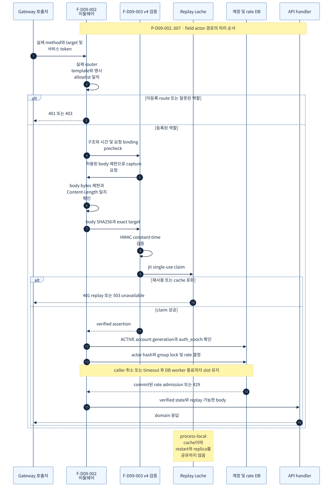

[Mermaid 원본](../diagrams/D09-actor-sequence.mmd) · [SVG](../rendered/D09-actor-sequence.svg)

## F-D09-003 요청 결속 actor assertion v4와 현재 계정 세대 확인

| 항목 | 명세 |
| --- | --- |
| 분야 | D09 백엔드 공통 실행·보안·추론·경로·운영 상태 |
| 목적 | 요청 결속 actor assertion v4와 현재 계정 세대 확인의 실제 실행 조건과 종료 경계를 제공한다. |
| 사용 주체 | Backend 서비스 허용된 HTTP 호출자 또는 내부 실행 소유자 |
| 활성 상태 | ACTIVE |
| 진입점 | backend/app/field_test_security.py:1415 precheck_actor_assertion_v4 backend/app/field_test_security.py:2490 v4 middleware 분기 |
| 실행 전제 | actor 필요한 field/static-admin 요청이며 전용 privacy assertion·DB admin identity·명시 local bypass 경로가 아닌 경우. |
| 입력 출처 형식 검증 최신성 | actor ID 1~64 허용문자, positive account generation, 선택 auth_epoch, iat/exp/kid/jti/signature. HMAC-SHA256는 audience, role, actor, generation, epoch, method, raw path+query, body SHA256을 포함한다. |

### 시작 이벤트와 처리 순서

| 이벤트 ID | 발생원 | 이벤트 | 수신부 | 흐름 |
| --- | --- | --- | --- | --- |
| E-D09-003-01 | backend/app/field_test_security.py:1415 precheck_actor_assertion_v4 | 요청 결속 actor assertion v4와 현재 계정 세대 확인 진입 | create_actor_assertion_v4 | token 구조와 시간 precheck → bounded body hash와 replay → exact HMAC 검증 → jti 단일사용 claim → 현재 account 세대와 epoch 검사 → 검증 identity 전달 → 현재 계정 권한과 정확한 요청에 결속된 identity 전달 |

1. body를 읽기 전에 v4 구조·시간·kid·actor/generation·method/target 형태 precheck한다.
2. body를 요청별 limit 안에서 한 번 capture/hash; Content-Length 실제 길이와 다르면400, 초과413. ASGI 메시지를 replay한다.
3. 동일 binding으로 HMAC을 재생성해 compare_digest 후 single-use jti를 claim한다.
4. field 계정은 매 요청 DB UserAccount ACTIVE/account_generation/auth_epoch를 확인한다. 등록 계정이 없을 때만 epoch 없는 legacy actor를 허용한다.
5. scope.state.verified_actor_assertion에 검증된 identity를 저장한 뒤 rate/handler로 진행한다.

| 분기 조건 | 실제 처리 결과 | 구현 근거 |
| --- | --- | --- |
| current > exp 또는 iat > current+5 또는 exp > iat+30 | assertion invalid401; 내신고/transport는404 은폐 | backend/app/field_test_security.py:1370 _actor_assertion_v4_unsigned_fields |
| 이미 claim된 jti | 401 actor_assertion_replayed 또는 은폐404 | backend/app/field_test_security.py:2534 __call__ |
| replay cache 100000개 포화 | 503 account_authentication_unavailable 및 Retry-After1 | backend/app/field_test_security.py:1497 ActorAssertionReplayCache |
| 계정 inactive/세대·epoch 불일치 | 401 account_authentication_stale 또는 은폐404 | backend/app/field_test_security.py:1132 _actor_account_session_is_current |
| 현재 계정 DB 조회 실패 | 503 account_authentication_unavailable | backend/app/field_test_security.py:2580 __call__ |

### 효과 종료와 복구

body 임시 메모리·process-local replay cache·읽기 DB; 원문 비밀 토큰 출력 없음

| 상황 | 동작 |
| --- | --- |
| 정상 완료 | 현재 계정 권한과 정확한 요청에 결속된 identity 전달 |
| 실패 | 분기표의 오류로 종료; 성공 결과를 만들지 않음 |
| 시간 초과 | 독립 타이머 없음; 공통 요청/의존성 제한 적용 |
| 중복 입력 | 같은 jti는 거부; cache는 process-local이므로 다른 worker/재시작 간 single-use는 보장하지 않음 |
| 취소 | 전용 취소 API 없음 |
| 중단과 생명주기 | 프로세스 중단 뒤 동일 요청 자동 재개 없음 |
| 재시도 | 재시도는 Gateway의 새 jti 서명 필요; 업무 멱등은 별도 endpoint 계약 |
| 복구 | 원인 해소 후 새 요청에서 다시 검증 |
| 자원 정리 | jti는 exp+5보다 현재시각이 커질 때 heap에서 제거 |

### 상태 실행 맥락과 연결

| 항목 | 명세 |
| --- | --- |
| 초기 상태 | S-D09-003-REQUESTED |
| 상태 목록 | S-D09-003-REQUESTED S-D09-003-VALIDATING S-D09-003-PROCESSING S-D09-003-SUCCEEDED S-D09-003-REJECTED |
| 전이 조건과 전이 동작 | 진입→VALIDATING 조건충족→PROCESSING 정상결과→SUCCEEDED 검증/의존성실패→REJECTED |
| 허용되지 않는 전이 | 검증 실패 뒤 성공 응답 금지. 이 상태 이름은 코드 흐름을 설명한 문서 상태이며 DB enum이 아님. |
| 동시성 순서와 작업 소유권 | ReplayCache lock+expiry heap; exp+5까지 보존, 그 이후 정리. HTTP 취소가 claim을 되돌리지 않음. DB 조회는 to_thread; 성공했던 assertion도 새 요청에서 재사용 불가. |
| 공유 상태와 다른 기능 연결 | Gateway D08 v4 서명자, D13 account auth_epoch 변경, D15 내신고404 은폐 |

### 정책 근거와 검증 범위

| 항목 | 근거 |
| --- | --- |
| 정책 | [P-D09-003](#P-D09-003) |
| 구현 | [backend/app/field_test_security.py:1309](/home/ddobagi/Hanium_Dreamup/backend/app/field_test_security.py:1309) · `create_actor_assertion_v4` (범위 1309–1367) [backend/app/field_test_security.py:1497](/home/ddobagi/Hanium_Dreamup/backend/app/field_test_security.py:1497) · `ActorAssertionReplayCache` (범위 1497–1537) [backend/app/field_test_security.py:1132](/home/ddobagi/Hanium_Dreamup/backend/app/field_test_security.py:1132) · `_actor_account_session_is_current` (범위 1132–1161) |
| 기존 개선 ID | 개별 동일성 미확인; 분야 연관은 별도 추적표 |
| 기존 분야 | 해당 없음 |
| 기존 실행 증거 | 미확인: 과거 실행 로그를 이번 정적분석의 성공 근거로 사용하지 않음 |
| 한계 및 구분 | v1-v3 기본 safe-methods: GET/HEAD만 허용. accept는 local/test 호환 opt-in이며 deployment 금지, reject는 전부 v4 요구. replay cache는 DB 공유 아님. |

| 테스트 위치 | 심볼 | 증거 수준 | 기대와 한계 |
| --- | --- | --- | --- |
| [backend/tests/test_actor_assertion_v4.py](/home/ddobagi/Hanium_Dreamup/backend/tests/test_actor_assertion_v4.py) | test_v4_matches_the_cross_language_wire_contract | TEST_EXPECTATION | Gateway와 동일 golden wire 기대; 이번 미실행 |
| [backend/tests/test_actor_assertion_v4.py](/home/ddobagi/Hanium_Dreamup/backend/tests/test_actor_assertion_v4.py) | test_v4_lifetime_is_short_and_enforced | TEST_EXPECTATION | exp 정각 허용, exp+1 거부 및 미래5초 경계 기대; 이번 미실행 |

### 이벤트 처리 그림


[Mermaid 원본](../diagrams/D09-F003.mmd) · [SVG](../rendered/D09-F003.svg)

[Mermaid 원본](../diagrams/D09-actor-sequence.mmd) · [SVG](../rendered/D09-actor-sequence.svg)

## F-D09-004 원시 수집·계정 삭제 전용 요청 증명

| 항목 | 명세 |
| --- | --- |
| 분야 | D09 백엔드 공통 실행·보안·추론·경로·운영 상태 |
| 목적 | 원시 수집·계정 삭제 전용 요청 증명의 실제 실행 조건과 종료 경계를 제공한다. |
| 사용 주체 | Backend 서비스 허용된 HTTP 호출자 또는 내부 실행 소유자 |
| 활성 상태 | ACTIVE |
| 진입점 | backend/app/field_test_security.py:1766 verify_raw_collection_request_proof backend/app/field_test_security.py:1867 verify_privacy_deletion_assertion |
| 실행 전제 | field service token과 named actor, positive generation. raw 모든 access는 보안 local bypass 금지. |
| 입력 출처 형식 검증 최신성 | raw v1 proof는 actor/generation/op/method/path/purpose/walk_id/manifest/consent/chunk/commit digest 결속. 삭제 v2 proof는 actor/generation/request_id/tombstone/access_pre_digest/method/path/body_sha256 결속. |

### 시작 이벤트와 처리 순서

| 이벤트 ID | 발생원 | 이벤트 | 수신부 | 흐름 |
| --- | --- | --- | --- | --- |
| E-D09-004-01 | backend/app/field_test_security.py:1766 verify_raw_collection_request_proof | 원시 수집·계정 삭제 전용 요청 증명 진입 | raw_collection_request_proof_payload | service token과 actor 확인 → operation과 purpose hash 조합검증 → 필요한 원문 body hash → 전용 HMAC와 시각 검증 → 검증 capability 전달 → 검증된 요청 범위 capability를 D13 endpoint로 전달 |

1. raw operation은 HEAD/PUT manifest·chunk, HEAD/POST commit, GET status를 별도 분류한다.
2. raw purpose는 GENERAL_RAW 또는 AUTO_REPORT, walk_id는 canonical UUID, digest는 lowercase64 hex; operation별 허용 nullable hash 조합을 검증한다.
3. 삭제 request는 tombstone 미지정, 후속 status/evidence는 tombstone 지정 필요. POST 원문을 bounded capture하고 request_id와 digest를 결속한다.
4. HMAC 및30초 freshness를 검증한 뒤 scope.state의 verified raw 또는 privacy evidence를 전달한다. 실제 동의·ownership·transaction은 D13 service에서 추가 확인한다.

| 분기 조건 | 실제 처리 결과 | 구현 근거 |
| --- | --- | --- |
| raw write/preflight이며 raw_ingest_enabled=false | 503 raw_ingest_disabled | backend/app/field_test_security.py:2610 __call__ |
| raw 증명 없음/변경/잘못된 hash조합 | 401 raw_request_proof_required/invalid | backend/app/field_test_security.py:1766 verify_raw_collection_request_proof |
| 삭제 헤더 바인딩 불완전 | 422 account_deletion_binding_invalid | backend/app/field_test_security.py:2370 __call__ |

### 효과 종료와 복구

일반 actor 증명과 목적 특화 proof를 분리; 잘못된 삭제 capability로 일반 API 권한을 만들지 않음

| 상황 | 동작 |
| --- | --- |
| 정상 완료 | 검증된 요청 범위 capability를 D13 endpoint로 전달 |
| 실패 | 분기표의 오류로 종료; 성공 결과를 만들지 않음 |
| 시간 초과 | 독립 타이머 없음; 공통 요청/의존성 제한 적용 |
| 중복 입력 | 요청 자체의 멱등 보장 없음 |
| 취소 | 전용 취소 API 없음 |
| 중단과 생명주기 | 프로세스 중단 뒤 동일 요청 자동 재개 없음 |
| 재시도 | 서버 자동 재시도 없음 |
| 복구 | 원인 해소 후 새 요청에서 다시 검증 |
| 자원 정리 | 요청 지역 상태 반환; 공유 자원은 소유자의 lifecycle에서 정리 |

### 상태 실행 맥락과 연결

| 항목 | 명세 |
| --- | --- |
| 초기 상태 | S-D09-004-REQUESTED |
| 상태 목록 | S-D09-004-REQUESTED S-D09-004-VALIDATING S-D09-004-PROCESSING S-D09-004-SUCCEEDED S-D09-004-REJECTED |
| 전이 조건과 전이 동작 | 진입→VALIDATING 조건충족→PROCESSING 정상결과→SUCCEEDED 검증/의존성실패→REJECTED |
| 허용되지 않는 전이 | 검증 실패 뒤 성공 응답 금지. 이 상태 이름은 코드 흐름을 설명한 문서 상태이며 DB enum이 아님. |
| 동시성 순서와 작업 소유권 | 서명 비교는 동기 함수; ASGI body capture는 순차. raw extra proof에는 자체 jti 없음; 일반 v4와 storage 멱등을 대체하지 않음. |
| 공유 상태와 다른 기능 연결 | D13 raw ingest 및 계정삭제 lifecycle; Gateway D08의 corresponding proof writer |

### 정책 근거와 검증 범위

| 항목 | 근거 |
| --- | --- |
| 정책 | [P-D09-004](#P-D09-004) |
| 구현 | [backend/app/field_test_security.py:1618](/home/ddobagi/Hanium_Dreamup/backend/app/field_test_security.py:1618) · `raw_collection_request_proof_payload` (범위 1618–1690) [backend/app/field_test_security.py:1867](/home/ddobagi/Hanium_Dreamup/backend/app/field_test_security.py:1867) · `verify_privacy_deletion_assertion` (범위 1867–1906) |
| 기존 개선 ID | 개별 동일성 미확인; 분야 연관은 별도 추적표 |
| 기존 분야 | 해당 없음 |
| 기존 실행 증거 | 미확인: 과거 실행 로그를 이번 정적분석의 성공 근거로 사용하지 않음 |
| 한계 및 구분 | 이 기능은 인가 경계만 포함. DB generation fence/동의/삭제 완료/보존은 D13에 상세 기술. |

| 테스트 위치 | 심볼 | 증거 수준 | 기대와 한계 |
| --- | --- | --- | --- |

연결한 테스트 미확인: 이번 작성 범위에서 이 기능에 대응하는 시험 단언을 연결하지 않았다. 테스트 자체가 없다는 판정이 아니다.

### 이벤트 처리 그림


[Mermaid 원본](../diagrams/D09-F004.mmd) · [SVG](../rendered/D09-F004.svg)

## F-D09-005 actor별 원자적 요청 수 제한

| 항목 | 명세 |
| --- | --- |
| 분야 | D09 백엔드 공통 실행·보안·추론·경로·운영 상태 |
| 목적 | actor별 원자적 요청 수 제한의 실제 실행 조건과 종료 경계를 제공한다. |
| 사용 주체 | Backend 서비스 허용된 HTTP 호출자 또는 내부 실행 소유자 |
| 활성 상태 | ACTIVE |
| 진입점 | backend/app/field_test_security.py:2720 rate_limit_group 처리 backend/app/services/actor_rate_limit.py:247 PostgresActorRateLimiter.check_async |
| 실행 전제 | 그룹 지정 route에서 인증과 증명 통과 후 실행. deployment PostgreSQL; development/test memory 허용. |
| 입력 출처 형식 검증 최신성 | 검증된 actor_id와 그룹.60초창 report12/raw_collection240/navigation30/detect180/export6/admin_read120/privacy12. |

### 시작 이벤트와 처리 순서

| 이벤트 ID | 발생원 | 이벤트 | 수신부 | 흐름 |
| --- | --- | --- | --- | --- |
| E-D09-005-01 | backend/app/field_test_security.py:2720 rate_limit_group 처리 | actor별 원자적 요청 수 제한 진입 | ACTOR_RATE_LIMITS | 검증 actor와 rate 그룹 → 즉시 실행슬롯 예약 → DB advisory lock와 만료행 삭제 → 현재 count와 limit 비교 → 한행 insert 또는 Retry-After → commit 이후 결과 → 허용 요청 한 건을 원자적 계수한 후 업무 handler 호출 |

1. rate limiter는 actor_id SHA256 + 그룹의 DB advisory transaction lock으로 동시 요청을 직렬화한다.
2. 같은 actor/group의 observed_at <= DB clock-60초만 삭제하고 count/min을 읽는다.
3. 현재 count>=limit이면 Retry-After 계산; 아니면 clock_timestamp default로 한 row insert 후 commit한다.
4. 공유 bounded execution은 즉시 슬롯 확보, 단일 결정 deadline을 SQL별 remaining statement_timeout까지 전파한다.
5. timeout/cancel 후 진행 중 DB worker가 session commit/rollback/close를 실제 마칠 때 slot을 release-once한다.

| 분기 조건 | 실제 처리 결과 | 구현 근거 |
| --- | --- | --- |
| 그룹 count >= limit | 429 actor_rate_limit_exceeded + Retry-After | backend/app/services/actor_rate_limit.py:339 _check_in_db |
| 실행슬롯/lock 획득 불가, deadline, DB 실패 | 503 actor_rate_limit_store_unavailable | backend/app/services/actor_rate_limit.py:119 ActorRateLimitExecution._submit |
| executor submit 결과 불확실 | dispatcher quarantine; 불확실 slot 재사용 금지 | backend/app/services/actor_rate_limit.py:150 _submit |

### 효과 종료와 복구

actor 원문 대신 SHA256/group/time row 저장; 초과 요청은 insert하지 않음

| 상황 | 동작 |
| --- | --- |
| 정상 완료 | 허용 요청 한 건을 원자적 계수한 후 업무 handler 호출 |
| 실패 | 분기표의 오류로 종료; 성공 결과를 만들지 않음 |
| 시간 초과 | 공유5000ms 기본 결정 예산; 작업을 물리적으로 즉시 중단했다고 주장하지 않음 |
| 중복 입력 | 매 요청 별도 계수; 업무 재전송도 해당 endpoint 멱등 전 rate를 소모할 수 있음 |
| 취소 | caller 취소는 budget cancel+future.cancel 시도; worker가 실행 중이면 정리 종료까지 slot 유지 |
| 중단과 생명주기 | 프로세스 중단 뒤 동일 요청 자동 재개 없음 |
| 재시도 | 서버 자동 재시도 없음 |
| 복구 | 원인 해소 후 새 요청에서 다시 검증 |
| 자원 정리 | worker가 session을 닫은 뒤 release-once; uncertain submit은 quarantine 유지 |

### 상태 실행 맥락과 연결

| 항목 | 명세 |
| --- | --- |
| 초기 상태 | S-D09-005-REQUESTED |
| 상태 목록 | S-D09-005-REQUESTED S-D09-005-VALIDATING S-D09-005-PROCESSING S-D09-005-SUCCEEDED S-D09-005-REJECTED |
| 전이 조건과 전이 동작 | 진입→VALIDATING 조건충족→PROCESSING 정상결과→SUCCEEDED 검증/의존성실패→REJECTED |
| 허용되지 않는 전이 | 검증 실패 뒤 성공 응답 금지. 이 상태 이름은 코드 흐름을 설명한 문서 상태이며 DB enum이 아님. |
| 동시성 순서와 작업 소유권 | dedicated ThreadPoolExecutor 기본4 inflight; async waiter shield+timeout, 늦은 exception 소비. commit이 늦게 성공하면 quota가 소비되어도 늦은 admission 성공은 반환하지 않음. |
| 공유 상태와 다른 기능 연결 | D13 계정 bucket도 공통 execution 공유; P-D09-006 글로벌 보존정리 |

### 정책 근거와 검증 범위

| 항목 | 근거 |
| --- | --- |
| 정책 | [P-D09-005](#P-D09-005) |
| 구현 | [backend/app/field_test_security.py:183](/home/ddobagi/Hanium_Dreamup/backend/app/field_test_security.py:183) · `ACTOR_RATE_LIMITS` (범위 183–193) [backend/app/services/actor_rate_limit.py:90](/home/ddobagi/Hanium_Dreamup/backend/app/services/actor_rate_limit.py:90) · `ActorRateLimitExecution` (범위 90–227) [backend/app/services/actor_rate_limit.py:290](/home/ddobagi/Hanium_Dreamup/backend/app/services/actor_rate_limit.py:290) · `PostgresActorRateLimiter._check_in_db` (범위 290–361) |
| 기존 개선 ID | 개별 동일성 미확인; 분야 연관은 별도 추적표 |
| 기존 분야 | 해당 없음 |
| 기존 실행 증거 | 미확인: 과거 실행 로그를 이번 정적분석의 성공 근거로 사용하지 않음 |
| 한계 및 구분 | 고정 소스 정적분석. 실제 서비스 설정값·provider·모델·운영 DB 실행은 이번에 확인하지 않음. |

| 테스트 위치 | 심볼 | 증거 수준 | 기대와 한계 |
| --- | --- | --- | --- |
| [backend/tests/test_actor_rate_limit_execution.py](/home/ddobagi/Hanium_Dreamup/backend/tests/test_actor_rate_limit_execution.py) | test_late_commit_cannot_return_an_admission_but_may_have_consumed_quota | TEST_EXPECTATION | 늦은 commit의 계수와 호출자 실패를 구분하는 기대; test symbol 정적 확인; 이번 미실행 |

### 이벤트 처리 그림


[Mermaid 원본](../diagrams/D09-F005.mmd) · [SVG](../rendered/D09-F005.svg)

[Mermaid 원본](../diagrams/D09-actor-sequence.mmd) · [SVG](../rendered/D09-actor-sequence.svg)

## F-D09-006 전역 rate-event 보존 미리보기와 단일 배치 삭제

| 항목 | 명세 |
| --- | --- |
| 분야 | D09 백엔드 공통 실행·보안·추론·경로·운영 상태 |
| 목적 | 전역 rate-event 보존 미리보기와 단일 배치 삭제의 실제 실행 조건과 종료 경계를 제공한다. |
| 사용 주체 | Backend 서비스 허용된 HTTP 호출자 또는 내부 실행 소유자 |
| 활성 상태 | CONDITIONAL |
| 진입점 | backend/app/services/actor_rate_limit_retention.py:233 main backend/app/services/actor_rate_limit_retention.py:111 run_retention |
| 실행 전제 | CLI 또는 내부 run_retention 호출; 서비스/timer 설치 및 실제 실행 여부는 D11 운영 문서의 별도 근거. |
| 입력 출처 형식 검증 최신성 | --apply 기본 false; --batch-size 기본500,1..1000. PostgreSQL 설정과 DB server clock. 계정별 configured window와 retention ceiling을 구분. |

### 시작 이벤트와 처리 순서

| 이벤트 ID | 발생원 | 이벤트 | 수신부 | 흐름 |
| --- | --- | --- | --- | --- |
| E-D09-006-01 | backend/app/services/actor_rate_limit_retention.py:233 main | 전역 rate-event 보존 미리보기와 단일 배치 삭제 진입 | run_retention | 인자와 PostgreSQL 정책 검증 → DB clock와 그룹 retention → preview read-only 집계 또는 apply 후보 → 그룹 cutoff 재검증 delete 한 번 → transaction commit → 최소 JSON 출력 → preview 또는 한 배치 삭제 count 반환 |

1. retention_policy는 field 그룹60초, 계정그룹은 설정창과 무관하게 최대 허용창86400초 보존을 사용한다.
2. preview는 read-only transaction에서 total/expired/eligible/unknown/table_bytes 집계만 수행한다.
3. apply는 DB clock 고정 cutoff 기준 oldest id 후보를 한 번만 최대batch 선택하고 그룹·cutoff 재검증 후 삭제한다.
4. transaction exit commit 후에만 completed를 반환; 출력 실패 시 이미 알려진 commit을 committed로 구분한다.

| 분기 조건 | 실제 처리 결과 | 구현 근거 |
| --- | --- | --- |
| batch<1 또는 >1000 또는 PostgreSQL 아님 | DB 열기 전 실패 | backend/app/services/actor_rate_limit_retention.py:119 run_retention |
| unknown rate group | preview로 알리고 apply 후보에는 포함 안 함 | backend/app/services/actor_rate_limit_retention.py:80 _metrics |
| commit 결과 불확실 | failed/deletion_outcome unknown; 성공 count 만들지 않음 | backend/app/services/actor_rate_limit_retention.py:253 main |

### 효과 종료와 복구

preview는 read only; apply는 rate-event 삭제만 수행하고 drain loop 없음

| 상황 | 동작 |
| --- | --- |
| 정상 완료 | preview 또는 한 배치 삭제 count 반환 |
| 실패 | 분기표의 오류로 종료; 성공 결과를 만들지 않음 |
| 시간 초과 | 독립 타이머 없음; 공통 요청/의존성 제한 적용 |
| 중복 입력 | 재호출은 그 시점 다음 배치; 0삭제가 table 전체 빈 상태를 증명하지 않음 |
| 취소 | 전용 취소 API 없음 |
| 중단과 생명주기 | 프로세스 중단 뒤 동일 요청 자동 재개 없음 |
| 재시도 | 한 실행 안 자동 재시도 없음; scheduler 여부 D12 |
| 복구 | 원인 해소 후 새 요청에서 다시 검증 |
| 자원 정리 | transaction context 종료; 상세 actor data를 출력하지 않음 |

### 상태 실행 맥락과 연결

| 항목 | 명세 |
| --- | --- |
| 초기 상태 | S-D09-006-REQUESTED |
| 상태 목록 | S-D09-006-REQUESTED S-D09-006-VALIDATING S-D09-006-PROCESSING S-D09-006-SUCCEEDED S-D09-006-REJECTED |
| 전이 조건과 전이 동작 | 진입→VALIDATING 조건충족→PROCESSING 정상결과→SUCCEEDED 검증/의존성실패→REJECTED |
| 허용되지 않는 전이 | 검증 실패 뒤 성공 응답 금지. 이 상태 이름은 코드 흐름을 설명한 문서 상태이며 DB enum이 아님. |
| 동시성 순서와 작업 소유권 | 동기 DB transaction. 별도 automatic retry·full-drain·OS interrupt compensation 없음. |
| 공유 상태와 다른 기능 연결 | D12 timer/CLI wiring, D13 계정 rate window, F-D09-005 |

### 정책 근거와 검증 범위

| 항목 | 근거 |
| --- | --- |
| 정책 | [P-D09-006](#P-D09-006) |
| 구현 | [backend/app/services/actor_rate_limit_retention.py:111](/home/ddobagi/Hanium_Dreamup/backend/app/services/actor_rate_limit_retention.py:111) · `run_retention` (범위 111–207) [backend/app/services/actor_rate_limit_retention.py:230](/home/ddobagi/Hanium_Dreamup/backend/app/services/actor_rate_limit_retention.py:230) · `main` (범위 230–267) |
| 기존 개선 ID | 개별 동일성 미확인; 분야 연관은 별도 추적표 |
| 기존 분야 | 해당 없음 |
| 기존 실행 증거 | 미확인: 과거 실행 로그를 이번 정적분석의 성공 근거로 사용하지 않음 |
| 한계 및 구분 | 고정 소스 정적분석. 실제 서비스 설정값·provider·모델·운영 DB 실행은 이번에 확인하지 않음. |

| 테스트 위치 | 심볼 | 증거 수준 | 기대와 한계 |
| --- | --- | --- | --- |

연결한 테스트 미확인: 이번 작성 범위에서 이 기능에 대응하는 시험 단언을 연결하지 않았다. 테스트 자체가 없다는 판정이 아니다.

### 이벤트 처리 그림


[Mermaid 원본](../diagrams/D09-F006.mmd) · [SVG](../rendered/D09-F006.svg)

## F-D09-007 본문 크기·민감응답 캐시·오류 공개 경계

| 항목 | 명세 |
| --- | --- |
| 분야 | D09 백엔드 공통 실행·보안·추론·경로·운영 상태 |
| 목적 | 본문 크기·민감응답 캐시·오류 공개 경계의 실제 실행 조건과 종료 경계를 제공한다. |
| 사용 주체 | Backend 서비스 허용된 HTTP 호출자 또는 내부 실행 소유자 |
| 활성 상태 | ACTIVE |
| 진입점 | backend/app/request_limits.py:251 RequestBodyLimitMiddleware backend/app/main.py:356 walksafe_request_validation_error |
| 실행 전제 | ASGI HTTP 요청. WebSocket/lifespan은 그대로 전달. |
| 입력 출처 형식 검증 최신성 | HTTP POST/PUT/PATCH Content-Length와 실제 수신 bytes; raw write는 인증 뒤 전용 middleware. privacy/report/raw/account 경로별 민감응답. |

### 시작 이벤트와 처리 순서

| 이벤트 ID | 발생원 | 이벤트 | 수신부 | 흐름 |
| --- | --- | --- | --- | --- |
| E-D09-007-01 | backend/app/request_limits.py:251 RequestBodyLimitMiddleware | 본문 크기·민감응답 캐시·오류 공개 경계 진입 | max_request_body_bytes | 경로와 method별 body limit 선택 → Content-Length 사전검사 → 실제 stream 누적bytes 검사 → router validation과 고정오류 투영 → 민감 response cache 헤더 치환 → 한계 내 body만 handler에 도달하고 민감 응답은 지정 캐시 정책 적용 |

1. Content-Length가 한계를 초과하면 multipart spool 이전413; 헤더가 없거나 invalid여도 stream 누적bytes 제한을 검사한다.
2. 일반 limit=upload+metadata+256KiB; 계정16KiB/privacy32KiB/raw manifest512KiB/chunk8MiB/commit16KiB/내신고correction4KiB 적용.
3. PrivacyNoStore는 privacy no-store, report/uploads private,no-store와 Pragma no-cache로 기존 헤더를 치환한다. FastAPI 바깥 wrapper도 framework500까지 동일 정책을 적용한다.
4. raw 모든 응답은 no-store; privacy/raw 미처리 예외는 아직 response start 전일 때만 고정503 및 Retry-After5로 변환한다.
5. validation handler는 계정/privacy/raw/admin별 고정code를 반환하고 필요한 admin 실패감사를 남긴다. detect parser helper는 input·message·context·arbitrary nested key를 공개하지 않는다.

| 분기 조건 | 실제 처리 결과 | 구현 근거 |
| --- | --- | --- |
| received bytes > 해당 limit | 413; 원문 body echo 없음 | backend/app/request_limits.py:293 limited_receive |
| 이미 response.start 뒤 예외 | 새 오류응답을 만들지 않고 예외 전파 | backend/app/request_limits.py:125 PrivacyExceptionMiddleware |
| 민감경로 Pydantic 거부 | 고정422 + 해당 no-store 및 admin audit | backend/app/main.py:356 walksafe_request_validation_error |

### 효과 종료와 복구

bytes 계수/일부 validation audit; provider나 입력 원문을 오류에 복제하지 않음

| 상황 | 동작 |
| --- | --- |
| 정상 완료 | 한계 내 body만 handler에 도달하고 민감 응답은 지정 캐시 정책 적용 |
| 실패 | 분기표의 오류로 종료; 성공 결과를 만들지 않음 |
| 시간 초과 | 독립 타이머 없음; 공통 요청/의존성 제한 적용 |
| 중복 입력 | 요청 자체의 멱등 보장 없음 |
| 취소 | 전용 취소 API 없음 |
| 중단과 생명주기 | 프로세스 중단 뒤 동일 요청 자동 재개 없음 |
| 재시도 | 서버 자동 재시도 없음 |
| 복구 | 원인 해소 후 새 요청에서 다시 검증 |
| 자원 정리 | 요청 지역 상태 반환; 공유 자원은 소유자의 lifecycle에서 정리 |

### 상태 실행 맥락과 연결

| 항목 | 명세 |
| --- | --- |
| 초기 상태 | S-D09-007-REQUESTED |
| 상태 목록 | S-D09-007-REQUESTED S-D09-007-VALIDATING S-D09-007-PROCESSING S-D09-007-SUCCEEDED S-D09-007-REJECTED |
| 전이 조건과 전이 동작 | 진입→VALIDATING 조건충족→PROCESSING 정상결과→SUCCEEDED 검증/의존성실패→REJECTED |
| 허용되지 않는 전이 | 검증 실패 뒤 성공 응답 금지. 이 상태 이름은 코드 흐름을 설명한 문서 상태이며 DB enum이 아님. |
| 동시성 순서와 작업 소유권 | ASGI send/receive wrapper. 이미 전송한 응답을 재시작하지 않음. RequestBodyTooLarge는 downstream에서 잡아413으로 변환. |
| 공유 상태와 다른 기능 연결 | D13 account/privacy/raw, D14/admin, D15/report validation hooks |

### 정책 근거와 검증 범위

| 항목 | 근거 |
| --- | --- |
| 정책 | [P-D09-007](#P-D09-007) |
| 구현 | [backend/app/request_limits.py:226](/home/ddobagi/Hanium_Dreamup/backend/app/request_limits.py:226) · `max_request_body_bytes` (범위 226–248) [backend/app/request_limits.py:64](/home/ddobagi/Hanium_Dreamup/backend/app/request_limits.py:64) · `PrivacyNoStoreMiddleware` (범위 64–96) [backend/app/api/request_validation.py:17](/home/ddobagi/Hanium_Dreamup/backend/app/api/request_validation.py:17) · `public_request_validation_detail` (범위 17–56) [backend/app/main.py:356](/home/ddobagi/Hanium_Dreamup/backend/app/main.py:356) · `walksafe_request_validation_error` (범위 356–522) |
| 기존 개선 ID | 개별 동일성 미확인; 분야 연관은 별도 추적표 |
| 기존 분야 | 해당 없음 |
| 기존 실행 증거 | 미확인: 과거 실행 로그를 이번 정적분석의 성공 근거로 사용하지 않음 |
| 한계 및 구분 | accounts/session-current는 _ACCOUNT_PATHS16KiB 집합에는 없고 일반body limit 경계이며 별도 account route가 처리. CORS는 config origins, credentials true, methods/headers *; 인증을 대체하지 않음. |

| 테스트 위치 | 심볼 | 증거 수준 | 기대와 한계 |
| --- | --- | --- | --- |

연결한 테스트 미확인: 이번 작성 범위에서 이 기능에 대응하는 시험 단언을 연결하지 않았다. 테스트 자체가 없다는 판정이 아니다.

### 이벤트 처리 그림


[Mermaid 원본](../diagrams/D09-F007.mmd) · [SVG](../rendered/D09-F007.svg)

## F-D09-008 legacy 서버 이미지 탐지

| 항목 | 명세 |
| --- | --- |
| 분야 | D09 백엔드 공통 실행·보안·추론·경로·운영 상태 |
| 목적 | legacy 서버 이미지 탐지의 실제 실행 조건과 종료 경계를 제공한다. |
| 사용 주체 | Backend 서비스 허용된 HTTP 호출자 또는 내부 실행 소유자 |
| 활성 상태 | CONDITIONAL |
| 진입점 | backend/app/api/detect.py:224 POST /detect |
| 실행 전제 | field route 인가·actor assertion·detect 그룹 분당 180회 제한 통과. legacy 탐지는 유효한 .pt 모델과 v1 클래스 계약이 필요하다. |
| 입력 출처 형식 검증 최신성 | multipart image와 context JSON. context captured_at은 timezone-aware optional, GPS optional, heading 0 <= value <360. 이미지 정책 F-D09-010. |

### 시작 이벤트와 처리 순서

| 이벤트 ID | 발생원 | 이벤트 | 수신부 | 흐름 |
| --- | --- | --- | --- | --- |
| E-D09-008-01 | backend/app/api/detect.py:224 POST /detect | legacy 서버 이미지 탐지 진입 | detect_objects | context schema 검증 → 이미지 전처리 → isolated 또는 serial thread 실행 → 모델 결과 schema 검증 → 응답 반환 → 검증된 detection 응답 반환; 별도 신고 저장은 발생하지 않음 |

1. api/detect.py에서 context Pydantic 검증; 오류값 없이422 detect_context_invalid.
2. 공유 전처리에서 MIME/파일/크기/EXIF를 검증·정리한다(F-D09-010).
3. isolation runner가 있으면 전처리 완료 뒤 새로운 queue+startup 요청예산으로 해당 contract를 submit한다(F-D09-011).
4. isolation이 없으면 anyio CapacityLimiter1 아래 thread 실행; test/local 경로이며 hard process kill 보장 없음.
5. v1은 .pt model task=detect와 class ID 매핑을 확인하고 confidence/bbox를 정규화한 ReportMetadata 배열을 반환한다.

| 분기 조건 | 실제 처리 결과 | 구현 근거 |
| --- | --- | --- |
| context JSON/schema 불일치 | 422 detect_context_invalid | backend/app/api/detect.py:232 detect_objects |
| queue deadline | 503 detect_queue_timeout; Retry-After1 | backend/app/api/detect.py:336 exception mapping |
| 실행 hard deadline | 503 detect_inference_deadline_exceeded; worker retirement | backend/app/api/detect.py:347 exception mapping |
| runtime 실패 | 503 model_unavailable; 공개reason allowlist 밖은 detector_runtime_error | backend/app/api/detect.py:58 _public_runtime_reason |

### 효과 종료와 복구

모델/프로세스·thread·응답, runtime 실패 warning log. 서버가 음성/진동/Android UI를 직접 제어하지 않음

| 상황 | 동작 |
| --- | --- |
| 정상 완료 | 검증된 detection 응답 반환; 별도 신고 저장은 발생하지 않음 |
| 실패 | 분기표의 오류로 종료; 성공 결과를 만들지 않음 |
| 시간 초과 | queue503과 execution503은 다른 code; physical cleanup 완료와 HTTP deadline 응답을 구분 |
| 중복 입력 | 동일 이미지 요청 결과 캐시/업무 멱등 없음; 매 요청 rate와 추론 적용 |
| 취소 | ASGI task 취소를 전파; 이미 제출된 runner Future는 owner가 끝까지 정리 |
| 중단과 생명주기 | 프로세스 중단 뒤 동일 요청 자동 재개 없음 |
| 재시도 | 서버 자동 재시도 없음 |
| 복구 | 원인 해소 후 새 요청에서 다시 검증 |
| 자원 정리 | 요청 지역 상태 반환; 공유 자원은 소유자의 lifecycle에서 정리 |

### 상태 실행 맥락과 연결

| 항목 | 명세 |
| --- | --- |
| 초기 상태 | S-D09-008-REQUESTED |
| 상태 목록 | S-D09-008-REQUESTED S-D09-008-VALIDATING S-D09-008-PROCESSING S-D09-008-SUCCEEDED S-D09-008-REJECTED |
| 전이 조건과 전이 동작 | 진입→VALIDATING 조건충족→PROCESSING 정상결과→SUCCEEDED 검증/의존성실패→REJECTED |
| 허용되지 않는 전이 | 검증 실패 뒤 성공 응답 금지. 이 상태 이름은 코드 흐름을 설명한 문서 상태이며 DB enum이 아님. |
| 동시성 순서와 작업 소유권 | async upload+runner future; waiter 취소가 실제 running future/lease를 취소하지 않음. 명시 disconnect watcher는 이 endpoint에 없음. |
| 공유 상태와 다른 기능 연결 | v1/v2는 공통 전처리/runner를 공유하나 class ID 계약은 분리. Android 로컬 TFLite 및 Gateway 공개 route에 detect 연결을 가정하지 않음 |

### 정책 근거와 검증 범위

| 항목 | 근거 |
| --- | --- |
| 정책 | [P-D09-008](#P-D09-008) |
| 구현 | [backend/app/api/detect.py:224](/home/ddobagi/Hanium_Dreamup/backend/app/api/detect.py:224) · `detect_objects` (범위 224–292) [backend/app/detector.py:189](/home/ddobagi/Hanium_Dreamup/backend/app/detector.py:189) · `YoloPtAdapter` (범위 189–307) |
| 기존 개선 ID | 개별 동일성 미확인; 분야 연관은 별도 추적표 |
| 기존 분야 | 해당 없음 |
| 기존 실행 증거 | 미확인: 과거 실행 로그를 이번 정적분석의 성공 근거로 사용하지 않음 |
| 한계 및 구분 | CONDITIONAL은 model/runtime 설정 의존. source 기본 fake는 실제 현재 process mode의 증거가 아님. v1 route는 legacy 계약이나 실제 연결된 compatibility endpoint. |

| 테스트 위치 | 심볼 | 증거 수준 | 기대와 한계 |
| --- | --- | --- | --- |

연결한 테스트 미확인: 이번 작성 범위에서 이 기능에 대응하는 시험 단언을 연결하지 않았다. 테스트 자체가 없다는 판정이 아니다.

### 이벤트 처리 그림


[Mermaid 원본](../diagrams/D09-F008.mmd) · [SVG](../rendered/D09-F008.svg)

## F-D09-009 v2 서버 이미지 탐지

| 항목 | 명세 |
| --- | --- |
| 분야 | D09 백엔드 공통 실행·보안·추론·경로·운영 상태 |
| 목적 | v2 서버 이미지 탐지의 실제 실행 조건과 종료 경계를 제공한다. |
| 사용 주체 | Backend 서비스 허용된 HTTP 호출자 또는 내부 실행 소유자 |
| 활성 상태 | CONDITIONAL |
| 진입점 | backend/app/api/detect.py:298 POST /detect/v2 |
| 실행 전제 | field route 인가·actor assertion·detect 그룹 분당 180회 제한 통과. v2 mode와 real 모델 준비 여부에 따라 provider를 선택한다. |
| 입력 출처 형식 검증 최신성 | multipart image와 context JSON. context captured_at은 timezone-aware optional, GPS optional, heading 0 <= value <360. 이미지 정책 F-D09-010. |

### 시작 이벤트와 처리 순서

| 이벤트 ID | 발생원 | 이벤트 | 수신부 | 흐름 |
| --- | --- | --- | --- | --- |
| E-D09-009-01 | backend/app/api/detect.py:298 POST /detect/v2 | v2 서버 이미지 탐지 진입 | detect_objects_v2 | context schema 검증 → 이미지 전처리 → isolated 또는 serial thread 실행 → 모델 결과 schema 검증 → 응답 반환 → 검증된 detection 응답 반환; 별도 신고 저장은 발생하지 않음 |

1. api/detect.py에서 context Pydantic 검증; 오류값 없이422 detect_context_invalid.
2. 공유 전처리에서 MIME/파일/크기/EXIF를 검증·정리한다(F-D09-010).
3. isolation runner가 있으면 전처리 완료 뒤 새로운 queue+startup 요청예산으로 해당 contract를 submit한다(F-D09-011).
4. isolation이 없으면 anyio CapacityLimiter1 아래 thread 실행; test/local 경로이며 hard process kill 보장 없음.
5. v2는 provider mode/아티팩트/threshold 구성으로 detections를 반환한다(F-D09-012).

| 분기 조건 | 실제 처리 결과 | 구현 근거 |
| --- | --- | --- |
| context JSON/schema 불일치 | 422 detect_context_invalid | backend/app/api/detect.py:307 detect_objects_v2 |
| queue deadline | 503 detect_v2_queue_timeout; Retry-After1 | backend/app/api/detect.py:336 exception mapping |
| 실행 hard deadline | 503 detect_v2_inference_deadline_exceeded; worker retirement | backend/app/api/detect.py:347 exception mapping |
| runtime 실패 | 503 detect_v2_unavailable; 공개reason allowlist 밖은 detector_runtime_error | backend/app/api/detect.py:58 _public_runtime_reason |

### 효과 종료와 복구

모델/프로세스·thread·응답, runtime 실패 warning log. 서버가 음성/진동/Android UI를 직접 제어하지 않음

| 상황 | 동작 |
| --- | --- |
| 정상 완료 | 검증된 detection 응답 반환; 별도 신고 저장은 발생하지 않음 |
| 실패 | 분기표의 오류로 종료; 성공 결과를 만들지 않음 |
| 시간 초과 | queue503과 execution503은 다른 code; physical cleanup 완료와 HTTP deadline 응답을 구분 |
| 중복 입력 | 동일 이미지 요청 결과 캐시/업무 멱등 없음; 매 요청 rate와 추론 적용 |
| 취소 | ASGI task 취소를 전파; 이미 제출된 runner Future는 owner가 끝까지 정리 |
| 중단과 생명주기 | 프로세스 중단 뒤 동일 요청 자동 재개 없음 |
| 재시도 | 서버 자동 재시도 없음 |
| 복구 | 원인 해소 후 새 요청에서 다시 검증 |
| 자원 정리 | 요청 지역 상태 반환; 공유 자원은 소유자의 lifecycle에서 정리 |

### 상태 실행 맥락과 연결

| 항목 | 명세 |
| --- | --- |
| 초기 상태 | S-D09-009-REQUESTED |
| 상태 목록 | S-D09-009-REQUESTED S-D09-009-VALIDATING S-D09-009-PROCESSING S-D09-009-SUCCEEDED S-D09-009-REJECTED |
| 전이 조건과 전이 동작 | 진입→VALIDATING 조건충족→PROCESSING 정상결과→SUCCEEDED 검증/의존성실패→REJECTED |
| 허용되지 않는 전이 | 검증 실패 뒤 성공 응답 금지. 이 상태 이름은 코드 흐름을 설명한 문서 상태이며 DB enum이 아님. |
| 동시성 순서와 작업 소유권 | async upload+runner future; waiter 취소가 실제 running future/lease를 취소하지 않음. 명시 disconnect watcher는 이 endpoint에 없음. |
| 공유 상태와 다른 기능 연결 | v1/v2는 공통 전처리/runner를 공유하나 class ID 계약은 분리. Android 로컬 TFLite 및 Gateway 공개 route에 detect 연결을 가정하지 않음 |

### 정책 근거와 검증 범위

| 항목 | 근거 |
| --- | --- |
| 정책 | [P-D09-009](#P-D09-009) |
| 구현 | [backend/app/api/detect.py:298](/home/ddobagi/Hanium_Dreamup/backend/app/api/detect.py:298) · `detect_objects_v2` (범위 298–376) [backend/app/detector.py:189](/home/ddobagi/Hanium_Dreamup/backend/app/detector.py:189) · `YoloPtAdapter` (범위 189–307) |
| 기존 개선 ID | 개별 동일성 미확인; 분야 연관은 별도 추적표 |
| 기존 분야 | 해당 없음 |
| 기존 실행 증거 | 미확인: 과거 실행 로그를 이번 정적분석의 성공 근거로 사용하지 않음 |
| 한계 및 구분 | CONDITIONAL은 모델과 runtime 설정에 의존함을 뜻한다. 기본 fake 설정을 실제 현재 서버의 활성 mode로 단정하지 않는다. |

| 테스트 위치 | 심볼 | 증거 수준 | 기대와 한계 |
| --- | --- | --- | --- |

연결한 테스트 미확인: 이번 작성 범위에서 이 기능에 대응하는 시험 단언을 연결하지 않았다. 테스트 자체가 없다는 판정이 아니다.

### 이벤트 처리 그림


[Mermaid 원본](../diagrams/D09-F009.mmd) · [SVG](../rendered/D09-F009.svg)

## F-D09-010 탐지 이미지 전처리와 소유권 정리

| 항목 | 명세 |
| --- | --- |
| 분야 | D09 백엔드 공통 실행·보안·추론·경로·운영 상태 |
| 목적 | 탐지 이미지 전처리와 소유권 정리의 실제 실행 조건과 종료 경계를 제공한다. |
| 사용 주체 | Backend 서비스 허용된 HTTP 호출자 또는 내부 실행 소유자 |
| 활성 상태 | ACTIVE |
| 진입점 | backend/app/services/_detection_preprocessing.py:629 read_detection_image_upload backend/app/uploads.py:236 read_image_upload |
| 실행 전제 | detect v1/v2 요청. 공유 preprocessing semaphore2를 즉시 획득해야 함. |
| 입력 출처 형식 검증 최신성 | JPEG/PNG/WebP 중 설정허용 MIME, extension와 signature; 원문/정리후 bytes 모두 max_upload 이내. 최대가로세로8192,20000000pixels. |

### 시작 이벤트와 처리 순서

| 이벤트 ID | 발생원 | 이벤트 | 수신부 | 흐름 |
| --- | --- | --- | --- | --- |
| E-D09-010-01 | backend/app/services/_detection_preprocessing.py:629 read_detection_image_upload | 탐지 이미지 전처리와 소유권 정리 진입 | read_detection_image_upload | semaphore 슬롯 확보 → MIME와 bytes 검증 → spawn child decode EXIF 정리 → deadline 안 결과 수신 → child와 IPC 정리 확인 → slot 반환 → metadata 없는 이미지 bytes와 MIME를 추론으로 전달 |

1. capacity.acquire(false)를 선행하고 failure면503; deadline은 monotonic+inference_timeout(기본2초).
2. 업로드 max+1 읽기·빈파일·확장자·magic 검증 후 request-owned spawn child에 sanitation을 위임한다.
3. Pillow decode·EXIF transpose 후 새 pixel image로 JPEG quality92/PNG optimize/WebP quality90 재인코딩해 source EXIF/ICC/XMP/text/comment/density를 제거한다.
4. wait_for 만료/취소면 request_close만 요청하고 reaper가 child terminate/kill/join 및 socket/IPC thread 종료를 확인한다.
5. 실제 resource 종료 전에는 slot을 반환하지 않으며 늦은 Future 결과를 안전하게 한 번만 전달한다.

| 분기 조건 | 실제 처리 결과 | 구현 근거 |
| --- | --- | --- |
| 동시에2개 소유 | 503 detect_preprocessing_capacity_exceeded | backend/app/services/_detection_preprocessing.py:635 read_detection_image_upload |
| byte/dimension 초과 | 413 upload_too_large/image_dimensions_too_large/sanitized_image_too_large | backend/app/uploads.py:265 read_image_upload |
| decode/signature/type 불일치 | 400 invalid_image_content 등 | backend/app/uploads.py:247 read_image_upload |
| 전처리deadline | 503 detect_preprocessing_deadline_exceeded Retry-After1 | backend/app/services/_detection_preprocessing.py:617 _deadline_http_exception |
| cleanup 확인불가 | resource와 slot 유지, reaper 재정리; 정상 capacity로 재사용 안 함 | backend/app/services/_detection_preprocessing.py:446 _complete |

### 효과 종료와 복구

프로세스 IPC 및 임시 메모리; 탐지 endpoint는 파일 영구저장 안 함

| 상황 | 동작 |
| --- | --- |
| 정상 완료 | metadata 없는 이미지 bytes와 MIME를 추론으로 전달 |
| 실패 | 분기표의 오류로 종료; 성공 결과를 만들지 않음 |
| 시간 초과 | 전처리 전용 monotonic inference_timeout; 이후 추론은 새 예산 |
| 중복 입력 | 요청 자체의 멱등 보장 없음 |
| 취소 | deadline/CancelledError에서 request_close→reaper, caller 대기 종료와 실제 cleanup 종료 분리 |
| 중단과 생명주기 | 프로세스 중단 뒤 동일 요청 자동 재개 없음 |
| 재시도 | 서버 자동 재시도 없음 |
| 복구 | reaper가0.25초 간격 정리를 반복; runtime close가 최종 소유 작업 정리 |
| 자원 정리 | child 종료·socket·IPC thread 종료 확인 후 release; 실패는 보유 유지 |

### 상태 실행 맥락과 연결

| 항목 | 명세 |
| --- | --- |
| 초기 상태 | S-D09-010-REQUESTED |
| 상태 목록 | S-D09-010-REQUESTED S-D09-010-VALIDATING S-D09-010-PROCESSING S-D09-010-SUCCEEDED S-D09-010-REJECTED |
| 전이 조건과 전이 동작 | 진입→VALIDATING 조건충족→PROCESSING 정상결과→SUCCEEDED 검증/의존성실패→REJECTED |
| 허용되지 않는 전이 | 검증 실패 뒤 성공 응답 금지. 이 상태 이름은 코드 흐름을 설명한 문서 상태이며 DB enum이 아님. |
| 동시성 순서와 작업 소유권 | request별 spawn process+IPC thread+single reaper; 기본 executor backlog와 deadline 종료를 분리. 테스트용 ThreadPool override는 production 경로가 아님. |
| 공유 상태와 다른 기능 연결 | reports/debug도 uploads.read_image_upload helper 사용하나 detect process runtime은 별도. D15 파일암호화는 이 다음 별도 책임. |

### 정책 근거와 검증 범위

| 항목 | 근거 |
| --- | --- |
| 정책 | [P-D09-010](#P-D09-010) |
| 구현 | [backend/app/services/_detection_preprocessing.py:629](/home/ddobagi/Hanium_Dreamup/backend/app/services/_detection_preprocessing.py:629) · `read_detection_image_upload` (범위 629–690) [backend/app/services/_detection_preprocessing.py:153](/home/ddobagi/Hanium_Dreamup/backend/app/services/_detection_preprocessing.py:153) · `_ProcessSanitizationExecutor` (범위 153–570) [backend/app/uploads.py:179](/home/ddobagi/Hanium_Dreamup/backend/app/uploads.py:179) · `strip_image_metadata` (범위 179–233) |
| 기존 개선 ID | 개별 동일성 미확인; 분야 연관은 별도 추적표 |
| 기존 분야 | 해당 없음 |
| 기존 실행 증거 | 미확인: 과거 실행 로그를 이번 정적분석의 성공 근거로 사용하지 않음 |
| 한계 및 구분 | 고정 소스 정적분석. 실제 서비스 설정값·provider·모델·운영 DB 실행은 이번에 확인하지 않음. |

| 테스트 위치 | 심볼 | 증거 수준 | 기대와 한계 |
| --- | --- | --- | --- |

연결한 테스트 미확인: 이번 작성 범위에서 이 기능에 대응하는 시험 단언을 연결하지 않았다. 테스트 자체가 없다는 판정이 아니다.

### 이벤트 처리 그림


[Mermaid 원본](../diagrams/D09-F010.mmd) · [SVG](../rendered/D09-F010.svg)

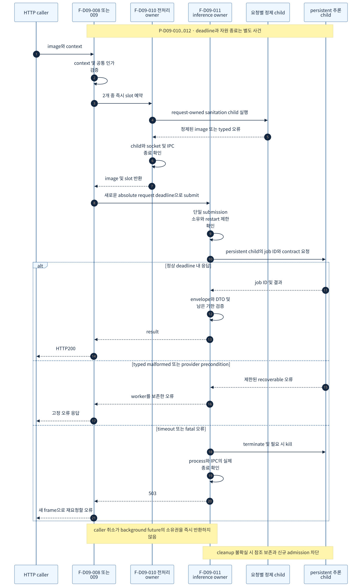

[Mermaid 원본](../diagrams/D09-inference-sequence.mmd) · [SVG](../rendered/D09-inference-sequence.svg)

## F-D09-011 추론 자식 프로세스·deadline·재시작 제한

| 항목 | 명세 |
| --- | --- |
| 분야 | D09 백엔드 공통 실행·보안·추론·경로·운영 상태 |
| 목적 | 추론 자식 프로세스·deadline·재시작 제한의 실제 실행 조건과 종료 경계를 제공한다. |
| 사용 주체 | Backend 서비스 허용된 HTTP 호출자 또는 내부 실행 소유자 |
| 활성 상태 | ACTIVE |
| 진입점 | backend/app/services/inference_process.py:402 submit_inference backend/app/services/inference_process.py:532 _run backend/app/services/inference_process.py:819 close |
| 실행 전제 | process isolation 설정. 미완료 submission, executor_retiring 또는 closing_count>0이면 신규 submit을 거절한다. 일반 worker cleanup 실패는 handle을 보존하며 다음 승인된 submission이 기존 정리를 재시도할 수 있다. |
| 입력 출처 형식 검증 최신성 | legacy/v2 kind, sanitized image/context/settings, 요청 deadline. job UUID와 framed IPC 응답 identity를 대조. IPC는 소유한 로컬 child socket의 8-byte 길이 prefix + pickle 메시지이며 공개 HTTP 입력을 직접 역직렬화하는 경로는 아니다. |

### 시작 이벤트와 처리 순서

| 이벤트 ID | 발생원 | 이벤트 | 수신부 | 흐름 |
| --- | --- | --- | --- | --- |
| E-D09-011-01 | backend/app/services/inference_process.py:402 submit_inference | 추론 자식 프로세스·deadline·재시작 제한 진입 | InferenceProcessRunner | submission과 executor 소유권 예약 → runner lock 획득 → restart rate와 worker 준비 → framed job 실행 → identity schema deadline 검증 → 완료 callback lease 해제 → 검증된 현재 job 결과만 caller에게 반환 |

1. 하나의 submission owner와 max_workers1 executor를 예약한다; 동시 요청은 queue error로 거부한다.
2. runner lock 최대2초 안에 획득하고 worker 생성/readiness 및 kind별 cold-start budget을 적용한다.
3. warm kind는 inference_timeout 기본2초, cold kind는 startup 기본30초; 요청 absolute deadline보다 늦게 성공 반환하지 않는다.
4. job ID·envelope·Pydantic response 검증 뒤 deadline을 다시 확인하고 warmed kind를 기록한다.
5. fatal error/실행deadline은 worker 종료; 명시 typed malformed image/context 및 v2 precondition error만 기존 worker를 보존한다.
6. close는1초 grace 뒤 필요하면 child kill, 전체4초 안에 executor/IPC/worker 종료를 확인한다; 불확실 handle은 보존한다.

| 분기 조건 | 실제 처리 결과 | 구현 근거 |
| --- | --- | --- |
| worker creation <5초 간격 또는60초창3회 이상 | InferenceRestartAdmissionLimited; 신규spawn 없음 | backend/app/services/inference_process.py:703 _reserve_worker_creation |
| late result 또는 잘못된 job/envelope | 성공 채택하지 않고 worker retire | backend/app/services/inference_process.py:569 _run |
| cleanup exit 미확인 | replacement worker 생성 전 기존 정리 재시도, handle 유지 | backend/app/services/inference_process.py:644 _ensure_worker |
| trusted malformed input/precondition | RuntimeError 응답이지만 worker 보존 | backend/app/services/inference_process.py:611 _run |

### 효과 종료와 복구

native model child/cache·IPC, 실패 시 process retirement; 제한된 restart warning

| 상황 | 동작 |
| --- | --- |
| 정상 완료 | 검증된 현재 job 결과만 caller에게 반환 |
| 실패 | 분기표의 오류로 종료; 성공 결과를 만들지 않음 |
| 시간 초과 | queue와 native execution deadline 분리; caller timeout이 worker 종료완료를 증명하지 않음 |
| 중복 입력 | 요청 자체의 멱등 보장 없음 |
| 취소 | Future를 caller가 취소하지 않음; runner가 실제 작업과 capacity 소유 |
| 중단과 생명주기 | 프로세스 중단 뒤 동일 요청 자동 재개 없음 |
| 재시도 | 동일 추론 자동재실행 없음; 다음 새 요청은 restart admission을 다시 통과해야 함 |
| 복구 | 일반 cleanup 실패 뒤 새 submission은 기존 handle 정리부터 재시도한다. close 성공 뒤 모든 closer가 끝나면 같은 runner를 다시 사용할 수 있다. executor retire 실패는 close 재시도로 복구해야 한다. |
| 자원 정리 | terminate→join0.5→kill→join0.5; exitcode와 endpoint close 확인. close 실패 후 상태를 정상으로 초기화하지 않음 |

### 상태 실행 맥락과 연결

| 항목 | 명세 |
| --- | --- |
| 초기 상태 | S-D09-011-IDLE |
| 상태 목록 | S-D09-011-IDLE S-D09-011-RESERVED S-D09-011-COLD S-D09-011-RUNNING S-D09-011-RETIRING S-D09-011-QUARANTINED S-D09-011-CLOSED S-D09-011-CLOSE_BLOCKED |
| 전이 조건과 전이 동작 | IDLE → RESERVED: 단일 submission 예약 RESERVED → COLD/RUNNING: worker 및 kind 준비 상태 RUNNING → IDLE: 정상 또는 typed recoverable 응답 처리 후 owner 반환 RUNNING/COLD → RETIRING: fatal·기한·close RETIRING → IDLE/CLOSED: 실제 자원 종료 확인 RETIRING → QUARANTINED: cleanup 미확인 QUARANTINED → RESERVED → RETIRING: 일반 cleanup 실패 후 owner 반환, 새 submit이 기존 정리 재시도 RETIRING → CLOSE_BLOCKED: executor retire 또는 submission 종료 미확인 CLOSE_BLOCKED → RETIRING: close 재시도 CLOSED → IDLE: 모든 close 완료와 shutdown flag 해제 후 같은 runner 재사용 가능 |
| 허용되지 않는 전이 | caller 취소만으로 IDLE 전이 금지; QUARANTINED에서 신규 worker 생성 금지. 문서 모델이며 코드 enum은 아님. |
| 동시성 순서와 작업 소유권 | parent executor Future의 done callback이 submission lease 해제. caller cancellation은 Future 소유권에 영향 없음. process group 소유 wrapper로 자신이 생성한 child만 종료. |
| 공유 상태와 다른 기능 연결 | F-D09-008/009와 readiness warmup이 같은 runner 사용; v1/v2 warmed set 분리 |

### 정책 근거와 검증 범위

| 항목 | 근거 |
| --- | --- |
| 정책 | [P-D09-011](#P-D09-011) |
| 구현 | [backend/app/services/inference_process.py:367](/home/ddobagi/Hanium_Dreamup/backend/app/services/inference_process.py:367) · `InferenceProcessRunner` (범위 367–917) |
| 기존 개선 ID | 개별 동일성 미확인; 분야 연관은 별도 추적표 |
| 기존 분야 | 해당 없음 |
| 기존 실행 증거 | 미확인: 과거 실행 로그를 이번 정적분석의 성공 근거로 사용하지 않음 |
| 한계 및 구분 | 자식 프로세스는 부모가 실행한 신뢰 경계 안에 있다. IPC 자체를 외부 공격자로부터 인증하는 프로토콜이라고 주장하지 않는다. 실제 process/모델 실행은 이번 미수행. close 완료는 runner 객체의 영구 종료가 아니다. 정상 close 뒤 executor_retiring/closing_count/shutdown 상태가 해제되면 다시 submit할 수 있다. |

| 테스트 위치 | 심볼 | 증거 수준 | 기대와 한계 |
| --- | --- | --- | --- |
| [backend/tests/test_inference_process.py](/home/ddobagi/Hanium_Dreamup/backend/tests/test_inference_process.py) | test_busy_inference_queue_does_not_claim_that_the_worker_was_restarted | TEST_EXPECTATION | queue timeout이 재시작을 의미하지 않는 기대; 이번 미실행 |
| [backend/tests/test_inference_process.py](/home/ddobagi/Hanium_Dreamup/backend/tests/test_inference_process.py) | test_each_inference_contract_gets_its_own_cold_start_deadline | TEST_EXPECTATION | legacy/v2 각 cold budget 기대; 이번 미실행 |
| [backend/tests/test_inference_process.py](/home/ddobagi/Hanium_Dreamup/backend/tests/test_inference_process.py) | test_provider_precondition_preserves_existing_worker | TEST_EXPECTATION | typed precondition에서 worker 보존 기대; 이번 미실행 |

### 이벤트 처리 그림


[Mermaid 원본](../diagrams/D09-F011.mmd) · [SVG](../rendered/D09-F011.svg)

[Mermaid 원본](../diagrams/D09-inference-sequence.mmd) · [SVG](../rendered/D09-inference-sequence.svg)


[Mermaid 원본](../diagrams/D09-inference-state.mmd) · [SVG](../rendered/D09-inference-state.svg)

## F-D09-012 v2 provider 선택·모델 결과 변환

| 항목 | 명세 |
| --- | --- |
| 분야 | D09 백엔드 공통 실행·보안·추론·경로·운영 상태 |
| 목적 | v2 provider 선택·모델 결과 변환의 실제 실행 조건과 종료 경계를 제공한다. |
| 사용 주체 | Backend 서비스 허용된 HTTP 호출자 또는 내부 실행 소유자 |
| 활성 상태 | CONDITIONAL |
| 진입점 | backend/app/services/detect_v2.py:429 get_detect_v2_provider_state backend/app/services/detect_v2.py:142 LazyYoloDetectV2Runtime.detect |
| 실행 전제 | F-D09-009의 validation 완료. real mode는 모델과 runtime config 확보·배포 artifact SHA binding 필요. |
| 입력 출처 형식 검증 최신성 | DETECT_V2_MODE 기본fake, real/yolo 및 configured artifact/runtime JSON. model_key/source_model/model_class_id/class/category/confidence/normalized bbox와 context metadata. |

### 시작 이벤트와 처리 순서

| 이벤트 ID | 발생원 | 이벤트 | 수신부 | 흐름 |
| --- | --- | --- | --- | --- |
| E-D09-012-01 | backend/app/services/detect_v2.py:429 get_detect_v2_provider_state | v2 provider 선택·모델 결과 변환 진입 | get_detect_v2_provider_state | mode 분기 → 모델과 config binding 확인 → unified 또는 legacy pair 선택 → lazy model 실행 → 클래스 threshold와 bbox 변환 → detect.v2 응답 조립 → detect.v2 모델별 ID를 보존한 detections 반환 |

1. fake mode는 이미지 내용과 무관한 fixed contract fixture를 threshold filter해 반환한다. 파일 존재만으로 real 전환하지 않는다.
2. real/yolo는 missing model/runtime config 확인 뒤 environment·role별 file identity를 cache key로 provider를 얻는다.
3. unified model path가 선택되면 그 모델만 실행; 없으면 custom tactile+coco pair를 실행해 기존 filter/merge를 적용한다.
4. unified model output names는 configured class order와 정확히 대조; threshold/allowlist와 malformed/empty bbox를 걸러낸다.
5. Ultralytics adapter는 finite confidence/class/xyxyn, class ID 공간을 유지하고0..1 bbox로 정규화한다. context captured_at 또는 서버UTC 시각을 응답에 추가한다.

| 분기 조건 | 실제 처리 결과 | 구현 근거 |
| --- | --- | --- |
| mode=fake | contract fixture 반환; 실제 인식 성능 결과 아님 | backend/app/services/detect_v2.py:429 get_detect_v2_provider_state |
| 모델/config/binding 불가 | provider=None unavailable; 상위503 | backend/app/services/detect_v2.py:437 get_detect_v2_provider_state |
| unified path 선택 | legacy pair를 동시에 실행하지 않음 | backend/app/services/detect_v2.py:145 LazyYoloDetectV2Runtime.detect |
| unknown class/nonfinite/invalid bbox | 해당 detection 건 제외 | backend/app/services/yolo_inference_adapter.py:31 ultralytics_result_to_raw_detections |

### 효과 종료와 복구

lazy 모델로딩과 process cache; 저장·학습·신고 자동 생성 없음

| 상황 | 동작 |
| --- | --- |
| 정상 완료 | detect.v2 모델별 ID를 보존한 detections 반환 |
| 실패 | 분기표의 오류로 종료; 성공 결과를 만들지 않음 |
| 시간 초과 | 독립 타이머 없음; 공통 요청/의존성 제한 적용 |
| 중복 입력 | 요청 자체의 멱등 보장 없음 |
| 취소 | 전용 취소 API 없음 |
| 중단과 생명주기 | 프로세스 중단 뒤 동일 요청 자동 재개 없음 |
| 재시도 | 서버 자동 재시도 없음 |
| 복구 | 원인 해소 후 새 요청에서 다시 검증 |
| 자원 정리 | 요청 지역 상태 반환; 공유 자원은 소유자의 lifecycle에서 정리 |

### 상태 실행 맥락과 연결

| 항목 | 명세 |
| --- | --- |
| 초기 상태 | S-D09-012-REQUESTED |
| 상태 목록 | S-D09-012-REQUESTED S-D09-012-VALIDATING S-D09-012-PROCESSING S-D09-012-SUCCEEDED S-D09-012-REJECTED |
| 전이 조건과 전이 동작 | 진입→VALIDATING 조건충족→PROCESSING 정상결과→SUCCEEDED 검증/의존성실패→REJECTED |
| 허용되지 않는 전이 | 검증 실패 뒤 성공 응답 금지. 이 상태 이름은 코드 흐름을 설명한 문서 상태이며 DB enum이 아님. |
| 동시성 순서와 작업 소유권 | 실제 호출은 F-D09-011 직렬 worker. provider cache lock과 file stat+SHA role identity; warmup은 실제 tiny PNG 한 번 모델 호출. |
| 공유 상태와 다른 기능 연결 | model/two_model_runtime.py filter/merge 세부는 D10 모델 분야와 연결. Android 현재 TFLite class count를 Backend에 복사하지 않음 |

### 정책 근거와 검증 범위

| 항목 | 근거 |
| --- | --- |
| 정책 | [P-D09-012](#P-D09-012) |
| 구현 | [backend/app/services/detect_v2.py:429](/home/ddobagi/Hanium_Dreamup/backend/app/services/detect_v2.py:429) · `get_detect_v2_provider_state` (범위 429–466) [backend/app/services/detect_v2.py:142](/home/ddobagi/Hanium_Dreamup/backend/app/services/detect_v2.py:142) · `LazyYoloDetectV2Runtime.detect` (범위 142–245) [backend/app/services/detect_v2.py:653](/home/ddobagi/Hanium_Dreamup/backend/app/services/detect_v2.py:653) · `fake_detect_v2_detections` (범위 653–708) [backend/app/services/yolo_inference_adapter.py:31](/home/ddobagi/Hanium_Dreamup/backend/app/services/yolo_inference_adapter.py:31) · `ultralytics_result_to_raw_detections` (범위 31–102) |
| 기존 개선 ID | 개별 동일성 미확인; 분야 연관은 별도 추적표 |
| 기존 분야 | 해당 없음 |
| 기존 실행 증거 | 미확인: 과거 실행 로그를 이번 정적분석의 성공 근거로 사용하지 않음 |
| 한계 및 구분 | DEFAULT mode=fake는 local 기본 계약만 증명. 운영 mode·weights 내용·모델 성능은 이번 미실행. docs의 고정13class 설명을 현재 Android21class와 혼합하지 않음. |

| 테스트 위치 | 심볼 | 증거 수준 | 기대와 한계 |
| --- | --- | --- | --- |

연결한 테스트 미확인: 이번 작성 범위에서 이 기능에 대응하는 시험 단언을 연결하지 않았다. 테스트 자체가 없다는 판정이 아니다.

### 이벤트 처리 그림


[Mermaid 원본](../diagrams/D09-F012.mmd) · [SVG](../rendered/D09-F012.svg)

## F-D09-013 legacy 탐지 health

| 항목 | 명세 |
| --- | --- |
| 분야 | D09 백엔드 공통 실행·보안·추론·경로·운영 상태 |
| 목적 | legacy 탐지 health의 조건·출력·종료 경계를 정의한다. |
| 사용 주체 | Backend 서비스 허용된 HTTP 호출자 또는 내부 실행 소유자 |
| 활성 상태 | CONDITIONAL |
| 진입점 | backend/app/api/detect.py:220 GET /detect/health |
| 실행 전제 | field role만 허용. v1 model .pt 존재·dependencies·class map을 검사. |
| 입력 출처 형식 검증 최신성 | field 인증; 파라미터 없음. MODEL_ARTIFACT_PATH/version/class order/confidence/IOU/image size 설정. |

### 시작 이벤트와 처리 순서

| 이벤트 ID | 발생원 | 이벤트 | 수신부 | 흐름 |
| --- | --- | --- | --- | --- |
| E-D09-013-01 | backend/app/api/detect.py:220 GET /detect/health | legacy 탐지 health 진입 | get_detect_health | field 인가 → model path와 cache identity → 필요 시 파일해시와 YOLO load → task 및 class mapping → health DTO 반환 → v1 adapter 가용성 DTO 반환 |

1. detect_health가 _adapter_load_result를 호출한다. 모델path 없음/일반파일아님/.pt아님이면 unavailable reason을 반환한다.
2. stat identity와 class order가 cache와 같으면 이전 load result를 재사용; 바뀌면 SHA를 읽고 YOLO/Pillow 모델을 lazy load한다.
3. 모델task detect 및 클래스 순서가 v1과 같아야 한다. 역사적인 단일 tactile class는 모델 또는 training data.yaml 근거가 있을 때0→0 매핑을 허용한다.
4. ready/unavailable, version, artifact basename과 설정 threshold/size를 응답한다.

| 분기 조건 | 실제 처리 결과 | 구현 근거 |
| --- | --- | --- |
| artifact 없음/불일치/dependency/load/task 실패 | HTTP200 DTO model_status=unavailable + 공개reason | backend/app/detector.py:94 detect_health |
| cache stat/order 동일 | 재로드 없이 cached adapter result | backend/app/detector.py:158 _adapter_load_result |

### 효과 종료와 복구

health 요청 자체가 파일해시와 모델로드를 유발할 수 있음; 모델 추론 성능 검증은 아님

| 상황 | 동작 |
| --- | --- |
| 정상 완료 | v1 adapter 가용성 DTO 반환 |
| 실패 | 아래 분기의 오류/비정상 상태로 종료 |
| 시간 초과 | 별도 전체 timeout 없음; 의존 작업 제한을 적용 |
| 중복 입력 | 요청 결과의 별도 멱등 캐시 없음 |
| 취소 | 전용 취소 API 없음 |
| 중단과 생명주기 | 프로세스 재시작 후 이전 요청 자동재개 없음 |
| 재시도 | 서버 자동 재시도 없음 |
| 복구 | 조건 복구 후 새 요청에서 다시 검증 |
| 자원 정리 | 요청 지역 메모리 반환; 공유 자원은 runtime 소유자가 정리 |

### 상태 실행 맥락과 연결

| 항목 | 명세 |
| --- | --- |
| 초기 상태 | S-D09-013-REQUESTED |
| 상태 목록 | S-D09-013-REQUESTED S-D09-013-VALIDATING S-D09-013-PROCESSING S-D09-013-SUCCEEDED S-D09-013-REJECTED |
| 전이 조건과 전이 동작 | 진입→VALIDATING 조건 충족→PROCESSING 정상 완료→SUCCEEDED 오류 조건→REJECTED |
| 허용되지 않는 전이 | 검증 실패·기한이 지난 결과를 성공으로 채택하지 않음. 문서 상태 이름은 흐름 모델이며 코드 enum을 주장하지 않음. |
| 동시성 순서와 작업 소유권 | async handler가 동기 detect_health를 직접 호출하므로 cold health에서 동기 model/file 작업이 요청 event loop에 위치한다. v2 memory snapshot과 다른 경로. |
| 공유 상태와 다른 기능 연결 | F-D09-008 v1 adapter cache |

### 정책 근거와 검증 범위

| 항목 | 근거 |
| --- | --- |
| 정책 | [P-D09-013](#P-D09-013) |
| 구현 | [backend/app/api/detect.py:216](/home/ddobagi/Hanium_Dreamup/backend/app/api/detect.py:216) · `get_detect_health` (범위 216–218) [backend/app/detector.py:94](/home/ddobagi/Hanium_Dreamup/backend/app/detector.py:94) · `detect_health` (범위 94–101) [backend/app/detector.py:136](/home/ddobagi/Hanium_Dreamup/backend/app/detector.py:136) · `_adapter_load_result` (범위 136–186) [backend/app/detector.py:309](/home/ddobagi/Hanium_Dreamup/backend/app/detector.py:309) · `_compatible_class_id_map` (범위 309–330) |
| 기존 개선 ID | 개별 동일성 미확인; 분야 연관은 별도 추적표 |
| 기존 분야 | 해당 없음 |
| 기존 실행 증거 | 미확인: 과거 실행성공을 이번 정적분석의 실행 근거로 사용하지 않음 |
| 한계 및 구분 | 활성 HTTP 호환 endpoint이다. legacy라는 명칭이 router 미연결을 뜻하지 않음. health handler cold-load는 정적 관찰이며 latency 측정 미실행. |

| 테스트 위치 | 심볼 | 증거 수준 | 기대와 한계 |
| --- | --- | --- | --- |

연결한 테스트 미확인: 이번 작성 범위에서 이 기능에 대응하는 시험 단언을 연결하지 않았다. 테스트 자체가 없다는 판정이 아니다.

### 이벤트 처리 그림


[Mermaid 원본](../diagrams/D09-F013.mmd) · [SVG](../rendered/D09-F013.svg)

## F-D09-014 v2 탐지 health snapshot 갱신·조회

| 항목 | 명세 |
| --- | --- |
| 분야 | D09 백엔드 공통 실행·보안·추론·경로·운영 상태 |
| 목적 | v2 탐지 health snapshot 갱신·조회의 조건·출력·종료 경계를 정의한다. |
| 사용 주체 | Backend 서비스 허용된 HTTP 호출자 또는 내부 실행 소유자 |
| 활성 상태 | ACTIVE |
| 진입점 | backend/app/api/detect.py:294 GET /detect/v2/health backend/app/services/detect_v2_health.py:747 start_detect_v2_health |
| 실행 전제 | GET은 admin role. lifespan coordinator가 시작되어 current generation의 candidate를 publish해야 ready 가능. |
| 입력 출처 형식 검증 최신성 | captured settings projection(mode/environment/model/config paths/image size); memory-only snapshot reader. frame protocol 최대65536bytes. |

### 시작 이벤트와 처리 순서

| 이벤트 ID | 발생원 | 이벤트 | 수신부 | 흐름 |
| --- | --- | --- | --- | --- |
| E-D09-014-01 | backend/app/api/detect.py:294 GET /detect/v2/health | v2 탐지 health snapshot 갱신·조회 진입 | DetectV2HealthSnapshots | settings projection generation 확정 → single child refresh → artifact fingerprint와 frame exit 검증 → 현재 attempt와 deadline 검증 → memory snapshot publish → GET age검사 DTO → 현재설정의 유효 memory health DTO 반환 |

1. startup은 coordinator thread를 시작하고 최초 refresh timeout 안에서만 initial event를 기다린다.
2. coordinator는 설정 projection generation과 attempt ID를 붙여 하나의 subprocess refresh만 실행한다.
3. child는 artifact/config fingerprint 전후 일치와 deadline, fixed JSON frame+EOF+zero exit를 확인하여 candidate를 반환한다.
4. late timeout 또는 generation 변경의 success는 reject; refresh 실패는 기존 ready를 덮어 unavailable로 만든다.
5. snapshot은 I/O 없이 lock 안에서 age와 current projection을 확인하며 age>=max_age이면 expired. basename만 공개한다.
6. close는 stop/wake/initial event를 설정하고 coordinator·owned child/pipe/selector를 확인; unconfirmed cleanup이면 대체 manager 생성도 막는다.

| 분기 조건 | 실제 처리 결과 | 구현 근거 |
| --- | --- | --- |
| 초기 미검사·projection 다름 | unavailable not_checked | backend/app/services/detect_v2_health.py:691 snapshot |
| refresh elapsed >=5초 기본 | refresh_timeout; 해당attempt 늦은성공 폐기 | backend/app/services/detect_v2_health.py:663 _refresh_once |
| snapshot age >=10초 기본 | expired; 조회로 age 연장 없음 | backend/app/services/detect_v2_health.py:710 snapshot |
| child cleanup 미확인 | quarantine; replacement 없음 | backend/app/services/detect_v2_health.py:245 _SubprocessRefreshRunner.__call__ |

### 효과 종료와 복구

background subprocess의 파일검증·memory publish; GET 자체 provider·filesystem 작업 없음

| 상황 | 동작 |
| --- | --- |
| 정상 완료 | 현재설정의 유효 memory health DTO 반환 |
| 실패 | 아래 분기의 오류/비정상 상태로 종료 |
| 시간 초과 | 별도 전체 timeout 없음; 의존 작업 제한을 적용 |
| 중복 입력 | 요청 결과의 별도 멱등 캐시 없음 |
| 취소 | GET 취소는 coordinator를 취소하지 않음; lifespan stop이 owner 종료 |
| 중단과 생명주기 | 프로세스 재시작 후 이전 요청 자동재개 없음 |
| 재시도 | coordinator가 refresh interval 후 다음 검사를 수행; failed cleanup resource는 교체하지 않음 |
| 복구 | 조건 복구 후 새 요청에서 다시 검증 |
| 자원 정리 | child terminate/kill/wait 및 pipes/selector, coordinator join; 확인실패는 resource 유지 |

### 상태 실행 맥락과 연결

| 항목 | 명세 |
| --- | --- |
| 초기 상태 | S-D09-014-UNINITIALIZED |
| 상태 목록 | S-D09-014-UNINITIALIZED S-D09-014-REFRESHING S-D09-014-READY S-D09-014-UNAVAILABLE S-D09-014-STOPPED S-D09-014-QUARANTINED |
| 전이 조건과 전이 동작 | start/interval → REFRESHING 현재 generation/attempt와 fingerprint 일치 → READY timeout/실패/늦은 결과/age>=max_age → UNAVAILABLE stop 후 소유 child 정리 → STOPPED cleanup 미확인 → QUARANTINED |
| 허용되지 않는 전이 | generation이 바뀐 과거 candidate를 READY로 발행 금지. cleanup 미확인 manager 교체 금지. |
| 동시성 순서와 작업 소유권 | single coordinator+one in-flight child; generation/attempt/initial event 소유권으로 늦은 callback과 설정변경 순서 역전을 차단. |
| 공유 상태와 다른 기능 연결 | F-D09-020 /ready는 이 snapshot 이후 real mode inference warmup을 별도 확인 |

### 정책 근거와 검증 범위

| 항목 | 근거 |
| --- | --- |
| 정책 | [P-D09-014](#P-D09-014) |
| 구현 | [backend/app/services/detect_v2_health.py:496](/home/ddobagi/Hanium_Dreamup/backend/app/services/detect_v2_health.py:496) · `DetectV2HealthSnapshots` (범위 496–741) [backend/app/services/detect_v2_health.py:222](/home/ddobagi/Hanium_Dreamup/backend/app/services/detect_v2_health.py:222) · `_SubprocessRefreshRunner` (범위 222–405) [backend/app/api/detect.py:294](/home/ddobagi/Hanium_Dreamup/backend/app/api/detect.py:294) · `get_detect_v2_health` (범위 294–297) |
| 기존 개선 ID | 개별 동일성 미확인; 분야 연관은 별도 추적표 |
| 기존 분야 | 해당 없음 |
| 기존 실행 증거 | 미확인: 과거 실행성공을 이번 정적분석의 실행 근거로 사용하지 않음 |
| 한계 및 구분 | 고정 source 정적분석; 실제 provider·모델·운영DB·기기 검증 미실행. |

| 테스트 위치 | 심볼 | 증거 수준 | 기대와 한계 |
| --- | --- | --- | --- |
| [backend/tests/test_detect_v2_health_snapshots.py](/home/ddobagi/Hanium_Dreamup/backend/tests/test_detect_v2_health_snapshots.py) | test_snapshot_age_is_anchored_at_refresh_start_and_reads_do_not_extend_it | TEST_EXPECTATION | refresh 시작 시각에 age가 고정되는 시험 기대; 이번 미실행 |
| [backend/tests/test_detect_v2_health_snapshots.py](/home/ddobagi/Hanium_Dreamup/backend/tests/test_detect_v2_health_snapshots.py) | test_settings_generation_discards_old_success_and_never_overlaps_refreshes | TEST_EXPECTATION | obsolete generation 결과 제외 및 single-flight 기대; 이번 미실행 |

### 이벤트 처리 그림


[Mermaid 원본](../diagrams/D09-F014.mmd) · [SVG](../rendered/D09-F014.svg)


[Mermaid 원본](../diagrams/D09-health-state.mmd) · [SVG](../rendered/D09-health-state.svg)

## F-D09-015 TMAP 보행 경로 HTTP 요청

| 항목 | 명세 |
| --- | --- |
| 분야 | D09 백엔드 공통 실행·보안·추론·경로·운영 상태 |
| 목적 | TMAP 보행 경로 HTTP 요청의 조건·출력·종료 경계를 정의한다. |
| 사용 주체 | Backend 서비스 허용된 HTTP 호출자 또는 내부 실행 소유자 |
| 활성 상태 | ACTIVE |
| 진입점 | backend/app/api/navigation.py:160 POST /navigation/walking backend/app/services/tmap_pedestrian.py:1390 fetch_tmap_pedestrian_route |
| 실행 전제 | field 인가·actor/navigation rate 통과, TmapRuntime live·appKey 설정. provider=tmap_pedestrian만 허용. |
| 입력 출처 형식 검증 최신성 | origin/destination RoutePoint(lat[-90,90],lng[-180,180],optional name<=160), waypoints<=5; priority RECOMMEND/MAIN_STREET/DISTANCE/STAIR_AVOID(기본); speed 0< <=20km/h optional; radius_m 0< <=12000 기본5000. |

### 시작 이벤트와 처리 순서

| 이벤트 ID | 발생원 | 이벤트 | 수신부 | 흐름 |
| --- | --- | --- | --- | --- |
| E-D09-015-01 | backend/app/api/navigation.py:160 POST /navigation/walking | TMAP 보행 경로 HTTP 요청 진입 | _until_disconnect | 인증 및 WalkingRouteRequest 검증 → runtime와 appKey 확인 → TMAP body와 요청 deadline → budget 소비와 network POST → response 정규화와 schema → 현재 runtime 성공관측 후 응답 → 검증된 경로·steps·guide·start/end gap 반환 |

1. request DTO를 검증하고 _until_disconnect가 provider task와 ASGI disconnect를 경쟁시킨다.
2. TMAP body는 WGS84GEO start/end와 percent-encoded 이름, priority별 searchOption0/4/10/30, round한 속도, optional passList를 만든다.
3. runtime rate cooldown과 shared route/POI budget을 소비한 뒤 공식 HTTPS provider POST를 한다.
4. 동일 absolute deadline 안에서 response stream 제한과 child 정규화(F-D09-016)를 거친다.
5. 실제 provider transport/response 오류만 route failure 관측으로 남기며 local budget/capacity rejection은 provider 실패를 만들어내지 않는다.
6. 정규화 success 뒤 runtime이 여전히 available일 때 최근 성공시각과 check order를 기록하고 walking_route.v1을 반환한다.

| 분기 조건 | 실제 처리 결과 | 구현 근거 |
| --- | --- | --- |
| runtime 미시작 또는 appKey 없음 | 503 processing unavailable/app_key_missing | backend/app/services/tmap_pedestrian.py:1400 fetch_tmap_pedestrian_route |
| provider timeout | 504 tmap_timeout | backend/app/services/tmap_pedestrian.py:1494 operation |
| network/provider/auth 오류 | 502 고정 public error; provider 원문 비노출 | backend/app/services/tmap_pedestrian.py:2078 _process_tmap_route_response |
| caller disconnect 먼저 완료 | provider task.cancel 후 CancelledError | backend/app/api/navigation.py:25 _until_disconnect |

### 효과 종료와 복구

TMAP network와 dependency observation; DB 경로영구저장 없음

| 상황 | 동작 |
| --- | --- |
| 정상 완료 | 검증된 경로·steps·guide·start/end gap 반환 |
| 실패 | 아래 분기의 오류/비정상 상태로 종료 |
| 시간 초과 | 전체 provider 작업 wall-clock 기본4초; 물리 cleanup에는 새 provider budget을 부여하지 않음 |
| 중복 입력 | 요청 결과의 별도 멱등 캐시 없음 |
| 취소 | http.disconnect 또는 coroutine취소→work.cancel; finally await/gather |
| 중단과 생명주기 | 프로세스 재시작 후 이전 요청 자동재개 없음 |
| 재시도 | 자동 provider retry 없음; 새 요청은 새 budget 소비 |
| 복구 | 조건 복구 후 새 요청에서 다시 검증 |
| 자원 정리 | HTTP stream/child/reader 정리 확인까지 runtime lease 유지 |

### 상태 실행 맥락과 연결

| 항목 | 명세 |
| --- | --- |
| 초기 상태 | S-D09-015-REQUESTED |
| 상태 목록 | S-D09-015-REQUESTED S-D09-015-VALIDATING S-D09-015-PROCESSING S-D09-015-SUCCEEDED S-D09-015-REJECTED |
| 전이 조건과 전이 동작 | 진입→VALIDATING 조건 충족→PROCESSING 정상 완료→SUCCEEDED 오류 조건→REJECTED |
| 허용되지 않는 전이 | 검증 실패·기한이 지난 결과를 성공으로 채택하지 않음. 문서 상태 이름은 흐름 모델이며 코드 enum을 주장하지 않음. |
| 동시성 순서와 작업 소유권 | ASGI work/disconnect task를 FIRST_COMPLETED로 대기; finally gather로 두 task exception 회수. work가 완료集合이면 결과를 우선 반환. runtime cleanup owner는 취소 뒤에도 lease를 유지한다. |
| 공유 상태와 다른 기능 연결 | F-D09-016 정규화/F-D09-018 runtime; Android D07 경로 해석은 별도. end_gap은 최종 목적지 도착 증명 아님 |

### 정책 근거와 검증 범위

| 항목 | 근거 |
| --- | --- |
| 정책 | [P-D09-015](#P-D09-015) |
| 구현 | [backend/app/api/navigation.py:25](/home/ddobagi/Hanium_Dreamup/backend/app/api/navigation.py:25) · `_until_disconnect` (범위 25–49) [backend/app/services/tmap_pedestrian.py:1390](/home/ddobagi/Hanium_Dreamup/backend/app/services/tmap_pedestrian.py:1390) · `fetch_tmap_pedestrian_route` (범위 1390–1538) [backend/app/schemas.py:339](/home/ddobagi/Hanium_Dreamup/backend/app/schemas.py:339) · `WalkingRouteRequest` (범위 339–350) |
| 기존 개선 ID | 개별 동일성 미확인; 분야 연관은 별도 추적표 |
| 기존 분야 | 해당 없음 |
| 기존 실행 증거 | 미확인: 과거 실행성공을 이번 정적분석의 실행 근거로 사용하지 않음 |
| 한계 및 구분 | radius_m은 request schema에 존재하나 fetch_tmap_pedestrian_route body/후처리에서 사용되지 않는다. 속도는 int(round(...))로 provider에 보내며 같은 값을 duration sanity에도 사용. |

| 테스트 위치 | 심볼 | 증거 수준 | 기대와 한계 |
| --- | --- | --- | --- |

연결한 테스트 미확인: 이번 작성 범위에서 이 기능에 대응하는 시험 단언을 연결하지 않았다. 테스트 자체가 없다는 판정이 아니다.

### 이벤트 처리 그림


[Mermaid 원본](../diagrams/D09-F015.mmd) · [SVG](../rendered/D09-F015.svg)

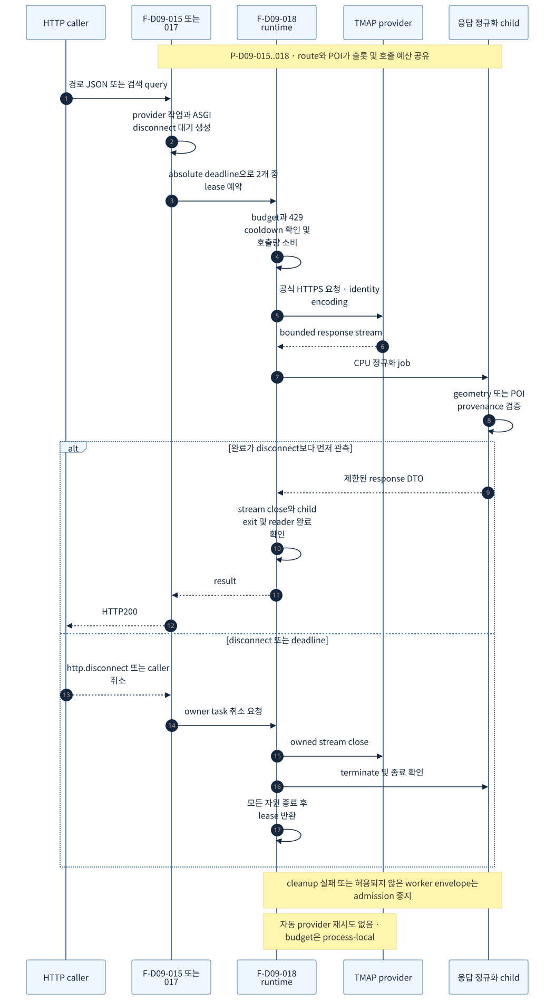

[Mermaid 원본](../diagrams/D09-tmap-sequence.mmd) · [SVG](../rendered/D09-tmap-sequence.svg)

## F-D09-016 보행 경로 geometry·안내·계단·경유지 검증

| 항목 | 명세 |
| --- | --- |
| 분야 | D09 백엔드 공통 실행·보안·추론·경로·운영 상태 |
| 목적 | 보행 경로 geometry·안내·계단·경유지 검증의 조건·출력·종료 경계를 정의한다. |
| 사용 주체 | Backend 서비스 허용된 HTTP 호출자 또는 내부 실행 소유자 |
| 활성 상태 | ACTIVE |
| 진입점 | backend/app/services/tmap_pedestrian.py:1082 _normalize_tmap_response backend/app/schemas.py:567 WalkingRouteResponse.normalized_parts_form_one_route |
| 실행 전제 | F-D09-015 stream/body 제한 후 isolated response worker에서 호출. |
| 입력 출처 형식 검증 최신성 | provider GeoJSON FeatureCollection의 Point 안내와 LineString. 정수 code는0..2147483647; null/비정수 등 제공된 invalid 값은 거부. 도로코드는 identity 보존. |

### 시작 이벤트와 처리 순서

| 이벤트 ID | 발생원 | 이벤트 | 수신부 | 흐름 |
| --- | --- | --- | --- | --- |
| E-D09-016-01 | backend/app/services/tmap_pedestrian.py:1082 _normalize_tmap_response | 보행 경로 geometry·안내·계단·경유지 검증 진입 | _normalize_tmap_response | GeoJSON과 resource 상한 → summary tier와 연속 seam → endpoint 및 거리시간 sanity → 계단·미지code gate → step 거리와 guide 방문 resolve → 회전 음성안내와 waypoint 순서 → 최종 DTO 일관성 검증 → 동일 geometry와 순서를 나타내는 route DTO만 반환 |

1. FeatureCollection/list/string/feature·step·point 자원 상한을 검증한다. SP/untyped total을 우선, 다른 pointType은 fallback; 서로 다른 positive total이 있으면 conflict로 거부한다.
2. 연속 LineString seam이 한 곳0.5m·전체1m 이내면 기존 endpoint로 snap한다; 넘으면 disconnected. geometry를 임의 선으로 연결하지 않는다.
3. endpoint gap<=100m, distance/duration>0, summary와 geometry0.5배-50m..3배+50m, distance<=duration*max(4m/s,requested speed*1.25)+10m를 검사한다.
4. STAIR_AVOID는 facility17/guide turn127·129를422로 거부; 알려지지 않은 facility/turn code는 안전을 증명하지 못하므로 거부한다.
5. step 거리를 geometry 비례로 정수화해 sum=summary가 되게 하고 guide의 방문 순서를 앞뒤 feasible visit으로 교차검증한다; loop 중복 방문이 모호하면 거부한다.
6. 10m 이상 양쪽 leg와60도 이상 명확한 회전에는 코너·진행거리 각각5m 안에 Android가 발화할 turn12/13/14/16/17/18/19가 필요하다. guide 출력 bearing은 해당 방문의 outgoing edge, terminal은None.
7. waypoint를 구면 minor-arc상20m 이내 순서대로 방문하는지 확인한 뒤 DTO가 steps 조립형상·합계·guide순서/거리를 다시 검사한다.

| 분기 조건 | 실제 처리 결과 | 구현 근거 |
| --- | --- | --- |
| 계단회피 요청에 명시계단 | 422 route_stairs_present | backend/app/services/tmap_pedestrian.py:1284 _normalize_tmap_response |
| 미지의 계단안전 code | normalizer502 route_safety_code_unknown; 실제worker decode는503 processing_unavailable | backend/app/services/tmap_runtime.py:439 _decode_response |
| geometry/guidance/waypoint 불일치 | 502 해당고정오류; 경로success 만들지 않음 | backend/app/services/tmap_pedestrian.py:1340 _normalize_tmap_response |
| summary total 상충 | 502 route_summary_conflict | backend/app/services/tmap_pedestrian.py:1067 _merge_tmap_summary_total |

### 효과 종료와 복구

물리 접근성·실제 도로통행 가능성을 추가측정하지 않음; code/geometry 계약에 따른 filtering

| 상황 | 동작 |
| --- | --- |
| 정상 완료 | 동일 geometry와 순서를 나타내는 route DTO만 반환 |
| 실패 | 불확실한 경로를 성공으로 반환하지 않음; 일부 reason은 worker allowlist 경계에서 generic503으로 축약 |
| 시간 초과 | 원 요청 deadline 공유; loop/check 사이 초과검출 |
| 중복 입력 | 요청 결과의 별도 멱등 캐시 없음 |
| 취소 | 전용 취소 API 없음 |
| 중단과 생명주기 | 프로세스 재시작 후 이전 요청 자동재개 없음 |
| 재시도 | 서버 자동 재시도 없음 |
| 복구 | 조건 복구 후 새 요청에서 다시 검증 |
| 자원 정리 | 요청 지역 메모리 반환; 공유 자원은 runtime 소유자가 정리 |

### 상태 실행 맥락과 연결

| 항목 | 명세 |
| --- | --- |
| 초기 상태 | S-D09-016-REQUESTED |
| 상태 목록 | S-D09-016-REQUESTED S-D09-016-VALIDATING S-D09-016-PROCESSING S-D09-016-SUCCEEDED S-D09-016-REJECTED |
| 전이 조건과 전이 동작 | 진입→VALIDATING 조건 충족→PROCESSING 정상 완료→SUCCEEDED 오류 조건→REJECTED |
| 허용되지 않는 전이 | 검증 실패·기한이 지난 결과를 성공으로 채택하지 않음. 문서 상태 이름은 흐름 모델이며 코드 enum을 주장하지 않음. |
| 동시성 순서와 작업 소유권 | deadline을 long loop에서 반복 검사하는 isolated CPU job. 오류는 허용된 envelope만 parent에 통과. |
| 공유 상태와 다른 기능 연결 | schemas shared with contract fixture 및 Android parser. 기존 정책 prose와 실제 validator 수치를 구분 |

### 정책 근거와 검증 범위

| 항목 | 근거 |
| --- | --- |
| 정책 | [P-D09-016](#P-D09-016) |
| 구현 | [backend/app/services/tmap_pedestrian.py:1082](/home/ddobagi/Hanium_Dreamup/backend/app/services/tmap_pedestrian.py:1082) · `_normalize_tmap_response` (범위 1082–1388) [backend/app/services/walking_route_sanity.py:52](/home/ddobagi/Hanium_Dreamup/backend/app/services/walking_route_sanity.py:52) · `validate_normalized_walking_route` (범위 52–113) [backend/app/services/tmap_pedestrian.py:670](/home/ddobagi/Hanium_Dreamup/backend/app/services/tmap_pedestrian.py:670) · `_validate_route_waypoint_order` (범위 670–734) [backend/app/schemas.py:567](/home/ddobagi/Hanium_Dreamup/backend/app/schemas.py:567) · `WalkingRouteResponse.normalized_parts_form_one_route` (범위 567–756) |
| 기존 개선 ID | 개별 동일성 미확인; 분야 연관은 별도 추적표 |
| 기존 분야 | 해당 없음 |
| 기존 실행 증거 | 미확인: 과거 실행성공을 이번 정적분석의 실행 근거로 사용하지 않음 |
| 한계 및 구분 | route_safety_code_unknown은 현행 worker allowlist에 없어서 전체 TMAP runtime admission도 중지될 수 있다(process_response가 processing_unavailable에 stop_admission 호출). 이 정적 관찰은 별도 issue로 기록한다. |

| 테스트 위치 | 심볼 | 증거 수준 | 기대와 한계 |
| --- | --- | --- | --- |
| [backend/tests/test_navigation_road_type_worker_error_regression.py](/home/ddobagi/Hanium_Dreamup/backend/tests/test_navigation_road_type_worker_error_regression.py) | test_existing_facility_rejection_and_worker_classification_are_unchanged | TEST_EXPECTATION | facility999는 normalizer502이지만 worker 공개응답503으로 변환하는 기존 기대; 이번 미실행 |

### 이벤트 처리 그림


[Mermaid 원본](../diagrams/D09-F016.mmd) · [SVG](../rendered/D09-F016.svg)

## F-D09-017 목적지 POI 검색·좌표 의미 보존

| 항목 | 명세 |
| --- | --- |
| 분야 | D09 백엔드 공통 실행·보안·추론·경로·운영 상태 |
| 목적 | 목적지 POI 검색·좌표 의미 보존의 조건·출력·종료 경계를 정의한다. |
| 사용 주체 | Backend 서비스 허용된 HTTP 호출자 또는 내부 실행 소유자 |
| 활성 상태 | ACTIVE |
| 진입점 | backend/app/api/navigation.py:97 GET /navigation/destinations/search backend/app/services/tmap_pedestrian.py:1885 fetch_tmap_poi_search |
| 실행 전제 | field actor/navigation rate 통과, runtime started. live는 appKey; mock은 local/test에서만 가능한 config. |
| 입력 출처 형식 검증 최신성 | query1..80자, limit1..10 기본5, optional origin_lat/lng는 함께 필요. origin값 범위는 lat[-90,90]/lng[-180,180]. |

### 시작 이벤트와 처리 순서

| 이벤트 ID | 발생원 | 이벤트 | 수신부 | 흐름 |
| --- | --- | --- | --- | --- |
| E-D09-017-01 | backend/app/api/navigation.py:97 GET /navigation/destinations/search | 목적지 POI 검색·좌표 의미 보존 진입 | search_navigation_destinations | query와 origin쌍 검증 → live 또는 mock 선택 → budget 후 provider page1 조회 → count와 유효 POI 정규화 → 좌표family와 stable candidate ID → distance source와 more 계산 → destination_search.v1에 query·후보·좌표family·거리출처·paging정보 반환 |

1. 공백을 정리하고 특정 목적지 명령suffix와 prefix를 제거한다; 정규화 후 빈문자열은422. origin 반쪽 입력도422.
2. live는 page1/count clamp, WGS84GEO로 GET한다. origin이 있으면 대체로거리순 R, 이름이 있는 대학검색은관련도 A를 유지한다.
3. provider totalCount 및 items empty consistency를 검사; invalid entry는 skip하고100개상한을 적용한다.
4. 각 POI는 noor>front>lat>new의 완전한 유효좌표 family를 선택하고 모든 유효 family를 provenance로 보존한다.
5. provider ID/pkey/시설명/선택좌표를 SHA로 결속한 tmap-poi:v1 ID로 중복을 제거한다. 주소는 display 정보이며 ID에 넣지 않는다.
6. limit만큼 자른 결과에 origin이 없으면 distance/source를None; 있으면 provider radius를m로 사용하고 없으면 haversine straight_line을 채운다. more는totalCount>requested_count이며 normalized count와 다르다.

| 분기 조건 | 실제 처리 결과 | 구현 근거 |
| --- | --- | --- |
| 빈 normalized query 또는 origin 한쪽만 | 422 empty_query/origin_coordinates_incomplete | backend/app/services/tmap_pedestrian.py:1906 fetch_tmap_poi_search |
| mock provider | 정해진3개 후보를 matching; live success evidence 기록안함 | backend/app/services/tmap_pedestrian.py:1954 operation |
| totalCount/items 형태·개수 불일치 | 502 invalid_tmap_response | backend/app/services/tmap_pedestrian.py:1662 _normalize_poi_search_response |
| API timeout/network/429 | 504/502/503 고정오류 | backend/app/services/tmap_pedestrian.py:1977 operation |

### 효과 종료와 복구

외부 POI조회; DB저장 없음. mock도 runtime response process 사용

| 상황 | 동작 |
| --- | --- |
| 정상 완료 | destination_search.v1에 query·후보·좌표family·거리출처·paging정보 반환 |
| 실패 | 아래 분기의 오류/비정상 상태로 종료 |
| 시간 초과 | request 전체 TMAP timeout 기본4초 |
| 중복 입력 | 요청 결과의 별도 멱등 캐시 없음 |
| 취소 | http.disconnect 시 query task.cancel; 소유 runtime에서 resource정리 |
| 중단과 생명주기 | 프로세스 재시작 후 이전 요청 자동재개 없음 |
| 재시도 | 자동 페이지추가/자동 provider retry 없음 |
| 복구 | 조건 복구 후 새 요청에서 다시 검증 |
| 자원 정리 | 요청 지역 메모리 반환; 공유 자원은 runtime 소유자가 정리 |

### 상태 실행 맥락과 연결

| 항목 | 명세 |
| --- | --- |
| 초기 상태 | S-D09-017-REQUESTED |
| 상태 목록 | S-D09-017-REQUESTED S-D09-017-VALIDATING S-D09-017-PROCESSING S-D09-017-SUCCEEDED S-D09-017-REJECTED |
| 전이 조건과 전이 동작 | 진입→VALIDATING 조건 충족→PROCESSING 정상 완료→SUCCEEDED 오류 조건→REJECTED |
| 허용되지 않는 전이 | 검증 실패·기한이 지난 결과를 성공으로 채택하지 않음. 문서 상태 이름은 흐름 모델이며 코드 enum을 주장하지 않음. |
| 동시성 순서와 작업 소유권 | _until_disconnect로 작업취소; TMAP CPU child와 stream lease 공유. ID는 query·정렬·거리·주소변경과 독립; 좌표가 바뀌면 identity도 바뀜. |
| 공유 상태와 다른 기능 연결 | Gateway와 Android 후보 선택은 D08/D07; coordinate_kind는 출입구/층/보행접근성 인증 아님 |

### 정책 근거와 검증 범위

| 항목 | 근거 |
| --- | --- |
| 정책 | [P-D09-017](#P-D09-017) |
| 구현 | [backend/app/api/navigation.py:97](/home/ddobagi/Hanium_Dreamup/backend/app/api/navigation.py:97) · `search_navigation_destinations` (범위 97–127) [backend/app/services/tmap_pedestrian.py:1885](/home/ddobagi/Hanium_Dreamup/backend/app/services/tmap_pedestrian.py:1885) · `fetch_tmap_poi_search` (범위 1885–2019) [backend/app/services/tmap_pedestrian.py:1662](/home/ddobagi/Hanium_Dreamup/backend/app/services/tmap_pedestrian.py:1662) · `_normalize_poi_search_response` (범위 1662–1823) [backend/app/services/tmap_pedestrian.py:2182](/home/ddobagi/Hanium_Dreamup/backend/app/services/tmap_pedestrian.py:2182) · `_process_tmap_poi_response` (범위 2182–2296) |
| 기존 개선 ID | 개별 동일성 미확인; 분야 연관은 별도 추적표 |
| 기존 분야 | 해당 없음 |
| 기존 실행 증거 | 미확인: 과거 실행성공을 이번 정적분석의 실행 근거로 사용하지 않음 |
| 한계 및 구분 | 반환 point 우선순위는 noor>front>lat>new이며 front가 자동 출입구로 선택되는 것은 아님. more_results_available은 provider total 근거, null은 불명. |

| 테스트 위치 | 심볼 | 증거 수준 | 기대와 한계 |
| --- | --- | --- | --- |

연결한 테스트 미확인: 이번 작성 범위에서 이 기능에 대응하는 시험 단언을 연결하지 않았다. 테스트 자체가 없다는 판정이 아니다.

### 이벤트 처리 그림


[Mermaid 원본](../diagrams/D09-F017.mmd) · [SVG](../rendered/D09-F017.svg)

[Mermaid 원본](../diagrams/D09-tmap-sequence.mmd) · [SVG](../rendered/D09-tmap-sequence.svg)

## F-D09-018 TMAP 공유 실행 슬롯·호출 예산·취소 정리

| 항목 | 명세 |
| --- | --- |
| 분야 | D09 백엔드 공통 실행·보안·추론·경로·운영 상태 |
| 목적 | TMAP 공유 실행 슬롯·호출 예산·취소 정리의 조건·출력·종료 경계를 정의한다. |
| 사용 주체 | Backend 서비스 허용된 HTTP 호출자 또는 내부 실행 소유자 |
| 활성 상태 | ACTIVE |
| 진입점 | backend/app/services/tmap_runtime.py:690 TmapRuntime.execute backend/app/services/tmap_runtime.py:580 consume_call_budget |
| 실행 전제 | lifespan start가 같은 event loop의 AsyncClient·isolated executor를 소유. 중지·다른 loop·closed resource는 unavailable. |
| 입력 출처 형식 검증 최신성 | route 또는 poi operation callable, absolute deadline, HTTP response와 child future. 설정분당/일예산; provider429 Retry-After. |

### 시작 이벤트와 처리 순서

| 이벤트 ID | 발생원 | 이벤트 | 수신부 | 흐름 |
| --- | --- | --- | --- | --- |
| E-D09-018-01 | backend/app/services/tmap_runtime.py:690 TmapRuntime.execute | TMAP 공유 실행 슬롯·호출 예산·취소 정리 진입 | TmapRuntime | runtime availability와2슬롯 → 공유budget 또는probe allowance → bounded HTTP stream → isolated response job → envelope과deadline검사 → HTTP child reader cleanup → 확인후lease반환 → 정상 normalized result 또는 bounded rejection; 정리가 확인되면 슬롯복구 |

1. 대기 queue 없이 동시에 2개 lease만 예약한다. owner task를 shield하되 caller 취소/timeout은 abandoned=true와 task.cancel로 provider 작업 중단을 요청한다.
2. route와 POI는 공통 fixed window 60초/86400초 budget(기본 60/5000)을 I/O 전에 원자적으로 소비한다. 거절 시 추가 budget 소비나 자동 재시도는 없다.
3. 429는 최소 30초, 최대 300초 cooldown을 두 기능에 공통 기록한다. readiness probe는 60초당 1회 별도 allowance이며 사용자 budget 소진 중에는 probe도 보류한다.
4. HTTP 요청은 Accept-Encoding=identity이며 header/body의 2MiB 상한을 검사한다. stream의 실제 close는 별도 소유 task로 shield한다.
5. CPU 응답 job마다 child를 spawn하고 DB import와 network를 차단한다. 고정된 공개 error envelope만 decode한다.
6. caller가 떠나도 HTTP close·CPU child exit·reader thread completion을 모두 확인한 뒤 lease를 반환한다. cleanup 실패 시 admission을 중지하고 자원 참조를 보존한다.
7. aclose는 admission 중지 → 소유 job gather → executor shutdown → client aclose 순서다. close 실패 후 같은 close task를 기다려도 성공으로 바꾸지 않는다.

| 분기 조건 | 실제 처리 결과 | 구현 근거 |
| --- | --- | --- |
| lease2개 소유 | 503 tmap_capacity_exceeded | backend/app/services/tmap_runtime.py:692 execute |
| 공통예산 또는429 cooldown | 503 tmap_rate_limited | backend/app/services/tmap_runtime.py:560 ensure_rate_limit_available |
| HTTP content-encoding 압축 또는body>2MiB | 502 invalid_tmap_response | backend/app/services/tmap_pedestrian.py:236 _stream_tmap_response |
| invalid worker envelope/cleanup 실패 | 503 processing_unavailable와 stop admission | backend/app/services/tmap_runtime.py:804 process_response |

### 효과 종료와 복구

외부HTTP·spawn child·dedicated reader threads·process-local quota/cooldown

| 상황 | 동작 |
| --- | --- |
| 정상 완료 | 정상 normalized result 또는 bounded rejection; 정리가 확인되면 슬롯복구 |
| 실패 | 아래 분기의 오류/비정상 상태로 종료 |
| 시간 초과 | 하나의 request deadline이 I/O와 CPU 처리에 적용됨; 자원 종료 확인 시간과 구분 |
| 중복 입력 | 요청 결과의 별도 멱등 캐시 없음 |
| 취소 | caller 취소 → abandoned=true 및 owner task 취소; cleanup task는 shield |
| 중단과 생명주기 | 프로세스 재시작 후 이전 요청 자동재개 없음 |
| 재시도 | provider 자동 재시도 없음; cleanup 실패 runtime은 새 startup 필요 |
| 복구 | 일시 budget/cooldown은 시각 경과 후 새 요청 가능; stopped runtime은 별도 재시작 필요 |
| 자원 정리 | child 종료·reader 완료·stream close 후 slot 반환; 미확인 자원 참조 보존 |

### 상태 실행 맥락과 연결

| 항목 | 명세 |
| --- | --- |
| 초기 상태 | S-D09-018-STOPPED |
| 상태 목록 | S-D09-018-STOPPED S-D09-018-ACCEPTING S-D09-018-LEASED S-D09-018-ABANDONED S-D09-018-CLEANING S-D09-018-QUARANTINED S-D09-018-CLOSED |
| 전이 조건과 전이 동작 | lifespan start → ACCEPTING 동시 2개 미만 및 budget 허용 → LEASED caller 취소/기한 → ABANDONED → CLEANING stream/child/reader 모두 종료 → lease 반환 cleanup 불확실 → QUARANTINED 및 admission 중지 aclose → CLOSED 또는 기존 실패 유지 |
| 허용되지 않는 전이 | caller timeout만으로 lease 반환 금지; 다른 event loop·close 이후 admission 금지. 공유 runtime flag와 request lease를 결합한 문서 모델. |
| 동시성 순서와 작업 소유권 | single event loop에서 check-reserve/spend 사이await없음. cleanup owner는반복cancel에도 끝까지확인; 다른job child를kill하지 않음. budget/replay는multiworker 공유되지 않음. |
| 공유 상태와 다른 기능 연결 | F-D09-015/017 및 F-D09-020 readiness 공유 |

### 정책 근거와 검증 범위

| 항목 | 근거 |
| --- | --- |
| 정책 | [P-D09-018](#P-D09-018) |
| 구현 | [backend/app/services/tmap_runtime.py:504](/home/ddobagi/Hanium_Dreamup/backend/app/services/tmap_runtime.py:504) · `TmapRuntime` (범위 504–897) [backend/app/services/tmap_runtime.py:311](/home/ddobagi/Hanium_Dreamup/backend/app/services/tmap_runtime.py:311) · `_IsolatedProcessExecutor` (범위 311–436) [backend/app/services/tmap_pedestrian.py:236](/home/ddobagi/Hanium_Dreamup/backend/app/services/tmap_pedestrian.py:236) · `_stream_tmap_response` (범위 236–317) |
| 기존 개선 ID | 개별 동일성 미확인; 분야 연관은 별도 추적표 |
| 기존 분야 | 해당 없음 |
| 기존 실행 증거 | 미확인: 과거 실행성공을 이번 정적분석의 실행 근거로 사용하지 않음 |
| 한계 및 구분 | 호출 budget은 process-local이므로 여러 worker/replica의 전역 quota가 아니다. 실제 배포 worker 수는 이번 확인하지 않았다. |

| 테스트 위치 | 심볼 | 증거 수준 | 기대와 한계 |
| --- | --- | --- | --- |

연결한 테스트 미확인: 이번 작성 범위에서 이 기능에 대응하는 시험 단언을 연결하지 않았다. 테스트 자체가 없다는 판정이 아니다.

### 이벤트 처리 그림


[Mermaid 원본](../diagrams/D09-F018.mmd) · [SVG](../rendered/D09-F018.svg)

[Mermaid 원본](../diagrams/D09-tmap-sequence.mmd) · [SVG](../rendered/D09-tmap-sequence.svg)

## F-D09-019 보행 경로 의존성 상태 조회

| 항목 | 명세 |
| --- | --- |
| 분야 | D09 백엔드 공통 실행·보안·추론·경로·운영 상태 |
| 목적 | 보행·목적지 검색의 개별 health의 조건·출력·종료 경계를 정의한다. |
| 사용 주체 | Backend 서비스 허용된 HTTP 호출자 또는 내부 실행 소유자 |
| 활성 상태 | ACTIVE |
| 진입점 | backend/app/api/navigation.py:77 GET /navigation/walking/health |
| 실행 전제 | field 역할 인가. walking_route_provider=tmap_pedestrian만 지원. |
| 입력 출처 형식 검증 최신성 | body 없음; walking_route_provider, app key 설정, process-local route 최근 성공 시각과 마지막 dependency 상태. 최근 성공 max age 기본300초. |

### 시작 이벤트와 처리 순서

| 이벤트 ID | 발생원 | 이벤트 | 수신부 | 흐름 |
| --- | --- | --- | --- | --- |
| E-D09-019-01 | backend/app/api/navigation.py:77 GET /navigation/walking/health | 보행 경로 의존성 상태 조회 진입 | get_walking_navigation_health | field 인가 → provider 검사 → key와 route 성공 시각 비교 → HTTP200 ready/unavailable 또는 provider 오류503 |

1. provider가 tmap_pedestrian인지 검사한다. 다른 값이면 503 walking_route_provider_invalid.
2. app key 존재와 route_recent=true를 AND하여 ready를 결정한다.
3. provider/status/reason/walking_directions_url/configured/dependency_state를 응답한다. 자체 provider 요청은 보내지 않는다.

| 분기 조건 | 실제 처리 결과 | 구현 근거 |
| --- | --- | --- |
| provider가 tmap_pedestrian 아님 | 503 walking_route_provider_invalid | backend/app/api/navigation.py:94 get_walking_navigation_health |
| key 없음 또는 recent route success 없음 | HTTP200 status unavailable와 고정 reason | backend/app/api/navigation.py:82 get_walking_navigation_health |

### 효과 종료와 복구

HTTP 응답만; 최근 성공 시각을 갱신하거나 외부 probe를 시작하지 않음.

| 상황 | 동작 |
| --- | --- |
| 정상 완료 | 개별기능설정·최근성공과최신관측을반환 |
| 실패 | 아래 분기의 오류/비정상 상태로 종료 |
| 시간 초과 | 별도 전체 timeout 없음; 의존 작업 제한을 적용 |
| 중복 입력 | 요청 결과의 별도 멱등 캐시 없음 |
| 취소 | 전용 취소 API 없음 |
| 중단과 생명주기 | 프로세스 재시작 후 이전 요청 자동재개 없음 |
| 재시도 | 서버 자동 재시도 없음 |
| 복구 | 조건 복구 후 새 요청에서 다시 검증 |
| 자원 정리 | 요청 지역 메모리 반환; 공유 자원은 runtime 소유자가 정리 |

### 상태 실행 맥락과 연결

| 항목 | 명세 |
| --- | --- |
| 초기 상태 | S-D09-019-REQUESTED |
| 상태 목록 | S-D09-019-REQUESTED S-D09-019-VALIDATING S-D09-019-PROCESSING S-D09-019-SUCCEEDED S-D09-019-REJECTED |
| 전이 조건과 전이 동작 | 진입→VALIDATING 조건 충족→PROCESSING 정상 완료→SUCCEEDED 오류 조건→REJECTED |
| 허용되지 않는 전이 | 검증 실패·기한이 지난 결과를 성공으로 채택하지 않음. 문서 상태 이름은 흐름 모델이며 코드 enum을 주장하지 않음. |
| 동시성 순서와 작업 소유권 | async handler에서 process-local state의 짧은 조회; 별도 task·timer 없음. |
| 공유 상태와 다른 기능 연결 | F-D09-015 경로 요청이 갱신한 route dependency state를 읽는다. 목적지 검색 health는 F-D09-031. |

### 정책 근거와 검증 범위

| 항목 | 근거 |
| --- | --- |
| 정책 | [P-D09-019](#P-D09-019) |
| 구현 | [backend/app/api/navigation.py:77](/home/ddobagi/Hanium_Dreamup/backend/app/api/navigation.py:77) · `get_walking_navigation_health` (범위 77–94) [backend/app/services/tmap_pedestrian.py:367](/home/ddobagi/Hanium_Dreamup/backend/app/services/tmap_pedestrian.py:367) · `tmap_dependency_readiness` (범위 367–397) |
| 기존 개선 ID | 개별 동일성 미확인; 분야 연관은 별도 추적표 |
| 기존 분야 | 해당 없음 |
| 기존 실행 증거 | 미확인: 과거 실행성공을 이번 정적분석의 실행 근거로 사용하지 않음 |
| 한계 및 구분 | 최근 route 성공이 기한 내이면 이후 요청 실패에도 status ready일 수 있다. dependency_state에는 마지막 실패를 별도로 표시한다. 이는 test_navigation_route_health_state의 명시 기대이며 실제 provider 가용성 보장이 아니다. |

| 테스트 위치 | 심볼 | 증거 수준 | 기대와 한계 |
| --- | --- | --- | --- |
| [backend/tests/test_navigation_route_health_state.py](/home/ddobagi/Hanium_Dreamup/backend/tests/test_navigation_route_health_state.py) | test_validated_success_then_failure_keeps_the_previous_fresh_success | TEST_EXPECTATION | 최근실패뒤에도유효한이전성공으로status ready 유지하면서dependency_state recent_failure 기대; 이번 미실행 |

### 이벤트 처리 그림


[Mermaid 원본](../diagrams/D09-F019.mmd) · [SVG](../rendered/D09-F019.svg)

## F-D09-020 전체 readiness와 단일 실행 의존성 검사

| 항목 | 명세 |
| --- | --- |
| 분야 | D09 백엔드 공통 실행·보안·추론·경로·운영 상태 |
| 목적 | 전체 readiness와 단일 실행 의존성 검사의 조건·출력·종료 경계를 정의한다. |
| 사용 주체 | Backend 서비스 허용된 HTTP 호출자 또는 내부 실행 소유자 |
| 활성 상태 | ACTIVE |
| 진입점 | backend/app/api/health.py:931 GET /ready |
| 실행 전제 | field 인가와 startup 완료. 전체 ready는 각 의존성의 ready=true를 AND하여 판정한다. |
| 입력 출처 형식 검증 최신성 | 별도 body 없음. Settings와 report_storage_monitor memory snapshot, database/privacy/account/raw/detector/navigation 검사 결과를 사용한다. |

### 시작 이벤트와 처리 순서

| 이벤트 ID | 발생원 | 이벤트 | 수신부 | 흐름 |
| --- | --- | --- | --- | --- |
| E-D09-020-01 | backend/app/api/health.py:931 GET /ready | 전체 readiness와 단일 실행 의존성 검사 진입 | create_router | 인가후6의존성probe 병렬 → single-flight와5초caller budget → 현재detector 및navigation검증 → reportmonitor와enrollment추가 → 전체AND와degraded구분 → 200또는503 JSON → 200 ready 또는503 not_ready에최소의존성상태반환 |

1. database/issuer, privacy HMAC, account crypto, raw inventory, detector, navigation probe를 asyncio.gather로 병렬 실행한다. DB는 SELECT 1, 기대 Alembic head 202609300009, public.actor_rate_limit_events의 검증된 정확 그룹 CHECK와 admin report integrity 경계를 검사한다. issuer key는 private 파일을 다시 읽고 DB issuer/TOTP binding을 비교한다.
2. 동기 probe는 전용 daemon thread와 Future로 하나씩만 실행한다. caller는 최대 5초 poll하며 진행 중 thread를 kill하거나 대체하지 않는다.
3. 미완료 작업이 30초 이상이면 probe_stuck을 표시한다. detector는 max(30초, startup_timeout+5초)로 cold start 여유를 준다.
4. detector는 v2 health 확인 뒤 real/yolo에 실제 warmup을 추가하며 죽은 worker가 이전 성공을 상속하지 않도록 매번 검사한다.
5. navigation은 live provider/app key와 최근 route+POI 성공 근거를 요구한다. 근거가 없을 때 live probe 설정이 켜져 있으면 bounded probe를 요청한다. 사용자 budget 소진과 probe allowance 소진 reason은 다르다.
6. report upload/encryption/storage는 monitor.checks() snapshot을 합치고 account enrollment 설정도 검사한다. 모든 check.ready is True일 때만 HTTP200, 아니면503이다. raw root가 설정되어 있으면 ingest=false라도 디렉터리와 DB inventory를 검사한다. root가 없고 ingest=false인 경우만 ready/enabled=false이다.
7. OTP-only HMAC 불일치는 login binding이 유효하면 ready를 유지하되 degraded_features=[account_enrollment]를 추가한다.

| 분기 조건 | 실제 처리 결과 | 구현 근거 |
| --- | --- | --- |
| 하나 이상의 check.ready가 True 아님 | 503 status not_ready와 각 check | backend/app/api/health.py:963 readiness |
| local probe caller 대기가 5초 초과 | ready=false/check_timeout; 다음 조회도 같은 진행 작업 공유 | backend/app/api/health.py:765 _OffloadedReadinessProbe.check |
| 미완료 probe가 stuck threshold 이상 | probe_stuck; 새 thread를 만들지 않음 | backend/app/api/health.py:718 _stuck_seconds |
| 최근 TMAP 성공 근거가 없고 live_probe=false | not_ready/tmap_recent_success_unavailable | backend/app/api/health.py:848 _navigation_readiness |

### 효과 종료와 복구

DB/키/파일 inventory 검사, 선택 TMAP live probe 및 real 모델 warmup. 저장소 부정합 발견 경로는 USER_SAFETY_RISK incident 기록과 연결된다(D14).

| 상황 | 동작 |
| --- | --- |
| 정상 완료 | HTTP200 status ready와 각 check; 일부 OTP 장애는 degraded_features로 표시 |
| 실패 | 하나라도 ready=true가 아니면 HTTP503 status not_ready |
| 시간 초과 | 일반 caller 5초; stuck 감지 30초, detector는 max(30초,startup timeout+5초) |
| 중복 입력 | 동일 종류 진행 중 probe를 공유; 별도 무제한 thread 생성 없음 |
| 취소 | caller 취소 후에도 이미 실행 중 동기 thread의 소유권을 유지 |
| 중단과 생명주기 | 프로세스 재시작 시 과거 메모리 probe 결과를 자동 복원하지 않음 |
| 재시도 | 실패 응답 자체의 자동 재호출 없음; 새 요청은 single-flight 및 probe cooldown 적용 |
| 복구 | 작업 완료 또는 새 유효 검사 결과로 회복; stuck thread를 임의 대체하지 않음 |
| 자원 정리 | 전용 probe thread는 완료 시 Future를 정리; 강제 취소는 지원하지 않음 |

### 상태 실행 맥락과 연결

| 항목 | 명세 |
| --- | --- |
| 초기 상태 | S-D09-020-REQUESTED |
| 상태 목록 | S-D09-020-REQUESTED S-D09-020-VALIDATING S-D09-020-PROCESSING S-D09-020-SUCCEEDED S-D09-020-REJECTED |
| 전이 조건과 전이 동작 | 진입→VALIDATING 조건 충족→PROCESSING 정상 완료→SUCCEEDED 오류 조건→REJECTED |
| 허용되지 않는 전이 | 검증 실패·기한이 지난 결과를 성공으로 채택하지 않음. 문서 상태 이름은 흐름 모델이며 코드 enum을 주장하지 않음. |
| 동시성 순서와 작업 소유권 | check별 single-flight Future를 보관하며 느린 동기 작업은 daemon thread가 계속 소유한다. caller 취소는 thread 중단을 보장하지 않는다. TMAP live probe는 별도 shared task를 shield하여 여러 readiness caller가 공유한다. |
| 공유 상태와 다른 기능 연결 | F-D09-001 startup과 F-D09-014 탐지 health manager, D13 crypto/raw 상태, D14 issuer/incident, D15 report storage monitor. 독립 check를 하나의 ready 값으로 집계한다. |

### 정책 근거와 검증 범위

| 항목 | 근거 |
| --- | --- |
| 정책 | [P-D09-020](#P-D09-020) |
| 구현 | [backend/app/api/health.py:896](/home/ddobagi/Hanium_Dreamup/backend/app/api/health.py:896) · `create_router` (범위 896–978) [backend/app/api/health.py:691](/home/ddobagi/Hanium_Dreamup/backend/app/api/health.py:691) · `_OffloadedReadinessProbe` (범위 691–786) [backend/app/api/health.py:834](/home/ddobagi/Hanium_Dreamup/backend/app/api/health.py:834) · `_navigation_readiness` (범위 834–893) [backend/app/api/health.py:164](/home/ddobagi/Hanium_Dreamup/backend/app/api/health.py:164) · `_database_readiness` (범위 164–221) [backend/app/api/health.py:224](/home/ddobagi/Hanium_Dreamup/backend/app/api/health.py:224) · `_admin_totp_binding_readiness` (범위 224–313) [backend/app/api/health.py:451](/home/ddobagi/Hanium_Dreamup/backend/app/api/health.py:451) · `_raw_object_readiness` (범위 451–484) |
| 기존 개선 ID | 개별 동일성 미확인; 분야 연관은 별도 추적표 |
| 기존 분야 | 해당 없음 |
| 기존 실행 증거 | 미확인: 과거 실행성공을 이번 정적분석의 실행 근거로 사용하지 않음 |
| 한계 및 구분 | 현재 _navigation_readiness는 최근 성공 cache가 ready이면 budget 검사 전에 반환한다. 따라서 cache 기한 중 사용자 budget이 소진되면 요청503과 navigation ready가 공존할 수 있다. DB at-rest/transport 암호화 상태의 operator_declared 값은 운영자 선언이며 기술적 암호화 측정 결과가 아니다. |

| 테스트 위치 | 심볼 | 증거 수준 | 기대와 한계 |
| --- | --- | --- | --- |
| [backend/tests/test_health_readiness.py](/home/ddobagi/Hanium_Dreamup/backend/tests/test_health_readiness.py) | test_s20_49_single_feature_failure_keeps_whole_backend_not_ready | TEST_EXPECTATION | navigation또는detector한항목실패시전체503 기대; 이번 미실행 |
| [backend/tests/test_health_readiness.py](/home/ddobagi/Hanium_Dreamup/backend/tests/test_health_readiness.py) | test_s01_14_readiness_names_degraded_account_enrollment | TEST_EXPECTATION | OTP-only mismatch는ready200과degraded_features 기대; 이번 미실행 |

### 이벤트 처리 그림


[Mermaid 원본](../diagrams/D09-F020.mmd) · [SVG](../rendered/D09-F020.svg)

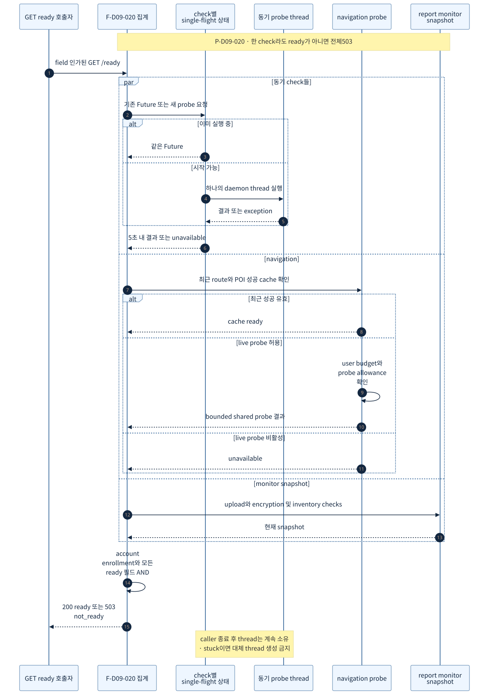

[Mermaid 원본](../diagrams/D09-health-sequence.mmd) · [SVG](../rendered/D09-health-sequence.svg)

## F-D09-021 저비용 liveness

| 항목 | 명세 |
| --- | --- |
| 분야 | D09 백엔드 공통 실행·보안·추론·경로·운영 상태 |
| 목적 | 저비용 liveness의 조건·출력·종료 경계를 정의한다. |
| 사용 주체 | Backend 서비스 허용된 HTTP 호출자 또는 내부 실행 소유자 |
| 활성 상태 | ACTIVE |
| 진입점 | backend/app/api/health.py:156 GET /health |
| 실행 전제 | field token 인가. DB·모델·TMAP 연결 검사 없이 HTTP handler 도달 여부를 표현한다. |
| 입력 출처 형식 검증 최신성 | body 없음. 선택 WALKSAFE_SOURCE_COMMIT 환경 문자열. |

### 시작 이벤트와 처리 순서

| 이벤트 ID | 발생원 | 이벤트 | 수신부 | 흐름 |
| --- | --- | --- | --- | --- |
| E-D09-021-01 | backend/app/api/health.py:156 GET /health | 저비용 liveness 진입 | health | field 인가 → status ok 조립 → 선택 source commit추가 → HTTP200 → HTTP200 status ok |

1. status=ok를 만든다.
2. source commit 환경값이 비어 있지 않으면 trim/lowercase하여 응답에 추가한다.
3. 의존성 검사를 수행하지 않고 응답한다.

| 분기 조건 | 실제 처리 결과 | 구현 근거 |
| --- | --- | --- |

### 효과 종료와 복구

HTTP 응답만; DB나 외부 네트워크 호출 없음

| 상황 | 동작 |
| --- | --- |
| 정상 완료 | HTTP200 status ok |
| 실패 | 아래 분기의 오류/비정상 상태로 종료 |
| 시간 초과 | 별도 전체 timeout 없음; 의존 작업 제한을 적용 |
| 중복 입력 | 요청 결과의 별도 멱등 캐시 없음 |
| 취소 | 전용 취소 API 없음 |
| 중단과 생명주기 | 프로세스 재시작 후 이전 요청 자동재개 없음 |
| 재시도 | 서버 자동 재시도 없음 |
| 복구 | 조건 복구 후 새 요청에서 다시 검증 |
| 자원 정리 | 요청 지역 메모리 반환; 공유 자원은 runtime 소유자가 정리 |

### 상태 실행 맥락과 연결

| 항목 | 명세 |
| --- | --- |
| 초기 상태 | S-D09-021-REQUESTED |
| 상태 목록 | S-D09-021-REQUESTED S-D09-021-VALIDATING S-D09-021-PROCESSING S-D09-021-SUCCEEDED S-D09-021-REJECTED |
| 전이 조건과 전이 동작 | 진입→VALIDATING 조건 충족→PROCESSING 정상 완료→SUCCEEDED 오류 조건→REJECTED |
| 허용되지 않는 전이 | 검증 실패·기한이 지난 결과를 성공으로 채택하지 않음. 문서 상태 이름은 흐름 모델이며 코드 enum을 주장하지 않음. |
| 동시성 순서와 작업 소유권 | async handler의 짧은 동기 dictionary 처리; 별도 thread나 timer 없음. |
| 공유 상태와 다른 기능 연결 | F-D09-020 /ready의 의존성 검사와 다른 목적이다. |

### 정책 근거와 검증 범위

| 항목 | 근거 |
| --- | --- |
| 정책 | [P-D09-021](#P-D09-021) |
| 구현 | [backend/app/api/health.py:156](/home/ddobagi/Hanium_Dreamup/backend/app/api/health.py:156) · `health` (범위 156–161) |
| 기존 개선 ID | 개별 동일성 미확인; 분야 연관은 별도 추적표 |
| 기존 분야 | 해당 없음 |
| 기존 실행 증거 | 미확인: 과거 실행성공을 이번 정적분석의 실행 근거로 사용하지 않음 |
| 한계 및 구분 | 실제 HTTP 호출은 이번 미실행. main Settings의 SHA 형식 검증과 이 handler의 환경변수 직접 읽기는 다른 지점이다. |

| 테스트 위치 | 심볼 | 증거 수준 | 기대와 한계 |
| --- | --- | --- | --- |

연결한 테스트 미확인: 이번 작성 범위에서 이 기능에 대응하는 시험 단언을 연결하지 않았다. 테스트 자체가 없다는 판정이 아니다.

### 이벤트 처리 그림


[Mermaid 원본](../diagrams/D09-F021.mmd) · [SVG](../rendered/D09-F021.svg)

## F-D09-022 깊이 디버그 로그 배치 수집

| 항목 | 명세 |
| --- | --- |
| 분야 | D09 백엔드 공통 실행·보안·추론·경로·운영 상태 |
| 목적 | 명시 허용된 개발 메타데이터만 제한된 배치로 저장한다. |
| 사용 주체 | Backend 서비스 허용된 HTTP 호출자 또는 내부 실행 소유자 |
| 활성 상태 | CONDITIONAL |
| 진입점 | backend/app/api/android_debug.py:103 POST /android/debug/depth-logs |
| 실행 전제 | admin 역할·이름 있는 actor 검증 이후 android_debug_log_enabled=true. 설정 기본 false이고 배포 환경에서 활성 설정은 금지. |
| 입력 출처 형식 검증 최신성 | JSON schema_version=android.depth_debug.v1; session_id 길이 1..128; entries 1..30개; 각 객체 extra=forbid. 시간값은 0 이상, detection_count 0..200, confidence 0..1, depth 0..50m, sample_count 0..10000; 원본 미디어 필드는 허용 목록에 없음. 실제 수신 bytes와 직렬화된 payload 각각 64KiB 기본 상한. |

### 시작 이벤트와 처리 순서

| 이벤트 ID | 발생원 | 이벤트 | 수신부 | 흐름 |
| --- | --- | --- | --- | --- |
| E-D09-022-01 | backend/app/api/android_debug.py:103 POST /android/debug/depth-logs | 깊이 디버그 로그 배치 수집 진입 | create_depth_log | 수신 body 크기 검사 → schema 및 enabled 검사 → 서버 수신 시각 결합 → 잠금과 retention 및 quota → transaction에 배치 저장 → 200 ok=true 및 stored 개수 |

1. 커스텀 APIRoute의 receive 래퍼가 JSON 파싱 전에 누적 수신 bytes 상한을 적용한다.
2. Pydantic 객체 검증 후 enabled를 검사하고 exclude_none JSON 직렬화 크기를 다시 검사한다.
3. 한 배치에 같은 서버 UTC received_at을 붙이고 session·device·app 메타데이터를 각 entry에 결합한다.
4. AnyIO worker에서 저장소 잠금과 retention 정리를 거쳐 배치와 daily_usage를 한 transaction에 기록한다.
5. 저장된 entry 수를 ok/stored로 응답한다.

| 분기 조건 | 실제 처리 결과 | 구현 근거 |
| --- | --- | --- |
| 수신 또는 직렬화 bytes가 설정 상한 초과 | 413 android_debug_log_too_large | backend/app/api/android_debug.py:77 _DepthLogBodyLimitRoute |
| 기능 플래그 false | 404 android_debug_log_disabled | backend/app/api/android_debug.py:104 create_depth_log |
| 일별 또는 전체 저장 quota 초과 | 507 android_debug_storage_quota_exceeded | backend/app/api/android_debug.py:135 create_depth_log |

### 효과 종료와 복구

SQLite 개발 증거 저장과 오래된 증거 정리; 신고 생성·음성·사용자 알림 없음

| 상황 | 동작 |
| --- | --- |
| 정상 완료 | 200 ok=true 및 stored 개수 |
| 실패 | 아래 오류 분기에 따라 종료 |
| 시간 초과 | 별도 전체 작업 timeout 없음 |
| 중복 입력 | 동일 session/frame의 자동 중복 제거 없음; 재요청 시 새 row를 추가 |
| 취소 | worker에 전달한 저장 작업 종료까지 기다림 |
| 중단과 생명주기 | 프로세스 중단 후 이전 HTTP 응답 자동 재개 없음 |
| 재시도 | HTTP 실패의 서버 자동 재시도 없음 |
| 복구 | 유효한 새 요청에서 조건 재검증 |
| 자원 정리 | transaction 종료와 SQLite/파일 lock 반환 |

### 상태 실행 맥락과 연결

| 항목 | 명세 |
| --- | --- |
| 초기 상태 | S-D09-022-REQUESTED |
| 상태 목록 | S-D09-022-REQUESTED S-D09-022-VALIDATING S-D09-022-PROCESSING S-D09-022-SUCCEEDED S-D09-022-REJECTED |
| 전이 조건과 전이 동작 | 진입 → VALIDATING 검증 통과 → PROCESSING 정상 완료 → SUCCEEDED 검증 또는 처리 실패 → REJECTED |
| 허용되지 않는 전이 | 문서의 처리 흐름 모델이며 코드 enum을 의미하지 않음; 검증 실패 후 성공 결과를 만들지 않음 |
| 동시성 순서와 작업 소유권 | AnyIO to_thread.run_sync(abandon_on_cancel=False)로 파일/SQLite 작업; 취소가 worker를 남기고 소유권만 반환하지 않도록 worker 종료까지 기다린다. 저장소 RLock+flock이 writer를 직렬화한다. |
| 공유 상태와 다른 기능 연결 | F-D09-026 저장/retention; F-D09-002 공통 인가. depth 로그는 신고 DB 기록과 구분. |

### 정책 근거와 검증 범위

| 항목 | 근거 |
| --- | --- |
| 정책 | [P-D09-022](#P-D09-022) |
| 구현 | [backend/app/api/android_debug.py:77](/home/ddobagi/Hanium_Dreamup/backend/app/api/android_debug.py:77) · `create_depth_log` (범위 77–145) [backend/app/schemas.py:188](/home/ddobagi/Hanium_Dreamup/backend/app/schemas.py:188) · `AndroidDebugDepthLogRequest` (범위 188–264) [backend/app/android_debug_storage.py:337](/home/ddobagi/Hanium_Dreamup/backend/app/android_debug_storage.py:337) · `append_depth_logs` (범위 337–347) |
| 기존 개선 ID | 개별 동일성 미확인; 분야 연관은 별도 추적표 |
| 기존 분야 | 해당 없음 |
| 기존 실행 증거 | 미확인: 과거 성공 기록을 이번 실행 근거로 사용하지 않음 |
| 한계 및 구분 | enabled 검사는 모델 파싱 후 handler에 있으므로 잘못된 payload는 비활성 상태에서도 먼저 validation 오류가 될 수 있다. 테스트는 이번 실행하지 않았다. |

| 테스트 위치 | 심볼 | 증거 수준 | 기대와 한계 |
| --- | --- | --- | --- |
| [backend/tests/test_android_debug_logs.py](/home/ddobagi/Hanium_Dreamup/backend/tests/test_android_debug_logs.py) | test_android_depth_debug_logs_store_metadata_only_in_private_database | TEST_EXPECTATION | 테스트 정의가 private DB에 metadata만 저장하는 계약을 다룸; 이번 미실행 |
| [backend/tests/test_android_debug_logs.py](/home/ddobagi/Hanium_Dreamup/backend/tests/test_android_debug_logs.py) | test_android_depth_debug_logs_reject_received_bytes_before_json_parsing | TEST_EXPECTATION | 테스트 정의가 파싱 전 수신 크기 거절을 다룸; 이번 미실행 |

### 이벤트 처리 그림


[Mermaid 원본](../diagrams/D09-F022.mmd) · [SVG](../rendered/D09-F022.svg)

## F-D09-023 최근 깊이 디버그 로그 조회

| 항목 | 명세 |
| --- | --- |
| 분야 | D09 백엔드 공통 실행·보안·추론·경로·운영 상태 |
| 목적 | 최근 N개 깊이 로그를 읽되 만료 자료는 먼저 제거한다. |
| 사용 주체 | Backend 서비스 허용된 HTTP 호출자 또는 내부 실행 소유자 |
| 활성 상태 | CONDITIONAL |
| 진입점 | backend/app/api/android_debug.py:147 GET /android/debug/depth-logs/recent |
| 실행 전제 | admin 역할 인가; debug enabled=true. |
| 입력 출처 형식 검증 최신성 | query limit 기본 20, 1..200 정수; body 없음. 최신성은 서버 received_at과 seq에 의존하며 장치 시각의 진실성을 검증하지 않음. |

### 시작 이벤트와 처리 순서

| 이벤트 ID | 발생원 | 이벤트 | 수신부 | 흐름 |
| --- | --- | --- | --- | --- |
| E-D09-023-01 | backend/app/api/android_debug.py:147 GET /android/debug/depth-logs/recent | 최근 깊이 디버그 로그 조회 진입 | recent_depth_logs | admin 인가와 enabled 검사 → 저장소 열기 및 retention → 최근 seq N개 선택 → 응답 순서 뒤집기 → 200 ok=true 및 items |

1. enabled와 limit를 검사한다.
2. worker에서 저장소를 열고 retention을 적용한다.
3. kind=depth의 seq 내림차순 LIMIT을 가져와 배열을 뒤집어 선택된 최근 묶음을 오래된 순으로 응답한다.

| 분기 조건 | 실제 처리 결과 | 구현 근거 |
| --- | --- | --- |
| enabled=false | 404 android_debug_log_disabled | backend/app/api/android_debug.py:149 recent_depth_logs |
| limit 범위 외 | 422 validation 오류 | backend/app/api/android_debug.py:148 recent_depth_logs |

### 효과 종료와 복구

조회 중 retention 삭제가 발생할 수 있음. 없던 저장소를 만드는 _open 기본 경로를 사용함.

| 상황 | 동작 |
| --- | --- |
| 정상 완료 | 200 ok=true 및 items |
| 실패 | 아래 오류 분기에 따라 종료 |
| 시간 초과 | 별도 전체 작업 timeout 없음 |
| 중복 입력 | 별도 멱등 결과 캐시 없음 |
| 취소 | 조회 worker 종료까지 기다림 |
| 중단과 생명주기 | 프로세스 중단 후 이전 HTTP 응답 자동 재개 없음 |
| 재시도 | HTTP 실패의 서버 자동 재시도 없음 |
| 복구 | 유효한 새 요청에서 조건 재검증 |
| 자원 정리 | SQLite 및 flock 반환 |

### 상태 실행 맥락과 연결

| 항목 | 명세 |
| --- | --- |
| 초기 상태 | S-D09-023-REQUESTED |
| 상태 목록 | S-D09-023-REQUESTED S-D09-023-VALIDATING S-D09-023-PROCESSING S-D09-023-SUCCEEDED S-D09-023-REJECTED |
| 전이 조건과 전이 동작 | 진입 → VALIDATING 검증 통과 → PROCESSING 정상 완료 → SUCCEEDED 검증 또는 처리 실패 → REJECTED |
| 허용되지 않는 전이 | 문서의 처리 흐름 모델이며 코드 enum을 의미하지 않음; 검증 실패 후 성공 결과를 만들지 않음 |
| 동시성 순서와 작업 소유권 | 동기 SQLite/파일 처리는 AnyIO worker; abandon_on_cancel=False; 파일 잠금 해제 후 응답. |
| 공유 상태와 다른 기능 연결 | F-D09-022 수집 결과와 F-D09-026 저장소 |

### 정책 근거와 검증 범위

| 항목 | 근거 |
| --- | --- |
| 정책 | [P-D09-023](#P-D09-023) |
| 구현 | [backend/app/api/android_debug.py:147](/home/ddobagi/Hanium_Dreamup/backend/app/api/android_debug.py:147) · `recent_depth_logs` (범위 147–157) [backend/app/android_debug_storage.py:349](/home/ddobagi/Hanium_Dreamup/backend/app/android_debug_storage.py:349) · `_recent` (범위 349–366) |
| 기존 개선 ID | 개별 동일성 미확인; 분야 연관은 별도 추적표 |
| 기존 분야 | 해당 없음 |
| 기존 실행 증거 | 미확인: 과거 성공 기록을 이번 실행 근거로 사용하지 않음 |
| 한계 및 구분 | row가 없으면 빈 items. offset/cursor pagination과 별도 읽기 snapshot 토큰은 없음. |

| 테스트 위치 | 심볼 | 증거 수준 | 기대와 한계 |
| --- | --- | --- | --- |

연결한 테스트 미확인: 이번 작성 범위에서 이 기능에 대응하는 시험 단언을 연결하지 않았다. 테스트 자체가 없다는 판정이 아니다.

### 이벤트 처리 그림


[Mermaid 원본](../diagrams/D09-F023.mmd) · [SVG](../rendered/D09-F023.svg)

## F-D09-024 디버그 프레임 캡처 저장

| 항목 | 명세 |
| --- | --- |
| 분야 | D09 백엔드 공통 실행·보안·추론·경로·운영 상태 |
| 목적 | 사용자가 켠 개발 캡처만 정제된 이미지와 제한된 metadata로 저장한다. |
| 사용 주체 | Backend 서비스 허용된 HTTP 호출자 또는 내부 실행 소유자 |
| 활성 상태 | CONDITIONAL |
| 진입점 | backend/app/api/android_debug.py:159 POST /android/debug/frame-captures |
| 실행 전제 | admin 역할과 named actor; debug enabled=true. 배포 환경 활성화 금지. |
| 입력 출처 형식 검증 최신성 | multipart metadata JSON + image. metadata 기본 64KiB; schema android.frame_capture.v1; session_id 1..128; extra=forbid; detection_count 0..300, detections 배열 최대 20개, normalized bbox 좌표 0..1과 폭/높이 0 초과..1. detect_duration_ms는 장치 시계 보정으로 음수 허용. 이미지 공통 MIME/서명/해상도/bytes 검증 적용. |

### 시작 이벤트와 처리 순서

| 이벤트 ID | 발생원 | 이벤트 | 수신부 | 흐름 |
| --- | --- | --- | --- | --- |
| E-D09-024-01 | backend/app/api/android_debug.py:159 POST /android/debug/frame-captures | 디버그 프레임 캡처 저장 진입 | create_frame_capture | enabled와 metadata 검증 → 공통 이미지 정제 → capture UUID 생성 → retention과 quota 검사 → 이미지 저장 후 DB transaction → 200 ok=true 및 capture_id |

1. metadata UTF-8 bytes 상한 검사 후 JSON object와 허용 schema를 검증한다.
2. 이미지는 공통 read_image_upload로 읽고 EXIF 방향 적용 및 메타데이터 제거 후 다시 인코딩한다.
3. 서버에서 새 capture UUID를 만든다.
4. 잠금 후 retention·일별/개수/전체 quota를 먼저 검사하고 private 이미지 파일을 쓴다.
5. SQLite metadata와 daily_usage를 transaction으로 기록한다. DB 실패 시 이미지를 제거하고 예외를 다시 던진다.

| 분기 조건 | 실제 처리 결과 | 구현 근거 |
| --- | --- | --- |
| metadata가 크거나 JSON/object/schema 부적합 | 413 또는 고정 422 코드; 거절값은 반사하지 않음 | backend/app/api/android_debug.py:171 create_frame_capture |
| enabled=false | 404 android_debug_log_disabled | backend/app/api/android_debug.py:164 create_frame_capture |
| 이미지 형식·bytes·해상도 부적합 | 공통 upload 오류; 저장하지 않음 | backend/app/api/android_debug.py:207 read_image_upload |
| quota 초과 | 507; 새 이미지 쓰기 전 거절 | backend/app/android_debug_storage.py:388 _enforce_quota |

### 효과 종료와 복구

정제 이미지와 허용 metadata를 개발 증거 저장소에 기록; Report 자동 생성 없음

| 상황 | 동작 |
| --- | --- |
| 정상 완료 | 200 ok=true 및 capture_id |
| 실패 | 아래 오류 분기에 따라 종료 |
| 시간 초과 | 별도 전체 작업 timeout 없음 |
| 중복 입력 | 요청마다 새 capture UUID를 만들며 frame 기준 멱등 처리 없음 |
| 취소 | 파일/DB worker가 종료될 때까지 소유권 유지 |
| 중단과 생명주기 | 프로세스 중단 후 이전 HTTP 응답 자동 재개 없음 |
| 재시도 | HTTP 실패의 서버 자동 재시도 없음 |
| 복구 | 유효한 새 요청에서 조건 재검증 |
| 자원 정리 | DB 실패 시 해당 이미지 제거; 중단 후 orphan은 다음 저장소 준비에서 정리 |

### 상태 실행 맥락과 연결

| 항목 | 명세 |
| --- | --- |
| 초기 상태 | S-D09-024-REQUESTED |
| 상태 목록 | S-D09-024-REQUESTED S-D09-024-VALIDATING S-D09-024-PROCESSING S-D09-024-SUCCEEDED S-D09-024-REJECTED |
| 전이 조건과 전이 동작 | 진입 → VALIDATING 검증 통과 → PROCESSING 정상 완료 → SUCCEEDED 검증 또는 처리 실패 → REJECTED |
| 허용되지 않는 전이 | 문서의 처리 흐름 모델이며 코드 enum을 의미하지 않음; 검증 실패 후 성공 결과를 만들지 않음 |
| 동시성 순서와 작업 소유권 | 이미지 read는 async; 파일/SQLite append는 worker abandon_on_cancel=False. 하나의 writer lock 안에서 quota→이미지→DB 순서 유지. |
| 공유 상태와 다른 기능 연결 | F-D09-010 이미지 정제 규칙 및 F-D09-026 저장소. 정제 함수 공유를 뜻하며 detect 전처리 subprocess를 이 handler가 사용하는 것은 아님. |

### 정책 근거와 검증 범위

| 항목 | 근거 |
| --- | --- |
| 정책 | [P-D09-024](#P-D09-024) |
| 구현 | [backend/app/api/android_debug.py:159](/home/ddobagi/Hanium_Dreamup/backend/app/api/android_debug.py:159) · `create_frame_capture` (범위 159–220) [backend/app/schemas.py:269](/home/ddobagi/Hanium_Dreamup/backend/app/schemas.py:269) · `AndroidDebugFrameCaptureMetadata` (범위 269–320) [backend/app/android_debug_storage.py:368](/home/ddobagi/Hanium_Dreamup/backend/app/android_debug_storage.py:368) · `append_frame_capture` (범위 368–396) |
| 기존 개선 ID | 개별 동일성 미확인; 분야 연관은 별도 추적표 |
| 기존 분야 | 해당 없음 |
| 기존 실행 증거 | 미확인: 과거 성공 기록을 이번 실행 근거로 사용하지 않음 |
| 한계 및 구분 | 전체 multipart를 depth 로그 전용 64KiB 수신 제한으로 다루지 않는다. 이미지 다운로드 API는 이 router에 없다. |

| 테스트 위치 | 심볼 | 증거 수준 | 기대와 한계 |
| --- | --- | --- | --- |
| [backend/tests/test_android_debug_logs.py](/home/ddobagi/Hanium_Dreamup/backend/tests/test_android_debug_logs.py) | test_android_frame_capture_stores_only_the_validated_metadata_shape | TEST_EXPECTATION | 테스트 정의가 허용 metadata shape만 저장함을 다룸; 이번 미실행 |
| [backend/tests/test_android_debug_logs.py](/home/ddobagi/Hanium_Dreamup/backend/tests/test_android_debug_logs.py) | test_android_debug_frame_capture_count_quota_is_checked_before_image_write | TEST_EXPECTATION | assertion은 capture quota 거절 시 새 image 쓰기가 없음을 기대; 이번 미실행 |

### 이벤트 처리 그림


[Mermaid 원본](../diagrams/D09-F024.mmd) · [SVG](../rendered/D09-F024.svg)

## F-D09-025 최근 디버그 프레임 메타데이터 조회

| 항목 | 명세 |
| --- | --- |
| 분야 | D09 백엔드 공통 실행·보안·추론·경로·운영 상태 |
| 목적 | 개발자가 최근 캡처를 찾을 수 있도록 내부 경로를 제외한 기록만 제공한다. |
| 사용 주체 | Backend 서비스 허용된 HTTP 호출자 또는 내부 실행 소유자 |
| 활성 상태 | CONDITIONAL |
| 진입점 | backend/app/api/android_debug.py:222 GET /android/debug/frame-captures/recent |
| 실행 전제 | admin 역할 인가; debug enabled=true. |
| 입력 출처 형식 검증 최신성 | limit 기본 20, 1..200 정수. 이미지 bytes가 아닌 capture record metadata 목록. |

### 시작 이벤트와 처리 순서

| 이벤트 ID | 발생원 | 이벤트 | 수신부 | 흐름 |
| --- | --- | --- | --- | --- |
| E-D09-025-01 | backend/app/api/android_debug.py:222 GET /android/debug/frame-captures/recent | 최근 디버그 프레임 메타데이터 조회 진입 | recent_frame_captures | admin 인가와 enabled 검사 → retention 및 capture 조회 → 내부 image_file 삭제 → 목록 응답 → 200 ok=true 및 items |

1. limit와 enabled를 검사한다.
2. worker에서 retention 후 kind=capture의 최근 seq N개를 조회한다.
3. 선택 목록을 오래된 순으로 반환하고 각 item의 내부 image_file 경로는 제거한다.

| 분기 조건 | 실제 처리 결과 | 구현 근거 |
| --- | --- | --- |
| enabled=false | 404 android_debug_log_disabled | backend/app/api/android_debug.py:224 recent_frame_captures |
| limit 범위 외 | 422 validation 오류 | backend/app/api/android_debug.py:223 recent_frame_captures |

### 효과 종료와 복구

private 파일 경로를 제외한 metadata 응답; retention 부수효과 있음

| 상황 | 동작 |
| --- | --- |
| 정상 완료 | 200 ok=true 및 items |
| 실패 | 아래 오류 분기에 따라 종료 |
| 시간 초과 | 별도 전체 작업 timeout 없음 |
| 중복 입력 | 별도 멱등 결과 캐시 없음 |
| 취소 | 조회 worker 종료까지 기다림 |
| 중단과 생명주기 | 프로세스 중단 후 이전 HTTP 응답 자동 재개 없음 |
| 재시도 | HTTP 실패의 서버 자동 재시도 없음 |
| 복구 | 유효한 새 요청에서 조건 재검증 |
| 자원 정리 | SQLite 및 파일 lock 반환 |

### 상태 실행 맥락과 연결

| 항목 | 명세 |
| --- | --- |
| 초기 상태 | S-D09-025-REQUESTED |
| 상태 목록 | S-D09-025-REQUESTED S-D09-025-VALIDATING S-D09-025-PROCESSING S-D09-025-SUCCEEDED S-D09-025-REJECTED |
| 전이 조건과 전이 동작 | 진입 → VALIDATING 검증 통과 → PROCESSING 정상 완료 → SUCCEEDED 검증 또는 처리 실패 → REJECTED |
| 허용되지 않는 전이 | 문서의 처리 흐름 모델이며 코드 enum을 의미하지 않음; 검증 실패 후 성공 결과를 만들지 않음 |
| 동시성 순서와 작업 소유권 | AnyIO worker와 storage lock; abandon_on_cancel=False. 이미지 파일을 stream하는 동작 없음. |
| 공유 상태와 다른 기능 연결 | F-D09-024 기록과 F-D09-026 저장소 |

### 정책 근거와 검증 범위

| 항목 | 근거 |
| --- | --- |
| 정책 | [P-D09-025](#P-D09-025) |
| 구현 | [backend/app/api/android_debug.py:222](/home/ddobagi/Hanium_Dreamup/backend/app/api/android_debug.py:222) · `recent_frame_captures` (범위 222–234) [backend/app/android_debug_storage.py:352](/home/ddobagi/Hanium_Dreamup/backend/app/android_debug_storage.py:352) · `_recent` (범위 352–366) |
| 기존 개선 ID | 개별 동일성 미확인; 분야 연관은 별도 추적표 |
| 기존 분야 | 해당 없음 |
| 기존 실행 증거 | 미확인: 과거 성공 기록을 이번 실행 근거로 사용하지 않음 |
| 한계 및 구분 | 목록에는 이미지 content_type/bytes와 capture_id가 남는다. 이 경로에 원본 이미지 다운로드 기능을 추정하지 않는다. |

| 테스트 위치 | 심볼 | 증거 수준 | 기대와 한계 |
| --- | --- | --- | --- |

연결한 테스트 미확인: 이번 작성 범위에서 이 기능에 대응하는 시험 단언을 연결하지 않았다. 테스트 자체가 없다는 판정이 아니다.

### 이벤트 처리 그림


[Mermaid 원본](../diagrams/D09-F025.mmd) · [SVG](../rendered/D09-F025.svg)

## F-D09-026 디버그 저장소 이전·quota·보존기간 정리

| 항목 | 명세 |
| --- | --- |
| 분야 | D09 백엔드 공통 실행·보안·추론·경로·운영 상태 |
| 목적 | 개발 증거 저장·정리는 잠금과 transaction 경계에서 제한된 소유 파일만 대상으로 수행한다. |
| 사용 주체 | Backend 서비스 허용된 HTTP 호출자 또는 내부 실행 소유자 |
| 활성 상태 | ACTIVE |
| 진입점 | backend/app/api/android_debug.py:37 run_retention_sweeps 및 android_debug_storage.py:119 _open |
| 실행 전제 | 앱 router lifespan; 정리는 수집 enabled=false여도 실행. 기존 저장소가 없으면 periodic sweep은 만들지 않고 false 반환. |
| 입력 출처 형식 검증 최신성 | server UTC received_at을 microseconds로 저장. private root 0700, SQLite 파일 0600·single link·O_NOFOLLOW 검사. 예전 depth_logs/frame_captures JSONL은 첫 준비 때 한 번 import. |

### 시작 이벤트와 처리 순서

| 이벤트 ID | 발생원 | 이벤트 | 수신부 | 흐름 |
| --- | --- | --- | --- | --- |
| E-D09-026-01 | backend/app/api/android_debug.py:37 run_retention_sweeps 및 android_debug_storage.py:119 _open | 디버그 저장소 이전·quota·보존기간 정리 진입 | AndroidDebugStorage | 잠금 및 private 저장소 검사 → schema와 legacy import 확인 → 기한과 quota 계산 → 만료 row transaction 삭제 → 참조 없는 소유 이미지 정리 → 다음 주기 또는 shutdown → 저장소 일관성 유지 또는 한 번의 sweep 완료 |

1. 저장소 open 시 RLock과 배타 flock을 얻고 SQLite DELETE journal/FULL synchronous를 설정한다.
2. records/indexes/meta/daily_usage 준비와 legacy signature 검증을 한다. import는 transaction으로 수행하며 원본 JSONL은 보존한다.
3. 쓰기 전 retention을 적용하고 일별 bytes→capture 개수→사용 SQLite pages+image bytes 순서로 quota를 검사한다. 초과 신규 쓰기만 거절한다.
4. received_us가 now-retention_days보다 작은 row와 이전 UTC 날짜 daily_usage를 transaction으로 지운다.
5. DB commit 뒤 참조가 사라진 service-owned canonical UUID 이미지 파일만 제거·directory fsync한다. 준비 시 orphan sweep으로 중단된 삭제를 회복한다.
6. startup 및 매 3600초 sweep; 예외는 error_type만 warning하고 loop를 유지한다. 종료 시 stop event 후 현재 sweep 끝까지 기다린다.

| 분기 조건 | 실제 처리 결과 | 구현 근거 |
| --- | --- | --- |
| legacy signature가 import 이후 바뀜 | 동시 구형 writer로 간주하여 저장소 작업 거절 | backend/app/android_debug_storage.py:224 _assert_legacy_unchanged |
| quota 초과 | 새 쓰기 거절; quota를 맞추려 미만료 기존 자료를 강제 축출하지 않음 | backend/app/android_debug_storage.py:248 _enforce_quota |
| 파일이 symlink·다른 소유자·여러 link 또는 권한 부적합 | 안전한 private 파일로 취급하지 않음 | backend/app/android_debug_storage.py:119 _open |
| periodic sweep 실패 | 종류만 경고하고 다음 주기 유지 | backend/app/api/android_debug.py:43 run_retention_sweeps |

### 효과 종료와 복구

SQLite DB와 제한된 debug capture 이미지 삭제/기록; PostgreSQL Report retention과 별개

| 상황 | 동작 |
| --- | --- |
| 정상 완료 | 한 sweep 종료; lifespan이면 다음 interval 대기 |
| 실패 | 아래 오류 분기에 따라 종료 |
| 시간 초과 | 별도 전체 작업 timeout 없음 |
| 중복 입력 | legacy import marker와 signature로 반복 import 방지; 삭제 재실행은 이미 없는 대상 허용 |
| 취소 | stop event 뒤 진행 중 worker 종료를 기다림 |
| 중단과 생명주기 | 프로세스 중단 후 이전 HTTP 응답 자동 재개 없음 |
| 재시도 | sweep 오류 뒤 다음 3600초 주기 재시도 |
| 복구 | DB commit 후 이미지 삭제 중단은 다음 _prepare orphan sweep에서 회복 |
| 자원 정리 | SQLite close와 flock 해제; 소유 이미지 unlink 뒤 parent fsync |

### 상태 실행 맥락과 연결

| 항목 | 명세 |
| --- | --- |
| 초기 상태 | S-D09-026-CLOSED |
| 상태 목록 | S-D09-026-CLOSED S-D09-026-LOCKED S-D09-026-PREPARED S-D09-026-COMMITTED S-D09-026-CLEANING S-D09-026-FAILED |
| 전이 조건과 전이 동작 | open → LOCKED → PREPARED 쓰기 또는 만료 삭제 transaction → COMMITTED 무참조 소유 이미지 후처리 → CLEANING → CLOSED quota/권한/legacy 변경 → FAILED → CLOSED 중단 후 prepare → orphan cleanup |
| 허용되지 않는 전이 | DB 참조 있는 이미지 제거 금지; 권한/소유/이름 검증 밖의 파일 삭제 금지. 문서 모델. |
| 동시성 순서와 작업 소유권 | RLock+flock이 worker/process 간 쓰기를 직렬화. SQLite timeout 30초. periodic coroutine이 AnyIO worker를 기다리며 stop event는 현재 작업을 강제로 중단하지 않음. |
| 공유 상태와 다른 기능 연결 | F-D09-022..025. main의 router lifespan과 연결되며 D15 신고 retention과 독립. |

### 정책 근거와 검증 범위

| 항목 | 근거 |
| --- | --- |
| 정책 | [P-D09-026](#P-D09-026) |
| 구현 | [backend/app/android_debug_storage.py:111](/home/ddobagi/Hanium_Dreamup/backend/app/android_debug_storage.py:111) · `AndroidDebugStorage` (범위 111–415) [backend/app/api/android_debug.py:32](/home/ddobagi/Hanium_Dreamup/backend/app/api/android_debug.py:32) · `run_retention_sweeps` (범위 32–75) |
| 기존 개선 ID | 개별 동일성 미확인; 분야 연관은 별도 추적표 |
| 기존 분야 | 해당 없음 |
| 기존 실행 증거 | 미확인: 과거 성공 기록을 이번 실행 근거로 사용하지 않음 |
| 한계 및 구분 | 전체 quota는 실제 파일 길이의 hard cap이 아니라 active SQLite pages와 image_bytes 및 신규 직렬화량으로 계산한다. SQLite VACUUM을 자동 실행하지 않는다. |

| 테스트 위치 | 심볼 | 증거 수준 | 기대와 한계 |
| --- | --- | --- | --- |
| [backend/tests/test_android_debug_logs.py](/home/ddobagi/Hanium_Dreamup/backend/tests/test_android_debug_logs.py) | test_android_debug_retention_runs_while_collection_is_disabled | TEST_EXPECTATION | assertion은 enabled=false에서도 만료 자료가 제거됨을 기대; 이번 미실행 |
| [backend/tests/test_android_debug_logs.py](/home/ddobagi/Hanium_Dreamup/backend/tests/test_android_debug_logs.py) | test_android_debug_retention_sweep_never_creates_missing_storage | TEST_EXPECTATION | assertion은 없는 저장소가 생성되지 않음을 기대; 이번 미실행 |
| [backend/tests/test_android_debug_logs.py](/home/ddobagi/Hanium_Dreamup/backend/tests/test_android_debug_logs.py) | test_android_debug_total_bytes_quota_rejects_new_writes_and_keeps_existing | TEST_EXPECTATION | assertion은 quota 초과 신규 쓰기 거절과 기존 자료 보존을 기대; 이번 미실행 |

### 이벤트 처리 그림


[Mermaid 원본](../diagrams/D09-F026.mmd) · [SVG](../rendered/D09-F026.svg)


[Mermaid 원본](../diagrams/D09-debug-state.mmd) · [SVG](../rendered/D09-debug-state.svg)

## F-D09-027 파일시스템 용량 측정과 단조 버전 발행

| 항목 | 명세 |
| --- | --- |
| 분야 | D09 백엔드 공통 실행·보안·추론·경로·운영 상태 |
| 목적 | 용량 경고는 영속 증가 version과 기한을 가진 snapshot으로 제공하며 실패를 정상으로 바꾸지 않는다. |
| 사용 주체 | Backend 서비스 허용된 HTTP 호출자 또는 내부 실행 소유자 |
| 활성 상태 | CONDITIONAL |
| 진입점 | backend/app/services/capacity_state.py:309 FilesystemCapacityMonitor.measure_once; main.py:277 run_capacity_monitor |
| 실행 전제 | live monitor 설정 시 worker=replica=1; raw/upload root는 같은 filesystem. version 파일은 canonical absolute path이며 upload tree 밖 private parent 0700/file0600. 합성 env bootstrap은 development/test에서만 허용하며 live 설정과 상호 배타. |
| 입력 출처 형식 검증 최신성 | interval/TTL/version_file는 모두 함께 설정하거나 모두 비워야 함. TTL>interval. version 1..9007199254740991; expires_at>observed_at; UTC 시각. used_percent는 finite·0 이상이고 100 초과 가능. |

### 시작 이벤트와 처리 순서

| 이벤트 ID | 발생원 | 이벤트 | 수신부 | 흐름 |
| --- | --- | --- | --- | --- |
| E-D09-027-01 | backend/app/services/capacity_state.py:309 FilesystemCapacityMonitor.measure_once; main.py:277 run_capacity_monitor | 파일시스템 용량 측정과 단조 버전 발행 진입 | FilesystemCapacityMonitor | 파일시스템 identity 검사 → available blocks 용량 측정 → 잠금 후 counter 검증 → counter fsync와 version 증가 → snapshot 검증 및 publish → interval 대기 → 단조 증가 version의 coarse snapshot 발행 |

1. nofollow descriptor와 경로 identity 검증 후 statvfs로 전체 blocks와 available blocks를 읽는다.
2. (f_blocks-f_bavail)/f_blocks 비율을 계산한다. root 예약 blocks도 unavailable로 반영한다.
3. version 파일의 private parent를 열고 flock하여 기존 양의 정수값을 읽는다. rollback·소실·손상·상한 초과를 거절한다.
4. 새 버전을 임시 파일 write/fsync→replace→directory fsync 순으로 예약한다.
5. version 증가와 observed_at 비감소, 유효기간을 검증한 snapshot을 shared CapacityState에 발행한다.
6. lifespan startup에서 1회 후 interval마다 to_thread로 측정한다. 실패는 이전 snapshot을 원래 expiry까지만 유지한다.

| 분기 조건 | 실제 처리 결과 | 구현 근거 |
| --- | --- | --- |
| 실측 또는 counter 예약 실패 | 새 snapshot 미발행; 기존 것은 만료 시 unavailable | backend/app/services/capacity_state.py:309 measure_once |
| version이 기존 이하 또는 observed_at 이전 | publish 거절; 기존 expiry 연장 없음 | backend/app/services/capacity_state.py:79 publish |
| 용량 70/85/95/100 이상 | 각 단계 level 발행 | backend/app/services/capacity_state.py:391 _capacity_level |

### 효과 종료와 복구

private counter file fsync와 shared in-memory snapshot 갱신; 실제 기능의 중단은 소비자의 별도 정책

| 상황 | 동작 |
| --- | --- |
| 정상 완료 | 한 측정 snapshot 발행 후 interval 대기 |
| 실패 | 아래 오류 분기에 따라 종료 |
| 시간 초과 | 별도 전체 작업 timeout 없음 |
| 중복 입력 | 같거나 낮은 version publish 거절 |
| 취소 | shutdown은 진행 중 측정 종료를 기다림 |
| 중단과 생명주기 | 프로세스 중단 후 이전 HTTP 응답 자동 재개 없음 |
| 재시도 | 측정 실패 뒤 다음 interval 재시도 |
| 복구 | 유효한 새 측정은 낮아진 용량 level로 회복 가능 |
| 자원 정리 | counter descriptor/flock 반환, 임시 파일 실패 정리 |

### 상태 실행 맥락과 연결

| 항목 | 명세 |
| --- | --- |
| 초기 상태 | S-D09-027-UNAVAILABLE |
| 상태 목록 | S-D09-027-UNAVAILABLE S-D09-027-NORMAL S-D09-027-WARNING S-D09-027-PAUSE_PARTICIPANTS S-D09-027-HOLD_RAW S-D09-027-HOLD_CANDIDATES |
| 전이 조건과 전이 동작 | 유효한 새 측정과 증가 version → 용량별 level 감소한 사용률의 새 version → 낮은 level 회복 가능 now>=expires_at → UNAVAILABLE 측정 실패 → 기존 snapshot 유지하되 원래 expiry 불변 |
| 허용되지 않는 전이 | 같거나 낮은 version, observed_at rollback, 만료 snapshot의 정상 반환 금지. 상세 level 값은 CapacityLevel enum에 대응하는 문서명. |
| 동시성 순서와 작업 소유권 | capacity loop 한 task가 각 to_thread 측정을 끝낸 후 interval을 기다림. CapacityState lock과 directory flock으로 publish/version을 보호. 종료는 stop event 뒤 현재 측정 종료를 기다림. |
| 공유 상태와 다른 기능 연결 | F-D09-028 조회, main singleton CapacityState, D08 Gateway와 D13 raw/training 정책 소비 경계 |

### 정책 근거와 검증 범위

| 항목 | 근거 |
| --- | --- |
| 정책 | [P-D09-027](#P-D09-027) |
| 구현 | [backend/app/services/capacity_state.py:268](/home/ddobagi/Hanium_Dreamup/backend/app/services/capacity_state.py:268) · `FilesystemCapacityMonitor` (범위 268–364) [backend/app/services/capacity_state.py:71](/home/ddobagi/Hanium_Dreamup/backend/app/services/capacity_state.py:71) · `CapacityState` (범위 71–115) [backend/app/services/capacity_state.py:117](/home/ddobagi/Hanium_Dreamup/backend/app/services/capacity_state.py:117) · `_CapacityVersionStore` (범위 117–266) [backend/app/services/capacity_state.py:391](/home/ddobagi/Hanium_Dreamup/backend/app/services/capacity_state.py:391) · `_filesystem_used_percent` (범위 391–499) [backend/app/main.py:277](/home/ddobagi/Hanium_Dreamup/backend/app/main.py:277) · `run_capacity_monitor` (범위 277–341) |
| 기존 개선 ID | 개별 동일성 미확인; 분야 연관은 별도 추적표 |
| 기존 분야 | 해당 없음 |
| 기존 실행 증거 | 미확인: 과거 성공 기록을 이번 실행 근거로 사용하지 않음 |
| 한계 및 구분 | 측정 활성 여부와 실제 filesystem 여유는 이번 실행하지 않았다. level 이름만으로 모든 backend 기능에 강제가 연결되었다고 단정하지 않는다. |

| 테스트 위치 | 심볼 | 증거 수준 | 기대와 한계 |
| --- | --- | --- | --- |
| [backend/tests/test_capacity_state.py](/home/ddobagi/Hanium_Dreamup/backend/tests/test_capacity_state.py) | test_capacity_threshold_transitions_include_boundaries_and_recovery | TEST_EXPECTATION | assertion은 정확 threshold와 감소 시 회복 level을 기대; 이번 미실행 |
| [backend/tests/test_capacity_state.py](/home/ddobagi/Hanium_Dreamup/backend/tests/test_capacity_state.py) | test_capacity_rejects_equal_lower_version_and_observed_time_rollback | TEST_EXPECTATION | assertion은 중복·이전 version과 시각 rollback 거절을 기대; 이번 미실행 |

### 이벤트 처리 그림


[Mermaid 원본](../diagrams/D09-F027.mmd) · [SVG](../rendered/D09-F027.svg)


[Mermaid 원본](../diagrams/D09-capacity-state.mmd) · [SVG](../rendered/D09-capacity-state.svg)

## F-D09-028 기한이 있는 내부 용량 상태 조회

| 항목 | 명세 |
| --- | --- |
| 분야 | D09 백엔드 공통 실행·보안·추론·경로·운영 상태 |
| 목적 | 소비자가 최신 용량 정책을 판단할 최소 snapshot만 반환한다. |
| 사용 주체 | Backend 서비스 허용된 HTTP 호출자 또는 내부 실행 소유자 |
| 활성 상태 | ACTIVE |
| 진입점 | backend/app/api/capacity.py:38 GET /internal/capacity |
| 실행 전제 | 정확 field token 역할; named actor 없는 서비스 호출도 허용. 유효한 snapshot이 있어야 성공. |
| 입력 출처 형식 검증 최신성 | body 없음. 출력은 version, observed_at, expires_at, level, reason=STORAGE_UTILIZATION 다섯 필드. |

### 시작 이벤트와 처리 순서

| 이벤트 ID | 발생원 | 이벤트 | 수신부 | 흐름 |
| --- | --- | --- | --- | --- |
| E-D09-028-01 | backend/app/api/capacity.py:38 GET /internal/capacity | 기한이 있는 내부 용량 상태 조회 진입 | create_router | 정확 field route 인가 → snapshot 존재와 expiry 검사 → 응답 schema 검증 → no-store 부착 → 200 coarse snapshot 다섯 필드 |

1. CapacityState.current에서 snapshot 존재와 now<expires_at을 확인한다.
2. wire schema로 canonical UTC Z와 JS safe integer version 등을 검증한다.
3. 200과 503 모두 Cache-Control=no-store를 설정한다.

| 분기 조건 | 실제 처리 결과 | 구현 근거 |
| --- | --- | --- |
| snapshot 없거나 now>=expires_at | 503 capacity_state_unavailable | backend/app/services/capacity_state.py:108 current |
| 다른 역할 token 또는 등록되지 않은 method/path | 공통 인가의 401/403 | backend/app/field_test_security.py:246 FIELD_TEST_ROUTE_POLICIES |

### 효과 종료와 복구

HTTP 응답만. used_percent, 파일 경로, DB/OS 오류 원문을 포함하지 않음

| 상황 | 동작 |
| --- | --- |
| 정상 완료 | 200 coarse snapshot 다섯 필드 |
| 실패 | 아래 오류 분기에 따라 종료 |
| 시간 초과 | 별도 전체 작업 timeout 없음 |
| 중복 입력 | 같은 유효 snapshot을 반복 조회 가능; expiry 불변 |
| 취소 | 전용 취소 API 없음 |
| 중단과 생명주기 | 프로세스 중단 후 이전 HTTP 응답 자동 재개 없음 |
| 재시도 | HTTP 실패의 서버 자동 재시도 없음 |
| 복구 | 유효한 새 요청에서 조건 재검증 |
| 자원 정리 | 지역 응답 자원만 반환 |

### 상태 실행 맥락과 연결

| 항목 | 명세 |
| --- | --- |
| 초기 상태 | S-D09-028-REQUESTED |
| 상태 목록 | S-D09-028-REQUESTED S-D09-028-VALIDATING S-D09-028-PROCESSING S-D09-028-SUCCEEDED S-D09-028-REJECTED |
| 전이 조건과 전이 동작 | 진입 → VALIDATING 검증 통과 → PROCESSING 정상 완료 → SUCCEEDED 검증 또는 처리 실패 → REJECTED |
| 허용되지 않는 전이 | 문서의 처리 흐름 모델이며 코드 enum을 의미하지 않음; 검증 실패 후 성공 결과를 만들지 않음 |
| 동시성 순서와 작업 소유권 | sync handler를 framework worker에서 실행; CapacityState lock 안의 짧은 current 읽기. 별도 네트워크/DB 없음. |
| 공유 상태와 다른 기능 연결 | F-D09-027 측정 상태를 참조. 조회가 측정하거나 expiry를 늘리지 않음. |

### 정책 근거와 검증 범위

| 항목 | 근거 |
| --- | --- |
| 정책 | [P-D09-028](#P-D09-028) |
| 구현 | [backend/app/api/capacity.py:25](/home/ddobagi/Hanium_Dreamup/backend/app/api/capacity.py:25) · `create_router` (범위 25–55) [backend/app/services/capacity_state.py:108](/home/ddobagi/Hanium_Dreamup/backend/app/services/capacity_state.py:108) · `current` (범위 108–115) |
| 기존 개선 ID | 개별 동일성 미확인; 분야 연관은 별도 추적표 |
| 기존 분야 | 해당 없음 |
| 기존 실행 증거 | 미확인: 과거 성공 기록을 이번 실행 근거로 사용하지 않음 |
| 한계 및 구분 | 유효한 상태가 없어 503인 경우 level=NORMAL을 합성하지 않는다. |

| 테스트 위치 | 심볼 | 증거 수준 | 기대와 한계 |
| --- | --- | --- | --- |
| [backend/tests/test_capacity_state.py](/home/ddobagi/Hanium_Dreamup/backend/tests/test_capacity_state.py) | test_capacity_endpoint_has_exact_success_body_and_no_store_on_200_and_503 | TEST_EXPECTATION | assertion은 정확 다섯 필드/percent 미노출/만료 즉시503/no-store를 기대; 이번 미실행 |
| [backend/tests/test_capacity_state.py](/home/ddobagi/Hanium_Dreamup/backend/tests/test_capacity_state.py) | test_capacity_route_uses_exact_field_token_classification | TEST_EXPECTATION | assertion은 field만 허용하고 admin token과 변형 경로를 거절함을 기대; 이번 미실행 |

### 이벤트 처리 그림


[Mermaid 원본](../diagrams/D09-F028.mmd) · [SVG](../rendered/D09-F028.svg)

[Mermaid 원본](../diagrams/D09-capacity-state.mmd) · [SVG](../rendered/D09-capacity-state.svg)

## F-D09-029 DB 세션·전송 보안·migration 실행 경계

| 항목 | 명세 |
| --- | --- |
| 분야 | D09 백엔드 공통 실행·보안·추론·경로·운영 상태 |
| 목적 | runtime 연결과 schema 변경 권한을 분리하고 transaction 소유자를 명시한다. |
| 사용 주체 | Backend 서비스 허용된 HTTP 호출자 또는 내부 실행 소유자 |
| 활성 상태 | ACTIVE |
| 진입점 | backend/app/database.py:33 get_db; backend/alembic/env.py:24 run_migrations_offline / :36 run_migrations_online |
| 실행 전제 | Settings 검증 성공. 배포의 remote DB는 sslmode=verify-full와 gssencmode=disable를 직접 선언. loopback/Unix socket은 local transport 허용. migration role은 runtime role과 달라야 함. |
| 입력 출처 형식 검증 최신성 | runtime DATABASE_URL; PostgreSQL connect timeout 기본5초, statement_timeout 기본10000ms. migration은 별도 WALKSAFE_MIGRATION_DATABASE_URL; 환경/URL 파싱 검증. |

### 시작 이벤트와 처리 순서

| 이벤트 ID | 발생원 | 이벤트 | 수신부 | 흐름 |
| --- | --- | --- | --- | --- |
| E-D09-029-01 | backend/app/database.py:33 get_db; backend/alembic/env.py:24 run_migrations_offline / :36 run_migrations_online | DB 세션·전송 보안·migration 실행 경계 진입 | get_db | 환경과 DB transport 검증 → runtime 또는 migration role 분리 → engine 및 Session 생성 → 소유 서비스 transaction 실행 → finally Session 종료 → runtime Session 제공 또는 별도 실행한 migration transaction 종료 |

1. runtime engine은 pool_pre_ping=true, hide_parameters=true, pool_timeout 및 PostgreSQL connect/statement timeout을 설정한다.
2. get_db는 autoflush/autocommit=false Session을 생성해 dependency 소비자에 전달하고 finally에서 threadpool로 닫는다.
3. business transaction의 commit/rollback은 각 service/route가 소유하며 get_db 자체는 commit하지 않는다.
4. Alembic은 target_metadata=Base.metadata와 migration URL을 사용한다. offline은 literal binds, online은 NullPool 연결의 context.begin_transaction에서 migration을 실행한다.
5. 앱 startup이 Alembic upgrade를 자동 수행하지 않는다. /ready는 기대 head와 필요한 DB 제약/role 경계를 읽어 판단한다.

| 분기 조건 | 실제 처리 결과 | 구현 근거 |
| --- | --- | --- |
| remote TLS/GSS 설정 부적합 또는 ambient libpq host/service override | Settings validation 실패 | backend/app/config.py:482 _validate_deployment_database_transport |
| 배포 migration URL 없음 또는 runtime role과 동일 | migration 설정 실패 | backend/app/config.py:545 migration_database_url |
| 요청 오류/취소 | get_db finally의 session.close 실행; business commit 여부는 해당 기능 transaction 경계 참조 | backend/app/database.py:33 get_db |

### 효과 종료와 복구

DB connection pool와 SQL 실행. DB 비밀 URL/SQL parameter를 문서·로그에 복제하지 않음

| 상황 | 동작 |
| --- | --- |
| 정상 완료 | runtime Session 제공 또는 별도 실행한 migration transaction 종료 |
| 실패 | DB/설정 오류는 호출 service 또는 startup/migration으로 전달 |
| 시간 초과 | PostgreSQL statement/connect 및 pool wait 제한; service가 더 짧게 덮어쓸 수 있음 |
| 중복 입력 | migration version tracking은 Alembic; HTTP 재시도 멱등성은 각 service 소유 |
| 취소 | 전용 취소 API 없음 |
| 중단과 생명주기 | 프로세스 중단 후 이전 HTTP 응답 자동 재개 없음 |
| 재시도 | HTTP 실패의 서버 자동 재시도 없음 |
| 복구 | 유효한 새 요청에서 조건 재검증 |
| 자원 정리 | Session.close와 migration context 연결 반환 |

### 상태 실행 맥락과 연결

| 항목 | 명세 |
| --- | --- |
| 초기 상태 | S-D09-029-REQUESTED |
| 상태 목록 | S-D09-029-REQUESTED S-D09-029-VALIDATING S-D09-029-PROCESSING S-D09-029-SUCCEEDED S-D09-029-REJECTED |
| 전이 조건과 전이 동작 | 진입 → VALIDATING 검증 통과 → PROCESSING 정상 완료 → SUCCEEDED 검증 또는 처리 실패 → REJECTED |
| 허용되지 않는 전이 | 문서의 처리 흐름 모델이며 코드 enum을 의미하지 않음; 검증 실패 후 성공 결과를 만들지 않음 |
| 동시성 순서와 작업 소유권 | sync SQLAlchemy engine/session; get_db 생성/yield는 async dependency이며 close만 run_in_threadpool. 각 service의 SQL offload 여부는 해당 영역 소유. 이 dependency만으로 모든 DB 작업이 event loop 밖에서 실행된다고 주장하지 않음. |
| 공유 상태와 다른 기능 연결 | D13 계정/raw, D14 admin 보안, D15 report 데이터 models와 migrations는 각 영역 상세. F-D09-005/006은 공통 rate event SQL 테이블 사용. F-D09-020 schema readiness. |

### 정책 근거와 검증 범위

| 항목 | 근거 |
| --- | --- |
| 정책 | [P-D09-029](#P-D09-029) |
| 구현 | [backend/app/database.py:13](/home/ddobagi/Hanium_Dreamup/backend/app/database.py:13) · `get_db` (범위 13–38) [backend/app/config.py:482](/home/ddobagi/Hanium_Dreamup/backend/app/config.py:482) · `_validate_deployment_database_transport` (범위 482–527) [backend/app/config.py:545](/home/ddobagi/Hanium_Dreamup/backend/app/config.py:545) · `migration_database_url` (범위 545–594) [backend/alembic/env.py:19](/home/ddobagi/Hanium_Dreamup/backend/alembic/env.py:19) · `run_migrations_online` (범위 19–53) [backend/alembic/versions/202607130004_shared_actor_rate_limits.py:20](/home/ddobagi/Hanium_Dreamup/backend/alembic/versions/202607130004_shared_actor_rate_limits.py:20) · `upgrade` (범위 20–47) |
| 기존 개선 ID | 개별 동일성 미확인; 분야 연관은 별도 추적표 |
| 기존 분야 | 해당 없음 |
| 기존 실행 증거 | 미확인: 과거 성공 기록을 이번 실행 근거로 사용하지 않음 |
| 한계 및 구분 | DB 연결·migration·실제 role 권한 검사는 이번 미실행. actor_rate_limit_events는 ORM class가 아니라 SQL/migration 경로로 사용하므로 models.py에 동명 class를 추정하지 않는다. |

| 테스트 위치 | 심볼 | 증거 수준 | 기대와 한계 |
| --- | --- | --- | --- |

연결한 테스트 미확인: 이번 작성 범위에서 이 기능에 대응하는 시험 단언을 연결하지 않았다. 테스트 자체가 없다는 판정이 아니다.

### 이벤트 처리 그림


[Mermaid 원본](../diagrams/D09-F029.mmd) · [SVG](../rendered/D09-F029.svg)

## F-D09-030 실제 인가 규칙을 OpenAPI 계약에 반영

| 항목 | 명세 |
| --- | --- |
| 분야 | D09 백엔드 공통 실행·보안·추론·경로·운영 상태 |
| 목적 | 문서에 표시된 역할·actor·proof 조건을 공통 인가 helper와 연결한다. |
| 사용 주체 | Backend 서비스 허용된 HTTP 호출자 또는 내부 실행 소유자 |
| 활성 상태 | ACTIVE |
| 진입점 | backend/app/openapi_contract.py:389 install_walksafe_openapi_contract; GET /openapi.json, /docs, /docs/oauth2-redirect, /redoc |
| 실행 전제 | main에서 router 등록 후 contract installer 연결. 문서 HTTP 경로도 공통 middleware의 admin 정책 대상. |
| 입력 출처 형식 검증 최신성 | FastAPI 실제 route schema와 Settings의 admin_security_enabled/admin_device_proof_enabled. app.openapi_schema가 존재하면 캐시 반환. |

### 시작 이벤트와 처리 순서

| 이벤트 ID | 발생원 | 이벤트 | 수신부 | 흐름 |
| --- | --- | --- | --- | --- |
| E-D09-030-01 | backend/app/openapi_contract.py:389 install_walksafe_openapi_contract; GET /openapi.json, /docs, /docs/oauth2-redirect, /redoc | 실제 인가 규칙을 OpenAPI 계약에 반영 진입 | install_walksafe_openapi_contract | OpenAPI cache 확인 → FastAPI 실제 route schema 생성 → 설정별 보안 scheme 설치 → operation별 조건 및 오류 계약 보강 → app schema 캐시 → 권한 요구와 응답 변형이 포함된 OpenAPI schema |

1. 원래 FastAPI schema 생성 후 Python 버전별 413/422 설명만 canonical 표현으로 정규화한다.
2. field token, actor assertion/generation/raw proof/deletion capability 및 설정에 맞는 admin bearer 또는 legacy token security schemes를 설치한다.
3. required_field_test_access/requires_actor_identity/requires_account_generation의 실제 helper 결과로 각 operation.security와 x-walksafe extension을 만든다.
4. 관리자 context/device proof/재확인 nonce와 raw fixed error envelopes, response variants 및 privacy invariants를 덧붙인다.
5. schema를 app.openapi_schema에 캐시한다. 체크인 contracts 파일은 런타임 endpoint가 읽는 파일이 아니라 검증 비교용 계약이다.

| 분기 조건 | 실제 처리 결과 | 구현 근거 |
| --- | --- | --- |
| schema cache 존재 | 동일 schema 객체 반환; 즉시 재생성하지 않음 | backend/app/openapi_contract.py:393 walksafe_openapi |
| admin_security_enabled=false | 개발/test legacy admin token scheme 사용 | backend/app/openapi_contract.py:538 walksafe_openapi |
| admin_device_proof_enabled=true | 해당 operation에 challenge/signature/correlation/read purpose 조건 기재 | backend/app/openapi_contract.py:509 walksafe_openapi |

### 효과 종료와 복구

schema 메모리 캐시 및 문서 HTTP 응답; 실제 인증은 middleware/service가 집행

| 상황 | 동작 |
| --- | --- |
| 정상 완료 | 권한 요구와 응답 변형이 포함된 OpenAPI schema |
| 실패 | 아래 오류 분기에 따라 종료 |
| 시간 초과 | 별도 전체 작업 timeout 없음 |
| 중복 입력 | 캐시된 schema 반환 |
| 취소 | 전용 취소 API 없음 |
| 중단과 생명주기 | 프로세스 중단 후 이전 HTTP 응답 자동 재개 없음 |
| 재시도 | HTTP 실패의 서버 자동 재시도 없음 |
| 복구 | 앱 재생성 또는 명시 cache 초기화 뒤 다시 생성; 자동 설정 감시 없음 |
| 자원 정리 | 프로세스 종료 시 schema 메모리 해제 |

### 상태 실행 맥락과 연결

| 항목 | 명세 |
| --- | --- |
| 초기 상태 | S-D09-030-REQUESTED |
| 상태 목록 | S-D09-030-REQUESTED S-D09-030-VALIDATING S-D09-030-PROCESSING S-D09-030-SUCCEEDED S-D09-030-REJECTED |
| 전이 조건과 전이 동작 | 진입 → VALIDATING 검증 통과 → PROCESSING 정상 완료 → SUCCEEDED 검증 또는 처리 실패 → REJECTED |
| 허용되지 않는 전이 | 문서의 처리 흐름 모델이며 코드 enum을 의미하지 않음; 검증 실패 후 성공 결과를 만들지 않음 |
| 동시성 순서와 작업 소유권 | schema 생성은 동기 callback이며 별도 refresh timer 없음. main 연결 이후 첫 호출에 만들고 캐시. |
| 공유 상태와 다른 기능 연결 | F-D09-002 인가와 D13/D14/D15 schema/HTTP 계약; contracts/walksafe.openapi.json |

### 정책 근거와 검증 범위

| 항목 | 근거 |
| --- | --- |
| 정책 | [P-D09-030](#P-D09-030) |
| 구현 | [backend/app/openapi_contract.py:389](/home/ddobagi/Hanium_Dreamup/backend/app/openapi_contract.py:389) · `install_walksafe_openapi_contract` (범위 389–768) [backend/app/main.py:543](/home/ddobagi/Hanium_Dreamup/backend/app/main.py:543) · `install_walksafe_openapi_contract` (범위 543–571) |
| 기존 개선 ID | 개별 동일성 미확인; 분야 연관은 별도 추적표 |
| 기존 분야 | 해당 없음 |
| 기존 실행 증거 | 미확인: 과거 성공 기록을 이번 실행 근거로 사용하지 않음 |
| 한계 및 구분 | 이번 app import/전체 schema 재생성은 하지 않았다. 체크인 계약과 실행 환경 schema의 byte 동일성은 TEST_EXPECTATION이며 이번 실행 증거가 아니다. |

| 테스트 위치 | 심볼 | 증거 수준 | 기대와 한계 |
| --- | --- | --- | --- |
| [backend/tests/test_openapi_contract.py](/home/ddobagi/Hanium_Dreamup/backend/tests/test_openapi_contract.py) | test_checked_openapi_is_canonical_sorted_runtime_schema | TEST_EXPECTATION | assertion은 canonical JSON 직렬화와 admin bearer/device-proof 계약을 기대; 본문 일부만 검토; 이번 미실행 |
| [backend/tests/test_openapi_contract.py](/home/ddobagi/Hanium_Dreamup/backend/tests/test_openapi_contract.py) | test_default_error_descriptions_are_stable_across_python_versions | TEST_EXPECTATION | assertion은 413/422 설명을 고정함을 기대; 이번 미실행 |

### 이벤트 처리 그림


[Mermaid 원본](../diagrams/D09-F030.mmd) · [SVG](../rendered/D09-F030.svg)

## F-D09-031 목적지 검색 의존성 상태 조회

| 항목 | 명세 |
| --- | --- |
| 분야 | D09 백엔드 공통 실행·보안·추론·경로·운영 상태 |
| 목적 | 검색 provider의 최근 성공 근거를 요청 없이 표시한다. |
| 사용 주체 | Backend 서비스 허용된 HTTP 호출자 또는 내부 실행 소유자 |
| 활성 상태 | ACTIVE |
| 진입점 | backend/app/api/navigation.py:128 GET /navigation/destinations/search/health |
| 실행 전제 | field 역할 인가. 최근 성공 cache의 상태 조회이며 자체 provider 요청을 보내지 않음. |
| 입력 출처 형식 검증 최신성 | body 없음; tmap_poi_provider=live/mock와 app key 설정, 공통 dependency 최근 성공 timestamp; max_age 기본300초, age<=max_age에서 recent=true. |

### 시작 이벤트와 처리 순서

| 이벤트 ID | 발생원 | 이벤트 | 수신부 | 흐름 |
| --- | --- | --- | --- | --- |
| E-D09-031-01 | backend/app/api/navigation.py:128 GET /navigation/destinations/search/health | 목적지 검색 의존성 상태 조회 진입 | get_destination_search_health | field 인가 → mock 또는 live 분기 → live app key와 최근 성공 검사 → 고정 status와 reason 응답 → 200 mode와 ready/unavailable; 잘못된 provider는503 |

1. mock이면 mode=mock/status=ready/poi_search_url=null로 응답한다.
2. live 이외 provider이면 503 오류를 던진다.
3. live이면 app key 존재와 poi_recent=true를 함께 검사한다.
4. ready/unavailable status와 고정 reason 및 configured provider URL을 반환한다.

| 분기 조건 | 실제 처리 결과 | 구현 근거 |
| --- | --- | --- |
| provider=mock | 200 ready; 외부 TMAP 성공을 뜻하지 않음 | backend/app/api/navigation.py:131 get_destination_search_health |
| provider가 live/mock 이외 | 503 tmap_poi_provider_invalid | backend/app/api/navigation.py:139 get_destination_search_health |
| key 없음 또는 recent success 없음 | 200 unavailable 및 해당 reason | backend/app/api/navigation.py:148 get_destination_search_health |

### 효과 종료와 복구

HTTP 응답만; cache freshness 읽기

| 상황 | 동작 |
| --- | --- |
| 정상 완료 | 200 mode와 ready/unavailable; 잘못된 provider는503 |
| 실패 | 아래 오류 분기에 따라 종료 |
| 시간 초과 | 별도 전체 작업 timeout 없음 |
| 중복 입력 | 같은 cache를 반복 조회 가능; 조회로 성공 timestamp 갱신 없음 |
| 취소 | 전용 취소 API 없음 |
| 중단과 생명주기 | 프로세스 중단 후 이전 HTTP 응답 자동 재개 없음 |
| 재시도 | HTTP 실패의 서버 자동 재시도 없음 |
| 복구 | 유효한 새 요청에서 조건 재검증 |
| 자원 정리 | 지역 응답 메모리 반환 |

### 상태 실행 맥락과 연결

| 항목 | 명세 |
| --- | --- |
| 초기 상태 | S-D09-031-REQUESTED |
| 상태 목록 | S-D09-031-REQUESTED S-D09-031-VALIDATING S-D09-031-PROCESSING S-D09-031-SUCCEEDED S-D09-031-REJECTED |
| 전이 조건과 전이 동작 | 진입 → VALIDATING 검증 통과 → PROCESSING 정상 완료 → SUCCEEDED 검증 또는 처리 실패 → REJECTED |
| 허용되지 않는 전이 | 문서의 처리 흐름 모델이며 코드 enum을 의미하지 않음; 검증 실패 후 성공 결과를 만들지 않음 |
| 동시성 순서와 작업 소유권 | async handler에서 process-local dependency state를 짧게 읽는다. 자체 async task·probe·timeout 없음. |
| 공유 상태와 다른 기능 연결 | F-D09-017 검색과 F-D09-019 경로 health의 timestamp는 route/poi로 별도. F-D09-020 /ready 전체 응답과 다름. |

### 정책 근거와 검증 범위

| 항목 | 근거 |
| --- | --- |
| 정책 | [P-D09-031](#P-D09-031) |
| 구현 | [backend/app/api/navigation.py:128](/home/ddobagi/Hanium_Dreamup/backend/app/api/navigation.py:128) · `get_destination_search_health` (범위 128–158) |
| 기존 개선 ID | 개별 동일성 미확인; 분야 연관은 별도 추적표 |
| 기존 분야 | 해당 없음 |
| 기존 실행 증거 | 미확인: 과거 성공 기록을 이번 실행 근거로 사용하지 않음 |
| 한계 및 구분 | mock은 배포 Settings에서 금지된다. live unavailable도 handler HTTP200이며 /ready의 HTTP503 집계와 구분한다. |

| 테스트 위치 | 심볼 | 증거 수준 | 기대와 한계 |
| --- | --- | --- | --- |

연결한 테스트 미확인: 이번 작성 범위에서 이 기능에 대응하는 시험 단언을 연결하지 않았다. 테스트 자체가 없다는 판정이 아니다.

### 이벤트 처리 그림


[Mermaid 원본](../diagrams/D09-F031.mmd) · [SVG](../rendered/D09-F031.svg)

## P-D09-001 환경 검증과 FastAPI 시작·종료 판단 규칙

| 순서 | 정책 |
| --- | --- |
| 범위 | F-D09-001 |
| 적용 조건 | 환경·키 제공자·저장 경로 검증 통과; 배포환경은 real/yolo, field 보안·admin 보안·process isolation·PostgreSQL rate 저장 및 TMAP live 필요. |
| 판단 기준 | 시작 전 환경·DB/file 결속과 runtime 생성이 모두 필요 |
| 실행 차단 동작 | 잘못된 배포 계약은 fail closed |
| 예외 | 별도 예외 없음; 상세 분기 참조 |
| 사용자 결과 | 모든 startup 단계가 통과하면 API serving 가능 |
| 우선순위와 충돌 | 입력·권한 검증을 통과한 뒤 실행; 비동기 완료는 각 소유권/기한 검증 우선. 그 외는 steps 순서. |
| 적용 기능 | [F-D09-001](#F-D09-001) |
| 구현 근거 | [backend/app/main.py:291](/home/ddobagi/Hanium_Dreamup/backend/app/main.py:291) · `lifespan` (범위 291–345) [backend/app/config.py:597](/home/ddobagi/Hanium_Dreamup/backend/app/config.py:597) · `Settings` (범위 597–1593) |

| 수치 이름 | 값 | 단위 | 경계값 포함 | 변경 가능 여부 | 설정 출처와 적용 위치 |
| --- | --- | --- | --- | --- | --- |
| 보안 토큰 최소길이 | 24 | 문자 | 이상 | 설정값 검증 | config.py:1386 |
| local debug 기본 | false | bool | 기본값 | 환경변수 | config.py:862 |

## P-D09-002 등록된 HTTP route의 field·admin 분리 인가 판단 규칙

| 순서 | 정책 |
| --- | --- |
| 범위 | F-D09-002 |
| 적용 조건 | HTTP 요청. 보안 비활성화는 development/test + 명시 local opt-in에서만 허용; raw는 이 bypass도 거부. |
| 판단 기준 | route template와 method가 등록표에 일치하고 역할별 인증 필요 |
| 실행 차단 동작 | 등록외 route 차단, field/admin 상호대체 금지 |
| 예외 | backend/app/README.md:34의 포괄적인 역할 설명보다 현행 FIELD_TEST_ROUTE_POLICIES의 method/path별 분류를 우선한다. 미등록 route는 admin fallback 없이 거절한다. D14 세션·device proof의 내부 lifecycle은 별도 상세. |
| 사용자 결과 | 허용된 동일 역할의 route handler만 호출 |
| 우선순위와 충돌 | 입력·권한 검증을 통과한 뒤 실행; 비동기 완료는 각 소유권/기한 검증 우선. 그 외는 steps 순서. |
| 적용 기능 | [F-D09-002](#F-D09-002) |
| 구현 근거 | [backend/app/field_test_security.py:246](/home/ddobagi/Hanium_Dreamup/backend/app/field_test_security.py:246) · `FIELD_TEST_ROUTE_POLICIES` (범위 246–342) [backend/app/field_test_security.py:1964](/home/ddobagi/Hanium_Dreamup/backend/app/field_test_security.py:1964) · `FieldTestSecurityMiddleware.__call__` (범위 1964–2820) |

수치 임계: 해당 없음 또는 수치 미정의. 정책 본문을 확인한다.

## P-D09-003 요청 결속 actor assertion v4와 현재 계정 세대 확인 판단 규칙

| 순서 | 정책 |
| --- | --- |
| 범위 | F-D09-003 |
| 적용 조건 | actor 필요한 field/static-admin 요청이며 전용 privacy assertion·DB admin identity·명시 local bypass 경로가 아닌 경우. |
| 판단 기준 | v4는 iat < exp <= iat+30, now <= exp, iat <= now+5; exact request MAC 및 single-use |
| 실행 차단 동작 | 불일치·재사용 차단; DB 권한 갱신 반영 |
| 예외 | v1-v3 기본 safe-methods: GET/HEAD만 허용. accept는 local/test 호환 opt-in이며 deployment 금지, reject는 전부 v4 요구. replay cache는 DB 공유 아님. |
| 사용자 결과 | 현재 계정 권한과 정확한 요청에 결속된 identity 전달 |
| 우선순위와 충돌 | 입력·권한 검증을 통과한 뒤 실행; 비동기 완료는 각 소유권/기한 검증 우선. 그 외는 steps 순서. |
| 적용 기능 | [F-D09-003](#F-D09-003) |
| 구현 근거 | [backend/app/field_test_security.py:1309](/home/ddobagi/Hanium_Dreamup/backend/app/field_test_security.py:1309) · `create_actor_assertion_v4` (범위 1309–1367) [backend/app/field_test_security.py:1497](/home/ddobagi/Hanium_Dreamup/backend/app/field_test_security.py:1497) · `ActorAssertionReplayCache` (범위 1497–1537) [backend/app/field_test_security.py:1132](/home/ddobagi/Hanium_Dreamup/backend/app/field_test_security.py:1132) · `_actor_account_session_is_current` (범위 1132–1161) |

| 수치 이름 | 값 | 단위 | 경계값 포함 | 변경 가능 여부 | 설정 출처와 적용 위치 |
| --- | --- | --- | --- | --- | --- |
| assertion 최대수명 | 30 | 초 | 이하 | 상수 | field_test_security.py:183 |
| 미래시계 허용 | 5 | 초 | 이하 | 상수 | field_test_security.py:1214 |
| jti cache | 100000 | 개 | 포화 시 거부 | 상수 | field_test_security.py:1215 |

## P-D09-004 원시 수집·계정 삭제 전용 요청 증명 판단 규칙

| 순서 | 정책 |
| --- | --- |
| 범위 | F-D09-004 |
| 적용 조건 | field service token과 named actor, positive generation. raw 모든 access는 보안 local bypass 금지. |
| 판단 기준 | operation-specific hash 조합과 purpose별 HMAC·freshness |
| 실행 차단 동작 | 일반 bearer만으로 raw/삭제 권한 부여 금지 |
| 예외 | 이 기능은 인가 경계만 포함. DB generation fence/동의/삭제 완료/보존은 D13에 상세 기술. |
| 사용자 결과 | 검증된 요청 범위 capability를 D13 endpoint로 전달 |
| 우선순위와 충돌 | 입력·권한 검증을 통과한 뒤 실행; 비동기 완료는 각 소유권/기한 검증 우선. 그 외는 steps 순서. |
| 적용 기능 | [F-D09-004](#F-D09-004) |
| 구현 근거 | [backend/app/field_test_security.py:1618](/home/ddobagi/Hanium_Dreamup/backend/app/field_test_security.py:1618) · `raw_collection_request_proof_payload` (범위 1618–1690) [backend/app/field_test_security.py:1867](/home/ddobagi/Hanium_Dreamup/backend/app/field_test_security.py:1867) · `verify_privacy_deletion_assertion` (범위 1867–1906) |

| 수치 이름 | 값 | 단위 | 경계값 포함 | 변경 가능 여부 | 설정 출처와 적용 위치 |
| --- | --- | --- | --- | --- | --- |
| proof age | 30 | 초 | 이하 | 상수 | field_test_security.py:1795 |
| future issued_at | 5 | 초 | 이하 | 상수 | field_test_security.py:1893 |

## P-D09-005 actor별 원자적 요청 수 제한 판단 규칙

| 순서 | 정책 |
| --- | --- |
| 범위 | F-D09-005 |
| 적용 조건 | 그룹 지정 route에서 인증과 증명 통과 후 실행. deployment PostgreSQL; development/test memory 허용. |
| 판단 기준 | 인증→증명→요청그룹 count→handler 순; count가 한계에 도달하면 거부 |
| 실행 차단 동작 | DB accounting 불가 시 통과시키지 않음 |
| 예외 | 별도 예외 없음; 상세 분기 참조 |
| 사용자 결과 | 허용 요청 한 건을 원자적 계수한 후 업무 handler 호출 |
| 우선순위와 충돌 | 입력·권한 검증을 통과한 뒤 실행; 비동기 완료는 각 소유권/기한 검증 우선. 그 외는 steps 순서. |
| 적용 기능 | [F-D09-005](#F-D09-005) |
| 구현 근거 | [backend/app/field_test_security.py:183](/home/ddobagi/Hanium_Dreamup/backend/app/field_test_security.py:183) · `ACTOR_RATE_LIMITS` (범위 183–193) [backend/app/services/actor_rate_limit.py:90](/home/ddobagi/Hanium_Dreamup/backend/app/services/actor_rate_limit.py:90) · `ActorRateLimitExecution` (범위 90–227) [backend/app/services/actor_rate_limit.py:290](/home/ddobagi/Hanium_Dreamup/backend/app/services/actor_rate_limit.py:290) · `PostgresActorRateLimiter._check_in_db` (범위 290–361) |

| 수치 이름 | 값 | 단위 | 경계값 포함 | 변경 가능 여부 | 설정 출처와 적용 위치 |
| --- | --- | --- | --- | --- | --- |
| 공통창 | 60 | 초 | observed_at <= cutoff 만료 | 상수 | field_test_security.py:193 |
| 실행동시수 | 4 기본; 최대64 | 건 | 이하 | 환경변수 | config.py:1340 |
| 결정예산 | 5000 기본; 최대120000 | ms | 초과 시 실패 | 환경변수 | config.py:1345 |

## P-D09-006 전역 rate-event 보존 미리보기와 단일 배치 삭제 판단 규칙

| 순서 | 정책 |
| --- | --- |
| 범위 | F-D09-006 |
| 적용 조건 | CLI 또는 내부 run_retention 호출; 서비스/timer 설치 및 실제 실행 여부는 D11 운영 문서의 별도 근거. |
| 판단 기준 | 삭제가능 행은 알려진 그룹·최대 retention 만료·단일batch |
| 실행 차단 동작 | 실행 apply가 명시된 경우만 삭제 |
| 예외 | 별도 예외 없음; 상세 분기 참조 |
| 사용자 결과 | preview 또는 한 배치 삭제 count 반환 |
| 우선순위와 충돌 | 입력·권한 검증을 통과한 뒤 실행; 비동기 완료는 각 소유권/기한 검증 우선. 그 외는 steps 순서. |
| 적용 기능 | [F-D09-006](#F-D09-006) |
| 구현 근거 | [backend/app/services/actor_rate_limit_retention.py:111](/home/ddobagi/Hanium_Dreamup/backend/app/services/actor_rate_limit_retention.py:111) · `run_retention` (범위 111–207) [backend/app/services/actor_rate_limit_retention.py:230](/home/ddobagi/Hanium_Dreamup/backend/app/services/actor_rate_limit_retention.py:230) · `main` (범위 230–267) |

| 수치 이름 | 값 | 단위 | 경계값 포함 | 변경 가능 여부 | 설정 출처와 적용 위치 |
| --- | --- | --- | --- | --- | --- |
| batch | 500 기본 /1000 최대 | 행 | 1..1000 | CLI | actor_rate_limit_retention.py:15 |
| 계정보존 | 86400 | 초 | cutoff 이하 | 상수 | actor_rate_limit_retention.py:19 |

## P-D09-007 본문 크기·민감응답 캐시·오류 공개 경계 판단 규칙

| 순서 | 정책 |
| --- | --- |
| 범위 | F-D09-007 |
| 적용 조건 | ASGI HTTP 요청. WebSocket/lifespan은 그대로 전달. |
| 판단 기준 | 요청별 byte 상한과 경로별 cache/error 계약 |
| 실행 차단 동작 | 초과시413; 민감 오류도 cache 방지 |
| 예외 | accounts/session-current는 _ACCOUNT_PATHS16KiB 집합에는 없고 일반body limit 경계이며 별도 account route가 처리. CORS는 config origins, credentials true, methods/headers *; 인증을 대체하지 않음. |
| 사용자 결과 | 한계 내 body만 handler에 도달하고 민감 응답은 지정 캐시 정책 적용 |
| 우선순위와 충돌 | 입력·권한 검증을 통과한 뒤 실행; 비동기 완료는 각 소유권/기한 검증 우선. 그 외는 steps 순서. |
| 적용 기능 | [F-D09-007](#F-D09-007) |
| 구현 근거 | [backend/app/request_limits.py:226](/home/ddobagi/Hanium_Dreamup/backend/app/request_limits.py:226) · `max_request_body_bytes` (범위 226–248) [backend/app/request_limits.py:64](/home/ddobagi/Hanium_Dreamup/backend/app/request_limits.py:64) · `PrivacyNoStoreMiddleware` (범위 64–96) [backend/app/api/request_validation.py:17](/home/ddobagi/Hanium_Dreamup/backend/app/api/request_validation.py:17) · `public_request_validation_detail` (범위 17–56) [backend/app/main.py:356](/home/ddobagi/Hanium_Dreamup/backend/app/main.py:356) · `walksafe_request_validation_error` (범위 356–522) |

| 수치 이름 | 값 | 단위 | 경계값 포함 | 변경 가능 여부 | 설정 출처와 적용 위치 |
| --- | --- | --- | --- | --- | --- |
| 일반overhead | 262144 | bytes | 추가 | 상수 | request_limits.py:12 |
| 계정/privacy/raw manifest/chunk/commit/correction | 16384/32768/524288/8388608/16384/4096 | bytes | 초과 거부 | 상수 | request_limits.py:13-18 |

## P-D09-008 legacy 서버 이미지 탐지 판단 규칙

| 순서 | 정책 |
| --- | --- |
| 범위 | F-D09-008 |
| 적용 조건 | field route 인가·actor assertion·detect 그룹 분당 180회 제한 통과. legacy 탐지는 유효한 .pt 모델과 v1 클래스 계약이 필요하다. |
| 판단 기준 | input 검사와 인가 후에만 추론. timeout 종류와 public reason을 구분 |
| 실행 차단 동작 | 신선한 frame 재시도를 안내하되 동일요청 자동 재실행 없음 |
| 예외 | CONDITIONAL은 model/runtime 설정 의존. source 기본 fake는 실제 현재 process mode의 증거가 아님. v1 route는 legacy 계약이나 실제 연결된 compatibility endpoint. |
| 사용자 결과 | 검증된 detection 응답 반환; 별도 신고 저장은 발생하지 않음 |
| 우선순위와 충돌 | 입력·권한 검증을 통과한 뒤 실행; 비동기 완료는 각 소유권/기한 검증 우선. 그 외는 steps 순서. |
| 적용 기능 | [F-D09-008](#F-D09-008) |
| 구현 근거 | [backend/app/api/detect.py:224](/home/ddobagi/Hanium_Dreamup/backend/app/api/detect.py:224) · `detect_objects` (범위 224–292) [backend/app/detector.py:189](/home/ddobagi/Hanium_Dreamup/backend/app/detector.py:189) · `YoloPtAdapter` (범위 189–307) |

| 수치 이름 | 값 | 단위 | 경계값 포함 | 변경 가능 여부 | 설정 출처와 적용 위치 |
| --- | --- | --- | --- | --- | --- |
| queue wait | 2 | 초 | 초과 실패 | runner 기본 상수 | api/detect.py:36 |
| Retry-After | 1 | 초 | 안내값 | 상수 | api/detect.py:342 |

## P-D09-009 v2 서버 이미지 탐지 판단 규칙

| 순서 | 정책 |
| --- | --- |
| 범위 | F-D09-009 |
| 적용 조건 | field route 인가·actor assertion·detect 그룹 분당 180회 제한 통과. v2 mode와 real 모델 준비 여부에 따라 provider를 선택한다. |
| 판단 기준 | input 검사와 인가 후에만 추론. timeout 종류와 public reason을 구분 |
| 실행 차단 동작 | 신선한 frame 재시도를 안내하되 동일요청 자동 재실행 없음 |
| 예외 | CONDITIONAL은 모델과 runtime 설정에 의존함을 뜻한다. 기본 fake 설정을 실제 현재 서버의 활성 mode로 단정하지 않는다. |
| 사용자 결과 | 검증된 detection 응답 반환; 별도 신고 저장은 발생하지 않음 |
| 우선순위와 충돌 | 입력·권한 검증을 통과한 뒤 실행; 비동기 완료는 각 소유권/기한 검증 우선. 그 외는 steps 순서. |
| 적용 기능 | [F-D09-009](#F-D09-009) |
| 구현 근거 | [backend/app/api/detect.py:298](/home/ddobagi/Hanium_Dreamup/backend/app/api/detect.py:298) · `detect_objects_v2` (범위 298–376) [backend/app/detector.py:189](/home/ddobagi/Hanium_Dreamup/backend/app/detector.py:189) · `YoloPtAdapter` (범위 189–307) |

| 수치 이름 | 값 | 단위 | 경계값 포함 | 변경 가능 여부 | 설정 출처와 적용 위치 |
| --- | --- | --- | --- | --- | --- |
| queue wait | 2 | 초 | 초과 실패 | runner 기본 상수 | api/detect.py:36 |
| Retry-After | 1 | 초 | 안내값 | 상수 | api/detect.py:342 |

## P-D09-010 탐지 이미지 전처리와 소유권 정리 판단 규칙

| 순서 | 정책 |
| --- | --- |
| 범위 | F-D09-010 |
| 적용 조건 | detect v1/v2 요청. 공유 preprocessing semaphore2를 즉시 획득해야 함. |
| 판단 기준 | 원문과 출력 bytes·decode dimensions를 모두 제한; cleanup 확인후 slot 반환 |
| 실행 차단 동작 | 실패시 평문 원본 bypass 없음 |
| 예외 | 별도 예외 없음; 상세 분기 참조 |
| 사용자 결과 | metadata 없는 이미지 bytes와 MIME를 추론으로 전달 |
| 우선순위와 충돌 | 입력·권한 검증을 통과한 뒤 실행; 비동기 완료는 각 소유권/기한 검증 우선. 그 외는 steps 순서. |
| 적용 기능 | [F-D09-010](#F-D09-010) |
| 구현 근거 | [backend/app/services/_detection_preprocessing.py:629](/home/ddobagi/Hanium_Dreamup/backend/app/services/_detection_preprocessing.py:629) · `read_detection_image_upload` (범위 629–690) [backend/app/services/_detection_preprocessing.py:153](/home/ddobagi/Hanium_Dreamup/backend/app/services/_detection_preprocessing.py:153) · `_ProcessSanitizationExecutor` (범위 153–570) [backend/app/uploads.py:179](/home/ddobagi/Hanium_Dreamup/backend/app/uploads.py:179) · `strip_image_metadata` (범위 179–233) |

| 수치 이름 | 값 | 단위 | 경계값 포함 | 변경 가능 여부 | 설정 출처와 적용 위치 |
| --- | --- | --- | --- | --- | --- |
| 동시소유 | 2 | 건 | 이상 신규거부 | 상수 | api/detect.py:37 |
| dimension | 8192 | px | 초과 거부 | 상수 | uploads.py:45 |
| pixels | 20000000 | px | 초과 거부 | 상수 | uploads.py:46 |
| upload | 8MiB 기본/32MiB 설정최대 | bytes | 초과 거부 | 환경변수 | config.py:663 |

## P-D09-011 추론 자식 프로세스·deadline·재시작 제한 판단 규칙

| 순서 | 정책 |
| --- | --- |
| 범위 | F-D09-011 |
| 적용 조건 | process isolation 설정. 미완료 submission, executor_retiring 또는 closing_count>0이면 신규 submit을 거절한다. 일반 worker cleanup 실패는 handle을 보존하며 다음 승인된 submission이 기존 정리를 재시도할 수 있다. |
| 판단 기준 | worker 신뢰·job identity·deadline·실제 exit를 모두 만족해야 성공/재사용 |
| 실행 차단 동작 | 정리 미확인 worker handle을 보존하고 기존 정리 완료 전 새 worker 생성을 금지한다. executor retire 또는 submission이 미완료면 신규 submit을 거절한다. |
| 예외 | 별도 예외 없음; 상세 분기 참조 |
| 사용자 결과 | 검증된 현재 job 결과만 caller에게 반환 |
| 우선순위와 충돌 | 입력·권한 검증을 통과한 뒤 실행; 비동기 완료는 각 소유권/기한 검증 우선. 그 외는 steps 순서. |
| 적용 기능 | [F-D09-011](#F-D09-011) |
| 구현 근거 | [backend/app/services/inference_process.py:367](/home/ddobagi/Hanium_Dreamup/backend/app/services/inference_process.py:367) · `InferenceProcessRunner` (범위 367–917) |

| 수치 이름 | 값 | 단위 | 경계값 포함 | 변경 가능 여부 | 설정 출처와 적용 위치 |
| --- | --- | --- | --- | --- | --- |
| cold | 30 기본/120 최대 | 초 | 설정최대 이하 | 환경변수 | config.py:1361 |
| warm | 2 기본/30 최대 | 초 | 설정최대 이하 | 환경변수 | config.py:1355 |
| restart window | 3회/60초,최소5초간격 | 회/초 | 3회도달 또는 간격미만 거부 | 상수 | inference_process.py:29 |
| close | 4 | 초 | 전체deadline | 상수 | inference_process.py:33 |

## P-D09-012 v2 provider 선택·모델 결과 변환 판단 규칙

| 순서 | 정책 |
| --- | --- |
| 범위 | F-D09-012 |
| 적용 조건 | F-D09-009의 validation 완료. real mode는 모델과 runtime config 확보·배포 artifact SHA binding 필요. |
| 판단 기준 | fake/real을 명시 mode로 분리; unified 우선; 클래스와 artifact binding 검증 |
| 실행 차단 동작 | 모델 미확인·계약 불일치시 이용불가 |
| 예외 | DEFAULT mode=fake는 local 기본 계약만 증명. 운영 mode·weights 내용·모델 성능은 이번 미실행. docs의 고정13class 설명을 현재 Android21class와 혼합하지 않음. |
| 사용자 결과 | detect.v2 모델별 ID를 보존한 detections 반환 |
| 우선순위와 충돌 | 입력·권한 검증을 통과한 뒤 실행; 비동기 완료는 각 소유권/기한 검증 우선. 그 외는 steps 순서. |
| 적용 기능 | [F-D09-012](#F-D09-012) |
| 구현 근거 | [backend/app/services/detect_v2.py:429](/home/ddobagi/Hanium_Dreamup/backend/app/services/detect_v2.py:429) · `get_detect_v2_provider_state` (범위 429–466) [backend/app/services/detect_v2.py:142](/home/ddobagi/Hanium_Dreamup/backend/app/services/detect_v2.py:142) · `LazyYoloDetectV2Runtime.detect` (범위 142–245) [backend/app/services/detect_v2.py:653](/home/ddobagi/Hanium_Dreamup/backend/app/services/detect_v2.py:653) · `fake_detect_v2_detections` (범위 653–708) [backend/app/services/yolo_inference_adapter.py:31](/home/ddobagi/Hanium_Dreamup/backend/app/services/yolo_inference_adapter.py:31) · `ultralytics_result_to_raw_detections` (범위 31–102) |

| 수치 이름 | 값 | 단위 | 경계값 포함 | 변경 가능 여부 | 설정 출처와 적용 위치 |
| --- | --- | --- | --- | --- | --- |
| unified inference | 0.10 /768 | confidence/px | provider 실행인자 | 일부 환경설정 | detect_v2.py:57 |
| legacy tactile | 0.15 /960 | confidence/px | 실행인자 | 상수 | detect_v2.py:53 |
| legacy coco | 0.10 /640 | confidence/px | 실행인자 | 상수 | detect_v2.py:55 |

## P-D09-013 legacy 탐지 health 규칙

| 순서 | 정책 |
| --- | --- |
| 범위 | F-D09-013 |
| 적용 조건 | field role만 허용. v1 model .pt 존재·dependencies·class map을 검사. |
| 판단 기준 | .pt 파일·task·class identity를 검사하고 절대경로 대신 basename만 공개 |
| 실행 차단 동작 | 검증·분기 순서에 따라 정상 결과 또는 명시 오류 반환 |
| 예외 | 활성 HTTP 호환 endpoint이다. legacy라는 명칭이 router 미연결을 뜻하지 않음. health handler cold-load는 정적 관찰이며 latency 측정 미실행. |
| 사용자 결과 | v1 adapter 가용성 DTO 반환 |
| 우선순위와 충돌 | steps의 조건 순서와 각 소유자의 deadline/cleanup 검증을 우선한다. 별도 미기재 충돌 우선순위는 확인되지 않음. |
| 적용 기능 | [F-D09-013](#F-D09-013) |
| 구현 근거 | [backend/app/api/detect.py:216](/home/ddobagi/Hanium_Dreamup/backend/app/api/detect.py:216) · `get_detect_health` (범위 216–218) [backend/app/detector.py:94](/home/ddobagi/Hanium_Dreamup/backend/app/detector.py:94) · `detect_health` (범위 94–101) [backend/app/detector.py:136](/home/ddobagi/Hanium_Dreamup/backend/app/detector.py:136) · `_adapter_load_result` (범위 136–186) [backend/app/detector.py:309](/home/ddobagi/Hanium_Dreamup/backend/app/detector.py:309) · `_compatible_class_id_map` (범위 309–330) |

수치 임계: 해당 없음 또는 수치 미정의. 정책 본문을 확인한다.

## P-D09-014 v2 탐지 health snapshot 갱신·조회 규칙

| 순서 | 정책 |
| --- | --- |
| 범위 | F-D09-014 |
| 적용 조건 | GET은 admin role. lifespan coordinator가 시작되어 current generation의 candidate를 publish해야 ready 가능. |
| 판단 기준 | age는 refresh 시작기준, refresh와 cleanup 성공·현재 generation 필수 |
| 실행 차단 동작 | 검증·분기 순서에 따라 정상 결과 또는 명시 오류 반환 |
| 예외 | 별도 예외 없음; 분기 참조 |
| 사용자 결과 | 현재설정의 유효 memory health DTO 반환 |
| 우선순위와 충돌 | steps의 조건 순서와 각 소유자의 deadline/cleanup 검증을 우선한다. 별도 미기재 충돌 우선순위는 확인되지 않음. |
| 적용 기능 | [F-D09-014](#F-D09-014) |
| 구현 근거 | [backend/app/services/detect_v2_health.py:496](/home/ddobagi/Hanium_Dreamup/backend/app/services/detect_v2_health.py:496) · `DetectV2HealthSnapshots` (범위 496–741) [backend/app/services/detect_v2_health.py:222](/home/ddobagi/Hanium_Dreamup/backend/app/services/detect_v2_health.py:222) · `_SubprocessRefreshRunner` (범위 222–405) [backend/app/api/detect.py:294](/home/ddobagi/Hanium_Dreamup/backend/app/api/detect.py:294) · `get_detect_v2_health` (범위 294–297) |

| 수치 이름 | 값 | 단위 | 경계값 포함 | 변경 가능 여부 | 설정 출처와 적용 위치 |
| --- | --- | --- | --- | --- | --- |
| refresh interval/timeout | 5/5 기본 | 초 | 양수 | 환경변수 | config.py:620 |
| max age | 10 기본 | 초 | age>=이면만료 | 환경변수 | config.py:623 |
| cleanup | 1 | 초 | deadline | 상수 | detect_v2_health.py:23 |

## P-D09-015 TMAP 보행 경로 HTTP 요청 규칙

| 순서 | 정책 |
| --- | --- |
| 범위 | F-D09-015 |
| 적용 조건 | field 인가·actor/navigation rate 통과, TmapRuntime live·appKey 설정. provider=tmap_pedestrian만 허용. |
| 판단 기준 | 하나의 original deadline 내 provider I/O와 응답 검증; provider 최근성은 admission 전제아님 |
| 실행 차단 동작 | 검증·분기 순서에 따라 정상 결과 또는 명시 오류 반환 |
| 예외 | radius_m은 request schema에 존재하나 fetch_tmap_pedestrian_route body/후처리에서 사용되지 않는다. 속도는 int(round(...))로 provider에 보내며 같은 값을 duration sanity에도 사용. |
| 사용자 결과 | 검증된 경로·steps·guide·start/end gap 반환 |
| 우선순위와 충돌 | steps의 조건 순서와 각 소유자의 deadline/cleanup 검증을 우선한다. 별도 미기재 충돌 우선순위는 확인되지 않음. |
| 적용 기능 | [F-D09-015](#F-D09-015) |
| 구현 근거 | [backend/app/api/navigation.py:25](/home/ddobagi/Hanium_Dreamup/backend/app/api/navigation.py:25) · `_until_disconnect` (범위 25–49) [backend/app/services/tmap_pedestrian.py:1390](/home/ddobagi/Hanium_Dreamup/backend/app/services/tmap_pedestrian.py:1390) · `fetch_tmap_pedestrian_route` (범위 1390–1538) [backend/app/schemas.py:339](/home/ddobagi/Hanium_Dreamup/backend/app/schemas.py:339) · `WalkingRouteRequest` (범위 339–350) |

| 수치 이름 | 값 | 단위 | 경계값 포함 | 변경 가능 여부 | 설정 출처와 적용 위치 |
| --- | --- | --- | --- | --- | --- |
| timeout | 4 기본/최대4 | 초 | 초과504 | 환경변수 | config.py:797 |
| waypoints | 5 | 개 | 이하 | schema상수 | schemas.py:344 |
| speed | 20 | km/h | 이하이고양수 | request/config | schemas.py:347 |

## P-D09-016 보행 경로 geometry·안내·계단·경유지 검증 규칙

| 순서 | 정책 |
| --- | --- |
| 범위 | F-D09-016 |
| 적용 조건 | F-D09-015 stream/body 제한 후 isolated response worker에서 호출. |
| 판단 기준 | geometry·summary·방문순서·음성방향 코드가 모두 일관되어야 통과 |
| 실행 차단 동작 | 검증·분기 순서에 따라 정상 결과 또는 명시 오류 반환 |
| 예외 | route_safety_code_unknown은 현행 worker allowlist에 없어서 전체 TMAP runtime admission도 중지될 수 있다(process_response가 processing_unavailable에 stop_admission 호출). 이 정적 관찰은 별도 issue로 기록한다. |
| 사용자 결과 | 동일 geometry와 순서를 나타내는 route DTO만 반환 |
| 우선순위와 충돌 | steps의 조건 순서와 각 소유자의 deadline/cleanup 검증을 우선한다. 별도 미기재 충돌 우선순위는 확인되지 않음. |
| 적용 기능 | [F-D09-016](#F-D09-016) |
| 구현 근거 | [backend/app/services/tmap_pedestrian.py:1082](/home/ddobagi/Hanium_Dreamup/backend/app/services/tmap_pedestrian.py:1082) · `_normalize_tmap_response` (범위 1082–1388) [backend/app/services/walking_route_sanity.py:52](/home/ddobagi/Hanium_Dreamup/backend/app/services/walking_route_sanity.py:52) · `validate_normalized_walking_route` (범위 52–113) [backend/app/services/tmap_pedestrian.py:670](/home/ddobagi/Hanium_Dreamup/backend/app/services/tmap_pedestrian.py:670) · `_validate_route_waypoint_order` (범위 670–734) [backend/app/schemas.py:567](/home/ddobagi/Hanium_Dreamup/backend/app/schemas.py:567) · `WalkingRouteResponse.normalized_parts_form_one_route` (범위 567–756) |

| 수치 이름 | 값 | 단위 | 경계값 포함 | 변경 가능 여부 | 설정 출처와 적용 위치 |
| --- | --- | --- | --- | --- | --- |
| endpoint gap | 100 | m | 이하 | 상수 | walking_route_sanity.py:10 |
| waypoint gap | 20 | m | 이하 | 상수 | tmap_pedestrian.py:115 |
| seam local/total | 0.5/1 | m | 이하 | 상수 | tmap_pedestrian.py:112 |
| features/polyline/steps/guides | 2048/8192/1024/1024 | 개 | 이하 | 상수 | tmap_pedestrian.py:103 |
| turn proof corridor | 5/5 | m | 코너와진행거리이하 | 상수 | schemas.py:425 |

## P-D09-017 목적지 POI 검색·좌표 의미 보존 규칙

| 순서 | 정책 |
| --- | --- |
| 범위 | F-D09-017 |
| 적용 조건 | field actor/navigation rate 통과, runtime started. live는 appKey; mock은 local/test에서만 가능한 config. |
| 판단 기준 | 완전한 좌표쌍과 명확한 count 계약; 좌표 label을 의미 인증으로 확대하지 않음 |
| 실행 차단 동작 | 검증·분기 순서에 따라 정상 결과 또는 명시 오류 반환 |
| 예외 | 반환 point 우선순위는 noor>front>lat>new이며 front가 자동 출입구로 선택되는 것은 아님. more_results_available은 provider total 근거, null은 불명. |
| 사용자 결과 | destination_search.v1에 query·후보·좌표family·거리출처·paging정보 반환 |
| 우선순위와 충돌 | steps의 조건 순서와 각 소유자의 deadline/cleanup 검증을 우선한다. 별도 미기재 충돌 우선순위는 확인되지 않음. |
| 적용 기능 | [F-D09-017](#F-D09-017) |
| 구현 근거 | [backend/app/api/navigation.py:97](/home/ddobagi/Hanium_Dreamup/backend/app/api/navigation.py:97) · `search_navigation_destinations` (범위 97–127) [backend/app/services/tmap_pedestrian.py:1885](/home/ddobagi/Hanium_Dreamup/backend/app/services/tmap_pedestrian.py:1885) · `fetch_tmap_poi_search` (범위 1885–2019) [backend/app/services/tmap_pedestrian.py:1662](/home/ddobagi/Hanium_Dreamup/backend/app/services/tmap_pedestrian.py:1662) · `_normalize_poi_search_response` (범위 1662–1823) [backend/app/services/tmap_pedestrian.py:2182](/home/ddobagi/Hanium_Dreamup/backend/app/services/tmap_pedestrian.py:2182) · `_process_tmap_poi_response` (범위 2182–2296) |

| 수치 이름 | 값 | 단위 | 경계값 포함 | 변경 가능 여부 | 설정 출처와 적용 위치 |
| --- | --- | --- | --- | --- | --- |
| query | 80 | 자 | 이하 | schema | api/navigation.py:101 |
| limit | 1..10 기본5 | 개 | 범위 | request | api/navigation.py:102 |
| provider candidates | 100 | 개 | 이하 | 상수 | tmap_pedestrian.py:107 |

## P-D09-018 TMAP 공유 실행 슬롯·호출 예산·취소 정리 규칙

| 순서 | 정책 |
| --- | --- |
| 범위 | F-D09-018 |
| 적용 조건 | lifespan start가 같은 event loop의 AsyncClient·isolated executor를 소유. 중지·다른 loop·closed resource는 unavailable. |
| 판단 기준 | 응답대기종료는 실제CPU/HTTP정리와다름; lease는확인뒤해제 |
| 실행 차단 동작 | 검증·분기 순서에 따라 정상 결과 또는 명시 오류 반환 |
| 예외 | 호출 budget은 process-local이므로 여러 worker/replica의 전역 quota가 아니다. 실제 배포 worker 수는 이번 확인하지 않았다. |
| 사용자 결과 | 정상 normalized result 또는 bounded rejection; 정리가 확인되면 슬롯복구 |
| 우선순위와 충돌 | steps의 조건 순서와 각 소유자의 deadline/cleanup 검증을 우선한다. 별도 미기재 충돌 우선순위는 확인되지 않음. |
| 적용 기능 | [F-D09-018](#F-D09-018) |
| 구현 근거 | [backend/app/services/tmap_runtime.py:504](/home/ddobagi/Hanium_Dreamup/backend/app/services/tmap_runtime.py:504) · `TmapRuntime` (범위 504–897) [backend/app/services/tmap_runtime.py:311](/home/ddobagi/Hanium_Dreamup/backend/app/services/tmap_runtime.py:311) · `_IsolatedProcessExecutor` (범위 311–436) [backend/app/services/tmap_pedestrian.py:236](/home/ddobagi/Hanium_Dreamup/backend/app/services/tmap_pedestrian.py:236) · `_stream_tmap_response` (범위 236–317) |

| 수치 이름 | 값 | 단위 | 경계값 포함 | 변경 가능 여부 | 설정 출처와 적용 위치 |
| --- | --- | --- | --- | --- | --- |
| capacity | 2 | 요청 | 도달시거부 | 상수 | tmap_runtime.py:25 |
| user budget | 60/5000 기본;6000/5000000 최대 | 회/분·일 | 도달시거부 | 환경변수 | config.py:822 |
| 429 cooldown | 30..300 | 초 | 최소최대 | provider+상수 | tmap_runtime.py:666-689 |
| response cap | 2097152 | bytes | 초과거부 | 상수 | tmap_pedestrian.py:102 |
| readiness allowance | 1/60 | 회/초 | 1회미만 | 상수 | tmap_runtime.py:40 |

## P-D09-019 보행 경로 의존성 상태 조회 규칙

| 순서 | 정책 |
| --- | --- |
| 범위 | F-D09-019 |
| 적용 조건 | field 역할 인가. walking_route_provider=tmap_pedestrian만 지원. |
| 판단 기준 | app key 존재와 route_recent를 AND하여 status를 정하고 마지막 dependency 상태를 별도로 표시한다. |
| 실행 차단 동작 | 검증·분기 순서에 따라 정상 결과 또는 명시 오류 반환 |
| 예외 | 최근 route 성공이 기한 내이면 이후 요청 실패에도 status ready일 수 있다. dependency_state에는 마지막 실패를 별도로 표시한다. 이는 test_navigation_route_health_state의 명시 기대이며 실제 provider 가용성 보장이 아니다. |
| 사용자 결과 | 개별기능설정·최근성공과최신관측을반환 |
| 우선순위와 충돌 | steps의 조건 순서와 각 소유자의 deadline/cleanup 검증을 우선한다. 별도 미기재 충돌 우선순위는 확인되지 않음. |
| 적용 기능 | [F-D09-019](#F-D09-019) |
| 구현 근거 | [backend/app/api/navigation.py:77](/home/ddobagi/Hanium_Dreamup/backend/app/api/navigation.py:77) · `get_walking_navigation_health` (범위 77–94) [backend/app/services/tmap_pedestrian.py:367](/home/ddobagi/Hanium_Dreamup/backend/app/services/tmap_pedestrian.py:367) · `tmap_dependency_readiness` (범위 367–397) |

| 수치 이름 | 값 | 단위 | 경계값 포함 | 변경 가능 여부 | 설정 출처와 적용 위치 |
| --- | --- | --- | --- | --- | --- |
| success max age | 300 기본/3600 최대 | 초 | age<=허용 | 환경변수 | config.py:815 |

## P-D09-020 전체 readiness와 단일 실행 의존성 검사 규칙

| 순서 | 정책 |
| --- | --- |
| 범위 | F-D09-020 |
| 적용 조건 | field 인가와 startup 완료. 전체 ready는 각 의존성의 ready=true를 AND하여 판정한다. |
| 판단 기준 | 전체 readiness는 모든 check.ready가 정확히 True일 때만 통과한다. operator_declared 암호화 계약은 직접 암호화 측정과 구분한다. |
| 실행 차단 동작 | 검증·분기 순서에 따라 정상 결과 또는 명시 오류 반환 |
| 예외 | 현재 _navigation_readiness는 최근 성공 cache가 ready이면 budget 검사 전에 반환한다. 따라서 cache 기한 중 사용자 budget이 소진되면 요청503과 navigation ready가 공존할 수 있다. DB at-rest/transport 암호화 상태의 operator_declared 값은 운영자 선언이며 기술적 암호화 측정 결과가 아니다. |
| 사용자 결과 | 200 ready 또는 503 not_ready와 각 의존성 상태 |
| 우선순위와 충돌 | steps의 조건 순서와 각 소유자의 deadline/cleanup 검증을 우선한다. 별도 미기재 충돌 우선순위는 확인되지 않음. |
| 적용 기능 | [F-D09-020](#F-D09-020) |
| 구현 근거 | [backend/app/api/health.py:896](/home/ddobagi/Hanium_Dreamup/backend/app/api/health.py:896) · `create_router` (범위 896–978) [backend/app/api/health.py:691](/home/ddobagi/Hanium_Dreamup/backend/app/api/health.py:691) · `_OffloadedReadinessProbe` (범위 691–786) [backend/app/api/health.py:834](/home/ddobagi/Hanium_Dreamup/backend/app/api/health.py:834) · `_navigation_readiness` (범위 834–893) [backend/app/api/health.py:164](/home/ddobagi/Hanium_Dreamup/backend/app/api/health.py:164) · `_database_readiness` (범위 164–221) [backend/app/api/health.py:224](/home/ddobagi/Hanium_Dreamup/backend/app/api/health.py:224) · `_admin_totp_binding_readiness` (범위 224–313) [backend/app/api/health.py:451](/home/ddobagi/Hanium_Dreamup/backend/app/api/health.py:451) · `_raw_object_readiness` (범위 451–484) |

| 수치 이름 | 값 | 단위 | 경계값 포함 | 변경 가능 여부 | 설정 출처와 적용 위치 |
| --- | --- | --- | --- | --- | --- |
| localwait | 5 | 초 | 이하 | 상수 | health.py:81 |
| probe stuck | 30 또는max(30,startup+5) | 초 | 이상 | 상수+설정 | health.py:671 |
| navigation실패cache | 5 | 초 | 미만 | 상수 | health.py:91 |
| liveprobe | 3 기본/10최대 | 초 | timeout | 환경변수 | config.py:809 |
| readiness DB connect | 2 | 초 | connect timeout | 상수 | backend/app/api/health.py:169 |
| readiness SQL timeout | 1500 | ms | SET LOCAL statement_timeout | 상수 | backend/app/api/health.py:173 |

## P-D09-021 저비용 liveness 규칙

| 순서 | 정책 |
| --- | --- |
| 범위 | F-D09-021 |
| 적용 조건 | field token 인가. DB·모델·TMAP 연결 검사 없이 HTTP handler 도달 여부를 표현한다. |
| 판단 기준 | liveness는 handler 생존만 나타내며 의존성 전체 정상이나 모델 정확도를 증명하지 않는다. |
| 실행 차단 동작 | 검증·분기 순서에 따라 정상 결과 또는 명시 오류 반환 |
| 예외 | 실제 HTTP 호출은 이번 미실행. main Settings의 SHA 형식 검증과 이 handler의 환경변수 직접 읽기는 다른 지점이다. |
| 사용자 결과 | HTTP200 status ok |
| 우선순위와 충돌 | steps의 조건 순서와 각 소유자의 deadline/cleanup 검증을 우선한다. 별도 미기재 충돌 우선순위는 확인되지 않음. |
| 적용 기능 | [F-D09-021](#F-D09-021) |
| 구현 근거 | [backend/app/api/health.py:156](/home/ddobagi/Hanium_Dreamup/backend/app/api/health.py:156) · `health` (범위 156–161) |

수치 임계: 해당 없음 또는 수치 미정의. 정책 본문을 확인한다.

## P-D09-022 깊이 디버그 로그 배치 수집 규칙

| 순서 | 정책 |
| --- | --- |
| 범위 | F-D09-022 |
| 적용 조건 | admin 역할·이름 있는 actor 검증 이후 android_debug_log_enabled=true. 설정 기본 false이고 배포 환경에서 활성 설정은 금지. |
| 판단 기준 | 명시 허용된 개발 메타데이터만 제한된 배치로 저장한다. |
| 실행 차단 동작 | steps와 branches에 기재한 검증·저장·응답 순서 적용 |
| 예외 | enabled 검사는 모델 파싱 후 handler에 있으므로 잘못된 payload는 비활성 상태에서도 먼저 validation 오류가 될 수 있다. 테스트는 이번 실행하지 않았다. |
| 사용자 결과 | 200 ok=true 및 stored 개수 |
| 우선순위와 충돌 | 조건은 기재된 실행 순서로 적용한다. 별도 우선순위가 없는 동시 사건은 코드의 자원 소유·잠금 경계를 따른다. |
| 적용 기능 | [F-D09-022](#F-D09-022) |
| 구현 근거 | [backend/app/api/android_debug.py:77](/home/ddobagi/Hanium_Dreamup/backend/app/api/android_debug.py:77) · `create_depth_log` (범위 77–145) [backend/app/schemas.py:188](/home/ddobagi/Hanium_Dreamup/backend/app/schemas.py:188) · `AndroidDebugDepthLogRequest` (범위 188–264) [backend/app/android_debug_storage.py:337](/home/ddobagi/Hanium_Dreamup/backend/app/android_debug_storage.py:337) · `append_depth_logs` (범위 337–347) |

| 수치 이름 | 값 | 단위 | 경계값 포함 | 변경 가능 여부 | 설정 출처와 적용 위치 |
| --- | --- | --- | --- | --- | --- |
| 기본 최대 JSON 크기 | 65536 | bytes | 초과 시 거절 | 설정 가능 | backend/app/config.py max_android_debug_log_bytes |
| entries | 1..30 | 개 | 양끝 포함 | schema 고정 | backend/app/schemas.py:263 |

## P-D09-023 최근 깊이 디버그 로그 조회 규칙

| 순서 | 정책 |
| --- | --- |
| 범위 | F-D09-023 |
| 적용 조건 | admin 역할 인가; debug enabled=true. |
| 판단 기준 | 최근 N개 깊이 로그를 읽되 만료 자료는 먼저 제거한다. |
| 실행 차단 동작 | steps와 branches에 기재한 검증·저장·응답 순서 적용 |
| 예외 | row가 없으면 빈 items. offset/cursor pagination과 별도 읽기 snapshot 토큰은 없음. |
| 사용자 결과 | 200 ok=true 및 items |
| 우선순위와 충돌 | 조건은 기재된 실행 순서로 적용한다. 별도 우선순위가 없는 동시 사건은 코드의 자원 소유·잠금 경계를 따른다. |
| 적용 기능 | [F-D09-023](#F-D09-023) |
| 구현 근거 | [backend/app/api/android_debug.py:147](/home/ddobagi/Hanium_Dreamup/backend/app/api/android_debug.py:147) · `recent_depth_logs` (범위 147–157) [backend/app/android_debug_storage.py:349](/home/ddobagi/Hanium_Dreamup/backend/app/android_debug_storage.py:349) · `_recent` (범위 349–366) |

| 수치 이름 | 값 | 단위 | 경계값 포함 | 변경 가능 여부 | 설정 출처와 적용 위치 |
| --- | --- | --- | --- | --- | --- |
| limit | 20 기본, 1..200 | 개 | 양끝 포함 | 요청별 | backend/app/api/android_debug.py:148 |

## P-D09-024 디버그 프레임 캡처 저장 규칙

| 순서 | 정책 |
| --- | --- |
| 범위 | F-D09-024 |
| 적용 조건 | admin 역할과 named actor; debug enabled=true. 배포 환경 활성화 금지. |
| 판단 기준 | 사용자가 켠 개발 캡처만 정제된 이미지와 제한된 metadata로 저장한다. |
| 실행 차단 동작 | steps와 branches에 기재한 검증·저장·응답 순서 적용 |
| 예외 | 전체 multipart를 depth 로그 전용 64KiB 수신 제한으로 다루지 않는다. 이미지 다운로드 API는 이 router에 없다. |
| 사용자 결과 | 200 ok=true 및 capture_id |
| 우선순위와 충돌 | 조건은 기재된 실행 순서로 적용한다. 별도 우선순위가 없는 동시 사건은 코드의 자원 소유·잠금 경계를 따른다. |
| 적용 기능 | [F-D09-024](#F-D09-024) |
| 구현 근거 | [backend/app/api/android_debug.py:159](/home/ddobagi/Hanium_Dreamup/backend/app/api/android_debug.py:159) · `create_frame_capture` (범위 159–220) [backend/app/schemas.py:269](/home/ddobagi/Hanium_Dreamup/backend/app/schemas.py:269) · `AndroidDebugFrameCaptureMetadata` (범위 269–320) [backend/app/android_debug_storage.py:368](/home/ddobagi/Hanium_Dreamup/backend/app/android_debug_storage.py:368) · `append_frame_capture` (범위 368–396) |

| 수치 이름 | 값 | 단위 | 경계값 포함 | 변경 가능 여부 | 설정 출처와 적용 위치 |
| --- | --- | --- | --- | --- | --- |
| metadata 기본 상한 | 65536 | bytes | 초과 시 거절 | 설정 가능 | backend/app/config.py max_android_debug_log_bytes |
| capture detection 목록 | 20 | 개 | 이하 | schema 고정 | backend/app/schemas.py:303 |

## P-D09-025 최근 디버그 프레임 메타데이터 조회 규칙

| 순서 | 정책 |
| --- | --- |
| 범위 | F-D09-025 |
| 적용 조건 | admin 역할 인가; debug enabled=true. |
| 판단 기준 | 개발자가 최근 캡처를 찾을 수 있도록 내부 경로를 제외한 기록만 제공한다. |
| 실행 차단 동작 | steps와 branches에 기재한 검증·저장·응답 순서 적용 |
| 예외 | 목록에는 이미지 content_type/bytes와 capture_id가 남는다. 이 경로에 원본 이미지 다운로드 기능을 추정하지 않는다. |
| 사용자 결과 | 200 ok=true 및 items |
| 우선순위와 충돌 | 조건은 기재된 실행 순서로 적용한다. 별도 우선순위가 없는 동시 사건은 코드의 자원 소유·잠금 경계를 따른다. |
| 적용 기능 | [F-D09-025](#F-D09-025) |
| 구현 근거 | [backend/app/api/android_debug.py:222](/home/ddobagi/Hanium_Dreamup/backend/app/api/android_debug.py:222) · `recent_frame_captures` (범위 222–234) [backend/app/android_debug_storage.py:352](/home/ddobagi/Hanium_Dreamup/backend/app/android_debug_storage.py:352) · `_recent` (범위 352–366) |

| 수치 이름 | 값 | 단위 | 경계값 포함 | 변경 가능 여부 | 설정 출처와 적용 위치 |
| --- | --- | --- | --- | --- | --- |
| limit | 20 기본, 1..200 | 개 | 양끝 포함 | 요청별 | backend/app/api/android_debug.py:223 |

## P-D09-026 디버그 저장소 이전·quota·보존기간 정리 규칙

| 순서 | 정책 |
| --- | --- |
| 범위 | F-D09-026 |
| 적용 조건 | 앱 router lifespan; 정리는 수집 enabled=false여도 실행. 기존 저장소가 없으면 periodic sweep은 만들지 않고 false 반환. |
| 판단 기준 | 개발 증거 저장·정리는 잠금과 transaction 경계에서 제한된 소유 파일만 대상으로 수행한다. |
| 실행 차단 동작 | steps와 branches에 기재한 검증·저장·응답 순서 적용 |
| 예외 | 전체 quota는 실제 파일 길이의 hard cap이 아니라 active SQLite pages와 image_bytes 및 신규 직렬화량으로 계산한다. SQLite VACUUM을 자동 실행하지 않는다. |
| 사용자 결과 | 저장소 일관성 유지 또는 한 번의 sweep 완료 |
| 우선순위와 충돌 | 조건은 기재된 실행 순서로 적용한다. 별도 우선순위가 없는 동시 사건은 코드의 자원 소유·잠금 경계를 따른다. |
| 적용 기능 | [F-D09-026](#F-D09-026) |
| 구현 근거 | [backend/app/android_debug_storage.py:111](/home/ddobagi/Hanium_Dreamup/backend/app/android_debug_storage.py:111) · `AndroidDebugStorage` (범위 111–415) [backend/app/api/android_debug.py:32](/home/ddobagi/Hanium_Dreamup/backend/app/api/android_debug.py:32) · `run_retention_sweeps` (범위 32–75) |

| 수치 이름 | 값 | 단위 | 경계값 포함 | 변경 가능 여부 | 설정 출처와 적용 위치 |
| --- | --- | --- | --- | --- | --- |
| retention 기본 | 7, 최대 30 | 일 | received_us < cutoff만 삭제 | 설정 가능 | backend/app/config.py android_debug_log_retention_days |
| sweep 간격 | 3600 | 초 | startup 후 반복 | 상수 | backend/app/api/android_debug.py:34 |
| 전체 저장 기본 | 268435456 | bytes | 예상 새 쓰기 합계 초과 거절 | 설정 가능 | backend/app/config.py android_debug_max_total_bytes |
| 캡처 기본 최대 | 1000 | 개 | 초과 거절 | 설정 가능 | backend/app/config.py android_debug_max_frame_captures |
| 하루 기본 증가 | 67108864 | bytes | 합계 초과 거절 | 설정 가능 | backend/app/config.py android_debug_max_daily_bytes |

## P-D09-027 파일시스템 용량 측정과 단조 버전 발행 규칙

| 순서 | 정책 |
| --- | --- |
| 범위 | F-D09-027 |
| 적용 조건 | live monitor 설정 시 worker=replica=1; raw/upload root는 같은 filesystem. version 파일은 canonical absolute path이며 upload tree 밖 private parent 0700/file0600. 합성 env bootstrap은 development/test에서만 허용하며 live 설정과 상호 배타. |
| 판단 기준 | 용량 경고는 영속 증가 version과 기한을 가진 snapshot으로 제공하며 실패를 정상으로 바꾸지 않는다. |
| 실행 차단 동작 | steps와 branches에 기재한 검증·저장·응답 순서 적용 |
| 예외 | 측정 활성 여부와 실제 filesystem 여유는 이번 실행하지 않았다. level 이름만으로 모든 backend 기능에 강제가 연결되었다고 단정하지 않는다. |
| 사용자 결과 | 단조 증가 version의 coarse snapshot 발행 |
| 우선순위와 충돌 | 조건은 기재된 실행 순서로 적용한다. 별도 우선순위가 없는 동시 사건은 코드의 자원 소유·잠금 경계를 따른다. |
| 적용 기능 | [F-D09-027](#F-D09-027) |
| 구현 근거 | [backend/app/services/capacity_state.py:268](/home/ddobagi/Hanium_Dreamup/backend/app/services/capacity_state.py:268) · `FilesystemCapacityMonitor` (범위 268–364) [backend/app/services/capacity_state.py:71](/home/ddobagi/Hanium_Dreamup/backend/app/services/capacity_state.py:71) · `CapacityState` (범위 71–115) [backend/app/services/capacity_state.py:117](/home/ddobagi/Hanium_Dreamup/backend/app/services/capacity_state.py:117) · `_CapacityVersionStore` (범위 117–266) [backend/app/services/capacity_state.py:391](/home/ddobagi/Hanium_Dreamup/backend/app/services/capacity_state.py:391) · `_filesystem_used_percent` (범위 391–499) [backend/app/main.py:277](/home/ddobagi/Hanium_Dreamup/backend/app/main.py:277) · `run_capacity_monitor` (범위 277–341) |

| 수치 이름 | 값 | 단위 | 경계값 포함 | 변경 가능 여부 | 설정 출처와 적용 위치 |
| --- | --- | --- | --- | --- | --- |
| NORMAL | <70 | % | 미만 | 상수 | backend/app/services/capacity_state.py:391 |
| ADMIN_ONLY_WARNING | 70..85 미만 | % | 70 이상 | 상수 | backend/app/services/capacity_state.py:391 |
| PAUSE_NEW_FIELD_TEST_PARTICIPANTS | 85..95 미만 | % | 85 이상 | 상수 | backend/app/services/capacity_state.py:391 |
| HOLD_NEW_RAW_COLLECTION_SESSIONS | 95..100 미만 | % | 95 이상 | 상수 | backend/app/services/capacity_state.py:391 |
| HOLD_NEW_TRAINING_AND_AUTO_REPORT_CANDIDATES | 100 이상 | % | 이상 | 상수 | backend/app/services/capacity_state.py:391 |

## P-D09-028 기한이 있는 내부 용량 상태 조회 규칙

| 순서 | 정책 |
| --- | --- |
| 범위 | F-D09-028 |
| 적용 조건 | 정확 field token 역할; named actor 없는 서비스 호출도 허용. 유효한 snapshot이 있어야 성공. |
| 판단 기준 | 소비자가 최신 용량 정책을 판단할 최소 snapshot만 반환한다. |
| 실행 차단 동작 | steps와 branches에 기재한 검증·저장·응답 순서 적용 |
| 예외 | 유효한 상태가 없어 503인 경우 level=NORMAL을 합성하지 않는다. |
| 사용자 결과 | 200 coarse snapshot 다섯 필드 |
| 우선순위와 충돌 | 조건은 기재된 실행 순서로 적용한다. 별도 우선순위가 없는 동시 사건은 코드의 자원 소유·잠금 경계를 따른다. |
| 적용 기능 | [F-D09-028](#F-D09-028) |
| 구현 근거 | [backend/app/api/capacity.py:25](/home/ddobagi/Hanium_Dreamup/backend/app/api/capacity.py:25) · `create_router` (범위 25–55) [backend/app/services/capacity_state.py:108](/home/ddobagi/Hanium_Dreamup/backend/app/services/capacity_state.py:108) · `current` (범위 108–115) |

| 수치 이름 | 값 | 단위 | 경계값 포함 | 변경 가능 여부 | 설정 출처와 적용 위치 |
| --- | --- | --- | --- | --- | --- |
| 만료 경계 | now >= expires_at | UTC 시각 | 이상 시 503 | 발행 TTL 설정 | backend/app/services/capacity_state.py:108 |

## P-D09-029 DB 세션·전송 보안·migration 실행 경계 규칙

| 순서 | 정책 |
| --- | --- |
| 범위 | F-D09-029 |
| 적용 조건 | Settings 검증 성공. 배포의 remote DB는 sslmode=verify-full와 gssencmode=disable를 직접 선언. loopback/Unix socket은 local transport 허용. migration role은 runtime role과 달라야 함. |
| 판단 기준 | runtime 연결과 schema 변경 권한을 분리하고 transaction 소유자를 명시한다. |
| 실행 차단 동작 | steps와 branches에 기재한 검증·저장·응답 순서 적용 |
| 예외 | DB 연결·migration·실제 role 권한 검사는 이번 미실행. actor_rate_limit_events는 ORM class가 아니라 SQL/migration 경로로 사용하므로 models.py에 동명 class를 추정하지 않는다. |
| 사용자 결과 | runtime Session 제공 또는 별도 실행한 migration transaction 종료 |
| 우선순위와 충돌 | 조건은 기재된 실행 순서로 적용한다. 별도 우선순위가 없는 동시 사건은 코드의 자원 소유·잠금 경계를 따른다. |
| 적용 기능 | [F-D09-029](#F-D09-029) |
| 구현 근거 | [backend/app/database.py:13](/home/ddobagi/Hanium_Dreamup/backend/app/database.py:13) · `get_db` (범위 13–38) [backend/app/config.py:482](/home/ddobagi/Hanium_Dreamup/backend/app/config.py:482) · `_validate_deployment_database_transport` (범위 482–527) [backend/app/config.py:545](/home/ddobagi/Hanium_Dreamup/backend/app/config.py:545) · `migration_database_url` (범위 545–594) [backend/alembic/env.py:19](/home/ddobagi/Hanium_Dreamup/backend/alembic/env.py:19) · `run_migrations_online` (범위 19–53) [backend/alembic/versions/202607130004_shared_actor_rate_limits.py:20](/home/ddobagi/Hanium_Dreamup/backend/alembic/versions/202607130004_shared_actor_rate_limits.py:20) · `upgrade` (범위 20–47) |

| 수치 이름 | 값 | 단위 | 경계값 포함 | 변경 가능 여부 | 설정 출처와 적용 위치 |
| --- | --- | --- | --- | --- | --- |
| connect_timeout 기본 | 5 | 초 | 설정 허용 최대30 | 설정 가능 | backend/app/config.py database_connect_timeout_seconds |
| statement_timeout 기본 | 10000 | ms | 설정 허용 최대120000 | 설정 가능 | backend/app/config.py database_statement_timeout_ms |

## P-D09-030 실제 인가 규칙을 OpenAPI 계약에 반영 규칙

| 순서 | 정책 |
| --- | --- |
| 범위 | F-D09-030 |
| 적용 조건 | main에서 router 등록 후 contract installer 연결. 문서 HTTP 경로도 공통 middleware의 admin 정책 대상. |
| 판단 기준 | 문서에 표시된 역할·actor·proof 조건을 공통 인가 helper와 연결한다. |
| 실행 차단 동작 | steps와 branches에 기재한 검증·저장·응답 순서 적용 |
| 예외 | 이번 app import/전체 schema 재생성은 하지 않았다. 체크인 계약과 실행 환경 schema의 byte 동일성은 TEST_EXPECTATION이며 이번 실행 증거가 아니다. |
| 사용자 결과 | 권한 요구와 응답 변형이 포함된 OpenAPI schema |
| 우선순위와 충돌 | 조건은 기재된 실행 순서로 적용한다. 별도 우선순위가 없는 동시 사건은 코드의 자원 소유·잠금 경계를 따른다. |
| 적용 기능 | [F-D09-030](#F-D09-030) |
| 구현 근거 | [backend/app/openapi_contract.py:389](/home/ddobagi/Hanium_Dreamup/backend/app/openapi_contract.py:389) · `install_walksafe_openapi_contract` (범위 389–768) [backend/app/main.py:543](/home/ddobagi/Hanium_Dreamup/backend/app/main.py:543) · `install_walksafe_openapi_contract` (범위 543–571) |

수치 임계: 해당 없음 또는 수치 미정의. 정책 본문을 확인한다.

## P-D09-031 목적지 검색 의존성 상태 조회 규칙

| 순서 | 정책 |
| --- | --- |
| 범위 | F-D09-031 |
| 적용 조건 | field 역할 인가. 최근 성공 cache의 상태 조회이며 자체 provider 요청을 보내지 않음. |
| 판단 기준 | 검색 provider의 최근 성공 근거를 요청 없이 표시한다. |
| 실행 차단 동작 | steps와 branches에 기재한 검증·저장·응답 순서 적용 |
| 예외 | mock은 배포 Settings에서 금지된다. live unavailable도 handler HTTP200이며 /ready의 HTTP503 집계와 구분한다. |
| 사용자 결과 | 200 mode와 ready/unavailable; 잘못된 provider는503 |
| 우선순위와 충돌 | 조건은 기재된 실행 순서로 적용한다. 별도 우선순위가 없는 동시 사건은 코드의 자원 소유·잠금 경계를 따른다. |
| 적용 기능 | [F-D09-031](#F-D09-031) |
| 구현 근거 | [backend/app/api/navigation.py:128](/home/ddobagi/Hanium_Dreamup/backend/app/api/navigation.py:128) · `get_destination_search_health` (범위 128–158) |

| 수치 이름 | 값 | 단위 | 경계값 포함 | 변경 가능 여부 | 설정 출처와 적용 위치 |
| --- | --- | --- | --- | --- | --- |
| 최근 성공 기본 기한 | 300 | 초 | freshness helper의 age 비교 적용 | 설정 가능 | backend/app/config.py tmap_readiness_success_max_age_seconds |

## 읽은 범위와 미검토

실제 읽은 파일 목록은 [원본 구조화 명세](D09.json)의 coverage.read_files에 보존한다. 파일명 수는 파일 전체 정독·실행 검증 수가 아니다.

| 항목 | 범위 |
| --- | --- |
| 조사한 진입점 | backend/app/main.py:96 Settings 및 공통 자원 초기화; :292 lifespan startup/shutdown; :356 RequestValidationError handler; :543 router wiring backend/app/field_test_security.py:1962 FieldTestSecurityMiddleware.__call__; 실제 route policy 246..342, token/actor/v4/raw/deletion proof, admin adapter, rate 결정 backend/app/request_limits.py: POST/PUT/PATCH body 크기, privacy/report/raw no-store 및 오류 middleware POST /detect; GET /detect/health; POST /detect/v2; GET /detect/v2/health POST /navigation/walking; GET /navigation/walking/health; GET /navigation/destinations/search; GET /navigation/destinations/search/health GET /health; GET /ready; POST /android/debug/depth-logs; GET /android/debug/depth-logs/recent; POST /android/debug/frame-captures; GET /android/debug/frame-captures/recent; GET /internal/capacity GET 및 HEAD /openapi.json, /docs, /docs/oauth2-redirect, /redoc: framework route와 명시 admin 정책 actor_rate_limit_retention.main/run_retention: preview 기본 및 명시 apply 한 배치; 운영 timer는 D11 DetectionPreprocessingRuntime 및 request owner/reaper; InferenceProcessRunner submit/warmup/close와 persistent child IPC DetectV2HealthManager coordinator/thread/child candidate/snapshot/stop; TmapRuntime start/execute/process_response/aclose 및 ASGI disconnect run_retention_sweeps startup/매시간/stop; AndroidDebugStorage lock/import/quota/append/recent/prune_existing FilesystemCapacityMonitor.measure_once/run_capacity_monitor; CapacityState.publish/current; _CapacityVersionStore.next_version database.get_db와 Alembic online/offline; API 프로세스가 migration upgrade를 실행하지 않는 경계 contracts/walksafe.openapi.json의 D09 소유 15개 API operation role/security/status를 JSON으로 직접 대조 |
| 미검토 | 실제 HTTP 서버 시작·API 호출, pytest 실행, PostgreSQL 연결·migration 적용·권한 검증은 하지 않음. 테스트는 선택된 정의/일부 assertion의 TEST_EXPECTATION이며 전체 suite 검토나 성공 기록이 아님. 실제 모델 binary·Ultralytics inference·GPU/CPU 성능·실시간 카메라·Android 기기·현장 보행·TMAP provider 호출/contract quota는 미실행. 기본 fake/mock 구성과 현재 실행 중 활성 mode를 구분함. config.py는 common 환경·transport·token·actor/rate·detect·TMAP·debug·capacity 설정 및 startup 제약을 읽었고 account/admin/raw 전용 설정의 내부 정책 판정은 D13/D14/D15 담당. Settings의 모든 특화 항목을 D09 기능으로 중복 설명하지 않음. schemas.py는 D09 context/detect/debug/route/POI/capacity에 해당하는 구간을 검토. 계정·개인정보·raw·관리자·report 전체 schema와 models.py 전체 entity/migration별 상세는 D13/D14/D15 담당. actor_rate_limit_events는 ORM class 없이 SQL 경로임. uploads.py는 read_image_upload/정제와 파일 쓰기 호출 경계를 검토. report encrypted storage·원본 grant·10MiB export·report 삭제 및 외부 사본·restore/retention 내부 transaction은 D15 상세. model.two_model_runtime 등의 모델 threshold/merge 내부와 model 학습 pipeline은 모델·음성/데이터 담당 분야의 상세. D09는 detect_v2가 호출하는 adapter/provider 입력·출력과 설정 결속을 검토. voice websocket와 STT/TTS/session lifecycle은 D10, Android gateway session/설치 actor 발급은 D08, admin client 흐름은 D06. D09의 보안 설명은 backend 수신 경계. 현행 디스크/DB 용량 snapshot·운영 env·로그·secret 값·배포 unit 활성 상태는 조회하지 않음. README와 과거 DONE 기록은 실행 증거로 사용하지 않음. 이번 자체 검증은 JSON 구조, ID/연결, source ref 경로·줄범위·일치하는 Python 심볼, 테스트 심볼 존재, 담당 OpenAPI operation 대조. Mermaid 렌더링·독립 교차검토는 Root 통합 단계에서 수행. |

