# D10 Voice 서비스·모델 관리·학습 데이터 파이프라인

[전체 목차](../README.md) · [기능 목록](../02-features.md) · [정책 목록](../03-policies.md) · [추적표](../04-traceability.md)

voice/*.py 전체 runtime, model/*.py CPU helper/학습/검증/오류후보 도구, model registry/deployments, data_sources 6개 CLI와 보존 manifest, scripts의 직접 연결된 training/lifecycle/retention/export 진입점. Android 실제21cls 추론·모델 로딩은 D05, Android 음성 사용자 흐름은 D03, Backend dataset 승인·동의·삭제/모델선행검증 서비스는 D13, 일반 운영·품질검증·도구는 D11 연결. 코드/기존문서 수정 없이 2026-10-04 10:33:40 KST 작업트리 text snapshot(base 2e5744725a8c033a1817f3cc8a8ec679bc15ac9d + WIP) 정적 분석. ACTIVE는 코드상 연결 진입점이며 실제 배포/기기 사용 증거가 아니다.

분석 기준: 2026-10-04 10:33:40 KST 작업트리 고정본. 정적 코드 분석과 테스트 기대를 기술하며, 이번 제품 실행 통과를 뜻하지 않는다.

## 기능 목록

| 기능 | 활성 상태 | 목적 |
| --- | --- | --- |
| [F-D10-001 Voice 프로세스 시작·배포 설정 검사](#F-D10-001) | CONDITIONAL | 배포 환경의 단일 서비스 프로세스와 모델 설정 전제를 검사하고 종료 자원을 회수한다. |
| [F-D10-002 내부 Voice 인증·CORS·OpenAPI 보안 계약](#F-D10-002) | ACTIVE | Voice의 전체 HTTP 표면을 전용 서비스 자격으로 제한한다. |
| [F-D10-003 STT/TTS 요청 크기·빈도·업로드 admission](#F-D10-003) | ACTIVE | multipart 파싱과 비싼 추론 전에 자원 소비를 제한한다. |
| [F-D10-004 STT 업로드 검증·음성 파일 처리·응답](#F-D10-004) | ACTIVE | 유효한 짧은 음성 파일만 STT worker에 전달하고 요청 파일을 정리한다. |
| [F-D10-005 Faster-Whisper lazy load·음향 근거 축약](#F-D10-005) | CONDITIONAL | 규칙 intent 점수와 별개로 음성 인식 진단을 계산한다. |
| [F-D10-006 격리 추론 worker·hard deadline·취소·재생성](#F-D10-006) | ACTIVE | ASGI 밖의 모델 작업을 중단 가능 프로세스로 제한한다. |
| [F-D10-007 한국어 규칙 명령 분류·목적지·후보 슬롯](#F-D10-007) | ACTIVE | 전사문을 고정 heuristic 점수와 13개 intent schema로 변환한다. |
| [F-D10-008 음성 intent 실행 허용·안전한 재질문 계약](#F-D10-008) | ACTIVE | 분류·음향·필수 슬롯을 함께 검사하여 실행 가능한 응답과 재질문을 분리한다. |
| [F-D10-009 TTS 요청·WAV 검증·선택적 fallback 응답](#F-D10-009) | ACTIVE | 짧은 안내 텍스트/정형 문구를 합성하고 유효한 전체 WAV만 반환한다. |
| [F-D10-010 Qwen3-TTS 합성·캐시·보존량 정리](#F-D10-010) | CONDITIONAL | 모델과 발화 조건으로 캐시를 분리하고 원자적인 WAV 생성을 수행한다. |
| [F-D10-011 Voice 모델 revision·manifest·캐시 파일 무결성](#F-D10-011) | ACTIVE | 사전 배치된 로컬 모델 snapshot과 파일 집합이 고정 digest와 일치할 때만 모델을 로드한다. |
| [F-D10-012 Voice health 설정·장치 정보 조회](#F-D10-012) | ACTIVE | 추론을 수행하지 않고 서비스 설정과 CUDA 가용 정보를 반환한다. |
| [F-D10-013 Voice readiness 순차 warmup·live worker probe](#F-D10-013) | ACTIVE | 매 요청마다 두 모델을 실제 worker에서 load 확인해 준비 상태를 판정한다. |
| [F-D10-014 정형 안내 문구·intent schema·TTS 캐시 상태 조회](#F-D10-014) | ACTIVE | 내부 호출자에게 정형 문구 및 입력 계약과 캐시 존재 여부를 제공한다. |
| [F-D10-015 음성 intent 최소화 telemetry payload helper](#F-D10-015) | UNCONNECTED | 음성 원문과 슬롯 값을 제외한 집계용 메타데이터 형식을 제공한다. |
| [F-D10-016 서버 detect.v2 모델 threshold 구성 정규화](#F-D10-016) | ACTIVE | CPU helper가 처리할 3종 model key와 고정 class order·threshold를 검사한다. |
| [F-D10-017 이미 생성된 detection 필터·legacy 병합·응답 변환](#F-D10-017) | ACTIVE | 모델별 허용 class·confidence로 기존 detection을 선별한다. |
| [F-D10-018 초기 YOLO 3-split dataset 구조·라벨 validator](#F-D10-018) | LEGACY_REFERENCE | 로컬 YOLO train/val/test 폴더와 5-column label 문법을 검사한다. |
| [F-D10-019 학습 manifest 내용 hash·승인 HMAC·현재 DB 상태 검증](#F-D10-019) | ACTIVE | 학습 전 입력 bytes와 승인 revision의 유효성을 확인한다. |
| [F-D10-020 승인 게이트를 선행하는 YOLO 학습 wrapper](#F-D10-020) | CONDITIONAL | 명시한 data.yaml과 model 설정으로 YOLO 학습을 시작한다. |
| [F-D10-021 YOLO 오탐·미탐 실패 후보 샘플링](#F-D10-021) | CONDITIONAL | 전체 품질 판정 대신 제한된 이미지에서 사람이 검수할 오류 후보를 만든다. |
| [F-D10-022 초기 공개자료 4클래스 dataset 재구성](#F-D10-022) | LEGACY_REFERENCE | road_traffic·street_work·pothole 파일을 초기 walksafe_v1 구조로 변환한다. |
| [F-D10-023 AIHub513 한국 점자블록 초기 dataset 빌드](#F-D10-023) | LEGACY_REFERENCE | TL8/TL9 라벨과 TS8/TS9 이미지에서 손상 양성·정상 negative 자료를 만든다. |
| [F-D10-024 AIHub513 VL/VS zip 대응 읽기 전용 조사](#F-D10-024) | CONDITIONAL | 라벨/이미지 대응·손상 bbox·누락·중복 현황을 추출 없이 조사한다. |
| [F-D10-025 AIHub513 외부 val/test 부분집합 materialize](#F-D10-025) | CONDITIONAL | VL/VS pair에서 선택한 손상 점자블록과 선택적 negative만 추출한다. |
| [F-D10-026 damage-area 사람 검수 결정 template 작성](#F-D10-026) | LEGACY_REFERENCE | 모델 오류 후보에 사람의 결정 칸을 비워 둔 검수 CSV를 생성한다. |
| [F-D10-027 수동 damage-area 결정 검증·새 데이터 복사본 적용](#F-D10-027) | LEGACY_REFERENCE | 검수가 완결된 class2 수정만 새 dataset으로 적용한다. |
| [F-D10-028 로컬 model registry 전체·runtime 참조 검증](#F-D10-028) | CONDITIONAL | 기록된 artifact·export·dataset·training hash와 deployment 참조를 검사한다. |
| [F-D10-029 모델 deployment manifest 승격](#F-D10-029) | CONDITIONAL | eligible 모델을 target active ID로 기록하되 실제 runtime config를 변경하지 않는다. |
| [F-D10-030 모델 deployment manifest 이전 버전 교환](#F-D10-030) | CONDITIONAL | recorded active와 previous 모델을 바꿔 rollback 의도를 기록한다. |
| [F-D10-031 보존 제외 모델 retention 계획·격리 이동](#F-D10-031) | CONDITIONAL | 활성/직전 모델과 보존 모델을 보호하고 명시적 archived 후보만 격리한다. |
| [F-D10-032 비식별 학습 artifact 등록 CLI](#F-D10-032) | CONDITIONAL | 암호화된 학습 산출물의 provenance·저장 메타데이터를 Backend lifecycle에 등록한다. |
| [F-D10-033 학습 dataset revision 수동 승인 CLI](#F-D10-033) | CONDITIONAL | 명시한 manifest digest와 artifact membership으로 Backend 승인 revision을 요청한다. |
| [F-D10-034 현재 승인 dataset의 짧은 HMAC gate 발급](#F-D10-034) | CONDITIONAL | 학습 실행이 사용할 manifest-bound 승인 gate를 create-only로 내보낸다. |
| [F-D10-035 학습 artifact retention 후보 조회·중단 복구](#F-D10-035) | CONDITIONAL | 계정삭제·동의철회·dataset 만료 대상을 판정하고 중단된 파일/DB 변경을 조정한다. |
| [F-D10-036 학습 artifact retention 적용·DB영수증·파일복구](#F-D10-036) | CONDITIONAL | 삭제 대상 파일과 DB metadata의 불일치 구간에 복구 지점을 남긴다. |
| [F-D10-037 Android 직접 TFLite asset exporter](#F-D10-037) | LEGACY_REFERENCE | 설정에서 input_size·asset 이름을 읽어 .pt를 TFLite로 변환·복사한다. |
| [F-D10-038 별도 디렉터리 unified TFLite export·sidecar](#F-D10-038) | LEGACY_REFERENCE | 단일 unified PT를 변환하고 클래스·출력 형식 메타데이터를 기록한다. |
| [F-D10-039 과거 학습 shell runner·resume·2단계 fine-tune](#F-D10-039) | LEGACY_REFERENCE | 보존된 13cls/3cls 학습 절차의 실행 진입점과 현재 gate 연결 차이를 드러낸다. |
| [F-D10-040 데이터 후보·권리·검수 manifest 보존 기록](#F-D10-040) | LEGACY_REFERENCE | 과거 candidate index와 데이터 반입 요구를 실행된 현재 학습본과 분리해 제공한다. |

## 분야 연결도


[Mermaid 원본](../diagrams/D10-overview.mmd)

## F-D10-001 Voice 프로세스 시작·배포 설정 검사

| 항목 | 명세 |
| --- | --- |
| 분야 | D10 Voice 서비스·모델 관리·학습 데이터 파이프라인 |
| 목적 | 배포 환경의 단일 서비스 프로세스와 모델 설정 전제를 검사하고 종료 자원을 회수한다. |
| 사용 주체 | Gateway/내부 운영 호출자 |
| 활성 상태 | CONDITIONAL |
| 진입점 | voice/server.py:329 lifespan ASGI startup/shutdown |
| 실행 전제 | Voice ASGI 서비스가 실행 중이어야 하며 OPTIONS 외 모든 HTTP 요청은 전용 내부 서비스 토큰이 필요하다. 실제 서비스 기동은 이번 미실행. |
| 입력 출처 형식 검증 최신성 | WALKSAFE_ENVIRONMENT development/test/field/staging/production; 배포시 VOICE_SERVICE_WORKERS=1·REPLICAS=1, custom TTS, 지원 speaker, absolute lock/manifest 경로와 모델 revision/hash. |

### 시작 이벤트와 처리 순서

| 이벤트 ID | 발생원 | 이벤트 | 수신부 | 흐름 |
| --- | --- | --- | --- | --- |
| E-D10-001-01 | 내부 HTTP 호출자 | lifespan 호출 | lifespan | 1. lifespan이 환경값과 배포용 토큰·단일 worker/replica·TTS 모드 및 수치 설정을 검사한다(server.py:330,354). → 2. field/staging/production이면 모델별 pinned manifest 구성 검증 후 0600 service-owned regular lock 파일의 flock과 UID+정규화 경로 abstract UNIX socket을 함께 확보한다(request_limits.py:27). → 3. yield 동안 서비스 요청을 받는다. 종료 finally에서 STT/TTS pool을 abort하고 process lock/socket descriptor를 닫는다(server.py:337). |
| E-D10-001-02 | ASGI lifecycle | 서비스 종료 | lifespan finally | 종료→STT/TTS pool close/abort→process lock/socket close→종료 |

1. 1. lifespan이 환경값과 배포용 토큰·단일 worker/replica·TTS 모드 및 수치 설정을 검사한다(server.py:330,354).
2. 2. field/staging/production이면 모델별 pinned manifest 구성 검증 후 0600 service-owned regular lock 파일의 flock과 UID+정규화 경로 abstract UNIX socket을 함께 확보한다(request_limits.py:27).
3. 3. yield 동안 서비스 요청을 받는다. 종료 finally에서 STT/TTS pool을 abort하고 process lock/socket descriptor를 닫는다(server.py:337).

| 분기 조건 | 실제 처리 결과 | 구현 근거 |
| --- | --- | --- |
| 지원 환경값 아님 | RuntimeError로 기동 실패 | voice/server.py:329 lifespan |
| 배포 환경 설정·manifest 또는 단일 프로세스 lock 실패 | yield 이전 차단 | voice/server.py:329 lifespan |
| development/test | 배포 설정 검사와 process lock 생략; 요청별 토큰 검사는 여전히 적용 | voice/server.py:329 lifespan |

### 효과 종료와 복구

프로세스 lock 파일·socket 생성, 종료 시 추론 worker 강제 종료.

| 상황 | 동작 |
| --- | --- |
| 정상 완료 | 단계에 설명한 반환값 또는 산출물로 종료. |
| 실패 | 유효성 또는 I/O 예외가 호출자에게 전파된다. 별도 자동 복구 없음. |
| 시간 초과 | 이 기능 자체의 별도 deadline 없음. |
| 중복 입력 | 독립 호출을 다시 처리한다. 별도 요청 idempotency 키 없음. |
| 취소 | 명시적 취소 API 없음. |
| 중단과 생명주기 | 프로세스 중단 시 완료 보장 없음. |
| 재시도 | 자동 재시도 없음. 호출자가 원인을 해결한 후 새 호출. |
| 복구 | 자동 재개 상태 저장 없음. |
| 자원 정리 | pool close와 lock 해제. lock 파일 자체를 unlink하지 않음. |

### 상태 실행 맥락과 연결

| 항목 | 명세 |
| --- | --- |
| 초기 상태 | S-D10-001-IDLE |
| 상태 목록 | S-D10-001-IDLE S-D10-001-PROCESSING S-D10-001-RETURNED S-D10-001-FAILED |
| 전이 조건과 전이 동작 | 호출 → PROCESSING → 계약 충족 시 RETURNED 입력·처리 오류 → FAILED; 자동 재시도 없음 |
| 허용되지 않는 전이 | 이 상태 ID는 문서의 처리 단계 표기이며 코드의 지속 enum 상태가 아니다. 이 기능 외 사용자 상태 전이는 정의하지 않는다. |
| 동시성 순서와 작업 소유권 | FastAPI lifespan. module import 때 STT/TTS semaphore 각각 1, pool 객체 및 upload gate 생성; 모델은 worker에서 lazy load. |
| 공유 상태와 다른 기능 연결 | 입력·출력 계약은 code_refs의 호출 관계를 따른다. 별도 사용자 세션 상태 없음. |

### 정책 근거와 검증 범위

| 항목 | 근거 |
| --- | --- |
| 정책 | [P-D10-001](#P-D10-001) [P-D10-009](#P-D10-009) |
| 구현 | [voice/server.py:329](/home/ddobagi/Hanium_Dreamup/voice/server.py:329) · `lifespan` (범위 329–341) [voice/server.py:354](/home/ddobagi/Hanium_Dreamup/voice/server.py:354) · `validate_voice_runtime_configuration` (범위 354–396) [voice/request_limits.py:27](/home/ddobagi/Hanium_Dreamup/voice/request_limits.py:27) · `acquire_single_process_lock` (범위 27–68) |
| 기존 개선 ID | 개별 동일성 미확인; 분야 연관은 별도 추적표 |
| 기존 분야 | 해당 없음 |
| 기존 실행 증거 | 이번 근거는 2026-10-04 10:33:40 KST 고정 text snapshot 정적 분석. 이 기능의 과거 실행 성공을 이번에 재확인하지 않음. |
| 한계 및 구분 | 코드 동작 명세이며 실제 모델 품질·외부 제공자·실기기·현장 성공을 증명하지 않는다. |

| 테스트 위치 | 심볼 | 증거 수준 | 기대와 한계 |
| --- | --- | --- | --- |
| [tests/test_voice_stt_server.py](/home/ddobagi/Hanium_Dreamup/tests/test_voice_stt_server.py) | test_deployed_voice_runtime_requires_one_worker_and_replica | TEST_EXPECTATION | 배포 설정 누락 차단; 테스트 본문/기대 정적 확인, 이번 미실행 |
| [tests/test_voice_stt_server.py](/home/ddobagi/Hanium_Dreamup/tests/test_voice_stt_server.py) | test_voice_process_lock_rejects_replaced_lock_file | TEST_EXPECTATION | lock 파일 교체에도 두 번째 worker 차단; 테스트 본문/기대 정적 확인, 이번 미실행 |

### 이벤트 처리 그림


[Mermaid 원본](../diagrams/D10-F001.mmd) · [SVG](../rendered/D10-F001.svg)

## F-D10-002 내부 Voice 인증·CORS·OpenAPI 보안 계약

| 항목 | 명세 |
| --- | --- |
| 분야 | D10 Voice 서비스·모델 관리·학습 데이터 파이프라인 |
| 목적 | Voice의 전체 HTTP 표면을 전용 서비스 자격으로 제한한다. |
| 사용 주체 | Gateway/내부 운영 호출자 |
| 활성 상태 | ACTIVE |
| 진입점 | voice/server.py:457 require_internal_service_auth voice/server.py:399 _voice_request_authorized voice/server.py:1041 voice_openapi voice/server.py:344 CORSMiddleware |
| 실행 전제 | Voice ASGI 서비스가 실행 중이어야 하며 OPTIONS 외 모든 HTTP 요청은 전용 내부 서비스 토큰이 필요하다. 실제 서비스 기동은 이번 미실행. |
| 입력 출처 형식 검증 최신성 | x-walksafe-voice-service-token; 서버 예상 토큰 24자 이상, field/admin/gateway session secret 및 계정 token 목록과 달라야 함. CORS default localhost:3000/127.0.0.1:3000 또는 VOICE_CORS_ORIGINS. |

### 시작 이벤트와 처리 순서

| 이벤트 ID | 발생원 | 이벤트 | 수신부 | 흐름 |
| --- | --- | --- | --- | --- |
| E-D10-002-01 | 내부 HTTP 호출자 | require_internal_service_auth 호출 | require_internal_service_auth | 1. OPTIONS는 CORS 처리에 넘기며 STT/TTS 경로는 no-store를 붙인다. → 2. 나머지는 loopback도 예외 없이 expected token 구성과 compare_digest 일치를 검사한다. → 3. 인증 성공 후 endpoint 실행; OpenAPI 모든 get/post/put/patch/delete operation에 VoiceServiceToken 및 401/503 응답을 문서화한다. |

1. 1. OPTIONS는 CORS 처리에 넘기며 STT/TTS 경로는 no-store를 붙인다.
2. 2. 나머지는 loopback도 예외 없이 expected token 구성과 compare_digest 일치를 검사한다.
3. 3. 인증 성공 후 endpoint 실행; OpenAPI 모든 get/post/put/patch/delete operation에 VoiceServiceToken 및 401/503 응답을 문서화한다.

| 분기 조건 | 실제 처리 결과 | 구현 근거 |
| --- | --- | --- |
| expected 길이 <24 또는 기존 gateway/backend 자격과 같음 | 503 service_token_not_configured | voice/server.py:457 require_internal_service_auth |
| 후보 누락/불일치 | 401 service_token_invalid | voice/server.py:457 require_internal_service_auth |
| OPTIONS | 토큰 검사 생략 | voice/server.py:457 require_internal_service_auth |

### 효과 종료와 복구

거부 응답 detail code/message와 Cache-Control:no-store. 임의 인증 정보를 로그로 출력하지 않음.

| 상황 | 동작 |
| --- | --- |
| 정상 완료 | 단계에 설명한 반환값 또는 산출물로 종료. |
| 실패 | 유효성 또는 I/O 예외가 호출자에게 전파된다. 별도 자동 복구 없음. |
| 시간 초과 | 이 기능 자체의 별도 deadline 없음. |
| 중복 입력 | 독립 호출을 다시 처리한다. 별도 요청 idempotency 키 없음. |
| 취소 | 명시적 취소 API 없음. |
| 중단과 생명주기 | 프로세스 중단 시 완료 보장 없음. |
| 재시도 | 자동 재시도 없음. 호출자가 원인을 해결한 후 새 호출. |
| 복구 | 자동 재개 상태 저장 없음. |
| 자원 정리 | 이 기능이 소유하는 추가 자원 없음. |

### 상태 실행 맥락과 연결

| 항목 | 명세 |
| --- | --- |
| 초기 상태 | S-D10-002-IDLE |
| 상태 목록 | S-D10-002-IDLE S-D10-002-PROCESSING S-D10-002-RETURNED S-D10-002-FAILED |
| 전이 조건과 전이 동작 | 호출 → PROCESSING → 계약 충족 시 RETURNED 입력·처리 오류 → FAILED; 자동 재시도 없음 |
| 허용되지 않는 전이 | 이 상태 ID는 문서의 처리 단계 표기이며 코드의 지속 enum 상태가 아니다. 이 기능 외 사용자 상태 전이는 정의하지 않는다. |
| 동시성 순서와 작업 소유권 | FastAPI 요청 맥락. 상세 비동기 처리는 단계 및 연결 기능에 명시. |
| 공유 상태와 다른 기능 연결 | 입력·출력 계약은 code_refs의 호출 관계를 따른다. 별도 사용자 세션 상태 없음. |

### 정책 근거와 검증 범위

| 항목 | 근거 |
| --- | --- |
| 정책 | [P-D10-001](#P-D10-001) |
| 구현 | [voice/server.py:457](/home/ddobagi/Hanium_Dreamup/voice/server.py:457) · `require_internal_service_auth` (범위 457–490) [voice/server.py:399](/home/ddobagi/Hanium_Dreamup/voice/server.py:399) · `_voice_request_authorized` (범위 399–427) [voice/server.py:1041](/home/ddobagi/Hanium_Dreamup/voice/server.py:1041) · `voice_openapi` (범위 1041–1065) [voice/server.py:344](/home/ddobagi/Hanium_Dreamup/voice/server.py:344) · `CORSMiddleware` (범위 344–351) |
| 기존 개선 ID | 개별 동일성 미확인; 분야 연관은 별도 추적표 |
| 기존 분야 | 해당 없음 |
| 기존 실행 증거 | 이번 근거는 2026-10-04 10:33:40 KST 고정 text snapshot 정적 분석. 이 기능의 과거 실행 성공을 이번에 재확인하지 않음. |
| 한계 및 구분 | 코드 동작 명세이며 실제 모델 품질·외부 제공자·실기기·현장 성공을 증명하지 않는다. |

| 테스트 위치 | 심볼 | 증거 수준 | 기대와 한계 |
| --- | --- | --- | --- |
| [tests/test_voice_stt_server.py](/home/ddobagi/Hanium_Dreamup/tests/test_voice_stt_server.py) | test_loopback_http_access_requires_dedicated_service_token | TEST_EXPECTATION | loopback 무토큰 거부; 테스트 본문/기대 정적 확인, 이번 미실행 |
| [tests/test_voice_stt_server.py](/home/ddobagi/Hanium_Dreamup/tests/test_voice_stt_server.py) | test_voice_openapi_matches_required_service_token_header | TEST_EXPECTATION | OpenAPI 토큰 선언; 테스트 본문/기대 정적 확인, 이번 미실행 |

### 이벤트 처리 그림


[Mermaid 원본](../diagrams/D10-F002.mmd) · [SVG](../rendered/D10-F002.svg)

## F-D10-003 STT/TTS 요청 크기·빈도·업로드 admission

| 항목 | 명세 |
| --- | --- |
| 분야 | D10 Voice 서비스·모델 관리·학습 데이터 파이프라인 |
| 목적 | multipart 파싱과 비싼 추론 전에 자원 소비를 제한한다. |
| 사용 주체 | Gateway/내부 운영 호출자 |
| 활성 상태 | ACTIVE |
| 진입점 | voice/server.py:457 require_internal_service_auth POST /speech/stt\|/speech/tts middleware |
| 실행 전제 | Voice ASGI 서비스가 실행 중이어야 하며 OPTIONS 외 모든 HTTP 요청은 전용 내부 서비스 토큰이 필요하다. 실제 서비스 기동은 이번 미실행. |
| 입력 출처 형식 검증 최신성 | POST /speech/stt와 /speech/tts만 대상. Content-Length 정수≥0; actor 선택 헤더 정규식 [A-Za-z0-9][A-Za-z0-9._@-]{0,63}; forwarded IP는 ipaddress 검증, 없으면 direct IP/unknown. |

### 시작 이벤트와 처리 순서

| 이벤트 ID | 발생원 | 이벤트 | 수신부 | 흐름 |
| --- | --- | --- | --- | --- |
| E-D10-003-01 | 내부 HTTP 호출자 | require_internal_service_auth 호출 | require_internal_service_auth | 1. Content-Length가 endpoint별 제한 초과면 body를 읽기 전에 413; 형식 오류는 400. → 2. actor/IP 식별자 검증 후 monotonic sliding window에서 global·IP·선택 actor 제한을 한 lock으로 검사한다. 모두 통과하면 각 deque에 now 추가. → 3. STT만 upload semaphore를 기본 2초 대기하여 획득한다. 추론과 별개로 request 처리 종료까지 유지한다. → 4. request._receive wrapper가 실제 body 누적량을 검사하여 선언 길이 없는/chunked 요청도 제한한다. → 5. 정상·오류 STT/TTS 응답에 no-store, TTS 응답에 nosniff; finally에서 upload permit 회수. |

1. 1. Content-Length가 endpoint별 제한 초과면 body를 읽기 전에 413; 형식 오류는 400.
2. 2. actor/IP 식별자 검증 후 monotonic sliding window에서 global·IP·선택 actor 제한을 한 lock으로 검사한다. 모두 통과하면 각 deque에 now 추가.
3. 3. STT만 upload semaphore를 기본 2초 대기하여 획득한다. 추론과 별개로 request 처리 종료까지 유지한다.
4. 4. request._receive wrapper가 실제 body 누적량을 검사하여 선언 길이 없는/chunked 요청도 제한한다.
5. 5. 정상·오류 STT/TTS 응답에 no-store, TTS 응답에 nosniff; finally에서 upload permit 회수.

| 분기 조건 | 실제 처리 결과 | 구현 근거 |
| --- | --- | --- |
| window 내 count ≥ limit | 429 voice_rate_limited, Retry-After ceil(남은 초), 거부 요청은 deque에 추가하지 않음 | voice/server.py:492 require_internal_service_auth |
| STT upload 대기시간 초과 | 503 stt_upload_busy, Retry-After:1 | voice/server.py:492 require_internal_service_auth |
| 실제 누적 body > 제한 | 413 voice_request_too_large | voice/server.py:492 require_internal_service_auth |
| 본문 처리의 다른 예외 | 500 voice_internal_error | voice/server.py:492 require_internal_service_auth |

### 효과 종료와 복구

프로세스 메모리 deque와 semaphore만 갱신. 재기동시 rate 기록 소실.

| 상황 | 동작 |
| --- | --- |
| 정상 완료 | 단계에 설명한 반환값 또는 산출물로 종료. |
| 실패 | 유효성 또는 I/O 예외가 호출자에게 전파된다. 별도 자동 복구 없음. |
| 시간 초과 | upload 대기 2초 default, 설정 0.05~30초. body 수신 자체의 별도 타임아웃은 이 middleware에 없음. |
| 중복 입력 | 동일 요청도 rate를 소비한다. 요청 ID 중복 제거 없음. |
| 취소 | 명시적 취소 API 없음. |
| 중단과 생명주기 | 프로세스 중단 시 완료 보장 없음. |
| 재시도 | 자동 재시도 없음. 호출자가 원인을 해결한 후 새 호출. |
| 복구 | 자동 재개 상태 저장 없음. |
| 자원 정리 | middleware finally는 STT upload permit을 획득한 경우 STT_UPLOAD_GATE.release()로 반환한다. 추론 permit은 개별 endpoint의 finally가 별도로 반환한다. |

### 상태 실행 맥락과 연결

| 항목 | 명세 |
| --- | --- |
| 초기 상태 | S-D10-003-IDLE |
| 상태 목록 | S-D10-003-IDLE S-D10-003-PROCESSING S-D10-003-RETURNED S-D10-003-FAILED |
| 전이 조건과 전이 동작 | 호출 → PROCESSING → 계약 충족 시 RETURNED 입력·처리 오류 → FAILED; 자동 재시도 없음 |
| 허용되지 않는 전이 | 이 상태 ID는 문서의 처리 단계 표기이며 코드의 지속 enum 상태가 아니다. 이 기능 외 사용자 상태 전이는 정의하지 않는다. |
| 동시성 순서와 작업 소유권 | async middleware + threading.Lock을 쓰는 process-local rate limiter; 한 worker/replica 전제. stale key map이 4096 초과면 최근 window 밖 항목 정리. |
| 공유 상태와 다른 기능 연결 | 입력·출력 계약은 code_refs의 호출 관계를 따른다. 별도 사용자 세션 상태 없음. |

### 정책 근거와 검증 범위

| 항목 | 근거 |
| --- | --- |
| 정책 | [P-D10-002](#P-D10-002) [P-D10-003](#P-D10-003) [P-D10-004](#P-D10-004) |
| 구현 | [voice/server.py:492](/home/ddobagi/Hanium_Dreamup/voice/server.py:492) · `require_internal_service_auth` (범위 492–620) [voice/server.py:438](/home/ddobagi/Hanium_Dreamup/voice/server.py:438) · `_voice_rate_identity` (범위 438–454) [voice/request_limits.py:101](/home/ddobagi/Hanium_Dreamup/voice/request_limits.py:101) · `ProcessLocalRateLimiter.check` (범위 101–125) [voice/request_limits.py:71](/home/ddobagi/Hanium_Dreamup/voice/request_limits.py:71) · `UploadConcurrencyGate` (범위 71–84) |
| 기존 개선 ID | 개별 동일성 미확인; 분야 연관은 별도 추적표 |
| 기존 분야 | 해당 없음 |
| 기존 실행 증거 | 이번 근거는 2026-10-04 10:33:40 KST 고정 text snapshot 정적 분석. 이 기능의 과거 실행 성공을 이번에 재확인하지 않음. |
| 한계 및 구분 | 코드 동작 명세이며 실제 모델 품질·외부 제공자·실기기·현장 성공을 증명하지 않는다. |

| 테스트 위치 | 심볼 | 증거 수준 | 기대와 한계 |
| --- | --- | --- | --- |
| [tests/test_voice_stt_server.py](/home/ddobagi/Hanium_Dreamup/tests/test_voice_stt_server.py) | test_declared_request_limit_rejects_without_reading_body | TEST_EXPECTATION | 선언 body 초과 조기 거부; 테스트 본문/기대 정적 확인, 이번 미실행 |
| [tests/test_voice_stt_server.py](/home/ddobagi/Hanium_Dreamup/tests/test_voice_stt_server.py) | test_streamed_request_limit_stops_multipart_parser | TEST_EXPECTATION | stream body 초과 거부; 테스트 본문/기대 정적 확인, 이번 미실행 |
| [tests/test_voice_stt_server.py](/home/ddobagi/Hanium_Dreamup/tests/test_voice_stt_server.py) | test_http_global_rate_limit_bounds_distinct_client_keys_before_body_parse | TEST_EXPECTATION | 새 actor/IP에도 global 제한; 테스트 본문/기대 정적 확인, 이번 미실행 |

### 이벤트 처리 그림


[Mermaid 원본](../diagrams/D10-F003.mmd) · [SVG](../rendered/D10-F003.svg)

## F-D10-004 STT 업로드 검증·음성 파일 처리·응답

| 항목 | 명세 |
| --- | --- |
| 분야 | D10 Voice 서비스·모델 관리·학습 데이터 파이프라인 |
| 목적 | 유효한 짧은 음성 파일만 STT worker에 전달하고 요청 파일을 정리한다. |
| 사용 주체 | Gateway/내부 운영 호출자 |
| 활성 상태 | ACTIVE |
| 진입점 | voice/server.py:707 speech_stt voice/server.py:226 audio_upload_suffix voice/request_limits.py:132 probe_audio_duration |
| 실행 전제 | Voice ASGI 서비스가 실행 중이어야 하며 OPTIONS 외 모든 HTTP 요청은 전용 내부 서비스 토큰이 필요하다. 실제 서비스 기동은 이번 미실행. |
| 입력 출처 형식 검증 최신성 | multipart audio; default 파일≤10MiB, request≤11MiB. wav/mp3/m4a/mp4/flac/ogg/oga/webm/aac 확장자와 audio MIME allowlist 또는 generic MIME+허용 확장자; decoded duration>0이며 default≤30초. |

### 시작 이벤트와 처리 순서

| 이벤트 ID | 발생원 | 이벤트 | 수신부 | 흐름 |
| --- | --- | --- | --- | --- |
| E-D10-004-01 | 내부 HTTP 호출자 | speech_stt 호출 | speech_stt | 1. MIME/확장자와 업로드 size를 검사하고 1MiB chunk씩 request-scoped NamedTemporaryFile에 쓴다. 누적 파일크기 초과 또는 빈 파일은 거부. → 2. disconnect 감시 아래 wave→soundfile→ffprobe 순으로 실제 지속시간을 확인한다. ffprobe는 5초 deadline, stderr 폐기, parse 출력 64KiB 한계. → 3. 길이≤제한일 때 STT semaphore를 기본 2초 기다린다. permit 획득 후 isolated pool infer를 default 30초 deadline으로 실행한다. → 4. worker revision lowercase 40hex, transcript≤500자이며 Unicode Cc/Cf 없음 확인. intent 재분류와 acoustic execution gate를 결합해 schema v1·segments·model provenance를 반환. → 5. finally에서 semaphore, UploadFile, 임시 파일을 회수한다; upload close/unlink 오류는 삼킨다. |
| E-D10-004-02 | ASGI receive | http.disconnect | run_inference_until_disconnect | probe/추론 중 연결해제→task cancel→pool abort 또는 ffprobe kill→499→임시파일 정리 시도 |

1. 1. MIME/확장자와 업로드 size를 검사하고 1MiB chunk씩 request-scoped NamedTemporaryFile에 쓴다. 누적 파일크기 초과 또는 빈 파일은 거부.
2. 2. disconnect 감시 아래 wave→soundfile→ffprobe 순으로 실제 지속시간을 확인한다. ffprobe는 5초 deadline, stderr 폐기, parse 출력 64KiB 한계.
3. 3. 길이≤제한일 때 STT semaphore를 기본 2초 기다린다. permit 획득 후 isolated pool infer를 default 30초 deadline으로 실행한다.
4. 4. worker revision lowercase 40hex, transcript≤500자이며 Unicode Cc/Cf 없음 확인. intent 재분류와 acoustic execution gate를 결합해 schema v1·segments·model provenance를 반환.
5. 5. finally에서 semaphore, UploadFile, 임시 파일을 회수한다; upload close/unlink 오류는 삼킨다.

| 분기 조건 | 실제 처리 결과 | 구현 근거 |
| --- | --- | --- |
| 비허용 타입/빈 파일/해석 불가 | 400 unsupported_audio_type/empty_audio/invalid_audio | voice/server.py:707 speech_stt |
| 파일크기 초과/decoded 길이 초과 | 각각 413 audio_too_large/422 audio_duration_exceeded | voice/server.py:707 speech_stt |
| 추론 대기시간 초과 | 503 stt_busy | voice/server.py:707 speech_stt |
| worker deadline / disconnect / RuntimeError·ValueError | 각각 504 stt_inference_timeout / 499 / 503 stt_unavailable | voice/server.py:707 speech_stt |
| revision·transcript 규격 위반 | 502 stt_result_invalid | voice/server.py:707 speech_stt |

### 효과 종료와 복구

요청 음성이 일시적으로 파일 시스템에 저장된다. 성공 응답에는 transcript와 segment 원문이 포함된다. 영구 저장 endpoint 아님.

| 상황 | 동작 |
| --- | --- |
| 정상 완료 | STT schema JSON 반환. |
| 실패 | 유효성 또는 I/O 예외가 호출자에게 전파된다. 별도 자동 복구 없음. |
| 시간 초과 | queue default 2초(0.1~30), inference 30초(1~300), media probe ffprobe 5초. |
| 중복 입력 | 독립 호출을 다시 처리한다. 별도 요청 idempotency 키 없음. |
| 취소 | disconnect 감지시 infer task 취소→pool abort→499. 업로드/queue 단계 전체에 별도 disconnect watcher는 없음. |
| 중단과 생명주기 | 프로세스 중단 시 완료 보장 없음. |
| 재시도 | 자동 재시도 없음. 호출자가 원인을 해결한 후 새 호출. |
| 복구 | 자동 재개 상태 저장 없음. |
| 자원 정리 | UploadFile close 및 request temp unlink를 finally에서 시도. 실패가 무시되므로 삭제 성공을 항상 보증하지는 않음. |

### 상태 실행 맥락과 연결

| 항목 | 명세 |
| --- | --- |
| 초기 상태 | S-D10-004-IDLE |
| 상태 목록 | S-D10-004-IDLE S-D10-004-PROCESSING S-D10-004-RETURNED S-D10-004-FAILED |
| 전이 조건과 전이 동작 | 호출 → PROCESSING → 계약 충족 시 RETURNED 입력·처리 오류 → FAILED; 자동 재시도 없음 |
| 허용되지 않는 전이 | 이 상태 ID는 문서의 처리 단계 표기이며 코드의 지속 enum 상태가 아니다. 이 기능 외 사용자 상태 전이는 정의하지 않는다. |
| 동시성 순서와 작업 소유권 | FastAPI 요청 맥락. 상세 비동기 처리는 단계 및 연결 기능에 명시. |
| 공유 상태와 다른 기능 연결 | F-D10-005 acoustic/engine, F-D10-006 pool, F-D10-007/008 intent. Android는 Gateway의 더 작은 계약으로 연결. |

### 정책 근거와 검증 범위

| 항목 | 근거 |
| --- | --- |
| 정책 | [P-D10-004](#P-D10-004) [P-D10-005](#P-D10-005) [P-D10-006](#P-D10-006) [P-D10-007](#P-D10-007) |
| 구현 | [voice/server.py:707](/home/ddobagi/Hanium_Dreamup/voice/server.py:707) · `speech_stt` (범위 707–846) [voice/server.py:226](/home/ddobagi/Hanium_Dreamup/voice/server.py:226) · `audio_upload_suffix` (범위 226–241) [voice/request_limits.py:132](/home/ddobagi/Hanium_Dreamup/voice/request_limits.py:132) · `probe_audio_duration` (범위 132–215) |
| 기존 개선 ID | 개별 동일성 미확인; 분야 연관은 별도 추적표 |
| 기존 분야 | 해당 없음 |
| 기존 실행 증거 | 이번 근거는 2026-10-04 10:33:40 KST 고정 text snapshot 정적 분석. 이 기능의 과거 실행 성공을 이번에 재확인하지 않음. |
| 한계 및 구분 | 코드 동작 명세이며 실제 모델 품질·외부 제공자·실기기·현장 성공을 증명하지 않는다. 교차영역 D03 정적 조사: Main의 toggleGatewayVoiceCapture 실제 호출 진입이 없고 서버 intent 결과는 Android 로컬 명령 parser에서 소비하지 않음. Voice route 구현 존재와 Android 실제 사용자 경로 연결은 별도다. |

| 테스트 위치 | 심볼 | 증거 수준 | 기대와 한계 |
| --- | --- | --- | --- |
| [tests/test_voice_stt_server.py](/home/ddobagi/Hanium_Dreamup/tests/test_voice_stt_server.py) | test_asgi_disconnect_cancels_inference_and_removes_request_temp_file | TEST_EXPECTATION | disconnect시 worker 취소와 temp 제거; 테스트 본문/기대 정적 확인, 이번 미실행 |
| [tests/test_voice_stt_server.py](/home/ddobagi/Hanium_Dreamup/tests/test_voice_stt_server.py) | test_http_actor_rate_and_decoded_audio_duration_limits | TEST_EXPECTATION | decoded 길이 거부; 테스트 본문/기대 정적 확인, 이번 미실행 |

### 이벤트 처리 그림


[Mermaid 원본](../diagrams/D10-F004.mmd) · [SVG](../rendered/D10-F004.svg)

## F-D10-005 Faster-Whisper lazy load·음향 근거 축약

| 항목 | 명세 |
| --- | --- |
| 분야 | D10 Voice 서비스·모델 관리·학습 데이터 파이프라인 |
| 목적 | 규칙 intent 점수와 별개로 음성 인식 진단을 계산한다. |
| 사용 주체 | 호출 모듈 |
| 활성 상태 | CONDITIONAL |
| 진입점 | voice/stt.py:81 LocalSTTEngine voice/stt.py:22 summarize_acoustic_evidence |
| 실행 전제 | 호출자가 계약에 맞는 입력을 제공한다. 외부 서비스·기기 동작은 이 함수의 정적 근거에 포함되지 않는다. |
| 입력 출처 형식 검증 최신성 | 기본 model_size='medium', ko, beam_size=5, VAD true; 실제 load는 owner/repo ID와 revision/manifest/hash를 모두 요구. CUDA이면 float16, CPU이면 int8 기본. |

### 시작 이벤트와 처리 순서

| 이벤트 ID | 발생원 | 이벤트 | 수신부 | 흐름 |
| --- | --- | --- | --- | --- |
| E-D10-005-01 | 상위 호출 함수 | LocalSTTEngine 호출 | LocalSTTEngine | 1. load lock을 이중 확인하고 verified local snapshot만 WhisperModel에 전달한다. loaded revision을 실제 인스턴스에 결속. → 2. transcribe_file이 모든 segment generator를 순회하여 text·start/end·avg_logprob·no_speech_prob를 모아 공백으로 합친다. → 3. 비어 있지 않은 segment의 finite logprob 평균과 유효 no_speech [0,1]의 최대를 사용한다. → 4. 평균≥-1.0·no_speech≤0.6이면 acoustic execution 허용. 하나라도 근거가 없으면 confidence=0·False. confidence는 clamp((avg+1)*(1-no_speech),0,1)이다. → 5. STTResult에 heuristic intent와 acoustic evidence를 별도로 반환한다. |

1. 1. load lock을 이중 확인하고 verified local snapshot만 WhisperModel에 전달한다. loaded revision을 실제 인스턴스에 결속.
2. 2. transcribe_file이 모든 segment generator를 순회하여 text·start/end·avg_logprob·no_speech_prob를 모아 공백으로 합친다.
3. 3. 비어 있지 않은 segment의 finite logprob 평균과 유효 no_speech [0,1]의 최대를 사용한다.
4. 4. 평균≥-1.0·no_speech≤0.6이면 acoustic execution 허용. 하나라도 근거가 없으면 confidence=0·False. confidence는 clamp((avg+1)*(1-no_speech),0,1)이다.
5. 5. STTResult에 heuristic intent와 acoustic evidence를 별도로 반환한다.

| 분기 조건 | 실제 처리 결과 | 구현 근거 |
| --- | --- | --- |
| revision/manifest/hash 없음 또는 hash 불일치 | 모델 load 차단 | voice/stt.py:81 LocalSTTEngine |
| 음성 segment나 유효 진단 부족 | acoustic 실행 불허 | voice/stt.py:81 LocalSTTEngine |
| CPU 선택 | int8 기본; 실측 성능 또는 동일 품질 보장 아님 | voice/stt.py:81 LocalSTTEngine |

### 효과 종료와 복구

worker 메모리에 모델 유지, 로컬 음성 디코딩과 추론. 자동 모델 다운로드 경로 없음.

| 상황 | 동작 |
| --- | --- |
| 정상 완료 | 단계에 설명한 반환값 또는 산출물로 종료. |
| 실패 | 유효성 또는 I/O 예외가 호출자에게 전파된다. 별도 자동 복구 없음. |
| 시간 초과 | 이 기능 자체의 별도 deadline 없음. |
| 중복 입력 | 독립 호출을 다시 처리한다. 별도 요청 idempotency 키 없음. |
| 취소 | 명시적 취소 API 없음. |
| 중단과 생명주기 | 프로세스 중단 시 완료 보장 없음. |
| 재시도 | 자동 재시도 없음. 호출자가 원인을 해결한 후 새 호출. |
| 복구 | 자동 재개 상태 저장 없음. |
| 자원 정리 | 이 기능이 소유하는 추가 자원 없음. |

### 상태 실행 맥락과 연결

| 항목 | 명세 |
| --- | --- |
| 초기 상태 | S-D10-005-IDLE |
| 상태 목록 | S-D10-005-IDLE S-D10-005-PROCESSING S-D10-005-RETURNED S-D10-005-FAILED |
| 전이 조건과 전이 동작 | 호출 → PROCESSING → 계약 충족 시 RETURNED 입력·처리 오류 → FAILED; 자동 재시도 없음 |
| 허용되지 않는 전이 | 이 상태 ID는 문서의 처리 단계 표기이며 코드의 지속 enum 상태가 아니다. 이 기능 외 사용자 상태 전이는 정의하지 않는다. |
| 동시성 순서와 작업 소유권 | spawn worker에서 동기 추론. engine별 threading.Lock으로 중복 load 방지; timeout/cancel은 pool 소유. |
| 공유 상태와 다른 기능 연결 | verify_model_snapshot, classify_intent; 서버가 result acoustic_execution_allowed를 intent gate에 전달. |

### 정책 근거와 검증 범위

| 항목 | 근거 |
| --- | --- |
| 정책 | [P-D10-007](#P-D10-007) [P-D10-009](#P-D10-009) |
| 구현 | [voice/stt.py:81](/home/ddobagi/Hanium_Dreamup/voice/stt.py:81) · `LocalSTTEngine` (범위 81–172) [voice/stt.py:22](/home/ddobagi/Hanium_Dreamup/voice/stt.py:22) · `summarize_acoustic_evidence` (범위 22–64) |
| 기존 개선 ID | 개별 동일성 미확인; 분야 연관은 별도 추적표 |
| 기존 분야 | 해당 없음 |
| 기존 실행 증거 | 이번 근거는 2026-10-04 10:33:40 KST 고정 text snapshot 정적 분석. 이 기능의 과거 실행 성공을 이번에 재확인하지 않음. |
| 한계 및 구분 | default 'medium'은 model_integrity의 explicit owner/repo 요구를 충족하지 않는다. 실제 실행 환경은 VOICE_STT_MODEL과 pinned 파일 설정을 반드시 제공해야 한다. |

| 테스트 위치 | 심볼 | 증거 수준 | 기대와 한계 |
| --- | --- | --- | --- |
| [tests/test_voice_stt_policy.py](/home/ddobagi/Hanium_Dreamup/tests/test_voice_stt_policy.py) | test_no_speech_or_low_logprob_fail_closed | TEST_EXPECTATION | 침묵·낮은 logprob·진단 누락 실행 차단; 테스트 본문/기대 정적 확인, 이번 미실행 |
| [tests/test_voice_stt_policy.py](/home/ddobagi/Hanium_Dreamup/tests/test_voice_stt_policy.py) | test_stt_lazy_model_load_is_locked | TEST_EXPECTATION | 중복 lazy load 직렬화; 테스트 본문/기대 정적 확인, 이번 미실행 |

### 이벤트 처리 그림


[Mermaid 원본](../diagrams/D10-F005.mmd) · [SVG](../rendered/D10-F005.svg)

## F-D10-006 격리 추론 worker·hard deadline·취소·재생성

| 항목 | 명세 |
| --- | --- |
| 분야 | D10 Voice 서비스·모델 관리·학습 데이터 파이프라인 |
| 목적 | ASGI 밖의 모델 작업을 중단 가능 프로세스로 제한한다. |
| 사용 주체 | Gateway/내부 운영 호출자 |
| 활성 상태 | ACTIVE |
| 진입점 | voice/inference_process.py:40 IsolatedInferencePool voice/inference_process.py:18 _execute voice/server.py:252 run_inference_until_disconnect |
| 실행 전제 | Voice ASGI 서비스가 실행 중이어야 하며 OPTIONS 외 모든 HTTP 요청은 전용 내부 서비스 토큰이 필요하다. 실제 서비스 기동은 이번 미실행. |
| 입력 출처 형식 검증 최신성 | kind stt/tts, action ready/infer, timeout seconds. 각 service pool max_workers=1. unsupported kind/action은 ValueError. |

### 시작 이벤트와 처리 순서

| 이벤트 ID | 발생원 | 이벤트 | 수신부 | 흐름 |
| --- | --- | --- | --- | --- |
| E-D10-006-01 | 내부 HTTP 호출자 | IsolatedInferencePool 호출 | IsolatedInferencePool | 1. threading.Lock 아래 ProcessPoolExecutor(spawn)를 필요시 생성한다; _execute 안에서 Voice engine을 import/load한다. → 2. submit→asyncio.wrap_future→wait_for(timeout). 결과 성공시 _ready=True. → 3. TimeoutError·CancelledError·BrokenProcessPool이면 abort: executor 참조를 None으로 치우고 ready=False로 바꾼다. → 4. executor shutdown(wait=False,cancel_futures=True), 살아 있는 process terminate, join 1초, 남으면 kill 후 join 1초. → 5. HTTP watcher는 infer task와 disconnect task의 FIRST_COMPLETED를 기다린다. infer가 done 집합에 있으면 그 결과가 우선, 아니면 task 취소. 후속 새 호출은 새 pool을 생성. |
| E-D10-006-02 | asyncio.wait_for | deadline 초과 | IsolatedInferencePool.run | timeout→executor 참조 제거→terminate/join/kill→VoiceInferenceTimeout→후속 새요청 새pool |
| E-D10-006-03 | 요청 task 또는 lifespan | cancel 또는 close | IsolatedInferencePool.abort | cancel/close→pool ready false→pending future 취소와프로세스중단→재사용금지 |

1. 1. threading.Lock 아래 ProcessPoolExecutor(spawn)를 필요시 생성한다; _execute 안에서 Voice engine을 import/load한다.
2. 2. submit→asyncio.wrap_future→wait_for(timeout). 결과 성공시 _ready=True.
3. 3. TimeoutError·CancelledError·BrokenProcessPool이면 abort: executor 참조를 None으로 치우고 ready=False로 바꾼다.
4. 4. executor shutdown(wait=False,cancel_futures=True), 살아 있는 process terminate, join 1초, 남으면 kill 후 join 1초.
5. 5. HTTP watcher는 infer task와 disconnect task의 FIRST_COMPLETED를 기다린다. infer가 done 집합에 있으면 그 결과가 우선, 아니면 task 취소. 후속 새 호출은 새 pool을 생성.

| 분기 조건 | 실제 처리 결과 | 구현 근거 |
| --- | --- | --- |
| timeout | VoiceInferenceTimeout으로 변환 후 서버 504 또는 허용된 TTS fallback | voice/inference_process.py:40 IsolatedInferencePool |
| disconnect/caller cancel | pool abort; disconnect는 499 | voice/inference_process.py:40 IsolatedInferencePool |
| worker submit 자체가 BrokenProcessPool | abort 후 예외 전파 | voice/inference_process.py:40 IsolatedInferencePool |
| ready property 조회 | flag·executor·worker 존재·모든 프로세스 alive 동시 확인 | voice/inference_process.py:40 IsolatedInferencePool |

### 효과 종료와 복구

반환값과 오류를 상위 호출자에게 전달한다.

| 상황 | 동작 |
| --- | --- |
| 정상 완료 | 단계에 설명한 반환값 또는 산출물로 종료. |
| 실패 | 유효성 또는 I/O 예외가 호출자에게 전파된다. 별도 자동 복구 없음. |
| 시간 초과 | pool hard deadline은 caller가 제공. abort join은 process당 최대 1초+1초. |
| 중복 입력 | 독립 호출을 다시 처리한다. 별도 요청 idempotency 키 없음. |
| 취소 | 요청 task 취소는 풀 전체를 abort한다. 성공 결과가 disconnect와 동시에 done이면 결과 우선. |
| 중단과 생명주기 | 프로세스 중단 시 완료 보장 없음. |
| 재시도 | 자동 재시도 없음. 호출자가 원인을 해결한 후 새 호출. |
| 복구 | 다음 요청에서 새 executor 생성; 현재 요청의 자동 재시도 없음. |
| 자원 정리 | 남은 disconnect watcher와 infer task 취소 및 join; lifespan close도 abort. |

### 상태 실행 맥락과 연결

| 항목 | 명세 |
| --- | --- |
| 초기 상태 | S-D10-006-COLD |
| 상태 목록 | S-D10-006-COLD S-D10-006-RUNNING S-D10-006-WARM S-D10-006-ABORTING |
| 전이 조건과 전이 동작 | run: COLD→RUNNING, executor spawn 결과 성공: RUNNING→WARM, _ready=True timeout/cancel/broken/close: RUNNING 또는 WARM→ABORTING→COLD 다음 호출: COLD→RUNNING |
| 허용되지 않는 전이 | abort 이후 이전 executor를 재사용하지 않는다. ready probe와 infer가 같은 pool을 공유하므로 pool abort는 해당 pool의 다른 pending 작업에도 영향 가능. |
| 동시성 순서와 작업 소유권 | ASGI async task 두 개 + spawn ProcessPoolExecutor + 메모리 Lock. 동일 STT/TTS pool의 ready probe는 inference semaphore를 사용하지 않아 요청 추론과 같은 pool을 공유한다. |
| 공유 상태와 다른 기능 연결 | 입력·출력 계약은 code_refs의 호출 관계를 따른다. 별도 사용자 세션 상태 없음. |

### 정책 근거와 검증 범위

| 항목 | 근거 |
| --- | --- |
| 정책 | [P-D10-006](#P-D10-006) |
| 구현 | [voice/inference_process.py:40](/home/ddobagi/Hanium_Dreamup/voice/inference_process.py:40) · `IsolatedInferencePool` (범위 40–104) [voice/inference_process.py:18](/home/ddobagi/Hanium_Dreamup/voice/inference_process.py:18) · `_execute` (범위 18–37) [voice/server.py:252](/home/ddobagi/Hanium_Dreamup/voice/server.py:252) · `run_inference_until_disconnect` (범위 252–286) |
| 기존 개선 ID | 개별 동일성 미확인; 분야 연관은 별도 추적표 |
| 기존 분야 | 해당 없음 |
| 기존 실행 증거 | 이번 근거는 2026-10-04 10:33:40 KST 고정 text snapshot 정적 분석. 이 기능의 과거 실행 성공을 이번에 재확인하지 않음. |
| 한계 및 구분 | 코드 동작 명세이며 실제 모델 품질·외부 제공자·실기기·현장 성공을 증명하지 않는다. abort는 executor 참조를 먼저 비우고 terminate/kill와 각 1초 join을 시도한다. 마지막 join 뒤 생존 재검사나 불확실 handle 보존이 없어 프로세스 종료 확인을 보장한다고 해석하지 않는다. |

| 테스트 위치 | 심볼 | 증거 수준 | 기대와 한계 |
| --- | --- | --- | --- |
| [tests/test_voice_stt_server.py](/home/ddobagi/Hanium_Dreamup/tests/test_voice_stt_server.py) | test_isolated_pool_timeout_aborts_hung_capacity | TEST_EXPECTATION | timeout시 capacity 제거; 테스트 본문/기대 정적 확인, 이번 미실행 |
| [tests/test_voice_stt_server.py](/home/ddobagi/Hanium_Dreamup/tests/test_voice_stt_server.py) | test_isolated_pool_aborts_when_dead_worker_rejects_submission | TEST_EXPECTATION | 죽은 worker submit시 reset; 테스트 본문/기대 정적 확인, 이번 미실행 |

### 이벤트 처리 그림


[Mermaid 원본](../diagrams/D10-F006.mmd) · [SVG](../rendered/D10-F006.svg)


[Mermaid 원본](../diagrams/D10-worker-state.mmd) · [SVG](../rendered/D10-worker-state.svg)

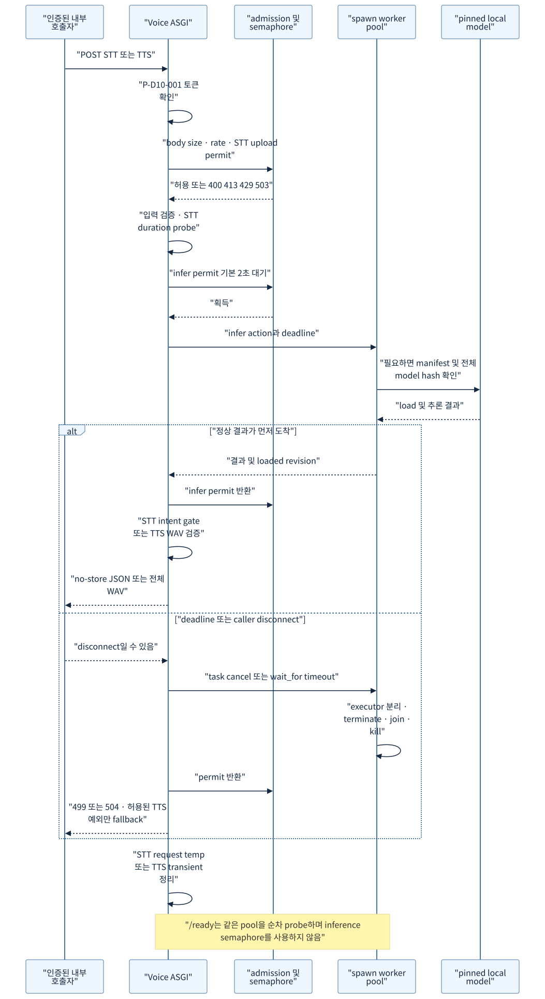

[Mermaid 원본](../diagrams/D10-voice-sequence.mmd) · [SVG](../rendered/D10-voice-sequence.svg)

## F-D10-007 한국어 규칙 명령 분류·목적지·후보 슬롯

| 항목 | 명세 |
| --- | --- |
| 분야 | D10 Voice 서비스·모델 관리·학습 데이터 파이프라인 |
| 목적 | 전사문을 고정 heuristic 점수와 13개 intent schema로 변환한다. |
| 사용 주체 | 호출 모듈 |
| 활성 상태 | ACTIVE |
| 진입점 | voice/intents.py:150 classify_intent voice/intents.py:92 normalize_korean_command voice/server.py:683 speech_intent |
| 실행 전제 | 호출자가 계약에 맞는 입력을 제공한다. 외부 서비스·기기 동작은 이 함수의 정적 근거에 포함되지 않는다. |
| 입력 출처 형식 검증 최신성 | POST /speech/intent transcript 1~200자; STT 내부 문자열도 같은 classifier 입력. lower/trim/공백정리/문장부호 제거. candidate index 양의 정수 숫자 또는 한국어 1~10. |

### 시작 이벤트와 처리 순서

| 이벤트 ID | 발생원 | 이벤트 | 수신부 | 흐름 |
| --- | --- | --- | --- | --- |
| E-D10-007-01 | 상위 호출 함수 | classify_intent 호출 | classify_intent | 1. 빈 compact→unknown 0.0. 부정 실행 문구·신고취소·목적지 모호성 marker를 긍정 substring보다 먼저 검사→unknown 0.85 safe_noop. → 2. 목적지 취소(0.93), 목적지 이름 없는 변경(0.9), 다음 경로 질문(0.92)을 처리한다. → 3. 목적지 prefix/으로·로 패턴을 generic 신고·길안내보다 먼저 처리한다. suffix를 정리하고 destination·requested_start 슬롯을 반환(0.92). → 4. 설정/지정 힌트가 없는 후보 n번째/n번 선택→0.91, 엄격한 신고 fullmatch→0.9, 현재위치→0.88. → 5. voice_off/on(0.93), repeat_last/stop/reroute/start_navigation(0.9) 순으로 확인; 나머지 unknown 0.2. |

1. 1. 빈 compact→unknown 0.0. 부정 실행 문구·신고취소·목적지 모호성 marker를 긍정 substring보다 먼저 검사→unknown 0.85 safe_noop.
2. 2. 목적지 취소(0.93), 목적지 이름 없는 변경(0.9), 다음 경로 질문(0.92)을 처리한다.
3. 3. 목적지 prefix/으로·로 패턴을 generic 신고·길안내보다 먼저 처리한다. suffix를 정리하고 destination·requested_start 슬롯을 반환(0.92).
4. 4. 설정/지정 힌트가 없는 후보 n번째/n번 선택→0.91, 엄격한 신고 fullmatch→0.9, 현재위치→0.88.
5. 5. voice_off/on(0.93), repeat_last/stop/reroute/start_navigation(0.9) 순으로 확인; 나머지 unknown 0.2.

| 분기 조건 | 실제 처리 결과 | 구현 근거 |
| --- | --- | --- |
| 하지마/하지말 등 실행 부정 또는 말고/아니고/아니라/또는/혹은+목적지 문맥 | safe_noop; 추정 목적지 실행 안 함 | voice/intents.py:150 classify_intent |
| 목적지 변경만 말함 | set_destination이나 빈 slots→다음 실행 gate에서 재질문 | voice/intents.py:150 classify_intent |
| 후보 숫자는 있으나 설정/지정 포함 | 후보 선택 판정 제외 | voice/intents.py:150 classify_intent |
| 신고센터로 안내해줘 | 목적지 우선; create_report로 실행 안 함 | voice/intents.py:150 classify_intent |

### 효과 종료와 복구

분류 반환만 수행; navigation/report DB side effect 없음.

| 상황 | 동작 |
| --- | --- |
| 정상 완료 | 단계에 설명한 반환값 또는 산출물로 종료. |
| 실패 | 유효성 또는 I/O 예외가 호출자에게 전파된다. 별도 자동 복구 없음. |
| 시간 초과 | 이 기능 자체의 별도 deadline 없음. |
| 중복 입력 | 독립 호출을 다시 처리한다. 별도 요청 idempotency 키 없음. |
| 취소 | 명시적 취소 API 없음. |
| 중단과 생명주기 | 프로세스 중단 시 완료 보장 없음. |
| 재시도 | 자동 재시도 없음. 호출자가 원인을 해결한 후 새 호출. |
| 복구 | 자동 재개 상태 저장 없음. |
| 자원 정리 | 이 기능이 소유하는 추가 자원 없음. |

### 상태 실행 맥락과 연결

| 항목 | 명세 |
| --- | --- |
| 초기 상태 | S-D10-007-IDLE |
| 상태 목록 | S-D10-007-IDLE S-D10-007-PROCESSING S-D10-007-RETURNED S-D10-007-FAILED |
| 전이 조건과 전이 동작 | 호출 → PROCESSING → 계약 충족 시 RETURNED 입력·처리 오류 → FAILED; 자동 재시도 없음 |
| 허용되지 않는 전이 | 이 상태 ID는 문서의 처리 단계 표기이며 코드의 지속 enum 상태가 아니다. 이 기능 외 사용자 상태 전이는 정의하지 않는다. |
| 동시성 순서와 작업 소유권 | 동기 helper; 호출자의 실행 맥락에서 처리하며 자체 큐·타이머 없음. |
| 공유 상태와 다른 기능 연결 | 13 schema는 12 known intents+unknown; requested_start는 힌트일 뿐 실제 route 시작은 상위 앱/Gateway 소유. |

### 정책 근거와 검증 범위

| 항목 | 근거 |
| --- | --- |
| 정책 | [P-D10-008](#P-D10-008) |
| 구현 | [voice/intents.py:150](/home/ddobagi/Hanium_Dreamup/voice/intents.py:150) · `classify_intent` (범위 150–261) [voice/intents.py:92](/home/ddobagi/Hanium_Dreamup/voice/intents.py:92) · `normalize_korean_command` (범위 92–147) [voice/server.py:683](/home/ddobagi/Hanium_Dreamup/voice/server.py:683) · `speech_intent` (범위 683–694) |
| 기존 개선 ID | 개별 동일성 미확인; 분야 연관은 별도 추적표 |
| 기존 분야 | 해당 없음 |
| 기존 실행 증거 | 이번 근거는 2026-10-04 10:33:40 KST 고정 text snapshot 정적 분석. 이 기능의 과거 실행 성공을 이번에 재확인하지 않음. |
| 한계 및 구분 | 코드 동작 명세이며 실제 모델 품질·외부 제공자·실기기·현장 성공을 증명하지 않는다. 교차영역 D03 정적 조사: Main의 toggleGatewayVoiceCapture 실제 호출 진입이 없고 서버 intent 결과는 Android 로컬 명령 parser에서 소비하지 않음. Voice route 구현 존재와 Android 실제 사용자 경로 연결은 별도다. |

| 테스트 위치 | 심볼 | 증거 수준 | 기대와 한계 |
| --- | --- | --- | --- |
| [tests/test_voice_intents.py](/home/ddobagi/Hanium_Dreamup/tests/test_voice_intents.py) | test_destination_name_containing_report_is_not_create_report | TEST_EXPECTATION | 목적지 분류 우선; 테스트 본문/기대 정적 확인, 이번 미실행 |
| [tests/test_voice_intents.py](/home/ddobagi/Hanium_Dreamup/tests/test_voice_intents.py) | test_ambiguous_or_corrected_destination_reprompts_instead_of_guessing | TEST_EXPECTATION | 모호한 수정 명령 재질문; 테스트 본문/기대 정적 확인, 이번 미실행 |

### 이벤트 처리 그림


[Mermaid 원본](../diagrams/D10-F007.mmd) · [SVG](../rendered/D10-F007.svg)

## F-D10-008 음성 intent 실행 허용·안전한 재질문 계약

| 항목 | 명세 |
| --- | --- |
| 분야 | D10 Voice 서비스·모델 관리·학습 데이터 파이프라인 |
| 목적 | 분류·음향·필수 슬롯을 함께 검사하여 실행 가능한 응답과 재질문을 분리한다. |
| 사용 주체 | 호출 모듈 |
| 활성 상태 | ACTIVE |
| 진입점 | voice/intents.py:264 evaluate_intent_policy voice/intents.py:292 intent_response_payload |
| 실행 전제 | 호출자가 계약에 맞는 입력을 제공한다. 외부 서비스·기기 동작은 이 함수의 정적 근거에 포함되지 않는다. |
| 입력 출처 형식 검증 최신성 | IntentResult.score heuristic [일반 생성값 0~0.93], 기본 threshold=0.7; acoustic_allowed True/False/None; destination 및 candidate_index slot. |

### 시작 이벤트와 처리 순서

| 이벤트 ID | 발생원 | 이벤트 | 수신부 | 흐름 |
| --- | --- | --- | --- | --- |
| E-D10-008-01 | 상위 호출 함수 | evaluate_intent_policy 호출 | evaluate_intent_policy | 1. unknown이면 safe_noop 또는 unknown_intent 사유로 reprompt. → 2. known이더라도 score<0.7이면 low_confidence. 그 뒤 acoustic_allowed is False이면 low_acoustic_confidence. → 3. set_destination의 destination falsey 또는 select_destination_candidate index가 정확한 int가 아니거나<1이면 필수 슬롯 재질문. → 4. 통과시 execute/should_execute=True/prompt=None. payload의 score와 confidence는 같은 규칙점수이며 acoustic_confidence는 별도 필드. |

1. 1. unknown이면 safe_noop 또는 unknown_intent 사유로 reprompt.
2. 2. known이더라도 score<0.7이면 low_confidence. 그 뒤 acoustic_allowed is False이면 low_acoustic_confidence.
3. 3. set_destination의 destination falsey 또는 select_destination_candidate index가 정확한 int가 아니거나<1이면 필수 슬롯 재질문.
4. 4. 통과시 execute/should_execute=True/prompt=None. payload의 score와 confidence는 같은 규칙점수이며 acoustic_confidence는 별도 필드.

| 분기 조건 | 실제 처리 결과 | 구현 근거 |
| --- | --- | --- |
| 텍스트 전용 /speech/intent | acoustic_allowed=None이므로 음향 차단 없이 규칙/슬롯만 판정 | voice/intents.py:264 evaluate_intent_policy |
| 후보 bool=True | type is not int로 거부 | voice/intents.py:264 evaluate_intent_policy |
| 후보 index가 실제 후보 목록보다 큼 | 이 함수는 상한/현재 후보 세대를 검증하지 않음; 상위 실행부 책임 | voice/intents.py:264 evaluate_intent_policy |

### 효과 종료와 복구

재질문 한국어 문구 반환; 이 서버는 TTS 재생·명령 실행을 자동 호출하지 않음.

| 상황 | 동작 |
| --- | --- |
| 정상 완료 | execute 또는 reprompt 데이터 반환. |
| 실패 | 유효성 또는 I/O 예외가 호출자에게 전파된다. 별도 자동 복구 없음. |
| 시간 초과 | 이 기능 자체의 별도 deadline 없음. |
| 중복 입력 | 독립 호출을 다시 처리한다. 별도 요청 idempotency 키 없음. |
| 취소 | 명시적 취소 API 없음. |
| 중단과 생명주기 | 프로세스 중단 시 완료 보장 없음. |
| 재시도 | 자동 재시도 없음. 호출자가 원인을 해결한 후 새 호출. |
| 복구 | 자동 재개 상태 저장 없음. |
| 자원 정리 | 이 기능이 소유하는 추가 자원 없음. |

### 상태 실행 맥락과 연결

| 항목 | 명세 |
| --- | --- |
| 초기 상태 | S-D10-008-IDLE |
| 상태 목록 | S-D10-008-IDLE S-D10-008-PROCESSING S-D10-008-RETURNED S-D10-008-FAILED |
| 전이 조건과 전이 동작 | 호출 → PROCESSING → 계약 충족 시 RETURNED 입력·처리 오류 → FAILED; 자동 재시도 없음 |
| 허용되지 않는 전이 | 이 상태 ID는 문서의 처리 단계 표기이며 코드의 지속 enum 상태가 아니다. 이 기능 외 사용자 상태 전이는 정의하지 않는다. |
| 동시성 순서와 작업 소유권 | 동기 helper; 호출자의 실행 맥락에서 처리하며 자체 큐·타이머 없음. |
| 공유 상태와 다른 기능 연결 | 입력·출력 계약은 code_refs의 호출 관계를 따른다. 별도 사용자 세션 상태 없음. |

### 정책 근거와 검증 범위

| 항목 | 근거 |
| --- | --- |
| 정책 | [P-D10-007](#P-D10-007) [P-D10-008](#P-D10-008) |
| 구현 | [voice/intents.py:264](/home/ddobagi/Hanium_Dreamup/voice/intents.py:264) · `evaluate_intent_policy` (범위 264–289) [voice/intents.py:292](/home/ddobagi/Hanium_Dreamup/voice/intents.py:292) · `intent_response_payload` (범위 292–338) |
| 기존 개선 ID | 개별 동일성 미확인; 분야 연관은 별도 추적표 |
| 기존 분야 | 해당 없음 |
| 기존 실행 증거 | 이번 근거는 2026-10-04 10:33:40 KST 고정 text snapshot 정적 분석. 이 기능의 과거 실행 성공을 이번에 재확인하지 않음. |
| 한계 및 구분 | 코드 동작 명세이며 실제 모델 품질·외부 제공자·실기기·현장 성공을 증명하지 않는다. 교차영역 D03 정적 조사: Main의 toggleGatewayVoiceCapture 실제 호출 진입이 없고 서버 intent 결과는 Android 로컬 명령 parser에서 소비하지 않음. Voice route 구현 존재와 Android 실제 사용자 경로 연결은 별도다. |

| 테스트 위치 | 심볼 | 증거 수준 | 기대와 한계 |
| --- | --- | --- | --- |
| [tests/test_voice_intents.py](/home/ddobagi/Hanium_Dreamup/tests/test_voice_intents.py) | test_candidate_selection_intent_without_index_asks_candidate_again | TEST_EXPECTATION | 필수 candidate 슬롯 검사; 테스트 본문/기대 정적 확인, 이번 미실행 |
| [tests/test_voice_stt_server.py](/home/ddobagi/Hanium_Dreamup/tests/test_voice_stt_server.py) | test_stt_low_acoustic_evidence_blocks_report_execution | TEST_EXPECTATION | 규칙점수가 높아도 음향 허용 False이면 차단; 테스트 본문/기대 정적 확인, 이번 미실행 |

### 이벤트 처리 그림


[Mermaid 원본](../diagrams/D10-F008.mmd) · [SVG](../rendered/D10-F008.svg)

## F-D10-009 TTS 요청·WAV 검증·선택적 fallback 응답

| 항목 | 명세 |
| --- | --- |
| 분야 | D10 Voice 서비스·모델 관리·학습 데이터 파이프라인 |
| 목적 | 짧은 안내 텍스트/정형 문구를 합성하고 유효한 전체 WAV만 반환한다. |
| 사용 주체 | Gateway/내부 운영 호출자 |
| 활성 상태 | ACTIVE |
| 진입점 | voice/server.py:898 speech_tts voice/server.py:859 validate_tts_wav_response voice/server.py:1030 resolve_tts_request_text voice/server.py:137 TTSRequest |
| 실행 전제 | Voice ASGI 서비스가 실행 중이어야 하며 OPTIONS 외 모든 HTTP 요청은 전용 내부 서비스 토큰이 필요하다. 실제 서비스 기동은 이번 미실행. |
| 입력 출처 형식 검증 최신성 | JSON extra=forbid; text 1~180자·Cc/Cf 금지, phrase_id 1~80자; use_cache=False/allow_fallback=False default. phrase_id가 있으면 문구 catalog 우선. 임의 text+use_cache는 422. |

### 시작 이벤트와 처리 순서

| 이벤트 ID | 발생원 | 이벤트 | 수신부 | 흐름 |
| --- | --- | --- | --- | --- |
| E-D10-009-01 | 내부 HTTP 호출자 | speech_tts 호출 | speech_tts | 1. phrase_id 또는 text를 해석하고 임의 text cache를 거부한다. effective_cache는 use_cache && phrase_id 존재. → 2. TTS semaphore 기본 2초 대기 후 pool infer(text,effective_cache)를 60초 deadline 및 disconnect watcher로 실행. → 3. RuntimeError/ValueError/VoiceInferenceTimeout에만 allow_fallback=true와 비어 있지 않은 VOICE_TTS_FALLBACK_WAV가 있으면 fallback 후보 선택. → 4. 일반 결과의 40hex revision 확인; 정상/fallback 모두 bytes>0·≤4MiB default 및 decoded duration≤30초를 검사. → 5. transient이면 bytes를 thread에서 읽고 finally unlink한 뒤 Response; cache/fallback은 FileResponse. no-store·nosniff와 모델/캐시/fallback/소요시간 헤더 반환. |
| E-D10-009-02 | 추론 worker | RuntimeError/ValueError/VoiceInferenceTimeout | speech_tts except | 허용fallback+파일존재이면WAV검증→fallback응답;아니면503/504;disconnect는fallback안함 |

1. 1. phrase_id 또는 text를 해석하고 임의 text cache를 거부한다. effective_cache는 use_cache && phrase_id 존재.
2. 2. TTS semaphore 기본 2초 대기 후 pool infer(text,effective_cache)를 60초 deadline 및 disconnect watcher로 실행.
3. 3. RuntimeError/ValueError/VoiceInferenceTimeout에만 allow_fallback=true와 비어 있지 않은 VOICE_TTS_FALLBACK_WAV가 있으면 fallback 후보 선택.
4. 4. 일반 결과의 40hex revision 확인; 정상/fallback 모두 bytes>0·≤4MiB default 및 decoded duration≤30초를 검사.
5. 5. transient이면 bytes를 thread에서 읽고 finally unlink한 뒤 Response; cache/fallback은 FileResponse. no-store·nosniff와 모델/캐시/fallback/소요시간 헤더 반환.

| 분기 조건 | 실제 처리 결과 | 구현 근거 |
| --- | --- | --- |
| phrase_id 알 수 없음 또는 둘 다 없음 | 422; phrase_id와 text가 둘 다 있으면 phrase_id 우선 | voice/server.py:898 speech_tts |
| queue timeout | 503 tts_busy; fallback 분기로 들어가지 않음 | voice/server.py:898 speech_tts |
| client disconnect | 499; fallback 사용 안 함 | voice/server.py:898 speech_tts |
| 추론 오류 및 허용 fallback 없음 | timeout 504, 기타 503 | voice/server.py:898 speech_tts |
| WAV 비어 있음/크기/길이 과다/해석 불가 | 502 tts_response_invalid; fallback 재시도 없음 | voice/server.py:898 speech_tts |

### 효과 종료와 복구

네트워크에 전체 WAV 반환. 스트리밍 합성 아님. 폰의 재생·청취 완료는 별개.

| 상황 | 동작 |
| --- | --- |
| 정상 완료 | 단계에 설명한 반환값 또는 산출물로 종료. |
| 실패 | 유효성 또는 I/O 예외가 호출자에게 전파된다. 별도 자동 복구 없음. |
| 시간 초과 | queue 2초(0.1~30), infer 60초(1~300), ffprobe 5초. |
| 중복 입력 | 독립 호출을 다시 처리한다. 별도 요청 idempotency 키 없음. |
| 취소 | infer/검증 시 disconnect 취소. transient 성공 response 이전 unlink; worker 강제종료 중 남은 파일은 보장하지 않음. |
| 중단과 생명주기 | 프로세스 중단 시 완료 보장 없음. |
| 재시도 | 자동 재시도 없음. 호출자가 원인을 해결한 후 새 호출. |
| 복구 | 자동 재개 상태 저장 없음. |
| 자원 정리 | transient은 missing revision/response 검증 실패/bytes read 종료에서 삭제. FileResponse cache/fallback 파일은 보존. |

### 상태 실행 맥락과 연결

| 항목 | 명세 |
| --- | --- |
| 초기 상태 | S-D10-009-IDLE |
| 상태 목록 | S-D10-009-IDLE S-D10-009-PROCESSING S-D10-009-RETURNED S-D10-009-FAILED |
| 전이 조건과 전이 동작 | 호출 → PROCESSING → 계약 충족 시 RETURNED 입력·처리 오류 → FAILED; 자동 재시도 없음 |
| 허용되지 않는 전이 | 이 상태 ID는 문서의 처리 단계 표기이며 코드의 지속 enum 상태가 아니다. 이 기능 외 사용자 상태 전이는 정의하지 않는다. |
| 동시성 순서와 작업 소유권 | FastAPI 요청 맥락. 상세 비동기 처리는 단계 및 연결 기능에 명시. |
| 공유 상태와 다른 기능 연결 | F-D10-010 engine/cache, F-D10-006 pool, F-D10-014 phrase catalog. |

### 정책 근거와 검증 범위

| 항목 | 근거 |
| --- | --- |
| 정책 | [P-D10-004](#P-D10-004) [P-D10-006](#P-D10-006) [P-D10-010](#P-D10-010) [P-D10-011](#P-D10-011) |
| 구현 | [voice/server.py:898](/home/ddobagi/Hanium_Dreamup/voice/server.py:898) · `speech_tts` (범위 898–1011) [voice/server.py:859](/home/ddobagi/Hanium_Dreamup/voice/server.py:859) · `validate_tts_wav_response` (범위 859–895) [voice/server.py:1030](/home/ddobagi/Hanium_Dreamup/voice/server.py:1030) · `resolve_tts_request_text` (범위 1030–1038) [voice/server.py:137](/home/ddobagi/Hanium_Dreamup/voice/server.py:137) · `TTSRequest` (범위 137–150) |
| 기존 개선 ID | 개별 동일성 미확인; 분야 연관은 별도 추적표 |
| 기존 분야 | 해당 없음 |
| 기존 실행 증거 | 이번 근거는 2026-10-04 10:33:40 KST 고정 text snapshot 정적 분석. 이 기능의 과거 실행 성공을 이번에 재확인하지 않음. |
| 한계 및 구분 | 코드 동작 명세이며 실제 모델 품질·외부 제공자·실기기·현장 성공을 증명하지 않는다. 교차영역 D03 정적 조사: Main의 toggleGatewayVoiceCapture 실제 호출 진입이 없고 서버 intent 결과는 Android 로컬 명령 parser에서 소비하지 않음. Voice route 구현 존재와 Android 실제 사용자 경로 연결은 별도다. |

| 테스트 위치 | 심볼 | 증거 수준 | 기대와 한계 |
| --- | --- | --- | --- |
| [tests/test_voice_tts.py](/home/ddobagi/Hanium_Dreamup/tests/test_voice_tts.py) | test_tts_transient_user_audio_is_unlinked_before_response_returns | TEST_EXPECTATION | 응답 반환 전 임시 WAV 삭제; 테스트 본문/기대 정적 확인, 이번 미실행 |
| [tests/test_voice_tts.py](/home/ddobagi/Hanium_Dreamup/tests/test_voice_tts.py) | test_tts_server_respects_allow_fallback_false | TEST_EXPECTATION | fallback 기본 차단; 테스트 본문/기대 정적 확인, 이번 미실행 |
| [tests/test_voice_tts.py](/home/ddobagi/Hanium_Dreamup/tests/test_voice_tts.py) | test_tts_arbitrary_text_cache_and_unicode_controls_are_rejected | TEST_EXPECTATION | 임의 text cache·제어문자 차단; 테스트 본문/기대 정적 확인, 이번 미실행 |

### 이벤트 처리 그림


[Mermaid 원본](../diagrams/D10-F009.mmd) · [SVG](../rendered/D10-F009.svg)

## F-D10-010 Qwen3-TTS 합성·캐시·보존량 정리

| 항목 | 명세 |
| --- | --- |
| 분야 | D10 Voice 서비스·모델 관리·학습 데이터 파이프라인 |
| 목적 | 모델과 발화 조건으로 캐시를 분리하고 원자적인 WAV 생성을 수행한다. |
| 사용 주체 | 호출 모듈 |
| 활성 상태 | CONDITIONAL |
| 진입점 | voice/tts.py:47 LocalTTSEngine voice/tts.py:145 _prune_cache voice/tts.py:179 _cache_path voice/tts.py:203 synthesize |
| 실행 전제 | 호출자가 계약에 맞는 입력을 제공한다. 외부 서비스·기기 동작은 이 함수의 정적 근거에 포함되지 않는다. |
| 입력 출처 형식 검증 최신성 | 기본 Qwen/Qwen3-TTS-12Hz-0.6B-CustomVoice, Korean, Sohee, bfloat16, CUDA:0/CPU. custom/design/clone 지원하나 배포 구성은 custom만. clone에는 ref_audio/ref_text 둘 다 필요. |

### 시작 이벤트와 처리 순서

| 이벤트 ID | 발생원 | 이벤트 | 수신부 | 흐름 |
| --- | --- | --- | --- | --- |
| E-D10-010-01 | 상위 호출 함수 | LocalTTSEngine 호출 | LocalTTSEngine | 1. service-owned real cache directory 확인·0700 설정. load는 lock 아래 pinned local snapshot으로 Qwen3TTSModel 생성. → 2. model@revision·language·mode·instruction·speaker·ref audio 경로·ref text·발화 text를 SHA256해 첫20hex cache key 생성. → 3. use_cache이고 nonempty output 존재하면 모델 load 없이 반환. miss는 output name hash 첫2hex bucket flock 후 다시 cache 확인. → 4. custom 또는 design은 non_streaming_mode=True로 생성; clone은 reference 인자를 넘긴다. wavs[0]을 임시 WAV에 저장·fsync·os.replace·directory fsync. → 5. cache는 보호 파일 1개를 남기고 mtime 최신순 파일/byte 한도를 초과하는 qwen3_tts_*.wav를 삭제한다. transient 생성 실패는 output 및 temporary를 정리. |

1. 1. service-owned real cache directory 확인·0700 설정. load는 lock 아래 pinned local snapshot으로 Qwen3TTSModel 생성.
2. 2. model@revision·language·mode·instruction·speaker·ref audio 경로·ref text·발화 text를 SHA256해 첫20hex cache key 생성.
3. 3. use_cache이고 nonempty output 존재하면 모델 load 없이 반환. miss는 output name hash 첫2hex bucket flock 후 다시 cache 확인.
4. 4. custom 또는 design은 non_streaming_mode=True로 생성; clone은 reference 인자를 넘긴다. wavs[0]을 임시 WAV에 저장·fsync·os.replace·directory fsync.
5. 5. cache는 보호 파일 1개를 남기고 mtime 최신순 파일/byte 한도를 초과하는 qwen3_tts_*.wav를 삭제한다. transient 생성 실패는 output 및 temporary를 정리.

| 분기 조건 | 실제 처리 결과 | 구현 근거 |
| --- | --- | --- |
| cache hit | sample_rate=0, generation duration=0, cached=True; fresh model load 없이 사용 | voice/tts.py:47 LocalTTSEngine |
| mode/dtype/speaker 잘못됨 | ValueError | voice/tts.py:47 LocalTTSEngine |
| cache dir symlink 또는 타 UID/비디렉터리 | ValueError | voice/tts.py:47 LocalTTSEngine |
| 수명량 초과 | 보호 파일 외 오래된 cache 파일 unlink; 보호 파일 자체가 byte budget보다 커도 유지 | voice/tts.py:47 LocalTTSEngine |

### 효과 종료와 복구

cache WAV·lock 파일·transient 파일 생성 및 retention 삭제. HTTP endpoint는 정형 phrase만 cache 허용.

| 상황 | 동작 |
| --- | --- |
| 정상 완료 | 단계에 설명한 반환값 또는 산출물로 종료. |
| 실패 | 유효성 또는 I/O 예외가 호출자에게 전파된다. 별도 자동 복구 없음. |
| 시간 초과 | 이 기능 자체의 별도 deadline 없음. |
| 중복 입력 | 같은 output cache 생성은 flock 아래 second check로 중복 합성 방지. cache miss transient 호출끼리는 각각 합성. |
| 취소 | 명시적 취소 API 없음. |
| 중단과 생명주기 | 프로세스 중단 시 완료 보장 없음. |
| 재시도 | 자동 재시도 없음. 호출자가 원인을 해결한 후 새 호출. |
| 복구 | 자동 재개 상태 저장 없음. |
| 자원 정리 | 정상/예외 finally에서 temporary WAV와 실패 transient 정리, flock 해제. SIGKILL 같은 외부 강제종료에는 Python finally 보장 없음. |

### 상태 실행 맥락과 연결

| 항목 | 명세 |
| --- | --- |
| 초기 상태 | S-D10-010-IDLE |
| 상태 목록 | S-D10-010-IDLE S-D10-010-PROCESSING S-D10-010-RETURNED S-D10-010-FAILED |
| 전이 조건과 전이 동작 | 호출 → PROCESSING → 계약 충족 시 RETURNED 입력·처리 오류 → FAILED; 자동 재시도 없음 |
| 허용되지 않는 전이 | 이 상태 ID는 문서의 처리 단계 표기이며 코드의 지속 enum 상태가 아니다. 이 기능 외 사용자 상태 전이는 정의하지 않는다. |
| 동시성 순서와 작업 소유권 | spawn worker의 동기 모델 호출; model load threading.Lock, 합성 output bucket flock, retention 별도 flock. 완성 cache read와 이후 FileResponse 전송은 retention lock으로 보호하지 않음. |
| 공유 상태와 다른 기능 연결 | 입력·출력 계약은 code_refs의 호출 관계를 따른다. 별도 사용자 세션 상태 없음. |

### 정책 근거와 검증 범위

| 항목 | 근거 |
| --- | --- |
| 정책 | [P-D10-009](#P-D10-009) [P-D10-012](#P-D10-012) |
| 구현 | [voice/tts.py:47](/home/ddobagi/Hanium_Dreamup/voice/tts.py:47) · `LocalTTSEngine` (범위 47–143) [voice/tts.py:145](/home/ddobagi/Hanium_Dreamup/voice/tts.py:145) · `_prune_cache` (범위 145–177) [voice/tts.py:179](/home/ddobagi/Hanium_Dreamup/voice/tts.py:179) · `_cache_path` (범위 179–201) [voice/tts.py:203](/home/ddobagi/Hanium_Dreamup/voice/tts.py:203) · `synthesize` (범위 203–351) |
| 기존 개선 ID | 개별 동일성 미확인; 분야 연관은 별도 추적표 |
| 기존 분야 | 해당 없음 |
| 기존 실행 증거 | 이번 근거는 2026-10-04 10:33:40 KST 고정 text snapshot 정적 분석. 이 기능의 과거 실행 성공을 이번에 재확인하지 않음. |
| 한계 및 구분 | 캐시 키의 clone ref_audio는 파일 경로 문자열이며 파일 내용 hash가 아니다. 캐시 hit는 WAV size/duration 검사와 별개로 현재 모델 파일 전체 hash 재검증을 하지 않는다. |

| 테스트 위치 | 심볼 | 증거 수준 | 기대와 한계 |
| --- | --- | --- | --- |
| [tests/test_voice_tts.py](/home/ddobagi/Hanium_Dreamup/tests/test_voice_tts.py) | test_tts_cache_hit_returns_existing_file_without_model_load | TEST_EXPECTATION | hit시 load 생략; 테스트 본문/기대 정적 확인, 이번 미실행 |
| [tests/test_voice_tts.py](/home/ddobagi/Hanium_Dreamup/tests/test_voice_tts.py) | test_tts_phrase_cache_is_bounded_and_arbitrary_text_is_transient | TEST_EXPECTATION | cache 개수/임시 발화 분리; 테스트 본문/기대 정적 확인, 이번 미실행 |

### 이벤트 처리 그림


[Mermaid 원본](../diagrams/D10-F010.mmd) · [SVG](../rendered/D10-F010.svg)

## F-D10-011 Voice 모델 revision·manifest·캐시 파일 무결성

| 항목 | 명세 |
| --- | --- |
| 분야 | D10 Voice 서비스·모델 관리·학습 데이터 파이프라인 |
| 목적 | 사전 배치된 로컬 모델 snapshot과 파일 집합이 고정 digest와 일치할 때만 모델을 로드한다. |
| 사용 주체 | 호출 모듈 |
| 활성 상태 | ACTIVE |
| 진입점 | voice/model_integrity.py:65 _load_manifest voice/model_integrity.py:147 verify_model_snapshot voice/model_integrity.py:22 huggingface_hub_cache_dir |
| 실행 전제 | 호출자가 계약에 맞는 입력을 제공한다. 외부 서비스·기기 동작은 이 함수의 정적 근거에 포함되지 않는다. |
| 입력 출처 형식 검증 최신성 | kind stt/tts, explicit owner/repo, lowercase40hex revision, lowercase64hex manifest SHA256; schema walksafe.voice_model_files.v1; files 1~10000개·manifest≤16MiB. |

### 시작 이벤트와 처리 순서

| 이벤트 ID | 발생원 | 이벤트 | 수신부 | 흐름 |
| --- | --- | --- | --- | --- |
| E-D10-011-01 | 상위 호출 함수 | _load_manifest 호출 | _load_manifest | 1. manifest를 O_NOFOLLOW로 열어 regular file·크기·전체 raw bytes digest 확인. UTF8 JSON duplicate key를 거부한다. → 2. schema/kind/model_id/revision 일치와 normalized POSIX relative file names, 각 64hex digest를 확인한다. → 3. STT는 config.json/model.bin/tokenizer.json 및 vocabulary.*가 필요; TTS는 config.json과 bin/safetensors weight 필요. → 4. HF cache precedence에 따라 model cache/snapshots/revision을 선택. root snapshot symlink·symlink dir·특수파일·추가/누락 파일 집합 거부. → 5. 각 logical file을 resolve하여 model cache root 안 regular file인지 검사하고 1MiB chunk SHA256를 재계산 후 경로 반환. |

1. 1. manifest를 O_NOFOLLOW로 열어 regular file·크기·전체 raw bytes digest 확인. UTF8 JSON duplicate key를 거부한다.
2. 2. schema/kind/model_id/revision 일치와 normalized POSIX relative file names, 각 64hex digest를 확인한다.
3. 3. STT는 config.json/model.bin/tokenizer.json 및 vocabulary.*가 필요; TTS는 config.json과 bin/safetensors weight 필요.
4. 4. HF cache precedence에 따라 model cache/snapshots/revision을 선택. root snapshot symlink·symlink dir·특수파일·추가/누락 파일 집합 거부.
5. 5. 각 logical file을 resolve하여 model cache root 안 regular file인지 검사하고 1MiB chunk SHA256를 재계산 후 경로 반환.

| 분기 조건 | 실제 처리 결과 | 구현 근거 |
| --- | --- | --- |
| manifest 또는 모델 file hash 불일치 | fail closed RuntimeError | voice/model_integrity.py:65 _load_manifest |
| 모델 파일 symlink가 model cache 내부 blob으로 resolve | 허용; directory symlink는 거부 | voice/model_integrity.py:65 _load_manifest |
| 원격 model이 없거나 로컬 snapshot 없음 | 다운로드 대신 실패 | voice/model_integrity.py:65 _load_manifest |

### 효과 종료와 복구

로컬 파일 읽기. 자체 네트워크 다운로드·수정 없음.

| 상황 | 동작 |
| --- | --- |
| 정상 완료 | 단계에 설명한 반환값 또는 산출물로 종료. |
| 실패 | 유효성 또는 I/O 예외가 호출자에게 전파된다. 별도 자동 복구 없음. |
| 시간 초과 | 이 기능 자체의 별도 deadline 없음. |
| 중복 입력 | 독립 호출을 다시 처리한다. 별도 요청 idempotency 키 없음. |
| 취소 | 명시적 취소 API 없음. |
| 중단과 생명주기 | 프로세스 중단 시 완료 보장 없음. |
| 재시도 | 자동 재시도 없음. 호출자가 원인을 해결한 후 새 호출. |
| 복구 | 자동 재개 상태 저장 없음. |
| 자원 정리 | 이 기능이 소유하는 추가 자원 없음. |

### 상태 실행 맥락과 연결

| 항목 | 명세 |
| --- | --- |
| 초기 상태 | S-D10-011-IDLE |
| 상태 목록 | S-D10-011-IDLE S-D10-011-PROCESSING S-D10-011-RETURNED S-D10-011-FAILED |
| 전이 조건과 전이 동작 | 호출 → PROCESSING → 계약 충족 시 RETURNED 입력·처리 오류 → FAILED; 자동 재시도 없음 |
| 허용되지 않는 전이 | 이 상태 ID는 문서의 처리 단계 표기이며 코드의 지속 enum 상태가 아니다. 이 기능 외 사용자 상태 전이는 정의하지 않는다. |
| 동시성 순서와 작업 소유권 | 동기 helper; 호출자의 실행 맥락에서 처리하며 자체 큐·타이머 없음. |
| 공유 상태와 다른 기능 연결 | 입력·출력 계약은 code_refs의 호출 관계를 따른다. 별도 사용자 세션 상태 없음. |

### 정책 근거와 검증 범위

| 항목 | 근거 |
| --- | --- |
| 정책 | [P-D10-009](#P-D10-009) |
| 구현 | [voice/model_integrity.py:65](/home/ddobagi/Hanium_Dreamup/voice/model_integrity.py:65) · `_load_manifest` (범위 65–144) [voice/model_integrity.py:147](/home/ddobagi/Hanium_Dreamup/voice/model_integrity.py:147) · `verify_model_snapshot` (범위 147–188) [voice/model_integrity.py:22](/home/ddobagi/Hanium_Dreamup/voice/model_integrity.py:22) · `huggingface_hub_cache_dir` (범위 22–29) |
| 기존 개선 ID | 개별 동일성 미확인; 분야 연관은 별도 추적표 |
| 기존 분야 | 해당 없음 |
| 기존 실행 증거 | 이번 근거는 2026-10-04 10:33:40 KST 고정 text snapshot 정적 분석. 이 기능의 과거 실행 성공을 이번에 재확인하지 않음. |
| 한계 및 구분 | 코드 동작 명세이며 실제 모델 품질·외부 제공자·실기기·현장 성공을 증명하지 않는다. |

| 테스트 위치 | 심볼 | 증거 수준 | 기대와 한계 |
| --- | --- | --- | --- |
| [tests/test_voice_model_integrity.py](/home/ddobagi/Hanium_Dreamup/tests/test_voice_model_integrity.py) | test_snapshot_rejects_unpinned_or_changed_files | TEST_EXPECTATION | 추가/변경 파일 차단; 테스트 본문/기대 정적 확인, 이번 미실행 |
| [tests/test_voice_model_integrity.py](/home/ddobagi/Hanium_Dreamup/tests/test_voice_model_integrity.py) | test_snapshot_manifest_is_itself_hash_pinned | TEST_EXPECTATION | manifest 자체 hash 검증; 테스트 본문/기대 정적 확인, 이번 미실행 |
| [tests/test_voice_model_integrity.py](/home/ddobagi/Hanium_Dreamup/tests/test_voice_model_integrity.py) | test_stt_loader_uses_only_verified_snapshot | TEST_EXPECTATION | verified snapshot 경로로만 load; 테스트 본문/기대 정적 확인, 이번 미실행 |

### 이벤트 처리 그림


[Mermaid 원본](../diagrams/D10-F011.mmd) · [SVG](../rendered/D10-F011.svg)

## F-D10-012 Voice health 설정·장치 정보 조회

| 항목 | 명세 |
| --- | --- |
| 분야 | D10 Voice 서비스·모델 관리·학습 데이터 파이프라인 |
| 목적 | 추론을 수행하지 않고 서비스 설정과 CUDA 가용 정보를 반환한다. |
| 사용 주체 | Gateway/내부 운영 호출자 |
| 활성 상태 | ACTIVE |
| 진입점 | voice/server.py:623 health |
| 실행 전제 | Voice ASGI 서비스가 실행 중이어야 하며 OPTIONS 외 모든 HTTP 요청은 전용 내부 서비스 토큰이 필요하다. 실제 서비스 기동은 이번 미실행. |
| 입력 출처 형식 검증 최신성 | GET /health와 내부 서비스 토큰. |

### 시작 이벤트와 처리 순서

| 이벤트 ID | 발생원 | 이벤트 | 수신부 | 흐름 |
| --- | --- | --- | --- | --- |
| E-D10-012-01 | 내부 HTTP 호출자 | health 호출 | health | 1. torch.cuda.is_available 및 가능하면 GPU name을 확인한다. → 2. model/revision 설정값, STT/TTS concurrency, request/duration 제한, process_isolation true와 process_local/1worker/1replica를 반환한다. |

1. 1. torch.cuda.is_available 및 가능하면 GPU name을 확인한다.
2. 2. model/revision 설정값, STT/TTS concurrency, request/duration 제한, process_isolation true와 process_local/1worker/1replica를 반환한다.

| 분기 조건 | 실제 처리 결과 | 구현 근거 |
| --- | --- | --- |
| status=ok | 함수 실행 성공이라는 의미; 모델이 실제 로드됨을 뜻하지 않음 | voice/server.py:623 health |

### 효과 종료와 복구

설정 메타데이터 JSON 반환.

| 상황 | 동작 |
| --- | --- |
| 정상 완료 | 단계에 설명한 반환값 또는 산출물로 종료. |
| 실패 | 유효성 또는 I/O 예외가 호출자에게 전파된다. 별도 자동 복구 없음. |
| 시간 초과 | 이 기능 자체의 별도 deadline 없음. |
| 중복 입력 | 독립 호출을 다시 처리한다. 별도 요청 idempotency 키 없음. |
| 취소 | 명시적 취소 API 없음. |
| 중단과 생명주기 | 프로세스 중단 시 완료 보장 없음. |
| 재시도 | 자동 재시도 없음. 호출자가 원인을 해결한 후 새 호출. |
| 복구 | 자동 재개 상태 저장 없음. |
| 자원 정리 | 이 기능이 소유하는 추가 자원 없음. |

### 상태 실행 맥락과 연결

| 항목 | 명세 |
| --- | --- |
| 초기 상태 | S-D10-012-IDLE |
| 상태 목록 | S-D10-012-IDLE S-D10-012-PROCESSING S-D10-012-RETURNED S-D10-012-FAILED |
| 전이 조건과 전이 동작 | 호출 → PROCESSING → 계약 충족 시 RETURNED 입력·처리 오류 → FAILED; 자동 재시도 없음 |
| 허용되지 않는 전이 | 이 상태 ID는 문서의 처리 단계 표기이며 코드의 지속 enum 상태가 아니다. 이 기능 외 사용자 상태 전이는 정의하지 않는다. |
| 동시성 순서와 작업 소유권 | FastAPI 요청 맥락. 상세 비동기 처리는 단계 및 연결 기능에 명시. |
| 공유 상태와 다른 기능 연결 | 입력·출력 계약은 code_refs의 호출 관계를 따른다. 별도 사용자 세션 상태 없음. |

### 정책 근거와 검증 범위

| 항목 | 근거 |
| --- | --- |
| 정책 | [P-D10-001](#P-D10-001) |
| 구현 | [voice/server.py:623](/home/ddobagi/Hanium_Dreamup/voice/server.py:623) · `health` (범위 623–652) |
| 기존 개선 ID | 개별 동일성 미확인; 분야 연관은 별도 추적표 |
| 기존 분야 | 해당 없음 |
| 기존 실행 증거 | 이번 근거는 2026-10-04 10:33:40 KST 고정 text snapshot 정적 분석. 이 기능의 과거 실행 성공을 이번에 재확인하지 않음. |
| 한계 및 구분 | health는 configured 값이며 /ready의 live_worker_probe와 구분. 비밀 token을 반환하지 않는다. |

| 테스트 위치 | 심볼 | 증거 수준 | 기대와 한계 |
| --- | --- | --- | --- |

연결한 테스트 미확인: 이번 작성 범위에서 이 기능에 대응하는 시험 단언을 연결하지 않았다. 테스트 자체가 없다는 판정이 아니다.

### 이벤트 처리 그림


[Mermaid 원본](../diagrams/D10-F012.mmd) · [SVG](../rendered/D10-F012.svg)

## F-D10-013 Voice readiness 순차 warmup·live worker probe

| 항목 | 명세 |
| --- | --- |
| 분야 | D10 Voice 서비스·모델 관리·학습 데이터 파이프라인 |
| 목적 | 매 요청마다 두 모델을 실제 worker에서 load 확인해 준비 상태를 판정한다. |
| 사용 주체 | Gateway/내부 운영 호출자 |
| 활성 상태 | ACTIVE |
| 진입점 | voice/server.py:655 readiness |
| 실행 전제 | Voice ASGI 서비스가 실행 중이어야 하며 OPTIONS 외 모든 HTTP 요청은 전용 내부 서비스 토큰이 필요하다. 실제 서비스 기동은 이번 미실행. |
| 입력 출처 형식 검증 최신성 | GET /ready. VOICE_READY_TIMEOUT_SECONDS 기본180, 1~300초 범위; 내부 서비스 토큰 필요. |

### 시작 이벤트와 처리 순서

| 이벤트 ID | 발생원 | 이벤트 | 수신부 | 흐름 |
| --- | --- | --- | --- | --- |
| E-D10-013-01 | 내부 HTTP 호출자 | readiness 호출 | readiness | 1. STT pool ready action을 await하고 성공시 ready=true,evidence=live_worker_probe,model 저장. → 2. 이어서 TTS pool ready action을 수행한다. 동시 로딩의 GPU 메모리 spike를 피하도록 순차 처리. → 3. 두 check가 모두 ready=True이면 200/status ready. 어느 하나 실패하면 reason=model_warmup_failed,error_type 및 503/not_ready. |

1. 1. STT pool ready action을 await하고 성공시 ready=true,evidence=live_worker_probe,model 저장.
2. 2. 이어서 TTS pool ready action을 수행한다. 동시 로딩의 GPU 메모리 spike를 피하도록 순차 처리.
3. 3. 두 check가 모두 ready=True이면 200/status ready. 어느 하나 실패하면 reason=model_warmup_failed,error_type 및 503/not_ready.

| 분기 조건 | 실제 처리 결과 | 구현 근거 |
| --- | --- | --- |
| 이전 ready 성공 후 이번 worker failure | 이번 결과 false로 보고; 이전 ready flag 재사용 안 함 | voice/server.py:655 readiness |
| 모델별 probe timeout | 그 pool abort 후 false; 다음 모델 probe는 계속 | voice/server.py:655 readiness |

### 효과 종료와 복구

반환값과 오류를 상위 호출자에게 전달한다.

| 상황 | 동작 |
| --- | --- |
| 정상 완료 | 단계에 설명한 반환값 또는 산출물로 종료. |
| 실패 | 유효성 또는 I/O 예외가 호출자에게 전파된다. 별도 자동 복구 없음. |
| 시간 초과 | 모델당 기본180초이므로 두 모델 순차 전체는 기본 최대 약360초+abort 정리. 별도 전체180초 deadline 아님. |
| 중복 입력 | 독립 호출을 다시 처리한다. 별도 요청 idempotency 키 없음. |
| 취소 | 명시적 취소 API 없음. |
| 중단과 생명주기 | 프로세스 중단 시 완료 보장 없음. |
| 재시도 | 자동 재시도 없음. 호출자가 원인을 해결한 후 새 호출. |
| 복구 | 자동 재개 상태 저장 없음. |
| 자원 정리 | 이 기능이 소유하는 추가 자원 없음. |

### 상태 실행 맥락과 연결

| 항목 | 명세 |
| --- | --- |
| 초기 상태 | S-D10-013-IDLE |
| 상태 목록 | S-D10-013-IDLE S-D10-013-PROCESSING S-D10-013-RETURNED S-D10-013-FAILED |
| 전이 조건과 전이 동작 | 호출 → PROCESSING → 계약 충족 시 RETURNED 입력·처리 오류 → FAILED; 자동 재시도 없음 |
| 허용되지 않는 전이 | 이 상태 ID는 문서의 처리 단계 표기이며 코드의 지속 enum 상태가 아니다. 이 기능 외 사용자 상태 전이는 정의하지 않는다. |
| 동시성 순서와 작업 소유권 | FastAPI 요청 맥락. 상세 비동기 처리는 단계 및 연결 기능에 명시. |
| 공유 상태와 다른 기능 연결 | STT/TTS inference와 같은 pool. readiness 자체는 inference semaphore를 취득하지 않는다. |

### 정책 근거와 검증 범위

| 항목 | 근거 |
| --- | --- |
| 정책 | [P-D10-006](#P-D10-006) [P-D10-009](#P-D10-009) |
| 구현 | [voice/server.py:655](/home/ddobagi/Hanium_Dreamup/voice/server.py:655) · `readiness` (범위 655–680) |
| 기존 개선 ID | 개별 동일성 미확인; 분야 연관은 별도 추적표 |
| 기존 분야 | 해당 없음 |
| 기존 실행 증거 | 이번 근거는 2026-10-04 10:33:40 KST 고정 text snapshot 정적 분석. 이 기능의 과거 실행 성공을 이번에 재확인하지 않음. |
| 한계 및 구분 | 코드 동작 명세이며 실제 모델 품질·외부 제공자·실기기·현장 성공을 증명하지 않는다. |

| 테스트 위치 | 심볼 | 증거 수준 | 기대와 한계 |
| --- | --- | --- | --- |
| [tests/test_voice_stt_server.py](/home/ddobagi/Hanium_Dreamup/tests/test_voice_stt_server.py) | test_voice_readiness_reprobes_after_an_earlier_success | TEST_EXPECTATION | 이전 성공 후 재검사; 테스트 본문/기대 정적 확인, 이번 미실행 |

### 이벤트 처리 그림


[Mermaid 원본](../diagrams/D10-F013.mmd) · [SVG](../rendered/D10-F013.svg)

## F-D10-014 정형 안내 문구·intent schema·TTS 캐시 상태 조회

| 항목 | 명세 |
| --- | --- |
| 분야 | D10 Voice 서비스·모델 관리·학습 데이터 파이프라인 |
| 목적 | 내부 호출자에게 정형 문구 및 입력 계약과 캐시 존재 여부를 제공한다. |
| 사용 주체 | Gateway/내부 운영 호출자 |
| 활성 상태 | ACTIVE |
| 진입점 | voice/server.py:692 GET /speech/intents speech_intents voice/server.py:702 GET /speech/phrases speech_phrases voice/server.py:1014 POST /speech/tts/cache-status speech_tts_cache_status |
| 실행 전제 | Voice ASGI 서비스가 실행 중이어야 하며 OPTIONS 외 모든 HTTP 요청은 전용 내부 서비스 토큰이 필요하다. 실제 서비스 기동은 이번 미실행. |
| 입력 출처 형식 검증 최신성 | GET /speech/intents, /speech/phrases; POST /speech/tts/cache-status는 TTSRequest. 7 phrase IDs: risk.blocking.stop, risk.approaching.avoid, report.voice.saved/failed, location.current.ready,destination.saved,navigation.ready. |

### 시작 이벤트와 처리 순서

| 이벤트 ID | 발생원 | 이벤트 | 수신부 | 흐름 |
| --- | --- | --- | --- | --- |
| E-D10-014-01 | 내부 HTTP 호출자 | VOICE_PHRASES 호출 | VOICE_PHRASES | 1. phrase catalog 또는 intent schema를 즉시 반환한다. → 2. cache-status는 동일 text resolution과 get_tts_engine 구성으로 cache path를 계산한다. → 3. exists && size>0만 cached로 반환하며 model load·합성·실제 WAV probe는 하지 않는다. key와 suffix를 반환하고 절대 cache path는 반환하지 않는다. |

1. 1. phrase catalog 또는 intent schema를 즉시 반환한다.
2. 2. cache-status는 동일 text resolution과 get_tts_engine 구성으로 cache path를 계산한다.
3. 3. exists && size>0만 cached로 반환하며 model load·합성·실제 WAV probe는 하지 않는다. key와 suffix를 반환하고 절대 cache path는 반환하지 않는다.

| 분기 조건 | 실제 처리 결과 | 구현 근거 |
| --- | --- | --- |
| 알 수 없는 phrase | 422 | voice/phrases.py:13 VOICE_PHRASES |
| cache hit 표시 | 합성 가능/음원 유효성 증거 아님 | voice/phrases.py:13 VOICE_PHRASES |
| cache-status에 use_cache=true 임의 text | speech_tts의 arbitrary-cache 거부 검사를 실행하지 않지만 실제 파일 생성도 안 함 | voice/phrases.py:13 VOICE_PHRASES |

### 효과 종료와 복구

get_tts_engine 첫 호출은 cache directory 생성/chmod를 할 수 있다. 모델 load 없음.

| 상황 | 동작 |
| --- | --- |
| 정상 완료 | 단계에 설명한 반환값 또는 산출물로 종료. |
| 실패 | 유효성 또는 I/O 예외가 호출자에게 전파된다. 별도 자동 복구 없음. |
| 시간 초과 | 이 기능 자체의 별도 deadline 없음. |
| 중복 입력 | 독립 호출을 다시 처리한다. 별도 요청 idempotency 키 없음. |
| 취소 | 명시적 취소 API 없음. |
| 중단과 생명주기 | 프로세스 중단 시 완료 보장 없음. |
| 재시도 | 자동 재시도 없음. 호출자가 원인을 해결한 후 새 호출. |
| 복구 | 자동 재개 상태 저장 없음. |
| 자원 정리 | 이 기능이 소유하는 추가 자원 없음. |

### 상태 실행 맥락과 연결

| 항목 | 명세 |
| --- | --- |
| 초기 상태 | S-D10-014-IDLE |
| 상태 목록 | S-D10-014-IDLE S-D10-014-PROCESSING S-D10-014-RETURNED S-D10-014-FAILED |
| 전이 조건과 전이 동작 | 호출 → PROCESSING → 계약 충족 시 RETURNED 입력·처리 오류 → FAILED; 자동 재시도 없음 |
| 허용되지 않는 전이 | 이 상태 ID는 문서의 처리 단계 표기이며 코드의 지속 enum 상태가 아니다. 이 기능 외 사용자 상태 전이는 정의하지 않는다. |
| 동시성 순서와 작업 소유권 | FastAPI 요청 맥락. 상세 비동기 처리는 단계 및 연결 기능에 명시. |
| 공유 상태와 다른 기능 연결 | 입력·출력 계약은 code_refs의 호출 관계를 따른다. 별도 사용자 세션 상태 없음. |

### 정책 근거와 검증 범위

| 항목 | 근거 |
| --- | --- |
| 정책 | [P-D10-010](#P-D10-010) [P-D10-012](#P-D10-012) |
| 구현 | [voice/phrases.py:13](/home/ddobagi/Hanium_Dreamup/voice/phrases.py:13) · `VOICE_PHRASES` (범위 13–35) [voice/server.py:692](/home/ddobagi/Hanium_Dreamup/voice/server.py:692) · `speech_phrases` (범위 692–704) [voice/server.py:1014](/home/ddobagi/Hanium_Dreamup/voice/server.py:1014) · `speech_tts_cache_status` (범위 1014–1038) |
| 기존 개선 ID | 개별 동일성 미확인; 분야 연관은 별도 추적표 |
| 기존 분야 | 해당 없음 |
| 기존 실행 증거 | 이번 근거는 2026-10-04 10:33:40 KST 고정 text snapshot 정적 분석. 이 기능의 과거 실행 성공을 이번에 재확인하지 않음. |
| 한계 및 구분 | 코드 동작 명세이며 실제 모델 품질·외부 제공자·실기기·현장 성공을 증명하지 않는다. |

| 테스트 위치 | 심볼 | 증거 수준 | 기대와 한계 |
| --- | --- | --- | --- |
| [tests/test_voice_tts.py](/home/ddobagi/Hanium_Dreamup/tests/test_voice_tts.py) | test_tts_cache_status_does_not_load_model | TEST_EXPECTATION | dry status load 생략; 테스트 본문/기대 정적 확인, 이번 미실행 |

### 이벤트 처리 그림


[Mermaid 원본](../diagrams/D10-F014.mmd) · [SVG](../rendered/D10-F014.svg)

## F-D10-015 음성 intent 최소화 telemetry payload helper

| 항목 | 명세 |
| --- | --- |
| 분야 | D10 Voice 서비스·모델 관리·학습 데이터 파이프라인 |
| 목적 | 음성 원문과 슬롯 값을 제외한 집계용 메타데이터 형식을 제공한다. |
| 사용 주체 | 호출 모듈 |
| 활성 상태 | UNCONNECTED |
| 진입점 | voice/telemetry.py:11 intent_telemetry_payload voice/server.py:697 speech_intent_telemetry_schema |
| 실행 전제 | 호출자가 계약에 맞는 입력을 제공한다. 외부 서비스·기기 동작은 이 함수의 정적 근거에 포함되지 않는다. |
| 입력 출처 형식 검증 최신성 | IntentResult 또는 GET /speech/intent-telemetry/schema; score bucket high≥0.9, medium≥0.7, 나머지 low. |

### 시작 이벤트와 처리 순서

| 이벤트 ID | 발생원 | 이벤트 | 수신부 | 흐름 |
| --- | --- | --- | --- | --- |
| E-D10-015-01 | 상위 호출 함수 | intent_telemetry_payload 호출 | intent_telemetry_payload | 1. intent policy를 acoustic 인자 없이 계산한다. → 2. schema_version,intent,confidence_bucket,action,should_execute,reason,정렬 slot_keys,normalized_length만 payload에 넣는다. → 3. schema endpoint는 raw audio/transcript storage=False 및 필드 목록을 반환한다. |

1. 1. intent policy를 acoustic 인자 없이 계산한다.
2. 2. schema_version,intent,confidence_bucket,action,should_execute,reason,정렬 slot_keys,normalized_length만 payload에 넣는다.
3. 3. schema endpoint는 raw audio/transcript storage=False 및 필드 목록을 반환한다.

| 분기 조건 | 실제 처리 결과 | 구현 근거 |
| --- | --- | --- |
| 실제 STT 응답 생성 | 서버는 이 payload helper를 호출하거나 저장하지 않음; schema 제공만 연결 | voice/telemetry.py:11 intent_telemetry_payload |
| 음향 execution False 원본이 있는 경우 | helper 입력에는 acoustic 인자가 없어 policy metadata가 실제 STT 실행 gate와 다를 수 있음 | voice/telemetry.py:11 intent_telemetry_payload |

### 효과 종료와 복구

helper 반환값 생성뿐; telemetry 수집 endpoint/DB 저장/파일 로그 구현 없음.

| 상황 | 동작 |
| --- | --- |
| 정상 완료 | 단계에 설명한 반환값 또는 산출물로 종료. |
| 실패 | 유효성 또는 I/O 예외가 호출자에게 전파된다. 별도 자동 복구 없음. |
| 시간 초과 | 이 기능 자체의 별도 deadline 없음. |
| 중복 입력 | 독립 호출을 다시 처리한다. 별도 요청 idempotency 키 없음. |
| 취소 | 명시적 취소 API 없음. |
| 중단과 생명주기 | 프로세스 중단 시 완료 보장 없음. |
| 재시도 | 자동 재시도 없음. 호출자가 원인을 해결한 후 새 호출. |
| 복구 | 자동 재개 상태 저장 없음. |
| 자원 정리 | 이 기능이 소유하는 추가 자원 없음. |

### 상태 실행 맥락과 연결

| 항목 | 명세 |
| --- | --- |
| 초기 상태 | S-D10-015-IDLE |
| 상태 목록 | S-D10-015-IDLE S-D10-015-PROCESSING S-D10-015-RETURNED S-D10-015-FAILED |
| 전이 조건과 전이 동작 | 호출 → PROCESSING → 계약 충족 시 RETURNED 입력·처리 오류 → FAILED; 자동 재시도 없음 |
| 허용되지 않는 전이 | 이 상태 ID는 문서의 처리 단계 표기이며 코드의 지속 enum 상태가 아니다. 이 기능 외 사용자 상태 전이는 정의하지 않는다. |
| 동시성 순서와 작업 소유권 | 동기 helper; 호출자의 실행 맥락에서 처리하며 자체 큐·타이머 없음. |
| 공유 상태와 다른 기능 연결 | 입력·출력 계약은 code_refs의 호출 관계를 따른다. 별도 사용자 세션 상태 없음. |

### 정책 근거와 검증 범위

| 항목 | 근거 |
| --- | --- |
| 정책 | [P-D10-013](#P-D10-013) |
| 구현 | [voice/telemetry.py:11](/home/ddobagi/Hanium_Dreamup/voice/telemetry.py:11) · `intent_telemetry_payload` (범위 11–49) [voice/server.py:697](/home/ddobagi/Hanium_Dreamup/voice/server.py:697) · `speech_intent_telemetry_schema` (범위 697–699) |
| 기존 개선 ID | 개별 동일성 미확인; 분야 연관은 별도 추적표 |
| 기존 분야 | 해당 없음 |
| 기존 실행 증거 | 이번 근거는 2026-10-04 10:33:40 KST 고정 text snapshot 정적 분석. 이 기능의 과거 실행 성공을 이번에 재확인하지 않음. |
| 한계 및 구분 | UNCONNECTED는 payload 생성 helper의 운영 수집 경로 기준이며 schema endpoint는 활성 라우트다. |

| 테스트 위치 | 심볼 | 증거 수준 | 기대와 한계 |
| --- | --- | --- | --- |
| [tests/test_voice_intents.py](/home/ddobagi/Hanium_Dreamup/tests/test_voice_intents.py) | test_intent_telemetry_excludes_raw_audio_and_transcript_text | TEST_EXPECTATION | 슬롯 값·전사문 제외; 테스트 본문/기대 정적 확인, 이번 미실행 |

### 이벤트 처리 그림


[Mermaid 원본](../diagrams/D10-F015.mmd) · [SVG](../rendered/D10-F015.svg)

## F-D10-016 서버 detect.v2 모델 threshold 구성 정규화

| 항목 | 명세 |
| --- | --- |
| 분야 | D10 Voice 서비스·모델 관리·학습 데이터 파이프라인 |
| 목적 | CPU helper가 처리할 3종 model key와 고정 class order·threshold를 검사한다. |
| 사용 주체 | 호출 모듈 |
| 활성 상태 | ACTIVE |
| 진입점 | model/two_model_runtime.py:184 load_threshold_config model/two_model_runtime.py:21 DEFAULT_RUNTIME_CONFIG |
| 실행 전제 | 호출자가 계약에 맞는 입력을 제공한다. 외부 서비스·기기 동작은 이 함수의 정적 근거에 포함되지 않는다. |
| 입력 출처 형식 검증 최신성 | path None→default 또는 JSON/YAML(.yaml/.yml은 PyYAML 필요); primary unified_walksafe/legacy_two_model, fallback None/빈문자/legacy_two_model; classes/allowlist와 default threshold. |

### 시작 이벤트와 처리 순서

| 이벤트 ID | 발생원 | 이벤트 | 수신부 | 흐름 |
| --- | --- | --- | --- | --- |
| E-D10-016-01 | 상위 호출 함수 | load_threshold_config 호출 | load_threshold_config | 1. 파일 확장자에 따라 JSON 또는 YAML 파싱; mapping/models mapping 검사. → 2. 지원 model key 중 최소1개를 요구하고 알 수 없는 key 거부. source_model/category nonempty 문자열, thresholds.default 필요. → 3. custom 3cls·COCO allowlist8·unified13cls의 순서까지 정확히 일치 요구. → 4. class별 threshold는 [0,1], 알 수 없는 class key 불허; category map은 허용 class에만 제공. deep-copy normalized config 반환. |

1. 1. 파일 확장자에 따라 JSON 또는 YAML 파싱; mapping/models mapping 검사.
2. 2. 지원 model key 중 최소1개를 요구하고 알 수 없는 key 거부. source_model/category nonempty 문자열, thresholds.default 필요.
3. 3. custom 3cls·COCO allowlist8·unified13cls의 순서까지 정확히 일치 요구.
4. 4. class별 threshold는 [0,1], 알 수 없는 class key 불허; category map은 허용 class에만 제공. deep-copy normalized config 반환.

| 분기 조건 | 실제 처리 결과 | 구현 근거 |
| --- | --- | --- |
| 21class Android config를 이 helper에 전달 | unified class order13 고정 계약으로 거부 | model/two_model_runtime.py:184 load_threshold_config |
| fallback_model='legacy_two_model' | 선택 metadata만 정규화; 실제 fallback 실행은 Backend 런타임 소유 | model/two_model_runtime.py:184 load_threshold_config |
| primary/fallback에 필요한 model key가 일부 없음 | 적어도 한 key만 요구; 완전한 pair 보장은 이 validator가 하지 않음 | model/two_model_runtime.py:184 load_threshold_config |

### 효과 종료와 복구

반환값과 오류를 상위 호출자에게 전달한다.

| 상황 | 동작 |
| --- | --- |
| 정상 완료 | 단계에 설명한 반환값 또는 산출물로 종료. |
| 실패 | 유효성 또는 I/O 예외가 호출자에게 전파된다. 별도 자동 복구 없음. |
| 시간 초과 | 이 기능 자체의 별도 deadline 없음. |
| 중복 입력 | 독립 호출을 다시 처리한다. 별도 요청 idempotency 키 없음. |
| 취소 | 명시적 취소 API 없음. |
| 중단과 생명주기 | 프로세스 중단 시 완료 보장 없음. |
| 재시도 | 자동 재시도 없음. 호출자가 원인을 해결한 후 새 호출. |
| 복구 | 자동 재개 상태 저장 없음. |
| 자원 정리 | 이 기능이 소유하는 추가 자원 없음. |

### 상태 실행 맥락과 연결

| 항목 | 명세 |
| --- | --- |
| 초기 상태 | S-D10-016-IDLE |
| 상태 목록 | S-D10-016-IDLE S-D10-016-PROCESSING S-D10-016-RETURNED S-D10-016-FAILED |
| 전이 조건과 전이 동작 | 호출 → PROCESSING → 계약 충족 시 RETURNED 입력·처리 오류 → FAILED; 자동 재시도 없음 |
| 허용되지 않는 전이 | 이 상태 ID는 문서의 처리 단계 표기이며 코드의 지속 enum 상태가 아니다. 이 기능 외 사용자 상태 전이는 정의하지 않는다. |
| 동시성 순서와 작업 소유권 | 동기 helper; 호출자의 실행 맥락에서 처리하며 자체 큐·타이머 없음. |
| 공유 상태와 다른 기능 연결 | Backend detect.v2 필터링 helper. Android D05 런타임은 별도 config/parser 계약. |

### 정책 근거와 검증 범위

| 항목 | 근거 |
| --- | --- |
| 정책 | [P-D10-014](#P-D10-014) |
| 구현 | [model/two_model_runtime.py:184](/home/ddobagi/Hanium_Dreamup/model/two_model_runtime.py:184) · `load_threshold_config` (범위 184–305) [model/two_model_runtime.py:21](/home/ddobagi/Hanium_Dreamup/model/two_model_runtime.py:21) · `DEFAULT_RUNTIME_CONFIG` (범위 21–128) |
| 기존 개선 ID | 개별 동일성 미확인; 분야 연관은 별도 추적표 |
| 기존 분야 | 해당 없음 |
| 기존 실행 증거 | 이번 근거는 2026-10-04 10:33:40 KST 고정 text snapshot 정적 분석. 이 기능의 과거 실행 성공을 이번에 재확인하지 않음. |
| 한계 및 구분 | _as_float는 bool/비숫자를 거부하나 isfinite 검사는 없다. NaN은 범위 비교로 거부되지 않는 정적 공백. 파일의 artifact_sha256 등 미인식 metadata는 normalized 결과에 보존되지 않는다. |

| 테스트 위치 | 심볼 | 증거 수준 | 기대와 한계 |
| --- | --- | --- | --- |
| [model/test_two_model_runtime.py](/home/ddobagi/Hanium_Dreamup/model/test_two_model_runtime.py) | test_load_threshold_config_accepts_json | TEST_EXPECTATION | JSON 구성 읽기; 테스트 본문/기대 정적 확인, 이번 미실행 |
| [model/test_two_model_runtime.py](/home/ddobagi/Hanium_Dreamup/model/test_two_model_runtime.py) | test_validate_threshold_config_rejects_bad_threshold | TEST_EXPECTATION | 범위 밖 threshold 거부; 테스트 본문/기대 정적 확인, 이번 미실행 |

### 이벤트 처리 그림


[Mermaid 원본](../diagrams/D10-F016.mmd) · [SVG](../rendered/D10-F016.svg)

## F-D10-017 이미 생성된 detection 필터·legacy 병합·응답 변환

| 항목 | 명세 |
| --- | --- |
| 분야 | D10 Voice 서비스·모델 관리·학습 데이터 파이프라인 |
| 목적 | 모델별 허용 class·confidence로 기존 detection을 선별한다. |
| 사용 주체 | 호출 모듈 |
| 활성 상태 | ACTIVE |
| 진입점 | model/two_model_runtime.py:131 Detection model/two_model_runtime.py:308 filter_detections model/two_model_runtime.py:375 _passes_filters |
| 실행 전제 | 호출자가 계약에 맞는 입력을 제공한다. 외부 서비스·기기 동작은 이 함수의 정적 근거에 포함되지 않는다. |
| 입력 출처 형식 검증 최신성 | Detection 또는 mapping: model_key/class_name/confidence/bbox/source_model/category. bbox x,y,w,h 각각 [0,1], w/h>0; distance_m 선택0~50, distance_confidence0~1. |

### 시작 이벤트와 처리 순서

| 이벤트 ID | 발생원 | 이벤트 | 수신부 | 흐름 |
| --- | --- | --- | --- | --- |
| E-D10-017-01 | 상위 호출 함수 | Detection 호출 | Detection | 1. mapping bbox sequence/object를 Detection으로 변환하여 필수값·범위 검사. → 2. model config에 class가 있고 confidence≥class threshold(default fallback)이면 유지. → 3. legacy merge는 custom_tactile 입력을 먼저, coco_general을 뒤에 붙인다. 모델 간 NMS를 의도적으로 하지 않는다. → 4. response에 detection_count, detections, 선택 image_id와 존재하는 거리 metadata만 직렬화한다. |

1. 1. mapping bbox sequence/object를 Detection으로 변환하여 필수값·범위 검사.
2. 2. model config에 class가 있고 confidence≥class threshold(default fallback)이면 유지.
3. 3. legacy merge는 custom_tactile 입력을 먼저, coco_general을 뒤에 붙인다. 모델 간 NMS를 의도적으로 하지 않는다.
4. 4. response에 detection_count, detections, 선택 image_id와 존재하는 거리 metadata만 직렬화한다.

| 분기 조건 | 실제 처리 결과 | 구현 근거 |
| --- | --- | --- |
| legacy 배열의 model_key 불일치 | ValueError | model/two_model_runtime.py:131 Detection |
| class가 허용 목록 밖/점수 낮음 | 해당 detection 제거 | model/two_model_runtime.py:131 Detection |
| 모델 config 누락 | DEFAULT_RUNTIME_CONFIG의 해당 model 정책으로 filter | model/two_model_runtime.py:131 Detection |
| bbox 중첩 | 서로 의미가 다른 모델 detection을 overlap만으로 억제하지 않음 | model/two_model_runtime.py:131 Detection |

### 효과 종료와 복구

새 detection 목록/JSON 생성; GPU 추론·기기 센서 호출 없음.

| 상황 | 동작 |
| --- | --- |
| 정상 완료 | 단계에 설명한 반환값 또는 산출물로 종료. |
| 실패 | 유효성 또는 I/O 예외가 호출자에게 전파된다. 별도 자동 복구 없음. |
| 시간 초과 | 이 기능 자체의 별도 deadline 없음. |
| 중복 입력 | 독립 호출을 다시 처리한다. 별도 요청 idempotency 키 없음. |
| 취소 | 명시적 취소 API 없음. |
| 중단과 생명주기 | 프로세스 중단 시 완료 보장 없음. |
| 재시도 | 자동 재시도 없음. 호출자가 원인을 해결한 후 새 호출. |
| 복구 | 자동 재개 상태 저장 없음. |
| 자원 정리 | 이 기능이 소유하는 추가 자원 없음. |

### 상태 실행 맥락과 연결

| 항목 | 명세 |
| --- | --- |
| 초기 상태 | S-D10-017-IDLE |
| 상태 목록 | S-D10-017-IDLE S-D10-017-PROCESSING S-D10-017-RETURNED S-D10-017-FAILED |
| 전이 조건과 전이 동작 | 호출 → PROCESSING → 계약 충족 시 RETURNED 입력·처리 오류 → FAILED; 자동 재시도 없음 |
| 허용되지 않는 전이 | 이 상태 ID는 문서의 처리 단계 표기이며 코드의 지속 enum 상태가 아니다. 이 기능 외 사용자 상태 전이는 정의하지 않는다. |
| 동시성 순서와 작업 소유권 | 동기 helper; 호출자의 실행 맥락에서 처리하며 자체 큐·타이머 없음. |
| 공유 상태와 다른 기능 연결 | 입력·출력 계약은 code_refs의 호출 관계를 따른다. 별도 사용자 세션 상태 없음. |

### 정책 근거와 검증 범위

| 항목 | 근거 |
| --- | --- |
| 정책 | [P-D10-014](#P-D10-014) |
| 구현 | [model/two_model_runtime.py:131](/home/ddobagi/Hanium_Dreamup/model/two_model_runtime.py:131) · `Detection` (범위 131–181) [model/two_model_runtime.py:308](/home/ddobagi/Hanium_Dreamup/model/two_model_runtime.py:308) · `filter_detections` (범위 308–356) [model/two_model_runtime.py:375](/home/ddobagi/Hanium_Dreamup/model/two_model_runtime.py:375) · `_passes_filters` (범위 375–450) |
| 기존 개선 ID | 개별 동일성 미확인; 분야 연관은 별도 추적표 |
| 기존 분야 | 해당 없음 |
| 기존 실행 증거 | 이번 근거는 2026-10-04 10:33:40 KST 고정 text snapshot 정적 분석. 이 기능의 과거 실행 성공을 이번에 재확인하지 않음. |
| 한계 및 구분 | x+w≤1/y+h≤1 및 finite 값 전부 검사는 하지 않는다. 부정확한 값 방어를 실제보다 확대해 서술하지 않는다. |

| 테스트 위치 | 심볼 | 증거 수준 | 기대와 한계 |
| --- | --- | --- | --- |
| [model/test_two_model_runtime.py](/home/ddobagi/Hanium_Dreamup/model/test_two_model_runtime.py) | test_filter_does_not_run_cross_model_nms | TEST_EXPECTATION | 중첩 detection 유지; 테스트 본문/기대 정적 확인, 이번 미실행 |
| [model/test_two_model_runtime.py](/home/ddobagi/Hanium_Dreamup/model/test_two_model_runtime.py) | test_detection_rejects_unrealistic_distance_metadata | TEST_EXPECTATION | 거리0~50범위 기대; 테스트 본문/기대 정적 확인, 이번 미실행 |

### 이벤트 처리 그림


[Mermaid 원본](../diagrams/D10-F017.mmd) · [SVG](../rendered/D10-F017.svg)

## F-D10-018 초기 YOLO 3-split dataset 구조·라벨 validator

| 항목 | 명세 |
| --- | --- |
| 분야 | D10 Voice 서비스·모델 관리·학습 데이터 파이프라인 |
| 목적 | 로컬 YOLO train/val/test 폴더와 5-column label 문법을 검사한다. |
| 사용 주체 | 데이터·모델 운영자 |
| 활성 상태 | LEGACY_REFERENCE |
| 진입점 | model/validate_yolo_dataset.py:92 validate_dataset model/validate_yolo_dataset.py:55 validate_label_file |
| 실행 전제 | 운영자가 명시적으로 CLI를 실행하고 필요한 로컬 입력·의존성·파일 권한을 제공해야 한다. 이번 작업에서는 실행하지 않았다. |
| 입력 출처 형식 검증 최신성 | --data 필수; 직접 간이 YAML parser로 path/train/val/test/names 읽음; jpg/jpeg/png/webp; label class int와 normalized xywh. |

### 시작 이벤트와 처리 순서

| 이벤트 ID | 발생원 | 이벤트 | 수신부 | 흐름 |
| --- | --- | --- | --- | --- |
| E-D10-018-01 | 운영자 CLI | validate_dataset 호출 | validate_dataset | 1. data.yaml 존재·names nonempty 확인. absolute root 또는 cwd 기준 존재 경로, 아니면 yaml parent 기준으로 root 결정. → 2. train/val/test 각 image/label directory 요구; stem으로 image와 label 대응. → 3. missing label은 error, orphan label/빈 이미지 split은 warning. label은5항목, 알려진 정수class, 수치좌표[0,1], width/height>0 확인. → 4. 오류 있으면1, 없으면0과 구조 유효 메시지. warning은 실패로 취급하지 않는다. |

1. 1. data.yaml 존재·names nonempty 확인. absolute root 또는 cwd 기준 존재 경로, 아니면 yaml parent 기준으로 root 결정.
2. 2. train/val/test 각 image/label directory 요구; stem으로 image와 label 대응.
3. 3. missing label은 error, orphan label/빈 이미지 split은 warning. label은5항목, 알려진 정수class, 수치좌표[0,1], width/height>0 확인.
4. 4. 오류 있으면1, 없으면0과 구조 유효 메시지. warning은 실패로 취급하지 않는다.

| 분기 조건 | 실제 처리 결과 | 구현 근거 |
| --- | --- | --- |
| 빈 label | negative sample로 허용 | model/validate_yolo_dataset.py:92 validate_dataset |
| test 폴더 없는 현재 train/val 자료 | 구조 검사 실패 가능; current dataset 품질 validator로 볼 수 없음 | model/validate_yolo_dataset.py:92 validate_dataset |
| NaN 좌표 | finite 검사 없으므로 범위 비교만으로 검출되지 않음 | model/validate_yolo_dataset.py:92 validate_dataset |

### 효과 종료와 복구

stdout 결과만; dataset 변경 없음.

| 상황 | 동작 |
| --- | --- |
| 정상 완료 | 단계에 설명한 반환값 또는 산출물로 종료. |
| 실패 | data/names/구조/label 오류 exit1. 간이 parser·I/O 예외 일부는 그대로 전파. |
| 시간 초과 | 이 기능 자체의 별도 deadline 없음. |
| 중복 입력 | 독립 호출을 다시 처리한다. 별도 요청 idempotency 키 없음. |
| 취소 | 명시적 취소 API 없음. |
| 중단과 생명주기 | 프로세스 중단 시 완료 보장 없음. |
| 재시도 | 자동 재시도 없음. 호출자가 원인을 해결한 후 새 호출. |
| 복구 | 자동 재개 상태 저장 없음. |
| 자원 정리 | 이 기능이 소유하는 추가 자원 없음. |

### 상태 실행 맥락과 연결

| 항목 | 명세 |
| --- | --- |
| 초기 상태 | S-D10-018-IDLE |
| 상태 목록 | S-D10-018-IDLE S-D10-018-PROCESSING S-D10-018-RETURNED S-D10-018-FAILED |
| 전이 조건과 전이 동작 | 호출 → PROCESSING → 계약 충족 시 RETURNED 입력·처리 오류 → FAILED; 자동 재시도 없음 |
| 허용되지 않는 전이 | 이 상태 ID는 문서의 처리 단계 표기이며 코드의 지속 enum 상태가 아니다. 이 기능 외 사용자 상태 전이는 정의하지 않는다. |
| 동시성 순서와 작업 소유권 | 단일 CLI 프로세스의 순차 처리. OS 중단 외 별도 취소/중복 실행 조정 없음. |
| 공유 상태와 다른 기능 연결 | 입력·출력 계약은 code_refs의 호출 관계를 따른다. 별도 사용자 세션 상태 없음. |

### 정책 근거와 검증 범위

| 항목 | 근거 |
| --- | --- |
| 정책 | [P-D10-015](#P-D10-015) |
| 구현 | [model/validate_yolo_dataset.py:92](/home/ddobagi/Hanium_Dreamup/model/validate_yolo_dataset.py:92) · `validate_dataset` (범위 92–181) [model/validate_yolo_dataset.py:55](/home/ddobagi/Hanium_Dreamup/model/validate_yolo_dataset.py:55) · `validate_label_file` (범위 55–89) |
| 기존 개선 ID | 개별 동일성 미확인; 분야 연관은 별도 추적표 |
| 기존 분야 | 해당 없음 |
| 기존 실행 증거 | 이번 근거는 2026-10-04 10:33:40 KST 고정 text snapshot 정적 분석. 이 기능의 과거 실행 성공을 이번에 재확인하지 않음. |
| 한계 및 구분 | 촬영 sequence/장소/시간 누수, 이미지 decode, 권리·개인정보·모델성능은 검사하지 않음. data_sources/README.md가 과거 구조용 도구라고 명시. |

| 테스트 위치 | 심볼 | 증거 수준 | 기대와 한계 |
| --- | --- | --- | --- |

연결한 테스트 미확인: 이번 작성 범위에서 이 기능에 대응하는 시험 단언을 연결하지 않았다. 테스트 자체가 없다는 판정이 아니다.

### 이벤트 처리 그림


[Mermaid 원본](../diagrams/D10-F018.mmd) · [SVG](../rendered/D10-F018.svg)

## F-D10-019 학습 manifest 내용 hash·승인 HMAC·현재 DB 상태 검증

| 항목 | 명세 |
| --- | --- |
| 분야 | D10 Voice 서비스·모델 관리·학습 데이터 파이프라인 |
| 목적 | 학습 전 입력 bytes와 승인 revision의 유효성을 확인한다. |
| 사용 주체 | 호출 모듈 |
| 활성 상태 | ACTIVE |
| 진입점 | scripts/walksafe_dataset_integrity.py:163 verify_content_hashed_manifest scripts/walksafe_dataset_integrity.py:37 verify_approved_dataset_gate scripts/walksafe_dataset_integrity.py:118 verify_current_approved_dataset_database |
| 실행 전제 | 호출자가 계약에 맞는 입력을 제공한다. 외부 서비스·기기 동작은 이 함수의 정적 근거에 포함되지 않는다. |
| 입력 출처 형식 검증 최신성 | CSV 필수 split,image_ref,target_image,target_label,image_sha256,label_sha256. gate exact10-key schema, approved UUID revision≥1, withdrawn_at=None, timezone-aware dataset/gate expiries, 64hex hashes. HMAC key 최소32bytes. |

### 시작 이벤트와 처리 순서

| 이벤트 ID | 발생원 | 이벤트 | 수신부 | 흐름 |
| --- | --- | --- | --- | --- |
| E-D10-019-01 | 상위 호출 함수 | verify_content_hashed_manifest 호출 | verify_content_hashed_manifest | 1. manifest와 image/label의 repository-relative 경로 및 모든 path component의 symlink를 거부하고 실제 SHA256를 계산한다. → 2. image_ref/image path/label path 중복, train/val/test 외 split, 빈 manifest 및 동일 이미지 bytes가 서로 다른 split에 나타남을 거부한다. 같은 split 동일 bytes는 허용. → 3. gate의 APPROVED/state/revision/time/manifest digest 검사 후 canonical ASCII JSON에 domain-separated HMAC-SHA256를 검증한다. → 4. DB URL 필수. Backend require_current_dataset_revision으로 현재 revision·동의·삭제 fence·만료를 재검사하고 read transaction rollback·engine dispose. |

1. 1. manifest와 image/label의 repository-relative 경로 및 모든 path component의 symlink를 거부하고 실제 SHA256를 계산한다.
2. 2. image_ref/image path/label path 중복, train/val/test 외 split, 빈 manifest 및 동일 이미지 bytes가 서로 다른 split에 나타남을 거부한다. 같은 split 동일 bytes는 허용.
3. 3. gate의 APPROVED/state/revision/time/manifest digest 검사 후 canonical ASCII JSON에 domain-separated HMAC-SHA256를 검증한다.
4. 4. DB URL 필수. Backend require_current_dataset_revision으로 현재 revision·동의·삭제 fence·만료를 재검사하고 read transaction rollback·engine dispose.

| 분기 조건 | 실제 처리 결과 | 구현 근거 |
| --- | --- | --- |
| now≥dataset expiry 또는 gate expiry | 승인 gate 만료 실패 | scripts/walksafe_dataset_integrity.py:163 verify_content_hashed_manifest |
| 이미지 또는 label bytes 변경/경로 escape/symlink/교차split 동일 bytes | DatasetIntegrityError | scripts/walksafe_dataset_integrity.py:163 verify_content_hashed_manifest |
| DB 연결 설정 없음 또는 current revision 부적격 | DatasetIntegrityError | scripts/walksafe_dataset_integrity.py:163 verify_content_hashed_manifest |

### 효과 종료와 복구

로컬 파일 전량 hash 읽기 및 Backend DB query; 학습·파일 수정 없음.

| 상황 | 동작 |
| --- | --- |
| 정상 완료 | 단계에 설명한 반환값 또는 산출물로 종료. |
| 실패 | 유효성 또는 I/O 예외가 호출자에게 전파된다. 별도 자동 복구 없음. |
| 시간 초과 | 이 기능 자체의 별도 deadline 없음. |
| 중복 입력 | 독립 호출을 다시 처리한다. 별도 요청 idempotency 키 없음. |
| 취소 | 명시적 취소 API 없음. |
| 중단과 생명주기 | 프로세스 중단 시 완료 보장 없음. |
| 재시도 | 자동 재시도 없음. 호출자가 원인을 해결한 후 새 호출. |
| 복구 | 자동 재개 상태 저장 없음. |
| 자원 정리 | 이 기능이 소유하는 추가 자원 없음. |

### 상태 실행 맥락과 연결

| 항목 | 명세 |
| --- | --- |
| 초기 상태 | S-D10-019-IDLE |
| 상태 목록 | S-D10-019-IDLE S-D10-019-PROCESSING S-D10-019-RETURNED S-D10-019-FAILED |
| 전이 조건과 전이 동작 | 호출 → PROCESSING → 계약 충족 시 RETURNED 입력·처리 오류 → FAILED; 자동 재시도 없음 |
| 허용되지 않는 전이 | 이 상태 ID는 문서의 처리 단계 표기이며 코드의 지속 enum 상태가 아니다. 이 기능 외 사용자 상태 전이는 정의하지 않는다. |
| 동시성 순서와 작업 소유권 | 동기 helper; 호출자의 실행 맥락에서 처리하며 자체 큐·타이머 없음. |
| 공유 상태와 다른 기능 연결 | F-D10-020 train wrapper, F-D10-028 registry deploy-eligible 검사, F-D10-034 gate export. Backend lifecycle service 상세는 Backend/DB 분야. |

### 정책 근거와 검증 범위

| 항목 | 근거 |
| --- | --- |
| 정책 | [P-D10-016](#P-D10-016) [P-D10-017](#P-D10-017) |
| 구현 | [scripts/walksafe_dataset_integrity.py:163](/home/ddobagi/Hanium_Dreamup/scripts/walksafe_dataset_integrity.py:163) · `verify_content_hashed_manifest` (범위 163–258) [scripts/walksafe_dataset_integrity.py:37](/home/ddobagi/Hanium_Dreamup/scripts/walksafe_dataset_integrity.py:37) · `verify_approved_dataset_gate` (범위 37–115) [scripts/walksafe_dataset_integrity.py:118](/home/ddobagi/Hanium_Dreamup/scripts/walksafe_dataset_integrity.py:118) · `verify_current_approved_dataset_database` (범위 118–152) |
| 기존 개선 ID | 개별 동일성 미확인; 분야 연관은 별도 추적표 |
| 기존 분야 | 해당 없음 |
| 기존 실행 증거 | 이번 근거는 2026-10-04 10:33:40 KST 고정 text snapshot 정적 분석. 이 기능의 과거 실행 성공을 이번에 재확인하지 않음. |
| 한계 및 구분 | 촬영sequence가 다른 bytes로 분할된 경우 누수 검사 없음. 이 helper의 content_set_sha256와 gate member_set_sha256를 직접 비교하지 않는다. current revision/consent 검사는 호출 시점 조회이며 privacy advisory fence나 학습 진행 중 철회 감시를 제공한다는 뜻이 아니다(D13 R007 경계 참조). |

| 테스트 위치 | 심볼 | 증거 수준 | 기대와 한계 |
| --- | --- | --- | --- |
| [tests/test_dataset_content_integrity.py](/home/ddobagi/Hanium_Dreamup/tests/test_dataset_content_integrity.py) | test_manifest_rejects_identical_image_content_across_splits | TEST_EXPECTATION | 동일bytes split누수 차단; 테스트 본문/기대 정적 확인, 이번 미실행 |
| [tests/test_dataset_content_integrity.py](/home/ddobagi/Hanium_Dreamup/tests/test_dataset_content_integrity.py) | test_manifest_rejects_symlinked_artifact_parent | TEST_EXPECTATION | 부모 symlink 거부; 테스트 본문/기대 정적 확인, 이번 미실행 |

### 이벤트 처리 그림


[Mermaid 원본](../diagrams/D10-F019.mmd) · [SVG](../rendered/D10-F019.svg)

## F-D10-020 승인 게이트를 선행하는 YOLO 학습 wrapper

| 항목 | 명세 |
| --- | --- |
| 분야 | D10 Voice 서비스·모델 관리·학습 데이터 파이프라인 |
| 목적 | 명시한 data.yaml과 model 설정으로 YOLO 학습을 시작한다. |
| 사용 주체 | 데이터·모델 운영자 |
| 활성 상태 | CONDITIONAL |
| 진입점 | model/train_yolo.py:51 main model/train_yolo.py:21 parse_args |
| 실행 전제 | 운영자가 명시적으로 CLI를 실행하고 필요한 로컬 입력·의존성·파일 권한을 제공해야 한다. 이번 작업에서는 실행하지 않았다. |
| 입력 출처 형식 검증 최신성 | --data 필수, --dataset-manifest 및 --approved-dataset-gate 필수. default model pretrained/yolo11n.pt, epochs50,imgsz640,batch8,device auto,project runs/detect,name walksafe_kr_v1_baseline. |

### 시작 이벤트와 처리 순서

| 이벤트 ID | 발생원 | 이벤트 | 수신부 | 흐름 |
| --- | --- | --- | --- | --- |
| E-D10-020-01 | 운영자 CLI | main 호출 | main | 1. data.yaml 존재 확인 후 manifest+gate 필수 확인. → 2. F-D10-019 content hash→HMAC/time gate→현재 DB 검사 순서로 통과를 요구한다. → 3. repository root로 chdir하고 resolved training 구성 출력. --dry-run이면 여기서0 종료. → 4. ultralytics YOLO(args.model)을 만들고 data/epochs/imgsz/batch/device/project/name으로 model.train 호출. |

1. 1. data.yaml 존재 확인 후 manifest+gate 필수 확인.
2. 2. F-D10-019 content hash→HMAC/time gate→현재 DB 검사 순서로 통과를 요구한다.
3. 3. repository root로 chdir하고 resolved training 구성 출력. --dry-run이면 여기서0 종료.
4. 4. ultralytics YOLO(args.model)을 만들고 data/epochs/imgsz/batch/device/project/name으로 model.train 호출.

| 분기 조건 | 실제 처리 결과 | 구현 근거 |
| --- | --- | --- |
| 입력 없음/게이트 불충족 | 메시지와 exit1; train 호출 없음 | model/train_yolo.py:51 main |
| dry-run | 실제 학습은 안 하지만 hash·DB gate는 이미 수행 | model/train_yolo.py:51 main |
| ultralytics import 실패 | 설치 안내 후1 | model/train_yolo.py:51 main |

### 효과 종료와 복구

정상 실행시 runs 하위 학습 checkpoint/metrics 생성은 Ultralytics에 위임. 이번 미실행.

| 상황 | 동작 |
| --- | --- |
| 정상 완료 | 단계에 설명한 반환값 또는 산출물로 종료. |
| 실패 | 유효성 또는 I/O 예외가 호출자에게 전파된다. 별도 자동 복구 없음. |
| 시간 초과 | 이 기능 자체의 별도 deadline 없음. |
| 중복 입력 | 독립 호출을 다시 처리한다. 별도 요청 idempotency 키 없음. |
| 취소 | 명시적 취소 API 없음. |
| 중단과 생명주기 | 프로세스 중단 시 완료 보장 없음. |
| 재시도 | 자동 재시도 없음. 호출자가 원인을 해결한 후 새 호출. |
| 복구 | 자동 재개 상태 저장 없음. |
| 자원 정리 | 이 기능이 소유하는 추가 자원 없음. |

### 상태 실행 맥락과 연결

| 항목 | 명세 |
| --- | --- |
| 초기 상태 | S-D10-020-IDLE |
| 상태 목록 | S-D10-020-IDLE S-D10-020-PROCESSING S-D10-020-RETURNED S-D10-020-FAILED |
| 전이 조건과 전이 동작 | 호출 → PROCESSING → 계약 충족 시 RETURNED 입력·처리 오류 → FAILED; 자동 재시도 없음 |
| 허용되지 않는 전이 | 이 상태 ID는 문서의 처리 단계 표기이며 코드의 지속 enum 상태가 아니다. 이 기능 외 사용자 상태 전이는 정의하지 않는다. |
| 동시성 순서와 작업 소유권 | 단일 CLI 프로세스의 순차 처리. OS 중단 외 별도 취소/중복 실행 조정 없음. |
| 공유 상태와 다른 기능 연결 | Backend approved dataset revision과 local manifest, F-D10-039의 20260601 wrapper 연결. |

### 정책 근거와 검증 범위

| 항목 | 근거 |
| --- | --- |
| 정책 | [P-D10-016](#P-D10-016) [P-D10-017](#P-D10-017) [P-D10-018](#P-D10-018) |
| 구현 | [model/train_yolo.py:51](/home/ddobagi/Hanium_Dreamup/model/train_yolo.py:51) · `main` (범위 51–125) [model/train_yolo.py:21](/home/ddobagi/Hanium_Dreamup/model/train_yolo.py:21) · `parse_args` (범위 21–48) |
| 기존 개선 ID | 개별 동일성 미확인; 분야 연관은 별도 추적표 |
| 기존 분야 | 해당 없음 |
| 기존 실행 증거 | 이번 근거는 2026-10-04 10:33:40 KST 고정 text snapshot 정적 분석. 이 기능의 과거 실행 성공을 이번에 재확인하지 않음. |
| 한계 및 구분 | 코드에서 --data YAML의 실제 image/label 경로·class order를 검증된 --dataset-manifest와 대조하지 않는다. 승인된 manifest와 다른 YAML도 별도 차단문이 없어 전체 학습입력 결속으로 주장할 수 없다. |

| 테스트 위치 | 심볼 | 증거 수준 | 기대와 한계 |
| --- | --- | --- | --- |

연결한 테스트 미확인: 이번 작성 범위에서 이 기능에 대응하는 시험 단언을 연결하지 않았다. 테스트 자체가 없다는 판정이 아니다.

### 이벤트 처리 그림


[Mermaid 원본](../diagrams/D10-F020.mmd) · [SVG](../rendered/D10-F020.svg)

## F-D10-021 YOLO 오탐·미탐 실패 후보 샘플링

| 항목 | 명세 |
| --- | --- |
| 분야 | D10 Voice 서비스·모델 관리·학습 데이터 파이프라인 |
| 목적 | 전체 품질 판정 대신 제한된 이미지에서 사람이 검수할 오류 후보를 만든다. |
| 사용 주체 | 데이터·모델 운영자 |
| 활성 상태 | CONDITIONAL |
| 진입점 | model/sample_yolo_failures.py:149 main model/sample_yolo_failures.py:72 select_images model/sample_yolo_failures.py:115 iou_xywhn |
| 실행 전제 | 운영자가 명시적으로 CLI를 실행하고 필요한 로컬 입력·의존성·파일 권한을 제공해야 한다. 이번 작업에서는 실행하지 않았다. |
| 입력 출처 형식 검증 최신성 | --model/--data/--output-dir 필수. default test split, max-images80(≤0 all),seed20260519,conf.25,nms-iou.7,match-iou.5,small-area.015,imgsz640,cpu,bucket-limit50,total200,checkpoint-every10. |

### 시작 이벤트와 처리 순서

| 이벤트 ID | 발생원 | 이벤트 | 수신부 | 흐름 |
| --- | --- | --- | --- | --- |
| E-D10-021-01 | 운영자 CLI | main 호출 | main | 1. output failure_candidates.csv가 있으면 --overwrite 없이는1. positive/negative를 약 절반씩 섞고 부족분 보충하여 seed 재현 선택. → 2. 이미지마다 model.predict하고 normalized prediction/GT의 같은 class 최대 IoU를 찾는다. → 3. GT maxIoU<.5면 면적≤.015는 small_or_far, 나머지 missed_defect. prediction maxIoU<.5면 empty label은 false_positive_normal_tactile, 아니면 false_positive_extra_box. → 4. bucket별50·전체200 행 한도에 따라 candidate CSV 작성, privacy_review_required=yes와 미수동검수 표기. → 5. 10이미지마다 checkpoint와 마지막 complete checkpoint, 최종 summary JSON을 쓴다. prediction 이미지/contact sheet는 생성하지 않는다. |

1. 1. output failure_candidates.csv가 있으면 --overwrite 없이는1. positive/negative를 약 절반씩 섞고 부족분 보충하여 seed 재현 선택.
2. 2. 이미지마다 model.predict하고 normalized prediction/GT의 같은 class 최대 IoU를 찾는다.
3. 3. GT maxIoU<.5면 면적≤.015는 small_or_far, 나머지 missed_defect. prediction maxIoU<.5면 empty label은 false_positive_normal_tactile, 아니면 false_positive_extra_box.
4. 4. bucket별50·전체200 행 한도에 따라 candidate CSV 작성, privacy_review_required=yes와 미수동검수 표기.
5. 5. 10이미지마다 checkpoint와 마지막 complete checkpoint, 최종 summary JSON을 쓴다. prediction 이미지/contact sheet는 생성하지 않는다.

| 분기 조건 | 실제 처리 결과 | 구현 근거 |
| --- | --- | --- |
| candidate cap 도달 | CSV 추가만 제한; 나머지 선택 이미지 추론/통계는 계속 | model/sample_yolo_failures.py:149 main |
| GT와 prediction 다대일 중첩 | 최대IoU 비교이며 one-to-one 평가 매칭이 아님 | model/sample_yolo_failures.py:149 main |
| label 없음 | negative로 처리; annotation completeness는 이 도구가 검증하지 않음 | model/sample_yolo_failures.py:149 main |

### 효과 종료와 복구

후보 CSV/summary/checkpoint 쓰기; 모델/이미지 읽기. 학습 label 자동 변경 없음.

| 상황 | 동작 |
| --- | --- |
| 정상 완료 | 단계에 설명한 반환값 또는 산출물로 종료. |
| 실패 | 유효성 또는 I/O 예외가 호출자에게 전파된다. 별도 자동 복구 없음. |
| 시간 초과 | 이 기능 자체의 별도 deadline 없음. |
| 중복 입력 | 독립 호출을 다시 처리한다. 별도 요청 idempotency 키 없음. |
| 취소 | 명시적 취소 API 없음. |
| 중단과 생명주기 | 중단시 CSV와 마지막 checkpoint가 남을 수 있음. checkpoint에서 재개하는 reader는 구현되어 있지 않음. |
| 재시도 | 자동 재시도 없음. 호출자가 원인을 해결한 후 새 호출. |
| 복구 | 자동 재개 상태 저장 없음. |
| 자원 정리 | 이 기능이 소유하는 추가 자원 없음. |

### 상태 실행 맥락과 연결

| 항목 | 명세 |
| --- | --- |
| 초기 상태 | S-D10-021-IDLE |
| 상태 목록 | S-D10-021-IDLE S-D10-021-PROCESSING S-D10-021-RETURNED S-D10-021-FAILED |
| 전이 조건과 전이 동작 | 호출 → PROCESSING → 계약 충족 시 RETURNED 입력·처리 오류 → FAILED; 자동 재시도 없음 |
| 허용되지 않는 전이 | 이 상태 ID는 문서의 처리 단계 표기이며 코드의 지속 enum 상태가 아니다. 이 기능 외 사용자 상태 전이는 정의하지 않는다. |
| 동시성 순서와 작업 소유권 | 단일 CLI 프로세스의 순차 처리. OS 중단 외 별도 취소/중복 실행 조정 없음. |
| 공유 상태와 다른 기능 연결 | 입력·출력 계약은 code_refs의 호출 관계를 따른다. 별도 사용자 세션 상태 없음. |

### 정책 근거와 검증 범위

| 항목 | 근거 |
| --- | --- |
| 정책 | [P-D10-019](#P-D10-019) |
| 구현 | [model/sample_yolo_failures.py:149](/home/ddobagi/Hanium_Dreamup/model/sample_yolo_failures.py:149) · `main` (범위 149–401) [model/sample_yolo_failures.py:72](/home/ddobagi/Hanium_Dreamup/model/sample_yolo_failures.py:72) · `select_images` (범위 72–92) [model/sample_yolo_failures.py:115](/home/ddobagi/Hanium_Dreamup/model/sample_yolo_failures.py:115) · `iou_xywhn` (범위 115–133) |
| 기존 개선 ID | 개별 동일성 미확인; 분야 연관은 별도 추적표 |
| 기존 분야 | 해당 없음 |
| 기존 실행 증거 | 이번 근거는 2026-10-04 10:33:40 KST 고정 text snapshot 정적 분석. 이 기능의 과거 실행 성공을 이번에 재확인하지 않음. |
| 한계 및 구분 | 후보 분류는 mAP 정식 평가나 사람 확정 라벨이 아니다. reviewed label·권리·개인정보는 후속 검수 소유. |

| 테스트 위치 | 심볼 | 증거 수준 | 기대와 한계 |
| --- | --- | --- | --- |

연결한 테스트 미확인: 이번 작성 범위에서 이 기능에 대응하는 시험 단언을 연결하지 않았다. 테스트 자체가 없다는 판정이 아니다.

### 이벤트 처리 그림


[Mermaid 원본](../diagrams/D10-F021.mmd) · [SVG](../rendered/D10-F021.svg)

## F-D10-022 초기 공개자료 4클래스 dataset 재구성

| 항목 | 명세 |
| --- | --- |
| 분야 | D10 Voice 서비스·모델 관리·학습 데이터 파이프라인 |
| 목적 | road_traffic·street_work·pothole 파일을 초기 walksafe_v1 구조로 변환한다. |
| 사용 주체 | 데이터·모델 운영자 |
| 활성 상태 | LEGACY_REFERENCE |
| 진입점 | data_sources/scripts/build_walksafe_v1.py:181 main data_sources/scripts/build_walksafe_v1.py:22 reset_target_dataset data_sources/scripts/build_walksafe_v1.py:37 convert_split_yolo_source |
| 실행 전제 | 운영자가 명시적으로 CLI를 실행하고 필요한 로컬 입력·의존성·파일 권한을 제공해야 한다. 이번 작업에서는 실행하지 않았다. |
| 입력 출처 형식 검증 최신성 | --target default datasets/walksafe_v1,--raw-root data_sources/raw,--seed42. source class0을 road traffic→1, street work→2,pothole→3; class0 damaged_tactile은 미채움. |

### 시작 이벤트와 처리 순서

| 이벤트 ID | 발생원 | 이벤트 | 수신부 | 흐름 |
| --- | --- | --- | --- | --- |
| E-D10-022-01 | 운영자 CLI | main 호출 | main | 1. target images/labels train/val/test를 만들고 .gitkeep 외 직접 파일과 labels/*.cache를 삭제한다. → 2. source train/valid/test를 모아5column,정수source class,좌표[0,1],w/h>0만 추출. empty labels는 제외. → 3. 각 source 전체를 seed shuffle하여70/20/10 비율로 새 split. source prefix를 붙여 이미지 copy2와 label 작성. → 4. 클래스별 box count와 class0 비어있음 note를 BUILD_SUMMARY.md에 쓴다. |

1. 1. target images/labels train/val/test를 만들고 .gitkeep 외 직접 파일과 labels/*.cache를 삭제한다.
2. 2. source train/valid/test를 모아5column,정수source class,좌표[0,1],w/h>0만 추출. empty labels는 제외.
3. 3. 각 source 전체를 seed shuffle하여70/20/10 비율로 새 split. source prefix를 붙여 이미지 copy2와 label 작성.
4. 4. 클래스별 box count와 class0 비어있음 note를 BUILD_SUMMARY.md에 쓴다.

| 분기 조건 | 실제 처리 결과 | 구현 근거 |
| --- | --- | --- |
| target 기존 파일 | 추가 승인/--reset 없이 항상 reset | data_sources/scripts/build_walksafe_v1.py:181 main |
| source split 폴더 누락 | 해당 source split 건너뜀 | data_sources/scripts/build_walksafe_v1.py:181 main |
| tactile 데이터 없음 | 클래스 선언은 있으나 label0은 생성하지 않음 | data_sources/scripts/build_walksafe_v1.py:181 main |

### 효과 종료와 복구

기존 target 파일 삭제와 새 image/label/summary 쓰기. 원본 zip 다운로드 없음.

| 상황 | 동작 |
| --- | --- |
| 정상 완료 | 단계에 설명한 반환값 또는 산출물로 종료. |
| 실패 | 유효성 또는 I/O 예외가 호출자에게 전파된다. 별도 자동 복구 없음. |
| 시간 초과 | 이 기능 자체의 별도 deadline 없음. |
| 중복 입력 | 독립 호출을 다시 처리한다. 별도 요청 idempotency 키 없음. |
| 취소 | 명시적 취소 API 없음. |
| 중단과 생명주기 | 프로세스 중단 시 완료 보장 없음. |
| 재시도 | 자동 재시도 없음. 호출자가 원인을 해결한 후 새 호출. |
| 복구 | 자동 재개 상태 저장 없음. |
| 자원 정리 | reset은 target 파일을 제거하며 백업/rollback 없음. |

### 상태 실행 맥락과 연결

| 항목 | 명세 |
| --- | --- |
| 초기 상태 | S-D10-022-IDLE |
| 상태 목록 | S-D10-022-IDLE S-D10-022-PROCESSING S-D10-022-RETURNED S-D10-022-FAILED |
| 전이 조건과 전이 동작 | 호출 → PROCESSING → 계약 충족 시 RETURNED 입력·처리 오류 → FAILED; 자동 재시도 없음 |
| 허용되지 않는 전이 | 이 상태 ID는 문서의 처리 단계 표기이며 코드의 지속 enum 상태가 아니다. 이 기능 외 사용자 상태 전이는 정의하지 않는다. |
| 동시성 순서와 작업 소유권 | 단일 CLI 프로세스의 순차 처리. OS 중단 외 별도 취소/중복 실행 조정 없음. |
| 공유 상태와 다른 기능 연결 | 입력·출력 계약은 code_refs의 호출 관계를 따른다. 별도 사용자 세션 상태 없음. |

### 정책 근거와 검증 범위

| 항목 | 근거 |
| --- | --- |
| 정책 | [P-D10-020](#P-D10-020) |
| 구현 | [data_sources/scripts/build_walksafe_v1.py:181](/home/ddobagi/Hanium_Dreamup/data_sources/scripts/build_walksafe_v1.py:181) · `main` (범위 181–224) [data_sources/scripts/build_walksafe_v1.py:22](/home/ddobagi/Hanium_Dreamup/data_sources/scripts/build_walksafe_v1.py:22) · `reset_target_dataset` (범위 22–34) [data_sources/scripts/build_walksafe_v1.py:37](/home/ddobagi/Hanium_Dreamup/data_sources/scripts/build_walksafe_v1.py:37) · `convert_split_yolo_source` (범위 37–160) |
| 기존 개선 ID | 개별 동일성 미확인; 분야 연관은 별도 추적표 |
| 기존 분야 | 해당 없음 |
| 기존 실행 증거 | 이번 근거는 2026-10-04 10:33:40 KST 고정 text snapshot 정적 분석. 이 기능의 과거 실행 성공을 이번에 재확인하지 않음. |
| 한계 및 구분 | dry-run 없음. source의 원래 split을 합쳐 재분할하여 sequence-safe 분리 보장은 없다. |

| 테스트 위치 | 심볼 | 증거 수준 | 기대와 한계 |
| --- | --- | --- | --- |

연결한 테스트 미확인: 이번 작성 범위에서 이 기능에 대응하는 시험 단언을 연결하지 않았다. 테스트 자체가 없다는 판정이 아니다.

### 이벤트 처리 그림


[Mermaid 원본](../diagrams/D10-F022.mmd) · [SVG](../rendered/D10-F022.svg)

## F-D10-023 AIHub513 한국 점자블록 초기 dataset 빌드

| 항목 | 명세 |
| --- | --- |
| 분야 | D10 Voice 서비스·모델 관리·학습 데이터 파이프라인 |
| 목적 | TL8/TL9 라벨과 TS8/TS9 이미지에서 손상 양성·정상 negative 자료를 만든다. |
| 사용 주체 | 데이터·모델 운영자 |
| 활성 상태 | LEGACY_REFERENCE |
| 진입점 | data_sources/scripts/build_walksafe_kr_tactile.py:325 main data_sources/scripts/build_walksafe_kr_tactile.py:65 read_tactile_samples data_sources/scripts/build_walksafe_kr_tactile.py:162 split_samples |
| 실행 전제 | 운영자가 명시적으로 CLI를 실행하고 필요한 로컬 입력·의존성·파일 권한을 제공해야 한다. 이번 작업에서는 실행하지 않았다. |
| 입력 출처 형식 검증 최신성 | Downloads 재귀 탐색 first TL8/TL9/TS8/TS9.zip; max-positive3000,max-negative3000(0 all),seed42,val.2,test.1; --dry-run/--no-reset. |

### 시작 이벤트와 처리 순서

| 이벤트 ID | 발생원 | 이벤트 | 수신부 | 흐름 |
| --- | --- | --- | --- | --- |
| E-D10-023-01 | 운영자 CLI | main 호출 | main | 1. JSON member path 점자블럭 또는 facility2_09 또는 tactile annotation을 대상으로 선택. label_name 점자블럭이고 is_defect가 불량으로 시작한 bbox/polygon을 이미지 경계에 clip. → 2. w/h>1px인 box만 normalize; filename 기준 sample에 box를 합친다. box 있으면 positive, 없으면 negative. → 3. positive/negative 각 cap 후 seed shuffle; val/test 비율합<1 및 음수 아닌지 검사하고 두 bucket별 split. → 4. --dry-run은 label scan·image index·missing count 후 파일 없이 종료. 실제는 기본 target reset, 선택 이미지 member만 copy와 class0 label/empty negative 작성, summary. |

1. 1. JSON member path 점자블럭 또는 facility2_09 또는 tactile annotation을 대상으로 선택. label_name 점자블럭이고 is_defect가 불량으로 시작한 bbox/polygon을 이미지 경계에 clip.
2. 2. w/h>1px인 box만 normalize; filename 기준 sample에 box를 합친다. box 있으면 positive, 없으면 negative.
3. 3. positive/negative 각 cap 후 seed shuffle; val/test 비율합<1 및 음수 아닌지 검사하고 두 bucket별 split.
4. 4. --dry-run은 label scan·image index·missing count 후 파일 없이 종료. 실제는 기본 target reset, 선택 이미지 member만 copy와 class0 label/empty negative 작성, summary.

| 분기 조건 | 실제 처리 결과 | 구현 근거 |
| --- | --- | --- |
| 이미지 누락 | dry-run exit1; 실제 build는 skip·warning 후0 | data_sources/scripts/build_walksafe_kr_tactile.py:325 main |
| --no-reset | 기존 target 삭제 생략하지만 필요한 split 폴더 생성도 reset에서만 하므로 빈 target에서는 쓰기 실패 가능 | data_sources/scripts/build_walksafe_kr_tactile.py:325 main |
| 박스가 무효인 불량 annotation만 있음 | boxes 비어 negative로 분류됨 | data_sources/scripts/build_walksafe_kr_tactile.py:325 main |

### 효과 종료와 복구

기본 reset은 .gitkeep 외 파일과 labels/**/*.cache 삭제. 새 이미지/라벨 작성. 원본 zip 보존.

| 상황 | 동작 |
| --- | --- |
| 정상 완료 | 단계에 설명한 반환값 또는 산출물로 종료. |
| 실패 | 유효성 또는 I/O 예외가 호출자에게 전파된다. 별도 자동 복구 없음. |
| 시간 초과 | 이 기능 자체의 별도 deadline 없음. |
| 중복 입력 | 독립 호출을 다시 처리한다. 별도 요청 idempotency 키 없음. |
| 취소 | 명시적 취소 API 없음. |
| 중단과 생명주기 | 프로세스 중단 시 완료 보장 없음. |
| 재시도 | 자동 재시도 없음. 호출자가 원인을 해결한 후 새 호출. |
| 복구 | 자동 재개 상태 저장 없음. |
| 자원 정리 | 열었던 zip을 finally close. 출력 중단 rollback 없음. |

### 상태 실행 맥락과 연결

| 항목 | 명세 |
| --- | --- |
| 초기 상태 | S-D10-023-IDLE |
| 상태 목록 | S-D10-023-IDLE S-D10-023-PROCESSING S-D10-023-RETURNED S-D10-023-FAILED |
| 전이 조건과 전이 동작 | 호출 → PROCESSING → 계약 충족 시 RETURNED 입력·처리 오류 → FAILED; 자동 재시도 없음 |
| 허용되지 않는 전이 | 이 상태 ID는 문서의 처리 단계 표기이며 코드의 지속 enum 상태가 아니다. 이 기능 외 사용자 상태 전이는 정의하지 않는다. |
| 동시성 순서와 작업 소유권 | 단일 CLI 프로세스의 순차 처리. OS 중단 외 별도 취소/중복 실행 조정 없음. |
| 공유 상태와 다른 기능 연결 | 입력·출력 계약은 code_refs의 호출 관계를 따른다. 별도 사용자 세션 상태 없음. |

### 정책 근거와 검증 범위

| 항목 | 근거 |
| --- | --- |
| 정책 | [P-D10-020](#P-D10-020) [P-D10-021](#P-D10-021) |
| 구현 | [data_sources/scripts/build_walksafe_kr_tactile.py:325](/home/ddobagi/Hanium_Dreamup/data_sources/scripts/build_walksafe_kr_tactile.py:325) · `main` (범위 325–380) [data_sources/scripts/build_walksafe_kr_tactile.py:65](/home/ddobagi/Hanium_Dreamup/data_sources/scripts/build_walksafe_kr_tactile.py:65) · `read_tactile_samples` (범위 65–159) [data_sources/scripts/build_walksafe_kr_tactile.py:162](/home/ddobagi/Hanium_Dreamup/data_sources/scripts/build_walksafe_kr_tactile.py:162) · `split_samples` (범위 162–274) |
| 기존 개선 ID | 개별 동일성 미확인; 분야 연관은 별도 추적표 |
| 기존 분야 | 해당 없음 |
| 기존 실행 증거 | 이번 근거는 2026-10-04 10:33:40 KST 고정 text snapshot 정적 분석. 이 기능의 과거 실행 성공을 이번에 재확인하지 않음. |
| 한계 및 구분 | source filename 중복은 box를 합치고 image index는 first member 선택. 촬영 sequence 분리·license 승인 gate는 이 CLI에 없음. |

| 테스트 위치 | 심볼 | 증거 수준 | 기대와 한계 |
| --- | --- | --- | --- |

연결한 테스트 미확인: 이번 작성 범위에서 이 기능에 대응하는 시험 단언을 연결하지 않았다. 테스트 자체가 없다는 판정이 아니다.

### 이벤트 처리 그림


[Mermaid 원본](../diagrams/D10-F023.mmd) · [SVG](../rendered/D10-F023.svg)

## F-D10-024 AIHub513 VL/VS zip 대응 읽기 전용 조사

| 항목 | 명세 |
| --- | --- |
| 분야 | D10 Voice 서비스·모델 관리·학습 데이터 파이프라인 |
| 목적 | 라벨/이미지 대응·손상 bbox·누락·중복 현황을 추출 없이 조사한다. |
| 사용 주체 | 데이터·모델 운영자 |
| 활성 상태 | CONDITIONAL |
| 진입점 | data_sources/scripts/inspect_aihub513_validation.py:417 main data_sources/scripts/inspect_aihub513_validation.py:124 scan_labels data_sources/scripts/inspect_aihub513_validation.py:265 scan_images |
| 실행 전제 | 운영자가 명시적으로 CLI를 실행하고 필요한 로컬 입력·의존성·파일 권한을 제공해야 한다. 이번 작업에서는 실행하지 않았다. |
| 입력 출처 형식 검증 최신성 | --pair1(default)/2; VL1+VS1 또는VL2+VS2 정확 filename; explicit label/image path는 둘 다 제공. sample-limit10; 선택 --json-summary. |

### 시작 이벤트와 처리 순서

| 이벤트 ID | 발생원 | 이벤트 | 수신부 | 흐름 |
| --- | --- | --- | --- | --- |
| E-D10-024-01 | 운영자 CLI | main 호출 | main | 1. zip pair 존재/filename을 검사한다. zip central directory와 JSON member만 읽고 image bytes를 추출하지 않는다. → 2. JSON/encoding/ZIP 오류는 count와 최대20 error sample에 기록하고 계속. filename/dimensions/tactile/defect/box validity로 수량 산출. → 3. filename으로 이미지와 label/positive/negative set를 비교하여 missing/unmatched/duplicate를 집계. → 4. stdout summary와 요청시 JSON summary를 쓰고0 종료; 입력/zip/value 실패2. |

1. 1. zip pair 존재/filename을 검사한다. zip central directory와 JSON member만 읽고 image bytes를 추출하지 않는다.
2. 2. JSON/encoding/ZIP 오류는 count와 최대20 error sample에 기록하고 계속. filename/dimensions/tactile/defect/box validity로 수량 산출.
3. 3. filename으로 이미지와 label/positive/negative set를 비교하여 missing/unmatched/duplicate를 집계.
4. 4. stdout summary와 요청시 JSON summary를 쓰고0 종료; 입력/zip/value 실패2.

| 분기 조건 | 실제 처리 결과 | 구현 근거 |
| --- | --- | --- |
| 누락 이미지 또는 parse error 발견 | summary에 기록하되 이 도구의 마지막 exit은0 | data_sources/scripts/inspect_aihub513_validation.py:417 main |
| json-summary 지정 | 파일 쓰기가 있으므로 완전 무부작용 CLI는 아님 | data_sources/scripts/inspect_aihub513_validation.py:417 main |

### 효과 종료와 복구

이미지/데이터셋을 변경하지 않는다. 선택 summary JSON 생성.

| 상황 | 동작 |
| --- | --- |
| 정상 완료 | 단계에 설명한 반환값 또는 산출물로 종료. |
| 실패 | 유효성 또는 I/O 예외가 호출자에게 전파된다. 별도 자동 복구 없음. |
| 시간 초과 | 이 기능 자체의 별도 deadline 없음. |
| 중복 입력 | 독립 호출을 다시 처리한다. 별도 요청 idempotency 키 없음. |
| 취소 | 명시적 취소 API 없음. |
| 중단과 생명주기 | 프로세스 중단 시 완료 보장 없음. |
| 재시도 | 자동 재시도 없음. 호출자가 원인을 해결한 후 새 호출. |
| 복구 | 자동 재개 상태 저장 없음. |
| 자원 정리 | 이 기능이 소유하는 추가 자원 없음. |

### 상태 실행 맥락과 연결

| 항목 | 명세 |
| --- | --- |
| 초기 상태 | S-D10-024-IDLE |
| 상태 목록 | S-D10-024-IDLE S-D10-024-PROCESSING S-D10-024-RETURNED S-D10-024-FAILED |
| 전이 조건과 전이 동작 | 호출 → PROCESSING → 계약 충족 시 RETURNED 입력·처리 오류 → FAILED; 자동 재시도 없음 |
| 허용되지 않는 전이 | 이 상태 ID는 문서의 처리 단계 표기이며 코드의 지속 enum 상태가 아니다. 이 기능 외 사용자 상태 전이는 정의하지 않는다. |
| 동시성 순서와 작업 소유권 | 단일 CLI 프로세스의 순차 처리. OS 중단 외 별도 취소/중복 실행 조정 없음. |
| 공유 상태와 다른 기능 연결 | 입력·출력 계약은 code_refs의 호출 관계를 따른다. 별도 사용자 세션 상태 없음. |

### 정책 근거와 검증 범위

| 항목 | 근거 |
| --- | --- |
| 정책 | [P-D10-021](#P-D10-021) |
| 구현 | [data_sources/scripts/inspect_aihub513_validation.py:417](/home/ddobagi/Hanium_Dreamup/data_sources/scripts/inspect_aihub513_validation.py:417) · `main` (범위 417–447) [data_sources/scripts/inspect_aihub513_validation.py:124](/home/ddobagi/Hanium_Dreamup/data_sources/scripts/inspect_aihub513_validation.py:124) · `scan_labels` (범위 124–262) [data_sources/scripts/inspect_aihub513_validation.py:265](/home/ddobagi/Hanium_Dreamup/data_sources/scripts/inspect_aihub513_validation.py:265) · `scan_images` (범위 265–357) |
| 기존 개선 ID | 개별 동일성 미확인; 분야 연관은 별도 추적표 |
| 기존 분야 | 해당 없음 |
| 기존 실행 증거 | 이번 근거는 2026-10-04 10:33:40 KST 고정 text snapshot 정적 분석. 이 기능의 과거 실행 성공을 이번에 재확인하지 않음. |
| 한계 및 구분 | bbox 개수·filename 정합성 분석이며 이미지 decode·사람 검수·데이터 품질 합격 판정 아님. |

| 테스트 위치 | 심볼 | 증거 수준 | 기대와 한계 |
| --- | --- | --- | --- |

연결한 테스트 미확인: 이번 작성 범위에서 이 기능에 대응하는 시험 단언을 연결하지 않았다. 테스트 자체가 없다는 판정이 아니다.

### 이벤트 처리 그림


[Mermaid 원본](../diagrams/D10-F024.mmd) · [SVG](../rendered/D10-F024.svg)

## F-D10-025 AIHub513 외부 val/test 부분집합 materialize

| 항목 | 명세 |
| --- | --- |
| 분야 | D10 Voice 서비스·모델 관리·학습 데이터 파이프라인 |
| 목적 | VL/VS pair에서 선택한 손상 점자블록과 선택적 negative만 추출한다. |
| 사용 주체 | 데이터·모델 운영자 |
| 활성 상태 | CONDITIONAL |
| 진입점 | data_sources/scripts/build_aihub513_validation_subset.py:677 main data_sources/scripts/build_aihub513_validation_subset.py:233 read_tactile_samples data_sources/scripts/build_aihub513_validation_subset.py:405 prepare_output_dir |
| 실행 전제 | 운영자가 명시적으로 CLI를 실행하고 필요한 로컬 입력·의존성·파일 권한을 제공해야 한다. 이번 작업에서는 실행하지 않았다. |
| 입력 출처 형식 검증 최신성 | --pair2 default, split val/test, positive-limit0(all), negative-limit0(all when --include-negatives),seed42; output default runs/validation/aihub513_vl2_vs2_tactile_subset; --dry-run/--overwrite. |

### 시작 이벤트와 처리 순서

| 이벤트 ID | 발생원 | 이벤트 | 수신부 | 흐름 |
| --- | --- | --- | --- | --- |
| E-D10-025-01 | 운영자 CLI | main 호출 | main | 1. 정확 pair와 valid label/image scan, duplicate/dimension/invalid-box 누적. positive/선택negative를 seed shuffle·cap. → 2. dry-run 외에는 output이 비어있어야 함. --overwrite는 broad-dir guard 후 기존 디렉터리 전체 rmtree. → 3. safe stem=pair+filename SHA1 first10+sanitized stem96으로 선택 이미지 member만 copy, class0 bbox 또는 empty label 작성. → 4. train/val/test 폴더를 모두 만들되 선택 split만 채운다. data.yaml에는 초기4-class 이름을 기록하고 실제 label은 class0만. → 5. build summary 및 요청 JSON을 생성. 선택 이미지 누락이면 작업 후1, 일반 입력 오류2, 나머지0. |

1. 1. 정확 pair와 valid label/image scan, duplicate/dimension/invalid-box 누적. positive/선택negative를 seed shuffle·cap.
2. 2. dry-run 외에는 output이 비어있어야 함. --overwrite는 broad-dir guard 후 기존 디렉터리 전체 rmtree.
3. 3. safe stem=pair+filename SHA1 first10+sanitized stem96으로 선택 이미지 member만 copy, class0 bbox 또는 empty label 작성.
4. 4. train/val/test 폴더를 모두 만들되 선택 split만 채운다. data.yaml에는 초기4-class 이름을 기록하고 실제 label은 class0만.
5. 5. build summary 및 요청 JSON을 생성. 선택 이미지 누락이면 작업 후1, 일반 입력 오류2, 나머지0.

| 분기 조건 | 실제 처리 결과 | 구현 근거 |
| --- | --- | --- |
| output nonempty·overwrite 없음 | FileExistsError | data_sources/scripts/build_aihub513_validation_subset.py:677 main |
| overwrite target가 /,cwd,runs,datasets,home 또는 path parts<4 | broad-dir guard ValueError | data_sources/scripts/build_aihub513_validation_subset.py:677 main |
| 불량 annotation인데 유효 bbox 없음 | negative bucket으로 들어갈 수 있음 | data_sources/scripts/build_aihub513_validation_subset.py:677 main |

### 효과 종료와 복구

선택 이미지 추출/라벨·data.yaml·summary 작성. --overwrite 전체 target 삭제.

| 상황 | 동작 |
| --- | --- |
| 정상 완료 | 단계에 설명한 반환값 또는 산출물로 종료. |
| 실패 | 유효성 또는 I/O 예외가 호출자에게 전파된다. 별도 자동 복구 없음. |
| 시간 초과 | 이 기능 자체의 별도 deadline 없음. |
| 중복 입력 | 독립 호출을 다시 처리한다. 별도 요청 idempotency 키 없음. |
| 취소 | 명시적 취소 API 없음. |
| 중단과 생명주기 | 프로세스 중단 시 완료 보장 없음. |
| 재시도 | 자동 재시도 없음. 호출자가 원인을 해결한 후 새 호출. |
| 복구 | 자동 재개 상태 저장 없음. |
| 자원 정리 | zip with-close; output 중단 rollback 없음. |

### 상태 실행 맥락과 연결

| 항목 | 명세 |
| --- | --- |
| 초기 상태 | S-D10-025-IDLE |
| 상태 목록 | S-D10-025-IDLE S-D10-025-PROCESSING S-D10-025-RETURNED S-D10-025-FAILED |
| 전이 조건과 전이 동작 | 호출 → PROCESSING → 계약 충족 시 RETURNED 입력·처리 오류 → FAILED; 자동 재시도 없음 |
| 허용되지 않는 전이 | 이 상태 ID는 문서의 처리 단계 표기이며 코드의 지속 enum 상태가 아니다. 이 기능 외 사용자 상태 전이는 정의하지 않는다. |
| 동시성 순서와 작업 소유권 | 단일 CLI 프로세스의 순차 처리. OS 중단 외 별도 취소/중복 실행 조정 없음. |
| 공유 상태와 다른 기능 연결 | 입력·출력 계약은 code_refs의 호출 관계를 따른다. 별도 사용자 세션 상태 없음. |

### 정책 근거와 검증 범위

| 항목 | 근거 |
| --- | --- |
| 정책 | [P-D10-020](#P-D10-020) [P-D10-021](#P-D10-021) |
| 구현 | [data_sources/scripts/build_aihub513_validation_subset.py:677](/home/ddobagi/Hanium_Dreamup/data_sources/scripts/build_aihub513_validation_subset.py:677) · `main` (범위 677–744) [data_sources/scripts/build_aihub513_validation_subset.py:233](/home/ddobagi/Hanium_Dreamup/data_sources/scripts/build_aihub513_validation_subset.py:233) · `read_tactile_samples` (범위 233–391) [data_sources/scripts/build_aihub513_validation_subset.py:405](/home/ddobagi/Hanium_Dreamup/data_sources/scripts/build_aihub513_validation_subset.py:405) · `prepare_output_dir` (범위 405–498) |
| 기존 개선 ID | 개별 동일성 미확인; 분야 연관은 별도 추적표 |
| 기존 분야 | 해당 없음 |
| 기존 실행 증거 | 이번 근거는 2026-10-04 10:33:40 KST 고정 text snapshot 정적 분석. 이 기능의 과거 실행 성공을 이번에 재확인하지 않음. |
| 한계 및 구분 | negative 기본 미포함. 클래스0 subset을 전체4-class 성능 근거로 쓰지 않는다. dry-run도 --json-summary 지정시 파일을 쓴다. |

| 테스트 위치 | 심볼 | 증거 수준 | 기대와 한계 |
| --- | --- | --- | --- |

연결한 테스트 미확인: 이번 작성 범위에서 이 기능에 대응하는 시험 단언을 연결하지 않았다. 테스트 자체가 없다는 판정이 아니다.

### 이벤트 처리 그림


[Mermaid 원본](../diagrams/D10-F025.mmd) · [SVG](../rendered/D10-F025.svg)

## F-D10-026 damage-area 사람 검수 결정 template 작성

| 항목 | 명세 |
| --- | --- |
| 분야 | D10 Voice 서비스·모델 관리·학습 데이터 파이프라인 |
| 목적 | 모델 오류 후보에 사람의 결정 칸을 비워 둔 검수 CSV를 생성한다. |
| 사용 주체 | 데이터·모델 운영자 |
| 활성 상태 | LEGACY_REFERENCE |
| 진입점 | data_sources/scripts/prepare_tactile_damage_area_review_decisions.py:104 main data_sources/scripts/prepare_tactile_damage_area_review_decisions.py:80 suggestion_for |
| 실행 전제 | 운영자가 명시적으로 CLI를 실행하고 필요한 로컬 입력·의존성·파일 권한을 제공해야 한다. 이번 작업에서는 실행하지 않았다. |
| 입력 출처 형식 검증 최신성 | --queue CSV와 out/summary-out/doc-out; 5 allowed decisions accept/fix/remove/add/exclude. source paths·GT/pred box 정보 복사, manual class2 xywhn 칸. |

### 시작 이벤트와 처리 순서

| 이벤트 ID | 발생원 | 이벤트 | 수신부 | 흐름 |
| --- | --- | --- | --- | --- |
| E-D10-026-01 | 운영자 CLI | main 호출 | main | 1. queue CSV가 비어 있으면 중단. → 2. mixed FN/FP·missed damage-area·hard-negative 유형에 검토 focus와 비구속 suggested_default_decision을 채운다. → 3. review_decision/bbox_source/manual boxes/confirm remove/notes는 빈 값으로 유지한다. → 4. template CSV, issue counts JSON, 사람이 채운 뒤 apply하도록 안내하는 workflow 문서를 출력. |

1. 1. queue CSV가 비어 있으면 중단.
2. 2. mixed FN/FP·missed damage-area·hard-negative 유형에 검토 focus와 비구속 suggested_default_decision을 채운다.
3. 3. review_decision/bbox_source/manual boxes/confirm remove/notes는 빈 값으로 유지한다.
4. 4. template CSV, issue counts JSON, 사람이 채운 뒤 apply하도록 안내하는 workflow 문서를 출력.

| 분기 조건 | 실제 처리 결과 | 구현 근거 |
| --- | --- | --- |
| 제안 라벨 또는 prediction 존재 | review_decision을 자동 승인하지 않음 | data_sources/scripts/prepare_tactile_damage_area_review_decisions.py:104 main |
| 기존 out 파일 | write 모드로 덮어씀; create-only 보호 없음 | data_sources/scripts/prepare_tactile_damage_area_review_decisions.py:104 main |

### 효과 종료와 복구

검수 template/summary/doc 생성; 원본 label·model 변경 없음.

| 상황 | 동작 |
| --- | --- |
| 정상 완료 | 단계에 설명한 반환값 또는 산출물로 종료. |
| 실패 | 유효성 또는 I/O 예외가 호출자에게 전파된다. 별도 자동 복구 없음. |
| 시간 초과 | 이 기능 자체의 별도 deadline 없음. |
| 중복 입력 | 독립 호출을 다시 처리한다. 별도 요청 idempotency 키 없음. |
| 취소 | 명시적 취소 API 없음. |
| 중단과 생명주기 | 프로세스 중단 시 완료 보장 없음. |
| 재시도 | 자동 재시도 없음. 호출자가 원인을 해결한 후 새 호출. |
| 복구 | 자동 재개 상태 저장 없음. |
| 자원 정리 | 이 기능이 소유하는 추가 자원 없음. |

### 상태 실행 맥락과 연결

| 항목 | 명세 |
| --- | --- |
| 초기 상태 | S-D10-026-IDLE |
| 상태 목록 | S-D10-026-IDLE S-D10-026-PROCESSING S-D10-026-RETURNED S-D10-026-FAILED |
| 전이 조건과 전이 동작 | 호출 → PROCESSING → 계약 충족 시 RETURNED 입력·처리 오류 → FAILED; 자동 재시도 없음 |
| 허용되지 않는 전이 | 이 상태 ID는 문서의 처리 단계 표기이며 코드의 지속 enum 상태가 아니다. 이 기능 외 사용자 상태 전이는 정의하지 않는다. |
| 동시성 순서와 작업 소유권 | 단일 CLI 프로세스의 순차 처리. OS 중단 외 별도 취소/중복 실행 조정 없음. |
| 공유 상태와 다른 기능 연결 | 입력·출력 계약은 code_refs의 호출 관계를 따른다. 별도 사용자 세션 상태 없음. |

### 정책 근거와 검증 범위

| 항목 | 근거 |
| --- | --- |
| 정책 | [P-D10-022](#P-D10-022) |
| 구현 | [data_sources/scripts/prepare_tactile_damage_area_review_decisions.py:104](/home/ddobagi/Hanium_Dreamup/data_sources/scripts/prepare_tactile_damage_area_review_decisions.py:104) · `main` (범위 104–230) [data_sources/scripts/prepare_tactile_damage_area_review_decisions.py:80](/home/ddobagi/Hanium_Dreamup/data_sources/scripts/prepare_tactile_damage_area_review_decisions.py:80) · `suggestion_for` (범위 80–101) |
| 기존 개선 ID | 개별 동일성 미확인; 분야 연관은 별도 추적표 |
| 기존 분야 | 해당 없음 |
| 기존 실행 증거 | 이번 근거는 2026-10-04 10:33:40 KST 고정 text snapshot 정적 분석. 이 기능의 과거 실행 성공을 이번에 재확인하지 않음. |
| 한계 및 구분 | 현재 reviewed 데이터셋 생성/학습 완료를 뜻하지 않는다. 생성 문서의 절대 /home/ddobagi/Code/hanium-dreamup은 과거 경로다. |

| 테스트 위치 | 심볼 | 증거 수준 | 기대와 한계 |
| --- | --- | --- | --- |

연결한 테스트 미확인: 이번 작성 범위에서 이 기능에 대응하는 시험 단언을 연결하지 않았다. 테스트 자체가 없다는 판정이 아니다.

### 이벤트 처리 그림


[Mermaid 원본](../diagrams/D10-F026.mmd) · [SVG](../rendered/D10-F026.svg)

## F-D10-027 수동 damage-area 결정 검증·새 데이터 복사본 적용

| 항목 | 명세 |
| --- | --- |
| 분야 | D10 Voice 서비스·모델 관리·학습 데이터 파이프라인 |
| 목적 | 검수가 완결된 class2 수정만 새 dataset으로 적용한다. |
| 사용 주체 | 데이터·모델 운영자 |
| 활성 상태 | LEGACY_REFERENCE |
| 진입점 | data_sources/scripts/apply_tactile_damage_area_review_decisions.py:91 validate_decisions data_sources/scripts/apply_tactile_damage_area_review_decisions.py:172 materialize_dataset data_sources/scripts/apply_tactile_damage_area_review_decisions.py:318 main |
| 실행 전제 | 운영자가 명시적으로 CLI를 실행하고 필요한 로컬 입력·의존성·파일 권한을 제공해야 한다. 이번 작업에서는 실행하지 않았다. |
| 입력 출처 형식 검증 최신성 | decision CSV review_id 고유/필수; 5가지 decision. fix/add는 class2 manual normalized 4coords 필수; remove는 confirm_remove_all_damage_area=yes. --build 기본false,--copy-images 기본false,--reset 선택. |

### 시작 이벤트와 처리 순서

| 이벤트 ID | 발생원 | 이벤트 | 수신부 | 흐름 |
| --- | --- | --- | --- | --- |
| E-D10-027-01 | 운영자 CLI | validate_decisions 호출 | validate_decisions | 1. CSV decision missing/duplicate/blank/unknown을 pending 또는 blocked로 분류. applied/blocked CSV를 먼저 쓴다. → 2. 오류 있으면 status=pending_decisions JSON/doc와 exit0. 오류 없지만 --build 없으면 ready_to_build_not_run exit0. → 3. build는 --reset시 target rmtree 후 data.yaml 생성. source train/val/test 이미지를 순회하여 exclude를 제외한다. → 4. source image path 문자열에 맞는 결정만 적용: accept 유지, fix 기존 class2 전부 교체, remove class2 전부 제거, add class2 추가. 다른 class 라벨 유지. → 5. 기본 상대 symlink 이미지 또는 --copy-images copy2, 새 label과 materialized manifest 기록. status=built. |

1. 1. CSV decision missing/duplicate/blank/unknown을 pending 또는 blocked로 분류. applied/blocked CSV를 먼저 쓴다.
2. 2. 오류 있으면 status=pending_decisions JSON/doc와 exit0. 오류 없지만 --build 없으면 ready_to_build_not_run exit0.
3. 3. build는 --reset시 target rmtree 후 data.yaml 생성. source train/val/test 이미지를 순회하여 exclude를 제외한다.
4. 4. source image path 문자열에 맞는 결정만 적용: accept 유지, fix 기존 class2 전부 교체, remove class2 전부 제거, add class2 추가. 다른 class 라벨 유지.
5. 5. 기본 상대 symlink 이미지 또는 --copy-images copy2, 새 label과 materialized manifest 기록. status=built.

| 분기 조건 | 실제 처리 결과 | 구현 근거 |
| --- | --- | --- |
| manual class!=2/coords 수!=4/[0,1] 밖 | blocked | data_sources/scripts/apply_tactile_damage_area_review_decisions.py:91 validate_decisions |
| w/h=0 또는 NaN | parse_manual_boxes에 positive/finite 검사 없어 그대로 통과 가능 | data_sources/scripts/apply_tactile_damage_area_review_decisions.py:91 validate_decisions |
| --reset target가 source와 같거나 broad path | 실행 함수에 same-path/broad-dir guard 없음 | data_sources/scripts/apply_tactile_damage_area_review_decisions.py:91 validate_decisions |
| 빈 decision CSV | errors 없음으로 build 경로 진입 가능 | data_sources/scripts/apply_tactile_damage_area_review_decisions.py:91 validate_decisions |

### 효과 종료와 복구

검수상태 산출물은 build 없을 때도 쓰기. build시 label/images/manifest 생성·target reset 삭제.

| 상황 | 동작 |
| --- | --- |
| 정상 완료 | status 필드를 판독해야 함; exit0이 build 완료를 의미하지 않음. |
| 실패 | 유효성 또는 I/O 예외가 호출자에게 전파된다. 별도 자동 복구 없음. |
| 시간 초과 | 이 기능 자체의 별도 deadline 없음. |
| 중복 입력 | 독립 호출을 다시 처리한다. 별도 요청 idempotency 키 없음. |
| 취소 | 명시적 취소 API 없음. |
| 중단과 생명주기 | 프로세스 중단 시 완료 보장 없음. |
| 재시도 | 자동 재시도 없음. 호출자가 원인을 해결한 후 새 호출. |
| 복구 | 자동 재개 상태 저장 없음. |
| 자원 정리 | 새 target에 대한 transaction/rollback 없음. image_rel_split containment helper는 materialize에서 호출되지 않음. |

### 상태 실행 맥락과 연결

| 항목 | 명세 |
| --- | --- |
| 초기 상태 | S-D10-027-IDLE |
| 상태 목록 | S-D10-027-IDLE S-D10-027-PROCESSING S-D10-027-RETURNED S-D10-027-FAILED |
| 전이 조건과 전이 동작 | 호출 → PROCESSING → 계약 충족 시 RETURNED 입력·처리 오류 → FAILED; 자동 재시도 없음 |
| 허용되지 않는 전이 | 이 상태 ID는 문서의 처리 단계 표기이며 코드의 지속 enum 상태가 아니다. 이 기능 외 사용자 상태 전이는 정의하지 않는다. |
| 동시성 순서와 작업 소유권 | 단일 CLI 프로세스의 순차 처리. OS 중단 외 별도 취소/중복 실행 조정 없음. |
| 공유 상태와 다른 기능 연결 | 입력·출력 계약은 code_refs의 호출 관계를 따른다. 별도 사용자 세션 상태 없음. |

### 정책 근거와 검증 범위

| 항목 | 근거 |
| --- | --- |
| 정책 | [P-D10-020](#P-D10-020) [P-D10-022](#P-D10-022) |
| 구현 | [data_sources/scripts/apply_tactile_damage_area_review_decisions.py:91](/home/ddobagi/Hanium_Dreamup/data_sources/scripts/apply_tactile_damage_area_review_decisions.py:91) · `validate_decisions` (범위 91–169) [data_sources/scripts/apply_tactile_damage_area_review_decisions.py:172](/home/ddobagi/Hanium_Dreamup/data_sources/scripts/apply_tactile_damage_area_review_decisions.py:172) · `materialize_dataset` (범위 172–278) [data_sources/scripts/apply_tactile_damage_area_review_decisions.py:318](/home/ddobagi/Hanium_Dreamup/data_sources/scripts/apply_tactile_damage_area_review_decisions.py:318) · `main` (범위 318–367) |
| 기존 개선 ID | 개별 동일성 미확인; 분야 연관은 별도 추적표 |
| 기존 분야 | 해당 없음 |
| 기존 실행 증거 | 이번 근거는 2026-10-04 10:33:40 KST 고정 text snapshot 정적 분석. 이 기능의 과거 실행 성공을 이번에 재확인하지 않음. |
| 한계 및 구분 | 기본 image symlink와 SHA 필드 없는 manifest는 F-D10-019의 strict non-symlink/content-hashed 현재 학습 계약을 충족하지 않는다. raw prediction을 자동 label로 승인하지는 않지만 bbox_source/manual 여부의 시각적 진실성 검증은 없다. |

| 테스트 위치 | 심볼 | 증거 수준 | 기대와 한계 |
| --- | --- | --- | --- |

연결한 테스트 미확인: 이번 작성 범위에서 이 기능에 대응하는 시험 단언을 연결하지 않았다. 테스트 자체가 없다는 판정이 아니다.

### 이벤트 처리 그림


[Mermaid 원본](../diagrams/D10-F027.mmd) · [SVG](../rendered/D10-F027.svg)


[Mermaid 원본](../diagrams/D10-review-state.mmd) · [SVG](../rendered/D10-review-state.svg)

## F-D10-028 로컬 model registry 전체·runtime 참조 검증

| 항목 | 명세 |
| --- | --- |
| 분야 | D10 Voice 서비스·모델 관리·학습 데이터 파이프라인 |
| 목적 | 기록된 artifact·export·dataset·training hash와 deployment 참조를 검사한다. |
| 사용 주체 | 데이터·모델 운영자 |
| 활성 상태 | CONDITIONAL |
| 진입점 | scripts/manage_local_model_registry.py:95 verify_state scripts/manage_local_model_registry.py:171 verify_runtime_state scripts/manage_local_model_registry.py:277 command_verify |
| 실행 전제 | 운영자가 명시적으로 CLI를 실행하고 필요한 로컬 입력·의존성·파일 권한을 제공해야 한다. 이번 작업에서는 실행하지 않았다. |
| 입력 출처 형식 검증 최신성 | verify/verify-runtime subcommand; registry/deployment schema v1; model_id 고유; 모든 path는 repo-relative 및 resolve가 repo 내부; SHA25664hex. |

### 시작 이벤트와 처리 순서

| 이벤트 ID | 발생원 | 이벤트 | 수신부 | 흐름 |
| --- | --- | --- | --- | --- |
| E-D10-028-01 | 운영자 CLI | verify_state 호출 | verify_state | 1. registry/deployment schema와 model 목록 고유성을 검사한다. → 2. verify는 모든 model의 PT·exports·dataset manifest·training results 파일 hash 검사. Android export metadata 입력[1,768,768,3],출력[1,300,6]을 요구. → 3. deployment_eligible=true이면 per-image/label hash policy 및 F-D10-019 content 검사, blockers 없음 요구. active/previous 참조 model ID 존재 확인. → 4. verify-runtime은 active 및 previous에 참조된 모델의 artifact/exports만 검사하고 dataset/training 입력은 요구하지 않는다. → 5. issues 배열과 ok를 출력. 문제없음0, 검증이슈1, 읽기/파싱 예외2. |

1. 1. registry/deployment schema와 model 목록 고유성을 검사한다.
2. 2. verify는 모든 model의 PT·exports·dataset manifest·training results 파일 hash 검사. Android export metadata 입력[1,768,768,3],출력[1,300,6]을 요구.
3. 3. deployment_eligible=true이면 per-image/label hash policy 및 F-D10-019 content 검사, blockers 없음 요구. active/previous 참조 model ID 존재 확인.
4. 4. verify-runtime은 active 및 previous에 참조된 모델의 artifact/exports만 검사하고 dataset/training 입력은 요구하지 않는다.
5. 5. issues 배열과 ok를 출력. 문제없음0, 검증이슈1, 읽기/파싱 예외2.

| 분기 조건 | 실제 처리 결과 | 구현 근거 |
| --- | --- | --- |
| verify-runtime 성공 | 실제 Android config와 class/hash 대조는 이 함수가 하지 않음; process serving 증거도 아님 | scripts/manage_local_model_registry.py:95 verify_state |
| 배포대상 refs 없음 | runtime 검증 이슈 | scripts/manage_local_model_registry.py:95 verify_state |
| 등록된21cls raw export | 고정 [1,300,6] metadata 정책과 충돌 가능 | scripts/manage_local_model_registry.py:95 verify_state |

### 효과 종료와 복구

registry/deployment 파일 변경 없음; stdout JSON.

| 상황 | 동작 |
| --- | --- |
| 정상 완료 | 단계에 설명한 반환값 또는 산출물로 종료. |
| 실패 | 유효성 또는 I/O 예외가 호출자에게 전파된다. 별도 자동 복구 없음. |
| 시간 초과 | 이 기능 자체의 별도 deadline 없음. |
| 중복 입력 | 독립 호출을 다시 처리한다. 별도 요청 idempotency 키 없음. |
| 취소 | 명시적 취소 API 없음. |
| 중단과 생명주기 | 프로세스 중단 시 완료 보장 없음. |
| 재시도 | 자동 재시도 없음. 호출자가 원인을 해결한 후 새 호출. |
| 복구 | 자동 재개 상태 저장 없음. |
| 자원 정리 | 이 기능이 소유하는 추가 자원 없음. |

### 상태 실행 맥락과 연결

| 항목 | 명세 |
| --- | --- |
| 초기 상태 | S-D10-028-IDLE |
| 상태 목록 | S-D10-028-IDLE S-D10-028-PROCESSING S-D10-028-RETURNED S-D10-028-FAILED |
| 전이 조건과 전이 동작 | 호출 → PROCESSING → 계약 충족 시 RETURNED 입력·처리 오류 → FAILED; 자동 재시도 없음 |
| 허용되지 않는 전이 | 이 상태 ID는 문서의 처리 단계 표기이며 코드의 지속 enum 상태가 아니다. 이 기능 외 사용자 상태 전이는 정의하지 않는다. |
| 동시성 순서와 작업 소유권 | 단일 CLI 프로세스의 순차 처리. OS 중단 외 별도 취소/중복 실행 조정 없음. |
| 공유 상태와 다른 기능 연결 | 입력·출력 계약은 code_refs의 호출 관계를 따른다. 별도 사용자 세션 상태 없음. |

### 정책 근거와 검증 범위

| 항목 | 근거 |
| --- | --- |
| 정책 | [P-D10-023](#P-D10-023) |
| 구현 | [scripts/manage_local_model_registry.py:95](/home/ddobagi/Hanium_Dreamup/scripts/manage_local_model_registry.py:95) · `verify_state` (범위 95–168) [scripts/manage_local_model_registry.py:171](/home/ddobagi/Hanium_Dreamup/scripts/manage_local_model_registry.py:171) · `verify_runtime_state` (범위 171–214) [scripts/manage_local_model_registry.py:277](/home/ddobagi/Hanium_Dreamup/scripts/manage_local_model_registry.py:277) · `command_verify` (범위 277–290) |
| 기존 개선 ID | 개별 동일성 미확인; 분야 연관은 별도 추적표 |
| 기존 분야 | 해당 없음 |
| 기존 실행 증거 | model/registry/walksafe-model-registry.json updated_at=2026-07-11, model_id walksafe-13cls-yolo26n-img768-epoch270-20260708, deployment_eligible=false; metrics는 기록값이며 이번 미재계산. |
| 한계 및 구분 | 현재21cls Android runtime과13cls registry/deployment 불일치는 R-D10-001. 기존 test_local_model_registry의 runtime hash 일치 기대와 현재 snapshot은 구분. |

| 테스트 위치 | 심볼 | 증거 수준 | 기대와 한계 |
| --- | --- | --- | --- |
| [tests/test_local_model_registry.py](/home/ddobagi/Hanium_Dreamup/tests/test_local_model_registry.py) | test_runtime_verify_does_not_require_ignored_training_inputs | TEST_EXPECTATION | runtime-only training 입력 불요; 테스트 본문/기대 정적 확인, 이번 미실행 |
| [tests/test_local_model_registry.py](/home/ddobagi/Hanium_Dreamup/tests/test_local_model_registry.py) | test_manifest_only_dataset_cannot_be_marked_deployment_eligible | TEST_EXPECTATION | manifest-only 승인 불가; 테스트 본문/기대 정적 확인, 이번 미실행 |

### 이벤트 처리 그림


[Mermaid 원본](../diagrams/D10-F028.mmd) · [SVG](../rendered/D10-F028.svg)

## F-D10-029 모델 deployment manifest 승격

| 항목 | 명세 |
| --- | --- |
| 분야 | D10 Voice 서비스·모델 관리·학습 데이터 파이프라인 |
| 목적 | eligible 모델을 target active ID로 기록하되 실제 runtime config를 변경하지 않는다. |
| 사용 주체 | 데이터·모델 운영자 |
| 활성 상태 | CONDITIONAL |
| 진입점 | scripts/manage_local_model_registry.py:293 command_promote scripts/manage_local_model_registry.py:217 state_lock |
| 실행 전제 | 운영자가 명시적으로 CLI를 실행하고 필요한 로컬 입력·의존성·파일 권한을 제공해야 한다. 이번 작업에서는 실행하지 않았다. |
| 입력 출처 형식 검증 최신성 | promote --target --model-id --approve; approve 문자열은 model-id와 정확히 같아야 함. |

### 시작 이벤트와 처리 순서

| 이벤트 ID | 발생원 | 이벤트 | 수신부 | 흐름 |
| --- | --- | --- | --- | --- |
| E-D10-029-01 | 운영자 CLI | command_promote 호출 | command_promote | 1. approve exact-match 확인 후 .local-model-state.lock flock을 잡고 최신 JSON을 다시 읽는다. → 2. model 존재, deployment_eligible=True, blockers 없음과 verify_state 전체 통과를 요구. → 3. 같은 active이면 'already active'로0. 아니면 previous←active,active←새model,runtime_state=manifest_promoted_runtime_not_changed. → 4. generation+1,updated_at/history 추가. timestamp backup→동일 dir temp JSON fsync→os.replace. |

1. 1. approve exact-match 확인 후 .local-model-state.lock flock을 잡고 최신 JSON을 다시 읽는다.
2. 2. model 존재, deployment_eligible=True, blockers 없음과 verify_state 전체 통과를 요구.
3. 3. 같은 active이면 'already active'로0. 아니면 previous←active,active←새model,runtime_state=manifest_promoted_runtime_not_changed.
4. 4. generation+1,updated_at/history 추가. timestamp backup→동일 dir temp JSON fsync→os.replace.

| 분기 조건 | 실제 처리 결과 | 구현 근거 |
| --- | --- | --- |
| candidate 또는 blockers 존재 | ValueError/exit2 | scripts/manage_local_model_registry.py:293 command_promote |
| target 없음 | ValueError/exit2 | scripts/manage_local_model_registry.py:293 command_promote |
| write 실패 | tmp 삭제; 기존 backup 보존 | scripts/manage_local_model_registry.py:293 command_promote |

### 효과 종료와 복구

deployment manifest와 backup/lock만 변경. Android/backend process/model bytes 배포 안 함.

| 상황 | 동작 |
| --- | --- |
| 정상 완료 | 단계에 설명한 반환값 또는 산출물로 종료. |
| 실패 | 유효성 또는 I/O 예외가 호출자에게 전파된다. 별도 자동 복구 없음. |
| 시간 초과 | 이 기능 자체의 별도 deadline 없음. |
| 중복 입력 | 동일 active면 no-op0; history/generation 갱신 없음. |
| 취소 | 명시적 취소 API 없음. |
| 중단과 생명주기 | 프로세스 중단 시 완료 보장 없음. |
| 재시도 | 자동 재시도 없음. 호출자가 원인을 해결한 후 새 호출. |
| 복구 | 자동 재개 상태 저장 없음. |
| 자원 정리 | 이 기능이 소유하는 추가 자원 없음. |

### 상태 실행 맥락과 연결

| 항목 | 명세 |
| --- | --- |
| 초기 상태 | S-D10-029-IDLE |
| 상태 목록 | S-D10-029-IDLE S-D10-029-PROCESSING S-D10-029-RETURNED S-D10-029-FAILED |
| 전이 조건과 전이 동작 | 호출 → PROCESSING → 계약 충족 시 RETURNED 입력·처리 오류 → FAILED; 자동 재시도 없음 |
| 허용되지 않는 전이 | 이 상태 ID는 문서의 처리 단계 표기이며 코드의 지속 enum 상태가 아니다. 이 기능 외 사용자 상태 전이는 정의하지 않는다. |
| 동시성 순서와 작업 소유권 | flock으로 manifest mutation 직렬화. atomic file replace이나 directory fsync는 이 helper에 없음. |
| 공유 상태와 다른 기능 연결 | 입력·출력 계약은 code_refs의 호출 관계를 따른다. 별도 사용자 세션 상태 없음. |

### 정책 근거와 검증 범위

| 항목 | 근거 |
| --- | --- |
| 정책 | [P-D10-023](#P-D10-023) [P-D10-024](#P-D10-024) |
| 구현 | [scripts/manage_local_model_registry.py:293](/home/ddobagi/Hanium_Dreamup/scripts/manage_local_model_registry.py:293) · `command_promote` (범위 293–326) [scripts/manage_local_model_registry.py:217](/home/ddobagi/Hanium_Dreamup/scripts/manage_local_model_registry.py:217) · `state_lock` (범위 217–245) |
| 기존 개선 ID | 개별 동일성 미확인; 분야 연관은 별도 추적표 |
| 기존 분야 | 해당 없음 |
| 기존 실행 증거 | 이번 근거는 2026-10-04 10:33:40 KST 고정 text snapshot 정적 분석. 이 기능의 과거 실행 성공을 이번에 재확인하지 않음. |
| 한계 및 구분 | 코드 동작 명세이며 실제 모델 품질·외부 제공자·실기기·현장 성공을 증명하지 않는다. |

| 테스트 위치 | 심볼 | 증거 수준 | 기대와 한계 |
| --- | --- | --- | --- |
| [tests/test_local_model_registry.py](/home/ddobagi/Hanium_Dreamup/tests/test_local_model_registry.py) | test_manifest_promote_and_rollback_do_not_change_runtime | TEST_EXPECTATION | runtime_state는 manifest-only 표시; 테스트 본문/기대 정적 확인, 이번 미실행 |

### 이벤트 처리 그림


[Mermaid 원본](../diagrams/D10-F029.mmd) · [SVG](../rendered/D10-F029.svg)

## F-D10-030 모델 deployment manifest 이전 버전 교환

| 항목 | 명세 |
| --- | --- |
| 분야 | D10 Voice 서비스·모델 관리·학습 데이터 파이프라인 |
| 목적 | recorded active와 previous 모델을 바꿔 rollback 의도를 기록한다. |
| 사용 주체 | 데이터·모델 운영자 |
| 활성 상태 | CONDITIONAL |
| 진입점 | scripts/manage_local_model_registry.py:329 command_rollback |
| 실행 전제 | 운영자가 명시적으로 CLI를 실행하고 필요한 로컬 입력·의존성·파일 권한을 제공해야 한다. 이번 작업에서는 실행하지 않았다. |
| 입력 출처 형식 검증 최신성 | rollback --target --approve rollback:<target>; previous_model_id가 문자열이고 전체 verify_state 통과해야 함. |

### 시작 이벤트와 처리 순서

| 이벤트 ID | 발생원 | 이벤트 | 수신부 | 흐름 |
| --- | --- | --- | --- | --- |
| E-D10-030-01 | 운영자 CLI | command_rollback 호출 | command_rollback | 1. exact approval 확인 후 lock·최신 state 읽기·전체 verify. → 2. target과 previous 유효성 확인. → 3. active←previous,previous←이전active로 교환하고 manifest_rolled_back_runtime_not_changed 상태, generation/history/time 기록. → 4. backup 및 atomic JSON replace 후0. |

1. 1. exact approval 확인 후 lock·최신 state 읽기·전체 verify.
2. 2. target과 previous 유효성 확인.
3. 3. active←previous,previous←이전active로 교환하고 manifest_rolled_back_runtime_not_changed 상태, generation/history/time 기록.
4. 4. backup 및 atomic JSON replace 후0.

| 분기 조건 | 실제 처리 결과 | 구현 근거 |
| --- | --- | --- |
| previous 없음 | rollback 거부 | scripts/manage_local_model_registry.py:329 command_rollback |
| 반복 rollback | 서로 swap하므로 반복시 앞뒤 모델을 계속 교환; idempotent 아님 | scripts/manage_local_model_registry.py:329 command_rollback |

### 효과 종료와 복구

deployment JSON만 바뀜; runtime rollback 실행 안 함.

| 상황 | 동작 |
| --- | --- |
| 정상 완료 | 단계에 설명한 반환값 또는 산출물로 종료. |
| 실패 | 유효성 또는 I/O 예외가 호출자에게 전파된다. 별도 자동 복구 없음. |
| 시간 초과 | 이 기능 자체의 별도 deadline 없음. |
| 중복 입력 | 반복은 state swap; 자동 dedup 없음. |
| 취소 | 명시적 취소 API 없음. |
| 중단과 생명주기 | 프로세스 중단 시 완료 보장 없음. |
| 재시도 | 자동 재시도 없음. 호출자가 원인을 해결한 후 새 호출. |
| 복구 | 자동 재개 상태 저장 없음. |
| 자원 정리 | 이 기능이 소유하는 추가 자원 없음. |

### 상태 실행 맥락과 연결

| 항목 | 명세 |
| --- | --- |
| 초기 상태 | S-D10-030-IDLE |
| 상태 목록 | S-D10-030-IDLE S-D10-030-PROCESSING S-D10-030-RETURNED S-D10-030-FAILED |
| 전이 조건과 전이 동작 | 호출 → PROCESSING → 계약 충족 시 RETURNED 입력·처리 오류 → FAILED; 자동 재시도 없음 |
| 허용되지 않는 전이 | 이 상태 ID는 문서의 처리 단계 표기이며 코드의 지속 enum 상태가 아니다. 이 기능 외 사용자 상태 전이는 정의하지 않는다. |
| 동시성 순서와 작업 소유권 | 단일 CLI 프로세스의 순차 처리. OS 중단 외 별도 취소/중복 실행 조정 없음. |
| 공유 상태와 다른 기능 연결 | 입력·출력 계약은 code_refs의 호출 관계를 따른다. 별도 사용자 세션 상태 없음. |

### 정책 근거와 검증 범위

| 항목 | 근거 |
| --- | --- |
| 정책 | [P-D10-024](#P-D10-024) |
| 구현 | [scripts/manage_local_model_registry.py:329](/home/ddobagi/Hanium_Dreamup/scripts/manage_local_model_registry.py:329) · `command_rollback` (범위 329–355) |
| 기존 개선 ID | 개별 동일성 미확인; 분야 연관은 별도 추적표 |
| 기존 분야 | 해당 없음 |
| 기존 실행 증거 | 이번 근거는 2026-10-04 10:33:40 KST 고정 text snapshot 정적 분석. 이 기능의 과거 실행 성공을 이번에 재확인하지 않음. |
| 한계 및 구분 | 코드 동작 명세이며 실제 모델 품질·외부 제공자·실기기·현장 성공을 증명하지 않는다. |

| 테스트 위치 | 심볼 | 증거 수준 | 기대와 한계 |
| --- | --- | --- | --- |
| [tests/test_local_model_registry.py](/home/ddobagi/Hanium_Dreamup/tests/test_local_model_registry.py) | test_manifest_promote_and_rollback_do_not_change_runtime | TEST_EXPECTATION | previous/active 교환 기대; 테스트 본문/기대 정적 확인, 이번 미실행 |

### 이벤트 처리 그림


[Mermaid 원본](../diagrams/D10-F030.mmd) · [SVG](../rendered/D10-F030.svg)

## F-D10-031 보존 제외 모델 retention 계획·격리 이동

| 항목 | 명세 |
| --- | --- |
| 분야 | D10 Voice 서비스·모델 관리·학습 데이터 파이프라인 |
| 목적 | 활성/직전 모델과 보존 모델을 보호하고 명시적 archived 후보만 격리한다. |
| 사용 주체 | 데이터·모델 운영자 |
| 활성 상태 | CONDITIONAL |
| 진입점 | scripts/manage_local_model_registry.py:248 retention_candidates scripts/manage_local_model_registry.py:358 command_retention_plan scripts/manage_local_model_registry.py:369 command_quarantine |
| 실행 전제 | 운영자가 명시적으로 CLI를 실행하고 필요한 로컬 입력·의존성·파일 권한을 제공해야 한다. 이번 작업에서는 실행하지 않았다. |
| 입력 출처 형식 검증 최신성 | retention-plan; quarantine --model-id --approve quarantine:<model-id>. stage archived AND retain is False AND active/previous에서 미참조. |

### 시작 이벤트와 처리 순서

| 이벤트 ID | 발생원 | 이벤트 | 수신부 | 흐름 |
| --- | --- | --- | --- | --- |
| E-D10-031-01 | 운영자 CLI | retention_candidates 호출 | retention_candidates | 1. retention-plan은 전체 state verification 후 destructive_action=false와 후보 목록만 반환. → 2. quarantine은 exact approval·flock 후 최신 후보 재계산. eligible candidate 아니면 거부. → 3. repo-bound source를 model/artifacts/quarantine/<model-id>/<basename>으로 replace; 목적지 기존파일이면 거부. → 4. artifact.original_path 기록, path 변경, stage=quarantined, 시간 갱신 및 registry backup/atomic write. JSON 쓰기 실패하면 파일을 source로 되돌린다. |

1. 1. retention-plan은 전체 state verification 후 destructive_action=false와 후보 목록만 반환.
2. 2. quarantine은 exact approval·flock 후 최신 후보 재계산. eligible candidate 아니면 거부.
3. 3. repo-bound source를 model/artifacts/quarantine/<model-id>/<basename>으로 replace; 목적지 기존파일이면 거부.
4. 4. artifact.original_path 기록, path 변경, stage=quarantined, 시간 갱신 및 registry backup/atomic write. JSON 쓰기 실패하면 파일을 source로 되돌린다.

| 분기 조건 | 실제 처리 결과 | 구현 근거 |
| --- | --- | --- |
| retention retain 누락/true 또는 active/previous 참조 | 후보 제외 | scripts/manage_local_model_registry.py:248 retention_candidates |
| quarantine | 영구 삭제 기능 아님 | scripts/manage_local_model_registry.py:248 retention_candidates |
| quarantine 실행 | retention-plan과 달리 verify_state/hash를 먼저 재검사하지 않음 | scripts/manage_local_model_registry.py:248 retention_candidates |

### 효과 종료와 복구

모델 파일 이동·registry 갱신·backup 생성. 파일 삭제 없음.

| 상황 | 동작 |
| --- | --- |
| 정상 완료 | 단계에 설명한 반환값 또는 산출물로 종료. |
| 실패 | 유효성 또는 I/O 예외가 호출자에게 전파된다. 별도 자동 복구 없음. |
| 시간 초과 | 이 기능 자체의 별도 deadline 없음. |
| 중복 입력 | 독립 호출을 다시 처리한다. 별도 요청 idempotency 키 없음. |
| 취소 | 명시적 취소 API 없음. |
| 중단과 생명주기 | 프로세스 중단 시 완료 보장 없음. |
| 재시도 | 자동 재시도 없음. 호출자가 원인을 해결한 후 새 호출. |
| 복구 | registry write 예외시 destination.replace(source) rollback. 프로세스 강제종료 사이 구간의 자동 reconcile 구현 없음. |
| 자원 정리 | 이 기능이 소유하는 추가 자원 없음. |

### 상태 실행 맥락과 연결

| 항목 | 명세 |
| --- | --- |
| 초기 상태 | S-D10-031-IDLE |
| 상태 목록 | S-D10-031-IDLE S-D10-031-PROCESSING S-D10-031-RETURNED S-D10-031-FAILED |
| 전이 조건과 전이 동작 | 호출 → PROCESSING → 계약 충족 시 RETURNED 입력·처리 오류 → FAILED; 자동 재시도 없음 |
| 허용되지 않는 전이 | 이 상태 ID는 문서의 처리 단계 표기이며 코드의 지속 enum 상태가 아니다. 이 기능 외 사용자 상태 전이는 정의하지 않는다. |
| 동시성 순서와 작업 소유권 | 단일 CLI 프로세스의 순차 처리. OS 중단 외 별도 취소/중복 실행 조정 없음. |
| 공유 상태와 다른 기능 연결 | 입력·출력 계약은 code_refs의 호출 관계를 따른다. 별도 사용자 세션 상태 없음. |

### 정책 근거와 검증 범위

| 항목 | 근거 |
| --- | --- |
| 정책 | [P-D10-025](#P-D10-025) |
| 구현 | [scripts/manage_local_model_registry.py:248](/home/ddobagi/Hanium_Dreamup/scripts/manage_local_model_registry.py:248) · `retention_candidates` (범위 248–274) [scripts/manage_local_model_registry.py:358](/home/ddobagi/Hanium_Dreamup/scripts/manage_local_model_registry.py:358) · `command_retention_plan` (범위 358–365) [scripts/manage_local_model_registry.py:369](/home/ddobagi/Hanium_Dreamup/scripts/manage_local_model_registry.py:369) · `command_quarantine` (범위 369–399) |
| 기존 개선 ID | 개별 동일성 미확인; 분야 연관은 별도 추적표 |
| 기존 분야 | 해당 없음 |
| 기존 실행 증거 | 이번 근거는 2026-10-04 10:33:40 KST 고정 text snapshot 정적 분석. 이 기능의 과거 실행 성공을 이번에 재확인하지 않음. |
| 한계 및 구분 | 코드 동작 명세이며 실제 모델 품질·외부 제공자·실기기·현장 성공을 증명하지 않는다. |

| 테스트 위치 | 심볼 | 증거 수준 | 기대와 한계 |
| --- | --- | --- | --- |
| [tests/test_local_model_registry.py](/home/ddobagi/Hanium_Dreamup/tests/test_local_model_registry.py) | test_candidate_cannot_be_promoted_and_retention_defaults_to_no_action | TEST_EXPECTATION | 기본 retention candidate 없음; 테스트 본문/기대 정적 확인, 이번 미실행 |

### 이벤트 처리 그림


[Mermaid 원본](../diagrams/D10-F031.mmd) · [SVG](../rendered/D10-F031.svg)

## F-D10-032 비식별 학습 artifact 등록 CLI

| 항목 | 명세 |
| --- | --- |
| 분야 | D10 Voice 서비스·모델 관리·학습 데이터 파이프라인 |
| 목적 | 암호화된 학습 산출물의 provenance·저장 메타데이터를 Backend lifecycle에 등록한다. |
| 사용 주체 | 데이터·모델 운영자 |
| 활성 상태 | CONDITIONAL |
| 진입점 | scripts/manage_training_dataset_lifecycle.py:74 _parser scripts/manage_training_dataset_lifecycle.py:105 main |
| 실행 전제 | 운영자가 명시적으로 CLI를 실행하고 필요한 로컬 입력·의존성·파일 권한을 제공해야 한다. 이번 작업에서는 실행하지 않았다. |
| 입력 출처 형식 검증 최신성 | register-artifact: training-root, decision/source object UUID, kind SANITIZED_IMAGE/LABEL/METADATA, content type/hash/size, storage name,key ID,nonce hex,envelope hash/size. DB URL 환경변수 필수. |

### 시작 이벤트와 처리 순서

| 이벤트 ID | 발생원 | 이벤트 | 수신부 | 흐름 |
| --- | --- | --- | --- | --- |
| E-D10-032-01 | 운영자 CLI | _parser 호출 | _parser | 1. args 파싱·DB URL 요구. training-root strict resolve 및 nonce bytes.fromhex. → 2. Backend register_sanitized_artifact에 심사 decision·source object·암호화 metadata를 넘긴다. → 3. artifact_id,source_collection_id,storage_name JSON 출력; finally engine dispose. |

1. 1. args 파싱·DB URL 요구. training-root strict resolve 및 nonce bytes.fromhex.
2. 2. Backend register_sanitized_artifact에 심사 decision·source object·암호화 metadata를 넘긴다.
3. 3. artifact_id,source_collection_id,storage_name JSON 출력; finally engine dispose.

| 분기 조건 | 실제 처리 결과 | 구현 근거 |
| --- | --- | --- |
| DB URL 없음/invalid nonce/경로오류/service lifecycle error | exit1 | scripts/manage_training_dataset_lifecycle.py:74 _parser |
| 등록 성공 JSON | 비식별화 이미지가 실제 육안 안전한지 이 CLI가 판정한 것은 아님 | scripts/manage_training_dataset_lifecycle.py:74 _parser |

### 효과 종료와 복구

Backend lifecycle 호출이 DB 등록을 수행. 이 wrapper는 이미지 비식별화/암호화 자체를 하지 않음.

| 상황 | 동작 |
| --- | --- |
| 정상 완료 | 단계에 설명한 반환값 또는 산출물로 종료. |
| 실패 | 유효성 또는 I/O 예외가 호출자에게 전파된다. 별도 자동 복구 없음. |
| 시간 초과 | 이 기능 자체의 별도 deadline 없음. |
| 중복 입력 | 독립 호출을 다시 처리한다. 별도 요청 idempotency 키 없음. |
| 취소 | 명시적 취소 API 없음. |
| 중단과 생명주기 | 프로세스 중단 시 완료 보장 없음. |
| 재시도 | 자동 재시도 없음. 호출자가 원인을 해결한 후 새 호출. |
| 복구 | 자동 재개 상태 저장 없음. |
| 자원 정리 | 이 기능이 소유하는 추가 자원 없음. |

### 상태 실행 맥락과 연결

| 항목 | 명세 |
| --- | --- |
| 초기 상태 | S-D10-032-IDLE |
| 상태 목록 | S-D10-032-IDLE S-D10-032-PROCESSING S-D10-032-RETURNED S-D10-032-FAILED |
| 전이 조건과 전이 동작 | 호출 → PROCESSING → 계약 충족 시 RETURNED 입력·처리 오류 → FAILED; 자동 재시도 없음 |
| 허용되지 않는 전이 | 이 상태 ID는 문서의 처리 단계 표기이며 코드의 지속 enum 상태가 아니다. 이 기능 외 사용자 상태 전이는 정의하지 않는다. |
| 동시성 순서와 작업 소유권 | 단일 CLI 프로세스의 순차 처리. OS 중단 외 별도 취소/중복 실행 조정 없음. |
| 공유 상태와 다른 기능 연결 | backend.app.services.training_dataset_lifecycle.register_sanitized_artifact; 서비스 내부 transaction·보존·동의 정합성은 Backend/DB 명세에 연결. |

### 정책 근거와 검증 범위

| 항목 | 근거 |
| --- | --- |
| 정책 | [P-D10-026](#P-D10-026) |
| 구현 | [scripts/manage_training_dataset_lifecycle.py:74](/home/ddobagi/Hanium_Dreamup/scripts/manage_training_dataset_lifecycle.py:74) · `_parser` (범위 74–102) [scripts/manage_training_dataset_lifecycle.py:105](/home/ddobagi/Hanium_Dreamup/scripts/manage_training_dataset_lifecycle.py:105) · `main` (범위 105–147) |
| 기존 개선 ID | 개별 동일성 미확인; 분야 연관은 별도 추적표 |
| 기존 분야 | 해당 없음 |
| 기존 실행 증거 | 이번 근거는 2026-10-04 10:33:40 KST 고정 text snapshot 정적 분석. 이 기능의 과거 실행 성공을 이번에 재확인하지 않음. |
| 한계 및 구분 | DB서비스 내부 로직은 D10 미중복검토. CLI에는 사용자로그인 HTTP 인증 대신 운영자 DB 실행 자격이 필요. |

| 테스트 위치 | 심볼 | 증거 수준 | 기대와 한계 |
| --- | --- | --- | --- |

연결한 테스트 미확인: 이번 작성 범위에서 이 기능에 대응하는 시험 단언을 연결하지 않았다. 테스트 자체가 없다는 판정이 아니다.

### 이벤트 처리 그림


[Mermaid 원본](../diagrams/D10-F032.mmd) · [SVG](../rendered/D10-F032.svg)

## F-D10-033 학습 dataset revision 수동 승인 CLI

| 항목 | 명세 |
| --- | --- |
| 분야 | D10 Voice 서비스·모델 관리·학습 데이터 파이프라인 |
| 목적 | 명시한 manifest digest와 artifact membership으로 Backend 승인 revision을 요청한다. |
| 사용 주체 | 데이터·모델 운영자 |
| 활성 상태 | CONDITIONAL |
| 진입점 | scripts/manage_training_dataset_lifecycle.py:49 _load_members scripts/manage_training_dataset_lifecycle.py:149 main |
| 실행 전제 | 운영자가 명시적으로 CLI를 실행하고 필요한 로컬 입력·의존성·파일 권한을 제공해야 한다. 이번 작업에서는 실행하지 않았다. |
| 입력 출처 형식 검증 최신성 | approve: dataset UUID, 선택 expected-parent revision UUID, manifest file,members-json list[artifact_id,split],admin-id,correlation UUID; DB URL 필수. |

### 시작 이벤트와 처리 순서

| 이벤트 ID | 발생원 | 이벤트 | 수신부 | 흐름 |
| --- | --- | --- | --- | --- |
| E-D10-033-01 | 운영자 CLI | _load_members 호출 | _load_members | 1. manifest strict resolve하고 SHA256를 계산한다. → 2. members-json이 list인지 검사 후 각 artifact UUID와 split을 DatasetMemberInput으로 변환. → 3. Backend approve_dataset_revision에 expected parent·manifest digest·members·admin·correlation을 전달. → 4. dataset/revision IDs,revision,expires_at를 출력. |

1. 1. manifest strict resolve하고 SHA256를 계산한다.
2. 2. members-json이 list인지 검사 후 각 artifact UUID와 split을 DatasetMemberInput으로 변환.
3. 3. Backend approve_dataset_revision에 expected parent·manifest digest·members·admin·correlation을 전달.
4. 4. dataset/revision IDs,revision,expires_at를 출력.

| 분기 조건 | 실제 처리 결과 | 구현 근거 |
| --- | --- | --- |
| members-json malformed/UUID invalid | TrainingDatasetLifecycleError/exit1 | scripts/manage_training_dataset_lifecycle.py:49 _load_members |
| 승인 서비스가 충돌·부적격 판단 | 실패 전파; wrapper가 우회하지 않음 | scripts/manage_training_dataset_lifecycle.py:49 _load_members |

### 효과 종료와 복구

Backend dataset revision 승인 요청. CLI 자체는 image/label 해시 manifest를 materialize하지 않음.

| 상황 | 동작 |
| --- | --- |
| 정상 완료 | 단계에 설명한 반환값 또는 산출물로 종료. |
| 실패 | 유효성 또는 I/O 예외가 호출자에게 전파된다. 별도 자동 복구 없음. |
| 시간 초과 | 이 기능 자체의 별도 deadline 없음. |
| 중복 입력 | 독립 호출을 다시 처리한다. 별도 요청 idempotency 키 없음. |
| 취소 | 명시적 취소 API 없음. |
| 중단과 생명주기 | 프로세스 중단 시 완료 보장 없음. |
| 재시도 | 자동 재시도 없음. 호출자가 원인을 해결한 후 새 호출. |
| 복구 | 자동 재개 상태 저장 없음. |
| 자원 정리 | 이 기능이 소유하는 추가 자원 없음. |

### 상태 실행 맥락과 연결

| 항목 | 명세 |
| --- | --- |
| 초기 상태 | S-D10-033-IDLE |
| 상태 목록 | S-D10-033-IDLE S-D10-033-PROCESSING S-D10-033-RETURNED S-D10-033-FAILED |
| 전이 조건과 전이 동작 | 호출 → PROCESSING → 계약 충족 시 RETURNED 입력·처리 오류 → FAILED; 자동 재시도 없음 |
| 허용되지 않는 전이 | 이 상태 ID는 문서의 처리 단계 표기이며 코드의 지속 enum 상태가 아니다. 이 기능 외 사용자 상태 전이는 정의하지 않는다. |
| 동시성 순서와 작업 소유권 | 단일 CLI 프로세스의 순차 처리. OS 중단 외 별도 취소/중복 실행 조정 없음. |
| 공유 상태와 다른 기능 연결 | Backend approve_dataset_revision의 동의/멤버/만료/transaction 계약은 Backend/DB 담당. |

### 정책 근거와 검증 범위

| 항목 | 근거 |
| --- | --- |
| 정책 | [P-D10-026](#P-D10-026) |
| 구현 | [scripts/manage_training_dataset_lifecycle.py:49](/home/ddobagi/Hanium_Dreamup/scripts/manage_training_dataset_lifecycle.py:49) · `_load_members` (범위 49–61) [scripts/manage_training_dataset_lifecycle.py:149](/home/ddobagi/Hanium_Dreamup/scripts/manage_training_dataset_lifecycle.py:149) · `main` (범위 149–166) |
| 기존 개선 ID | 개별 동일성 미확인; 분야 연관은 별도 추적표 |
| 기존 분야 | 해당 없음 |
| 기존 실행 증거 | 이번 근거는 2026-10-04 10:33:40 KST 고정 text snapshot 정적 분석. 이 기능의 과거 실행 성공을 이번에 재확인하지 않음. |
| 한계 및 구분 | 이 wrapper는 manifest 내용과 members-json 의미적 동일성을 스스로 검사하지 않고 digest와 members를 서비스에 따로 전달한다. |

| 테스트 위치 | 심볼 | 증거 수준 | 기대와 한계 |
| --- | --- | --- | --- |

연결한 테스트 미확인: 이번 작성 범위에서 이 기능에 대응하는 시험 단언을 연결하지 않았다. 테스트 자체가 없다는 판정이 아니다.

### 이벤트 처리 그림


[Mermaid 원본](../diagrams/D10-F033.mmd) · [SVG](../rendered/D10-F033.svg)

## F-D10-034 현재 승인 dataset의 짧은 HMAC gate 발급

| 항목 | 명세 |
| --- | --- |
| 분야 | D10 Voice 서비스·모델 관리·학습 데이터 파이프라인 |
| 목적 | 학습 실행이 사용할 manifest-bound 승인 gate를 create-only로 내보낸다. |
| 사용 주체 | 데이터·모델 운영자 |
| 활성 상태 | CONDITIONAL |
| 진입점 | scripts/manage_training_dataset_lifecycle.py:167 main scripts/manage_training_dataset_lifecycle.py:64 _write_create_only |
| 실행 전제 | 운영자가 명시적으로 CLI를 실행하고 필요한 로컬 입력·의존성·파일 권한을 제공해야 한다. 이번 작업에서는 실행하지 않았다. |
| 입력 출처 형식 검증 최신성 | export-gate --dataset-id --revision --manifest --output; gate HMAC 환경키 hex decoded≥32bytes; DB URL. |

### 시작 이벤트와 처리 순서

| 이벤트 ID | 발생원 | 이벤트 | 수신부 | 흐름 |
| --- | --- | --- | --- | --- |
| E-D10-034-01 | 운영자 CLI | main 호출 | main | 1. manifest hash 계산 후 require_current_dataset_revision으로 현재 승인 확인. → 2. state APPROVED, withdrawn_at null, manifest/member set hashes,revision/UUID,expiry를 body 구성. → 3. gate_expires_at=min(dataset_expires_at,now+10분). canonical ASCII JSON+domain prefix에 HMAC-SHA256 receipt 생성. → 4. output parent0700 생성, O_EXCL file0600 쓰기·fsync. 기존 파일이면 오류로 덮어쓰지 않는다. |

1. 1. manifest hash 계산 후 require_current_dataset_revision으로 현재 승인 확인.
2. 2. state APPROVED, withdrawn_at null, manifest/member set hashes,revision/UUID,expiry를 body 구성.
3. 3. gate_expires_at=min(dataset_expires_at,now+10분). canonical ASCII JSON+domain prefix에 HMAC-SHA256 receipt 생성.
4. 4. output parent0700 생성, O_EXCL file0600 쓰기·fsync. 기존 파일이면 오류로 덮어쓰지 않는다.

| 분기 조건 | 실제 처리 결과 | 구현 근거 |
| --- | --- | --- |
| 만료/철회 등 Backend current gate 실패 | 파일 생성 안 함 | scripts/manage_training_dataset_lifecycle.py:167 main |
| 출력 파일 존재 | O_EXCL 오류 exit1 | scripts/manage_training_dataset_lifecycle.py:167 main |
| HMAC key 없음/짧음 | DB 실행 전 exit1 | scripts/manage_training_dataset_lifecycle.py:167 main |

### 효과 종료와 복구

민감 운영 gate 파일 생성, DB read. raw image/label export 아님.

| 상황 | 동작 |
| --- | --- |
| 정상 완료 | 단계에 설명한 반환값 또는 산출물로 종료. |
| 실패 | 유효성 또는 I/O 예외가 호출자에게 전파된다. 별도 자동 복구 없음. |
| 시간 초과 | 이 기능 자체의 별도 deadline 없음. |
| 중복 입력 | 같은 output path 재발급은 덮어쓰지 않고 실패. |
| 취소 | 명시적 취소 API 없음. |
| 중단과 생명주기 | 프로세스 중단 시 완료 보장 없음. |
| 재시도 | 자동 재시도 없음. 호출자가 원인을 해결한 후 새 호출. |
| 복구 | 자동 재개 상태 저장 없음. |
| 자원 정리 | fd close 및 engine dispose. 생성 중 write 실패에 대한 partial file unlink는 구현 없음. |

### 상태 실행 맥락과 연결

| 항목 | 명세 |
| --- | --- |
| 초기 상태 | S-D10-034-IDLE |
| 상태 목록 | S-D10-034-IDLE S-D10-034-PROCESSING S-D10-034-RETURNED S-D10-034-FAILED |
| 전이 조건과 전이 동작 | 호출 → PROCESSING → 계약 충족 시 RETURNED 입력·처리 오류 → FAILED; 자동 재시도 없음 |
| 허용되지 않는 전이 | 이 상태 ID는 문서의 처리 단계 표기이며 코드의 지속 enum 상태가 아니다. 이 기능 외 사용자 상태 전이는 정의하지 않는다. |
| 동시성 순서와 작업 소유권 | 단일 CLI 프로세스의 순차 처리. OS 중단 외 별도 취소/중복 실행 조정 없음. |
| 공유 상태와 다른 기능 연결 | F-D10-019 verify_approved_dataset_gate와 domain-separated HMAC 계약. |

### 정책 근거와 검증 범위

| 항목 | 근거 |
| --- | --- |
| 정책 | [P-D10-017](#P-D10-017) [P-D10-026](#P-D10-026) |
| 구현 | [scripts/manage_training_dataset_lifecycle.py:167](/home/ddobagi/Hanium_Dreamup/scripts/manage_training_dataset_lifecycle.py:167) · `main` (범위 167–199) [scripts/manage_training_dataset_lifecycle.py:64](/home/ddobagi/Hanium_Dreamup/scripts/manage_training_dataset_lifecycle.py:64) · `_write_create_only` (범위 64–71) |
| 기존 개선 ID | 개별 동일성 미확인; 분야 연관은 별도 추적표 |
| 기존 분야 | 해당 없음 |
| 기존 실행 증거 | 이번 근거는 2026-10-04 10:33:40 KST 고정 text snapshot 정적 분석. 이 기능의 과거 실행 성공을 이번에 재확인하지 않음. |
| 한계 및 구분 | 코드 동작 명세이며 실제 모델 품질·외부 제공자·실기기·현장 성공을 증명하지 않는다. current revision/consent 검사는 호출 시점 조회이며 privacy advisory fence나 학습 진행 중 철회 감시를 제공한다는 뜻이 아니다(D13 R007 경계 참조). |

| 테스트 위치 | 심볼 | 증거 수준 | 기대와 한계 |
| --- | --- | --- | --- |

연결한 테스트 미확인: 이번 작성 범위에서 이 기능에 대응하는 시험 단언을 연결하지 않았다. 테스트 자체가 없다는 판정이 아니다.

### 이벤트 처리 그림


[Mermaid 원본](../diagrams/D10-F034.mmd) · [SVG](../rendered/D10-F034.svg)

## F-D10-035 학습 artifact retention 후보 조회·중단 복구

| 항목 | 명세 |
| --- | --- |
| 분야 | D10 Voice 서비스·모델 관리·학습 데이터 파이프라인 |
| 목적 | 계정삭제·동의철회·dataset 만료 대상을 판정하고 중단된 파일/DB 변경을 조정한다. |
| 사용 주체 | 데이터·모델 운영자 |
| 활성 상태 | CONDITIONAL |
| 진입점 | scripts/manage_training_artifact_retention.py:82 _removal_reason scripts/manage_training_artifact_retention.py:147 reconcile scripts/manage_training_artifact_retention.py:250 main |
| 실행 전제 | 운영자가 명시적으로 CLI를 실행하고 필요한 로컬 입력·의존성·파일 권한을 제공해야 한다. 이번 작업에서는 실행하지 않았다. |
| 입력 출처 형식 검증 최신성 | --training-root strict resolve,--as-of timezone UTC 필수,DB URL; default PREVIEW. recovery directory .training-artifact-retention-recovery. |

### 시작 이벤트와 처리 순서

| 이벤트 ID | 발생원 | 이벤트 | 수신부 | 흐름 |
| --- | --- | --- | --- | --- |
| E-D10-035-01 | 운영자 CLI | _removal_reason 호출 | _removal_reason | 1. main은 PREVIEW/APPLY 모두에서 reconcile을 먼저 호출한다. → 2. recovery entry regular/non-symlink 및 UUID+base64 storage name 검사. DB deletion receipt 있으면 recovery file unlink; 없으면 원위치가 비어있을 때 restore. ambiguous면 중단. → 3. artifact별 우선순위: 같은 generation tombstone→ACCOUNT_DELETED, 최신 consent 없음/RAW training consent 불허/receipt 달라짐→CONSENT_WITHDRAWN, 연결 dataset expiry가 모두 as-of이하→DATASET_EXPIRED. → 4. 후보 envelope 실제 size/hash를 immutable metadata와 대조. preview는 ID/reason만 출력하고 DB rollback. |
| E-D10-035-02 | retention main | PREVIEW/APPLY 호출시 recovery 발견 | reconcile | 영수증있음→stagedunlink;없음→원위치복원;둘다존재/unsafe→중단 |

1. 1. main은 PREVIEW/APPLY 모두에서 reconcile을 먼저 호출한다.
2. 2. recovery entry regular/non-symlink 및 UUID+base64 storage name 검사. DB deletion receipt 있으면 recovery file unlink; 없으면 원위치가 비어있을 때 restore. ambiguous면 중단.
3. 3. artifact별 우선순위: 같은 generation tombstone→ACCOUNT_DELETED, 최신 consent 없음/RAW training consent 불허/receipt 달라짐→CONSENT_WITHDRAWN, 연결 dataset expiry가 모두 as-of이하→DATASET_EXPIRED.
4. 4. 후보 envelope 실제 size/hash를 immutable metadata와 대조. preview는 ID/reason만 출력하고 DB rollback.

| 분기 조건 | 실제 처리 결과 | 구현 근거 |
| --- | --- | --- |
| 관련 dataset revision이 하나도 없음 | all expired 사유 적용 안 함 | scripts/manage_training_artifact_retention.py:82 _removal_reason |
| 유효 dataset 하나 이상 | expiry 사유로 삭제하지 않음 | scripts/manage_training_artifact_retention.py:82 _removal_reason |
| recovery original와 staged 둘 다 존재 | ambiguous 실패 | scripts/manage_training_artifact_retention.py:82 _removal_reason |
| PREVIEW 호출 | 새 후보 삭제는 안 하지만 이전 recovery 파일 삭제/복원은 가능 | scripts/manage_training_artifact_retention.py:82 _removal_reason |

### 효과 종료와 복구

PREVIEW에서도 reconcile의 파일 변경 가능. 후보 목록 조회 자체는 DB 변경 없음.

| 상황 | 동작 |
| --- | --- |
| 정상 완료 | 단계에 설명한 반환값 또는 산출물로 종료. |
| 실패 | 유효성 또는 I/O 예외가 호출자에게 전파된다. 별도 자동 복구 없음. |
| 시간 초과 | 이 기능 자체의 별도 deadline 없음. |
| 중복 입력 | 독립 호출을 다시 처리한다. 별도 요청 idempotency 키 없음. |
| 취소 | 명시적 취소 API 없음. |
| 중단과 생명주기 | 프로세스 중단 시 완료 보장 없음. |
| 재시도 | 자동 재시도 없음. 호출자가 원인을 해결한 후 새 호출. |
| 복구 | 삭제 receipt 있으면 staged파일 제거; 없으면 원위치복구; 완료 후 recovery dir rmdir. |
| 자원 정리 | 이 기능이 소유하는 추가 자원 없음. |

### 상태 실행 맥락과 연결

| 항목 | 명세 |
| --- | --- |
| 초기 상태 | S-D10-035-IDLE |
| 상태 목록 | S-D10-035-IDLE S-D10-035-PROCESSING S-D10-035-RETURNED S-D10-035-FAILED |
| 전이 조건과 전이 동작 | 호출 → PROCESSING → 계약 충족 시 RETURNED 입력·처리 오류 → FAILED; 자동 재시도 없음 |
| 허용되지 않는 전이 | 이 상태 ID는 문서의 처리 단계 표기이며 코드의 지속 enum 상태가 아니다. 이 기능 외 사용자 상태 전이는 정의하지 않는다. |
| 동시성 순서와 작업 소유권 | 단일 CLI 프로세스의 순차 처리. OS 중단 외 별도 취소/중복 실행 조정 없음. |
| 공유 상태와 다른 기능 연결 | Backend consent/tombstone/dataset membership; RAW consent 판정의 source-kind helper 사용. |

### 정책 근거와 검증 범위

| 항목 | 근거 |
| --- | --- |
| 정책 | [P-D10-027](#P-D10-027) [P-D10-028](#P-D10-028) |
| 구현 | [scripts/manage_training_artifact_retention.py:82](/home/ddobagi/Hanium_Dreamup/scripts/manage_training_artifact_retention.py:82) · `_removal_reason` (범위 82–144) [scripts/manage_training_artifact_retention.py:147](/home/ddobagi/Hanium_Dreamup/scripts/manage_training_artifact_retention.py:147) · `reconcile` (범위 147–187) [scripts/manage_training_artifact_retention.py:250](/home/ddobagi/Hanium_Dreamup/scripts/manage_training_artifact_retention.py:250) · `main` (범위 250–292) |
| 기존 개선 ID | S02-22 |
| 기존 분야 | 해당 없음 |
| 기존 실행 증거 | 이번 근거는 2026-10-04 10:33:40 KST 고정 text snapshot 정적 분석. 이 기능의 과거 실행 성공을 이번에 재확인하지 않음. |
| 한계 및 구분 | --as-of는 운영자가 제공하는 UTC 시각이다. 현재 날짜보다 먼 미래값을 차단하는 코드는 없음. |

| 테스트 위치 | 심볼 | 증거 수준 | 기대와 한계 |
| --- | --- | --- | --- |

연결한 테스트 미확인: 이번 작성 범위에서 이 기능에 대응하는 시험 단언을 연결하지 않았다. 테스트 자체가 없다는 판정이 아니다.

### 이벤트 처리 그림


[Mermaid 원본](../diagrams/D10-F035.mmd) · [SVG](../rendered/D10-F035.svg)

## F-D10-036 학습 artifact retention 적용·DB영수증·파일복구

| 항목 | 명세 |
| --- | --- |
| 분야 | D10 Voice 서비스·모델 관리·학습 데이터 파이프라인 |
| 목적 | 삭제 대상 파일과 DB metadata의 불일치 구간에 복구 지점을 남긴다. |
| 사용 주체 | 데이터·모델 운영자 |
| 활성 상태 | CONDITIONAL |
| 진입점 | scripts/manage_training_artifact_retention.py:190 apply_retention scripts/manage_training_artifact_retention.py:250 main |
| 실행 전제 | 운영자가 명시적으로 CLI를 실행하고 필요한 로컬 입력·의존성·파일 권한을 제공해야 한다. 이번 작업에서는 실행하지 않았다. |
| 입력 출처 형식 검증 최신성 | --apply와 exact --confirm DELETE-REMOVABLE-TRAINING-ARTIFACTS; F-D10-035 후보 조건·hash 확인. 운영자 DB/파일 삭제 권한 필요. |

### 시작 이벤트와 처리 순서

| 이벤트 ID | 발생원 | 이벤트 | 수신부 | 흐름 |
| --- | --- | --- | --- | --- |
| E-D10-036-01 | 운영자 CLI | apply_retention 호출 | apply_retention | 1. reconcile 후 row FOR UPDATE로 candidates 재계산. 후보0이면 결과만 반환. → 2. recovery0700 directory 생성 후 파일을 UUID+encoded original 이름으로 os.replace하여 이동. → 3. 각 artifact의 content_sha/reason/deleted_at를 domain-separated SHA256 receipt로 기록하고 DB artifact row delete. → 4. 모든 DB commit 성공이면 staged files unlink. commit 전 실패면 rollback하고 역순으로 source 복원. → 5. 비어있는 recovery dir를 정리; 실패 잔여는 다음 PREVIEW/APPLY의 reconcile로 복구. |

1. 1. reconcile 후 row FOR UPDATE로 candidates 재계산. 후보0이면 결과만 반환.
2. 2. recovery0700 directory 생성 후 파일을 UUID+encoded original 이름으로 os.replace하여 이동.
3. 3. 각 artifact의 content_sha/reason/deleted_at를 domain-separated SHA256 receipt로 기록하고 DB artifact row delete.
4. 4. 모든 DB commit 성공이면 staged files unlink. commit 전 실패면 rollback하고 역순으로 source 복원.
5. 5. 비어있는 recovery dir를 정리; 실패 잔여는 다음 PREVIEW/APPLY의 reconcile로 복구.

| 분기 조건 | 실제 처리 결과 | 구현 근거 |
| --- | --- | --- |
| confirmation 불일치 | DB 작업 이전 exit1 | scripts/manage_training_artifact_retention.py:190 apply_retention |
| hash/size 불일치 | 대상 삭제 차단 | scripts/manage_training_artifact_retention.py:190 apply_retention |
| commit 성공 뒤 파일 unlink 실패/프로세스 중단 | receipt가 남으므로 다음 reconcile에서 삭제 계속 | scripts/manage_training_artifact_retention.py:190 apply_retention |
| commit 실패 | DB rollback 및 이동파일 원위치 시도 | scripts/manage_training_artifact_retention.py:190 apply_retention |

### 효과 종료와 복구

학습 artifact 파일과 DB row 삭제, 삭제영수증 보존. 원본 RAW 파일 삭제는 이 도구의 직접 대상 아님.

| 상황 | 동작 |
| --- | --- |
| 정상 완료 | 단계에 설명한 반환값 또는 산출물로 종료. |
| 실패 | 유효성 또는 I/O 예외가 호출자에게 전파된다. 별도 자동 복구 없음. |
| 시간 초과 | 이 기능 자체의 별도 deadline 없음. |
| 중복 입력 | 독립 호출을 다시 처리한다. 별도 요청 idempotency 키 없음. |
| 취소 | 명시적 취소 API 없음. |
| 중단과 생명주기 | 프로세스 중단 시 완료 보장 없음. |
| 재시도 | 자동 재시도 없음. 호출자가 원인을 해결한 후 새 호출. |
| 복구 | F-D10-035 reconcile. ambiguous/unsafe recovery는 fail closed. |
| 자원 정리 | commit 결과에 따라 file unlink 또는 restore. 상태불명확 잔여는 보존하여 이후 reconcile. |

### 상태 실행 맥락과 연결

| 항목 | 명세 |
| --- | --- |
| 초기 상태 | S-D10-036-PREVIEW |
| 상태 목록 | S-D10-036-PREVIEW S-D10-036-STAGED S-D10-036-DB_COMMITTED S-D10-036-FILES_REMOVED S-D10-036-RESTORED |
| 전이 조건과 전이 동작 | apply확인+대상hash통과→STAGED 파일 이동 receipt저장+artifact삭제 commit→DB_COMMITTED commit성공→FILES_REMOVED commit전실패→rollback+RESTORED 다음 reconcile: receipt있음→FILES_REMOVED,없음→RESTORED |
| 허용되지 않는 전이 | receipt 없이 원본과 staged가 모두 있으면 임의 선택하지 않고 실패. |
| 동시성 순서와 작업 소유권 | 동기 CLI, 후보 DB row lock. 파일시스템+DB를 단일원자 transaction으로 묶지 않고 recovery staging으로 조정. |
| 공유 상태와 다른 기능 연결 | 입력·출력 계약은 code_refs의 호출 관계를 따른다. 별도 사용자 세션 상태 없음. |

### 정책 근거와 검증 범위

| 항목 | 근거 |
| --- | --- |
| 정책 | [P-D10-027](#P-D10-027) [P-D10-028](#P-D10-028) |
| 구현 | [scripts/manage_training_artifact_retention.py:190](/home/ddobagi/Hanium_Dreamup/scripts/manage_training_artifact_retention.py:190) · `apply_retention` (범위 190–240) [scripts/manage_training_artifact_retention.py:250](/home/ddobagi/Hanium_Dreamup/scripts/manage_training_artifact_retention.py:250) · `main` (범위 250–288) |
| 기존 개선 ID | 개별 동일성 미확인; 분야 연관은 별도 추적표 |
| 기존 분야 | 해당 없음 |
| 기존 실행 증거 | 이번 근거는 2026-10-04 10:33:40 KST 고정 text snapshot 정적 분석. 이 기능의 과거 실행 성공을 이번에 재확인하지 않음. |
| 한계 및 구분 | 실제 개인정보 삭제 요구 전체(원본/백업/훈련된 모델 unlearning)를 이 도구 하나가 완료하는 것으로 해석하지 않는다. |

| 테스트 위치 | 심볼 | 증거 수준 | 기대와 한계 |
| --- | --- | --- | --- |

연결한 테스트 미확인: 이번 작성 범위에서 이 기능에 대응하는 시험 단언을 연결하지 않았다. 테스트 자체가 없다는 판정이 아니다.

### 이벤트 처리 그림


[Mermaid 원본](../diagrams/D10-F036.mmd) · [SVG](../rendered/D10-F036.svg)

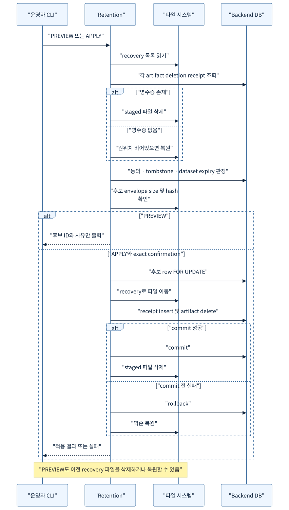

[Mermaid 원본](../diagrams/D10-retention-sequence.mmd) · [SVG](../rendered/D10-retention-sequence.svg)

## F-D10-037 Android 직접 TFLite asset exporter

| 항목 | 명세 |
| --- | --- |
| 분야 | D10 Voice 서비스·모델 관리·학습 데이터 파이프라인 |
| 목적 | 설정에서 input_size·asset 이름을 읽어 .pt를 TFLite로 변환·복사한다. |
| 사용 주체 | 데이터·모델 운영자 |
| 활성 상태 | LEGACY_REFERENCE |
| 진입점 | scripts/export_android_tflite_models_20260531.py:114 main scripts/export_android_tflite_models_20260531.py:52 run_export |
| 실행 전제 | 운영자가 명시적으로 CLI를 실행하고 필요한 로컬 입력·의존성·파일 권한을 제공해야 한다. 이번 작업에서는 실행하지 않았다. |
| 입력 출처 형식 검증 최신성 | --unified 선택 또는 custom/coco 기본 PT; output-dir 기본 Android assets/models; --dry-run. config asset은 models/<basename> 상대경로만 허용. |

### 시작 이벤트와 처리 순서

| 이벤트 ID | 발생원 | 이벤트 | 수신부 | 흐름 |
| --- | --- | --- | --- | --- |
| E-D10-037-01 | 운영자 CLI | main 호출 | main | 1. 현재 Android config를 읽고 custom/coco export spec을 먼저 추출한다. unified만 요청해도 이 두 spec을 요구한다. → 2. 현재 interpreter→repo .venv 순으로 ultralytics import 가능 Python 선택. 실export는 tensorflow import 확인. → 3. YOLO(model).export(format=tflite,imgsz=config.input_size,nms=True,int8=False) subprocess 실행. → 4. 근처 saved_model/*.tflite 및 *.tflite 중 output name float32/16 suffix 우선, 최신 mtime 파일을 output asset명으로 copy2. |

1. 1. 현재 Android config를 읽고 custom/coco export spec을 먼저 추출한다. unified만 요청해도 이 두 spec을 요구한다.
2. 2. 현재 interpreter→repo .venv 순으로 ultralytics import 가능 Python 선택. 실export는 tensorflow import 확인.
3. 3. YOLO(model).export(format=tflite,imgsz=config.input_size,nms=True,int8=False) subprocess 실행.
4. 4. 근처 saved_model/*.tflite 및 *.tflite 중 output name float32/16 suffix 우선, 최신 mtime 파일을 output asset명으로 copy2.

| 분기 조건 | 실제 처리 결과 | 구현 근거 |
| --- | --- | --- |
| --dry-run | 추론/export 안 하지만 interpreter import probe와 output-dir mkdir는 수행 | scripts/export_android_tflite_models_20260531.py:114 main |
| 현재21cls raw config target | nms=True export로 현재 raw [1,25,12096] 계약과 불일치 가능 | scripts/export_android_tflite_models_20260531.py:114 main |
| config/file/dependency 없음 | 예외로 종료 | scripts/export_android_tflite_models_20260531.py:114 main |

### 효과 종료와 복구

실제 호출시 Android asset 경로를 덮어쓸 수 있다. registry/hash/tensor 계약 config는 자동 갱신하지 않음.

| 상황 | 동작 |
| --- | --- |
| 정상 완료 | 단계에 설명한 반환값 또는 산출물로 종료. |
| 실패 | 유효성 또는 I/O 예외가 호출자에게 전파된다. 별도 자동 복구 없음. |
| 시간 초과 | subprocess.run에 timeout 없음. |
| 중복 입력 | 독립 호출을 다시 처리한다. 별도 요청 idempotency 키 없음. |
| 취소 | 명시적 취소 API 없음. |
| 중단과 생명주기 | 프로세스 중단 시 완료 보장 없음. |
| 재시도 | 자동 재시도 없음. 호출자가 원인을 해결한 후 새 호출. |
| 복구 | 자동 재개 상태 저장 없음. |
| 자원 정리 | 이 기능이 소유하는 추가 자원 없음. |

### 상태 실행 맥락과 연결

| 항목 | 명세 |
| --- | --- |
| 초기 상태 | S-D10-037-IDLE |
| 상태 목록 | S-D10-037-IDLE S-D10-037-PROCESSING S-D10-037-RETURNED S-D10-037-FAILED |
| 전이 조건과 전이 동작 | 호출 → PROCESSING → 계약 충족 시 RETURNED 입력·처리 오류 → FAILED; 자동 재시도 없음 |
| 허용되지 않는 전이 | 이 상태 ID는 문서의 처리 단계 표기이며 코드의 지속 enum 상태가 아니다. 이 기능 외 사용자 상태 전이는 정의하지 않는다. |
| 동시성 순서와 작업 소유권 | 단일 CLI 프로세스의 순차 처리. OS 중단 외 별도 취소/중복 실행 조정 없음. |
| 공유 상태와 다른 기능 연결 | 입력·출력 계약은 code_refs의 호출 관계를 따른다. 별도 사용자 세션 상태 없음. |

### 정책 근거와 검증 범위

| 항목 | 근거 |
| --- | --- |
| 정책 | [P-D10-029](#P-D10-029) |
| 구현 | [scripts/export_android_tflite_models_20260531.py:114](/home/ddobagi/Hanium_Dreamup/scripts/export_android_tflite_models_20260531.py:114) · `main` (범위 114–173) [scripts/export_android_tflite_models_20260531.py:52](/home/ddobagi/Hanium_Dreamup/scripts/export_android_tflite_models_20260531.py:52) · `run_export` (범위 52–111) |
| 기존 개선 ID | 개별 동일성 미확인; 분야 연관은 별도 추적표 |
| 기존 분야 | 해당 없음 |
| 기존 실행 증거 | 이번 근거는 2026-10-04 10:33:40 KST 고정 text snapshot 정적 분석. 이 기능의 과거 실행 성공을 이번에 재확인하지 않음. |
| 한계 및 구분 | 이번 실행 안 함. 이 과거 helper가 현행21cls exporter라고 해석하지 않도록 R-D10-002로 명시. |

| 테스트 위치 | 심볼 | 증거 수준 | 기대와 한계 |
| --- | --- | --- | --- |

연결한 테스트 미확인: 이번 작성 범위에서 이 기능에 대응하는 시험 단언을 연결하지 않았다. 테스트 자체가 없다는 판정이 아니다.

### 이벤트 처리 그림


[Mermaid 원본](../diagrams/D10-F037.mmd) · [SVG](../rendered/D10-F037.svg)

## F-D10-038 별도 디렉터리 unified TFLite export·sidecar

| 항목 | 명세 |
| --- | --- |
| 분야 | D10 Voice 서비스·모델 관리·학습 데이터 파이프라인 |
| 목적 | 단일 unified PT를 변환하고 클래스·출력 형식 메타데이터를 기록한다. |
| 사용 주체 | 데이터·모델 운영자 |
| 활성 상태 | LEGACY_REFERENCE |
| 진입점 | scripts/export_walksafe_unified_tflite_20260601.py:140 main scripts/export_walksafe_unified_tflite_20260601.py:123 write_sidecar scripts/export_walksafe_unified_tflite_20260601.py:73 parse_data_yaml_names |
| 실행 전제 | 운영자가 명시적으로 CLI를 실행하고 필요한 로컬 입력·의존성·파일 권한을 제공해야 한다. 이번 작업에서는 실행하지 않았다. |
| 입력 출처 형식 검증 최신성 | default13cls YOLO26n640 model/data,output exports/android-unified,output-name walksafe_unified_yolo26n_640_float32.tflite,imgsz640; --python/--no-nms/--dry-run. |

### 시작 이벤트와 처리 순서

| 이벤트 ID | 발생원 | 이벤트 | 수신부 | 흐름 |
| --- | --- | --- | --- | --- |
| E-D10-038-01 | 운영자 CLI | main 호출 | main | 1. data.yaml class names를 PyYAML 또는 간이 parser로 읽는다. 파일 없으면 빈 이름 집합 허용. → 2. plan과 Android drop-in target를 출력. dry-run은 실행 명령만 출력하고0. → 3. 실실행은 model존재와 ultralytics/tensorflow interpreter 확인 후 export(nms=!no_nms,int8=False). → 4. 최신 mtime의 원하는 precision TFLite를 별도 output에 복사하고 source/data/input_size/nms/classes/output_contract sidecar JSON 작성. |

1. 1. data.yaml class names를 PyYAML 또는 간이 parser로 읽는다. 파일 없으면 빈 이름 집합 허용.
2. 2. plan과 Android drop-in target를 출력. dry-run은 실행 명령만 출력하고0.
3. 3. 실실행은 model존재와 ultralytics/tensorflow interpreter 확인 후 export(nms=!no_nms,int8=False).
4. 4. 최신 mtime의 원하는 precision TFLite를 별도 output에 복사하고 source/data/input_size/nms/classes/output_contract sidecar JSON 작성.

| 분기 조건 | 실제 처리 결과 | 구현 근거 |
| --- | --- | --- |
| --no-nms | nms=false 가능하지만 sidecar output_contract 문자열은 여전히 nms=True일 때 [1,300,6] 설명 | scripts/export_walksafe_unified_tflite_20260601.py:140 main |
| 원하는 파일이 아닌 과거 동일접두 export가 최신 | mtime 선택; artifact provenance 자체를 hash로 결속하지 않음 | scripts/export_walksafe_unified_tflite_20260601.py:140 main |
| Android target 안내 | 자동 Android copy 아님; output-dir를 직접 Android로 지정한 경우 제외 | scripts/export_walksafe_unified_tflite_20260601.py:140 main |

### 효과 종료와 복구

export 디렉터리 TFLite와 .json sidecar 생성; 학습·dataset download 없음.

| 상황 | 동작 |
| --- | --- |
| 정상 완료 | 단계에 설명한 반환값 또는 산출물로 종료. |
| 실패 | 유효성 또는 I/O 예외가 호출자에게 전파된다. 별도 자동 복구 없음. |
| 시간 초과 | subprocess timeout 없음. |
| 중복 입력 | 독립 호출을 다시 처리한다. 별도 요청 idempotency 키 없음. |
| 취소 | 명시적 취소 API 없음. |
| 중단과 생명주기 | 프로세스 중단 시 완료 보장 없음. |
| 재시도 | 자동 재시도 없음. 호출자가 원인을 해결한 후 새 호출. |
| 복구 | 자동 재개 상태 저장 없음. |
| 자원 정리 | 이 기능이 소유하는 추가 자원 없음. |

### 상태 실행 맥락과 연결

| 항목 | 명세 |
| --- | --- |
| 초기 상태 | S-D10-038-IDLE |
| 상태 목록 | S-D10-038-IDLE S-D10-038-PROCESSING S-D10-038-RETURNED S-D10-038-FAILED |
| 전이 조건과 전이 동작 | 호출 → PROCESSING → 계약 충족 시 RETURNED 입력·처리 오류 → FAILED; 자동 재시도 없음 |
| 허용되지 않는 전이 | 이 상태 ID는 문서의 처리 단계 표기이며 코드의 지속 enum 상태가 아니다. 이 기능 외 사용자 상태 전이는 정의하지 않는다. |
| 동시성 순서와 작업 소유권 | 단일 CLI 프로세스의 순차 처리. OS 중단 외 별도 취소/중복 실행 조정 없음. |
| 공유 상태와 다른 기능 연결 | 입력·출력 계약은 code_refs의 호출 관계를 따른다. 별도 사용자 세션 상태 없음. |

### 정책 근거와 검증 범위

| 항목 | 근거 |
| --- | --- |
| 정책 | [P-D10-029](#P-D10-029) |
| 구현 | [scripts/export_walksafe_unified_tflite_20260601.py:140](/home/ddobagi/Hanium_Dreamup/scripts/export_walksafe_unified_tflite_20260601.py:140) · `main` (범위 140–191) [scripts/export_walksafe_unified_tflite_20260601.py:123](/home/ddobagi/Hanium_Dreamup/scripts/export_walksafe_unified_tflite_20260601.py:123) · `write_sidecar` (범위 123–137) [scripts/export_walksafe_unified_tflite_20260601.py:73](/home/ddobagi/Hanium_Dreamup/scripts/export_walksafe_unified_tflite_20260601.py:73) · `parse_data_yaml_names` (범위 73–105) |
| 기존 개선 ID | 개별 동일성 미확인; 분야 연관은 별도 추적표 |
| 기존 분야 | 해당 없음 |
| 기존 실행 증거 | 이번 근거는 2026-10-04 10:33:40 KST 고정 text snapshot 정적 분석. 이 기능의 과거 실행 성공을 이번에 재확인하지 않음. |
| 한계 및 구분 | source PT/class metadata/최종 tensor의 실제 정합성 검증이나 deployment registry 갱신 없음. |

| 테스트 위치 | 심볼 | 증거 수준 | 기대와 한계 |
| --- | --- | --- | --- |

연결한 테스트 미확인: 이번 작성 범위에서 이 기능에 대응하는 시험 단언을 연결하지 않았다. 테스트 자체가 없다는 판정이 아니다.

### 이벤트 처리 그림


[Mermaid 원본](../diagrams/D10-F038.mmd) · [SVG](../rendered/D10-F038.svg)

## F-D10-039 과거 학습 shell runner·resume·2단계 fine-tune

| 항목 | 명세 |
| --- | --- |
| 분야 | D10 Voice 서비스·모델 관리·학습 데이터 파이프라인 |
| 목적 | 보존된 13cls/3cls 학습 절차의 실행 진입점과 현재 gate 연결 차이를 드러낸다. |
| 사용 주체 | 데이터·모델 운영자 |
| 활성 상태 | LEGACY_REFERENCE |
| 진입점 | scripts/run_walksafe_unified_aihub183_png_yolo26n_768_20260627.sh:1 cmd scripts/run_walksafe_unified_aihub183_png_yolo26s_20260627.sh:1 cmd scripts/run_walksafe_unified_yolo26n_20260601.sh:1 cmd scripts/run_walksafe_tactile3_reviewed_yolo26s_20260522.sh:1 base_train_and_finetune scripts/run_walksafe_tactile3_yolo26s_20260521.sh:1 base_train_and_finetune scripts/resume_walksafe_tactile3_yolo26s_20260522.sh:1 resume |
| 실행 전제 | 운영자가 명시적으로 CLI를 실행하고 필요한 로컬 입력·의존성·파일 권한을 제공해야 한다. 이번 작업에서는 실행하지 않았다. |
| 입력 출처 형식 검증 최신성 | 20260627 runner: env DATA/MODEL/EPOCHS/BATCH/IMGSZ/DEVICE/WORKERS/PROJECT/NAME/YOLO_BIN/TMPDIR; 26n768 batch16 또는26s960 batch4,epochs100. 날짜형3cls runner는 과거 absolute /home/ddobagi/Code/hanium-dreamup 경로. |

### 시작 이벤트와 처리 순서

| 이벤트 ID | 발생원 | 이벤트 | 수신부 | 흐름 |
| --- | --- | --- | --- | --- |
| E-D10-039-01 | 운영자 CLI | cmd 호출 | cmd | 1. 20260627 runner는 yolo detect train 직접 구성: cacheFalse,ampTrue,cos_lrTrue,close_mosaic10,patience30,save_period-1,plotsTrue,exist_okFalse. --print-only 전에 TMPDIR mkdir; FRACTION와 추가인자 허용. → 2. 20260601 runner는 model/train_yolo.py wrapper를 사용하고 추가 CLI 인자를 전달하므로 현재 manifest/gate 인자를 별도 제공해야 실제 진행. → 3. tactile3 runner는 base960/epochs200/MuSGD→test val→base best로1280/epochs80/no mosaic fine-tune→test val 순차 수행. → 4. reviewed runner는 data/PT 존재와 run dir 미존재 검사; resume runner는 last.pt 존재 확인 후 resume=True/workers4로 시작하고 동일후속평가/finetune 수행. set -euo pipefail로 실패시 중단. |

1. 1. 20260627 runner는 yolo detect train 직접 구성: cacheFalse,ampTrue,cos_lrTrue,close_mosaic10,patience30,save_period-1,plotsTrue,exist_okFalse. --print-only 전에 TMPDIR mkdir; FRACTION와 추가인자 허용.
2. 2. 20260601 runner는 model/train_yolo.py wrapper를 사용하고 추가 CLI 인자를 전달하므로 현재 manifest/gate 인자를 별도 제공해야 실제 진행.
3. 3. tactile3 runner는 base960/epochs200/MuSGD→test val→base best로1280/epochs80/no mosaic fine-tune→test val 순차 수행.
4. 4. reviewed runner는 data/PT 존재와 run dir 미존재 검사; resume runner는 last.pt 존재 확인 후 resume=True/workers4로 시작하고 동일후속평가/finetune 수행. set -euo pipefail로 실패시 중단.

| 분기 조건 | 실제 처리 결과 | 구현 근거 |
| --- | --- | --- |
| 20260627·3cls 직접 yolo runner | F-D10-019 승인 gate wrapper를 호출하지 않음 | scripts/run_walksafe_unified_aihub183_png_yolo26n_768_20260627.sh:1 cmd |
| --print-only (20260627) | 학습은 안 하지만 TMPDIR 생성 가능 | scripts/run_walksafe_unified_aihub183_png_yolo26n_768_20260627.sh:1 cmd |
| resume | checkpoint 기반 재개이며 모든 runner에 공통 자동 retry가 있는 것은 아님 | scripts/run_walksafe_unified_aihub183_png_yolo26n_768_20260627.sh:1 cmd |

### 효과 종료와 복구

명시실행시 GPU 학습/평가·runs checkpoint 생성. 이번 미실행.

| 상황 | 동작 |
| --- | --- |
| 정상 완료 | 단계에 설명한 반환값 또는 산출물로 종료. |
| 실패 | 유효성 또는 I/O 예외가 호출자에게 전파된다. 별도 자동 복구 없음. |
| 시간 초과 | 이 기능 자체의 별도 deadline 없음. |
| 중복 입력 | 독립 호출을 다시 처리한다. 별도 요청 idempotency 키 없음. |
| 취소 | 명시적 취소 API 없음. |
| 중단과 생명주기 | 프로세스 중단 시 완료 보장 없음. |
| 재시도 | 자동 재시도 없음. 호출자가 원인을 해결한 후 새 호출. |
| 복구 | 자동 재개 상태 저장 없음. |
| 자원 정리 | 이 기능이 소유하는 추가 자원 없음. |

### 상태 실행 맥락과 연결

| 항목 | 명세 |
| --- | --- |
| 초기 상태 | S-D10-039-IDLE |
| 상태 목록 | S-D10-039-IDLE S-D10-039-PROCESSING S-D10-039-RETURNED S-D10-039-FAILED |
| 전이 조건과 전이 동작 | 호출 → PROCESSING → 계약 충족 시 RETURNED 입력·처리 오류 → FAILED; 자동 재시도 없음 |
| 허용되지 않는 전이 | 이 상태 ID는 문서의 처리 단계 표기이며 코드의 지속 enum 상태가 아니다. 이 기능 외 사용자 상태 전이는 정의하지 않는다. |
| 동시성 순서와 작업 소유권 | 단일 CLI 프로세스의 순차 처리. OS 중단 외 별도 취소/중복 실행 조정 없음. |
| 공유 상태와 다른 기능 연결 | 입력·출력 계약은 code_refs의 호출 관계를 따른다. 별도 사용자 세션 상태 없음. |

### 정책 근거와 검증 범위

| 항목 | 근거 |
| --- | --- |
| 정책 | [P-D10-018](#P-D10-018) [P-D10-030](#P-D10-030) |
| 구현 | [scripts/run_walksafe_unified_aihub183_png_yolo26n_768_20260627.sh:1](/home/ddobagi/Hanium_Dreamup/scripts/run_walksafe_unified_aihub183_png_yolo26n_768_20260627.sh:1) · `cmd` (범위 1–71) [scripts/run_walksafe_unified_aihub183_png_yolo26s_20260627.sh:1](/home/ddobagi/Hanium_Dreamup/scripts/run_walksafe_unified_aihub183_png_yolo26s_20260627.sh:1) · `cmd` (범위 1–71) [scripts/run_walksafe_unified_yolo26n_20260601.sh:1](/home/ddobagi/Hanium_Dreamup/scripts/run_walksafe_unified_yolo26n_20260601.sh:1) · `cmd` (범위 1–50) [scripts/run_walksafe_tactile3_reviewed_yolo26s_20260522.sh:1](/home/ddobagi/Hanium_Dreamup/scripts/run_walksafe_tactile3_reviewed_yolo26s_20260522.sh:1) · `BASE_NAME` (범위 1–139) [scripts/run_walksafe_tactile3_yolo26s_20260521.sh:1](/home/ddobagi/Hanium_Dreamup/scripts/run_walksafe_tactile3_yolo26s_20260521.sh:1) · `BASE_NAME` (범위 1–106) [scripts/resume_walksafe_tactile3_yolo26s_20260522.sh:1](/home/ddobagi/Hanium_Dreamup/scripts/resume_walksafe_tactile3_yolo26s_20260522.sh:1) · `BASE_LAST` (범위 1–104) |
| 기존 개선 ID | 개별 동일성 미확인; 분야 연관은 별도 추적표 |
| 기존 분야 | 해당 없음 |
| 기존 실행 증거 | 이번 근거는 2026-10-04 10:33:40 KST 고정 text snapshot 정적 분석. 이 기능의 과거 실행 성공을 이번에 재확인하지 않음. |
| 한계 및 구분 | 각 날짜형 스크립트의 'current/verified' 주석은 당시 선언. 현재21class dataset 재현·승인·학습성공 근거 아님. |

| 테스트 위치 | 심볼 | 증거 수준 | 기대와 한계 |
| --- | --- | --- | --- |

연결한 테스트 미확인: 이번 작성 범위에서 이 기능에 대응하는 시험 단언을 연결하지 않았다. 테스트 자체가 없다는 판정이 아니다.

### 이벤트 처리 그림


[Mermaid 원본](../diagrams/D10-F039.mmd) · [SVG](../rendered/D10-F039.svg)

## F-D10-040 데이터 후보·권리·검수 manifest 보존 기록

| 항목 | 명세 |
| --- | --- |
| 분야 | D10 Voice 서비스·모델 관리·학습 데이터 파이프라인 |
| 목적 | 과거 candidate index와 데이터 반입 요구를 실행된 현재 학습본과 분리해 제공한다. |
| 사용 주체 | 호출 모듈 |
| 활성 상태 | LEGACY_REFERENCE |
| 진입점 | data_sources/manifests/walksafe_kr_v3_policy_2026-05-19.md:1 과거 후보 정책 문서 열람 |
| 실행 전제 | 호출자가 계약에 맞는 입력을 제공한다. 외부 서비스·기기 동작은 이 함수의 정적 근거에 포함되지 않는다. |
| 입력 출처 형식 검증 최신성 | 2026-05-18/19 초기class0 curation40행+hard-negative21행→candidate61행 기록; source-level privacy/location audit 미완료 local-only 선언. |

### 시작 이벤트와 처리 순서

| 이벤트 ID | 발생원 | 이벤트 | 수신부 | 흐름 |
| --- | --- | --- | --- | --- |
| E-D10-040-01 | 상위 호출 함수 | 정책 결정 및 학습 gate 호출 | 정책 결정 및 학습 gate | 1. policy 문서는 hard negative33·bbox review 후12·min-box hold9·small object augmentation3·우선threshold/augmentation4로 후보를 분류한 기록을 제공. → 2. hold9행은 min-box 검토 전 train 배제, 모든 후보는 source-level privacy audit 전 공유 안 함, sequence/location leakage 피할 것을 문서 요구로 서술. → 3. README는 현재 후보 CANDIDATE_REVALIDATION_REQUIRED와 권리·hash·독립test 한계를 연결한다. source/license/취득시점/hash 기록·사람 승인 전 자동 라벨 학습 금지를 요구한다. |

1. 1. policy 문서는 hard negative33·bbox review 후12·min-box hold9·small object augmentation3·우선threshold/augmentation4로 후보를 분류한 기록을 제공.
2. 2. hold9행은 min-box 검토 전 train 배제, 모든 후보는 source-level privacy audit 전 공유 안 함, sequence/location leakage 피할 것을 문서 요구로 서술.
3. 3. README는 현재 후보 CANDIDATE_REVALIDATION_REQUIRED와 권리·hash·독립test 한계를 연결한다. source/license/취득시점/hash 기록·사람 승인 전 자동 라벨 학습 금지를 요구한다.

| 분기 조건 | 실제 처리 결과 | 구현 근거 |
| --- | --- | --- |
| 보존 CSV/summary 숫자 | 이번 데이터 재계산/학습 포함/사람 시각검수 완료 근거 아님 | data_sources/manifests/walksafe_kr_v3_policy_2026-05-19.md:1 정책 결정 및 학습 gate |
| policy 문서 요구 | 초기 builder가 모든 요구를 자동 enforcement하는 것은 아님 | data_sources/manifests/walksafe_kr_v3_policy_2026-05-19.md:1 정책 결정 및 학습 gate |

### 효과 종료와 복구

문서·manifest 기록만; 신규 데이터 처리 없음.

| 상황 | 동작 |
| --- | --- |
| 정상 완료 | 단계에 설명한 반환값 또는 산출물로 종료. |
| 실패 | 유효성 또는 I/O 예외가 호출자에게 전파된다. 별도 자동 복구 없음. |
| 시간 초과 | 이 기능 자체의 별도 deadline 없음. |
| 중복 입력 | 독립 호출을 다시 처리한다. 별도 요청 idempotency 키 없음. |
| 취소 | 명시적 취소 API 없음. |
| 중단과 생명주기 | 프로세스 중단 시 완료 보장 없음. |
| 재시도 | 자동 재시도 없음. 호출자가 원인을 해결한 후 새 호출. |
| 복구 | 자동 재개 상태 저장 없음. |
| 자원 정리 | 이 기능이 소유하는 추가 자원 없음. |

### 상태 실행 맥락과 연결

| 항목 | 명세 |
| --- | --- |
| 초기 상태 | S-D10-040-IDLE |
| 상태 목록 | S-D10-040-IDLE S-D10-040-PROCESSING S-D10-040-RETURNED S-D10-040-FAILED |
| 전이 조건과 전이 동작 | 호출 → PROCESSING → 계약 충족 시 RETURNED 입력·처리 오류 → FAILED; 자동 재시도 없음 |
| 허용되지 않는 전이 | 이 상태 ID는 문서의 처리 단계 표기이며 코드의 지속 enum 상태가 아니다. 이 기능 외 사용자 상태 전이는 정의하지 않는다. |
| 동시성 순서와 작업 소유권 | 동기 helper; 호출자의 실행 맥락에서 처리하며 자체 큐·타이머 없음. |
| 공유 상태와 다른 기능 연결 | 입력·출력 계약은 code_refs의 호출 관계를 따른다. 별도 사용자 세션 상태 없음. |

### 정책 근거와 검증 범위

| 항목 | 근거 |
| --- | --- |
| 정책 | [P-D10-031](#P-D10-031) |
| 구현 | [data_sources/manifests/walksafe_kr_v3_policy_2026-05-19.md:1](/home/ddobagi/Hanium_Dreamup/data_sources/manifests/walksafe_kr_v3_policy_2026-05-19.md:1) · `## 학습 gate` (범위 1–32) [data_sources/README.md:1](/home/ddobagi/Hanium_Dreamup/data_sources/README.md:1) · `## 반입 규칙` (범위 1–37) [data_sources/scripts/README.md:1](/home/ddobagi/Hanium_Dreamup/data_sources/scripts/README.md:1) · `스크립트 분류` (범위 1–36) |
| 기존 개선 ID | 개별 동일성 미확인; 분야 연관은 별도 추적표 |
| 기존 분야 | 해당 없음 |
| 기존 실행 증거 | data_sources/manifests/walksafe_kr_v3_candidate_index_summary_2026-05-19.json 및 curation summary는 과거 집계 기록; 이번 개별 image/label/rights 미검증. |
| 한계 및 구분 | CSV row의 원본 경로·개인자료는 이 명세에 복제하지 않는다. 현재21class training set과 연결은 확인되지 않음. |

| 테스트 위치 | 심볼 | 증거 수준 | 기대와 한계 |
| --- | --- | --- | --- |

연결한 테스트 미확인: 이번 작성 범위에서 이 기능에 대응하는 시험 단언을 연결하지 않았다. 테스트 자체가 없다는 판정이 아니다.

### 이벤트 처리 그림


[Mermaid 원본](../diagrams/D10-F040.mmd) · [SVG](../rendered/D10-F040.svg)

## P-D10-001 전용 내부 서비스 신뢰 경계

| 순서 | 정책 |
| --- | --- |
| 범위 | Voice 전체 HTTP/배포 시작 |
| 적용 조건 | OPTIONS 외 모든 요청 및 field/staging/production 기동 |
| 판단 기준 | 토큰≥24자, 기존 gateway/backend 자격과 다름, compare_digest 일치; 배포 worker/replica 문자열 '1'; custom+지원 speaker |
| 실행 차단 동작 | 잘못된 구성은 기동 실패 또는503, 잘못된 호출 토큰401 |
| 예외 | OPTIONS는 인증 생략; development/test는 배포 기동 검사 생략해도 요청 토큰 검사는 유지. |
| 사용자 결과 | 잘못된 구성은 기동 실패 또는503, 잘못된 호출 토큰401 |
| 우선순위와 충돌 | 코드의 검사 순서가 우선한다. 별도 정책 조정기 없음. |
| 적용 기능 | [F-D10-001](#F-D10-001) [F-D10-002](#F-D10-002) [F-D10-012](#F-D10-012) |
| 구현 근거 | [voice/server.py:354](/home/ddobagi/Hanium_Dreamup/voice/server.py:354) · `validate_voice_runtime_configuration` (범위 354–427) [voice/server.py:457](/home/ddobagi/Hanium_Dreamup/voice/server.py:457) · `require_internal_service_auth` (범위 457–490) |

| 수치 이름 | 값 | 단위 | 경계값 포함 | 변경 가능 여부 | 설정 출처와 적용 위치 |
| --- | --- | --- | --- | --- | --- |
| service_token_min | 24 | characters | 이상 | 환경변수 | VOICE_SERVICE_TOKEN |
| workers/replicas | 1 | process/replica | 각각 같음 | 배포시 고정 | VOICE_SERVICE_WORKERS/REPLICAS |

## P-D10-002 요청 본문·actor·IP 검증

| 순서 | 정책 |
| --- | --- |
| 범위 | STT/TTS POST |
| 적용 조건 | 인증 후 multipart/JSON 파싱 이전 |
| 판단 기준 | Content-Length 정수≥0 및 실제 수신 누적 bytes≤request limit; actor 1~64 허용문자, forwarded IP 유효주소 |
| 실행 차단 동작 | 형식400, 과대413, stream 누적 검사와 no-store 응답 |
| 예외 | 명시한 분기 외 우회 없음. |
| 사용자 결과 | 형식400, 과대413, stream 누적 검사와 no-store 응답 |
| 우선순위와 충돌 | 코드의 검사 순서가 우선한다. 별도 정책 조정기 없음. |
| 적용 기능 | [F-D10-003](#F-D10-003) |
| 구현 근거 | [voice/server.py:492](/home/ddobagi/Hanium_Dreamup/voice/server.py:492) · `require_internal_service_auth` (범위 492–620) [voice/server.py:438](/home/ddobagi/Hanium_Dreamup/voice/server.py:438) · `_voice_rate_identity` (범위 438–454) |

| 수치 이름 | 값 | 단위 | 경계값 포함 | 변경 가능 여부 | 설정 출처와 적용 위치 |
| --- | --- | --- | --- | --- | --- |
| STT request default | 11 MiB | bytes | 초과 거부 | 64KiB~33MiB clamp | VOICE_STT_MAX_REQUEST_BYTES server.py:165 |
| TTS request default | 4096 | bytes | 초과 거부 | 512~65536 clamp | VOICE_TTS_MAX_REQUEST_BYTES server.py:492 |

## P-D10-003 프로세스 로컬 sliding window 요청 빈도

| 순서 | 정책 |
| --- | --- |
| 범위 | STT/TTS 각 독립 limiter |
| 적용 조건 | 유효 identity 요청 |
| 판단 기준 | window 내 count≥global/IP/actor 한도면 불허; now-oldest≥window이면 제거 |
| 실행 차단 동작 | 429와 ceil 남은 window Retry-After. 허용한 요청만 모든 key에 기록 |
| 예외 | actor 헤더가 없으면 actor 제한은 생성하지 않음. global/IP는 유지. |
| 사용자 결과 | 429와 ceil 남은 window Retry-After. 허용한 요청만 모든 key에 기록 |
| 우선순위와 충돌 | declared body size 검사 이후, upload gate/body 파싱 이전. body 검증 실패도 이미 허용된 rate 이벤트를 소비. |
| 적용 기능 | [F-D10-003](#F-D10-003) |
| 구현 근거 | [voice/server.py:513](/home/ddobagi/Hanium_Dreamup/voice/server.py:513) · `require_internal_service_auth` (범위 513–558) [voice/request_limits.py:101](/home/ddobagi/Hanium_Dreamup/voice/request_limits.py:101) · `ProcessLocalRateLimiter.check` (범위 101–125) |

| 수치 이름 | 값 | 단위 | 경계값 포함 | 변경 가능 여부 | 설정 출처와 적용 위치 |
| --- | --- | --- | --- | --- | --- |
| window default | 60 | seconds | 경계 이상 오래된 이벤트 제거 | 1~3600 clamp | VOICE_STT/TTS_RATE_WINDOW_SECONDS |
| STT global/actor/IP | 120/12/30 | requests/window | 도달시 다음 요청 차단 | global1~100000;actor/IP1~10000 | VOICE_STT_*_RATE_LIMIT |
| TTS global/actor/IP | 120/30/60 | requests/window | 도달시 다음 요청 차단 | 동일 범위 | VOICE_TTS_*_RATE_LIMIT |

## P-D10-004 업로드·추론 동시성 및 queue 대기

| 순서 | 정책 |
| --- | --- |
| 범위 | Voice 자원 admission |
| 적용 조건 | STT 업로드 및 STT/TTS infer |
| 판단 기준 | upload 기본1(설정1~8); STT/TTS infer 각각1 고정; permit을 deadline 안에 확보 |
| 실행 차단 동작 | 실패503 stt_upload_busy/stt_busy/tts_busy. upload busy만 Retry-After1 |
| 예외 | 명시한 분기 외 우회 없음. |
| 사용자 결과 | 실패503 stt_upload_busy/stt_busy/tts_busy. upload busy만 Retry-After1 |
| 우선순위와 충돌 | 코드의 검사 순서가 우선한다. 별도 정책 조정기 없음. |
| 적용 기능 | [F-D10-003](#F-D10-003) [F-D10-004](#F-D10-004) [F-D10-009](#F-D10-009) |
| 구현 근거 | [voice/server.py:204](/home/ddobagi/Hanium_Dreamup/voice/server.py:204) · `STT_MAX_CONCURRENCY` (범위 204–223) [voice/server.py:758](/home/ddobagi/Hanium_Dreamup/voice/server.py:758) · `speech_stt` (범위 758–791) [voice/server.py:907](/home/ddobagi/Hanium_Dreamup/voice/server.py:907) · `speech_tts` (범위 907–972) |

| 수치 이름 | 값 | 단위 | 경계값 포함 | 변경 가능 여부 | 설정 출처와 적용 위치 |
| --- | --- | --- | --- | --- | --- |
| upload wait | 2 | seconds | 초과 실패 | 0.05~30 | VOICE_STT_UPLOAD_QUEUE_TIMEOUT_SECONDS |
| inference queue wait | 2 | seconds | 초과 실패 | 0.1~30 | VOICE_STT/TTS_QUEUE_TIMEOUT_SECONDS |
| STT/TTS infer slots | 1 | worker each | 고정 | env clamp1~1 | server.py:204 |

## P-D10-005 업로드 미디어와 STT 출력 유효성

| 순서 | 정책 |
| --- | --- |
| 범위 | STT |
| 적용 조건 | multipart 파일 수신 및 worker 결과 |
| 판단 기준 | 허용 MIME/확장자, nonempty≤파일 한도, finite decoded duration>0≤한도; revision40hex, transcript≤500,Cc/Cf 없음 |
| 실행 차단 동작 | 무효 미디어400/413/422, 잘못된 결과502, 임시파일 finally 정리 |
| 예외 | 명시한 분기 외 우회 없음. |
| 사용자 결과 | 무효 미디어400/413/422, 잘못된 결과502, 임시파일 finally 정리 |
| 우선순위와 충돌 | 코드의 검사 순서가 우선한다. 별도 정책 조정기 없음. |
| 적용 기능 | [F-D10-004](#F-D10-004) |
| 구현 근거 | [voice/server.py:707](/home/ddobagi/Hanium_Dreamup/voice/server.py:707) · `speech_stt` (범위 707–846) [voice/request_limits.py:132](/home/ddobagi/Hanium_Dreamup/voice/request_limits.py:132) · `probe_audio_duration` (범위 132–215) |

| 수치 이름 | 값 | 단위 | 경계값 포함 | 변경 가능 여부 | 설정 출처와 적용 위치 |
| --- | --- | --- | --- | --- | --- |
| audio bytes default | 10 MiB | bytes | 초과 거부 | 양수env 최대32MiB; invalid/nonpositive default | VOICE_MAX_UPLOAD_BYTES server.py:157 |
| audio duration default | 30 | seconds | 초과 거부;0이하무효 | 1~120 | VOICE_STT_MAX_AUDIO_DURATION_SECONDS |
| ffprobe timeout | 5 | seconds | 초과 kill | 고정 | request_limits.py:190 |
| transcript max | 500 | characters | 초과 거부 | 고정 | server.py:794 |

## P-D10-006 worker hard deadline과 disconnect abort

| 순서 | 정책 |
| --- | --- |
| 범위 | STT/TTS pool·ready |
| 적용 조건 | wait_for timeout, task cancel, BrokenProcessPool |
| 판단 기준 | 해당 pool 폐기 후 terminate/join/kill; 성공 결과와 disconnect가 함께 done이면 결과 우선 |
| 실행 차단 동작 | 현재 요청 실패/499/504; 후속 요청에서 새 pool 생성 |
| 예외 | ready는 모델 두 개를 순차 probe하여 전체 deadline이 모델별 한도의 합이 될 수 있음. |
| 사용자 결과 | 현재 요청 실패/499/504; 후속 요청에서 새 pool 생성 |
| 우선순위와 충돌 | 코드의 검사 순서가 우선한다. 별도 정책 조정기 없음. |
| 적용 기능 | [F-D10-004](#F-D10-004) [F-D10-006](#F-D10-006) [F-D10-009](#F-D10-009) [F-D10-013](#F-D10-013) |
| 구현 근거 | [voice/inference_process.py:59](/home/ddobagi/Hanium_Dreamup/voice/inference_process.py:59) · `IsolatedInferencePool.run` (범위 59–104) [voice/server.py:252](/home/ddobagi/Hanium_Dreamup/voice/server.py:252) · `run_inference_until_disconnect` (범위 252–286) |

| 수치 이름 | 값 | 단위 | 경계값 포함 | 변경 가능 여부 | 설정 출처와 적용 위치 |
| --- | --- | --- | --- | --- | --- |
| STT infer | 30 | seconds | 초과 abort | 1~300 | VOICE_STT_INFERENCE_TIMEOUT_SECONDS |
| TTS infer | 60 | seconds | 초과 abort | 1~300 | VOICE_TTS_INFERENCE_TIMEOUT_SECONDS |
| ready per model | 180 | seconds | 초과 abort | 1~300 | VOICE_READY_TIMEOUT_SECONDS |
| abort join per phase | 1 | seconds | 각 단계까지 wait | 고정 | inference_process.py:98,101 |

## P-D10-007 음향 근거와 heuristic 점수 분리

| 순서 | 정책 |
| --- | --- |
| 범위 | STT intent 실행 gate |
| 적용 조건 | faster-whisper spoken segment |
| 판단 기준 | finite avg_logprob 평균≥-1.0, max no_speech_probability≤0.6 모두 필요; 근거 누락이면 불허 |
| 실행 차단 동작 | 규칙 intent가 known이어도 acoustic_allowed=False면 reprompt |
| 예외 | 텍스트 전용 intent에서는 acoustic_allowed=None으로 음향 gate 미적용. |
| 사용자 결과 | 규칙 intent가 known이어도 acoustic_allowed=False면 reprompt |
| 우선순위와 충돌 | unknown 및 heuristic score gate가 acoustic gate보다 먼저. |
| 적용 기능 | [F-D10-004](#F-D10-004) [F-D10-005](#F-D10-005) [F-D10-008](#F-D10-008) |
| 구현 근거 | [voice/stt.py:22](/home/ddobagi/Hanium_Dreamup/voice/stt.py:22) · `summarize_acoustic_evidence` (범위 22–64) [voice/intents.py:264](/home/ddobagi/Hanium_Dreamup/voice/intents.py:264) · `evaluate_intent_policy` (범위 264–289) |

| 수치 이름 | 값 | 단위 | 경계값 포함 | 변경 가능 여부 | 설정 출처와 적용 위치 |
| --- | --- | --- | --- | --- | --- |
| avg_logprob | -1 | log probability | 이상 | 고정 | stt.py:22 |
| no_speech | 0.6 | probability | 이하 | 고정 | stt.py:23 |

## P-D10-008 한국어 명령 보수적 실행 판정

| 순서 | 정책 |
| --- | --- |
| 범위 | intent classifier/policy |
| 적용 조건 | 모든 명령 |
| 판단 기준 | 부정/모호성 먼저; 목적지 먼저; known score≥0.7, destination 비어있지 않음, candidate exact int≥1 |
| 실행 차단 동작 | 불충족시 reason별 재질문, 통과시 실행 가능 metadata만 반환 |
| 예외 | 명시한 분기 외 우회 없음. |
| 사용자 결과 | 불충족시 reason별 재질문, 통과시 실행 가능 metadata만 반환 |
| 우선순위와 충돌 | 부정→모호성→목적지취소/변경/다음안내→목적지추출→후보→신고→위치→voice toggle→repeat→stop→reroute→start; policy는 unknown→score→acoustic→slots. |
| 적용 기능 | [F-D10-007](#F-D10-007) [F-D10-008](#F-D10-008) |
| 구현 근거 | [voice/intents.py:150](/home/ddobagi/Hanium_Dreamup/voice/intents.py:150) · `classify_intent` (범위 150–261) [voice/intents.py:264](/home/ddobagi/Hanium_Dreamup/voice/intents.py:264) · `evaluate_intent_policy` (범위 264–289) |

| 수치 이름 | 값 | 단위 | 경계값 포함 | 변경 가능 여부 | 설정 출처와 적용 위치 |
| --- | --- | --- | --- | --- | --- |
| execution score | 0.7 | heuristic score | 미만 불허 | 함수 threshold 인자로 변경가능 | intents.py:31,267 |
| candidate index | 1 | index | 이상 exact int | 고정 | intents.py:286 |

## P-D10-009 모델과 manifest 고정 hash·로컬 snapshot

| 순서 | 정책 |
| --- | --- |
| 범위 | Voice 모델 로드 |
| 적용 조건 | 모델 load 또는 배포 구성검사 |
| 판단 기준 | explicit owner/repo +40hex revision+64hex manifest hash; manifest schema metadata와 exact logical file set; 모든 파일 digest 일치 |
| 실행 차단 동작 | 불일치 load 차단; 원격 자동 다운로드 없음 |
| 예외 | HF cache root 내부 blob 파일 symlink는 resolve 후 허용. 캐시 hit WAV는 fresh model load를 건너뜀. |
| 사용자 결과 | 불일치 load 차단; 원격 자동 다운로드 없음 |
| 우선순위와 충돌 | 코드의 검사 순서가 우선한다. 별도 정책 조정기 없음. |
| 적용 기능 | [F-D10-001](#F-D10-001) [F-D10-005](#F-D10-005) [F-D10-010](#F-D10-010) [F-D10-011](#F-D10-011) [F-D10-013](#F-D10-013) |
| 구현 근거 | [voice/model_integrity.py:65](/home/ddobagi/Hanium_Dreamup/voice/model_integrity.py:65) · `_load_manifest` (범위 65–144) [voice/model_integrity.py:147](/home/ddobagi/Hanium_Dreamup/voice/model_integrity.py:147) · `verify_model_snapshot` (범위 147–188) |

| 수치 이름 | 값 | 단위 | 경계값 포함 | 변경 가능 여부 | 설정 출처와 적용 위치 |
| --- | --- | --- | --- | --- | --- |
| manifest bytes | 16 MiB | bytes | 초과 불허 | 고정 | model_integrity.py:19 |
| manifest files | 10000 | files | 초과 불허; 최소1 | 고정 | model_integrity.py:110 |

## P-D10-010 TTS 입력 문구·개인 텍스트 캐시 차단

| 순서 | 정책 |
| --- | --- |
| 범위 | TTS endpoints |
| 적용 조건 | TTSRequest parsing and /speech/tts |
| 판단 기준 | extra forbid, text1~180,Cc/Cf 없음, phrase1~80; phrase 우선; text 존재+use_cache 불허 |
| 실행 차단 동작 | 422 또는 approved phrase로만 cache 요청 |
| 예외 | cache-status는 실제 synthesis/cache write를 하지 않으며 arbitrary-cache 거부는 /speech/tts에만 적용. |
| 사용자 결과 | 422 또는 approved phrase로만 cache 요청 |
| 우선순위와 충돌 | 코드의 검사 순서가 우선한다. 별도 정책 조정기 없음. |
| 적용 기능 | [F-D10-009](#F-D10-009) [F-D10-014](#F-D10-014) |
| 구현 근거 | [voice/server.py:137](/home/ddobagi/Hanium_Dreamup/voice/server.py:137) · `TTSRequest` (범위 137–150) [voice/server.py:898](/home/ddobagi/Hanium_Dreamup/voice/server.py:898) · `speech_tts` (범위 898–906) [voice/server.py:1030](/home/ddobagi/Hanium_Dreamup/voice/server.py:1030) · `resolve_tts_request_text` (범위 1030–1038) |

| 수치 이름 | 값 | 단위 | 경계값 포함 | 변경 가능 여부 | 설정 출처와 적용 위치 |
| --- | --- | --- | --- | --- | --- |
| text | 180 | characters | 초과 불허 | 고정 | server.py:140 |
| phrase_id | 80 | characters | 초과 불허 | 고정 | server.py:141 |

## P-D10-011 검증된 전체 WAV와 명시적 fallback

| 순서 | 정책 |
| --- | --- |
| 범위 | TTS 응답 |
| 적용 조건 | 추론 성공 또는 예외 |
| 판단 기준 | 일반 model revision40hex; bytes>0≤default4MiB; finite duration>0≤30초; fallback은 allow_fallback=True+파일 존재/양수 |
| 실행 차단 동작 | 일반503/504 또는 fallback; WAV validation 실패502; no-store/nosniff |
| 예외 | fallback은 model revision 헤더가 없고 model/mode=fallback. queue timeout·disconnect·post-generation validation 실패에는 fallback 안 함. |
| 사용자 결과 | 일반503/504 또는 fallback; WAV validation 실패502; no-store/nosniff |
| 우선순위와 충돌 | 코드의 검사 순서가 우선한다. 별도 정책 조정기 없음. |
| 적용 기능 | [F-D10-009](#F-D10-009) |
| 구현 근거 | [voice/server.py:849](/home/ddobagi/Hanium_Dreamup/voice/server.py:849) · `validate_tts_wav_response` (범위 849–895) [voice/server.py:937](/home/ddobagi/Hanium_Dreamup/voice/server.py:937) · `speech_tts` (범위 937–1011) |

| 수치 이름 | 값 | 단위 | 경계값 포함 | 변경 가능 여부 | 설정 출처와 적용 위치 |
| --- | --- | --- | --- | --- | --- |
| response bytes | 4 MiB | bytes | 초과 불허 | 1024~32MiB | VOICE_TTS_MAX_RESPONSE_BYTES |
| response duration | 30 | seconds | 초과 불허 | 1~120 | VOICE_TTS_MAX_AUDIO_DURATION_SECONDS |

## P-D10-012 정형 TTS 캐시 격리·원자적 저장·보존량

| 순서 | 정책 |
| --- | --- |
| 범위 | TTS engine |
| 적용 조건 | cache/synthesis |
| 판단 기준 | service-owned 0700 real dir, model/revision/voice/text별 key; flock→임시파일 fsync→replace; mtime 최신 파일 보존 |
| 실행 차단 동작 | 파일수·누적bytes 초과의 오래된 qwen3_tts_*.wav 삭제, 현재 protected는 유지 |
| 예외 | 보호 파일 한 개는 byte 한도를 넘겨도 prune하지 않음. 임의 output_path는 HTTP에 노출되지 않는 helper 인자. |
| 사용자 결과 | 파일수·누적bytes 초과의 오래된 qwen3_tts_*.wav 삭제, 현재 protected는 유지 |
| 우선순위와 충돌 | 코드의 검사 순서가 우선한다. 별도 정책 조정기 없음. |
| 적용 기능 | [F-D10-010](#F-D10-010) [F-D10-014](#F-D10-014) |
| 구현 근거 | [voice/tts.py:91](/home/ddobagi/Hanium_Dreamup/voice/tts.py:91) · `LocalTTSEngine.__init__` (범위 91–105) [voice/tts.py:145](/home/ddobagi/Hanium_Dreamup/voice/tts.py:145) · `_prune_cache` (범위 145–201) [voice/tts.py:203](/home/ddobagi/Hanium_Dreamup/voice/tts.py:203) · `synthesize` (범위 203–351) |

| 수치 이름 | 값 | 단위 | 경계값 포함 | 변경 가능 여부 | 설정 출처와 적용 위치 |
| --- | --- | --- | --- | --- | --- |
| cache files | 256 | files | 기본 한도 | 1~10000 env clamp | server.py:319 |
| cache bytes | 512 MiB | bytes | 기본 합계 한도 | 1MiB~10GiB env clamp | server.py:320 |

## P-D10-013 telemetry 최소 필드

| 순서 | 정책 |
| --- | --- |
| 범위 | telemetry helper/schema |
| 적용 조건 | 호출자가 helper를 사용하는 경우 |
| 판단 기준 | raw audio/transcript·slot 값 제외; intent/policy/bucket/slot key/length만 |
| 실행 차단 동작 | payload 반환; 실제 자동 수집/저장 경로는 없음 |
| 예외 | 명시한 분기 외 우회 없음. |
| 사용자 결과 | payload 반환; 실제 자동 수집/저장 경로는 없음 |
| 우선순위와 충돌 | 코드의 검사 순서가 우선한다. 별도 정책 조정기 없음. |
| 적용 기능 | [F-D10-015](#F-D10-015) |
| 구현 근거 | [voice/telemetry.py:11](/home/ddobagi/Hanium_Dreamup/voice/telemetry.py:11) · `intent_telemetry_payload` (범위 11–49) |

| 수치 이름 | 값 | 단위 | 경계값 포함 | 변경 가능 여부 | 설정 출처와 적용 위치 |
| --- | --- | --- | --- | --- | --- |
| high | 0.9 | score | 이상 | 고정 | telemetry.py:45 |
| medium | 0.7 | score | 이상이며 high미만 | 고정 | telemetry.py:47 |

## P-D10-014 서버13cls 필터 계약과 detection 범위

| 순서 | 정책 |
| --- | --- |
| 범위 | CPU detect.v2 helper |
| 적용 조건 | threshold config/detection 생성 |
| 판단 기준 | class order exactly custom3/coco8/unified13; threshold·confidence[0,1],bbox each[0,1] 및w/h>0,distance0~50; class score≥threshold 유지 |
| 실행 차단 동작 | 잘못된 계약 ValueError, allowlist/score 불충족 detection 제거; cross-model NMS 없음 |
| 예외 | NaN finite 검사 없음; bbox x+w/y+h는 검증하지 않음. 모델 config 누락은 해당 기본 config를 사용. |
| 사용자 결과 | 잘못된 계약 ValueError, allowlist/score 불충족 detection 제거; cross-model NMS 없음 |
| 우선순위와 충돌 | 코드의 검사 순서가 우선한다. 별도 정책 조정기 없음. |
| 적용 기능 | [F-D10-016](#F-D10-016) [F-D10-017](#F-D10-017) |
| 구현 근거 | [model/two_model_runtime.py:215](/home/ddobagi/Hanium_Dreamup/model/two_model_runtime.py:215) · `validate_threshold_config` (범위 215–305) [model/two_model_runtime.py:148](/home/ddobagi/Hanium_Dreamup/model/two_model_runtime.py:148) · `Detection` (범위 148–181) [model/two_model_runtime.py:375](/home/ddobagi/Hanium_Dreamup/model/two_model_runtime.py:375) · `_passes_filters` (범위 375–391) |

| 수치 이름 | 값 | 단위 | 경계값 포함 | 변경 가능 여부 | 설정 출처와 적용 위치 |
| --- | --- | --- | --- | --- | --- |
| default threshold | 0.25 | probability | 이상 통과 | config | DEFAULT_RUNTIME_CONFIG |
| distance | 50 | meters | 초과 불허 | 고정 | Detection.__post_init__ |

## P-D10-015 초기3-split YOLO 구조 validator 한계

| 순서 | 정책 |
| --- | --- |
| 범위 | 과거 dataset 검사 |
| 적용 조건 | --data 명시 |
| 판단 기준 | train/val/test dirs 존재·모든 image label 대응·known class와5column coordinates; empty label 허용 |
| 실행 차단 동작 | error exit1, orphan/empty split warning은 exit0 가능 |
| 예외 | 촬영 sequence·privacy·license·decode·finite NaN 검사 없음; full current dataset 품질 gate 아님. |
| 사용자 결과 | error exit1, orphan/empty split warning은 exit0 가능 |
| 우선순위와 충돌 | 코드의 검사 순서가 우선한다. 별도 정책 조정기 없음. |
| 적용 기능 | [F-D10-018](#F-D10-018) |
| 구현 근거 | [model/validate_yolo_dataset.py:92](/home/ddobagi/Hanium_Dreamup/model/validate_yolo_dataset.py:92) · `validate_dataset` (범위 92–163) |

수치 임계: 해당 없음 또는 수치 미정의. 정책 본문을 확인한다.

## P-D10-016 내용 hash 기반 dataset 파일 결속

| 순서 | 정책 |
| --- | --- |
| 범위 | manifest 검증 |
| 적용 조건 | 학습 wrapper 또는 deployment eligible model 검사 |
| 판단 기준 | 필수CSV columns; unique image_ref/image/label paths; repo-relative regular non-symlink components; SHA256 일치; train/val/test; 동일image digest의교차split 금지 |
| 실행 차단 동작 | 위반 DatasetIntegrityError로 학습/승격 차단 |
| 예외 | 같은 split 동일 bytes 허용; 다른 bytes의 동일촬영sequence 누수는 검사 없음. |
| 사용자 결과 | 위반 DatasetIntegrityError로 학습/승격 차단 |
| 우선순위와 충돌 | 코드의 검사 순서가 우선한다. 별도 정책 조정기 없음. |
| 적용 기능 | [F-D10-019](#F-D10-019) [F-D10-020](#F-D10-020) |
| 구현 근거 | [scripts/walksafe_dataset_integrity.py:163](/home/ddobagi/Hanium_Dreamup/scripts/walksafe_dataset_integrity.py:163) · `verify_content_hashed_manifest` (범위 163–258) |

| 수치 이름 | 값 | 단위 | 경계값 포함 | 변경 가능 여부 | 설정 출처와 적용 위치 |
| --- | --- | --- | --- | --- | --- |
| manifest rows | 1 | row | 최소1 | 고정 | walksafe_dataset_integrity.py:250 |

## P-D10-017 짧은 승인 dataset HMAC gate·현재 DB 재확인

| 순서 | 정책 |
| --- | --- |
| 범위 | 학습 gate |
| 적용 조건 | export-gate/train wrapper |
| 판단 기준 | 정확schema/state APPROVED/revision≥1/withdrawn null/manifest hash/키≥32bytes; now<두expiry; 현재 Backend revision 일치 |
| 실행 차단 동작 | 불충족 학습 차단; create-only gate 발급 |
| 예외 | train 시작 직전 검증이며 장시간 학습 중 동의 철회를 지속 polling하는 코드 없음. |
| 사용자 결과 | 불충족 학습 차단; create-only gate 발급 |
| 우선순위와 충돌 | content manifest→HMAC gate→현재 DB 순서. 이후 YAML-image 목록 일치 검사는 별도 구현 없음. |
| 적용 기능 | [F-D10-019](#F-D10-019) [F-D10-020](#F-D10-020) [F-D10-034](#F-D10-034) |
| 구현 근거 | [scripts/walksafe_dataset_integrity.py:37](/home/ddobagi/Hanium_Dreamup/scripts/walksafe_dataset_integrity.py:37) · `verify_approved_dataset_gate` (범위 37–152) [scripts/manage_training_dataset_lifecycle.py:167](/home/ddobagi/Hanium_Dreamup/scripts/manage_training_dataset_lifecycle.py:167) · `main` (범위 167–191) |

| 수치 이름 | 값 | 단위 | 경계값 포함 | 변경 가능 여부 | 설정 출처와 적용 위치 |
| --- | --- | --- | --- | --- | --- |
| gate TTL | 10 | minutes | dataset expiry와 최소 | 고정 | manage_training_dataset_lifecycle.py:183 |
| HMAC key | 32 | bytes | 이상 | 환경키 | WALKSAFE_TRAINING_GATE_HMAC_KEY |

## P-D10-018 명시적 학습 입력과 wrapper dry-run

| 순서 | 정책 |
| --- | --- |
| 범위 | train_yolo.py |
| 적용 조건 | CLI 실행 |
| 판단 기준 | data와 manifest/gate 명시·존재·검증 통과 후에만 YOLO train; dry-run도 gate 확인 |
| 실행 차단 동작 | 미충족1, dry-run0, 성공시 설정된 학습호출 |
| 예외 | 직접 yolo shell runner는 wrapper를 거치지 않는다. 승인 manifest와 data.yaml의 실제 membership/class 정합성 검사 없음. |
| 사용자 결과 | 미충족1, dry-run0, 성공시 설정된 학습호출 |
| 우선순위와 충돌 | 코드의 검사 순서가 우선한다. 별도 정책 조정기 없음. |
| 적용 기능 | [F-D10-020](#F-D10-020) [F-D10-039](#F-D10-039) |
| 구현 근거 | [model/train_yolo.py:51](/home/ddobagi/Hanium_Dreamup/model/train_yolo.py:51) · `main` (범위 51–125) |

| 수치 이름 | 값 | 단위 | 경계값 포함 | 변경 가능 여부 | 설정 출처와 적용 위치 |
| --- | --- | --- | --- | --- | --- |
| epochs | 50 | epochs | 기본값 | CLI | --epochs |
| image size | 640 | pixels | 기본값 | CLI | --imgsz |
| batch | 8 | images | 기본값 | CLI | --batch |

## P-D10-019 오류 후보 추출 한도·미확정 라벨

| 순서 | 정책 |
| --- | --- |
| 범위 | failure sampler |
| 적용 조건 | 선택 image predict |
| 판단 기준 | sameclass maxIoU<match threshold는 미탐/오탐 후보; small area≤.015; bucket≤50,total≤200 |
| 실행 차단 동작 | CSV만 제한하고 분석 계속; privacy_review_required=yes |
| 예외 | negative label 부재를 정답 음성으로 간주; annotation completeness 보장 없음. 공식1대1mAP evaluator 아님. |
| 사용자 결과 | CSV만 제한하고 분석 계속; privacy_review_required=yes |
| 우선순위와 충돌 | 코드의 검사 순서가 우선한다. 별도 정책 조정기 없음. |
| 적용 기능 | [F-D10-021](#F-D10-021) |
| 구현 근거 | [model/sample_yolo_failures.py:244](/home/ddobagi/Hanium_Dreamup/model/sample_yolo_failures.py:244) · `main` (범위 244–365) [model/sample_yolo_failures.py:18](/home/ddobagi/Hanium_Dreamup/model/sample_yolo_failures.py:18) · `parse_args` (범위 18–42) |

| 수치 이름 | 값 | 단위 | 경계값 포함 | 변경 가능 여부 | 설정 출처와 적용 위치 |
| --- | --- | --- | --- | --- | --- |
| match IoU | 0.5 | ratio | 미만 오류 후보 | CLI | --match-iou |
| small-area | 0.015 | normalized area | 이하 small_or_far | CLI | --small-area |
| bucket/total rows | 50/200 | rows | 각 cap도달시 추가안함 | CLI | --bucket-limit/--max-candidates |
| checkpoint interval | 10 | images | 배수마다 기록 | CLI;≤0 비활성 | --checkpoint-every |

## P-D10-020 builder별 실제 덮어쓰기·삭제 경계

| 순서 | 정책 |
| --- | --- |
| 범위 | 과거/검증 dataset 생성 |
| 적용 조건 | 해당 build CLI |
| 판단 기준 | v1 항상 file reset; kr tactile 기본reset(--no-reset제외); validation --overwrite만 broad-dir guard+rmtree; review apply --reset rmtree |
| 실행 차단 동작 | 각 경로의 실제 삭제/덮어쓰기 후 산출물 생성 |
| 예외 | v1 dry-run없음; review apply broad-dir/same-source guard없음; rollback없음. validation guard는 정해진몇개 broad 경로와parts<4에 한정. |
| 사용자 결과 | 각 경로의 실제 삭제/덮어쓰기 후 산출물 생성 |
| 우선순위와 충돌 | 출력 경로의 별도 승인 정책을 새로 만들지 않음. 명세는 구현 동작과 현재 미실행 상태만 기록. |
| 적용 기능 | [F-D10-022](#F-D10-022) [F-D10-023](#F-D10-023) [F-D10-025](#F-D10-025) [F-D10-027](#F-D10-027) |
| 구현 근거 | [data_sources/scripts/build_walksafe_v1.py:22](/home/ddobagi/Hanium_Dreamup/data_sources/scripts/build_walksafe_v1.py:22) · `reset_target_dataset` (범위 22–34) [data_sources/scripts/build_walksafe_kr_tactile.py:215](/home/ddobagi/Hanium_Dreamup/data_sources/scripts/build_walksafe_kr_tactile.py:215) · `reset_target_dataset` (범위 215–227) [data_sources/scripts/build_aihub513_validation_subset.py:414](/home/ddobagi/Hanium_Dreamup/data_sources/scripts/build_aihub513_validation_subset.py:414) · `guard_overwrite` (범위 414–434) [data_sources/scripts/apply_tactile_damage_area_review_decisions.py:217](/home/ddobagi/Hanium_Dreamup/data_sources/scripts/apply_tactile_damage_area_review_decisions.py:217) · `materialize_dataset` (범위 217–224) |

수치 임계: 해당 없음 또는 수치 미정의. 정책 본문을 확인한다.

## P-D10-021 AIHub513 tactile 라벨·subset 선택

| 순서 | 정책 |
| --- | --- |
| 범위 | 513 builder/inspect |
| 적용 조건 | label JSON 판독 |
| 판단 기준 | 점자블럭/facility2_09 문맥; annotation label_name 점자블럭, defect 불량 prefix; clip후 box w/h>1px; valid boxes있으면positive |
| 실행 차단 동작 | class0 손상 box 생성; valid boxes없으면negative, 선택조건에 따라 empty label |
| 예외 | 손상 annotation 무효bbox만 있으면 negative가 될 수 있음. 파일명중복은 합치거나 first member; content-identical 또는sequence leak gate는 아님. |
| 사용자 결과 | class0 손상 box 생성; valid boxes없으면negative, 선택조건에 따라 empty label |
| 우선순위와 충돌 | 코드의 검사 순서가 우선한다. 별도 정책 조정기 없음. |
| 적용 기능 | [F-D10-023](#F-D10-023) [F-D10-024](#F-D10-024) [F-D10-025](#F-D10-025) |
| 구현 근거 | [data_sources/scripts/build_walksafe_kr_tactile.py:65](/home/ddobagi/Hanium_Dreamup/data_sources/scripts/build_walksafe_kr_tactile.py:65) · `bbox_from_annotation` (범위 65–159) [data_sources/scripts/build_aihub513_validation_subset.py:349](/home/ddobagi/Hanium_Dreamup/data_sources/scripts/build_aihub513_validation_subset.py:349) · `select_samples` (범위 349–374) [data_sources/scripts/inspect_aihub513_validation.py:176](/home/ddobagi/Hanium_Dreamup/data_sources/scripts/inspect_aihub513_validation.py:176) · `scan_labels` (범위 176–262) |

| 수치 이름 | 값 | 단위 | 경계값 포함 | 변경 가능 여부 | 설정 출처와 적용 위치 |
| --- | --- | --- | --- | --- | --- |
| minimum box side | 1 | pixels | 초과 유효 | 고정 | bbox_from_annotation |
| kr val/test | 0.2/0.1 | ratio | 음수불허/합<1 | CLI | build_walksafe_kr_tactile.py:179 |
| subset negative default | off | flag | --include-negatives 필요 | CLI | build_aihub513_validation_subset.py:118 |

## P-D10-022 사람 검수 결정과 class2 수정

| 순서 | 정책 |
| --- | --- |
| 범위 | damage-area review |
| 적용 조건 | template/apply CLI |
| 판단 기준 | review_decision blank은pending; unique review_id;5allowed; fix/add manual class2 fourcoords[0,1]; remove exact yes |
| 실행 차단 동작 | 미완료 build차단하지만 exit0; 완결+--build만 새 데이터셋 적용 |
| 예외 | w/hpositive·finite검사, emptydecisions거부, image_path일치율 검사는 없음. 기본 symlink+hash없는 manifest는 현재 strict training gate와 직접 호환 안 됨. |
| 사용자 결과 | 미완료 build차단하지만 exit0; 완결+--build만 새 데이터셋 적용 |
| 우선순위와 충돌 | 코드의 검사 순서가 우선한다. 별도 정책 조정기 없음. |
| 적용 기능 | [F-D10-026](#F-D10-026) [F-D10-027](#F-D10-027) |
| 구현 근거 | [data_sources/scripts/prepare_tactile_damage_area_review_decisions.py:104](/home/ddobagi/Hanium_Dreamup/data_sources/scripts/prepare_tactile_damage_area_review_decisions.py:104) · `main` (범위 104–162) [data_sources/scripts/apply_tactile_damage_area_review_decisions.py:91](/home/ddobagi/Hanium_Dreamup/data_sources/scripts/apply_tactile_damage_area_review_decisions.py:91) · `validate_decisions` (범위 91–169) [data_sources/scripts/apply_tactile_damage_area_review_decisions.py:318](/home/ddobagi/Hanium_Dreamup/data_sources/scripts/apply_tactile_damage_area_review_decisions.py:318) · `main` (범위 318–367) |

수치 임계: 해당 없음 또는 수치 미정의. 정책 본문을 확인한다.

## P-D10-023 model registry verify 범위

| 순서 | 정책 |
| --- | --- |
| 범위 | 로컬 모델 기록 |
| 적용 조건 | verify/verify-runtime/promote |
| 판단 기준 | schema·model ID·repo-bound hash; Android metadata[1,768,768,3]→[1,300,6]; eligible이면 perfile SHA policy+content검증+blockers없음 |
| 실행 차단 동작 | verify 이슈 exit1, mutation전오류 exit2 |
| 예외 | verify-runtime은 active+previous의artifact/exports만; 실제 runtimeconfig/serving 상태 대조 안함. 전체verify는 미참조 후보까지 검사. |
| 사용자 결과 | verify 이슈 exit1, mutation전오류 exit2 |
| 우선순위와 충돌 | 코드의 검사 순서가 우선한다. 별도 정책 조정기 없음. |
| 적용 기능 | [F-D10-028](#F-D10-028) [F-D10-029](#F-D10-029) |
| 구현 근거 | [scripts/manage_local_model_registry.py:95](/home/ddobagi/Hanium_Dreamup/scripts/manage_local_model_registry.py:95) · `verify_state` (범위 95–214) |

수치 임계: 해당 없음 또는 수치 미정의. 정책 본문을 확인한다.

## P-D10-024 manifest-only 승격·rollback mutation

| 순서 | 정책 |
| --- | --- |
| 범위 | deployment control file |
| 적용 조건 | promote/rollback |
| 판단 기준 | exact approve string, flock, current state 검증; promote eligible; rollback previous 필요 |
| 실행 차단 동작 | backup+tempfsync+replace,generation/history갱신; runtime파일 불변 |
| 예외 | 같은 active promote는 no-op; rollback은 swap으로 반복시 되돌림 반복. OS process kill 사이의 별도 reconcile 없음. |
| 사용자 결과 | backup+tempfsync+replace,generation/history갱신; runtime파일 불변 |
| 우선순위와 충돌 | 코드의 검사 순서가 우선한다. 별도 정책 조정기 없음. |
| 적용 기능 | [F-D10-029](#F-D10-029) [F-D10-030](#F-D10-030) |
| 구현 근거 | [scripts/manage_local_model_registry.py:293](/home/ddobagi/Hanium_Dreamup/scripts/manage_local_model_registry.py:293) · `command_promote` (범위 293–355) [scripts/manage_local_model_registry.py:229](/home/ddobagi/Hanium_Dreamup/scripts/manage_local_model_registry.py:229) · `atomic_write_json` (범위 229–245) |

수치 임계: 해당 없음 또는 수치 미정의. 정책 본문을 확인한다.

## P-D10-025 unreferenced archived 모델 격리

| 순서 | 정책 |
| --- | --- |
| 범위 | registry retention |
| 적용 조건 | retention-plan/quarantine |
| 판단 기준 | stage archived + retain is False + active/previous 미참조; exact quarantine:<ID> |
| 실행 차단 동작 | plan은목록만,quarantine은파일이동·registry갱신;쓰기오류는이동rollback |
| 예외 | quarantine은 complete verify_state/hash를 재검증하지 않음. 영구삭제가 아니다. |
| 사용자 결과 | plan은목록만,quarantine은파일이동·registry갱신;쓰기오류는이동rollback |
| 우선순위와 충돌 | 코드의 검사 순서가 우선한다. 별도 정책 조정기 없음. |
| 적용 기능 | [F-D10-031](#F-D10-031) |
| 구현 근거 | [scripts/manage_local_model_registry.py:263](/home/ddobagi/Hanium_Dreamup/scripts/manage_local_model_registry.py:263) · `retention_candidates` (범위 263–274) [scripts/manage_local_model_registry.py:369](/home/ddobagi/Hanium_Dreamup/scripts/manage_local_model_registry.py:369) · `command_quarantine` (범위 369–399) |

수치 임계: 해당 없음 또는 수치 미정의. 정책 본문을 확인한다.

## P-D10-026 Backend dataset lifecycle CLI 경계

| 순서 | 정책 |
| --- | --- |
| 범위 | register/approve/export-gate |
| 적용 조건 | 운영자 CLI·DB URL |
| 판단 기준 | register typed UUID/nonce; approve manifestdigest+members; export currentrevision과HMAC키 |
| 실행 차단 동작 | Backend 서비스 판단 호출, output gate O_EXCL0600 |
| 예외 | CLI 자체는 비식별화·암호화·membership 의미검증을 구현하지 않음. Backend 내부세부정책은 D13 연결. |
| 사용자 결과 | Backend 서비스 판단 호출, output gate O_EXCL0600 |
| 우선순위와 충돌 | 코드의 검사 순서가 우선한다. 별도 정책 조정기 없음. |
| 적용 기능 | [F-D10-032](#F-D10-032) [F-D10-033](#F-D10-033) [F-D10-034](#F-D10-034) |
| 구현 근거 | [scripts/manage_training_dataset_lifecycle.py:105](/home/ddobagi/Hanium_Dreamup/scripts/manage_training_dataset_lifecycle.py:105) · `main` (범위 105–199) |

수치 임계: 해당 없음 또는 수치 미정의. 정책 본문을 확인한다.

## P-D10-027 학습 artifact 삭제후보 우선순위

| 순서 | 정책 |
| --- | --- |
| 범위 | retention |
| 적용 조건 | 현재 artifact 조회 |
| 판단 기준 | tombstone 동일subject/generation 우선; 최신RAW source training동의불허/receipt달라짐; 마지막으로 연결dataset전부expiry≤as-of |
| 실행 차단 동작 | reason ACCOUNT_DELETED/CONSENT_WITHDRAWN/DATASET_EXPIRED, envelope size/hash재확인 |
| 예외 | 연결dataset0개는 expiry사유 없음. 미래 as-of 제한 없음. |
| 사용자 결과 | reason ACCOUNT_DELETED/CONSENT_WITHDRAWN/DATASET_EXPIRED, envelope size/hash재확인 |
| 우선순위와 충돌 | 계정삭제→동의→만료. |
| 적용 기능 | [F-D10-035](#F-D10-035) [F-D10-036](#F-D10-036) |
| 구현 근거 | [scripts/manage_training_artifact_retention.py:82](/home/ddobagi/Hanium_Dreamup/scripts/manage_training_artifact_retention.py:82) · `_removal_reason` (범위 82–144) |

수치 임계: 해당 없음 또는 수치 미정의. 정책 본문을 확인한다.

## P-D10-028 retention 파일·DB recoverable 순서

| 순서 | 정책 |
| --- | --- |
| 범위 | retention PREVIEW/APPLY |
| 적용 조건 | recovery 남음 또는 명시apply |
| 판단 기준 | unsafe/ambiguous recovery차단; receipt있음 stagedunlink/없음 restore;apply exactconfirm; candidate FORUPDATE |
| 실행 차단 동작 | 파일stage→DBreceipt/delete/commit→unlink; commit전실패rollback+restore |
| 예외 | PREVIEW도reconcile을 수행하여 잔여파일 삭제/복원가능. 신규삭제에는 --apply 및 확인문자열 필요. |
| 사용자 결과 | 파일stage→DBreceipt/delete/commit→unlink; commit전실패rollback+restore |
| 우선순위와 충돌 | 코드의 검사 순서가 우선한다. 별도 정책 조정기 없음. |
| 적용 기능 | [F-D10-035](#F-D10-035) [F-D10-036](#F-D10-036) |
| 구현 근거 | [scripts/manage_training_artifact_retention.py:165](/home/ddobagi/Hanium_Dreamup/scripts/manage_training_artifact_retention.py:165) · `reconcile` (범위 165–240) [scripts/manage_training_artifact_retention.py:250](/home/ddobagi/Hanium_Dreamup/scripts/manage_training_artifact_retention.py:250) · `main` (범위 250–288) |

수치 임계: 해당 없음 또는 수치 미정의. 정책 본문을 확인한다.

## P-D10-029 TFLite exporter tensor·asset 계약 한계

| 순서 | 정책 |
| --- | --- |
| 범위 | 과거 export scripts |
| 적용 조건 | 변환 CLI |
| 판단 기준 | Android helper는 nmsTrue/int8False 및config input/asset; unified helper는 defaultnmsTrue·--no-nms 선택; precision suffix+mtime선택 |
| 실행 차단 동작 | 실행시export/copy; hash/tensor검증·registry자동갱신없음 |
| 예외 | 현행21cls rawconfig에 NMS결과를 동일asset명으로복사할 위험. 이번 미실행. output_dir/source 선택은 운영자 인자. |
| 사용자 결과 | 실행시export/copy; hash/tensor검증·registry자동갱신없음 |
| 우선순위와 충돌 | 코드의 검사 순서가 우선한다. 별도 정책 조정기 없음. |
| 적용 기능 | [F-D10-037](#F-D10-037) [F-D10-038](#F-D10-038) |
| 구현 근거 | [scripts/export_android_tflite_models_20260531.py:52](/home/ddobagi/Hanium_Dreamup/scripts/export_android_tflite_models_20260531.py:52) · `run_export` (범위 52–111) [scripts/export_walksafe_unified_tflite_20260601.py:140](/home/ddobagi/Hanium_Dreamup/scripts/export_walksafe_unified_tflite_20260601.py:140) · `main` (범위 140–191) |

수치 임계: 해당 없음 또는 수치 미정의. 정책 본문을 확인한다.

## P-D10-030 날짜형 train runner의 gate·resume 범위

| 순서 | 정책 |
| --- | --- |
| 범위 | 보존된 shell runner |
| 적용 조건 | 명시실행 |
| 판단 기준 | 20260627 direct YOLO와3cls과거절차; 20260601만현재trainwrapper연결 |
| 실행 차단 동작 | print-only외학습/평가;set-euo중단;resume는last.pt기반 |
| 예외 | direct YOLO runner에는 승인manifest/HMAC/DBgate가없음. 'verified/current' 주석은지금의데이터검증증거아님. |
| 사용자 결과 | print-only외학습/평가;set-euo중단;resume는last.pt기반 |
| 우선순위와 충돌 | 코드의 검사 순서가 우선한다. 별도 정책 조정기 없음. |
| 적용 기능 | [F-D10-039](#F-D10-039) |
| 구현 근거 | [scripts/run_walksafe_unified_aihub183_png_yolo26n_768_20260627.sh:1](/home/ddobagi/Hanium_Dreamup/scripts/run_walksafe_unified_aihub183_png_yolo26n_768_20260627.sh:1) · `cmd` (범위 1–71) [scripts/run_walksafe_unified_yolo26n_20260601.sh:1](/home/ddobagi/Hanium_Dreamup/scripts/run_walksafe_unified_yolo26n_20260601.sh:1) · `cmd` (범위 1–50) [scripts/resume_walksafe_tactile3_yolo26s_20260522.sh:1](/home/ddobagi/Hanium_Dreamup/scripts/resume_walksafe_tactile3_yolo26s_20260522.sh:1) · `BASE_LAST` (범위 1–104) |

수치 임계: 해당 없음 또는 수치 미정의. 정책 본문을 확인한다.

## P-D10-031 과거 후보의 학습·공유 보류 요구

| 순서 | 정책 |
| --- | --- |
| 범위 | manifest 문서요구 |
| 적용 조건 | v3 candidate index 참조 |
| 판단 기준 | min-boxhold9배제,sourceprivacy/위치audit전local-only,sequence/place혼입금지,자동제안사람승인필요 |
| 실행 차단 동작 | 문서에 요구만 기록;현재builder모두자동강제아님 |
| 예외 | 문서요구·과거집계이며 current runtime enforcement/완료 판정이 아니다. |
| 사용자 결과 | 문서에 요구만 기록;현재builder모두자동강제아님 |
| 우선순위와 충돌 | 코드의 검사 순서가 우선한다. 별도 정책 조정기 없음. |
| 적용 기능 | [F-D10-040](#F-D10-040) |
| 구현 근거 | [data_sources/manifests/walksafe_kr_v3_policy_2026-05-19.md:1](/home/ddobagi/Hanium_Dreamup/data_sources/manifests/walksafe_kr_v3_policy_2026-05-19.md:1) · `학습 gate` (범위 1–32) [data_sources/README.md:1](/home/ddobagi/Hanium_Dreamup/data_sources/README.md:1) · `반입 규칙` (범위 1–37) |

수치 임계: 해당 없음 또는 수치 미정의. 정책 본문을 확인한다.

## 읽은 범위와 미검토

실제 읽은 파일 목록은 [원본 구조화 명세](D10.json)의 coverage.read_files에 보존한다. 파일명 수는 파일 전체 정독·실행 검증 수가 아니다.

| 항목 | 범위 |
| --- | --- |
| 조사한 진입점 | voice/server.py:329 lifespan ASGI startup/shutdown voice/server.py:457 require_internal_service_auth voice/server.py:399 _voice_request_authorized voice/server.py:1041 voice_openapi voice/server.py:344 CORSMiddleware voice/server.py:457 require_internal_service_auth POST /speech/stt\|/speech/tts middleware voice/server.py:707 speech_stt voice/server.py:226 audio_upload_suffix voice/request_limits.py:132 probe_audio_duration voice/stt.py:81 LocalSTTEngine voice/stt.py:22 summarize_acoustic_evidence voice/inference_process.py:40 IsolatedInferencePool voice/inference_process.py:18 _execute voice/server.py:252 run_inference_until_disconnect voice/intents.py:150 classify_intent voice/intents.py:92 normalize_korean_command voice/server.py:683 speech_intent voice/intents.py:264 evaluate_intent_policy voice/intents.py:292 intent_response_payload voice/server.py:898 speech_tts voice/server.py:859 validate_tts_wav_response voice/server.py:1030 resolve_tts_request_text voice/server.py:137 TTSRequest voice/tts.py:47 LocalTTSEngine voice/tts.py:145 _prune_cache voice/tts.py:179 _cache_path voice/tts.py:203 synthesize voice/model_integrity.py:65 _load_manifest voice/model_integrity.py:147 verify_model_snapshot voice/model_integrity.py:22 huggingface_hub_cache_dir voice/server.py:623 health voice/server.py:655 readiness voice/server.py:692 GET /speech/intents speech_intents voice/server.py:702 GET /speech/phrases speech_phrases voice/server.py:1014 POST /speech/tts/cache-status speech_tts_cache_status voice/telemetry.py:11 intent_telemetry_payload voice/server.py:697 speech_intent_telemetry_schema model/two_model_runtime.py:184 load_threshold_config model/two_model_runtime.py:21 DEFAULT_RUNTIME_CONFIG model/two_model_runtime.py:131 Detection model/two_model_runtime.py:308 filter_detections model/two_model_runtime.py:375 _passes_filters model/validate_yolo_dataset.py:92 validate_dataset model/validate_yolo_dataset.py:55 validate_label_file scripts/walksafe_dataset_integrity.py:163 verify_content_hashed_manifest scripts/walksafe_dataset_integrity.py:37 verify_approved_dataset_gate scripts/walksafe_dataset_integrity.py:118 verify_current_approved_dataset_database model/train_yolo.py:51 main model/train_yolo.py:21 parse_args model/sample_yolo_failures.py:149 main model/sample_yolo_failures.py:72 select_images model/sample_yolo_failures.py:115 iou_xywhn data_sources/scripts/build_walksafe_v1.py:181 main data_sources/scripts/build_walksafe_v1.py:22 reset_target_dataset data_sources/scripts/build_walksafe_v1.py:37 convert_split_yolo_source data_sources/scripts/build_walksafe_kr_tactile.py:325 main data_sources/scripts/build_walksafe_kr_tactile.py:65 read_tactile_samples data_sources/scripts/build_walksafe_kr_tactile.py:162 split_samples data_sources/scripts/inspect_aihub513_validation.py:417 main data_sources/scripts/inspect_aihub513_validation.py:124 scan_labels data_sources/scripts/inspect_aihub513_validation.py:265 scan_images data_sources/scripts/build_aihub513_validation_subset.py:677 main data_sources/scripts/build_aihub513_validation_subset.py:233 read_tactile_samples data_sources/scripts/build_aihub513_validation_subset.py:405 prepare_output_dir data_sources/scripts/prepare_tactile_damage_area_review_decisions.py:104 main data_sources/scripts/prepare_tactile_damage_area_review_decisions.py:80 suggestion_for data_sources/scripts/apply_tactile_damage_area_review_decisions.py:91 validate_decisions data_sources/scripts/apply_tactile_damage_area_review_decisions.py:172 materialize_dataset data_sources/scripts/apply_tactile_damage_area_review_decisions.py:318 main scripts/manage_local_model_registry.py:95 verify_state scripts/manage_local_model_registry.py:171 verify_runtime_state scripts/manage_local_model_registry.py:277 command_verify scripts/manage_local_model_registry.py:293 command_promote scripts/manage_local_model_registry.py:217 state_lock scripts/manage_local_model_registry.py:329 command_rollback scripts/manage_local_model_registry.py:248 retention_candidates scripts/manage_local_model_registry.py:358 command_retention_plan scripts/manage_local_model_registry.py:369 command_quarantine scripts/manage_training_dataset_lifecycle.py:74 _parser scripts/manage_training_dataset_lifecycle.py:105 main scripts/manage_training_dataset_lifecycle.py:49 _load_members scripts/manage_training_dataset_lifecycle.py:149 main scripts/manage_training_dataset_lifecycle.py:167 main scripts/manage_training_dataset_lifecycle.py:64 _write_create_only scripts/manage_training_artifact_retention.py:82 _removal_reason scripts/manage_training_artifact_retention.py:147 reconcile scripts/manage_training_artifact_retention.py:250 main scripts/manage_training_artifact_retention.py:190 apply_retention scripts/manage_training_artifact_retention.py:250 main scripts/export_android_tflite_models_20260531.py:114 main scripts/export_android_tflite_models_20260531.py:52 run_export scripts/export_walksafe_unified_tflite_20260601.py:140 main scripts/export_walksafe_unified_tflite_20260601.py:123 write_sidecar scripts/export_walksafe_unified_tflite_20260601.py:73 parse_data_yaml_names scripts/run_walksafe_unified_aihub183_png_yolo26n_768_20260627.sh:1 cmd scripts/run_walksafe_unified_aihub183_png_yolo26s_20260627.sh:1 cmd scripts/run_walksafe_unified_yolo26n_20260601.sh:1 cmd scripts/run_walksafe_tactile3_reviewed_yolo26s_20260522.sh:1 base_train_and_finetune scripts/run_walksafe_tactile3_yolo26s_20260521.sh:1 base_train_and_finetune scripts/resume_walksafe_tactile3_yolo26s_20260522.sh:1 resume data_sources/manifests/walksafe_kr_v3_policy_2026-05-19.md:1 과거 후보 정책 문서 열람 |
| 미검토 | 모델 binary PT/TFLite/HF snapshot, 원본 AIHub/COCO zip·images/labels, runtime .env의 실제 자격·모델 경로, 실제 DB/서비스/GPU/폰은 실행·열람·hash 재검증하지 않음. 명세의 hash/metrics는 text 기록값. Android model-config는 주모델/legacy 구성의 D10 연결 부분을 읽었고 Android Kotlin 로더/추론/음성 실행흐름은 D05/D03 담당. D03 교차보고의 세부 Main 줄번호는 Root 통합 참조 필요. Backend training_dataset_lifecycle 및 privacy_lifecycle 내부는 D13 담당; D10은 import/call/CLI 인자와 로컬 gate·파일 retention 동작만 분석. contracts/walksafe.openapi.json은 구조 파싱 및 voice/speech/training path 검색과 모델 필드 위치 조사만 수행. 이 Backend contract에는 Voice 경로가 없으며 Voice는 server.voice_openapi가 별도 생성. 전체 Backend schema는 해당 담당 범위. configs/walksafe_product_quality_policy_20260713.json의 모델/Voice quality 위치만 검색했고 일반 test runner 정책은 D11 담당. voice/*.lock의 설치환경 재현·의존 취약점 검사는 미수행. tests 파일은 AST로 test symbol·assert 기대를 추출하고 관련 본문을 정적으로 확인한 범위. 어떠한 pytest/학습/infer/export/서비스 기동도 이번 실행하지 않음. data_sources CSV는 전체 구조·행수를 파싱했지만 개별 이미지에 대한 사람 검수/권리/개인정보 판정을 재검증하지 않음. 과거 csv/summary 선언을 신규 실적화하지 않음. scripts의 다운로드·evaluation·보고서·일반 검증 도구는 D11 담당. D10은 명세에 열거한 직접 training/lifecycle/export 12개 스크립트만 분석; data_sources 아래 6개 Python 소스는 전체 읽음. 실제 Mermaid 렌더링/시각 확인은 Root 통합 단계 담당. D10 자체 검증은 JSON 구조·ID·파일/줄범위·소스심볼·문서연결 정적 검사. |

