# D11 운영·개발·검증 지원과 Legacy Web

[전체 목차](../README.md) · [기능 목록](../02-features.md) · [정책 목록](../03-policies.md) · [추적표](../04-traceability.md)

포함: scripts343개 계열/파일 대응, deploy28, .github, root tests270, tools29, ai_tasks31, legacy4, apps/web140, 운영 config와 docker-compose. 제품 Android/관리자/Gateway/Backend/Voice/모델/data의 내부 비즈니스 로직은 담당 도메인으로 연결한다. 기존 원본 코드·문서·원장 불변; D11 JSON과 Mermaid만 신규 작성.

분석 기준: 2026-10-04 10:33:40 KST 작업트리 고정본. 정적 코드 분석과 테스트 기대를 기술하며, 이번 제품 실행 통과를 뜻하지 않는다.

## 기능 목록

| 기능 | 활성 상태 | 목적 |
| --- | --- | --- |
| [F-D11-001 현행 계층별 테스트 선택·격리·결과 집계](#F-D11-001) | ACTIVE | 기능별 시험 실행과 역사 시험 목록을 분리하고 실패·미실행·제외를 구별한다. |
| [F-D11-002 current 브랜치 CI 품질 파이프라인](#F-D11-002) | ACTIVE | PR/push에 대해 고정된 환경과 현행 계약을 검사하고 실패 보고서를 보존한다. |
| [F-D11-003 승인된 물리 Android의 TFLite 2개 smoke 시험](#F-D11-003) | CONDITIONAL | 지정 물리기기에 한정해 모델 로드/invoke 두 시험의 결과를 엄격히 확인한다. |
| [F-D11-004 시험 전용 PostgreSQL 확인과 마이그레이션](#F-D11-004) | ACTIVE | 시험이 운영 DB를 잘못 쓰거나 PostGIS 부재로 조용히 건너뛰지 않게 한다. |
| [F-D11-005 잠긴 도구체인·Node 시험 실행과 모델 asset 패키지 검사](#F-D11-005) | ACTIVE | 호출된 runtime과 패키징된 모델이 지정 bytes에 일치하는지 검사한다. |
| [F-D11-006 OpenAPI·저장소 카탈로그·현행 안내문 검사](#F-D11-006) | ACTIVE | 현재 코드 인터페이스와 파일 분류·탐색 문서의 정합성을 관리한다. |
| [F-D11-007 Backend·Gateway·Voice 서비스 기동 및 격리 배치 예제](#F-D11-007) | CONDITIONAL | 설치될 경우 서비스 의존·계정·loopback·파일 권한을 정한다. |
| [F-D11-008 외부 Android ingress nginx 경로·본문·신뢰 헤더 경계](#F-D11-008) | CONDITIONAL | 외부 TLS 요청에서 허용된 Android API·개인정보 경로만 독립 Gateway로 전달한다. |
| [F-D11-009 DB 마이그레이션·관리자 issuer/device 공개키 준비](#F-D11-009) | CONDITIONAL | 런타임보다 강한 migration credential과 키 준비 권한을 분리한다. |
| [F-D11-010 오프라인 고위험 운영 재확인·fence](#F-D11-010) | CONDITIONAL | 출시 승인·권한 변경·자료 삭제 caller가 DB 권위와 최근 재확인 없이 변경하지 못하게 한다. |
| [F-D11-011 암호화 백업 생성·키 권위·원자적 게시](#F-D11-011) | CONDITIONAL | 정지된 write 구간에서 DB dump와 암호화 upload snapshot을 서명 manifest로 묶는다. |
| [F-D11-012 백업 복구 drill·검증된 FD 인계](#F-D11-012) | CONDITIONAL | 서명·키 권위·freshness가 확인된 암호문을 별도 빈 대상에 복원한다. |
| [F-D11-013 서명 백업 보존 계획·보호 사본·삭제](#F-D11-013) | CONDITIONAL | 보존기간을 지난 검증된 세트만 후보로 삼고 최소 사본을 보전한다. |
| [F-D11-014 신고 보존 preview·삭제 transaction·복구 journal](#F-D11-014) | CONDITIONAL | 기간 만료 신고와 image를 audit·backup·복구 근거 아래 bounded batch로 정리한다. |
| [F-D11-015 단기 field telemetry·test capture 보존과 rate-event timer](#F-D11-015) | CONDITIONAL | 단기 자료와 shared rate-limit 이력 정리를 제품 데이터 보존과 분리한다. |
| [F-D11-016 계정 삭제 worker 수동 one-shot·journal 복구](#F-D11-016) | CONDITIONAL | Backend가 확정한 계정 삭제 요청을 실제 서버 객체 inventory와 journal에 따라 처리한다. |
| [F-D11-018 SMTP 런타임 비밀 설정 준비](#F-D11-018) | CONDITIONAL | 기존 private NUL-delimited 환경파일의 SMTP 부분을 제한된 입력으로 갱신한다. |
| [F-D11-019 Android 현장 APK 준비·데이터 보존 설치·hash 비교](#F-D11-019) | CONDITIONAL | 선택된 debug APK를 데이터 보존 방식으로 설치하고 설치 bytes를 확인한다. |
| [F-D11-020 암호화 현장 로그 회수·미인증 receipt](#F-D11-020) | CONDITIONAL | 기기 로그 archive를 평문 추출 없이 보존하되 공식 현장 증거로 승격하지 않는다. |
| [F-D11-021 현장 로그 요약의 AEAD 차단·역사 한정](#F-D11-021) | CONDITIONAL | 옛 평문 로그 분석을 현재 암호화 자료의 인정 경로와 분리한다. |
| [F-D11-022 visualTest 별도 workspace 생성·지원 overlay](#F-D11-022) | CONDITIONAL | 원본 앱 WIP를 덮어쓰지 않고 커밋된 소스로 진단용 앱 복사본을 만든다. |
| [F-D11-023 진단용 loopback tunnel reverse proxy](#F-D11-023) | CONDITIONAL | 진단 HTTPS tunnel의 요청을 독립 Gateway로 제한 전달한다. |
| [F-D11-024 오프라인 위치·depth·unknown selection 평가 지원](#F-D11-024) | CONDITIONAL | 이미 기록된 trace·GT·Kotlin replay 출력으로 평가 자료를 생성한다. |
| [F-D11-025 모델 export·학습·Vosk 준비·smoke 실행 계열](#F-D11-025) | CONDITIONAL | 앱·서버가 소비할 모델 asset 준비와 기존 학습/평가 실행 도구를 연결한다. |
| [F-D11-026 제출 문서·그림·화면자료 생성·검증](#F-D11-026) | CONDITIONAL | 검증된 로컬 자료에서 제출용 작업본을 생성하되 원본 서식과 최종 승격을 분리한다. |
| [F-D11-027 제출 최종본 privacy receipt 검증·원자적 승격](#F-D11-027) | CONDITIONAL | 작업본을 독립 시각/개인정보 검토 receipt와 결속해 final tree로 게시한다. |
| [F-D11-028 현재 트리 secret scan의 정확한 검토 집합 비교](#F-D11-028) | ACTIVE | 동일 fingerprint만으로 바뀐 비밀값을 놓치지 않고 검토된 finding 전체와 일치하는지 검사한다. |
| [F-D11-029 v2.4 continuation·Goal graph·날짜형 event 통제](#F-D11-029) | CONDITIONAL | 과거 event·checkpoint·봉인된 bytes를 검증하는 현존 통제 코드를 제품 동작과 분리해 설명한다. |
| [F-D11-030 역사 정책·산출물·추적·검토 자료 생성 계열](#F-D11-030) | LEGACY_REFERENCE | 수백 날짜형 builder/apply/checker를 제품 기능 수와 혼동하지 않고 실행 책임으로 분류한다. |
| [F-D11-031 Legacy Web 전체 요청 폐쇄·loopback 회귀 실행](#F-D11-031) | LEGACY_REFERENCE | 잔존 PWA/UI/API 소스가 현행 사용자 제품으로 노출되지 않게 한다. |
| [F-D11-032 Legacy Web 카메라·탐지·보행 세션·위험 UI](#F-D11-032) | LEGACY_REFERENCE | 폐쇄된 과거 브라우저 보행 화면의 camera/detection/session 조합을 설명한다. |
| [F-D11-033 Legacy Web 목적지·길안내·음성 command](#F-D11-033) | LEGACY_REFERENCE | 과거 브라우저 목적지·route request·reroute·STT 의도 실행을 별도 상태 경로로 보존한다. |
| [F-D11-034 Legacy Web 신고·관리자 검수·offline queue 정책 모듈](#F-D11-034) | LEGACY_REFERENCE | 과거 탐지 snapshot 신고와 관리자 검토 UI, 순수 offline queue 도구의 연결 여부를 구별한다. |
| [F-D11-035 Legacy Next BFF·로그 API·요청본문 helper](#F-D11-035) | LEGACY_REFERENCE | 보존된 route와 인증/본문 helper를 현행 Gateway API와 혼동하지 않게 한다. |
| [F-D11-036 Legacy PWA 설치·업데이트·wake lock·캐시](#F-D11-036) | LEGACY_REFERENCE | 과거 shell-only offline 정책과 opt-in 설치/업데이트 상태를 보존한다. |
| [F-D11-037 Legacy Web 출시·Full RC·공개 launcher 차단](#F-D11-037) | DISABLED | 과거 Web 필수 RC와 public tunnel을 현행 승인 경로에서 배제한다. |
| [F-D11-038 AI 검토 작업 패키지·legacy 보존 경계](#F-D11-038) | LEGACY_REFERENCE | 외부/수동 label 검토 입력과 보관된 구모델 작업을 실행 제품에서 분리한다. |
| [F-D11-039 신고 물리삭제 preview·apply·quarantine 재조정](#F-D11-039) | CONDITIONAL | 승인된 신고 삭제 요청을 후보 digest와 storage transaction 잠금 아래 처리한다. |
| [F-D11-040 raw collection 만료 정리 preview·apply·reconcile](#F-D11-040) | CONDITIONAL | 암호화 원본 수집자료의 만료 정리를 독립 operation journal과 preview digest로 결속한다. |
| [F-D11-041 만료·종료 가입 enrollment 정리](#F-D11-041) | CONDITIONAL | 만료되거나 terminal 상태인 가입 임시정보를 현재 DB clock 기준으로 제거한다. |
| [F-D11-042 계정 삭제 receipt의 bounded purge](#F-D11-042) | CONDITIONAL | Backend 서비스가 정의한 만료 receipt를 제한된 batch 반복으로 정리한다. |
| [F-D11-043 계정 삭제 tombstone 서명 export·계획·재적용](#F-D11-043) | CONDITIONAL | 복원 DB에서 이미 삭제된 계정정보가 다시 살아나지 않도록 삭제 ledger를 이관한다. |
| [F-D11-044 신고 복원 source fence·target 격리·publish gate](#F-D11-044) | CONDITIONAL | 복원한 신고와 원본이 삭제 ledger를 반영한 상태에서만 공개 가능한지 판정한다. |
| [F-D11-045 학습 가공 artifact 보존과 recovery 디렉터리 정리](#F-D11-045) | CONDITIONAL | 승인된 학습 가공물의 제거 가능성을 DB lineage와 확인하고 파일/DB를 함께 정리한다. |
| [F-D11-046 학습 artifact 등록·dataset revision 승인·단기 gate 내보내기](#F-D11-046) | CONDITIONAL | 가공물 등록, 데이터셋 revision 승인과 모델 학습 도구용 단기 signed gate를 별도 subcommand로 제공한다. |
| [F-D11-047 기관에 이미 전달한 사실의 receipt 기록](#F-D11-047) | CONDITIONAL | 운영자가 별도로 제출한 export의 접수 정보를 hash와 결속한다. |

## 분야 연결도


[Mermaid 원본](../diagrams/D11-overview.mmd)

## F-D11-001 현행 계층별 테스트 선택·격리·결과 집계

| 항목 | 명세 |
| --- | --- |
| 분야 | D11 운영·개발·검증 지원과 Legacy Web |
| 목적 | 기능별 시험 실행과 역사 시험 목록을 분리하고 실패·미실행·제외를 구별한다. |
| 사용 주체 | 개발자 운영자 |
| 활성 상태 | ACTIVE |
| 진입점 | scripts/run_walksafe_test_layers_current.sh:566 validate_layer_configuration scripts/run_walksafe_test_layers_current.sh:704 run_integration scripts/summarize_walksafe_test_reports.py:13 summarize |
| 실행 전제 | 해당 도구를 명시적으로 호출하고 파일·런타임·권한 조건을 충족해야 함. 이 명세 작성에서는 실행하지 않음. |
| 입력 출처 형식 검증 최신성 | PYTHON_BIN, 잠긴 Node root, 선택자, 테스트 DB, 별도 CPython 3.14.6 backup 환경. all은 unit→functional→integration만 선택한다. |

### 시작 이벤트와 처리 순서

| 이벤트 ID | 발생원 | 이벤트 | 수신부 | 흐름 |
| --- | --- | --- | --- | --- |
| E-D11-001-01 | 운영자 또는 명시적 실행기 | validate/unit/functional/integration/model-audit/active-session-control/all 선택 | validate_layer_configuration | ambient pytest 설정과 plugin 자동 로딩을 차단한다 → 모든 backend/tests·tests·model test_*.py가 정확히 한 계층에 포함되는지 검사한다 → 선택된 계층을 순서대로 실행하며 첫 비정상 종료에서 멈춘다 → scope.tsv·started·exit·JUnit 결과를 기록한다 → EXIT trap으로 summary.json과 summary.md를 만들고 임시 Node HOME을 정리한다 |

1. 1. ambient pytest 설정과 plugin 자동 로딩을 차단한다
2. 2. 모든 backend/tests·tests·model test_*.py가 정확히 한 계층에 포함되는지 검사한다
3. 3. 선택된 계층을 순서대로 실행하며 첫 비정상 종료에서 멈춘다
4. 4. scope.tsv·started·exit·JUnit 결과를 기록한다
5. 5. EXIT trap으로 summary.json과 summary.md를 만들고 임시 Node HOME을 정리한다

| 분기 조건 | 실제 처리 결과 | 구현 근거 |
| --- | --- | --- |
| 중복·누락·존재하지 않는 시험 파일 | exit 2; 계층 실행 차단 | scripts/run_walksafe_test_layers_current.sh:566 |
| all 선택 | model-audit·active-session-control·historical-control은 EXCLUDED | scripts/run_walksafe_test_layers_current.sh:566 |
| 선택됐으나 앞 단계 실패로 시작하지 못함 | NOT_RUN; PASS 아님 | scripts/run_walksafe_test_layers_current.sh:566 |

### 효과 종료와 복구

artifacts/test-results 아래 호출별 새 디렉터리와 명시적인 계층 상태; Python/Node testcase 수는 Android build/JVM·Web 정책검사 총량과 합산하지 않는다.

| 상황 | 동작 |
| --- | --- |
| 정상 완료 | 검사 또는 처리 결과를 반환하고 해당 호출 종료 |
| 실패 | 입력 또는 실행 실패를 오류/비정상 종료로 반환; 성공으로 승격하지 않음 |
| 시간 초과 | 명시적 전역 timeout 없음; 외부 실행 환경의 중단 경계는 별도 |
| 중복 입력 | mktemp 보고서 분리. Web 통합 빌드는 Git 디렉터리 lock으로 직렬화하고 next-env.d.ts를 복원한다. |
| 취소 | 별도 사용자 취소 명령 없음 |
| 중단과 생명주기 | 프로세스 중단 뒤 자동 재개는 보장하지 않음 |
| 재시도 | 자동 재시도 없음; 입력과 실패 근거 확인 후 별도 호출 |
| 복구 | 복구 자동화는 이 항목에서 확인된 범위에만 한정 |
| 자원 정리 | EXIT trap summary 생성, Node 임시 디렉터리 삭제; Web 통합 빌드 임시 산출물 제거 및 next-env 복원. |

### 상태 실행 맥락과 연결

| 항목 | 명세 |
| --- | --- |
| 초기 상태 | S-D11-001-READY |
| 상태 목록 | S-D11-001-READY S-D11-001-RUNNING S-D11-001-FINISHED S-D11-001-REJECTED |
| 전이 조건과 전이 동작 | 중복·누락·존재하지 않는 시험 파일 → exit 2; 계층 실행 차단 all 선택 → model-audit·active-session-control·historical-control은 EXCLUDED 선택됐으나 앞 단계 실패로 시작하지 못함 → NOT_RUN; PASS 아님 |
| 허용되지 않는 전이 | 검사 실패를 정상 완료 또는 출시 승인으로 전이하지 않음 |
| 동시성 순서와 작업 소유권 | CLI의 순차 실행. 별도 백그라운드 작업이나 자동 스케줄 등록은 하지 않음. |
| 공유 상태와 다른 기능 연결 | 다른 제품 도메인의 테스트 경로를 호출한다. 제품 동작 명세와 시험 선택 목록을 혼동하지 않는다. |

### 정책 근거와 검증 범위

| 항목 | 근거 |
| --- | --- |
| 정책 | [P-D11-001](#P-D11-001) |
| 구현 | [scripts/run_walksafe_test_layers_current.sh:566](/home/ddobagi/Hanium_Dreamup/scripts/run_walksafe_test_layers_current.sh:566) · `validate_layer_configuration` (범위 566–591) [scripts/run_walksafe_test_layers_current.sh:704](/home/ddobagi/Hanium_Dreamup/scripts/run_walksafe_test_layers_current.sh:704) · `run_integration` (범위 704–729) [scripts/summarize_walksafe_test_reports.py:13](/home/ddobagi/Hanium_Dreamup/scripts/summarize_walksafe_test_reports.py:13) · `summarize` (범위 13–53) |
| 기존 개선 ID | 개별 동일성 미확인; 분야 연관은 별도 추적표 |
| 기존 분야 | 해당 없음 |
| 기존 실행 증거 | 이번 분석은 2026-10-04 10:33:40 KST 고정 텍스트 snapshot의 정적 관찰이다. 과거 실행 로그 원문은 검토하지 않았으며 실행 성공을 주장하지 않는다. |
| 한계 및 구분 | 이 기능의 status는 코드 연결/조건을 뜻하며 배포·실행 완료가 아니다. |

| 테스트 위치 | 심볼 | 증거 수준 | 기대와 한계 |
| --- | --- | --- | --- |
| [tests/test_walksafe_test_database_preflight.py](/home/ddobagi/Hanium_Dreamup/tests/test_walksafe_test_database_preflight.py) | test_integration_runner_does_not_fall_back_to_general_python_for_backup | TEST_EXPECTATION | backup 검증을 일반 Python으로 대체하지 않아야 한다; 이번 미실행 |

### 이벤트 처리 그림


[Mermaid 원본](../diagrams/D11-F001.mmd) · [SVG](../rendered/D11-F001.svg)

## F-D11-002 current 브랜치 CI 품질 파이프라인

| 항목 | 명세 |
| --- | --- |
| 분야 | D11 운영·개발·검증 지원과 Legacy Web |
| 목적 | PR/push에 대해 고정된 환경과 현행 계약을 검사하고 실패 보고서를 보존한다. |
| 사용 주체 | 개발자 운영자 |
| 활성 상태 | ACTIVE |
| 진입점 | .github/workflows/quality.yml:1 on: |
| 실행 전제 | 해당 도구를 명시적으로 호출하고 파일·런타임·권한 조건을 충족해야 함. 이 명세 작성에서는 실행하지 않음. |
| 입력 출처 형식 검증 최신성 | GitHub sha, hash 고정 action·PostGIS image·Node archive, Python 3.12.13/3.14.6, Java 21. GitHub 실행 결과는 이번 미조회. |

### 시작 이벤트와 처리 순서

| 이벤트 ID | 발생원 | 이벤트 | 수신부 | 흐름 |
| --- | --- | --- | --- | --- |
| E-D11-002-01 | 운영자 또는 명시적 실행기 | current 대상 pull_request 또는 current push | on: | PostGIS 서비스와 체크아웃을 준비하고 지정 역사 commit ancestry를 fetch한다 → 현재 트리 secret scan 및 잠긴 Node·Python 환경을 준비한다 → 닫힌 Web lint/type/build와 독립 Gateway 검사를 수행한다 → OpenAPI·continuation·카탈로그·문서·계층 inventory를 검사한다 → model-audit와 current runner all을 호출한다 → 항상 가능한 검사 보고서를 업로드하고 성공일 때 APK artifact를 올린다 |

1. 1. PostGIS 서비스와 체크아웃을 준비하고 지정 역사 commit ancestry를 fetch한다
2. 2. 현재 트리 secret scan 및 잠긴 Node·Python 환경을 준비한다
3. 3. 닫힌 Web lint/type/build와 독립 Gateway 검사를 수행한다
4. 4. OpenAPI·continuation·카탈로그·문서·계층 inventory를 검사한다
5. 5. model-audit와 current runner all을 호출한다
6. 6. 항상 가능한 검사 보고서를 업로드하고 성공일 때 APK artifact를 올린다

| 분기 조건 | 실제 처리 결과 | 구현 근거 |
| --- | --- | --- |
| 같은 PR 또는 ref에 새 실행 | cancel-in-progress true로 기존 실행 취소 | .github/workflows/quality.yml:1 |
| Android device test env=false | connected device test는 이 CI에서 실행하지 않음 | .github/workflows/quality.yml:1 |
| 품질 단계 성공 | unsigned release APK·lint 파일 존재 검사; 출시 승인 의미 없음 | .github/workflows/quality.yml:1 |

### 효과 종료와 복구

CI 로그·테스트 보고서·사용자/관리자 APK artifact. 현재 파일의 workflow 연결은 확인, 최근 run 성공 여부는 미확인.

| 상황 | 동작 |
| --- | --- |
| 정상 완료 | 검사 또는 처리 결과를 반환하고 해당 호출 종료 |
| 실패 | 입력 또는 실행 실패를 오류/비정상 종료로 반환; 성공으로 승격하지 않음 |
| 시간 초과 | job 90분; 개별 subprocess timeout은 별도 |
| 중복 입력 | 전역 중복 실행 방지는 이 진입점에서 확인되지 않음 |
| 취소 | 새 동일 그룹 실행이 기존 실행 취소 |
| 중단과 생명주기 | 프로세스 중단 뒤 자동 재개는 보장하지 않음 |
| 재시도 | 자동 재시도 없음; 입력과 실패 근거 확인 후 별도 호출 |
| 복구 | 복구 자동화는 이 항목에서 확인된 범위에만 한정 |
| 자원 정리 | 별도 정리 또는 보존 동작은 처리 단계에 기재 |

### 상태 실행 맥락과 연결

| 항목 | 명세 |
| --- | --- |
| 초기 상태 | S-D11-002-READY |
| 상태 목록 | S-D11-002-READY S-D11-002-RUNNING S-D11-002-FINISHED S-D11-002-REJECTED |
| 전이 조건과 전이 동작 | 같은 PR 또는 ref에 새 실행 → cancel-in-progress true로 기존 실행 취소 Android device test env=false → connected device test는 이 CI에서 실행하지 않음 품질 단계 성공 → unsigned release APK·lint 파일 존재 검사; 출시 승인 의미 없음 |
| 허용되지 않는 전이 | 검사 실패를 정상 완료 또는 출시 승인으로 전이하지 않음 |
| 동시성 순서와 작업 소유권 | CLI의 순차 실행. 별도 백그라운드 작업이나 자동 스케줄 등록은 하지 않음. |
| 공유 상태와 다른 기능 연결 | 연결 도메인의 원본 기능을 변경하지 않으며 파일·환경변수 계약을 사용 |

### 정책 근거와 검증 범위

| 항목 | 근거 |
| --- | --- |
| 정책 | [P-D11-002](#P-D11-002) |
| 구현 | [.github/workflows/quality.yml:1](/home/ddobagi/Hanium_Dreamup/.github/workflows/quality.yml:1) · `on:` (범위 1–310) |
| 기존 개선 ID | 개별 동일성 미확인; 분야 연관은 별도 추적표 |
| 기존 분야 | 해당 없음 |
| 기존 실행 증거 | 이번 분석은 2026-10-04 10:33:40 KST 고정 텍스트 snapshot의 정적 관찰이다. 과거 실행 로그 원문은 검토하지 않았으며 실행 성공을 주장하지 않는다. |
| 한계 및 구분 | 이 기능의 status는 코드 연결/조건을 뜻하며 배포·실행 완료가 아니다. |

| 테스트 위치 | 심볼 | 증거 수준 | 기대와 한계 |
| --- | --- | --- | --- |

연결한 테스트 미확인: 이번 작성 범위에서 이 기능에 대응하는 시험 단언을 연결하지 않았다. 테스트 자체가 없다는 판정이 아니다.

### 이벤트 처리 그림


[Mermaid 원본](../diagrams/D11-F002.mmd) · [SVG](../rendered/D11-F002.svg)

## F-D11-003 승인된 물리 Android의 TFLite 2개 smoke 시험

| 항목 | 명세 |
| --- | --- |
| 분야 | D11 운영·개발·검증 지원과 Legacy Web |
| 목적 | 지정 물리기기에 한정해 모델 로드/invoke 두 시험의 결과를 엄격히 확인한다. |
| 사용 주체 | 개발자 운영자 |
| 활성 상태 | CONDITIONAL |
| 진입점 | .github/workflows/android-device-acceptance.yml:1 workflow_dispatch scripts/check_android_device_results.py:52 main |
| 실행 전제 | 해당 도구를 명시적으로 호출하고 파일·런타임·권한 조건을 충족해야 함. 이 명세 작성에서는 실행하지 않음. |
| 입력 출처 형식 검증 최신성 | 정확한 adb serial·model, 기본 API 29..36, self-hosted walksafe-android-device runner와 GitHub environment. |

### 시작 이벤트와 처리 순서

| 이벤트 ID | 발생원 | 이벤트 | 수신부 | 흐름 |
| --- | --- | --- | --- | --- |
| E-D11-003-01 | 운영자 또는 명시적 실행기 | workflow_dispatch(expected_serial/model/api_min/api_max) | workflow_dispatch | 지난 connected 시험 출력 제거 후 단 하나의 adb transport인지 확인한다 → authorized online·serial/model 일치·emulator/qemu 아님·API 범위를 검증한다 → UnifiedTfliteDeviceSmokeTest만 connectedDebugAndroidTest로 실행한다 → 기대된 두 testcase와 HTML 보고서를 검증한다 → always 단계에서 기기정보와 시험 scope 및 결과를 14일 artifact로 남긴다 |

1. 1. 지난 connected 시험 출력 제거 후 단 하나의 adb transport인지 확인한다
2. 2. authorized online·serial/model 일치·emulator/qemu 아님·API 범위를 검증한다
3. 3. UnifiedTfliteDeviceSmokeTest만 connectedDebugAndroidTest로 실행한다
4. 4. 기대된 두 testcase와 HTML 보고서를 검증한다
5. 5. always 단계에서 기기정보와 시험 scope 및 결과를 14일 artifact로 남긴다

| 분기 조건 | 실제 처리 결과 | 구현 근거 |
| --- | --- | --- |
| transport 수가 1 아님 또는 emulator | 시험 전 차단 | .github/workflows/android-device-acceptance.yml:1 |
| 기대 testcase 누락·실패 | acceptance 실패 | .github/workflows/android-device-acceptance.yml:1 |
| 두 시험 통과 | TFLite load/invoke 범위만 통과; camera/depth/TTS/navigation/야외 증거 아님 | .github/workflows/android-device-acceptance.yml:1 |

### 효과 종료와 복구

기기정보·JUnit/HTML scope artifact. 이번에 기기나 workflow를 실행하지 않았다.

| 상황 | 동작 |
| --- | --- |
| 정상 완료 | 검사 또는 처리 결과를 반환하고 해당 호출 종료 |
| 실패 | 입력 또는 실행 실패를 오류/비정상 종료로 반환; 성공으로 승격하지 않음 |
| 시간 초과 | job 30분 |
| 중복 입력 | 전역 중복 실행 방지는 이 진입점에서 확인되지 않음 |
| 취소 | 별도 사용자 취소 명령 없음 |
| 중단과 생명주기 | 프로세스 중단 뒤 자동 재개는 보장하지 않음 |
| 재시도 | 자동 재시도 없음; 입력과 실패 근거 확인 후 별도 호출 |
| 복구 | 복구 자동화는 이 항목에서 확인된 범위에만 한정 |
| 자원 정리 | 별도 정리 또는 보존 동작은 처리 단계에 기재 |

### 상태 실행 맥락과 연결

| 항목 | 명세 |
| --- | --- |
| 초기 상태 | S-D11-003-READY |
| 상태 목록 | S-D11-003-READY S-D11-003-RUNNING S-D11-003-FINISHED S-D11-003-REJECTED |
| 전이 조건과 전이 동작 | transport 수가 1 아님 또는 emulator → 시험 전 차단 기대 testcase 누락·실패 → acceptance 실패 두 시험 통과 → TFLite load/invoke 범위만 통과; camera/depth/TTS/navigation/야외 증거 아님 |
| 허용되지 않는 전이 | 검사 실패를 정상 완료 또는 출시 승인으로 전이하지 않음 |
| 동시성 순서와 작업 소유권 | CLI의 순차 실행. 별도 백그라운드 작업이나 자동 스케줄 등록은 하지 않음. |
| 공유 상태와 다른 기능 연결 | 연결 도메인의 원본 기능을 변경하지 않으며 파일·환경변수 계약을 사용 |

### 정책 근거와 검증 범위

| 항목 | 근거 |
| --- | --- |
| 정책 | [P-D11-003](#P-D11-003) |
| 구현 | [.github/workflows/android-device-acceptance.yml:1](/home/ddobagi/Hanium_Dreamup/.github/workflows/android-device-acceptance.yml:1) · `workflow_dispatch` (범위 1–219) [scripts/check_android_device_results.py:52](/home/ddobagi/Hanium_Dreamup/scripts/check_android_device_results.py:52) · `main` (범위 52–64) |
| 기존 개선 ID | 개별 동일성 미확인; 분야 연관은 별도 추적표 |
| 기존 분야 | 해당 없음 |
| 기존 실행 증거 | 이번 분석은 2026-10-04 10:33:40 KST 고정 텍스트 snapshot의 정적 관찰이다. 과거 실행 로그 원문은 검토하지 않았으며 실행 성공을 주장하지 않는다. |
| 한계 및 구분 | 이 기능의 status는 코드 연결/조건을 뜻하며 배포·실행 완료가 아니다. |

| 테스트 위치 | 심볼 | 증거 수준 | 기대와 한계 |
| --- | --- | --- | --- |

연결한 테스트 미확인: 이번 작성 범위에서 이 기능에 대응하는 시험 단언을 연결하지 않았다. 테스트 자체가 없다는 판정이 아니다.

### 이벤트 처리 그림


[Mermaid 원본](../diagrams/D11-F003.mmd) · [SVG](../rendered/D11-F003.svg)

## F-D11-004 시험 전용 PostgreSQL 확인과 마이그레이션

| 항목 | 명세 |
| --- | --- |
| 분야 | D11 운영·개발·검증 지원과 Legacy Web |
| 목적 | 시험이 운영 DB를 잘못 쓰거나 PostGIS 부재로 조용히 건너뛰지 않게 한다. |
| 사용 주체 | 개발자 운영자 |
| 활성 상태 | ACTIVE |
| 진입점 | scripts/check_walksafe_test_database_20260713.py:27 validate_test_database_url scripts/check_walksafe_test_database_20260713.py:40 verify_reachable scripts/run_walksafe_test_layers_current.sh:679 require_test_database docker-compose.yml:1 services: |
| 실행 전제 | 해당 도구를 명시적으로 호출하고 파일·런타임·권한 조건을 충족해야 함. 이 명세 작성에서는 실행하지 않음. |
| 입력 출처 형식 검증 최신성 | WALKSAFE_TEST_DATABASE_URL은 postgresql+psycopg 형식. 이름에 test 포함, postgres/template0/template1/walksafe 금지, operator DB와 이름이 달라야 한다. |

### 시작 이벤트와 처리 순서

| 이벤트 ID | 발생원 | 이벤트 | 수신부 | 흐름 |
| --- | --- | --- | --- | --- |
| E-D11-004-01 | 운영자 또는 명시적 실행기 | functional/integration 계층의 최초 DB 요구 | validate_test_database_url | URL의 이름·driver·운영 DB 분리 조건을 검사한다 → connect_timeout 5초로 SELECT current_database() 결과를 대조한다 → 검증한 URL을 DATABASE_URL로 넘겨 Alembic upgrade head를 실행한다 → 현재 runner 프로세스의 test_database_ready만 갱신한다 |

1. 1. URL의 이름·driver·운영 DB 분리 조건을 검사한다
2. 2. connect_timeout 5초로 SELECT current_database() 결과를 대조한다
3. 3. 검증한 URL을 DATABASE_URL로 넘겨 Alembic upgrade head를 실행한다
4. 4. 현재 runner 프로세스의 test_database_ready만 갱신한다

| 분기 조건 | 실제 처리 결과 | 구현 근거 |
| --- | --- | --- |
| URL 미설정 또는 운영 이름과 동일 | exit 2; 통합시험 미실행 | scripts/check_walksafe_test_database_20260713.py:27 |
| 접속된 DB 이름 불일치 | exit 2 | scripts/check_walksafe_test_database_20260713.py:27 |
| 검증 성공 | 마이그레이션 후 계층 시험 시작 | scripts/check_walksafe_test_database_20260713.py:27 |

### 효과 종료와 복구

시험 DB schema 변경 가능; 본 분석은 실행하지 않음.

| 상황 | 동작 |
| --- | --- |
| 정상 완료 | 검사 또는 처리 결과를 반환하고 해당 호출 종료 |
| 실패 | 입력 또는 실행 실패를 오류/비정상 종료로 반환; 성공으로 승격하지 않음 |
| 시간 초과 | 명시적 전역 timeout 없음; 외부 실행 환경의 중단 경계는 별도 |
| 중복 입력 | 전역 중복 실행 방지는 이 진입점에서 확인되지 않음 |
| 취소 | 별도 사용자 취소 명령 없음 |
| 중단과 생명주기 | 프로세스 중단 뒤 자동 재개는 보장하지 않음 |
| 재시도 | 자동 재시도 없음; 입력과 실패 근거 확인 후 별도 호출 |
| 복구 | 복구 자동화는 이 항목에서 확인된 범위에만 한정 |
| 자원 정리 | 별도 정리 또는 보존 동작은 처리 단계에 기재 |

### 상태 실행 맥락과 연결

| 항목 | 명세 |
| --- | --- |
| 초기 상태 | S-D11-004-READY |
| 상태 목록 | S-D11-004-READY S-D11-004-RUNNING S-D11-004-FINISHED S-D11-004-REJECTED |
| 전이 조건과 전이 동작 | URL 미설정 또는 운영 이름과 동일 → exit 2; 통합시험 미실행 접속된 DB 이름 불일치 → exit 2 검증 성공 → 마이그레이션 후 계층 시험 시작 |
| 허용되지 않는 전이 | 검사 실패를 정상 완료 또는 출시 승인으로 전이하지 않음 |
| 동시성 순서와 작업 소유권 | CLI의 순차 실행. 별도 백그라운드 작업이나 자동 스케줄 등록은 하지 않음. |
| 공유 상태와 다른 기능 연결 | 연결 도메인의 원본 기능을 변경하지 않으며 파일·환경변수 계약을 사용 |

### 정책 근거와 검증 범위

| 항목 | 근거 |
| --- | --- |
| 정책 | [P-D11-004](#P-D11-004) |
| 구현 | [scripts/check_walksafe_test_database_20260713.py:27](/home/ddobagi/Hanium_Dreamup/scripts/check_walksafe_test_database_20260713.py:27) · `validate_test_database_url` (범위 27–37) [scripts/check_walksafe_test_database_20260713.py:40](/home/ddobagi/Hanium_Dreamup/scripts/check_walksafe_test_database_20260713.py:40) · `verify_reachable` (범위 40–54) [scripts/run_walksafe_test_layers_current.sh:679](/home/ddobagi/Hanium_Dreamup/scripts/run_walksafe_test_layers_current.sh:679) · `require_test_database` (범위 679–704) [docker-compose.yml:1](/home/ddobagi/Hanium_Dreamup/docker-compose.yml:1) · `services:` (범위 1–21) |
| 기존 개선 ID | 개별 동일성 미확인; 분야 연관은 별도 추적표 |
| 기존 분야 | 해당 없음 |
| 기존 실행 증거 | 이번 분석은 2026-10-04 10:33:40 KST 고정 텍스트 snapshot의 정적 관찰이다. 과거 실행 로그 원문은 검토하지 않았으며 실행 성공을 주장하지 않는다. |
| 한계 및 구분 | 이 기능의 status는 코드 연결/조건을 뜻하며 배포·실행 완료가 아니다. |

| 테스트 위치 | 심볼 | 증거 수준 | 기대와 한계 |
| --- | --- | --- | --- |
| [tests/test_walksafe_test_database_preflight.py](/home/ddobagi/Hanium_Dreamup/tests/test_walksafe_test_database_preflight.py) | test_rejects_same_database_name_as_operator_even_when_hosts_differ | TEST_EXPECTATION | host가 달라도 같은 operator DB 이름은 거부; 이번 미실행 |

### 이벤트 처리 그림


[Mermaid 원본](../diagrams/D11-F004.mmd) · [SVG](../rendered/D11-F004.svg)

## F-D11-005 잠긴 도구체인·Node 시험 실행과 모델 asset 패키지 검사

| 항목 | 명세 |
| --- | --- |
| 분야 | D11 운영·개발·검증 지원과 Legacy Web |
| 목적 | 호출된 runtime과 패키징된 모델이 지정 bytes에 일치하는지 검사한다. |
| 사용 주체 | 개발자 운영자 |
| 활성 상태 | ACTIVE |
| 진입점 | scripts/check_walksafe_node_toolchain_20260715.py:605 main scripts/run_walksafe_node_tests.mjs:1 const timeout scripts/check_android_apk_model_asset_20260713.py:84 verify_apk |
| 실행 전제 | 해당 도구를 명시적으로 호출하고 파일·런타임·권한 조건을 충족해야 함. 이 명세 작성에서는 실행하지 않음. |
| 입력 출처 형식 검증 최신성 | Node root와 toolchain lock, test root, NODE timeout 기본60000ms, APK ZIP·runtime config·companion model contracts. |

### 시작 이벤트와 처리 순서

| 이벤트 ID | 발생원 | 이벤트 | 수신부 | 흐름 |
| --- | --- | --- | --- | --- |
| E-D11-005-01 | 운영자 또는 명시적 실행기 | Node attestation / Node test wrapper / APK asset checker 호출 | main | Node root를 lock에 대조한 뒤 깨끗한 환경으로 npm 실행한다 → Node test 파일을 수집하고 inventory·JUnit 및 exit를 남긴다 → APK runtime config의 source bytes와 configured/companion model hash를 비교한다 → 설정 밖 model 또는 env/log/test/fixture payload를 거부한다 |

1. 1. Node root를 lock에 대조한 뒤 깨끗한 환경으로 npm 실행한다
2. 2. Node test 파일을 수집하고 inventory·JUnit 및 exit를 남긴다
3. 3. APK runtime config의 source bytes와 configured/companion model hash를 비교한다
4. 4. 설정 밖 model 또는 env/log/test/fixture payload를 거부한다

| 분기 조건 | 실제 처리 결과 | 구현 근거 |
| --- | --- | --- |
| Node test timeout이 양의 safe integer 아님 | 호출 실패 | scripts/check_walksafe_node_toolchain_20260715.py:605 |
| APK model hash·설정 bytes 불일치 | exit 1 | scripts/check_walksafe_node_toolchain_20260715.py:605 |
| APK 검증 통과 | 모델 자산 정합성만 확인; 기기 invoke는 별도 | scripts/check_walksafe_node_toolchain_20260715.py:605 |

### 효과 종료와 복구

Node test inventory/결과, APK model 수와 entry 수 요약.

| 상황 | 동작 |
| --- | --- |
| 정상 완료 | 검사 또는 처리 결과를 반환하고 해당 호출 종료 |
| 실패 | 입력 또는 실행 실패를 오류/비정상 종료로 반환; 성공으로 승격하지 않음 |
| 시간 초과 | Node 개별 test timeout 기본60000ms; WALKSAFE_NODE_TEST_TIMEOUT_MS로 양수 설정 |
| 중복 입력 | 전역 중복 실행 방지는 이 진입점에서 확인되지 않음 |
| 취소 | 별도 사용자 취소 명령 없음 |
| 중단과 생명주기 | 프로세스 중단 뒤 자동 재개는 보장하지 않음 |
| 재시도 | 자동 재시도 없음; 입력과 실패 근거 확인 후 별도 호출 |
| 복구 | 복구 자동화는 이 항목에서 확인된 범위에만 한정 |
| 자원 정리 | 별도 정리 또는 보존 동작은 처리 단계에 기재 |

### 상태 실행 맥락과 연결

| 항목 | 명세 |
| --- | --- |
| 초기 상태 | S-D11-005-READY |
| 상태 목록 | S-D11-005-READY S-D11-005-RUNNING S-D11-005-FINISHED S-D11-005-REJECTED |
| 전이 조건과 전이 동작 | Node test timeout이 양의 safe integer 아님 → 호출 실패 APK model hash·설정 bytes 불일치 → exit 1 APK 검증 통과 → 모델 자산 정합성만 확인; 기기 invoke는 별도 |
| 허용되지 않는 전이 | 검사 실패를 정상 완료 또는 출시 승인으로 전이하지 않음 |
| 동시성 순서와 작업 소유권 | CLI의 순차 실행. 별도 백그라운드 작업이나 자동 스케줄 등록은 하지 않음. |
| 공유 상태와 다른 기능 연결 | 연결 도메인의 원본 기능을 변경하지 않으며 파일·환경변수 계약을 사용 |

### 정책 근거와 검증 범위

| 항목 | 근거 |
| --- | --- |
| 정책 | [P-D11-005](#P-D11-005) |
| 구현 | [scripts/check_walksafe_node_toolchain_20260715.py:605](/home/ddobagi/Hanium_Dreamup/scripts/check_walksafe_node_toolchain_20260715.py:605) · `main` (범위 605–616) [scripts/run_walksafe_node_tests.mjs:1](/home/ddobagi/Hanium_Dreamup/scripts/run_walksafe_node_tests.mjs:1) · `const timeout` (범위 1–45) [scripts/check_android_apk_model_asset_20260713.py:84](/home/ddobagi/Hanium_Dreamup/scripts/check_android_apk_model_asset_20260713.py:84) · `verify_apk` (범위 84–126) |
| 기존 개선 ID | 개별 동일성 미확인; 분야 연관은 별도 추적표 |
| 기존 분야 | 해당 없음 |
| 기존 실행 증거 | 이번 분석은 2026-10-04 10:33:40 KST 고정 텍스트 snapshot의 정적 관찰이다. 과거 실행 로그 원문은 검토하지 않았으며 실행 성공을 주장하지 않는다. |
| 한계 및 구분 | 이 기능의 status는 코드 연결/조건을 뜻하며 배포·실행 완료가 아니다. |

| 테스트 위치 | 심볼 | 증거 수준 | 기대와 한계 |
| --- | --- | --- | --- |
| [tests/test_android_apk_model_asset_check.py](/home/ddobagi/Hanium_Dreamup/tests/test_android_apk_model_asset_check.py) | test_rejects_unconfigured_model_or_forbidden_payload | TEST_EXPECTATION | 미설정 모델·금지 payload 거부; 이번 미실행 |

### 이벤트 처리 그림


[Mermaid 원본](../diagrams/D11-F005.mmd) · [SVG](../rendered/D11-F005.svg)

## F-D11-006 OpenAPI·저장소 카탈로그·현행 안내문 검사

| 항목 | 명세 |
| --- | --- |
| 분야 | D11 운영·개발·검증 지원과 Legacy Web |
| 목적 | 현재 코드 인터페이스와 파일 분류·탐색 문서의 정합성을 관리한다. |
| 사용 주체 | 개발자 운영자 |
| 활성 상태 | ACTIVE |
| 진입점 | scripts/generate_walksafe_openapi.py:413 main scripts/generate_repository_catalogs.py:1393 main scripts/check_walksafe_active_docs.py:790 main |
| 실행 전제 | 해당 도구를 명시적으로 호출하고 파일·런타임·권한 조건을 충족해야 함. 이 명세 작성에서는 실행하지 않음. |
| 입력 출처 형식 검증 최신성 | Backend OpenAPI/Gateway contracts, repository root, 카탈로그·현행 docs. 과거 evidence 경로는 active-doc 검사에서 탐색 범위가 구분된다. |

### 시작 이벤트와 처리 순서

| 이벤트 ID | 발생원 | 이벤트 | 수신부 | 흐름 |
| --- | --- | --- | --- | --- |
| E-D11-006-01 | 운영자 또는 명시적 실행기 | --check 또는 명시적 생성 호출 | main | 환경 독립 계약과 결정적 카탈로그 출력을 계산한다 → --check이면 저장된 bytes와 비교만 한다 → 생성 모드는 정해진 산출물 경로에 기록한다 → active docs는 현재 링크/명령/모델·제품 경계 불일치를 오류로 반환한다 |

1. 1. 환경 독립 계약과 결정적 카탈로그 출력을 계산한다
2. 2. --check이면 저장된 bytes와 비교만 한다
3. 3. 생성 모드는 정해진 산출물 경로에 기록한다
4. 4. active docs는 현재 링크/명령/모델·제품 경계 불일치를 오류로 반환한다

| 분기 조건 | 실제 처리 결과 | 구현 근거 |
| --- | --- | --- |
| --check에서 bytes 또는 docs 계약 불일치 | 비정상 종료 | scripts/generate_walksafe_openapi.py:413 |
| 생성 모드 | 정해진 파일 생성/갱신; 현재 승인 자체를 만들지 않음 | scripts/generate_walksafe_openapi.py:413 |

### 효과 종료와 복구

계약 JSON·카탈로그 또는 정합성 오류 목록. 이번에는 생성기와 checker 모두 미실행.

| 상황 | 동작 |
| --- | --- |
| 정상 완료 | 검사 또는 처리 결과를 반환하고 해당 호출 종료 |
| 실패 | 입력 또는 실행 실패를 오류/비정상 종료로 반환; 성공으로 승격하지 않음 |
| 시간 초과 | 명시적 전역 timeout 없음; 외부 실행 환경의 중단 경계는 별도 |
| 중복 입력 | 전역 중복 실행 방지는 이 진입점에서 확인되지 않음 |
| 취소 | 별도 사용자 취소 명령 없음 |
| 중단과 생명주기 | 프로세스 중단 뒤 자동 재개는 보장하지 않음 |
| 재시도 | 자동 재시도 없음; 입력과 실패 근거 확인 후 별도 호출 |
| 복구 | 복구 자동화는 이 항목에서 확인된 범위에만 한정 |
| 자원 정리 | 별도 정리 또는 보존 동작은 처리 단계에 기재 |

### 상태 실행 맥락과 연결

| 항목 | 명세 |
| --- | --- |
| 초기 상태 | S-D11-006-READY |
| 상태 목록 | S-D11-006-READY S-D11-006-RUNNING S-D11-006-FINISHED S-D11-006-REJECTED |
| 전이 조건과 전이 동작 | --check에서 bytes 또는 docs 계약 불일치 → 비정상 종료 생성 모드 → 정해진 파일 생성/갱신; 현재 승인 자체를 만들지 않음 |
| 허용되지 않는 전이 | 검사 실패를 정상 완료 또는 출시 승인으로 전이하지 않음 |
| 동시성 순서와 작업 소유권 | CLI의 순차 실행. 별도 백그라운드 작업이나 자동 스케줄 등록은 하지 않음. |
| 공유 상태와 다른 기능 연결 | 연결 도메인의 원본 기능을 변경하지 않으며 파일·환경변수 계약을 사용 |

### 정책 근거와 검증 범위

| 항목 | 근거 |
| --- | --- |
| 정책 | [P-D11-006](#P-D11-006) |
| 구현 | [scripts/generate_walksafe_openapi.py:413](/home/ddobagi/Hanium_Dreamup/scripts/generate_walksafe_openapi.py:413) · `main` (범위 413–463) [scripts/generate_repository_catalogs.py:1393](/home/ddobagi/Hanium_Dreamup/scripts/generate_repository_catalogs.py:1393) · `main` (범위 1393–1402) [scripts/check_walksafe_active_docs.py:790](/home/ddobagi/Hanium_Dreamup/scripts/check_walksafe_active_docs.py:790) · `main` (범위 790–804) |
| 기존 개선 ID | 개별 동일성 미확인; 분야 연관은 별도 추적표 |
| 기존 분야 | 해당 없음 |
| 기존 실행 증거 | 이번 분석은 2026-10-04 10:33:40 KST 고정 텍스트 snapshot의 정적 관찰이다. 과거 실행 로그 원문은 검토하지 않았으며 실행 성공을 주장하지 않는다. |
| 한계 및 구분 | 대형 generator/checker 내부 모든 branch는 미검토. coverage.file_map의 ENTRYPOINT_REVIEW 수준 참조. |

| 테스트 위치 | 심볼 | 증거 수준 | 기대와 한계 |
| --- | --- | --- | --- |

연결한 테스트 미확인: 이번 작성 범위에서 이 기능에 대응하는 시험 단언을 연결하지 않았다. 테스트 자체가 없다는 판정이 아니다.

### 이벤트 처리 그림


[Mermaid 원본](../diagrams/D11-F006.mmd) · [SVG](../rendered/D11-F006.svg)

## F-D11-007 Backend·Gateway·Voice 서비스 기동 및 격리 배치 예제

| 항목 | 명세 |
| --- | --- |
| 분야 | D11 운영·개발·검증 지원과 Legacy Web |
| 목적 | 설치될 경우 서비스 의존·계정·loopback·파일 권한을 정한다. |
| 사용 주체 | 개발자 운영자 |
| 활성 상태 | CONDITIONAL |
| 진입점 | deploy/systemd/walksafe-backend.service:1 [Unit] deploy/systemd/walksafe-android-gateway.service:9 [Unit] deploy/systemd/walksafe-voice.service:1 [Unit] deploy/README.md:15 DRAFT_DEPLOYMENT_EXAMPLE |
| 실행 전제 | 해당 도구를 명시적으로 호출하고 파일·런타임·권한 조건을 충족해야 함. 이 명세 작성에서는 실행하지 않음. |
| 입력 출처 형식 검증 최신성 | /srv/walksafe 실행파일, /etc/walksafe 환경파일, 전용 계정·키·경로. 저장소는 DRAFT_DEPLOYMENT_EXAMPLE/NOT_APPLIED로 설명한다. |

### 시작 이벤트와 처리 순서

| 이벤트 ID | 발생원 | 이벤트 | 수신부 | 흐름 |
| --- | --- | --- | --- | --- |
| E-D11-007-01 | 운영자 또는 명시적 실행기 | 운영자가 별도 준비한 systemd start | [Unit] | Backend는 migration unit 이후 127.0.0.1:8000 workers1로 실행한다 → Gateway는 Backend 뒤에서 dist/server.js를 단일 Node 프로세스로 실행한다 → Voice는 127.0.0.1:9001 workers1로 실행한다 → 서비스별 ReadOnly/ReadWrite/InaccessiblePaths 및 비권한 실행 경계를 적용한다 → 실패 시 Restart=on-failure와 RestartSec=3으로 재시작한다 |

1. 1. Backend는 migration unit 이후 127.0.0.1:8000 workers1로 실행한다
2. 2. Gateway는 Backend 뒤에서 dist/server.js를 단일 Node 프로세스로 실행한다
3. 3. Voice는 127.0.0.1:9001 workers1로 실행한다
4. 4. 서비스별 ReadOnly/ReadWrite/InaccessiblePaths 및 비권한 실행 경계를 적용한다
5. 5. 실패 시 Restart=on-failure와 RestartSec=3으로 재시작한다

| 분기 조건 | 실제 처리 결과 | 구현 근거 |
| --- | --- | --- |
| 필수 unit·환경파일·계정·키 없음 | systemd 시작 실패 또는 애플리케이션 preflight 거부 | deploy/systemd/walksafe-backend.service:1 |
| Gateway 반복 실패 | 60초 내 StartLimitBurst5 제한 | deploy/systemd/walksafe-backend.service:1 |
| unit 파일 존재 | 현재 host 설치·enable·active를 뜻하지 않음 | deploy/systemd/walksafe-backend.service:1 |

### 효과 종료와 복구

정상 설치 시 서버 프로세스·journald·제한된 런타임 디렉터리. 실제 배포/리스닝 여부 미확인.

| 상황 | 동작 |
| --- | --- |
| 정상 완료 | 검사 또는 처리 결과를 반환하고 해당 호출 종료 |
| 실패 | 입력 또는 실행 실패를 오류/비정상 종료로 반환; 성공으로 승격하지 않음 |
| 시간 초과 | 명시적 전역 timeout 없음; 외부 실행 환경의 중단 경계는 별도 |
| 중복 입력 | 전역 중복 실행 방지는 이 진입점에서 확인되지 않음 |
| 취소 | 별도 사용자 취소 명령 없음 |
| 중단과 생명주기 | 프로세스 중단 뒤 자동 재개는 보장하지 않음 |
| 재시도 | 서비스 실패 시 3초 후 재시작; Gateway 시작 빈도 제한 존재 |
| 복구 | 복구 자동화는 이 항목에서 확인된 범위에만 한정 |
| 자원 정리 | 별도 정리 또는 보존 동작은 처리 단계에 기재 |

### 상태 실행 맥락과 연결

| 항목 | 명세 |
| --- | --- |
| 초기 상태 | S-D11-007-READY |
| 상태 목록 | S-D11-007-READY S-D11-007-RUNNING S-D11-007-FINISHED S-D11-007-REJECTED |
| 전이 조건과 전이 동작 | 필수 unit·환경파일·계정·키 없음 → systemd 시작 실패 또는 애플리케이션 preflight 거부 Gateway 반복 실패 → 60초 내 StartLimitBurst5 제한 unit 파일 존재 → 현재 host 설치·enable·active를 뜻하지 않음 |
| 허용되지 않는 전이 | 검사 실패를 정상 완료 또는 출시 승인으로 전이하지 않음 |
| 동시성 순서와 작업 소유권 | systemd가 프로세스 시작·종료·재시작 주체. Gateway KillSignal SIGTERM/KillMode mixed, TimeoutStopSec20s. |
| 공유 상태와 다른 기능 연결 | 연결 도메인의 원본 기능을 변경하지 않으며 파일·환경변수 계약을 사용 |

### 정책 근거와 검증 범위

| 항목 | 근거 |
| --- | --- |
| 정책 | [P-D11-007](#P-D11-007) |
| 구현 | [deploy/systemd/walksafe-backend.service:1](/home/ddobagi/Hanium_Dreamup/deploy/systemd/walksafe-backend.service:1) · `[Unit]` (범위 1–37) [deploy/systemd/walksafe-android-gateway.service:9](/home/ddobagi/Hanium_Dreamup/deploy/systemd/walksafe-android-gateway.service:9) · `[Unit]` (범위 9–73) [deploy/systemd/walksafe-voice.service:1](/home/ddobagi/Hanium_Dreamup/deploy/systemd/walksafe-voice.service:1) · `[Unit]` (범위 1–35) [deploy/README.md:15](/home/ddobagi/Hanium_Dreamup/deploy/README.md:15) · `DRAFT_DEPLOYMENT_EXAMPLE` (범위 15–40) |
| 기존 개선 ID | 개별 동일성 미확인; 분야 연관은 별도 추적표 |
| 기존 분야 | 해당 없음 |
| 기존 실행 증거 | 이번 분석은 2026-10-04 10:33:40 KST 고정 텍스트 snapshot의 정적 관찰이다. 과거 실행 로그 원문은 검토하지 않았으며 실행 성공을 주장하지 않는다. |
| 한계 및 구분 | 이 기능의 status는 코드 연결/조건을 뜻하며 배포·실행 완료가 아니다. |

| 테스트 위치 | 심볼 | 증거 수준 | 기대와 한계 |
| --- | --- | --- | --- |

연결한 테스트 미확인: 이번 작성 범위에서 이 기능에 대응하는 시험 단언을 연결하지 않았다. 테스트 자체가 없다는 판정이 아니다.

### 이벤트 처리 그림


[Mermaid 원본](../diagrams/D11-F007.mmd) · [SVG](../rendered/D11-F007.svg)

## F-D11-008 외부 Android ingress nginx 경로·본문·신뢰 헤더 경계

| 항목 | 명세 |
| --- | --- |
| 분야 | D11 운영·개발·검증 지원과 Legacy Web |
| 목적 | 외부 TLS 요청에서 허용된 Android API·개인정보 경로만 독립 Gateway로 전달한다. |
| 사용 주체 | 개발자 운영자 |
| 활성 상태 | CONDITIONAL |
| 진입점 | deploy/nginx/walksafe-android-gateway.conf.example:1 server { |
| 실행 전제 | 해당 도구를 명시적으로 호출하고 파일·런타임·권한 조건을 충족해야 함. 이 명세 작성에서는 실행하지 않음. |
| 입력 출처 형식 검증 최신성 | 인증서와 host를 별도로 준비하는 예제. upstream 127.0.0.1:8081. query의 정확 좌표·검색어 보호를 위해 access_log off. |

### 시작 이벤트와 처리 순서

| 이벤트 ID | 발생원 | 이벤트 | 수신부 | 흐름 |
| --- | --- | --- | --- | --- |
| E-D11-008-01 | 운영자 또는 명시적 실행기 | TLS virtual-host 요청 | server { | exact path 또는 anchored UUID/request-ID 경로에 매칭한다 → 해당 location의 HTTP method와 body 상한을 적용한다 → 프록시 header를 설정해 독립 Gateway에 전달한다 → 나머지 경로는 404로 종료한다 |

1. 1. exact path 또는 anchored UUID/request-ID 경로에 매칭한다
2. 2. 해당 location의 HTTP method와 body 상한을 적용한다
3. 3. 프록시 header를 설정해 독립 Gateway에 전달한다
4. 4. 나머지 경로는 404로 종료한다

| 분기 조건 | 실제 처리 결과 | 구현 근거 |
| --- | --- | --- |
| 허용 method 아님 | 일부 지정 location에서405 | deploy/nginx/walksafe-android-gateway.conf.example:1 |
| 미열거 health/admin/Web/API 경로 | 404; catch-all upstream 없음 | deploy/nginx/walksafe-android-gateway.conf.example:1 |
| 본문 상한 초과 | nginx ingress에서 거부 | deploy/nginx/walksafe-android-gateway.conf.example:1 |

### 효과 종료와 복구

외부 ingress 제한; 실제 TLS endpoint 검증은 미실행.

| 상황 | 동작 |
| --- | --- |
| 정상 완료 | 검사 또는 처리 결과를 반환하고 해당 호출 종료 |
| 실패 | 입력 또는 실행 실패를 오류/비정상 종료로 반환; 성공으로 승격하지 않음 |
| 시간 초과 | 명시적 전역 timeout 없음; 외부 실행 환경의 중단 경계는 별도 |
| 중복 입력 | 전역 중복 실행 방지는 이 진입점에서 확인되지 않음 |
| 취소 | 별도 사용자 취소 명령 없음 |
| 중단과 생명주기 | 프로세스 중단 뒤 자동 재개는 보장하지 않음 |
| 재시도 | 자동 재시도 없음; 입력과 실패 근거 확인 후 별도 호출 |
| 복구 | 복구 자동화는 이 항목에서 확인된 범위에만 한정 |
| 자원 정리 | 별도 정리 또는 보존 동작은 처리 단계에 기재 |

### 상태 실행 맥락과 연결

| 항목 | 명세 |
| --- | --- |
| 초기 상태 | S-D11-008-READY |
| 상태 목록 | S-D11-008-READY S-D11-008-RUNNING S-D11-008-FINISHED S-D11-008-REJECTED |
| 전이 조건과 전이 동작 | 허용 method 아님 → 일부 지정 location에서405 미열거 health/admin/Web/API 경로 → 404; catch-all upstream 없음 본문 상한 초과 → nginx ingress에서 거부 |
| 허용되지 않는 전이 | 검사 실패를 정상 완료 또는 출시 승인으로 전이하지 않음 |
| 동시성 순서와 작업 소유권 | CLI의 순차 실행. 별도 백그라운드 작업이나 자동 스케줄 등록은 하지 않음. |
| 공유 상태와 다른 기능 연결 | 연결 도메인의 원본 기능을 변경하지 않으며 파일·환경변수 계약을 사용 |

### 정책 근거와 검증 범위

| 항목 | 근거 |
| --- | --- |
| 정책 | [P-D11-008](#P-D11-008) |
| 구현 | [deploy/nginx/walksafe-android-gateway.conf.example:1](/home/ddobagi/Hanium_Dreamup/deploy/nginx/walksafe-android-gateway.conf.example:1) · `server {` (범위 1–244) |
| 기존 개선 ID | 개별 동일성 미확인; 분야 연관은 별도 추적표 |
| 기존 분야 | 해당 없음 |
| 기존 실행 증거 | 이번 분석은 2026-10-04 10:33:40 KST 고정 텍스트 snapshot의 정적 관찰이다. 과거 실행 로그 원문은 검토하지 않았으며 실행 성공을 주장하지 않는다. |
| 한계 및 구분 | 이 기능의 status는 코드 연결/조건을 뜻하며 배포·실행 완료가 아니다. |

| 테스트 위치 | 심볼 | 증거 수준 | 기대와 한계 |
| --- | --- | --- | --- |

연결한 테스트 미확인: 이번 작성 범위에서 이 기능에 대응하는 시험 단언을 연결하지 않았다. 테스트 자체가 없다는 판정이 아니다.

### 이벤트 처리 그림


[Mermaid 원본](../diagrams/D11-F008.mmd) · [SVG](../rendered/D11-F008.svg)

## F-D11-009 DB 마이그레이션·관리자 issuer/device 공개키 준비

| 항목 | 명세 |
| --- | --- |
| 분야 | D11 운영·개발·검증 지원과 Legacy Web |
| 목적 | 런타임보다 강한 migration credential과 키 준비 권한을 분리한다. |
| 사용 주체 | 개발자 운영자 |
| 활성 상태 | CONDITIONAL |
| 진입점 | deploy/systemd/walksafe-backend-migrate.service:1 [Unit] deploy/systemd/walksafe-admin-issuer-bind.service:1 [Unit] scripts/bind_walksafe_admin_credential_issuer_key.py:62 main scripts/provision_walksafe_admin_device_key.py:138 main |
| 실행 전제 | 해당 도구를 명시적으로 호출하고 파일·런타임·권한 조건을 충족해야 함. 이 명세 작성에서는 실행하지 않음. |
| 입력 출처 형식 검증 최신성 | migration DB URL, admin ID, trusted issuer file 또는 systemd credential, device ID·key version·canonical P-256 SPKI 공개키·marker. |

### 시작 이벤트와 처리 순서

| 이벤트 ID | 발생원 | 이벤트 | 수신부 | 흐름 |
| --- | --- | --- | --- | --- |
| E-D11-009-01 | 운영자 또는 명시적 실행기 | 수동 migrate / issuer-bind / device-key provision | [Unit] | migration 계정으로 Alembic head를 적용한다 → issuer-bind는 migration을 요구하고 Backend와 동시 실행을 금한다 → issuer key descriptor·source authority를 검증한 뒤 DB binding을 commit한다 → device 공개키와 descriptor marker를 DB 연결 전에 검증하고 등록/회전 helper를 호출한다 |

1. 1. migration 계정으로 Alembic head를 적용한다
2. 2. issuer-bind는 migration을 요구하고 Backend와 동시 실행을 금한다
3. 3. issuer key descriptor·source authority를 검증한 뒤 DB binding을 commit한다
4. 4. device 공개키와 descriptor marker를 DB 연결 전에 검증하고 등록/회전 helper를 호출한다

| 분기 조건 | 실제 처리 결과 | 구현 근거 |
| --- | --- | --- |
| deployment에서 service authority 또는 migration 설정 미충족 | parser error; DB mutation 차단 | deploy/systemd/walksafe-backend-migrate.service:1 |
| device key 입력이 비정규 또는 4096byte 상한 초과 | 공개키 거부 | deploy/systemd/walksafe-backend-migrate.service:1 |
| 동일 version 등록 | 동일 공개키일 때만 멱등 허용; 상세 정책은 Backend 담당 | deploy/systemd/walksafe-backend-migrate.service:1 |

### 효과 종료와 복구

DB 관리자 issuer/device key metadata 변경; 현재 환경에 실제 적용하지 않음.

| 상황 | 동작 |
| --- | --- |
| 정상 완료 | 검사 또는 처리 결과를 반환하고 해당 호출 종료 |
| 실패 | 입력 또는 실행 실패를 오류/비정상 종료로 반환; 성공으로 승격하지 않음 |
| 시간 초과 | 명시적 전역 timeout 없음; 외부 실행 환경의 중단 경계는 별도 |
| 중복 입력 | 전역 중복 실행 방지는 이 진입점에서 확인되지 않음 |
| 취소 | 별도 사용자 취소 명령 없음 |
| 중단과 생명주기 | 프로세스 중단 뒤 자동 재개는 보장하지 않음 |
| 재시도 | 자동 재시도 없음; 입력과 실패 근거 확인 후 별도 호출 |
| 복구 | 복구 자동화는 이 항목에서 확인된 범위에만 한정 |
| 자원 정리 | 별도 정리 또는 보존 동작은 처리 단계에 기재 |

### 상태 실행 맥락과 연결

| 항목 | 명세 |
| --- | --- |
| 초기 상태 | S-D11-009-READY |
| 상태 목록 | S-D11-009-READY S-D11-009-RUNNING S-D11-009-FINISHED S-D11-009-REJECTED |
| 전이 조건과 전이 동작 | deployment에서 service authority 또는 migration 설정 미충족 → parser error; DB mutation 차단 device key 입력이 비정규 또는 4096byte 상한 초과 → 공개키 거부 동일 version 등록 → 동일 공개키일 때만 멱등 허용; 상세 정책은 Backend 담당 |
| 허용되지 않는 전이 | 검사 실패를 정상 완료 또는 출시 승인으로 전이하지 않음 |
| 동시성 순서와 작업 소유권 | CLI의 순차 실행. 별도 백그라운드 작업이나 자동 스케줄 등록은 하지 않음. |
| 공유 상태와 다른 기능 연결 | 연결 도메인의 원본 기능을 변경하지 않으며 파일·환경변수 계약을 사용 |

### 정책 근거와 검증 범위

| 항목 | 근거 |
| --- | --- |
| 정책 | [P-D11-009](#P-D11-009) |
| 구현 | [deploy/systemd/walksafe-backend-migrate.service:1](/home/ddobagi/Hanium_Dreamup/deploy/systemd/walksafe-backend-migrate.service:1) · `[Unit]` (범위 1–26) [deploy/systemd/walksafe-admin-issuer-bind.service:1](/home/ddobagi/Hanium_Dreamup/deploy/systemd/walksafe-admin-issuer-bind.service:1) · `[Unit]` (범위 1–31) [scripts/bind_walksafe_admin_credential_issuer_key.py:62](/home/ddobagi/Hanium_Dreamup/scripts/bind_walksafe_admin_credential_issuer_key.py:62) · `main` (범위 62–152) [scripts/provision_walksafe_admin_device_key.py:138](/home/ddobagi/Hanium_Dreamup/scripts/provision_walksafe_admin_device_key.py:138) · `main` (범위 138–211) |
| 기존 개선 ID | 개별 동일성 미확인; 분야 연관은 별도 추적표 |
| 기존 분야 | 해당 없음 |
| 기존 실행 증거 | 이번 분석은 2026-10-04 10:33:40 KST 고정 텍스트 snapshot의 정적 관찰이다. 과거 실행 로그 원문은 검토하지 않았으며 실행 성공을 주장하지 않는다. |
| 한계 및 구분 | systemd credential 모드에서는 CREDENTIALS_DIRECTORY와 file parent를 검증하고 expected-service-gid 입력은 거부한다. root-service-file 배포 모드만 expected-service-gid를 필수로 요구한다. |

| 테스트 위치 | 심볼 | 증거 수준 | 기대와 한계 |
| --- | --- | --- | --- |

연결한 테스트 미확인: 이번 작성 범위에서 이 기능에 대응하는 시험 단언을 연결하지 않았다. 테스트 자체가 없다는 판정이 아니다.

### 이벤트 처리 그림


[Mermaid 원본](../diagrams/D11-F009.mmd) · [SVG](../rendered/D11-F009.svg)

## F-D11-010 오프라인 고위험 운영 재확인·fence

| 항목 | 명세 |
| --- | --- |
| 분야 | D11 운영·개발·검증 지원과 Legacy Web |
| 목적 | 출시 승인·권한 변경·자료 삭제 caller가 DB 권위와 최근 재확인 없이 변경하지 못하게 한다. |
| 사용 주체 | 개발자 운영자 |
| 활성 상태 | CONDITIONAL |
| 진입점 | scripts/walksafe_admin_high_risk_gate.py:82 walksafe_admin_high_risk_operation scripts/walksafe_admin_high_risk_gate.py:55 _enabled scripts/walksafe_admin_high_risk_gate.py:42 _step_up_ttl_seconds |
| 실행 전제 | 해당 도구를 명시적으로 호출하고 파일·런타임·권한 조건을 충족해야 함. 이 명세 작성에서는 실행하지 않음. |
| 입력 출처 형식 검증 최신성 | DB URL, opaque admin session, device ID, one-time nonce, runtime TOTP capability. 비밀값은 환경/인자에서 받고 출력하지 않는다. |

### 시작 이벤트와 처리 순서

| 이벤트 ID | 발생원 | 이벤트 | 수신부 | 흐름 |
| --- | --- | --- | --- | --- |
| E-D11-010-01 | 운영자 또는 명시적 실행기 | RELEASE_APPROVAL / PRIVILEGE_CHANGE / DATA_DELETE context 진입 | walksafe_admin_high_risk_operation | 지원 action과 deployment/local gate 활성 조건을 검사한다 → DB에 결속된 session·TOTP 재확인·nonce를 검증한다 → nonce 소비와 감사 transaction을 caller 작업 전에 commit한다 → protected-work 권위를 재검사해 recovery fence를 보유한다 → caller 성공이면 commit, 예외이면 rollback하고 fence를 해제한다 |

1. 1. 지원 action과 deployment/local gate 활성 조건을 검사한다
2. 2. DB에 결속된 session·TOTP 재확인·nonce를 검증한다
3. 3. nonce 소비와 감사 transaction을 caller 작업 전에 commit한다
4. 4. protected-work 권위를 재검사해 recovery fence를 보유한다
5. 5. caller 성공이면 commit, 예외이면 rollback하고 fence를 해제한다

| 분기 조건 | 실제 처리 결과 | 구현 근거 |
| --- | --- | --- |
| field/staging/production에서 gate off | 거부 | scripts/walksafe_admin_high_risk_gate.py:82 |
| development/test이고 insecure local opt-in 명시 | gate disabled 경로 허용 | scripts/walksafe_admin_high_risk_gate.py:82 |
| caller가 nonce 소비 후 실패 | nonce는 소비된 채 유지; 동일 nonce 재시도 불가 | scripts/walksafe_admin_high_risk_gate.py:82 |

### 효과 종료와 복구

권위 없는 mutation 차단, nonce의 attempt 기반 단일 사용과 DB audit.

| 상황 | 동작 |
| --- | --- |
| 정상 완료 | 검사 또는 처리 결과를 반환하고 해당 호출 종료 |
| 실패 | 입력 또는 실행 실패를 오류/비정상 종료로 반환; 성공으로 승격하지 않음 |
| 시간 초과 | 명시적 전역 timeout 없음; 외부 실행 환경의 중단 경계는 별도 |
| 중복 입력 | 전역 중복 실행 방지는 이 진입점에서 확인되지 않음 |
| 취소 | 별도 사용자 취소 명령 없음 |
| 중단과 생명주기 | 프로세스 중단 뒤 자동 재개는 보장하지 않음 |
| 재시도 | 실패한 시도의 nonce 재사용 불가; 새 재확인 필요 |
| 복구 | 복구 자동화는 이 항목에서 확인된 범위에만 한정 |
| 자원 정리 | 별도 정리 또는 보존 동작은 처리 단계에 기재 |

### 상태 실행 맥락과 연결

| 항목 | 명세 |
| --- | --- |
| 초기 상태 | S-D11-010-READY |
| 상태 목록 | S-D11-010-READY S-D11-010-RUNNING S-D11-010-FINISHED S-D11-010-REJECTED |
| 전이 조건과 전이 동작 | field/staging/production에서 gate off → 거부 development/test이고 insecure local opt-in 명시 → gate disabled 경로 허용 caller가 nonce 소비 후 실패 → nonce는 소비된 채 유지; 동일 nonce 재시도 불가 |
| 허용되지 않는 전이 | 검사 실패를 정상 완료 또는 출시 승인으로 전이하지 않음 |
| 동시성 순서와 작업 소유권 | contextmanager가 DB 연결과 protected-work transaction을 유지한다. caller mutation 동안 복구와 공유하는 DB fence가 유지됨. |
| 공유 상태와 다른 기능 연결 | 연결 도메인의 원본 기능을 변경하지 않으며 파일·환경변수 계약을 사용 |

### 정책 근거와 검증 범위

| 항목 | 근거 |
| --- | --- |
| 정책 | [P-D11-010](#P-D11-010) |
| 구현 | [scripts/walksafe_admin_high_risk_gate.py:82](/home/ddobagi/Hanium_Dreamup/scripts/walksafe_admin_high_risk_gate.py:82) · `walksafe_admin_high_risk_operation` (범위 82–203) [scripts/walksafe_admin_high_risk_gate.py:55](/home/ddobagi/Hanium_Dreamup/scripts/walksafe_admin_high_risk_gate.py:55) · `_enabled` (범위 55–78) [scripts/walksafe_admin_high_risk_gate.py:42](/home/ddobagi/Hanium_Dreamup/scripts/walksafe_admin_high_risk_gate.py:42) · `_step_up_ttl_seconds` (범위 42–52) |
| 기존 개선 ID | 개별 동일성 미확인; 분야 연관은 별도 추적표 |
| 기존 분야 | 해당 없음 |
| 기존 실행 증거 | 이번 분석은 2026-10-04 10:33:40 KST 고정 텍스트 snapshot의 정적 관찰이다. 과거 실행 로그 원문은 검토하지 않았으며 실행 성공을 주장하지 않는다. |
| 한계 및 구분 | 이 기능의 status는 코드 연결/조건을 뜻하며 배포·실행 완료가 아니다. |

| 테스트 위치 | 심볼 | 증거 수준 | 기대와 한계 |
| --- | --- | --- | --- |

연결한 테스트 미확인: 이번 작성 범위에서 이 기능에 대응하는 시험 단언을 연결하지 않았다. 테스트 자체가 없다는 판정이 아니다.

### 이벤트 처리 그림


[Mermaid 원본](../diagrams/D11-F010.mmd) · [SVG](../rendered/D11-F010.svg)

## F-D11-011 암호화 백업 생성·키 권위·원자적 게시

| 항목 | 명세 |
| --- | --- |
| 분야 | D11 운영·개발·검증 지원과 Legacy Web |
| 목적 | 정지된 write 구간에서 DB dump와 암호화 upload snapshot을 서명 manifest로 묶는다. |
| 사용 주체 | 개발자 운영자 |
| 활성 상태 | CONDITIONAL |
| 진입점 | scripts/backup_walksafe_data_20260711.sh:1 usage() scripts/backup_walksafe_data_20260711.sh:750 SNAPSHOT_STARTED_AT scripts/run_walksafe_backup_oneshot_20260825.sh:1 QUIESCE_APPROVAL_MAX_AGE_SECONDS deploy/systemd/walksafe-backup.service:19 ExecStart= deploy/systemd/walksafe-backup.timer:8 OnCalendar= deploy/systemd/walksafe-backup.timer:9 Persistent= |
| 실행 전제 | 해당 도구를 명시적으로 호출하고 파일·런타임·권한 조건을 충족해야 함. 이 명세 작성에서는 실행하지 않음. |
| 입력 출처 형식 검증 최신성 | DATABASE_URL 환경 전용, canonical upload/output/lock, 수신자·서명자40hex, 키 통제 서명·head, WRITES-QUIESCED 확인. 운영 wrapper는 root 승인 marker 검증. |

### 시작 이벤트와 처리 순서

| 이벤트 ID | 발생원 | 이벤트 | 수신부 | 흐름 |
| --- | --- | --- | --- | --- |
| E-D11-011-01 | 운영자 또는 명시적 실행기 | 명시적 backup CLI 또는 manual one-shot service | usage() | privileged Bash shebang과 CPython3.14 memfd 기능 및 경로·그룹·환경을 확인한다 → 키 통제 lock과 공용 maintenance lock을 보유한다 → source DB·upload hash 정합성과 pg_dump/server major 일치를 검사한다 → dump와 upload archive를 GPG 암호화하고 전후 source consistency를 비교한다 → manifest hash와 detached signature를 생성한다 → 임시 디렉터리의 inode·정확 artifact 집합을 검사해 no-replace rename으로 게시한다 |

1. 1. privileged Bash shebang과 CPython3.14 memfd 기능 및 경로·그룹·환경을 확인한다
2. 2. 키 통제 lock과 공용 maintenance lock을 보유한다
3. 3. source DB·upload hash 정합성과 pg_dump/server major 일치를 검사한다
4. 4. dump와 upload archive를 GPG 암호화하고 전후 source consistency를 비교한다
5. 5. manifest hash와 detached signature를 생성한다
6. 6. 임시 디렉터리의 inode·정확 artifact 집합을 검사해 no-replace rename으로 게시한다

| 분기 조건 | 실제 처리 결과 | 구현 근거 |
| --- | --- | --- |
| quiesce marker가 현재보다 미래 또는 300초 초과 | wrapper exit2 | scripts/backup_walksafe_data_20260711.sh:1 |
| 키통제·source bytes·경로 identity가 변함 | 게시 차단 | scripts/backup_walksafe_data_20260711.sh:1 |
| 성공 | 4개 artifact manifest/signature/dump.gpg/uploads.gpg 게시; wrapper가 다시 무결성 검증 | scripts/backup_walksafe_data_20260711.sh:1 |

### 효과 종료와 복구

암호화 백업 세트와 manifest. plaintext·DB 비밀값을 보고서에 포함하지 않는다.

| 상황 | 동작 |
| --- | --- |
| 정상 완료 | 검사 또는 처리 결과를 반환하고 해당 호출 종료 |
| 실패 | 입력 또는 실행 실패를 오류/비정상 종료로 반환; 성공으로 승격하지 않음 |
| 시간 초과 | lock 기본30초 허용1..300초; one-shot service TimeoutStartSec2h |
| 중복 입력 | 공용 유지보수 lock 직렬화, 새 run ID와 no-replace 게시 |
| 취소 | 별도 사용자 취소 명령 없음 |
| 중단과 생명주기 | 프로세스 중단 뒤 자동 재개는 보장하지 않음 |
| 재시도 | 자동 재시도 없음; 입력과 실패 근거 확인 후 별도 호출 |
| 복구 | 복구 자동화는 이 항목에서 확인된 범위에만 한정 |
| 자원 정리 | 게시 전 실패 시 본인 임시 디렉터리 cleanup; 원본 upload 보존 |

### 상태 실행 맥락과 연결

| 항목 | 명세 |
| --- | --- |
| 초기 상태 | S-D11-011-READY |
| 상태 목록 | S-D11-011-READY S-D11-011-RUNNING S-D11-011-FINISHED S-D11-011-REJECTED |
| 전이 조건과 전이 동작 | quiesce marker가 현재보다 미래 또는 300초 초과 → wrapper exit2 키통제·source bytes·경로 identity가 변함 → 게시 차단 성공 → 4개 artifact manifest/signature/dump.gpg/uploads.gpg 게시; wrapper가 다시 무결성 검증 |
| 허용되지 않는 전이 | 검사 실패를 정상 완료 또는 출시 승인으로 전이하지 않음 |
| 동시성 순서와 작업 소유권 | CLI의 순차 실행. 별도 백그라운드 작업이나 자동 스케줄 등록은 하지 않음. |
| 공유 상태와 다른 기능 연결 | 연결 도메인의 원본 기능을 변경하지 않으며 파일·환경변수 계약을 사용 |

### 정책 근거와 검증 범위

| 항목 | 근거 |
| --- | --- |
| 정책 | [P-D11-011](#P-D11-011) |
| 구현 | [scripts/backup_walksafe_data_20260711.sh:1](/home/ddobagi/Hanium_Dreamup/scripts/backup_walksafe_data_20260711.sh:1) · `usage()` (범위 1–175) [scripts/backup_walksafe_data_20260711.sh:750](/home/ddobagi/Hanium_Dreamup/scripts/backup_walksafe_data_20260711.sh:750) · `SNAPSHOT_STARTED_AT` (범위 750–980) [scripts/run_walksafe_backup_oneshot_20260825.sh:1](/home/ddobagi/Hanium_Dreamup/scripts/run_walksafe_backup_oneshot_20260825.sh:1) · `QUIESCE_APPROVAL_MAX_AGE_SECONDS` (범위 1–152) [deploy/systemd/walksafe-backup.service:19](/home/ddobagi/Hanium_Dreamup/deploy/systemd/walksafe-backup.service:19) · `ExecStart=` [deploy/systemd/walksafe-backup.timer:8](/home/ddobagi/Hanium_Dreamup/deploy/systemd/walksafe-backup.timer:8) · `OnCalendar=` [deploy/systemd/walksafe-backup.timer:9](/home/ddobagi/Hanium_Dreamup/deploy/systemd/walksafe-backup.timer:9) · `Persistent=` |
| 기존 개선 ID | 개별 동일성 미확인; 분야 연관은 별도 추적표 |
| 기존 분야 | 해당 없음 |
| 기존 실행 증거 | 이번 분석은 2026-10-04 10:33:40 KST 고정 텍스트 snapshot의 정적 관찰이다. 과거 실행 로그 원문은 검토하지 않았으며 실행 성공을 주장하지 않는다. |
| 한계 및 구분 | backup 본문 보안 helper 전체 line-by-line audit는 미완료. 주요 입력·lock·snapshot·publication 경로 정적 검토. |

| 테스트 위치 | 심볼 | 증거 수준 | 기대와 한계 |
| --- | --- | --- | --- |
| [tests/test_walksafe_backup_operations.py](/home/ddobagi/Hanium_Dreamup/tests/test_walksafe_backup_operations.py) | test_backup_timer_is_inert_without_both_approval_markers | TEST_EXPECTATION | 승인 marker 없는 timer는 동작하지 않아야 한다; 이번 미실행 |

### 이벤트 처리 그림


[Mermaid 원본](../diagrams/D11-F011.mmd) · [SVG](../rendered/D11-F011.svg)

## F-D11-012 백업 복구 drill·검증된 FD 인계

| 항목 | 명세 |
| --- | --- |
| 분야 | D11 운영·개발·검증 지원과 Legacy Web |
| 목적 | 서명·키 권위·freshness가 확인된 암호문을 별도 빈 대상에 복원한다. |
| 사용 주체 | 개발자 운영자 |
| 활성 상태 | CONDITIONAL |
| 진입점 | scripts/restore_walksafe_backup_drill_20260711.sh:1 usage() scripts/walksafe_backup_integrity.py:147 require_backup_runtime_capabilities |
| 실행 전제 | 해당 도구를 명시적으로 호출하고 파일·런타임·권한 조건을 충족해야 함. 이 명세 작성에서는 실행하지 않음. |
| 입력 출처 형식 검증 최신성 | TARGET_DATABASE_URL 환경 전용, backup dir, 새 upload/receipt 경로, trusted signer·key control·age/skew. 대상 DB 이름은 distinct test/drill segment 필요. |

### 시작 이벤트와 처리 순서

| 이벤트 ID | 발생원 | 이벤트 | 수신부 | 흐름 |
| --- | --- | --- | --- | --- |
| E-D11-012-01 | 운영자 또는 명시적 실행기 | RESTORE-TO-EMPTY-TARGET 확인을 가진 drill CLI | usage() | Bash privileged 실행 및 CPython3.14 runtime capability를 확인한다 → 서명·artifact hash·키 권위·age/skew를 검증하고 sealed FD를 후속 프로세스에 전달한다 → source와 target DB identity가 다른지 및 빈 대상 계약을 검사한다 → 고정 descriptor의 decrypt 결과로 DB·upload를 복원한다 → 복원 정합성을 확인하고 receipt와 signature를 생성한다 |

1. 1. Bash privileged 실행 및 CPython3.14 runtime capability를 확인한다
2. 2. 서명·artifact hash·키 권위·age/skew를 검증하고 sealed FD를 후속 프로세스에 전달한다
3. 3. source와 target DB identity가 다른지 및 빈 대상 계약을 검사한다
4. 4. 고정 descriptor의 decrypt 결과로 DB·upload를 복원한다
5. 5. 복원 정합성을 확인하고 receipt와 signature를 생성한다

| 분기 조건 | 실제 처리 결과 | 구현 근거 |
| --- | --- | --- |
| target DB가 source identity와 동일 | 복원 거부 | scripts/restore_walksafe_backup_drill_20260711.sh:1 |
| backup age/skew 허용값 범위 오류 | exit2 | scripts/restore_walksafe_backup_drill_20260711.sh:1 |
| 복구 drill 성공 | 해당 drill receipt만 생성; 운영 재가동/삭제 tombstone 재적용은 별도 | scripts/restore_walksafe_backup_drill_20260711.sh:1 |
| DB 복원 성공 후 upload/receipt 실패 | bound 파일·receipt 정리; DB rollback 없음; failed drill DB discard 경고 | scripts/restore_walksafe_backup_drill_20260711.sh:855 cleanup_restore_failure |

### 효과 종료와 복구

지정 test/drill DB와 upload target 변경, 서명 receipt 생성. DB와 upload 복원은 하나의 원자적 transaction이 아니며 후반 실패에 DB가 남을 수 있다.

| 상황 | 동작 |
| --- | --- |
| 정상 완료 | 검사 또는 처리 결과를 반환하고 해당 호출 종료 |
| 실패 | DB pg_restore single-transaction 성공 뒤 upload/receipt 단계가 실패하면 DB를 되돌리지 않는다. 실패한 drill DB를 폐기하라는 경고로 종료한다. |
| 시간 초과 | 명시적 전역 timeout 없음; 외부 실행 환경의 중단 경계는 별도 |
| 중복 입력 | 전역 중복 실행 방지는 이 진입점에서 확인되지 않음 |
| 취소 | 별도 사용자 취소 명령 없음 |
| 중단과 생명주기 | EXIT trap 기반 정리이며 SIGKILL 또는 host 중단에서 cleanup 실행은 보장하지 않는다. |
| 재시도 | 자동 재시도 없음; 입력과 실패 근거 확인 후 별도 호출 |
| 복구 | DB_RESTORE_COMPLETED 이후 실패는 DB rollback 없음; 실패한 별도 drill DB를 재사용하지 않고 폐기·새 대상 준비 필요. |
| 자원 정리 | EXIT trap은 identity가 유지된 upload/temp, archive-entry 목록, 임시·최종 receipt/signature와 image-row 임시파일/FD를 정리한다. 바뀐 upload binding은 삭제하지 않는다. |

### 상태 실행 맥락과 연결

| 항목 | 명세 |
| --- | --- |
| 초기 상태 | S-D11-012-READY |
| 상태 목록 | S-D11-012-READY S-D11-012-RUNNING S-D11-012-FINISHED S-D11-012-REJECTED |
| 전이 조건과 전이 동작 | target DB가 source identity와 동일 → 복원 거부 backup age/skew 허용값 범위 오류 → exit2 복구 drill 성공 → 해당 drill receipt만 생성; 운영 재가동/삭제 tombstone 재적용은 별도 |
| 허용되지 않는 전이 | 검사 실패를 정상 완료 또는 출시 승인으로 전이하지 않음 |
| 동시성 순서와 작업 소유권 | CLI의 순차 실행. 별도 백그라운드 작업이나 자동 스케줄 등록은 하지 않음. |
| 공유 상태와 다른 기능 연결 | 연결 도메인의 원본 기능을 변경하지 않으며 파일·환경변수 계약을 사용 |

### 정책 근거와 검증 범위

| 항목 | 근거 |
| --- | --- |
| 정책 | [P-D11-012](#P-D11-012) |
| 구현 | [scripts/restore_walksafe_backup_drill_20260711.sh:1](/home/ddobagi/Hanium_Dreamup/scripts/restore_walksafe_backup_drill_20260711.sh:1) · `usage()` (범위 1–350) [scripts/walksafe_backup_integrity.py:147](/home/ddobagi/Hanium_Dreamup/scripts/walksafe_backup_integrity.py:147) · `require_backup_runtime_capabilities` (범위 147–189) [scripts/restore_walksafe_backup_drill_20260711.sh:855](/home/ddobagi/Hanium_Dreamup/scripts/restore_walksafe_backup_drill_20260711.sh:855) · `cleanup_restore_failure()` (범위 855–889) |
| 기존 개선 ID | 개별 동일성 미확인; 분야 연관은 별도 추적표 |
| 기존 분야 | 해당 없음 |
| 기존 실행 증거 | 이번 분석은 2026-10-04 10:33:40 KST 고정 텍스트 snapshot의 정적 관찰이다. 과거 실행 로그 원문은 검토하지 않았으며 실행 성공을 주장하지 않는다. |
| 한계 및 구분 | 복원 shell의 사전검사·sealed FD 및855..889 실패cleanup/DB후upload 순서 검토. 후반 정합성/receipt helper 전체는 미검토. |

| 테스트 위치 | 심볼 | 증거 수준 | 기대와 한계 |
| --- | --- | --- | --- |

연결한 테스트 미확인: 이번 작성 범위에서 이 기능에 대응하는 시험 단언을 연결하지 않았다. 테스트 자체가 없다는 판정이 아니다.

### 이벤트 처리 그림


[Mermaid 원본](../diagrams/D11-F012.mmd) · [SVG](../rendered/D11-F012.svg)

## F-D11-013 서명 백업 보존 계획·보호 사본·삭제

| 항목 | 명세 |
| --- | --- |
| 분야 | D11 운영·개발·검증 지원과 Legacy Web |
| 목적 | 보존기간을 지난 검증된 세트만 후보로 삼고 최소 사본을 보전한다. |
| 사용 주체 | 개발자 운영자 |
| 활성 상태 | CONDITIONAL |
| 진입점 | scripts/prune_walksafe_backups_20260711.py:48 plan_backup_prune scripts/prune_walksafe_backups_20260711.py:187 apply_backup_prune scripts/prune_walksafe_backups_20260711.py:286 main |
| 실행 전제 | 해당 도구를 명시적으로 호출하고 파일·런타임·권한 조건을 충족해야 함. 이 명세 작성에서는 실행하지 않음. |
| 입력 출처 형식 검증 최신성 | backup root·trusted signer·기본35일·minimum copies3. apply는 DELETE-OLD-WALKSAFE-BACKUPS 확인. controlled key면 서명된 key-control 전체 인자 필요. |

### 시작 이벤트와 처리 순서

| 이벤트 ID | 발생원 | 이벤트 | 수신부 | 흐름 |
| --- | --- | --- | --- | --- |
| E-D11-013-01 | 운영자 또는 명시적 실행기 | prune CLI 기본 preview 또는 --apply | plan_backup_prune | CPython backup capability와 입력 범위를 확인한다 → 각 signed encrypted backup과 생성일을 검증한다 → 최근 minimum-copies를 보호하고 기간 밖 후보를 계산한다 → key compromise·불완전 inventory·key-control 문제면 삭제를 동결한다 → 명시 apply에서 관리자 DATA_DELETE gate와 권위 lock을 유지하며 선택 세트만 삭제한다 |

1. 1. CPython backup capability와 입력 범위를 확인한다
2. 2. 각 signed encrypted backup과 생성일을 검증한다
3. 3. 최근 minimum-copies를 보호하고 기간 밖 후보를 계산한다
4. 4. key compromise·불완전 inventory·key-control 문제면 삭제를 동결한다
5. 5. 명시 apply에서 관리자 DATA_DELETE gate와 권위 lock을 유지하며 선택 세트만 삭제한다

| 분기 조건 | 실제 처리 결과 | 구현 근거 |
| --- | --- | --- |
| apply 미지정 | 계획 JSON만 출력 | scripts/prune_walksafe_backups_20260711.py:48 |
| retention-days1..3650 또는 copies1..100 밖 | parser error | scripts/prune_walksafe_backups_20260711.py:48 |
| 키 침해 또는 inventory 불완전 | 영향 식별·법적검토 필요 상태; 삭제 동결 | scripts/prune_walksafe_backups_20260711.py:48 |

### 효과 종료와 복구

preview 또는 검증된 오래된 세트 삭제 및 JSON 결과.

| 상황 | 동작 |
| --- | --- |
| 정상 완료 | 검사 또는 처리 결과를 반환하고 해당 호출 종료 |
| 실패 | 입력 또는 실행 실패를 오류/비정상 종료로 반환; 성공으로 승격하지 않음 |
| 시간 초과 | 명시적 전역 timeout 없음; 외부 실행 환경의 중단 경계는 별도 |
| 중복 입력 | 전역 중복 실행 방지는 이 진입점에서 확인되지 않음 |
| 취소 | 별도 사용자 취소 명령 없음 |
| 중단과 생명주기 | 프로세스 중단 뒤 자동 재개는 보장하지 않음 |
| 재시도 | 자동 재시도 없음; 입력과 실패 근거 확인 후 별도 호출 |
| 복구 | 복구 자동화는 이 항목에서 확인된 범위에만 한정 |
| 자원 정리 | 별도 정리 또는 보존 동작은 처리 단계에 기재 |

### 상태 실행 맥락과 연결

| 항목 | 명세 |
| --- | --- |
| 초기 상태 | S-D11-013-READY |
| 상태 목록 | S-D11-013-READY S-D11-013-RUNNING S-D11-013-FINISHED S-D11-013-REJECTED |
| 전이 조건과 전이 동작 | apply 미지정 → 계획 JSON만 출력 retention-days1..3650 또는 copies1..100 밖 → parser error 키 침해 또는 inventory 불완전 → 영향 식별·법적검토 필요 상태; 삭제 동결 |
| 허용되지 않는 전이 | 검사 실패를 정상 완료 또는 출시 승인으로 전이하지 않음 |
| 동시성 순서와 작업 소유권 | CLI의 순차 실행. 별도 백그라운드 작업이나 자동 스케줄 등록은 하지 않음. |
| 공유 상태와 다른 기능 연결 | 연결 도메인의 원본 기능을 변경하지 않으며 파일·환경변수 계약을 사용 |

### 정책 근거와 검증 범위

| 항목 | 근거 |
| --- | --- |
| 정책 | [P-D11-013](#P-D11-013) |
| 구현 | [scripts/prune_walksafe_backups_20260711.py:48](/home/ddobagi/Hanium_Dreamup/scripts/prune_walksafe_backups_20260711.py:48) · `plan_backup_prune` (범위 48–184) [scripts/prune_walksafe_backups_20260711.py:187](/home/ddobagi/Hanium_Dreamup/scripts/prune_walksafe_backups_20260711.py:187) · `apply_backup_prune` (범위 187–283) [scripts/prune_walksafe_backups_20260711.py:286](/home/ddobagi/Hanium_Dreamup/scripts/prune_walksafe_backups_20260711.py:286) · `main` (범위 286–456) |
| 기존 개선 ID | 개별 동일성 미확인; 분야 연관은 별도 추적표 |
| 기존 분야 | 해당 없음 |
| 기존 실행 증거 | 이번 분석은 2026-10-04 10:33:40 KST 고정 텍스트 snapshot의 정적 관찰이다. 과거 실행 로그 원문은 검토하지 않았으며 실행 성공을 주장하지 않는다. |
| 한계 및 구분 | 이 기능의 status는 코드 연결/조건을 뜻하며 배포·실행 완료가 아니다. |

| 테스트 위치 | 심볼 | 증거 수준 | 기대와 한계 |
| --- | --- | --- | --- |
| [tests/test_walksafe_backup_prune.py](/home/ddobagi/Hanium_Dreamup/tests/test_walksafe_backup_prune.py) | test_backup_prune_uses_strict_35_day_retention_boundary | TEST_EXPECTATION | 35일 경계는 strict하게 처리; 이번 미실행 |

### 이벤트 처리 그림


[Mermaid 원본](../diagrams/D11-F013.mmd) · [SVG](../rendered/D11-F013.svg)

## F-D11-014 신고 보존 preview·삭제 transaction·복구 journal

| 항목 | 명세 |
| --- | --- |
| 분야 | D11 운영·개발·검증 지원과 Legacy Web |
| 목적 | 기간 만료 신고와 image를 audit·backup·복구 근거 아래 bounded batch로 정리한다. |
| 사용 주체 | 개발자 운영자 |
| 활성 상태 | CONDITIONAL |
| 진입점 | scripts/check_report_retention_dry_run.py:958 candidate_for_row scripts/check_report_retention_dry_run.py:3509 apply_database_retention scripts/check_report_retention_dry_run.py:3602 main scripts/run_walksafe_report_retention_20260717.sh:263 child_launch_in_progress=1 deploy/systemd/walksafe-report-retention.service:19 ExecStart= deploy/systemd/walksafe-report-retention.timer:5 OnCalendar= deploy/systemd/walksafe-report-retention.timer:6 Persistent= |
| 실행 전제 | 해당 도구를 명시적으로 호출하고 파일·런타임·권한 조건을 충족해야 함. 이 명세 작성에서는 실행하지 않음. |
| 입력 출처 형식 검증 최신성 | fake/demo30일, active/resolved180일. apply는 live DB·upload·durable manifest·26시간 이내 backup·동일 backup의 restore receipt·signer·공용 lock·actor·확인문구 필요. |

### 시작 이벤트와 처리 순서

| 이벤트 ID | 발생원 | 이벤트 | 수신부 | 흐름 |
| --- | --- | --- | --- | --- |
| E-D11-014-01 | 운영자 또는 명시적 실행기 | dry-run CLI 또는 report-retention service | candidate_for_row | 기본은 후보와 digest를 계산해 destructive_action=false를 출력한다 → apply는 JSON fixture·미래 as-of·deprecated execute-delete를 거부한다 → lock·최근 백업·복원 증거와 운영 DB/경로를 검증한다 → 이전 quarantine journal을 reconcile하고 bounded 후보를 조회한다 → 이미지 recovery copy와 journal을 남기고 DB transaction을 수행한다 → commit 전 실패는 원복하고 commit 후 파일 정리를 재조정한다 → scheduler wrapper는 producer manifest의 상태·bytes를 검증한 뒤 no-replace 게시한다 |

1. 1. 기본은 후보와 digest를 계산해 destructive_action=false를 출력한다
2. 2. apply는 JSON fixture·미래 as-of·deprecated execute-delete를 거부한다
3. 3. lock·최근 백업·복원 증거와 운영 DB/경로를 검증한다
4. 4. 이전 quarantine journal을 reconcile하고 bounded 후보를 조회한다
5. 5. 이미지 recovery copy와 journal을 남기고 DB transaction을 수행한다
6. 6. commit 전 실패는 원복하고 commit 후 파일 정리를 재조정한다
7. 7. scheduler wrapper는 producer manifest의 상태·bytes를 검증한 뒤 no-replace 게시한다

| 분기 조건 | 실제 처리 결과 | 구현 근거 |
| --- | --- | --- |
| --execute-delete 또는 apply+input-json | 거부 | scripts/check_report_retention_dry_run.py:958 |
| apply batch1..5000 밖 | 거부 | scripts/check_report_retention_dry_run.py:958 |
| DB commit 후 정리 실패 | failed_after_database_commit/cleanup 오류로 실패; 다음 reconcile 대상 보존 | scripts/check_report_retention_dry_run.py:958 |

### 효과 종료와 복구

DB 신고·암호화 image 변경과 상태별 audit manifest. 전체 복구 세부 branch는 미검토.

| 상황 | 동작 |
| --- | --- |
| 정상 완료 | 검사 또는 처리 결과를 반환하고 해당 호출 종료 |
| 실패 | 입력 또는 실행 실패를 오류/비정상 종료로 반환; 성공으로 승격하지 않음 |
| 시간 초과 | 명시적 전역 timeout 없음; 외부 실행 환경의 중단 경계는 별도 |
| 중복 입력 | shared maintenance lock과 exclusive manifest/no-replace 경계 |
| 취소 | 별도 사용자 취소 명령 없음 |
| 중단과 생명주기 | nonempty pending manifest는 보존; 정상 completed로 재분류하지 않음 |
| 재시도 | 자동 재시도 없음; 입력과 실패 근거 확인 후 별도 호출 |
| 복구 | PREPARING/PRECOMMIT_READY/DATABASE_COMMITTING journal과 DB 현재 상태를 대조해 precommit abort 또는 postcommit completion reconcile |
| 자원 정리 | 별도 정리 또는 보존 동작은 처리 단계에 기재 |

### 상태 실행 맥락과 연결

| 항목 | 명세 |
| --- | --- |
| 초기 상태 | S-D11-014-READY |
| 상태 목록 | S-D11-014-READY S-D11-014-RUNNING S-D11-014-FINISHED S-D11-014-REJECTED |
| 전이 조건과 전이 동작 | --execute-delete 또는 apply+input-json → 거부 apply batch1..5000 밖 → 거부 DB commit 후 정리 실패 → failed_after_database_commit/cleanup 오류로 실패; 다음 reconcile 대상 보존 |
| 허용되지 않는 전이 | 검사 실패를 정상 완료 또는 출시 승인으로 전이하지 않음 |
| 동시성 순서와 작업 소유권 | scheduler는 setsid child group을 관리하고 HUP/INT/TERM 전파; statement timeout+5초 grace 뒤 KILL. Python signal guard는 복구 가능한 구간을 보호한다. |
| 공유 상태와 다른 기능 연결 | 연결 도메인의 원본 기능을 변경하지 않으며 파일·환경변수 계약을 사용 |

### 정책 근거와 검증 범위

| 항목 | 근거 |
| --- | --- |
| 정책 | [P-D11-014](#P-D11-014) |
| 구현 | [scripts/check_report_retention_dry_run.py:958](/home/ddobagi/Hanium_Dreamup/scripts/check_report_retention_dry_run.py:958) · `candidate_for_row` (범위 958–986) [scripts/check_report_retention_dry_run.py:3509](/home/ddobagi/Hanium_Dreamup/scripts/check_report_retention_dry_run.py:3509) · `apply_database_retention` (범위 3509–3594) [scripts/check_report_retention_dry_run.py:3602](/home/ddobagi/Hanium_Dreamup/scripts/check_report_retention_dry_run.py:3602) · `main` (범위 3602–3751) [scripts/run_walksafe_report_retention_20260717.sh:263](/home/ddobagi/Hanium_Dreamup/scripts/run_walksafe_report_retention_20260717.sh:263) · `child_launch_in_progress=1` (범위 263–310) [deploy/systemd/walksafe-report-retention.service:19](/home/ddobagi/Hanium_Dreamup/deploy/systemd/walksafe-report-retention.service:19) · `ExecStart=` [deploy/systemd/walksafe-report-retention.timer:5](/home/ddobagi/Hanium_Dreamup/deploy/systemd/walksafe-report-retention.timer:5) · `OnCalendar=` [deploy/systemd/walksafe-report-retention.timer:6](/home/ddobagi/Hanium_Dreamup/deploy/systemd/walksafe-report-retention.timer:6) · `Persistent=` |
| 기존 개선 ID | 개별 동일성 미확인; 분야 연관은 별도 추적표 |
| 기존 분야 | 해당 없음 |
| 기존 실행 증거 | 이번 분석은 2026-10-04 10:33:40 KST 고정 텍스트 snapshot의 정적 관찰이다. 과거 실행 로그 원문은 검토하지 않았으며 실행 성공을 주장하지 않는다. |
| 한계 및 구분 | 이 기능의 status는 코드 연결/조건을 뜻하며 배포·실행 완료가 아니다. |

| 테스트 위치 | 심볼 | 증거 수준 | 기대와 한계 |
| --- | --- | --- | --- |
| [tests/test_report_retention_scheduler.py](/home/ddobagi/Hanium_Dreamup/tests/test_report_retention_scheduler.py) | test_runner_publishes_failed_apply_manifest_but_returns_failure | TEST_EXPECTATION | 실패 manifest를 보존해도 runner 성공으로 바꾸지 않는다; 이번 미실행 |

### 이벤트 처리 그림


[Mermaid 원본](../diagrams/D11-F014.mmd) · [SVG](../rendered/D11-F014.svg)

## F-D11-015 단기 field telemetry·test capture 보존과 rate-event timer

| 항목 | 명세 |
| --- | --- |
| 분야 | D11 운영·개발·검증 지원과 Legacy Web |
| 목적 | 단기 자료와 shared rate-limit 이력 정리를 제품 데이터 보존과 분리한다. |
| 사용 주체 | 개발자 운영자 |
| 활성 상태 | CONDITIONAL |
| 진입점 | scripts/manage_field_telemetry_retention_20260711.py:152 run_retention scripts/run_walksafe_log_retention_20260711.sh:1 for scope deploy/systemd/walksafe-actor-rate-retention.timer:1 [Timer] deploy/systemd/walksafe-actor-rate-retention.service:1 ExecStart deploy/systemd/walksafe-log-retention.service:11 ExecStart= deploy/systemd/walksafe-log-retention.timer:5 OnCalendar= deploy/systemd/walksafe-log-retention.timer:6 Persistent= |
| 실행 전제 | 해당 도구를 명시적으로 호출하고 파일·런타임·권한 조건을 충족해야 함. 이 명세 작성에서는 실행하지 않음. |
| 입력 출처 형식 검증 최신성 | field_telemetry/test_capture root·기본7일(설정1..30일), apply 확인과 absolute lock. rate retention은 Backend module --apply --batch-size500. |

### 시작 이벤트와 처리 순서

| 이벤트 ID | 발생원 | 이벤트 | 수신부 | 흐름 |
| --- | --- | --- | --- | --- |
| E-D11-015-01 | 운영자 또는 명시적 실행기 | 수동 preview/apply 또는 설치된 timer fire | run_retention | 날짜 폴더는 그 날짜의 다음 날 UTC00:00 <= now-retention_days일 때 후보이며 owner/revoked sidecar는 mtime <= now-(retention_days+1)일 때 후보로 계산한다 → 기본 preview는 삭제하지 않는다 → apply는 private root와 lock·관리자 gate를 확인해 기간 지난 실제 directory만 삭제한다 → log runner는 두 scope를 차례로 처리하고 scope별 날짜 receipt를 저장한다 → rate timer는 boot5분·종료후5분 간격에30초 random delay로 service를 요청한다 |

1. 1. 날짜 폴더는 그 날짜의 다음 날 UTC00:00 <= now-retention_days일 때 후보이며 owner/revoked sidecar는 mtime <= now-(retention_days+1)일 때 후보로 계산한다
2. 2. 기본 preview는 삭제하지 않는다
3. 3. apply는 private root와 lock·관리자 gate를 확인해 기간 지난 실제 directory만 삭제한다
4. 4. log runner는 두 scope를 차례로 처리하고 scope별 날짜 receipt를 저장한다
5. 5. rate timer는 boot5분·종료후5분 간격에30초 random delay로 service를 요청한다

| 분기 조건 | 실제 처리 결과 | 구현 근거 |
| --- | --- | --- |
| symlink date folder | 삭제 대상 제외 | scripts/manage_field_telemetry_retention_20260711.py:152 |
| --apply인데 confirmation/lock 없음 | 거부 | scripts/manage_field_telemetry_retention_20260711.py:152 |
| systemd 파일 존재 | 설치·enabled·최근 실행 여부는 미확인 | scripts/manage_field_telemetry_retention_20260711.py:152 |

### 효과 종료와 복구

기간 지난 로그/sidecar 또는 rate DB rows 정리·receipt/journal 출력.

| 상황 | 동작 |
| --- | --- |
| 정상 완료 | 검사 또는 처리 결과를 반환하고 해당 호출 종료 |
| 실패 | 입력 또는 실행 실패를 오류/비정상 종료로 반환; 성공으로 승격하지 않음 |
| 시간 초과 | 명시적 전역 timeout 없음; 외부 실행 환경의 중단 경계는 별도 |
| 중복 입력 | 전역 중복 실행 방지는 이 진입점에서 확인되지 않음 |
| 취소 | 별도 사용자 취소 명령 없음 |
| 중단과 생명주기 | 프로세스 중단 뒤 자동 재개는 보장하지 않음 |
| 재시도 | 자동 재시도 없음; 입력과 실패 근거 확인 후 별도 호출 |
| 복구 | 복구 자동화는 이 항목에서 확인된 범위에만 한정 |
| 자원 정리 | 별도 정리 또는 보존 동작은 처리 단계에 기재 |

### 상태 실행 맥락과 연결

| 항목 | 명세 |
| --- | --- |
| 초기 상태 | S-D11-015-READY |
| 상태 목록 | S-D11-015-READY S-D11-015-RUNNING S-D11-015-FINISHED S-D11-015-REJECTED |
| 전이 조건과 전이 동작 | symlink date folder → 삭제 대상 제외 --apply인데 confirmation/lock 없음 → 거부 systemd 파일 존재 → 설치·enabled·최근 실행 여부는 미확인 |
| 허용되지 않는 전이 | 검사 실패를 정상 완료 또는 출시 승인으로 전이하지 않음 |
| 동시성 순서와 작업 소유권 | CLI의 순차 실행. 별도 백그라운드 작업이나 자동 스케줄 등록은 하지 않음. |
| 공유 상태와 다른 기능 연결 | 연결 도메인의 원본 기능을 변경하지 않으며 파일·환경변수 계약을 사용 |

### 정책 근거와 검증 범위

| 항목 | 근거 |
| --- | --- |
| 정책 | [P-D11-015](#P-D11-015) |
| 구현 | [scripts/manage_field_telemetry_retention_20260711.py:152](/home/ddobagi/Hanium_Dreamup/scripts/manage_field_telemetry_retention_20260711.py:152) · `run_retention` (범위 152–231) [scripts/run_walksafe_log_retention_20260711.sh:1](/home/ddobagi/Hanium_Dreamup/scripts/run_walksafe_log_retention_20260711.sh:1) · `for scope` (범위 1–26) [deploy/systemd/walksafe-actor-rate-retention.timer:1](/home/ddobagi/Hanium_Dreamup/deploy/systemd/walksafe-actor-rate-retention.timer:1) · `[Timer]` (범위 1–12) [deploy/systemd/walksafe-actor-rate-retention.service:1](/home/ddobagi/Hanium_Dreamup/deploy/systemd/walksafe-actor-rate-retention.service:1) · `ExecStart` (범위 1–29) [deploy/systemd/walksafe-log-retention.service:11](/home/ddobagi/Hanium_Dreamup/deploy/systemd/walksafe-log-retention.service:11) · `ExecStart=` [deploy/systemd/walksafe-log-retention.timer:5](/home/ddobagi/Hanium_Dreamup/deploy/systemd/walksafe-log-retention.timer:5) · `OnCalendar=` [deploy/systemd/walksafe-log-retention.timer:6](/home/ddobagi/Hanium_Dreamup/deploy/systemd/walksafe-log-retention.timer:6) · `Persistent=` |
| 기존 개선 ID | 개별 동일성 미확인; 분야 연관은 별도 추적표 |
| 기존 분야 | 해당 없음 |
| 기존 실행 증거 | 이번 분석은 2026-10-04 10:33:40 KST 고정 텍스트 snapshot의 정적 관찰이다. 과거 실행 로그 원문은 검토하지 않았으며 실행 성공을 주장하지 않는다. |
| 한계 및 구분 | 이 기능의 status는 코드 연결/조건을 뜻하며 배포·실행 완료가 아니다. |

| 테스트 위치 | 심볼 | 증거 수준 | 기대와 한계 |
| --- | --- | --- | --- |
| [tests/test_field_telemetry_retention.py](/home/ddobagi/Hanium_Dreamup/tests/test_field_telemetry_retention.py) | test_retention_is_dry_run_by_default_and_apply_deletes_only_expired_dates | TEST_EXPECTATION | 기본 preview 및 만료 날짜만 삭제; 이번 미실행 |

### 이벤트 처리 그림


[Mermaid 원본](../diagrams/D11-F015.mmd) · [SVG](../rendered/D11-F015.svg)

## F-D11-016 계정 삭제 worker 수동 one-shot·journal 복구

| 항목 | 명세 |
| --- | --- |
| 분야 | D11 운영·개발·검증 지원과 Legacy Web |
| 목적 | Backend가 확정한 계정 삭제 요청을 실제 서버 객체 inventory와 journal에 따라 처리한다. |
| 사용 주체 | 개발자 운영자 |
| 활성 상태 | CONDITIONAL |
| 진입점 | scripts/account_deletion_worker.py:2596 main scripts/account_deletion_worker.py:2515 run_once scripts/account_deletion_worker.py:2315 process_request deploy/systemd/walksafe-account-deletion-worker.service:1 [Unit] |
| 실행 전제 | 해당 도구를 명시적으로 호출하고 파일·런타임·권한 조건을 충족해야 함. 이 명세 작성에서는 실행하지 않음. |
| 입력 출처 형식 검증 최신성 | 배포는 staging/production·non-root·systemd INVOCATION_ID32hex·single-host marker·전용 env file/DB role 필요. upload/raw/journal은 동일 filesystem. batch1..100, lock1..300초. |

### 시작 이벤트와 처리 순서

| 이벤트 ID | 발생원 | 이벤트 | 수신부 | 흐름 |
| --- | --- | --- | --- | --- |
| E-D11-016-01 | 운영자 또는 명시적 실행기 | --local-isolated 또는 --manual-one-shot 호출 | main | mode와 환경·전용 credential·그룹·경로 authority를 검증한다 → upload/raw/journal same-device 조건을 확인한다 → maintenance lock을 획득하고 worker DB role을 검사한다 → 기존 journal부터 reconcile한다 → pending request batch를 처리해 quarantine·DB deletion·파일 cleanup 및 final manifest를 수행한다 → 오류는 processed0/status failed만 반환하고 engine을 dispose한다 |

1. 1. mode와 환경·전용 credential·그룹·경로 authority를 검증한다
2. 2. upload/raw/journal same-device 조건을 확인한다
3. 3. maintenance lock을 획득하고 worker DB role을 검사한다
4. 4. 기존 journal부터 reconcile한다
5. 5. pending request batch를 처리해 quarantine·DB deletion·파일 cleanup 및 final manifest를 수행한다
6. 6. 오류는 processed0/status failed만 반환하고 engine을 dispose한다

| 분기 조건 | 실제 처리 결과 | 구현 근거 |
| --- | --- | --- |
| 운영 모드에 runtime/migration/admin/key credential 유입 | 차단 | scripts/account_deletion_worker.py:2596 |
| 서로 다른 filesystem | 처리 차단 | scripts/account_deletion_worker.py:2596 |
| 이전 journal 존재 | 새 요청보다 먼저 재조정 | scripts/account_deletion_worker.py:2596 |

### 효과 종료와 복구

서버 객체·DB 행 삭제 및 quarantine/journal/manifest. 현재 실제 실행하지 않음.

| 상황 | 동작 |
| --- | --- |
| 정상 완료 | 검사 또는 처리 결과를 반환하고 해당 호출 종료 |
| 실패 | 입력 또는 실행 실패를 오류/비정상 종료로 반환; 성공으로 승격하지 않음 |
| 시간 초과 | service15분/stop30초; lock default30초 |
| 중복 입력 | 공용 유지보수 lock으로 동시 maintenance 직렬화 |
| 취소 | 별도 사용자 취소 명령 없음 |
| 중단과 생명주기 | 프로세스 중단 뒤 자동 재개는 보장하지 않음 |
| 재시도 | 자동 재시도 없음; 입력과 실패 근거 확인 후 별도 호출 |
| 복구 | journal reconciliation을 다음 호출의 선행 단계로 수행 |
| 자원 정리 | 별도 정리 또는 보존 동작은 처리 단계에 기재 |

### 상태 실행 맥락과 연결

| 항목 | 명세 |
| --- | --- |
| 초기 상태 | S-D11-016-READY |
| 상태 목록 | S-D11-016-READY S-D11-016-RUNNING S-D11-016-FINISHED S-D11-016-REJECTED |
| 전이 조건과 전이 동작 | 운영 모드에 runtime/migration/admin/key credential 유입 → 차단 서로 다른 filesystem → 처리 차단 이전 journal 존재 → 새 요청보다 먼저 재조정 |
| 허용되지 않는 전이 | 검사 실패를 정상 완료 또는 출시 승인으로 전이하지 않음 |
| 동시성 순서와 작업 소유권 | CLI의 순차 실행. 별도 백그라운드 작업이나 자동 스케줄 등록은 하지 않음. |
| 공유 상태와 다른 기능 연결 | 연결 도메인의 원본 기능을 변경하지 않으며 파일·환경변수 계약을 사용 |

### 정책 근거와 검증 범위

| 항목 | 근거 |
| --- | --- |
| 정책 | [P-D11-016](#P-D11-016) |
| 구현 | [scripts/account_deletion_worker.py:2596](/home/ddobagi/Hanium_Dreamup/scripts/account_deletion_worker.py:2596) · `main` (범위 2596–2695) [scripts/account_deletion_worker.py:2515](/home/ddobagi/Hanium_Dreamup/scripts/account_deletion_worker.py:2515) · `run_once` (범위 2515–2578) [scripts/account_deletion_worker.py:2315](/home/ddobagi/Hanium_Dreamup/scripts/account_deletion_worker.py:2315) · `process_request` (범위 2315–2489) [deploy/systemd/walksafe-account-deletion-worker.service:1](/home/ddobagi/Hanium_Dreamup/deploy/systemd/walksafe-account-deletion-worker.service:1) · `[Unit]` (범위 1–43) |
| 기존 개선 ID | 개별 동일성 미확인; 분야 연관은 별도 추적표 |
| 기존 분야 | 해당 없음 |
| 기존 실행 증거 | 이번 분석은 2026-10-04 10:33:40 KST 고정 텍스트 snapshot의 정적 관찰이다. 과거 실행 로그 원문은 검토하지 않았으며 실행 성공을 주장하지 않는다. |
| 한계 및 구분 | 2699줄 worker의 모든 filesystem helper는 미검토. 권위·run_once·주요 process_request 흐름 범위만 기술; 완료 여부는 실제 manifest에 의해 판단해야 한다. |

| 테스트 위치 | 심볼 | 증거 수준 | 기대와 한계 |
| --- | --- | --- | --- |
| [tests/test_account_deletion_worker_operations.py](/home/ddobagi/Hanium_Dreamup/tests/test_account_deletion_worker_operations.py) | test_manual_one_shot_service_is_hardened_and_not_schedulable | TEST_EXPECTATION | 자동 scheduling이 없는 hardened one-shot 계약; 이번 미실행 |

### 이벤트 처리 그림


[Mermaid 원본](../diagrams/D11-F016.mmd) · [SVG](../rendered/D11-F016.svg)

## F-D11-018 SMTP 런타임 비밀 설정 준비

| 항목 | 명세 |
| --- | --- |
| 분야 | D11 운영·개발·검증 지원과 Legacy Web |
| 목적 | 기존 private NUL-delimited 환경파일의 SMTP 부분을 제한된 입력으로 갱신한다. |
| 사용 주체 | 개발자 운영자 |
| 활성 상태 | CONDITIONAL |
| 진입점 | scripts/configure_walksafe_account_smtp.py:222 main scripts/configure_walksafe_account_smtp.py:180 write_private_copy scripts/configure_walksafe_account_smtp.py:196 smtp_update_lock |
| 실행 전제 | 해당 도구를 명시적으로 호출하고 파일·런타임·권한 조건을 충족해야 함. 이 명세 작성에서는 실행하지 않음. |
| 입력 출처 형식 검증 최신성 | 기존 private env0, 선택적0600 identity file, host·sender·TLS 설정 및 숨김 입력. 실제 비밀값은 명세에 복제하지 않음. |

### 시작 이벤트와 처리 순서

| 이벤트 ID | 발생원 | 이벤트 | 수신부 | 흐름 |
| --- | --- | --- | --- | --- |
| E-D11-018-01 | 운영자 또는 명시적 실행기 | configure SMTP --env0 [--preset kakao] [--dry-run] | main | 기존 private file metadata와 env record shape를 검증한다 → SMTP host/sender 및 입력 정책을 검사한다 → dry-run이면 형식 확인 후 종료한다 → 변경 시 update lock 아래 기존 identity를 재검사하고 private copy를 기록한다 |

1. 1. 기존 private file metadata와 env record shape를 검증한다
2. 2. SMTP host/sender 및 입력 정책을 검사한다
3. 3. dry-run이면 형식 확인 후 종료한다
4. 4. 변경 시 update lock 아래 기존 identity를 재검사하고 private copy를 기록한다

| 분기 조건 | 실제 처리 결과 | 구현 근거 |
| --- | --- | --- |
| --dry-run | 파일 쓰기 없음 | scripts/configure_walksafe_account_smtp.py:222 |
| 값/기존 파일/잠금 문제 | exit2 | scripts/configure_walksafe_account_smtp.py:222 |
| 동일 설정 | 무변경 종료 가능 | scripts/configure_walksafe_account_smtp.py:222 |

### 효과 종료와 복구

명시된 로컬 환경파일의 SMTP 항목 변경. 이번 실행·메일 전송 없음.

| 상황 | 동작 |
| --- | --- |
| 정상 완료 | 검사 또는 처리 결과를 반환하고 해당 호출 종료 |
| 실패 | 입력 또는 실행 실패를 오류/비정상 종료로 반환; 성공으로 승격하지 않음 |
| 시간 초과 | 명시적 전역 timeout 없음; 외부 실행 환경의 중단 경계는 별도 |
| 중복 입력 | 전역 중복 실행 방지는 이 진입점에서 확인되지 않음 |
| 취소 | 별도 사용자 취소 명령 없음 |
| 중단과 생명주기 | 프로세스 중단 뒤 자동 재개는 보장하지 않음 |
| 재시도 | 자동 재시도 없음; 입력과 실패 근거 확인 후 별도 호출 |
| 복구 | 복구 자동화는 이 항목에서 확인된 범위에만 한정 |
| 자원 정리 | 별도 정리 또는 보존 동작은 처리 단계에 기재 |

### 상태 실행 맥락과 연결

| 항목 | 명세 |
| --- | --- |
| 초기 상태 | S-D11-018-READY |
| 상태 목록 | S-D11-018-READY S-D11-018-RUNNING S-D11-018-FINISHED S-D11-018-REJECTED |
| 전이 조건과 전이 동작 | --dry-run → 파일 쓰기 없음 값/기존 파일/잠금 문제 → exit2 동일 설정 → 무변경 종료 가능 |
| 허용되지 않는 전이 | 검사 실패를 정상 완료 또는 출시 승인으로 전이하지 않음 |
| 동시성 순서와 작업 소유권 | CLI의 순차 실행. 별도 백그라운드 작업이나 자동 스케줄 등록은 하지 않음. |
| 공유 상태와 다른 기능 연결 | 연결 도메인의 원본 기능을 변경하지 않으며 파일·환경변수 계약을 사용 |

### 정책 근거와 검증 범위

| 항목 | 근거 |
| --- | --- |
| 정책 | [P-D11-018](#P-D11-018) |
| 구현 | [scripts/configure_walksafe_account_smtp.py:222](/home/ddobagi/Hanium_Dreamup/scripts/configure_walksafe_account_smtp.py:222) · `main` (범위 222–280) [scripts/configure_walksafe_account_smtp.py:180](/home/ddobagi/Hanium_Dreamup/scripts/configure_walksafe_account_smtp.py:180) · `write_private_copy` (범위 180–192) [scripts/configure_walksafe_account_smtp.py:196](/home/ddobagi/Hanium_Dreamup/scripts/configure_walksafe_account_smtp.py:196) · `smtp_update_lock` (범위 196–219) |
| 기존 개선 ID | 개별 동일성 미확인; 분야 연관은 별도 추적표 |
| 기존 분야 | 해당 없음 |
| 기존 실행 증거 | 이번 분석은 2026-10-04 10:33:40 KST 고정 텍스트 snapshot의 정적 관찰이다. 과거 실행 로그 원문은 검토하지 않았으며 실행 성공을 주장하지 않는다. |
| 한계 및 구분 | SMTP 실제 provider 동작은 Backend 계정 서비스 담당이며 본 도구의 성공으로 인증 메일 수신을 주장하지 않음. |

| 테스트 위치 | 심볼 | 증거 수준 | 기대와 한계 |
| --- | --- | --- | --- |

연결한 테스트 미확인: 이번 작성 범위에서 이 기능에 대응하는 시험 단언을 연결하지 않았다. 테스트 자체가 없다는 판정이 아니다.

### 이벤트 처리 그림


[Mermaid 원본](../diagrams/D11-F018.mmd) · [SVG](../rendered/D11-F018.svg)

## F-D11-019 Android 현장 APK 준비·데이터 보존 설치·hash 비교

| 항목 | 명세 |
| --- | --- |
| 분야 | D11 운영·개발·검증 지원과 Legacy Web |
| 목적 | 선택된 debug APK를 데이터 보존 방식으로 설치하고 설치 bytes를 확인한다. |
| 사용 주체 | 개발자 운영자 |
| 활성 상태 | CONDITIONAL |
| 진입점 | scripts/prepare_android_field_device_20260710.sh:1 usage() |
| 실행 전제 | 해당 도구를 명시적으로 호출하고 파일·런타임·권한 조건을 충족해야 함. 이 명세 작성에서는 실행하지 않음. |
| 입력 출처 형식 검증 최신성 | adb authorized device, 기본 사용자 package kr.co.hanium.dreamup.walksafe. explicit APK는 non-symlink regular .apk. |

### 시작 이벤트와 처리 순서

| 이벤트 ID | 발생원 | 이벤트 | 수신부 | 흐름 |
| --- | --- | --- | --- | --- |
| E-D11-019-01 | 운영자 또는 명시적 실행기 | --serial / --apk / --skip-build | usage() | 기기를 명시 또는 단일 authorized transport에서 선택한다 → 필요할 때 testDebugUnitTest·assembleDebug를 실행한다 → APK source hash를 고정하고 active field session이면 경고한다 → adb install -r로 데이터 보존 설치한다 → 설치 중 source hash와 device APK hash를 비교한다 → MainActivity를 시작하고 버전정보를 출력한다 |

1. 1. 기기를 명시 또는 단일 authorized transport에서 선택한다
2. 2. 필요할 때 testDebugUnitTest·assembleDebug를 실행한다
3. 3. APK source hash를 고정하고 active field session이면 경고한다
4. 4. adb install -r로 데이터 보존 설치한다
5. 5. 설치 중 source hash와 device APK hash를 비교한다
6. 6. MainActivity를 시작하고 버전정보를 출력한다

| 분기 조건 | 실제 처리 결과 | 구현 근거 |
| --- | --- | --- |
| 기기 여러개이고 serial 미지정 | 거부 | scripts/prepare_android_field_device_20260710.sh:1 |
| source/device hash 불일치 | 실패 | scripts/prepare_android_field_device_20260710.sh:1 |
| 설치 hash 일치 | 같은 APK 설치 확인; 보행·청취·실제 성능 확인 아님 | scripts/prepare_android_field_device_20260710.sh:1 |

### 효과 종료와 복구

선택된 기기의 앱 업데이트와 Activity 시작. 실제 이번 실행 없음.

| 상황 | 동작 |
| --- | --- |
| 정상 완료 | 검사 또는 처리 결과를 반환하고 해당 호출 종료 |
| 실패 | 입력 또는 실행 실패를 오류/비정상 종료로 반환; 성공으로 승격하지 않음 |
| 시간 초과 | 명시적 전역 timeout 없음; 외부 실행 환경의 중단 경계는 별도 |
| 중복 입력 | 반복 install-r 가능하지만 active session 경고; 같은 세션의 계속 사용 보증은 별도 |
| 취소 | 별도 사용자 취소 명령 없음 |
| 중단과 생명주기 | 프로세스 중단 뒤 자동 재개는 보장하지 않음 |
| 재시도 | 자동 재시도 없음; 입력과 실패 근거 확인 후 별도 호출 |
| 복구 | 복구 자동화는 이 항목에서 확인된 범위에만 한정 |
| 자원 정리 | 별도 정리 또는 보존 동작은 처리 단계에 기재 |

### 상태 실행 맥락과 연결

| 항목 | 명세 |
| --- | --- |
| 초기 상태 | S-D11-019-READY |
| 상태 목록 | S-D11-019-READY S-D11-019-RUNNING S-D11-019-FINISHED S-D11-019-REJECTED |
| 전이 조건과 전이 동작 | 기기 여러개이고 serial 미지정 → 거부 source/device hash 불일치 → 실패 설치 hash 일치 → 같은 APK 설치 확인; 보행·청취·실제 성능 확인 아님 |
| 허용되지 않는 전이 | 검사 실패를 정상 완료 또는 출시 승인으로 전이하지 않음 |
| 동시성 순서와 작업 소유권 | CLI의 순차 실행. 별도 백그라운드 작업이나 자동 스케줄 등록은 하지 않음. |
| 공유 상태와 다른 기능 연결 | 연결 도메인의 원본 기능을 변경하지 않으며 파일·환경변수 계약을 사용 |

### 정책 근거와 검증 범위

| 항목 | 근거 |
| --- | --- |
| 정책 | [P-D11-019](#P-D11-019) |
| 구현 | [scripts/prepare_android_field_device_20260710.sh:1](/home/ddobagi/Hanium_Dreamup/scripts/prepare_android_field_device_20260710.sh:1) · `usage()` (범위 1–114) |
| 기존 개선 ID | 개별 동일성 미확인; 분야 연관은 별도 추적표 |
| 기존 분야 | 해당 없음 |
| 기존 실행 증거 | 이번 분석은 2026-10-04 10:33:40 KST 고정 텍스트 snapshot의 정적 관찰이다. 과거 실행 로그 원문은 검토하지 않았으며 실행 성공을 주장하지 않는다. |
| 한계 및 구분 | 이 기능의 status는 코드 연결/조건을 뜻하며 배포·실행 완료가 아니다. |

| 테스트 위치 | 심볼 | 증거 수준 | 기대와 한계 |
| --- | --- | --- | --- |

연결한 테스트 미확인: 이번 작성 범위에서 이 기능에 대응하는 시험 단언을 연결하지 않았다. 테스트 자체가 없다는 판정이 아니다.

### 이벤트 처리 그림


[Mermaid 원본](../diagrams/D11-F019.mmd) · [SVG](../rendered/D11-F019.svg)

## F-D11-020 암호화 현장 로그 회수·미인증 receipt

| 항목 | 명세 |
| --- | --- |
| 분야 | D11 운영·개발·검증 지원과 Legacy Web |
| 목적 | 기기 로그 archive를 평문 추출 없이 보존하되 공식 현장 증거로 승격하지 않는다. |
| 사용 주체 | 개발자 운영자 |
| 활성 상태 | CONDITIONAL |
| 진입점 | scripts/pull_android_field_sessions_20260710.py:677 main scripts/pull_android_field_sessions_20260710.py:167 assert_safe_tar scripts/pull_android_field_sessions_20260710.py:578 write_unattested_pull_receipt |
| 실행 전제 | 해당 도구를 명시적으로 호출하고 파일·런타임·권한 조건을 충족해야 함. 이 명세 작성에서는 실행하지 않음. |
| 입력 출처 형식 검증 최신성 | adb serial/package, archive nonce, 전후 transport identity hash, 안전한 tar member·AEAD envelope와 새 private output directory. archive 최대700MiB, member5000개, 전체 member payload680MiB; manifest/marker128KiB, record segment5MiB. |

### 시작 이벤트와 처리 순서

| 이벤트 ID | 발생원 | 이벤트 | 수신부 | 흐름 |
| --- | --- | --- | --- | --- |
| E-D11-020-01 | 운영자 또는 명시적 실행기 | pull field sessions CLI | main | 기기 identity를 읽고32byte nonce를 만든다 → bounded adb command로 tar bytes를 회수한다 → 기기 identity가 변하지 않았는지 비교한다 → 허용 tar 구조를 검사해 암호화 원본 bytes를 그대로 저장한다 → UNATTESTED_NOT_ELIGIBLE receipt를 기록한다 → 항상 exit1로 종료해 physical/device NOT_RUN 상태를 유지한다 |

1. 1. 기기 identity를 읽고32byte nonce를 만든다
2. 2. bounded adb command로 tar bytes를 회수한다
3. 3. 기기 identity가 변하지 않았는지 비교한다
4. 4. 허용 tar 구조를 검사해 암호화 원본 bytes를 그대로 저장한다
5. 5. UNATTESTED_NOT_ELIGIBLE receipt를 기록한다
6. 6. 항상 exit1로 종료해 physical/device NOT_RUN 상태를 유지한다

| 분기 조건 | 실제 처리 결과 | 구현 근거 |
| --- | --- | --- |
| 전후 device/transport identity 차이 | RuntimeError | scripts/pull_android_field_sessions_20260710.py:677 |
| tar 경로/중복/금지 member | 거부 | scripts/pull_android_field_sessions_20260710.py:677 |
| archive 보존 성공 | 출시/현장 인정 없음; exit1 | scripts/pull_android_field_sessions_20260710.py:677 |

### 효과 종료와 복구

암호화 raw archive와 미인증 receipt만 생성.

| 상황 | 동작 |
| --- | --- |
| 정상 완료 | 암호문 보존 완료여도 정책상 return1 |
| 실패 | 입력 또는 실행 실패를 오류/비정상 종료로 반환; 성공으로 승격하지 않음 |
| 시간 초과 | 일반 ADB15초, archive pull180초. 시간/출력상한 초과면 child kill 후최대15초 wait하고 오류를 전파한다. |
| 중복 입력 | 전역 중복 실행 방지는 이 진입점에서 확인되지 않음 |
| 취소 | 별도 사용자 취소 명령 없음 |
| 중단과 생명주기 | 프로세스 중단 뒤 자동 재개는 보장하지 않음 |
| 재시도 | 자동 재시도 없음; 입력과 실패 근거 확인 후 별도 호출 |
| 복구 | 복구 자동화는 이 항목에서 확인된 범위에만 한정 |
| 자원 정리 | bounded subprocess finally에서 selector와 stdout/stderr FD를 닫는다. 회수한 archive의 임의 평문 추출 없음. |

### 상태 실행 맥락과 연결

| 항목 | 명세 |
| --- | --- |
| 초기 상태 | S-D11-020-READY |
| 상태 목록 | S-D11-020-READY S-D11-020-RUNNING S-D11-020-FINISHED S-D11-020-REJECTED |
| 전이 조건과 전이 동작 | 전후 device/transport identity 차이 → RuntimeError tar 경로/중복/금지 member → 거부 archive 보존 성공 → 출시/현장 인정 없음; exit1 |
| 허용되지 않는 전이 | 검사 실패를 정상 완료 또는 출시 승인으로 전이하지 않음 |
| 동시성 순서와 작업 소유권 | CLI의 순차 실행. 별도 백그라운드 작업이나 자동 스케줄 등록은 하지 않음. |
| 공유 상태와 다른 기능 연결 | 연결 도메인의 원본 기능을 변경하지 않으며 파일·환경변수 계약을 사용 |

### 정책 근거와 검증 범위

| 항목 | 근거 |
| --- | --- |
| 정책 | [P-D11-020](#P-D11-020) |
| 구현 | [scripts/pull_android_field_sessions_20260710.py:677](/home/ddobagi/Hanium_Dreamup/scripts/pull_android_field_sessions_20260710.py:677) · `main` (범위 677–706) [scripts/pull_android_field_sessions_20260710.py:167](/home/ddobagi/Hanium_Dreamup/scripts/pull_android_field_sessions_20260710.py:167) · `assert_safe_tar` (범위 167–252) [scripts/pull_android_field_sessions_20260710.py:578](/home/ddobagi/Hanium_Dreamup/scripts/pull_android_field_sessions_20260710.py:578) · `write_unattested_pull_receipt` (범위 578–636) [scripts/pull_android_field_sessions_20260710.py:67](/home/ddobagi/Hanium_Dreamup/scripts/pull_android_field_sessions_20260710.py:67) · `_run_bounded_binary` (범위 67–112) [scripts/pull_android_field_sessions_20260710.py:47](/home/ddobagi/Hanium_Dreamup/scripts/pull_android_field_sessions_20260710.py:47) · `ADB_COMMAND_TIMEOUT_SECONDS` (범위 47–56) [scripts/pull_android_field_sessions_20260710.py:457](/home/ddobagi/Hanium_Dreamup/scripts/pull_android_field_sessions_20260710.py:457) · `pull_archive` (범위 457–491) |
| 기존 개선 ID | 개별 동일성 미확인; 분야 연관은 별도 추적표 |
| 기존 분야 | 해당 없음 |
| 기존 실행 증거 | 이번 분석은 2026-10-04 10:33:40 KST 고정 텍스트 snapshot의 정적 관찰이다. 과거 실행 로그 원문은 검토하지 않았으며 실행 성공을 주장하지 않는다. |
| 한계 및 구분 | 이 기능의 status는 코드 연결/조건을 뜻하며 배포·실행 완료가 아니다. |

| 테스트 위치 | 심볼 | 증거 수준 | 기대와 한계 |
| --- | --- | --- | --- |
| [tests/test_android_field_session_summary.py](/home/ddobagi/Hanium_Dreamup/tests/test_android_field_session_summary.py) | test_pull_preserves_encrypted_tar_verbatim_without_extracting | TEST_EXPECTATION | 암호화 tar bytes를 그대로 보존하고 추출하지 않는다; 이번 미실행 |

### 이벤트 처리 그림


[Mermaid 원본](../diagrams/D11-F020.mmd) · [SVG](../rendered/D11-F020.svg)

## F-D11-021 현장 로그 요약의 AEAD 차단·역사 한정

| 항목 | 명세 |
| --- | --- |
| 분야 | D11 운영·개발·검증 지원과 Legacy Web |
| 목적 | 옛 평문 로그 분석을 현재 암호화 자료의 인정 경로와 분리한다. |
| 사용 주체 | 개발자 운영자 |
| 활성 상태 | CONDITIONAL |
| 진입점 | scripts/summarize_android_field_sessions_20260710.py:1910 main scripts/summarize_android_field_sessions_20260710.py:1838 write_summary scripts/summarize_android_field_sessions_20260710.py:1599 strict_failure_reasons |
| 실행 전제 | 해당 도구를 명시적으로 호출하고 파일·런타임·권한 조건을 충족해야 함. 이 명세 작성에서는 실행하지 않음. |
| 입력 출처 형식 검증 최신성 | 회수 dir 또는 session dir. strict-mode arcore-metric/camera-non-metric. source commit40hex·APK hash64hex는 strict에서만 사용. |

### 시작 이벤트와 처리 순서

| 이벤트 ID | 발생원 | 이벤트 | 수신부 | 흐름 |
| --- | --- | --- | --- | --- |
| E-D11-021-01 | 운영자 또는 명시적 실행기 | summary CLI와 선택적 strict/provenance 조건 | main | 안전한 source snapshot과 envelope shape를 확인한다 → AEAD 자료는 summary_available=false로 취급해 평문 요약하지 않는다 → 과거 평문 자료만 camera/ARCore·provenance·sensitive key 조건 아래 제한 요약한다 → 결과를 LEGACY_HISTORY_ONLY_NOT_ELIGIBLE로 표시한다 → 정상 역사 요약도 return max(exit_code,1)로 종료한다 |

1. 1. 안전한 source snapshot과 envelope shape를 확인한다
2. 2. AEAD 자료는 summary_available=false로 취급해 평문 요약하지 않는다
3. 3. 과거 평문 자료만 camera/ARCore·provenance·sensitive key 조건 아래 제한 요약한다
4. 4. 결과를 LEGACY_HISTORY_ONLY_NOT_ELIGIBLE로 표시한다
5. 5. 정상 역사 요약도 return max(exit_code,1)로 종료한다

| 분기 조건 | 실제 처리 결과 | 구현 근거 |
| --- | --- | --- |
| encrypted 또는 malformed current envelope | 요약 불가; legacy로 downgrade하지 않음 | scripts/summarize_android_field_sessions_20260710.py:1910 |
| strict option 조합 오류 | parser error | scripts/summarize_android_field_sessions_20260710.py:1910 |
| 과거 로그 strict 통과 | release_credit=0·field_evidence_credit=0 | scripts/summarize_android_field_sessions_20260710.py:1910 |

### 효과 종료와 복구

호스트 평문 요약 차단 또는 비인정 역사 통계. 이번 실제 로그 미분석.

| 상황 | 동작 |
| --- | --- |
| 정상 완료 | 역사 요약 성공도 exit>=1 |
| 실패 | 입력 또는 실행 실패를 오류/비정상 종료로 반환; 성공으로 승격하지 않음 |
| 시간 초과 | 명시적 전역 timeout 없음; 외부 실행 환경의 중단 경계는 별도 |
| 중복 입력 | 전역 중복 실행 방지는 이 진입점에서 확인되지 않음 |
| 취소 | 별도 사용자 취소 명령 없음 |
| 중단과 생명주기 | 프로세스 중단 뒤 자동 재개는 보장하지 않음 |
| 재시도 | 자동 재시도 없음; 입력과 실패 근거 확인 후 별도 호출 |
| 복구 | 복구 자동화는 이 항목에서 확인된 범위에만 한정 |
| 자원 정리 | 별도 정리 또는 보존 동작은 처리 단계에 기재 |

### 상태 실행 맥락과 연결

| 항목 | 명세 |
| --- | --- |
| 초기 상태 | S-D11-021-READY |
| 상태 목록 | S-D11-021-READY S-D11-021-RUNNING S-D11-021-FINISHED S-D11-021-REJECTED |
| 전이 조건과 전이 동작 | encrypted 또는 malformed current envelope → 요약 불가; legacy로 downgrade하지 않음 strict option 조합 오류 → parser error 과거 로그 strict 통과 → release_credit=0·field_evidence_credit=0 |
| 허용되지 않는 전이 | 검사 실패를 정상 완료 또는 출시 승인으로 전이하지 않음 |
| 동시성 순서와 작업 소유권 | CLI의 순차 실행. 별도 백그라운드 작업이나 자동 스케줄 등록은 하지 않음. |
| 공유 상태와 다른 기능 연결 | 연결 도메인의 원본 기능을 변경하지 않으며 파일·환경변수 계약을 사용 |

### 정책 근거와 검증 범위

| 항목 | 근거 |
| --- | --- |
| 정책 | [P-D11-021](#P-D11-021) |
| 구현 | [scripts/summarize_android_field_sessions_20260710.py:1910](/home/ddobagi/Hanium_Dreamup/scripts/summarize_android_field_sessions_20260710.py:1910) · `main` (범위 1910–1992) [scripts/summarize_android_field_sessions_20260710.py:1838](/home/ddobagi/Hanium_Dreamup/scripts/summarize_android_field_sessions_20260710.py:1838) · `write_summary` (범위 1838–1907) [scripts/summarize_android_field_sessions_20260710.py:1599](/home/ddobagi/Hanium_Dreamup/scripts/summarize_android_field_sessions_20260710.py:1599) · `strict_failure_reasons` (범위 1599–1679) |
| 기존 개선 ID | 개별 동일성 미확인; 분야 연관은 별도 추적표 |
| 기존 분야 | 해당 없음 |
| 기존 실행 증거 | 이번 분석은 2026-10-04 10:33:40 KST 고정 텍스트 snapshot의 정적 관찰이다. 과거 실행 로그 원문은 검토하지 않았으며 실행 성공을 주장하지 않는다. |
| 한계 및 구분 | 이 기능의 status는 코드 연결/조건을 뜻하며 배포·실행 완료가 아니다. |

| 테스트 위치 | 심볼 | 증거 수준 | 기대와 한계 |
| --- | --- | --- | --- |
| [tests/test_android_field_session_summary.py](/home/ddobagi/Hanium_Dreamup/tests/test_android_field_session_summary.py) | test_encrypted_field_log_summary_is_unavailable_and_writes_nothing | TEST_EXPECTATION | 암호화 자료 요약 불가와 평문 출력 금지; 이번 미실행 |

### 이벤트 처리 그림


[Mermaid 원본](../diagrams/D11-F021.mmd) · [SVG](../rendered/D11-F021.svg)

## F-D11-022 visualTest 별도 workspace 생성·지원 overlay

| 항목 | 명세 |
| --- | --- |
| 분야 | D11 운영·개발·검증 지원과 Legacy Web |
| 목적 | 원본 앱 WIP를 덮어쓰지 않고 커밋된 소스로 진단용 앱 복사본을 만든다. |
| 사용 주체 | 개발자 운영자 |
| 활성 상태 | CONDITIONAL |
| 진입점 | scripts/prepare_visual_test_workspace.sh:1 repo_root= tools/visual-test/README.md:1 별도 |
| 실행 전제 | 해당 도구를 명시적으로 호출하고 파일·런타임·권한 조건을 충족해야 함. 이 명세 작성에서는 실행하지 않음. |
| 입력 출처 형식 검증 최신성 | Git HEAD에 overlay build.gradle 존재 필요. 대상 parent만 존재하고 destination은 file/dir/symlink 모두 없어야 함. |

### 시작 이벤트와 처리 순서

| 이벤트 ID | 발생원 | 이벤트 | 수신부 | 흐름 |
| --- | --- | --- | --- | --- |
| E-D11-022-01 | 운영자 또는 명시적 실행기 | 존재하지 않는 절대경로 destination 인자 | repo_root= | 인자 수와 절대경로 및 destination 부재를 검사한다 → git archive HEAD를 새 디렉터리에 추출한다 → 동일 export의 tools/visual-test/overlay를 위에 복사한다 → 로컬 SDK·Vosk·비밀 설정을 별도 준비하고 assembleVisualTest를 사용하도록 안내한다 |

1. 1. 인자 수와 절대경로 및 destination 부재를 검사한다
2. 2. git archive HEAD를 새 디렉터리에 추출한다
3. 3. 동일 export의 tools/visual-test/overlay를 위에 복사한다
4. 4. 로컬 SDK·Vosk·비밀 설정을 별도 준비하고 assembleVisualTest를 사용하도록 안내한다

| 분기 조건 | 실제 처리 결과 | 구현 근거 |
| --- | --- | --- |
| 대상 경로 존재 또는 symlink | exit2; 기존 작업 유지 | scripts/prepare_visual_test_workspace.sh:1 |
| 미커밋 WIP | archive에 포함하지 않음 | scripts/prepare_visual_test_workspace.sh:1 |
| visualTest build | 별도 .visualtest package/debug signing; 출시 APK 아님 | scripts/prepare_visual_test_workspace.sh:1 |

### 효과 종료와 복구

새 진단 workspace와 안내. 실제 앱 화면/센서 행동은 D04 진단 기능 연결.

| 상황 | 동작 |
| --- | --- |
| 정상 완료 | 검사 또는 처리 결과를 반환하고 해당 호출 종료 |
| 실패 | 입력 또는 실행 실패를 오류/비정상 종료로 반환; 성공으로 승격하지 않음 |
| 시간 초과 | 명시적 전역 timeout 없음; 외부 실행 환경의 중단 경계는 별도 |
| 중복 입력 | 전역 중복 실행 방지는 이 진입점에서 확인되지 않음 |
| 취소 | 별도 사용자 취소 명령 없음 |
| 중단과 생명주기 | 프로세스 중단 뒤 자동 재개는 보장하지 않음 |
| 재시도 | 자동 재시도 없음; 입력과 실패 근거 확인 후 별도 호출 |
| 복구 | 복구 자동화는 이 항목에서 확인된 범위에만 한정 |
| 자원 정리 | 별도 정리 또는 보존 동작은 처리 단계에 기재 |

### 상태 실행 맥락과 연결

| 항목 | 명세 |
| --- | --- |
| 초기 상태 | S-D11-022-READY |
| 상태 목록 | S-D11-022-READY S-D11-022-RUNNING S-D11-022-FINISHED S-D11-022-REJECTED |
| 전이 조건과 전이 동작 | 대상 경로 존재 또는 symlink → exit2; 기존 작업 유지 미커밋 WIP → archive에 포함하지 않음 visualTest build → 별도 .visualtest package/debug signing; 출시 APK 아님 |
| 허용되지 않는 전이 | 검사 실패를 정상 완료 또는 출시 승인으로 전이하지 않음 |
| 동시성 순서와 작업 소유권 | CLI의 순차 실행. 별도 백그라운드 작업이나 자동 스케줄 등록은 하지 않음. |
| 공유 상태와 다른 기능 연결 | 연결 도메인의 원본 기능을 변경하지 않으며 파일·환경변수 계약을 사용 |

### 정책 근거와 검증 범위

| 항목 | 근거 |
| --- | --- |
| 정책 | [P-D11-022](#P-D11-022) |
| 구현 | [scripts/prepare_visual_test_workspace.sh:1](/home/ddobagi/Hanium_Dreamup/scripts/prepare_visual_test_workspace.sh:1) · `repo_root=` (범위 1–23) [tools/visual-test/README.md:1](/home/ddobagi/Hanium_Dreamup/tools/visual-test/README.md:1) · `별도` (범위 1–38) |
| 기존 개선 ID | 개별 동일성 미확인; 분야 연관은 별도 추적표 |
| 기존 분야 | 해당 없음 |
| 기존 실행 증거 | 이번 분석은 2026-10-04 10:33:40 KST 고정 텍스트 snapshot의 정적 관찰이다. 과거 실행 로그 원문은 검토하지 않았으며 실행 성공을 주장하지 않는다. |
| 한계 및 구분 | overlay의 MainActivity·RouteNavigator·detector·map 등29파일은 전수 목록화하되 이 D11에서 내부 기능 상세 재검토하지 않음. D04 또는 원본 영역과의 차이 검토 필요. |

| 테스트 위치 | 심볼 | 증거 수준 | 기대와 한계 |
| --- | --- | --- | --- |

연결한 테스트 미확인: 이번 작성 범위에서 이 기능에 대응하는 시험 단언을 연결하지 않았다. 테스트 자체가 없다는 판정이 아니다.

### 이벤트 처리 그림


[Mermaid 원본](../diagrams/D11-F022.mmd) · [SVG](../rendered/D11-F022.svg)

## F-D11-023 진단용 loopback tunnel reverse proxy

| 항목 | 명세 |
| --- | --- |
| 분야 | D11 운영·개발·검증 지원과 Legacy Web |
| 목적 | 진단 HTTPS tunnel의 요청을 독립 Gateway로 제한 전달한다. |
| 사용 주체 | 개발자 운영자 |
| 활성 상태 | CONDITIONAL |
| 진입점 | scripts/visual-test-tunnel-proxy.mjs:1 allowedPath |
| 실행 전제 | 해당 도구를 명시적으로 호출하고 파일·런타임·권한 조건을 충족해야 함. 이 명세 작성에서는 실행하지 않음. |
| 입력 출처 형식 검증 최신성 | 허용 method, 정규 ASCII path, cf-connecting-ip의 실제 IP 형식. upstream 기본127.0.0.1:8081. /api/internal/admin/debug/dev 거부. |

### 시작 이벤트와 처리 순서

| 이벤트 ID | 발생원 | 이벤트 | 수신부 | 흐름 |
| --- | --- | --- | --- | --- |
| E-D11-023-01 | 운영자 또는 명시적 실행기 | 127.0.0.1:8082 HTTP request / SIGINT·SIGTERM | allowedPath | path/method와 tunnel client IP를 검증한다 → Content-Length 및 streaming received byte를 검사한다 → hop-by-hop·client IP header를 제거하고 x-real-ip·https forwarding을 새로 설정한다 → upstream에 pipe하고 no-store 응답을 전달한다 → disconnect/timeout/error이면 upstream을 종료한다 |

1. 1. path/method와 tunnel client IP를 검증한다
2. 2. Content-Length 및 streaming received byte를 검사한다
3. 3. hop-by-hop·client IP header를 제거하고 x-real-ip·https forwarding을 새로 설정한다
4. 4. upstream에 pipe하고 no-store 응답을 전달한다
5. 5. disconnect/timeout/error이면 upstream을 종료한다

| 분기 조건 | 실제 처리 결과 | 구현 근거 |
| --- | --- | --- |
| 허용 path 아님 | 404 | scripts/visual-test-tunnel-proxy.mjs:1 |
| tunnel IP header 부적합 | 403 | scripts/visual-test-tunnel-proxy.mjs:1 |
| body10MiB 초과 | 413 | scripts/visual-test-tunnel-proxy.mjs:1 |
| upstream timeout/error | 502 | scripts/visual-test-tunnel-proxy.mjs:1 |
| Upgrade/CONNECT | 403 또는 socket destroy | scripts/visual-test-tunnel-proxy.mjs:1 |

### 효과 종료와 복구

허용된 요청의 proxy I/O. tunnel 생성·공개주소 생성은 이 파일이 수행하지 않는다.

| 상황 | 동작 |
| --- | --- |
| 정상 완료 | 검사 또는 처리 결과를 반환하고 해당 호출 종료 |
| 실패 | 입력 또는 실행 실패를 오류/비정상 종료로 반환; 성공으로 승격하지 않음 |
| 시간 초과 | upstream120초, headers10초, request30초 |
| 중복 입력 | 전역 중복 실행 방지는 이 진입점에서 확인되지 않음 |
| 취소 | 별도 사용자 취소 명령 없음 |
| 중단과 생명주기 | 프로세스 중단 뒤 자동 재개는 보장하지 않음 |
| 재시도 | 자동 재시도 없음; 입력과 실패 근거 확인 후 별도 호출 |
| 복구 | 복구 자동화는 이 항목에서 확인된 범위에만 한정 |
| 자원 정리 | 별도 정리 또는 보존 동작은 처리 단계에 기재 |

### 상태 실행 맥락과 연결

| 항목 | 명세 |
| --- | --- |
| 초기 상태 | S-D11-023-READY |
| 상태 목록 | S-D11-023-READY S-D11-023-RUNNING S-D11-023-FINISHED S-D11-023-REJECTED |
| 전이 조건과 전이 동작 | 허용 path 아님 → 404 tunnel IP header 부적합 → 403 body10MiB 초과 → 413 upstream timeout/error → 502 Upgrade/CONNECT → 403 또는 socket destroy |
| 허용되지 않는 전이 | 검사 실패를 정상 완료 또는 출시 승인으로 전이하지 않음 |
| 동시성 순서와 작업 소유권 | Node HTTP stream 비동기. request aborted와 response close에서 upstream destroy. SIGINT/TERM에는 server.close 후 exit. |
| 공유 상태와 다른 기능 연결 | 연결 도메인의 원본 기능을 변경하지 않으며 파일·환경변수 계약을 사용 |

### 정책 근거와 검증 범위

| 항목 | 근거 |
| --- | --- |
| 정책 | [P-D11-023](#P-D11-023) |
| 구현 | [scripts/visual-test-tunnel-proxy.mjs:1](/home/ddobagi/Hanium_Dreamup/scripts/visual-test-tunnel-proxy.mjs:1) · `allowedPath` (범위 1–112) |
| 기존 개선 ID | 개별 동일성 미확인; 분야 연관은 별도 추적표 |
| 기존 분야 | 해당 없음 |
| 기존 실행 증거 | 이번 분석은 2026-10-04 10:33:40 KST 고정 텍스트 snapshot의 정적 관찰이다. 과거 실행 로그 원문은 검토하지 않았으며 실행 성공을 주장하지 않는다. |
| 한계 및 구분 | 이 기능의 status는 코드 연결/조건을 뜻하며 배포·실행 완료가 아니다. |

| 테스트 위치 | 심볼 | 증거 수준 | 기대와 한계 |
| --- | --- | --- | --- |

연결한 테스트 미확인: 이번 작성 범위에서 이 기능에 대응하는 시험 단언을 연결하지 않았다. 테스트 자체가 없다는 판정이 아니다.

### 이벤트 처리 그림


[Mermaid 원본](../diagrams/D11-F023.mmd) · [SVG](../rendered/D11-F023.svg)

## F-D11-024 오프라인 위치·depth·unknown selection 평가 지원

| 항목 | 명세 |
| --- | --- |
| 분야 | D11 운영·개발·검증 지원과 Legacy Web |
| 목적 | 이미 기록된 trace·GT·Kotlin replay 출력으로 평가 자료를 생성한다. |
| 사용 주체 | 개발자 운영자 |
| 활성 상태 | CONDITIONAL |
| 진입점 | scripts/evaluate_android_positioning_offline.py:1263 main scripts/evaluate_android_positioning_offline.py:1168 build_parser scripts/evaluate_aihub189_depthprediction_offline.py:896 parse_args scripts/evaluate_aihub_depth_vs_android.py:65 parse_args scripts/evaluate_unknown_selection_20260913.py:313 main |
| 실행 전제 | 해당 도구를 명시적으로 호출하고 파일·런타임·권한 조건을 충족해야 함. 이 명세 작성에서는 실행하지 않음. |
| 입력 출처 형식 검증 최신성 | 위치 sealed trace+truth, split/search/tuned config·attestation; depth GT JSON/CSV 또는 nested ZIP, unknown model size640/768. |

### 시작 이벤트와 처리 순서

| 이벤트 ID | 발생원 | 이벤트 | 수신부 | 흐름 |
| --- | --- | --- | --- | --- |
| E-D11-024-01 | 운영자 또는 명시적 실행기 | validate/split/tune/evaluate 또는 prepare/score/plot | main | 위치 입력의 trace/truth와 split 계약을 검사한다 → 고정 seed와 holdout 기본0.25로 분할하고 tune/evaluate를 별도 호출한다 → depth evaluator는 GT와 Android 예측 CSV를 IoU 기준으로 매칭해 거리 오차를 계산한다 → unknown prepare는 고정 replay 입력을 만들고 Kotlin test가 만든 결과만 score한다 → 불충분 근거 또는 목표 미달을 통과와 다른 exit/result로 반환한다 |

1. 1. 위치 입력의 trace/truth와 split 계약을 검사한다
2. 2. 고정 seed와 holdout 기본0.25로 분할하고 tune/evaluate를 별도 호출한다
3. 3. depth evaluator는 GT와 Android 예측 CSV를 IoU 기준으로 매칭해 거리 오차를 계산한다
4. 4. unknown prepare는 고정 replay 입력을 만들고 Kotlin test가 만든 결과만 score한다
5. 5. 불충분 근거 또는 목표 미달을 통과와 다른 exit/result로 반환한다

| 분기 조건 | 실제 처리 결과 | 구현 근거 |
| --- | --- | --- |
| 위치 평가 근거 불충분 | EXIT_INSUFFICIENT_EVIDENCE | scripts/evaluate_android_positioning_offline.py:1263 |
| 목표 미달 | EXIT_TARGET_NOT_MET | scripts/evaluate_android_positioning_offline.py:1263 |
| unknown score | Python이 선택 정책을 새로 구현하지 않고 Kotlin replay 결과를 사용 | scripts/evaluate_android_positioning_offline.py:1263 |

### 효과 종료와 복구

JSON/CSV/plot 평가 자료. 이번 명령 미실행·현장 정확도 증명 없음.

| 상황 | 동작 |
| --- | --- |
| 정상 완료 | 검사 또는 처리 결과를 반환하고 해당 호출 종료 |
| 실패 | 입력 또는 실행 실패를 오류/비정상 종료로 반환; 성공으로 승격하지 않음 |
| 시간 초과 | 명시적 전역 timeout 없음; 외부 실행 환경의 중단 경계는 별도 |
| 중복 입력 | 전역 중복 실행 방지는 이 진입점에서 확인되지 않음 |
| 취소 | 별도 사용자 취소 명령 없음 |
| 중단과 생명주기 | 프로세스 중단 뒤 자동 재개는 보장하지 않음 |
| 재시도 | 자동 재시도 없음; 입력과 실패 근거 확인 후 별도 호출 |
| 복구 | 복구 자동화는 이 항목에서 확인된 범위에만 한정 |
| 자원 정리 | 별도 정리 또는 보존 동작은 처리 단계에 기재 |

### 상태 실행 맥락과 연결

| 항목 | 명세 |
| --- | --- |
| 초기 상태 | S-D11-024-READY |
| 상태 목록 | S-D11-024-READY S-D11-024-RUNNING S-D11-024-FINISHED S-D11-024-REJECTED |
| 전이 조건과 전이 동작 | 위치 평가 근거 불충분 → EXIT_INSUFFICIENT_EVIDENCE 목표 미달 → EXIT_TARGET_NOT_MET unknown score → Python이 선택 정책을 새로 구현하지 않고 Kotlin replay 결과를 사용 |
| 허용되지 않는 전이 | 검사 실패를 정상 완료 또는 출시 승인으로 전이하지 않음 |
| 동시성 순서와 작업 소유권 | CLI의 순차 실행. 별도 백그라운드 작업이나 자동 스케줄 등록은 하지 않음. |
| 공유 상태와 다른 기능 연결 | 연결 도메인의 원본 기능을 변경하지 않으며 파일·환경변수 계약을 사용 |

### 정책 근거와 검증 범위

| 항목 | 근거 |
| --- | --- |
| 정책 | [P-D11-024](#P-D11-024) |
| 구현 | [scripts/evaluate_android_positioning_offline.py:1263](/home/ddobagi/Hanium_Dreamup/scripts/evaluate_android_positioning_offline.py:1263) · `main` (범위 1263–1275) [scripts/evaluate_android_positioning_offline.py:1168](/home/ddobagi/Hanium_Dreamup/scripts/evaluate_android_positioning_offline.py:1168) · `build_parser` (범위 1168–1194) [scripts/evaluate_aihub189_depthprediction_offline.py:896](/home/ddobagi/Hanium_Dreamup/scripts/evaluate_aihub189_depthprediction_offline.py:896) · `parse_args` (범위 896–915) [scripts/evaluate_aihub_depth_vs_android.py:65](/home/ddobagi/Hanium_Dreamup/scripts/evaluate_aihub_depth_vs_android.py:65) · `parse_args` (범위 65–98) [scripts/evaluate_unknown_selection_20260913.py:313](/home/ddobagi/Hanium_Dreamup/scripts/evaluate_unknown_selection_20260913.py:313) · `main` (범위 313–328) |
| 기존 개선 ID | 개별 동일성 미확인; 분야 연관은 별도 추적표 |
| 기존 분야 | 해당 없음 |
| 기존 실행 증거 | 이번 분석은 2026-10-04 10:33:40 KST 고정 텍스트 snapshot의 정적 관찰이다. 과거 실행 로그 원문은 검토하지 않았으며 실행 성공을 주장하지 않는다. |
| 한계 및 구분 | 평가 CLI와 입력/종료 구조만 상세 검토. metric 수식·모든 helper는 담당 도메인 또는 coverage 미검토로 구분. |

| 테스트 위치 | 심볼 | 증거 수준 | 기대와 한계 |
| --- | --- | --- | --- |

연결한 테스트 미확인: 이번 작성 범위에서 이 기능에 대응하는 시험 단언을 연결하지 않았다. 테스트 자체가 없다는 판정이 아니다.

### 이벤트 처리 그림


[Mermaid 원본](../diagrams/D11-F024.mmd) · [SVG](../rendered/D11-F024.svg)

## F-D11-025 모델 export·학습·Vosk 준비·smoke 실행 계열

| 항목 | 명세 |
| --- | --- |
| 분야 | D11 운영·개발·검증 지원과 Legacy Web |
| 목적 | 앱·서버가 소비할 모델 asset 준비와 기존 학습/평가 실행 도구를 연결한다. |
| 사용 주체 | 개발자 운영자 |
| 활성 상태 | CONDITIONAL |
| 진입점 | scripts/prepare_vosk_ko_small_model.py:421 main scripts/smoke_android_tflite_runtime_20260711.py:86 main scripts/smoke_backend_768_runtime_20260711.py:26 main scripts/export_android_tflite_models_20260531.py:114 main scripts/export_walksafe_unified_tflite_20260601.py:140 main |
| 실행 전제 | 해당 도구를 명시적으로 호출하고 파일·런타임·권한 조건을 충족해야 함. 이 명세 작성에서는 실행하지 않음. |
| 입력 출처 형식 검증 최신성 | 고정 Vosk archive/hash/license, --verify-only, TFLite/Backend runtime config, 학습 dataset·weight·GPU·환경. 실제 모델 정책은 모델 도메인 연결. |

### 시작 이벤트와 처리 순서

| 이벤트 ID | 발생원 | 이벤트 | 수신부 | 흐름 |
| --- | --- | --- | --- | --- |
| E-D11-025-01 | 운영자 또는 명시적 실행기 | 명시적 prepare/export/train/resume/smoke CLI | main | 호출된 Vosk/export/smoke/학습 계열 식별 → 해당 CLI 입력 검증 → 그 계열의 결과 저장/반환 → 종료. 네 계열 자동 연속 실행 아님. |

1. 1. 선택한 독립 CLI 계열만 실행하며 prepare·export·smoke·train을 자동으로 연속 호출하지 않는다
2. 2. Vosk CLI는 고정 download/source bytes로 asset을 준비하거나 verify-only로 확인한 뒤 종료한다
3. 3. direct Android exporter는 nms=True float TFLite를 지정 asset명으로 복사만 하며 runtime config/hash를 갱신하지 않는다. 별도 unified exporter는 변환물 sidecar metadata를 기록한다
4. 4. Android smoke는 현행 primary config/hash/raw tensor contract를 검사하고 Backend smoke는 별도13class epoch270 경로를 검사한다
5. 5. 날짜형 학습/run/resume/post/summarize CLI는 선택한 실험 입력·출력을 처리한다

| 분기 조건 | 실제 처리 결과 | 구현 근거 |
| --- | --- | --- |
| 모델 bytes/config가 현재 계약과 불일치 | 검증 실패; real→fake 자동 전환 근거 없음 | scripts/prepare_vosk_ko_small_model.py:421 |
| 날짜형 학습 script 존재 | 현재 자동 학습 실행을 의미하지 않음 | scripts/prepare_vosk_ko_small_model.py:421 |
| CI smoke 연결 | 코드상 호출은 확인; 실제 이번 실행 없음 | scripts/prepare_vosk_ko_small_model.py:421 |

### 효과 종료와 복구

모델 asset·변환 산출물·학습로그·smoke 결과. 본 분석은 다운로드/학습/변환 미실행.

| 상황 | 동작 |
| --- | --- |
| 정상 완료 | 검사 또는 처리 결과를 반환하고 해당 호출 종료 |
| 실패 | 입력 또는 실행 실패를 오류/비정상 종료로 반환; 성공으로 승격하지 않음 |
| 시간 초과 | 명시적 전역 timeout 없음; 외부 실행 환경의 중단 경계는 별도 |
| 중복 입력 | 전역 중복 실행 방지는 이 진입점에서 확인되지 않음 |
| 취소 | 별도 사용자 취소 명령 없음 |
| 중단과 생명주기 | 프로세스 중단 뒤 자동 재개는 보장하지 않음 |
| 재시도 | 자동 재시도 없음; 입력과 실패 근거 확인 후 별도 호출 |
| 복구 | 복구 자동화는 이 항목에서 확인된 범위에만 한정 |
| 자원 정리 | 별도 정리 또는 보존 동작은 처리 단계에 기재 |

### 상태 실행 맥락과 연결

| 항목 | 명세 |
| --- | --- |
| 초기 상태 | S-D11-025-READY |
| 상태 목록 | S-D11-025-READY S-D11-025-RUNNING S-D11-025-FINISHED S-D11-025-REJECTED |
| 전이 조건과 전이 동작 | 모델 bytes/config가 현재 계약과 불일치 → 검증 실패; real→fake 자동 전환 근거 없음 날짜형 학습 script 존재 → 현재 자동 학습 실행을 의미하지 않음 CI smoke 연결 → 코드상 호출은 확인; 실제 이번 실행 없음 |
| 허용되지 않는 전이 | 검사 실패를 정상 완료 또는 출시 승인으로 전이하지 않음 |
| 동시성 순서와 작업 소유권 | CLI의 순차 실행. 별도 백그라운드 작업이나 자동 스케줄 등록은 하지 않음. |
| 공유 상태와 다른 기능 연결 | 연결 도메인의 원본 기능을 변경하지 않으며 파일·환경변수 계약을 사용 |

### 정책 근거와 검증 범위

| 항목 | 근거 |
| --- | --- |
| 정책 | [P-D11-025](#P-D11-025) |
| 구현 | [scripts/prepare_vosk_ko_small_model.py:421](/home/ddobagi/Hanium_Dreamup/scripts/prepare_vosk_ko_small_model.py:421) · `main` (범위 421–443) [scripts/smoke_android_tflite_runtime_20260711.py:86](/home/ddobagi/Hanium_Dreamup/scripts/smoke_android_tflite_runtime_20260711.py:86) · `main` (범위 86–116) [scripts/smoke_backend_768_runtime_20260711.py:26](/home/ddobagi/Hanium_Dreamup/scripts/smoke_backend_768_runtime_20260711.py:26) · `main` (범위 26–39) [scripts/export_android_tflite_models_20260531.py:114](/home/ddobagi/Hanium_Dreamup/scripts/export_android_tflite_models_20260531.py:114) · `main` (범위 114–169) [scripts/export_walksafe_unified_tflite_20260601.py:140](/home/ddobagi/Hanium_Dreamup/scripts/export_walksafe_unified_tflite_20260601.py:140) · `main` (범위 140–187) |
| 기존 개선 ID | 개별 동일성 미확인; 분야 연관은 별도 추적표 |
| 기존 분야 | 해당 없음 |
| 기존 실행 증거 | 이번 분석은 2026-10-04 10:33:40 KST 고정 텍스트 snapshot의 정적 관찰이다. 과거 실행 로그 원문은 검토하지 않았으며 실행 성공을 주장하지 않는다. |
| 한계 및 구분 | 343 scripts coverage의 model_support 계열을 파일별 연결했다. 해당 대형 helper·학습 body의 전체 세부 정책은 모델/data 담당 또는 미검토. |

| 테스트 위치 | 심볼 | 증거 수준 | 기대와 한계 |
| --- | --- | --- | --- |

연결한 테스트 미확인: 이번 작성 범위에서 이 기능에 대응하는 시험 단언을 연결하지 않았다. 테스트 자체가 없다는 판정이 아니다.

### 이벤트 처리 그림


[Mermaid 원본](../diagrams/D11-F025.mmd) · [SVG](../rendered/D11-F025.svg)

## F-D11-026 제출 문서·그림·화면자료 생성·검증

| 항목 | 명세 |
| --- | --- |
| 분야 | D11 운영·개발·검증 지원과 Legacy Web |
| 목적 | 검증된 로컬 자료에서 제출용 작업본을 생성하되 원본 서식과 최종 승격을 분리한다. |
| 사용 주체 | 개발자 운영자 |
| 활성 상태 | CONDITIONAL |
| 진입점 | scripts/run_walksafe_submission_python_20260714.py:767 main scripts/build_submission_assets_20260710.py:890 main scripts/build_submission_forms_20260710.py:1528 main scripts/validate_submission_materials_20260710.py:1283 main |
| 실행 전제 | 해당 도구를 명시적으로 호출하고 파일·런타임·권한 조건을 충족해야 함. 이 명세 작성에서는 실행하지 않음. |
| 입력 출처 형식 검증 최신성 | expected commit40hex, canonical7개 entrypoint, pinned bootstrap/policy source, exact8 distribution set와 RECORD/bundle hash, 불변 bracket-prefixed templates. |

### 시작 이벤트와 처리 순서

| 이벤트 ID | 발생원 | 이벤트 | 수신부 | 흐름 |
| --- | --- | --- | --- | --- |
| E-D11-026-01 | 운영자 또는 명시적 실행기 | 격리 submission runner의 canonical command 또는 --verify-only | main | source HEAD/index/tracked bytes 및 허용 generated 외 untracked closure를 확인한다 → third-party import 전에 pinned runtime·site closure를 검증한다 → 허용된 builder/validator만 dispatcher로 실행한다 → 그림과 작업 문서 및 receipt를 생성한다 → 호출 후 source·library bytes를 재검증하고 임시 HOME/sys.path marker를 정리한다 |

1. 1. source HEAD/index/tracked bytes 및 허용 generated 외 untracked closure를 확인한다
2. 2. third-party import 전에 pinned runtime·site closure를 검증한다
3. 3. 허용된 builder/validator만 dispatcher로 실행한다
4. 4. 그림과 작업 문서 및 receipt를 생성한다
5. 5. 호출 후 source·library bytes를 재검증하고 임시 HOME/sys.path marker를 정리한다

| 분기 조건 | 실제 처리 결과 | 구현 근거 |
| --- | --- | --- |
| verify-only와 command 동시 지정 | 거부 | scripts/run_walksafe_submission_python_20260714.py:767 |
| 비허용 command·다른 checkout·extra distribution | 작업 전 차단 | scripts/run_walksafe_submission_python_20260714.py:767 |
| 실행 중 source/site closure 변함 | 실패 | scripts/run_walksafe_submission_python_20260714.py:767 |

### 효과 종료와 복구

작업 DOCX/PPTX·그림·build receipt와 검증 결과. 이번 Office 생성/렌더 미실행.

| 상황 | 동작 |
| --- | --- |
| 정상 완료 | 검사 또는 처리 결과를 반환하고 해당 호출 종료 |
| 실패 | 입력 또는 실행 실패를 오류/비정상 종료로 반환; 성공으로 승격하지 않음 |
| 시간 초과 | 명시적 전역 timeout 없음; 외부 실행 환경의 중단 경계는 별도 |
| 중복 입력 | 전역 중복 실행 방지는 이 진입점에서 확인되지 않음 |
| 취소 | 별도 사용자 취소 명령 없음 |
| 중단과 생명주기 | 프로세스 중단 뒤 자동 재개는 보장하지 않음 |
| 재시도 | 자동 재시도 없음; 입력과 실패 근거 확인 후 별도 호출 |
| 복구 | 복구 자동화는 이 항목에서 확인된 범위에만 한정 |
| 자원 정리 | 별도 정리 또는 보존 동작은 처리 단계에 기재 |

### 상태 실행 맥락과 연결

| 항목 | 명세 |
| --- | --- |
| 초기 상태 | S-D11-026-READY |
| 상태 목록 | S-D11-026-READY S-D11-026-RUNNING S-D11-026-FINISHED S-D11-026-REJECTED |
| 전이 조건과 전이 동작 | verify-only와 command 동시 지정 → 거부 비허용 command·다른 checkout·extra distribution → 작업 전 차단 실행 중 source/site closure 변함 → 실패 |
| 허용되지 않는 전이 | 검사 실패를 정상 완료 또는 출시 승인으로 전이하지 않음 |
| 동시성 순서와 작업 소유권 | CLI의 순차 실행. 별도 백그라운드 작업이나 자동 스케줄 등록은 하지 않음. |
| 공유 상태와 다른 기능 연결 | 연결 도메인의 원본 기능을 변경하지 않으며 파일·환경변수 계약을 사용 |

### 정책 근거와 검증 범위

| 항목 | 근거 |
| --- | --- |
| 정책 | [P-D11-026](#P-D11-026) |
| 구현 | [scripts/run_walksafe_submission_python_20260714.py:767](/home/ddobagi/Hanium_Dreamup/scripts/run_walksafe_submission_python_20260714.py:767) · `main` (범위 767–865) [scripts/build_submission_assets_20260710.py:890](/home/ddobagi/Hanium_Dreamup/scripts/build_submission_assets_20260710.py:890) · `main` (범위 890–942) [scripts/build_submission_forms_20260710.py:1528](/home/ddobagi/Hanium_Dreamup/scripts/build_submission_forms_20260710.py:1528) · `main` (범위 1528–1544) [scripts/validate_submission_materials_20260710.py:1283](/home/ddobagi/Hanium_Dreamup/scripts/validate_submission_materials_20260710.py:1283) · `main` (범위 1283–1440) |
| 기존 개선 ID | 개별 동일성 미확인; 분야 연관은 별도 추적표 |
| 기존 분야 | 해당 없음 |
| 기존 실행 증거 | 이번 분석은 2026-10-04 10:33:40 KST 고정 텍스트 snapshot의 정적 관찰이다. 과거 실행 로그 원문은 검토하지 않았으며 실행 성공을 주장하지 않는다. |
| 한계 및 구분 | builder의 문서 본문·템플릿 전체는 대형 역사 작성 자료로 미검토. 현재 명세 작성에 이 실행기를 사용하지 않는다. |

| 테스트 위치 | 심볼 | 증거 수준 | 기대와 한계 |
| --- | --- | --- | --- |
| [tests/test_submission_isolated_python.py](/home/ddobagi/Hanium_Dreamup/tests/test_submission_isolated_python.py) | test_submission_runner_allows_only_canonical_entrypoints | TEST_EXPECTATION | 허용된 canonical 명령만 실행; 이번 미실행 |

### 이벤트 처리 그림


[Mermaid 원본](../diagrams/D11-F026.mmd) · [SVG](../rendered/D11-F026.svg)

## F-D11-027 제출 최종본 privacy receipt 검증·원자적 승격

| 항목 | 명세 |
| --- | --- |
| 분야 | D11 운영·개발·검증 지원과 Legacy Web |
| 목적 | 작업본을 독립 시각/개인정보 검토 receipt와 결속해 final tree로 게시한다. |
| 사용 주체 | 개발자 운영자 |
| 활성 상태 | CONDITIONAL |
| 진입점 | scripts/promote_submission_final_20260713.py:814 main scripts/promote_submission_final_20260713.py:743 swap_final_with_rollback |
| 실행 전제 | 해당 도구를 명시적으로 호출하고 파일·런타임·권한 조건을 충족해야 함. 이 명세 작성에서는 실행하지 않음. |
| 입력 출처 형식 검증 최신성 | approved source freeze와 clean upstream manifest, exact privacy receipt bytes/hash·Office page/slide evidence. 직접 실행은 격리 runner 계약과 연결. |

### 시작 이벤트와 처리 순서

| 이벤트 ID | 발생원 | 이벤트 | 수신부 | 흐름 |
| --- | --- | --- | --- | --- |
| E-D11-027-01 | 운영자 또는 명시적 실행기 | --privacy-receipt를 가진 submission runner 호출 | main | toolchain/source와 receipt shape·page/slide 집합을 검증한다 → upstream validators를 격리 runner로 실행한다 → submission build lock을 획득해 source와 receipt exact bytes를 다시 검사한다 → 새 staging final을 준비한다 → directory exchange/검증을 거쳐 final을 게시하고 실패면 이전 tree를 복원한다 |

1. 1. toolchain/source와 receipt shape·page/slide 집합을 검증한다
2. 2. upstream validators를 격리 runner로 실행한다
3. 3. submission build lock을 획득해 source와 receipt exact bytes를 다시 검사한다
4. 4. 새 staging final을 준비한다
5. 5. directory exchange/검증을 거쳐 final을 게시하고 실패면 이전 tree를 복원한다

| 분기 조건 | 실제 처리 결과 | 구현 근거 |
| --- | --- | --- |
| receipt 또는 source가 lock 전후 달라짐 | 승격 차단 | scripts/promote_submission_final_20260713.py:814 |
| staging 생성 실패 | 미게시 staging cleanup | scripts/promote_submission_final_20260713.py:814 |
| swap 후 검증 실패 | old final tree rollback | scripts/promote_submission_final_20260713.py:814 |

### 효과 종료와 복구

제출 final 문서·manifest 변경. 이번 승격 미실행.

| 상황 | 동작 |
| --- | --- |
| 정상 완료 | 검사 또는 처리 결과를 반환하고 해당 호출 종료 |
| 실패 | 입력 또는 실행 실패를 오류/비정상 종료로 반환; 성공으로 승격하지 않음 |
| 시간 초과 | 명시적 전역 timeout 없음; 외부 실행 환경의 중단 경계는 별도 |
| 중복 입력 | submission_build_lock으로 직렬화 |
| 취소 | 별도 사용자 취소 명령 없음 |
| 중단과 생명주기 | 프로세스 중단 뒤 자동 재개는 보장하지 않음 |
| 재시도 | 자동 재시도 없음; 입력과 실패 근거 확인 후 별도 호출 |
| 복구 | swap_final_with_rollback이 이전 final directory를 복구 |
| 자원 정리 | 별도 정리 또는 보존 동작은 처리 단계에 기재 |

### 상태 실행 맥락과 연결

| 항목 | 명세 |
| --- | --- |
| 초기 상태 | S-D11-027-READY |
| 상태 목록 | S-D11-027-READY S-D11-027-RUNNING S-D11-027-FINISHED S-D11-027-REJECTED |
| 전이 조건과 전이 동작 | receipt 또는 source가 lock 전후 달라짐 → 승격 차단 staging 생성 실패 → 미게시 staging cleanup swap 후 검증 실패 → old final tree rollback |
| 허용되지 않는 전이 | 검사 실패를 정상 완료 또는 출시 승인으로 전이하지 않음 |
| 동시성 순서와 작업 소유권 | CLI의 순차 실행. 별도 백그라운드 작업이나 자동 스케줄 등록은 하지 않음. |
| 공유 상태와 다른 기능 연결 | 연결 도메인의 원본 기능을 변경하지 않으며 파일·환경변수 계약을 사용 |

### 정책 근거와 검증 범위

| 항목 | 근거 |
| --- | --- |
| 정책 | [P-D11-027](#P-D11-027) |
| 구현 | [scripts/promote_submission_final_20260713.py:814](/home/ddobagi/Hanium_Dreamup/scripts/promote_submission_final_20260713.py:814) · `main` (범위 814–855) [scripts/promote_submission_final_20260713.py:743](/home/ddobagi/Hanium_Dreamup/scripts/promote_submission_final_20260713.py:743) · `swap_final_with_rollback` (범위 743–811) |
| 기존 개선 ID | 개별 동일성 미확인; 분야 연관은 별도 추적표 |
| 기존 분야 | 해당 없음 |
| 기존 실행 증거 | 이번 분석은 2026-10-04 10:33:40 KST 고정 텍스트 snapshot의 정적 관찰이다. 과거 실행 로그 원문은 검토하지 않았으며 실행 성공을 주장하지 않는다. |
| 한계 및 구분 | 이 기능의 status는 코드 연결/조건을 뜻하며 배포·실행 완료가 아니다. |

| 테스트 위치 | 심볼 | 증거 수준 | 기대와 한계 |
| --- | --- | --- | --- |
| [tests/test_submission_promotion.py](/home/ddobagi/Hanium_Dreamup/tests/test_submission_promotion.py) | test_final_directory_swap_restores_old_tree_on_validation_failure | TEST_EXPECTATION | 최종 검증 실패 시 이전 final tree 복원; 이번 미실행 |

### 이벤트 처리 그림


[Mermaid 원본](../diagrams/D11-F027.mmd) · [SVG](../rendered/D11-F027.svg)

## F-D11-028 현재 트리 secret scan의 정확한 검토 집합 비교

| 항목 | 명세 |
| --- | --- |
| 분야 | D11 운영·개발·검증 지원과 Legacy Web |
| 목적 | 동일 fingerprint만으로 바뀐 비밀값을 놓치지 않고 검토된 finding 전체와 일치하는지 검사한다. |
| 사용 주체 | 개발자 운영자 |
| 활성 상태 | ACTIVE |
| 진입점 | scripts/check_walksafe_gitleaks_report.py:44 check_report scripts/check_walksafe_gitleaks_report.py:21 canonical_report_bytes .github/workflows/quality.yml:80 Verify current tree contains no new secrets |
| 실행 전제 | 해당 도구를 명시적으로 호출하고 파일·런타임·권한 조건을 충족해야 함. 이 명세 작성에서는 실행하지 않음. |
| 입력 출처 형식 검증 최신성 | Gitleaks8.30.1 checksum-pinned archive, finding JSON list, reviewed-findings policy schema/count/canonical SHA256. |

### 시작 이벤트와 처리 순서

| 이벤트 ID | 발생원 | 이벤트 | 수신부 | 흐름 |
| --- | --- | --- | --- | --- |
| E-D11-028-01 | 운영자 또는 명시적 실행기 | CI Gitleaks dir scan 및 report checker | check_report | 고정 archive hash를 확인한 scanner로 현재 directory를 scan한다 → scanner exit0/1만 정상 scanner 결과로 받고 다른 exit는 실패 처리한다 → 각 finding을 sorted-key JSON으로 만들고 정렬된 전체 배열 bytes를 hash한다 → count와 canonical hash 모두 policy와 비교한다 → report는 CI EXIT trap으로 제거한다 |

1. 1. 고정 archive hash를 확인한 scanner로 현재 directory를 scan한다
2. 2. scanner exit0/1만 정상 scanner 결과로 받고 다른 exit는 실패 처리한다
3. 3. 각 finding을 sorted-key JSON으로 만들고 정렬된 전체 배열 bytes를 hash한다
4. 4. count와 canonical hash 모두 policy와 비교한다
5. 5. report는 CI EXIT trap으로 제거한다

| 분기 조건 | 실제 처리 결과 | 구현 근거 |
| --- | --- | --- |
| 같은 fingerprint지만 값·내용 변함 | hash 달라 실패 | scripts/check_walksafe_gitleaks_report.py:44 |
| finding 추가 또는 제거 | count/hash 불일치 | scripts/check_walksafe_gitleaks_report.py:44 |
| malformed report/policy | 오류 출력; 비밀 finding 값을 렌더하지 않음 | scripts/check_walksafe_gitleaks_report.py:44 |

### 효과 종료와 복구

PASS/오류와 count/hash 정도의 결과; 실제 secret scan 이번 미실행.

| 상황 | 동작 |
| --- | --- |
| 정상 완료 | 검사 또는 처리 결과를 반환하고 해당 호출 종료 |
| 실패 | 입력 또는 실행 실패를 오류/비정상 종료로 반환; 성공으로 승격하지 않음 |
| 시간 초과 | 명시적 전역 timeout 없음; 외부 실행 환경의 중단 경계는 별도 |
| 중복 입력 | 전역 중복 실행 방지는 이 진입점에서 확인되지 않음 |
| 취소 | 별도 사용자 취소 명령 없음 |
| 중단과 생명주기 | 프로세스 중단 뒤 자동 재개는 보장하지 않음 |
| 재시도 | 자동 재시도 없음; 입력과 실패 근거 확인 후 별도 호출 |
| 복구 | 복구 자동화는 이 항목에서 확인된 범위에만 한정 |
| 자원 정리 | 별도 정리 또는 보존 동작은 처리 단계에 기재 |

### 상태 실행 맥락과 연결

| 항목 | 명세 |
| --- | --- |
| 초기 상태 | S-D11-028-READY |
| 상태 목록 | S-D11-028-READY S-D11-028-RUNNING S-D11-028-FINISHED S-D11-028-REJECTED |
| 전이 조건과 전이 동작 | 같은 fingerprint지만 값·내용 변함 → hash 달라 실패 finding 추가 또는 제거 → count/hash 불일치 malformed report/policy → 오류 출력; 비밀 finding 값을 렌더하지 않음 |
| 허용되지 않는 전이 | 검사 실패를 정상 완료 또는 출시 승인으로 전이하지 않음 |
| 동시성 순서와 작업 소유권 | CLI의 순차 실행. 별도 백그라운드 작업이나 자동 스케줄 등록은 하지 않음. |
| 공유 상태와 다른 기능 연결 | 연결 도메인의 원본 기능을 변경하지 않으며 파일·환경변수 계약을 사용 |

### 정책 근거와 검증 범위

| 항목 | 근거 |
| --- | --- |
| 정책 | [P-D11-028](#P-D11-028) |
| 구현 | [scripts/check_walksafe_gitleaks_report.py:44](/home/ddobagi/Hanium_Dreamup/scripts/check_walksafe_gitleaks_report.py:44) · `check_report` (범위 44–71) [scripts/check_walksafe_gitleaks_report.py:21](/home/ddobagi/Hanium_Dreamup/scripts/check_walksafe_gitleaks_report.py:21) · `canonical_report_bytes` (범위 21–37) [.github/workflows/quality.yml:80](/home/ddobagi/Hanium_Dreamup/.github/workflows/quality.yml:80) · `Verify current tree contains no new secrets` (범위 80–119) |
| 기존 개선 ID | 개별 동일성 미확인; 분야 연관은 별도 추적표 |
| 기존 분야 | 해당 없음 |
| 기존 실행 증거 | 이번 분석은 2026-10-04 10:33:40 KST 고정 텍스트 snapshot의 정적 관찰이다. 과거 실행 로그 원문은 검토하지 않았으며 실행 성공을 주장하지 않는다. |
| 한계 및 구분 | 이 기능의 status는 코드 연결/조건을 뜻하며 배포·실행 완료가 아니다. |

| 테스트 위치 | 심볼 | 증거 수준 | 기대와 한계 |
| --- | --- | --- | --- |
| [tests/test_walksafe_gitleaks_report.py](/home/ddobagi/Hanium_Dreamup/tests/test_walksafe_gitleaks_report.py) | test_same_fingerprint_with_changed_value_is_rejected | TEST_EXPECTATION | fingerprint가 같아도 변경된 value 거부; 이번 미실행 |

### 이벤트 처리 그림


[Mermaid 원본](../diagrams/D11-F028.mmd) · [SVG](../rendered/D11-F028.svg)

## F-D11-029 v2.4 continuation·Goal graph·날짜형 event 통제

| 항목 | 명세 |
| --- | --- |
| 분야 | D11 운영·개발·검증 지원과 Legacy Web |
| 목적 | 과거 event·checkpoint·봉인된 bytes를 검증하는 현존 통제 코드를 제품 동작과 분리해 설명한다. |
| 사용 주체 | 개발자 운영자 |
| 활성 상태 | CONDITIONAL |
| 진입점 | scripts/check_walksafe_project_continuation_v2_4.py:18113 main scripts/check_walksafe_goal_graph_v2_4.py:25675 main scripts/run_walksafe_test_layers_current.sh:562 ACTIVE_SESSION_CONTROL_PYTHON_TESTS AGENTS.md:1 현재 작업 원칙 |
| 실행 전제 | 해당 도구를 명시적으로 호출하고 파일·런타임·권한 조건을 충족해야 함. 이 명세 작성에서는 실행하지 않음. |
| 입력 출처 형식 검증 최신성 | v2.4 checkpoint·manifest·v2.3 archive, current snapshot/event ID, append-only Goal events. 날짜형 start/apply/materialize 도구는 exact 사건 입력을 기대한다. |

### 시작 이벤트와 처리 순서

| 이벤트 ID | 발생원 | 이벤트 | 수신부 | 흐름 |
| --- | --- | --- | --- | --- |
| E-D11-029-01 | 운영자 또는 명시적 실행기 | 명시적 checker 또는 CI continuation/active-session-control 호출 | main | continuation은 frozen predecessor와 현재 managed bytes·event replay 경계를 검사한다 → Goal graph는 DAG·ready frontier·imported projection을 검증한다 → 현재 CI는 continuation과 active-session-control을 실제 YAML상 호출한다 → current all에서는 historical-control 목록을 제외한다 → 날짜형 transition 실행은 별도 exact contract 재현이며 이번 명세 작성에서는 하지 않는다 |

1. 1. continuation은 frozen predecessor와 현재 managed bytes·event replay 경계를 검사한다
2. 2. Goal graph는 DAG·ready frontier·imported projection을 검증한다
3. 3. 현재 CI는 continuation과 active-session-control을 실제 YAML상 호출한다
4. 4. current all에서는 historical-control 목록을 제외한다
5. 5. 날짜형 transition 실행은 별도 exact contract 재현이며 이번 명세 작성에서는 하지 않는다

| 분기 조건 | 실제 처리 결과 | 구현 근거 |
| --- | --- | --- |
| checker bytes/event 불일치 | 오류 반환; 정식 성공 근거 아님 | scripts/check_walksafe_project_continuation_v2_4.py:18113 |
| 과거 파일명이 현재 CI test에 들어 있음 | 역사 도구 unit 회귀 연결일 수 있으므로 실제 mutation 실행과 구분 | scripts/check_walksafe_project_continuation_v2_4.py:18113 |
| AGENTS 현재 기능 우선 지침 | 과거 gate 문서를 새 작업 명령으로 실행하지 않음 | scripts/check_walksafe_project_continuation_v2_4.py:18113 |

### 효과 종료와 복구

읽기 전용 검사 결과 또는 명시적 날짜형 apply의 통제 문서 변경 가능. 본 작업은 모두 미실행.

| 상황 | 동작 |
| --- | --- |
| 정상 완료 | 검사 또는 처리 결과를 반환하고 해당 호출 종료 |
| 실패 | 입력 또는 실행 실패를 오류/비정상 종료로 반환; 성공으로 승격하지 않음 |
| 시간 초과 | 명시적 전역 timeout 없음; 외부 실행 환경의 중단 경계는 별도 |
| 중복 입력 | 전역 중복 실행 방지는 이 진입점에서 확인되지 않음 |
| 취소 | 별도 사용자 취소 명령 없음 |
| 중단과 생명주기 | 프로세스 중단 뒤 자동 재개는 보장하지 않음 |
| 재시도 | 자동 재시도 없음; 입력과 실패 근거 확인 후 별도 호출 |
| 복구 | 복구 자동화는 이 항목에서 확인된 범위에만 한정 |
| 자원 정리 | 별도 정리 또는 보존 동작은 처리 단계에 기재 |

### 상태 실행 맥락과 연결

| 항목 | 명세 |
| --- | --- |
| 초기 상태 | S-D11-029-READY |
| 상태 목록 | S-D11-029-READY S-D11-029-RUNNING S-D11-029-FINISHED S-D11-029-REJECTED |
| 전이 조건과 전이 동작 | checker bytes/event 불일치 → 오류 반환; 정식 성공 근거 아님 과거 파일명이 현재 CI test에 들어 있음 → 역사 도구 unit 회귀 연결일 수 있으므로 실제 mutation 실행과 구분 AGENTS 현재 기능 우선 지침 → 과거 gate 문서를 새 작업 명령으로 실행하지 않음 |
| 허용되지 않는 전이 | 검사 실패를 정상 완료 또는 출시 승인으로 전이하지 않음 |
| 동시성 순서와 작업 소유권 | CLI의 순차 실행. 별도 백그라운드 작업이나 자동 스케줄 등록은 하지 않음. |
| 공유 상태와 다른 기능 연결 | 연결 도메인의 원본 기능을 변경하지 않으며 파일·환경변수 계약을 사용 |

### 정책 근거와 검증 범위

| 항목 | 근거 |
| --- | --- |
| 정책 | [P-D11-029](#P-D11-029) |
| 구현 | [scripts/check_walksafe_project_continuation_v2_4.py:18113](/home/ddobagi/Hanium_Dreamup/scripts/check_walksafe_project_continuation_v2_4.py:18113) · `main` (범위 18113–18215) [scripts/check_walksafe_goal_graph_v2_4.py:25675](/home/ddobagi/Hanium_Dreamup/scripts/check_walksafe_goal_graph_v2_4.py:25675) · `main` (범위 25675–25709) [scripts/run_walksafe_test_layers_current.sh:562](/home/ddobagi/Hanium_Dreamup/scripts/run_walksafe_test_layers_current.sh:562) · `ACTIVE_SESSION_CONTROL_PYTHON_TESTS` (범위 562–587) [AGENTS.md:1](/home/ddobagi/Hanium_Dreamup/AGENTS.md:1) · `현재 작업 원칙` (범위 1–30) |
| 기존 개선 ID | 개별 동일성 미확인; 분야 연관은 별도 추적표 |
| 기존 분야 | 해당 없음 |
| 기존 실행 증거 | 이번 분석은 2026-10-04 10:33:40 KST 고정 텍스트 snapshot의 정적 관찰이다. 과거 실행 로그 원문은 검토하지 않았으며 실행 성공을 주장하지 않는다. |
| 한계 및 구분 | continuation18219줄·Goal graph25713줄은 entrypoint/docstring/CI 연결을 확인했으나 전체 helper 검토 미완료. 정확한 역사 seq별 feature 완료 판정 근거로 사용하지 않음. |

| 테스트 위치 | 심볼 | 증거 수준 | 기대와 한계 |
| --- | --- | --- | --- |

연결한 테스트 미확인: 이번 작성 범위에서 이 기능에 대응하는 시험 단언을 연결하지 않았다. 테스트 자체가 없다는 판정이 아니다.

### 이벤트 처리 그림


[Mermaid 원본](../diagrams/D11-F029.mmd) · [SVG](../rendered/D11-F029.svg)

## F-D11-030 역사 정책·산출물·추적·검토 자료 생성 계열

| 항목 | 명세 |
| --- | --- |
| 분야 | D11 운영·개발·검증 지원과 Legacy Web |
| 목적 | 수백 날짜형 builder/apply/checker를 제품 기능 수와 혼동하지 않고 실행 책임으로 분류한다. |
| 사용 주체 | 개발자 운영자 |
| 활성 상태 | LEGACY_REFERENCE |
| 진입점 | scripts/README.md:1 분류 scripts/generate_repository_catalogs.py:1393 main |
| 실행 전제 | 해당 도구를 명시적으로 호출하고 파일·런타임·권한 조건을 충족해야 함. 이 명세 작성에서는 실행하지 않음. |
| 입력 출처 형식 검증 최신성 | 정책 baseline·exact predecessor bytes·Goal seq·원장·고정 source manifest 등 각 역사 계약. file_map에 개별 파일·symbol·연결 수준 제공. |

### 시작 이벤트와 처리 순서

| 이벤트 ID | 발생원 | 이벤트 | 수신부 | 흐름 |
| --- | --- | --- | --- | --- |
| E-D11-030-01 | 운영자 또는 명시적 실행기 | build/apply/materialize/reconcile/publish/validate 계열 명시 호출 | 분류 | 각 script의 역할을 정책 작성·trace/evidence·transition·gate·catalog 계열로 목록화한다 → 일부 current unit test가 과거 도구의 변조 방어를 회귀 검사함을 구분한다 → history-only test는 current all에서 제외함을 명시한다 → 개별 역사 helper가 미검토면 runtime 상세를 추정하지 않고 inventory-only로 표시한다 |

1. 1. 각 script의 역할을 정책 작성·trace/evidence·transition·gate·catalog 계열로 목록화한다
2. 2. 일부 current unit test가 과거 도구의 변조 방어를 회귀 검사함을 구분한다
3. 3. history-only test는 current all에서 제외함을 명시한다
4. 4. 개별 역사 helper가 미검토면 runtime 상세를 추정하지 않고 inventory-only로 표시한다

| 분기 조건 | 실제 처리 결과 | 구현 근거 |
| --- | --- | --- |
| 파일 존재 또는 과거 DONE 기록 | 이번 구현/실행/검증 완료가 아님 | scripts/README.md:1 |
| date-stamped mutation tool | 현재 task에서 호출하지 않음 | scripts/README.md:1 |
| 현재 CI에서 직접 또는 test로 참조 | 연결 유형만 기록; 생산 DB/원장 변경 실행으로 해석하지 않음 | scripts/README.md:1 |

### 효과 종료와 복구

기능 명세의 파일 coverage map. 기존 canonical register나 historical bytes 변경 없음.

| 상황 | 동작 |
| --- | --- |
| 정상 완료 | 검사 또는 처리 결과를 반환하고 해당 호출 종료 |
| 실패 | 입력 또는 실행 실패를 오류/비정상 종료로 반환; 성공으로 승격하지 않음 |
| 시간 초과 | 명시적 전역 timeout 없음; 외부 실행 환경의 중단 경계는 별도 |
| 중복 입력 | 전역 중복 실행 방지는 이 진입점에서 확인되지 않음 |
| 취소 | 별도 사용자 취소 명령 없음 |
| 중단과 생명주기 | 프로세스 중단 뒤 자동 재개는 보장하지 않음 |
| 재시도 | 자동 재시도 없음; 입력과 실패 근거 확인 후 별도 호출 |
| 복구 | 복구 자동화는 이 항목에서 확인된 범위에만 한정 |
| 자원 정리 | 별도 정리 또는 보존 동작은 처리 단계에 기재 |

### 상태 실행 맥락과 연결

| 항목 | 명세 |
| --- | --- |
| 초기 상태 | S-D11-030-READY |
| 상태 목록 | S-D11-030-READY S-D11-030-RUNNING S-D11-030-FINISHED S-D11-030-REJECTED |
| 전이 조건과 전이 동작 | 파일 존재 또는 과거 DONE 기록 → 이번 구현/실행/검증 완료가 아님 date-stamped mutation tool → 현재 task에서 호출하지 않음 현재 CI에서 직접 또는 test로 참조 → 연결 유형만 기록; 생산 DB/원장 변경 실행으로 해석하지 않음 |
| 허용되지 않는 전이 | 검사 실패를 정상 완료 또는 출시 승인으로 전이하지 않음 |
| 동시성 순서와 작업 소유권 | CLI의 순차 실행. 별도 백그라운드 작업이나 자동 스케줄 등록은 하지 않음. |
| 공유 상태와 다른 기능 연결 | 연결 도메인의 원본 기능을 변경하지 않으며 파일·환경변수 계약을 사용 |

### 정책 근거와 검증 범위

| 항목 | 근거 |
| --- | --- |
| 정책 | [P-D11-030](#P-D11-030) |
| 구현 | [scripts/README.md:1](/home/ddobagi/Hanium_Dreamup/scripts/README.md:1) · `분류` (범위 1–120) [scripts/generate_repository_catalogs.py:1393](/home/ddobagi/Hanium_Dreamup/scripts/generate_repository_catalogs.py:1393) · `main` (범위 1393–1402) |
| 기존 개선 ID | 개별 동일성 미확인; 분야 연관은 별도 추적표 |
| 기존 분야 | 해당 없음 |
| 기존 실행 증거 | 이번 분석은 2026-10-04 10:33:40 KST 고정 텍스트 snapshot의 정적 관찰이다. 과거 실행 로그 원문은 검토하지 않았으며 실행 성공을 주장하지 않는다. |
| 한계 및 구분 | 이 항목은 미검토 역사 내부를 완전히 명세했다고 주장하지 않는다. 계열 목록과 현재 호출 여부는 기계 추출, 개별 사건의 세부 state machine은 미검토. |

| 테스트 위치 | 심볼 | 증거 수준 | 기대와 한계 |
| --- | --- | --- | --- |

연결한 테스트 미확인: 이번 작성 범위에서 이 기능에 대응하는 시험 단언을 연결하지 않았다. 테스트 자체가 없다는 판정이 아니다.

### 이벤트 처리 그림


[Mermaid 원본](../diagrams/D11-F030.mmd) · [SVG](../rendered/D11-F030.svg)

## F-D11-031 Legacy Web 전체 요청 폐쇄·loopback 회귀 실행

| 항목 | 명세 |
| --- | --- |
| 분야 | D11 운영·개발·검증 지원과 Legacy Web |
| 목적 | 잔존 PWA/UI/API 소스가 현행 사용자 제품으로 노출되지 않게 한다. |
| 사용 주체 | 개발자 운영자 |
| 활성 상태 | LEGACY_REFERENCE |
| 진입점 | apps/web/proxy.ts:1 proxy apps/web/legacy-runtime-boundary.ts:1 TRANSITIONAL_ANDROID_API_PATHS apps/web/package.json:1 scripts scripts/run_walksafe_web_single_instance_20260713.py:108 main scripts/run_walksafe_web_single_instance_20260713.py:42 require_loopback_web_command |
| 실행 전제 | 해당 도구를 명시적으로 호출하고 파일·런타임·권한 조건을 충족해야 함. 이 명세 작성에서는 실행하지 않음. |
| 입력 출처 형식 검증 최신성 | Next proxy matcher /:path*. transitional Android allowlist 빈 배열. npm dev/start는127.0.0.1:3000의 정해진 command. |

### 시작 이벤트와 처리 순서

| 이벤트 ID | 발생원 | 이벤트 | 수신부 | 흐름 |
| --- | --- | --- | --- | --- |
| E-D11-031-01 | 운영자 또는 명시적 실행기 | Next 모든 path request 및 npm dev/start | proxy | npm wrapper가 허용 loopback command만 받는다 → protected environment이면 single process lock을 획득한다 → Next 요청은 proxy에서 no-store 410 text로 종료한다 → 기존 page/admin/API route는 현재 요청 경계에서 도달하지 않는다 |

1. 1. npm wrapper가 허용 loopback command만 받는다
2. 2. protected environment이면 single process lock을 획득한다
3. 3. Next 요청은 proxy에서 no-store 410 text로 종료한다
4. 4. 기존 page/admin/API route는 현재 요청 경계에서 도달하지 않는다

| 분기 조건 | 실제 처리 결과 | 구현 근거 |
| --- | --- | --- |
| 어떤 Next 경로 요청 | 410 Gone·legacy-web-closed header | apps/web/proxy.ts:1 |
| dev/start 인자 override 또는 arbitrary command | wrapper 차단 | apps/web/proxy.ts:1 |
| lint/typecheck/build/test | 레거시 회귀 허용; 제품 활성화 아님 | apps/web/proxy.ts:1 |

### 효과 종료와 복구

닫힘 HTTP 응답 또는 loopback 회귀 결과.

| 상황 | 동작 |
| --- | --- |
| 정상 완료 | 모든 Next 요청410 종료 |
| 실패 | 입력 또는 실행 실패를 오류/비정상 종료로 반환; 성공으로 승격하지 않음 |
| 시간 초과 | 명시적 전역 timeout 없음; 외부 실행 환경의 중단 경계는 별도 |
| 중복 입력 | 전역 중복 실행 방지는 이 진입점에서 확인되지 않음 |
| 취소 | 별도 사용자 취소 명령 없음 |
| 중단과 생명주기 | 프로세스 중단 뒤 자동 재개는 보장하지 않음 |
| 재시도 | 자동 재시도 없음; 입력과 실패 근거 확인 후 별도 호출 |
| 복구 | 복구 자동화는 이 항목에서 확인된 범위에만 한정 |
| 자원 정리 | 별도 정리 또는 보존 동작은 처리 단계에 기재 |

### 상태 실행 맥락과 연결

| 항목 | 명세 |
| --- | --- |
| 초기 상태 | S-D11-031-READY |
| 상태 목록 | S-D11-031-READY S-D11-031-RUNNING S-D11-031-FINISHED S-D11-031-REJECTED |
| 전이 조건과 전이 동작 | 어떤 Next 경로 요청 → 410 Gone·legacy-web-closed header dev/start 인자 override 또는 arbitrary command → wrapper 차단 lint/typecheck/build/test → 레거시 회귀 허용; 제품 활성화 아님 |
| 허용되지 않는 전이 | 검사 실패를 정상 완료 또는 출시 승인으로 전이하지 않음 |
| 동시성 순서와 작업 소유권 | CLI의 순차 실행. 별도 백그라운드 작업이나 자동 스케줄 등록은 하지 않음. |
| 공유 상태와 다른 기능 연결 | 연결 도메인의 원본 기능을 변경하지 않으며 파일·환경변수 계약을 사용 |

### 정책 근거와 검증 범위

| 항목 | 근거 |
| --- | --- |
| 정책 | [P-D11-031](#P-D11-031) |
| 구현 | [apps/web/proxy.ts:1](/home/ddobagi/Hanium_Dreamup/apps/web/proxy.ts:1) · `proxy` (범위 1–16) [apps/web/legacy-runtime-boundary.ts:1](/home/ddobagi/Hanium_Dreamup/apps/web/legacy-runtime-boundary.ts:1) · `TRANSITIONAL_ANDROID_API_PATHS` (범위 1–5) [apps/web/package.json:1](/home/ddobagi/Hanium_Dreamup/apps/web/package.json:1) · `scripts` (범위 1–30) [scripts/run_walksafe_web_single_instance_20260713.py:108](/home/ddobagi/Hanium_Dreamup/scripts/run_walksafe_web_single_instance_20260713.py:108) · `main` (범위 108–117) [scripts/run_walksafe_web_single_instance_20260713.py:42](/home/ddobagi/Hanium_Dreamup/scripts/run_walksafe_web_single_instance_20260713.py:42) · `require_loopback_web_command` (범위 42–44) |
| 기존 개선 ID | 개별 동일성 미확인; 분야 연관은 별도 추적표 |
| 기존 분야 | 해당 없음 |
| 기존 실행 증거 | 이번 분석은 2026-10-04 10:33:40 KST 고정 텍스트 snapshot의 정적 관찰이다. 과거 실행 로그 원문은 검토하지 않았으며 실행 성공을 주장하지 않는다. |
| 한계 및 구분 | 이 기능의 status는 코드 연결/조건을 뜻하며 배포·실행 완료가 아니다. |

| 테스트 위치 | 심볼 | 증거 수준 | 기대와 한계 |
| --- | --- | --- | --- |
| [tests/test_cloudflare_field_runner.py](/home/ddobagi/Hanium_Dreamup/tests/test_cloudflare_field_runner.py) | test_npm_start_rejects_argument_override_before_the_production_lock_gate | TEST_EXPECTATION | 허용 command override는 lock 전에 차단; 이번 미실행 |

### 이벤트 처리 그림


[Mermaid 원본](../diagrams/D11-F031.mmd) · [SVG](../rendered/D11-F031.svg)

## F-D11-032 Legacy Web 카메라·탐지·보행 세션·위험 UI

| 항목 | 명세 |
| --- | --- |
| 분야 | D11 운영·개발·검증 지원과 Legacy Web |
| 목적 | 폐쇄된 과거 브라우저 보행 화면의 camera/detection/session 조합을 설명한다. |
| 사용 주체 | 개발자 운영자 |
| 활성 상태 | LEGACY_REFERENCE |
| 진입점 | apps/web/app/page.tsx:131 export default function Home apps/web/app/_walksafe/assist-session-lifecycle.ts:1 transitionAssistSessionLifecycle apps/web/app/_walksafe/server-v2-privacy.ts:1 createServerV2PrivacyConsent apps/web/app/_walksafe/hooks/useCamera.ts:1 FRESH_FRAME_TIMEOUT_MS apps/web/app/_walksafe/hooks/useDetectionV2.ts:102 export function useDetectionV2 |
| 실행 전제 | 해당 도구를 명시적으로 호출하고 파일·런타임·권한 조건을 충족해야 함. 이 명세 작성에서는 실행하지 않음. |
| 입력 출처 형식 검증 최신성 | field session 인증, server-v2 processing/report storage 별도 동의, detector mode. 기본 server-v2450ms, camera JPEG max960px quality0.78, fresh frame800ms. |

### 시작 이벤트와 처리 순서

| 이벤트 ID | 발생원 | 이벤트 | 수신부 | 흐름 |
| --- | --- | --- | --- | --- |
| E-D11-032-01 | 운영자 또는 명시적 실행기 | 역사 Home mount·user resume/stop·background·camera frame | export default function Home | Home은 camera·GPS·navigation·voice·report hook을 조합한다 → 처리동의와 저장동의는 초기 false이며 저장 허용은 처리동의를 요구한다 → 카메라 generation을 결속해 fresh frame을 포착하고 stale callback을 거부한다 → 활성 detector mode만 결과를 게시한다 → background는 active→paused, foreground만으로는 재개하지 않는다 → user_resume은active, user_stop은stopped로 전이한다 |

1. 1. Home은 camera·GPS·navigation·voice·report hook을 조합한다
2. 2. 처리동의와 저장동의는 초기 false이며 저장 허용은 처리동의를 요구한다
3. 3. 카메라 generation을 결속해 fresh frame을 포착하고 stale callback을 거부한다
4. 4. 활성 detector mode만 결과를 게시한다
5. 5. background는 active→paused, foreground만으로는 재개하지 않는다
6. 6. user_resume은active, user_stop은stopped로 전이한다

| 분기 조건 | 실제 처리 결과 | 구현 근거 |
| --- | --- | --- |
| 처리동의 철회 | processing/storage 둘 다 false | apps/web/app/page.tsx:131 |
| 카메라 재시작 전 generation의 frame | 유효 결과로 사용하지 않음 | apps/web/app/page.tsx:131 |
| 현재 HTTP 실행 | F-D11-031의410 때문에 내부 hook 시작 불가 | apps/web/app/page.tsx:131 |

### 효과 종료와 복구

역사 코드상 camera·위험 상태·TTS/haptic 연결; 현재 사용자에게 UI 제공하지 않음.

| 상황 | 동작 |
| --- | --- |
| 정상 완료 | 검사 또는 처리 결과를 반환하고 해당 호출 종료 |
| 실패 | 입력 또는 실행 실패를 오류/비정상 종료로 반환; 성공으로 승격하지 않음 |
| 시간 초과 | 명시적 전역 timeout 없음; 외부 실행 환경의 중단 경계는 별도 |
| 중복 입력 | 전역 중복 실행 방지는 이 진입점에서 확인되지 않음 |
| 취소 | 별도 사용자 취소 명령 없음 |
| 중단과 생명주기 | 프로세스 중단 뒤 자동 재개는 보장하지 않음 |
| 재시도 | 자동 재시도 없음; 입력과 실패 근거 확인 후 별도 호출 |
| 복구 | 복구 자동화는 이 항목에서 확인된 범위에만 한정 |
| 자원 정리 | 별도 정리 또는 보존 동작은 처리 단계에 기재 |

### 상태 실행 맥락과 연결

| 항목 | 명세 |
| --- | --- |
| 초기 상태 | active |
| 상태 목록 | active paused stopped |
| 전이 조건과 전이 동작 | 처리동의 철회 → processing/storage 둘 다 false 카메라 재시작 전 generation의 frame → 유효 결과로 사용하지 않음 현재 HTTP 실행 → F-D11-031의410 때문에 내부 hook 시작 불가 |
| 허용되지 않는 전이 | foreground 단독으로 paused/stopped에서 active 재개 없음; user_resume은 모든 현재 상태에서active |
| 동시성 순서와 작업 소유권 | React effect·interval·AbortController·cameraGeneration으로 해제/중단을 처리. hook별 완전 callback audit는 미완료. |
| 공유 상태와 다른 기능 연결 | 연결 도메인의 원본 기능을 변경하지 않으며 파일·환경변수 계약을 사용 |

### 정책 근거와 검증 범위

| 항목 | 근거 |
| --- | --- |
| 정책 | [P-D11-032](#P-D11-032) |
| 구현 | [apps/web/app/page.tsx:131](/home/ddobagi/Hanium_Dreamup/apps/web/app/page.tsx:131) · `export default function Home` (범위 131–156) [apps/web/app/_walksafe/assist-session-lifecycle.ts:1](/home/ddobagi/Hanium_Dreamup/apps/web/app/_walksafe/assist-session-lifecycle.ts:1) · `transitionAssistSessionLifecycle` (범위 1–13) [apps/web/app/_walksafe/server-v2-privacy.ts:1](/home/ddobagi/Hanium_Dreamup/apps/web/app/_walksafe/server-v2-privacy.ts:1) · `createServerV2PrivacyConsent` (범위 1–58) [apps/web/app/_walksafe/hooks/useCamera.ts:1](/home/ddobagi/Hanium_Dreamup/apps/web/app/_walksafe/hooks/useCamera.ts:1) · `FRESH_FRAME_TIMEOUT_MS` (범위 1–262) [apps/web/app/_walksafe/hooks/useDetectionV2.ts:102](/home/ddobagi/Hanium_Dreamup/apps/web/app/_walksafe/hooks/useDetectionV2.ts:102) · `export function useDetectionV2` (범위 102–127) |
| 기존 개선 ID | 개별 동일성 미확인; 분야 연관은 별도 추적표 |
| 기존 분야 | 해당 없음 |
| 기존 실행 증거 | 이번 분석은 2026-10-04 10:33:40 KST 고정 텍스트 snapshot의 정적 관찰이다. 과거 실행 로그 원문은 검토하지 않았으며 실행 성공을 주장하지 않는다. |
| 한계 및 구분 | page 전체 JSX와 모든 risk/depth/ROI helper는 inventory-only 또는 부분 검토. 제품 Android 상태기계와 동일하다고 주장하지 않음. |

| 테스트 위치 | 심볼 | 증거 수준 | 기대와 한계 |
| --- | --- | --- | --- |

연결한 테스트 미확인: 이번 작성 범위에서 이 기능에 대응하는 시험 단언을 연결하지 않았다. 테스트 자체가 없다는 판정이 아니다.

### 이벤트 처리 그림


[Mermaid 원본](../diagrams/D11-F032.mmd) · [SVG](../rendered/D11-F032.svg)

## F-D11-033 Legacy Web 목적지·길안내·음성 command

| 항목 | 명세 |
| --- | --- |
| 분야 | D11 운영·개발·검증 지원과 Legacy Web |
| 목적 | 과거 브라우저 목적지·route request·reroute·STT 의도 실행을 별도 상태 경로로 보존한다. |
| 사용 주체 | 개발자 운영자 |
| 활성 상태 | LEGACY_REFERENCE |
| 진입점 | apps/web/app/_walksafe/hooks/useNavigationGuidance.ts:299 resolveAutoRerouteDecision apps/web/app/_walksafe/hooks/useNavigationGuidance.ts:244 resolveNavigationRouteRequestGate apps/web/app/_walksafe/hooks/useVoiceCommands.ts:13 VOICE_RECORDING_MAX_MS apps/web/app/_walksafe/config.ts:25 WALKSAFE_AUTO_REROUTE_COOLDOWN_MS |
| 실행 전제 | 해당 도구를 명시적으로 호출하고 파일·런타임·권한 조건을 충족해야 함. 이 명세 작성에서는 실행하지 않음. |
| 입력 출처 형식 검증 최신성 | route/GPS freshness·accuracy·jump·session sequence·AbortSignal; 목적지 debounce250ms, route request cooldown10000ms, reroute기본30000ms·최대2회, 녹음5000ms·intent confidence0.7. |

### 시작 이벤트와 처리 순서

| 이벤트 ID | 발생원 | 이벤트 | 수신부 | 흐름 |
| --- | --- | --- | --- | --- |
| E-D11-033-01 | 운영자 또는 명시적 실행기 | destination 검색/선택·route 요청·GPS 갱신·voice 녹음 종료 | resolveAutoRerouteDecision | 목적지 검색과 선택된 identity를 route 요청 coordinator에 연결한다 → route request gate가 입력·현재 요청·cooldown을 검사한다 → GPS 진행과 이탈 조건을 평가해 제한된 자동 reroute를 요청한다 → voice는 MediaRecorder가 생성한 audio를 STT로 보내 현재 voice sequence인지 확인한다 → 취소·background·늦은 응답이면 command를 실행하지 않는다 |

1. 1. 목적지 검색과 선택된 identity를 route 요청 coordinator에 연결한다
2. 2. route request gate가 입력·현재 요청·cooldown을 검사한다
3. 3. GPS 진행과 이탈 조건을 평가해 제한된 자동 reroute를 요청한다
4. 4. voice는 MediaRecorder가 생성한 audio를 STT로 보내 현재 voice sequence인지 확인한다
5. 5. 취소·background·늦은 응답이면 command를 실행하지 않는다

| 분기 조건 | 실제 처리 결과 | 구현 근거 |
| --- | --- | --- |
| background 또는 AbortSignal 취소 | STT 후속 intent 실행 보류 | apps/web/app/_walksafe/hooks/useNavigationGuidance.ts:299 |
| reroute 횟수/cooldown·GPS quality gate 실패 | 자동 reroute 보류 | apps/web/app/_walksafe/hooks/useNavigationGuidance.ts:299 |
| 현재 Next 요청 | 410으로 내부 UI 실행 차단 | apps/web/app/_walksafe/hooks/useNavigationGuidance.ts:299 |

### 효과 종료와 복구

역사 UI 길안내/음성 action; 현재 실행되지 않는 reference.

| 상황 | 동작 |
| --- | --- |
| 정상 완료 | 검사 또는 처리 결과를 반환하고 해당 호출 종료 |
| 실패 | 입력 또는 실행 실패를 오류/비정상 종료로 반환; 성공으로 승격하지 않음 |
| 시간 초과 | 명시적 전역 timeout 없음; 외부 실행 환경의 중단 경계는 별도 |
| 중복 입력 | 전역 중복 실행 방지는 이 진입점에서 확인되지 않음 |
| 취소 | 별도 사용자 취소 명령 없음 |
| 중단과 생명주기 | 프로세스 중단 뒤 자동 재개는 보장하지 않음 |
| 재시도 | 자동 재시도 없음; 입력과 실패 근거 확인 후 별도 호출 |
| 복구 | 복구 자동화는 이 항목에서 확인된 범위에만 한정 |
| 자원 정리 | 별도 정리 또는 보존 동작은 처리 단계에 기재 |

### 상태 실행 맥락과 연결

| 항목 | 명세 |
| --- | --- |
| 초기 상태 | S-D11-033-READY |
| 상태 목록 | S-D11-033-READY S-D11-033-RUNNING S-D11-033-FINISHED S-D11-033-REJECTED |
| 전이 조건과 전이 동작 | background 또는 AbortSignal 취소 → STT 후속 intent 실행 보류 reroute 횟수/cooldown·GPS quality gate 실패 → 자동 reroute 보류 현재 Next 요청 → 410으로 내부 UI 실행 차단 |
| 허용되지 않는 전이 | 검사 실패를 정상 완료 또는 출시 승인으로 전이하지 않음 |
| 동시성 순서와 작업 소유권 | CLI의 순차 실행. 별도 백그라운드 작업이나 자동 스케줄 등록은 하지 않음. |
| 공유 상태와 다른 기능 연결 | 연결 도메인의 원본 기능을 변경하지 않으며 파일·환경변수 계약을 사용 |

### 정책 근거와 검증 범위

| 항목 | 근거 |
| --- | --- |
| 정책 | [P-D11-033](#P-D11-033) |
| 구현 | [apps/web/app/_walksafe/hooks/useNavigationGuidance.ts:299](/home/ddobagi/Hanium_Dreamup/apps/web/app/_walksafe/hooks/useNavigationGuidance.ts:299) · `resolveAutoRerouteDecision` (범위 299–324) [apps/web/app/_walksafe/hooks/useNavigationGuidance.ts:244](/home/ddobagi/Hanium_Dreamup/apps/web/app/_walksafe/hooks/useNavigationGuidance.ts:244) · `resolveNavigationRouteRequestGate` (범위 244–269) [apps/web/app/_walksafe/hooks/useVoiceCommands.ts:13](/home/ddobagi/Hanium_Dreamup/apps/web/app/_walksafe/hooks/useVoiceCommands.ts:13) · `VOICE_RECORDING_MAX_MS` (범위 13–38) [apps/web/app/_walksafe/config.ts:25](/home/ddobagi/Hanium_Dreamup/apps/web/app/_walksafe/config.ts:25) · `WALKSAFE_AUTO_REROUTE_COOLDOWN_MS` (범위 25–54) |
| 기존 개선 ID | 개별 동일성 미확인; 분야 연관은 별도 추적표 |
| 기존 분야 | 해당 없음 |
| 기존 실행 증거 | 이번 분석은 2026-10-04 10:33:40 KST 고정 텍스트 snapshot의 정적 관찰이다. 과거 실행 로그 원문은 검토하지 않았으며 실행 성공을 주장하지 않는다. |
| 한계 및 구분 | 1703줄 navigation hook과 voice hook의 exported gate·상수·cancel 구조만 부분 검토. 모든 turn prompt·state branch는 미검토. |

| 테스트 위치 | 심볼 | 증거 수준 | 기대와 한계 |
| --- | --- | --- | --- |

연결한 테스트 미확인: 이번 작성 범위에서 이 기능에 대응하는 시험 단언을 연결하지 않았다. 테스트 자체가 없다는 판정이 아니다.

### 이벤트 처리 그림


[Mermaid 원본](../diagrams/D11-F033.mmd) · [SVG](../rendered/D11-F033.svg)

## F-D11-034 Legacy Web 신고·관리자 검수·offline queue 정책 모듈

| 항목 | 명세 |
| --- | --- |
| 분야 | D11 운영·개발·검증 지원과 Legacy Web |
| 목적 | 과거 탐지 snapshot 신고와 관리자 검토 UI, 순수 offline queue 도구의 연결 여부를 구별한다. |
| 사용 주체 | 개발자 운영자 |
| 활성 상태 | LEGACY_REFERENCE |
| 진입점 | apps/web/app/_walksafe/hooks/useAutoReportV2.ts:59 VOICE_REPORT_MAX_SNAPSHOT_AGE_MS apps/web/app/admin/page.tsx:314 export default function apps/web/lib/offline-report-queue.ts:1 enqueueOfflineReport |
| 실행 전제 | 해당 도구를 명시적으로 호출하고 파일·런타임·권한 조건을 충족해야 함. 이 명세 작성에서는 실행하지 않음. |
| 입력 출처 형식 검증 최신성 | 신고 현재 분석 snapshot·actor·consent·abort, voice snapshot max3000ms. 관리자 page size50·status updated_at concurrency. offline queue optIn·payload64KiB·20개·TTL24h. |

### 시작 이벤트와 처리 순서

| 이벤트 ID | 발생원 | 이벤트 | 수신부 | 흐름 |
| --- | --- | --- | --- | --- |
| E-D11-034-01 | 운영자 또는 명시적 실행기 | 자동/음성 신고·관리자 목록/상태변경·queue helper 직접 호출 | VOICE_REPORT_MAX_SNAPSHOT_AGE_MS | report hook은 같은 분석 snapshot과 저장 동의 및 요청 cancellation을 결속한다 → 성공/실패·cooldown을 UI와 session storage에 표시한다 → 관리자 UI는 목록/상세/heatmap·new/reviewed/resolved 상태와 검수 메모를 제공한다 → 상태변경에 updated_at을 보내 충돌 감지를 요청하고 resolved→new 버튼을 막는다 → offline helper는 opt-in·size·TTL·수량 기준을 적용한 배열만 반환한다 |

1. 1. report hook은 같은 분석 snapshot과 저장 동의 및 요청 cancellation을 결속한다
2. 2. 성공/실패·cooldown을 UI와 session storage에 표시한다
3. 3. 관리자 UI는 목록/상세/heatmap·new/reviewed/resolved 상태와 검수 메모를 제공한다
4. 4. 상태변경에 updated_at을 보내 충돌 감지를 요청하고 resolved→new 버튼을 막는다
5. 5. offline helper는 opt-in·size·TTL·수량 기준을 적용한 배열만 반환한다

| 분기 조건 | 실제 처리 결과 | 구현 근거 |
| --- | --- | --- |
| voice snapshot3000ms 초과 | 해당 snapshot 신고 거부 | apps/web/app/_walksafe/hooks/useAutoReportV2.ts:59 |
| offline optIn=false 또는 payload상한 초과 | throw Error | apps/web/app/_walksafe/hooks/useAutoReportV2.ts:59 |
| expires_at_ms<=now | expired로 분리 | apps/web/app/_walksafe/hooks/useAutoReportV2.ts:59 |
| offline helper 존재 | 실제 persistence/replay 구현을 의미하지 않음 | apps/web/app/_walksafe/hooks/useAutoReportV2.ts:59 |

### 효과 종료와 복구

역사 신고/검수 UI 또는 메모리 queue 결과; 현재 Web 제품 기능 아님.

| 상황 | 동작 |
| --- | --- |
| 정상 완료 | 검사 또는 처리 결과를 반환하고 해당 호출 종료 |
| 실패 | 입력 또는 실행 실패를 오류/비정상 종료로 반환; 성공으로 승격하지 않음 |
| 시간 초과 | 명시적 전역 timeout 없음; 외부 실행 환경의 중단 경계는 별도 |
| 중복 입력 | 전역 중복 실행 방지는 이 진입점에서 확인되지 않음 |
| 취소 | 별도 사용자 취소 명령 없음 |
| 중단과 생명주기 | 프로세스 중단 뒤 자동 재개는 보장하지 않음 |
| 재시도 | 자동 재시도 없음; 입력과 실패 근거 확인 후 별도 호출 |
| 복구 | 복구 자동화는 이 항목에서 확인된 범위에만 한정 |
| 자원 정리 | 별도 정리 또는 보존 동작은 처리 단계에 기재 |

### 상태 실행 맥락과 연결

| 항목 | 명세 |
| --- | --- |
| 초기 상태 | S-D11-034-READY |
| 상태 목록 | S-D11-034-READY S-D11-034-RUNNING S-D11-034-FINISHED S-D11-034-REJECTED |
| 전이 조건과 전이 동작 | voice snapshot3000ms 초과 → 해당 snapshot 신고 거부 offline optIn=false 또는 payload상한 초과 → throw Error expires_at_ms<=now → expired로 분리 offline helper 존재 → 실제 persistence/replay 구현을 의미하지 않음 |
| 허용되지 않는 전이 | 검사 실패를 정상 완료 또는 출시 승인으로 전이하지 않음 |
| 동시성 순서와 작업 소유권 | CLI의 순차 실행. 별도 백그라운드 작업이나 자동 스케줄 등록은 하지 않음. |
| 공유 상태와 다른 기능 연결 | 연결 도메인의 원본 기능을 변경하지 않으며 파일·환경변수 계약을 사용 |

### 정책 근거와 검증 범위

| 항목 | 근거 |
| --- | --- |
| 정책 | [P-D11-034](#P-D11-034) |
| 구현 | [apps/web/app/_walksafe/hooks/useAutoReportV2.ts:59](/home/ddobagi/Hanium_Dreamup/apps/web/app/_walksafe/hooks/useAutoReportV2.ts:59) · `VOICE_REPORT_MAX_SNAPSHOT_AGE_MS` (범위 59–81) [apps/web/app/admin/page.tsx:314](/home/ddobagi/Hanium_Dreamup/apps/web/app/admin/page.tsx:314) · `export default function` (범위 314–339) [apps/web/lib/offline-report-queue.ts:1](/home/ddobagi/Hanium_Dreamup/apps/web/lib/offline-report-queue.ts:1) · `enqueueOfflineReport` (범위 1–107) |
| 기존 개선 ID | 개별 동일성 미확인; 분야 연관은 별도 추적표 |
| 기존 분야 | 해당 없음 |
| 기존 실행 증거 | 이번 분석은 2026-10-04 10:33:40 KST 고정 텍스트 snapshot의 정적 관찰이다. 과거 실행 로그 원문은 검토하지 않았으며 실행 성공을 주장하지 않는다. |
| 한계 및 구분 | 관리자 page JSX와 server 정책 상세는 부분 검토. 순수 offline helper의 persistence/replay는 구현 범위 밖이라는 코드 주석을 명시. |

| 테스트 위치 | 심볼 | 증거 수준 | 기대와 한계 |
| --- | --- | --- | --- |

연결한 테스트 미확인: 이번 작성 범위에서 이 기능에 대응하는 시험 단언을 연결하지 않았다. 테스트 자체가 없다는 판정이 아니다.

### 이벤트 처리 그림


[Mermaid 원본](../diagrams/D11-F034.mmd) · [SVG](../rendered/D11-F034.svg)

## F-D11-035 Legacy Next BFF·로그 API·요청본문 helper

| 항목 | 명세 |
| --- | --- |
| 분야 | D11 운영·개발·검증 지원과 Legacy Web |
| 목적 | 보존된 route와 인증/본문 helper를 현행 Gateway API와 혼동하지 않게 한다. |
| 사용 주체 | 개발자 운영자 |
| 활성 상태 | LEGACY_REFERENCE |
| 진입점 | apps/web/app/api/_request-body.ts:1 readBoundedTextBody apps/web/app/api/detect/route.ts:1 POST apps/web/app/api/health/route.ts:1 GET apps/web/app/api/_gateway-auth.ts:619 establishGatewaySession |
| 실행 전제 | 해당 도구를 명시적으로 호출하고 파일·런타임·권한 조건을 충족해야 함. 이 명세 작성에서는 실행하지 않음. |
| 입력 출처 형식 검증 최신성 | field/admin 권위, bounded multipart/JSON, Backend/Voice base URL, actor-bound cookie/session. Next 외부 요청은 proxy에서 이미 종료. |

### 시작 이벤트와 처리 순서

| 이벤트 ID | 발생원 | 이벤트 | 수신부 | 흐름 |
| --- | --- | --- | --- | --- |
| E-D11-035-01 | 운영자 또는 명시적 실행기 | 과거 route handler 직접 호출 또는 단위시험 | readBoundedTextBody | route 내부는 authorizeProxyRequest 후 upstream header와 bounded body를 준비한다 → detect는 image admission 획득 후 bounded multipart를 전달하고 finally에서 release한다 → JSON helper는 content type·declared/actual bytes·UTF8·JSON을 검사한다 → AbortSignal은 request disconnect와10초 body-read timer를 결합한다 → API handler 결과를 no-store 형태로 전달한다 |

1. 1. route 내부는 authorizeProxyRequest 후 upstream header와 bounded body를 준비한다
2. 2. detect는 image admission 획득 후 bounded multipart를 전달하고 finally에서 release한다
3. 3. JSON helper는 content type·declared/actual bytes·UTF8·JSON을 검사한다
4. 4. AbortSignal은 request disconnect와10초 body-read timer를 결합한다
5. 5. API handler 결과를 no-store 형태로 전달한다

| 분기 조건 | 실제 처리 결과 | 구현 근거 |
| --- | --- | --- |
| content type JSON 아님 | 415 | apps/web/app/api/_request-body.ts:1 |
| declared/stream bytes 초과 | 413 | apps/web/app/api/_request-body.ts:1 |
| body timeout | 408 | apps/web/app/api/_request-body.ts:1 |
| client abort | 499 | apps/web/app/api/_request-body.ts:1 |
| 현재 HTTP path | 410; route 내부가 실행되지 않음 | apps/web/app/api/_request-body.ts:1 |

### 효과 종료와 복구

직접 unit invocation에서만 과거 handler 동작 관찰 가능; 현재 서버 endpoint 기능으로 주장하지 않음.

| 상황 | 동작 |
| --- | --- |
| 정상 완료 | 검사 또는 처리 결과를 반환하고 해당 호출 종료 |
| 실패 | 입력 또는 실행 실패를 오류/비정상 종료로 반환; 성공으로 승격하지 않음 |
| 시간 초과 | 본문 읽기 기본10000ms |
| 중복 입력 | 전역 중복 실행 방지는 이 진입점에서 확인되지 않음 |
| 취소 | 별도 사용자 취소 명령 없음 |
| 중단과 생명주기 | 프로세스 중단 뒤 자동 재개는 보장하지 않음 |
| 재시도 | 자동 재시도 없음; 입력과 실패 근거 확인 후 별도 호출 |
| 복구 | 복구 자동화는 이 항목에서 확인된 범위에만 한정 |
| 자원 정리 | reader.releaseLock, abort listener 제거, upload admission release |

### 상태 실행 맥락과 연결

| 항목 | 명세 |
| --- | --- |
| 초기 상태 | S-D11-035-READY |
| 상태 목록 | S-D11-035-READY S-D11-035-RUNNING S-D11-035-FINISHED S-D11-035-REJECTED |
| 전이 조건과 전이 동작 | content type JSON 아님 → 415 declared/stream bytes 초과 → 413 body timeout → 408 client abort → 499 현재 HTTP path → 410; route 내부가 실행되지 않음 |
| 허용되지 않는 전이 | 검사 실패를 정상 완료 또는 출시 승인으로 전이하지 않음 |
| 동시성 순서와 작업 소유권 | CLI의 순차 실행. 별도 백그라운드 작업이나 자동 스케줄 등록은 하지 않음. |
| 공유 상태와 다른 기능 연결 | 연결 도메인의 원본 기능을 변경하지 않으며 파일·환경변수 계약을 사용 |

### 정책 근거와 검증 범위

| 항목 | 근거 |
| --- | --- |
| 정책 | [P-D11-035](#P-D11-035) |
| 구현 | [apps/web/app/api/_request-body.ts:1](/home/ddobagi/Hanium_Dreamup/apps/web/app/api/_request-body.ts:1) · `readBoundedTextBody` (범위 1–92) [apps/web/app/api/detect/route.ts:1](/home/ddobagi/Hanium_Dreamup/apps/web/app/api/detect/route.ts:1) · `POST` (범위 1–33) [apps/web/app/api/health/route.ts:1](/home/ddobagi/Hanium_Dreamup/apps/web/app/api/health/route.ts:1) · `GET` (범위 1–13) [apps/web/app/api/_gateway-auth.ts:619](/home/ddobagi/Hanium_Dreamup/apps/web/app/api/_gateway-auth.ts:619) · `establishGatewaySession` (범위 619–644) |
| 기존 개선 ID | 개별 동일성 미확인; 분야 연관은 별도 추적표 |
| 기존 분야 | 해당 없음 |
| 기존 실행 증거 | 이번 분석은 2026-10-04 10:33:40 KST 고정 텍스트 snapshot의 정적 관찰이다. 과거 실행 로그 원문은 검토하지 않았으며 실행 성공을 주장하지 않는다. |
| 한계 및 구분 | gateway-auth·로그 수집 handler의 전체 보안/프라이버시 helper는 미검토. 현재 active API로 문서화하지 않음. |

| 테스트 위치 | 심볼 | 증거 수준 | 기대와 한계 |
| --- | --- | --- | --- |

연결한 테스트 미확인: 이번 작성 범위에서 이 기능에 대응하는 시험 단언을 연결하지 않았다. 테스트 자체가 없다는 판정이 아니다.

### 이벤트 처리 그림


[Mermaid 원본](../diagrams/D11-F035.mmd) · [SVG](../rendered/D11-F035.svg)

## F-D11-036 Legacy PWA 설치·업데이트·wake lock·캐시

| 항목 | 명세 |
| --- | --- |
| 분야 | D11 운영·개발·검증 지원과 Legacy Web |
| 목적 | 과거 shell-only offline 정책과 opt-in 설치/업데이트 상태를 보존한다. |
| 사용 주체 | 개발자 운영자 |
| 활성 상태 | LEGACY_REFERENCE |
| 진입점 | apps/web/public/sw.js:1 self.addEventListener apps/web/app/_walksafe/hooks/usePwaStatus.ts:226 export function usePwaStatus apps/web/app/_walksafe/hooks/usePwaStatus.ts:117 export function useScreenWakeLock apps/web/app/sw-version.js/route.ts:11 GET |
| 실행 전제 | 해당 도구를 명시적으로 호출하고 파일·런타임·권한 조건을 충족해야 함. 이 명세 작성에서는 실행하지 않음. |
| 입력 출처 형식 검증 최신성 | PWA enabled flag, same-origin source commit40hex 기반 SW version, root/static shell resources; API/data는 cache fallback 금지. |

### 시작 이벤트와 처리 순서

| 이벤트 ID | 발생원 | 이벤트 | 수신부 | 흐름 |
| --- | --- | --- | --- | --- |
| E-D11-036-01 | 운영자 또는 명시적 실행기 | SW install/activate/message/fetch·beforeinstallprompt·controllerchange | self.addEventListener | install은 root HTML과 참조 Next static assets·manifest/icon을 캐시한다 → activate는 이전 walksafe cache를 삭제하고 clients claim·version broadcast한다 → GET_VERSION/SKIP_WAITING/CACHE_LOADED_STATIC_ASSETS message를 처리한다 → API-like path GET은 network no-store, mutation은 worker가 queue하지 않는다 → navigation/root는 network 실패 때 shell cache만 사용한다 → wake lock은 active·visible일 때 요청하고 해제/실패 상태를 표시한다 |

1. 1. install은 root HTML과 참조 Next static assets·manifest/icon을 캐시한다
2. 2. activate는 이전 walksafe cache를 삭제하고 clients claim·version broadcast한다
3. 3. GET_VERSION/SKIP_WAITING/CACHE_LOADED_STATIC_ASSETS message를 처리한다
4. 4. API-like path GET은 network no-store, mutation은 worker가 queue하지 않는다
5. 5. navigation/root는 network 실패 때 shell cache만 사용한다
6. 6. wake lock은 active·visible일 때 요청하고 해제/실패 상태를 표시한다

| 분기 조건 | 실제 처리 결과 | 구현 근거 |
| --- | --- | --- |
| source commit 부재/형식 오류 | SW throw Error | apps/web/public/sw.js:1 |
| API network 실패 | 캐시된 안전 데이터로 우회하지 않음 | apps/web/public/sw.js:1 |
| message URL | same-origin /_next/static/만 최대256개 | apps/web/public/sw.js:1 |
| 현재 요청 경계 | SW script/root 요청도410이므로 새 설치 정상 경로 없음 | apps/web/public/sw.js:1 |

### 효과 종료와 복구

과거 cache/update/wake-lock 상태; 현재 PWA 제공은 폐쇄.

| 상황 | 동작 |
| --- | --- |
| 정상 완료 | 검사 또는 처리 결과를 반환하고 해당 호출 종료 |
| 실패 | 입력 또는 실행 실패를 오류/비정상 종료로 반환; 성공으로 승격하지 않음 |
| 시간 초과 | 명시적 전역 timeout 없음; 외부 실행 환경의 중단 경계는 별도 |
| 중복 입력 | 전역 중복 실행 방지는 이 진입점에서 확인되지 않음 |
| 취소 | 별도 사용자 취소 명령 없음 |
| 중단과 생명주기 | 프로세스 중단 뒤 자동 재개는 보장하지 않음 |
| 재시도 | 자동 재시도 없음; 입력과 실패 근거 확인 후 별도 호출 |
| 복구 | 복구 자동화는 이 항목에서 확인된 범위에만 한정 |
| 자원 정리 | 별도 정리 또는 보존 동작은 처리 단계에 기재 |

### 상태 실행 맥락과 연결

| 항목 | 명세 |
| --- | --- |
| 초기 상태 | S-D11-036-READY |
| 상태 목록 | S-D11-036-READY S-D11-036-RUNNING S-D11-036-FINISHED S-D11-036-REJECTED |
| 전이 조건과 전이 동작 | source commit 부재/형식 오류 → SW throw Error API network 실패 → 캐시된 안전 데이터로 우회하지 않음 message URL → same-origin /_next/static/만 최대256개 현재 요청 경계 → SW script/root 요청도410이므로 새 설치 정상 경로 없음 |
| 허용되지 않는 전이 | 검사 실패를 정상 완료 또는 출시 승인으로 전이하지 않음 |
| 동시성 순서와 작업 소유권 | SW event.waitUntil/respondWith와 React listener lifecycle; statechange/controllerchange가 업데이트 UI를 갱신한다. |
| 공유 상태와 다른 기능 연결 | 연결 도메인의 원본 기능을 변경하지 않으며 파일·환경변수 계약을 사용 |

### 정책 근거와 검증 범위

| 항목 | 근거 |
| --- | --- |
| 정책 | [P-D11-036](#P-D11-036) |
| 구현 | [apps/web/public/sw.js:1](/home/ddobagi/Hanium_Dreamup/apps/web/public/sw.js:1) · `self.addEventListener` (범위 1–131) [apps/web/app/_walksafe/hooks/usePwaStatus.ts:226](/home/ddobagi/Hanium_Dreamup/apps/web/app/_walksafe/hooks/usePwaStatus.ts:226) · `export function usePwaStatus` (범위 226–251) [apps/web/app/_walksafe/hooks/usePwaStatus.ts:117](/home/ddobagi/Hanium_Dreamup/apps/web/app/_walksafe/hooks/usePwaStatus.ts:117) · `export function useScreenWakeLock` (범위 117–142) [apps/web/app/sw-version.js/route.ts:11](/home/ddobagi/Hanium_Dreamup/apps/web/app/sw-version.js/route.ts:11) · `GET` (범위 11–23) |
| 기존 개선 ID | 개별 동일성 미확인; 분야 연관은 별도 추적표 |
| 기존 분야 | 해당 없음 |
| 기존 실행 증거 | 이번 분석은 2026-10-04 10:33:40 KST 고정 텍스트 snapshot의 정적 관찰이다. 과거 실행 로그 원문은 검토하지 않았으며 실행 성공을 주장하지 않는다. |
| 한계 및 구분 | 현재 서버410은 기존 기기에 남은 과거 cache가 실제 모두 제거됐음을 증명하지 않는다. |

| 테스트 위치 | 심볼 | 증거 수준 | 기대와 한계 |
| --- | --- | --- | --- |

연결한 테스트 미확인: 이번 작성 범위에서 이 기능에 대응하는 시험 단언을 연결하지 않았다. 테스트 자체가 없다는 판정이 아니다.

### 이벤트 처리 그림


[Mermaid 원본](../diagrams/D11-F036.mmd) · [SVG](../rendered/D11-F036.svg)

## F-D11-037 Legacy Web 출시·Full RC·공개 launcher 차단

| 항목 | 명세 |
| --- | --- |
| 분야 | D11 운영·개발·검증 지원과 Legacy Web |
| 목적 | 과거 Web 필수 RC와 public tunnel을 현행 승인 경로에서 배제한다. |
| 사용 주체 | 개발자 운영자 |
| 활성 상태 | DISABLED |
| 진입점 | scripts/build_walksafe_web_release_20260711.sh:1 exit 78 scripts/run_cloudflare_field_test_services_20260711.sh:1 exit 78 scripts/run_walksafe_remote_field_stack_20260711.sh:1 exit 78 scripts/build_walksafe_full_rc_20260713.py:1 78 scripts/validate_walksafe_full_rc_20260713.py:1 78 deploy/systemd/walksafe-web.service:1 LEGACY |
| 실행 전제 | 해당 도구를 명시적으로 호출하고 파일·런타임·권한 조건을 충족해야 함. 이 명세 작성에서는 실행하지 않음. |
| 입력 출처 형식 검증 최신성 | 인자와 무관한 초기 fail-closed guard. Web systemd/nginx/env3개 파일은 활성 지시문 없는 주석 stub. |

### 시작 이벤트와 처리 순서

| 이벤트 ID | 발생원 | 이벤트 | 수신부 | 흐름 |
| --- | --- | --- | --- | --- |
| E-D11-037-01 | 운영자 또는 명시적 실행기 | 금지된 역사 release/launcher CLI 호출 | exit 78 | guard가 LEGACY_REFERENCE_ONLY 경계를 출력한다 → 역사 구현 import 또는 환경/서비스/tunnel side effect 전에78로 종료한다 → 후반 unreachable 코드는 역사적 설명으로만 보존한다 |

1. 1. guard가 LEGACY_REFERENCE_ONLY 경계를 출력한다
2. 2. 역사 구현 import 또는 환경/서비스/tunnel side effect 전에78로 종료한다
3. 3. 후반 unreachable 코드는 역사적 설명으로만 보존한다

| 분기 조건 | 실제 처리 결과 | 구현 근거 |
| --- | --- | --- |
| Web build/full RC/Cloudflare launcher 호출 | exit78 | scripts/build_walksafe_web_release_20260711.sh:1 |
| release evidence web-release/full profile | 역사 profile 차단; 전체 evidence validator 모든 profile 중지로 일반화하지 않음 | scripts/build_walksafe_web_release_20260711.sh:1 |
| 주석-only deployment file 설치 | 활성 Web service/config가 정의되지 않음 | scripts/build_walksafe_web_release_20260711.sh:1 |

### 효과 종료와 복구

차단 메시지와 nonzero 종료; 새로운 public tunnel·Web release 결과 없음.

| 상황 | 동작 |
| --- | --- |
| 정상 완료 | 정상 동작 자체가 exit78 차단 |
| 실패 | 입력 또는 실행 실패를 오류/비정상 종료로 반환; 성공으로 승격하지 않음 |
| 시간 초과 | 명시적 전역 timeout 없음; 외부 실행 환경의 중단 경계는 별도 |
| 중복 입력 | 전역 중복 실행 방지는 이 진입점에서 확인되지 않음 |
| 취소 | 별도 사용자 취소 명령 없음 |
| 중단과 생명주기 | 프로세스 중단 뒤 자동 재개는 보장하지 않음 |
| 재시도 | 자동 재시도 없음; 입력과 실패 근거 확인 후 별도 호출 |
| 복구 | 복구 자동화는 이 항목에서 확인된 범위에만 한정 |
| 자원 정리 | 별도 정리 또는 보존 동작은 처리 단계에 기재 |

### 상태 실행 맥락과 연결

| 항목 | 명세 |
| --- | --- |
| 초기 상태 | S-D11-037-READY |
| 상태 목록 | S-D11-037-READY S-D11-037-RUNNING S-D11-037-FINISHED S-D11-037-REJECTED |
| 전이 조건과 전이 동작 | Web build/full RC/Cloudflare launcher 호출 → exit78 release evidence web-release/full profile → 역사 profile 차단; 전체 evidence validator 모든 profile 중지로 일반화하지 않음 주석-only deployment file 설치 → 활성 Web service/config가 정의되지 않음 |
| 허용되지 않는 전이 | 검사 실패를 정상 완료 또는 출시 승인으로 전이하지 않음 |
| 동시성 순서와 작업 소유권 | CLI의 순차 실행. 별도 백그라운드 작업이나 자동 스케줄 등록은 하지 않음. |
| 공유 상태와 다른 기능 연결 | 연결 도메인의 원본 기능을 변경하지 않으며 파일·환경변수 계약을 사용 |

### 정책 근거와 검증 범위

| 항목 | 근거 |
| --- | --- |
| 정책 | [P-D11-037](#P-D11-037) |
| 구현 | [scripts/build_walksafe_web_release_20260711.sh:1](/home/ddobagi/Hanium_Dreamup/scripts/build_walksafe_web_release_20260711.sh:1) · `exit 78` (범위 1–9) [scripts/run_cloudflare_field_test_services_20260711.sh:1](/home/ddobagi/Hanium_Dreamup/scripts/run_cloudflare_field_test_services_20260711.sh:1) · `exit 78` (범위 1–9) [scripts/run_walksafe_remote_field_stack_20260711.sh:1](/home/ddobagi/Hanium_Dreamup/scripts/run_walksafe_remote_field_stack_20260711.sh:1) · `exit 78` (범위 1–9) [scripts/build_walksafe_full_rc_20260713.py:1](/home/ddobagi/Hanium_Dreamup/scripts/build_walksafe_full_rc_20260713.py:1) · `78` (범위 1–35) [scripts/validate_walksafe_full_rc_20260713.py:1](/home/ddobagi/Hanium_Dreamup/scripts/validate_walksafe_full_rc_20260713.py:1) · `78` (범위 1–35) [deploy/systemd/walksafe-web.service:1](/home/ddobagi/Hanium_Dreamup/deploy/systemd/walksafe-web.service:1) · `LEGACY` (범위 1–10) |
| 기존 개선 ID | 개별 동일성 미확인; 분야 연관은 별도 추적표 |
| 기존 분야 | 해당 없음 |
| 기존 실행 증거 | 이번 분석은 2026-10-04 10:33:40 KST 고정 텍스트 snapshot의 정적 관찰이다. 과거 실행 로그 원문은 검토하지 않았으며 실행 성공을 주장하지 않는다. |
| 한계 및 구분 | 역사 unreachable 본문은 기능 활성 근거가 아니다. |

| 테스트 위치 | 심볼 | 증거 수준 | 기대와 한계 |
| --- | --- | --- | --- |

연결한 테스트 미확인: 이번 작성 범위에서 이 기능에 대응하는 시험 단언을 연결하지 않았다. 테스트 자체가 없다는 판정이 아니다.

### 이벤트 처리 그림


[Mermaid 원본](../diagrams/D11-F037.mmd) · [SVG](../rendered/D11-F037.svg)

## F-D11-038 AI 검토 작업 패키지·legacy 보존 경계

| 항목 | 명세 |
| --- | --- |
| 분야 | D11 운영·개발·검증 지원과 Legacy Web |
| 목적 | 외부/수동 label 검토 입력과 보관된 구모델 작업을 실행 제품에서 분리한다. |
| 사용 주체 | 개발자 운영자 |
| 활성 상태 | LEGACY_REFERENCE |
| 진입점 | ai_tasks/README.md:1  legacy/README.md:1  legacy/archive-manifest.json:1  ai_tasks/walksafe_v3_relabel_20260521/validate_relabels.py:29 main |
| 실행 전제 | 해당 도구를 명시적으로 호출하고 파일·런타임·권한 조건을 충족해야 함. 이 명세 작성에서는 실행하지 않음. |
| 입력 출처 형식 검증 최신성 | image/relabel/exclude manifest·label 파일·검토 decision templates. 실제 사용자/샘플 원문은 본 명세에 복제하지 않는다. |

### 시작 이벤트와 처리 순서

| 이벤트 ID | 발생원 | 이벤트 | 수신부 | 흐름 |
| --- | --- | --- | --- | --- |
| E-D11-038-01 | 운영자 또는 명시적 실행기 | 검토 패키지 수동 읽기·validate_relabels 호출 |  | ai_tasks의 review 목적·입출력 manifest를 확인한다 → validator는 제시된 label 교환 형식을 확인하는 지원 도구다 → legacy의 two-model-runtime task는 archive manifest와 README로 역사 보관됨을 표시한다 → 모델/data 담당의 검토/학습 반영 결정과 운영 task package를 연결한다 |

1. 1. ai_tasks의 review 목적·입출력 manifest를 확인한다
2. 2. validator는 제시된 label 교환 형식을 확인하는 지원 도구다
3. 3. legacy의 two-model-runtime task는 archive manifest와 README로 역사 보관됨을 표시한다
4. 4. 모델/data 담당의 검토/학습 반영 결정과 운영 task package를 연결한다

| 분기 조건 | 실제 처리 결과 | 구현 근거 |
| --- | --- | --- |
| 검토 suggestion 존재 | 정답 라벨·승인된 모델 성능으로 자동 승격하지 않음 | ai_tasks/README.md:1 |
| legacy artifact | 현재 runtime 제품 경계 밖 | ai_tasks/README.md:1 |

### 효과 종료와 복구

검토용 자료와 형식 확인. 이번 재라벨링·다운로드·학습·기존문서 변경 없음.

| 상황 | 동작 |
| --- | --- |
| 정상 완료 | 검사 또는 처리 결과를 반환하고 해당 호출 종료 |
| 실패 | 입력 또는 실행 실패를 오류/비정상 종료로 반환; 성공으로 승격하지 않음 |
| 시간 초과 | 명시적 전역 timeout 없음; 외부 실행 환경의 중단 경계는 별도 |
| 중복 입력 | 전역 중복 실행 방지는 이 진입점에서 확인되지 않음 |
| 취소 | 별도 사용자 취소 명령 없음 |
| 중단과 생명주기 | 프로세스 중단 뒤 자동 재개는 보장하지 않음 |
| 재시도 | 자동 재시도 없음; 입력과 실패 근거 확인 후 별도 호출 |
| 복구 | 복구 자동화는 이 항목에서 확인된 범위에만 한정 |
| 자원 정리 | 별도 정리 또는 보존 동작은 처리 단계에 기재 |

### 상태 실행 맥락과 연결

| 항목 | 명세 |
| --- | --- |
| 초기 상태 | S-D11-038-READY |
| 상태 목록 | S-D11-038-READY S-D11-038-RUNNING S-D11-038-FINISHED S-D11-038-REJECTED |
| 전이 조건과 전이 동작 | 검토 suggestion 존재 → 정답 라벨·승인된 모델 성능으로 자동 승격하지 않음 legacy artifact → 현재 runtime 제품 경계 밖 |
| 허용되지 않는 전이 | 검사 실패를 정상 완료 또는 출시 승인으로 전이하지 않음 |
| 동시성 순서와 작업 소유권 | CLI의 순차 실행. 별도 백그라운드 작업이나 자동 스케줄 등록은 하지 않음. |
| 공유 상태와 다른 기능 연결 | 연결 도메인의 원본 기능을 변경하지 않으며 파일·환경변수 계약을 사용 |

### 정책 근거와 검증 범위

| 항목 | 근거 |
| --- | --- |
| 정책 | [P-D11-038](#P-D11-038) |
| 구현 | [ai_tasks/README.md:1](/home/ddobagi/Hanium_Dreamup/ai_tasks/README.md:1) · `` (범위 1–20) [legacy/README.md:1](/home/ddobagi/Hanium_Dreamup/legacy/README.md:1) · `` (범위 1–19) [legacy/archive-manifest.json:1](/home/ddobagi/Hanium_Dreamup/legacy/archive-manifest.json:1) · `` (범위 1–38) [ai_tasks/walksafe_v3_relabel_20260521/validate_relabels.py:29](/home/ddobagi/Hanium_Dreamup/ai_tasks/walksafe_v3_relabel_20260521/validate_relabels.py:29) · `main` (범위 29–71) |
| 기존 개선 ID | 개별 동일성 미확인; 분야 연관은 별도 추적표 |
| 기존 분야 | 해당 없음 |
| 기존 실행 증거 | 이번 분석은 2026-10-04 10:33:40 KST 고정 텍스트 snapshot의 정적 관찰이다. 과거 실행 로그 원문은 검토하지 않았으며 실행 성공을 주장하지 않는다. |
| 한계 및 구분 | ai_tasks31·legacy4 경로 전수 inventory; 대용량 CSV rows와 이미지 visual QA는 미검토. |

| 테스트 위치 | 심볼 | 증거 수준 | 기대와 한계 |
| --- | --- | --- | --- |

연결한 테스트 미확인: 이번 작성 범위에서 이 기능에 대응하는 시험 단언을 연결하지 않았다. 테스트 자체가 없다는 판정이 아니다.

### 이벤트 처리 그림


[Mermaid 원본](../diagrams/D11-F038.mmd) · [SVG](../rendered/D11-F038.svg)

## F-D11-039 신고 물리삭제 preview·apply·quarantine 재조정

| 항목 | 명세 |
| --- | --- |
| 분야 | D11 운영·개발·검증 지원과 Legacy Web |
| 목적 | 승인된 신고 삭제 요청을 후보 digest와 storage transaction 잠금 아래 처리한다. |
| 사용 주체 | 개발자 운영자 |
| 활성 상태 | CONDITIONAL |
| 진입점 | scripts/delete_reports.py:702 main |
| 실행 전제 | 해당 도구를 명시적으로 호출하고 파일·런타임·권한 조건을 충족해야 함. 이 명세 작성에서는 실행하지 않음. |
| 입력 출처 형식 검증 최신성 | WALKSAFE_REPORT_DELETION_DATABASE_URL·UPLOAD_DIR, limit기본25 허용1..100. apply는 DELETE-ACKNOWLEDGED-REPORTS와64hex candidate digest. |

### 시작 이벤트와 처리 순서

| 이벤트 ID | 발생원 | 이벤트 | 수신부 | 흐름 |
| --- | --- | --- | --- | --- |
| E-D11-039-01 | 운영자 또는 명시적 실행기 | --local-isolated 또는 --manual-one-shot; 기본 preview / --apply / --reconcile | main | manual one-shot은 root 실행을 거부하고 전용 DB role을 확인한다 → worker와 storage transaction의 두 PostgreSQL advisory lock을 함께 얻는다 → reconcile이면 tombstone 존재에 따라 quarantine을 완료 또는 복원한다 → preview/apply는 미해결 quarantine이 없는지 검사해 후보/digest를 만든다 → apply는 preview digest를 constant-time 비교하고 후보별 apply_report_deletion을 호출한다 → DELETED와 LEGAL_HOLD 및 reconcile 건수를 분리하고 finally에서 lock을 해제한다 |

1. 1. manual one-shot은 root 실행을 거부하고 전용 DB role을 확인한다
2. 2. worker와 storage transaction의 두 PostgreSQL advisory lock을 함께 얻는다
3. 3. reconcile이면 tombstone 존재에 따라 quarantine을 완료 또는 복원한다
4. 4. preview/apply는 미해결 quarantine이 없는지 검사해 후보/digest를 만든다
5. 5. apply는 preview digest를 constant-time 비교하고 후보별 apply_report_deletion을 호출한다
6. 6. DELETED와 LEGAL_HOLD 및 reconcile 건수를 분리하고 finally에서 lock을 해제한다

| 분기 조건 | 실제 처리 결과 | 구현 근거 |
| --- | --- | --- |
| 두 lock 중 하나 미획득 | 획득한 lock도 해제하고 작업 실패 | scripts/delete_reports.py:702 |
| preview 후 후보 변경 | apply 거부 | scripts/delete_reports.py:702 |
| reconcile에 confirmation/digest 제공 | 인자 거부 | scripts/delete_reports.py:702 |
| 법적 보존 대상 | LEGAL_HOLD로 집계; 삭제 성공으로 계산하지 않음 | scripts/delete_reports.py:702 |

### 효과 종료와 복구

신고 DB와 암호화 image quarantine/삭제 결과 및 digest 요약.

| 상황 | 동작 |
| --- | --- |
| 정상 완료 | 검사 또는 처리 결과를 반환하고 해당 호출 종료 |
| 실패 | 입력 또는 실행 실패를 오류/비정상 종료로 반환; 성공으로 승격하지 않음 |
| 시간 초과 | 명시적 전역 timeout 없음; 외부 실행 환경의 중단 경계는 별도 |
| 중복 입력 | DB advisory lock으로 중복 worker/storage 작업 거부 |
| 취소 | 별도 사용자 취소 명령 없음 |
| 중단과 생명주기 | 프로세스 중단 뒤 자동 재개는 보장하지 않음 |
| 재시도 | 자동 재시도 없음; 입력과 실패 근거 확인 후 별도 호출 |
| 복구 | --reconcile이 tombstone을 조회하여 committed 파일은 완료하고 나머지 복원 |
| 자원 정리 | 별도 정리 또는 보존 동작은 처리 단계에 기재 |

### 상태 실행 맥락과 연결

| 항목 | 명세 |
| --- | --- |
| 초기 상태 | S-D11-039-READY |
| 상태 목록 | S-D11-039-READY S-D11-039-RUNNING S-D11-039-FINISHED S-D11-039-REJECTED |
| 전이 조건과 전이 동작 | 두 lock 중 하나 미획득 → 획득한 lock도 해제하고 작업 실패 preview 후 후보 변경 → apply 거부 reconcile에 confirmation/digest 제공 → 인자 거부 법적 보존 대상 → LEGAL_HOLD로 집계; 삭제 성공으로 계산하지 않음 |
| 허용되지 않는 전이 | 검사 실패를 정상 완료 또는 출시 승인으로 전이하지 않음 |
| 동시성 순서와 작업 소유권 | CLI의 순차 실행. 별도 백그라운드 작업이나 자동 스케줄 등록은 하지 않음. |
| 공유 상태와 다른 기능 연결 | 연결 도메인의 원본 기능을 변경하지 않으며 파일·환경변수 계약을 사용 |

### 정책 근거와 검증 범위

| 항목 | 근거 |
| --- | --- |
| 정책 | [P-D11-039](#P-D11-039) |
| 구현 | [scripts/delete_reports.py:702](/home/ddobagi/Hanium_Dreamup/scripts/delete_reports.py:702) · `main` (범위 702–854) |
| 기존 개선 ID | 개별 동일성 미확인; 분야 연관은 별도 추적표 |
| 기존 분야 | 해당 없음 |
| 기존 실행 증거 | 이번 분석은 2026-10-04 10:33:40 KST 고정 텍스트 snapshot의 정적 관찰이다. 과거 실행 로그 원문은 검토하지 않았으며 실행 성공을 주장하지 않는다. |
| 한계 및 구분 | 이 기능의 status는 코드 연결/조건을 뜻하며 배포·실행 완료가 아니다. |

| 테스트 위치 | 심볼 | 증거 수준 | 기대와 한계 |
| --- | --- | --- | --- |

연결한 테스트 미확인: 이번 작성 범위에서 이 기능에 대응하는 시험 단언을 연결하지 않았다. 테스트 자체가 없다는 판정이 아니다.

### 이벤트 처리 그림


[Mermaid 원본](../diagrams/D11-F039.mmd) · [SVG](../rendered/D11-F039.svg)

## F-D11-040 raw collection 만료 정리 preview·apply·reconcile

| 항목 | 명세 |
| --- | --- |
| 분야 | D11 운영·개발·검증 지원과 Legacy Web |
| 목적 | 암호화 원본 수집자료의 만료 정리를 독립 operation journal과 preview digest로 결속한다. |
| 사용 주체 | 개발자 운영자 |
| 활성 상태 | CONDITIONAL |
| 진입점 | scripts/manage_raw_collection_retention.py:1181 main scripts/manage_raw_collection_retention.py:1150 _validate_mode |
| 실행 전제 | 해당 도구를 명시적으로 호출하고 파일·런타임·권한 조건을 충족해야 함. 이 명세 작성에서는 실행하지 않음. |
| 입력 출처 형식 검증 최신성 | raw-object-dir·operation-root·maintenance lock, as-of·limit1..500·canonical operation ID·candidate digest. 변경은 DELETE-EXPIRED-RAW-COLLECTIONS 확인. |

### 시작 이벤트와 처리 순서

| 이벤트 ID | 발생원 | 이벤트 | 수신부 | 흐름 |
| --- | --- | --- | --- | --- |
| E-D11-040-01 | 운영자 또는 명시적 실행기 | local-isolated/manual-one-shot과 preview/apply/reconcile 선택 | main | mode와 역할·인자·작업 root를 검증한다 → preview는 as-of 기준 후보를 조회하고 DB rollback 후 digest를 출력한다 → 변경은 DATA_DELETE 고위험 context로 들어간다 → apply는 preview digest 및 operation binding 아래 파일 이동·DB commit·journal을 처리한다 → reconcile은 보존된 operation journal에 따라 미완료 작업을 조정한다 |

1. 1. mode와 역할·인자·작업 root를 검증한다
2. 2. preview는 as-of 기준 후보를 조회하고 DB rollback 후 digest를 출력한다
3. 3. 변경은 DATA_DELETE 고위험 context로 들어간다
4. 4. apply는 preview digest 및 operation binding 아래 파일 이동·DB commit·journal을 처리한다
5. 5. reconcile은 보존된 operation journal에 따라 미완료 작업을 조정한다

| 분기 조건 | 실제 처리 결과 | 구현 근거 |
| --- | --- | --- |
| apply인데 preview digest 없음 | 거부 | scripts/manage_raw_collection_retention.py:1181 |
| apply/reconcile 확인문구 다름 | 거부 | scripts/manage_raw_collection_retention.py:1181 |
| preview as-of 없음 | 거부 | scripts/manage_raw_collection_retention.py:1181 |

### 효과 종료와 복구

원본 객체 보존 정리와 operation journal/receipt.

| 상황 | 동작 |
| --- | --- |
| 정상 완료 | 검사 또는 처리 결과를 반환하고 해당 호출 종료 |
| 실패 | 입력 또는 실행 실패를 오류/비정상 종료로 반환; 성공으로 승격하지 않음 |
| 시간 초과 | 명시적 전역 timeout 없음; 외부 실행 환경의 중단 경계는 별도 |
| 중복 입력 | 전역 중복 실행 방지는 이 진입점에서 확인되지 않음 |
| 취소 | 별도 사용자 취소 명령 없음 |
| 중단과 생명주기 | 프로세스 중단 뒤 자동 재개는 보장하지 않음 |
| 재시도 | 자동 재시도 없음; 입력과 실패 근거 확인 후 별도 호출 |
| 복구 | 복구 자동화는 이 항목에서 확인된 범위에만 한정 |
| 자원 정리 | 별도 정리 또는 보존 동작은 처리 단계에 기재 |

### 상태 실행 맥락과 연결

| 항목 | 명세 |
| --- | --- |
| 초기 상태 | S-D11-040-READY |
| 상태 목록 | S-D11-040-READY S-D11-040-RUNNING S-D11-040-FINISHED S-D11-040-REJECTED |
| 전이 조건과 전이 동작 | apply인데 preview digest 없음 → 거부 apply/reconcile 확인문구 다름 → 거부 preview as-of 없음 → 거부 |
| 허용되지 않는 전이 | 검사 실패를 정상 완료 또는 출시 승인으로 전이하지 않음 |
| 동시성 순서와 작업 소유권 | CLI의 순차 실행. 별도 백그라운드 작업이나 자동 스케줄 등록은 하지 않음. |
| 공유 상태와 다른 기능 연결 | 연결 도메인의 원본 기능을 변경하지 않으며 파일·환경변수 계약을 사용 |

### 정책 근거와 검증 범위

| 항목 | 근거 |
| --- | --- |
| 정책 | [P-D11-040](#P-D11-040) |
| 구현 | [scripts/manage_raw_collection_retention.py:1181](/home/ddobagi/Hanium_Dreamup/scripts/manage_raw_collection_retention.py:1181) · `main` (범위 1181–1238) [scripts/manage_raw_collection_retention.py:1150](/home/ddobagi/Hanium_Dreamup/scripts/manage_raw_collection_retention.py:1150) · `_validate_mode` (범위 1150–1178) |
| 기존 개선 ID | 개별 동일성 미확인; 분야 연관은 별도 추적표 |
| 기존 분야 | 해당 없음 |
| 기존 실행 증거 | 이번 분석은 2026-10-04 10:33:40 KST 고정 텍스트 snapshot의 정적 관찰이다. 과거 실행 로그 원문은 검토하지 않았으며 실행 성공을 주장하지 않는다. |
| 한계 및 구분 | main과 _validate_mode 진입점을 검토;1242줄 filesystem helper 모든 race 경로는 미검토. |

| 테스트 위치 | 심볼 | 증거 수준 | 기대와 한계 |
| --- | --- | --- | --- |

연결한 테스트 미확인: 이번 작성 범위에서 이 기능에 대응하는 시험 단언을 연결하지 않았다. 테스트 자체가 없다는 판정이 아니다.

### 이벤트 처리 그림


[Mermaid 원본](../diagrams/D11-F040.mmd) · [SVG](../rendered/D11-F040.svg)

## F-D11-041 만료·종료 가입 enrollment 정리

| 항목 | 명세 |
| --- | --- |
| 분야 | D11 운영·개발·검증 지원과 Legacy Web |
| 목적 | 만료되거나 terminal 상태인 가입 임시정보를 현재 DB clock 기준으로 제거한다. |
| 사용 주체 | 개발자 운영자 |
| 활성 상태 | CONDITIONAL |
| 진입점 | scripts/purge_account_enrollments.py:162 main |
| 실행 전제 | 해당 도구를 명시적으로 호출하고 파일·런타임·권한 조건을 충족해야 함. 이 명세 작성에서는 실행하지 않음. |
| 입력 출처 형식 검증 최신성 | 전용 purge DB URL, local-isolated/manual-one-shot, limit기본100 최대1000, apply confirmation와64hex digest. |

### 시작 이벤트와 처리 순서

| 이벤트 ID | 발생원 | 이벤트 | 수신부 | 흐름 |
| --- | --- | --- | --- | --- |
| E-D11-041-01 | 운영자 또는 명시적 실행기 | --before cutoff의 preview 또는 --apply | main | cutoff와 전용 DB URL/role을 확인한다 → DB clock_timestamp보다 미래 cutoff는 거부한다 → expires_at<=before 또는 terminal state의 updated_at<=before인 후보를 고른다 → apply는 현재 digest를 비교하고 조건을 다시 포함한 DELETE RETURNING을 수행한다 → 삭제 ID 집합이 후보와 같아야 commit하며 preview는 rollback한다 |

1. 1. cutoff와 전용 DB URL/role을 확인한다
2. 2. DB clock_timestamp보다 미래 cutoff는 거부한다
3. 3. expires_at<=before 또는 terminal state의 updated_at<=before인 후보를 고른다
4. 4. apply는 현재 digest를 비교하고 조건을 다시 포함한 DELETE RETURNING을 수행한다
5. 5. 삭제 ID 집합이 후보와 같아야 commit하며 preview는 rollback한다

| 분기 조건 | 실제 처리 결과 | 구현 근거 |
| --- | --- | --- |
| future before | 거부 | scripts/purge_account_enrollments.py:162 |
| preview digest 불일치 또는 DELETE 결과 ID 차이 | 실패; commit하지 않음 | scripts/purge_account_enrollments.py:162 |
| preview | candidate_count/digest만 출력 | scripts/purge_account_enrollments.py:162 |

### 효과 종료와 복구

가입 임시 rows 정리·민감값 없는 요약.

| 상황 | 동작 |
| --- | --- |
| 정상 완료 | 검사 또는 처리 결과를 반환하고 해당 호출 종료 |
| 실패 | 입력 또는 실행 실패를 오류/비정상 종료로 반환; 성공으로 승격하지 않음 |
| 시간 초과 | 명시적 전역 timeout 없음; 외부 실행 환경의 중단 경계는 별도 |
| 중복 입력 | 전역 중복 실행 방지는 이 진입점에서 확인되지 않음 |
| 취소 | 별도 사용자 취소 명령 없음 |
| 중단과 생명주기 | 프로세스 중단 뒤 자동 재개는 보장하지 않음 |
| 재시도 | 자동 재시도 없음; 입력과 실패 근거 확인 후 별도 호출 |
| 복구 | 복구 자동화는 이 항목에서 확인된 범위에만 한정 |
| 자원 정리 | 별도 정리 또는 보존 동작은 처리 단계에 기재 |

### 상태 실행 맥락과 연결

| 항목 | 명세 |
| --- | --- |
| 초기 상태 | S-D11-041-READY |
| 상태 목록 | S-D11-041-READY S-D11-041-RUNNING S-D11-041-FINISHED S-D11-041-REJECTED |
| 전이 조건과 전이 동작 | future before → 거부 preview digest 불일치 또는 DELETE 결과 ID 차이 → 실패; commit하지 않음 preview → candidate_count/digest만 출력 |
| 허용되지 않는 전이 | 검사 실패를 정상 완료 또는 출시 승인으로 전이하지 않음 |
| 동시성 순서와 작업 소유권 | CLI의 순차 실행. 별도 백그라운드 작업이나 자동 스케줄 등록은 하지 않음. |
| 공유 상태와 다른 기능 연결 | 연결 도메인의 원본 기능을 변경하지 않으며 파일·환경변수 계약을 사용 |

### 정책 근거와 검증 범위

| 항목 | 근거 |
| --- | --- |
| 정책 | [P-D11-041](#P-D11-041) |
| 구현 | [scripts/purge_account_enrollments.py:162](/home/ddobagi/Hanium_Dreamup/scripts/purge_account_enrollments.py:162) · `main` (범위 162–258) |
| 기존 개선 ID | 개별 동일성 미확인; 분야 연관은 별도 추적표 |
| 기존 분야 | 해당 없음 |
| 기존 실행 증거 | 이번 분석은 2026-10-04 10:33:40 KST 고정 텍스트 snapshot의 정적 관찰이다. 과거 실행 로그 원문은 검토하지 않았으며 실행 성공을 주장하지 않는다. |
| 한계 및 구분 | 이 기능의 status는 코드 연결/조건을 뜻하며 배포·실행 완료가 아니다. |

| 테스트 위치 | 심볼 | 증거 수준 | 기대와 한계 |
| --- | --- | --- | --- |

연결한 테스트 미확인: 이번 작성 범위에서 이 기능에 대응하는 시험 단언을 연결하지 않았다. 테스트 자체가 없다는 판정이 아니다.

### 이벤트 처리 그림


[Mermaid 원본](../diagrams/D11-F041.mmd) · [SVG](../rendered/D11-F041.svg)

## F-D11-042 계정 삭제 receipt의 bounded purge

| 항목 | 명세 |
| --- | --- |
| 분야 | D11 운영·개발·검증 지원과 Legacy Web |
| 목적 | Backend 서비스가 정의한 만료 receipt를 제한된 batch 반복으로 정리한다. |
| 사용 주체 | 개발자 운영자 |
| 활성 상태 | CONDITIONAL |
| 진입점 | scripts/purge_account_deletion_receipts.py:46 main |
| 실행 전제 | 해당 도구를 명시적으로 호출하고 파일·런타임·권한 조건을 충족해야 함. 이 명세 작성에서는 실행하지 않음. |
| 입력 출처 형식 검증 최신성 | 전용 WALKSAFE_RECEIPT_PURGE_DATABASE_URL, batch-limit 기본1000·max-batches 기본100. 실제 상한은 import된 Backend MAX_BATCH_LIMIT/MAX_BATCHES. |

### 시작 이벤트와 처리 순서

| 이벤트 ID | 발생원 | 이벤트 | 수신부 | 흐름 |
| --- | --- | --- | --- | --- |
| E-D11-042-01 | 운영자 또는 명시적 실행기 | purge_account_deletion_receipts CLI | main | batch bounds와 전용 URL 존재를 검사한다 → DB session에서 purge_expired_account_deletion_receipts를 호출한다 → service result.as_dict를 JSON으로 출력한다 → SQL 오류는 연결문자열/driver detail 없이 분류만 표시하고 engine을 해제한다 |

1. 1. batch bounds와 전용 URL 존재를 검사한다
2. 2. DB session에서 purge_expired_account_deletion_receipts를 호출한다
3. 3. service result.as_dict를 JSON으로 출력한다
4. 4. SQL 오류는 연결문자열/driver detail 없이 분류만 표시하고 engine을 해제한다

| 분기 조건 | 실제 처리 결과 | 구현 근거 |
| --- | --- | --- |
| bounds 또는 env 누락 | exit2 | scripts/purge_account_deletion_receipts.py:46 |
| ReceiptPurgeError/SQLAlchemyError | exit1 | scripts/purge_account_deletion_receipts.py:46 |
| 호출 성공 | return0; 별도 --apply 또는 preview 옵션 없음 | scripts/purge_account_deletion_receipts.py:46 |

### 효과 종료와 복구

기간 지난 receipt 제거; Backend 서비스가 보존 cutoff·commit 범위 결정.

| 상황 | 동작 |
| --- | --- |
| 정상 완료 | 검사 또는 처리 결과를 반환하고 해당 호출 종료 |
| 실패 | 입력 또는 실행 실패를 오류/비정상 종료로 반환; 성공으로 승격하지 않음 |
| 시간 초과 | 명시적 전역 timeout 없음; 외부 실행 환경의 중단 경계는 별도 |
| 중복 입력 | 전역 중복 실행 방지는 이 진입점에서 확인되지 않음 |
| 취소 | 별도 사용자 취소 명령 없음 |
| 중단과 생명주기 | 프로세스 중단 뒤 자동 재개는 보장하지 않음 |
| 재시도 | 자동 재시도 없음; 입력과 실패 근거 확인 후 별도 호출 |
| 복구 | 복구 자동화는 이 항목에서 확인된 범위에만 한정 |
| 자원 정리 | 별도 정리 또는 보존 동작은 처리 단계에 기재 |

### 상태 실행 맥락과 연결

| 항목 | 명세 |
| --- | --- |
| 초기 상태 | S-D11-042-READY |
| 상태 목록 | S-D11-042-READY S-D11-042-RUNNING S-D11-042-FINISHED S-D11-042-REJECTED |
| 전이 조건과 전이 동작 | bounds 또는 env 누락 → exit2 ReceiptPurgeError/SQLAlchemyError → exit1 호출 성공 → return0; 별도 --apply 또는 preview 옵션 없음 |
| 허용되지 않는 전이 | 검사 실패를 정상 완료 또는 출시 승인으로 전이하지 않음 |
| 동시성 순서와 작업 소유권 | CLI의 순차 실행. 별도 백그라운드 작업이나 자동 스케줄 등록은 하지 않음. |
| 공유 상태와 다른 기능 연결 | 연결 도메인의 원본 기능을 변경하지 않으며 파일·환경변수 계약을 사용 |

### 정책 근거와 검증 범위

| 항목 | 근거 |
| --- | --- |
| 정책 | [P-D11-042](#P-D11-042) |
| 구현 | [scripts/purge_account_deletion_receipts.py:46](/home/ddobagi/Hanium_Dreamup/scripts/purge_account_deletion_receipts.py:46) · `main` (범위 46–76) |
| 기존 개선 ID | 개별 동일성 미확인; 분야 연관은 별도 추적표 |
| 기존 분야 | 해당 없음 |
| 기존 실행 증거 | 이번 분석은 2026-10-04 10:33:40 KST 고정 텍스트 snapshot의 정적 관찰이다. 과거 실행 로그 원문은 검토하지 않았으며 실행 성공을 주장하지 않는다. |
| 한계 및 구분 | service 내부 보존기간·법적 근거는 Backend 담당 명세 연결. CLI 정의만으로 전체 receipt 안전삭제 입증하지 않음. |

| 테스트 위치 | 심볼 | 증거 수준 | 기대와 한계 |
| --- | --- | --- | --- |

연결한 테스트 미확인: 이번 작성 범위에서 이 기능에 대응하는 시험 단언을 연결하지 않았다. 테스트 자체가 없다는 판정이 아니다.

### 이벤트 처리 그림


[Mermaid 원본](../diagrams/D11-F042.mmd) · [SVG](../rendered/D11-F042.svg)

## F-D11-043 계정 삭제 tombstone 서명 export·계획·재적용

| 항목 | 명세 |
| --- | --- |
| 분야 | D11 운영·개발·검증 지원과 Legacy Web |
| 목적 | 복원 DB에서 이미 삭제된 계정정보가 다시 살아나지 않도록 삭제 ledger를 이관한다. |
| 사용 주체 | 개발자 운영자 |
| 활성 상태 | CONDITIONAL |
| 진입점 | scripts/reapply_account_deletion_tombstones.py:92 main scripts/reapply_account_deletion_tombstones.py:55 _read |
| 실행 전제 | 해당 도구를 명시적으로 호출하고 파일·런타임·권한 조건을 충족해야 함. 이 명세 작성에서는 실행하지 않음. |
| 입력 출처 형식 검증 최신성 | export는 source DB와 private signing key·새 ledger/signature 경로. plan/apply는 target DB·trusted public key·ledger/signature; 파일 최대64MiB. |

### 시작 이벤트와 처리 순서

| 이벤트 ID | 발생원 | 이벤트 | 수신부 | 흐름 |
| --- | --- | --- | --- | --- |
| E-D11-043-01 | 운영자 또는 명시적 실행기 | export / plan / apply subcommand | main | export는 source에서 ledger와 signature를 생성해 create-only 파일로 기록한다 → plan/apply는 ledger signature를 trusted key로 검증한다 → plan은 target 변경 계획의 요약을 반환한다 → apply는 confirmation과 verified ledger를 Backend reapply 서비스로 넘긴다 → 오류는 code/type만 출력하고 engine dispose한다 |

1. 1. export는 source에서 ledger와 signature를 생성해 create-only 파일로 기록한다
2. 2. plan/apply는 ledger signature를 trusted key로 검증한다
3. 3. plan은 target 변경 계획의 요약을 반환한다
4. 4. apply는 confirmation과 verified ledger를 Backend reapply 서비스로 넘긴다
5. 5. 오류는 code/type만 출력하고 engine dispose한다

| 분기 조건 | 실제 처리 결과 | 구현 근거 |
| --- | --- | --- |
| 서명 검증 실패 | target apply 전에 거부 | scripts/reapply_account_deletion_tombstones.py:92 |
| 출력 경로 이미 존재 | create-only 쓰기 거부 | scripts/reapply_account_deletion_tombstones.py:92 |
| plan | applied=false 요약 | scripts/reapply_account_deletion_tombstones.py:92 |

### 효과 종료와 복구

서명 ledger/signature 또는 target DB 재삭제 작업 요약.

| 상황 | 동작 |
| --- | --- |
| 정상 완료 | 검사 또는 처리 결과를 반환하고 해당 호출 종료 |
| 실패 | 입력 또는 실행 실패를 오류/비정상 종료로 반환; 성공으로 승격하지 않음 |
| 시간 초과 | 명시적 전역 timeout 없음; 외부 실행 환경의 중단 경계는 별도 |
| 중복 입력 | 전역 중복 실행 방지는 이 진입점에서 확인되지 않음 |
| 취소 | 별도 사용자 취소 명령 없음 |
| 중단과 생명주기 | 프로세스 중단 뒤 자동 재개는 보장하지 않음 |
| 재시도 | 자동 재시도 없음; 입력과 실패 근거 확인 후 별도 호출 |
| 복구 | 복구 자동화는 이 항목에서 확인된 범위에만 한정 |
| 자원 정리 | 별도 정리 또는 보존 동작은 처리 단계에 기재 |

### 상태 실행 맥락과 연결

| 항목 | 명세 |
| --- | --- |
| 초기 상태 | S-D11-043-READY |
| 상태 목록 | S-D11-043-READY S-D11-043-RUNNING S-D11-043-FINISHED S-D11-043-REJECTED |
| 전이 조건과 전이 동작 | 서명 검증 실패 → target apply 전에 거부 출력 경로 이미 존재 → create-only 쓰기 거부 plan → applied=false 요약 |
| 허용되지 않는 전이 | 검사 실패를 정상 완료 또는 출시 승인으로 전이하지 않음 |
| 동시성 순서와 작업 소유권 | CLI의 순차 실행. 별도 백그라운드 작업이나 자동 스케줄 등록은 하지 않음. |
| 공유 상태와 다른 기능 연결 | 연결 도메인의 원본 기능을 변경하지 않으며 파일·환경변수 계약을 사용 |

### 정책 근거와 검증 범위

| 항목 | 근거 |
| --- | --- |
| 정책 | [P-D11-043](#P-D11-043) |
| 구현 | [scripts/reapply_account_deletion_tombstones.py:92](/home/ddobagi/Hanium_Dreamup/scripts/reapply_account_deletion_tombstones.py:92) · `main` (범위 92–139) [scripts/reapply_account_deletion_tombstones.py:55](/home/ddobagi/Hanium_Dreamup/scripts/reapply_account_deletion_tombstones.py:55) · `_read` (범위 55–61) |
| 기존 개선 ID | 개별 동일성 미확인; 분야 연관은 별도 추적표 |
| 기존 분야 | 해당 없음 |
| 기존 실행 증거 | 이번 분석은 2026-10-04 10:33:40 KST 고정 텍스트 snapshot의 정적 관찰이다. 과거 실행 로그 원문은 검토하지 않았으며 실행 성공을 주장하지 않는다. |
| 한계 및 구분 | 이 기능의 status는 코드 연결/조건을 뜻하며 배포·실행 완료가 아니다. |

| 테스트 위치 | 심볼 | 증거 수준 | 기대와 한계 |
| --- | --- | --- | --- |

연결한 테스트 미확인: 이번 작성 범위에서 이 기능에 대응하는 시험 단언을 연결하지 않았다. 테스트 자체가 없다는 판정이 아니다.

### 이벤트 처리 그림


[Mermaid 원본](../diagrams/D11-F043.mmd) · [SVG](../rendered/D11-F043.svg)

## F-D11-044 신고 복원 source fence·target 격리·publish gate

| 항목 | 명세 |
| --- | --- |
| 분야 | D11 운영·개발·검증 지원과 Legacy Web |
| 목적 | 복원한 신고와 원본이 삭제 ledger를 반영한 상태에서만 공개 가능한지 판정한다. |
| 사용 주체 | 개발자 운영자 |
| 활성 상태 | CONDITIONAL |
| 진입점 | scripts/reapply_report_restore_tombstones.py:116 main |
| 실행 전제 | 해당 도구를 명시적으로 호출하고 파일·런타임·권한 조건을 충족해야 함. 이 명세 작성에서는 실행하지 않음. |
| 입력 출처 형식 검증 최신성 | source/target DB·upload roots, 공용 maintenance lock, restore/backup IDs·hash·data boundary·HMAC version, ledger/head/fence 서명6파일, trusted key. |

### 시작 이벤트와 처리 순서

| 이벤트 ID | 발생원 | 이벤트 | 수신부 | 흐름 |
| --- | --- | --- | --- | --- |
| E-D11-044-01 | 운영자 또는 명시적 실행기 | restore binding을 포함한 preview 또는 --apply | main | SIGINT/SIGTERM handler를 설치하고 source fence를 획득한다 → 서명 evidence가 아직 없음을 고정한 뒤 fence request를 stdout으로 보낸다 → 안정된 서명 evidence 도착을 기다리고 source fence와 결속을 검증한다 → target DB의 allow_connections=false·other_session_count0 admission을 요청해 격리한다 → target inventory와 signed tombstone plan을 계산한다 → apply 후 post inventory·receipt를 검증해 publish gate를 출력하고 원래 signal handler를 복원한다 |

1. 1. SIGINT/SIGTERM handler를 설치하고 source fence를 획득한다
2. 2. 서명 evidence가 아직 없음을 고정한 뒤 fence request를 stdout으로 보낸다
3. 3. 안정된 서명 evidence 도착을 기다리고 source fence와 결속을 검증한다
4. 4. target DB의 allow_connections=false·other_session_count0 admission을 요청해 격리한다
5. 5. target inventory와 signed tombstone plan을 계산한다
6. 6. apply 후 post inventory·receipt를 검증해 publish gate를 출력하고 원래 signal handler를 복원한다

| 분기 조건 | 실제 처리 결과 | 구현 근거 |
| --- | --- | --- |
| preview plan.actions 존재 | 변경 없이 exit2; 이미 정합하면0 | scripts/reapply_report_restore_tombstones.py:116 |
| apply confirmation 부적합 | parser error | scripts/reapply_report_restore_tombstones.py:116 |
| source/evidence 변경·interrupt·reconciliation 오류 | target_mutation_status 포함 실패 payload와 exit2 | scripts/reapply_report_restore_tombstones.py:116 |

### 효과 종료와 복구

복원 대상 DB·objects 재적용 및 plan/publish-gate bytes. 실제 외부 승인이나 네트워크 게시 없음.

| 상황 | 동작 |
| --- | --- |
| 정상 완료 | 검사 또는 처리 결과를 반환하고 해당 호출 종료 |
| 실패 | 입력 또는 실행 실패를 오류/비정상 종료로 반환; 성공으로 승격하지 않음 |
| 시간 초과 | source lock/evidence/target isolation 기본 각각30초 |
| 중복 입력 | 전역 중복 실행 방지는 이 진입점에서 확인되지 않음 |
| 취소 | 별도 사용자 취소 명령 없음 |
| 중단과 생명주기 | target mutation state를 오류에 보존하고 handler 복원 |
| 재시도 | 자동 재시도 없음; 입력과 실패 근거 확인 후 별도 호출 |
| 복구 | 복구 자동화는 이 항목에서 확인된 범위에만 한정 |
| 자원 정리 | 별도 정리 또는 보존 동작은 처리 단계에 기재 |

### 상태 실행 맥락과 연결

| 항목 | 명세 |
| --- | --- |
| 초기 상태 | S-D11-044-READY |
| 상태 목록 | S-D11-044-READY S-D11-044-RUNNING S-D11-044-FINISHED S-D11-044-REJECTED |
| 전이 조건과 전이 동작 | preview plan.actions 존재 → 변경 없이 exit2; 이미 정합하면0 apply confirmation 부적합 → parser error source/evidence 변경·interrupt·reconciliation 오류 → target_mutation_status 포함 실패 payload와 exit2 |
| 허용되지 않는 전이 | 검사 실패를 정상 완료 또는 출시 승인으로 전이하지 않음 |
| 동시성 순서와 작업 소유권 | source fence를 보유한 채 서명 handoff와 target admission을 bounded wait. mutation 전후 evidence bytes를 재검증한다. |
| 공유 상태와 다른 기능 연결 | 연결 도메인의 원본 기능을 변경하지 않으며 파일·환경변수 계약을 사용 |

### 정책 근거와 검증 범위

| 항목 | 근거 |
| --- | --- |
| 정책 | [P-D11-044](#P-D11-044) |
| 구현 | [scripts/reapply_report_restore_tombstones.py:116](/home/ddobagi/Hanium_Dreamup/scripts/reapply_report_restore_tombstones.py:116) · `main` (범위 116–318) |
| 기존 개선 ID | 개별 동일성 미확인; 분야 연관은 별도 추적표 |
| 기존 분야 | 해당 없음 |
| 기존 실행 증거 | 이번 분석은 2026-10-04 10:33:40 KST 고정 텍스트 snapshot의 정적 관찰이다. 과거 실행 로그 원문은 검토하지 않았으며 실행 성공을 주장하지 않는다. |
| 한계 및 구분 | 이 기능의 status는 코드 연결/조건을 뜻하며 배포·실행 완료가 아니다. |

| 테스트 위치 | 심볼 | 증거 수준 | 기대와 한계 |
| --- | --- | --- | --- |

연결한 테스트 미확인: 이번 작성 범위에서 이 기능에 대응하는 시험 단언을 연결하지 않았다. 테스트 자체가 없다는 판정이 아니다.

### 이벤트 처리 그림


[Mermaid 원본](../diagrams/D11-F044.mmd) · [SVG](../rendered/D11-F044.svg)

## F-D11-045 학습 가공 artifact 보존과 recovery 디렉터리 정리

| 항목 | 명세 |
| --- | --- |
| 분야 | D11 운영·개발·검증 지원과 Legacy Web |
| 목적 | 승인된 학습 가공물의 제거 가능성을 DB lineage와 확인하고 파일/DB를 함께 정리한다. |
| 사용 주체 | 개발자 운영자 |
| 활성 상태 | CONDITIONAL |
| 진입점 | scripts/manage_training_artifact_retention.py:250 main scripts/manage_training_artifact_retention.py:190 apply_retention scripts/manage_training_artifact_retention.py:165 reconcile |
| 실행 전제 | 해당 도구를 명시적으로 호출하고 파일·런타임·권한 조건을 충족해야 함. 이 명세 작성에서는 실행하지 않음. |
| 입력 출처 형식 검증 최신성 | 전용 DB URL, training root, as-of. apply는 DELETE-REMOVABLE-TRAINING-ARTIFACTS 정확 확인. |

### 시작 이벤트와 처리 순서

| 이벤트 ID | 발생원 | 이벤트 | 수신부 | 흐름 |
| --- | --- | --- | --- | --- |
| E-D11-045-01 | 운영자 또는 명시적 실행기 | training-root/as-of 및 선택적 --apply | main | root/DB 검증 → 선행 reconcile → apply 여부 분기 → preview면 후보조회/rollback/출력 후 종료; apply면 row lock/파일이동/receipt/DBcommit → 성공정리 또는 rollback복원 → 종료 |

1. 1. root를 resolve하고 이전 recovery 항목을 reconcile한다
2. 2. apply 미지정 분기는 후보와 이유를 조회하고 DB rollback 후 preview JSON으로 종료한다
3. 3. apply 지정 분기에서만 후보 행을 FOR UPDATE로 잠그고 recovery 디렉터리로 파일을 이동한다
4. 4. apply 분기는 삭제 receipt를 기록하고 artifact row 삭제 후 commit한다
5. 5. apply의 commit 전 예외면 rollback과 파일 역이동, 성공이면 recovery 파일을 unlink하고 종료한다

| 분기 조건 | 실제 처리 결과 | 구현 근거 |
| --- | --- | --- |
| apply 확인문구 없음 | exit1 | scripts/manage_training_artifact_retention.py:250 |
| preview 호출 | 새 후보 삭제는 하지 않지만 선행 reconcile을 실행한다 | scripts/manage_training_artifact_retention.py:250 |
| DB commit 실패 | 이동 파일을 역순 복원 | scripts/manage_training_artifact_retention.py:250 |

### 효과 종료와 복구

학습 artifact 후보 또는 삭제 receipt·파일 정리.

| 상황 | 동작 |
| --- | --- |
| 정상 완료 | 검사 또는 처리 결과를 반환하고 해당 호출 종료 |
| 실패 | 입력 또는 실행 실패를 오류/비정상 종료로 반환; 성공으로 승격하지 않음 |
| 시간 초과 | 명시적 전역 timeout 없음; 외부 실행 환경의 중단 경계는 별도 |
| 중복 입력 | 전역 중복 실행 방지는 이 진입점에서 확인되지 않음 |
| 취소 | 별도 사용자 취소 명령 없음 |
| 중단과 생명주기 | 프로세스 중단 뒤 자동 재개는 보장하지 않음 |
| 재시도 | 자동 재시도 없음; 입력과 실패 근거 확인 후 별도 호출 |
| 복구 | 매 호출 선행 reconcile 및 apply finally에서 commit 결과별 복원/삭제 |
| 자원 정리 | 별도 정리 또는 보존 동작은 처리 단계에 기재 |

### 상태 실행 맥락과 연결

| 항목 | 명세 |
| --- | --- |
| 초기 상태 | S-D11-045-READY |
| 상태 목록 | S-D11-045-READY S-D11-045-RUNNING S-D11-045-FINISHED S-D11-045-REJECTED |
| 전이 조건과 전이 동작 | apply 확인문구 없음 → exit1 preview 호출 → 새 후보 삭제는 하지 않지만 선행 reconcile을 실행한다 DB commit 실패 → 이동 파일을 역순 복원 |
| 허용되지 않는 전이 | 검사 실패를 정상 완료 또는 출시 승인으로 전이하지 않음 |
| 동시성 순서와 작업 소유권 | CLI의 순차 실행. 별도 백그라운드 작업이나 자동 스케줄 등록은 하지 않음. |
| 공유 상태와 다른 기능 연결 | 연결 도메인의 원본 기능을 변경하지 않으며 파일·환경변수 계약을 사용 |

### 정책 근거와 검증 범위

| 항목 | 근거 |
| --- | --- |
| 정책 | [P-D11-045](#P-D11-045) |
| 구현 | [scripts/manage_training_artifact_retention.py:250](/home/ddobagi/Hanium_Dreamup/scripts/manage_training_artifact_retention.py:250) · `main` (범위 250–288) [scripts/manage_training_artifact_retention.py:190](/home/ddobagi/Hanium_Dreamup/scripts/manage_training_artifact_retention.py:190) · `apply_retention` (범위 190–240) [scripts/manage_training_artifact_retention.py:165](/home/ddobagi/Hanium_Dreamup/scripts/manage_training_artifact_retention.py:165) · `reconcile` (범위 165–187) |
| 기존 개선 ID | 개별 동일성 미확인; 분야 연관은 별도 추적표 |
| 기존 분야 | 해당 없음 |
| 기존 실행 증거 | 이번 분석은 2026-10-04 10:33:40 KST 고정 텍스트 snapshot의 정적 관찰이다. 과거 실행 로그 원문은 검토하지 않았으며 실행 성공을 주장하지 않는다. |
| 한계 및 구분 | lineage·제거 사유의 정책은 Backend/data 담당. 이번 실제 변경 없음. |

| 테스트 위치 | 심볼 | 증거 수준 | 기대와 한계 |
| --- | --- | --- | --- |

연결한 테스트 미확인: 이번 작성 범위에서 이 기능에 대응하는 시험 단언을 연결하지 않았다. 테스트 자체가 없다는 판정이 아니다.

### 이벤트 처리 그림


[Mermaid 원본](../diagrams/D11-F045.mmd) · [SVG](../rendered/D11-F045.svg)

## F-D11-046 학습 artifact 등록·dataset revision 승인·단기 gate 내보내기

| 항목 | 명세 |
| --- | --- |
| 분야 | D11 운영·개발·검증 지원과 Legacy Web |
| 목적 | 가공물 등록, 데이터셋 revision 승인과 모델 학습 도구용 단기 signed gate를 별도 subcommand로 제공한다. |
| 사용 주체 | 개발자 운영자 |
| 활성 상태 | CONDITIONAL |
| 진입점 | scripts/manage_training_dataset_lifecycle.py:105 main |
| 실행 전제 | 해당 도구를 명시적으로 호출하고 파일·런타임·권한 조건을 충족해야 함. 이 명세 작성에서는 실행하지 않음. |
| 입력 출처 형식 검증 최신성 | 전용 DB URL. artifact nonce/hash/size·decision/source IDs, dataset ID·부모 revision·manifest SHA와 members. export HMAC key 최소32byte. |

### 시작 이벤트와 처리 순서

| 이벤트 ID | 발생원 | 이벤트 | 수신부 | 흐름 |
| --- | --- | --- | --- | --- |
| E-D11-046-01 | 운영자 또는 명시적 실행기 | register-artifact / approve / export-gate | main | DB 설정 → command 분기 → register-artifact 또는 approve 또는 export-gate 중 하나 실행 → 결과 JSON 출력 → 종료. HMAC key 검사/10분 gate 생성은 export-gate만 해당. |

1. 1. 공통 DB 설정 후 command를 선택하며 register-artifact·approve·export-gate 중 하나만 실행한다
2. 2. register-artifact 분기는 원본결정/객체 및 암호화 가공물 정보를 등록한 뒤 종료한다
3. 3. approve 분기는 manifest hash·members·expected-parent·admin/correlation을 승인 서비스에 전달한 뒤 종료한다
4. 4. export-gate 분기에만 HMAC key 최소32byte와 현재 승인 revision/manifest 일치 검사를 적용한다
5. 5. export-gate는 만료시각을 dataset expires와 now+10분 중 이른 값으로 결속해 HMAC receipt를 create-only 출력한다

| 분기 조건 | 실제 처리 결과 | 구현 근거 |
| --- | --- | --- |
| export HMAC key32byte 미만 | exit1 | scripts/manage_training_dataset_lifecycle.py:105 |
| manifest/current revision 불일치 | 서비스 거부 | scripts/manage_training_dataset_lifecycle.py:105 |
| gate 출력경로 존재 | create-only 정책으로 덮어쓰기 거부 | scripts/manage_training_dataset_lifecycle.py:105 |

### 효과 종료와 복구

DB artifact/revision 또는 학습 gate JSON. 실제 학습 실행은 이 CLI가 수행하지 않음.

| 상황 | 동작 |
| --- | --- |
| 정상 완료 | 검사 또는 처리 결과를 반환하고 해당 호출 종료 |
| 실패 | 입력 또는 실행 실패를 오류/비정상 종료로 반환; 성공으로 승격하지 않음 |
| 시간 초과 | 명시적 전역 timeout 없음; 외부 실행 환경의 중단 경계는 별도 |
| 중복 입력 | 전역 중복 실행 방지는 이 진입점에서 확인되지 않음 |
| 취소 | 별도 사용자 취소 명령 없음 |
| 중단과 생명주기 | 프로세스 중단 뒤 자동 재개는 보장하지 않음 |
| 재시도 | 자동 재시도 없음; 입력과 실패 근거 확인 후 별도 호출 |
| 복구 | 복구 자동화는 이 항목에서 확인된 범위에만 한정 |
| 자원 정리 | 별도 정리 또는 보존 동작은 처리 단계에 기재 |

### 상태 실행 맥락과 연결

| 항목 | 명세 |
| --- | --- |
| 초기 상태 | S-D11-046-READY |
| 상태 목록 | S-D11-046-READY S-D11-046-RUNNING S-D11-046-FINISHED S-D11-046-REJECTED |
| 전이 조건과 전이 동작 | export HMAC key32byte 미만 → exit1 manifest/current revision 불일치 → 서비스 거부 gate 출력경로 존재 → create-only 정책으로 덮어쓰기 거부 |
| 허용되지 않는 전이 | 검사 실패를 정상 완료 또는 출시 승인으로 전이하지 않음 |
| 동시성 순서와 작업 소유권 | CLI의 순차 실행. 별도 백그라운드 작업이나 자동 스케줄 등록은 하지 않음. |
| 공유 상태와 다른 기능 연결 | 연결 도메인의 원본 기능을 변경하지 않으며 파일·환경변수 계약을 사용 |

### 정책 근거와 검증 범위

| 항목 | 근거 |
| --- | --- |
| 정책 | [P-D11-046](#P-D11-046) |
| 구현 | [scripts/manage_training_dataset_lifecycle.py:105](/home/ddobagi/Hanium_Dreamup/scripts/manage_training_dataset_lifecycle.py:105) · `main` (범위 105–199) |
| 기존 개선 ID | 개별 동일성 미확인; 분야 연관은 별도 추적표 |
| 기존 분야 | 해당 없음 |
| 기존 실행 증거 | 이번 분석은 2026-10-04 10:33:40 KST 고정 텍스트 snapshot의 정적 관찰이다. 과거 실행 로그 원문은 검토하지 않았으며 실행 성공을 주장하지 않는다. |
| 한계 및 구분 | 이 기능의 status는 코드 연결/조건을 뜻하며 배포·실행 완료가 아니다. |

| 테스트 위치 | 심볼 | 증거 수준 | 기대와 한계 |
| --- | --- | --- | --- |

연결한 테스트 미확인: 이번 작성 범위에서 이 기능에 대응하는 시험 단언을 연결하지 않았다. 테스트 자체가 없다는 판정이 아니다.

### 이벤트 처리 그림


[Mermaid 원본](../diagrams/D11-F046.mmd) · [SVG](../rendered/D11-F046.svg)

## F-D11-047 기관에 이미 전달한 사실의 receipt 기록

| 항목 | 명세 |
| --- | --- |
| 분야 | D11 운영·개발·검증 지원과 Legacy Web |
| 목적 | 운영자가 별도로 제출한 export의 접수 정보를 hash와 결속한다. |
| 사용 주체 | 개발자 운영자 |
| 활성 상태 | CONDITIONAL |
| 진입점 | scripts/record_walksafe_agency_submission_20260711.py:264 main scripts/record_walksafe_agency_submission_20260711.py:208 build_receipt |
| 실행 전제 | 해당 도구를 명시적으로 호출하고 파일·런타임·권한 조건을 충족해야 함. 이 명세 작성에서는 실행하지 않음. |
| 입력 출처 형식 검증 최신성 | channel portal/email/api/in_person, status received/accepted. export와 manifest bytes/hash는 build_receipt에서 검증. |

### 시작 이벤트와 처리 순서

| 이벤트 ID | 발생원 | 이벤트 | 수신부 | 흐름 |
| --- | --- | --- | --- | --- |
| E-D11-047-01 | 운영자 또는 명시적 실행기 | export/manifest·institution·channel·external receipt ID·actor·status 인자 | main | export와 manifest의 결속을 확인한다 → 기관·채널·접수번호·actor·상태로 receipt를 만든다 → 지정 output에 JSON을 원자적으로 기록한다 |

1. 1. export와 manifest의 결속을 확인한다
2. 2. 기관·채널·접수번호·actor·상태로 receipt를 만든다
3. 3. 지정 output에 JSON을 원자적으로 기록한다

| 분기 조건 | 실제 처리 결과 | 구현 근거 |
| --- | --- | --- |
| export/manifest 검증 실패 | receipt 생성 실패 | scripts/record_walksafe_agency_submission_20260711.py:264 |
| 성공 | 로컬 전달 사실 기록만 생성 | scripts/record_walksafe_agency_submission_20260711.py:264 |

### 효과 종료와 복구

기관 제출 receipt JSON 및 출력 경로. 실제 전달 완료의 근거는 운영자가 제공한 외부 접수 사실과 별도 검토 대상.

| 상황 | 동작 |
| --- | --- |
| 정상 완료 | 검사 또는 처리 결과를 반환하고 해당 호출 종료 |
| 실패 | 입력 또는 실행 실패를 오류/비정상 종료로 반환; 성공으로 승격하지 않음 |
| 시간 초과 | 명시적 전역 timeout 없음; 외부 실행 환경의 중단 경계는 별도 |
| 중복 입력 | 전역 중복 실행 방지는 이 진입점에서 확인되지 않음 |
| 취소 | 별도 사용자 취소 명령 없음 |
| 중단과 생명주기 | 프로세스 중단 뒤 자동 재개는 보장하지 않음 |
| 재시도 | 자동 재시도 없음; 입력과 실패 근거 확인 후 별도 호출 |
| 복구 | 복구 자동화는 이 항목에서 확인된 범위에만 한정 |
| 자원 정리 | 별도 정리 또는 보존 동작은 처리 단계에 기재 |

### 상태 실행 맥락과 연결

| 항목 | 명세 |
| --- | --- |
| 초기 상태 | S-D11-047-READY |
| 상태 목록 | S-D11-047-READY S-D11-047-RUNNING S-D11-047-FINISHED S-D11-047-REJECTED |
| 전이 조건과 전이 동작 | export/manifest 검증 실패 → receipt 생성 실패 성공 → 로컬 전달 사실 기록만 생성 |
| 허용되지 않는 전이 | 검사 실패를 정상 완료 또는 출시 승인으로 전이하지 않음 |
| 동시성 순서와 작업 소유권 | CLI의 순차 실행. 별도 백그라운드 작업이나 자동 스케줄 등록은 하지 않음. |
| 공유 상태와 다른 기능 연결 | 연결 도메인의 원본 기능을 변경하지 않으며 파일·환경변수 계약을 사용 |

### 정책 근거와 검증 범위

| 항목 | 근거 |
| --- | --- |
| 정책 | [P-D11-047](#P-D11-047) |
| 구현 | [scripts/record_walksafe_agency_submission_20260711.py:264](/home/ddobagi/Hanium_Dreamup/scripts/record_walksafe_agency_submission_20260711.py:264) · `main` (범위 264–286) [scripts/record_walksafe_agency_submission_20260711.py:208](/home/ddobagi/Hanium_Dreamup/scripts/record_walksafe_agency_submission_20260711.py:208) · `build_receipt` (범위 208–251) |
| 기존 개선 ID | 개별 동일성 미확인; 분야 연관은 별도 추적표 |
| 기존 분야 | 해당 없음 |
| 기존 실행 증거 | 이번 분석은 2026-10-04 10:33:40 KST 고정 텍스트 snapshot의 정적 관찰이다. 과거 실행 로그 원문은 검토하지 않았으며 실행 성공을 주장하지 않는다. |
| 한계 및 구분 | 이 기능의 status는 코드 연결/조건을 뜻하며 배포·실행 완료가 아니다. |

| 테스트 위치 | 심볼 | 증거 수준 | 기대와 한계 |
| --- | --- | --- | --- |

연결한 테스트 미확인: 이번 작성 범위에서 이 기능에 대응하는 시험 단언을 연결하지 않았다. 테스트 자체가 없다는 판정이 아니다.

### 이벤트 처리 그림


[Mermaid 원본](../diagrams/D11-F047.mmd) · [SVG](../rendered/D11-F047.svg)

## P-D11-001 현행 계층별 테스트 선택·격리·결과 집계 적용 경계

| 순서 | 정책 |
| --- | --- |
| 범위 | F-D11-001 |
| 적용 조건 | validate/unit/functional/integration/model-audit/active-session-control/all 선택 |
| 판단 기준 | 경로 전수 분류와 고정 실행 환경을 검증한다. historical-replay-only는 기록 label이고 실행 선택자로 제공하지 않는다. |
| 실행 차단 동작 | 조건 충족 시 명시된 처리; 불충족 시 branches에 기재한 거부/보류 |
| 예외 | 별도 예외는 코드에 명시된 경우에만 인정 |
| 사용자 결과 | artifacts/test-results 아래 호출별 새 디렉터리와 명시적인 계층 상태; Python/Node testcase 수는 Android build/JVM·Web 정책검사 총량과 합산하지 않는다. |
| 우선순위와 충돌 | 해당 진입점의 검증이 작업보다 선행. 타 도메인 정책의 전체 우선순위는 본 범위에서 확정하지 않음. |
| 적용 기능 | [F-D11-001](#F-D11-001) |
| 구현 근거 | [scripts/run_walksafe_test_layers_current.sh:566](/home/ddobagi/Hanium_Dreamup/scripts/run_walksafe_test_layers_current.sh:566) · `validate_layer_configuration` (범위 566–591) [scripts/run_walksafe_test_layers_current.sh:704](/home/ddobagi/Hanium_Dreamup/scripts/run_walksafe_test_layers_current.sh:704) · `run_integration` (범위 704–729) [scripts/summarize_walksafe_test_reports.py:13](/home/ddobagi/Hanium_Dreamup/scripts/summarize_walksafe_test_reports.py:13) · `summarize` (범위 13–53) |

수치 임계: 해당 없음 또는 수치 미정의. 정책 본문을 확인한다.

## P-D11-002 current 브랜치 CI 품질 파이프라인 적용 경계

| 순서 | 정책 |
| --- | --- |
| 범위 | F-D11-002 |
| 적용 조건 | current 대상 pull_request 또는 current push |
| 판단 기준 | ubuntu-latest job timeout 90분. contents read 권한. 호스팅 CI는 실제 기기/현장 검증이 아니다. |
| 실행 차단 동작 | 조건 충족 시 명시된 처리; 불충족 시 branches에 기재한 거부/보류 |
| 예외 | 별도 예외는 코드에 명시된 경우에만 인정 |
| 사용자 결과 | CI 로그·테스트 보고서·사용자/관리자 APK artifact. 현재 파일의 workflow 연결은 확인, 최근 run 성공 여부는 미확인. |
| 우선순위와 충돌 | 해당 진입점의 검증이 작업보다 선행. 타 도메인 정책의 전체 우선순위는 본 범위에서 확정하지 않음. |
| 적용 기능 | [F-D11-002](#F-D11-002) |
| 구현 근거 | [.github/workflows/quality.yml:1](/home/ddobagi/Hanium_Dreamup/.github/workflows/quality.yml:1) · `on:` (범위 1–310) |

| 수치 이름 | 값 | 단위 | 경계값 포함 | 변경 가능 여부 | 설정 출처와 적용 위치 |
| --- | --- | --- | --- | --- | --- |
| CI 제한 | 90 | 분 | 초과 시 GitHub job 중단 | 고정 YAML | .github/workflows/quality.yml timeout-minutes |

## P-D11-003 승인된 물리 Android의 TFLite 2개 smoke 시험 적용 경계

| 순서 | 정책 |
| --- | --- |
| 범위 | F-D11-003 |
| 적용 조건 | workflow_dispatch(expected_serial/model/api_min/api_max) |
| 판단 기준 | 동일 physical-device concurrency 그룹은 새 실행으로 취소하지 않는다. 수동 trigger만 있고 PR 자동 물리 시험은 아니다. |
| 실행 차단 동작 | 조건 충족 시 명시된 처리; 불충족 시 branches에 기재한 거부/보류 |
| 예외 | 별도 예외는 코드에 명시된 경우에만 인정 |
| 사용자 결과 | 기기정보·JUnit/HTML scope artifact. 이번에 기기나 workflow를 실행하지 않았다. |
| 우선순위와 충돌 | 해당 진입점의 검증이 작업보다 선행. 타 도메인 정책의 전체 우선순위는 본 범위에서 확정하지 않음. |
| 적용 기능 | [F-D11-003](#F-D11-003) |
| 구현 근거 | [.github/workflows/android-device-acceptance.yml:1](/home/ddobagi/Hanium_Dreamup/.github/workflows/android-device-acceptance.yml:1) · `workflow_dispatch` (범위 1–219) [scripts/check_android_device_results.py:52](/home/ddobagi/Hanium_Dreamup/scripts/check_android_device_results.py:52) · `main` (범위 52–64) |

| 수치 이름 | 값 | 단위 | 경계값 포함 | 변경 가능 여부 | 설정 출처와 적용 위치 |
| --- | --- | --- | --- | --- | --- |
| API | 29..36 | level | 기본 inclusive bounds | 설정 가능 | .github/workflows/android-device-acceptance.yml inputs |
| artifact 보존 | 14 | 일 | retention-days | 고정 YAML | .github/workflows/android-device-acceptance.yml |

## P-D11-004 시험 전용 PostgreSQL 확인과 마이그레이션 적용 경계

| 순서 | 정책 |
| --- | --- |
| 범위 | F-D11-004 |
| 적용 조건 | functional/integration 계층의 최초 DB 요구 |
| 판단 기준 | DB readiness는 외부 ambient 변수로 우회하지 않는다. docker compose는 loopback publish와 named volume 예제이며 실행 상태는 미확인. |
| 실행 차단 동작 | 조건 충족 시 명시된 처리; 불충족 시 branches에 기재한 거부/보류 |
| 예외 | 별도 예외는 코드에 명시된 경우에만 인정 |
| 사용자 결과 | 시험 DB schema 변경 가능; 본 분석은 실행하지 않음. |
| 우선순위와 충돌 | 해당 진입점의 검증이 작업보다 선행. 타 도메인 정책의 전체 우선순위는 본 범위에서 확정하지 않음. |
| 적용 기능 | [F-D11-004](#F-D11-004) |
| 구현 근거 | [scripts/check_walksafe_test_database_20260713.py:27](/home/ddobagi/Hanium_Dreamup/scripts/check_walksafe_test_database_20260713.py:27) · `validate_test_database_url` (범위 27–37) [scripts/check_walksafe_test_database_20260713.py:40](/home/ddobagi/Hanium_Dreamup/scripts/check_walksafe_test_database_20260713.py:40) · `verify_reachable` (범위 40–54) [scripts/run_walksafe_test_layers_current.sh:679](/home/ddobagi/Hanium_Dreamup/scripts/run_walksafe_test_layers_current.sh:679) · `require_test_database` (범위 679–704) [docker-compose.yml:1](/home/ddobagi/Hanium_Dreamup/docker-compose.yml:1) · `services:` (범위 1–21) |

| 수치 이름 | 값 | 단위 | 경계값 포함 | 변경 가능 여부 | 설정 출처와 적용 위치 |
| --- | --- | --- | --- | --- | --- |
| DB connect | 5 | 초 | timeout | 고정 | scripts/check_walksafe_test_database_20260713.py verify_reachable |

## P-D11-005 잠긴 도구체인·Node 시험 실행과 모델 asset 패키지 검사 적용 경계

| 순서 | 정책 |
| --- | --- |
| 범위 | F-D11-005 |
| 적용 조건 | Node attestation / Node test wrapper / APK asset checker 호출 |
| 판단 기준 | 잠긴 배포물과 APK 내용 정합성만 검사한다. 과거 설명의 정확히 3개 model 고정 대신 현재 companion contract도 읽는다. |
| 실행 차단 동작 | 조건 충족 시 명시된 처리; 불충족 시 branches에 기재한 거부/보류 |
| 예외 | 별도 예외는 코드에 명시된 경우에만 인정 |
| 사용자 결과 | Node test inventory/결과, APK model 수와 entry 수 요약. |
| 우선순위와 충돌 | 해당 진입점의 검증이 작업보다 선행. 타 도메인 정책의 전체 우선순위는 본 범위에서 확정하지 않음. |
| 적용 기능 | [F-D11-005](#F-D11-005) |
| 구현 근거 | [scripts/check_walksafe_node_toolchain_20260715.py:605](/home/ddobagi/Hanium_Dreamup/scripts/check_walksafe_node_toolchain_20260715.py:605) · `main` (범위 605–616) [scripts/run_walksafe_node_tests.mjs:1](/home/ddobagi/Hanium_Dreamup/scripts/run_walksafe_node_tests.mjs:1) · `const timeout` (범위 1–45) [scripts/check_android_apk_model_asset_20260713.py:84](/home/ddobagi/Hanium_Dreamup/scripts/check_android_apk_model_asset_20260713.py:84) · `verify_apk` (범위 84–126) |

| 수치 이름 | 값 | 단위 | 경계값 포함 | 변경 가능 여부 | 설정 출처와 적용 위치 |
| --- | --- | --- | --- | --- | --- |
| Node testcase timeout | 60000 | ms | 양의 safe integer | 설정 가능 | scripts/run_walksafe_node_tests.mjs |

## P-D11-006 OpenAPI·저장소 카탈로그·현행 안내문 검사 적용 경계

| 순서 | 정책 |
| --- | --- |
| 범위 | F-D11-006 |
| 적용 조건 | --check 또는 명시적 생성 호출 |
| 판단 기준 | 생성 산출물 currentness와 제품 기능 검증을 분리한다. |
| 실행 차단 동작 | 조건 충족 시 명시된 처리; 불충족 시 branches에 기재한 거부/보류 |
| 예외 | 별도 예외는 코드에 명시된 경우에만 인정 |
| 사용자 결과 | 계약 JSON·카탈로그 또는 정합성 오류 목록. 이번에는 생성기와 checker 모두 미실행. |
| 우선순위와 충돌 | 해당 진입점의 검증이 작업보다 선행. 타 도메인 정책의 전체 우선순위는 본 범위에서 확정하지 않음. |
| 적용 기능 | [F-D11-006](#F-D11-006) |
| 구현 근거 | [scripts/generate_walksafe_openapi.py:413](/home/ddobagi/Hanium_Dreamup/scripts/generate_walksafe_openapi.py:413) · `main` (범위 413–463) [scripts/generate_repository_catalogs.py:1393](/home/ddobagi/Hanium_Dreamup/scripts/generate_repository_catalogs.py:1393) · `main` (범위 1393–1402) [scripts/check_walksafe_active_docs.py:790](/home/ddobagi/Hanium_Dreamup/scripts/check_walksafe_active_docs.py:790) · `main` (범위 790–804) |

수치 임계: 해당 없음 또는 수치 미정의. 정책 본문을 확인한다.

## P-D11-007 Backend·Gateway·Voice 서비스 기동 및 격리 배치 예제 적용 경계

| 순서 | 정책 |
| --- | --- |
| 범위 | F-D11-007 |
| 적용 조건 | 운영자가 별도 준비한 systemd start |
| 판단 기준 | Web fallback은 없으며 각 런타임 비즈니스 동작은 독립 Gateway·Backend·Voice 담당 명세 연결. |
| 실행 차단 동작 | 조건 충족 시 명시된 처리; 불충족 시 branches에 기재한 거부/보류 |
| 예외 | 별도 예외는 코드에 명시된 경우에만 인정 |
| 사용자 결과 | 정상 설치 시 서버 프로세스·journald·제한된 런타임 디렉터리. 실제 배포/리스닝 여부 미확인. |
| 우선순위와 충돌 | 해당 진입점의 검증이 작업보다 선행. 타 도메인 정책의 전체 우선순위는 본 범위에서 확정하지 않음. |
| 적용 기능 | [F-D11-007](#F-D11-007) |
| 구현 근거 | [deploy/systemd/walksafe-backend.service:1](/home/ddobagi/Hanium_Dreamup/deploy/systemd/walksafe-backend.service:1) · `[Unit]` (범위 1–37) [deploy/systemd/walksafe-android-gateway.service:9](/home/ddobagi/Hanium_Dreamup/deploy/systemd/walksafe-android-gateway.service:9) · `[Unit]` (범위 9–73) [deploy/systemd/walksafe-voice.service:1](/home/ddobagi/Hanium_Dreamup/deploy/systemd/walksafe-voice.service:1) · `[Unit]` (범위 1–35) [deploy/README.md:15](/home/ddobagi/Hanium_Dreamup/deploy/README.md:15) · `DRAFT_DEPLOYMENT_EXAMPLE` (범위 15–40) |

| 수치 이름 | 값 | 단위 | 경계값 포함 | 변경 가능 여부 | 설정 출처와 적용 위치 |
| --- | --- | --- | --- | --- | --- |
| 재시작 지연 | 3 | 초 | RestartSec | 고정 예제 | deploy/systemd/*.service |
| Gateway 시작 제한 | 5 | 회/60초 | StartLimitBurst | 고정 예제 | deploy/systemd/walksafe-android-gateway.service |

## P-D11-008 외부 Android ingress nginx 경로·본문·신뢰 헤더 경계 적용 경계

| 순서 | 정책 |
| --- | --- |
| 범위 | F-D11-008 |
| 적용 조건 | TLS virtual-host 요청 |
| 판단 기준 | 예제 실제 적용 미확인. 파일의 STT/TTS·raw manifest/chunk·privacy 요청 한계를 runtime Gateway 한계와 별도로 준수해야 한다. |
| 실행 차단 동작 | 조건 충족 시 명시된 처리; 불충족 시 branches에 기재한 거부/보류 |
| 예외 | 별도 예외는 코드에 명시된 경우에만 인정 |
| 사용자 결과 | 외부 ingress 제한; 실제 TLS endpoint 검증은 미실행. |
| 우선순위와 충돌 | 해당 진입점의 검증이 작업보다 선행. 타 도메인 정책의 전체 우선순위는 본 범위에서 확정하지 않음. |
| 적용 기능 | [F-D11-008](#F-D11-008) |
| 구현 근거 | [deploy/nginx/walksafe-android-gateway.conf.example:1](/home/ddobagi/Hanium_Dreamup/deploy/nginx/walksafe-android-gateway.conf.example:1) · `server {` (범위 1–244) |

| 수치 이름 | 값 | 단위 | 경계값 포함 | 변경 가능 여부 | 설정 출처와 적용 위치 |
| --- | --- | --- | --- | --- | --- |
| STT ingress | 10 | MiB | client_max_body_size | 고정 예제 | deploy/nginx/walksafe-android-gateway.conf.example |
| raw manifest | 512 | KiB | 상한 | 고정 예제 | deploy/nginx/walksafe-android-gateway.conf.example |
| raw chunk | 8 | MiB | 상한 | 고정 예제 | deploy/nginx/walksafe-android-gateway.conf.example |

## P-D11-009 DB 마이그레이션·관리자 issuer/device 공개키 준비 적용 경계

| 순서 | 정책 |
| --- | --- |
| 범위 | F-D11-009 |
| 적용 조건 | 수동 migrate / issuer-bind / device-key provision |
| 판단 기준 | 개인키를 device provisioning 입력으로 받지 않는다. issuer key와 runtime/migration credentials를 분리한다. |
| 실행 차단 동작 | 조건 충족 시 명시된 처리; 불충족 시 branches에 기재한 거부/보류 |
| 예외 | 별도 예외는 코드에 명시된 경우에만 인정 |
| 사용자 결과 | DB 관리자 issuer/device key metadata 변경; 현재 환경에 실제 적용하지 않음. |
| 우선순위와 충돌 | 해당 진입점의 검증이 작업보다 선행. 타 도메인 정책의 전체 우선순위는 본 범위에서 확정하지 않음. |
| 적용 기능 | [F-D11-009](#F-D11-009) |
| 구현 근거 | [deploy/systemd/walksafe-backend-migrate.service:1](/home/ddobagi/Hanium_Dreamup/deploy/systemd/walksafe-backend-migrate.service:1) · `[Unit]` (범위 1–26) [deploy/systemd/walksafe-admin-issuer-bind.service:1](/home/ddobagi/Hanium_Dreamup/deploy/systemd/walksafe-admin-issuer-bind.service:1) · `[Unit]` (범위 1–31) [scripts/bind_walksafe_admin_credential_issuer_key.py:62](/home/ddobagi/Hanium_Dreamup/scripts/bind_walksafe_admin_credential_issuer_key.py:62) · `main` (범위 62–152) [scripts/provision_walksafe_admin_device_key.py:138](/home/ddobagi/Hanium_Dreamup/scripts/provision_walksafe_admin_device_key.py:138) · `main` (범위 138–211) |

| 수치 이름 | 값 | 단위 | 경계값 포함 | 변경 가능 여부 | 설정 출처와 적용 위치 |
| --- | --- | --- | --- | --- | --- |
| SPKI DER | 4096 | byte | 최대 | 고정 | scripts/provision_walksafe_admin_device_key.py _MAX_SPKI_DER_BYTES |

## P-D11-010 오프라인 고위험 운영 재확인·fence 적용 경계

| 순서 | 정책 |
| --- | --- |
| 범위 | F-D11-010 |
| 적용 조건 | RELEASE_APPROVAL / PRIVILEGE_CHANGE / DATA_DELETE context 진입 |
| 판단 기준 | DB NORMAL·off-phone ATTESTED 등 실제 권위 판단은 backend.app.services.admin_security에 위임. /admin/operations/*는 정책 결속 문자열이고 공개 route가 아니다. |
| 실행 차단 동작 | 조건 충족 시 명시된 처리; 불충족 시 branches에 기재한 거부/보류 |
| 예외 | 별도 예외는 코드에 명시된 경우에만 인정 |
| 사용자 결과 | 권위 없는 mutation 차단, nonce의 attempt 기반 단일 사용과 DB audit. |
| 우선순위와 충돌 | 해당 진입점의 검증이 작업보다 선행. 타 도메인 정책의 전체 우선순위는 본 범위에서 확정하지 않음. |
| 적용 기능 | [F-D11-010](#F-D11-010) |
| 구현 근거 | [scripts/walksafe_admin_high_risk_gate.py:82](/home/ddobagi/Hanium_Dreamup/scripts/walksafe_admin_high_risk_gate.py:82) · `walksafe_admin_high_risk_operation` (범위 82–203) [scripts/walksafe_admin_high_risk_gate.py:55](/home/ddobagi/Hanium_Dreamup/scripts/walksafe_admin_high_risk_gate.py:55) · `_enabled` (범위 55–78) [scripts/walksafe_admin_high_risk_gate.py:42](/home/ddobagi/Hanium_Dreamup/scripts/walksafe_admin_high_risk_gate.py:42) · `_step_up_ttl_seconds` (범위 42–52) |

| 수치 이름 | 값 | 단위 | 경계값 포함 | 변경 가능 여부 | 설정 출처와 적용 위치 |
| --- | --- | --- | --- | --- | --- |
| 재확인 age | 300 | 초 | 기본; 설정1..900 inclusive | 설정 가능 | WALKSAFE_ADMIN_STEP_UP_TTL_SECONDS |

## P-D11-011 암호화 백업 생성·키 권위·원자적 게시 적용 경계

| 순서 | 정책 |
| --- | --- |
| 범위 | F-D11-011 |
| 적용 조건 | 명시적 backup CLI 또는 manual one-shot service |
| 판단 기준 | raw collection backup은 이 운영 예제의 완료 범위 아님. 백업 timer는 두 승인 marker가 필요하고 [Install]이 없어 자동 enable 근거 없음. |
| 실행 차단 동작 | 조건 충족 시 명시된 처리; 불충족 시 branches에 기재한 거부/보류 |
| 예외 | 별도 예외는 코드에 명시된 경우에만 인정 |
| 사용자 결과 | 암호화 백업 세트와 manifest. plaintext·DB 비밀값을 보고서에 포함하지 않는다. |
| 우선순위와 충돌 | 해당 진입점의 검증이 작업보다 선행. 타 도메인 정책의 전체 우선순위는 본 범위에서 확정하지 않음. |
| 적용 기능 | [F-D11-011](#F-D11-011) |
| 구현 근거 | [scripts/backup_walksafe_data_20260711.sh:1](/home/ddobagi/Hanium_Dreamup/scripts/backup_walksafe_data_20260711.sh:1) · `usage()` (범위 1–175) [scripts/backup_walksafe_data_20260711.sh:750](/home/ddobagi/Hanium_Dreamup/scripts/backup_walksafe_data_20260711.sh:750) · `SNAPSHOT_STARTED_AT` (범위 750–980) [scripts/run_walksafe_backup_oneshot_20260825.sh:1](/home/ddobagi/Hanium_Dreamup/scripts/run_walksafe_backup_oneshot_20260825.sh:1) · `QUIESCE_APPROVAL_MAX_AGE_SECONDS` (범위 1–152) [deploy/systemd/walksafe-backup.service:19](/home/ddobagi/Hanium_Dreamup/deploy/systemd/walksafe-backup.service:19) · `ExecStart=` [deploy/systemd/walksafe-backup.timer:8](/home/ddobagi/Hanium_Dreamup/deploy/systemd/walksafe-backup.timer:8) · `OnCalendar=` [deploy/systemd/walksafe-backup.timer:9](/home/ddobagi/Hanium_Dreamup/deploy/systemd/walksafe-backup.timer:9) · `Persistent=` |

| 수치 이름 | 값 | 단위 | 경계값 포함 | 변경 가능 여부 | 설정 출처와 적용 위치 |
| --- | --- | --- | --- | --- | --- |
| quiesce marker age | 300 | 초 | 0..300 inclusive | 고정 | scripts/run_walksafe_backup_oneshot_20260825.sh |
| backup lock | 30 | 초 | 설정1..300 | 설정 가능 | WALKSAFE_MAINTENANCE_LOCK_TIMEOUT_SECONDS |

## P-D11-012 백업 복구 drill·검증된 FD 인계 적용 경계

| 순서 | 정책 |
| --- | --- |
| 범위 | F-D11-012 |
| 적용 조건 | RESTORE-TO-EMPTY-TARGET 확인을 가진 drill CLI |
| 판단 기준 | age는1..3024000초, future skew0..3600초. plaintext를 임의 disk cache로 풀지 않는 FD 경로를 사용한다. |
| 실행 차단 동작 | 조건 충족 시 명시된 처리; 불충족 시 branches에 기재한 거부/보류 |
| 예외 | 별도 예외는 코드에 명시된 경우에만 인정 |
| 사용자 결과 | 지정 test/drill DB와 upload target 변경, 서명 receipt 생성. |
| 우선순위와 충돌 | 해당 진입점의 검증이 작업보다 선행. 타 도메인 정책의 전체 우선순위는 본 범위에서 확정하지 않음. |
| 적용 기능 | [F-D11-012](#F-D11-012) |
| 구현 근거 | [scripts/restore_walksafe_backup_drill_20260711.sh:1](/home/ddobagi/Hanium_Dreamup/scripts/restore_walksafe_backup_drill_20260711.sh:1) · `usage()` (범위 1–350) [scripts/walksafe_backup_integrity.py:147](/home/ddobagi/Hanium_Dreamup/scripts/walksafe_backup_integrity.py:147) · `require_backup_runtime_capabilities` (범위 147–189) [scripts/restore_walksafe_backup_drill_20260711.sh:855](/home/ddobagi/Hanium_Dreamup/scripts/restore_walksafe_backup_drill_20260711.sh:855) · `cleanup_restore_failure()` (범위 855–889) |

| 수치 이름 | 값 | 단위 | 경계값 포함 | 변경 가능 여부 | 설정 출처와 적용 위치 |
| --- | --- | --- | --- | --- | --- |
| max backup age | 1..3024000 | 초 | inclusive | 설정 가능 | restore CLI --max-backup-age-seconds |
| future skew | 0..3600 | 초 | inclusive | 설정 가능 | restore CLI --backup-future-skew-seconds |

## P-D11-013 서명 백업 보존 계획·보호 사본·삭제 적용 경계

| 순서 | 정책 |
| --- | --- |
| 범위 | F-D11-013 |
| 적용 조건 | prune CLI 기본 preview 또는 --apply |
| 판단 기준 | 35일보다 오래된 세트라는 strict 경계와 최소 사본 보호를 함께 만족해야 한다. 날짜만 보고 무조건 삭제하지 않는다. |
| 실행 차단 동작 | 조건 충족 시 명시된 처리; 불충족 시 branches에 기재한 거부/보류 |
| 예외 | 별도 예외는 코드에 명시된 경우에만 인정 |
| 사용자 결과 | preview 또는 검증된 오래된 세트 삭제 및 JSON 결과. |
| 우선순위와 충돌 | 해당 진입점의 검증이 작업보다 선행. 타 도메인 정책의 전체 우선순위는 본 범위에서 확정하지 않음. |
| 적용 기능 | [F-D11-013](#F-D11-013) |
| 구현 근거 | [scripts/prune_walksafe_backups_20260711.py:48](/home/ddobagi/Hanium_Dreamup/scripts/prune_walksafe_backups_20260711.py:48) · `plan_backup_prune` (범위 48–184) [scripts/prune_walksafe_backups_20260711.py:187](/home/ddobagi/Hanium_Dreamup/scripts/prune_walksafe_backups_20260711.py:187) · `apply_backup_prune` (범위 187–283) [scripts/prune_walksafe_backups_20260711.py:286](/home/ddobagi/Hanium_Dreamup/scripts/prune_walksafe_backups_20260711.py:286) · `main` (범위 286–456) |

| 수치 이름 | 값 | 단위 | 경계값 포함 | 변경 가능 여부 | 설정 출처와 적용 위치 |
| --- | --- | --- | --- | --- | --- |
| 보존 | 35 | 일 | strict age greater than retention | 설정 가능 | --retention-days |
| 최소 사본 | 3 | 세트 | 이상 보전 | 설정 가능 | --minimum-copies |

## P-D11-014 신고 보존 preview·삭제 transaction·복구 journal 적용 경계

| 순서 | 정책 |
| --- | --- |
| 범위 | F-D11-014 |
| 적용 조건 | dry-run CLI 또는 report-retention service |
| 판단 기준 | candidate_for_row는 created_at이 있으면 그 값, 없으면 captured_at을 사용하고 (as_of-created_at).days >= 보존일수이면 후보로 판단한다. resolved도 해결일이 아닌 생성일 기준180일이다. fake/demo는 source/payload/review flag/source_model 표지를 읽고 performance_excluded만으로는 fake/demo로 판단하지 않는다. DB 조회는 created_at <= as_of-duration 조건을 쓴다. apply 실패와 삭제 완료를 혼동하지 않는다. |
| 실행 차단 동작 | 조건 충족 시 명시된 처리; 불충족 시 branches에 기재한 거부/보류 |
| 예외 | 별도 예외는 코드에 명시된 경우에만 인정 |
| 사용자 결과 | DB 신고·암호화 image 변경과 상태별 audit manifest. 전체 복구 세부 branch는 미검토. |
| 우선순위와 충돌 | 해당 진입점의 검증이 작업보다 선행. 타 도메인 정책의 전체 우선순위는 본 범위에서 확정하지 않음. |
| 적용 기능 | [F-D11-014](#F-D11-014) |
| 구현 근거 | [scripts/check_report_retention_dry_run.py:958](/home/ddobagi/Hanium_Dreamup/scripts/check_report_retention_dry_run.py:958) · `candidate_for_row` (범위 958–986) [scripts/check_report_retention_dry_run.py:3509](/home/ddobagi/Hanium_Dreamup/scripts/check_report_retention_dry_run.py:3509) · `apply_database_retention` (범위 3509–3594) [scripts/check_report_retention_dry_run.py:3602](/home/ddobagi/Hanium_Dreamup/scripts/check_report_retention_dry_run.py:3602) · `main` (범위 3602–3751) [scripts/run_walksafe_report_retention_20260717.sh:263](/home/ddobagi/Hanium_Dreamup/scripts/run_walksafe_report_retention_20260717.sh:263) · `child_launch_in_progress=1` (범위 263–310) [deploy/systemd/walksafe-report-retention.service:19](/home/ddobagi/Hanium_Dreamup/deploy/systemd/walksafe-report-retention.service:19) · `ExecStart=` [deploy/systemd/walksafe-report-retention.timer:5](/home/ddobagi/Hanium_Dreamup/deploy/systemd/walksafe-report-retention.timer:5) · `OnCalendar=` [deploy/systemd/walksafe-report-retention.timer:6](/home/ddobagi/Hanium_Dreamup/deploy/systemd/walksafe-report-retention.timer:6) · `Persistent=` |

| 수치 이름 | 값 | 단위 | 경계값 포함 | 변경 가능 여부 | 설정 출처와 적용 위치 |
| --- | --- | --- | --- | --- | --- |
| fake/demo 보존 | 30 | 일 | candidate 경계 | 고정 | RETENTION_DAYS |
| active/resolved 보존 | 180 | 일 | candidate 경계 | 고정 | RETENTION_DAYS |
| batch | 500 | 행 | 설정1..5000 | 설정 가능 | --batch-size |
| backup max age | 26 | 시간 | BACKUP_MAX_AGE | 고정 | scripts/check_report_retention_dry_run.py |

## P-D11-015 단기 field telemetry·test capture 보존과 rate-event timer 적용 경계

| 순서 | 정책 |
| --- | --- |
| 범위 | F-D11-015 |
| 적용 조건 | 수동 preview/apply 또는 설치된 timer fire |
| 판단 기준 | 레거시 field/test capture 수집은 Web runtime 폐쇄로 새 Web 요청에서 도달 불가지만 보존 스크립트와 timer 지시문은 남아 있다. |
| 실행 차단 동작 | 조건 충족 시 명시된 처리; 불충족 시 branches에 기재한 거부/보류 |
| 예외 | 별도 예외는 코드에 명시된 경우에만 인정 |
| 사용자 결과 | 기간 지난 로그/sidecar 또는 rate DB rows 정리·receipt/journal 출력. |
| 우선순위와 충돌 | 해당 진입점의 검증이 작업보다 선행. 타 도메인 정책의 전체 우선순위는 본 범위에서 확정하지 않음. |
| 적용 기능 | [F-D11-015](#F-D11-015) |
| 구현 근거 | [scripts/manage_field_telemetry_retention_20260711.py:152](/home/ddobagi/Hanium_Dreamup/scripts/manage_field_telemetry_retention_20260711.py:152) · `run_retention` (범위 152–231) [scripts/run_walksafe_log_retention_20260711.sh:1](/home/ddobagi/Hanium_Dreamup/scripts/run_walksafe_log_retention_20260711.sh:1) · `for scope` (범위 1–26) [deploy/systemd/walksafe-actor-rate-retention.timer:1](/home/ddobagi/Hanium_Dreamup/deploy/systemd/walksafe-actor-rate-retention.timer:1) · `[Timer]` (범위 1–12) [deploy/systemd/walksafe-actor-rate-retention.service:1](/home/ddobagi/Hanium_Dreamup/deploy/systemd/walksafe-actor-rate-retention.service:1) · `ExecStart` (범위 1–29) [deploy/systemd/walksafe-log-retention.service:11](/home/ddobagi/Hanium_Dreamup/deploy/systemd/walksafe-log-retention.service:11) · `ExecStart=` [deploy/systemd/walksafe-log-retention.timer:5](/home/ddobagi/Hanium_Dreamup/deploy/systemd/walksafe-log-retention.timer:5) · `OnCalendar=` [deploy/systemd/walksafe-log-retention.timer:6](/home/ddobagi/Hanium_Dreamup/deploy/systemd/walksafe-log-retention.timer:6) · `Persistent=` |

| 수치 이름 | 값 | 단위 | 경계값 포함 | 변경 가능 여부 | 설정 출처와 적용 위치 |
| --- | --- | --- | --- | --- | --- |
| 로그 보존 | 7 | 일 | 기본 | 설정 가능 | WALKSAFE_FIELD_LOG_RETENTION_DAYS/WALKSAFE_TEST_LOG_RETENTION_DAYS |
| rate batch | 500 | 행 | 한 service 호출 상한 | 예제 고정 | deploy/systemd/walksafe-actor-rate-retention.service |

## P-D11-016 계정 삭제 worker 수동 one-shot·journal 복구 적용 경계

| 순서 | 정책 |
| --- | --- |
| 범위 | F-D11-016 |
| 적용 조건 | --local-isolated 또는 --manual-one-shot 호출 |
| 판단 기준 | 서비스는 timer와 Install section이 없는 manual one-shot이며 Backend BindsTo 의존이다. 기기 삭제·외부복사 삭제 증거는 별도 Backend 상태와 연결. |
| 실행 차단 동작 | 조건 충족 시 명시된 처리; 불충족 시 branches에 기재한 거부/보류 |
| 예외 | 별도 예외는 코드에 명시된 경우에만 인정 |
| 사용자 결과 | 서버 객체·DB 행 삭제 및 quarantine/journal/manifest. 현재 실제 실행하지 않음. |
| 우선순위와 충돌 | 해당 진입점의 검증이 작업보다 선행. 타 도메인 정책의 전체 우선순위는 본 범위에서 확정하지 않음. |
| 적용 기능 | [F-D11-016](#F-D11-016) |
| 구현 근거 | [scripts/account_deletion_worker.py:2596](/home/ddobagi/Hanium_Dreamup/scripts/account_deletion_worker.py:2596) · `main` (범위 2596–2695) [scripts/account_deletion_worker.py:2515](/home/ddobagi/Hanium_Dreamup/scripts/account_deletion_worker.py:2515) · `run_once` (범위 2515–2578) [scripts/account_deletion_worker.py:2315](/home/ddobagi/Hanium_Dreamup/scripts/account_deletion_worker.py:2315) · `process_request` (범위 2315–2489) [deploy/systemd/walksafe-account-deletion-worker.service:1](/home/ddobagi/Hanium_Dreamup/deploy/systemd/walksafe-account-deletion-worker.service:1) · `[Unit]` (범위 1–43) |

| 수치 이름 | 값 | 단위 | 경계값 포함 | 변경 가능 여부 | 설정 출처와 적용 위치 |
| --- | --- | --- | --- | --- | --- |
| batch | 10 | 건 | 서비스 예제; CLI1..100 | 설정 가능 | deploy/systemd/walksafe-account-deletion-worker.service |
| lock | 30 | 초 | CLI1..300 | 설정 가능 | scripts/account_deletion_worker.py |

## P-D11-018 SMTP 런타임 비밀 설정 준비 적용 경계

| 순서 | 정책 |
| --- | --- |
| 범위 | F-D11-018 |
| 적용 조건 | configure SMTP --env0 [--preset kakao] [--dry-run] |
| 판단 기준 | 설정 파일 준비와 실제 SMTP 전송 성공은 별개다. |
| 실행 차단 동작 | 조건 충족 시 명시된 처리; 불충족 시 branches에 기재한 거부/보류 |
| 예외 | 별도 예외는 코드에 명시된 경우에만 인정 |
| 사용자 결과 | 명시된 로컬 환경파일의 SMTP 항목 변경. 이번 실행·메일 전송 없음. |
| 우선순위와 충돌 | 해당 진입점의 검증이 작업보다 선행. 타 도메인 정책의 전체 우선순위는 본 범위에서 확정하지 않음. |
| 적용 기능 | [F-D11-018](#F-D11-018) |
| 구현 근거 | [scripts/configure_walksafe_account_smtp.py:222](/home/ddobagi/Hanium_Dreamup/scripts/configure_walksafe_account_smtp.py:222) · `main` (범위 222–280) [scripts/configure_walksafe_account_smtp.py:180](/home/ddobagi/Hanium_Dreamup/scripts/configure_walksafe_account_smtp.py:180) · `write_private_copy` (범위 180–192) [scripts/configure_walksafe_account_smtp.py:196](/home/ddobagi/Hanium_Dreamup/scripts/configure_walksafe_account_smtp.py:196) · `smtp_update_lock` (범위 196–219) |

수치 임계: 해당 없음 또는 수치 미정의. 정책 본문을 확인한다.

## P-D11-019 Android 현장 APK 준비·데이터 보존 설치·hash 비교 적용 경계

| 순서 | 정책 |
| --- | --- |
| 범위 | F-D11-019 |
| 적용 조건 | --serial / --apk / --skip-build |
| 판단 기준 | pm clear/uninstall은 호출하지 않는다. 이 스크립트는 물리기기 전용 CI와 달리 emulator 검사를 동일하게 수행하지 않는다. |
| 실행 차단 동작 | 조건 충족 시 명시된 처리; 불충족 시 branches에 기재한 거부/보류 |
| 예외 | 별도 예외는 코드에 명시된 경우에만 인정 |
| 사용자 결과 | 선택된 기기의 앱 업데이트와 Activity 시작. 실제 이번 실행 없음. |
| 우선순위와 충돌 | 해당 진입점의 검증이 작업보다 선행. 타 도메인 정책의 전체 우선순위는 본 범위에서 확정하지 않음. |
| 적용 기능 | [F-D11-019](#F-D11-019) |
| 구현 근거 | [scripts/prepare_android_field_device_20260710.sh:1](/home/ddobagi/Hanium_Dreamup/scripts/prepare_android_field_device_20260710.sh:1) · `usage()` (범위 1–114) |

수치 임계: 해당 없음 또는 수치 미정의. 정책 본문을 확인한다.

## P-D11-020 암호화 현장 로그 회수·미인증 receipt 적용 경계

| 순서 | 정책 |
| --- | --- |
| 범위 | F-D11-020 |
| 적용 조건 | pull field sessions CLI |
| 판단 기준 | 평문 로그·cache·export를 만들지 않는다. 호스트 회수는 기기 처리/현장 검증 attestation이 아니다. |
| 실행 차단 동작 | 조건 충족 시 명시된 처리; 불충족 시 branches에 기재한 거부/보류 |
| 예외 | 별도 예외는 코드에 명시된 경우에만 인정 |
| 사용자 결과 | 암호화 raw archive와 미인증 receipt만 생성. |
| 우선순위와 충돌 | 해당 진입점의 검증이 작업보다 선행. 타 도메인 정책의 전체 우선순위는 본 범위에서 확정하지 않음. |
| 적용 기능 | [F-D11-020](#F-D11-020) |
| 구현 근거 | [scripts/pull_android_field_sessions_20260710.py:677](/home/ddobagi/Hanium_Dreamup/scripts/pull_android_field_sessions_20260710.py:677) · `main` (범위 677–706) [scripts/pull_android_field_sessions_20260710.py:167](/home/ddobagi/Hanium_Dreamup/scripts/pull_android_field_sessions_20260710.py:167) · `assert_safe_tar` (범위 167–252) [scripts/pull_android_field_sessions_20260710.py:578](/home/ddobagi/Hanium_Dreamup/scripts/pull_android_field_sessions_20260710.py:578) · `write_unattested_pull_receipt` (범위 578–636) [scripts/pull_android_field_sessions_20260710.py:67](/home/ddobagi/Hanium_Dreamup/scripts/pull_android_field_sessions_20260710.py:67) · `_run_bounded_binary` (범위 67–112) [scripts/pull_android_field_sessions_20260710.py:47](/home/ddobagi/Hanium_Dreamup/scripts/pull_android_field_sessions_20260710.py:47) · `ADB_COMMAND_TIMEOUT_SECONDS` (범위 47–56) [scripts/pull_android_field_sessions_20260710.py:457](/home/ddobagi/Hanium_Dreamup/scripts/pull_android_field_sessions_20260710.py:457) · `pull_archive` (범위 457–491) |

| 수치 이름 | 값 | 단위 | 경계값 포함 | 변경 가능 여부 | 설정 출처와 적용 위치 |
| --- | --- | --- | --- | --- | --- |
| 일반 ADB | 15 | 초 | timeout | 고정 | ADB_COMMAND_TIMEOUT_SECONDS |
| archive pull | 180 | 초 | timeout | 고정 | ADB_PULL_TIMEOUT_SECONDS |
| archive | 700 | MiB | 초과 거부 | 고정 | MAX_ARCHIVE_BYTES |
| member 수 | 5000 | 개 | 초과 거부 | 고정 | MAX_ARCHIVE_MEMBERS |
| 전체 member bytes | 680 | MiB | 초과 거부 | 고정 | MAX_TOTAL_MEMBER_BYTES |

## P-D11-021 현장 로그 요약의 AEAD 차단·역사 한정 적용 경계

| 순서 | 정책 |
| --- | --- |
| 범위 | F-D11-021 |
| 적용 조건 | summary CLI와 선택적 strict/provenance 조건 |
| 판단 기준 | 현재 코드에서는 단순 strict 통과가 출발 gate PASS가 아니다. README의 과거 문구와 구별해야 한다. |
| 실행 차단 동작 | 조건 충족 시 명시된 처리; 불충족 시 branches에 기재한 거부/보류 |
| 예외 | 별도 예외는 코드에 명시된 경우에만 인정 |
| 사용자 결과 | 호스트 평문 요약 차단 또는 비인정 역사 통계. 이번 실제 로그 미분석. |
| 우선순위와 충돌 | 해당 진입점의 검증이 작업보다 선행. 타 도메인 정책의 전체 우선순위는 본 범위에서 확정하지 않음. |
| 적용 기능 | [F-D11-021](#F-D11-021) |
| 구현 근거 | [scripts/summarize_android_field_sessions_20260710.py:1910](/home/ddobagi/Hanium_Dreamup/scripts/summarize_android_field_sessions_20260710.py:1910) · `main` (범위 1910–1992) [scripts/summarize_android_field_sessions_20260710.py:1838](/home/ddobagi/Hanium_Dreamup/scripts/summarize_android_field_sessions_20260710.py:1838) · `write_summary` (범위 1838–1907) [scripts/summarize_android_field_sessions_20260710.py:1599](/home/ddobagi/Hanium_Dreamup/scripts/summarize_android_field_sessions_20260710.py:1599) · `strict_failure_reasons` (범위 1599–1679) |

수치 임계: 해당 없음 또는 수치 미정의. 정책 본문을 확인한다.

## P-D11-022 visualTest 별도 workspace 생성·지원 overlay 적용 경계

| 순서 | 정책 |
| --- | --- |
| 범위 | F-D11-022 |
| 적용 조건 | 존재하지 않는 절대경로 destination 인자 |
| 판단 기준 | overlay src/main이 원본과 다른 정책값을 포함하므로 원본 기능 통합이나 정식 release 빌드로 간주하지 않는다. |
| 실행 차단 동작 | 조건 충족 시 명시된 처리; 불충족 시 branches에 기재한 거부/보류 |
| 예외 | 별도 예외는 코드에 명시된 경우에만 인정 |
| 사용자 결과 | 새 진단 workspace와 안내. 실제 앱 화면/센서 행동은 D04 진단 기능 연결. |
| 우선순위와 충돌 | 해당 진입점의 검증이 작업보다 선행. 타 도메인 정책의 전체 우선순위는 본 범위에서 확정하지 않음. |
| 적용 기능 | [F-D11-022](#F-D11-022) |
| 구현 근거 | [scripts/prepare_visual_test_workspace.sh:1](/home/ddobagi/Hanium_Dreamup/scripts/prepare_visual_test_workspace.sh:1) · `repo_root=` (범위 1–23) [tools/visual-test/README.md:1](/home/ddobagi/Hanium_Dreamup/tools/visual-test/README.md:1) · `별도` (범위 1–38) |

수치 임계: 해당 없음 또는 수치 미정의. 정책 본문을 확인한다.

## P-D11-023 진단용 loopback tunnel reverse proxy 적용 경계

| 순서 | 정책 |
| --- | --- |
| 범위 | F-D11-023 |
| 적용 조건 | 127.0.0.1:8082 HTTP request / SIGINT·SIGTERM |
| 판단 기준 | loopback listener의 caller가 cloudflared라는 운용 전제가 필요하며 header만으로 프로세스 신원을 검증하지 않는다. Web/PWA 공개 launcher와 다른 파일이다. |
| 실행 차단 동작 | 조건 충족 시 명시된 처리; 불충족 시 branches에 기재한 거부/보류 |
| 예외 | 별도 예외는 코드에 명시된 경우에만 인정 |
| 사용자 결과 | 허용된 요청의 proxy I/O. tunnel 생성·공개주소 생성은 이 파일이 수행하지 않는다. |
| 우선순위와 충돌 | 해당 진입점의 검증이 작업보다 선행. 타 도메인 정책의 전체 우선순위는 본 범위에서 확정하지 않음. |
| 적용 기능 | [F-D11-023](#F-D11-023) |
| 구현 근거 | [scripts/visual-test-tunnel-proxy.mjs:1](/home/ddobagi/Hanium_Dreamup/scripts/visual-test-tunnel-proxy.mjs:1) · `allowedPath` (범위 1–112) |

| 수치 이름 | 값 | 단위 | 경계값 포함 | 변경 가능 여부 | 설정 출처와 적용 위치 |
| --- | --- | --- | --- | --- | --- |
| body | 10485760 | byte | 이하 | 고정 | MAX_BODY_BYTES |
| upstream | 120000 | ms | timeout | 고정 | http.request |

## P-D11-024 오프라인 위치·depth·unknown selection 평가 지원 적용 경계

| 순서 | 정책 |
| --- | --- |
| 범위 | F-D11-024 |
| 적용 조건 | validate/split/tune/evaluate 또는 prepare/score/plot |
| 판단 기준 | GPU/Android 실시간 측정 없이 저장 자료를 평가한다. 위치평가 앱 자체·추정 알고리즘은 D04, 모델/GT 의미는 모델·data 도메인 연결. |
| 실행 차단 동작 | 조건 충족 시 명시된 처리; 불충족 시 branches에 기재한 거부/보류 |
| 예외 | 별도 예외는 코드에 명시된 경우에만 인정 |
| 사용자 결과 | JSON/CSV/plot 평가 자료. 이번 명령 미실행·현장 정확도 증명 없음. |
| 우선순위와 충돌 | 해당 진입점의 검증이 작업보다 선행. 타 도메인 정책의 전체 우선순위는 본 범위에서 확정하지 않음. |
| 적용 기능 | [F-D11-024](#F-D11-024) |
| 구현 근거 | [scripts/evaluate_android_positioning_offline.py:1263](/home/ddobagi/Hanium_Dreamup/scripts/evaluate_android_positioning_offline.py:1263) · `main` (범위 1263–1275) [scripts/evaluate_android_positioning_offline.py:1168](/home/ddobagi/Hanium_Dreamup/scripts/evaluate_android_positioning_offline.py:1168) · `build_parser` (범위 1168–1194) [scripts/evaluate_aihub189_depthprediction_offline.py:896](/home/ddobagi/Hanium_Dreamup/scripts/evaluate_aihub189_depthprediction_offline.py:896) · `parse_args` (범위 896–915) [scripts/evaluate_aihub_depth_vs_android.py:65](/home/ddobagi/Hanium_Dreamup/scripts/evaluate_aihub_depth_vs_android.py:65) · `parse_args` (범위 65–98) [scripts/evaluate_unknown_selection_20260913.py:313](/home/ddobagi/Hanium_Dreamup/scripts/evaluate_unknown_selection_20260913.py:313) · `main` (범위 313–328) |

| 수치 이름 | 값 | 단위 | 경계값 포함 | 변경 가능 여부 | 설정 출처와 적용 위치 |
| --- | --- | --- | --- | --- | --- |
| holdout fraction | 0.25 | 비율 | 기본 | 설정 가능 | evaluate_android_positioning_offline split |
| depth matching IoU | 0.5 | 비율 | 기본 | 설정 가능 | evaluate_aihub_depth_vs_android --iou-threshold |

## P-D11-025 모델 export·학습·Vosk 준비·smoke 실행 계열 적용 경계

| 순서 | 정책 |
| --- | --- |
| 범위 | F-D11-025 |
| 적용 조건 | 명시적 prepare/export/train/resume/smoke CLI |
| 판단 기준 | export·load/invoke 성공과 detector 정확도·실기기·현장 성능을 구별한다. |
| 실행 차단 동작 | 조건 충족 시 명시된 처리; 불충족 시 branches에 기재한 거부/보류 |
| 예외 | 별도 예외는 코드에 명시된 경우에만 인정 |
| 사용자 결과 | 모델 asset·변환 산출물·학습로그·smoke 결과. 본 분석은 다운로드/학습/변환 미실행. |
| 우선순위와 충돌 | 해당 진입점의 검증이 작업보다 선행. 타 도메인 정책의 전체 우선순위는 본 범위에서 확정하지 않음. |
| 적용 기능 | [F-D11-025](#F-D11-025) |
| 구현 근거 | [scripts/prepare_vosk_ko_small_model.py:421](/home/ddobagi/Hanium_Dreamup/scripts/prepare_vosk_ko_small_model.py:421) · `main` (범위 421–443) [scripts/smoke_android_tflite_runtime_20260711.py:86](/home/ddobagi/Hanium_Dreamup/scripts/smoke_android_tflite_runtime_20260711.py:86) · `main` (범위 86–116) [scripts/smoke_backend_768_runtime_20260711.py:26](/home/ddobagi/Hanium_Dreamup/scripts/smoke_backend_768_runtime_20260711.py:26) · `main` (범위 26–39) [scripts/export_android_tflite_models_20260531.py:114](/home/ddobagi/Hanium_Dreamup/scripts/export_android_tflite_models_20260531.py:114) · `main` (범위 114–169) [scripts/export_walksafe_unified_tflite_20260601.py:140](/home/ddobagi/Hanium_Dreamup/scripts/export_walksafe_unified_tflite_20260601.py:140) · `main` (범위 140–187) |

수치 임계: 해당 없음 또는 수치 미정의. 정책 본문을 확인한다.

## P-D11-026 제출 문서·그림·화면자료 생성·검증 적용 경계

| 순서 | 정책 |
| --- | --- |
| 범위 | F-D11-026 |
| 적용 조건 | 격리 submission runner의 canonical command 또는 --verify-only |
| 판단 기준 | 생성은 제출 최종본 승인과 다르며 원본 templates는 immutable source다. 독립 render/privacy QA는 별도 승격 입력. |
| 실행 차단 동작 | 조건 충족 시 명시된 처리; 불충족 시 branches에 기재한 거부/보류 |
| 예외 | 별도 예외는 코드에 명시된 경우에만 인정 |
| 사용자 결과 | 작업 DOCX/PPTX·그림·build receipt와 검증 결과. 이번 Office 생성/렌더 미실행. |
| 우선순위와 충돌 | 해당 진입점의 검증이 작업보다 선행. 타 도메인 정책의 전체 우선순위는 본 범위에서 확정하지 않음. |
| 적용 기능 | [F-D11-026](#F-D11-026) |
| 구현 근거 | [scripts/run_walksafe_submission_python_20260714.py:767](/home/ddobagi/Hanium_Dreamup/scripts/run_walksafe_submission_python_20260714.py:767) · `main` (범위 767–865) [scripts/build_submission_assets_20260710.py:890](/home/ddobagi/Hanium_Dreamup/scripts/build_submission_assets_20260710.py:890) · `main` (범위 890–942) [scripts/build_submission_forms_20260710.py:1528](/home/ddobagi/Hanium_Dreamup/scripts/build_submission_forms_20260710.py:1528) · `main` (범위 1528–1544) [scripts/validate_submission_materials_20260710.py:1283](/home/ddobagi/Hanium_Dreamup/scripts/validate_submission_materials_20260710.py:1283) · `main` (범위 1283–1440) |

수치 임계: 해당 없음 또는 수치 미정의. 정책 본문을 확인한다.

## P-D11-027 제출 최종본 privacy receipt 검증·원자적 승격 적용 경계

| 순서 | 정책 |
| --- | --- |
| 범위 | F-D11-027 |
| 적용 조건 | --privacy-receipt를 가진 submission runner 호출 |
| 판단 기준 | 문서 final 게시와 제품 release 승인을 구분한다. 과거 device evidence와 현재 NOT_RUN 표시는 별도로 보존해야 한다. |
| 실행 차단 동작 | 조건 충족 시 명시된 처리; 불충족 시 branches에 기재한 거부/보류 |
| 예외 | 별도 예외는 코드에 명시된 경우에만 인정 |
| 사용자 결과 | 제출 final 문서·manifest 변경. 이번 승격 미실행. |
| 우선순위와 충돌 | 해당 진입점의 검증이 작업보다 선행. 타 도메인 정책의 전체 우선순위는 본 범위에서 확정하지 않음. |
| 적용 기능 | [F-D11-027](#F-D11-027) |
| 구현 근거 | [scripts/promote_submission_final_20260713.py:814](/home/ddobagi/Hanium_Dreamup/scripts/promote_submission_final_20260713.py:814) · `main` (범위 814–855) [scripts/promote_submission_final_20260713.py:743](/home/ddobagi/Hanium_Dreamup/scripts/promote_submission_final_20260713.py:743) · `swap_final_with_rollback` (범위 743–811) |

수치 임계: 해당 없음 또는 수치 미정의. 정책 본문을 확인한다.

## P-D11-028 현재 트리 secret scan의 정확한 검토 집합 비교 적용 경계

| 순서 | 정책 |
| --- | --- |
| 범위 | F-D11-028 |
| 적용 조건 | CI Gitleaks dir scan 및 report checker |
| 판단 기준 | 검토된 정확한 finding set과의 일치 검사이며 모든 취약점 부재 선언이 아니다. .gitleaks-baseline 내용을 명세에 복제하지 않는다. |
| 실행 차단 동작 | 조건 충족 시 명시된 처리; 불충족 시 branches에 기재한 거부/보류 |
| 예외 | 별도 예외는 코드에 명시된 경우에만 인정 |
| 사용자 결과 | PASS/오류와 count/hash 정도의 결과; 실제 secret scan 이번 미실행. |
| 우선순위와 충돌 | 해당 진입점의 검증이 작업보다 선행. 타 도메인 정책의 전체 우선순위는 본 범위에서 확정하지 않음. |
| 적용 기능 | [F-D11-028](#F-D11-028) |
| 구현 근거 | [scripts/check_walksafe_gitleaks_report.py:44](/home/ddobagi/Hanium_Dreamup/scripts/check_walksafe_gitleaks_report.py:44) · `check_report` (범위 44–71) [scripts/check_walksafe_gitleaks_report.py:21](/home/ddobagi/Hanium_Dreamup/scripts/check_walksafe_gitleaks_report.py:21) · `canonical_report_bytes` (범위 21–37) [.github/workflows/quality.yml:80](/home/ddobagi/Hanium_Dreamup/.github/workflows/quality.yml:80) · `Verify current tree contains no new secrets` (범위 80–119) |

수치 임계: 해당 없음 또는 수치 미정의. 정책 본문을 확인한다.

## P-D11-029 v2.4 continuation·Goal graph·날짜형 event 통제 적용 경계

| 순서 | 정책 |
| --- | --- |
| 범위 | F-D11-029 |
| 적용 조건 | 명시적 checker 또는 CI continuation/active-session-control 호출 |
| 판단 기준 | 기존 gate code의 존재·CI 연결과 이번 실행 여부를 세 축으로 구분한다. 대형 checker 전체 automaton은 미검토. |
| 실행 차단 동작 | 조건 충족 시 명시된 처리; 불충족 시 branches에 기재한 거부/보류 |
| 예외 | 별도 예외는 코드에 명시된 경우에만 인정 |
| 사용자 결과 | 읽기 전용 검사 결과 또는 명시적 날짜형 apply의 통제 문서 변경 가능. 본 작업은 모두 미실행. |
| 우선순위와 충돌 | 해당 진입점의 검증이 작업보다 선행. 타 도메인 정책의 전체 우선순위는 본 범위에서 확정하지 않음. |
| 적용 기능 | [F-D11-029](#F-D11-029) |
| 구현 근거 | [scripts/check_walksafe_project_continuation_v2_4.py:18113](/home/ddobagi/Hanium_Dreamup/scripts/check_walksafe_project_continuation_v2_4.py:18113) · `main` (범위 18113–18215) [scripts/check_walksafe_goal_graph_v2_4.py:25675](/home/ddobagi/Hanium_Dreamup/scripts/check_walksafe_goal_graph_v2_4.py:25675) · `main` (범위 25675–25709) [scripts/run_walksafe_test_layers_current.sh:562](/home/ddobagi/Hanium_Dreamup/scripts/run_walksafe_test_layers_current.sh:562) · `ACTIVE_SESSION_CONTROL_PYTHON_TESTS` (범위 562–587) [AGENTS.md:1](/home/ddobagi/Hanium_Dreamup/AGENTS.md:1) · `현재 작업 원칙` (범위 1–30) |

수치 임계: 해당 없음 또는 수치 미정의. 정책 본문을 확인한다.

## P-D11-030 역사 정책·산출물·추적·검토 자료 생성 계열 적용 경계

| 순서 | 정책 |
| --- | --- |
| 범위 | F-D11-030 |
| 적용 조건 | build/apply/materialize/reconcile/publish/validate 계열 명시 호출 |
| 판단 기준 | 과거 통제 산출물은 삭제/재작성하지 않는다. 날짜만으로 active/history를 분류하지 않고 실제 invocation과 runner membership을 함께 기록한다. |
| 실행 차단 동작 | 조건 충족 시 명시된 처리; 불충족 시 branches에 기재한 거부/보류 |
| 예외 | 별도 예외는 코드에 명시된 경우에만 인정 |
| 사용자 결과 | 기능 명세의 파일 coverage map. 기존 canonical register나 historical bytes 변경 없음. |
| 우선순위와 충돌 | 해당 진입점의 검증이 작업보다 선행. 타 도메인 정책의 전체 우선순위는 본 범위에서 확정하지 않음. |
| 적용 기능 | [F-D11-030](#F-D11-030) |
| 구현 근거 | [scripts/README.md:1](/home/ddobagi/Hanium_Dreamup/scripts/README.md:1) · `분류` (범위 1–120) [scripts/generate_repository_catalogs.py:1393](/home/ddobagi/Hanium_Dreamup/scripts/generate_repository_catalogs.py:1393) · `main` (범위 1393–1402) |

수치 임계: 해당 없음 또는 수치 미정의. 정책 본문을 확인한다.

## P-D11-031 Legacy Web 전체 요청 폐쇄·loopback 회귀 실행 적용 경계

| 순서 | 정책 |
| --- | --- |
| 범위 | F-D11-031 |
| 적용 조건 | Next 모든 path request 및 npm dev/start |
| 판단 기준 | Android API는 독립 Gateway로 이동했다. Next 허용 route는0개이며 장애 시 Next fallback이 없다. |
| 실행 차단 동작 | 조건 충족 시 명시된 처리; 불충족 시 branches에 기재한 거부/보류 |
| 예외 | 별도 예외는 코드에 명시된 경우에만 인정 |
| 사용자 결과 | 닫힘 HTTP 응답 또는 loopback 회귀 결과. |
| 우선순위와 충돌 | proxy의 전경로410이 page/API 내부 모든 정책보다 먼저 적용된다. |
| 적용 기능 | [F-D11-031](#F-D11-031) |
| 구현 근거 | [apps/web/proxy.ts:1](/home/ddobagi/Hanium_Dreamup/apps/web/proxy.ts:1) · `proxy` (범위 1–16) [apps/web/legacy-runtime-boundary.ts:1](/home/ddobagi/Hanium_Dreamup/apps/web/legacy-runtime-boundary.ts:1) · `TRANSITIONAL_ANDROID_API_PATHS` (범위 1–5) [apps/web/package.json:1](/home/ddobagi/Hanium_Dreamup/apps/web/package.json:1) · `scripts` (범위 1–30) [scripts/run_walksafe_web_single_instance_20260713.py:108](/home/ddobagi/Hanium_Dreamup/scripts/run_walksafe_web_single_instance_20260713.py:108) · `main` (범위 108–117) [scripts/run_walksafe_web_single_instance_20260713.py:42](/home/ddobagi/Hanium_Dreamup/scripts/run_walksafe_web_single_instance_20260713.py:42) · `require_loopback_web_command` (범위 42–44) |

수치 임계: 해당 없음 또는 수치 미정의. 정책 본문을 확인한다.

## P-D11-032 Legacy Web 카메라·탐지·보행 세션·위험 UI 적용 경계

| 순서 | 정책 |
| --- | --- |
| 범위 | F-D11-032 |
| 적용 조건 | 역사 Home mount·user resume/stop·background·camera frame |
| 판단 기준 | 실제 metric depth 없이 bbox 변화만으로 보폭 거리라고 단정하지 않는 표현이 남아 있다. 위험 수식 전체는 미검토. |
| 실행 차단 동작 | 조건 충족 시 명시된 처리; 불충족 시 branches에 기재한 거부/보류 |
| 예외 | 별도 예외는 코드에 명시된 경우에만 인정 |
| 사용자 결과 | 역사 코드상 camera·위험 상태·TTS/haptic 연결; 현재 사용자에게 UI 제공하지 않음. |
| 우선순위와 충돌 | 해당 진입점의 검증이 작업보다 선행. 타 도메인 정책의 전체 우선순위는 본 범위에서 확정하지 않음. |
| 적용 기능 | [F-D11-032](#F-D11-032) |
| 구현 근거 | [apps/web/app/page.tsx:131](/home/ddobagi/Hanium_Dreamup/apps/web/app/page.tsx:131) · `export default function Home` (범위 131–156) [apps/web/app/_walksafe/assist-session-lifecycle.ts:1](/home/ddobagi/Hanium_Dreamup/apps/web/app/_walksafe/assist-session-lifecycle.ts:1) · `transitionAssistSessionLifecycle` (범위 1–13) [apps/web/app/_walksafe/server-v2-privacy.ts:1](/home/ddobagi/Hanium_Dreamup/apps/web/app/_walksafe/server-v2-privacy.ts:1) · `createServerV2PrivacyConsent` (범위 1–58) [apps/web/app/_walksafe/hooks/useCamera.ts:1](/home/ddobagi/Hanium_Dreamup/apps/web/app/_walksafe/hooks/useCamera.ts:1) · `FRESH_FRAME_TIMEOUT_MS` (범위 1–262) [apps/web/app/_walksafe/hooks/useDetectionV2.ts:102](/home/ddobagi/Hanium_Dreamup/apps/web/app/_walksafe/hooks/useDetectionV2.ts:102) · `export function useDetectionV2` (범위 102–127) |

| 수치 이름 | 값 | 단위 | 경계값 포함 | 변경 가능 여부 | 설정 출처와 적용 위치 |
| --- | --- | --- | --- | --- | --- |
| 탐지 interval | 450 | ms | 설정250..5000 | 설정 가능 | apps/web/app/_walksafe/config.ts |
| fresh frame | 800 | ms | timeout | 고정 | useCamera.ts |

## P-D11-033 Legacy Web 목적지·길안내·음성 command 적용 경계

| 순서 | 정책 |
| --- | --- |
| 범위 | F-D11-033 |
| 적용 조건 | destination 검색/선택·route 요청·GPS 갱신·voice 녹음 종료 |
| 판단 기준 | 경로 안내는 과거 Web 정책이며 현재 Android RouteNavigator의 승인 정책으로 승격하지 않는다. |
| 실행 차단 동작 | 조건 충족 시 명시된 처리; 불충족 시 branches에 기재한 거부/보류 |
| 예외 | 별도 예외는 코드에 명시된 경우에만 인정 |
| 사용자 결과 | 역사 UI 길안내/음성 action; 현재 실행되지 않는 reference. |
| 우선순위와 충돌 | 해당 진입점의 검증이 작업보다 선행. 타 도메인 정책의 전체 우선순위는 본 범위에서 확정하지 않음. |
| 적용 기능 | [F-D11-033](#F-D11-033) |
| 구현 근거 | [apps/web/app/_walksafe/hooks/useNavigationGuidance.ts:299](/home/ddobagi/Hanium_Dreamup/apps/web/app/_walksafe/hooks/useNavigationGuidance.ts:299) · `resolveAutoRerouteDecision` (범위 299–324) [apps/web/app/_walksafe/hooks/useNavigationGuidance.ts:244](/home/ddobagi/Hanium_Dreamup/apps/web/app/_walksafe/hooks/useNavigationGuidance.ts:244) · `resolveNavigationRouteRequestGate` (범위 244–269) [apps/web/app/_walksafe/hooks/useVoiceCommands.ts:13](/home/ddobagi/Hanium_Dreamup/apps/web/app/_walksafe/hooks/useVoiceCommands.ts:13) · `VOICE_RECORDING_MAX_MS` (범위 13–38) [apps/web/app/_walksafe/config.ts:25](/home/ddobagi/Hanium_Dreamup/apps/web/app/_walksafe/config.ts:25) · `WALKSAFE_AUTO_REROUTE_COOLDOWN_MS` (범위 25–54) |

| 수치 이름 | 값 | 단위 | 경계값 포함 | 변경 가능 여부 | 설정 출처와 적용 위치 |
| --- | --- | --- | --- | --- | --- |
| voice record | 5000 | ms | 상한 | 고정 | VOICE_RECORDING_MAX_MS |
| voice intent | 0.7 | confidence | threshold | 고정 | VOICE_INTENT_CONFIDENCE_THRESHOLD |
| reroute cooldown | 30000 | ms | 설정10000..120000 | 설정 가능 | config.ts |
| reroute count | 2 | 회 | 설정1..5 | 설정 가능 | config.ts |

## P-D11-034 Legacy Web 신고·관리자 검수·offline queue 정책 모듈 적용 경계

| 순서 | 정책 |
| --- | --- |
| 범위 | F-D11-034 |
| 적용 조건 | 자동/음성 신고·관리자 목록/상태변경·queue helper 직접 호출 |
| 판단 기준 | 현재 Next 폐쇄가 선행한다. offline-report-queue 자체는 저장·재전송하지 않는 pure helper이며 caller 연결 여부는 별도 확인한다. |
| 실행 차단 동작 | 조건 충족 시 명시된 처리; 불충족 시 branches에 기재한 거부/보류 |
| 예외 | 별도 예외는 코드에 명시된 경우에만 인정 |
| 사용자 결과 | 역사 신고/검수 UI 또는 메모리 queue 결과; 현재 Web 제품 기능 아님. |
| 우선순위와 충돌 | 해당 진입점의 검증이 작업보다 선행. 타 도메인 정책의 전체 우선순위는 본 범위에서 확정하지 않음. |
| 적용 기능 | [F-D11-034](#F-D11-034) |
| 구현 근거 | [apps/web/app/_walksafe/hooks/useAutoReportV2.ts:59](/home/ddobagi/Hanium_Dreamup/apps/web/app/_walksafe/hooks/useAutoReportV2.ts:59) · `VOICE_REPORT_MAX_SNAPSHOT_AGE_MS` (범위 59–81) [apps/web/app/admin/page.tsx:314](/home/ddobagi/Hanium_Dreamup/apps/web/app/admin/page.tsx:314) · `export default function` (범위 314–339) [apps/web/lib/offline-report-queue.ts:1](/home/ddobagi/Hanium_Dreamup/apps/web/lib/offline-report-queue.ts:1) · `enqueueOfflineReport` (범위 1–107) |

| 수치 이름 | 값 | 단위 | 경계값 포함 | 변경 가능 여부 | 설정 출처와 적용 위치 |
| --- | --- | --- | --- | --- | --- |
| offline TTL | 86400000 | ms | expires_at>now만 유지 | 설정 가능 | DEFAULT_OFFLINE_REPORT_QUEUE_TTL_MS |
| queue count | 20 | 개 | 최근항목 상한 | 설정 가능 | DEFAULT_OFFLINE_REPORT_QUEUE_MAX_ITEMS |
| payload | 65536 | byte | 초과거부 | 설정 가능 | DEFAULT_OFFLINE_REPORT_QUEUE_MAX_PAYLOAD_BYTES |

## P-D11-035 Legacy Next BFF·로그 API·요청본문 helper 적용 경계

| 순서 | 정책 |
| --- | --- |
| 범위 | F-D11-035 |
| 적용 조건 | 과거 route handler 직접 호출 또는 단위시험 |
| 판단 기준 | route inventory는 coverage.web_routes에 method/path별 보존 여부 제공. 제거된 field-session/walking/search/reports-v2 root route는 independent Gateway에 있고 Next 건강확인 잔존 route와 구별한다. |
| 실행 차단 동작 | 조건 충족 시 명시된 처리; 불충족 시 branches에 기재한 거부/보류 |
| 예외 | 별도 예외는 코드에 명시된 경우에만 인정 |
| 사용자 결과 | 직접 unit invocation에서만 과거 handler 동작 관찰 가능; 현재 서버 endpoint 기능으로 주장하지 않음. |
| 우선순위와 충돌 | 해당 진입점의 검증이 작업보다 선행. 타 도메인 정책의 전체 우선순위는 본 범위에서 확정하지 않음. |
| 적용 기능 | [F-D11-035](#F-D11-035) |
| 구현 근거 | [apps/web/app/api/_request-body.ts:1](/home/ddobagi/Hanium_Dreamup/apps/web/app/api/_request-body.ts:1) · `readBoundedTextBody` (범위 1–92) [apps/web/app/api/detect/route.ts:1](/home/ddobagi/Hanium_Dreamup/apps/web/app/api/detect/route.ts:1) · `POST` (범위 1–33) [apps/web/app/api/health/route.ts:1](/home/ddobagi/Hanium_Dreamup/apps/web/app/api/health/route.ts:1) · `GET` (범위 1–13) [apps/web/app/api/_gateway-auth.ts:619](/home/ddobagi/Hanium_Dreamup/apps/web/app/api/_gateway-auth.ts:619) · `establishGatewaySession` (범위 619–644) |

| 수치 이름 | 값 | 단위 | 경계값 포함 | 변경 가능 여부 | 설정 출처와 적용 위치 |
| --- | --- | --- | --- | --- | --- |
| body read | 10000 | ms | default timeout | 설정 가능 | apps/web/app/api/_request-body.ts |

## P-D11-036 Legacy PWA 설치·업데이트·wake lock·캐시 적용 경계

| 순서 | 정책 |
| --- | --- |
| 범위 | F-D11-036 |
| 적용 조건 | SW install/activate/message/fetch·beforeinstallprompt·controllerchange |
| 판단 기준 | 오프라인 shell은 오프라인 탐지·신고·길안내가 아니다. 이미 설치된 과거 SW의 사용자 기기 상태는 이번 미확인. |
| 실행 차단 동작 | 조건 충족 시 명시된 처리; 불충족 시 branches에 기재한 거부/보류 |
| 예외 | 별도 예외는 코드에 명시된 경우에만 인정 |
| 사용자 결과 | 과거 cache/update/wake-lock 상태; 현재 PWA 제공은 폐쇄. |
| 우선순위와 충돌 | 해당 진입점의 검증이 작업보다 선행. 타 도메인 정책의 전체 우선순위는 본 범위에서 확정하지 않음. |
| 적용 기능 | [F-D11-036](#F-D11-036) |
| 구현 근거 | [apps/web/public/sw.js:1](/home/ddobagi/Hanium_Dreamup/apps/web/public/sw.js:1) · `self.addEventListener` (범위 1–131) [apps/web/app/_walksafe/hooks/usePwaStatus.ts:226](/home/ddobagi/Hanium_Dreamup/apps/web/app/_walksafe/hooks/usePwaStatus.ts:226) · `export function usePwaStatus` (범위 226–251) [apps/web/app/_walksafe/hooks/usePwaStatus.ts:117](/home/ddobagi/Hanium_Dreamup/apps/web/app/_walksafe/hooks/usePwaStatus.ts:117) · `export function useScreenWakeLock` (범위 117–142) [apps/web/app/sw-version.js/route.ts:11](/home/ddobagi/Hanium_Dreamup/apps/web/app/sw-version.js/route.ts:11) · `GET` (범위 11–23) |

| 수치 이름 | 값 | 단위 | 경계값 포함 | 변경 가능 여부 | 설정 출처와 적용 위치 |
| --- | --- | --- | --- | --- | --- |
| static URL message | 256 | 개 | slice 상한 | 고정 | apps/web/public/sw.js |

## P-D11-037 Legacy Web 출시·Full RC·공개 launcher 차단 적용 경계

| 순서 | 정책 |
| --- | --- |
| 범위 | F-D11-037 |
| 적용 조건 | 금지된 역사 release/launcher CLI 호출 |
| 판단 기준 | Android/Gateway를 반영한 새 릴리스 계약이 없다는 코드·문서 경계를 보존한다. 이 문서는 새 승인·배포 절차를 추가하지 않는다. |
| 실행 차단 동작 | 조건 충족 시 명시된 처리; 불충족 시 branches에 기재한 거부/보류 |
| 예외 | 별도 예외는 코드에 명시된 경우에만 인정 |
| 사용자 결과 | 차단 메시지와 nonzero 종료; 새로운 public tunnel·Web release 결과 없음. |
| 우선순위와 충돌 | 해당 진입점의 검증이 작업보다 선행. 타 도메인 정책의 전체 우선순위는 본 범위에서 확정하지 않음. |
| 적용 기능 | [F-D11-037](#F-D11-037) |
| 구현 근거 | [scripts/build_walksafe_web_release_20260711.sh:1](/home/ddobagi/Hanium_Dreamup/scripts/build_walksafe_web_release_20260711.sh:1) · `exit 78` (범위 1–9) [scripts/run_cloudflare_field_test_services_20260711.sh:1](/home/ddobagi/Hanium_Dreamup/scripts/run_cloudflare_field_test_services_20260711.sh:1) · `exit 78` (범위 1–9) [scripts/run_walksafe_remote_field_stack_20260711.sh:1](/home/ddobagi/Hanium_Dreamup/scripts/run_walksafe_remote_field_stack_20260711.sh:1) · `exit 78` (범위 1–9) [scripts/build_walksafe_full_rc_20260713.py:1](/home/ddobagi/Hanium_Dreamup/scripts/build_walksafe_full_rc_20260713.py:1) · `78` (범위 1–35) [scripts/validate_walksafe_full_rc_20260713.py:1](/home/ddobagi/Hanium_Dreamup/scripts/validate_walksafe_full_rc_20260713.py:1) · `78` (범위 1–35) [deploy/systemd/walksafe-web.service:1](/home/ddobagi/Hanium_Dreamup/deploy/systemd/walksafe-web.service:1) · `LEGACY` (범위 1–10) |

수치 임계: 해당 없음 또는 수치 미정의. 정책 본문을 확인한다.

## P-D11-038 AI 검토 작업 패키지·legacy 보존 경계 적용 경계

| 순서 | 정책 |
| --- | --- |
| 범위 | F-D11-038 |
| 적용 조건 | 검토 패키지 수동 읽기·validate_relabels 호출 |
| 판단 기준 | 검토 문서 속 TASK_PROMPT는 현재 실행 지시가 아니다. CSV 실제 row contents는 전수 검토하지 않았다. |
| 실행 차단 동작 | 조건 충족 시 명시된 처리; 불충족 시 branches에 기재한 거부/보류 |
| 예외 | 별도 예외는 코드에 명시된 경우에만 인정 |
| 사용자 결과 | 검토용 자료와 형식 확인. 이번 재라벨링·다운로드·학습·기존문서 변경 없음. |
| 우선순위와 충돌 | 해당 진입점의 검증이 작업보다 선행. 타 도메인 정책의 전체 우선순위는 본 범위에서 확정하지 않음. |
| 적용 기능 | [F-D11-038](#F-D11-038) |
| 구현 근거 | [ai_tasks/README.md:1](/home/ddobagi/Hanium_Dreamup/ai_tasks/README.md:1) · `` (범위 1–20) [legacy/README.md:1](/home/ddobagi/Hanium_Dreamup/legacy/README.md:1) · `` (범위 1–19) [legacy/archive-manifest.json:1](/home/ddobagi/Hanium_Dreamup/legacy/archive-manifest.json:1) · `` (범위 1–38) [ai_tasks/walksafe_v3_relabel_20260521/validate_relabels.py:29](/home/ddobagi/Hanium_Dreamup/ai_tasks/walksafe_v3_relabel_20260521/validate_relabels.py:29) · `main` (범위 29–71) |

수치 임계: 해당 없음 또는 수치 미정의. 정책 본문을 확인한다.

## P-D11-039 신고 물리삭제 preview·apply·quarantine 재조정 적용 경계

| 순서 | 정책 |
| --- | --- |
| 범위 | F-D11-039 |
| 적용 조건 | --local-isolated 또는 --manual-one-shot; 기본 preview / --apply / --reconcile |
| 판단 기준 | 기간 만료 retention과 사용자 삭제 요청의 물리삭제는 서로 다른 CLI다. |
| 실행 차단 동작 | 조건 충족 시 명시된 처리; 불충족 시 branches에 기재한 거부/보류 |
| 예외 | 별도 예외는 코드에 명시된 경우에만 인정 |
| 사용자 결과 | 신고 DB와 암호화 image quarantine/삭제 결과 및 digest 요약. |
| 우선순위와 충돌 | 해당 진입점의 검증이 작업보다 선행. 타 도메인 정책의 전체 우선순위는 본 범위에서 확정하지 않음. |
| 적용 기능 | [F-D11-039](#F-D11-039) |
| 구현 근거 | [scripts/delete_reports.py:702](/home/ddobagi/Hanium_Dreamup/scripts/delete_reports.py:702) · `main` (범위 702–854) |

| 수치 이름 | 값 | 단위 | 경계값 포함 | 변경 가능 여부 | 설정 출처와 적용 위치 |
| --- | --- | --- | --- | --- | --- |
| 삭제 후보 | 25 | 건 | 설정1..100 | 설정 가능 | delete_reports --limit |

## P-D11-040 raw collection 만료 정리 preview·apply·reconcile 적용 경계

| 순서 | 정책 |
| --- | --- |
| 범위 | F-D11-040 |
| 적용 조건 | local-isolated/manual-one-shot과 preview/apply/reconcile 선택 |
| 판단 기준 | raw 데이터 허용/보존 이유는 Backend/data 도메인에 있고 이 CLI는 실행 경계를 제공한다. |
| 실행 차단 동작 | 조건 충족 시 명시된 처리; 불충족 시 branches에 기재한 거부/보류 |
| 예외 | 별도 예외는 코드에 명시된 경우에만 인정 |
| 사용자 결과 | 원본 객체 보존 정리와 operation journal/receipt. |
| 우선순위와 충돌 | 해당 진입점의 검증이 작업보다 선행. 타 도메인 정책의 전체 우선순위는 본 범위에서 확정하지 않음. |
| 적용 기능 | [F-D11-040](#F-D11-040) |
| 구현 근거 | [scripts/manage_raw_collection_retention.py:1181](/home/ddobagi/Hanium_Dreamup/scripts/manage_raw_collection_retention.py:1181) · `main` (범위 1181–1238) [scripts/manage_raw_collection_retention.py:1150](/home/ddobagi/Hanium_Dreamup/scripts/manage_raw_collection_retention.py:1150) · `_validate_mode` (범위 1150–1178) |

| 수치 이름 | 값 | 단위 | 경계값 포함 | 변경 가능 여부 | 설정 출처와 적용 위치 |
| --- | --- | --- | --- | --- | --- |
| raw batch | 500 | 건 | 최대 | 고정 | MAX_LIMIT |

## P-D11-041 만료·종료 가입 enrollment 정리 적용 경계

| 순서 | 정책 |
| --- | --- |
| 범위 | F-D11-041 |
| 적용 조건 | --before cutoff의 preview 또는 --apply |
| 판단 기준 | 계정 삭제 receipt 보존 정리와 다른 enrollment 대상이다. |
| 실행 차단 동작 | 조건 충족 시 명시된 처리; 불충족 시 branches에 기재한 거부/보류 |
| 예외 | 별도 예외는 코드에 명시된 경우에만 인정 |
| 사용자 결과 | 가입 임시 rows 정리·민감값 없는 요약. |
| 우선순위와 충돌 | 해당 진입점의 검증이 작업보다 선행. 타 도메인 정책의 전체 우선순위는 본 범위에서 확정하지 않음. |
| 적용 기능 | [F-D11-041](#F-D11-041) |
| 구현 근거 | [scripts/purge_account_enrollments.py:162](/home/ddobagi/Hanium_Dreamup/scripts/purge_account_enrollments.py:162) · `main` (범위 162–258) |

| 수치 이름 | 값 | 단위 | 경계값 포함 | 변경 가능 여부 | 설정 출처와 적용 위치 |
| --- | --- | --- | --- | --- | --- |
| enrollment batch | 100 | 행 | 설정1..1000 | 설정 가능 | --limit |

## P-D11-042 계정 삭제 receipt의 bounded purge 적용 경계

| 순서 | 정책 |
| --- | --- |
| 범위 | F-D11-042 |
| 적용 조건 | purge_account_deletion_receipts CLI |
| 판단 기준 | 모듈 설명상3년 보존이 만료된 receipt만 정리하고 tombstone과 request ledger는 유지한다. service/timer는 추가하지 않는 운영 CLI다. 실행 자체가 purge 호출이므로 다른 cleanup 도구의 default-preview 규칙을 적용하면 안 된다. 실제 cutoff와 commit은 Backend 서비스 계약을 따른다. |
| 실행 차단 동작 | 조건 충족 시 명시된 처리; 불충족 시 branches에 기재한 거부/보류 |
| 예외 | 별도 예외는 코드에 명시된 경우에만 인정 |
| 사용자 결과 | 기간 지난 receipt 제거; Backend 서비스가 보존 cutoff·commit 범위 결정. |
| 우선순위와 충돌 | 해당 진입점의 검증이 작업보다 선행. 타 도메인 정책의 전체 우선순위는 본 범위에서 확정하지 않음. |
| 적용 기능 | [F-D11-042](#F-D11-042) |
| 구현 근거 | [scripts/purge_account_deletion_receipts.py:46](/home/ddobagi/Hanium_Dreamup/scripts/purge_account_deletion_receipts.py:46) · `main` (범위 46–76) |

수치 임계: 해당 없음 또는 수치 미정의. 정책 본문을 확인한다.

## P-D11-043 계정 삭제 tombstone 서명 export·계획·재적용 적용 경계

| 순서 | 정책 |
| --- | --- |
| 범위 | F-D11-043 |
| 적용 조건 | export / plan / apply subcommand |
| 판단 기준 | 서명 ledger 이관과 계정 삭제 worker 실행은 별개이며 재적용 조건은 Backend ledger 서비스가 판단한다. |
| 실행 차단 동작 | 조건 충족 시 명시된 처리; 불충족 시 branches에 기재한 거부/보류 |
| 예외 | 별도 예외는 코드에 명시된 경우에만 인정 |
| 사용자 결과 | 서명 ledger/signature 또는 target DB 재삭제 작업 요약. |
| 우선순위와 충돌 | 해당 진입점의 검증이 작업보다 선행. 타 도메인 정책의 전체 우선순위는 본 범위에서 확정하지 않음. |
| 적용 기능 | [F-D11-043](#F-D11-043) |
| 구현 근거 | [scripts/reapply_account_deletion_tombstones.py:92](/home/ddobagi/Hanium_Dreamup/scripts/reapply_account_deletion_tombstones.py:92) · `main` (범위 92–139) [scripts/reapply_account_deletion_tombstones.py:55](/home/ddobagi/Hanium_Dreamup/scripts/reapply_account_deletion_tombstones.py:55) · `_read` (범위 55–61) |

| 수치 이름 | 값 | 단위 | 경계값 포함 | 변경 가능 여부 | 설정 출처와 적용 위치 |
| --- | --- | --- | --- | --- | --- |
| ledger 입력 | 67108864 | byte | 최대 | 고정 | _MAX_FILE_BYTES |

## P-D11-044 신고 복원 source fence·target 격리·publish gate 적용 경계

| 순서 | 정책 |
| --- | --- |
| 범위 | F-D11-044 |
| 적용 조건 | restore binding을 포함한 preview 또는 --apply |
| 판단 기준 | gate는 복원 대상의 공개가능 상태를 검증하며 서버 deployment를 직접 공개/재시작하지 않는다. |
| 실행 차단 동작 | 조건 충족 시 명시된 처리; 불충족 시 branches에 기재한 거부/보류 |
| 예외 | 별도 예외는 코드에 명시된 경우에만 인정 |
| 사용자 결과 | 복원 대상 DB·objects 재적용 및 plan/publish-gate bytes. 실제 외부 승인이나 네트워크 게시 없음. |
| 우선순위와 충돌 | 해당 진입점의 검증이 작업보다 선행. 타 도메인 정책의 전체 우선순위는 본 범위에서 확정하지 않음. |
| 적용 기능 | [F-D11-044](#F-D11-044) |
| 구현 근거 | [scripts/reapply_report_restore_tombstones.py:116](/home/ddobagi/Hanium_Dreamup/scripts/reapply_report_restore_tombstones.py:116) · `main` (범위 116–318) |

| 수치 이름 | 값 | 단위 | 경계값 포함 | 변경 가능 여부 | 설정 출처와 적용 위치 |
| --- | --- | --- | --- | --- | --- |
| evidence wait | 30 | 초 | 기본 | 설정 가능 | --evidence-wait-seconds |
| target isolation wait | 30 | 초 | 기본 | 설정 가능 | --target-isolation-wait-seconds |

## P-D11-045 학습 가공 artifact 보존과 recovery 디렉터리 정리 적용 경계

| 순서 | 정책 |
| --- | --- |
| 범위 | F-D11-045 |
| 적용 조건 | training-root/as-of 및 선택적 --apply |
| 판단 기준 | preview가 완전한 무부작용이라고 단정하면 안 된다. main이 preview 전에도 reconcile을 호출한다. |
| 실행 차단 동작 | 조건 충족 시 명시된 처리; 불충족 시 branches에 기재한 거부/보류 |
| 예외 | 별도 예외는 코드에 명시된 경우에만 인정 |
| 사용자 결과 | 학습 artifact 후보 또는 삭제 receipt·파일 정리. |
| 우선순위와 충돌 | 해당 진입점의 검증이 작업보다 선행. 타 도메인 정책의 전체 우선순위는 본 범위에서 확정하지 않음. |
| 적용 기능 | [F-D11-045](#F-D11-045) |
| 구현 근거 | [scripts/manage_training_artifact_retention.py:250](/home/ddobagi/Hanium_Dreamup/scripts/manage_training_artifact_retention.py:250) · `main` (범위 250–288) [scripts/manage_training_artifact_retention.py:190](/home/ddobagi/Hanium_Dreamup/scripts/manage_training_artifact_retention.py:190) · `apply_retention` (범위 190–240) [scripts/manage_training_artifact_retention.py:165](/home/ddobagi/Hanium_Dreamup/scripts/manage_training_artifact_retention.py:165) · `reconcile` (범위 165–187) |

수치 임계: 해당 없음 또는 수치 미정의. 정책 본문을 확인한다.

## P-D11-046 학습 artifact 등록·dataset revision 승인·단기 gate 내보내기 적용 경계

| 순서 | 정책 |
| --- | --- |
| 범위 | F-D11-046 |
| 적용 조건 | register-artifact / approve / export-gate |
| 판단 기준 | CLI 호출 가능성과 사용자의 새 학습 승인 의사는 다르다. 단기 gate는 무제한 유효하지 않다. |
| 실행 차단 동작 | 조건 충족 시 명시된 처리; 불충족 시 branches에 기재한 거부/보류 |
| 예외 | 별도 예외는 코드에 명시된 경우에만 인정 |
| 사용자 결과 | DB artifact/revision 또는 학습 gate JSON. 실제 학습 실행은 이 CLI가 수행하지 않음. |
| 우선순위와 충돌 | 해당 진입점의 검증이 작업보다 선행. 타 도메인 정책의 전체 우선순위는 본 범위에서 확정하지 않음. |
| 적용 기능 | [F-D11-046](#F-D11-046) |
| 구현 근거 | [scripts/manage_training_dataset_lifecycle.py:105](/home/ddobagi/Hanium_Dreamup/scripts/manage_training_dataset_lifecycle.py:105) · `main` (범위 105–199) |

| 수치 이름 | 값 | 단위 | 경계값 포함 | 변경 가능 여부 | 설정 출처와 적용 위치 |
| --- | --- | --- | --- | --- | --- |
| gate 최대수명 | 10 | 분 | dataset expiry와 min | 고정 | manage_training_dataset_lifecycle main |
| HMAC key | 32 | byte | 최소 | 설정 가능 | WALKSAFE_TRAINING_GATE_HMAC_KEY |

## P-D11-047 기관에 이미 전달한 사실의 receipt 기록 적용 경계

| 순서 | 정책 |
| --- | --- |
| 범위 | F-D11-047 |
| 적용 조건 | export/manifest·institution·channel·external receipt ID·actor·status 인자 |
| 판단 기준 | 외부 기관 제출·email 발송·portal 업로드는 수행하지 않는다. 관리자 제품의 수동 전달 사실 기록 경계와 동일하게 구별한다. |
| 실행 차단 동작 | 조건 충족 시 명시된 처리; 불충족 시 branches에 기재한 거부/보류 |
| 예외 | 별도 예외는 코드에 명시된 경우에만 인정 |
| 사용자 결과 | 기관 제출 receipt JSON 및 출력 경로. 실제 전달 완료의 근거는 운영자가 제공한 외부 접수 사실과 별도 검토 대상. |
| 우선순위와 충돌 | 해당 진입점의 검증이 작업보다 선행. 타 도메인 정책의 전체 우선순위는 본 범위에서 확정하지 않음. |
| 적용 기능 | [F-D11-047](#F-D11-047) |
| 구현 근거 | [scripts/record_walksafe_agency_submission_20260711.py:264](/home/ddobagi/Hanium_Dreamup/scripts/record_walksafe_agency_submission_20260711.py:264) · `main` (범위 264–286) [scripts/record_walksafe_agency_submission_20260711.py:208](/home/ddobagi/Hanium_Dreamup/scripts/record_walksafe_agency_submission_20260711.py:208) · `build_receipt` (범위 208–251) |

수치 임계: 해당 없음 또는 수치 미정의. 정책 본문을 확인한다.

## 읽은 범위와 미검토

실제 읽은 파일 목록은 [원본 구조화 명세](D11.json)의 coverage.read_files에 보존한다. 파일명 수는 파일 전체 정독·실행 검증 수가 아니다.

| 항목 | 범위 |
| --- | --- |
| 조사한 진입점 | scripts/run_walksafe_test_layers_current.sh:566 validate_layer_configuration .github/workflows/quality.yml:1 on: .github/workflows/android-device-acceptance.yml:1 workflow_dispatch scripts/check_walksafe_test_database_20260713.py:27 validate_test_database_url scripts/check_walksafe_node_toolchain_20260715.py:605 main scripts/generate_walksafe_openapi.py:413 main deploy/systemd/walksafe-backend.service:1 [Unit] deploy/nginx/walksafe-android-gateway.conf.example:1 server { deploy/systemd/walksafe-backend-migrate.service:1 [Unit] scripts/walksafe_admin_high_risk_gate.py:82 walksafe_admin_high_risk_operation scripts/backup_walksafe_data_20260711.sh:1 usage() scripts/restore_walksafe_backup_drill_20260711.sh:1 usage() scripts/prune_walksafe_backups_20260711.py:48 plan_backup_prune scripts/check_report_retention_dry_run.py:958 candidate_for_row scripts/manage_field_telemetry_retention_20260711.py:152 run_retention scripts/account_deletion_worker.py:2596 main scripts/configure_walksafe_account_smtp.py:222 main scripts/prepare_android_field_device_20260710.sh:1 usage() scripts/pull_android_field_sessions_20260710.py:677 main scripts/summarize_android_field_sessions_20260710.py:1910 main scripts/prepare_visual_test_workspace.sh:1 repo_root= scripts/visual-test-tunnel-proxy.mjs:1 allowedPath scripts/evaluate_android_positioning_offline.py:1263 main scripts/prepare_vosk_ko_small_model.py:421 main scripts/run_walksafe_submission_python_20260714.py:767 main scripts/promote_submission_final_20260713.py:814 main scripts/check_walksafe_gitleaks_report.py:44 check_report scripts/check_walksafe_project_continuation_v2_4.py:18113 main scripts/README.md:1 분류 apps/web/proxy.ts:1 proxy apps/web/app/page.tsx:131 export default function Home apps/web/app/_walksafe/hooks/useNavigationGuidance.ts:299 resolveAutoRerouteDecision apps/web/app/_walksafe/hooks/useAutoReportV2.ts:59 VOICE_REPORT_MAX_SNAPSHOT_AGE_MS apps/web/app/api/_request-body.ts:1 readBoundedTextBody apps/web/public/sw.js:1 self.addEventListener scripts/build_walksafe_web_release_20260711.sh:1 exit 78 ai_tasks/README.md:1  scripts/delete_reports.py:702 main scripts/manage_raw_collection_retention.py:1181 main scripts/purge_account_enrollments.py:162 main scripts/purge_account_deletion_receipts.py:46 main scripts/reapply_account_deletion_tombstones.py:92 main scripts/reapply_report_restore_tombstones.py:116 main scripts/manage_training_artifact_retention.py:250 main scripts/manage_training_dataset_lifecycle.py:105 main scripts/record_walksafe_agency_submission_20260711.py:264 main deploy/systemd/walksafe-backup.service:19 ExecStart= deploy/systemd/walksafe-backup.timer:8 OnCalendar= deploy/systemd/walksafe-backup.timer:9 Persistent= deploy/systemd/walksafe-report-retention.service:19 ExecStart= deploy/systemd/walksafe-report-retention.timer:5 OnCalendar= deploy/systemd/walksafe-report-retention.timer:6 Persistent= deploy/systemd/walksafe-log-retention.service:11 ExecStart= deploy/systemd/walksafe-log-retention.timer:5 OnCalendar= deploy/systemd/walksafe-log-retention.timer:6 Persistent= |
| 미검토 | .github/CODEOWNERS: 경로·hash·AST symbol·문자열 invocation 전수 목록만 확보; 본문 동작은 미검토 .github/pull_request_template.md: 경로·hash·AST symbol·문자열 invocation 전수 목록만 확보; 본문 동작은 미검토 ai_tasks/walksafe_tactile_damage_area_review_20260522/GUIDE.md: 경로·hash·AST symbol·문자열 invocation 전수 목록만 확보; 본문 동작은 미검토 ai_tasks/walksafe_tactile_damage_area_review_20260522/README.md: 경로·hash·AST symbol·문자열 invocation 전수 목록만 확보; 본문 동작은 미검토 ai_tasks/walksafe_tactile_damage_area_review_20260522/TASK_PROMPT_FOR_AI.md: 경로·hash·AST symbol·문자열 invocation 전수 목록만 확보; 본문 동작은 미검토 ai_tasks/walksafe_tactile_damage_area_review_20260522/bbox_review/README.md: 경로·hash·AST symbol·문자열 invocation 전수 목록만 확보; 본문 동작은 미검토 ai_tasks/walksafe_tactile_damage_area_review_20260522/bbox_review/TASK_PROMPT_FOR_AI.md: 경로·hash·AST symbol·문자열 invocation 전수 목록만 확보; 본문 동작은 미검토 ai_tasks/walksafe_tactile_damage_area_review_20260522/bbox_review/manual_bbox_required_40_summary_2026-05-22.json: 경로·hash·AST symbol·문자열 invocation 전수 목록만 확보; 본문 동작은 미검토 ai_tasks/walksafe_tactile_damage_area_review_20260522/bbox_review/manual_bbox_required_40_template_2026-05-22.csv: 경로·hash·AST symbol·문자열 invocation 전수 목록만 확보; 본문 동작은 미검토 ai_tasks/walksafe_tactile_damage_area_review_20260522/manifests/walksafe_tactile3_damage_area_ai_suggestions_2026-05-22.csv: 경로·hash·AST symbol·문자열 invocation 전수 목록만 확보; 본문 동작은 미검토 ai_tasks/walksafe_tactile_damage_area_review_20260522/manifests/walksafe_tactile3_damage_area_ai_suggestions_summary_2026-05-22.json: 경로·hash·AST symbol·문자열 invocation 전수 목록만 확보; 본문 동작은 미검토 ai_tasks/walksafe_tactile_damage_area_review_20260522/manifests/walksafe_tactile3_damage_area_error_review_queue_2026-05-22.csv: 경로·hash·AST symbol·문자열 invocation 전수 목록만 확보; 본문 동작은 미검토 ai_tasks/walksafe_tactile_damage_area_review_20260522/manifests/walksafe_tactile3_damage_area_error_review_summary_2026-05-22.json: 경로·hash·AST symbol·문자열 invocation 전수 목록만 확보; 본문 동작은 미검토 ai_tasks/walksafe_tactile_damage_area_review_20260522/manifests/walksafe_tactile3_damage_area_external_ai_review_decisions_2026-05-22.csv: 경로·hash·AST symbol·문자열 invocation 전수 목록만 확보; 본문 동작은 미검토 ai_tasks/walksafe_tactile_damage_area_review_20260522/manifests/walksafe_tactile3_damage_area_review_decision_applied_2026-05-22.csv: 경로·hash·AST symbol·문자열 invocation 전수 목록만 확보; 본문 동작은 미검토 ai_tasks/walksafe_tactile_damage_area_review_20260522/manifests/walksafe_tactile3_damage_area_review_decision_apply_summary_2026-05-22.json: 경로·hash·AST symbol·문자열 invocation 전수 목록만 확보; 본문 동작은 미검토 ai_tasks/walksafe_tactile_damage_area_review_20260522/manifests/walksafe_tactile3_damage_area_review_decision_blocked_2026-05-22.csv: 경로·hash·AST symbol·문자열 invocation 전수 목록만 확보; 본문 동작은 미검토 ai_tasks/walksafe_tactile_damage_area_review_20260522/manifests/walksafe_tactile3_damage_area_review_decision_template_2026-05-22.csv: 경로·hash·AST symbol·문자열 invocation 전수 목록만 확보; 본문 동작은 미검토 ai_tasks/walksafe_tactile_damage_area_review_20260522/manifests/walksafe_tactile3_damage_area_review_decision_template_summary_2026-05-22.json: 경로·hash·AST symbol·문자열 invocation 전수 목록만 확보; 본문 동작은 미검토 ai_tasks/walksafe_tactile_damage_area_review_20260522/manifests/walksafe_tactile3_damage_area_review_decision_template_with_ai_suggestions_2026-05-22.csv: 경로·hash·AST symbol·문자열 invocation 전수 목록만 확보; 본문 동작은 미검토 ai_tasks/walksafe_tactile_damage_area_review_20260522/notes/ai_visual_pass.md: 경로·hash·AST symbol·문자열 invocation 전수 목록만 확보; 본문 동작은 미검토 ai_tasks/walksafe_tactile_damage_area_review_20260522/notes/error_pack.md: 경로·hash·AST symbol·문자열 invocation 전수 목록만 확보; 본문 동작은 미검토 ai_tasks/walksafe_tactile_damage_area_review_20260522/notes/review_apply.md: 경로·hash·AST symbol·문자열 invocation 전수 목록만 확보; 본문 동작은 미검토 ai_tasks/walksafe_tactile_damage_area_review_20260522/notes/review_decision_workflow.md: 경로·hash·AST symbol·문자열 invocation 전수 목록만 확보; 본문 동작은 미검토 ai_tasks/walksafe_v3_relabel_20260521/INSTRUCTIONS_FOR_AI.md: 경로·hash·AST symbol·문자열 invocation 전수 목록만 확보; 본문 동작은 미검토 ai_tasks/walksafe_v3_relabel_20260521/README.md: 경로·hash·AST symbol·문자열 invocation 전수 목록만 확보; 본문 동작은 미검토 ai_tasks/walksafe_v3_relabel_20260521/TASK_PROMPT_FOR_AI.md: 경로·hash·AST symbol·문자열 invocation 전수 목록만 확보; 본문 동작은 미검토 ai_tasks/walksafe_v3_relabel_20260521/classes.txt: 경로·hash·AST symbol·문자열 invocation 전수 목록만 확보; 본문 동작은 미검토 ai_tasks/walksafe_v3_relabel_20260521/exclude_candidates.csv: 경로·hash·AST symbol·문자열 invocation 전수 목록만 확보; 본문 동작은 미검토 ai_tasks/walksafe_v3_relabel_20260521/image_manifest.csv: 경로·hash·AST symbol·문자열 invocation 전수 목록만 확보; 본문 동작은 미검토 ai_tasks/walksafe_v3_relabel_20260521/relabel_queue.csv: 경로·hash·AST symbol·문자열 invocation 전수 목록만 확보; 본문 동작은 미검토 apps/web/.env.example: 경로·hash·AST symbol·문자열 invocation 전수 목록만 확보; 본문 동작은 미검토 apps/web/README.md: 경로·hash·AST symbol·문자열 invocation 전수 목록만 확보; 본문 동작은 미검토 apps/web/app/README.md: 경로·hash·AST symbol·문자열 invocation 전수 목록만 확보; 본문 동작은 미검토 apps/web/app/_walksafe/README.md: 경로·hash·AST symbol·문자열 invocation 전수 목록만 확보; 본문 동작은 미검토 apps/web/app/_walksafe/absolute-heading.ts: 경로·hash·AST symbol·문자열 invocation 전수 목록만 확보; 본문 동작은 미검토 apps/web/app/_walksafe/admin-heatmap.ts: 경로·hash·AST symbol·문자열 invocation 전수 목록만 확보; 본문 동작은 미검토 apps/web/app/_walksafe/camera-policy.ts: 경로·hash·AST symbol·문자열 invocation 전수 목록만 확보; 본문 동작은 미검토 apps/web/app/_walksafe/components/AssistPanel.tsx: 경로·hash·AST symbol·문자열 invocation 전수 목록만 확보; 본문 동작은 미검토 apps/web/app/_walksafe/components/AssistiveAnnouncement.tsx: 경로·hash·AST symbol·문자열 invocation 전수 목록만 확보; 본문 동작은 미검토 apps/web/app/_walksafe/components/CameraSurface.tsx: 경로·hash·AST symbol·문자열 invocation 전수 목록만 확보; 본문 동작은 미검토 apps/web/app/_walksafe/components/GatewaySessionGate.tsx: 경로·hash·AST symbol·문자열 invocation 전수 목록만 확보; 본문 동작은 미검토 apps/web/app/_walksafe/components/README.md: 경로·hash·AST symbol·문자열 invocation 전수 목록만 확보; 본문 동작은 미검토 apps/web/app/_walksafe/components/TestCapturePanel.tsx: 경로·hash·AST symbol·문자열 invocation 전수 목록만 확보; 본문 동작은 미검토 apps/web/app/_walksafe/depth-estimator.ts: 경로·hash·AST symbol·문자열 invocation 전수 목록만 확보; 본문 동작은 미검토 apps/web/app/_walksafe/detection-availability.ts: 경로·hash·AST symbol·문자열 invocation 전수 목록만 확보; 본문 동작은 미검토 apps/web/app/_walksafe/detection-presence-policy.ts: 경로·hash·AST symbol·문자열 invocation 전수 목록만 확보; 본문 동작은 미검토 apps/web/app/_walksafe/feedback.ts: 경로·hash·AST symbol·문자열 invocation 전수 목록만 확보; 본문 동작은 미검토 apps/web/app/_walksafe/gps-freshness.ts: 경로·hash·AST symbol·문자열 invocation 전수 목록만 확보; 본문 동작은 미검토 apps/web/app/_walksafe/hooks/README.md: 경로·hash·AST symbol·문자열 invocation 전수 목록만 확보; 본문 동작은 미검토 apps/web/app/_walksafe/hooks/useAutoReportV2.ts: entrypoint·옵션·선택한 핵심 처리 본문을 읽었으나 파일 전체 helper/branch는 미검토 apps/web/app/_walksafe/hooks/useAutoStepLength.ts: 경로·hash·AST symbol·문자열 invocation 전수 목록만 확보; 본문 동작은 미검토 apps/web/app/_walksafe/hooks/useCamera.ts: entrypoint·옵션·선택한 핵심 처리 본문을 읽었으나 파일 전체 helper/branch는 미검토 apps/web/app/_walksafe/hooks/useDepthSensor.ts: 경로·hash·AST symbol·문자열 invocation 전수 목록만 확보; 본문 동작은 미검토 apps/web/app/_walksafe/hooks/useDetectionV1.ts: 경로·hash·AST symbol·문자열 invocation 전수 목록만 확보; 본문 동작은 미검토 apps/web/app/_walksafe/hooks/useDetectionV2.ts: entrypoint·옵션·선택한 핵심 처리 본문을 읽었으나 파일 전체 helper/branch는 미검토 apps/web/app/_walksafe/hooks/useFieldTestTelemetry.ts: 경로·hash·AST symbol·문자열 invocation 전수 목록만 확보; 본문 동작은 미검토 apps/web/app/_walksafe/hooks/useGatewaySession.ts: 경로·hash·AST symbol·문자열 invocation 전수 목록만 확보; 본문 동작은 미검토 apps/web/app/_walksafe/hooks/useManualReportV1.ts: 경로·hash·AST symbol·문자열 invocation 전수 목록만 확보; 본문 동작은 미검토 apps/web/app/_walksafe/hooks/useNavigationGuidance.ts: entrypoint·옵션·선택한 핵심 처리 본문을 읽었으나 파일 전체 helper/branch는 미검토 apps/web/app/_walksafe/hooks/usePwaStatus.ts: entrypoint·옵션·선택한 핵심 처리 본문을 읽었으나 파일 전체 helper/branch는 미검토 apps/web/app/_walksafe/hooks/useRiskFeedback.ts: 경로·hash·AST symbol·문자열 invocation 전수 목록만 확보; 본문 동작은 미검토 apps/web/app/_walksafe/hooks/useSensors.ts: 경로·hash·AST symbol·문자열 invocation 전수 목록만 확보; 본문 동작은 미검토 apps/web/app/_walksafe/hooks/useSequentialRiskFeedback.ts: 경로·hash·AST symbol·문자열 invocation 전수 목록만 확보; 본문 동작은 미검토 apps/web/app/_walksafe/hooks/useTwoModelRiskHistory.ts: 경로·hash·AST symbol·문자열 invocation 전수 목록만 확보; 본문 동작은 미검토 apps/web/app/_walksafe/hooks/useVoiceCommands.ts: entrypoint·옵션·선택한 핵심 처리 본문을 읽었으나 파일 전체 helper/branch는 미검토 apps/web/app/_walksafe/hooks/useWalkSafeSettings.ts: 경로·hash·AST symbol·문자열 invocation 전수 목록만 확보; 본문 동작은 미검토 apps/web/app/_walksafe/motion-projection.ts: 경로·hash·AST symbol·문자열 invocation 전수 목록만 확보; 본문 동작은 미검토 apps/web/app/_walksafe/navigation-destination.ts: 경로·hash·AST symbol·문자열 invocation 전수 목록만 확보; 본문 동작은 미검토 apps/web/app/_walksafe/navigation-request-coordinator.ts: 경로·hash·AST symbol·문자열 invocation 전수 목록만 확보; 본문 동작은 미검토 apps/web/app/_walksafe/nonmetric-hazard-advisory.ts: 경로·hash·AST symbol·문자열 invocation 전수 목록만 확보; 본문 동작은 미검토 apps/web/app/_walksafe/risk-depth.ts: 경로·hash·AST symbol·문자열 invocation 전수 목록만 확보; 본문 동작은 미검토 apps/web/app/_walksafe/risk-evaluator.ts: 경로·hash·AST symbol·문자열 invocation 전수 목록만 확보; 본문 동작은 미검토 apps/web/app/_walksafe/risk-feedback-sequencer.ts: 경로·hash·AST symbol·문자열 invocation 전수 목록만 확보; 본문 동작은 미검토 apps/web/app/_walksafe/risk-guidance.ts: 경로·hash·AST symbol·문자열 invocation 전수 목록만 확보; 본문 동작은 미검토 apps/web/app/_walksafe/risk-instance-tracker.ts: 경로·hash·AST symbol·문자열 invocation 전수 목록만 확보; 본문 동작은 미검토 apps/web/app/_walksafe/risk-roi.ts: 경로·hash·AST symbol·문자열 invocation 전수 목록만 확보; 본문 동작은 미검토 apps/web/app/_walksafe/route-progress.ts: 경로·hash·AST symbol·문자열 invocation 전수 목록만 확보; 본문 동작은 미검토 apps/web/app/_walksafe/step-length.ts: 경로·hash·AST symbol·문자열 invocation 전수 목록만 확보; 본문 동작은 미검토 apps/web/app/_walksafe/tactile-route-policy.ts: 경로·hash·AST symbol·문자열 invocation 전수 목록만 확보; 본문 동작은 미검토 apps/web/app/_walksafe/utils.ts: 경로·hash·AST symbol·문자열 invocation 전수 목록만 확보; 본문 동작은 미검토 apps/web/app/_walksafe/voice-intent-executor.ts: 경로·hash·AST symbol·문자열 invocation 전수 목록만 확보; 본문 동작은 미검토 apps/web/app/_walksafe/voice-priority.ts: 경로·hash·AST symbol·문자열 invocation 전수 목록만 확보; 본문 동작은 미검토 apps/web/app/admin/README.md: 경로·hash·AST symbol·문자열 invocation 전수 목록만 확보; 본문 동작은 미검토 apps/web/app/admin/page.tsx: entrypoint·옵션·선택한 핵심 처리 본문을 읽었으나 파일 전체 helper/branch는 미검토 apps/web/app/api/README.md: 경로·hash·AST symbol·문자열 invocation 전수 목록만 확보; 본문 동작은 미검토 apps/web/app/api/_backend.ts: 경로·hash·AST symbol·문자열 invocation 전수 목록만 확보; 본문 동작은 미검토 apps/web/app/api/_gateway-auth.ts: entrypoint·옵션·선택한 핵심 처리 본문을 읽었으나 파일 전체 helper/branch는 미검토 apps/web/app/api/_runtime-source-identity.ts: 경로·hash·AST symbol·문자열 invocation 전수 목록만 확보; 본문 동작은 미검토 apps/web/app/api/admin-session/route.ts: 경로·hash·AST symbol·문자열 invocation 전수 목록만 확보; 본문 동작은 미검토 apps/web/app/api/detect/health/route.ts: 경로·hash·AST symbol·문자열 invocation 전수 목록만 확보; 본문 동작은 미검토 apps/web/app/api/detect/v2/health/route.ts: 경로·hash·AST symbol·문자열 invocation 전수 목록만 확보; 본문 동작은 미검토 apps/web/app/api/detect/v2/route.ts: 경로·hash·AST symbol·문자열 invocation 전수 목록만 확보; 본문 동작은 미검토 apps/web/app/api/health/route.ts: symbol과 주변 옵션 또는 구조만 추출 확인; 내부 함수 전체 본문 의미는 미검토 apps/web/app/api/navigation/destinations/search/health/route.ts: 경로·hash·AST symbol·문자열 invocation 전수 목록만 확보; 본문 동작은 미검토 apps/web/app/api/navigation/walking/health/route.ts: 경로·hash·AST symbol·문자열 invocation 전수 목록만 확보; 본문 동작은 미검토 apps/web/app/api/release-identity/route.ts: 경로·hash·AST symbol·문자열 invocation 전수 목록만 확보; 본문 동작은 미검토 apps/web/app/api/reports/[reportId]/route.ts: 경로·hash·AST symbol·문자열 invocation 전수 목록만 확보; 본문 동작은 미검토 apps/web/app/api/reports/[reportId]/status/route.ts: 경로·hash·AST symbol·문자열 invocation 전수 목록만 확보; 본문 동작은 미검토 apps/web/app/api/reports/duplicate-check/route.ts: 경로·hash·AST symbol·문자열 invocation 전수 목록만 확보; 본문 동작은 미검토 apps/web/app/api/reports/export/route.ts: 경로·hash·AST symbol·문자열 invocation 전수 목록만 확보; 본문 동작은 미검토 apps/web/app/api/reports/route.ts: 경로·hash·AST symbol·문자열 invocation 전수 목록만 확보; 본문 동작은 미검토 apps/web/app/api/reports/summary/route.ts: 경로·hash·AST symbol·문자열 invocation 전수 목록만 확보; 본문 동작은 미검토 apps/web/app/api/speech/health/route.ts: 경로·hash·AST symbol·문자열 invocation 전수 목록만 확보; 본문 동작은 미검토 apps/web/app/api/speech/stt/route.ts: 경로·hash·AST symbol·문자열 invocation 전수 목록만 확보; 본문 동작은 미검토 apps/web/app/api/uploads/[...path]/route.ts: 경로·hash·AST symbol·문자열 invocation 전수 목록만 확보; 본문 동작은 미검토 apps/web/app/api/walksafe-field-log/route.ts: 경로·hash·AST symbol·문자열 invocation 전수 목록만 확보; 본문 동작은 미검토 apps/web/app/api/walksafe-test-log/README.md: 경로·hash·AST symbol·문자열 invocation 전수 목록만 확보; 본문 동작은 미검토 apps/web/app/api/walksafe-test-log/route.ts: 경로·hash·AST symbol·문자열 invocation 전수 목록만 확보; 본문 동작은 미검토 apps/web/app/globals.css: 경로·hash·AST symbol·문자열 invocation 전수 목록만 확보; 본문 동작은 미검토 apps/web/app/layout.tsx: 경로·hash·AST symbol·문자열 invocation 전수 목록만 확보; 본문 동작은 미검토 apps/web/app/page.tsx: entrypoint·옵션·선택한 핵심 처리 본문을 읽었으나 파일 전체 helper/branch는 미검토 apps/web/app/sw-version.js/route.ts: symbol과 주변 옵션 또는 구조만 추출 확인; 내부 함수 전체 본문 의미는 미검토 apps/web/eslint.config.mjs: 경로·hash·AST symbol·문자열 invocation 전수 목록만 확보; 본문 동작은 미검토 apps/web/lib/README.md: 경로·hash·AST symbol·문자열 invocation 전수 목록만 확보; 본문 동작은 미검토 apps/web/lib/admin-report-filters.ts: 경로·hash·AST symbol·문자열 invocation 전수 목록만 확보; 본문 동작은 미검토 apps/web/lib/auto-report-v2.ts: 경로·hash·AST symbol·문자열 invocation 전수 목록만 확보; 본문 동작은 미검토 apps/web/lib/detect-api-v2.ts: 경로·hash·AST symbol·문자열 invocation 전수 목록만 확보; 본문 동작은 미검토 apps/web/lib/detect-api.ts: 경로·hash·AST symbol·문자열 invocation 전수 목록만 확보; 본문 동작은 미검토 apps/web/lib/detector-v2.ts: 경로·hash·AST symbol·문자열 invocation 전수 목록만 확보; 본문 동작은 미검토 apps/web/lib/detector.ts: 경로·hash·AST symbol·문자열 invocation 전수 목록만 확보; 본문 동작은 미검토 apps/web/lib/gateway-session-client.ts: 경로·hash·AST symbol·문자열 invocation 전수 목록만 확보; 본문 동작은 미검토 apps/web/lib/navigation-api.ts: 경로·hash·AST symbol·문자열 invocation 전수 목록만 확보; 본문 동작은 미검토 apps/web/lib/report-api-v2.ts: 경로·hash·AST symbol·문자열 invocation 전수 목록만 확보; 본문 동작은 미검토 apps/web/lib/report-api.ts: 경로·hash·AST symbol·문자열 invocation 전수 목록만 확보; 본문 동작은 미검토 apps/web/lib/two-model-priority.ts: 경로·hash·AST symbol·문자열 invocation 전수 목록만 확보; 본문 동작은 미검토 apps/web/lib/voice-api.ts: 경로·hash·AST symbol·문자열 invocation 전수 목록만 확보; 본문 동작은 미검토 apps/web/next-env.d.ts: 경로·hash·AST symbol·문자열 invocation 전수 목록만 확보; 본문 동작은 미검토 apps/web/next.config.mjs: 경로·hash·AST symbol·문자열 invocation 전수 목록만 확보; 본문 동작은 미검토 apps/web/package-lock.json: 경로·hash·AST symbol·문자열 invocation 전수 목록만 확보; 본문 동작은 미검토 apps/web/public/README.md: 경로·hash·AST symbol·문자열 invocation 전수 목록만 확보; 본문 동작은 미검토 apps/web/public/icon.svg: 경로·hash·AST symbol·문자열 invocation 전수 목록만 확보; 본문 동작은 미검토 apps/web/public/manifest.webmanifest: 경로·hash·AST symbol·문자열 invocation 전수 목록만 확보; 본문 동작은 미검토 apps/web/quality-requirements.lock: 경로·hash·AST symbol·문자열 invocation 전수 목록만 확보; 본문 동작은 미검토 apps/web/quality-requirements.txt: 경로·hash·AST symbol·문자열 invocation 전수 목록만 확보; 본문 동작은 미검토 apps/web/tests/README.md: 경로·hash·AST symbol·문자열 invocation 전수 목록만 확보; 본문 동작은 미검토 apps/web/tests/admin-report-summary-policy.test.ts: 경로·hash·AST symbol·문자열 invocation 전수 목록만 확보; 본문 동작은 미검토 apps/web/tests/api-client-contract-policy.test.ts: 경로·hash·AST symbol·문자열 invocation 전수 목록만 확보; 본문 동작은 미검토 apps/web/tests/auto-report-v2-policy.test.ts: 경로·hash·AST symbol·문자열 invocation 전수 목록만 확보; 본문 동작은 미검토 apps/web/tests/field-telemetry-policy.test.ts: 경로·hash·AST symbol·문자열 invocation 전수 목록만 확보; 본문 동작은 미검토 apps/web/tests/field-test-gateway-policy.test.ts: 경로·hash·AST symbol·문자열 invocation 전수 목록만 확보; 본문 동작은 미검토 apps/web/tests/image-upload-admission-policy.test.ts: 경로·hash·AST symbol·문자열 invocation 전수 목록만 확보; 본문 동작은 미검토 apps/web/tests/motion-projection-policy.test.ts: 경로·hash·AST symbol·문자열 invocation 전수 목록만 확보; 본문 동작은 미검토 apps/web/tests/navigation-destination-policy.test.ts: 경로·hash·AST symbol·문자열 invocation 전수 목록만 확보; 본문 동작은 미검토 apps/web/tests/navigation-guidance-policy.test.ts: 경로·hash·AST symbol·문자열 invocation 전수 목록만 확보; 본문 동작은 미검토 apps/web/tests/offline-report-queue-policy.test.ts: 경로·hash·AST symbol·문자열 invocation 전수 목록만 확보; 본문 동작은 미검토 apps/web/tests/pwa-release-version-policy.test.ts: 경로·hash·AST symbol·문자열 invocation 전수 목록만 확보; 본문 동작은 미검토 apps/web/tests/pwa-status-policy.test.ts: 경로·hash·AST symbol·문자열 invocation 전수 목록만 확보; 본문 동작은 미검토 apps/web/tests/risk-evaluator-policy.test.ts: 경로·hash·AST symbol·문자열 invocation 전수 목록만 확보; 본문 동작은 미검토 apps/web/tests/route-progress-policy.test.ts: 경로·hash·AST symbol·문자열 invocation 전수 목록만 확보; 본문 동작은 미검토 apps/web/tests/sensor-heading-policy.test.ts: 경로·hash·AST symbol·문자열 invocation 전수 목록만 확보; 본문 동작은 미검토 apps/web/tests/settings-privacy.test.ts: 경로·hash·AST symbol·문자열 invocation 전수 목록만 확보; 본문 동작은 미검토 apps/web/tests/step-length-policy.test.ts: 경로·hash·AST symbol·문자열 invocation 전수 목록만 확보; 본문 동작은 미검토 apps/web/tests/upstream-base-url-policy.test.ts: 경로·hash·AST symbol·문자열 invocation 전수 목록만 확보; 본문 동작은 미검토 apps/web/tests/voice-intent-executor.test.ts: 경로·hash·AST symbol·문자열 invocation 전수 목록만 확보; 본문 동작은 미검토 apps/web/tests/walksafe-test-log-policy.test.ts: 경로·hash·AST symbol·문자열 invocation 전수 목록만 확보; 본문 동작은 미검토 apps/web/tsconfig.json: 경로·hash·AST symbol·문자열 invocation 전수 목록만 확보; 본문 동작은 미검토 apps/web/types/README.md: 경로·hash·AST symbol·문자열 invocation 전수 목록만 확보; 본문 동작은 미검토 apps/web/types/inference-v2.ts: 경로·hash·AST symbol·문자열 invocation 전수 목록만 확보; 본문 동작은 미검토 apps/web/types/inference.ts: 경로·hash·AST symbol·문자열 invocation 전수 목록만 확보; 본문 동작은 미검토 apps/web/types/navigation.ts: 경로·hash·AST symbol·문자열 invocation 전수 목록만 확보; 본문 동작은 미검토 configs/README.md: 경로·hash·AST symbol·문자열 invocation 전수 목록만 확보; 본문 동작은 미검토 configs/android_positioning_search_v1.json: 경로·hash·AST symbol·문자열 invocation 전수 목록만 확보; 본문 동작은 미검토 configs/submission_exact8_requirements.lock: 경로·hash·AST symbol·문자열 invocation 전수 목록만 확보; 본문 동작은 미검토 configs/submission_installer_requirements.lock: 경로·hash·AST symbol·문자열 invocation 전수 목록만 확보; 본문 동작은 미검토 configs/submission_toolchain_lock_20260713.json: 경로·hash·AST symbol·문자열 invocation 전수 목록만 확보; 본문 동작은 미검토 configs/walksafe_gitleaks_reviewed_findings.json: 경로·hash·AST symbol·문자열 invocation 전수 목록만 확보; 본문 동작은 미검토 configs/walksafe_node_toolchain_lock_20260715.json: 경로·hash·AST symbol·문자열 invocation 전수 목록만 확보; 본문 동작은 미검토 configs/walksafe_product_boundary_20260722.json: 경로·hash·AST symbol·문자열 invocation 전수 목록만 확보; 본문 동작은 미검토 configs/walksafe_product_quality_policy_20260713.json: 경로·hash·AST symbol·문자열 invocation 전수 목록만 확보; 본문 동작은 미검토 configs/walksafe_tflite_threshold_divergence_allowlist.json: 경로·hash·AST symbol·문자열 invocation 전수 목록만 확보; 본문 동작은 미검토 configs/walksafe_two_model_runtime_20260522.yaml: 경로·hash·AST symbol·문자열 invocation 전수 목록만 확보; 본문 동작은 미검토 configs/walksafe_two_model_runtime_stage1_mvp_20260523.json: 경로·hash·AST symbol·문자열 invocation 전수 목록만 확보; 본문 동작은 미검토 configs/walksafe_unified_epoch270_field_20260711.json: 경로·hash·AST symbol·문자열 invocation 전수 목록만 확보; 본문 동작은 미검토 legacy/ai_tasks/walksafe_two_model_runtime_20260522/README.md: 경로·hash·AST symbol·문자열 invocation 전수 목록만 확보; 본문 동작은 미검토 legacy/ai_tasks/walksafe_two_model_runtime_20260522/TASK_PROMPT_FOR_AI.md: 경로·hash·AST symbol·문자열 invocation 전수 목록만 확보; 본문 동작은 미검토 scripts/README.md: entrypoint·옵션·선택한 핵심 처리 본문을 읽었으나 파일 전체 helper/branch는 미검토 scripts/account_deletion_worker.py: entrypoint·옵션·선택한 핵심 처리 본문을 읽었으나 파일 전체 helper/branch는 미검토 scripts/aihub_label_first_download_20260602.sh: 경로·hash·AST symbol·문자열 invocation 전수 목록만 확보; 본문 동작은 미검토 scripts/apply_walksafe_fp008_goal_completed_seq49_50_20260809.py: 경로·hash·AST symbol·문자열 invocation 전수 목록만 확보; 본문 동작은 미검토 scripts/apply_walksafe_fp008_goal_seq45_46_20260803.py: 경로·hash·AST symbol·문자열 invocation 전수 목록만 확보; 본문 동작은 미검토 scripts/apply_walksafe_fp008_goal_started_seq47_20260803.py: 경로·hash·AST symbol·문자열 invocation 전수 목록만 확보; 본문 동작은 미검토 scripts/apply_walksafe_fp008_work_session_resumed_seq48_20260809.py: 경로·hash·AST symbol·문자열 invocation 전수 목록만 확보; 본문 동작은 미검토 scripts/apply_walksafe_fp022_goal_completed_seq70_71_20260814.py: 경로·hash·AST symbol·문자열 invocation 전수 목록만 확보; 본문 동작은 미검토 scripts/apply_walksafe_fp022_goal_seq66_67_20260813.py: 경로·hash·AST symbol·문자열 invocation 전수 목록만 확보; 본문 동작은 미검토 scripts/apply_walksafe_fp022_goal_start_control_reanchor_seq68_20260814.py: 경로·hash·AST symbol·문자열 invocation 전수 목록만 확보; 본문 동작은 미검토 scripts/apply_walksafe_fp022_goal_started_seq69_20260814.py: 경로·hash·AST symbol·문자열 invocation 전수 목록만 확보; 본문 동작은 미검토 scripts/apply_walksafe_fp046_goal_completed_seq54_55_20260810.py: 경로·hash·AST symbol·문자열 invocation 전수 목록만 확보; 본문 동작은 미검토 scripts/apply_walksafe_fp046_goal_seq51_52_20260809.py: 경로·hash·AST symbol·문자열 invocation 전수 목록만 확보; 본문 동작은 미검토 scripts/apply_walksafe_fp046_goal_started_seq53_20260809.py: 경로·hash·AST symbol·문자열 invocation 전수 목록만 확보; 본문 동작은 미검토 scripts/apply_walksafe_fp046_npc_r002_reopen_20260815.py: 경로·hash·AST symbol·문자열 invocation 전수 목록만 확보; 본문 동작은 미검토 scripts/apply_walksafe_fp046_npc_r002_reopen_seq72_76_20260815.py: 경로·hash·AST symbol·문자열 invocation 전수 목록만 확보; 본문 동작은 미검토 scripts/apply_walksafe_fp046_r002_goal_completed_seq86_87_20260825.py: 경로·hash·AST symbol·문자열 invocation 전수 목록만 확보; 본문 동작은 미검토 scripts/apply_walksafe_fp046_r002_goal_start_control_correction_seq78_20260824.py: 경로·hash·AST symbol·문자열 invocation 전수 목록만 확보; 본문 동작은 미검토 scripts/apply_walksafe_fp046_r002_goal_start_control_reanchor_seq77_20260823.py: 경로·hash·AST symbol·문자열 invocation 전수 목록만 확보; 본문 동작은 미검토 scripts/apply_walksafe_fp046_r002_goal_started_seq78_20260823.py: 경로·hash·AST symbol·문자열 invocation 전수 목록만 확보; 본문 동작은 미검토 scripts/apply_walksafe_fp046_r002_goal_started_seq79_20260824.py: 경로·hash·AST symbol·문자열 invocation 전수 목록만 확보; 본문 동작은 미검토 scripts/apply_walksafe_fp048_goal_completed_seq43_44_20260802.py: 경로·hash·AST symbol·문자열 invocation 전수 목록만 확보; 본문 동작은 미검토 scripts/apply_walksafe_fp048_goal_started_seq42_20260802.py: 경로·hash·AST symbol·문자열 invocation 전수 목록만 확보; 본문 동작은 미검토 scripts/apply_walksafe_fp048_r002_goal_completed_seq100_101_20260827.py: 경로·hash·AST symbol·문자열 invocation 전수 목록만 확보; 본문 동작은 미검토 scripts/apply_walksafe_fp048_r002_goal_completed_seq101_102_20260827.py: 경로·hash·AST symbol·문자열 invocation 전수 목록만 확보; 본문 동작은 미검토 scripts/apply_walksafe_fp048_r002_goal_completed_seq98_99_20260826.py: 경로·hash·AST symbol·문자열 invocation 전수 목록만 확보; 본문 동작은 미검토 scripts/apply_walksafe_fp048_r002_goal_completed_seq99_100_20260826.py: 경로·hash·AST symbol·문자열 invocation 전수 목록만 확보; 본문 동작은 미검토 scripts/apply_walksafe_fp048_r002_goal_seq88_89_20260825.py: 경로·hash·AST symbol·문자열 invocation 전수 목록만 확보; 본문 동작은 미검토 scripts/apply_walksafe_fp048_r002_goal_start_branch_semantics_reanchor_seq93_20260826.py: 경로·hash·AST symbol·문자열 invocation 전수 목록만 확보; 본문 동작은 미검토 scripts/apply_walksafe_fp048_r002_goal_start_control_correction_seq91_20260826.py: 경로·hash·AST symbol·문자열 invocation 전수 목록만 확보; 본문 동작은 미검토 scripts/apply_walksafe_fp048_r002_goal_start_control_reanchor_seq90_20260826.py: 경로·hash·AST symbol·문자열 invocation 전수 목록만 확보; 본문 동작은 미검토 scripts/apply_walksafe_fp048_r002_goal_started_seq100_20260827.py: 경로·hash·AST symbol·문자열 invocation 전수 목록만 확보; 본문 동작은 미검토 scripts/apply_walksafe_fp048_r002_goal_started_seq90_20260825.py: 경로·hash·AST symbol·문자열 invocation 전수 목록만 확보; 본문 동작은 미검토 scripts/apply_walksafe_fp048_r002_goal_started_seq91_20260826.py: 경로·hash·AST symbol·문자열 invocation 전수 목록만 확보; 본문 동작은 미검토 scripts/apply_walksafe_fp048_r002_goal_started_seq92_20260826.py: 경로·hash·AST symbol·문자열 invocation 전수 목록만 확보; 본문 동작은 미검토 scripts/apply_walksafe_fp048_r002_goal_started_seq93_20260826.py: 경로·hash·AST symbol·문자열 invocation 전수 목록만 확보; 본문 동작은 미검토 scripts/apply_walksafe_fp048_r002_goal_started_seq94_20260826.py: 경로·hash·AST symbol·문자열 invocation 전수 목록만 확보; 본문 동작은 미검토 scripts/apply_walksafe_fp048_r002_goal_started_seq95_20260826.py: 경로·hash·AST symbol·문자열 invocation 전수 목록만 확보; 본문 동작은 미검토 scripts/apply_walksafe_fp048_r002_goal_started_seq96_20260826.py: 경로·hash·AST symbol·문자열 invocation 전수 목록만 확보; 본문 동작은 미검토 scripts/apply_walksafe_fp048_r002_goal_started_seq97_20260826.py: 경로·hash·AST symbol·문자열 invocation 전수 목록만 확보; 본문 동작은 미검토 scripts/apply_walksafe_fp048_r002_goal_started_seq98_20260826.py: 경로·hash·AST symbol·문자열 invocation 전수 목록만 확보; 본문 동작은 미검토 scripts/apply_walksafe_fp048_r002_goal_started_seq99_20260827.py: 경로·hash·AST symbol·문자열 invocation 전수 목록만 확보; 본문 동작은 미검토 scripts/apply_walksafe_fp048_r002_start_gate_contract_correction_seq92_20260826.py: 경로·hash·AST symbol·문자열 invocation 전수 목록만 확보; 본문 동작은 미검토 scripts/apply_walksafe_fp048_r002_start_gate_contract_correction_seq94_20260826.py: 경로·hash·AST symbol·문자열 invocation 전수 목록만 확보; 본문 동작은 미검토 scripts/apply_walksafe_fp048_r002_start_gate_contract_correction_seq95_20260826.py: 경로·hash·AST symbol·문자열 invocation 전수 목록만 확보; 본문 동작은 미검토 scripts/apply_walksafe_fp048_r002_start_gate_contract_correction_seq96_20260826.py: 경로·hash·AST symbol·문자열 invocation 전수 목록만 확보; 본문 동작은 미검토 scripts/apply_walksafe_fp048_r002_start_gate_execution_correction_seq98_20260827.py: 경로·hash·AST symbol·문자열 invocation 전수 목록만 확보; 본문 동작은 미검토 scripts/apply_walksafe_fp048_r002_start_gate_execution_correction_seq99_20260827.py: 경로·hash·AST symbol·문자열 invocation 전수 목록만 확보; 본문 동작은 미검토 scripts/apply_walksafe_fp048_r002_start_gate_snapshot_hygiene_correction_seq97_20260826.py: 경로·hash·AST symbol·문자열 invocation 전수 목록만 확보; 본문 동작은 미검토 scripts/apply_walksafe_goal_graph_v2_4_seq39_20260729.py: 경로·hash·AST symbol·문자열 invocation 전수 목록만 확보; 본문 동작은 미검토 scripts/apply_walksafe_npc_goal_start_control_correction_seq59_20260812.py: 경로·hash·AST symbol·문자열 invocation 전수 목록만 확보; 본문 동작은 미검토 scripts/apply_walksafe_npc_goal_start_control_reanchor_seq58_20260812.py: 경로·hash·AST symbol·문자열 invocation 전수 목록만 확보; 본문 동작은 미검토 scripts/apply_walksafe_npc_single_admin_recovery_goal_completed_seq61_62_20260812.py: 경로·hash·AST symbol·문자열 invocation 전수 목록만 확보; 본문 동작은 미검토 scripts/apply_walksafe_npc_single_admin_recovery_goal_seq56_57_20260810.py: 경로·hash·AST symbol·문자열 invocation 전수 목록만 확보; 본문 동작은 미검토 scripts/apply_walksafe_npc_single_admin_recovery_goal_started_seq59_20260812.py: 경로·hash·AST symbol·문자열 invocation 전수 목록만 확보; 본문 동작은 미검토 scripts/apply_walksafe_npc_single_admin_recovery_goal_started_seq60_20260812.py: 경로·hash·AST symbol·문자열 invocation 전수 목록만 확보; 본문 동작은 미검토 scripts/apply_walksafe_workstream_aggregate_seq63_65_20260813.py: 경로·hash·AST symbol·문자열 invocation 전수 목록만 확보; 본문 동작은 미검토 scripts/audit_project_classification_20260708.py: 경로·hash·AST symbol·문자열 invocation 전수 목록만 확보; 본문 동작은 미검토 scripts/audit_submission_visual_privacy_20260711.py: 경로·hash·AST symbol·문자열 invocation 전수 목록만 확보; 본문 동작은 미검토 scripts/audit_walksafe_test_report_contamination_20260711.py: 경로·hash·AST symbol·문자열 invocation 전수 목록만 확보; 본문 동작은 미검토 scripts/backup_walksafe_data_20260711.sh: entrypoint·옵션·선택한 핵심 처리 본문을 읽었으나 파일 전체 helper/branch는 미검토 scripts/bind_walksafe_admin_credential_issuer_key.py: symbol과 주변 옵션 또는 구조만 추출 확인; 내부 함수 전체 본문 의미는 미검토 scripts/build_design_documents_20260710.py: 경로·hash·AST symbol·문자열 invocation 전수 목록만 확보; 본문 동작은 미검토 scripts/build_latest_model_report_20260710.py: 경로·hash·AST symbol·문자열 invocation 전수 목록만 확보; 본문 동작은 미검토 scripts/build_midterm_design_ppt_20260712.py: 경로·hash·AST symbol·문자열 invocation 전수 목록만 확보; 본문 동작은 미검토 scripts/build_midterm_design_ppt_practical_deliverables_20260712.py: 경로·hash·AST symbol·문자열 invocation 전수 목록만 확보; 본문 동작은 미검토 scripts/build_midterm_design_ppt_template_faithful_20260712.py: 경로·hash·AST symbol·문자열 invocation 전수 목록만 확보; 본문 동작은 미검토 scripts/build_submission_assets_20260710.py: entrypoint·옵션·선택한 핵심 처리 본문을 읽었으나 파일 전체 helper/branch는 미검토 scripts/build_submission_forms_20260710.py: entrypoint·옵션·선택한 핵심 처리 본문을 읽었으나 파일 전체 helper/branch는 미검토 scripts/build_walksafe_answer_review.py: 경로·hash·AST symbol·문자열 invocation 전수 목록만 확보; 본문 동작은 미검토 scripts/build_walksafe_artifact_baseline_approval_20260722.py: 경로·hash·AST symbol·문자열 invocation 전수 목록만 확보; 본문 동작은 미검토 scripts/build_walksafe_artifact_baseline_candidate_20260721.py: 경로·hash·AST symbol·문자열 invocation 전수 목록만 확보; 본문 동작은 미검토 scripts/build_walksafe_artifact_baseline_candidate_20260722.py: 경로·hash·AST symbol·문자열 invocation 전수 목록만 확보; 본문 동작은 미검토 scripts/build_walksafe_artifact_content_readiness_audit_20260722.py: 경로·hash·AST symbol·문자열 invocation 전수 목록만 확보; 본문 동작은 미검토 scripts/build_walksafe_artifact_independent_review_record_20260722.py: 경로·hash·AST symbol·문자열 invocation 전수 목록만 확보; 본문 동작은 미검토 scripts/build_walksafe_control_bootstrap.py: 경로·hash·AST symbol·문자열 invocation 전수 목록만 확보; 본문 동작은 미검토 scripts/build_walksafe_decision_interview.py: 경로·hash·AST symbol·문자열 invocation 전수 목록만 확보; 본문 동작은 미검토 scripts/build_walksafe_deliverables_guide_20260731.py: 경로·hash·AST symbol·문자열 invocation 전수 목록만 확보; 본문 동작은 미검토 scripts/build_walksafe_design_deliverables_20260721.py: 경로·hash·AST symbol·문자열 invocation 전수 목록만 확보; 본문 동작은 미검토 scripts/build_walksafe_effective_baseline.py: 경로·hash·AST symbol·문자열 invocation 전수 목록만 확보; 본문 동작은 미검토 scripts/build_walksafe_effective_decision_register_alignment_20260721.py: 경로·hash·AST symbol·문자열 invocation 전수 목록만 확보; 본문 동작은 미검토 scripts/build_walksafe_epic01_phase_b_trace_20260722.py: 경로·hash·AST symbol·문자열 invocation 전수 목록만 확보; 본문 동작은 미검토 scripts/build_walksafe_epic01_phase_c_trace_20260722.py: 경로·hash·AST symbol·문자열 invocation 전수 목록만 확보; 본문 동작은 미검토 scripts/build_walksafe_epic01_phase_d_legacy_web_closure_trace_20260723.py: 경로·hash·AST symbol·문자열 invocation 전수 목록만 확보; 본문 동작은 미검토 scripts/build_walksafe_epic01_phase_e_android_gateway_trace_20260723.py: 경로·hash·AST symbol·문자열 invocation 전수 목록만 확보; 본문 동작은 미검토 scripts/build_walksafe_epic01_phase_f_purpose_surfaces_trace_20260723.py: 경로·hash·AST symbol·문자열 invocation 전수 목록만 확보; 본문 동작은 미검토 scripts/build_walksafe_epic01_phase_g_no_destination_hazard_trace_20260723.py: 경로·hash·AST symbol·문자열 invocation 전수 목록만 확보; 본문 동작은 미검토 scripts/build_walksafe_epic02_phase_a_walk_session_lifecycle_trace_20260723.py: 경로·hash·AST symbol·문자열 invocation 전수 목록만 확보; 본문 동작은 미검토 scripts/build_walksafe_feature_policy_baseline_approval_20260721.py: 경로·hash·AST symbol·문자열 invocation 전수 목록만 확보; 본문 동작은 미검토 scripts/build_walksafe_feature_policy_baseline_review_20260721.py: 경로·hash·AST symbol·문자열 invocation 전수 목록만 확보; 본문 동작은 미검토 scripts/build_walksafe_feature_policy_document.py: 경로·hash·AST symbol·문자열 invocation 전수 목록만 확보; 본문 동작은 미검토 scripts/build_walksafe_feature_policy_report.py: 경로·hash·AST symbol·문자열 invocation 전수 목록만 확보; 본문 동작은 미검토 scripts/build_walksafe_feature_policy_resolution.py: 경로·hash·AST symbol·문자열 invocation 전수 목록만 확보; 본문 동작은 미검토 scripts/build_walksafe_final_artifact_audit_20260727.py: 경로·hash·AST symbol·문자열 invocation 전수 목록만 확보; 본문 동작은 미검토 scripts/build_walksafe_formal_aiml_20260721.py: 경로·hash·AST symbol·문자열 invocation 전수 목록만 확보; 본문 동작은 미검토 scripts/build_walksafe_formal_dev_test_20260721.py: 경로·hash·AST symbol·문자열 invocation 전수 목록만 확보; 본문 동작은 미검토 scripts/build_walksafe_formal_management_discovery_20260721.py: 경로·hash·AST symbol·문자열 invocation 전수 목록만 확보; 본문 동작은 미검토 scripts/build_walksafe_formal_rel_ops_cls_20260721.py: 경로·hash·AST symbol·문자열 invocation 전수 목록만 확보; 본문 동작은 미검토 scripts/build_walksafe_formal_sec_ws_20260721.py: 경로·hash·AST symbol·문자열 invocation 전수 목록만 확보; 본문 동작은 미검토 scripts/build_walksafe_formal_trace_7_12_20260721.py: 경로·hash·AST symbol·문자열 invocation 전수 목록만 확보; 본문 동작은 미검토 scripts/build_walksafe_fp004_priority_user_trace_20260724.py: 경로·hash·AST symbol·문자열 invocation 전수 목록만 확보; 본문 동작은 미검토 scripts/build_walksafe_fp005_official_environment_trace_20260724.py: 경로·hash·AST symbol·문자열 invocation 전수 목록만 확보; 본문 동작은 미검토 scripts/build_walksafe_fp006_phone_mounting_trace_20260724.py: 경로·hash·AST symbol·문자열 invocation 전수 목록만 확보; 본문 동작은 미검토 scripts/build_walksafe_fp008_admin_review_delivery_trace_20260803.py: 경로·hash·AST symbol·문자열 invocation 전수 목록만 확보; 본문 동작은 미검토 scripts/build_walksafe_fp008_artifact_trace_successor_20260803.py: 경로·hash·AST symbol·문자열 invocation 전수 목록만 확보; 본문 동작은 미검토 scripts/build_walksafe_fp008_gap_backlog_r024_20260803.py: 경로·hash·AST symbol·문자열 invocation 전수 목록만 확보; 본문 동작은 미검토 scripts/build_walksafe_fp008_strict_review_gate_20260803.py: 경로·hash·AST symbol·문자열 invocation 전수 목록만 확보; 본문 동작은 미검토 scripts/build_walksafe_fp010_first_run_registration_trace_20260725.py: 경로·hash·AST symbol·문자열 invocation 전수 목록만 확보; 본문 동작은 미검토 scripts/build_walksafe_fp011_long_lived_login_trace_20260725.py: 경로·hash·AST symbol·문자열 invocation 전수 목록만 확보; 본문 동작은 미검토 scripts/build_walksafe_fp012_multi_device_session_ledger_trace_20260726.py: 경로·hash·AST symbol·문자열 invocation 전수 목록만 확보; 본문 동작은 미검토 scripts/build_walksafe_fp013_integrated_consent_trace_20260725.py: 경로·hash·AST symbol·문자열 invocation 전수 목록만 확보; 본문 동작은 미검토 scripts/build_walksafe_fp014_permission_denial_revocation_trace_20260726.py: 경로·hash·AST symbol·문자열 invocation 전수 목록만 확보; 본문 동작은 미검토 scripts/build_walksafe_fp015_withdrawal_account_deletion_trace_20260725.py: 경로·hash·AST symbol·문자열 invocation 전수 목록만 확보; 본문 동작은 미검토 scripts/build_walksafe_fp016_camera_centered_buttonless_screen_trace_20260726.py: 경로·hash·AST symbol·문자열 invocation 전수 목록만 확보; 본문 동작은 미검토 scripts/build_walksafe_fp018_walk_state_recovery_trace_20260724.py: 경로·hash·AST symbol·문자열 invocation 전수 목록만 확보; 본문 동작은 미검토 scripts/build_walksafe_fp022_completion_seq70_71_review_20260814.py: 경로·hash·AST symbol·문자열 invocation 전수 목록만 확보; 본문 동작은 미검토 scripts/build_walksafe_fp022_gap_backlog_r028_20260814.py: 경로·hash·AST symbol·문자열 invocation 전수 목록만 확보; 본문 동작은 미검토 scripts/build_walksafe_fp022_navigation_internal_evidence_20260814.py: 경로·hash·AST symbol·문자열 invocation 전수 목록만 확보; 본문 동작은 미검토 scripts/build_walksafe_fp022_seq66_67_review_20260814.py: 경로·hash·AST symbol·문자열 invocation 전수 목록만 확보; 본문 동작은 미검토 scripts/build_walksafe_fp022_seq68_69_review_20260814.py: 경로·hash·AST symbol·문자열 invocation 전수 목록만 확보; 본문 동작은 미검토 scripts/build_walksafe_fp035_correction_candidate_20260722.py: 경로·hash·AST symbol·문자열 invocation 전수 목록만 확보; 본문 동작은 미검토 scripts/build_walksafe_fp046_artifact_trace_successor_20260810.py: 경로·hash·AST symbol·문자열 invocation 전수 목록만 확보; 본문 동작은 미검토 scripts/build_walksafe_fp046_consent_withdrawal_deletion_trace_20260810.py: 경로·hash·AST symbol·문자열 invocation 전수 목록만 확보; 본문 동작은 미검토 scripts/build_walksafe_fp046_gap_backlog_r025_20260810.py: 경로·hash·AST symbol·문자열 invocation 전수 목록만 확보; 본문 동작은 미검토 scripts/build_walksafe_fp046_gap_backlog_r029_20260815.py: 경로·hash·AST symbol·문자열 invocation 전수 목록만 확보; 본문 동작은 미검토 scripts/build_walksafe_fp046_gap_backlog_r029_candidate_20260815.py: 경로·hash·AST symbol·문자열 invocation 전수 목록만 확보; 본문 동작은 미검토 scripts/build_walksafe_fp046_r002_seq77_78_review_20260823.py: 경로·hash·AST symbol·문자열 invocation 전수 목록만 확보; 본문 동작은 미검토 scripts/build_walksafe_fp046_r002_seq78_79_recovery_review_20260824.py: 경로·hash·AST symbol·문자열 invocation 전수 목록만 확보; 본문 동작은 미검토 scripts/build_walksafe_fp046_strict_review_gate_20260810.py: 경로·hash·AST symbol·문자열 invocation 전수 목록만 확보; 본문 동작은 미검토 scripts/build_walksafe_fp047_user_admin_login_authorization_separation_trace_20260726.py: 경로·hash·AST symbol·문자열 invocation 전수 목록만 확보; 본문 동작은 미검토 scripts/build_walksafe_fp048_artifact_trace_successor_20260802.py: 경로·hash·AST symbol·문자열 invocation 전수 목록만 확보; 본문 동작은 미검토 scripts/build_walksafe_fp048_encryption_connection_security_incident_trace_20260802.py: 경로·hash·AST symbol·문자열 invocation 전수 목록만 확보; 본문 동작은 미검토 scripts/build_walksafe_fp048_gap_backlog_r023_20260802.py: 경로·hash·AST symbol·문자열 invocation 전수 목록만 확보; 본문 동작은 미검토 scripts/build_walksafe_fp048_strict_review_gate_20260803.py: 경로·hash·AST symbol·문자열 invocation 전수 목록만 확보; 본문 동작은 미검토 scripts/build_walksafe_full_rc_20260713.py: entrypoint·옵션·선택한 핵심 처리 본문을 읽었으나 파일 전체 helper/branch는 미검토 scripts/build_walksafe_goal_graph_v2_3.py: 경로·hash·AST symbol·문자열 invocation 전수 목록만 확보; 본문 동작은 미검토 scripts/build_walksafe_goal_graph_v2_4.py: 경로·hash·AST symbol·문자열 invocation 전수 목록만 확보; 본문 동작은 미검토 scripts/build_walksafe_historical_git_witness_20260812.py: 경로·hash·AST symbol·문자열 invocation 전수 목록만 확보; 본문 동작은 미검토 scripts/build_walksafe_implementation_gap_analysis_20260722.py: 경로·hash·AST symbol·문자열 invocation 전수 목록만 확보; 본문 동작은 미검토 scripts/build_walksafe_integrated_baseline.py: 경로·hash·AST symbol·문자열 invocation 전수 목록만 확보; 본문 동작은 미검토 scripts/build_walksafe_npc_permission_session_trace_20260724.py: 경로·hash·AST symbol·문자열 invocation 전수 목록만 확보; 본문 동작은 미검토 scripts/build_walksafe_npc_single_admin_recovery_artifact_trace_correction_v2_20260813.py: 경로·hash·AST symbol·문자열 invocation 전수 목록만 확보; 본문 동작은 미검토 scripts/build_walksafe_npc_single_admin_recovery_artifact_trace_successor_20260812.py: 경로·hash·AST symbol·문자열 invocation 전수 목록만 확보; 본문 동작은 미검토 scripts/build_walksafe_npc_single_admin_recovery_gap_backlog_r026_20260812.py: 경로·hash·AST symbol·문자열 invocation 전수 목록만 확보; 본문 동작은 미검토 scripts/build_walksafe_npc_single_admin_recovery_gap_backlog_r027_20260813.py: 경로·hash·AST symbol·문자열 invocation 전수 목록만 확보; 본문 동작은 미검토 scripts/build_walksafe_npc_single_admin_recovery_r004_followup_review_20260813.py: 경로·hash·AST symbol·문자열 invocation 전수 목록만 확보; 본문 동작은 미검토 scripts/build_walksafe_npc_single_admin_recovery_r005_followup_review_20260813.py: 경로·hash·AST symbol·문자열 invocation 전수 목록만 확보; 본문 동작은 미검토 scripts/build_walksafe_npc_single_admin_recovery_r006_followup_review_20260813.py: 경로·hash·AST symbol·문자열 invocation 전수 목록만 확보; 본문 동작은 미검토 scripts/build_walksafe_npc_single_admin_recovery_r007_followup_review_20260813.py: 경로·hash·AST symbol·문자열 invocation 전수 목록만 확보; 본문 동작은 미검토 scripts/build_walksafe_npc_single_admin_recovery_r008_followup_review_20260813.py: 경로·hash·AST symbol·문자열 invocation 전수 목록만 확보; 본문 동작은 미검토 scripts/build_walksafe_npc_single_admin_recovery_r009_followup_review_20260813.py: 경로·hash·AST symbol·문자열 invocation 전수 목록만 확보; 본문 동작은 미검토 scripts/build_walksafe_npc_single_admin_recovery_r010_followup_review_20260813.py: 경로·hash·AST symbol·문자열 invocation 전수 목록만 확보; 본문 동작은 미검토 scripts/build_walksafe_npc_single_admin_recovery_r011_followup_review_20260813.py: 경로·hash·AST symbol·문자열 invocation 전수 목록만 확보; 본문 동작은 미검토 scripts/build_walksafe_npc_single_admin_recovery_strict_review_gate_20260812.py: 경로·hash·AST symbol·문자열 invocation 전수 목록만 확보; 본문 동작은 미검토 scripts/build_walksafe_npc_single_admin_recovery_trace_20260812.py: 경로·hash·AST symbol·문자열 invocation 전수 목록만 확보; 본문 동작은 미검토 scripts/build_walksafe_phase1_exact257_successor_r011_20260729.py: 경로·hash·AST symbol·문자열 invocation 전수 목록만 확보; 본문 동작은 미검토 scripts/build_walksafe_phase1_exact257_successor_r012_20260802.py: 경로·hash·AST symbol·문자열 invocation 전수 목록만 확보; 본문 동작은 미검토 scripts/build_walksafe_phase1_exact257_successor_r013_20260803.py: 경로·hash·AST symbol·문자열 invocation 전수 목록만 확보; 본문 동작은 미검토 scripts/build_walksafe_phase1_exact257_successor_r014_20260810.py: 경로·hash·AST symbol·문자열 invocation 전수 목록만 확보; 본문 동작은 미검토 scripts/build_walksafe_phase1_exact257_successor_r015_20260812.py: 경로·hash·AST symbol·문자열 invocation 전수 목록만 확보; 본문 동작은 미검토 scripts/build_walksafe_phase1_exact257_successor_r016_20260813.py: 경로·hash·AST symbol·문자열 invocation 전수 목록만 확보; 본문 동작은 미검토 scripts/build_walksafe_plan_rebaseline_r022_candidate_20260730.py: 경로·hash·AST symbol·문자열 invocation 전수 목록만 확보; 본문 동작은 미검토 scripts/build_walksafe_project_questionnaire.py: 경로·hash·AST symbol·문자열 invocation 전수 목록만 확보; 본문 동작은 미검토 scripts/build_walksafe_requirements_draft_20260721.py: 경로·hash·AST symbol·문자열 invocation 전수 목록만 확보; 본문 동작은 미검토 scripts/build_walksafe_trace_integration_report_20260721.py: 경로·hash·AST symbol·문자열 invocation 전수 목록만 확보; 본문 동작은 미검토 scripts/build_walksafe_v2_5_control_candidate_20260730.py: 경로·hash·AST symbol·문자열 invocation 전수 목록만 확보; 본문 동작은 미검토 scripts/build_walksafe_w3_engineering_evidence_20260726.py: 경로·hash·AST symbol·문자열 invocation 전수 목록만 확보; 본문 동작은 미검토 scripts/build_walksafe_web_release_20260711.sh: entrypoint·옵션·선택한 핵심 처리 본문을 읽었으나 파일 전체 helper/branch는 미검토 scripts/build_walksafe_workstream_aggregate_review_20260813.py: 경로·hash·AST symbol·문자열 invocation 전수 목록만 확보; 본문 동작은 미검토 scripts/capture_submission_ui_20260710.py: 경로·hash·AST symbol·문자열 invocation 전수 목록만 확보; 본문 동작은 미검토 scripts/check_android_apk_model_asset_20260713.py: symbol과 주변 옵션 또는 구조만 추출 확인; 내부 함수 전체 본문 의미는 미검토 scripts/check_android_depth_scaffold_20260531.py: 경로·hash·AST symbol·문자열 invocation 전수 목록만 확보; 본문 동작은 미검토 scripts/check_android_tflite_contract_20260531.py: 경로·hash·AST symbol·문자열 invocation 전수 목록만 확보; 본문 동작은 미검토 scripts/check_code_documentation_20260710.py: 경로·hash·AST symbol·문자열 invocation 전수 목록만 확보; 본문 동작은 미검토 scripts/check_detect_report_export_trace_20260524.py: 경로·hash·AST symbol·문자열 invocation 전수 목록만 확보; 본문 동작은 미검토 scripts/check_detect_v2_contract_smoke_20260523.py: 경로·hash·AST symbol·문자열 invocation 전수 목록만 확보; 본문 동작은 미검토 scripts/check_detect_v2_stage1_candidate_health_20260523.sh: 경로·hash·AST symbol·문자열 invocation 전수 목록만 확보; 본문 동작은 미검토 scripts/check_detect_v2_stage1_image_smoke_20260524.py: 경로·hash·AST symbol·문자열 invocation 전수 목록만 확보; 본문 동작은 미검토 scripts/check_frontend_accessibility_static.py: 경로·hash·AST symbol·문자열 invocation 전수 목록만 확보; 본문 동작은 미검토 scripts/check_frontend_admin_report_summary_policy_20260525.sh: 경로·hash·AST symbol·문자열 invocation 전수 목록만 확보; 본문 동작은 미검토 scripts/check_frontend_api_client_contract_policy_20260711.sh: 경로·hash·AST symbol·문자열 invocation 전수 목록만 확보; 본문 동작은 미검토 scripts/check_frontend_field_telemetry_policy_20260711.sh: 경로·hash·AST symbol·문자열 invocation 전수 목록만 확보; 본문 동작은 미검토 scripts/check_frontend_field_test_gateway_20260711.sh: 경로·hash·AST symbol·문자열 invocation 전수 목록만 확보; 본문 동작은 미검토 scripts/check_frontend_motion_projection_policy_20260711.sh: 경로·hash·AST symbol·문자열 invocation 전수 목록만 확보; 본문 동작은 미검토 scripts/check_frontend_motion_roi_policy_20260526.sh: 경로·hash·AST symbol·문자열 invocation 전수 목록만 확보; 본문 동작은 미검토 scripts/check_frontend_navigation_destination_policy_20260525.sh: 경로·hash·AST symbol·문자열 invocation 전수 목록만 확보; 본문 동작은 미검토 scripts/check_frontend_navigation_guidance_policy_20260524.sh: 경로·hash·AST symbol·문자열 invocation 전수 목록만 확보; 본문 동작은 미검토 scripts/check_frontend_policy_suite.sh: 경로·hash·AST symbol·문자열 invocation 전수 목록만 확보; 본문 동작은 미검토 scripts/check_frontend_pwa_policy_20260526.sh: 경로·hash·AST symbol·문자열 invocation 전수 목록만 확보; 본문 동작은 미검토 scripts/check_frontend_risk_evaluator_policy_20260523.sh: 경로·hash·AST symbol·문자열 invocation 전수 목록만 확보; 본문 동작은 미검토 scripts/check_frontend_route_progress_policy_20260525.sh: 경로·hash·AST symbol·문자열 invocation 전수 목록만 확보; 본문 동작은 미검토 scripts/check_frontend_settings_privacy_20260526.sh: 경로·hash·AST symbol·문자열 invocation 전수 목록만 확보; 본문 동작은 미검토 scripts/check_frontend_step_length_policy_20260525.sh: 경로·hash·AST symbol·문자열 invocation 전수 목록만 확보; 본문 동작은 미검토 scripts/check_frontend_voice_report_wiring_20260711.py: 경로·hash·AST symbol·문자열 invocation 전수 목록만 확보; 본문 동작은 미검토 scripts/check_frontend_walksafe_test_log_policy_20260701.sh: 경로·hash·AST symbol·문자열 invocation 전수 목록만 확보; 본문 동작은 미검토 scripts/check_navigation_guidance_timing_20260524.py: 경로·hash·AST symbol·문자열 invocation 전수 목록만 확보; 본문 동작은 미검토 scripts/check_navigation_reroute_gate_20260525.py: 경로·hash·AST symbol·문자열 invocation 전수 목록만 확보; 본문 동작은 미검토 scripts/check_pwa_browser_lifecycle_20260711.py: 경로·hash·AST symbol·문자열 invocation 전수 목록만 확보; 본문 동작은 미검토 scripts/check_pwa_release_update_20260717.py: 경로·hash·AST symbol·문자열 invocation 전수 목록만 확보; 본문 동작은 미검토 scripts/check_pwa_server_e2e.py: 경로·hash·AST symbol·문자열 invocation 전수 목록만 확보; 본문 동작은 미검토 scripts/check_report_restore_tombstones.py: 경로·hash·AST symbol·문자열 invocation 전수 목록만 확보; 본문 동작은 미검토 scripts/check_report_retention_dry_run.py: entrypoint·옵션·선택한 핵심 처리 본문을 읽었으나 파일 전체 helper/branch는 미검토 scripts/check_static_dataset_readiness_20260531.py: 경로·hash·AST symbol·문자열 invocation 전수 목록만 확보; 본문 동작은 미검토 scripts/check_tmap_pedestrian_route_smoke_20260524.py: 경로·hash·AST symbol·문자열 invocation 전수 목록만 확보; 본문 동작은 미검토 scripts/check_voice_contract.py: 경로·hash·AST symbol·문자열 invocation 전수 목록만 확보; 본문 동작은 미검토 scripts/check_voice_tts_http_cache_20260525.py: 경로·hash·AST symbol·문자열 invocation 전수 목록만 확보; 본문 동작은 미검토 scripts/check_walksafe_active_docs.py: symbol과 주변 옵션 또는 구조만 추출 확인; 내부 함수 전체 본문 의미는 미검토 scripts/check_walksafe_android_gateway_boundary_20260723.py: 경로·hash·AST symbol·문자열 invocation 전수 목록만 확보; 본문 동작은 미검토 scripts/check_walksafe_backup_source_20260713.py: 경로·hash·AST symbol·문자열 invocation 전수 목록만 확보; 본문 동작은 미검토 scripts/check_walksafe_gitleaks_report.py: symbol과 주변 옵션 또는 구조만 추출 확인; 내부 함수 전체 본문 의미는 미검토 scripts/check_walksafe_goal_graph.py: 경로·hash·AST symbol·문자열 invocation 전수 목록만 확보; 본문 동작은 미검토 scripts/check_walksafe_goal_graph_v2_3.py: 경로·hash·AST symbol·문자열 invocation 전수 목록만 확보; 본문 동작은 미검토 scripts/check_walksafe_goal_graph_v2_4.py: symbol과 주변 옵션 또는 구조만 추출 확인; 내부 함수 전체 본문 의미는 미검토 scripts/check_walksafe_goal_graph_v2_5_candidate.py: 경로·hash·AST symbol·문자열 invocation 전수 목록만 확보; 본문 동작은 미검토 scripts/check_walksafe_goal_package.py: 경로·hash·AST symbol·문자열 invocation 전수 목록만 확보; 본문 동작은 미검토 scripts/check_walksafe_legacy_web_boundary_20260722.py: 경로·hash·AST symbol·문자열 invocation 전수 목록만 확보; 본문 동작은 미검토 scripts/check_walksafe_node_toolchain_20260715.py: symbol과 주변 옵션 또는 구조만 추출 확인; 내부 함수 전체 본문 의미는 미검토 scripts/check_walksafe_project_continuation.py: 경로·hash·AST symbol·문자열 invocation 전수 목록만 확보; 본문 동작은 미검토 scripts/check_walksafe_project_continuation_v2_3.py: 경로·hash·AST symbol·문자열 invocation 전수 목록만 확보; 본문 동작은 미검토 scripts/check_walksafe_project_continuation_v2_4.py: symbol과 주변 옵션 또는 구조만 추출 확인; 내부 함수 전체 본문 의미는 미검토 scripts/check_walksafe_project_continuation_v2_5_candidate.py: 경로·hash·AST symbol·문자열 invocation 전수 목록만 확보; 본문 동작은 미검토 scripts/check_walksafe_release_evidence_20260711.py: 경로·hash·AST symbol·문자열 invocation 전수 목록만 확보; 본문 동작은 미검토 scripts/check_walksafe_remote_field_browser_20260711.py: 경로·hash·AST symbol·문자열 invocation 전수 목록만 확보; 본문 동작은 미검토 scripts/check_walksafe_tactile3_reviewed_training_status_20260522.sh: 경로·hash·AST symbol·문자열 invocation 전수 목록만 확보; 본문 동작은 미검토 scripts/check_walksafe_tactile3_training_status_20260522.sh: 경로·hash·AST symbol·문자열 invocation 전수 목록만 확보; 본문 동작은 미검토 scripts/check_walksafe_test_database_20260713.py: entrypoint·옵션·선택한 핵심 처리 본문을 읽었으나 파일 전체 helper/branch는 미검토 scripts/check_walksafe_trusted_proxy_20260716.py: 경로·hash·AST symbol·문자열 invocation 전수 목록만 확보; 본문 동작은 미검토 scripts/check_walksafe_unified_training_plan_20260601.py: 경로·hash·AST symbol·문자열 invocation 전수 목록만 확보; 본문 동작은 미검토 scripts/check_web_runtime_trace_scope_20260713.py: 경로·hash·AST symbol·문자열 invocation 전수 목록만 확보; 본문 동작은 미검토 scripts/configure_walksafe_account_smtp.py: symbol과 주변 옵션 또는 구조만 추출 확인; 내부 함수 전체 본문 의미는 미검토 scripts/create_walksafe_web_build_manifest_20260711.py: 경로·hash·AST symbol·문자열 invocation 전수 목록만 확보; 본문 동작은 미검토 scripts/delete_reports.py: entrypoint·옵션·선택한 핵심 처리 본문을 읽었으나 파일 전체 helper/branch는 미검토 scripts/evaluate_aihub189_depthprediction_offline.py: entrypoint·옵션·선택한 핵심 처리 본문을 읽었으나 파일 전체 helper/branch는 미검토 scripts/evaluate_aihub_depth_vs_android.py: entrypoint·옵션·선택한 핵심 처리 본문을 읽었으나 파일 전체 helper/branch는 미검토 scripts/evaluate_android_positioning_offline.py: entrypoint·옵션·선택한 핵심 처리 본문을 읽었으나 파일 전체 helper/branch는 미검토 scripts/evaluate_predictions_manifest_presence_20260531.py: 경로·hash·AST symbol·문자열 invocation 전수 목록만 확보; 본문 동작은 미검토 scripts/evaluate_unknown_selection_20260913.py: entrypoint·옵션·선택한 핵심 처리 본문을 읽었으나 파일 전체 helper/branch는 미검토 scripts/evaluate_yolo_image_level_presence_20260523.py: 경로·hash·AST symbol·문자열 invocation 전수 목록만 확보; 본문 동작은 미검토 scripts/export_android_tflite_models_20260531.py: entrypoint·옵션·선택한 핵심 처리 본문을 읽었으나 파일 전체 helper/branch는 미검토 scripts/export_walksafe_unified_tflite_20260601.py: entrypoint·옵션·선택한 핵심 처리 본문을 읽었으나 파일 전체 helper/branch는 미검토 scripts/finalize_walksafe_deliverables_guide_20260731.py: 경로·hash·AST symbol·문자열 invocation 전수 목록만 확보; 본문 동작은 미검토 scripts/generate_repository_catalogs.py: symbol과 주변 옵션 또는 구조만 추출 확인; 내부 함수 전체 본문 의미는 미검토 scripts/generate_walksafe_openapi.py: symbol과 주변 옵션 또는 구조만 추출 확인; 내부 함수 전체 본문 의미는 미검토 scripts/manage_field_telemetry_retention_20260711.py: entrypoint·옵션·선택한 핵심 처리 본문을 읽었으나 파일 전체 helper/branch는 미검토 scripts/manage_local_model_registry.py: 경로·hash·AST symbol·문자열 invocation 전수 목록만 확보; 본문 동작은 미검토 scripts/manage_raw_collection_retention.py: entrypoint·옵션·선택한 핵심 처리 본문을 읽었으나 파일 전체 helper/branch는 미검토 scripts/manage_training_artifact_retention.py: entrypoint·옵션·선택한 핵심 처리 본문을 읽었으나 파일 전체 helper/branch는 미검토 scripts/manage_training_dataset_lifecycle.py: entrypoint·옵션·선택한 핵심 처리 본문을 읽었으나 파일 전체 helper/branch는 미검토 scripts/materialize_walksafe_artifact_baseline_approval_20260722.py: 경로·hash·AST symbol·문자열 invocation 전수 목록만 확보; 본문 동작은 미검토 scripts/materialize_walksafe_fp008_goal_seq45_46_20260803.py: 경로·hash·AST symbol·문자열 invocation 전수 목록만 확보; 본문 동작은 미검토 scripts/materialize_walksafe_fp046_goal_seq51_52_20260809.py: 경로·hash·AST symbol·문자열 invocation 전수 목록만 확보; 본문 동작은 미검토 scripts/materialize_walksafe_fp048_goal_20260802.py: 경로·hash·AST symbol·문자열 invocation 전수 목록만 확보; 본문 동작은 미검토 scripts/materialize_walksafe_npc_single_admin_recovery_goal_seq56_57_20260810.py: 경로·hash·AST symbol·문자열 invocation 전수 목록만 확보; 본문 동작은 미검토 scripts/post_reviewed_yolo26s_training_report_20260523.sh: 경로·hash·AST symbol·문자열 invocation 전수 목록만 확보; 본문 동작은 미검토 scripts/post_yolo26s_training_report_20260522.sh: 경로·hash·AST symbol·문자열 invocation 전수 목록만 확보; 본문 동작은 미검토 scripts/prepare_vosk_ko_small_model.py: entrypoint·옵션·선택한 핵심 처리 본문을 읽었으나 파일 전체 helper/branch는 미검토 scripts/promote_submission_final_20260713.py: entrypoint·옵션·선택한 핵심 처리 본문을 읽었으나 파일 전체 helper/branch는 미검토 scripts/provision_walksafe_admin_device_key.py: symbol과 주변 옵션 또는 구조만 추출 확인; 내부 함수 전체 본문 의미는 미검토 scripts/prune_walksafe_backups_20260711.py: entrypoint·옵션·선택한 핵심 처리 본문을 읽었으나 파일 전체 helper/branch는 미검토 scripts/publish_walksafe_fp048_r002_goal_seq88_89_20260825.py: 경로·hash·AST symbol·문자열 invocation 전수 목록만 확보; 본문 동작은 미검토 scripts/pull_android_field_sessions_20260710.py: entrypoint·옵션·선택한 핵심 처리 본문을 읽었으나 파일 전체 helper/branch는 미검토 scripts/purge_account_deletion_receipts.py: entrypoint·옵션·선택한 핵심 처리 본문을 읽었으나 파일 전체 helper/branch는 미검토 scripts/purge_account_enrollments.py: entrypoint·옵션·선택한 핵심 처리 본문을 읽었으나 파일 전체 helper/branch는 미검토 scripts/reapply_account_deletion_tombstones.py: entrypoint·옵션·선택한 핵심 처리 본문을 읽었으나 파일 전체 helper/branch는 미검토 scripts/reconcile_walksafe_fp008_isolated_snapshot_fix_seq47a_20260809.py: 경로·hash·AST symbol·문자열 invocation 전수 목록만 확보; 본문 동작은 미검토 scripts/reconcile_walksafe_fp008_isolated_snapshot_fix_seq47b_20260809.py: 경로·hash·AST symbol·문자열 invocation 전수 목록만 확보; 본문 동작은 미검토 scripts/reconcile_walksafe_fp008_isolated_snapshot_fix_seq47c_20260809.py: 경로·hash·AST symbol·문자열 invocation 전수 목록만 확보; 본문 동작은 미검토 scripts/reconcile_walksafe_fp008_session_snapshot_seq47_20260808.py: 경로·hash·AST symbol·문자열 invocation 전수 목록만 확보; 본문 동작은 미검토 scripts/record_walksafe_agency_submission_20260711.py: entrypoint·옵션·선택한 핵심 처리 본문을 읽었으나 파일 전체 helper/branch는 미검토 scripts/restore_walksafe_backup_drill_20260711.sh: entrypoint·옵션·선택한 핵심 처리 본문을 읽었으나 파일 전체 helper/branch는 미검토 scripts/restore_walksafe_private_evidence_modes.py: 경로·hash·AST symbol·문자열 invocation 전수 목록만 확보; 본문 동작은 미검토 scripts/resume_walksafe_tactile3_yolo26s_20260522.sh: 경로·hash·AST symbol·문자열 invocation 전수 목록만 확보; 본문 동작은 미검토 scripts/run_cloudflare_field_test_services_20260711.sh: entrypoint·옵션·선택한 핵심 처리 본문을 읽었으나 파일 전체 helper/branch는 미검토 scripts/run_walksafe_fp008_goal_start_gate_20260803.py: 경로·hash·AST symbol·문자열 invocation 전수 목록만 확보; 본문 동작은 미검토 scripts/run_walksafe_fp008_session_resume_gate_20260809.py: 경로·hash·AST symbol·문자열 invocation 전수 목록만 확보; 본문 동작은 미검토 scripts/run_walksafe_fp022_goal_start_gate_20260813.py: 경로·hash·AST symbol·문자열 invocation 전수 목록만 확보; 본문 동작은 미검토 scripts/run_walksafe_fp046_goal_start_gate_20260809.py: 경로·hash·AST symbol·문자열 invocation 전수 목록만 확보; 본문 동작은 미검토 scripts/run_walksafe_fp046_r002_goal_start_gate_20260823.py: 경로·hash·AST symbol·문자열 invocation 전수 목록만 확보; 본문 동작은 미검토 scripts/run_walksafe_fp048_goal_start_gate_20260802.py: 경로·hash·AST symbol·문자열 invocation 전수 목록만 확보; 본문 동작은 미검토 scripts/run_walksafe_fp048_r002_goal_start_gate_20260825.py: 경로·hash·AST symbol·문자열 invocation 전수 목록만 확보; 본문 동작은 미검토 scripts/run_walksafe_fp048_r002_goal_start_gate_r002_20260826.py: 경로·hash·AST symbol·문자열 invocation 전수 목록만 확보; 본문 동작은 미검토 scripts/run_walksafe_fp048_r002_goal_start_gate_r003_20260826.py: 경로·hash·AST symbol·문자열 invocation 전수 목록만 확보; 본문 동작은 미검토 scripts/run_walksafe_fp048_r002_goal_start_gate_r004_20260826.py: 경로·hash·AST symbol·문자열 invocation 전수 목록만 확보; 본문 동작은 미검토 scripts/run_walksafe_fp048_r002_goal_start_gate_r005_20260826.py: 경로·hash·AST symbol·문자열 invocation 전수 목록만 확보; 본문 동작은 미검토 scripts/run_walksafe_fp048_r002_goal_start_gate_r006_20260826.py: 경로·hash·AST symbol·문자열 invocation 전수 목록만 확보; 본문 동작은 미검토 scripts/run_walksafe_fp048_r002_goal_start_gate_r007_20260826.py: 경로·hash·AST symbol·문자열 invocation 전수 목록만 확보; 본문 동작은 미검토 scripts/run_walksafe_fp048_r002_goal_start_gate_r008_20260826.py: 경로·hash·AST symbol·문자열 invocation 전수 목록만 확보; 본문 동작은 미검토 scripts/run_walksafe_fp048_r002_goal_start_gate_r009_20260826.py: 경로·hash·AST symbol·문자열 invocation 전수 목록만 확보; 본문 동작은 미검토 scripts/run_walksafe_fp048_r002_goal_start_gate_r010_20260827.py: 경로·hash·AST symbol·문자열 invocation 전수 목록만 확보; 본문 동작은 미검토 scripts/run_walksafe_fp048_r002_goal_start_gate_r011_20260827.py: 경로·hash·AST symbol·문자열 invocation 전수 목록만 확보; 본문 동작은 미검토 scripts/run_walksafe_isolated_python_20260713.py: 경로·hash·AST symbol·문자열 invocation 전수 목록만 확보; 본문 동작은 미검토 scripts/run_walksafe_node_tests.mjs: symbol과 주변 옵션 또는 구조만 추출 확인; 내부 함수 전체 본문 의미는 미검토 scripts/run_walksafe_npc_single_admin_recovery_goal_start_gate_20260812.py: 경로·hash·AST symbol·문자열 invocation 전수 목록만 확보; 본문 동작은 미검토 scripts/run_walksafe_npc_single_admin_recovery_verification_20260813.py: 경로·hash·AST symbol·문자열 invocation 전수 목록만 확보; 본문 동작은 미검토 scripts/run_walksafe_product_quality_20260713.py: 경로·hash·AST symbol·문자열 invocation 전수 목록만 확보; 본문 동작은 미검토 scripts/run_walksafe_remote_field_stack_20260711.sh: entrypoint·옵션·선택한 핵심 처리 본문을 읽었으나 파일 전체 helper/branch는 미검토 scripts/run_walksafe_report_retention_20260717.sh: entrypoint·옵션·선택한 핵심 처리 본문을 읽었으나 파일 전체 helper/branch는 미검토 scripts/run_walksafe_submission_python_20260714.py: entrypoint·옵션·선택한 핵심 처리 본문을 읽었으나 파일 전체 helper/branch는 미검토 scripts/run_walksafe_tactile3_reviewed_yolo26s_20260522.sh: 경로·hash·AST symbol·문자열 invocation 전수 목록만 확보; 본문 동작은 미검토 scripts/run_walksafe_tactile3_yolo26s_20260521.sh: 경로·hash·AST symbol·문자열 invocation 전수 목록만 확보; 본문 동작은 미검토 scripts/run_walksafe_test_layers_20260711.sh: 경로·hash·AST symbol·문자열 invocation 전수 목록만 확보; 본문 동작은 미검토 scripts/run_walksafe_test_layers_current.sh: entrypoint·옵션·선택한 핵심 처리 본문을 읽었으나 파일 전체 helper/branch는 미검토 scripts/run_walksafe_unified_aihub183_png_yolo26n_768_20260627.sh: 경로·hash·AST symbol·문자열 invocation 전수 목록만 확보; 본문 동작은 미검토 scripts/run_walksafe_unified_aihub183_png_yolo26s_20260627.sh: 경로·hash·AST symbol·문자열 invocation 전수 목록만 확보; 본문 동작은 미검토 scripts/run_walksafe_unified_yolo26n_20260601.sh: 경로·hash·AST symbol·문자열 invocation 전수 목록만 확보; 본문 동작은 미검토 scripts/smoke_android_tflite_runtime_20260711.py: entrypoint·옵션·선택한 핵심 처리 본문을 읽었으나 파일 전체 helper/branch는 미검토 scripts/smoke_backend_768_runtime_20260711.py: entrypoint·옵션·선택한 핵심 처리 본문을 읽었으나 파일 전체 helper/branch는 미검토 scripts/submission_build_io.py: 경로·hash·AST symbol·문자열 invocation 전수 목록만 확보; 본문 동작은 미검토 scripts/submission_manifest_policy.py: 경로·hash·AST symbol·문자열 invocation 전수 목록만 확보; 본문 동작은 미검토 scripts/summarize_android_field_sessions_20260710.py: entrypoint·옵션·선택한 핵심 처리 본문을 읽었으나 파일 전체 helper/branch는 미검토 scripts/summarize_presence_error_candidates_20260531.py: 경로·hash·AST symbol·문자열 invocation 전수 목록만 확보; 본문 동작은 미검토 scripts/summarize_walksafe_tactile3_reviewed_yolo26s_run_20260523.py: 경로·hash·AST symbol·문자열 invocation 전수 목록만 확보; 본문 동작은 미검토 scripts/summarize_walksafe_tactile3_yolo26s_run_20260522.py: 경로·hash·AST symbol·문자열 invocation 전수 목록만 확보; 본문 동작은 미검토 scripts/summarize_walksafe_test_reports.py: symbol과 주변 옵션 또는 구조만 추출 확인; 내부 함수 전체 본문 의미는 미검토 scripts/summarize_web_field_session_20260711.py: 경로·hash·AST symbol·문자열 invocation 전수 목록만 확보; 본문 동작은 미검토 scripts/test_s21_verification_infra.py: 경로·hash·AST symbol·문자열 invocation 전수 목록만 확보; 본문 동작은 미검토 scripts/test_stt.py: 경로·hash·AST symbol·문자열 invocation 전수 목록만 확보; 본문 동작은 미검토 scripts/test_tts.py: 경로·hash·AST symbol·문자열 invocation 전수 목록만 확보; 본문 동작은 미검토 scripts/validate_downloads_cleanup_readiness_20260710.py: 경로·hash·AST symbol·문자열 invocation 전수 목록만 확보; 본문 동작은 미검토 scripts/validate_project_classification_20260708.py: 경로·hash·AST symbol·문자열 invocation 전수 목록만 확보; 본문 동작은 미검토 scripts/validate_submission_forms_20260710.py: 경로·hash·AST symbol·문자열 invocation 전수 목록만 확보; 본문 동작은 미검토 scripts/validate_submission_materials_20260710.py: symbol과 주변 옵션 또는 구조만 추출 확인; 내부 함수 전체 본문 의미는 미검토 scripts/validate_walksafe_document_preparation.py: 경로·hash·AST symbol·문자열 invocation 전수 목록만 확보; 본문 동작은 미검토 scripts/validate_walksafe_formal_deliverables_0_6.py: 경로·hash·AST symbol·문자열 invocation 전수 목록만 확보; 본문 동작은 미검토 scripts/validate_walksafe_full_rc_20260713.py: symbol과 주변 옵션 또는 구조만 추출 확인; 내부 함수 전체 본문 의미는 미검토 scripts/verify_walksafe_operator_attestation_20260713.py: 경로·hash·AST symbol·문자열 invocation 전수 목록만 확보; 본문 동작은 미검토 scripts/verify_walksafe_signed_android_release_20260713.py: 경로·hash·AST symbol·문자열 invocation 전수 목록만 확보; 본문 동작은 미검토 scripts/visual-test-tunnel-proxy.test.mjs: 경로·hash·AST symbol·문자열 invocation 전수 목록만 확보; 본문 동작은 미검토 scripts/walksafe_android_dex_binding.py: 경로·hash·AST symbol·문자열 invocation 전수 목록만 확보; 본문 동작은 미검토 scripts/walksafe_backup_integrity.py: symbol과 주변 옵션 또는 구조만 추출 확인; 내부 함수 전체 본문 의미는 미검토 scripts/walksafe_dataset_integrity.py: 경로·hash·AST symbol·문자열 invocation 전수 목록만 확보; 본문 동작은 미검토 scripts/walksafe_environment_identity.py: 경로·hash·AST symbol·문자열 invocation 전수 목록만 확보; 본문 동작은 미검토 scripts/walksafe_external_check_receipt.py: 경로·hash·AST symbol·문자열 invocation 전수 목록만 확보; 본문 동작은 미검토 scripts/walksafe_release_integrity.py: 경로·hash·AST symbol·문자열 invocation 전수 목록만 확보; 본문 동작은 미검토 tests/README.md: 경로·hash·AST symbol·문자열 invocation 전수 목록만 확보; 본문 동작은 미검토 tests/backup-integrity-cp314.in: 경로·hash·AST symbol·문자열 invocation 전수 목록만 확보; 본문 동작은 미검토 tests/backup-integrity-cp314.lock: 경로·hash·AST symbol·문자열 invocation 전수 목록만 확보; 본문 동작은 미검토 tests/fixtures/model_registry_dataset/image.fixture: 경로·hash·AST symbol·문자열 invocation 전수 목록만 확보; 본문 동작은 미검토 tests/fixtures/model_registry_dataset/label.txt: 경로·hash·AST symbol·문자열 invocation 전수 목록만 확보; 본문 동작은 미검토 tests/fixtures/model_registry_dataset/manifest.csv: 경로·hash·AST symbol·문자열 invocation 전수 목록만 확보; 본문 동작은 미검토 tests/fixtures/model_registry_dataset/training-results.csv: 경로·hash·AST symbol·문자열 invocation 전수 목록만 확보; 본문 동작은 미검토 tests/fixtures/navigation/tactile_route_policy_cases.json: 경로·hash·AST symbol·문자열 invocation 전수 목록만 확보; 본문 동작은 미검토 tests/fixtures/positioning_trace_contract_v1.jsonl: 경로·hash·AST symbol·문자열 invocation 전수 목록만 확보; 본문 동작은 미검토 tests/fixtures/positioning_trace_contract_v2.jsonl: 경로·hash·AST symbol·문자열 invocation 전수 목록만 확보; 본문 동작은 미검토 tests/fixtures/survey_checkpoints_contract_v1.geojson: 경로·hash·AST symbol·문자열 invocation 전수 목록만 확보; 본문 동작은 미검토 tests/fixtures/walking_route_consistency.json: 경로·hash·AST symbol·문자열 invocation 전수 목록만 확보; 본문 동작은 미검토 tests/fixtures/walksafe-project-continuation-checkpoint-seq42-20260802.json: 경로·hash·AST symbol·문자열 invocation 전수 목록만 확보; 본문 동작은 미검토 tests/fixtures/walksafe-project-continuation-checkpoint-seq48-20260809.json.gz.b64: 경로·hash·AST symbol·문자열 invocation 전수 목록만 확보; 본문 동작은 미검토 tests/general-quality-cp312-linux-x86_64-cpu.in: 경로·hash·AST symbol·문자열 invocation 전수 목록만 확보; 본문 동작은 미검토 tests/general-quality-cp312-linux-x86_64-cpu.lock: 경로·hash·AST symbol·문자열 invocation 전수 목록만 확보; 본문 동작은 미검토 tests/requirements.lock: 경로·hash·AST symbol·문자열 invocation 전수 목록만 확보; 본문 동작은 미검토 tests/requirements.txt: 경로·hash·AST symbol·문자열 invocation 전수 목록만 확보; 본문 동작은 미검토 tests/test_account_deletion_worker_operations.py: 명시 testcase 범위만 읽었으며 나머지 테스트·fixture/helper 미검토; 실행하지 않음 tests/test_agency_submission_receipt.py: 경로·hash·AST symbol·문자열 invocation 전수 목록만 확보; 본문 동작은 미검토 tests/test_aihub183_dataset_integrity.py: 경로·hash·AST symbol·문자열 invocation 전수 목록만 확보; 본문 동작은 미검토 tests/test_aihub189_depthprediction_offline.py: 경로·hash·AST symbol·문자열 invocation 전수 목록만 확보; 본문 동작은 미검토 tests/test_android_apk_model_asset_check.py: 명시 testcase 범위만 읽었으며 나머지 테스트·fixture/helper 미검토; 실행하지 않음 tests/test_android_depth_scaffold_contract.py: 경로·hash·AST symbol·문자열 invocation 전수 목록만 확보; 본문 동작은 미검토 tests/test_android_field_session_summary.py: 명시 testcase 범위만 읽었으며 나머지 테스트·fixture/helper 미검토; 실행하지 않음 tests/test_android_positioning_offline.py: 경로·hash·AST symbol·문자열 invocation 전수 목록만 확보; 본문 동작은 미검토 tests/test_apply_walksafe_fp022_goal_completed_seq70_71_20260814.py: 경로·hash·AST symbol·문자열 invocation 전수 목록만 확보; 본문 동작은 미검토 tests/test_apply_walksafe_fp022_goal_start_control_reanchor_seq68_20260814.py: 경로·hash·AST symbol·문자열 invocation 전수 목록만 확보; 본문 동작은 미검토 tests/test_apply_walksafe_fp022_goal_started_seq69_20260814.py: 경로·hash·AST symbol·문자열 invocation 전수 목록만 확보; 본문 동작은 미검토 tests/test_apply_walksafe_fp046_npc_r002_reopen_20260815.py: 경로·hash·AST symbol·문자열 invocation 전수 목록만 확보; 본문 동작은 미검토 tests/test_apply_walksafe_fp046_npc_r002_reopen_seq72_76_20260815.py: 경로·hash·AST symbol·문자열 invocation 전수 목록만 확보; 본문 동작은 미검토 tests/test_apply_walksafe_fp046_r002_goal_completed_seq86_87_20260825.py: 경로·hash·AST symbol·문자열 invocation 전수 목록만 확보; 본문 동작은 미검토 tests/test_apply_walksafe_fp046_r002_goal_start_control_correction_seq78_20260824.py: 경로·hash·AST symbol·문자열 invocation 전수 목록만 확보; 본문 동작은 미검토 tests/test_apply_walksafe_fp046_r002_goal_start_control_reanchor_seq77_20260823.py: 경로·hash·AST symbol·문자열 invocation 전수 목록만 확보; 본문 동작은 미검토 tests/test_apply_walksafe_fp046_r002_goal_started_seq78_20260823.py: 경로·hash·AST symbol·문자열 invocation 전수 목록만 확보; 본문 동작은 미검토 tests/test_apply_walksafe_fp046_r002_goal_started_seq79_20260824.py: 경로·hash·AST symbol·문자열 invocation 전수 목록만 확보; 본문 동작은 미검토 tests/test_apply_walksafe_fp048_r002_goal_completed_seq100_101_20260827.py: 경로·hash·AST symbol·문자열 invocation 전수 목록만 확보; 본문 동작은 미검토 tests/test_apply_walksafe_fp048_r002_goal_completed_seq101_102_20260827.py: 경로·hash·AST symbol·문자열 invocation 전수 목록만 확보; 본문 동작은 미검토 tests/test_apply_walksafe_fp048_r002_goal_completed_seq98_99_20260826.py: 경로·hash·AST symbol·문자열 invocation 전수 목록만 확보; 본문 동작은 미검토 tests/test_apply_walksafe_fp048_r002_goal_completed_seq99_100_20260826.py: 경로·hash·AST symbol·문자열 invocation 전수 목록만 확보; 본문 동작은 미검토 tests/test_apply_walksafe_fp048_r002_goal_seq88_89_20260825.py: 경로·hash·AST symbol·문자열 invocation 전수 목록만 확보; 본문 동작은 미검토 tests/test_apply_walksafe_fp048_r002_goal_start_branch_semantics_reanchor_seq93_20260826.py: 경로·hash·AST symbol·문자열 invocation 전수 목록만 확보; 본문 동작은 미검토 tests/test_apply_walksafe_fp048_r002_goal_start_control_correction_seq91_20260826.py: 경로·hash·AST symbol·문자열 invocation 전수 목록만 확보; 본문 동작은 미검토 tests/test_apply_walksafe_fp048_r002_goal_start_control_reanchor_seq90_20260826.py: 경로·hash·AST symbol·문자열 invocation 전수 목록만 확보; 본문 동작은 미검토 tests/test_apply_walksafe_fp048_r002_goal_started_seq100_20260827.py: 경로·hash·AST symbol·문자열 invocation 전수 목록만 확보; 본문 동작은 미검토 tests/test_apply_walksafe_fp048_r002_goal_started_seq100_projection_correction_20260828.py: 경로·hash·AST symbol·문자열 invocation 전수 목록만 확보; 본문 동작은 미검토 tests/test_apply_walksafe_fp048_r002_goal_started_seq90_20260825.py: 경로·hash·AST symbol·문자열 invocation 전수 목록만 확보; 본문 동작은 미검토 tests/test_apply_walksafe_fp048_r002_goal_started_seq91_20260826.py: 경로·hash·AST symbol·문자열 invocation 전수 목록만 확보; 본문 동작은 미검토 tests/test_apply_walksafe_fp048_r002_goal_started_seq92_20260826.py: 경로·hash·AST symbol·문자열 invocation 전수 목록만 확보; 본문 동작은 미검토 tests/test_apply_walksafe_fp048_r002_goal_started_seq93_20260826.py: 경로·hash·AST symbol·문자열 invocation 전수 목록만 확보; 본문 동작은 미검토 tests/test_apply_walksafe_fp048_r002_goal_started_seq94_20260826.py: 경로·hash·AST symbol·문자열 invocation 전수 목록만 확보; 본문 동작은 미검토 tests/test_apply_walksafe_fp048_r002_goal_started_seq95_20260826.py: 경로·hash·AST symbol·문자열 invocation 전수 목록만 확보; 본문 동작은 미검토 tests/test_apply_walksafe_fp048_r002_goal_started_seq96_20260826.py: 경로·hash·AST symbol·문자열 invocation 전수 목록만 확보; 본문 동작은 미검토 tests/test_apply_walksafe_fp048_r002_goal_started_seq97_20260826.py: 경로·hash·AST symbol·문자열 invocation 전수 목록만 확보; 본문 동작은 미검토 tests/test_apply_walksafe_fp048_r002_goal_started_seq98_20260826.py: 경로·hash·AST symbol·문자열 invocation 전수 목록만 확보; 본문 동작은 미검토 tests/test_apply_walksafe_fp048_r002_goal_started_seq99_20260827.py: 경로·hash·AST symbol·문자열 invocation 전수 목록만 확보; 본문 동작은 미검토 tests/test_apply_walksafe_fp048_r002_start_gate_contract_correction_seq92_20260826.py: 경로·hash·AST symbol·문자열 invocation 전수 목록만 확보; 본문 동작은 미검토 tests/test_apply_walksafe_fp048_r002_start_gate_contract_correction_seq94_20260826.py: 경로·hash·AST symbol·문자열 invocation 전수 목록만 확보; 본문 동작은 미검토 tests/test_apply_walksafe_fp048_r002_start_gate_contract_correction_seq95_20260826.py: 경로·hash·AST symbol·문자열 invocation 전수 목록만 확보; 본문 동작은 미검토 tests/test_apply_walksafe_fp048_r002_start_gate_contract_correction_seq96_20260826.py: 경로·hash·AST symbol·문자열 invocation 전수 목록만 확보; 본문 동작은 미검토 tests/test_apply_walksafe_fp048_r002_start_gate_execution_correction_seq98_20260827.py: 경로·hash·AST symbol·문자열 invocation 전수 목록만 확보; 본문 동작은 미검토 tests/test_apply_walksafe_fp048_r002_start_gate_execution_correction_seq99_20260827.py: 경로·hash·AST symbol·문자열 invocation 전수 목록만 확보; 본문 동작은 미검토 tests/test_apply_walksafe_fp048_r002_start_gate_snapshot_hygiene_correction_seq97_20260826.py: 경로·hash·AST symbol·문자열 invocation 전수 목록만 확보; 본문 동작은 미검토 tests/test_apply_walksafe_npc_goal_start_control_correction_seq59_20260812.py: 경로·hash·AST symbol·문자열 invocation 전수 목록만 확보; 본문 동작은 미검토 tests/test_apply_walksafe_npc_goal_start_control_reanchor_seq58_20260812.py: 경로·hash·AST symbol·문자열 invocation 전수 목록만 확보; 본문 동작은 미검토 tests/test_apply_walksafe_npc_single_admin_recovery_goal_completed_seq61_62_20260812.py: 경로·hash·AST symbol·문자열 invocation 전수 목록만 확보; 본문 동작은 미검토 tests/test_apply_walksafe_npc_single_admin_recovery_goal_seq56_57_20260810.py: 경로·hash·AST symbol·문자열 invocation 전수 목록만 확보; 본문 동작은 미검토 tests/test_apply_walksafe_npc_single_admin_recovery_goal_started_seq59_20260812.py: 경로·hash·AST symbol·문자열 invocation 전수 목록만 확보; 본문 동작은 미검토 tests/test_apply_walksafe_npc_single_admin_recovery_goal_started_seq60_20260812.py: 경로·hash·AST symbol·문자열 invocation 전수 목록만 확보; 본문 동작은 미검토 tests/test_apply_walksafe_workstream_aggregate_seq63_65_20260813.py: 경로·hash·AST symbol·문자열 invocation 전수 목록만 확보; 본문 동작은 미검토 tests/test_bind_walksafe_admin_credential_issuer_key.py: 경로·hash·AST symbol·문자열 invocation 전수 목록만 확보; 본문 동작은 미검토 tests/test_build_walksafe_fp022_completion_seq70_71_review_20260814.py: 경로·hash·AST symbol·문자열 invocation 전수 목록만 확보; 본문 동작은 미검토 tests/test_build_walksafe_fp022_gap_backlog_r028_20260814.py: 경로·hash·AST symbol·문자열 invocation 전수 목록만 확보; 본문 동작은 미검토 tests/test_build_walksafe_fp022_navigation_internal_evidence_20260814.py: 경로·hash·AST symbol·문자열 invocation 전수 목록만 확보; 본문 동작은 미검토 tests/test_build_walksafe_fp022_seq66_67_review_20260814.py: 경로·hash·AST symbol·문자열 invocation 전수 목록만 확보; 본문 동작은 미검토 tests/test_build_walksafe_fp022_seq68_69_review_20260814.py: 경로·hash·AST symbol·문자열 invocation 전수 목록만 확보; 본문 동작은 미검토 tests/test_build_walksafe_fp046_gap_backlog_r029_20260815.py: 경로·hash·AST symbol·문자열 invocation 전수 목록만 확보; 본문 동작은 미검토 tests/test_build_walksafe_fp046_gap_backlog_r029_candidate_20260815.py: 경로·hash·AST symbol·문자열 invocation 전수 목록만 확보; 본문 동작은 미검토 tests/test_build_walksafe_fp046_r002_seq77_78_review_20260823.py: 경로·hash·AST symbol·문자열 invocation 전수 목록만 확보; 본문 동작은 미검토 tests/test_build_walksafe_fp046_r002_seq78_79_recovery_review_20260824.py: 경로·hash·AST symbol·문자열 invocation 전수 목록만 확보; 본문 동작은 미검토 tests/test_build_walksafe_npc_single_admin_recovery_artifact_trace_correction_v2_20260813.py: 경로·hash·AST symbol·문자열 invocation 전수 목록만 확보; 본문 동작은 미검토 tests/test_build_walksafe_npc_single_admin_recovery_artifact_trace_successor_20260812.py: 경로·hash·AST symbol·문자열 invocation 전수 목록만 확보; 본문 동작은 미검토 tests/test_build_walksafe_npc_single_admin_recovery_gap_backlog_r026_20260812.py: 경로·hash·AST symbol·문자열 invocation 전수 목록만 확보; 본문 동작은 미검토 tests/test_build_walksafe_npc_single_admin_recovery_gap_backlog_r027_20260813.py: 경로·hash·AST symbol·문자열 invocation 전수 목록만 확보; 본문 동작은 미검토 tests/test_build_walksafe_npc_single_admin_recovery_r004_followup_review_20260813.py: 경로·hash·AST symbol·문자열 invocation 전수 목록만 확보; 본문 동작은 미검토 tests/test_build_walksafe_npc_single_admin_recovery_r005_followup_review_20260813.py: 경로·hash·AST symbol·문자열 invocation 전수 목록만 확보; 본문 동작은 미검토 tests/test_build_walksafe_npc_single_admin_recovery_r006_followup_review_20260813.py: 경로·hash·AST symbol·문자열 invocation 전수 목록만 확보; 본문 동작은 미검토 tests/test_build_walksafe_npc_single_admin_recovery_r007_followup_review_20260813.py: 경로·hash·AST symbol·문자열 invocation 전수 목록만 확보; 본문 동작은 미검토 tests/test_build_walksafe_npc_single_admin_recovery_r008_followup_review_20260813.py: 경로·hash·AST symbol·문자열 invocation 전수 목록만 확보; 본문 동작은 미검토 tests/test_build_walksafe_npc_single_admin_recovery_r009_followup_review_20260813.py: 경로·hash·AST symbol·문자열 invocation 전수 목록만 확보; 본문 동작은 미검토 tests/test_build_walksafe_npc_single_admin_recovery_r010_followup_review_20260813.py: 경로·hash·AST symbol·문자열 invocation 전수 목록만 확보; 본문 동작은 미검토 tests/test_build_walksafe_npc_single_admin_recovery_r011_followup_review_20260813.py: 경로·hash·AST symbol·문자열 invocation 전수 목록만 확보; 본문 동작은 미검토 tests/test_build_walksafe_npc_single_admin_recovery_strict_review_gate_20260812.py: 경로·hash·AST symbol·문자열 invocation 전수 목록만 확보; 본문 동작은 미검토 tests/test_build_walksafe_npc_single_admin_recovery_trace_20260812.py: 경로·hash·AST symbol·문자열 invocation 전수 목록만 확보; 본문 동작은 미검토 tests/test_build_walksafe_phase1_exact257_successor_r015_20260812.py: 경로·hash·AST symbol·문자열 invocation 전수 목록만 확보; 본문 동작은 미검토 tests/test_build_walksafe_phase1_exact257_successor_r016_20260813.py: 경로·hash·AST symbol·문자열 invocation 전수 목록만 확보; 본문 동작은 미검토 tests/test_build_walksafe_workstream_aggregate_review_20260813.py: 경로·hash·AST symbol·문자열 invocation 전수 목록만 확보; 본문 동작은 미검토 tests/test_cloudflare_field_runner.py: 명시 testcase 범위만 읽었으며 나머지 테스트·fixture/helper 미검토; 실행하지 않음 tests/test_dataset_content_integrity.py: 경로·hash·AST symbol·문자열 invocation 전수 목록만 확보; 본문 동작은 미검토 tests/test_field_telemetry_retention.py: 명시 testcase 범위만 읽었으며 나머지 테스트·fixture/helper 미검토; 실행하지 않음 tests/test_local_model_registry.py: 경로·hash·AST symbol·문자열 invocation 전수 목록만 확보; 본문 동작은 미검토 tests/test_publish_walksafe_fp048_r002_goal_seq88_89_20260825.py: 경로·hash·AST symbol·문자열 invocation 전수 목록만 확보; 본문 동작은 미검토 tests/test_pwa_release_update_checker.py: 경로·hash·AST symbol·문자열 invocation 전수 목록만 확보; 본문 동작은 미검토 tests/test_raw_collection_retention_operations.py: 경로·hash·AST symbol·문자열 invocation 전수 목록만 확보; 본문 동작은 미검토 tests/test_release_evidence_gate.py: 경로·hash·AST symbol·문자열 invocation 전수 목록만 확보; 본문 동작은 미검토 tests/test_report_retention_encrypted_objects.py: 경로·hash·AST symbol·문자열 invocation 전수 목록만 확보; 본문 동작은 미검토 tests/test_report_retention_operational_safety.py: 경로·hash·AST symbol·문자열 invocation 전수 목록만 확보; 본문 동작은 미검토 tests/test_report_retention_scheduler.py: 명시 testcase 범위만 읽었으며 나머지 테스트·fixture/helper 미검토; 실행하지 않음 tests/test_repository_catalogs.py: 경로·hash·AST symbol·문자열 invocation 전수 목록만 확보; 본문 동작은 미검토 tests/test_run_walksafe_npc_single_admin_recovery_goal_start_gate_20260812.py: 경로·hash·AST symbol·문자열 invocation 전수 목록만 확보; 본문 동작은 미검토 tests/test_run_walksafe_npc_single_admin_recovery_verification_20260813.py: 경로·hash·AST symbol·문자열 invocation 전수 목록만 확보; 본문 동작은 미검토 tests/test_runtime_model_integration.py: 경로·hash·AST symbol·문자열 invocation 전수 목록만 확보; 본문 동작은 미검토 tests/test_submission_build_io.py: 경로·hash·AST symbol·문자열 invocation 전수 목록만 확보; 본문 동작은 미검토 tests/test_submission_isolated_python.py: 명시 testcase 범위만 읽었으며 나머지 테스트·fixture/helper 미검토; 실행하지 않음 tests/test_submission_manifest_policy.py: 경로·hash·AST symbol·문자열 invocation 전수 목록만 확보; 본문 동작은 미검토 tests/test_submission_promotion.py: 명시 testcase 범위만 읽었으며 나머지 테스트·fixture/helper 미검토; 실행하지 않음 tests/test_submission_toolchain_host_lock_20260713_history.py: 경로·hash·AST symbol·문자열 invocation 전수 목록만 확보; 본문 동작은 미검토 tests/test_submission_visual_privacy.py: 경로·hash·AST symbol·문자열 invocation 전수 목록만 확보; 본문 동작은 미검토 tests/test_tactile_route_policy_contract.py: 경로·hash·AST symbol·문자열 invocation 전수 목록만 확보; 본문 동작은 미검토 tests/test_test_contamination_audit.py: 경로·hash·AST symbol·문자열 invocation 전수 목록만 확보; 본문 동작은 미검토 tests/test_voice_intents.py: 경로·hash·AST symbol·문자열 invocation 전수 목록만 확보; 본문 동작은 미검토 tests/test_voice_model_integrity.py: 경로·hash·AST symbol·문자열 invocation 전수 목록만 확보; 본문 동작은 미검토 tests/test_voice_stt_policy.py: 경로·hash·AST symbol·문자열 invocation 전수 목록만 확보; 본문 동작은 미검토 tests/test_voice_stt_server.py: 경로·hash·AST symbol·문자열 invocation 전수 목록만 확보; 본문 동작은 미검토 tests/test_voice_tts.py: 경로·hash·AST symbol·문자열 invocation 전수 목록만 확보; 본문 동작은 미검토 tests/test_walksafe_active_docs.py: 경로·hash·AST symbol·문자열 invocation 전수 목록만 확보; 본문 동작은 미검토 tests/test_walksafe_admin_high_risk_data_delete_gate.py: 경로·hash·AST symbol·문자열 invocation 전수 목록만 확보; 본문 동작은 미검토 tests/test_walksafe_android_gateway_boundary_20260723.py: 경로·hash·AST symbol·문자열 invocation 전수 목록만 확보; 본문 동작은 미검토 tests/test_walksafe_android_gateway_ingress_current.py: 경로·hash·AST symbol·문자열 invocation 전수 목록만 확보; 본문 동작은 미검토 tests/test_walksafe_android_product_boundary.py: 경로·hash·AST symbol·문자열 invocation 전수 목록만 확보; 본문 동작은 미검토 tests/test_walksafe_answer_review.py: 경로·hash·AST symbol·문자열 invocation 전수 목록만 확보; 본문 동작은 미검토 tests/test_walksafe_artifact_baseline_approval_20260722.py: 경로·hash·AST symbol·문자열 invocation 전수 목록만 확보; 본문 동작은 미검토 tests/test_walksafe_artifact_baseline_candidate.py: 경로·hash·AST symbol·문자열 invocation 전수 목록만 확보; 본문 동작은 미검토 tests/test_walksafe_artifact_baseline_candidate_20260722.py: 경로·hash·AST symbol·문자열 invocation 전수 목록만 확보; 본문 동작은 미검토 tests/test_walksafe_artifact_baseline_materialization_20260722.py: 경로·hash·AST symbol·문자열 invocation 전수 목록만 확보; 본문 동작은 미검토 tests/test_walksafe_artifact_content_readiness_audit.py: 경로·hash·AST symbol·문자열 invocation 전수 목록만 확보; 본문 동작은 미검토 tests/test_walksafe_artifact_independent_review_record_20260722.py: 경로·hash·AST symbol·문자열 invocation 전수 목록만 확보; 본문 동작은 미검토 tests/test_walksafe_artifact_temporal_provenance_supplement_20260722.py: 경로·hash·AST symbol·문자열 invocation 전수 목록만 확보; 본문 동작은 미검토 tests/test_walksafe_backup_integrity.py: 경로·hash·AST symbol·문자열 invocation 전수 목록만 확보; 본문 동작은 미검토 tests/test_walksafe_backup_operations.py: 명시 testcase 범위만 읽었으며 나머지 테스트·fixture/helper 미검토; 실행하지 않음 tests/test_walksafe_backup_prune.py: 명시 testcase 범위만 읽었으며 나머지 테스트·fixture/helper 미검토; 실행하지 않음 tests/test_walksafe_control_bootstrap.py: 경로·hash·AST symbol·문자열 invocation 전수 목록만 확보; 본문 동작은 미검토 tests/test_walksafe_decision_interview.py: 경로·hash·AST symbol·문자열 invocation 전수 목록만 확보; 본문 동작은 미검토 tests/test_walksafe_design_deliverables.py: 경로·hash·AST symbol·문자열 invocation 전수 목록만 확보; 본문 동작은 미검토 tests/test_walksafe_document_preparation.py: 경로·hash·AST symbol·문자열 invocation 전수 목록만 확보; 본문 동작은 미검토 tests/test_walksafe_effective_baseline.py: 경로·hash·AST symbol·문자열 invocation 전수 목록만 확보; 본문 동작은 미검토 tests/test_walksafe_effective_decision_register_alignment.py: 경로·hash·AST symbol·문자열 invocation 전수 목록만 확보; 본문 동작은 미검토 tests/test_walksafe_environment_identity.py: 경로·hash·AST symbol·문자열 invocation 전수 목록만 확보; 본문 동작은 미검토 tests/test_walksafe_epic01_phase_b_trace_20260722.py: 경로·hash·AST symbol·문자열 invocation 전수 목록만 확보; 본문 동작은 미검토 tests/test_walksafe_epic01_phase_c_trace_20260722.py: 경로·hash·AST symbol·문자열 invocation 전수 목록만 확보; 본문 동작은 미검토 tests/test_walksafe_epic01_phase_d_legacy_web_closure_trace_20260723.py: 경로·hash·AST symbol·문자열 invocation 전수 목록만 확보; 본문 동작은 미검토 tests/test_walksafe_epic01_phase_e_android_gateway_trace_20260723.py: 경로·hash·AST symbol·문자열 invocation 전수 목록만 확보; 본문 동작은 미검토 tests/test_walksafe_epic01_phase_f_purpose_surfaces_trace_20260723.py: 경로·hash·AST symbol·문자열 invocation 전수 목록만 확보; 본문 동작은 미검토 tests/test_walksafe_epic01_phase_g_no_destination_hazard_trace_20260723.py: 경로·hash·AST symbol·문자열 invocation 전수 목록만 확보; 본문 동작은 미검토 tests/test_walksafe_epic02_phase_a_walk_session_lifecycle_trace_20260723.py: 경로·hash·AST symbol·문자열 invocation 전수 목록만 확보; 본문 동작은 미검토 tests/test_walksafe_epic02_trace_v2_2_history.py: 경로·hash·AST symbol·문자열 invocation 전수 목록만 확보; 본문 동작은 미검토 tests/test_walksafe_epic02_trace_v2_3_history.py: 경로·hash·AST symbol·문자열 invocation 전수 목록만 확보; 본문 동작은 미검토 tests/test_walksafe_feature_policy_baseline_approval.py: 경로·hash·AST symbol·문자열 invocation 전수 목록만 확보; 본문 동작은 미검토 tests/test_walksafe_feature_policy_baseline_review.py: 경로·hash·AST symbol·문자열 invocation 전수 목록만 확보; 본문 동작은 미검토 tests/test_walksafe_feature_policy_document.py: 경로·hash·AST symbol·문자열 invocation 전수 목록만 확보; 본문 동작은 미검토 tests/test_walksafe_feature_policy_report.py: 경로·hash·AST symbol·문자열 invocation 전수 목록만 확보; 본문 동작은 미검토 tests/test_walksafe_feature_policy_resolution.py: 경로·hash·AST symbol·문자열 invocation 전수 목록만 확보; 본문 동작은 미검토 tests/test_walksafe_formal_aiml.py: 경로·hash·AST symbol·문자열 invocation 전수 목록만 확보; 본문 동작은 미검토 tests/test_walksafe_formal_deliverables_0_6.py: 경로·hash·AST symbol·문자열 invocation 전수 목록만 확보; 본문 동작은 미검토 tests/test_walksafe_formal_dev_test.py: 경로·hash·AST symbol·문자열 invocation 전수 목록만 확보; 본문 동작은 미검토 tests/test_walksafe_formal_management_discovery.py: 경로·hash·AST symbol·문자열 invocation 전수 목록만 확보; 본문 동작은 미검토 tests/test_walksafe_formal_rel_ops_cls.py: 경로·hash·AST symbol·문자열 invocation 전수 목록만 확보; 본문 동작은 미검토 tests/test_walksafe_formal_sec_ws.py: 경로·hash·AST symbol·문자열 invocation 전수 목록만 확보; 본문 동작은 미검토 tests/test_walksafe_formal_trace_7_12.py: 경로·hash·AST symbol·문자열 invocation 전수 목록만 확보; 본문 동작은 미검토 tests/test_walksafe_fp004_priority_user_trace_20260724.py: 경로·hash·AST symbol·문자열 invocation 전수 목록만 확보; 본문 동작은 미검토 tests/test_walksafe_fp005_official_environment_trace_20260724.py: 경로·hash·AST symbol·문자열 invocation 전수 목록만 확보; 본문 동작은 미검토 tests/test_walksafe_fp006_phone_mounting_trace_20260724.py: 경로·hash·AST symbol·문자열 invocation 전수 목록만 확보; 본문 동작은 미검토 tests/test_walksafe_fp008_admin_review_delivery_trace_20260803.py: 경로·hash·AST symbol·문자열 invocation 전수 목록만 확보; 본문 동작은 미검토 tests/test_walksafe_fp008_artifact_trace_successor_20260803.py: 경로·hash·AST symbol·문자열 invocation 전수 목록만 확보; 본문 동작은 미검토 tests/test_walksafe_fp008_gap_backlog_r024_20260803.py: 경로·hash·AST symbol·문자열 invocation 전수 목록만 확보; 본문 동작은 미검토 tests/test_walksafe_fp008_goal_completed_seq49_50_20260809.py: 경로·hash·AST symbol·문자열 invocation 전수 목록만 확보; 본문 동작은 미검토 tests/test_walksafe_fp008_goal_seq45_46_20260803.py: 경로·hash·AST symbol·문자열 invocation 전수 목록만 확보; 본문 동작은 미검토 tests/test_walksafe_fp008_goal_start_gate_20260803.py: 경로·hash·AST symbol·문자열 invocation 전수 목록만 확보; 본문 동작은 미검토 tests/test_walksafe_fp008_goal_started_seq47_20260803.py: 경로·hash·AST symbol·문자열 invocation 전수 목록만 확보; 본문 동작은 미검토 tests/test_walksafe_fp008_isolated_snapshot_fix_reconcile_20260809.py: 경로·hash·AST symbol·문자열 invocation 전수 목록만 확보; 본문 동작은 미검토 tests/test_walksafe_fp008_isolated_snapshot_fix_reconcile_seq47b_20260809.py: 경로·hash·AST symbol·문자열 invocation 전수 목록만 확보; 본문 동작은 미검토 tests/test_walksafe_fp008_isolated_snapshot_fix_reconcile_seq47c_20260809.py: 경로·hash·AST symbol·문자열 invocation 전수 목록만 확보; 본문 동작은 미검토 tests/test_walksafe_fp008_policy_contract_20260809.py: 경로·hash·AST symbol·문자열 invocation 전수 목록만 확보; 본문 동작은 미검토 tests/test_walksafe_fp008_session_resume_gate_20260809.py: 경로·hash·AST symbol·문자열 invocation 전수 목록만 확보; 본문 동작은 미검토 tests/test_walksafe_fp008_session_snapshot_reconcile_20260808.py: 경로·hash·AST symbol·문자열 invocation 전수 목록만 확보; 본문 동작은 미검토 tests/test_walksafe_fp008_strict_review_gate_20260803.py: 경로·hash·AST symbol·문자열 invocation 전수 목록만 확보; 본문 동작은 미검토 tests/test_walksafe_fp008_work_session_resumed_seq48_20260809.py: 경로·hash·AST symbol·문자열 invocation 전수 목록만 확보; 본문 동작은 미검토 tests/test_walksafe_fp010_first_run_registration_trace_20260725.py: 경로·hash·AST symbol·문자열 invocation 전수 목록만 확보; 본문 동작은 미검토 tests/test_walksafe_fp011_long_lived_login_trace_20260725.py: 경로·hash·AST symbol·문자열 invocation 전수 목록만 확보; 본문 동작은 미검토 tests/test_walksafe_fp012_multi_device_session_ledger_trace_20260726.py: 경로·hash·AST symbol·문자열 invocation 전수 목록만 확보; 본문 동작은 미검토 tests/test_walksafe_fp013_integrated_consent_trace_20260725.py: 경로·hash·AST symbol·문자열 invocation 전수 목록만 확보; 본문 동작은 미검토 tests/test_walksafe_fp014_permission_denial_revocation_trace_20260726.py: 경로·hash·AST symbol·문자열 invocation 전수 목록만 확보; 본문 동작은 미검토 tests/test_walksafe_fp015_withdrawal_account_deletion_trace_20260725.py: 경로·hash·AST symbol·문자열 invocation 전수 목록만 확보; 본문 동작은 미검토 tests/test_walksafe_fp016_camera_centered_buttonless_screen_trace_20260726.py: 경로·hash·AST symbol·문자열 invocation 전수 목록만 확보; 본문 동작은 미검토 tests/test_walksafe_fp018_walk_state_recovery_trace_20260724.py: 경로·hash·AST symbol·문자열 invocation 전수 목록만 확보; 본문 동작은 미검토 tests/test_walksafe_fp022_goal_seq66_67_20260813.py: 경로·hash·AST symbol·문자열 invocation 전수 목록만 확보; 본문 동작은 미검토 tests/test_walksafe_fp022_goal_start_gate_20260813.py: 경로·hash·AST symbol·문자열 invocation 전수 목록만 확보; 본문 동작은 미검토 tests/test_walksafe_fp035_correction_candidate.py: 경로·hash·AST symbol·문자열 invocation 전수 목록만 확보; 본문 동작은 미검토 tests/test_walksafe_fp046_artifact_trace_successor_20260810.py: 경로·hash·AST symbol·문자열 invocation 전수 목록만 확보; 본문 동작은 미검토 tests/test_walksafe_fp046_consent_withdrawal_deletion_trace_20260810.py: 경로·hash·AST symbol·문자열 invocation 전수 목록만 확보; 본문 동작은 미검토 tests/test_walksafe_fp046_gap_backlog_r025_20260810.py: 경로·hash·AST symbol·문자열 invocation 전수 목록만 확보; 본문 동작은 미검토 tests/test_walksafe_fp046_goal_completed_seq54_55_20260810.py: 경로·hash·AST symbol·문자열 invocation 전수 목록만 확보; 본문 동작은 미검토 tests/test_walksafe_fp046_goal_seq51_52_20260809.py: 경로·hash·AST symbol·문자열 invocation 전수 목록만 확보; 본문 동작은 미검토 tests/test_walksafe_fp046_goal_start_gate_20260809.py: 경로·hash·AST symbol·문자열 invocation 전수 목록만 확보; 본문 동작은 미검토 tests/test_walksafe_fp046_goal_started_seq53_20260809.py: 경로·hash·AST symbol·문자열 invocation 전수 목록만 확보; 본문 동작은 미검토 tests/test_walksafe_fp046_r002_goal_start_gate_20260823.py: 경로·hash·AST symbol·문자열 invocation 전수 목록만 확보; 본문 동작은 미검토 tests/test_walksafe_fp046_strict_review_gate_20260810.py: 경로·hash·AST symbol·문자열 invocation 전수 목록만 확보; 본문 동작은 미검토 tests/test_walksafe_fp047_user_admin_login_authorization_separation_trace_20260726.py: 경로·hash·AST symbol·문자열 invocation 전수 목록만 확보; 본문 동작은 미검토 tests/test_walksafe_fp048_artifact_trace_successor_20260802.py: 경로·hash·AST symbol·문자열 invocation 전수 목록만 확보; 본문 동작은 미검토 tests/test_walksafe_fp048_encryption_connection_security_incident_trace_20260802.py: 경로·hash·AST symbol·문자열 invocation 전수 목록만 확보; 본문 동작은 미검토 tests/test_walksafe_fp048_gap_backlog_r023_20260802.py: 경로·hash·AST symbol·문자열 invocation 전수 목록만 확보; 본문 동작은 미검토 tests/test_walksafe_fp048_goal_completed_seq43_44_20260802.py: 경로·hash·AST symbol·문자열 invocation 전수 목록만 확보; 본문 동작은 미검토 tests/test_walksafe_fp048_goal_start_gate_20260802.py: 경로·hash·AST symbol·문자열 invocation 전수 목록만 확보; 본문 동작은 미검토 tests/test_walksafe_fp048_goal_started_seq42_20260802.py: 경로·hash·AST symbol·문자열 invocation 전수 목록만 확보; 본문 동작은 미검토 tests/test_walksafe_fp048_r002_goal_start_gate_20260825.py: 경로·hash·AST symbol·문자열 invocation 전수 목록만 확보; 본문 동작은 미검토 tests/test_walksafe_fp048_r002_goal_start_gate_r002_20260826.py: 경로·hash·AST symbol·문자열 invocation 전수 목록만 확보; 본문 동작은 미검토 tests/test_walksafe_fp048_r002_goal_start_gate_r003_20260826.py: 경로·hash·AST symbol·문자열 invocation 전수 목록만 확보; 본문 동작은 미검토 tests/test_walksafe_fp048_r002_goal_start_gate_r004_20260826.py: 경로·hash·AST symbol·문자열 invocation 전수 목록만 확보; 본문 동작은 미검토 tests/test_walksafe_fp048_r002_goal_start_gate_r005_20260826.py: 경로·hash·AST symbol·문자열 invocation 전수 목록만 확보; 본문 동작은 미검토 tests/test_walksafe_fp048_r002_goal_start_gate_r006_20260826.py: 경로·hash·AST symbol·문자열 invocation 전수 목록만 확보; 본문 동작은 미검토 tests/test_walksafe_fp048_r002_goal_start_gate_r007_20260826.py: 경로·hash·AST symbol·문자열 invocation 전수 목록만 확보; 본문 동작은 미검토 tests/test_walksafe_fp048_r002_goal_start_gate_r008_20260826.py: 경로·hash·AST symbol·문자열 invocation 전수 목록만 확보; 본문 동작은 미검토 tests/test_walksafe_fp048_r002_goal_start_gate_r009_20260826.py: 경로·hash·AST symbol·문자열 invocation 전수 목록만 확보; 본문 동작은 미검토 tests/test_walksafe_fp048_r002_goal_start_gate_r010_20260827.py: 경로·hash·AST symbol·문자열 invocation 전수 목록만 확보; 본문 동작은 미검토 tests/test_walksafe_fp048_r002_goal_start_gate_r011_20260827.py: 경로·hash·AST symbol·문자열 invocation 전수 목록만 확보; 본문 동작은 미검토 tests/test_walksafe_fp048_r002_post_seq93_stage_regression_20260826.py: 경로·hash·AST symbol·문자열 invocation 전수 목록만 확보; 본문 동작은 미검토 tests/test_walksafe_fp048_r002_post_seq94_stage_regression_20260826.py: 경로·hash·AST symbol·문자열 invocation 전수 목록만 확보; 본문 동작은 미검토 tests/test_walksafe_fp048_r002_post_seq95_stage_regression_20260826.py: 경로·hash·AST symbol·문자열 invocation 전수 목록만 확보; 본문 동작은 미검토 tests/test_walksafe_fp048_r002_post_seq96_stage_regression_20260826.py: 경로·hash·AST symbol·문자열 invocation 전수 목록만 확보; 본문 동작은 미검토 tests/test_walksafe_fp048_r002_post_seq97_stage_regression_20260827.py: 경로·hash·AST symbol·문자열 invocation 전수 목록만 확보; 본문 동작은 미검토 tests/test_walksafe_fp048_r002_post_seq99_stage_regression_20260827.py: 경로·hash·AST symbol·문자열 invocation 전수 목록만 확보; 본문 동작은 미검토 tests/test_walksafe_fp048_strict_review_gate_20260803.py: 경로·hash·AST symbol·문자열 invocation 전수 목록만 확보; 본문 동작은 미검토 tests/test_walksafe_full_rc_tooling.py: 경로·hash·AST symbol·문자열 invocation 전수 목록만 확보; 본문 동작은 미검토 tests/test_walksafe_gitleaks_report.py: 명시 testcase 범위만 읽었으며 나머지 테스트·fixture/helper 미검토; 실행하지 않음 tests/test_walksafe_goal_graph.py: 경로·hash·AST symbol·문자열 invocation 전수 목록만 확보; 본문 동작은 미검토 tests/test_walksafe_goal_graph_v2_2_history.py: 경로·hash·AST symbol·문자열 invocation 전수 목록만 확보; 본문 동작은 미검토 tests/test_walksafe_goal_graph_v2_3.py: 경로·hash·AST symbol·문자열 invocation 전수 목록만 확보; 본문 동작은 미검토 tests/test_walksafe_goal_graph_v2_3_history.py: 경로·hash·AST symbol·문자열 invocation 전수 목록만 확보; 본문 동작은 미검토 tests/test_walksafe_goal_graph_v2_4.py: 경로·hash·AST symbol·문자열 invocation 전수 목록만 확보; 본문 동작은 미검토 tests/test_walksafe_goal_graph_v2_4_seq39_20260729.py: 경로·hash·AST symbol·문자열 invocation 전수 목록만 확보; 본문 동작은 미검토 tests/test_walksafe_goal_package.py: 경로·hash·AST symbol·문자열 invocation 전수 목록만 확보; 본문 동작은 미검토 tests/test_walksafe_implementation_gap_analysis_20260722.py: 경로·hash·AST symbol·문자열 invocation 전수 목록만 확보; 본문 동작은 미검토 tests/test_walksafe_integrated_baseline.py: 경로·hash·AST symbol·문자열 invocation 전수 목록만 확보; 본문 동작은 미검토 tests/test_walksafe_isolated_python_bootstrap.py: 경로·hash·AST symbol·문자열 invocation 전수 목록만 확보; 본문 동작은 미검토 tests/test_walksafe_legacy_web_boundary_20260722.py: 경로·hash·AST symbol·문자열 invocation 전수 목록만 확보; 본문 동작은 미검토 tests/test_walksafe_node_toolchain_lock.py: 경로·hash·AST symbol·문자열 invocation 전수 목록만 확보; 본문 동작은 미검토 tests/test_walksafe_npc_permission_session_trace_20260724.py: 경로·hash·AST symbol·문자열 invocation 전수 목록만 확보; 본문 동작은 미검토 tests/test_walksafe_npc_single_admin_recovery_goal_seq56_57_20260810.py: 경로·hash·AST symbol·문자열 invocation 전수 목록만 확보; 본문 동작은 미검토 tests/test_walksafe_npc_single_admin_recovery_start_gate_contract_r002_20260812.py: 경로·hash·AST symbol·문자열 invocation 전수 목록만 확보; 본문 동작은 미검토 tests/test_walksafe_operator_attestation.py: 경로·hash·AST symbol·문자열 invocation 전수 목록만 확보; 본문 동작은 미검토 tests/test_walksafe_phase1_exact257_successor_r011_20260729.py: 경로·hash·AST symbol·문자열 invocation 전수 목록만 확보; 본문 동작은 미검토 tests/test_walksafe_phase1_exact257_successor_r012_20260802.py: 경로·hash·AST symbol·문자열 invocation 전수 목록만 확보; 본문 동작은 미검토 tests/test_walksafe_phase1_exact257_successor_r013_20260803.py: 경로·hash·AST symbol·문자열 invocation 전수 목록만 확보; 본문 동작은 미검토 tests/test_walksafe_phase1_exact257_successor_r014_20260810.py: 경로·hash·AST symbol·문자열 invocation 전수 목록만 확보; 본문 동작은 미검토 tests/test_walksafe_plan_rebaseline_r022_candidate_20260730.py: 경로·hash·AST symbol·문자열 invocation 전수 목록만 확보; 본문 동작은 미검토 tests/test_walksafe_private_evidence_modes.py: 경로·hash·AST symbol·문자열 invocation 전수 목록만 확보; 본문 동작은 미검토 tests/test_walksafe_product_quality_receipt.py: 경로·hash·AST symbol·문자열 invocation 전수 목록만 확보; 본문 동작은 미검토 tests/test_walksafe_project_continuation.py: 경로·hash·AST symbol·문자열 invocation 전수 목록만 확보; 본문 동작은 미검토 tests/test_walksafe_project_continuation_v2_3.py: 경로·hash·AST symbol·문자열 invocation 전수 목록만 확보; 본문 동작은 미검토 tests/test_walksafe_project_continuation_v2_4.py: 경로·hash·AST symbol·문자열 invocation 전수 목록만 확보; 본문 동작은 미검토 tests/test_walksafe_project_questionnaire.py: 경로·hash·AST symbol·문자열 invocation 전수 목록만 확보; 본문 동작은 미검토 tests/test_walksafe_requirements_draft.py: 경로·hash·AST symbol·문자열 invocation 전수 목록만 확보; 본문 동작은 미검토 tests/test_walksafe_test_database_preflight.py: 명시 testcase 범위만 읽었으며 나머지 테스트·fixture/helper 미검토; 실행하지 않음 tests/test_walksafe_trace_integration_report.py: 경로·hash·AST symbol·문자열 invocation 전수 목록만 확보; 본문 동작은 미검토 tests/test_walksafe_w3_engineering_evidence_20260726.py: 경로·hash·AST symbol·문자열 invocation 전수 목록만 확보; 본문 동작은 미검토 tests/test_web_build_manifest.py: 경로·hash·AST symbol·문자열 invocation 전수 목록만 확보; 본문 동작은 미검토 tests/test_web_field_session_summary.py: 경로·hash·AST symbol·문자열 invocation 전수 목록만 확보; 본문 동작은 미검토 tests/test_web_runtime_trace_scope.py: 경로·hash·AST symbol·문자열 invocation 전수 목록만 확보; 본문 동작은 미검토 tests/tflite-smoke-cp312-linux-x86_64.lock: 경로·hash·AST symbol·문자열 invocation 전수 목록만 확보; 본문 동작은 미검토 tests/walksafe_fp008_builder_test_support.py: 경로·hash·AST symbol·문자열 invocation 전수 목록만 확보; 본문 동작은 미검토 tools/visual-test/overlay/apps/android/app/build.gradle.kts: 경로·hash·AST symbol·문자열 invocation 전수 목록만 확보; 본문 동작은 미검토 tools/visual-test/overlay/apps/android/app/gradle.lockfile: 경로·hash·AST symbol·문자열 invocation 전수 목록만 확보; 본문 동작은 미검토 tools/visual-test/overlay/apps/android/app/src/main/java/kr/co/hanium/dreamup/walksafe/MainActivity.kt: 경로·hash·AST symbol·문자열 invocation 전수 목록만 확보; 본문 동작은 미검토 tools/visual-test/overlay/apps/android/app/src/main/java/kr/co/hanium/dreamup/walksafe/device/AndroidPhoneMountingSensorProbe.kt: 경로·hash·AST symbol·문자열 invocation 전수 목록만 확보; 본문 동작은 미검토 tools/visual-test/overlay/apps/android/app/src/main/java/kr/co/hanium/dreamup/walksafe/device/RuntimeMetricFrameContinuityPolicy.kt: 경로·hash·AST symbol·문자열 invocation 전수 목록만 확보; 본문 동작은 미검토 tools/visual-test/overlay/apps/android/app/src/main/java/kr/co/hanium/dreamup/walksafe/device/WalkSafeEnvironmentProfiles.kt: 경로·hash·AST symbol·문자열 invocation 전수 목록만 확보; 본문 동작은 미검토 tools/visual-test/overlay/apps/android/app/src/main/java/kr/co/hanium/dreamup/walksafe/inference/DetectorLoadDiagnostics.kt: 경로·hash·AST symbol·문자열 invocation 전수 목록만 확보; 본문 동작은 미검토 tools/visual-test/overlay/apps/android/app/src/main/java/kr/co/hanium/dreamup/walksafe/inference/TfliteAndroidFrameDetector.kt: 경로·hash·AST symbol·문자열 invocation 전수 목록만 확보; 본문 동작은 미검토 tools/visual-test/overlay/apps/android/app/src/main/java/kr/co/hanium/dreamup/walksafe/inference/TwoModelRuntimeConfig.kt: 경로·hash·AST symbol·문자열 invocation 전수 목록만 확보; 본문 동작은 미검토 tools/visual-test/overlay/apps/android/app/src/main/java/kr/co/hanium/dreamup/walksafe/navigation/RouteNavigator.kt: 경로·hash·AST symbol·문자열 invocation 전수 목록만 확보; 본문 동작은 미검토 tools/visual-test/overlay/apps/android/app/src/main/java/kr/co/hanium/dreamup/walksafe/voice/VoskStreamingTranscriber.kt: 경로·hash·AST symbol·문자열 invocation 전수 목록만 확보; 본문 동작은 미검토 tools/visual-test/overlay/apps/android/app/src/main/java/kr/co/hanium/dreamup/walksafe/voice/VoskWakePhraseProbe.kt: 경로·hash·AST symbol·문자열 invocation 전수 목록만 확보; 본문 동작은 미검토 tools/visual-test/overlay/apps/android/app/src/standard/java/kr/co/hanium/dreamup/walksafe/visualtest/VisualFallbackMapper.kt: 경로·hash·AST symbol·문자열 invocation 전수 목록만 확보; 본문 동작은 미검토 tools/visual-test/overlay/apps/android/app/src/standard/java/kr/co/hanium/dreamup/walksafe/visualtest/VisualModelFormatter.kt: 경로·hash·AST symbol·문자열 invocation 전수 목록만 확보; 본문 동작은 미검토 tools/visual-test/overlay/apps/android/app/src/standard/java/kr/co/hanium/dreamup/walksafe/visualtest/VisualTestScreens.kt: 경로·hash·AST symbol·문자열 invocation 전수 목록만 확보; 본문 동작은 미검토 tools/visual-test/overlay/apps/android/app/src/test/java/kr/co/hanium/dreamup/walksafe/MainActivityRuntimeRecoveryStaticTest.kt: 경로·hash·AST symbol·문자열 invocation 전수 목록만 확보; 본문 동작은 미검토 tools/visual-test/overlay/apps/android/app/src/test/java/kr/co/hanium/dreamup/walksafe/RuntimeMetricMainActivityStaticTest.kt: 경로·hash·AST symbol·문자열 invocation 전수 목록만 확보; 본문 동작은 미검토 tools/visual-test/overlay/apps/android/app/src/test/java/kr/co/hanium/dreamup/walksafe/device/RuntimeMetricFrameContinuityPolicyTest.kt: 경로·hash·AST symbol·문자열 invocation 전수 목록만 확보; 본문 동작은 미검토 tools/visual-test/overlay/apps/android/app/src/test/java/kr/co/hanium/dreamup/walksafe/navigation/RouteNavigatorVisualTestSnapshotTest.kt: 경로·hash·AST symbol·문자열 invocation 전수 목록만 확보; 본문 동작은 미검토 tools/visual-test/overlay/apps/android/app/src/testVisualTest/java/kr/co/hanium/dreamup/walksafe/visualtest/VisualModelFormatterTest.kt: 경로·hash·AST symbol·문자열 invocation 전수 목록만 확보; 본문 동작은 미검토 tools/visual-test/overlay/apps/android/app/src/visualTest/AndroidManifest.xml: 경로·hash·AST symbol·문자열 invocation 전수 목록만 확보; 본문 동작은 미검토 tools/visual-test/overlay/apps/android/app/src/visualTest/assets/visualtest/map.css: 경로·hash·AST symbol·문자열 invocation 전수 목록만 확보; 본문 동작은 미검토 tools/visual-test/overlay/apps/android/app/src/visualTest/assets/visualtest/map.html: 경로·hash·AST symbol·문자열 invocation 전수 목록만 확보; 본문 동작은 미검토 tools/visual-test/overlay/apps/android/app/src/visualTest/assets/visualtest/map.js: 경로·hash·AST symbol·문자열 invocation 전수 목록만 확보; 본문 동작은 미검토 tools/visual-test/overlay/apps/android/app/src/visualTest/java/kr/co/hanium/dreamup/walksafe/visualtest/VisualFallbackMapper.kt: 경로·hash·AST symbol·문자열 invocation 전수 목록만 확보; 본문 동작은 미검토 tools/visual-test/overlay/apps/android/app/src/visualTest/java/kr/co/hanium/dreamup/walksafe/visualtest/VisualModelFormatter.kt: 경로·hash·AST symbol·문자열 invocation 전수 목록만 확보; 본문 동작은 미검토 tools/visual-test/overlay/apps/android/app/src/visualTest/java/kr/co/hanium/dreamup/walksafe/visualtest/VisualRouteMapView.kt: 경로·hash·AST symbol·문자열 invocation 전수 목록만 확보; 본문 동작은 미검토 tools/visual-test/overlay/apps/android/app/src/visualTest/java/kr/co/hanium/dreamup/walksafe/visualtest/VisualTestScreens.kt: 경로·hash·AST symbol·문자열 invocation 전수 목록만 확보; 본문 동작은 미검토 evidence_reference_ranges는 근거가 들어 있는 symbol 범위이며 그 함수 전체를 읽었다는 뜻이 아니다. PARTIAL_BODY_REVIEW는 선택한 entrypoint/주요 분기만 검토했고 helper 전체는 미검토. 대형/바이너리·ignored runtime asset·실제 DB/기기/설치 host·CI run·과거 로그 원문은 미검토. tools visualTest overlay 내부 기능은 D04/관련 Android 담당 coverage와 통합 확인 필요. scripts README 역사 작성/상태 문구는 코드와 충돌하면 현행 snapshot 코드 경계 우선; 원본 문서는 수정하지 않음. |

## 추가 상태도와 시퀀스도

### D11-legacy-session-state


[Mermaid 원본](../diagrams/D11-legacy-session-state.mmd)

### D11-operations-sequence

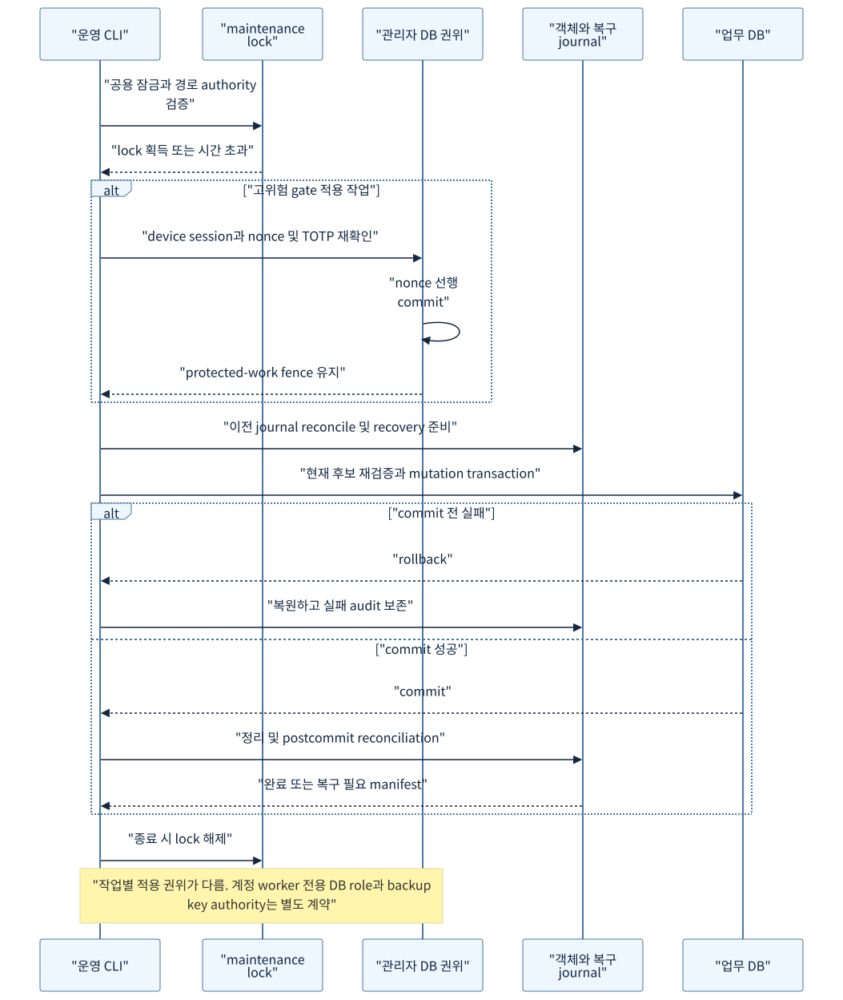

[Mermaid 원본](../diagrams/D11-operations-sequence.mmd)
