# D12 관리자 Android 앱 전체 기능

[전체 목차](../README.md) · [기능 목록](../02-features.md) · [정책 목록](../03-policies.md) · [추적표](../04-traceability.md)

apps/android/adminapp 전체 UI/security/controller/http/repository/build/manifest/resources. Backend 직접 API 경계이며 Gateway를 거치지 않음. D06 사용자 신고/raw/log, D14 보안/사고, D15 신고·권리요청·기관기록, D13 raw 서버와 연결. 수동 기관 전달은 이미 수행한 사실 기록. 코드 수정·빌드·제품 시험·실기기·서버 실행 제외.

분석 기준: 2026-10-04 10:33:40 KST 작업트리 고정본. 정적 코드 분석과 테스트 기대를 기술하며, 이번 제품 실행 통과를 뜻하지 않는다.

## 기능 목록

| 기능 | 활성 상태 | 목적 |
| --- | --- | --- |
| [F-D12-001 빌드 역할·보안 활성화·운영 기능 잠금](#F-D12-001) | ACTIVE | 운영 활성화는 debug 명시적 옵트인를 지키며 빌드 역할·보안 활성화·운영 기능 잠금을 수행한다. |
| [F-D12-002 안전한 앱 시작과 기기 공개키 descriptor 준비](#F-D12-002) | ACTIVE | 새 키는 하드웨어 보호와 사용자 인증 필요를 지키며 안전한 앱 시작과 기기 공개키 descriptor 준비을 수행한다. |
| [F-D12-003 기기 PIN·패턴·비밀번호 확인과 키 사용 1회 재시도](#F-D12-003) | ACTIVE | 일회용 자격증명 재전송 금지를 지키며 기기 PIN·패턴·비밀번호 확인과 키 사용 1회 재시도을 수행한다. |
| [F-D12-004 관리자 비밀번호·TOTP 로그인](#F-D12-004) | ACTIVE | 서버 상태까지 확인해야 로그인 접근 공개를 지키며 관리자 비밀번호·TOTP 로그인을 수행한다. |
| [F-D12-005 서버 보안 상태·세션·활성 기기 목록 갱신](#F-D12-005) | ACTIVE | 현재 session/device와 일관된 서버 projection만 사용를 지키며 서버 보안 상태·세션·활성 기기 목록 갱신을 수행한다. |
| [F-D12-006 화면 이탈 로컬 잠금과 기존 세션 재개](#F-D12-006) | ACTIVE | 화면 이탈과 늦은 작업 결과의 세대 fence를 지키며 화면 이탈 로컬 잠금과 기존 세션 재개을 수행한다. |
| [F-D12-007 현재 세션 로그아웃과 다른 세션 폐기](#F-D12-007) | ACTIVE | 로컬 로그아웃과 서버 폐기 사실 분리를 지키며 현재 세션 로그아웃과 다른 세션 폐기을 수행한다. |
| [F-D12-008 다른 관리자 기기의 분실 신고](#F-D12-008) | ACTIVE | 분실 기기는 정확한 대상에 새 재인증 필요를 지키며 다른 관리자 기기의 분실 신고을 수행한다. |
| [F-D12-009 휴대전화 밖 복구코드로 복구 시작](#F-D12-009) | ACTIVE | 복구 중 운영 업무 금지를 지키며 휴대전화 밖 복구코드로 복구 시작을 수행한다. |
| [F-D12-010 새 인증수단으로 관리자 복구 완료](#F-D12-010) | ACTIVE | 복구 완료 응답과 현재 서버 session을 재검증를 지키며 새 인증수단으로 관리자 복구 완료을 수행한다. |
| [F-D12-011 복구자료 외부 보관 사용자 확인 기록](#F-D12-011) | ACTIVE | 사용자 진술과 실제 복구 검증 분리를 지키며 복구자료 외부 보관 사용자 확인 기록을 수행한다. |
| [F-D12-012 등록된 기기키의 정상 회전·미확정 결과 조정](#F-D12-012) | ACTIVE | 서버 확인 후 키 승격과 이전 키 폐기를 지키며 등록된 기기키의 정상 회전·미확정 결과 조정을 수행한다. |
| [F-D12-013 기기키 소실·영구 무효화 뒤 교체 키 로그인](#F-D12-013) | ACTIVE | 교체 로그인에서 다른 키로 자동 fallback 금지를 지키며 기기키 소실·영구 무효화 뒤 교체 키 로그인을 수행한다. |
| [F-D12-014 요청별 기기 proof·정규 인코딩·시간 결속](#F-D12-014) | ACTIVE | 기기 proof는 정확한 단일 요청에 결속를 지키며 요청별 기기 proof·정규 인코딩·시간 결속을 수행한다. |
| [F-D12-015 고위험 작업별 재인증과 일회성 허가 소비](#F-D12-015) | ACTIVE | 고위험 권한은 한 작업의 exact triple에 한 번만 사용를 지키며 고위험 작업별 재인증과 일회성 허가 소비을 수행한다. |
| [F-D12-016 Backend 직접 HTTP·응답 제한·deadline·취소](#F-D12-016) | ACTIVE | HTTP 성공 응답과 서버 mutation 성공을 무조건 동일시하지 않음를 지키며 Backend 직접 HTTP·응답 제한·deadline·취소을 수행한다. |
| [F-D12-017 신고 목록 필터·페이지·재조회](#F-D12-017) | CONDITIONAL | 마스킹된 페이지와 조회 세대 결속를 지키며 신고 목록 필터·페이지·재조회을 수행한다. |
| [F-D12-018 신고 상세·세 축 상태·운영 대상 결속](#F-D12-018) | CONDITIONAL | 검수·내부 업무·기관 전달 의미 분리를 지키며 신고 상세·세 축 상태·운영 대상 결속을 수행한다. |
| [F-D12-019 신고 원본 단회 접근·검증·화면 확인](#F-D12-019) | CONDITIONAL | 원본 접근 단회성 및 실제 확인 결속를 지키며 신고 원본 단회 접근·검증·화면 확인을 수행한다. |
| [F-D12-020 신고 승인·반려·중복 판정 추가](#F-D12-020) | CONDITIONAL | 추가형 검수와 원본 확인 필수를 지키며 신고 승인·반려·중복 판정 추가을 수행한다. |
| [F-D12-021 검수 미확정 시도 영속 보관·존재 조회 복구](#F-D12-021) | CONDITIONAL | 검수 재전송 ID와 원문 비보관를 지키며 검수 미확정 시도 영속 보관·존재 조회 복구을 수행한다. |
| [F-D12-022 검수 이력 전체 페이지·최근 묶음](#F-D12-022) | CONDITIONAL | 검수 이력 snapshot 일관성를 지키며 검수 이력 전체 페이지·최근 묶음을 수행한다. |
| [F-D12-023 기관 전달 이력·유효 사건 산출](#F-D12-023) | CONDITIONAL | 전달 역사 보존과 최신 유효 사건를 지키며 기관 전달 이력·유효 사건 산출을 수행한다. |
| [F-D12-024 내부 신고 업무 상태 변경·확정 후 재조회](#F-D12-024) | CONDITIONAL | 서버 변경 확정과 상세 표시 분리를 지키며 내부 신고 업무 상태 변경·확정 후 재조회을 수행한다. |
| [F-D12-025 제출용 ZIP 생성·매니페스트 검증](#F-D12-025) | CONDITIONAL | 현재 승인 내용에 결속된 제출본를 지키며 제출용 ZIP 생성·매니페스트 검증을 수행한다. |
| [F-D12-026 SAF 새 제출본 저장·재읽기 검증](#F-D12-026) | CONDITIONAL | 저장 전후 서버 결속 및 실제 재읽기를 지키며 SAF 새 제출본 저장·재읽기 검증을 수행한다. |
| [F-D12-027 기존 제출 ZIP 재연결·서버 증명 대조](#F-D12-027) | CONDITIONAL | 비신뢰 파일과 서버 패키지 증명 연결를 지키며 기존 제출 ZIP 재연결·서버 증명 대조을 수행한다. |
| [F-D12-028 수동 기관 전달·접수·조치완료 사실 기록](#F-D12-028) | CONDITIONAL | 이미 수행한 수동 전달 사실만 기록를 지키며 수동 기관 전달·접수·조치완료 사실 기록을 수행한다. |
| [F-D12-029 전달 사실 정정·추가 기록](#F-D12-029) | CONDITIONAL | 원 전달 사실 보존과 정정 멱등성를 지키며 전달 사실 정정·추가 기록을 수행한다. |
| [F-D12-030 사용자 정정·삭제 요청 목록과 상세](#F-D12-030) | CONDITIONAL | 권리 요청 조회의 최소 표시와 세대 결속를 지키며 사용자 정정·삭제 요청 목록과 상세을 수행한다. |
| [F-D12-031 사용자 정정·삭제 요청 상태·답변 처리](#F-D12-031) | CONDITIONAL | 삭제 완료와 일반 권리 요청 상태 변경 분리를 지키며 사용자 정정·삭제 요청 상태·답변 처리을 수행한다. |
| [F-D12-032 외부 사본 삭제 후속 목록](#F-D12-032) | CONDITIONAL | 외부 사본 최소 projection를 지키며 외부 사본 삭제 후속 목록을 수행한다. |
| [F-D12-033 외부 사본 삭제 요청·기관 회신 사실 기록](#F-D12-033) | CONDITIONAL | 외부 회신 사실과 멱등 재시도를 지키며 외부 사본 삭제 요청·기관 회신 사실 기록을 수행한다. |
| [F-D12-034 CRITICAL 사고 목록·상세 이력](#F-D12-034) | CONDITIONAL | 사고 이력의 연속성과 명시적 상태를 지키며 CRITICAL 사고 목록·상세 이력을 수행한다. |
| [F-D12-035 사고 확인·종결·재개와 미확정 시도 복구](#F-D12-035) | CONDITIONAL | 사고 변경 의도·사용자·멱등키 결속를 지키며 사고 확인·종결·재개와 미확정 시도 복구을 수행한다. |
| [F-D12-036 격리 원시수집 목록과 선택](#F-D12-036) | CONDITIONAL | 원시자료는 격리 metadata만 열람를 지키며 격리 원시수집 목록과 선택을 수행한다. |
| [F-D12-037 원시수집 REPORT 목적 승인·반려](#F-D12-037) | CONDITIONAL | 목적별 revision 독립과 증거 필드 제한를 지키며 원시수집 REPORT 목적 승인·반려을 수행한다. |
| [F-D12-038 원시수집 TRAINING 목적 증거 결속 승인·반려](#F-D12-038) | CONDITIONAL | 학습 목적 증거와 민감정보 제외 필수를 지키며 원시수집 TRAINING 목적 증거 결속 승인·반려을 수행한다. |
| [F-D12-039 원시수집 법적 보존 적용·해제](#F-D12-039) | CONDITIONAL | 법적 보존 명령별 필드 및 revision 결속를 지키며 원시수집 법적 보존 적용·해제을 수행한다. |
| [F-D12-040 통합 감사 목록·유형·행위자 필터](#F-D12-040) | CONDITIONAL | 감사 최소정보와 dispatch 전 세션 검증를 지키며 통합 감사 목록·유형·행위자 필터을 수행한다. |
| [F-D12-041 화면 재생성·중단·로컬 상태·늦은 작업 정리](#F-D12-041) | ACTIVE | 비밀값 비보관과 완료 증거 보존를 지키며 화면 재생성·중단·로컬 상태·늦은 작업 정리을 수행한다. |
| [F-D12-042 관리자 접근성·민감 표시·명시적 버튼 상호작용](#F-D12-042) | ACTIVE | 의미있는 상태 표시와 민감 화면 보존 제한를 지키며 관리자 접근성·민감 표시·명시적 버튼 상호작용을 수행한다. |
| [F-D12-043 인증·복구 텔레메트리 최소 기록](#F-D12-043) | ACTIVE | 보안 로그의 최소 필드와 실패 격리를 지키며 인증·복구 텔레메트리 최소 기록을 수행한다. |
| [F-D12-044 일반 고위험 action 선언의 미연결 경계](#F-D12-044) | UNCONNECTED | 선언된 계약과 실제 사용 가능한 기능을 구분한다. |
| [F-D12-045 네트워크 단절·오프라인 업무 제한](#F-D12-045) | ACTIVE | 메모리 표시와 오프라인 권한·변경 성공을 구분를 지키며 네트워크 단절·오프라인 업무 제한을 수행한다. |

## 분야 연결도


[Mermaid 원본](../diagrams/D12-overview.mmd)

## F-D12-001 빌드 역할·보안 활성화·운영 기능 잠금

| 항목 | 명세 |
| --- | --- |
| 분야 | D12 관리자 Android 앱 전체 기능 |
| 목적 | 운영 활성화는 debug 명시적 옵트인를 지키며 빌드 역할·보안 활성화·운영 기능 잠금을 수행한다. |
| 사용 주체 | 관리자 Android 관리자 앱 D14 관리자 보안 서버 |
| 활성 상태 | ACTIVE |
| 진입점 | apps/android/adminapp/src/main/java/kr/co/hanium/dreamup/walksafe/admin/AdminBoundaryActivity.java:424 onCreate apps/android/adminapp/src/main/java/kr/co/hanium/dreamup/walksafe/admin/AdminBoundaryActivity.java:522 completeSecurityInitialization |
| 실행 전제 | Gradle 설정 단계; Android 실행 이전. |
| 입력 출처 형식 검증 최신성 | Gradle property가 같은 이름의 환경변수보다 우선. WALKSAFE_ADMIN_OPERATIONAL_DEBUG는 trim/lowercase 후 null·빈값·false 또는 true만 허용. 앱 ID kr.co.hanium.dreamup.walksafe.admin, minSdk 26, target/compile 36. Java source/target 21, versionCode=1, versionName=0.2.0-security. okhttp=5.4.0, JUnit=4.13.2, mockwebserver=5.4.0, test org.json=20240303; strict dependency locking. |

### 시작 이벤트와 처리 순서

| 이벤트 ID | 발생원 | 이벤트 | 수신부 | 흐름 |
| --- | --- | --- | --- | --- |
| E-D12-001-01 | Gradle variant 설정 | AdminBoundaryActivity.onCreate / completeSecurityInitialization | ADMIN_SECURITY_WORKFLOWS_ENABLED | Gradle 설정 단계; Android 실행 이전. → 기본 ADMIN_SECURITY_WORKFLOWS_ENABLED=true와 ADMIN_OPERATIONAL_WORKFLOWS_ENABLED=false를 생성한다. → debug는 operationalDebugEnabled를 운영 플래그로 사용하고 release는 설정값과 무관하게 false로 덮어쓴다. → Activity는 보안 플래그일 때 키를 준비하고 운영 플래그일 때만 Operations/Report/Incident/Raw 클라이언트를 생성한다. → release preReleaseBuild는 정확한 root HTTPS origin 및 40자리 16진 source commit을 검사한다. → 선택한 빌드 variant의 보안/운영 상수를 생성한다. |
| E-D12-001-02 | 입력·서버 응답·수명주기 조건 | debug 옵션 true | ADMIN_SECURITY_WORKFLOWS_ENABLED | debug 옵션 true → 운영 클라이언트와 패널 연결 가능; 종료/복구: 해당 없음: 재개 가능한 서버 변경 작업을 보관하지 않음. |
| E-D12-001-03 | 입력·서버 응답·수명주기 조건 | release 또는 debug 옵션 false | ADMIN_SECURITY_WORKFLOWS_ENABLED | release 또는 debug 옵션 false → 운영 업무 잠금 안내; 종료/복구: 해당 없음: 재개 가능한 서버 변경 작업을 보관하지 않음. |
| E-D12-001-04 | 입력·서버 응답·수명주기 조건 | 옵션이 허용된 문자열 이외 | ADMIN_SECURITY_WORKFLOWS_ENABLED | 옵션이 허용된 문자열 이외 → Gradle 설정 실패; 종료/복구: 해당 없음: 재개 가능한 서버 변경 작업을 보관하지 않음. |
| E-D12-001-05 | 입력·서버 응답·수명주기 조건 | release origin 또는 source commit 부적합 | ADMIN_SECURITY_WORKFLOWS_ENABLED | release origin 또는 source commit 부적합 → release 빌드 전 검사 실패; 종료/복구: 해당 없음: 재개 가능한 서버 변경 작업을 보관하지 않음. |

1. 1. 기본 ADMIN_SECURITY_WORKFLOWS_ENABLED=true와 ADMIN_OPERATIONAL_WORKFLOWS_ENABLED=false를 생성한다. [apps/android/adminapp/build.gradle.kts:80 ADMIN_SECURITY_WORKFLOWS_ENABLED]
2. 2. debug는 operationalDebugEnabled를 운영 플래그로 사용하고 release는 설정값과 무관하게 false로 덮어쓴다. [apps/android/adminapp/build.gradle.kts:80 ADMIN_SECURITY_WORKFLOWS_ENABLED]
3. 3. Activity는 보안 플래그일 때 키를 준비하고 운영 플래그일 때만 Operations/Report/Incident/Raw 클라이언트를 생성한다. [apps/android/adminapp/build.gradle.kts:80 ADMIN_SECURITY_WORKFLOWS_ENABLED]
4. 4. release preReleaseBuild는 정확한 root HTTPS origin 및 40자리 16진 source commit을 검사한다. [apps/android/adminapp/build.gradle.kts:80 ADMIN_SECURITY_WORKFLOWS_ENABLED]
5. 5. main manifest는 INTERNET만 요청하고 launcher Activity를 exported=true로 등록한다. allowBackup=false/fullBackupContent=false 및 data-extraction-rules로 sharedpref/file/database 백업·기기전송을 제외한다. cleartext는 main에서 false이며 debug network config에서 localhost/127.0.0.1만 허용한다. [apps/android/adminapp/src/main/AndroidManifest.xml:2; apps/android/adminapp/src/debug/res/xml/admin_debug_network_security_config.xml:2]

| 분기 조건 | 실제 처리 결과 | 구현 근거 |
| --- | --- | --- |
| debug 옵션 true | 운영 클라이언트와 패널 연결 가능 | apps/android/adminapp/build.gradle.kts:80 ADMIN_SECURITY_WORKFLOWS_ENABLED |
| release 또는 debug 옵션 false | 운영 업무 잠금 안내 | apps/android/adminapp/build.gradle.kts:80 ADMIN_SECURITY_WORKFLOWS_ENABLED |
| 옵션이 허용된 문자열 이외 | Gradle 설정 실패 | apps/android/adminapp/build.gradle.kts:80 ADMIN_SECURITY_WORKFLOWS_ENABLED |
| release origin 또는 source commit 부적합 | release 빌드 전 검사 실패 | apps/android/adminapp/build.gradle.kts:80 ADMIN_SECURITY_WORKFLOWS_ENABLED |

### 효과 종료와 복구

선택한 빌드 variant의 보안/운영 상수를 생성한다. 동작·저장 범위는 단계의 로컬/서버 구분을 따른다. 관리자 앱 전용 음성·진동 출력은 이 기능에서 정의하지 않는다.

| 상황 | 동작 |
| --- | --- |
| 정상 완료 | 선택한 빌드 variant의 보안/운영 상수를 생성한다. |
| 실패 | 입력·응답·결속 검증 또는 API 오류는 분기별로 차단/오류 표시한다. 성공 결과를 생성하지 않는다. |
| 시간 초과 | 이 기능 자체의 독립 timeout은 없다. 연결된 HTTP/시스템 인증이 있으면 F-D12-016 또는 OS 결과를 따른다. |
| 중복 입력 | 해당 없음: 독립 사용자 요청 중복 처리 흐름이 없음. |
| 취소 | 해당 없음: 별도 취소 이벤트 없음. |
| 중단과 생명주기 | 해당 없음: 독립 장기 작업 중단 프로토콜 없음. |
| 재시도 | 잘못된 설정을 고친 뒤 별도 빌드가 필요하며 앱 실행 중 토글은 없다. |
| 복구 | 해당 없음: 재개 가능한 서버 변경 작업을 보관하지 않음. |
| 자원 정리 | 임시 지역값 외 독립 장기 보관 자원 없음. |

### 상태 실행 맥락과 연결

| 항목 | 명세 |
| --- | --- |
| 초기 상태 | S-D12-001-SECURITY_CONTROL_ENABLED_OPERATIONS_LOCKED |
| 상태 목록 | S-D12-001-SECURITY_CONTROL_ENABLED_OPERATIONS_LOCKED S-D12-001-INTERNAL_DEBUG_REVIEW_DELIVERY_ENABLED |
| 전이 조건과 전이 동작 | debug 옵션 true → 운영 클라이언트와 패널 연결 가능 release 또는 debug 옵션 false → 운영 업무 잠금 안내 옵션이 허용된 문자열 이외 → Gradle 설정 실패 release origin 또는 source commit 부적합 → release 빌드 전 검사 실패 |
| 허용되지 않는 전이 | 운영 활성화는 debug 명시적 옵트인를 위반하는 전이 또는 미확인 응답을 성공으로 확정하는 전이는 허용하지 않는다. 상태 라벨은 코드 enum과 단계 이름을 명세 탐색용으로 구분한 것이며 모두 Java enum이라는 뜻은 아니다. |
| 동시성 순서와 작업 소유권 | Gradle 설정/variant 검사 시점. 런타임의 Activity 초기화는 F-D12-002로 연결한다. |
| 공유 상태와 다른 기능 연결 | AdminSecurityController의 현재 identity/session/device/보관상태와 로컬 generation; D14 관리자 보안 서버. 플래그는 구현 활성화 조건이며 release 준비·배포·설치 증거가 아니다. |

### 정책 근거와 검증 범위

| 항목 | 근거 |
| --- | --- |
| 정책 | [P-D12-001](#P-D12-001) |
| 구현 | [apps/android/adminapp/build.gradle.kts:80](/home/ddobagi/Hanium_Dreamup/apps/android/adminapp/build.gradle.kts:80) · `ADMIN_SECURITY_WORKFLOWS_ENABLED` (범위 80–88) [apps/android/adminapp/src/main/java/kr/co/hanium/dreamup/walksafe/admin/AdminBoundaryActivity.java:424](/home/ddobagi/Hanium_Dreamup/apps/android/adminapp/src/main/java/kr/co/hanium/dreamup/walksafe/admin/AdminBoundaryActivity.java:424) · `onCreate` (범위 424–443) [apps/android/adminapp/src/main/java/kr/co/hanium/dreamup/walksafe/admin/AdminBoundaryActivity.java:522](/home/ddobagi/Hanium_Dreamup/apps/android/adminapp/src/main/java/kr/co/hanium/dreamup/walksafe/admin/AdminBoundaryActivity.java:522) · `completeSecurityInitialization` (범위 522–815) [apps/android/adminapp/build.gradle.kts:40](/home/ddobagi/Hanium_Dreamup/apps/android/adminapp/build.gradle.kts:40) · `operationalDebugEnabled` (범위 40–48) [apps/android/adminapp/src/main/AndroidManifest.xml:2](/home/ddobagi/Hanium_Dreamup/apps/android/adminapp/src/main/AndroidManifest.xml:2) · `manifest` (범위 2–10) [apps/android/adminapp/src/debug/AndroidManifest.xml:2](/home/ddobagi/Hanium_Dreamup/apps/android/adminapp/src/debug/AndroidManifest.xml:2) · `manifest` (범위 2–4) [apps/android/adminapp/src/main/res/xml/admin_data_extraction_rules.xml:2](/home/ddobagi/Hanium_Dreamup/apps/android/adminapp/src/main/res/xml/admin_data_extraction_rules.xml:2) · `data-extraction-rules` (범위 2–10) |
| 기존 개선 ID | 개별 동일성 미확인; 분야 연관은 별도 추적표 |
| 기존 분야 | 18 |
| 기존 실행 증거 | 과거 완료/시험 기록을 이번 실행 근거로 사용하지 않음. 고정 snapshot의 구현과 시험 기대만 기술. |
| 한계 및 구분 | 플래그는 구현 활성화 조건이며 release 준비·배포·설치 증거가 아니다. 권한·백업 차단은 선언/코드 근거이며 실제 Android/OEM 데이터 전송 효과의 기기 시험 결과가 아니다. |

| 테스트 위치 | 심볼 | 증거 수준 | 기대와 한계 |
| --- | --- | --- | --- |
| [apps/android/adminapp/src/test/java/kr/co/hanium/dreamup/walksafe/admin/AdminBuildProvenanceStaticTest.java](/home/ddobagi/Hanium_Dreamup/apps/android/adminapp/src/test/java/kr/co/hanium/dreamup/walksafe/admin/AdminBuildProvenanceStaticTest.java) | AdminBuildProvenanceStaticTest.releaseRequiresFortyHexSourceCommitBeforeBuilding | TEST_EXPECTATION | 운영 활성화는 debug 명시적 옵트인 관련 기대를 명시한 시험 소스. 대표 심볼은 탐색용이며 해당 파일 전체 통과를 뜻하지 않는다. 이번 실행하지 않음. |
| [apps/android/adminapp/src/test/java/kr/co/hanium/dreamup/walksafe/admin/security/AdminSecurityBoundaryStaticTest.java](/home/ddobagi/Hanium_Dreamup/apps/android/adminapp/src/test/java/kr/co/hanium/dreamup/walksafe/admin/security/AdminSecurityBoundaryStaticTest.java) | AdminSecurityBoundaryStaticTest.onlyInternetPermissionIsDeclaredAndBackupsAreClosed | TEST_EXPECTATION | 운영 활성화는 debug 명시적 옵트인 관련 기대를 명시한 시험 소스. 대표 심볼은 탐색용이며 해당 파일 전체 통과를 뜻하지 않는다. 이번 실행하지 않음. |

### 이벤트 처리 그림


[Mermaid 원본](../diagrams/D12-F001.mmd) · [SVG](../rendered/D12-F001.svg)

## F-D12-002 안전한 앱 시작과 기기 공개키 descriptor 준비

| 항목 | 명세 |
| --- | --- |
| 분야 | D12 관리자 Android 앱 전체 기능 |
| 목적 | 새 키는 하드웨어 보호와 사용자 인증 필요를 지키며 안전한 앱 시작과 기기 공개키 descriptor 준비을 수행한다. |
| 사용 주체 | 관리자 Android 관리자 앱 D14 관리자 보안 서버 |
| 활성 상태 | ACTIVE |
| 진입점 | apps/android/adminapp/src/main/java/kr/co/hanium/dreamup/walksafe/admin/AdminBoundaryActivity.java:445 initializeDeviceKeyInBackground |
| 실행 전제 | 보안 앱이 시작되고 해당 lifecycle/기기/서버 상태가 입력·분기 조건을 만족해야 함. |
| 입력 출처 형식 검증 최신성 | 앱 전용 SharedPreferences의 device_id와 키 metadata; 새 기기는 admin- 접두사 UUID 식별. P-256 secp256r1, SHA256withECDSA, AndroidKeyStore. |

### 시작 이벤트와 처리 순서

| 이벤트 ID | 발생원 | 이벤트 | 수신부 | 흐름 |
| --- | --- | --- | --- | --- |
| E-D12-002-01 | 관리자 UI 또는 Android lifecycle | AdminBoundaryActivity.initializeDeviceKeyInBackground | ensureKey | 보안 앱이 시작되고 해당 lifecycle/기기/서버 상태가 입력·분기 조건을 만족해야 함. → onCreate에서 FLAG_SECURE를 설정하고 키 준비 중 상태로 화면을 만든다. → 단일 worker에서 AdminDeviceKeyStore.class 모니터로 겹친 Activity의 ensureKey를 직렬화한다. → 처음에는 버전 1 키를 생성하고 KeyInfo의 TEE 또는 STRONGBOX 여부를 검사한다. SOFTWARE/UNKNOWN 신규 키는 삭제한다. → SPKI SHA-256 marker와 공개 SPKI·버전·보안수준 descriptor만 표시하고 키 메타데이터를 동기 commit한다. → 기존 active 키가 absent면 500ms 뒤 한 번 재조회한다. marker/메타데이터 불일치로 기존 키를 재생성하지 않는다. → 현재 키 descriptor를 준비해 보안 클라이언트 초기화로 넘긴다. |
| E-D12-002-02 | 입력·서버 응답·수명주기 조건 | 화면 잠금 없음 | ensureKey | 화면 잠금 없음 → LOCK_SCREEN_REQUIRED 안내와 관리자 잠금; 종료/복구: 서버 최신 상태·현재 선택·세션 결속을 다시 확인한 뒤 사용자가 재실행한다. 자동 성공 복원은 없다. |
| E-D12-002-03 | 입력·서버 응답·수명주기 조건 | 새 키가 TEE 또는 STRONGBOX 아님 | ensureKey | 새 키가 TEE 또는 STRONGBOX 아님 → 신규 키 삭제 후 하드웨어 미지원 안내; 종료/복구: 서버 최신 상태·현재 선택·세션 결속을 다시 확인한 뒤 사용자가 재실행한다. 자동 성공 복원은 없다. |
| E-D12-002-04 | 입력·서버 응답·수명주기 조건 | 기존 키 absent 재조회도 absent | ensureKey | 기존 키 absent 재조회도 absent → REGISTERED_KEY_MISSING 및 재시작 후 교체 경로 안내; 종료/복구: 서버 최신 상태·현재 선택·세션 결속을 다시 확인한 뒤 사용자가 재실행한다. 자동 성공 복원은 없다. |
| E-D12-002-05 | 입력·서버 응답·수명주기 조건 | metadata 불일치 또는 저장 실패 | ensureKey | metadata 불일치 또는 저장 실패 → 구분된 비밀 없는 오류 코드; 잠금 유지; 종료/복구: 서버 최신 상태·현재 선택·세션 결속을 다시 확인한 뒤 사용자가 재실행한다. 자동 성공 복원은 없다. |
| E-D12-002-06 | 입력·서버 응답·수명주기 조건 | Activity 파괴 또는 finishing | ensureKey | Activity 파괴 또는 finishing → 초기화 결과 UI 채택 중단; 종료/복구: 서버 최신 상태·현재 선택·세션 결속을 다시 확인한 뒤 사용자가 재실행한다. 자동 성공 복원은 없다. |

1. 1. onCreate에서 FLAG_SECURE를 설정하고 키 준비 중 상태로 화면을 만든다. [apps/android/adminapp/src/main/java/kr/co/hanium/dreamup/walksafe/admin/security/AdminDeviceKeyStore.java:101 ensureKey]
2. 2. 단일 worker에서 AdminDeviceKeyStore.class 모니터로 겹친 Activity의 ensureKey를 직렬화한다. [apps/android/adminapp/src/main/java/kr/co/hanium/dreamup/walksafe/admin/security/AdminDeviceKeyStore.java:101 ensureKey]
3. 3. 처음에는 버전 1 키를 생성하고 KeyInfo의 TEE 또는 STRONGBOX 여부를 검사한다. SOFTWARE/UNKNOWN 신규 키는 삭제한다. [apps/android/adminapp/src/main/java/kr/co/hanium/dreamup/walksafe/admin/security/AdminDeviceKeyStore.java:101 ensureKey]
4. 4. SPKI SHA-256 marker와 공개 SPKI·버전·보안수준 descriptor만 표시하고 키 메타데이터를 동기 commit한다. [apps/android/adminapp/src/main/java/kr/co/hanium/dreamup/walksafe/admin/security/AdminDeviceKeyStore.java:101 ensureKey]
5. 5. 기존 active 키가 absent면 500ms 뒤 한 번 재조회한다. marker/메타데이터 불일치로 기존 키를 재생성하지 않는다. [apps/android/adminapp/src/main/java/kr/co/hanium/dreamup/walksafe/admin/security/AdminDeviceKeyStore.java:101 ensureKey]

| 분기 조건 | 실제 처리 결과 | 구현 근거 |
| --- | --- | --- |
| 화면 잠금 없음 | LOCK_SCREEN_REQUIRED 안내와 관리자 잠금 | apps/android/adminapp/src/main/java/kr/co/hanium/dreamup/walksafe/admin/security/AdminDeviceKeyStore.java:101 ensureKey |
| 새 키가 TEE 또는 STRONGBOX 아님 | 신규 키 삭제 후 하드웨어 미지원 안내 | apps/android/adminapp/src/main/java/kr/co/hanium/dreamup/walksafe/admin/security/AdminDeviceKeyStore.java:101 ensureKey |
| 기존 키 absent 재조회도 absent | REGISTERED_KEY_MISSING 및 재시작 후 교체 경로 안내 | apps/android/adminapp/src/main/java/kr/co/hanium/dreamup/walksafe/admin/security/AdminDeviceKeyStore.java:101 ensureKey |
| metadata 불일치 또는 저장 실패 | 구분된 비밀 없는 오류 코드; 잠금 유지 | apps/android/adminapp/src/main/java/kr/co/hanium/dreamup/walksafe/admin/security/AdminDeviceKeyStore.java:101 ensureKey |
| Activity 파괴 또는 finishing | 초기화 결과 UI 채택 중단 | apps/android/adminapp/src/main/java/kr/co/hanium/dreamup/walksafe/admin/security/AdminDeviceKeyStore.java:101 ensureKey |

### 효과 종료와 복구

현재 키 descriptor를 준비해 보안 클라이언트 초기화로 넘긴다. 동작·저장 범위는 단계의 로컬/서버 구분을 따른다. 관리자 앱 전용 음성·진동 출력은 이 기능에서 정의하지 않는다.

| 상황 | 동작 |
| --- | --- |
| 정상 완료 | 현재 키 descriptor를 준비해 보안 클라이언트 초기화로 넘긴다. |
| 실패 | 입력·응답·결속 검증 또는 API 오류는 분기별로 차단/오류 표시한다. 성공 결과를 생성하지 않는다. |
| 시간 초과 | 이 기능 자체의 독립 timeout은 없다. 연결된 HTTP/시스템 인증이 있으면 F-D12-016 또는 OS 결과를 따른다. |
| 중복 입력 | busy/generation·현재 선택 결속으로 중복 화면 반영을 막는다. 자동 중복 서버 요청은 만들지 않는다. |
| 취소 | 별도 취소 버튼은 없는 경우가 많다. Activity 중단/세션 변경은 로컬 generation과 결과 반영을 무효화하며 이미 전송된 서버 변경의 취소를 뜻하지 않는다. |
| 중단과 생명주기 | 진행 중 worker의 중단과 늦은 callback은 F-D12-041 수명주기 fence에 따른다. 서버 이미 처리 여부는 별도 확인한다. |
| 재시도 | 등록 키 absent만 500ms 후 1회; 그 외는 typed 안내 후 사용자 재시작/교체 절차. |
| 복구 | 서버 최신 상태·현재 선택·세션 결속을 다시 확인한 뒤 사용자가 재실행한다. 자동 성공 복원은 없다. |
| 자원 정리 | 실패한 신규 키 삭제 및 미채택 결과 폐기; 기존 등록 active 키 임의 재생성 없음. |

### 상태 실행 맥락과 연결

| 항목 | 명세 |
| --- | --- |
| 초기 상태 | S-D12-002-PREPARING |
| 상태 목록 | S-D12-002-PREPARING S-D12-002-ACTIVE_KEY_READY S-D12-002-REGISTERED_KEY_MISSING S-D12-002-INITIALIZATION_FAILED |
| 전이 조건과 전이 동작 | 화면 잠금 없음 → LOCK_SCREEN_REQUIRED 안내와 관리자 잠금 새 키가 TEE 또는 STRONGBOX 아님 → 신규 키 삭제 후 하드웨어 미지원 안내 기존 키 absent 재조회도 absent → REGISTERED_KEY_MISSING 및 재시작 후 교체 경로 안내 metadata 불일치 또는 저장 실패 → 구분된 비밀 없는 오류 코드; 잠금 유지 Activity 파괴 또는 finishing → 초기화 결과 UI 채택 중단 |
| 허용되지 않는 전이 | 새 키는 하드웨어 보호와 사용자 인증 필요를 위반하는 전이 또는 미확인 응답을 성공으로 확정하는 전이는 허용하지 않는다. 상태 라벨은 코드 enum과 단계 이름을 명세 탐색용으로 구분한 것이며 모두 Java enum이라는 뜻은 아니다. |
| 동시성 순서와 작업 소유권 | networkExecutor 단일 worker와 AdminDeviceKeyStore.class 모니터에서 KeyStore 작업. 결과는 UI 스레드에서 Activity 생존을 확인하고 반영한다. |
| 공유 상태와 다른 기능 연결 | AdminSecurityController의 현재 identity/session/device/보관상태와 로컬 generation; D14 관리자 보안 서버. 기존 버전 키의 속성은 재생성하지 않는다. 기기 descriptor의 KeyInfo 보고는 원격 attestation 검증을 의미하지 않는다. |

### 정책 근거와 검증 범위

| 항목 | 근거 |
| --- | --- |
| 정책 | [P-D12-002](#P-D12-002) |
| 구현 | [apps/android/adminapp/src/main/java/kr/co/hanium/dreamup/walksafe/admin/security/AdminDeviceKeyStore.java:101](/home/ddobagi/Hanium_Dreamup/apps/android/adminapp/src/main/java/kr/co/hanium/dreamup/walksafe/admin/security/AdminDeviceKeyStore.java:101) · `ensureKey` (범위 101–103) [apps/android/adminapp/src/main/java/kr/co/hanium/dreamup/walksafe/admin/AdminBoundaryActivity.java:445](/home/ddobagi/Hanium_Dreamup/apps/android/adminapp/src/main/java/kr/co/hanium/dreamup/walksafe/admin/AdminBoundaryActivity.java:445) · `initializeDeviceKeyInBackground` (범위 445–503) [apps/android/adminapp/src/main/java/kr/co/hanium/dreamup/walksafe/admin/security/AdminDeviceKeyRotation.java:119](/home/ddobagi/Hanium_Dreamup/apps/android/adminapp/src/main/java/kr/co/hanium/dreamup/walksafe/admin/security/AdminDeviceKeyRotation.java:119) · `ensureActive` (범위 119–137) [apps/android/adminapp/src/main/java/kr/co/hanium/dreamup/walksafe/admin/security/AdminDeviceKeyRotation.java:144](/home/ddobagi/Hanium_Dreamup/apps/android/adminapp/src/main/java/kr/co/hanium/dreamup/walksafe/admin/security/AdminDeviceKeyRotation.java:144) · `containsAfterPause` (범위 144–153) |
| 기존 개선 ID | 개별 동일성 미확인; 분야 연관은 별도 추적표 |
| 기존 분야 | 18 |
| 기존 실행 증거 | 과거 완료/시험 기록을 이번 실행 근거로 사용하지 않음. 고정 snapshot의 구현과 시험 기대만 기술. |
| 한계 및 구분 | 기존 버전 키의 속성은 재생성하지 않는다. 기기 descriptor의 KeyInfo 보고는 원격 attestation 검증을 의미하지 않는다. |

| 테스트 위치 | 심볼 | 증거 수준 | 기대와 한계 |
| --- | --- | --- | --- |
| [apps/android/adminapp/src/test/java/kr/co/hanium/dreamup/walksafe/admin/security/AdminDeviceKeyPreparationFailureTest.java](/home/ddobagi/Hanium_Dreamup/apps/android/adminapp/src/test/java/kr/co/hanium/dreamup/walksafe/admin/security/AdminDeviceKeyPreparationFailureTest.java) | AdminDeviceKeyPreparationFailureTest.invalidOrIncompleteMetadataIsMetadataInvalid | TEST_EXPECTATION | 새 키는 하드웨어 보호와 사용자 인증 필요 관련 기대를 명시한 시험 소스. 대표 심볼은 탐색용이며 해당 파일 전체 통과를 뜻하지 않는다. 이번 실행하지 않음. |
| [apps/android/adminapp/src/test/java/kr/co/hanium/dreamup/walksafe/admin/security/AdminDeviceKeyDescriptorTest.java](/home/ddobagi/Hanium_Dreamup/apps/android/adminapp/src/test/java/kr/co/hanium/dreamup/walksafe/admin/security/AdminDeviceKeyDescriptorTest.java) | AdminDeviceKeyDescriptorTest.trustedProvisionDescriptorContainsOnlyPublicSpkiMarkerAndVersion | TEST_EXPECTATION | 새 키는 하드웨어 보호와 사용자 인증 필요 관련 기대를 명시한 시험 소스. 대표 심볼은 탐색용이며 해당 파일 전체 통과를 뜻하지 않는다. 이번 실행하지 않음. |
| [apps/android/adminapp/src/test/java/kr/co/hanium/dreamup/walksafe/admin/AdminUiThreadBoundaryStaticTest.java](/home/ddobagi/Hanium_Dreamup/apps/android/adminapp/src/test/java/kr/co/hanium/dreamup/walksafe/admin/AdminUiThreadBoundaryStaticTest.java) | AdminUiThreadBoundaryStaticTest.keyPreparationRunsOnWorkerAndOverlappingActivitiesSerializeCreation | TEST_EXPECTATION | 새 키는 하드웨어 보호와 사용자 인증 필요 관련 기대를 명시한 시험 소스. 대표 심볼은 탐색용이며 해당 파일 전체 통과를 뜻하지 않는다. 이번 실행하지 않음. |

### 이벤트 처리 그림


[Mermaid 원본](../diagrams/D12-F002.mmd) · [SVG](../rendered/D12-F002.svg)

## F-D12-003 기기 PIN·패턴·비밀번호 확인과 키 사용 1회 재시도

| 항목 | 명세 |
| --- | --- |
| 분야 | D12 관리자 Android 앱 전체 기능 |
| 목적 | 일회용 자격증명 재전송 금지를 지키며 기기 PIN·패턴·비밀번호 확인과 키 사용 1회 재시도을 수행한다. |
| 사용 주체 | 관리자 Android 관리자 앱 D14 관리자 보안 서버 |
| 활성 상태 | ACTIVE |
| 진입점 | apps/android/adminapp/src/main/java/kr/co/hanium/dreamup/walksafe/admin/AdminBoundaryActivity.java:5122 handleDeviceKeyUseFailure apps/android/adminapp/src/main/java/kr/co/hanium/dreamup/walksafe/admin/AdminBoundaryActivity.java:984 onActivityResult |
| 실행 전제 | 보안 앱이 시작되고 해당 lifecycle/기기/서버 상태가 입력·분기 조건을 만족해야 함. |
| 입력 출처 형식 검증 최신성 | UserNotAuthenticatedException·KeyPermanentlyInvalidatedException에서 변환한 typed cause, retry Runnable 유무, 기기 credential 결과. |

### 시작 이벤트와 처리 순서

| 이벤트 ID | 발생원 | 이벤트 | 수신부 | 흐름 |
| --- | --- | --- | --- | --- |
| E-D12-003-01 | 관리자 UI 또는 Android lifecycle | AdminBoundaryActivity.handleDeviceKeyUseFailure / onActivityResult | onFailure | 보안 앱이 시작되고 해당 lifecycle/기기/서버 상태가 입력·분기 조건을 만족해야 함. → 키 인증 실패 원인을 구분하고 영구 무효화면 즉시 STOP_KEY_INVALIDATED로 잠근다. → 인증 필요 오류는 기기 credential 화면을 한 번 요청한다. → 비밀값 없는 반복 가능 작업은 승인 후 같은 Runnable을 takeReady로 한 번만 실행한다. → 로그인·복구완료·재인증 등 credentialBound 작업은 재전송하지 않고 새 비밀번호와 새 TOTP 입력을 요청한다. → 로그인·복구완료·분실 신고는 비밀값 전송 전에 로컬 서명을 preflight한다. → 인증 승인 뒤 허용된 Runnable 1회 실행 또는 새 자격증명 입력 안내. |
| E-D12-003-02 | 입력·서버 응답·수명주기 조건 | credential 승인 및 repeatable | onFailure | credential 승인 및 repeatable → RETRY_ONCE; 종료/복구: 서버 최신 상태·현재 선택·세션 결속을 다시 확인한 뒤 사용자가 재실행한다. 자동 성공 복원은 없다. |
| E-D12-003-03 | 입력·서버 응답·수명주기 조건 | credential 승인 및 credentialBound | onFailure | credential 승인 및 credentialBound → REENTER_CREDENTIALS; 종료/복구: 서버 최신 상태·현재 선택·세션 결속을 다시 확인한 뒤 사용자가 재실행한다. 자동 성공 복원은 없다. |
| E-D12-003-04 | 입력·서버 응답·수명주기 조건 | 취소 또는 반복 서명 실패 | onFailure | 취소 또는 반복 서명 실패 → STOP; 종료/복구: 서버 최신 상태·현재 선택·세션 결속을 다시 확인한 뒤 사용자가 재실행한다. 자동 성공 복원은 없다. |
| E-D12-003-05 | 입력·서버 응답·수명주기 조건 | 화면 잠금 제거·초기화로 키 영구 무효 | onFailure | 화면 잠금 제거·초기화로 키 영구 무효 → STOP_KEY_INVALIDATED 및 교체 안내; 종료/복구: 서버 최신 상태·현재 선택·세션 결속을 다시 확인한 뒤 사용자가 재실행한다. 자동 성공 복원은 없다. |

1. 1. 키 인증 실패 원인을 구분하고 영구 무효화면 즉시 STOP_KEY_INVALIDATED로 잠근다. [apps/android/adminapp/src/main/java/kr/co/hanium/dreamup/walksafe/admin/security/AdminDeviceKeyUseAuthorization.java:72 onFailure]
2. 2. 인증 필요 오류는 기기 credential 화면을 한 번 요청한다. [apps/android/adminapp/src/main/java/kr/co/hanium/dreamup/walksafe/admin/security/AdminDeviceKeyUseAuthorization.java:72 onFailure]
3. 3. 비밀값 없는 반복 가능 작업은 승인 후 같은 Runnable을 takeReady로 한 번만 실행한다. [apps/android/adminapp/src/main/java/kr/co/hanium/dreamup/walksafe/admin/security/AdminDeviceKeyUseAuthorization.java:72 onFailure]
4. 4. 로그인·복구완료·재인증 등 credentialBound 작업은 재전송하지 않고 새 비밀번호와 새 TOTP 입력을 요청한다. [apps/android/adminapp/src/main/java/kr/co/hanium/dreamup/walksafe/admin/security/AdminDeviceKeyUseAuthorization.java:72 onFailure]
5. 5. 로그인·복구완료·분실 신고는 비밀값 전송 전에 로컬 서명을 preflight한다. [apps/android/adminapp/src/main/java/kr/co/hanium/dreamup/walksafe/admin/security/AdminDeviceKeyUseAuthorization.java:72 onFailure]

| 분기 조건 | 실제 처리 결과 | 구현 근거 |
| --- | --- | --- |
| credential 승인 및 repeatable | RETRY_ONCE | apps/android/adminapp/src/main/java/kr/co/hanium/dreamup/walksafe/admin/security/AdminDeviceKeyUseAuthorization.java:72 onFailure |
| credential 승인 및 credentialBound | REENTER_CREDENTIALS | apps/android/adminapp/src/main/java/kr/co/hanium/dreamup/walksafe/admin/security/AdminDeviceKeyUseAuthorization.java:72 onFailure |
| 취소 또는 반복 서명 실패 | STOP | apps/android/adminapp/src/main/java/kr/co/hanium/dreamup/walksafe/admin/security/AdminDeviceKeyUseAuthorization.java:72 onFailure |
| 화면 잠금 제거·초기화로 키 영구 무효 | STOP_KEY_INVALIDATED 및 교체 안내 | apps/android/adminapp/src/main/java/kr/co/hanium/dreamup/walksafe/admin/security/AdminDeviceKeyUseAuthorization.java:72 onFailure |

### 효과 종료와 복구

인증 승인 뒤 허용된 Runnable 1회 실행 또는 새 자격증명 입력 안내. 동작·저장 범위는 단계의 로컬/서버 구분을 따른다. 관리자 앱 전용 음성·진동 출력은 이 기능에서 정의하지 않는다.

| 상황 | 동작 |
| --- | --- |
| 정상 완료 | 인증 승인 뒤 허용된 Runnable 1회 실행 또는 새 자격증명 입력 안내. |
| 실패 | 입력·응답·결속 검증 또는 API 오류는 분기별로 차단/오류 표시한다. 성공 결과를 생성하지 않는다. |
| 시간 초과 | 이 기능 자체의 독립 timeout은 없다. 연결된 HTTP/시스템 인증이 있으면 F-D12-016 또는 OS 결과를 따른다. |
| 중복 입력 | busy/generation·현재 선택 결속으로 중복 화면 반영을 막는다. 자동 중복 서버 요청은 만들지 않는다. |
| 취소 | 별도 취소 버튼은 없는 경우가 많다. Activity 중단/세션 변경은 로컬 generation과 결과 반영을 무효화하며 이미 전송된 서버 변경의 취소를 뜻하지 않는다. |
| 중단과 생명주기 | 진행 중 worker의 중단과 늦은 callback은 F-D12-041 수명주기 fence에 따른다. 서버 이미 처리 여부는 별도 확인한다. |
| 재시도 | repeatable만 최대1회; credentialBound는 새 password/TOTP 입력. |
| 복구 | 서버 최신 상태·현재 선택·세션 결속을 다시 확인한 뒤 사용자가 재실행한다. 자동 성공 복원은 없다. |
| 자원 정리 | 이 기능이 소유한 credential 배열/민감 메모리·진행중 표시를 종료 경로에서 정리한다. 전체 세션/화면 정리는 F-D12-041. |

### 상태 실행 맥락과 연결

| 항목 | 명세 |
| --- | --- |
| 초기 상태 | S-D12-003-NOT_KEY_AUTHENTICATION |
| 상태 목록 | S-D12-003-NOT_KEY_AUTHENTICATION S-D12-003-REQUEST_DEVICE_CREDENTIAL S-D12-003-RETRY_ONCE S-D12-003-REENTER_CREDENTIALS S-D12-003-STOP S-D12-003-STOP_KEY_INVALIDATED |
| 전이 조건과 전이 동작 | credential 승인 및 repeatable → RETRY_ONCE credential 승인 및 credentialBound → REENTER_CREDENTIALS 취소 또는 반복 서명 실패 → STOP 화면 잠금 제거·초기화로 키 영구 무효 → STOP_KEY_INVALIDATED 및 교체 안내 |
| 허용되지 않는 전이 | 일회용 자격증명 재전송 금지를 위반하는 전이 또는 미확인 응답을 성공으로 확정하는 전이는 허용하지 않는다. 상태 라벨은 코드 enum과 단계 이름을 명세 탐색용으로 구분한 것이며 모두 Java enum이라는 뜻은 아니다. |
| 동시성 순서와 작업 소유권 | Keyguard credential Activity와 onActivityResult callback. AdminDeviceKeyUseRetry가 retry 소유권을 한 번만 넘긴다. |
| 공유 상태와 다른 기능 연결 | AdminSecurityController의 현재 identity/session/device/보관상태와 로컬 generation; D14 관리자 보안 서버. 시간 결속 키에서 생체 등록 변경이 영구 무효화를 일으킨다고 설명하지 않는다. 실제 인증 UI는 미실행. |

### 정책 근거와 검증 범위

| 항목 | 근거 |
| --- | --- |
| 정책 | [P-D12-003](#P-D12-003) |
| 구현 | [apps/android/adminapp/src/main/java/kr/co/hanium/dreamup/walksafe/admin/security/AdminDeviceKeyUseAuthorization.java:72](/home/ddobagi/Hanium_Dreamup/apps/android/adminapp/src/main/java/kr/co/hanium/dreamup/walksafe/admin/security/AdminDeviceKeyUseAuthorization.java:72) · `onFailure` (범위 72–74) [apps/android/adminapp/src/main/java/kr/co/hanium/dreamup/walksafe/admin/AdminBoundaryActivity.java:5122](/home/ddobagi/Hanium_Dreamup/apps/android/adminapp/src/main/java/kr/co/hanium/dreamup/walksafe/admin/AdminBoundaryActivity.java:5122) · `handleDeviceKeyUseFailure` (범위 5122–5163) [apps/android/adminapp/src/main/java/kr/co/hanium/dreamup/walksafe/admin/AdminBoundaryActivity.java:984](/home/ddobagi/Hanium_Dreamup/apps/android/adminapp/src/main/java/kr/co/hanium/dreamup/walksafe/admin/AdminBoundaryActivity.java:984) · `onActivityResult` (범위 984–1115) [apps/android/adminapp/src/main/java/kr/co/hanium/dreamup/walksafe/admin/security/AdminDeviceKeyUseAuthorization.java:80](/home/ddobagi/Hanium_Dreamup/apps/android/adminapp/src/main/java/kr/co/hanium/dreamup/walksafe/admin/security/AdminDeviceKeyUseAuthorization.java:80) · `onFailure` (범위 80–96) [apps/android/adminapp/src/main/java/kr/co/hanium/dreamup/walksafe/admin/security/AdminDeviceKeyUseAuthorization.java:98](/home/ddobagi/Hanium_Dreamup/apps/android/adminapp/src/main/java/kr/co/hanium/dreamup/walksafe/admin/security/AdminDeviceKeyUseAuthorization.java:98) · `onCredentialResult` (범위 98–114) |
| 기존 개선 ID | 개별 동일성 미확인; 분야 연관은 별도 추적표 |
| 기존 분야 | 18 |
| 기존 실행 증거 | 과거 완료/시험 기록을 이번 실행 근거로 사용하지 않음. 고정 snapshot의 구현과 시험 기대만 기술. |
| 한계 및 구분 | 시간 결속 키에서 생체 등록 변경이 영구 무효화를 일으킨다고 설명하지 않는다. 실제 인증 UI는 미실행. |

| 테스트 위치 | 심볼 | 증거 수준 | 기대와 한계 |
| --- | --- | --- | --- |
| [apps/android/adminapp/src/test/java/kr/co/hanium/dreamup/walksafe/admin/security/AdminDeviceKeySweepW22Test.java](/home/ddobagi/Hanium_Dreamup/apps/android/adminapp/src/test/java/kr/co/hanium/dreamup/walksafe/admin/security/AdminDeviceKeySweepW22Test.java) | AdminDeviceKeySweepW22Test.s18_3_rotationKeepsActiveKeyUntilServerConfirmationThenSwitches | TEST_EXPECTATION | 일회용 자격증명 재전송 금지 관련 기대를 명시한 시험 소스. 대표 심볼은 탐색용이며 해당 파일 전체 통과를 뜻하지 않는다. 이번 실행하지 않음. |
| [apps/android/adminapp/src/test/java/kr/co/hanium/dreamup/walksafe/admin/AdminDeviceKeyFixW22StaticTest.java](/home/ddobagi/Hanium_Dreamup/apps/android/adminapp/src/test/java/kr/co/hanium/dreamup/walksafe/admin/AdminDeviceKeyFixW22StaticTest.java) | AdminDeviceKeyFixW22StaticTest.s18_1_f2_credentialOperationsAreNeverReplayedAndPreflightBeforeSecretsLeave | TEST_EXPECTATION | 일회용 자격증명 재전송 금지 관련 기대를 명시한 시험 소스. 대표 심볼은 탐색용이며 해당 파일 전체 통과를 뜻하지 않는다. 이번 실행하지 않음. |

### 이벤트 처리 그림


[Mermaid 원본](../diagrams/D12-F003.mmd) · [SVG](../rendered/D12-F003.svg)

## F-D12-004 관리자 비밀번호·TOTP 로그인

| 항목 | 명세 |
| --- | --- |
| 분야 | D12 관리자 Android 앱 전체 기능 |
| 목적 | 서버 상태까지 확인해야 로그인 접근 공개를 지키며 관리자 비밀번호·TOTP 로그인을 수행한다. |
| 사용 주체 | 관리자 Android 관리자 앱 D14 관리자 보안 서버 |
| 활성 상태 | ACTIVE |
| 진입점 | apps/android/adminapp/src/main/java/kr/co/hanium/dreamup/walksafe/admin/AdminBoundaryActivity.java:3149 login |
| 실행 전제 | 보안 앱이 시작되고 해당 lifecycle/기기/서버 상태가 입력·분기 조건을 만족해야 함. |
| 입력 출처 형식 검증 최신성 | admin ID [A-Za-z0-9][A-Za-z0-9._@-]{0,63}; password 12~256자; TOTP ASCII 숫자 6자리; device label 1~80자; 등록된 기기키. 정규식에 맞더라도 Locale.ROOT 소문자 기준 -shared 접미사 ID는 공유계정으로 거절한다. |

### 시작 이벤트와 처리 순서

| 이벤트 ID | 발생원 | 이벤트 | 수신부 | 흐름 |
| --- | --- | --- | --- | --- |
| E-D12-004-01 | 관리자 UI 또는 Android lifecycle | AdminBoundaryActivity.login | loginWith | 보안 앱이 시작되고 해당 lifecycle/기기/서버 상태가 입력·분기 조건을 만족해야 함. → 화면 입력을 mutable char[]로 가져오고 EditText를 비운 뒤 preflight 기기 서명을 수행한다. → AUTHENTICATING에서 POST /admin/security/sessions 로그인 본문의 SHA-256과 LOGIN device proof를 결속한다. → 토큰 32~512자·공백 없음, NORMAL/RECOVERY_REQUIRED, canonical current session UUID를 검증한다. → access token과 admin/device/session을 메모리에 보관하고 서버 state 및 전체 session inventory를 읽는다. → 현재 유효 session과 현재 device가 각각 정확히 하나인지 대조한 뒤 snapshot을 공개하고 인증 telemetry를 남긴다. → 서버 state/inventory 검증 뒤 NORMAL 또는 RECOVERY_REQUIRED snapshot 공개. |
| E-D12-004-02 | 입력·서버 응답·수명주기 조건 | 로그인 응답 발급 전 실패 | loginWith | 로그인 응답 발급 전 실패 → 토큰·identity 제거 및 FAIL_CLOSED; 종료/복구: 토큰 발급 이후 state 읽기 실패는 업무 잠금 상태에서 refresh/명시적 logout 가능성을 유지한다. |
| E-D12-004-03 | 입력·서버 응답·수명주기 조건 | 토큰 발급 후 상태 조회 실패 | loginWith | 토큰 발급 후 상태 조회 실패 → 업무 잠금; 발급 토큰의 존재와 성공 공개 구분; 종료/복구: 토큰 발급 이후 state 읽기 실패는 업무 잠금 상태에서 refresh/명시적 logout 가능성을 유지한다. |
| E-D12-004-04 | 입력·서버 응답·수명주기 조건 | late 결과의 local generation 불일치 | loginWith | late 결과의 local generation 불일치 → 새 접근을 열지 않고 인증 binding 정리; 종료/복구: 토큰 발급 이후 state 읽기 실패는 업무 잠금 상태에서 refresh/명시적 logout 가능성을 유지한다. |
| E-D12-004-05 | 입력·서버 응답·수명주기 조건 | TOTP_REPLAYED 또는 REAUTHENTICATION_FAILED | loginWith | TOTP_REPLAYED 또는 REAUTHENTICATION_FAILED → 새 코드 안내; 종료/복구: 토큰 발급 이후 state 읽기 실패는 업무 잠금 상태에서 refresh/명시적 logout 가능성을 유지한다. |
| E-D12-004-06 | 관리자 ID 입력 | 금지된 -shared 접미사 | requireAdminId | ID 정규식 확인 → 대소문자 무관 공유계정 접미사 검사 → 요청 구성 거절 |

1. 1. 화면 입력을 mutable char[]로 가져오고 EditText를 비운 뒤 preflight 기기 서명을 수행한다. [apps/android/adminapp/src/main/java/kr/co/hanium/dreamup/walksafe/admin/security/AdminSecurityController.java:533 loginWith]
2. 2. AUTHENTICATING에서 POST /admin/security/sessions 로그인 본문의 SHA-256과 LOGIN device proof를 결속한다. [apps/android/adminapp/src/main/java/kr/co/hanium/dreamup/walksafe/admin/security/AdminSecurityController.java:533 loginWith]
3. 3. 토큰 32~512자·공백 없음, NORMAL/RECOVERY_REQUIRED, canonical current session UUID를 검증한다. [apps/android/adminapp/src/main/java/kr/co/hanium/dreamup/walksafe/admin/security/AdminSecurityController.java:533 loginWith]
4. 4. access token과 admin/device/session을 메모리에 보관하고 서버 state 및 전체 session inventory를 읽는다. [apps/android/adminapp/src/main/java/kr/co/hanium/dreamup/walksafe/admin/security/AdminSecurityController.java:533 loginWith]
5. 5. 현재 유효 session과 현재 device가 각각 정확히 하나인지 대조한 뒤 snapshot을 공개하고 인증 telemetry를 남긴다. [apps/android/adminapp/src/main/java/kr/co/hanium/dreamup/walksafe/admin/security/AdminSecurityController.java:533 loginWith]

| 분기 조건 | 실제 처리 결과 | 구현 근거 |
| --- | --- | --- |
| 로그인 응답 발급 전 실패 | 토큰·identity 제거 및 FAIL_CLOSED | apps/android/adminapp/src/main/java/kr/co/hanium/dreamup/walksafe/admin/security/AdminSecurityController.java:533 loginWith |
| 토큰 발급 후 상태 조회 실패 | 업무 잠금; 발급 토큰의 존재와 성공 공개 구분 | apps/android/adminapp/src/main/java/kr/co/hanium/dreamup/walksafe/admin/security/AdminSecurityController.java:533 loginWith |
| late 결과의 local generation 불일치 | 새 접근을 열지 않고 인증 binding 정리 | apps/android/adminapp/src/main/java/kr/co/hanium/dreamup/walksafe/admin/security/AdminSecurityController.java:533 loginWith |
| TOTP_REPLAYED 또는 REAUTHENTICATION_FAILED | 새 코드 안내 | apps/android/adminapp/src/main/java/kr/co/hanium/dreamup/walksafe/admin/security/AdminSecurityController.java:533 loginWith |
| admin ID를 Locale.ROOT로 소문자화한 값이 -shared로 끝남 | shared administrator id is forbidden 입력 오류로 요청 구성 거절 | apps/android/adminapp/src/main/java/kr/co/hanium/dreamup/walksafe/admin/security/AdminSecurityHttpClient.java:1175 requireAdminId |

### 효과 종료와 복구

서버 state/inventory 검증 뒤 NORMAL 또는 RECOVERY_REQUIRED snapshot 공개. Backend에 직접 HTTP를 호출한다. 서버 저장/감사 처리는 상대 서버 계약이며 이번 실행 검증이 아니다. 관리자 앱 전용 음성·진동 출력은 이 기능에서 정의하지 않는다.

| 상황 | 동작 |
| --- | --- |
| 정상 완료 | 서버 state/inventory 검증 뒤 NORMAL 또는 RECOVERY_REQUIRED snapshot 공개. |
| 실패 | 입력·응답·결속 검증 또는 API 오류는 분기별로 차단/오류 표시한다. 성공 결과를 생성하지 않는다. |
| 시간 초과 | HTTP 요청별 시간 제한은 F-D12-016. 쓰기 후 시간 초과는 서버 결과 미확정이며 성공·미처리를 단정하지 않는다. |
| 중복 입력 | busy/generation·현재 선택 결속으로 중복 화면 반영을 막는다. 자동 중복 서버 요청은 만들지 않는다. |
| 취소 | 별도 취소 버튼은 없는 경우가 많다. Activity 중단/세션 변경은 로컬 generation과 결과 반영을 무효화하며 이미 전송된 서버 변경의 취소를 뜻하지 않는다. |
| 중단과 생명주기 | 진행 중 worker의 중단과 늦은 callback은 F-D12-041 수명주기 fence에 따른다. 서버 이미 처리 여부는 별도 확인한다. |
| 재시도 | 사용자 명시 동작으로 다시 시도한다. 비밀번호/TOTP를 자동 재전송하지 않는다. 상세 분기는 해당 입력·분기와 F-D12-003을 따른다. |
| 복구 | 토큰 발급 이후 state 읽기 실패는 업무 잠금 상태에서 refresh/명시적 logout 가능성을 유지한다. |
| 자원 정리 | char[]와 요청 bytes를 소유자 finally에서 0으로 덮어쓴다. 플랫폼/HTTP 내부의 모든 복사본 완전 소거를 보장하지 않는다. |

### 상태 실행 맥락과 연결

| 항목 | 명세 |
| --- | --- |
| 초기 상태 | S-D12-004-SIGNED_OUT |
| 상태 목록 | S-D12-004-SIGNED_OUT S-D12-004-AUTHENTICATING S-D12-004-NORMAL S-D12-004-RECOVERY_REQUIRED S-D12-004-FAIL_CLOSED |
| 전이 조건과 전이 동작 | 로그인 응답 발급 전 실패 → 토큰·identity 제거 및 FAIL_CLOSED 토큰 발급 후 상태 조회 실패 → 업무 잠금; 발급 토큰의 존재와 성공 공개 구분 late 결과의 local generation 불일치 → 새 접근을 열지 않고 인증 binding 정리 TOTP_REPLAYED 또는 REAUTHENTICATION_FAILED → 새 코드 안내 |
| 허용되지 않는 전이 | 서버 상태까지 확인해야 로그인 접근 공개를 위반하는 전이 또는 미확인 응답을 성공으로 확정하는 전이는 허용하지 않는다. 상태 라벨은 코드 enum과 단계 이름을 명세 탐색용으로 구분한 것이며 모두 Java enum이라는 뜻은 아니다. |
| 동시성 순서와 작업 소유권 | Activity의 단일 networkExecutor에서 controller 작업을 수행하고 runOnUiThread로 표시한다. 현재 operation/report/history generation 및 세션 결속을 확인하여 순서가 늦은 결과를 폐기한다. 구체 중단 소유권은 F-D12-041. AdminSecurityController workLock이 네트워크 연속 작업을 직렬화하고 lifecycleLock/localGeneration이 화면 잠금·close와의 경쟁을 다룬다. |
| 공유 상태와 다른 기능 연결 | AdminSecurityController의 현재 identity/session/device/보관상태와 로컬 generation; D14 관리자 보안 서버. 토큰을 SharedPreferences나 Bundle에 저장하지 않는다. MFA 성공은 운영 debug 잠금을 해제하지 않는다. |

### 정책 근거와 검증 범위

| 항목 | 근거 |
| --- | --- |
| 정책 | [P-D12-004](#P-D12-004) |
| 구현 | [apps/android/adminapp/src/main/java/kr/co/hanium/dreamup/walksafe/admin/security/AdminSecurityController.java:533](/home/ddobagi/Hanium_Dreamup/apps/android/adminapp/src/main/java/kr/co/hanium/dreamup/walksafe/admin/security/AdminSecurityController.java:533) · `loginWith` (범위 533–603) [apps/android/adminapp/src/main/java/kr/co/hanium/dreamup/walksafe/admin/AdminBoundaryActivity.java:3149](/home/ddobagi/Hanium_Dreamup/apps/android/adminapp/src/main/java/kr/co/hanium/dreamup/walksafe/admin/AdminBoundaryActivity.java:3149) · `login` (범위 3149–3160) [apps/android/adminapp/src/main/java/kr/co/hanium/dreamup/walksafe/admin/security/AdminSecurityHttpClient.java:1175](/home/ddobagi/Hanium_Dreamup/apps/android/adminapp/src/main/java/kr/co/hanium/dreamup/walksafe/admin/security/AdminSecurityHttpClient.java:1175) · `requireAdminId` (범위 1175–1184) |
| 기존 개선 ID | 개별 동일성 미확인; 분야 연관은 별도 추적표 |
| 기존 분야 | 18 |
| 기존 실행 증거 | 과거 완료/시험 기록을 이번 실행 근거로 사용하지 않음. 고정 snapshot의 구현과 시험 기대만 기술. |
| 한계 및 구분 | 토큰을 SharedPreferences나 Bundle에 저장하지 않는다. MFA 성공은 운영 debug 잠금을 해제하지 않는다. |

| 테스트 위치 | 심볼 | 증거 수준 | 기대와 한계 |
| --- | --- | --- | --- |
| [apps/android/adminapp/src/test/java/kr/co/hanium/dreamup/walksafe/admin/security/AdminSecurityControllerTest.java](/home/ddobagi/Hanium_Dreamup/apps/android/adminapp/src/test/java/kr/co/hanium/dreamup/walksafe/admin/security/AdminSecurityControllerTest.java) | AdminSecurityControllerTest.loginLoadsServerAuthorityAndBindsSnapshotToAuthenticatedAdministrator | TEST_EXPECTATION | 서버 상태까지 확인해야 로그인 접근 공개 관련 기대를 명시한 시험 소스. 대표 심볼은 탐색용이며 해당 파일 전체 통과를 뜻하지 않는다. 이번 실행하지 않음. |
| [apps/android/adminapp/src/test/java/kr/co/hanium/dreamup/walksafe/admin/security/AdminMutableCredentialHttpClientTest.java](/home/ddobagi/Hanium_Dreamup/apps/android/adminapp/src/test/java/kr/co/hanium/dreamup/walksafe/admin/security/AdminMutableCredentialHttpClientTest.java) | AdminMutableCredentialHttpClientTest.mutableLoginSendsTheStringLoginContractAndZeroesTheSentBytes | TEST_EXPECTATION | 서버 상태까지 확인해야 로그인 접근 공개 관련 기대를 명시한 시험 소스. 대표 심볼은 탐색용이며 해당 파일 전체 통과를 뜻하지 않는다. 이번 실행하지 않음. |
| [apps/android/adminapp/src/test/java/kr/co/hanium/dreamup/walksafe/admin/security/AdminLocalSessionLifecycleTest.java](/home/ddobagi/Hanium_Dreamup/apps/android/adminapp/src/test/java/kr/co/hanium/dreamup/walksafe/admin/security/AdminLocalSessionLifecycleTest.java) | AdminLocalSessionLifecycleTest.snapshotAndBackgroundLockDoNotWaitForLoginAndLateLoginCannotRestoreAccess | TEST_EXPECTATION | 서버 상태까지 확인해야 로그인 접근 공개 관련 기대를 명시한 시험 소스. 대표 심볼은 탐색용이며 해당 파일 전체 통과를 뜻하지 않는다. 이번 실행하지 않음. |

### 이벤트 처리 그림


[Mermaid 원본](../diagrams/D12-F004.mmd) · [SVG](../rendered/D12-F004.svg)

## F-D12-005 서버 보안 상태·세션·활성 기기 목록 갱신

| 항목 | 명세 |
| --- | --- |
| 분야 | D12 관리자 Android 앱 전체 기능 |
| 목적 | 현재 session/device와 일관된 서버 projection만 사용를 지키며 서버 보안 상태·세션·활성 기기 목록 갱신을 수행한다. |
| 사용 주체 | 관리자 Android 관리자 앱 D14 관리자 보안 서버 |
| 활성 상태 | ACTIVE |
| 진입점 | apps/android/adminapp/src/main/java/kr/co/hanium/dreamup/walksafe/admin/AdminBoundaryActivity.java:3162 refresh apps/android/adminapp/src/main/java/kr/co/hanium/dreamup/walksafe/admin/AdminBoundaryActivity.java:3555 renderDevices |
| 실행 전제 | 보안 앱이 시작되고 해당 lifecycle/기기/서버 상태가 입력·분기 조건을 만족해야 함. |
| 입력 출처 형식 검증 최신성 | GET /admin/security/state 및 /admin/security/sessions?paged=true. 다른 session 99개/페이지, 최대 1000페이지. device inventory의 total/complete 정보. |

### 시작 이벤트와 처리 순서

| 이벤트 ID | 발생원 | 이벤트 | 수신부 | 흐름 |
| --- | --- | --- | --- | --- |
| E-D12-005-01 | 관리자 UI 또는 Android lifecycle | AdminBoundaryActivity.refresh / renderDevices | loadRemoteState | 보안 앱이 시작되고 해당 lifecycle/기기/서버 상태가 입력·분기 조건을 만족해야 함. → access token으로 서버 security state를 읽어 NORMAL 또는 RECOVERY_REQUIRED만 받는다. → 전체 session 페이지를 순서대로 읽고 각 페이지 전후 local generation을 확인한다. → 현재 session ID 불변, 다른 session 중복 없음, current nonrevoked session 정확히 하나를 확인한다. → device ID 중복을 거부하고 현재 device가 로그인 device ID와 일치하는지 확인한다. → state_version·timezone 포함 observed_at·custody 상태와 시간을 검증해 공개하고 부분 기기 목록이면 별도 안내한다. → 일관된 state/session/device snapshot을 표시. |
| E-D12-005-02 | 입력·서버 응답·수명주기 조건 | 다른 session이 99개보다 적음 | loadRemoteState | 다른 session이 99개보다 적음 → 페이지 수집 종료; 종료/복구: 원격 current session 또는 key state 변화는 새로운 server projection으로 판단한다. |
| E-D12-005-03 | 입력·서버 응답·수명주기 조건 | 1000페이지 한도 초과 또는 중복 session | loadRemoteState | 1000페이지 한도 초과 또는 중복 session → 오류 및 FAIL_CLOSED; 종료/복구: 원격 current session 또는 key state 변화는 새로운 server projection으로 판단한다. |
| E-D12-005-04 | 입력·서버 응답·수명주기 조건 | deviceTotal=-1 및 incomplete | loadRemoteState | deviceTotal=-1 및 incomplete → 전체 개수 확인 불가 안내; 종료/복구: 원격 current session 또는 key state 변화는 새로운 server projection으로 판단한다. |
| E-D12-005-05 | 입력·서버 응답·수명주기 조건 | NORMAL 아님 또는 custody ATTESTED 아님 | loadRemoteState | NORMAL 아님 또는 custody ATTESTED 아님 → 재인증 허가 제거; 종료/복구: 원격 current session 또는 key state 변화는 새로운 server projection으로 판단한다. |

1. 1. access token으로 서버 security state를 읽어 NORMAL 또는 RECOVERY_REQUIRED만 받는다. [apps/android/adminapp/src/main/java/kr/co/hanium/dreamup/walksafe/admin/security/AdminSecurityController.java:1844 loadRemoteState]
2. 2. 전체 session 페이지를 순서대로 읽고 각 페이지 전후 local generation을 확인한다. [apps/android/adminapp/src/main/java/kr/co/hanium/dreamup/walksafe/admin/security/AdminSecurityController.java:1844 loadRemoteState]
3. 3. 현재 session ID 불변, 다른 session 중복 없음, current nonrevoked session 정확히 하나를 확인한다. [apps/android/adminapp/src/main/java/kr/co/hanium/dreamup/walksafe/admin/security/AdminSecurityController.java:1844 loadRemoteState]
4. 4. device ID 중복을 거부하고 현재 device가 로그인 device ID와 일치하는지 확인한다. [apps/android/adminapp/src/main/java/kr/co/hanium/dreamup/walksafe/admin/security/AdminSecurityController.java:1844 loadRemoteState]
5. 5. state_version·timezone 포함 observed_at·custody 상태와 시간을 검증해 공개하고 부분 기기 목록이면 별도 안내한다. [apps/android/adminapp/src/main/java/kr/co/hanium/dreamup/walksafe/admin/security/AdminSecurityController.java:1844 loadRemoteState]

| 분기 조건 | 실제 처리 결과 | 구현 근거 |
| --- | --- | --- |
| 다른 session이 99개보다 적음 | 페이지 수집 종료 | apps/android/adminapp/src/main/java/kr/co/hanium/dreamup/walksafe/admin/security/AdminSecurityController.java:1844 loadRemoteState |
| 1000페이지 한도 초과 또는 중복 session | 오류 및 FAIL_CLOSED | apps/android/adminapp/src/main/java/kr/co/hanium/dreamup/walksafe/admin/security/AdminSecurityController.java:1844 loadRemoteState |
| deviceTotal=-1 및 incomplete | 전체 개수 확인 불가 안내 | apps/android/adminapp/src/main/java/kr/co/hanium/dreamup/walksafe/admin/security/AdminSecurityController.java:1844 loadRemoteState |
| NORMAL 아님 또는 custody ATTESTED 아님 | 재인증 허가 제거 | apps/android/adminapp/src/main/java/kr/co/hanium/dreamup/walksafe/admin/security/AdminSecurityController.java:1844 loadRemoteState |

### 효과 종료와 복구

일관된 state/session/device snapshot을 표시. Backend에 직접 HTTP를 호출한다. 서버 저장/감사 처리는 상대 서버 계약이며 이번 실행 검증이 아니다. 관리자 앱 전용 음성·진동 출력은 이 기능에서 정의하지 않는다.

| 상황 | 동작 |
| --- | --- |
| 정상 완료 | 일관된 state/session/device snapshot을 표시. |
| 실패 | 입력·응답·결속 검증 또는 API 오류는 분기별로 차단/오류 표시한다. 성공 결과를 생성하지 않는다. |
| 시간 초과 | HTTP 요청별 시간 제한은 F-D12-016. 쓰기 후 시간 초과는 서버 결과 미확정이며 성공·미처리를 단정하지 않는다. |
| 중복 입력 | busy/generation·현재 선택 결속으로 중복 화면 반영을 막는다. 자동 중복 서버 요청은 만들지 않는다. |
| 취소 | 별도 취소 버튼은 없는 경우가 많다. Activity 중단/세션 변경은 로컬 generation과 결과 반영을 무효화하며 이미 전송된 서버 변경의 취소를 뜻하지 않는다. |
| 중단과 생명주기 | 진행 중 worker의 중단과 늦은 callback은 F-D12-041 수명주기 fence에 따른다. 서버 이미 처리 여부는 별도 확인한다. |
| 재시도 | 명시적 새로고침. 다른 세션은 99건 페이지가 가득 찬 경우에만 다음 페이지. |
| 복구 | 원격 current session 또는 key state 변화는 새로운 server projection으로 판단한다. |
| 자원 정리 | 이 기능이 소유한 credential 배열/민감 메모리·진행중 표시를 종료 경로에서 정리한다. 전체 세션/화면 정리는 F-D12-041. |

### 상태 실행 맥락과 연결

| 항목 | 명세 |
| --- | --- |
| 초기 상태 | S-D12-005-REFRESHING |
| 상태 목록 | S-D12-005-REFRESHING S-D12-005-NORMAL S-D12-005-RECOVERY_REQUIRED S-D12-005-FAIL_CLOSED |
| 전이 조건과 전이 동작 | 다른 session이 99개보다 적음 → 페이지 수집 종료 1000페이지 한도 초과 또는 중복 session → 오류 및 FAIL_CLOSED deviceTotal=-1 및 incomplete → 전체 개수 확인 불가 안내 NORMAL 아님 또는 custody ATTESTED 아님 → 재인증 허가 제거 |
| 허용되지 않는 전이 | 현재 session/device와 일관된 서버 projection만 사용를 위반하는 전이 또는 미확인 응답을 성공으로 확정하는 전이는 허용하지 않는다. 상태 라벨은 코드 enum과 단계 이름을 명세 탐색용으로 구분한 것이며 모두 Java enum이라는 뜻은 아니다. |
| 동시성 순서와 작업 소유권 | Activity의 단일 networkExecutor에서 controller 작업을 수행하고 runOnUiThread로 표시한다. 현재 operation/report/history generation 및 세션 결속을 확인하여 순서가 늦은 결과를 폐기한다. 구체 중단 소유권은 F-D12-041. AdminSecurityController workLock이 네트워크 연속 작업을 직렬화하고 lifecycleLock/localGeneration이 화면 잠금·close와의 경쟁을 다룬다. |
| 공유 상태와 다른 기능 연결 | AdminSecurityController의 현재 identity/session/device/보관상태와 로컬 generation; D14 관리자 보안 서버. 보안 state/session GET은 운영 목록용 ACTION device proof와 다른 보안 API 경로다. 기기 목록 일부 표시 가능성을 전체 등록 기기 없음으로 해석하지 않는다. |

### 정책 근거와 검증 범위

| 항목 | 근거 |
| --- | --- |
| 정책 | [P-D12-005](#P-D12-005) |
| 구현 | [apps/android/adminapp/src/main/java/kr/co/hanium/dreamup/walksafe/admin/security/AdminSecurityController.java:1844](/home/ddobagi/Hanium_Dreamup/apps/android/adminapp/src/main/java/kr/co/hanium/dreamup/walksafe/admin/security/AdminSecurityController.java:1844) · `loadRemoteState` (범위 1844–1892) [apps/android/adminapp/src/main/java/kr/co/hanium/dreamup/walksafe/admin/AdminBoundaryActivity.java:3162](/home/ddobagi/Hanium_Dreamup/apps/android/adminapp/src/main/java/kr/co/hanium/dreamup/walksafe/admin/AdminBoundaryActivity.java:3162) · `refresh` (범위 3162–3165) [apps/android/adminapp/src/main/java/kr/co/hanium/dreamup/walksafe/admin/AdminBoundaryActivity.java:3555](/home/ddobagi/Hanium_Dreamup/apps/android/adminapp/src/main/java/kr/co/hanium/dreamup/walksafe/admin/AdminBoundaryActivity.java:3555) · `renderDevices` (범위 3555–3610) |
| 기존 개선 ID | 개별 동일성 미확인; 분야 연관은 별도 추적표 |
| 기존 분야 | 18 |
| 기존 실행 증거 | 과거 완료/시험 기록을 이번 실행 근거로 사용하지 않음. 고정 snapshot의 구현과 시험 기대만 기술. |
| 한계 및 구분 | 보안 state/session GET은 운영 목록용 ACTION device proof와 다른 보안 API 경로다. 기기 목록 일부 표시 가능성을 전체 등록 기기 없음으로 해석하지 않는다. |

| 테스트 위치 | 심볼 | 증거 수준 | 기대와 한계 |
| --- | --- | --- | --- |
| [apps/android/adminapp/src/test/java/kr/co/hanium/dreamup/walksafe/admin/security/AdminSecurityHttpClientTest.java](/home/ddobagi/Hanium_Dreamup/apps/android/adminapp/src/test/java/kr/co/hanium/dreamup/walksafe/admin/security/AdminSecurityHttpClientTest.java) | AdminSecurityHttpClientTest.anotherSessionRevokeSignsExactTargetAndEmptyBodyWithCurrentSessionIdentity | TEST_EXPECTATION | 현재 session/device와 일관된 서버 projection만 사용 관련 기대를 명시한 시험 소스. 대표 심볼은 탐색용이며 해당 파일 전체 통과를 뜻하지 않는다. 이번 실행하지 않음. |
| [apps/android/adminapp/src/test/java/kr/co/hanium/dreamup/walksafe/admin/security/AdminSecurityControllerTest.java](/home/ddobagi/Hanium_Dreamup/apps/android/adminapp/src/test/java/kr/co/hanium/dreamup/walksafe/admin/security/AdminSecurityControllerTest.java) | AdminSecurityControllerTest.loginLoadsServerAuthorityAndBindsSnapshotToAuthenticatedAdministrator | TEST_EXPECTATION | 현재 session/device와 일관된 서버 projection만 사용 관련 기대를 명시한 시험 소스. 대표 심볼은 탐색용이며 해당 파일 전체 통과를 뜻하지 않는다. 이번 실행하지 않음. |

### 이벤트 처리 그림


[Mermaid 원본](../diagrams/D12-F005.mmd) · [SVG](../rendered/D12-F005.svg)

## F-D12-006 화면 이탈 로컬 잠금과 기존 세션 재개

| 항목 | 명세 |
| --- | --- |
| 분야 | D12 관리자 Android 앱 전체 기능 |
| 목적 | 화면 이탈과 늦은 작업 결과의 세대 fence를 지키며 화면 이탈 로컬 잠금과 기존 세션 재개을 수행한다. |
| 사용 주체 | 관리자 Android 관리자 앱 D14 관리자 보안 서버 |
| 활성 상태 | ACTIVE |
| 진입점 | apps/android/adminapp/src/main/java/kr/co/hanium/dreamup/walksafe/admin/AdminBoundaryActivity.java:913 onStart apps/android/adminapp/src/main/java/kr/co/hanium/dreamup/walksafe/admin/AdminBoundaryActivity.java:926 onStop apps/android/adminapp/src/main/java/kr/co/hanium/dreamup/walksafe/admin/AdminBoundaryActivity.java:3328 requestLocalSessionResume |
| 실행 전제 | 보안 앱이 시작되고 해당 lifecycle/기기/서버 상태가 입력·분기 조건을 만족해야 함. |
| 입력 출처 형식 검증 최신성 | Activity 시작/정지, intentional SAF·credential 외부 화면 플래그, localGeneration에 결속된 기기 인증 승인. |

### 시작 이벤트와 처리 순서

| 이벤트 ID | 발생원 | 이벤트 | 수신부 | 흐름 |
| --- | --- | --- | --- | --- |
| E-D12-006-01 | 관리자 UI 또는 Android lifecycle | AdminBoundaryActivity.onStart / onStop / requestLocalSessionResume | suspendForBackground | 보안 앱이 시작되고 해당 lifecycle/기기/서버 상태가 입력·분기 조건을 만족해야 함. → 일반 onStop에서 local generation을 증가시키고 locallyLocked=true로 즉시 변경한다. → snapshot은 로컬 잠금 동안 identity·session·device·재인증 정보를 숨긴 빈 FAIL_CLOSED 결과를 반환한다. → 재진입 때 retained session이 없으면 로그인 양식만 허용하고, 있으면 기기 credential 확인을 요구한다. → 확인된 generation의 resume가 access session을 서버에서 재검증하고 기존 고위험 허가를 지운다. → LocalOperation.close가 최종 generation 검사·snapshot 공개·잠금 해제·workLock release를 같은 임계구역에서 수행한다. → 확인된 generation에서 서버 재검증 후 화면 접근 재개. |
| E-D12-006-02 | 입력·서버 응답·수명주기 조건 | SAF 선택 또는 기기 인증으로 의도적 이탈 | suspendForBackground | SAF 선택 또는 기기 인증으로 의도적 이탈 → 일반 로컬잠금 예외; 복귀 결속 검증은 유지; 종료/복구: access session retained면 기기 인증+서버 확인; recovery token만 있으면 기기 인증 후 복구 진행. |
| E-D12-006-03 | 입력·서버 응답·수명주기 조건 | 기기 인증 취소 또는 stale generation | suspendForBackground | 기기 인증 취소 또는 stale generation → 기존 세션 잠금 유지; 종료/복구: access session retained면 기기 인증+서버 확인; recovery token만 있으면 기기 인증 후 복구 진행. |
| E-D12-006-04 | 입력·서버 응답·수명주기 조건 | 서버 폐기 또는 재검증 오류 | suspendForBackground | 서버 폐기 또는 재검증 오류 → 잠금 유지; 종료/복구: access session retained면 기기 인증+서버 확인; recovery token만 있으면 기기 인증 후 복구 진행. |
| E-D12-006-05 | 입력·서버 응답·수명주기 조건 | 복구 토큰만 보유 | suspendForBackground | 복구 토큰만 보유 → 기기 확인 뒤 복구 재개; access session과 같은 서버 inventory 조회는 하지 않음; 종료/복구: access session retained면 기기 인증+서버 확인; recovery token만 있으면 기기 인증 후 복구 진행. |

1. 1. 일반 onStop에서 local generation을 증가시키고 locallyLocked=true로 즉시 변경한다. [apps/android/adminapp/src/main/java/kr/co/hanium/dreamup/walksafe/admin/security/AdminSecurityController.java:289 suspendForBackground]
2. 2. snapshot은 로컬 잠금 동안 identity·session·device·재인증 정보를 숨긴 빈 FAIL_CLOSED 결과를 반환한다. [apps/android/adminapp/src/main/java/kr/co/hanium/dreamup/walksafe/admin/security/AdminSecurityController.java:289 suspendForBackground]
3. 3. 재진입 때 retained session이 없으면 로그인 양식만 허용하고, 있으면 기기 credential 확인을 요구한다. [apps/android/adminapp/src/main/java/kr/co/hanium/dreamup/walksafe/admin/security/AdminSecurityController.java:289 suspendForBackground]
4. 4. 확인된 generation의 resume가 access session을 서버에서 재검증하고 기존 고위험 허가를 지운다. [apps/android/adminapp/src/main/java/kr/co/hanium/dreamup/walksafe/admin/security/AdminSecurityController.java:289 suspendForBackground]
5. 5. LocalOperation.close가 최종 generation 검사·snapshot 공개·잠금 해제·workLock release를 같은 임계구역에서 수행한다. [apps/android/adminapp/src/main/java/kr/co/hanium/dreamup/walksafe/admin/security/AdminSecurityController.java:289 suspendForBackground]

| 분기 조건 | 실제 처리 결과 | 구현 근거 |
| --- | --- | --- |
| SAF 선택 또는 기기 인증으로 의도적 이탈 | 일반 로컬잠금 예외; 복귀 결속 검증은 유지 | apps/android/adminapp/src/main/java/kr/co/hanium/dreamup/walksafe/admin/security/AdminSecurityController.java:289 suspendForBackground |
| 기기 인증 취소 또는 stale generation | 기존 세션 잠금 유지 | apps/android/adminapp/src/main/java/kr/co/hanium/dreamup/walksafe/admin/security/AdminSecurityController.java:289 suspendForBackground |
| 서버 폐기 또는 재검증 오류 | 잠금 유지 | apps/android/adminapp/src/main/java/kr/co/hanium/dreamup/walksafe/admin/security/AdminSecurityController.java:289 suspendForBackground |
| 복구 토큰만 보유 | 기기 확인 뒤 복구 재개; access session과 같은 서버 inventory 조회는 하지 않음 | apps/android/adminapp/src/main/java/kr/co/hanium/dreamup/walksafe/admin/security/AdminSecurityController.java:289 suspendForBackground |

### 효과 종료와 복구

확인된 generation에서 서버 재검증 후 화면 접근 재개. Backend에 직접 HTTP를 호출한다. 서버 저장/감사 처리는 상대 서버 계약이며 이번 실행 검증이 아니다. 관리자 앱 전용 음성·진동 출력은 이 기능에서 정의하지 않는다.

| 상황 | 동작 |
| --- | --- |
| 정상 완료 | 확인된 generation에서 서버 재검증 후 화면 접근 재개. |
| 실패 | 입력·응답·결속 검증 또는 API 오류는 분기별로 차단/오류 표시한다. 성공 결과를 생성하지 않는다. |
| 시간 초과 | HTTP 요청별 시간 제한은 F-D12-016. 쓰기 후 시간 초과는 서버 결과 미확정이며 성공·미처리를 단정하지 않는다. |
| 중복 입력 | busy/generation·현재 선택 결속으로 중복 화면 반영을 막는다. 자동 중복 서버 요청은 만들지 않는다. |
| 취소 | 기기 인증 취소·일반 이탈은 잠금 유지. |
| 중단과 생명주기 | 진행 중 worker의 중단과 늦은 callback은 F-D12-041 수명주기 fence에 따른다. 서버 이미 처리 여부는 별도 확인한다. |
| 재시도 | 사용자 명시 동작으로 다시 시도한다. 비밀번호/TOTP를 자동 재전송하지 않는다. 상세 분기는 해당 입력·분기와 F-D12-003을 따른다. |
| 복구 | access session retained면 기기 인증+서버 확인; recovery token만 있으면 기기 인증 후 복구 진행. |
| 자원 정리 | 이 기능이 소유한 credential 배열/민감 메모리·진행중 표시를 종료 경로에서 정리한다. 전체 세션/화면 정리는 F-D12-041. |

### 상태 실행 맥락과 연결

| 항목 | 명세 |
| --- | --- |
| 초기 상태 | S-D12-006-FOREGROUND |
| 상태 목록 | S-D12-006-FOREGROUND S-D12-006-LOCALLY_LOCKED S-D12-006-AWAITING_DEVICE_CONFIRMATION S-D12-006-RESUME_VALIDATING |
| 전이 조건과 전이 동작 | SAF 선택 또는 기기 인증으로 의도적 이탈 → 일반 로컬잠금 예외; 복귀 결속 검증은 유지 기기 인증 취소 또는 stale generation → 기존 세션 잠금 유지 서버 폐기 또는 재검증 오류 → 잠금 유지 복구 토큰만 보유 → 기기 확인 뒤 복구 재개; access session과 같은 서버 inventory 조회는 하지 않음 |
| 허용되지 않는 전이 | 화면 이탈과 늦은 작업 결과의 세대 fence를 위반하는 전이 또는 미확인 응답을 성공으로 확정하는 전이는 허용하지 않는다. 상태 라벨은 코드 enum과 단계 이름을 명세 탐색용으로 구분한 것이며 모두 Java enum이라는 뜻은 아니다. |
| 동시성 순서와 작업 소유권 | workLock 직렬 worker, lifecycleLock 짧은 상태 전이, ThreadLocal LocalOperation. 최종 publish/unlock까지 generation 검사를 원자적으로 묶는다. |
| 공유 상태와 다른 기능 연결 | AdminSecurityController의 현재 identity/session/device/보관상태와 로컬 generation; D14 관리자 보안 서버. workLock은 네트워크 작업 직렬화, lifecycleLock은 짧은 상태 전이. snapshot/잠금 호출은 느린 네트워크를 기다리지 않는다. |

### 정책 근거와 검증 범위

| 항목 | 근거 |
| --- | --- |
| 정책 | [P-D12-006](#P-D12-006) |
| 구현 | [apps/android/adminapp/src/main/java/kr/co/hanium/dreamup/walksafe/admin/security/AdminSecurityController.java:289](/home/ddobagi/Hanium_Dreamup/apps/android/adminapp/src/main/java/kr/co/hanium/dreamup/walksafe/admin/security/AdminSecurityController.java:289) · `suspendForBackground` (범위 289–295) [apps/android/adminapp/src/main/java/kr/co/hanium/dreamup/walksafe/admin/AdminBoundaryActivity.java:913](/home/ddobagi/Hanium_Dreamup/apps/android/adminapp/src/main/java/kr/co/hanium/dreamup/walksafe/admin/AdminBoundaryActivity.java:913) · `onStart` (범위 913–923) [apps/android/adminapp/src/main/java/kr/co/hanium/dreamup/walksafe/admin/AdminBoundaryActivity.java:926](/home/ddobagi/Hanium_Dreamup/apps/android/adminapp/src/main/java/kr/co/hanium/dreamup/walksafe/admin/AdminBoundaryActivity.java:926) · `onStop` (범위 926–965) [apps/android/adminapp/src/main/java/kr/co/hanium/dreamup/walksafe/admin/AdminBoundaryActivity.java:3328](/home/ddobagi/Hanium_Dreamup/apps/android/adminapp/src/main/java/kr/co/hanium/dreamup/walksafe/admin/AdminBoundaryActivity.java:3328) · `requestLocalSessionResume` (범위 3328–3349) |
| 기존 개선 ID | 개별 동일성 미확인; 분야 연관은 별도 추적표 |
| 기존 분야 | 18 |
| 기존 실행 증거 | 과거 완료/시험 기록을 이번 실행 근거로 사용하지 않음. 고정 snapshot의 구현과 시험 기대만 기술. |
| 한계 및 구분 | workLock은 네트워크 작업 직렬화, lifecycleLock은 짧은 상태 전이. snapshot/잠금 호출은 느린 네트워크를 기다리지 않는다. |

| 테스트 위치 | 심볼 | 증거 수준 | 기대와 한계 |
| --- | --- | --- | --- |
| [apps/android/adminapp/src/test/java/kr/co/hanium/dreamup/walksafe/admin/security/AdminLocalSessionLifecycleTest.java](/home/ddobagi/Hanium_Dreamup/apps/android/adminapp/src/test/java/kr/co/hanium/dreamup/walksafe/admin/security/AdminLocalSessionLifecycleTest.java) | AdminLocalSessionLifecycleTest.snapshotAndBackgroundLockDoNotWaitForLoginAndLateLoginCannotRestoreAccess | TEST_EXPECTATION | 화면 이탈과 늦은 작업 결과의 세대 fence 관련 기대를 명시한 시험 소스. 대표 심볼은 탐색용이며 해당 파일 전체 통과를 뜻하지 않는다. 이번 실행하지 않음. |
| [apps/android/adminapp/src/test/java/kr/co/hanium/dreamup/walksafe/admin/security/AdminLocalOperationCloseTest.java](/home/ddobagi/Hanium_Dreamup/apps/android/adminapp/src/test/java/kr/co/hanium/dreamup/walksafe/admin/security/AdminLocalOperationCloseTest.java) | AdminLocalOperationCloseTest.deferredSignOutCannotReviveCredentialsInTheNextOperation | TEST_EXPECTATION | 화면 이탈과 늦은 작업 결과의 세대 fence 관련 기대를 명시한 시험 소스. 대표 심볼은 탐색용이며 해당 파일 전체 통과를 뜻하지 않는다. 이번 실행하지 않음. |

### 이벤트 처리 그림


[Mermaid 원본](../diagrams/D12-F006.mmd) · [SVG](../rendered/D12-F006.svg)


[Mermaid 원본](../diagrams/D12-F006-state.mmd) · [SVG](../rendered/D12-F006-state.svg)

## F-D12-007 현재 세션 로그아웃과 다른 세션 폐기

| 항목 | 명세 |
| --- | --- |
| 분야 | D12 관리자 Android 앱 전체 기능 |
| 목적 | 로컬 로그아웃과 서버 폐기 사실 분리를 지키며 현재 세션 로그아웃과 다른 세션 폐기을 수행한다. |
| 사용 주체 | 관리자 Android 관리자 앱 D14 관리자 보안 서버 |
| 활성 상태 | ACTIVE |
| 진입점 | apps/android/adminapp/src/main/java/kr/co/hanium/dreamup/walksafe/admin/AdminBoundaryActivity.java:3268 revokeCurrentSession apps/android/adminapp/src/main/java/kr/co/hanium/dreamup/walksafe/admin/AdminBoundaryActivity.java:3277 revokeSession |
| 실행 전제 | 보안 앱이 시작되고 해당 lifecycle/기기/서버 상태가 입력·분기 조건을 만족해야 함. |
| 입력 출처 형식 검증 최신성 | canonical session UUID와 보유 access token; POST /admin/security/sessions/{id}/revoke, session.revoke ACTION proof. |

### 시작 이벤트와 처리 순서

| 이벤트 ID | 발생원 | 이벤트 | 수신부 | 흐름 |
| --- | --- | --- | --- | --- |
| E-D12-007-01 | 관리자 UI 또는 Android lifecycle | AdminBoundaryActivity.revokeCurrentSession / revokeSession | revokeSession | 보안 앱이 시작되고 해당 lifecycle/기기/서버 상태가 입력·분기 조건을 만족해야 함. → 현재 세션인지 결정하고 서버 폐기 요청을 보낸다. → 현재 세션은 성공 시 로컬 session/binding을 비워 SIGNED_OUT가 된다. → 현재 세션 서버 요청이 실패해도 로컬 접근은 제거한다. → 다른 세션 폐기는 성공 응답 state를 적용하고 해당 session만 목록에서 제거한다. → current는 로컬 로그아웃, other는 대상 session 제거. |
| E-D12-007-02 | 입력·서버 응답·수명주기 조건 | 현재 세션 폐기 응답 오류 | revokeSession | 현재 세션 폐기 응답 오류 → 로컬 session 제거와 서버 폐기 미확인을 따로 안내; 종료/복구: 원격 폐기 미확인은 새 인증/서버 확인 경로에서 판단한다. |
| E-D12-007-03 | 입력·서버 응답·수명주기 조건 | 요청 전 로컬 검증에서 실패하고 세션 retained | revokeSession | 요청 전 로컬 검증에서 실패하고 세션 retained → 삭제 완료 문구 금지; 종료/복구: 원격 폐기 미확인은 새 인증/서버 확인 경로에서 판단한다. |
| E-D12-007-04 | 입력·서버 응답·수명주기 조건 | 다른 세션 폐기 실패 | revokeSession | 다른 세션 폐기 실패 → FAIL_CLOSED; 새로고침 필요; 종료/복구: 원격 폐기 미확인은 새 인증/서버 확인 경로에서 판단한다. |

1. 1. 현재 세션인지 결정하고 서버 폐기 요청을 보낸다. [apps/android/adminapp/src/main/java/kr/co/hanium/dreamup/walksafe/admin/security/AdminSecurityController.java:743 revokeSession]
2. 2. 현재 세션은 성공 시 로컬 session/binding을 비워 SIGNED_OUT가 된다. [apps/android/adminapp/src/main/java/kr/co/hanium/dreamup/walksafe/admin/security/AdminSecurityController.java:743 revokeSession]
3. 3. 현재 세션 서버 요청이 실패해도 로컬 접근은 제거한다. [apps/android/adminapp/src/main/java/kr/co/hanium/dreamup/walksafe/admin/security/AdminSecurityController.java:743 revokeSession]
4. 4. 다른 세션 폐기는 성공 응답 state를 적용하고 해당 session만 목록에서 제거한다. [apps/android/adminapp/src/main/java/kr/co/hanium/dreamup/walksafe/admin/security/AdminSecurityController.java:743 revokeSession]

| 분기 조건 | 실제 처리 결과 | 구현 근거 |
| --- | --- | --- |
| 현재 세션 폐기 응답 오류 | 로컬 session 제거와 서버 폐기 미확인을 따로 안내 | apps/android/adminapp/src/main/java/kr/co/hanium/dreamup/walksafe/admin/security/AdminSecurityController.java:743 revokeSession |
| 요청 전 로컬 검증에서 실패하고 세션 retained | 삭제 완료 문구 금지 | apps/android/adminapp/src/main/java/kr/co/hanium/dreamup/walksafe/admin/security/AdminSecurityController.java:743 revokeSession |
| 다른 세션 폐기 실패 | FAIL_CLOSED; 새로고침 필요 | apps/android/adminapp/src/main/java/kr/co/hanium/dreamup/walksafe/admin/security/AdminSecurityController.java:743 revokeSession |

### 효과 종료와 복구

current는 로컬 로그아웃, other는 대상 session 제거. Backend에 직접 HTTP를 호출한다. 서버 저장/감사 처리는 상대 서버 계약이며 이번 실행 검증이 아니다. 관리자 앱 전용 음성·진동 출력은 이 기능에서 정의하지 않는다.

| 상황 | 동작 |
| --- | --- |
| 정상 완료 | current는 로컬 로그아웃, other는 대상 session 제거. |
| 실패 | current 서버 폐기 오류라도 로컬 접근 차단; 서버 폐기 성공으로 주장하지 않는다. |
| 시간 초과 | HTTP 요청별 시간 제한은 F-D12-016. 쓰기 후 시간 초과는 서버 결과 미확정이며 성공·미처리를 단정하지 않는다. |
| 중복 입력 | busy/generation·현재 선택 결속으로 중복 화면 반영을 막는다. 자동 중복 서버 요청은 만들지 않는다. |
| 취소 | 별도 취소 버튼은 없는 경우가 많다. Activity 중단/세션 변경은 로컬 generation과 결과 반영을 무효화하며 이미 전송된 서버 변경의 취소를 뜻하지 않는다. |
| 중단과 생명주기 | 진행 중 worker의 중단과 늦은 callback은 F-D12-041 수명주기 fence에 따른다. 서버 이미 처리 여부는 별도 확인한다. |
| 재시도 | 사용자 명시 동작으로 다시 시도한다. 비밀번호/TOTP를 자동 재전송하지 않는다. 상세 분기는 해당 입력·분기와 F-D12-003을 따른다. |
| 복구 | 원격 폐기 미확인은 새 인증/서버 확인 경로에서 판단한다. |
| 자원 정리 | 이 기능이 소유한 credential 배열/민감 메모리·진행중 표시를 종료 경로에서 정리한다. 전체 세션/화면 정리는 F-D12-041. |

### 상태 실행 맥락과 연결

| 항목 | 명세 |
| --- | --- |
| 초기 상태 | S-D12-007-AUTHENTICATED |
| 상태 목록 | S-D12-007-AUTHENTICATED S-D12-007-REVOKING S-D12-007-SIGNED_OUT S-D12-007-FAIL_CLOSED |
| 전이 조건과 전이 동작 | 현재 세션 폐기 응답 오류 → 로컬 session 제거와 서버 폐기 미확인을 따로 안내 요청 전 로컬 검증에서 실패하고 세션 retained → 삭제 완료 문구 금지 다른 세션 폐기 실패 → FAIL_CLOSED; 새로고침 필요 |
| 허용되지 않는 전이 | 로컬 로그아웃과 서버 폐기 사실 분리를 위반하는 전이 또는 미확인 응답을 성공으로 확정하는 전이는 허용하지 않는다. 상태 라벨은 코드 enum과 단계 이름을 명세 탐색용으로 구분한 것이며 모두 Java enum이라는 뜻은 아니다. |
| 동시성 순서와 작업 소유권 | Activity의 단일 networkExecutor에서 controller 작업을 수행하고 runOnUiThread로 표시한다. 현재 operation/report/history generation 및 세션 결속을 확인하여 순서가 늦은 결과를 폐기한다. 구체 중단 소유권은 F-D12-041. AdminSecurityController workLock이 네트워크 연속 작업을 직렬화하고 lifecycleLock/localGeneration이 화면 잠금·close와의 경쟁을 다룬다. |
| 공유 상태와 다른 기능 연결 | AdminSecurityController의 현재 identity/session/device/보관상태와 로컬 generation; D14 관리자 보안 서버. Activity close와 로컬 signOutLocal은 명시적 서버 revoke와 별개다. |

### 정책 근거와 검증 범위

| 항목 | 근거 |
| --- | --- |
| 정책 | [P-D12-007](#P-D12-007) |
| 구현 | [apps/android/adminapp/src/main/java/kr/co/hanium/dreamup/walksafe/admin/security/AdminSecurityController.java:743](/home/ddobagi/Hanium_Dreamup/apps/android/adminapp/src/main/java/kr/co/hanium/dreamup/walksafe/admin/security/AdminSecurityController.java:743) · `revokeSession` (범위 743–772) [apps/android/adminapp/src/main/java/kr/co/hanium/dreamup/walksafe/admin/AdminBoundaryActivity.java:3268](/home/ddobagi/Hanium_Dreamup/apps/android/adminapp/src/main/java/kr/co/hanium/dreamup/walksafe/admin/AdminBoundaryActivity.java:3268) · `revokeCurrentSession` (범위 3268–3275) [apps/android/adminapp/src/main/java/kr/co/hanium/dreamup/walksafe/admin/AdminBoundaryActivity.java:3277](/home/ddobagi/Hanium_Dreamup/apps/android/adminapp/src/main/java/kr/co/hanium/dreamup/walksafe/admin/AdminBoundaryActivity.java:3277) · `revokeSession` (범위 3277–3290) |
| 기존 개선 ID | 개별 동일성 미확인; 분야 연관은 별도 추적표 |
| 기존 분야 | 18 |
| 기존 실행 증거 | 과거 완료/시험 기록을 이번 실행 근거로 사용하지 않음. 고정 snapshot의 구현과 시험 기대만 기술. |
| 한계 및 구분 | Activity close와 로컬 signOutLocal은 명시적 서버 revoke와 별개다. |

| 테스트 위치 | 심볼 | 증거 수준 | 기대와 한계 |
| --- | --- | --- | --- |
| [apps/android/adminapp/src/test/java/kr/co/hanium/dreamup/walksafe/admin/security/AdminRecoveryMessagePolicyTest.java](/home/ddobagi/Hanium_Dreamup/apps/android/adminapp/src/test/java/kr/co/hanium/dreamup/walksafe/admin/security/AdminRecoveryMessagePolicyTest.java) | AdminRecoveryMessagePolicyTest.custodyVersionConflictGivesFreshStateGuidanceWithoutClaimingSuccess | TEST_EXPECTATION | 로컬 로그아웃과 서버 폐기 사실 분리 관련 기대를 명시한 시험 소스. 대표 심볼은 탐색용이며 해당 파일 전체 통과를 뜻하지 않는다. 이번 실행하지 않음. |
| [apps/android/adminapp/src/test/java/kr/co/hanium/dreamup/walksafe/admin/security/AdminSecurityControllerTest.java](/home/ddobagi/Hanium_Dreamup/apps/android/adminapp/src/test/java/kr/co/hanium/dreamup/walksafe/admin/security/AdminSecurityControllerTest.java) | AdminSecurityControllerTest.loginLoadsServerAuthorityAndBindsSnapshotToAuthenticatedAdministrator | TEST_EXPECTATION | 로컬 로그아웃과 서버 폐기 사실 분리 관련 기대를 명시한 시험 소스. 대표 심볼은 탐색용이며 해당 파일 전체 통과를 뜻하지 않는다. 이번 실행하지 않음. |
| [apps/android/adminapp/src/test/java/kr/co/hanium/dreamup/walksafe/admin/AdminLifecycleW25StaticTest.java](/home/ddobagi/Hanium_Dreamup/apps/android/adminapp/src/test/java/kr/co/hanium/dreamup/walksafe/admin/AdminLifecycleW25StaticTest.java) | AdminLifecycleW25StaticTest.s18_18CloseLocksLocallyFirstThenCancelsInFlightRequestsWithoutWaiting | TEST_EXPECTATION | 로컬 로그아웃과 서버 폐기 사실 분리 관련 기대를 명시한 시험 소스. 대표 심볼은 탐색용이며 해당 파일 전체 통과를 뜻하지 않는다. 이번 실행하지 않음. |

### 이벤트 처리 그림


[Mermaid 원본](../diagrams/D12-F007.mmd) · [SVG](../rendered/D12-F007.svg)

## F-D12-008 다른 관리자 기기의 분실 신고

| 항목 | 명세 |
| --- | --- |
| 분야 | D12 관리자 Android 앱 전체 기능 |
| 목적 | 분실 기기는 정확한 대상에 새 재인증 필요를 지키며 다른 관리자 기기의 분실 신고을 수행한다. |
| 사용 주체 | 관리자 Android 관리자 앱 D14 관리자 보안 서버 |
| 활성 상태 | ACTIVE |
| 진입점 | apps/android/adminapp/src/main/java/kr/co/hanium/dreamup/walksafe/admin/AdminBoundaryActivity.java:3292 reportLostDevice |
| 실행 전제 | 보안 앱이 시작되고 해당 lifecycle/기기/서버 상태가 입력·분기 조건을 만족해야 함. 운영 debug gate와 독립된 보안 기능. |
| 입력 출처 형식 검증 최신성 | 서버 목록에 있는 현재 기기 이외 device ID, password·새 TOTP; NORMAL·custody ATTESTED. |

### 시작 이벤트와 처리 순서

| 이벤트 ID | 발생원 | 이벤트 | 수신부 | 흐름 |
| --- | --- | --- | --- | --- |
| E-D12-008-01 | 관리자 UI 또는 Android lifecycle | AdminBoundaryActivity.reportLostDevice | reportLostDeviceWithReconfirmation | 보안 앱이 시작되고 해당 lifecycle/기기/서버 상태가 입력·분기 조건을 만족해야 함. 운영 debug gate와 독립된 보안 기능. → 현재 device 또는 목록에 없는 device를 거부한다. → POST /admin/security/devices/{id}/report-lost의 action/method/path와 정확한 {} body digest에 재인증을 결속한다. → 일회성 reconfirmation을 소비하고 device.report_lost proof로 요청한다. → 성공 응답을 적용하고 대상 기기의 session 및 device 항목을 제거하여 total을 갱신한다. → 자격증명 배열을 모든 결과에서 지운다. → 대상 remote device와 그 session이 폐기된 서버 응답 반영. |
| E-D12-008-02 | 입력·서버 응답·수명주기 조건 | 현재 기기 선택 | reportLostDeviceWithReconfirmation | 현재 기기 선택 → 전송 전에 거부; 종료/복구: 서버 최신 상태·현재 선택·세션 결속을 다시 확인한 뒤 사용자가 재실행한다. 자동 성공 복원은 없다. |
| E-D12-008-03 | 입력·서버 응답·수명주기 조건 | 보관 확인 안 됨 | reportLostDeviceWithReconfirmation | 보관 확인 안 됨 → 휴대전화 밖 복구코드 복구 경로 안내; 종료/복구: 서버 최신 상태·현재 선택·세션 결속을 다시 확인한 뒤 사용자가 재실행한다. 자동 성공 복원은 없다. |
| E-D12-008-04 | 입력·서버 응답·수명주기 조건 | 운영 기능 release 잠김 | reportLostDeviceWithReconfirmation | 운영 기능 release 잠김 → 보안 기능이므로 분실 처리는 별도 허용; 종료/복구: 서버 최신 상태·현재 선택·세션 결속을 다시 확인한 뒤 사용자가 재실행한다. 자동 성공 복원은 없다. |
| E-D12-008-05 | 입력·서버 응답·수명주기 조건 | 요청 오류 | reportLostDeviceWithReconfirmation | 요청 오류 → 서버 폐기 미확인 및 FAIL_CLOSED; 종료/복구: 서버 최신 상태·현재 선택·세션 결속을 다시 확인한 뒤 사용자가 재실행한다. 자동 성공 복원은 없다. |

1. 1. 현재 device 또는 목록에 없는 device를 거부한다. [apps/android/adminapp/src/main/java/kr/co/hanium/dreamup/walksafe/admin/security/AdminSecurityController.java:859 reportLostDeviceWithReconfirmation]
2. 2. POST /admin/security/devices/{id}/report-lost의 action/method/path와 정확한 {} body digest에 재인증을 결속한다. [apps/android/adminapp/src/main/java/kr/co/hanium/dreamup/walksafe/admin/security/AdminSecurityController.java:859 reportLostDeviceWithReconfirmation]
3. 3. 일회성 reconfirmation을 소비하고 device.report_lost proof로 요청한다. [apps/android/adminapp/src/main/java/kr/co/hanium/dreamup/walksafe/admin/security/AdminSecurityController.java:859 reportLostDeviceWithReconfirmation]
4. 4. 성공 응답을 적용하고 대상 기기의 session 및 device 항목을 제거하여 total을 갱신한다. [apps/android/adminapp/src/main/java/kr/co/hanium/dreamup/walksafe/admin/security/AdminSecurityController.java:859 reportLostDeviceWithReconfirmation]
5. 5. 자격증명 배열을 모든 결과에서 지운다. [apps/android/adminapp/src/main/java/kr/co/hanium/dreamup/walksafe/admin/security/AdminSecurityController.java:859 reportLostDeviceWithReconfirmation]

| 분기 조건 | 실제 처리 결과 | 구현 근거 |
| --- | --- | --- |
| 현재 기기 선택 | 전송 전에 거부 | apps/android/adminapp/src/main/java/kr/co/hanium/dreamup/walksafe/admin/security/AdminSecurityController.java:859 reportLostDeviceWithReconfirmation |
| 보관 확인 안 됨 | 휴대전화 밖 복구코드 복구 경로 안내 | apps/android/adminapp/src/main/java/kr/co/hanium/dreamup/walksafe/admin/security/AdminSecurityController.java:859 reportLostDeviceWithReconfirmation |
| 운영 기능 release 잠김 | 보안 기능이므로 분실 처리는 별도 허용 | apps/android/adminapp/src/main/java/kr/co/hanium/dreamup/walksafe/admin/security/AdminSecurityController.java:859 reportLostDeviceWithReconfirmation |
| 요청 오류 | 서버 폐기 미확인 및 FAIL_CLOSED | apps/android/adminapp/src/main/java/kr/co/hanium/dreamup/walksafe/admin/security/AdminSecurityController.java:859 reportLostDeviceWithReconfirmation |

### 효과 종료와 복구

대상 remote device와 그 session이 폐기된 서버 응답 반영. Backend에 직접 HTTP를 호출한다. 서버 저장/감사 처리는 상대 서버 계약이며 이번 실행 검증이 아니다. 관리자 앱 전용 음성·진동 출력은 이 기능에서 정의하지 않는다.

| 상황 | 동작 |
| --- | --- |
| 정상 완료 | 대상 remote device와 그 session이 폐기된 서버 응답 반영. |
| 실패 | 입력·응답·결속 검증 또는 API 오류는 분기별로 차단/오류 표시한다. 성공 결과를 생성하지 않는다. |
| 시간 초과 | HTTP 요청별 시간 제한은 F-D12-016. 쓰기 후 시간 초과는 서버 결과 미확정이며 성공·미처리를 단정하지 않는다. |
| 중복 입력 | busy/generation·현재 선택 결속으로 중복 화면 반영을 막는다. 자동 중복 서버 요청은 만들지 않는다. |
| 취소 | 별도 취소 버튼은 없는 경우가 많다. Activity 중단/세션 변경은 로컬 generation과 결과 반영을 무효화하며 이미 전송된 서버 변경의 취소를 뜻하지 않는다. |
| 중단과 생명주기 | 진행 중 worker의 중단과 늦은 callback은 F-D12-041 수명주기 fence에 따른다. 서버 이미 처리 여부는 별도 확인한다. |
| 재시도 | 새 password/TOTP로 명시적 재시도; 자동 재전송 없음. |
| 복구 | 서버 최신 상태·현재 선택·세션 결속을 다시 확인한 뒤 사용자가 재실행한다. 자동 성공 복원은 없다. |
| 자원 정리 | 이 기능이 소유한 credential 배열/민감 메모리·진행중 표시를 종료 경로에서 정리한다. 전체 세션/화면 정리는 F-D12-041. |

### 상태 실행 맥락과 연결

| 항목 | 명세 |
| --- | --- |
| 초기 상태 | S-D12-008-READY |
| 상태 목록 | S-D12-008-READY S-D12-008-REAUTHENTICATING S-D12-008-REVOKED_REMOTE_DEVICE S-D12-008-FAIL_CLOSED |
| 전이 조건과 전이 동작 | 현재 기기 선택 → 전송 전에 거부 보관 확인 안 됨 → 휴대전화 밖 복구코드 복구 경로 안내 운영 기능 release 잠김 → 보안 기능이므로 분실 처리는 별도 허용 요청 오류 → 서버 폐기 미확인 및 FAIL_CLOSED |
| 허용되지 않는 전이 | 분실 기기는 정확한 대상에 새 재인증 필요를 위반하는 전이 또는 미확인 응답을 성공으로 확정하는 전이는 허용하지 않는다. 상태 라벨은 코드 enum과 단계 이름을 명세 탐색용으로 구분한 것이며 모두 Java enum이라는 뜻은 아니다. |
| 동시성 순서와 작업 소유권 | Activity의 단일 networkExecutor에서 controller 작업을 수행하고 runOnUiThread로 표시한다. 현재 operation/report/history generation 및 세션 결속을 확인하여 순서가 늦은 결과를 폐기한다. 구체 중단 소유권은 F-D12-041. AdminSecurityController workLock이 네트워크 연속 작업을 직렬화하고 lifecycleLock/localGeneration이 화면 잠금·close와의 경쟁을 다룬다. |
| 공유 상태와 다른 기능 연결 | AdminSecurityController의 현재 identity/session/device/보관상태와 로컬 generation; D14 관리자 보안 서버. 실제 세션·기기키 폐기 트랜잭션은 D14 서버 영역에서 연결 검토한다. |

### 정책 근거와 검증 범위

| 항목 | 근거 |
| --- | --- |
| 정책 | [P-D12-008](#P-D12-008) |
| 구현 | [apps/android/adminapp/src/main/java/kr/co/hanium/dreamup/walksafe/admin/security/AdminSecurityController.java:859](/home/ddobagi/Hanium_Dreamup/apps/android/adminapp/src/main/java/kr/co/hanium/dreamup/walksafe/admin/security/AdminSecurityController.java:859) · `reportLostDeviceWithReconfirmation` (범위 859–914) [apps/android/adminapp/src/main/java/kr/co/hanium/dreamup/walksafe/admin/AdminBoundaryActivity.java:3292](/home/ddobagi/Hanium_Dreamup/apps/android/adminapp/src/main/java/kr/co/hanium/dreamup/walksafe/admin/AdminBoundaryActivity.java:3292) · `reportLostDevice` (범위 3292–3326) |
| 기존 개선 ID | 개별 동일성 미확인; 분야 연관은 별도 추적표 |
| 기존 분야 | 18 |
| 기존 실행 증거 | 과거 완료/시험 기록을 이번 실행 근거로 사용하지 않음. 고정 snapshot의 구현과 시험 기대만 기술. |
| 한계 및 구분 | 실제 세션·기기키 폐기 트랜잭션은 D14 서버 영역에서 연결 검토한다. |

| 테스트 위치 | 심볼 | 증거 수준 | 기대와 한계 |
| --- | --- | --- | --- |
| [apps/android/adminapp/src/test/java/kr/co/hanium/dreamup/walksafe/admin/security/AdminSecurityControllerTest.java](/home/ddobagi/Hanium_Dreamup/apps/android/adminapp/src/test/java/kr/co/hanium/dreamup/walksafe/admin/security/AdminSecurityControllerTest.java) | AdminSecurityControllerTest.loginLoadsServerAuthorityAndBindsSnapshotToAuthenticatedAdministrator | TEST_EXPECTATION | 분실 기기는 정확한 대상에 새 재인증 필요 관련 기대를 명시한 시험 소스. 대표 심볼은 탐색용이며 해당 파일 전체 통과를 뜻하지 않는다. 이번 실행하지 않음. |
| [apps/android/adminapp/src/test/java/kr/co/hanium/dreamup/walksafe/admin/security/AdminHighRiskActionGateTest.java](/home/ddobagi/Hanium_Dreamup/apps/android/adminapp/src/test/java/kr/co/hanium/dreamup/walksafe/admin/security/AdminHighRiskActionGateTest.java) | AdminHighRiskActionGateTest.actionCatalogIsExactlyTheThreeCanonicalTriples | TEST_EXPECTATION | 분실 기기는 정확한 대상에 새 재인증 필요 관련 기대를 명시한 시험 소스. 대표 심볼은 탐색용이며 해당 파일 전체 통과를 뜻하지 않는다. 이번 실행하지 않음. |
| [apps/android/adminapp/src/test/java/kr/co/hanium/dreamup/walksafe/admin/security/AdminDeviceKeySweepW22Test.java](/home/ddobagi/Hanium_Dreamup/apps/android/adminapp/src/test/java/kr/co/hanium/dreamup/walksafe/admin/security/AdminDeviceKeySweepW22Test.java) | AdminDeviceKeySweepW22Test.s18_3_rotationKeepsActiveKeyUntilServerConfirmationThenSwitches | TEST_EXPECTATION | 분실 기기는 정확한 대상에 새 재인증 필요 관련 기대를 명시한 시험 소스. 대표 심볼은 탐색용이며 해당 파일 전체 통과를 뜻하지 않는다. 이번 실행하지 않음. |

### 이벤트 처리 그림


[Mermaid 원본](../diagrams/D12-F008.mmd) · [SVG](../rendered/D12-F008.svg)

## F-D12-009 휴대전화 밖 복구코드로 복구 시작

| 항목 | 명세 |
| --- | --- |
| 분야 | D12 관리자 Android 앱 전체 기능 |
| 목적 | 복구 중 운영 업무 금지를 지키며 휴대전화 밖 복구코드로 복구 시작을 수행한다. |
| 사용 주체 | 관리자 Android 관리자 앱 D14 관리자 보안 서버 |
| 활성 상태 | ACTIVE |
| 진입점 | apps/android/adminapp/src/main/java/kr/co/hanium/dreamup/walksafe/admin/AdminBoundaryActivity.java:3167 startRecovery |
| 실행 전제 | 보안 앱이 시작되고 해당 lifecycle/기기/서버 상태가 입력·분기 조건을 만족해야 함. |
| 입력 출처 형식 검증 최신성 | admin ID, recovery code, device ID/label. POST /admin/security/recovery/start. 복구 시작은 device-key 서명을 하지 않는다. |

### 시작 이벤트와 처리 순서

| 이벤트 ID | 발생원 | 이벤트 | 수신부 | 흐름 |
| --- | --- | --- | --- | --- |
| E-D12-009-01 | 관리자 UI 또는 Android lifecycle | AdminBoundaryActivity.startRecovery | startRecoveryWith | 보안 앱이 시작되고 해당 lifecycle/기기/서버 상태가 입력·분기 조건을 만족해야 함. → 기존 로컬 access binding과 복구 정보를 초기화한다. → mutable recovery code를 요청에 사용한 뒤 지운다. → 서버 recovery token과 RECOVERY_IN_PROGRESS 응답만 채택한다. → recoveryAdminId와 token을 메모리에 보관하고 운영 업무는 잠근다. → typed 만료·다른 기기 진행·기기키 등록 필요 오류를 고정 안내로 표시한다. → 메모리에 recovery token을 보관하고 RECOVERY_IN_PROGRESS로 전환. |
| E-D12-009-02 | 입력·서버 응답·수명주기 조건 | 정상 복구 시작 | startRecoveryWith | 정상 복구 시작 → RECOVERY_IN_PROGRESS; 종료/복구: 서버 최신 상태·현재 선택·세션 결속을 다시 확인한 뒤 사용자가 재실행한다. 자동 성공 복원은 없다. |
| E-D12-009-03 | 입력·서버 응답·수명주기 조건 | 다른 기기에서 진행 또는 만료 | startRecoveryWith | 다른 기기에서 진행 또는 만료 → 같은 코드와 처음 기기에서 재시작 안내; 종료/복구: 서버 최신 상태·현재 선택·세션 결속을 다시 확인한 뒤 사용자가 재실행한다. 자동 성공 복원은 없다. |
| E-D12-009-04 | 입력·서버 응답·수명주기 조건 | 정지 뒤 늦은 응답 | startRecoveryWith | 정지 뒤 늦은 응답 → 복구 토큰 공개 금지; 종료/복구: 서버 최신 상태·현재 선택·세션 결속을 다시 확인한 뒤 사용자가 재실행한다. 자동 성공 복원은 없다. |
| E-D12-009-05 | 입력·서버 응답·수명주기 조건 | 오류 또는 timeout | startRecoveryWith | 오류 또는 timeout → FAIL_CLOSED; 서버 처리 결과 미확인; 종료/복구: 서버 최신 상태·현재 선택·세션 결속을 다시 확인한 뒤 사용자가 재실행한다. 자동 성공 복원은 없다. |

1. 1. 기존 로컬 access binding과 복구 정보를 초기화한다. [apps/android/adminapp/src/main/java/kr/co/hanium/dreamup/walksafe/admin/security/AdminSecurityController.java:937 startRecoveryWith]
2. 2. mutable recovery code를 요청에 사용한 뒤 지운다. [apps/android/adminapp/src/main/java/kr/co/hanium/dreamup/walksafe/admin/security/AdminSecurityController.java:937 startRecoveryWith]
3. 3. 서버 recovery token과 RECOVERY_IN_PROGRESS 응답만 채택한다. [apps/android/adminapp/src/main/java/kr/co/hanium/dreamup/walksafe/admin/security/AdminSecurityController.java:937 startRecoveryWith]
4. 4. recoveryAdminId와 token을 메모리에 보관하고 운영 업무는 잠근다. [apps/android/adminapp/src/main/java/kr/co/hanium/dreamup/walksafe/admin/security/AdminSecurityController.java:937 startRecoveryWith]
5. 5. typed 만료·다른 기기 진행·기기키 등록 필요 오류를 고정 안내로 표시한다. [apps/android/adminapp/src/main/java/kr/co/hanium/dreamup/walksafe/admin/security/AdminSecurityController.java:937 startRecoveryWith]

| 분기 조건 | 실제 처리 결과 | 구현 근거 |
| --- | --- | --- |
| 정상 복구 시작 | RECOVERY_IN_PROGRESS | apps/android/adminapp/src/main/java/kr/co/hanium/dreamup/walksafe/admin/security/AdminSecurityController.java:937 startRecoveryWith |
| 다른 기기에서 진행 또는 만료 | 같은 코드와 처음 기기에서 재시작 안내 | apps/android/adminapp/src/main/java/kr/co/hanium/dreamup/walksafe/admin/security/AdminSecurityController.java:937 startRecoveryWith |
| 정지 뒤 늦은 응답 | 복구 토큰 공개 금지 | apps/android/adminapp/src/main/java/kr/co/hanium/dreamup/walksafe/admin/security/AdminSecurityController.java:937 startRecoveryWith |
| 오류 또는 timeout | FAIL_CLOSED; 서버 처리 결과 미확인 | apps/android/adminapp/src/main/java/kr/co/hanium/dreamup/walksafe/admin/security/AdminSecurityController.java:937 startRecoveryWith |

### 효과 종료와 복구

메모리에 recovery token을 보관하고 RECOVERY_IN_PROGRESS로 전환. Backend에 직접 HTTP를 호출한다. 서버 저장/감사 처리는 상대 서버 계약이며 이번 실행 검증이 아니다. 관리자 앱 전용 음성·진동 출력은 이 기능에서 정의하지 않는다.

| 상황 | 동작 |
| --- | --- |
| 정상 완료 | 메모리에 recovery token을 보관하고 RECOVERY_IN_PROGRESS로 전환. |
| 실패 | 입력·응답·결속 검증 또는 API 오류는 분기별로 차단/오류 표시한다. 성공 결과를 생성하지 않는다. |
| 시간 초과 | HTTP 요청별 시간 제한은 F-D12-016. 쓰기 후 시간 초과는 서버 결과 미확정이며 성공·미처리를 단정하지 않는다. |
| 중복 입력 | busy/generation·현재 선택 결속으로 중복 화면 반영을 막는다. 자동 중복 서버 요청은 만들지 않는다. |
| 취소 | 별도 취소 버튼은 없는 경우가 많다. Activity 중단/세션 변경은 로컬 generation과 결과 반영을 무효화하며 이미 전송된 서버 변경의 취소를 뜻하지 않는다. |
| 중단과 생명주기 | 진행 중 worker의 중단과 늦은 callback은 F-D12-041 수명주기 fence에 따른다. 서버 이미 처리 여부는 별도 확인한다. |
| 재시도 | 서버 typed 오류에 따라 최초 기기와 같은 코드로 복구 시작부터 다시 입력. |
| 복구 | 서버 최신 상태·현재 선택·세션 결속을 다시 확인한 뒤 사용자가 재실행한다. 자동 성공 복원은 없다. |
| 자원 정리 | recovery code char[] 지움; 복구 token은 session local 메모리만 보관. |

### 상태 실행 맥락과 연결

| 항목 | 명세 |
| --- | --- |
| 초기 상태 | S-D12-009-SIGNED_OUT |
| 상태 목록 | S-D12-009-SIGNED_OUT S-D12-009-RECOVERY_IN_PROGRESS S-D12-009-FAIL_CLOSED |
| 전이 조건과 전이 동작 | 정상 복구 시작 → RECOVERY_IN_PROGRESS 다른 기기에서 진행 또는 만료 → 같은 코드와 처음 기기에서 재시작 안내 정지 뒤 늦은 응답 → 복구 토큰 공개 금지 오류 또는 timeout → FAIL_CLOSED; 서버 처리 결과 미확인 |
| 허용되지 않는 전이 | 복구 중 운영 업무 금지를 위반하는 전이 또는 미확인 응답을 성공으로 확정하는 전이는 허용하지 않는다. 상태 라벨은 코드 enum과 단계 이름을 명세 탐색용으로 구분한 것이며 모두 Java enum이라는 뜻은 아니다. |
| 동시성 순서와 작업 소유권 | Activity의 단일 networkExecutor에서 controller 작업을 수행하고 runOnUiThread로 표시한다. 현재 operation/report/history generation 및 세션 결속을 확인하여 순서가 늦은 결과를 폐기한다. 구체 중단 소유권은 F-D12-041. AdminSecurityController workLock이 네트워크 연속 작업을 직렬화하고 lifecycleLock/localGeneration이 화면 잠금·close와의 경쟁을 다룬다. |
| 공유 상태와 다른 기능 연결 | AdminSecurityController의 현재 identity/session/device/보관상태와 로컬 generation; D14 관리자 보안 서버. 서버의 전 세션/키 폐기와 recovery token TTL은 D14 계약이며 여기서는 Android가 해석하는 응답만 기술한다. |

### 정책 근거와 검증 범위

| 항목 | 근거 |
| --- | --- |
| 정책 | [P-D12-009](#P-D12-009) |
| 구현 | [apps/android/adminapp/src/main/java/kr/co/hanium/dreamup/walksafe/admin/security/AdminSecurityController.java:937](/home/ddobagi/Hanium_Dreamup/apps/android/adminapp/src/main/java/kr/co/hanium/dreamup/walksafe/admin/security/AdminSecurityController.java:937) · `startRecoveryWith` (범위 937–980) [apps/android/adminapp/src/main/java/kr/co/hanium/dreamup/walksafe/admin/AdminBoundaryActivity.java:3167](/home/ddobagi/Hanium_Dreamup/apps/android/adminapp/src/main/java/kr/co/hanium/dreamup/walksafe/admin/AdminBoundaryActivity.java:3167) · `startRecovery` (범위 3167–3177) |
| 기존 개선 ID | 개별 동일성 미확인; 분야 연관은 별도 추적표 |
| 기존 분야 | 18 |
| 기존 실행 증거 | 과거 완료/시험 기록을 이번 실행 근거로 사용하지 않음. 고정 snapshot의 구현과 시험 기대만 기술. |
| 한계 및 구분 | 서버의 전 세션/키 폐기와 recovery token TTL은 D14 계약이며 여기서는 Android가 해석하는 응답만 기술한다. |

| 테스트 위치 | 심볼 | 증거 수준 | 기대와 한계 |
| --- | --- | --- | --- |
| [apps/android/adminapp/src/test/java/kr/co/hanium/dreamup/walksafe/admin/security/AdminSecuritySessionRecoveryBehaviorTest.java](/home/ddobagi/Hanium_Dreamup/apps/android/adminapp/src/test/java/kr/co/hanium/dreamup/walksafe/admin/security/AdminSecuritySessionRecoveryBehaviorTest.java) | AdminSecuritySessionRecoveryBehaviorTest.rejectedLoginCanRetryWithoutKeepingAnyRejectedSession | TEST_EXPECTATION | 복구 중 운영 업무 금지 관련 기대를 명시한 시험 소스. 대표 심볼은 탐색용이며 해당 파일 전체 통과를 뜻하지 않는다. 이번 실행하지 않음. |
| [apps/android/adminapp/src/test/java/kr/co/hanium/dreamup/walksafe/admin/security/AdminRecoveryMessagePolicyTest.java](/home/ddobagi/Hanium_Dreamup/apps/android/adminapp/src/test/java/kr/co/hanium/dreamup/walksafe/admin/security/AdminRecoveryMessagePolicyTest.java) | AdminRecoveryMessagePolicyTest.custodyVersionConflictGivesFreshStateGuidanceWithoutClaimingSuccess | TEST_EXPECTATION | 복구 중 운영 업무 금지 관련 기대를 명시한 시험 소스. 대표 심볼은 탐색용이며 해당 파일 전체 통과를 뜻하지 않는다. 이번 실행하지 않음. |
| [apps/android/adminapp/src/test/java/kr/co/hanium/dreamup/walksafe/admin/security/AdminLocalSessionLifecycleTest.java](/home/ddobagi/Hanium_Dreamup/apps/android/adminapp/src/test/java/kr/co/hanium/dreamup/walksafe/admin/security/AdminLocalSessionLifecycleTest.java) | AdminLocalSessionLifecycleTest.snapshotAndBackgroundLockDoNotWaitForLoginAndLateLoginCannotRestoreAccess | TEST_EXPECTATION | 복구 중 운영 업무 금지 관련 기대를 명시한 시험 소스. 대표 심볼은 탐색용이며 해당 파일 전체 통과를 뜻하지 않는다. 이번 실행하지 않음. |

### 이벤트 처리 그림


[Mermaid 원본](../diagrams/D12-F009.mmd) · [SVG](../rendered/D12-F009.svg)

## F-D12-010 새 인증수단으로 관리자 복구 완료

| 항목 | 명세 |
| --- | --- |
| 분야 | D12 관리자 Android 앱 전체 기능 |
| 목적 | 복구 완료 응답과 현재 서버 session을 재검증를 지키며 새 인증수단으로 관리자 복구 완료을 수행한다. |
| 사용 주체 | 관리자 Android 관리자 앱 D14 관리자 보안 서버 |
| 활성 상태 | ACTIVE |
| 진입점 | apps/android/adminapp/src/main/java/kr/co/hanium/dreamup/walksafe/admin/AdminBoundaryActivity.java:3179 completeRecovery |
| 실행 전제 | 보안 앱이 시작되고 해당 lifecycle/기기/서버 상태가 입력·분기 조건을 만족해야 함. |
| 입력 출처 형식 검증 최신성 | 유효한 메모리 recovery token, 새 password 12~256자, 새 TOTP 6자리, 현재 device/label, RECOVERY_COMPLETE device proof. |

### 시작 이벤트와 처리 순서

| 이벤트 ID | 발생원 | 이벤트 | 수신부 | 흐름 |
| --- | --- | --- | --- | --- |
| E-D12-010-01 | 관리자 UI 또는 Android lifecycle | AdminBoundaryActivity.completeRecovery | completeRecoveryWith | 보안 앱이 시작되고 해당 lifecycle/기기/서버 상태가 입력·분기 조건을 만족해야 함. → 기기키 preflight 후 POST /admin/security/recovery/complete를 호출한다. → 응답은 NORMAL 상태·유효 access token·canonical session ID인지 검사한다. → recovery token을 제거하고 새 admin/device/session access binding을 만든다. → 서버 security state 및 session inventory를 재확인한 뒤 정상 snapshot을 공개한다. → 새 access session을 검증하고 복구 token을 제거. |
| E-D12-010-02 | 입력·서버 응답·수명주기 조건 | TOTP 비밀키가 별도 관리 경로에서 미교체 | completeRecoveryWith | TOTP 비밀키가 별도 관리 경로에서 미교체 → 별도 경로에서 교체 후 새 코드 안내; 종료/복구: restart-required 오류면 token을 제거하고 F-D12-009로 돌아간다. |
| E-D12-010-03 | 입력·서버 응답·수명주기 조건 | RECOVERY_EXPIRED 또는 INVALID 등 restart 요구 | completeRecoveryWith | RECOVERY_EXPIRED 또는 INVALID 등 restart 요구 → recovery token 제거 및 시작부터 안내; 종료/복구: restart-required 오류면 token을 제거하고 F-D12-009로 돌아간다. |
| E-D12-010-04 | 입력·서버 응답·수명주기 조건 | 기기키 미활성 | completeRecoveryWith | 기기키 미활성 → trusted local 등록 안내; 종료/복구: restart-required 오류면 token을 제거하고 F-D12-009로 돌아간다. |
| E-D12-010-05 | 입력·서버 응답·수명주기 조건 | 오류 | completeRecoveryWith | 오류 → FAIL_CLOSED; 자동 재시도 없음; 종료/복구: restart-required 오류면 token을 제거하고 F-D12-009로 돌아간다. |

1. 1. 기기키 preflight 후 POST /admin/security/recovery/complete를 호출한다. [apps/android/adminapp/src/main/java/kr/co/hanium/dreamup/walksafe/admin/security/AdminSecurityController.java:1008 completeRecoveryWith]
2. 2. 응답은 NORMAL 상태·유효 access token·canonical session ID인지 검사한다. [apps/android/adminapp/src/main/java/kr/co/hanium/dreamup/walksafe/admin/security/AdminSecurityController.java:1008 completeRecoveryWith]
3. 3. recovery token을 제거하고 새 admin/device/session access binding을 만든다. [apps/android/adminapp/src/main/java/kr/co/hanium/dreamup/walksafe/admin/security/AdminSecurityController.java:1008 completeRecoveryWith]
4. 4. 서버 security state 및 session inventory를 재확인한 뒤 정상 snapshot을 공개한다. [apps/android/adminapp/src/main/java/kr/co/hanium/dreamup/walksafe/admin/security/AdminSecurityController.java:1008 completeRecoveryWith]

| 분기 조건 | 실제 처리 결과 | 구현 근거 |
| --- | --- | --- |
| TOTP 비밀키가 별도 관리 경로에서 미교체 | 별도 경로에서 교체 후 새 코드 안내 | apps/android/adminapp/src/main/java/kr/co/hanium/dreamup/walksafe/admin/security/AdminSecurityController.java:1008 completeRecoveryWith |
| RECOVERY_EXPIRED 또는 INVALID 등 restart 요구 | recovery token 제거 및 시작부터 안내 | apps/android/adminapp/src/main/java/kr/co/hanium/dreamup/walksafe/admin/security/AdminSecurityController.java:1008 completeRecoveryWith |
| 기기키 미활성 | trusted local 등록 안내 | apps/android/adminapp/src/main/java/kr/co/hanium/dreamup/walksafe/admin/security/AdminSecurityController.java:1008 completeRecoveryWith |
| 오류 | FAIL_CLOSED; 자동 재시도 없음 | apps/android/adminapp/src/main/java/kr/co/hanium/dreamup/walksafe/admin/security/AdminSecurityController.java:1008 completeRecoveryWith |

### 효과 종료와 복구

새 access session을 검증하고 복구 token을 제거. Backend에 직접 HTTP를 호출한다. 서버 저장/감사 처리는 상대 서버 계약이며 이번 실행 검증이 아니다. 관리자 앱 전용 음성·진동 출력은 이 기능에서 정의하지 않는다.

| 상황 | 동작 |
| --- | --- |
| 정상 완료 | 새 access session을 검증하고 복구 token을 제거. |
| 실패 | 입력·응답·결속 검증 또는 API 오류는 분기별로 차단/오류 표시한다. 성공 결과를 생성하지 않는다. |
| 시간 초과 | HTTP 요청별 시간 제한은 F-D12-016. 쓰기 후 시간 초과는 서버 결과 미확정이며 성공·미처리를 단정하지 않는다. |
| 중복 입력 | busy/generation·현재 선택 결속으로 중복 화면 반영을 막는다. 자동 중복 서버 요청은 만들지 않는다. |
| 취소 | 별도 취소 버튼은 없는 경우가 많다. Activity 중단/세션 변경은 로컬 generation과 결과 반영을 무효화하며 이미 전송된 서버 변경의 취소를 뜻하지 않는다. |
| 중단과 생명주기 | 진행 중 worker의 중단과 늦은 callback은 F-D12-041 수명주기 fence에 따른다. 서버 이미 처리 여부는 별도 확인한다. |
| 재시도 | 사용자 명시 동작으로 다시 시도한다. 비밀번호/TOTP를 자동 재전송하지 않는다. 상세 분기는 해당 입력·분기와 F-D12-003을 따른다. |
| 복구 | restart-required 오류면 token을 제거하고 F-D12-009로 돌아간다. |
| 자원 정리 | 이 기능이 소유한 credential 배열/민감 메모리·진행중 표시를 종료 경로에서 정리한다. 전체 세션/화면 정리는 F-D12-041. |

### 상태 실행 맥락과 연결

| 항목 | 명세 |
| --- | --- |
| 초기 상태 | S-D12-010-RECOVERY_IN_PROGRESS |
| 상태 목록 | S-D12-010-RECOVERY_IN_PROGRESS S-D12-010-NORMAL S-D12-010-FAIL_CLOSED |
| 전이 조건과 전이 동작 | TOTP 비밀키가 별도 관리 경로에서 미교체 → 별도 경로에서 교체 후 새 코드 안내 RECOVERY_EXPIRED 또는 INVALID 등 restart 요구 → recovery token 제거 및 시작부터 안내 기기키 미활성 → trusted local 등록 안내 오류 → FAIL_CLOSED; 자동 재시도 없음 |
| 허용되지 않는 전이 | 복구 완료 응답과 현재 서버 session을 재검증를 위반하는 전이 또는 미확인 응답을 성공으로 확정하는 전이는 허용하지 않는다. 상태 라벨은 코드 enum과 단계 이름을 명세 탐색용으로 구분한 것이며 모두 Java enum이라는 뜻은 아니다. |
| 동시성 순서와 작업 소유권 | Activity의 단일 networkExecutor에서 controller 작업을 수행하고 runOnUiThread로 표시한다. 현재 operation/report/history generation 및 세션 결속을 확인하여 순서가 늦은 결과를 폐기한다. 구체 중단 소유권은 F-D12-041. AdminSecurityController workLock이 네트워크 연속 작업을 직렬화하고 lifecycleLock/localGeneration이 화면 잠금·close와의 경쟁을 다룬다. |
| 공유 상태와 다른 기능 연결 | AdminSecurityController의 현재 identity/session/device/보관상태와 로컬 generation; D14 관리자 보안 서버. Android는 TOTP 비밀키 자체를 생성·교체하는 관리 기능을 제공하지 않는다. |

### 정책 근거와 검증 범위

| 항목 | 근거 |
| --- | --- |
| 정책 | [P-D12-010](#P-D12-010) |
| 구현 | [apps/android/adminapp/src/main/java/kr/co/hanium/dreamup/walksafe/admin/security/AdminSecurityController.java:1008](/home/ddobagi/Hanium_Dreamup/apps/android/adminapp/src/main/java/kr/co/hanium/dreamup/walksafe/admin/security/AdminSecurityController.java:1008) · `completeRecoveryWith` (범위 1008–1072) [apps/android/adminapp/src/main/java/kr/co/hanium/dreamup/walksafe/admin/AdminBoundaryActivity.java:3179](/home/ddobagi/Hanium_Dreamup/apps/android/adminapp/src/main/java/kr/co/hanium/dreamup/walksafe/admin/AdminBoundaryActivity.java:3179) · `completeRecovery` (범위 3179–3189) |
| 기존 개선 ID | 개별 동일성 미확인; 분야 연관은 별도 추적표 |
| 기존 분야 | 18 |
| 기존 실행 증거 | 과거 완료/시험 기록을 이번 실행 근거로 사용하지 않음. 고정 snapshot의 구현과 시험 기대만 기술. |
| 한계 및 구분 | Android는 TOTP 비밀키 자체를 생성·교체하는 관리 기능을 제공하지 않는다. |

| 테스트 위치 | 심볼 | 증거 수준 | 기대와 한계 |
| --- | --- | --- | --- |
| [apps/android/adminapp/src/test/java/kr/co/hanium/dreamup/walksafe/admin/security/AdminSecuritySessionRecoveryBehaviorTest.java](/home/ddobagi/Hanium_Dreamup/apps/android/adminapp/src/test/java/kr/co/hanium/dreamup/walksafe/admin/security/AdminSecuritySessionRecoveryBehaviorTest.java) | AdminSecuritySessionRecoveryBehaviorTest.rejectedLoginCanRetryWithoutKeepingAnyRejectedSession | TEST_EXPECTATION | 복구 완료 응답과 현재 서버 session을 재검증 관련 기대를 명시한 시험 소스. 대표 심볼은 탐색용이며 해당 파일 전체 통과를 뜻하지 않는다. 이번 실행하지 않음. |
| [apps/android/adminapp/src/test/java/kr/co/hanium/dreamup/walksafe/admin/security/AdminMutableCredentialHttpClientTest.java](/home/ddobagi/Hanium_Dreamup/apps/android/adminapp/src/test/java/kr/co/hanium/dreamup/walksafe/admin/security/AdminMutableCredentialHttpClientTest.java) | AdminMutableCredentialHttpClientTest.mutableLoginSendsTheStringLoginContractAndZeroesTheSentBytes | TEST_EXPECTATION | 복구 완료 응답과 현재 서버 session을 재검증 관련 기대를 명시한 시험 소스. 대표 심볼은 탐색용이며 해당 파일 전체 통과를 뜻하지 않는다. 이번 실행하지 않음. |

### 이벤트 처리 그림


[Mermaid 원본](../diagrams/D12-F010.mmd) · [SVG](../rendered/D12-F010.svg)

## F-D12-011 복구자료 외부 보관 사용자 확인 기록

| 항목 | 명세 |
| --- | --- |
| 분야 | D12 관리자 Android 앱 전체 기능 |
| 목적 | 사용자 진술과 실제 복구 검증 분리를 지키며 복구자료 외부 보관 사용자 확인 기록을 수행한다. |
| 사용 주체 | 관리자 Android 관리자 앱 D14 관리자 보안 서버 |
| 활성 상태 | ACTIVE |
| 진입점 | apps/android/adminapp/src/main/java/kr/co/hanium/dreamup/walksafe/admin/AdminBoundaryActivity.java:3250 attestRecoveryCustody |
| 실행 전제 | 보안 앱이 시작되고 해당 lifecycle/기기/서버 상태가 입력·분기 조건을 만족해야 함. 운영 debug gate와 독립된 보안 기능. |
| 입력 출처 형식 검증 최신성 | RecoveryMaterialKind RECOVERY_CODE 또는 SECURITY_KEY, 저장 위치 OFF_PHONE, 확인란 true, 서버 expectedStateVersion 및 canonical 32-byte Base64url custody reference. |

### 시작 이벤트와 처리 순서

| 이벤트 ID | 발생원 | 이벤트 | 수신부 | 흐름 |
| --- | --- | --- | --- | --- |
| E-D12-011-01 | 관리자 UI 또는 Android lifecycle | AdminBoundaryActivity.attestRecoveryCustody | prepare | 보안 앱이 시작되고 해당 lifecycle/기기/서버 상태가 입력·분기 조건을 만족해야 함. 운영 debug gate와 독립된 보안 기능. → 확인란을 요구하고 클릭 시 확인 상태를 해제한다. → admin/device에 결속된 PENDING 시도를 PreferencesCustodyAttemptStore에 전송 전 commit한다. → 동일 결속의 미확정 시도면 기존 material/reference/version을 재사용한다. → POST /admin/security/recovery-custody/attest를 proof로 보내고 NORMAL 및 ATTESTED를 확인한다. → 확인 완료 시 시도 저장을 제거하고 재인증 허가를 지운다. → 서버 NORMAL+ATTESTED 확인 후 pending store 제거. |
| E-D12-011-02 | 입력·서버 응답·수명주기 조건 | 저장 commit 실패 | prepare | 저장 commit 실패 → 전송 차단; 종료/복구: SharedPreferences commit된 reference는 프로세스 재생성에도 조회되어 동일 intent로 재시도. |
| E-D12-011-03 | 입력·서버 응답·수명주기 조건 | CUSTODY_STATE_VERSION_CONFLICT | prepare | CUSTODY_STATE_VERSION_CONFLICT → 이전 시도 폐기 및 FAIL_CLOSED; 최신 state에서 새 확인; 종료/복구: SharedPreferences commit된 reference는 프로세스 재생성에도 조회되어 동일 intent로 재시도. |
| E-D12-011-04 | 입력·서버 응답·수명주기 조건 | 응답 분실 | prepare | 응답 분실 → 기존 reference 유지; 종료/복구: SharedPreferences commit된 reference는 프로세스 재생성에도 조회되어 동일 intent로 재시도. |
| E-D12-011-05 | 입력·서버 응답·수명주기 조건 | 다른 admin/device로 정상 로그인 | prepare | 다른 admin/device로 정상 로그인 → 이전 결속 시도 폐기; 종료/복구: SharedPreferences commit된 reference는 프로세스 재생성에도 조회되어 동일 intent로 재시도. |

1. 1. 확인란을 요구하고 클릭 시 확인 상태를 해제한다. [apps/android/adminapp/src/main/java/kr/co/hanium/dreamup/walksafe/admin/security/AdminRecoveryCustodyAttempt.java:82 prepare]
2. 2. admin/device에 결속된 PENDING 시도를 PreferencesCustodyAttemptStore에 전송 전 commit한다. [apps/android/adminapp/src/main/java/kr/co/hanium/dreamup/walksafe/admin/security/AdminRecoveryCustodyAttempt.java:82 prepare]
3. 3. 동일 결속의 미확정 시도면 기존 material/reference/version을 재사용한다. [apps/android/adminapp/src/main/java/kr/co/hanium/dreamup/walksafe/admin/security/AdminRecoveryCustodyAttempt.java:82 prepare]
4. 4. POST /admin/security/recovery-custody/attest를 proof로 보내고 NORMAL 및 ATTESTED를 확인한다. [apps/android/adminapp/src/main/java/kr/co/hanium/dreamup/walksafe/admin/security/AdminRecoveryCustodyAttempt.java:82 prepare]
5. 5. 확인 완료 시 시도 저장을 제거하고 재인증 허가를 지운다. [apps/android/adminapp/src/main/java/kr/co/hanium/dreamup/walksafe/admin/security/AdminRecoveryCustodyAttempt.java:82 prepare]

| 분기 조건 | 실제 처리 결과 | 구현 근거 |
| --- | --- | --- |
| 저장 commit 실패 | 전송 차단 | apps/android/adminapp/src/main/java/kr/co/hanium/dreamup/walksafe/admin/security/AdminRecoveryCustodyAttempt.java:82 prepare |
| CUSTODY_STATE_VERSION_CONFLICT | 이전 시도 폐기 및 FAIL_CLOSED; 최신 state에서 새 확인 | apps/android/adminapp/src/main/java/kr/co/hanium/dreamup/walksafe/admin/security/AdminRecoveryCustodyAttempt.java:82 prepare |
| 응답 분실 | 기존 reference 유지 | apps/android/adminapp/src/main/java/kr/co/hanium/dreamup/walksafe/admin/security/AdminRecoveryCustodyAttempt.java:82 prepare |
| 다른 admin/device로 정상 로그인 | 이전 결속 시도 폐기 | apps/android/adminapp/src/main/java/kr/co/hanium/dreamup/walksafe/admin/security/AdminRecoveryCustodyAttempt.java:82 prepare |

### 효과 종료와 복구

서버 NORMAL+ATTESTED 확인 후 pending store 제거. Backend에 직접 HTTP를 호출한다. 서버 저장/감사 처리는 상대 서버 계약이며 이번 실행 검증이 아니다. 관리자 앱 전용 음성·진동 출력은 이 기능에서 정의하지 않는다.

| 상황 | 동작 |
| --- | --- |
| 정상 완료 | 서버 NORMAL+ATTESTED 확인 후 pending store 제거. |
| 실패 | 입력·응답·결속 검증 또는 API 오류는 분기별로 차단/오류 표시한다. 성공 결과를 생성하지 않는다. |
| 시간 초과 | HTTP 요청별 시간 제한은 F-D12-016. 쓰기 후 시간 초과는 서버 결과 미확정이며 성공·미처리를 단정하지 않는다. |
| 중복 입력 | busy/generation·현재 선택 결속으로 중복 화면 반영을 막는다. 자동 중복 서버 요청은 만들지 않는다. |
| 취소 | 별도 취소 버튼은 없는 경우가 많다. Activity 중단/세션 변경은 로컬 generation과 결과 반영을 무효화하며 이미 전송된 서버 변경의 취소를 뜻하지 않는다. |
| 중단과 생명주기 | 진행 중 worker의 중단과 늦은 callback은 F-D12-041 수명주기 fence에 따른다. 서버 이미 처리 여부는 별도 확인한다. |
| 재시도 | 같은 admin/device pending reference/material/version을 재사용하며 새 reference를 임의로 만들지 않는다. |
| 복구 | SharedPreferences commit된 reference는 프로세스 재생성에도 조회되어 동일 intent로 재시도. |
| 자원 정리 | 성공·다른 admin/device 로그인·state-version conflict에서 이전 pending 제거. |

### 상태 실행 맥락과 연결

| 항목 | 명세 |
| --- | --- |
| 초기 상태 | S-D12-011-PENDING |
| 상태 목록 | S-D12-011-PENDING S-D12-011-ATTESTED S-D12-011-FAIL_CLOSED |
| 전이 조건과 전이 동작 | 저장 commit 실패 → 전송 차단 CUSTODY_STATE_VERSION_CONFLICT → 이전 시도 폐기 및 FAIL_CLOSED; 최신 state에서 새 확인 응답 분실 → 기존 reference 유지 다른 admin/device로 정상 로그인 → 이전 결속 시도 폐기 |
| 허용되지 않는 전이 | 사용자 진술과 실제 복구 검증 분리를 위반하는 전이 또는 미확인 응답을 성공으로 확정하는 전이는 허용하지 않는다. 상태 라벨은 코드 enum과 단계 이름을 명세 탐색용으로 구분한 것이며 모두 Java enum이라는 뜻은 아니다. |
| 동시성 순서와 작업 소유권 | Activity의 단일 networkExecutor에서 controller 작업을 수행하고 runOnUiThread로 표시한다. 현재 operation/report/history generation 및 세션 결속을 확인하여 순서가 늦은 결과를 폐기한다. 구체 중단 소유권은 F-D12-041. AdminSecurityController workLock이 네트워크 연속 작업을 직렬화하고 lifecycleLock/localGeneration이 화면 잠금·close와의 경쟁을 다룬다. |
| 공유 상태와 다른 기능 연결 | AdminSecurityController의 현재 identity/session/device/보관상태와 로컬 generation; D14 관리자 보안 서버. 실제 복구 성공과 외부 별도 보관 이행 여부를 앱이 검증하지 않는다. 사용자가 기기 밖 보관을 확인했다는 진술을 기록한다. |

### 정책 근거와 검증 범위

| 항목 | 근거 |
| --- | --- |
| 정책 | [P-D12-011](#P-D12-011) |
| 구현 | [apps/android/adminapp/src/main/java/kr/co/hanium/dreamup/walksafe/admin/security/AdminRecoveryCustodyAttempt.java:82](/home/ddobagi/Hanium_Dreamup/apps/android/adminapp/src/main/java/kr/co/hanium/dreamup/walksafe/admin/security/AdminRecoveryCustodyAttempt.java:82) · `prepare` (범위 82–107) [apps/android/adminapp/src/main/java/kr/co/hanium/dreamup/walksafe/admin/AdminBoundaryActivity.java:3250](/home/ddobagi/Hanium_Dreamup/apps/android/adminapp/src/main/java/kr/co/hanium/dreamup/walksafe/admin/AdminBoundaryActivity.java:3250) · `attestRecoveryCustody` (범위 3250–3266) |
| 기존 개선 ID | 개별 동일성 미확인; 분야 연관은 별도 추적표 |
| 기존 분야 | 18 |
| 기존 실행 증거 | 과거 완료/시험 기록을 이번 실행 근거로 사용하지 않음. 고정 snapshot의 구현과 시험 기대만 기술. |
| 한계 및 구분 | 실제 복구 성공과 외부 별도 보관 이행 여부를 앱이 검증하지 않는다. 사용자가 기기 밖 보관을 확인했다는 진술을 기록한다. |

| 테스트 위치 | 심볼 | 증거 수준 | 기대와 한계 |
| --- | --- | --- | --- |
| [apps/android/adminapp/src/test/java/kr/co/hanium/dreamup/walksafe/admin/security/AdminSecuritySessionRecoveryBehaviorTest.java](/home/ddobagi/Hanium_Dreamup/apps/android/adminapp/src/test/java/kr/co/hanium/dreamup/walksafe/admin/security/AdminSecuritySessionRecoveryBehaviorTest.java) | AdminSecuritySessionRecoveryBehaviorTest.rejectedLoginCanRetryWithoutKeepingAnyRejectedSession | TEST_EXPECTATION | 사용자 진술과 실제 복구 검증 분리 관련 기대를 명시한 시험 소스. 대표 심볼은 탐색용이며 해당 파일 전체 통과를 뜻하지 않는다. 이번 실행하지 않음. |
| [apps/android/adminapp/src/test/java/kr/co/hanium/dreamup/walksafe/admin/security/AdminRecoveryMessagePolicyTest.java](/home/ddobagi/Hanium_Dreamup/apps/android/adminapp/src/test/java/kr/co/hanium/dreamup/walksafe/admin/security/AdminRecoveryMessagePolicyTest.java) | AdminRecoveryMessagePolicyTest.custodyVersionConflictGivesFreshStateGuidanceWithoutClaimingSuccess | TEST_EXPECTATION | 사용자 진술과 실제 복구 검증 분리 관련 기대를 명시한 시험 소스. 대표 심볼은 탐색용이며 해당 파일 전체 통과를 뜻하지 않는다. 이번 실행하지 않음. |

### 이벤트 처리 그림


[Mermaid 원본](../diagrams/D12-F011.mmd) · [SVG](../rendered/D12-F011.svg)

## F-D12-012 등록된 기기키의 정상 회전·미확정 결과 조정

| 항목 | 명세 |
| --- | --- |
| 분야 | D12 관리자 Android 앱 전체 기능 |
| 목적 | 서버 확인 후 키 승격과 이전 키 폐기를 지키며 등록된 기기키의 정상 회전·미확정 결과 조정을 수행한다. |
| 사용 주체 | 관리자 Android 관리자 앱 D14 관리자 보안 서버 |
| 활성 상태 | ACTIVE |
| 진입점 | apps/android/adminapp/src/main/java/kr/co/hanium/dreamup/walksafe/admin/AdminBoundaryActivity.java:5308 prepareDeviceKeyRotation apps/android/adminapp/src/main/java/kr/co/hanium/dreamup/walksafe/admin/AdminBoundaryActivity.java:5325 confirmDeviceKeyRotation apps/android/adminapp/src/main/java/kr/co/hanium/dreamup/walksafe/admin/AdminBoundaryActivity.java:5351 abandonDeviceKeyRotation |
| 실행 전제 | 보안 앱이 시작되고 해당 lifecycle/기기/서버 상태가 입력·분기 조건을 만족해야 함. |
| 입력 출처 형식 검증 최신성 | 현재 active 키 및 session, 다음 단조 증가 버전 pending key descriptor, 운영자의 trusted CLI PENDING 등록. |

### 시작 이벤트와 처리 순서

| 이벤트 ID | 발생원 | 이벤트 | 수신부 | 흐름 |
| --- | --- | --- | --- | --- |
| E-D12-012-01 | 관리자 UI 또는 Android lifecycle | AdminBoundaryActivity.prepareDeviceKeyRotation / confirmDeviceKeyRotation / abandonDeviceKeyRotation | preparePending | 보안 앱이 시작되고 해당 lifecycle/기기/서버 상태가 입력·분기 조건을 만족해야 함. → max(activeVersion,highestVersion)+1 새 키를 만들고 PENDING metadata를 commit한다. 기존 pending이 있으면 동일 descriptor를 반환한다. → 운영자가 공개 descriptor를 서버에 PENDING 등록한 뒤 앱에서 확인한다. → 현재 ACTIVE 키의 ACTION proof와 PENDING 키의 canonical rotation payload 서명을 같은 correlation ID에 결속한다. → 서버 확인 후에만 pending을 local active로 commit하고 이전 alias 삭제를 시도한다. → 응답 분실은 서버 current-device key_version과 8자리 marker prefix로 reconcile한다. 포기 시 local pending만 지운다. → 서버 current-device가 pending을 승인했을 때 local active commit 후 구 alias 정리. |
| E-D12-012-02 | 입력·서버 응답·수명주기 조건 | 서버 확인 전 실패 | preparePending | 서버 확인 전 실패 → ACTIVE 유지; 종료/복구: current remote key가 active 또는 pending 중 어느 것인지 비교해 UNCHANGED/PROMOTED/UNKNOWN으로 판단. |
| E-D12-012-03 | 입력·서버 응답·수명주기 조건 | 서버가 pending version과 marker prefix를 가리킴 | preparePending | 서버가 pending version과 marker prefix를 가리킴 → PROMOTED; 종료/복구: current remote key가 active 또는 pending 중 어느 것인지 비교해 UNCHANGED/PROMOTED/UNKNOWN으로 판단. |
| E-D12-012-04 | 입력·서버 응답·수명주기 조건 | 서버가 기존 active를 가리킴 | preparePending | 서버가 기존 active를 가리킴 → UNCHANGED; 종료/복구: current remote key가 active 또는 pending 중 어느 것인지 비교해 UNCHANGED/PROMOTED/UNKNOWN으로 판단. |
| E-D12-012-05 | 입력·서버 응답·수명주기 조건 | 어느 키와도 일치 안 됨 | preparePending | 어느 키와도 일치 안 됨 → UNKNOWN; 임의 승격 금지; 종료/복구: current remote key가 active 또는 pending 중 어느 것인지 비교해 UNCHANGED/PROMOTED/UNKNOWN으로 판단. |

1. 1. max(activeVersion,highestVersion)+1 새 키를 만들고 PENDING metadata를 commit한다. 기존 pending이 있으면 동일 descriptor를 반환한다. [apps/android/adminapp/src/main/java/kr/co/hanium/dreamup/walksafe/admin/security/AdminDeviceKeyRotation.java:156 preparePending]
2. 2. 운영자가 공개 descriptor를 서버에 PENDING 등록한 뒤 앱에서 확인한다. [apps/android/adminapp/src/main/java/kr/co/hanium/dreamup/walksafe/admin/security/AdminDeviceKeyRotation.java:156 preparePending]
3. 3. 현재 ACTIVE 키의 ACTION proof와 PENDING 키의 canonical rotation payload 서명을 같은 correlation ID에 결속한다. [apps/android/adminapp/src/main/java/kr/co/hanium/dreamup/walksafe/admin/security/AdminDeviceKeyRotation.java:156 preparePending]
4. 4. 서버 확인 후에만 pending을 local active로 commit하고 이전 alias 삭제를 시도한다. [apps/android/adminapp/src/main/java/kr/co/hanium/dreamup/walksafe/admin/security/AdminDeviceKeyRotation.java:156 preparePending]
5. 5. 응답 분실은 서버 current-device key_version과 8자리 marker prefix로 reconcile한다. 포기 시 local pending만 지운다. [apps/android/adminapp/src/main/java/kr/co/hanium/dreamup/walksafe/admin/security/AdminDeviceKeyRotation.java:156 preparePending]

| 분기 조건 | 실제 처리 결과 | 구현 근거 |
| --- | --- | --- |
| 서버 확인 전 실패 | ACTIVE 유지 | apps/android/adminapp/src/main/java/kr/co/hanium/dreamup/walksafe/admin/security/AdminDeviceKeyRotation.java:156 preparePending |
| 서버가 pending version과 marker prefix를 가리킴 | PROMOTED | apps/android/adminapp/src/main/java/kr/co/hanium/dreamup/walksafe/admin/security/AdminDeviceKeyRotation.java:156 preparePending |
| 서버가 기존 active를 가리킴 | UNCHANGED | apps/android/adminapp/src/main/java/kr/co/hanium/dreamup/walksafe/admin/security/AdminDeviceKeyRotation.java:156 preparePending |
| 어느 키와도 일치 안 됨 | UNKNOWN; 임의 승격 금지 | apps/android/adminapp/src/main/java/kr/co/hanium/dreamup/walksafe/admin/security/AdminDeviceKeyRotation.java:156 preparePending |

### 효과 종료와 복구

서버 current-device가 pending을 승인했을 때 local active commit 후 구 alias 정리. 동작·저장 범위는 단계의 로컬/서버 구분을 따른다. 관리자 앱 전용 음성·진동 출력은 이 기능에서 정의하지 않는다.

| 상황 | 동작 |
| --- | --- |
| 정상 완료 | 서버 current-device가 pending을 승인했을 때 local active commit 후 구 alias 정리. |
| 실패 | 입력·응답·결속 검증 또는 API 오류는 분기별로 차단/오류 표시한다. 성공 결과를 생성하지 않는다. |
| 시간 초과 | 이 기능 자체의 독립 timeout은 없다. 연결된 HTTP/시스템 인증이 있으면 F-D12-016 또는 OS 결과를 따른다. |
| 중복 입력 | busy/generation·현재 선택 결속으로 중복 화면 반영을 막는다. 자동 중복 서버 요청은 만들지 않는다. |
| 취소 | 포기는 로컬 pending만 제거; 서버 pending 자동 삭제는 없다. |
| 중단과 생명주기 | 진행 중 worker의 중단과 늦은 callback은 F-D12-041 수명주기 fence에 따른다. 서버 이미 처리 여부는 별도 확인한다. |
| 재시도 | 같은 pending descriptor 재사용; 응답 미확정은 server version/marker reconcile. |
| 복구 | current remote key가 active 또는 pending 중 어느 것인지 비교해 UNCHANGED/PROMOTED/UNKNOWN으로 판단. |
| 자원 정리 | 이 기능이 소유한 credential 배열/민감 메모리·진행중 표시를 종료 경로에서 정리한다. 전체 세션/화면 정리는 F-D12-041. |

### 상태 실행 맥락과 연결

| 항목 | 명세 |
| --- | --- |
| 초기 상태 | S-D12-012-ACTIVE |
| 상태 목록 | S-D12-012-ACTIVE S-D12-012-PENDING_LOCAL S-D12-012-PENDING_SERVER S-D12-012-PROMOTED S-D12-012-UNCHANGED S-D12-012-UNKNOWN |
| 전이 조건과 전이 동작 | 서버 확인 전 실패 → ACTIVE 유지 서버가 pending version과 marker prefix를 가리킴 → PROMOTED 서버가 기존 active를 가리킴 → UNCHANGED 어느 키와도 일치 안 됨 → UNKNOWN; 임의 승격 금지 |
| 허용되지 않는 전이 | 서버 확인 후 키 승격과 이전 키 폐기를 위반하는 전이 또는 미확인 응답을 성공으로 확정하는 전이는 허용하지 않는다. 상태 라벨은 코드 enum과 단계 이름을 명세 탐색용으로 구분한 것이며 모두 Java enum이라는 뜻은 아니다. |
| 동시성 순서와 작업 소유권 | Activity의 단일 networkExecutor에서 controller 작업을 수행하고 runOnUiThread로 표시한다. 현재 operation/report/history generation 및 세션 결속을 확인하여 순서가 늦은 결과를 폐기한다. 구체 중단 소유권은 F-D12-041. |
| 공유 상태와 다른 기능 연결 | AdminSecurityController의 현재 identity/session/device/보관상태와 로컬 generation; D14 관리자 보안 서버. local abandon은 서버에 등록된 PENDING 항목을 자동 삭제하는 기능이 아니다. trusted CLI와 서버 atomic update는 D14. |

### 정책 근거와 검증 범위

| 항목 | 근거 |
| --- | --- |
| 정책 | [P-D12-012](#P-D12-012) |
| 구현 | [apps/android/adminapp/src/main/java/kr/co/hanium/dreamup/walksafe/admin/security/AdminDeviceKeyRotation.java:156](/home/ddobagi/Hanium_Dreamup/apps/android/adminapp/src/main/java/kr/co/hanium/dreamup/walksafe/admin/security/AdminDeviceKeyRotation.java:156) · `preparePending` (범위 156–187) [apps/android/adminapp/src/main/java/kr/co/hanium/dreamup/walksafe/admin/AdminBoundaryActivity.java:5308](/home/ddobagi/Hanium_Dreamup/apps/android/adminapp/src/main/java/kr/co/hanium/dreamup/walksafe/admin/AdminBoundaryActivity.java:5308) · `prepareDeviceKeyRotation` (범위 5308–5323) [apps/android/adminapp/src/main/java/kr/co/hanium/dreamup/walksafe/admin/AdminBoundaryActivity.java:5325](/home/ddobagi/Hanium_Dreamup/apps/android/adminapp/src/main/java/kr/co/hanium/dreamup/walksafe/admin/AdminBoundaryActivity.java:5325) · `confirmDeviceKeyRotation` (범위 5325–5349) [apps/android/adminapp/src/main/java/kr/co/hanium/dreamup/walksafe/admin/AdminBoundaryActivity.java:5351](/home/ddobagi/Hanium_Dreamup/apps/android/adminapp/src/main/java/kr/co/hanium/dreamup/walksafe/admin/AdminBoundaryActivity.java:5351) · `abandonDeviceKeyRotation` (범위 5351–5365) |
| 기존 개선 ID | 개별 동일성 미확인; 분야 연관은 별도 추적표 |
| 기존 분야 | 18 |
| 기존 실행 증거 | 과거 완료/시험 기록을 이번 실행 근거로 사용하지 않음. 고정 snapshot의 구현과 시험 기대만 기술. |
| 한계 및 구분 | local abandon은 서버에 등록된 PENDING 항목을 자동 삭제하는 기능이 아니다. trusted CLI와 서버 atomic update는 D14. |

| 테스트 위치 | 심볼 | 증거 수준 | 기대와 한계 |
| --- | --- | --- | --- |
| [apps/android/adminapp/src/test/java/kr/co/hanium/dreamup/walksafe/admin/security/AdminDeviceKeySweepW22Test.java](/home/ddobagi/Hanium_Dreamup/apps/android/adminapp/src/test/java/kr/co/hanium/dreamup/walksafe/admin/security/AdminDeviceKeySweepW22Test.java) | AdminDeviceKeySweepW22Test.s18_3_rotationKeepsActiveKeyUntilServerConfirmationThenSwitches | TEST_EXPECTATION | 서버 확인 후 키 승격과 이전 키 폐기 관련 기대를 명시한 시험 소스. 대표 심볼은 탐색용이며 해당 파일 전체 통과를 뜻하지 않는다. 이번 실행하지 않음. |

### 이벤트 처리 그림


[Mermaid 원본](../diagrams/D12-F012.mmd) · [SVG](../rendered/D12-F012.svg)

## F-D12-013 기기키 소실·영구 무효화 뒤 교체 키 로그인

| 항목 | 명세 |
| --- | --- |
| 분야 | D12 관리자 Android 앱 전체 기능 |
| 목적 | 교체 로그인에서 다른 키로 자동 fallback 금지를 지키며 기기키 소실·영구 무효화 뒤 교체 키 로그인을 수행한다. |
| 사용 주체 | 관리자 Android 관리자 앱 D14 관리자 보안 서버 |
| 활성 상태 | ACTIVE |
| 진입점 | apps/android/adminapp/src/main/java/kr/co/hanium/dreamup/walksafe/admin/AdminBoundaryActivity.java:5194 prepareReplacementDeviceKey apps/android/adminapp/src/main/java/kr/co/hanium/dreamup/walksafe/admin/AdminBoundaryActivity.java:5224 switchReplacementKeyLogin |
| 실행 전제 | 보안 앱이 시작되고 해당 lifecycle/기기/서버 상태가 입력·분기 조건을 만족해야 함. |
| 입력 출처 형식 검증 최신성 | 등록된 device identity·metadata 유지, 세션 없이 만든 pending replacement descriptor, 운영자의 서버 --replace-active 등록. |

### 시작 이벤트와 처리 순서

| 이벤트 ID | 발생원 | 이벤트 | 수신부 | 흐름 |
| --- | --- | --- | --- | --- |
| E-D12-013-01 | 관리자 UI 또는 Android lifecycle | AdminBoundaryActivity.prepareReplacementDeviceKey / switchReplacementKeyLogin | promoteAfterReplacementLogin | 보안 앱이 시작되고 해당 lifecycle/기기/서버 상태가 입력·분기 조건을 만족해야 함. → 로그인 전 교체용 다음 버전 키를 준비하고 공개 descriptor를 보여준다. → 선택한 pending version+marker만 signPinned로 사용하는 보안 클라이언트로 재구성한다. → 서버가 그 키의 LOGIN 또는 RECOVERY_COMPLETE proof를 승인한 뒤 서버 현재 기기 view를 대조한다. → version/marker 일치일 때만 local active로 승격하고 기존 alias 삭제를 시도한다. → 서버가 pinned 교체키 proof를 받아들인 로그인 후 pending 승격. |
| E-D12-013-02 | 입력·서버 응답·수명주기 조건 | 서버 key version 또는 prefix 불일치 | promoteAfterReplacementLogin | 서버 key version 또는 prefix 불일치 → 승격 거부; 종료/복구: trusted 관리 경로에서 replacement 등록이 선행되어야 한다. |
| E-D12-013-03 | 입력·서버 응답·수명주기 조건 | 서버 current key metadata가 보고되지 않은 0/null | promoteAfterReplacementLogin | 서버 current key metadata가 보고되지 않은 0/null → 서버가 받아들인 pinned proof를 근거로 pending 승격 가능; 종료/복구: trusted 관리 경로에서 replacement 등록이 선행되어야 한다. |
| E-D12-013-04 | 입력·서버 응답·수명주기 조건 | 로그인 실패 | promoteAfterReplacementLogin | 로그인 실패 → 기존 metadata 유지·자동 초기화 없음; 종료/복구: trusted 관리 경로에서 replacement 등록이 선행되어야 한다. |

1. 1. 로그인 전 교체용 다음 버전 키를 준비하고 공개 descriptor를 보여준다. [apps/android/adminapp/src/main/java/kr/co/hanium/dreamup/walksafe/admin/security/AdminDeviceKeyRotation.java:236 promoteAfterReplacementLogin]
2. 2. 선택한 pending version+marker만 signPinned로 사용하는 보안 클라이언트로 재구성한다. [apps/android/adminapp/src/main/java/kr/co/hanium/dreamup/walksafe/admin/security/AdminDeviceKeyRotation.java:236 promoteAfterReplacementLogin]
3. 3. 서버가 그 키의 LOGIN 또는 RECOVERY_COMPLETE proof를 승인한 뒤 서버 현재 기기 view를 대조한다. [apps/android/adminapp/src/main/java/kr/co/hanium/dreamup/walksafe/admin/security/AdminDeviceKeyRotation.java:236 promoteAfterReplacementLogin]
4. 4. version/marker 일치일 때만 local active로 승격하고 기존 alias 삭제를 시도한다. [apps/android/adminapp/src/main/java/kr/co/hanium/dreamup/walksafe/admin/security/AdminDeviceKeyRotation.java:236 promoteAfterReplacementLogin]

| 분기 조건 | 실제 처리 결과 | 구현 근거 |
| --- | --- | --- |
| 서버 key version 또는 prefix 불일치 | 승격 거부 | apps/android/adminapp/src/main/java/kr/co/hanium/dreamup/walksafe/admin/security/AdminDeviceKeyRotation.java:236 promoteAfterReplacementLogin |
| 서버 current key metadata가 보고되지 않은 0/null | 서버가 받아들인 pinned proof를 근거로 pending 승격 가능 | apps/android/adminapp/src/main/java/kr/co/hanium/dreamup/walksafe/admin/security/AdminDeviceKeyRotation.java:236 promoteAfterReplacementLogin |
| 로그인 실패 | 기존 metadata 유지·자동 초기화 없음 | apps/android/adminapp/src/main/java/kr/co/hanium/dreamup/walksafe/admin/security/AdminDeviceKeyRotation.java:236 promoteAfterReplacementLogin |

### 효과 종료와 복구

서버가 pinned 교체키 proof를 받아들인 로그인 후 pending 승격. 동작·저장 범위는 단계의 로컬/서버 구분을 따른다. 관리자 앱 전용 음성·진동 출력은 이 기능에서 정의하지 않는다.

| 상황 | 동작 |
| --- | --- |
| 정상 완료 | 서버가 pinned 교체키 proof를 받아들인 로그인 후 pending 승격. |
| 실패 | 입력·응답·결속 검증 또는 API 오류는 분기별로 차단/오류 표시한다. 성공 결과를 생성하지 않는다. |
| 시간 초과 | 이 기능 자체의 독립 timeout은 없다. 연결된 HTTP/시스템 인증이 있으면 F-D12-016 또는 OS 결과를 따른다. |
| 중복 입력 | busy/generation·현재 선택 결속으로 중복 화면 반영을 막는다. 자동 중복 서버 요청은 만들지 않는다. |
| 취소 | 별도 취소 버튼은 없는 경우가 많다. Activity 중단/세션 변경은 로컬 generation과 결과 반영을 무효화하며 이미 전송된 서버 변경의 취소를 뜻하지 않는다. |
| 중단과 생명주기 | 진행 중 worker의 중단과 늦은 callback은 F-D12-041 수명주기 fence에 따른다. 서버 이미 처리 여부는 별도 확인한다. |
| 재시도 | 같은 교체키로 새 credentials 로그인; 임의 다른 alias fallback 금지. |
| 복구 | trusted 관리 경로에서 replacement 등록이 선행되어야 한다. |
| 자원 정리 | 이 기능이 소유한 credential 배열/민감 메모리·진행중 표시를 종료 경로에서 정리한다. 전체 세션/화면 정리는 F-D12-041. |

### 상태 실행 맥락과 연결

| 항목 | 명세 |
| --- | --- |
| 초기 상태 | S-D12-013-ACTIVE_UNAVAILABLE |
| 상태 목록 | S-D12-013-ACTIVE_UNAVAILABLE S-D12-013-REPLACEMENT_PREPARED S-D12-013-PINNED_LOGIN S-D12-013-PROMOTED |
| 전이 조건과 전이 동작 | 서버 key version 또는 prefix 불일치 → 승격 거부 서버 current key metadata가 보고되지 않은 0/null → 서버가 받아들인 pinned proof를 근거로 pending 승격 가능 로그인 실패 → 기존 metadata 유지·자동 초기화 없음 |
| 허용되지 않는 전이 | 교체 로그인에서 다른 키로 자동 fallback 금지를 위반하는 전이 또는 미확인 응답을 성공으로 확정하는 전이는 허용하지 않는다. 상태 라벨은 코드 enum과 단계 이름을 명세 탐색용으로 구분한 것이며 모두 Java enum이라는 뜻은 아니다. |
| 동시성 순서와 작업 소유권 | Activity의 단일 networkExecutor에서 controller 작업을 수행하고 runOnUiThread로 표시한다. 현재 operation/report/history generation 및 세션 결속을 확인하여 순서가 늦은 결과를 폐기한다. 구체 중단 소유권은 F-D12-041. |
| 공유 상태와 다른 기능 연결 | AdminSecurityController의 현재 identity/session/device/보관상태와 로컬 generation; D14 관리자 보안 서버. 앱 데이터 삭제·재설치는 복구 절차에 포함하지 않는다. |

### 정책 근거와 검증 범위

| 항목 | 근거 |
| --- | --- |
| 정책 | [P-D12-013](#P-D12-013) |
| 구현 | [apps/android/adminapp/src/main/java/kr/co/hanium/dreamup/walksafe/admin/security/AdminDeviceKeyRotation.java:236](/home/ddobagi/Hanium_Dreamup/apps/android/adminapp/src/main/java/kr/co/hanium/dreamup/walksafe/admin/security/AdminDeviceKeyRotation.java:236) · `promoteAfterReplacementLogin` (범위 236–255) [apps/android/adminapp/src/main/java/kr/co/hanium/dreamup/walksafe/admin/AdminBoundaryActivity.java:5194](/home/ddobagi/Hanium_Dreamup/apps/android/adminapp/src/main/java/kr/co/hanium/dreamup/walksafe/admin/AdminBoundaryActivity.java:5194) · `prepareReplacementDeviceKey` (범위 5194–5221) [apps/android/adminapp/src/main/java/kr/co/hanium/dreamup/walksafe/admin/AdminBoundaryActivity.java:5224](/home/ddobagi/Hanium_Dreamup/apps/android/adminapp/src/main/java/kr/co/hanium/dreamup/walksafe/admin/AdminBoundaryActivity.java:5224) · `switchReplacementKeyLogin` (범위 5224–5232) |
| 기존 개선 ID | 개별 동일성 미확인; 분야 연관은 별도 추적표 |
| 기존 분야 | 18 |
| 기존 실행 증거 | 과거 완료/시험 기록을 이번 실행 근거로 사용하지 않음. 고정 snapshot의 구현과 시험 기대만 기술. |
| 한계 및 구분 | 앱 데이터 삭제·재설치는 복구 절차에 포함하지 않는다. |

| 테스트 위치 | 심볼 | 증거 수준 | 기대와 한계 |
| --- | --- | --- | --- |
| [apps/android/adminapp/src/test/java/kr/co/hanium/dreamup/walksafe/admin/security/AdminDeviceKeySweepW22Test.java](/home/ddobagi/Hanium_Dreamup/apps/android/adminapp/src/test/java/kr/co/hanium/dreamup/walksafe/admin/security/AdminDeviceKeySweepW22Test.java) | AdminDeviceKeySweepW22Test.s18_3_rotationKeepsActiveKeyUntilServerConfirmationThenSwitches | TEST_EXPECTATION | 교체 로그인에서 다른 키로 자동 fallback 금지 관련 기대를 명시한 시험 소스. 대표 심볼은 탐색용이며 해당 파일 전체 통과를 뜻하지 않는다. 이번 실행하지 않음. |
| [apps/android/adminapp/src/test/java/kr/co/hanium/dreamup/walksafe/admin/AdminDeviceKeyFixW22StaticTest.java](/home/ddobagi/Hanium_Dreamup/apps/android/adminapp/src/test/java/kr/co/hanium/dreamup/walksafe/admin/AdminDeviceKeyFixW22StaticTest.java) | AdminDeviceKeyFixW22StaticTest.s18_1_f2_credentialOperationsAreNeverReplayedAndPreflightBeforeSecretsLeave | TEST_EXPECTATION | 교체 로그인에서 다른 키로 자동 fallback 금지 관련 기대를 명시한 시험 소스. 대표 심볼은 탐색용이며 해당 파일 전체 통과를 뜻하지 않는다. 이번 실행하지 않음. |

### 이벤트 처리 그림


[Mermaid 원본](../diagrams/D12-F013.mmd) · [SVG](../rendered/D12-F013.svg)

## F-D12-014 요청별 기기 proof·정규 인코딩·시간 결속

| 항목 | 명세 |
| --- | --- |
| 분야 | D12 관리자 Android 앱 전체 기능 |
| 목적 | 기기 proof는 정확한 단일 요청에 결속를 지키며 요청별 기기 proof·정규 인코딩·시간 결속을 수행한다. |
| 사용 주체 | 관리자 Android 관리자 앱 D14 관리자 보안 서버 |
| 활성 상태 | ACTIVE |
| 진입점 | apps/android/adminapp/src/main/java/kr/co/hanium/dreamup/walksafe/admin/security/AdminDeviceProof.java:231 parseAndSign |
| 실행 전제 | 보안 앱이 시작되고 해당 lifecycle/기기/서버 상태가 입력·분기 조건을 만족해야 함. |
| 입력 출처 형식 검증 최신성 | LOGIN/ACTION/RECOVERY_COMPLETE purpose; exact13 challenge 요청; exact19 응답; canonical exact18 signing payload; action/read purpose, admin/device/key/session, correlation, method/path, body/query hashes. |

### 시작 이벤트와 처리 순서

| 이벤트 ID | 발생원 | 이벤트 | 수신부 | 흐름 |
| --- | --- | --- | --- | --- |
| E-D12-014-01 | 선언/내부 helper 호출 | 각 Admin*HttpClient의 proofPost / executeProtected | parseAndSign | 보안 앱이 시작되고 해당 lifecycle/기기/서버 상태가 입력·분기 조건을 만족해야 함. → 허용된 purpose/method/read-purpose/action 형태만 Intent로 만든다. → 본문 실제 UTF-8 bytes 및 정렬된 percent-encoded query의 SHA-256을 challenge에 결속한다. → POST /admin/security/device-proof/challenges 응답의 모든 필드·물리적 null·정규 UUID/hash/nonce/schema를 정확히 검증한다. → expires=issued+120000ms, 미래 issued skew 최대 5000ms, now<expires를 검사한다. → canonical payload를 P-256 SHA256withECDSA로 서명하여 canonical DER 8~72바이트를 무패딩 Base64url로 보낸다. → 실제 요청에 결속된 canonical device proof 반환. |
| E-D12-014-02 | 입력·서버 응답·수명주기 조건 | unknown/missing 필드 또는 intent 불일치 | parseAndSign | unknown/missing 필드 또는 intent 불일치 → 후속 보호 요청 전 실패; 종료/복구: 서버 최신 상태·현재 선택·세션 결속을 다시 확인한 뒤 사용자가 재실행한다. 자동 성공 복원은 없다. |
| E-D12-014-03 | 입력·서버 응답·수명주기 조건 | now>=expires 또는 미래 skew 초과 | parseAndSign | now>=expires 또는 미래 skew 초과 → 새 challenge와 자동 시간 설정 안내; 종료/복구: 서버 최신 상태·현재 선택·세션 결속을 다시 확인한 뒤 사용자가 재실행한다. 자동 성공 복원은 없다. |
| E-D12-014-04 | 입력·서버 응답·수명주기 조건 | 기기 서명 실패 | parseAndSign | 기기 서명 실패 → 보호 요청 미전송; 종료/복구: 서버 최신 상태·현재 선택·세션 결속을 다시 확인한 뒤 사용자가 재실행한다. 자동 성공 복원은 없다. |
| E-D12-014-05 | 입력·서버 응답·수명주기 조건 | challenge 발급 이후 wall clock 이동 | parseAndSign | challenge 발급 이후 wall clock 이동 → 수신시각+monotonic 경과로 추정 시각 계산; 종료/복구: 서버 최신 상태·현재 선택·세션 결속을 다시 확인한 뒤 사용자가 재실행한다. 자동 성공 복원은 없다. |

1. 1. 허용된 purpose/method/read-purpose/action 형태만 Intent로 만든다. [apps/android/adminapp/src/main/java/kr/co/hanium/dreamup/walksafe/admin/security/AdminDeviceProof.java:231 parseAndSign]
2. 2. 본문 실제 UTF-8 bytes 및 정렬된 percent-encoded query의 SHA-256을 challenge에 결속한다. [apps/android/adminapp/src/main/java/kr/co/hanium/dreamup/walksafe/admin/security/AdminDeviceProof.java:231 parseAndSign]
3. 3. POST /admin/security/device-proof/challenges 응답의 모든 필드·물리적 null·정규 UUID/hash/nonce/schema를 정확히 검증한다. [apps/android/adminapp/src/main/java/kr/co/hanium/dreamup/walksafe/admin/security/AdminDeviceProof.java:231 parseAndSign]
4. 4. expires=issued+120000ms, 미래 issued skew 최대 5000ms, now<expires를 검사한다. [apps/android/adminapp/src/main/java/kr/co/hanium/dreamup/walksafe/admin/security/AdminDeviceProof.java:231 parseAndSign]
5. 5. canonical payload를 P-256 SHA256withECDSA로 서명하여 canonical DER 8~72바이트를 무패딩 Base64url로 보낸다. [apps/android/adminapp/src/main/java/kr/co/hanium/dreamup/walksafe/admin/security/AdminDeviceProof.java:231 parseAndSign]

| 분기 조건 | 실제 처리 결과 | 구현 근거 |
| --- | --- | --- |
| unknown/missing 필드 또는 intent 불일치 | 후속 보호 요청 전 실패 | apps/android/adminapp/src/main/java/kr/co/hanium/dreamup/walksafe/admin/security/AdminDeviceProof.java:231 parseAndSign |
| now>=expires 또는 미래 skew 초과 | 새 challenge와 자동 시간 설정 안내 | apps/android/adminapp/src/main/java/kr/co/hanium/dreamup/walksafe/admin/security/AdminDeviceProof.java:231 parseAndSign |
| 기기 서명 실패 | 보호 요청 미전송 | apps/android/adminapp/src/main/java/kr/co/hanium/dreamup/walksafe/admin/security/AdminDeviceProof.java:231 parseAndSign |
| challenge 발급 이후 wall clock 이동 | 수신시각+monotonic 경과로 추정 시각 계산 | apps/android/adminapp/src/main/java/kr/co/hanium/dreamup/walksafe/admin/security/AdminDeviceProof.java:231 parseAndSign |

### 효과 종료와 복구

실제 요청에 결속된 canonical device proof 반환. 동작·저장 범위는 단계의 로컬/서버 구분을 따른다. 관리자 앱 전용 음성·진동 출력은 이 기능에서 정의하지 않는다.

| 상황 | 동작 |
| --- | --- |
| 정상 완료 | 실제 요청에 결속된 canonical device proof 반환. |
| 실패 | 입력·응답·결속 검증 또는 API 오류는 분기별로 차단/오류 표시한다. 성공 결과를 생성하지 않는다. |
| 시간 초과 | 이 기능 자체의 독립 timeout은 없다. 연결된 HTTP/시스템 인증이 있으면 F-D12-016 또는 OS 결과를 따른다. |
| 중복 입력 | busy/generation·현재 선택 결속으로 중복 화면 반영을 막는다. 자동 중복 서버 요청은 만들지 않는다. |
| 취소 | 별도 취소 버튼은 없는 경우가 많다. Activity 중단/세션 변경은 로컬 generation과 결과 반영을 무효화하며 이미 전송된 서버 변경의 취소를 뜻하지 않는다. |
| 중단과 생명주기 | 진행 중 worker의 중단과 늦은 callback은 F-D12-041 수명주기 fence에 따른다. 서버 이미 처리 여부는 별도 확인한다. |
| 재시도 | 실패하면 보호 요청 전송 없음; 새로운 호출에서 새 challenge. 기존 proof의 자동 재사용 없음. |
| 복구 | 서버 최신 상태·현재 선택·세션 결속을 다시 확인한 뒤 사용자가 재실행한다. 자동 성공 복원은 없다. |
| 자원 정리 | 이 기능이 소유한 credential 배열/민감 메모리·진행중 표시를 종료 경로에서 정리한다. 전체 세션/화면 정리는 F-D12-041. |

### 상태 실행 맥락과 연결

| 항목 | 명세 |
| --- | --- |
| 초기 상태 | S-D12-014-INTENT_BOUND |
| 상태 목록 | S-D12-014-INTENT_BOUND S-D12-014-CHALLENGE_RECEIVED S-D12-014-VALIDATED S-D12-014-SIGNED S-D12-014-REJECTED |
| 전이 조건과 전이 동작 | unknown/missing 필드 또는 intent 불일치 → 후속 보호 요청 전 실패 now>=expires 또는 미래 skew 초과 → 새 challenge와 자동 시간 설정 안내 기기 서명 실패 → 보호 요청 미전송 challenge 발급 이후 wall clock 이동 → 수신시각+monotonic 경과로 추정 시각 계산 |
| 허용되지 않는 전이 | 기기 proof는 정확한 단일 요청에 결속를 위반하는 전이 또는 미확인 응답을 성공으로 확정하는 전이는 허용하지 않는다. 상태 라벨은 코드 enum과 단계 이름을 명세 탐색용으로 구분한 것이며 모두 Java enum이라는 뜻은 아니다. |
| 동시성 순서와 작업 소유권 | 해당 HTTP 요청 worker에서 challenge 수신 시 wall+monotonic clock snapshot, 키 서명. canonical query는 중복·빈값·Unicode를 보존해 정렬한다. |
| 공유 상태와 다른 기능 연결 | AdminSecurityController의 현재 identity/session/device/보관상태와 로컬 generation; D14 관리자 보안 서버. 기기 proof와 사용자 비밀번호/TOTP 재인증은 별도다. 최초 수신 wall clock 자체의 신뢰를 monotonic 계산이 해결하지는 않는다. |

### 정책 근거와 검증 범위

| 항목 | 근거 |
| --- | --- |
| 정책 | [P-D12-014](#P-D12-014) |
| 구현 | [apps/android/adminapp/src/main/java/kr/co/hanium/dreamup/walksafe/admin/security/AdminDeviceProof.java:231](/home/ddobagi/Hanium_Dreamup/apps/android/adminapp/src/main/java/kr/co/hanium/dreamup/walksafe/admin/security/AdminDeviceProof.java:231) · `parseAndSign` (범위 231–321) |
| 기존 개선 ID | 개별 동일성 미확인; 분야 연관은 별도 추적표 |
| 기존 분야 | 18 |
| 기존 실행 증거 | 과거 완료/시험 기록을 이번 실행 근거로 사용하지 않음. 고정 snapshot의 구현과 시험 기대만 기술. |
| 한계 및 구분 | 기기 proof와 사용자 비밀번호/TOTP 재인증은 별도다. 최초 수신 wall clock 자체의 신뢰를 monotonic 계산이 해결하지는 않는다. |

| 테스트 위치 | 심볼 | 증거 수준 | 기대와 한계 |
| --- | --- | --- | --- |
| [apps/android/adminapp/src/test/java/kr/co/hanium/dreamup/walksafe/admin/security/AdminDeviceProofTest.java](/home/ddobagi/Hanium_Dreamup/apps/android/adminapp/src/test/java/kr/co/hanium/dreamup/walksafe/admin/security/AdminDeviceProofTest.java) | AdminDeviceProofTest.sessionRevokeActionSignsTheCurrentIdentityAndExactEmptyBodyTarget | TEST_EXPECTATION | 기기 proof는 정확한 단일 요청에 결속 관련 기대를 명시한 시험 소스. 대표 심볼은 탐색용이며 해당 파일 전체 통과를 뜻하지 않는다. 이번 실행하지 않음. |
| [apps/android/adminapp/src/test/java/kr/co/hanium/dreamup/walksafe/admin/security/AdminChallengeTimeHttpClientTest.java](/home/ddobagi/Hanium_Dreamup/apps/android/adminapp/src/test/java/kr/co/hanium/dreamup/walksafe/admin/security/AdminChallengeTimeHttpClientTest.java) | AdminChallengeTimeHttpClientTest.forwardAndBackwardWallJumpsAfterReceiptDoNotChangeLiveProof | TEST_EXPECTATION | 기기 proof는 정확한 단일 요청에 결속 관련 기대를 명시한 시험 소스. 대표 심볼은 탐색용이며 해당 파일 전체 통과를 뜻하지 않는다. 이번 실행하지 않음. |
| [apps/android/adminapp/src/test/java/kr/co/hanium/dreamup/walksafe/admin/security/AdminCanonicalEncodingTest.java](/home/ddobagi/Hanium_Dreamup/apps/android/adminapp/src/test/java/kr/co/hanium/dreamup/walksafe/admin/security/AdminCanonicalEncodingTest.java) | AdminCanonicalEncodingTest.queryVectorsPreserveDuplicatesBlanksUnicodeSpaceAndLiteralPlus | TEST_EXPECTATION | 기기 proof는 정확한 단일 요청에 결속 관련 기대를 명시한 시험 소스. 대표 심볼은 탐색용이며 해당 파일 전체 통과를 뜻하지 않는다. 이번 실행하지 않음. |

### 이벤트 처리 그림


[Mermaid 원본](../diagrams/D12-F014.mmd) · [SVG](../rendered/D12-F014.svg)

## F-D12-015 고위험 작업별 재인증과 일회성 허가 소비

| 항목 | 명세 |
| --- | --- |
| 분야 | D12 관리자 Android 앱 전체 기능 |
| 목적 | 고위험 권한은 한 작업의 exact triple에 한 번만 사용를 지키며 고위험 작업별 재인증과 일회성 허가 소비을 수행한다. |
| 사용 주체 | 관리자 Android 관리자 앱 D14 관리자 보안 서버 |
| 활성 상태 | ACTIVE |
| 진입점 | apps/android/adminapp/src/main/java/kr/co/hanium/dreamup/walksafe/admin/security/AdminSecurityController.java:644 reauthenticate apps/android/adminapp/src/main/java/kr/co/hanium/dreamup/walksafe/admin/security/AdminSecurityController.java:1693 consumeHighRiskAuthorization |
| 실행 전제 | 보안 앱이 시작되고 해당 lifecycle/기기/서버 상태가 입력·분기 조건을 만족해야 함. |
| 입력 출처 형식 검증 최신성 | NORMAL·custody ATTESTED·해당 기능 gate, password/TOTP, action/method/path, 서버 expiry, canonical 16-byte nonce. |

### 시작 이벤트와 처리 순서

| 이벤트 ID | 발생원 | 이벤트 | 수신부 | 흐름 |
| --- | --- | --- | --- | --- |
| E-D12-015-01 | 선언/내부 helper 호출 | AdminSecurityController.reauthenticate / consumeHighRiskAuthorization | evaluate | 보안 앱이 시작되고 해당 lifecycle/기기/서버 상태가 입력·분기 조건을 만족해야 함. → action 없는 재인증 overload는 명시적으로 거부한다. → 비밀번호와 새 TOTP를 /admin/security/reauthenticate에 정확한 action/method/path 및 nonce로 보낸다. → 서버 expiry가 now보다 뒤이고 action/method/path가 같을 때만 pendingReconfirmation을 메모리에 보관한다. → consume에서 pending binding을 먼저 지우고 상태·custody·운영 gate·expiry·exact triple을 평가한다. → 허용 시 보호 요청에만 X-WalkSafe-Reconfirm-Nonce를 붙인다. challenge 요청에는 붙이지 않는다. → 정확 action/method/path의 아직 유효한 허가를 한 번 소비. |
| E-D12-015-02 | 입력·서버 응답·수명주기 조건 | 단순 expiry만 있고 exact binding 없음 | evaluate | 단순 expiry만 있고 exact binding 없음 → reconfirmation_binding_required; 종료/복구: 서버 최신 상태·현재 선택·세션 결속을 다시 확인한 뒤 사용자가 재실행한다. 자동 성공 복원은 없다. |
| E-D12-015-03 | 입력·서버 응답·수명주기 조건 | expiry<=now | evaluate | expiry<=now → recent_reauthentication_required; 종료/복구: 서버 최신 상태·현재 선택·세션 결속을 다시 확인한 뒤 사용자가 재실행한다. 자동 성공 복원은 없다. |
| E-D12-015-04 | 입력·서버 응답·수명주기 조건 | 다른 action/method/path | evaluate | 다른 action/method/path → reconfirmation_binding_mismatch; 종료/복구: 서버 최신 상태·현재 선택·세션 결속을 다시 확인한 뒤 사용자가 재실행한다. 자동 성공 복원은 없다. |
| E-D12-015-05 | 입력·서버 응답·수명주기 조건 | 분실 기기 처리 | evaluate | 분실 기기 처리 → 보안 기능이므로 운영 플래그 우회 값 true를 명시 전달; 종료/복구: 서버 최신 상태·현재 선택·세션 결속을 다시 확인한 뒤 사용자가 재실행한다. 자동 성공 복원은 없다. |

1. 1. action 없는 재인증 overload는 명시적으로 거부한다. [apps/android/adminapp/src/main/java/kr/co/hanium/dreamup/walksafe/admin/security/AdminHighRiskActionGate.java:245 evaluate]
2. 2. 비밀번호와 새 TOTP를 /admin/security/reauthenticate에 정확한 action/method/path 및 nonce로 보낸다. [apps/android/adminapp/src/main/java/kr/co/hanium/dreamup/walksafe/admin/security/AdminHighRiskActionGate.java:245 evaluate]
3. 3. 서버 expiry가 now보다 뒤이고 action/method/path가 같을 때만 pendingReconfirmation을 메모리에 보관한다. [apps/android/adminapp/src/main/java/kr/co/hanium/dreamup/walksafe/admin/security/AdminHighRiskActionGate.java:245 evaluate]
4. 4. consume에서 pending binding을 먼저 지우고 상태·custody·운영 gate·expiry·exact triple을 평가한다. [apps/android/adminapp/src/main/java/kr/co/hanium/dreamup/walksafe/admin/security/AdminHighRiskActionGate.java:245 evaluate]
5. 5. 허용 시 보호 요청에만 X-WalkSafe-Reconfirm-Nonce를 붙인다. challenge 요청에는 붙이지 않는다. [apps/android/adminapp/src/main/java/kr/co/hanium/dreamup/walksafe/admin/security/AdminHighRiskActionGate.java:245 evaluate]

| 분기 조건 | 실제 처리 결과 | 구현 근거 |
| --- | --- | --- |
| 단순 expiry만 있고 exact binding 없음 | reconfirmation_binding_required | apps/android/adminapp/src/main/java/kr/co/hanium/dreamup/walksafe/admin/security/AdminHighRiskActionGate.java:245 evaluate |
| expiry<=now | recent_reauthentication_required | apps/android/adminapp/src/main/java/kr/co/hanium/dreamup/walksafe/admin/security/AdminHighRiskActionGate.java:245 evaluate |
| 다른 action/method/path | reconfirmation_binding_mismatch | apps/android/adminapp/src/main/java/kr/co/hanium/dreamup/walksafe/admin/security/AdminHighRiskActionGate.java:245 evaluate |
| 분실 기기 처리 | 보안 기능이므로 운영 플래그 우회 값 true를 명시 전달 | apps/android/adminapp/src/main/java/kr/co/hanium/dreamup/walksafe/admin/security/AdminHighRiskActionGate.java:245 evaluate |

### 효과 종료와 복구

정확 action/method/path의 아직 유효한 허가를 한 번 소비. 동작·저장 범위는 단계의 로컬/서버 구분을 따른다. 관리자 앱 전용 음성·진동 출력은 이 기능에서 정의하지 않는다.

| 상황 | 동작 |
| --- | --- |
| 정상 완료 | 정확 action/method/path의 아직 유효한 허가를 한 번 소비. |
| 실패 | 입력·응답·결속 검증 또는 API 오류는 분기별로 차단/오류 표시한다. 성공 결과를 생성하지 않는다. |
| 시간 초과 | 이 기능 자체의 독립 timeout은 없다. 연결된 HTTP/시스템 인증이 있으면 F-D12-016 또는 OS 결과를 따른다. |
| 중복 입력 | consume이 pending을 먼저 지우므로 동일 허가 재사용 불가. |
| 취소 | 별도 취소 버튼은 없는 경우가 많다. Activity 중단/세션 변경은 로컬 generation과 결과 반영을 무효화하며 이미 전송된 서버 변경의 취소를 뜻하지 않는다. |
| 중단과 생명주기 | 진행 중 worker의 중단과 늦은 callback은 F-D12-041 수명주기 fence에 따른다. 서버 이미 처리 여부는 별도 확인한다. |
| 재시도 | 새 비밀번호/TOTP 재인증이 필요. |
| 복구 | 서버 최신 상태·현재 선택·세션 결속을 다시 확인한 뒤 사용자가 재실행한다. 자동 성공 복원은 없다. |
| 자원 정리 | 실패·상태/custody/세션 변경에서 pending reconfirmation을 제거한다. 일반 background에서는 generation 증가와 local lock으로 사용을 차단하며, resumeLocalSession 시작 시 clearReconfirmation을 수행한다. |

### 상태 실행 맥락과 연결

| 항목 | 명세 |
| --- | --- |
| 초기 상태 | S-D12-015-NO_AUTHORIZATION |
| 상태 목록 | S-D12-015-NO_AUTHORIZATION S-D12-015-REAUTHENTICATING S-D12-015-BOUND S-D12-015-CONSUMED S-D12-015-DENIED |
| 전이 조건과 전이 동작 | 단순 expiry만 있고 exact binding 없음 → reconfirmation_binding_required expiry<=now → recent_reauthentication_required 다른 action/method/path → reconfirmation_binding_mismatch 분실 기기 처리 → 보안 기능이므로 운영 플래그 우회 값 true를 명시 전달 |
| 허용되지 않는 전이 | 고위험 권한은 한 작업의 exact triple에 한 번만 사용를 위반하는 전이 또는 미확인 응답을 성공으로 확정하는 전이는 허용하지 않는다. 상태 라벨은 코드 enum과 단계 이름을 명세 탐색용으로 구분한 것이며 모두 Java enum이라는 뜻은 아니다. |
| 동시성 순서와 작업 소유권 | Activity의 단일 networkExecutor에서 controller 작업을 수행하고 runOnUiThread로 표시한다. 현재 operation/report/history generation 및 세션 결속을 확인하여 순서가 늦은 결과를 폐기한다. 구체 중단 소유권은 F-D12-041. AdminSecurityController workLock이 네트워크 연속 작업을 직렬화하고 lifecycleLock/localGeneration이 화면 잠금·close와의 경쟁을 다룬다. |
| 공유 상태와 다른 기능 연결 | AdminSecurityController의 현재 identity/session/device/보관상태와 로컬 generation; D14 관리자 보안 서버. intentSha256은 현재 분실 신고 {} body에 제공되며 다른 고위험 작업은 주로 exact triple 결속이다. 서버 검증은 D14. Root의 D14/D09 정적 교차검토는 nonce 재인증 후 step_up_verified_at 전달 단절 가능성과 admin_step_up_required 403 경로를 기록한다. 이 클라이언트 순서는 구현 사실이며 통합 성공 증거가 아니다. D14 R8 연결, 동적 미재현. |

### 정책 근거와 검증 범위

| 항목 | 근거 |
| --- | --- |
| 정책 | [P-D12-015](#P-D12-015) |
| 구현 | [apps/android/adminapp/src/main/java/kr/co/hanium/dreamup/walksafe/admin/security/AdminHighRiskActionGate.java:245](/home/ddobagi/Hanium_Dreamup/apps/android/adminapp/src/main/java/kr/co/hanium/dreamup/walksafe/admin/security/AdminHighRiskActionGate.java:245) · `evaluate` (범위 245–261) [apps/android/adminapp/src/main/java/kr/co/hanium/dreamup/walksafe/admin/security/AdminSecurityController.java:644](/home/ddobagi/Hanium_Dreamup/apps/android/adminapp/src/main/java/kr/co/hanium/dreamup/walksafe/admin/security/AdminSecurityController.java:644) · `reauthenticate` (범위 644–649) [apps/android/adminapp/src/main/java/kr/co/hanium/dreamup/walksafe/admin/security/AdminSecurityController.java:1693](/home/ddobagi/Hanium_Dreamup/apps/android/adminapp/src/main/java/kr/co/hanium/dreamup/walksafe/admin/security/AdminSecurityController.java:1693) · `consumeHighRiskAuthorization` (범위 1693–1711) [apps/android/adminapp/src/main/java/kr/co/hanium/dreamup/walksafe/admin/security/AdminHighRiskActionGate.java:263](/home/ddobagi/Hanium_Dreamup/apps/android/adminapp/src/main/java/kr/co/hanium/dreamup/walksafe/admin/security/AdminHighRiskActionGate.java:263) · `evaluate` (범위 263–291) |
| 기존 개선 ID | 개별 동일성 미확인; 분야 연관은 별도 추적표 |
| 기존 분야 | 18 |
| 기존 실행 증거 | 과거 완료/시험 기록을 이번 실행 근거로 사용하지 않음. 고정 snapshot의 구현과 시험 기대만 기술. |
| 한계 및 구분 | intentSha256은 현재 분실 신고 {} body에 제공되며 다른 고위험 작업은 주로 exact triple 결속이다. 서버 검증은 D14. Root의 D14/D09 정적 교차검토는 nonce 재인증 후 step_up_verified_at 전달 단절 가능성과 admin_step_up_required 403 경로를 기록한다. 이 클라이언트 순서는 구현 사실이며 통합 성공 증거가 아니다. D14 R8 연결, 동적 미재현. |

| 테스트 위치 | 심볼 | 증거 수준 | 기대와 한계 |
| --- | --- | --- | --- |
| [apps/android/adminapp/src/test/java/kr/co/hanium/dreamup/walksafe/admin/security/AdminHighRiskActionGateTest.java](/home/ddobagi/Hanium_Dreamup/apps/android/adminapp/src/test/java/kr/co/hanium/dreamup/walksafe/admin/security/AdminHighRiskActionGateTest.java) | AdminHighRiskActionGateTest.actionCatalogIsExactlyTheThreeCanonicalTriples | TEST_EXPECTATION | 고위험 권한은 한 작업의 exact triple에 한 번만 사용 관련 기대를 명시한 시험 소스. 대표 심볼은 탐색용이며 해당 파일 전체 통과를 뜻하지 않는다. 이번 실행하지 않음. |
| [apps/android/adminapp/src/test/java/kr/co/hanium/dreamup/walksafe/admin/security/AdminSecurityControllerTest.java](/home/ddobagi/Hanium_Dreamup/apps/android/adminapp/src/test/java/kr/co/hanium/dreamup/walksafe/admin/security/AdminSecurityControllerTest.java) | AdminSecurityControllerTest.loginLoadsServerAuthorityAndBindsSnapshotToAuthenticatedAdministrator | TEST_EXPECTATION | 고위험 권한은 한 작업의 exact triple에 한 번만 사용 관련 기대를 명시한 시험 소스. 대표 심볼은 탐색용이며 해당 파일 전체 통과를 뜻하지 않는다. 이번 실행하지 않음. |

### 이벤트 처리 그림


[Mermaid 원본](../diagrams/D12-F015.mmd) · [SVG](../rendered/D12-F015.svg)

## F-D12-016 Backend 직접 HTTP·응답 제한·deadline·취소

| 항목 | 명세 |
| --- | --- |
| 분야 | D12 관리자 Android 앱 전체 기능 |
| 목적 | HTTP 성공 응답과 서버 mutation 성공을 무조건 동일시하지 않음를 지키며 Backend 직접 HTTP·응답 제한·deadline·취소을 수행한다. |
| 사용 주체 | 관리자 Android 관리자 앱 D14 관리자 보안 서버 |
| 활성 상태 | ACTIVE |
| 진입점 | apps/android/adminapp/src/main/java/kr/co/hanium/dreamup/walksafe/admin/security/AdminSecurityHttpClient.java:72 AdminOperationsHttpClient |
| 실행 전제 | 보안 앱이 시작되고 해당 lifecycle/기기/서버 상태가 입력·분기 조건을 만족해야 함. |
| 입력 출처 형식 검증 최신성 | WALKSAFE_ADMIN_API_ORIGIN root HTTPS; debug만 localhost/127.0.0.1 HTTP 허용. Gateway prefix 없음. |

### 시작 이벤트와 처리 순서

| 이벤트 ID | 발생원 | 이벤트 | 수신부 | 흐름 |
| --- | --- | --- | --- | --- |
| E-D12-016-01 | 선언/내부 helper 호출 | AdminSecurityHttpClient.HttpUrlTransport / AdminOperationsHttpClient / AdminRawCollectionHttpClient / AdminOkHttpTransport | open | 보안 앱이 시작되고 해당 lifecycle/기기/서버 상태가 입력·분기 조건을 만족해야 함. → 단일 승인 origin에 고정 경로를 붙이고 redirect를 금지한다. 명시적 재시도 루프는 없으며 OkHttp는 retryOnConnectionFailure=false이다. → HttpURLConnection은 fixed-length streaming body로 플랫폼 재전송용 버퍼를 피하고 요청당 monotonic deadline을 건다. → report/incident PATCH는 OkHttp callTimeout과 latch 제한을 사용한다. → 엄격 UTF-8/JSON·정해진 status·MIME·최대 body 크기·모델 필드/종류를 검사한다. → 종료 시 security/operations/raw client의 취소는 sticky하게 후속 연결도 차단한다. timeout은 서버 결과 미확인으로 취급한다. → 제한 내 단일 HTTP 응답을 받고 연결/stream/deadline 정리. |
| E-D12-016-02 | 입력·서버 응답·수명주기 조건 | connect 8초 또는 read 12초 또는 전체 20초 초과 | open | connect 8초 또는 read 12초 또는 전체 20초 초과 → 현재 연결 중단; 쓰기 자동 재전송 없음; 종료/복구: 서버 최신 상태·현재 선택·세션 결속을 다시 확인한 뒤 사용자가 재실행한다. 자동 성공 복원은 없다. |
| E-D12-016-03 | 입력·서버 응답·수명주기 조건 | 원본 이미지 GET | open | 원본 이미지 GET → 20초+bytes/64KiB/s, 최대 150초 전체 예산; 종료/복구: 서버 최신 상태·현재 선택·세션 결속을 다시 확인한 뒤 사용자가 재실행한다. 자동 성공 복원은 없다. |
| E-D12-016-04 | 입력·서버 응답·수명주기 조건 | redirect | open | redirect → 자격증명 forwarding 없이 응답을 오류로 처리; 종료/복구: 서버 최신 상태·현재 선택·세션 결속을 다시 확인한 뒤 사용자가 재실행한다. 자동 성공 복원은 없다. |
| E-D12-016-05 | 입력·서버 응답·수명주기 조건 | 전체 body 크기 초과 또는 JSON 중복/후행/지수 숫자 | open | 전체 body 크기 초과 또는 JSON 중복/후행/지수 숫자 → 엄격 파싱 실패; 종료/복구: 서버 최신 상태·현재 선택·세션 결속을 다시 확인한 뒤 사용자가 재실행한다. 자동 성공 복원은 없다. |

1. 1. 단일 승인 origin에 고정 경로를 붙이고 redirect를 금지한다. 명시적 재시도 루프는 없으며 OkHttp는 retryOnConnectionFailure=false이다. [apps/android/adminapp/src/main/java/kr/co/hanium/dreamup/walksafe/admin/security/AdminHttpRequestDeadline.java:128 open]
2. 2. HttpURLConnection은 fixed-length streaming body로 플랫폼 재전송용 버퍼를 피하고 요청당 monotonic deadline을 건다. [apps/android/adminapp/src/main/java/kr/co/hanium/dreamup/walksafe/admin/security/AdminHttpRequestDeadline.java:128 open]
3. 3. report/incident PATCH는 OkHttp callTimeout과 latch 제한을 사용한다. [apps/android/adminapp/src/main/java/kr/co/hanium/dreamup/walksafe/admin/security/AdminHttpRequestDeadline.java:128 open]
4. 4. 엄격 UTF-8/JSON·정해진 status·MIME·최대 body 크기·모델 필드/종류를 검사한다. [apps/android/adminapp/src/main/java/kr/co/hanium/dreamup/walksafe/admin/security/AdminHttpRequestDeadline.java:128 open]
5. 5. 종료 시 security/operations/raw client의 취소는 sticky하게 후속 연결도 차단한다. timeout은 서버 결과 미확인으로 취급한다. [apps/android/adminapp/src/main/java/kr/co/hanium/dreamup/walksafe/admin/security/AdminHttpRequestDeadline.java:128 open]

| 분기 조건 | 실제 처리 결과 | 구현 근거 |
| --- | --- | --- |
| connect 8초 또는 read 12초 또는 전체 20초 초과 | 현재 연결 중단; 쓰기 자동 재전송 없음 | apps/android/adminapp/src/main/java/kr/co/hanium/dreamup/walksafe/admin/security/AdminHttpRequestDeadline.java:128 open |
| 원본 이미지 GET | 20초+bytes/64KiB/s, 최대 150초 전체 예산 | apps/android/adminapp/src/main/java/kr/co/hanium/dreamup/walksafe/admin/security/AdminHttpRequestDeadline.java:128 open |
| redirect | 자격증명 forwarding 없이 응답을 오류로 처리 | apps/android/adminapp/src/main/java/kr/co/hanium/dreamup/walksafe/admin/security/AdminHttpRequestDeadline.java:128 open |
| 전체 body 크기 초과 또는 JSON 중복/후행/지수 숫자 | 엄격 파싱 실패 | apps/android/adminapp/src/main/java/kr/co/hanium/dreamup/walksafe/admin/security/AdminHttpRequestDeadline.java:128 open |

### 효과 종료와 복구

제한 내 단일 HTTP 응답을 받고 연결/stream/deadline 정리. Backend에 직접 HTTP를 호출한다. 서버 저장/감사 처리는 상대 서버 계약이며 이번 실행 검증이 아니다. 관리자 앱 전용 음성·진동 출력은 이 기능에서 정의하지 않는다.

| 상황 | 동작 |
| --- | --- |
| 정상 완료 | 제한 내 단일 HTTP 응답을 받고 연결/stream/deadline 정리. |
| 실패 | 입력·응답·결속 검증 또는 API 오류는 분기별로 차단/오류 표시한다. 성공 결과를 생성하지 않는다. |
| 시간 초과 | 연결8초/읽기12초/요청20초. 원본 GET만 20초+예상bytes/64KiB/s 최대150초. timeout 후 서버 mutation 결과는 미확정. |
| 중복 입력 | busy/generation·현재 선택 결속으로 중복 화면 반영을 막는다. 자동 중복 서버 요청은 만들지 않는다. |
| 취소 | security/operations/raw는 close에서 sticky 취소. report/incident는 controller close에 명시 취소 연결 없음. |
| 중단과 생명주기 | 진행 중 worker의 중단과 늦은 callback은 F-D12-041 수명주기 fence에 따른다. 서버 이미 처리 여부는 별도 확인한다. |
| 재시도 | redirect 및 일반 connection 재시도 비활성. HTTP mutation 자동 재전송 없음. |
| 복구 | 서버 최신 상태·현재 선택·세션 결속을 다시 확인한 뒤 사용자가 재실행한다. 자동 성공 복원은 없다. |
| 자원 정리 | 이 기능이 소유한 credential 배열/민감 메모리·진행중 표시를 종료 경로에서 정리한다. 전체 세션/화면 정리는 F-D12-041. |

### 상태 실행 맥락과 연결

| 항목 | 명세 |
| --- | --- |
| 초기 상태 | S-D12-016-OPENING |
| 상태 목록 | S-D12-016-OPENING S-D12-016-IN_FLIGHT S-D12-016-FINISHED S-D12-016-TIMED_OUT S-D12-016-CANCELLED |
| 전이 조건과 전이 동작 | connect 8초 또는 read 12초 또는 전체 20초 초과 → 현재 연결 중단; 쓰기 자동 재전송 없음 원본 이미지 GET → 20초+bytes/64KiB/s, 최대 150초 전체 예산 redirect → 자격증명 forwarding 없이 응답을 오류로 처리 전체 body 크기 초과 또는 JSON 중복/후행/지수 숫자 → 엄격 파싱 실패 |
| 허용되지 않는 전이 | HTTP 성공 응답과 서버 mutation 성공을 무조건 동일시하지 않음를 위반하는 전이 또는 미확인 응답을 성공으로 확정하는 전이는 허용하지 않는다. 상태 라벨은 코드 enum과 단계 이름을 명세 탐색용으로 구분한 것이며 모두 Java enum이라는 뜻은 아니다. |
| 동시성 순서와 작업 소유권 | daemon scheduled deadline이 대상 connection disconnect를 별도 실행. OkHttp callback+latch 및 interrupt cancel. 네트워크의 각 요청에 독립 예산. |
| 공유 상태와 다른 기능 연결 | AdminSecurityController의 현재 identity/session/device/보관상태와 로컬 generation; D14 관리자 보안 서버. 전체 작업은 challenge+operation 등 여러 요청이므로 작업 전체 20초가 아니다. close는 report/incident 명시 cancel API와 연결되지 않는다; 관련 issue 참조. |

### 정책 근거와 검증 범위

| 항목 | 근거 |
| --- | --- |
| 정책 | [P-D12-016](#P-D12-016) |
| 구현 | [apps/android/adminapp/src/main/java/kr/co/hanium/dreamup/walksafe/admin/security/AdminHttpRequestDeadline.java:128](/home/ddobagi/Hanium_Dreamup/apps/android/adminapp/src/main/java/kr/co/hanium/dreamup/walksafe/admin/security/AdminHttpRequestDeadline.java:128) · `open` (범위 128–152) [apps/android/adminapp/src/main/java/kr/co/hanium/dreamup/walksafe/admin/security/AdminSecurityHttpClient.java:72](/home/ddobagi/Hanium_Dreamup/apps/android/adminapp/src/main/java/kr/co/hanium/dreamup/walksafe/admin/security/AdminSecurityHttpClient.java:72) · `AdminOperationsHttpClient` [apps/android/adminapp/src/main/java/kr/co/hanium/dreamup/walksafe/admin/security/AdminEndpointPolicy.java:6](/home/ddobagi/Hanium_Dreamup/apps/android/adminapp/src/main/java/kr/co/hanium/dreamup/walksafe/admin/security/AdminEndpointPolicy.java:6) · `AdminEndpointPolicy` (범위 6–32) [apps/android/adminapp/src/main/java/kr/co/hanium/dreamup/walksafe/admin/security/AdminStrictJson.java:20](/home/ddobagi/Hanium_Dreamup/apps/android/adminapp/src/main/java/kr/co/hanium/dreamup/walksafe/admin/security/AdminStrictJson.java:20) · `parseObject` (범위 20–24) [apps/android/adminapp/src/main/java/kr/co/hanium/dreamup/walksafe/admin/security/AdminOkHttpTransport.java:20](/home/ddobagi/Hanium_Dreamup/apps/android/adminapp/src/main/java/kr/co/hanium/dreamup/walksafe/admin/security/AdminOkHttpTransport.java:20) · `AdminOkHttpTransport` (범위 20–161) [apps/android/adminapp/src/main/java/kr/co/hanium/dreamup/walksafe/admin/security/AdminSecurityController.java:1724](/home/ddobagi/Hanium_Dreamup/apps/android/adminapp/src/main/java/kr/co/hanium/dreamup/walksafe/admin/security/AdminSecurityController.java:1724) · `close` (범위 1724–1731) |
| 기존 개선 ID | 개별 동일성 미확인; 분야 연관은 별도 추적표 |
| 기존 분야 | 18 |
| 기존 실행 증거 | 과거 완료/시험 기록을 이번 실행 근거로 사용하지 않음. 고정 snapshot의 구현과 시험 기대만 기술. |
| 한계 및 구분 | 전체 작업은 challenge+operation 등 여러 요청이므로 작업 전체 20초가 아니다. close는 report/incident 명시 cancel API와 연결되지 않는다; 관련 issue 참조. |

| 테스트 위치 | 심볼 | 증거 수준 | 기대와 한계 |
| --- | --- | --- | --- |
| [apps/android/adminapp/src/test/java/kr/co/hanium/dreamup/walksafe/admin/security/AdminHttpRequestDeadlineTest.java](/home/ddobagi/Hanium_Dreamup/apps/android/adminapp/src/test/java/kr/co/hanium/dreamup/walksafe/admin/security/AdminHttpRequestDeadlineTest.java) | AdminHttpRequestDeadlineTest.operationsTransportRejectsSlowDripJsonAtTheOverallDeadline | TEST_EXPECTATION | HTTP 성공 응답과 서버 mutation 성공을 무조건 동일시하지 않음 관련 기대를 명시한 시험 소스. 대표 심볼은 탐색용이며 해당 파일 전체 통과를 뜻하지 않는다. 이번 실행하지 않음. |
| [apps/android/adminapp/src/test/java/kr/co/hanium/dreamup/walksafe/admin/security/AdminPatchOkHttpTransportTest.java](/home/ddobagi/Hanium_Dreamup/apps/android/adminapp/src/test/java/kr/co/hanium/dreamup/walksafe/admin/security/AdminPatchOkHttpTransportTest.java) | AdminPatchOkHttpTransportTest.realTransportSendsAllThreePatchContracts | TEST_EXPECTATION | HTTP 성공 응답과 서버 mutation 성공을 무조건 동일시하지 않음 관련 기대를 명시한 시험 소스. 대표 심볼은 탐색용이며 해당 파일 전체 통과를 뜻하지 않는다. 이번 실행하지 않음. |
| [apps/android/adminapp/src/test/java/kr/co/hanium/dreamup/walksafe/admin/security/AdminStrictJsonTest.java](/home/ddobagi/Hanium_Dreamup/apps/android/adminapp/src/test/java/kr/co/hanium/dreamup/walksafe/admin/security/AdminStrictJsonTest.java) | AdminStrictJsonTest.exactObjectsPreservePhysicalNullAndUnicode | TEST_EXPECTATION | HTTP 성공 응답과 서버 mutation 성공을 무조건 동일시하지 않음 관련 기대를 명시한 시험 소스. 대표 심볼은 탐색용이며 해당 파일 전체 통과를 뜻하지 않는다. 이번 실행하지 않음. |

### 이벤트 처리 그림


[Mermaid 원본](../diagrams/D12-F016.mmd) · [SVG](../rendered/D12-F016.svg)

## F-D12-017 신고 목록 필터·페이지·재조회

| 항목 | 명세 |
| --- | --- |
| 분야 | D12 관리자 Android 앱 전체 기능 |
| 목적 | 마스킹된 페이지와 조회 세대 결속를 지키며 신고 목록 필터·페이지·재조회을 수행한다. |
| 사용 주체 | 관리자 Android 관리자 앱 D15 관리자 신고·권리요청·기관기록 서버 |
| 활성 상태 | CONDITIONAL |
| 진입점 | apps/android/adminapp/src/main/java/kr/co/hanium/dreamup/walksafe/admin/AdminBoundaryActivity.java:3641 loadFirstReportPage |
| 실행 전제 | 공통 운영 gate: debug의 ADMIN_OPERATIONAL_WORKFLOWS_ENABLED=true, NORMAL, custody ATTESTED, 현재 세션·기기 결속. 고위험 여부는 이 기능 단계에 따름. |
| 입력 출처 형식 검증 최신성 | 선택 report UUID, 상태 new/reviewed/resolved, 유형 damaged_tactile_block/parked_kickboard_bicycle/construction_obstacle/pothole, RFC3339 from/to; 시작≤종료; cursor Base64url형 1..1024자. |

### 시작 이벤트와 처리 순서

| 이벤트 ID | 발생원 | 이벤트 | 수신부 | 흐름 |
| --- | --- | --- | --- | --- |
| E-D12-017-01 | 관리자 UI 또는 Android lifecycle | AdminBoundaryActivity.loadFirstReportPage | beginFirstPage | 공통 운영 gate: debug의 ADMIN_OPERATIONAL_WORKFLOWS_ENABLED=true, NORMAL, custody ATTESTED, 현재 세션·기기 결속. 고위험 여부는 이 기능 단계에 따름. → UI 필터를 검증하고 controller generation을 증가시킨다. → Backend GET /admin/reports를 READ proof와 limit=25로 요청한다. → schema/정확 필드/항목≤100/마스킹 요약과 cursor를 검사한다. → 새 목록을 교체하거나 중복 없는 다음 페이지를 추가하고 CONTENT 또는 EMPTY로 표시한다. → 사용자가 선택한 신고만 별도 상세 요청으로 넘긴다. → 검증된 목록/페이지와 cursor 표시. |
| E-D12-017-02 | 입력·서버 응답·수명주기 조건 | 잘못된 필터 또는 from>to | beginFirstPage | 잘못된 필터 또는 from>to → 네트워크 요청 전 거절; 종료/복구: 서버 최신 상태·현재 선택·세션 결속을 다시 확인한 뒤 사용자가 재실행한다. 자동 성공 복원은 없다. |
| E-D12-017-03 | 입력·서버 응답·수명주기 조건 | 더보기 중 이미 본 ID 또는 진행 없는 cursor | beginFirstPage | 더보기 중 이미 본 ID 또는 진행 없는 cursor → 페이지 반영 거절 및 ERROR; 종료/복구: 서버 최신 상태·현재 선택·세션 결속을 다시 확인한 뒤 사용자가 재실행한다. 자동 성공 복원은 없다. |
| E-D12-017-04 | 입력·서버 응답·수명주기 조건 | generation 또는 세션 변경 후 도착 | beginFirstPage | generation 또는 세션 변경 후 도착 → 늦은 응답 폐기; 종료/복구: 서버 최신 상태·현재 선택·세션 결속을 다시 확인한 뒤 사용자가 재실행한다. 자동 성공 복원은 없다. |
| E-D12-017-05 | 입력·서버 응답·수명주기 조건 | 실패 후 재시도 클릭 | beginFirstPage | 실패 후 재시도 클릭 → 직전 조회 조건으로 READ 재실행; 종료/복구: 서버 최신 상태·현재 선택·세션 결속을 다시 확인한 뒤 사용자가 재실행한다. 자동 성공 복원은 없다. |

1. 1. UI 필터를 검증하고 controller generation을 증가시킨다. [apps/android/adminapp/src/main/java/kr/co/hanium/dreamup/walksafe/admin/security/AdminReportController.java:102 beginFirstPage]
2. 2. Backend GET /admin/reports를 READ proof와 limit=25로 요청한다. [apps/android/adminapp/src/main/java/kr/co/hanium/dreamup/walksafe/admin/security/AdminReportController.java:102 beginFirstPage]
3. 3. schema/정확 필드/항목≤100/마스킹 요약과 cursor를 검사한다. [apps/android/adminapp/src/main/java/kr/co/hanium/dreamup/walksafe/admin/security/AdminReportController.java:102 beginFirstPage]
4. 4. 새 목록을 교체하거나 중복 없는 다음 페이지를 추가하고 CONTENT 또는 EMPTY로 표시한다. [apps/android/adminapp/src/main/java/kr/co/hanium/dreamup/walksafe/admin/security/AdminReportController.java:102 beginFirstPage]
5. 5. 사용자가 선택한 신고만 별도 상세 요청으로 넘긴다. [apps/android/adminapp/src/main/java/kr/co/hanium/dreamup/walksafe/admin/security/AdminReportController.java:102 beginFirstPage]

| 분기 조건 | 실제 처리 결과 | 구현 근거 |
| --- | --- | --- |
| 잘못된 필터 또는 from>to | 네트워크 요청 전 거절 | apps/android/adminapp/src/main/java/kr/co/hanium/dreamup/walksafe/admin/security/AdminReportController.java:102 beginFirstPage |
| 더보기 중 이미 본 ID 또는 진행 없는 cursor | 페이지 반영 거절 및 ERROR | apps/android/adminapp/src/main/java/kr/co/hanium/dreamup/walksafe/admin/security/AdminReportController.java:102 beginFirstPage |
| generation 또는 세션 변경 후 도착 | 늦은 응답 폐기 | apps/android/adminapp/src/main/java/kr/co/hanium/dreamup/walksafe/admin/security/AdminReportController.java:102 beginFirstPage |
| 실패 후 재시도 클릭 | 직전 조회 조건으로 READ 재실행 | apps/android/adminapp/src/main/java/kr/co/hanium/dreamup/walksafe/admin/security/AdminReportController.java:102 beginFirstPage |

### 효과 종료와 복구

검증된 목록/페이지와 cursor 표시. Backend에 직접 HTTP를 호출한다. 서버 저장/감사 처리는 상대 서버 계약이며 이번 실행 검증이 아니다. 관리자 앱 전용 음성·진동 출력은 이 기능에서 정의하지 않는다.

| 상황 | 동작 |
| --- | --- |
| 정상 완료 | 검증된 목록/페이지와 cursor 표시. |
| 실패 | 입력·응답·결속 검증 또는 API 오류는 분기별로 차단/오류 표시한다. 성공 결과를 생성하지 않는다. |
| 시간 초과 | HTTP 요청별 시간 제한은 F-D12-016. 쓰기 후 시간 초과는 서버 결과 미확정이며 성공·미처리를 단정하지 않는다. |
| 중복 입력 | busy/generation·현재 선택 결속으로 중복 화면 반영을 막는다. 자동 중복 서버 요청은 만들지 않는다. |
| 취소 | 별도 취소 버튼은 없는 경우가 많다. Activity 중단/세션 변경은 로컬 generation과 결과 반영을 무효화하며 이미 전송된 서버 변경의 취소를 뜻하지 않는다. |
| 중단과 생명주기 | 진행 중 worker의 중단과 늦은 callback은 F-D12-041 수명주기 fence에 따른다. 서버 이미 처리 여부는 별도 확인한다. |
| 재시도 | 오류가 난 LIST/MORE/DETAIL 요청을 명시적으로 재수행. |
| 복구 | 서버 최신 상태·현재 선택·세션 결속을 다시 확인한 뒤 사용자가 재실행한다. 자동 성공 복원은 없다. |
| 자원 정리 | 이 기능이 소유한 credential 배열/민감 메모리·진행중 표시를 종료 경로에서 정리한다. 전체 세션/화면 정리는 F-D12-041. |

### 상태 실행 맥락과 연결

| 항목 | 명세 |
| --- | --- |
| 초기 상태 | S-D12-017-IDLE |
| 상태 목록 | S-D12-017-IDLE S-D12-017-LOADING_LIST S-D12-017-LOADING_MORE S-D12-017-CONTENT S-D12-017-EMPTY S-D12-017-ERROR |
| 전이 조건과 전이 동작 | 잘못된 필터 또는 from>to → 네트워크 요청 전 거절 더보기 중 이미 본 ID 또는 진행 없는 cursor → 페이지 반영 거절 및 ERROR generation 또는 세션 변경 후 도착 → 늦은 응답 폐기 실패 후 재시도 클릭 → 직전 조회 조건으로 READ 재실행 |
| 허용되지 않는 전이 | 마스킹된 페이지와 조회 세대 결속를 위반하는 전이 또는 미확인 응답을 성공으로 확정하는 전이는 허용하지 않는다. 상태 라벨은 코드 enum과 단계 이름을 명세 탐색용으로 구분한 것이며 모두 Java enum이라는 뜻은 아니다. |
| 동시성 순서와 작업 소유권 | Activity의 단일 networkExecutor에서 controller 작업을 수행하고 runOnUiThread로 표시한다. 현재 operation/report/history generation 및 세션 결속을 확인하여 순서가 늦은 결과를 폐기한다. 구체 중단 소유권은 F-D12-041. |
| 공유 상태와 다른 기능 연결 | AdminSecurityController의 현재 identity/session/device/보관상태와 로컬 generation; D15 관리자 신고·권리요청·기관기록 서버. 목록 건수는 적재된 페이지 기준이다. 원본 사진·정밀 위치는 목록에 노출하지 않는다. |

### 정책 근거와 검증 범위

| 항목 | 근거 |
| --- | --- |
| 정책 | [P-D12-017](#P-D12-017) |
| 구현 | [apps/android/adminapp/src/main/java/kr/co/hanium/dreamup/walksafe/admin/security/AdminReportController.java:102](/home/ddobagi/Hanium_Dreamup/apps/android/adminapp/src/main/java/kr/co/hanium/dreamup/walksafe/admin/security/AdminReportController.java:102) · `beginFirstPage` (범위 102–108) [apps/android/adminapp/src/main/java/kr/co/hanium/dreamup/walksafe/admin/AdminBoundaryActivity.java:3641](/home/ddobagi/Hanium_Dreamup/apps/android/adminapp/src/main/java/kr/co/hanium/dreamup/walksafe/admin/AdminBoundaryActivity.java:3641) · `loadFirstReportPage` (범위 3641–3655) [apps/android/adminapp/src/main/java/kr/co/hanium/dreamup/walksafe/admin/security/AdminReportHttpClient.java:124](/home/ddobagi/Hanium_Dreamup/apps/android/adminapp/src/main/java/kr/co/hanium/dreamup/walksafe/admin/security/AdminReportHttpClient.java:124) · `list` (범위 124–150) [apps/android/adminapp/src/main/java/kr/co/hanium/dreamup/walksafe/admin/security/AdminReportModels.java:30](/home/ddobagi/Hanium_Dreamup/apps/android/adminapp/src/main/java/kr/co/hanium/dreamup/walksafe/admin/security/AdminReportModels.java:30) · `Filters` (범위 30–60) [apps/android/adminapp/src/main/java/kr/co/hanium/dreamup/walksafe/admin/AdminReportPanel.java:253](/home/ddobagi/Hanium_Dreamup/apps/android/adminapp/src/main/java/kr/co/hanium/dreamup/walksafe/admin/AdminReportPanel.java:253) · `render` (범위 253–267) |
| 기존 개선 ID | 개별 동일성 미확인; 분야 연관은 별도 추적표 |
| 기존 분야 | 18 |
| 기존 실행 증거 | 과거 완료/시험 기록을 이번 실행 근거로 사용하지 않음. 고정 snapshot의 구현과 시험 기대만 기술. |
| 한계 및 구분 | 목록 건수는 적재된 페이지 기준이다. 원본 사진·정밀 위치는 목록에 노출하지 않는다. |

| 테스트 위치 | 심볼 | 증거 수준 | 기대와 한계 |
| --- | --- | --- | --- |
| [apps/android/adminapp/src/test/java/kr/co/hanium/dreamup/walksafe/admin/security/AdminReportControllerTest.java](/home/ddobagi/Hanium_Dreamup/apps/android/adminapp/src/test/java/kr/co/hanium/dreamup/walksafe/admin/security/AdminReportControllerTest.java) | AdminReportControllerTest.newerFilterGenerationDiscardsStaleResponse | TEST_EXPECTATION | 마스킹된 페이지와 조회 세대 결속 관련 기대를 명시한 시험 소스. 대표 심볼은 탐색용이며 해당 파일 전체 통과를 뜻하지 않는다. 이번 실행하지 않음. |
| [apps/android/adminapp/src/test/java/kr/co/hanium/dreamup/walksafe/admin/security/AdminReportHttpClientTest.java](/home/ddobagi/Hanium_Dreamup/apps/android/adminapp/src/test/java/kr/co/hanium/dreamup/walksafe/admin/security/AdminReportHttpClientTest.java) | AdminReportHttpClientTest.listAndDetailBindExactCanonicalQueryPurposeAndActorHeaders | TEST_EXPECTATION | 마스킹된 페이지와 조회 세대 결속 관련 기대를 명시한 시험 소스. 대표 심볼은 탐색용이며 해당 파일 전체 통과를 뜻하지 않는다. 이번 실행하지 않음. |

### 이벤트 처리 그림


[Mermaid 원본](../diagrams/D12-F017.mmd) · [SVG](../rendered/D12-F017.svg)

## F-D12-018 신고 상세·세 축 상태·운영 대상 결속

| 항목 | 명세 |
| --- | --- |
| 분야 | D12 관리자 Android 앱 전체 기능 |
| 목적 | 검수·내부 업무·기관 전달 의미 분리를 지키며 신고 상세·세 축 상태·운영 대상 결속을 수행한다. |
| 사용 주체 | 관리자 Android 관리자 앱 D15 관리자 신고·권리요청·기관기록 서버 |
| 활성 상태 | CONDITIONAL |
| 진입점 | apps/android/adminapp/src/main/java/kr/co/hanium/dreamup/walksafe/admin/AdminBoundaryActivity.java:4012 connectReportToOperations |
| 실행 전제 | 공통 운영 gate: debug의 ADMIN_OPERATIONAL_WORKFLOWS_ENABLED=true, NORMAL, custody ATTESTED, 현재 세션·기기 결속. 고위험 여부는 이 기능 단계에 따름. |
| 입력 출처 형식 검증 최신성 | 선택 report UUID와 v2 상세; content_revision, latest_review_revision, latest_delivery_revision, current_review/current_delivery 및 capabilities 경로. |

### 시작 이벤트와 처리 순서

| 이벤트 ID | 발생원 | 이벤트 | 수신부 | 흐름 |
| --- | --- | --- | --- | --- |
| E-D12-018-01 | 관리자 UI 또는 Android lifecycle | AdminBoundaryActivity.connectReportToOperations | parseDetail | 공통 운영 gate: debug의 ADMIN_OPERATIONAL_WORKFLOWS_ENABLED=true, NORMAL, custody ATTESTED, 현재 세션·기기 결속. 고위험 여부는 이 기능 단계에 따름. → 마스킹 상세와 content/review/delivery revision 관계를 검증한다. → 내부 업무 상태, 검수 판정, 기관 전달 상태를 별도 문구와 영역에 표시한다. → 상세 report ID를 읽기 전용 운영 대상으로 연결하고 자격 조건에 따라 버튼을 활성화한다. → 내용 또는 검수 revision이 바뀌면 원본 확인·판정·패키지 관련 초안을 무효화한다. → 전달 revision만 바뀌면 관련 패키지/전달 결속을 다시 계산한다. → 세 축 의미를 분리한 최신 상세를 운영 대상에 연결. |
| E-D12-018-02 | 입력·서버 응답·수명주기 조건 | review revision이 latest를 초과하거나 현 패키지 content revision 불일치 | parseDetail | review revision이 latest를 초과하거나 현 패키지 content revision 불일치 → 응답 거절; 종료/복구: 서버 최신 상태·현재 선택·세션 결속을 다시 확인한 뒤 사용자가 재실행한다. 자동 성공 복원은 없다. |
| E-D12-018-03 | 입력·서버 응답·수명주기 조건 | 선택된 상세 없는 임의 ID | parseDetail | 선택된 상세 없는 임의 ID → 운영 동작 차단; 종료/복구: 서버 최신 상태·현재 선택·세션 결속을 다시 확인한 뒤 사용자가 재실행한다. 자동 성공 복원은 없다. |
| E-D12-018-04 | 입력·서버 응답·수명주기 조건 | 내부 status=resolved | parseDetail | 내부 status=resolved → 기관 조치 완료로 표시하지 않음; 종료/복구: 서버 최신 상태·현재 선택·세션 결속을 다시 확인한 뒤 사용자가 재실행한다. 자동 성공 복원은 없다. |

1. 1. 마스킹 상세와 content/review/delivery revision 관계를 검증한다. [apps/android/adminapp/src/main/java/kr/co/hanium/dreamup/walksafe/admin/security/AdminReportModels.java:413 parseDetail]
2. 2. 내부 업무 상태, 검수 판정, 기관 전달 상태를 별도 문구와 영역에 표시한다. [apps/android/adminapp/src/main/java/kr/co/hanium/dreamup/walksafe/admin/security/AdminReportModels.java:413 parseDetail]
3. 3. 상세 report ID를 읽기 전용 운영 대상으로 연결하고 자격 조건에 따라 버튼을 활성화한다. [apps/android/adminapp/src/main/java/kr/co/hanium/dreamup/walksafe/admin/security/AdminReportModels.java:413 parseDetail]
4. 4. 내용 또는 검수 revision이 바뀌면 원본 확인·판정·패키지 관련 초안을 무효화한다. [apps/android/adminapp/src/main/java/kr/co/hanium/dreamup/walksafe/admin/security/AdminReportModels.java:413 parseDetail]
5. 5. 전달 revision만 바뀌면 관련 패키지/전달 결속을 다시 계산한다. [apps/android/adminapp/src/main/java/kr/co/hanium/dreamup/walksafe/admin/security/AdminReportModels.java:413 parseDetail]

| 분기 조건 | 실제 처리 결과 | 구현 근거 |
| --- | --- | --- |
| review revision이 latest를 초과하거나 현 패키지 content revision 불일치 | 응답 거절 | apps/android/adminapp/src/main/java/kr/co/hanium/dreamup/walksafe/admin/security/AdminReportModels.java:413 parseDetail |
| 선택된 상세 없는 임의 ID | 운영 동작 차단 | apps/android/adminapp/src/main/java/kr/co/hanium/dreamup/walksafe/admin/security/AdminReportModels.java:413 parseDetail |
| 내부 status=resolved | 기관 조치 완료로 표시하지 않음 | apps/android/adminapp/src/main/java/kr/co/hanium/dreamup/walksafe/admin/security/AdminReportModels.java:413 parseDetail |

### 효과 종료와 복구

세 축 의미를 분리한 최신 상세를 운영 대상에 연결. Backend에 직접 HTTP를 호출한다. 서버 저장/감사 처리는 상대 서버 계약이며 이번 실행 검증이 아니다. 관리자 앱 전용 음성·진동 출력은 이 기능에서 정의하지 않는다.

| 상황 | 동작 |
| --- | --- |
| 정상 완료 | 세 축 의미를 분리한 최신 상세를 운영 대상에 연결. |
| 실패 | 입력·응답·결속 검증 또는 API 오류는 분기별로 차단/오류 표시한다. 성공 결과를 생성하지 않는다. |
| 시간 초과 | HTTP 요청별 시간 제한은 F-D12-016. 쓰기 후 시간 초과는 서버 결과 미확정이며 성공·미처리를 단정하지 않는다. |
| 중복 입력 | busy/generation·현재 선택 결속으로 중복 화면 반영을 막는다. 자동 중복 서버 요청은 만들지 않는다. |
| 취소 | 별도 취소 버튼은 없는 경우가 많다. Activity 중단/세션 변경은 로컬 generation과 결과 반영을 무효화하며 이미 전송된 서버 변경의 취소를 뜻하지 않는다. |
| 중단과 생명주기 | 진행 중 worker의 중단과 늦은 callback은 F-D12-041 수명주기 fence에 따른다. 서버 이미 처리 여부는 별도 확인한다. |
| 재시도 | 사용자 명시 동작으로 다시 시도한다. 비밀번호/TOTP를 자동 재전송하지 않는다. 상세 분기는 해당 입력·분기와 F-D12-003을 따른다. |
| 복구 | 서버 최신 상태·현재 선택·세션 결속을 다시 확인한 뒤 사용자가 재실행한다. 자동 성공 복원은 없다. |
| 자원 정리 | 이 기능이 소유한 credential 배열/민감 메모리·진행중 표시를 종료 경로에서 정리한다. 전체 세션/화면 정리는 F-D12-041. |

### 상태 실행 맥락과 연결

| 항목 | 명세 |
| --- | --- |
| 초기 상태 | S-D12-018-NO_SELECTION |
| 상태 목록 | S-D12-018-NO_SELECTION S-D12-018-DETAIL_READY S-D12-018-CONNECTED S-D12-018-STALE |
| 전이 조건과 전이 동작 | review revision이 latest를 초과하거나 현 패키지 content revision 불일치 → 응답 거절 선택된 상세 없는 임의 ID → 운영 동작 차단 내부 status=resolved → 기관 조치 완료로 표시하지 않음 |
| 허용되지 않는 전이 | 검수·내부 업무·기관 전달 의미 분리를 위반하는 전이 또는 미확인 응답을 성공으로 확정하는 전이는 허용하지 않는다. 상태 라벨은 코드 enum과 단계 이름을 명세 탐색용으로 구분한 것이며 모두 Java enum이라는 뜻은 아니다. |
| 동시성 순서와 작업 소유권 | Activity의 단일 networkExecutor에서 controller 작업을 수행하고 runOnUiThread로 표시한다. 현재 operation/report/history generation 및 세션 결속을 확인하여 순서가 늦은 결과를 폐기한다. 구체 중단 소유권은 F-D12-041. |
| 공유 상태와 다른 기능 연결 | AdminSecurityController의 현재 identity/session/device/보관상태와 로컬 generation; D15 관리자 신고·권리요청·기관기록 서버. D15 서버 projections와 연결한다. 상세 확인 자체는 원본 수신·열람 확인이 아니다. |

### 정책 근거와 검증 범위

| 항목 | 근거 |
| --- | --- |
| 정책 | [P-D12-018](#P-D12-018) |
| 구현 | [apps/android/adminapp/src/main/java/kr/co/hanium/dreamup/walksafe/admin/security/AdminReportModels.java:413](/home/ddobagi/Hanium_Dreamup/apps/android/adminapp/src/main/java/kr/co/hanium/dreamup/walksafe/admin/security/AdminReportModels.java:413) · `parseDetail` (범위 413–488) [apps/android/adminapp/src/main/java/kr/co/hanium/dreamup/walksafe/admin/AdminBoundaryActivity.java:4012](/home/ddobagi/Hanium_Dreamup/apps/android/adminapp/src/main/java/kr/co/hanium/dreamup/walksafe/admin/AdminBoundaryActivity.java:4012) · `connectReportToOperations` (범위 4012–4081) [apps/android/adminapp/src/main/java/kr/co/hanium/dreamup/walksafe/admin/AdminReportPanel.java:253](/home/ddobagi/Hanium_Dreamup/apps/android/adminapp/src/main/java/kr/co/hanium/dreamup/walksafe/admin/AdminReportPanel.java:253) · `render` (범위 253–267) [apps/android/adminapp/src/main/java/kr/co/hanium/dreamup/walksafe/admin/security/AdminReportModels.java:371](/home/ddobagi/Hanium_Dreamup/apps/android/adminapp/src/main/java/kr/co/hanium/dreamup/walksafe/admin/security/AdminReportModels.java:371) · `deliveryPackageUse` (범위 371–389) |
| 기존 개선 ID | 개별 동일성 미확인; 분야 연관은 별도 추적표 |
| 기존 분야 | 18 |
| 기존 실행 증거 | 과거 완료/시험 기록을 이번 실행 근거로 사용하지 않음. 고정 snapshot의 구현과 시험 기대만 기술. |
| 한계 및 구분 | D15 서버 projections와 연결한다. 상세 확인 자체는 원본 수신·열람 확인이 아니다. |

| 테스트 위치 | 심볼 | 증거 수준 | 기대와 한계 |
| --- | --- | --- | --- |
| [apps/android/adminapp/src/test/java/kr/co/hanium/dreamup/walksafe/admin/security/AdminReportModelsTest.java](/home/ddobagi/Hanium_Dreamup/apps/android/adminapp/src/test/java/kr/co/hanium/dreamup/walksafe/admin/security/AdminReportModelsTest.java) | AdminReportModelsTest.fixturesParseAsStrictMinimumListAndDetail | TEST_EXPECTATION | 검수·내부 업무·기관 전달 의미 분리 관련 기대를 명시한 시험 소스. 대표 심볼은 탐색용이며 해당 파일 전체 통과를 뜻하지 않는다. 이번 실행하지 않음. |
| [apps/android/adminapp/src/test/java/kr/co/hanium/dreamup/walksafe/admin/AdminReportStatusMeaningTest.java](/home/ddobagi/Hanium_Dreamup/apps/android/adminapp/src/test/java/kr/co/hanium/dreamup/walksafe/admin/AdminReportStatusMeaningTest.java) | AdminReportStatusMeaningTest.approvedNewDoesNotClaimInternalCompletionOrInstitutionReceipt | TEST_EXPECTATION | 검수·내부 업무·기관 전달 의미 분리 관련 기대를 명시한 시험 소스. 대표 심볼은 탐색용이며 해당 파일 전체 통과를 뜻하지 않는다. 이번 실행하지 않음. |

### 이벤트 처리 그림


[Mermaid 원본](../diagrams/D12-F018.mmd) · [SVG](../rendered/D12-F018.svg)

## F-D12-019 신고 원본 단회 접근·검증·화면 확인

| 항목 | 명세 |
| --- | --- |
| 분야 | D12 관리자 Android 앱 전체 기능 |
| 목적 | 원본 접근 단회성 및 실제 확인 결속를 지키며 신고 원본 단회 접근·검증·화면 확인을 수행한다. |
| 사용 주체 | 관리자 Android 관리자 앱 D15 관리자 신고·권리요청·기관기록 서버 |
| 활성 상태 | CONDITIONAL |
| 진입점 | apps/android/adminapp/src/main/java/kr/co/hanium/dreamup/walksafe/admin/AdminBoundaryActivity.java:1991 loadOriginalEvidence |
| 실행 전제 | 공통 운영 gate: debug의 ADMIN_OPERATIONAL_WORKFLOWS_ENABLED=true, NORMAL, custody ATTESTED, 현재 세션·기기 결속. 고위험 여부는 이 기능 단계에 따름. 원본을 열기 전에 화면 검수 판정 선택값이 APPROVED여야 한다. 이는 이미 서버 검수가 APPROVED여야 한다는 조건이 아니라 현재 판정 draft의 선택 조건이다. |
| 입력 출처 형식 검증 최신성 | 선택 report/content revision, 이유8..500자, 재인증 자격증명, 발급 grant/session/device와 원본 경로·MIME·길이·SHA256. |

### 시작 이벤트와 처리 순서

| 이벤트 ID | 발생원 | 이벤트 | 수신부 | 흐름 |
| --- | --- | --- | --- | --- |
| E-D12-019-01 | 관리자 UI 또는 Android lifecycle | AdminBoundaryActivity.loadOriginalEvidence | IssuedGrant | 현재 검수 draft APPROVED 및 공통 gate → grant 발급 → 단회 token GET → bytes/MIME/hash/decode 검증 → 현재 결속에서 표시 → 사용자 확인. 만료·선택 변경·onStop은 별도 이벤트로 정리한다. |
| E-D12-019-02 | 입력·서버 응답·수명주기 조건 | 토큰 사용 뒤 통신/검증/디코딩 실패 | IssuedGrant | 토큰 사용 뒤 통신/검증/디코딩 실패 → 원본 미수신으로 표시하고 새 grant 요구; 종료/복구: 실패/만료는 미수신 안내 후 원본 다시 열기. |
| E-D12-019-03 | 입력·서버 응답·수명주기 조건 | 토큰 만료 또는 결속 변경 | IssuedGrant | 토큰 만료 또는 결속 변경 → 표시·승인 사용 차단; 종료/복구: 실패/만료는 미수신 안내 후 원본 다시 열기. |
| E-D12-019-04 | 입력·서버 응답·수명주기 조건 | 원본 확인란 미확인 | IssuedGrant | 원본 확인란 미확인 → APPROVED 검수 차단; 종료/복구: 실패/만료는 미수신 안내 후 원본 다시 열기. |
| E-D12-019-05 | 관리자 원본 열람 버튼 | 검수 draft 선택값이 APPROVED가 아님 | loadOriginalEvidence | 판정 선택 검사 → 기존 원본 정리 → APPROVED 검토 전용 안내 → 네트워크 미전송 종료 |

1. 1. 검수 draft의 선택값 APPROVED와 이유8..500자를 확인한 뒤 고위험 재인증과 POST /reports/{id}/original-access-grants로 단회 토큰을 발급받는다. [apps/android/adminapp/src/main/java/kr/co/hanium/dreamup/walksafe/admin/AdminBoundaryActivity.java:1995 loadOriginalEvidence]
2. 2. same-origin uploads 경로와 grant/report/revision/session/device/만료 결속을 확인한다. [apps/android/adminapp/src/main/java/kr/co/hanium/dreamup/walksafe/admin/security/AdminOriginalEvidence.java:16 IssuedGrant]
3. 3. 토큰을 한 번 꺼내 GET하고 길이·SHA256·MIME 및 JPEG/PNG/WEBP 서명을 검증한다. [apps/android/adminapp/src/main/java/kr/co/hanium/dreamup/walksafe/admin/security/AdminOriginalEvidence.java:16 IssuedGrant]
4. 4. 작업 스레드에서 치수·픽셀 상한을 검사하고 축소 디코딩한다. [apps/android/adminapp/src/main/java/kr/co/hanium/dreamup/walksafe/admin/security/AdminOriginalEvidence.java:16 IssuedGrant]
5. 5. 현재 세대와 만료를 다시 검사해 표시하고 사용자의 원본 확인 checkbox를 별도로 받는다. [apps/android/adminapp/src/main/java/kr/co/hanium/dreamup/walksafe/admin/security/AdminOriginalEvidence.java:16 IssuedGrant]
6. 6. 정상 열람 뒤 별도 만료·선택/세션 변경·onStop 이벤트가 발생하면 bitmap을 지우고 해제한다. 이 정리는 표시 성공 직후 무조건 실행되는 정상 단계가 아니다. [apps/android/adminapp/src/main/java/kr/co/hanium/dreamup/walksafe/admin/AdminBoundaryActivity.java:2210 clearOriginalEvidence]

| 분기 조건 | 실제 처리 결과 | 구현 근거 |
| --- | --- | --- |
| 화면 검수 판정 선택값이 APPROVED가 아님 | 기존 원본을 정리하고 APPROVED 검토 전용 안내 후 원본 grant 요청 없이 반환 | apps/android/adminapp/src/main/java/kr/co/hanium/dreamup/walksafe/admin/AdminBoundaryActivity.java:1995 loadOriginalEvidence |
| 토큰 사용 뒤 통신/검증/디코딩 실패 | 원본 미수신으로 표시하고 새 grant 요구 | apps/android/adminapp/src/main/java/kr/co/hanium/dreamup/walksafe/admin/security/AdminOriginalEvidence.java:16 IssuedGrant |
| 토큰 만료 또는 결속 변경 | 표시·승인 사용 차단 | apps/android/adminapp/src/main/java/kr/co/hanium/dreamup/walksafe/admin/security/AdminOriginalEvidence.java:16 IssuedGrant |
| 원본 확인란 미확인 | APPROVED 검수 차단 | apps/android/adminapp/src/main/java/kr/co/hanium/dreamup/walksafe/admin/security/AdminOriginalEvidence.java:16 IssuedGrant |

### 효과 종료와 복구

현재 결속의 사진을 표시하고 별도 사용자 확인을 받아 승인에 사용할 수 있음. Backend에 직접 HTTP를 호출한다. 서버 저장/감사 처리는 상대 서버 계약이며 이번 실행 검증이 아니다. 관리자 앱 전용 음성·진동 출력은 이 기능에서 정의하지 않는다.

| 상황 | 동작 |
| --- | --- |
| 정상 완료 | 현재 결속의 사진을 표시하고 별도 사용자 확인을 받아 승인에 사용할 수 있음. |
| 실패 | 입력·응답·결속 검증 또는 API 오류는 분기별로 차단/오류 표시한다. 성공 결과를 생성하지 않는다. |
| 시간 초과 | HTTP 요청별 시간 제한은 F-D12-016. 쓰기 후 시간 초과는 서버 결과 미확정이며 성공·미처리를 단정하지 않는다. |
| 중복 입력 | grant token을 꺼내면 사용 상태로 바뀌어 같은 URL 재시도 불가. |
| 취소 | 별도 취소 버튼은 없는 경우가 많다. Activity 중단/세션 변경은 로컬 generation과 결과 반영을 무효화하며 이미 전송된 서버 변경의 취소를 뜻하지 않는다. |
| 중단과 생명주기 | 진행 중 worker의 중단과 늦은 callback은 F-D12-041 수명주기 fence에 따른다. 서버 이미 처리 여부는 별도 확인한다. |
| 재시도 | 토큰 소모 이후에는 fresh 재인증과 새 grant만 허용. |
| 복구 | 실패/만료는 미수신 안내 후 원본 다시 열기. |
| 자원 정리 | 원본 encoded bytes 폐기, mutable bitmap eraseColor/recycle, expiry callback 제거. |

### 상태 실행 맥락과 연결

| 항목 | 명세 |
| --- | --- |
| 초기 상태 | S-D12-019-NO_EVIDENCE |
| 상태 목록 | S-D12-019-NO_EVIDENCE S-D12-019-GRANT_ISSUED S-D12-019-TOKEN_SPENT S-D12-019-DISPLAYED S-D12-019-CONFIRMED S-D12-019-EXPIRED S-D12-019-DISCARDED |
| 전이 조건과 전이 동작 | 토큰 사용 뒤 통신/검증/디코딩 실패 → 원본 미수신으로 표시하고 새 grant 요구 토큰 만료 또는 결속 변경 → 표시·승인 사용 차단 원본 확인란 미확인 → APPROVED 검수 차단 |
| 허용되지 않는 전이 | 원본 접근 단회성 및 실제 확인 결속를 위반하는 전이 또는 미확인 응답을 성공으로 확정하는 전이는 허용하지 않는다. 상태 라벨은 코드 enum과 단계 이름을 명세 탐색용으로 구분한 것이며 모두 Java enum이라는 뜻은 아니다. |
| 동시성 순서와 작업 소유권 | networkExecutor에서 grant/GET/해시와 decode; UI handler expiry timer가 원본 표시를 제거. generation/session/report/expiry를 UI 반영 직전 재검사. |
| 공유 상태와 다른 기능 연결 | AdminSecurityController의 현재 identity/session/device/보관상태와 로컬 generation; D15 관리자 신고·권리요청·기관기록 서버. 서버 original_access 감사 이벤트는 발급/접근 처리 근거이며 앱 수신·열람 완료의 증명이 아니다. |

### 정책 근거와 검증 범위

| 항목 | 근거 |
| --- | --- |
| 정책 | [P-D12-019](#P-D12-019) |
| 구현 | [apps/android/adminapp/src/main/java/kr/co/hanium/dreamup/walksafe/admin/security/AdminOriginalEvidence.java:16](/home/ddobagi/Hanium_Dreamup/apps/android/adminapp/src/main/java/kr/co/hanium/dreamup/walksafe/admin/security/AdminOriginalEvidence.java:16) · `IssuedGrant` (범위 16–111) [apps/android/adminapp/src/main/java/kr/co/hanium/dreamup/walksafe/admin/AdminBoundaryActivity.java:1991](/home/ddobagi/Hanium_Dreamup/apps/android/adminapp/src/main/java/kr/co/hanium/dreamup/walksafe/admin/AdminBoundaryActivity.java:1991) · `loadOriginalEvidence` (범위 1991–2091) [apps/android/adminapp/src/main/java/kr/co/hanium/dreamup/walksafe/admin/security/AdminOperationsHttpClient.java:409](/home/ddobagi/Hanium_Dreamup/apps/android/adminapp/src/main/java/kr/co/hanium/dreamup/walksafe/admin/security/AdminOperationsHttpClient.java:409) · `loadOriginalEvidence` (범위 409–517) [apps/android/adminapp/src/main/java/kr/co/hanium/dreamup/walksafe/admin/AdminBoundaryActivity.java:2093](/home/ddobagi/Hanium_Dreamup/apps/android/adminapp/src/main/java/kr/co/hanium/dreamup/walksafe/admin/AdminBoundaryActivity.java:2093) · `decodeOriginalEvidence` (범위 2093–2130) [apps/android/adminapp/src/main/java/kr/co/hanium/dreamup/walksafe/admin/AdminBoundaryActivity.java:2210](/home/ddobagi/Hanium_Dreamup/apps/android/adminapp/src/main/java/kr/co/hanium/dreamup/walksafe/admin/AdminBoundaryActivity.java:2210) · `clearOriginalEvidence` (범위 2210–2241) |
| 기존 개선 ID | 개별 동일성 미확인; 분야 연관은 별도 추적표 |
| 기존 분야 | 18 |
| 기존 실행 증거 | 과거 완료/시험 기록을 이번 실행 근거로 사용하지 않음. 고정 snapshot의 구현과 시험 기대만 기술. |
| 한계 및 구분 | 서버 original_access 감사 이벤트는 발급/접근 처리 근거이며 앱 수신·열람 완료의 증명이 아니다. |

| 테스트 위치 | 심볼 | 증거 수준 | 기대와 한계 |
| --- | --- | --- | --- |
| [apps/android/adminapp/src/test/java/kr/co/hanium/dreamup/walksafe/admin/security/AdminOriginalEvidenceTest.java](/home/ddobagi/Hanium_Dreamup/apps/android/adminapp/src/test/java/kr/co/hanium/dreamup/walksafe/admin/security/AdminOriginalEvidenceTest.java) | AdminOriginalEvidenceTest.verifiedBytesStayBoundToReportRevisionSessionDeviceAndExpiry | TEST_EXPECTATION | 원본 접근 단회성 및 실제 확인 결속 관련 기대를 명시한 시험 소스. 대표 심볼은 탐색용이며 해당 파일 전체 통과를 뜻하지 않는다. 이번 실행하지 않음. |
| [apps/android/adminapp/src/test/java/kr/co/hanium/dreamup/walksafe/admin/AdminOriginalEvidenceReceiptW24StaticTest.java](/home/ddobagi/Hanium_Dreamup/apps/android/adminapp/src/test/java/kr/co/hanium/dreamup/walksafe/admin/AdminOriginalEvidenceReceiptW24StaticTest.java) | AdminOriginalEvidenceReceiptW24StaticTest.spentGrantFailureHasItsOwnNewGrantGuidance | TEST_EXPECTATION | 원본 접근 단회성 및 실제 확인 결속 관련 기대를 명시한 시험 소스. 대표 심볼은 탐색용이며 해당 파일 전체 통과를 뜻하지 않는다. 이번 실행하지 않음. |

### 이벤트 처리 그림


[Mermaid 원본](../diagrams/D12-F019.mmd) · [SVG](../rendered/D12-F019.svg)


[Mermaid 원본](../diagrams/D12-F019-state.mmd) · [SVG](../rendered/D12-F019-state.svg)

## F-D12-020 신고 승인·반려·중복 판정 추가

| 항목 | 명세 |
| --- | --- |
| 분야 | D12 관리자 Android 앱 전체 기능 |
| 목적 | 추가형 검수와 원본 확인 필수를 지키며 신고 승인·반려·중복 판정 추가을 수행한다. |
| 사용 주체 | 관리자 Android 관리자 앱 D15 관리자 신고·권리요청·기관기록 서버 |
| 활성 상태 | CONDITIONAL |
| 진입점 | apps/android/adminapp/src/main/java/kr/co/hanium/dreamup/walksafe/admin/AdminBoundaryActivity.java:1916 recordReviewDecision |
| 실행 전제 | 공통 운영 gate: debug의 ADMIN_OPERATIONAL_WORKFLOWS_ENABLED=true, NORMAL, custody ATTESTED, 현재 세션·기기 결속. 고위험 여부는 이 기능 단계에 따름. |
| 입력 출처 형식 검증 최신성 | decision UUID, content_revision≥0, expected_review_revision≥0, APPROVED/REJECTED/DUPLICATE, 내부 이유1..500자, 위치·사진·개인정보 검수 checkbox, 원본 grant 또는 사용자 사유·중복 report ID. |

### 시작 이벤트와 처리 순서

| 이벤트 ID | 발생원 | 이벤트 | 수신부 | 흐름 |
| --- | --- | --- | --- | --- |
| E-D12-020-01 | 관리자 UI 또는 Android lifecycle | AdminBoundaryActivity.recordReviewDecision | AdminReportDecision | 공통 운영 gate: debug의 ADMIN_OPERATIONAL_WORKFLOWS_ENABLED=true, NORMAL, custody ATTESTED, 현재 세션·기기 결속. 고위험 여부는 이 기능 단계에 따름. → 현재 상세와 검수 입력을 immutable decision으로 고정한다. → APPROVED는 세 검수항목 및 원본 표시 확인과 grant 결속을 요구한다. → REJECTED/DUPLICATE는 사용자 공개 사유1..500자를 요구하고 grant를 금지한다. → DUPLICATE는 자기 자신이 아닌 canonical UUID 대상 신고를 요구한다. → 시도 정보를 전송 전 보관하고 device proof로 POST /reports/{id}/review-decisions한다. → 응답/최신 상세·이력을 확인하고 UI에 검수 revision을 반영한다. → append-only 판정 response와 최신 이력/상세 반영. |
| E-D12-020-02 | 입력·서버 응답·수명주기 조건 | 승인인데 원본 확인·검수항목 부족 | AdminReportDecision | 승인인데 원본 확인·검수항목 부족 → 전송 차단; 종료/복구: 서버 최신 상태·현재 선택·세션 결속을 다시 확인한 뒤 사용자가 재실행한다. 자동 성공 복원은 없다. |
| E-D12-020-03 | 입력·서버 응답·수명주기 조건 | 중복 대상 자기 ID 또는 판정별 필드 불일치 | AdminReportDecision | 중복 대상 자기 ID 또는 판정별 필드 불일치 → 모델 생성 거절; 종료/복구: 서버 최신 상태·현재 선택·세션 결속을 다시 확인한 뒤 사용자가 재실행한다. 자동 성공 복원은 없다. |
| E-D12-020-04 | 입력·서버 응답·수명주기 조건 | revision conflict | AdminReportDecision | revision conflict → 최신 상세 재조회 후 새 판단; 종료/복구: 서버 최신 상태·현재 선택·세션 결속을 다시 확인한 뒤 사용자가 재실행한다. 자동 성공 복원은 없다. |
| E-D12-020-05 | 입력·서버 응답·수명주기 조건 | 성공 여부 미확정 | AdminReportDecision | 성공 여부 미확정 → 시도 ID 유지 및 조회 복구; 종료/복구: 서버 최신 상태·현재 선택·세션 결속을 다시 확인한 뒤 사용자가 재실행한다. 자동 성공 복원은 없다. |

1. 1. 현재 상세와 검수 입력을 immutable decision으로 고정한다. [apps/android/adminapp/src/main/java/kr/co/hanium/dreamup/walksafe/admin/security/AdminReportDecision.java:65 AdminReportDecision]
2. 2. APPROVED는 세 검수항목 및 원본 표시 확인과 grant 결속을 요구한다. [apps/android/adminapp/src/main/java/kr/co/hanium/dreamup/walksafe/admin/security/AdminReportDecision.java:65 AdminReportDecision]
3. 3. REJECTED/DUPLICATE는 사용자 공개 사유1..500자를 요구하고 grant를 금지한다. [apps/android/adminapp/src/main/java/kr/co/hanium/dreamup/walksafe/admin/security/AdminReportDecision.java:65 AdminReportDecision]
4. 4. DUPLICATE는 자기 자신이 아닌 canonical UUID 대상 신고를 요구한다. [apps/android/adminapp/src/main/java/kr/co/hanium/dreamup/walksafe/admin/security/AdminReportDecision.java:65 AdminReportDecision]
5. 5. 시도 정보를 전송 전 보관하고 device proof로 POST /reports/{id}/review-decisions한다. [apps/android/adminapp/src/main/java/kr/co/hanium/dreamup/walksafe/admin/security/AdminReportDecision.java:65 AdminReportDecision]
6. 6. 응답/최신 상세·이력을 확인하고 UI에 검수 revision을 반영한다. [apps/android/adminapp/src/main/java/kr/co/hanium/dreamup/walksafe/admin/security/AdminReportDecision.java:65 AdminReportDecision]

| 분기 조건 | 실제 처리 결과 | 구현 근거 |
| --- | --- | --- |
| 승인인데 원본 확인·검수항목 부족 | 전송 차단 | apps/android/adminapp/src/main/java/kr/co/hanium/dreamup/walksafe/admin/security/AdminReportDecision.java:65 AdminReportDecision |
| 중복 대상 자기 ID 또는 판정별 필드 불일치 | 모델 생성 거절 | apps/android/adminapp/src/main/java/kr/co/hanium/dreamup/walksafe/admin/security/AdminReportDecision.java:65 AdminReportDecision |
| revision conflict | 최신 상세 재조회 후 새 판단 | apps/android/adminapp/src/main/java/kr/co/hanium/dreamup/walksafe/admin/security/AdminReportDecision.java:65 AdminReportDecision |
| 성공 여부 미확정 | 시도 ID 유지 및 조회 복구 | apps/android/adminapp/src/main/java/kr/co/hanium/dreamup/walksafe/admin/security/AdminReportDecision.java:65 AdminReportDecision |

### 효과 종료와 복구

append-only 판정 response와 최신 이력/상세 반영. Backend에 직접 HTTP를 호출한다. 서버 저장/감사 처리는 상대 서버 계약이며 이번 실행 검증이 아니다. 관리자 앱 전용 음성·진동 출력은 이 기능에서 정의하지 않는다.

| 상황 | 동작 |
| --- | --- |
| 정상 완료 | append-only 판정 response와 최신 이력/상세 반영. |
| 실패 | 입력·응답·결속 검증 또는 API 오류는 분기별로 차단/오류 표시한다. 성공 결과를 생성하지 않는다. |
| 시간 초과 | HTTP 요청별 시간 제한은 F-D12-016. 쓰기 후 시간 초과는 서버 결과 미확정이며 성공·미처리를 단정하지 않는다. |
| 중복 입력 | 동일 decision ID를 동일 intent에만 사용. |
| 취소 | 별도 취소 버튼은 없는 경우가 많다. Activity 중단/세션 변경은 로컬 generation과 결과 반영을 무효화하며 이미 전송된 서버 변경의 취소를 뜻하지 않는다. |
| 중단과 생명주기 | 진행 중 worker의 중단과 늦은 callback은 F-D12-041 수명주기 fence에 따른다. 서버 이미 처리 여부는 별도 확인한다. |
| 재시도 | 미확정 시도 복구 F-D12-021 절차 선행. |
| 복구 | 서버 최신 상태·현재 선택·세션 결속을 다시 확인한 뒤 사용자가 재실행한다. 자동 성공 복원은 없다. |
| 자원 정리 | 이 기능이 소유한 credential 배열/민감 메모리·진행중 표시를 종료 경로에서 정리한다. 전체 세션/화면 정리는 F-D12-041. |

### 상태 실행 맥락과 연결

| 항목 | 명세 |
| --- | --- |
| 초기 상태 | S-D12-020-DRAFT |
| 상태 목록 | S-D12-020-DRAFT S-D12-020-PENDING S-D12-020-RECORDED S-D12-020-CONFLICT S-D12-020-UNKNOWN_OUTCOME |
| 전이 조건과 전이 동작 | 승인인데 원본 확인·검수항목 부족 → 전송 차단 중복 대상 자기 ID 또는 판정별 필드 불일치 → 모델 생성 거절 revision conflict → 최신 상세 재조회 후 새 판단 성공 여부 미확정 → 시도 ID 유지 및 조회 복구 |
| 허용되지 않는 전이 | 추가형 검수와 원본 확인 필수를 위반하는 전이 또는 미확인 응답을 성공으로 확정하는 전이는 허용하지 않는다. 상태 라벨은 코드 enum과 단계 이름을 명세 탐색용으로 구분한 것이며 모두 Java enum이라는 뜻은 아니다. |
| 동시성 순서와 작업 소유권 | Activity의 단일 networkExecutor에서 controller 작업을 수행하고 runOnUiThread로 표시한다. 현재 operation/report/history generation 및 세션 결속을 확인하여 순서가 늦은 결과를 폐기한다. 구체 중단 소유권은 F-D12-041. |
| 공유 상태와 다른 기능 연결 | AdminSecurityController의 현재 identity/session/device/보관상태와 로컬 generation; D15 관리자 신고·권리요청·기관기록 서버. APPROVED는 내용 검수이고 기관 전달 완료가 아니다. 검수 POST 자체에 별도 비밀번호 재인증을 반복하지 않으며 원본 접근 단계에 고위험 재인증이 있다. |

### 정책 근거와 검증 범위

| 항목 | 근거 |
| --- | --- |
| 정책 | [P-D12-020](#P-D12-020) |
| 구현 | [apps/android/adminapp/src/main/java/kr/co/hanium/dreamup/walksafe/admin/security/AdminReportDecision.java:65](/home/ddobagi/Hanium_Dreamup/apps/android/adminapp/src/main/java/kr/co/hanium/dreamup/walksafe/admin/security/AdminReportDecision.java:65) · `AdminReportDecision` (범위 65–115) [apps/android/adminapp/src/main/java/kr/co/hanium/dreamup/walksafe/admin/AdminBoundaryActivity.java:1916](/home/ddobagi/Hanium_Dreamup/apps/android/adminapp/src/main/java/kr/co/hanium/dreamup/walksafe/admin/AdminBoundaryActivity.java:1916) · `recordReviewDecision` (범위 1916–1989) [apps/android/adminapp/src/main/java/kr/co/hanium/dreamup/walksafe/admin/security/AdminOperationsHttpClient.java:154](/home/ddobagi/Hanium_Dreamup/apps/android/adminapp/src/main/java/kr/co/hanium/dreamup/walksafe/admin/security/AdminOperationsHttpClient.java:154) · `recordReviewDecision` (범위 154–169) [apps/android/adminapp/src/main/java/kr/co/hanium/dreamup/walksafe/admin/security/AdminReviewDecisionAttempt.java:132](/home/ddobagi/Hanium_Dreamup/apps/android/adminapp/src/main/java/kr/co/hanium/dreamup/walksafe/admin/security/AdminReviewDecisionAttempt.java:132) · `prepare` (범위 132–221) |
| 기존 개선 ID | 개별 동일성 미확인; 분야 연관은 별도 추적표 |
| 기존 분야 | 18 |
| 기존 실행 증거 | 과거 완료/시험 기록을 이번 실행 근거로 사용하지 않음. 고정 snapshot의 구현과 시험 기대만 기술. |
| 한계 및 구분 | APPROVED는 내용 검수이고 기관 전달 완료가 아니다. 검수 POST 자체에 별도 비밀번호 재인증을 반복하지 않으며 원본 접근 단계에 고위험 재인증이 있다. |

| 테스트 위치 | 심볼 | 증거 수준 | 기대와 한계 |
| --- | --- | --- | --- |
| [apps/android/adminapp/src/test/java/kr/co/hanium/dreamup/walksafe/admin/security/AdminOperationModelsTest.java](/home/ddobagi/Hanium_Dreamup/apps/android/adminapp/src/test/java/kr/co/hanium/dreamup/walksafe/admin/security/AdminOperationModelsTest.java) | AdminOperationModelsTest.reviewBodyIsExactTenWithDecisionIdAndEvidenceGrant | TEST_EXPECTATION | 추가형 검수와 원본 확인 필수 관련 기대를 명시한 시험 소스. 대표 심볼은 탐색용이며 해당 파일 전체 통과를 뜻하지 않는다. 이번 실행하지 않음. |
| [apps/android/adminapp/src/test/java/kr/co/hanium/dreamup/walksafe/admin/security/AdminReviewDecisionAttemptTest.java](/home/ddobagi/Hanium_Dreamup/apps/android/adminapp/src/test/java/kr/co/hanium/dreamup/walksafe/admin/security/AdminReviewDecisionAttemptTest.java) | AdminReviewDecisionAttemptTest.exactUserRetryReusesDecisionIdAndApprovedGrantAfterResponseLoss | TEST_EXPECTATION | 추가형 검수와 원본 확인 필수 관련 기대를 명시한 시험 소스. 대표 심볼은 탐색용이며 해당 파일 전체 통과를 뜻하지 않는다. 이번 실행하지 않음. |

### 이벤트 처리 그림


[Mermaid 원본](../diagrams/D12-F020.mmd) · [SVG](../rendered/D12-F020.svg)

## F-D12-021 검수 미확정 시도 영속 보관·존재 조회 복구

| 항목 | 명세 |
| --- | --- |
| 분야 | D12 관리자 Android 앱 전체 기능 |
| 목적 | 검수 재전송 ID와 원문 비보관를 지키며 검수 미확정 시도 영속 보관·존재 조회 복구을 수행한다. |
| 사용 주체 | 관리자 Android 관리자 앱 D15 관리자 신고·권리요청·기관기록 서버 |
| 활성 상태 | CONDITIONAL |
| 진입점 | apps/android/adminapp/src/main/java/kr/co/hanium/dreamup/walksafe/admin/AdminBoundaryActivity.java:5434 lookupRestoredReviewDecision |
| 실행 전제 | 공통 운영 gate: debug의 ADMIN_OPERATIONAL_WORKFLOWS_ENABLED=true, NORMAL, custody ATTESTED, 현재 세션·기기 결속. 고위험 여부는 이 기능 단계에 따름. |
| 입력 출처 형식 검증 최신성 | report/decision ID, intent digest, content/review revision, original grant ID를 담은 비밀값 없는 저장 항목. |

### 시작 이벤트와 처리 순서

| 이벤트 ID | 발생원 | 이벤트 | 수신부 | 흐름 |
| --- | --- | --- | --- | --- |
| E-D12-021-01 | 관리자 UI 또는 Android lifecycle | AdminBoundaryActivity.lookupRestoredReviewDecision | prepare | 공통 운영 gate: debug의 ADMIN_OPERATIONAL_WORKFLOWS_ENABLED=true, NORMAL, custody ATTESTED, 현재 세션·기기 결속. 고위험 여부는 이 기능 단계에 따름. → PreferencesReviewAttemptStore에 전송 전에 commit한다. → 동일 intent 재시도는 원래 decision ID·grant·revision을 재사용한다. → 프로세스 재생성 또는 세션 변경 후 원문을 지우고 조회가 필요한 상태로 복구한다. → GET /reports/{id}/review-decisions/{decisionId}로 기록 존재를 확인한다. → RECORDED면 pending 저장을 지우고 NOT_RECORDED면 동일 intent 재전송 또는 명시적 새 판단을 허용한다. → 존재 조회로 pending을 해소하거나 같은 intent 재전송 가능 상태. |
| E-D12-021-02 | 입력·서버 응답·수명주기 조건 | 저장 commit 실패 | prepare | 저장 commit 실패 → 판정 전송 차단; 종료/복구: 프로세스 복원 뒤 원문 없이 lookup 필요 상태를 유지. |
| E-D12-021-03 | 입력·서버 응답·수명주기 조건 | 기존 시도가 미확정인데 intent 변경 | prepare | 기존 시도가 미확정인데 intent 변경 → 새 판정 전송 차단; 종료/복구: 프로세스 복원 뒤 원문 없이 lookup 필요 상태를 유지. |
| E-D12-021-04 | 입력·서버 응답·수명주기 조건 | 저장 내용 손상 | prepare | 저장 내용 손상 → 안전하게 저장 항목 제거; 종료/복구: 프로세스 복원 뒤 원문 없이 lookup 필요 상태를 유지. |
| E-D12-021-05 | 입력·서버 응답·수명주기 조건 | 다른 세션으로 복원 | prepare | 다른 세션으로 복원 → 원문 없이 존재 조회부터 수행; 종료/복구: 프로세스 복원 뒤 원문 없이 lookup 필요 상태를 유지. |

1. 1. PreferencesReviewAttemptStore에 전송 전에 commit한다. [apps/android/adminapp/src/main/java/kr/co/hanium/dreamup/walksafe/admin/security/AdminReviewDecisionAttempt.java:132 prepare]
2. 2. 동일 intent 재시도는 원래 decision ID·grant·revision을 재사용한다. [apps/android/adminapp/src/main/java/kr/co/hanium/dreamup/walksafe/admin/security/AdminReviewDecisionAttempt.java:132 prepare]
3. 3. 프로세스 재생성 또는 세션 변경 후 원문을 지우고 조회가 필요한 상태로 복구한다. [apps/android/adminapp/src/main/java/kr/co/hanium/dreamup/walksafe/admin/security/AdminReviewDecisionAttempt.java:132 prepare]
4. 4. GET /reports/{id}/review-decisions/{decisionId}로 기록 존재를 확인한다. [apps/android/adminapp/src/main/java/kr/co/hanium/dreamup/walksafe/admin/security/AdminReviewDecisionAttempt.java:132 prepare]
5. 5. RECORDED면 pending 저장을 지우고 NOT_RECORDED면 동일 intent 재전송 또는 명시적 새 판단을 허용한다. [apps/android/adminapp/src/main/java/kr/co/hanium/dreamup/walksafe/admin/security/AdminReviewDecisionAttempt.java:132 prepare]

| 분기 조건 | 실제 처리 결과 | 구현 근거 |
| --- | --- | --- |
| 저장 commit 실패 | 판정 전송 차단 | apps/android/adminapp/src/main/java/kr/co/hanium/dreamup/walksafe/admin/security/AdminReviewDecisionAttempt.java:132 prepare |
| 기존 시도가 미확정인데 intent 변경 | 새 판정 전송 차단 | apps/android/adminapp/src/main/java/kr/co/hanium/dreamup/walksafe/admin/security/AdminReviewDecisionAttempt.java:132 prepare |
| 저장 내용 손상 | 안전하게 저장 항목 제거 | apps/android/adminapp/src/main/java/kr/co/hanium/dreamup/walksafe/admin/security/AdminReviewDecisionAttempt.java:132 prepare |
| 다른 세션으로 복원 | 원문 없이 존재 조회부터 수행 | apps/android/adminapp/src/main/java/kr/co/hanium/dreamup/walksafe/admin/security/AdminReviewDecisionAttempt.java:132 prepare |

### 효과 종료와 복구

존재 조회로 pending을 해소하거나 같은 intent 재전송 가능 상태. 동작·저장 범위는 단계의 로컬/서버 구분을 따른다. 관리자 앱 전용 음성·진동 출력은 이 기능에서 정의하지 않는다.

| 상황 | 동작 |
| --- | --- |
| 정상 완료 | 존재 조회로 pending을 해소하거나 같은 intent 재전송 가능 상태. |
| 실패 | 입력·응답·결속 검증 또는 API 오류는 분기별로 차단/오류 표시한다. 성공 결과를 생성하지 않는다. |
| 시간 초과 | 이 기능 자체의 독립 timeout은 없다. 연결된 HTTP/시스템 인증이 있으면 F-D12-016 또는 OS 결과를 따른다. |
| 중복 입력 | 저장된 decision ID와 digest가 다르면 기존 미확정 판정을 덮어쓰지 않음. |
| 취소 | 별도 취소 버튼은 없는 경우가 많다. Activity 중단/세션 변경은 로컬 generation과 결과 반영을 무효화하며 이미 전송된 서버 변경의 취소를 뜻하지 않는다. |
| 중단과 생명주기 | 진행 중 worker의 중단과 늦은 callback은 F-D12-041 수명주기 fence에 따른다. 서버 이미 처리 여부는 별도 확인한다. |
| 재시도 | NOT_RECORDED 확인 전 새 intent 금지. |
| 복구 | 프로세스 복원 뒤 원문 없이 lookup 필요 상태를 유지. |
| 자원 정리 | 이 기능이 소유한 credential 배열/민감 메모리·진행중 표시를 종료 경로에서 정리한다. 전체 세션/화면 정리는 F-D12-041. |

### 상태 실행 맥락과 연결

| 항목 | 명세 |
| --- | --- |
| 초기 상태 | S-D12-021-EMPTY |
| 상태 목록 | S-D12-021-EMPTY S-D12-021-PENDING S-D12-021-LOOKUP_REQUIRED S-D12-021-RECORDED S-D12-021-NOT_RECORDED |
| 전이 조건과 전이 동작 | 저장 commit 실패 → 판정 전송 차단 기존 시도가 미확정인데 intent 변경 → 새 판정 전송 차단 저장 내용 손상 → 안전하게 저장 항목 제거 다른 세션으로 복원 → 원문 없이 존재 조회부터 수행 |
| 허용되지 않는 전이 | 검수 재전송 ID와 원문 비보관를 위반하는 전이 또는 미확인 응답을 성공으로 확정하는 전이는 허용하지 않는다. 상태 라벨은 코드 enum과 단계 이름을 명세 탐색용으로 구분한 것이며 모두 Java enum이라는 뜻은 아니다. |
| 동시성 순서와 작업 소유권 | Activity의 단일 networkExecutor에서 controller 작업을 수행하고 runOnUiThread로 표시한다. 현재 operation/report/history generation 및 세션 결속을 확인하여 순서가 늦은 결과를 폐기한다. 구체 중단 소유권은 F-D12-041. |
| 공유 상태와 다른 기능 연결 | AdminSecurityController의 현재 identity/session/device/보관상태와 로컬 generation; D15 관리자 신고·권리요청·기관기록 서버. 저장 값에 비밀번호·TOTP·원본 이미지·판정 이유 원문은 포함하지 않는다. 과거 W13 문서의 메모리 한정 설명과 현 코드가 다르다. |

### 정책 근거와 검증 범위

| 항목 | 근거 |
| --- | --- |
| 정책 | [P-D12-021](#P-D12-021) |
| 구현 | [apps/android/adminapp/src/main/java/kr/co/hanium/dreamup/walksafe/admin/security/AdminReviewDecisionAttempt.java:132](/home/ddobagi/Hanium_Dreamup/apps/android/adminapp/src/main/java/kr/co/hanium/dreamup/walksafe/admin/security/AdminReviewDecisionAttempt.java:132) · `prepare` (범위 132–221) [apps/android/adminapp/src/main/java/kr/co/hanium/dreamup/walksafe/admin/AdminBoundaryActivity.java:5434](/home/ddobagi/Hanium_Dreamup/apps/android/adminapp/src/main/java/kr/co/hanium/dreamup/walksafe/admin/AdminBoundaryActivity.java:5434) · `lookupRestoredReviewDecision` (범위 5434–5483) [apps/android/adminapp/src/main/java/kr/co/hanium/dreamup/walksafe/admin/AdminBoundaryActivity.java:5532](/home/ddobagi/Hanium_Dreamup/apps/android/adminapp/src/main/java/kr/co/hanium/dreamup/walksafe/admin/AdminBoundaryActivity.java:5532) · `PreferencesReviewAttemptStore` (범위 5532–5571) [apps/android/adminapp/src/main/java/kr/co/hanium/dreamup/walksafe/admin/security/AdminOperationsHttpClient.java:211](/home/ddobagi/Hanium_Dreamup/apps/android/adminapp/src/main/java/kr/co/hanium/dreamup/walksafe/admin/security/AdminOperationsHttpClient.java:211) · `lookupReviewDecision` (범위 211–226) |
| 기존 개선 ID | 개별 동일성 미확인; 분야 연관은 별도 추적표 |
| 기존 분야 | 18 |
| 기존 실행 증거 | 과거 완료/시험 기록을 이번 실행 근거로 사용하지 않음. 고정 snapshot의 구현과 시험 기대만 기술. |
| 한계 및 구분 | 저장 값에 비밀번호·TOTP·원본 이미지·판정 이유 원문은 포함하지 않는다. 과거 W13 문서의 메모리 한정 설명과 현 코드가 다르다. |

| 테스트 위치 | 심볼 | 증거 수준 | 기대와 한계 |
| --- | --- | --- | --- |
| [apps/android/adminapp/src/test/java/kr/co/hanium/dreamup/walksafe/admin/security/AdminReviewDecisionAttemptTest.java](/home/ddobagi/Hanium_Dreamup/apps/android/adminapp/src/test/java/kr/co/hanium/dreamup/walksafe/admin/security/AdminReviewDecisionAttemptTest.java) | AdminReviewDecisionAttemptTest.exactUserRetryReusesDecisionIdAndApprovedGrantAfterResponseLoss | TEST_EXPECTATION | 검수 재전송 ID와 원문 비보관 관련 기대를 명시한 시험 소스. 대표 심볼은 탐색용이며 해당 파일 전체 통과를 뜻하지 않는다. 이번 실행하지 않음. |

### 이벤트 처리 그림


[Mermaid 원본](../diagrams/D12-F021.mmd) · [SVG](../rendered/D12-F021.svg)

## F-D12-022 검수 이력 전체 페이지·최근 묶음

| 항목 | 명세 |
| --- | --- |
| 분야 | D12 관리자 Android 앱 전체 기능 |
| 목적 | 검수 이력 snapshot 일관성를 지키며 검수 이력 전체 페이지·최근 묶음을 수행한다. |
| 사용 주체 | 관리자 Android 관리자 앱 D15 관리자 신고·권리요청·기관기록 서버 |
| 활성 상태 | CONDITIONAL |
| 진입점 | apps/android/adminapp/src/main/java/kr/co/hanium/dreamup/walksafe/admin/AdminBoundaryActivity.java:2273 readReviewDecisions |
| 실행 전제 | 공통 운영 gate: debug의 ADMIN_OPERATIONAL_WORKFLOWS_ENABLED=true, NORMAL, custody ATTESTED, 현재 세션·기기 결속. 고위험 여부는 이 기능 단계에 따름. |
| 입력 출처 형식 검증 최신성 | 연결 report UUID, snapshot revision/total_count, cursor 또는 position=last; limit=25. |

### 시작 이벤트와 처리 순서

| 이벤트 ID | 발생원 | 이벤트 | 수신부 | 흐름 |
| --- | --- | --- | --- | --- |
| E-D12-022-01 | 관리자 UI 또는 Android lifecycle | AdminBoundaryActivity.readReviewDecisions | readReviewDecisions | 공통 운영 gate: debug의 ADMIN_OPERATIONAL_WORKFLOWS_ENABLED=true, NORMAL, custody ATTESTED, 현재 세션·기기 결속. 고위험 여부는 이 기능 단계에 따름. → READ proof로 /reports/{id}/review-decisions를 요청한다. → 전체 이력은 snapshot revision과 total을 고정하고 연속 revision 페이지를 순서대로 누적한다. → 최근 조회는 position=last로 최신 suffix를 요청하고 cursor 없음 및 suffix 시작 revision을 검사한다. → 현재 report/history generation과 일치할 때 목록·범위 문구를 갱신한다. → 고정 snapshot의 전체 페이지 또는 최근25개 preview 표시. |
| E-D12-022-02 | 입력·서버 응답·수명주기 조건 | schema·순서·snapshot 불일치 | readReviewDecisions | schema·순서·snapshot 불일치 → 부분 성공으로 합치지 않고 실패; 종료/복구: 서버 최신 상태·현재 선택·세션 결속을 다시 확인한 뒤 사용자가 재실행한다. 자동 성공 복원은 없다. |
| E-D12-022-03 | 입력·서버 응답·수명주기 조건 | 최근 페이지 | readReviewDecisions | 최근 페이지 → 전체 이력 완료로 표시하지 않음; 종료/복구: 서버 최신 상태·현재 선택·세션 결속을 다시 확인한 뒤 사용자가 재실행한다. 자동 성공 복원은 없다. |
| E-D12-022-04 | 입력·서버 응답·수명주기 조건 | 신고/세션 변경 | readReviewDecisions | 신고/세션 변경 → 늦은 이력 응답 폐기; 종료/복구: 서버 최신 상태·현재 선택·세션 결속을 다시 확인한 뒤 사용자가 재실행한다. 자동 성공 복원은 없다. |

1. 1. READ proof로 /reports/{id}/review-decisions를 요청한다. [apps/android/adminapp/src/main/java/kr/co/hanium/dreamup/walksafe/admin/security/AdminOperationsHttpClient.java:172 readReviewDecisions]
2. 2. 전체 이력은 snapshot revision과 total을 고정하고 연속 revision 페이지를 순서대로 누적한다. [apps/android/adminapp/src/main/java/kr/co/hanium/dreamup/walksafe/admin/security/AdminOperationsHttpClient.java:172 readReviewDecisions]
3. 3. 최근 조회는 position=last로 최신 suffix를 요청하고 cursor 없음 및 suffix 시작 revision을 검사한다. [apps/android/adminapp/src/main/java/kr/co/hanium/dreamup/walksafe/admin/security/AdminOperationsHttpClient.java:172 readReviewDecisions]
4. 4. 현재 report/history generation과 일치할 때 목록·범위 문구를 갱신한다. [apps/android/adminapp/src/main/java/kr/co/hanium/dreamup/walksafe/admin/security/AdminOperationsHttpClient.java:172 readReviewDecisions]

| 분기 조건 | 실제 처리 결과 | 구현 근거 |
| --- | --- | --- |
| schema·순서·snapshot 불일치 | 부분 성공으로 합치지 않고 실패 | apps/android/adminapp/src/main/java/kr/co/hanium/dreamup/walksafe/admin/security/AdminOperationsHttpClient.java:172 readReviewDecisions |
| 최근 페이지 | 전체 이력 완료로 표시하지 않음 | apps/android/adminapp/src/main/java/kr/co/hanium/dreamup/walksafe/admin/security/AdminOperationsHttpClient.java:172 readReviewDecisions |
| 신고/세션 변경 | 늦은 이력 응답 폐기 | apps/android/adminapp/src/main/java/kr/co/hanium/dreamup/walksafe/admin/security/AdminOperationsHttpClient.java:172 readReviewDecisions |

### 효과 종료와 복구

고정 snapshot의 전체 페이지 또는 최근25개 preview 표시. Backend에 직접 HTTP를 호출한다. 서버 저장/감사 처리는 상대 서버 계약이며 이번 실행 검증이 아니다. 관리자 앱 전용 음성·진동 출력은 이 기능에서 정의하지 않는다.

| 상황 | 동작 |
| --- | --- |
| 정상 완료 | 고정 snapshot의 전체 페이지 또는 최근25개 preview 표시. |
| 실패 | 입력·응답·결속 검증 또는 API 오류는 분기별로 차단/오류 표시한다. 성공 결과를 생성하지 않는다. |
| 시간 초과 | HTTP 요청별 시간 제한은 F-D12-016. 쓰기 후 시간 초과는 서버 결과 미확정이며 성공·미처리를 단정하지 않는다. |
| 중복 입력 | busy/generation·현재 선택 결속으로 중복 화면 반영을 막는다. 자동 중복 서버 요청은 만들지 않는다. |
| 취소 | 별도 취소 버튼은 없는 경우가 많다. Activity 중단/세션 변경은 로컬 generation과 결과 반영을 무효화하며 이미 전송된 서버 변경의 취소를 뜻하지 않는다. |
| 중단과 생명주기 | 진행 중 worker의 중단과 늦은 callback은 F-D12-041 수명주기 fence에 따른다. 서버 이미 처리 여부는 별도 확인한다. |
| 재시도 | 페이지 오류는 같은 snapshot 연장으로 합치지 않고 처음부터 조회. |
| 복구 | 서버 최신 상태·현재 선택·세션 결속을 다시 확인한 뒤 사용자가 재실행한다. 자동 성공 복원은 없다. |
| 자원 정리 | 이 기능이 소유한 credential 배열/민감 메모리·진행중 표시를 종료 경로에서 정리한다. 전체 세션/화면 정리는 F-D12-041. |

### 상태 실행 맥락과 연결

| 항목 | 명세 |
| --- | --- |
| 초기 상태 | S-D12-022-EMPTY |
| 상태 목록 | S-D12-022-EMPTY S-D12-022-LOADING S-D12-022-PARTIAL S-D12-022-COMPLETE S-D12-022-RECENT_PREVIEW S-D12-022-ERROR |
| 전이 조건과 전이 동작 | schema·순서·snapshot 불일치 → 부분 성공으로 합치지 않고 실패 최근 페이지 → 전체 이력 완료로 표시하지 않음 신고/세션 변경 → 늦은 이력 응답 폐기 |
| 허용되지 않는 전이 | 검수 이력 snapshot 일관성를 위반하는 전이 또는 미확인 응답을 성공으로 확정하는 전이는 허용하지 않는다. 상태 라벨은 코드 enum과 단계 이름을 명세 탐색용으로 구분한 것이며 모두 Java enum이라는 뜻은 아니다. |
| 동시성 순서와 작업 소유권 | Activity의 단일 networkExecutor에서 controller 작업을 수행하고 runOnUiThread로 표시한다. 현재 operation/report/history generation 및 세션 결속을 확인하여 순서가 늦은 결과를 폐기한다. 구체 중단 소유권은 F-D12-041. |
| 공유 상태와 다른 기능 연결 | AdminSecurityController의 현재 identity/session/device/보관상태와 로컬 generation; D15 관리자 신고·권리요청·기관기록 서버. 현재 내용 revision만이 아니라 신고 전체의 append-only revision이다. |

### 정책 근거와 검증 범위

| 항목 | 근거 |
| --- | --- |
| 정책 | [P-D12-022](#P-D12-022) |
| 구현 | [apps/android/adminapp/src/main/java/kr/co/hanium/dreamup/walksafe/admin/security/AdminOperationsHttpClient.java:172](/home/ddobagi/Hanium_Dreamup/apps/android/adminapp/src/main/java/kr/co/hanium/dreamup/walksafe/admin/security/AdminOperationsHttpClient.java:172) · `readReviewDecisions` (범위 172–189) [apps/android/adminapp/src/main/java/kr/co/hanium/dreamup/walksafe/admin/AdminBoundaryActivity.java:2273](/home/ddobagi/Hanium_Dreamup/apps/android/adminapp/src/main/java/kr/co/hanium/dreamup/walksafe/admin/AdminBoundaryActivity.java:2273) · `readReviewDecisions` (범위 2273–2289) [apps/android/adminapp/src/main/java/kr/co/hanium/dreamup/walksafe/admin/security/AdminOperationsHttpClient.java:192](/home/ddobagi/Hanium_Dreamup/apps/android/adminapp/src/main/java/kr/co/hanium/dreamup/walksafe/admin/security/AdminOperationsHttpClient.java:192) · `readRecentReviewDecisions` (범위 192–208) |
| 기존 개선 ID | 개별 동일성 미확인; 분야 연관은 별도 추적표 |
| 기존 분야 | 18 |
| 기존 실행 증거 | 과거 완료/시험 기록을 이번 실행 근거로 사용하지 않음. 고정 snapshot의 구현과 시험 기대만 기술. |
| 한계 및 구분 | 현재 내용 revision만이 아니라 신고 전체의 append-only revision이다. |

| 테스트 위치 | 심볼 | 증거 수준 | 기대와 한계 |
| --- | --- | --- | --- |
| [apps/android/adminapp/src/test/java/kr/co/hanium/dreamup/walksafe/admin/security/AdminOperationsHttpClientTest.java](/home/ddobagi/Hanium_Dreamup/apps/android/adminapp/src/test/java/kr/co/hanium/dreamup/walksafe/admin/security/AdminOperationsHttpClientTest.java) | AdminOperationsHttpClientTest.reviewAndDeliveryUseOnlyFrozenRoutesProofAndCorrelationHeaders | TEST_EXPECTATION | 검수 이력 snapshot 일관성 관련 기대를 명시한 시험 소스. 대표 심볼은 탐색용이며 해당 파일 전체 통과를 뜻하지 않는다. 이번 실행하지 않음. |

### 이벤트 처리 그림


[Mermaid 원본](../diagrams/D12-F022.mmd) · [SVG](../rendered/D12-F022.svg)

## F-D12-023 기관 전달 이력·유효 사건 산출

| 항목 | 명세 |
| --- | --- |
| 분야 | D12 관리자 Android 앱 전체 기능 |
| 목적 | 전달 역사 보존과 최신 유효 사건를 지키며 기관 전달 이력·유효 사건 산출을 수행한다. |
| 사용 주체 | 관리자 Android 관리자 앱 D15 관리자 신고·권리요청·기관기록 서버 |
| 활성 상태 | CONDITIONAL |
| 진입점 | apps/android/adminapp/src/main/java/kr/co/hanium/dreamup/walksafe/admin/AdminBoundaryActivity.java:2374 readDeliveries |
| 실행 전제 | 공통 운영 gate: debug의 ADMIN_OPERATIONAL_WORKFLOWS_ENABLED=true, NORMAL, custody ATTESTED, 현재 세션·기기 결속. 고위험 여부는 이 기능 단계에 따름. |
| 입력 출처 형식 검증 최신성 | 연결 report UUID, snapshot revision/total_count/cursor 또는 position=last; 원 사건 및 정정 사건. |

### 시작 이벤트와 처리 순서

| 이벤트 ID | 발생원 | 이벤트 | 수신부 | 흐름 |
| --- | --- | --- | --- | --- |
| E-D12-023-01 | 관리자 UI 또는 Android lifecycle | AdminBoundaryActivity.readDeliveries | readDeliveries | 공통 운영 gate: debug의 ADMIN_OPERATIONAL_WORKFLOWS_ENABLED=true, NORMAL, custody ATTESTED, 현재 세션·기기 결속. 고위험 여부는 이 기능 단계에 따름. → READ proof로 /reports/{id}/deliveries를 읽고 exact schema와 연속 revision을 검사한다. → 원 사건과 correction을 삭제 없이 표시한다. → 정정 대상 사건은 유효 전달 전이 계산에서 제외한다. → 전체 페이지가 적재돼 현재 latest delivery revision에 도달한 경우에만 최신 유효 사건의 정정을 허용한다. → 사건과 정정을 모두 표시하고 최신 유효 전달상태 계산. |
| E-D12-023-02 | 입력·서버 응답·수명주기 조건 | 일부 페이지 또는 최근 preview만 있음 | readDeliveries | 일부 페이지 또는 최근 preview만 있음 → 정정 실행 불가; 종료/복구: 서버 최신 상태·현재 선택·세션 결속을 다시 확인한 뒤 사용자가 재실행한다. 자동 성공 복원은 없다. |
| E-D12-023-03 | 입력·서버 응답·수명주기 조건 | history가 현재 상세보다 오래됨 | readDeliveries | history가 현재 상세보다 오래됨 → 상세/이력 재조회; 종료/복구: 서버 최신 상태·현재 선택·세션 결속을 다시 확인한 뒤 사용자가 재실행한다. 자동 성공 복원은 없다. |
| E-D12-023-04 | 입력·서버 응답·수명주기 조건 | 정정된 사건 | readDeliveries | 정정된 사건 → 이력에는 남기고 유효 상태 계산에서 제외; 종료/복구: 서버 최신 상태·현재 선택·세션 결속을 다시 확인한 뒤 사용자가 재실행한다. 자동 성공 복원은 없다. |

1. 1. READ proof로 /reports/{id}/deliveries를 읽고 exact schema와 연속 revision을 검사한다. [apps/android/adminapp/src/main/java/kr/co/hanium/dreamup/walksafe/admin/security/AdminOperationsHttpClient.java:247 readDeliveries]
2. 2. 원 사건과 correction을 삭제 없이 표시한다. [apps/android/adminapp/src/main/java/kr/co/hanium/dreamup/walksafe/admin/security/AdminOperationsHttpClient.java:247 readDeliveries]
3. 3. 정정 대상 사건은 유효 전달 전이 계산에서 제외한다. [apps/android/adminapp/src/main/java/kr/co/hanium/dreamup/walksafe/admin/security/AdminOperationsHttpClient.java:247 readDeliveries]
4. 4. 전체 페이지가 적재돼 현재 latest delivery revision에 도달한 경우에만 최신 유효 사건의 정정을 허용한다. [apps/android/adminapp/src/main/java/kr/co/hanium/dreamup/walksafe/admin/security/AdminOperationsHttpClient.java:247 readDeliveries]

| 분기 조건 | 실제 처리 결과 | 구현 근거 |
| --- | --- | --- |
| 일부 페이지 또는 최근 preview만 있음 | 정정 실행 불가 | apps/android/adminapp/src/main/java/kr/co/hanium/dreamup/walksafe/admin/security/AdminOperationsHttpClient.java:247 readDeliveries |
| history가 현재 상세보다 오래됨 | 상세/이력 재조회 | apps/android/adminapp/src/main/java/kr/co/hanium/dreamup/walksafe/admin/security/AdminOperationsHttpClient.java:247 readDeliveries |
| 정정된 사건 | 이력에는 남기고 유효 상태 계산에서 제외 | apps/android/adminapp/src/main/java/kr/co/hanium/dreamup/walksafe/admin/security/AdminOperationsHttpClient.java:247 readDeliveries |

### 효과 종료와 복구

사건과 정정을 모두 표시하고 최신 유효 전달상태 계산. Backend에 직접 HTTP를 호출한다. 서버 저장/감사 처리는 상대 서버 계약이며 이번 실행 검증이 아니다. 관리자 앱 전용 음성·진동 출력은 이 기능에서 정의하지 않는다.

| 상황 | 동작 |
| --- | --- |
| 정상 완료 | 사건과 정정을 모두 표시하고 최신 유효 전달상태 계산. |
| 실패 | 입력·응답·결속 검증 또는 API 오류는 분기별로 차단/오류 표시한다. 성공 결과를 생성하지 않는다. |
| 시간 초과 | HTTP 요청별 시간 제한은 F-D12-016. 쓰기 후 시간 초과는 서버 결과 미확정이며 성공·미처리를 단정하지 않는다. |
| 중복 입력 | busy/generation·현재 선택 결속으로 중복 화면 반영을 막는다. 자동 중복 서버 요청은 만들지 않는다. |
| 취소 | 별도 취소 버튼은 없는 경우가 많다. Activity 중단/세션 변경은 로컬 generation과 결과 반영을 무효화하며 이미 전송된 서버 변경의 취소를 뜻하지 않는다. |
| 중단과 생명주기 | 진행 중 worker의 중단과 늦은 callback은 F-D12-041 수명주기 fence에 따른다. 서버 이미 처리 여부는 별도 확인한다. |
| 재시도 | stale snapshot/부분 실패는 새 첫페이지를 요구. |
| 복구 | 서버 최신 상태·현재 선택·세션 결속을 다시 확인한 뒤 사용자가 재실행한다. 자동 성공 복원은 없다. |
| 자원 정리 | 이 기능이 소유한 credential 배열/민감 메모리·진행중 표시를 종료 경로에서 정리한다. 전체 세션/화면 정리는 F-D12-041. |

### 상태 실행 맥락과 연결

| 항목 | 명세 |
| --- | --- |
| 초기 상태 | S-D12-023-EMPTY |
| 상태 목록 | S-D12-023-EMPTY S-D12-023-LOADING S-D12-023-PARTIAL S-D12-023-COMPLETE S-D12-023-RECENT_PREVIEW S-D12-023-ERROR |
| 전이 조건과 전이 동작 | 일부 페이지 또는 최근 preview만 있음 → 정정 실행 불가 history가 현재 상세보다 오래됨 → 상세/이력 재조회 정정된 사건 → 이력에는 남기고 유효 상태 계산에서 제외 |
| 허용되지 않는 전이 | 전달 역사 보존과 최신 유효 사건를 위반하는 전이 또는 미확인 응답을 성공으로 확정하는 전이는 허용하지 않는다. 상태 라벨은 코드 enum과 단계 이름을 명세 탐색용으로 구분한 것이며 모두 Java enum이라는 뜻은 아니다. |
| 동시성 순서와 작업 소유권 | Activity의 단일 networkExecutor에서 controller 작업을 수행하고 runOnUiThread로 표시한다. 현재 operation/report/history generation 및 세션 결속을 확인하여 순서가 늦은 결과를 폐기한다. 구체 중단 소유권은 F-D12-041. |
| 공유 상태와 다른 기능 연결 | AdminSecurityController의 현재 identity/session/device/보관상태와 로컬 generation; D15 관리자 신고·권리요청·기관기록 서버. 기관 실제 상태를 실시간 조회하는 기능은 없다. 관리자가 남긴 전달 사실과 정정 기록을 표시한다. |

### 정책 근거와 검증 범위

| 항목 | 근거 |
| --- | --- |
| 정책 | [P-D12-023](#P-D12-023) |
| 구현 | [apps/android/adminapp/src/main/java/kr/co/hanium/dreamup/walksafe/admin/security/AdminOperationsHttpClient.java:247](/home/ddobagi/Hanium_Dreamup/apps/android/adminapp/src/main/java/kr/co/hanium/dreamup/walksafe/admin/security/AdminOperationsHttpClient.java:247) · `readDeliveries` (범위 247–264) [apps/android/adminapp/src/main/java/kr/co/hanium/dreamup/walksafe/admin/AdminBoundaryActivity.java:2374](/home/ddobagi/Hanium_Dreamup/apps/android/adminapp/src/main/java/kr/co/hanium/dreamup/walksafe/admin/AdminBoundaryActivity.java:2374) · `readDeliveries` (범위 2374–2390) [apps/android/adminapp/src/main/java/kr/co/hanium/dreamup/walksafe/admin/security/AdminOperationsHttpClient.java:267](/home/ddobagi/Hanium_Dreamup/apps/android/adminapp/src/main/java/kr/co/hanium/dreamup/walksafe/admin/security/AdminOperationsHttpClient.java:267) · `readRecentDeliveries` (범위 267–283) [apps/android/adminapp/src/main/java/kr/co/hanium/dreamup/walksafe/admin/AdminBoundaryActivity.java:2396](/home/ddobagi/Hanium_Dreamup/apps/android/adminapp/src/main/java/kr/co/hanium/dreamup/walksafe/admin/AdminBoundaryActivity.java:2396) · `latestEffectiveDeliveryForCorrection` (범위 2396–2409) |
| 기존 개선 ID | 개별 동일성 미확인; 분야 연관은 별도 추적표 |
| 기존 분야 | 18 |
| 기존 실행 증거 | 과거 완료/시험 기록을 이번 실행 근거로 사용하지 않음. 고정 snapshot의 구현과 시험 기대만 기술. |
| 한계 및 구분 | 기관 실제 상태를 실시간 조회하는 기능은 없다. 관리자가 남긴 전달 사실과 정정 기록을 표시한다. |

| 테스트 위치 | 심볼 | 증거 수준 | 기대와 한계 |
| --- | --- | --- | --- |
| [apps/android/adminapp/src/test/java/kr/co/hanium/dreamup/walksafe/admin/security/AdminDeliveryCorrectionW23Test.java](/home/ddobagi/Hanium_Dreamup/apps/android/adminapp/src/test/java/kr/co/hanium/dreamup/walksafe/admin/security/AdminDeliveryCorrectionW23Test.java) | AdminDeliveryCorrectionW23Test.s18_40_correctedEventsAreKeptButSkippedByTheTransitionChain | TEST_EXPECTATION | 전달 역사 보존과 최신 유효 사건 관련 기대를 명시한 시험 소스. 대표 심볼은 탐색용이며 해당 파일 전체 통과를 뜻하지 않는다. 이번 실행하지 않음. |
| [apps/android/adminapp/src/test/java/kr/co/hanium/dreamup/walksafe/admin/security/AdminOperationsHttpClientTest.java](/home/ddobagi/Hanium_Dreamup/apps/android/adminapp/src/test/java/kr/co/hanium/dreamup/walksafe/admin/security/AdminOperationsHttpClientTest.java) | AdminOperationsHttpClientTest.reviewAndDeliveryUseOnlyFrozenRoutesProofAndCorrelationHeaders | TEST_EXPECTATION | 전달 역사 보존과 최신 유효 사건 관련 기대를 명시한 시험 소스. 대표 심볼은 탐색용이며 해당 파일 전체 통과를 뜻하지 않는다. 이번 실행하지 않음. |

### 이벤트 처리 그림


[Mermaid 원본](../diagrams/D12-F023.mmd) · [SVG](../rendered/D12-F023.svg)

## F-D12-024 내부 신고 업무 상태 변경·확정 후 재조회

| 항목 | 명세 |
| --- | --- |
| 분야 | D12 관리자 Android 앱 전체 기능 |
| 목적 | 서버 변경 확정과 상세 표시 분리를 지키며 내부 신고 업무 상태 변경·확정 후 재조회을 수행한다. |
| 사용 주체 | 관리자 Android 관리자 앱 D15 관리자 신고·권리요청·기관기록 서버 |
| 활성 상태 | CONDITIONAL |
| 진입점 | apps/android/adminapp/src/main/java/kr/co/hanium/dreamup/walksafe/admin/AdminBoundaryActivity.java:4281 runStatusUpdate |
| 실행 전제 | 공통 운영 gate: debug의 ADMIN_OPERATIONAL_WORKFLOWS_ENABLED=true, NORMAL, custody ATTESTED, 현재 세션·기기 결속. 고위험 여부는 이 기능 단계에 따름. |
| 입력 출처 형식 검증 최신성 | 선택 report/status/version, 목표 new/reviewed/resolved, expected version 및 고위험 비밀번호·TOTP. |

### 시작 이벤트와 처리 순서

| 이벤트 ID | 발생원 | 이벤트 | 수신부 | 흐름 |
| --- | --- | --- | --- | --- |
| E-D12-024-01 | 관리자 UI 또는 Android lifecycle | AdminBoundaryActivity.runStatusUpdate | beginStatus | 공통 운영 gate: debug의 ADMIN_OPERATIONAL_WORKFLOWS_ENABLED=true, NORMAL, custody ATTESTED, 현재 세션·기기 결속. 고위험 여부는 이 기능 단계에 따름. → 허용 상태 입력과 자격증명을 검증하고 request 1회 실행권을 만든다. → 재인증 후 전송 직전 dispatch fence를 검사하고 PATCH /admin/reports/{id}/status를 전송한다. → 응답 report/목표상태/version=expected+1을 확인해 PATCH_CONFIRMED를 기록한다. → 상세를 GET해 방금 확정한 상태·version과 대조한다. → 일치하면 SUCCEEDED, 오래된 상세면 UPDATED_DETAIL_STALE, 이후 변경이면 CONFLICT로 표시한다. → PATCH 확인과 상세 일치가 모두 성립하면 SUCCEEDED. |
| E-D12-024-02 | 입력·서버 응답·수명주기 조건 | PATCH 전에 취소 | beginStatus | PATCH 전에 취소 → 서버 전송 없이 CANCELLED; 종료/복구: 확인된 target/version을 Bundle에 복사해 회전 후 GET 대조; 미확정 PATCH는 GET 일치만으로 성공 판단하지 않는다. |
| E-D12-024-03 | 입력·서버 응답·수명주기 조건 | PATCH 후 통신/화면 중단 | beginStatus | PATCH 후 통신/화면 중단 → 자동 PATCH 재시도 없이 상세 조회 복구; 종료/복구: 확인된 target/version을 Bundle에 복사해 회전 후 GET 대조; 미확정 PATCH는 GET 일치만으로 성공 판단하지 않는다. |
| E-D12-024-04 | 입력·서버 응답·수명주기 조건 | GET 상태만 목표와 같고 PATCH 확인 응답 없음 | beginStatus | GET 상태만 목표와 같고 PATCH 확인 응답 없음 → 원 요청 성공으로 단정하지 않음; 종료/복구: 확인된 target/version을 Bundle에 복사해 회전 후 GET 대조; 미확정 PATCH는 GET 일치만으로 성공 판단하지 않는다. |
| E-D12-024-05 | 입력·서버 응답·수명주기 조건 | 409 conflict | beginStatus | 409 conflict → 최신 상태 조회 후 사용자 판단; 종료/복구: 확인된 target/version을 Bundle에 복사해 회전 후 GET 대조; 미확정 PATCH는 GET 일치만으로 성공 판단하지 않는다. |

1. 1. 허용 상태 입력과 자격증명을 검증하고 request 1회 실행권을 만든다. [apps/android/adminapp/src/main/java/kr/co/hanium/dreamup/walksafe/admin/security/AdminReportWorkflowController.java:182 beginStatus]
2. 2. 재인증 후 전송 직전 dispatch fence를 검사하고 PATCH /admin/reports/{id}/status를 전송한다. [apps/android/adminapp/src/main/java/kr/co/hanium/dreamup/walksafe/admin/security/AdminReportWorkflowController.java:182 beginStatus]
3. 3. 응답 report/목표상태/version=expected+1을 확인해 PATCH_CONFIRMED를 기록한다. [apps/android/adminapp/src/main/java/kr/co/hanium/dreamup/walksafe/admin/security/AdminReportWorkflowController.java:182 beginStatus]
4. 4. 상세를 GET해 방금 확정한 상태·version과 대조한다. [apps/android/adminapp/src/main/java/kr/co/hanium/dreamup/walksafe/admin/security/AdminReportWorkflowController.java:182 beginStatus]
5. 5. 일치하면 SUCCEEDED, 오래된 상세면 UPDATED_DETAIL_STALE, 이후 변경이면 CONFLICT로 표시한다. [apps/android/adminapp/src/main/java/kr/co/hanium/dreamup/walksafe/admin/security/AdminReportWorkflowController.java:182 beginStatus]

| 분기 조건 | 실제 처리 결과 | 구현 근거 |
| --- | --- | --- |
| PATCH 전에 취소 | 서버 전송 없이 CANCELLED | apps/android/adminapp/src/main/java/kr/co/hanium/dreamup/walksafe/admin/security/AdminReportWorkflowController.java:182 beginStatus |
| PATCH 후 통신/화면 중단 | 자동 PATCH 재시도 없이 상세 조회 복구 | apps/android/adminapp/src/main/java/kr/co/hanium/dreamup/walksafe/admin/security/AdminReportWorkflowController.java:182 beginStatus |
| GET 상태만 목표와 같고 PATCH 확인 응답 없음 | 원 요청 성공으로 단정하지 않음 | apps/android/adminapp/src/main/java/kr/co/hanium/dreamup/walksafe/admin/security/AdminReportWorkflowController.java:182 beginStatus |
| 409 conflict | 최신 상태 조회 후 사용자 판단 | apps/android/adminapp/src/main/java/kr/co/hanium/dreamup/walksafe/admin/security/AdminReportWorkflowController.java:182 beginStatus |

### 효과 종료와 복구

PATCH 확인과 상세 일치가 모두 성립하면 SUCCEEDED. Backend에 직접 HTTP를 호출한다. 서버 저장/감사 처리는 상대 서버 계약이며 이번 실행 검증이 아니다. 관리자 앱 전용 음성·진동 출력은 이 기능에서 정의하지 않는다.

| 상황 | 동작 |
| --- | --- |
| 정상 완료 | PATCH 확인과 상세 일치가 모두 성립하면 SUCCEEDED. |
| 실패 | 입력·응답·결속 검증 또는 API 오류는 분기별로 차단/오류 표시한다. 성공 결과를 생성하지 않는다. |
| 시간 초과 | HTTP 요청별 시간 제한은 F-D12-016. 쓰기 후 시간 초과는 서버 결과 미확정이며 성공·미처리를 단정하지 않는다. |
| 중복 입력 | request 실행권 1회; PATCH dispatch 이후 상세 재조회는 PATCH 재전송이 아님. |
| 취소 | dispatch 전에는 PATCH 취소; dispatch 이후에는 결과 미확정 또는 확인된 변경으로 구분. |
| 중단과 생명주기 | 진행 중 worker의 중단과 늦은 callback은 F-D12-041 수명주기 fence에 따른다. 서버 이미 처리 여부는 별도 확인한다. |
| 재시도 | statusDetailRecovery는 GET만 재시도. |
| 복구 | 확인된 target/version을 Bundle에 복사해 회전 후 GET 대조; 미확정 PATCH는 GET 일치만으로 성공 판단하지 않는다. |
| 자원 정리 | 이 기능이 소유한 credential 배열/민감 메모리·진행중 표시를 종료 경로에서 정리한다. 전체 세션/화면 정리는 F-D12-041. |

### 상태 실행 맥락과 연결

| 항목 | 명세 |
| --- | --- |
| 초기 상태 | S-D12-024-IDLE |
| 상태 목록 | S-D12-024-IDLE S-D12-024-LOADING S-D12-024-PATCH_DISPATCHED S-D12-024-PATCH_CONFIRMED S-D12-024-SUCCEEDED S-D12-024-UPDATED_DETAIL_STALE S-D12-024-CONFLICT S-D12-024-CANCELLED S-D12-024-ERROR |
| 전이 조건과 전이 동작 | PATCH 전에 취소 → 서버 전송 없이 CANCELLED PATCH 후 통신/화면 중단 → 자동 PATCH 재시도 없이 상세 조회 복구 GET 상태만 목표와 같고 PATCH 확인 응답 없음 → 원 요청 성공으로 단정하지 않음 409 conflict → 최신 상태 조회 후 사용자 판단 S-D12-024-LOADING → PATCH_DISPATCHED: dispatch fence가 현재일 때만 실제 PATCH S-D12-024-PATCH_DISPATCHED → PATCH_CONFIRMED: report/status/expected+1 응답 검증 S-D12-024-PATCH_CONFIRMED → SUCCEEDED: fresh GET exact 일치 S-D12-024-PATCH_CONFIRMED → UPDATED_DETAIL_STALE: GET 실패/이전 version UPDATED_DETAIL_STALE → SUCCEEDED/CONFLICT: GET-only 재조회 결과 |
| 허용되지 않는 전이 | 서버 변경 확정과 상세 표시 분리를 위반하는 전이 또는 미확인 응답을 성공으로 확정하는 전이는 허용하지 않는다. 상태 라벨은 코드 enum과 단계 이름을 명세 탐색용으로 구분한 것이며 모두 Java enum이라는 뜻은 아니다. |
| 동시성 순서와 작업 소유권 | Activity의 단일 networkExecutor에서 controller 작업을 수행하고 runOnUiThread로 표시한다. 현재 operation/report/history generation 및 세션 결속을 확인하여 순서가 늦은 결과를 폐기한다. 구체 중단 소유권은 F-D12-041. |
| 공유 상태와 다른 기능 연결 | AdminSecurityController의 현재 identity/session/device/보관상태와 로컬 generation; D15 관리자 신고·권리요청·기관기록 서버. 서버 허용 전이는 D15와 연결한다. 내부 resolved는 기관 조치 완료 또는 사용자 권리 삭제 완료를 뜻하지 않는다. |

### 정책 근거와 검증 범위

| 항목 | 근거 |
| --- | --- |
| 정책 | [P-D12-024](#P-D12-024) |
| 구현 | [apps/android/adminapp/src/main/java/kr/co/hanium/dreamup/walksafe/admin/security/AdminReportWorkflowController.java:182](/home/ddobagi/Hanium_Dreamup/apps/android/adminapp/src/main/java/kr/co/hanium/dreamup/walksafe/admin/security/AdminReportWorkflowController.java:182) · `beginStatus` (범위 182–201) [apps/android/adminapp/src/main/java/kr/co/hanium/dreamup/walksafe/admin/AdminBoundaryActivity.java:4281](/home/ddobagi/Hanium_Dreamup/apps/android/adminapp/src/main/java/kr/co/hanium/dreamup/walksafe/admin/AdminBoundaryActivity.java:4281) · `runStatusUpdate` (범위 4281–4298) [apps/android/adminapp/src/main/java/kr/co/hanium/dreamup/walksafe/admin/security/AdminReportHttpClient.java:170](/home/ddobagi/Hanium_Dreamup/apps/android/adminapp/src/main/java/kr/co/hanium/dreamup/walksafe/admin/security/AdminReportHttpClient.java:170) · `updateStatus` (범위 170–185) [apps/android/adminapp/src/main/java/kr/co/hanium/dreamup/walksafe/admin/security/AdminReportWorkflowController.java:255](/home/ddobagi/Hanium_Dreamup/apps/android/adminapp/src/main/java/kr/co/hanium/dreamup/walksafe/admin/security/AdminReportWorkflowController.java:255) · `restoreStatusDetailRecovery` (범위 255–257) |
| 기존 개선 ID | 개별 동일성 미확인; 분야 연관은 별도 추적표 |
| 기존 분야 | 18 |
| 기존 실행 증거 | 과거 완료/시험 기록을 이번 실행 근거로 사용하지 않음. 고정 snapshot의 구현과 시험 기대만 기술. |
| 한계 및 구분 | 서버 허용 전이는 D15와 연결한다. 내부 resolved는 기관 조치 완료 또는 사용자 권리 삭제 완료를 뜻하지 않는다. |

| 테스트 위치 | 심볼 | 증거 수준 | 기대와 한계 |
| --- | --- | --- | --- |
| [apps/android/adminapp/src/test/java/kr/co/hanium/dreamup/walksafe/admin/security/AdminReportWave5Test.java](/home/ddobagi/Hanium_Dreamup/apps/android/adminapp/src/test/java/kr/co/hanium/dreamup/walksafe/admin/security/AdminReportWave5Test.java) | AdminReportWave5Test.statusAndConflictDtosAreStrictAndVersionBound | TEST_EXPECTATION | 서버 변경 확정과 상세 표시 분리 관련 기대를 명시한 시험 소스. 대표 심볼은 탐색용이며 해당 파일 전체 통과를 뜻하지 않는다. 이번 실행하지 않음. |

### 이벤트 처리 그림


[Mermaid 원본](../diagrams/D12-F024.mmd) · [SVG](../rendered/D12-F024.svg)


[Mermaid 원본](../diagrams/D12-F024-state.mmd) · [SVG](../rendered/D12-F024-state.svg)

## F-D12-025 제출용 ZIP 생성·매니페스트 검증

| 항목 | 명세 |
| --- | --- |
| 분야 | D12 관리자 Android 앱 전체 기능 |
| 목적 | 현재 승인 내용에 결속된 제출본를 지키며 제출용 ZIP 생성·매니페스트 검증을 수행한다. |
| 사용 주체 | 관리자 Android 관리자 앱 D15 관리자 신고·권리요청·기관기록 서버 |
| 활성 상태 | CONDITIONAL |
| 진입점 | apps/android/adminapp/src/main/java/kr/co/hanium/dreamup/walksafe/admin/AdminBoundaryActivity.java:4300 runDeliveryPackageCreation |
| 실행 전제 | 공통 운영 gate: debug의 ADMIN_OPERATIONAL_WORKFLOWS_ENABLED=true, NORMAL, custody ATTESTED, 현재 세션·기기 결속. 고위험 여부는 이 기능 단계에 따름. |
| 입력 출처 형식 검증 최신성 | 현 APPROVED 검수·세 검수항목, content/review/delivery/status/version 결속, 중복아님, 전달 RESOLVED 아님, 재인증 입력. |

### 시작 이벤트와 처리 순서

| 이벤트 ID | 발생원 | 이벤트 | 수신부 | 흐름 |
| --- | --- | --- | --- | --- |
| E-D12-025-01 | 관리자 UI 또는 Android lifecycle | AdminBoundaryActivity.runDeliveryPackageCreation | Eligibility | 공통 운영 gate: debug의 ADMIN_OPERATIONAL_WORKFLOWS_ENABLED=true, NORMAL, custody ATTESTED, 현재 세션·기기 결속. 고위험 여부는 이 기능 단계에 따름. → 최신 상세로 Eligibility를 캡처한다. → 고위험 재인증 후 expected content/review revision으로 POST /admin/reports/{id}/delivery-packages한다. → 201 ZIP와 package/revision/export audit/길이/해시 응답 헤더를 검사한다. → ZIP에는 report.csv 및 manifest.json 두 파일만 허용하고 각 파일 크기와 v2 매니페스트를 검증한다. → row_count=1, CSV hash/길이와 package/content/review 식별자가 일치할 때 메모리 패키지를 준비한다. → 검증된 v2 ZIP를 PACKAGE_READY로 넘김. |
| E-D12-025-02 | 입력·서버 응답·수명주기 조건 | 검수 부적합/중복/전달완료/상세 stale | Eligibility | 검수 부적합/중복/전달완료/상세 stale → 생성 차단; 종료/복구: 서버 최신 상태·현재 선택·세션 결속을 다시 확인한 뒤 사용자가 재실행한다. 자동 성공 복원은 없다. |
| E-D12-025-03 | 입력·서버 응답·수명주기 조건 | ZIP 디렉터리·중복/추가 entry·허용량 초과 | Eligibility | ZIP 디렉터리·중복/추가 entry·허용량 초과 → 패키지 폐기; 종료/복구: 서버 최신 상태·현재 선택·세션 결속을 다시 확인한 뒤 사용자가 재실행한다. 자동 성공 복원은 없다. |
| E-D12-025-04 | 입력·서버 응답·수명주기 조건 | 현재 상세 결속 변경 | Eligibility | 현재 상세 결속 변경 → 저장/전달 사용 금지; 종료/복구: 서버 최신 상태·현재 선택·세션 결속을 다시 확인한 뒤 사용자가 재실행한다. 자동 성공 복원은 없다. |

1. 1. 최신 상세로 Eligibility를 캡처한다. [apps/android/adminapp/src/main/java/kr/co/hanium/dreamup/walksafe/admin/security/AdminDeliveryPackage.java:32 Eligibility]
2. 2. 고위험 재인증 후 expected content/review revision으로 POST /admin/reports/{id}/delivery-packages한다. [apps/android/adminapp/src/main/java/kr/co/hanium/dreamup/walksafe/admin/security/AdminDeliveryPackage.java:32 Eligibility]
3. 3. 201 ZIP와 package/revision/export audit/길이/해시 응답 헤더를 검사한다. [apps/android/adminapp/src/main/java/kr/co/hanium/dreamup/walksafe/admin/security/AdminDeliveryPackage.java:32 Eligibility]
4. 4. ZIP에는 report.csv 및 manifest.json 두 파일만 허용하고 각 파일 크기와 v2 매니페스트를 검증한다. [apps/android/adminapp/src/main/java/kr/co/hanium/dreamup/walksafe/admin/security/AdminDeliveryPackage.java:32 Eligibility]
5. 5. row_count=1, CSV hash/길이와 package/content/review 식별자가 일치할 때 메모리 패키지를 준비한다. [apps/android/adminapp/src/main/java/kr/co/hanium/dreamup/walksafe/admin/security/AdminDeliveryPackage.java:32 Eligibility]

| 분기 조건 | 실제 처리 결과 | 구현 근거 |
| --- | --- | --- |
| 검수 부적합/중복/전달완료/상세 stale | 생성 차단 | apps/android/adminapp/src/main/java/kr/co/hanium/dreamup/walksafe/admin/security/AdminDeliveryPackage.java:32 Eligibility |
| ZIP 디렉터리·중복/추가 entry·허용량 초과 | 패키지 폐기 | apps/android/adminapp/src/main/java/kr/co/hanium/dreamup/walksafe/admin/security/AdminDeliveryPackage.java:32 Eligibility |
| 현재 상세 결속 변경 | 저장/전달 사용 금지 | apps/android/adminapp/src/main/java/kr/co/hanium/dreamup/walksafe/admin/security/AdminDeliveryPackage.java:32 Eligibility |

### 효과 종료와 복구

검증된 v2 ZIP를 PACKAGE_READY로 넘김. Backend에 직접 HTTP를 호출한다. 서버 저장/감사 처리는 상대 서버 계약이며 이번 실행 검증이 아니다. 관리자 앱 전용 음성·진동 출력은 이 기능에서 정의하지 않는다.

| 상황 | 동작 |
| --- | --- |
| 정상 완료 | 검증된 v2 ZIP를 PACKAGE_READY로 넘김. |
| 실패 | 입력·응답·결속 검증 또는 API 오류는 분기별로 차단/오류 표시한다. 성공 결과를 생성하지 않는다. |
| 시간 초과 | HTTP 요청별 시간 제한은 F-D12-016. 쓰기 후 시간 초과는 서버 결과 미확정이며 성공·미처리를 단정하지 않는다. |
| 중복 입력 | busy/generation·현재 선택 결속으로 중복 화면 반영을 막는다. 자동 중복 서버 요청은 만들지 않는다. |
| 취소 | 별도 취소 버튼은 없는 경우가 많다. Activity 중단/세션 변경은 로컬 generation과 결과 반영을 무효화하며 이미 전송된 서버 변경의 취소를 뜻하지 않는다. |
| 중단과 생명주기 | 진행 중 worker의 중단과 늦은 callback은 F-D12-041 수명주기 fence에 따른다. 서버 이미 처리 여부는 별도 확인한다. |
| 재시도 | 사용자 명시 동작으로 다시 시도한다. 비밀번호/TOTP를 자동 재전송하지 않는다. 상세 분기는 해당 입력·분기와 F-D12-003을 따른다. |
| 복구 | 서버 최신 상태·현재 선택·세션 결속을 다시 확인한 뒤 사용자가 재실행한다. 자동 성공 복원은 없다. |
| 자원 정리 | 취소/세션 변경/소비 후 민감 패키지 byte[] 정리. |

### 상태 실행 맥락과 연결

| 항목 | 명세 |
| --- | --- |
| 초기 상태 | S-D12-025-IDLE |
| 상태 목록 | S-D12-025-IDLE S-D12-025-LOADING S-D12-025-PACKAGE_READY S-D12-025-ERROR S-D12-025-DISCARDED |
| 전이 조건과 전이 동작 | 검수 부적합/중복/전달완료/상세 stale → 생성 차단 ZIP 디렉터리·중복/추가 entry·허용량 초과 → 패키지 폐기 현재 상세 결속 변경 → 저장/전달 사용 금지 |
| 허용되지 않는 전이 | 현재 승인 내용에 결속된 제출본를 위반하는 전이 또는 미확인 응답을 성공으로 확정하는 전이는 허용하지 않는다. 상태 라벨은 코드 enum과 단계 이름을 명세 탐색용으로 구분한 것이며 모두 Java enum이라는 뜻은 아니다. |
| 동시성 순서와 작업 소유권 | Activity의 단일 networkExecutor에서 controller 작업을 수행하고 runOnUiThread로 표시한다. 현재 operation/report/history generation 및 세션 결속을 확인하여 순서가 늦은 결과를 폐기한다. 구체 중단 소유권은 F-D12-041. |
| 공유 상태와 다른 기능 연결 | AdminSecurityController의 현재 identity/session/device/보관상태와 로컬 generation; D15 관리자 신고·권리요청·기관기록 서버. 생성은 외부 기관 제출이 아니다. D15 서버 패키지 생성·export 감사 근거와 연결한다. |

### 정책 근거와 검증 범위

| 항목 | 근거 |
| --- | --- |
| 정책 | [P-D12-025](#P-D12-025) |
| 구현 | [apps/android/adminapp/src/main/java/kr/co/hanium/dreamup/walksafe/admin/security/AdminDeliveryPackage.java:32](/home/ddobagi/Hanium_Dreamup/apps/android/adminapp/src/main/java/kr/co/hanium/dreamup/walksafe/admin/security/AdminDeliveryPackage.java:32) · `Eligibility` (범위 32–97) [apps/android/adminapp/src/main/java/kr/co/hanium/dreamup/walksafe/admin/AdminBoundaryActivity.java:4300](/home/ddobagi/Hanium_Dreamup/apps/android/adminapp/src/main/java/kr/co/hanium/dreamup/walksafe/admin/AdminBoundaryActivity.java:4300) · `runDeliveryPackageCreation` (범위 4300–4315) [apps/android/adminapp/src/main/java/kr/co/hanium/dreamup/walksafe/admin/security/AdminReportHttpClient.java:228](/home/ddobagi/Hanium_Dreamup/apps/android/adminapp/src/main/java/kr/co/hanium/dreamup/walksafe/admin/security/AdminReportHttpClient.java:228) · `createDeliveryPackage` (범위 228–272) [apps/android/adminapp/src/main/java/kr/co/hanium/dreamup/walksafe/admin/security/AdminReportWorkflowController.java:203](/home/ddobagi/Hanium_Dreamup/apps/android/adminapp/src/main/java/kr/co/hanium/dreamup/walksafe/admin/security/AdminReportWorkflowController.java:203) · `beginPackage` (범위 203–221) |
| 기존 개선 ID | 개별 동일성 미확인; 분야 연관은 별도 추적표 |
| 기존 분야 | 18 |
| 기존 실행 증거 | 과거 완료/시험 기록을 이번 실행 근거로 사용하지 않음. 고정 snapshot의 구현과 시험 기대만 기술. |
| 한계 및 구분 | 생성은 외부 기관 제출이 아니다. D15 서버 패키지 생성·export 감사 근거와 연결한다. |

| 테스트 위치 | 심볼 | 증거 수준 | 기대와 한계 |
| --- | --- | --- | --- |
| [apps/android/adminapp/src/test/java/kr/co/hanium/dreamup/walksafe/admin/security/AdminReportWave5Test.java](/home/ddobagi/Hanium_Dreamup/apps/android/adminapp/src/test/java/kr/co/hanium/dreamup/walksafe/admin/security/AdminReportWave5Test.java) | AdminReportWave5Test.statusAndConflictDtosAreStrictAndVersionBound | TEST_EXPECTATION | 현재 승인 내용에 결속된 제출본 관련 기대를 명시한 시험 소스. 대표 심볼은 탐색용이며 해당 파일 전체 통과를 뜻하지 않는다. 이번 실행하지 않음. |

### 이벤트 처리 그림


[Mermaid 원본](../diagrams/D12-F025.mmd) · [SVG](../rendered/D12-F025.svg)

## F-D12-026 SAF 새 제출본 저장·재읽기 검증

| 항목 | 명세 |
| --- | --- |
| 분야 | D12 관리자 Android 앱 전체 기능 |
| 목적 | 저장 전후 서버 결속 및 실제 재읽기를 지키며 SAF 새 제출본 저장·재읽기 검증을 수행한다. |
| 사용 주체 | 관리자 Android 관리자 앱 D15 관리자 신고·권리요청·기관기록 서버 |
| 활성 상태 | CONDITIONAL |
| 진입점 | apps/android/adminapp/src/main/java/kr/co/hanium/dreamup/walksafe/admin/AdminBoundaryActivity.java:4344 launchPackageDocumentPicker |
| 실행 전제 | 공통 운영 gate: debug의 ADMIN_OPERATIONAL_WORKFLOWS_ENABLED=true, NORMAL, custody ATTESTED, 현재 세션·기기 결속. 고위험 여부는 이 기능 단계에 따름. |
| 입력 출처 형식 검증 최신성 | 검증된 메모리 ZIP, 사용자 ACTION_CREATE_DOCUMENT URI, save/workflow/session generation 및 session ID. |

### 시작 이벤트와 처리 순서

| 이벤트 ID | 발생원 | 이벤트 | 수신부 | 흐름 |
| --- | --- | --- | --- | --- |
| E-D12-026-01 | 관리자 UI 또는 Android lifecycle | AdminBoundaryActivity.launchPackageDocumentPicker | save | 공통 운영 gate: debug의 ADMIN_OPERATIONAL_WORKFLOWS_ENABLED=true, NORMAL, custody ATTESTED, 현재 세션·기기 결속. 고위험 여부는 이 기능 단계에 따름. → 매 저장 요청에 고유 request code를 할당하고 시스템 파일 선택기를 연다. → 돌아온 URI가 현재 저장·세션 결속인지 확인한다. → 서버 세션 및 저장 전 신고 자격을 다시 조회한다. → 16KiB 단위로 출력하고 다시 읽어 정확 길이·SHA256를 비교한다. → 저장 후 상세 자격을 다시 확인해 Saved 결속을 만들고 메모리 ZIP bytes를 폐기한다. → 저장과 readback·최신 자격 검증 후 Saved metadata 결속. |
| E-D12-026-02 | 입력·서버 응답·수명주기 조건 | 사용자 파일 선택 취소 | save | 사용자 파일 선택 취소 → 신규 저장 없이 CANCELLED; 종료/복구: 이미 정상 저장된 파일은 F-D12-027의 서버 proof 재연결 경로 이용. |
| E-D12-026-03 | 입력·서버 응답·수명주기 조건 | 늦은 결과 또는 저장 도중 조건 변경 | save | 늦은 결과 또는 저장 도중 조건 변경 → 새로 만든 파일 삭제를 최선 노력으로 시도; 종료/복구: 이미 정상 저장된 파일은 F-D12-027의 서버 proof 재연결 경로 이용. |
| E-D12-026-04 | 입력·서버 응답·수명주기 조건 | 쓰기·재읽기 해시 실패 | save | 쓰기·재읽기 해시 실패 → 실패로 표시하고 새 파일 삭제 시도; 종료/복구: 이미 정상 저장된 파일은 F-D12-027의 서버 proof 재연결 경로 이용. |
| E-D12-026-05 | 입력·서버 응답·수명주기 조건 | 시스템 파일 선택기 이동 | save | 시스템 파일 선택기 이동 → 의도된 외부 Activity 이동으로 구분; 종료/복구: 이미 정상 저장된 파일은 F-D12-027의 서버 proof 재연결 경로 이용. |

1. 1. 매 저장 요청에 고유 request code를 할당하고 시스템 파일 선택기를 연다. [apps/android/adminapp/src/main/java/kr/co/hanium/dreamup/walksafe/admin/security/AdminDeliveryPackageSaver.java:115 save]
2. 2. 돌아온 URI가 현재 저장·세션 결속인지 확인한다. [apps/android/adminapp/src/main/java/kr/co/hanium/dreamup/walksafe/admin/security/AdminDeliveryPackageSaver.java:115 save]
3. 3. 서버 세션 및 저장 전 신고 자격을 다시 조회한다. [apps/android/adminapp/src/main/java/kr/co/hanium/dreamup/walksafe/admin/security/AdminDeliveryPackageSaver.java:115 save]
4. 4. 16KiB 단위로 출력하고 다시 읽어 정확 길이·SHA256를 비교한다. [apps/android/adminapp/src/main/java/kr/co/hanium/dreamup/walksafe/admin/security/AdminDeliveryPackageSaver.java:115 save]
5. 5. 저장 후 상세 자격을 다시 확인해 Saved 결속을 만들고 메모리 ZIP bytes를 폐기한다. [apps/android/adminapp/src/main/java/kr/co/hanium/dreamup/walksafe/admin/security/AdminDeliveryPackageSaver.java:115 save]

| 분기 조건 | 실제 처리 결과 | 구현 근거 |
| --- | --- | --- |
| 사용자 파일 선택 취소 | 신규 저장 없이 CANCELLED | apps/android/adminapp/src/main/java/kr/co/hanium/dreamup/walksafe/admin/security/AdminDeliveryPackageSaver.java:115 save |
| 늦은 결과 또는 저장 도중 조건 변경 | 새로 만든 파일 삭제를 최선 노력으로 시도 | apps/android/adminapp/src/main/java/kr/co/hanium/dreamup/walksafe/admin/security/AdminDeliveryPackageSaver.java:115 save |
| 쓰기·재읽기 해시 실패 | 실패로 표시하고 새 파일 삭제 시도 | apps/android/adminapp/src/main/java/kr/co/hanium/dreamup/walksafe/admin/security/AdminDeliveryPackageSaver.java:115 save |
| 시스템 파일 선택기 이동 | 의도된 외부 Activity 이동으로 구분 | apps/android/adminapp/src/main/java/kr/co/hanium/dreamup/walksafe/admin/security/AdminDeliveryPackageSaver.java:115 save |

### 효과 종료와 복구

저장과 readback·최신 자격 검증 후 Saved metadata 결속. Backend에 직접 HTTP를 호출한다. 서버 저장/감사 처리는 상대 서버 계약이며 이번 실행 검증이 아니다. 관리자 앱 전용 음성·진동 출력은 이 기능에서 정의하지 않는다.

| 상황 | 동작 |
| --- | --- |
| 정상 완료 | 저장과 readback·최신 자격 검증 후 Saved metadata 결속. |
| 실패 | 입력·응답·결속 검증 또는 API 오류는 분기별로 차단/오류 표시한다. 성공 결과를 생성하지 않는다. |
| 시간 초과 | HTTP 요청별 시간 제한은 F-D12-016. 쓰기 후 시간 초과는 서버 결과 미확정이며 성공·미처리를 단정하지 않는다. |
| 중복 입력 | busy/generation·현재 선택 결속으로 중복 화면 반영을 막는다. 자동 중복 서버 요청은 만들지 않는다. |
| 취소 | 취소/실패/late callback 시 새 생성 URI의 삭제를 최선 노력으로 수행. |
| 중단과 생명주기 | 진행 중 worker의 중단과 늦은 callback은 F-D12-041 수명주기 fence에 따른다. 서버 이미 처리 여부는 별도 확인한다. |
| 재시도 | 실패한 쓰기를 자동 재실행하지 않음; 사용자가 다시 파일 선택. |
| 복구 | 이미 정상 저장된 파일은 F-D12-027의 서버 proof 재연결 경로 이용. |
| 자원 정리 | 이 기능이 소유한 credential 배열/민감 메모리·진행중 표시를 종료 경로에서 정리한다. 전체 세션/화면 정리는 F-D12-041. |

### 상태 실행 맥락과 연결

| 항목 | 명세 |
| --- | --- |
| 초기 상태 | S-D12-026-PACKAGE_READY |
| 상태 목록 | S-D12-026-PACKAGE_READY S-D12-026-WAITING_PROVIDER S-D12-026-WRITING S-D12-026-VERIFYING S-D12-026-SAVED S-D12-026-CANCELLED S-D12-026-ERROR |
| 전이 조건과 전이 동작 | 사용자 파일 선택 취소 → 신규 저장 없이 CANCELLED 늦은 결과 또는 저장 도중 조건 변경 → 새로 만든 파일 삭제를 최선 노력으로 시도 쓰기·재읽기 해시 실패 → 실패로 표시하고 새 파일 삭제 시도 시스템 파일 선택기 이동 → 의도된 외부 Activity 이동으로 구분 |
| 허용되지 않는 전이 | 저장 전후 서버 결속 및 실제 재읽기를 위반하는 전이 또는 미확인 응답을 성공으로 확정하는 전이는 허용하지 않는다. 상태 라벨은 코드 enum과 단계 이름을 명세 탐색용으로 구분한 것이며 모두 Java enum이라는 뜻은 아니다. |
| 동시성 순서와 작업 소유권 | Activity의 단일 networkExecutor에서 controller 작업을 수행하고 runOnUiThread로 표시한다. 현재 operation/report/history generation 및 세션 결속을 확인하여 순서가 늦은 결과를 폐기한다. 구체 중단 소유권은 F-D12-041. |
| 공유 상태와 다른 기능 연결 | AdminSecurityController의 현재 identity/session/device/보관상태와 로컬 generation; D15 관리자 신고·권리요청·기관기록 서버. ContentProvider의 실제 저장·삭제 성공, 기기 UI는 이번 실행하지 않았다. 실패 시 기존의 정상 제출본 연결은 유지한다. |

### 정책 근거와 검증 범위

| 항목 | 근거 |
| --- | --- |
| 정책 | [P-D12-026](#P-D12-026) |
| 구현 | [apps/android/adminapp/src/main/java/kr/co/hanium/dreamup/walksafe/admin/security/AdminDeliveryPackageSaver.java:115](/home/ddobagi/Hanium_Dreamup/apps/android/adminapp/src/main/java/kr/co/hanium/dreamup/walksafe/admin/security/AdminDeliveryPackageSaver.java:115) · `save` (범위 115–169) [apps/android/adminapp/src/main/java/kr/co/hanium/dreamup/walksafe/admin/AdminBoundaryActivity.java:4344](/home/ddobagi/Hanium_Dreamup/apps/android/adminapp/src/main/java/kr/co/hanium/dreamup/walksafe/admin/AdminBoundaryActivity.java:4344) · `launchPackageDocumentPicker` (범위 4344–4386) [apps/android/adminapp/src/main/java/kr/co/hanium/dreamup/walksafe/admin/AdminBoundaryActivity.java:984](/home/ddobagi/Hanium_Dreamup/apps/android/adminapp/src/main/java/kr/co/hanium/dreamup/walksafe/admin/AdminBoundaryActivity.java:984) · `onActivityResult` (범위 984–1115) [apps/android/adminapp/src/main/java/kr/co/hanium/dreamup/walksafe/admin/AdminBoundaryActivity.java:4584](/home/ddobagi/Hanium_Dreamup/apps/android/adminapp/src/main/java/kr/co/hanium/dreamup/walksafe/admin/AdminBoundaryActivity.java:4584) · `isCurrentSafSaveBinding` (범위 4584–4604) |
| 기존 개선 ID | 개별 동일성 미확인; 분야 연관은 별도 추적표 |
| 기존 분야 | 18 |
| 기존 실행 증거 | 과거 완료/시험 기록을 이번 실행 근거로 사용하지 않음. 고정 snapshot의 구현과 시험 기대만 기술. |
| 한계 및 구분 | ContentProvider의 실제 저장·삭제 성공, 기기 UI는 이번 실행하지 않았다. 실패 시 기존의 정상 제출본 연결은 유지한다. |

| 테스트 위치 | 심볼 | 증거 수준 | 기대와 한계 |
| --- | --- | --- | --- |
| [apps/android/adminapp/src/test/java/kr/co/hanium/dreamup/walksafe/admin/security/AdminReportWave5Test.java](/home/ddobagi/Hanium_Dreamup/apps/android/adminapp/src/test/java/kr/co/hanium/dreamup/walksafe/admin/security/AdminReportWave5Test.java) | AdminReportWave5Test.statusAndConflictDtosAreStrictAndVersionBound | TEST_EXPECTATION | 저장 전후 서버 결속 및 실제 재읽기 관련 기대를 명시한 시험 소스. 대표 심볼은 탐색용이며 해당 파일 전체 통과를 뜻하지 않는다. 이번 실행하지 않음. |

### 이벤트 처리 그림


[Mermaid 원본](../diagrams/D12-F026.mmd) · [SVG](../rendered/D12-F026.svg)

## F-D12-027 기존 제출 ZIP 재연결·서버 증명 대조

| 항목 | 명세 |
| --- | --- |
| 분야 | D12 관리자 Android 앱 전체 기능 |
| 목적 | 비신뢰 파일과 서버 패키지 증명 연결를 지키며 기존 제출 ZIP 재연결·서버 증명 대조을 수행한다. |
| 사용 주체 | 관리자 Android 관리자 앱 D15 관리자 신고·권리요청·기관기록 서버 |
| 활성 상태 | CONDITIONAL |
| 진입점 | apps/android/adminapp/src/main/java/kr/co/hanium/dreamup/walksafe/admin/AdminBoundaryActivity.java:4435 handleExistingDeliveryPackageResult |
| 실행 전제 | 공통 운영 gate: debug의 ADMIN_OPERATIONAL_WORKFLOWS_ENABLED=true, NORMAL, custody ATTESTED, 현재 세션·기기 결속. 고위험 여부는 이 기능 단계에 따름. |
| 입력 출처 형식 검증 최신성 | ACTION_OPEN_DOCUMENT 선택 URI, 비신뢰 ZIP locator report/package revision, 현재 신규제출 Eligibility 또는 이전제출 FollowUp. |

### 시작 이벤트와 처리 순서

| 이벤트 ID | 발생원 | 이벤트 | 수신부 | 흐름 |
| --- | --- | --- | --- | --- |
| E-D12-027-01 | 관리자 UI 또는 Android lifecycle | AdminBoundaryActivity.handleExistingDeliveryPackageResult | verifyExisting | 공통 운영 gate: debug의 ADMIN_OPERATIONAL_WORKFLOWS_ENABLED=true, NORMAL, custody ATTESTED, 현재 세션·기기 결속. 고위험 여부는 이 기능 단계에 따름. → ZIP를 제한 길이로 읽어 locator를 추출하되 신뢰하지 않는다. → 현재 선택 신고와 신규제출 또는 이전제출 후속 기록에 맞는 패키지인지 구분한다. → 서버 세션과 읽기 전 상세를 갱신하고 package proof를 요청한다. → 서버 proof와 ZIP 전체 길이·해시·v2 매니페스트를 검증한다. → 읽기 후 상세와 세션·UI generation을 다시 확인한 뒤 Saved 연결을 교체한다. → 선택 ZIP를 현 신고 또는 유효 이전 제출에 연결. |
| E-D12-027-02 | 입력·서버 응답·수명주기 조건 | 다른 신고/패키지 또는 proof 불일치 | verifyExisting | 다른 신고/패키지 또는 proof 불일치 → 연결 거절; 종료/복구: 서버 최신 상태·현재 선택·세션 결속을 다시 확인한 뒤 사용자가 재실행한다. 자동 성공 복원은 없다. |
| E-D12-027-03 | 입력·서버 응답·수명주기 조건 | 실패·사용자 취소 | verifyExisting | 실패·사용자 취소 → 선택한 원본 파일 및 기존 연결·입력을 유지; 종료/복구: 서버 최신 상태·현재 선택·세션 결속을 다시 확인한 뒤 사용자가 재실행한다. 자동 성공 복원은 없다. |
| E-D12-027-04 | 입력·서버 응답·수명주기 조건 | 이전 제출 후속 경로 | verifyExisting | 이전 제출 후속 경로 → 새 내용 제출 자격과 구분해 기존 제출 패키지를 결속; 종료/복구: 서버 최신 상태·현재 선택·세션 결속을 다시 확인한 뒤 사용자가 재실행한다. 자동 성공 복원은 없다. |

1. 1. ZIP를 제한 길이로 읽어 locator를 추출하되 신뢰하지 않는다. [apps/android/adminapp/src/main/java/kr/co/hanium/dreamup/walksafe/admin/security/AdminDeliveryPackageSaver.java:183 verifyExisting]
2. 2. 현재 선택 신고와 신규제출 또는 이전제출 후속 기록에 맞는 패키지인지 구분한다. [apps/android/adminapp/src/main/java/kr/co/hanium/dreamup/walksafe/admin/security/AdminDeliveryPackageSaver.java:183 verifyExisting]
3. 3. 서버 세션과 읽기 전 상세를 갱신하고 package proof를 요청한다. [apps/android/adminapp/src/main/java/kr/co/hanium/dreamup/walksafe/admin/security/AdminDeliveryPackageSaver.java:183 verifyExisting]
4. 4. 서버 proof와 ZIP 전체 길이·해시·v2 매니페스트를 검증한다. [apps/android/adminapp/src/main/java/kr/co/hanium/dreamup/walksafe/admin/security/AdminDeliveryPackageSaver.java:183 verifyExisting]
5. 5. 읽기 후 상세와 세션·UI generation을 다시 확인한 뒤 Saved 연결을 교체한다. [apps/android/adminapp/src/main/java/kr/co/hanium/dreamup/walksafe/admin/security/AdminDeliveryPackageSaver.java:183 verifyExisting]

| 분기 조건 | 실제 처리 결과 | 구현 근거 |
| --- | --- | --- |
| 다른 신고/패키지 또는 proof 불일치 | 연결 거절 | apps/android/adminapp/src/main/java/kr/co/hanium/dreamup/walksafe/admin/security/AdminDeliveryPackageSaver.java:183 verifyExisting |
| 실패·사용자 취소 | 선택한 원본 파일 및 기존 연결·입력을 유지 | apps/android/adminapp/src/main/java/kr/co/hanium/dreamup/walksafe/admin/security/AdminDeliveryPackageSaver.java:183 verifyExisting |
| 이전 제출 후속 경로 | 새 내용 제출 자격과 구분해 기존 제출 패키지를 결속 | apps/android/adminapp/src/main/java/kr/co/hanium/dreamup/walksafe/admin/security/AdminDeliveryPackageSaver.java:183 verifyExisting |

### 효과 종료와 복구

선택 ZIP를 현 신고 또는 유효 이전 제출에 연결. Backend에 직접 HTTP를 호출한다. 서버 저장/감사 처리는 상대 서버 계약이며 이번 실행 검증이 아니다. 관리자 앱 전용 음성·진동 출력은 이 기능에서 정의하지 않는다.

| 상황 | 동작 |
| --- | --- |
| 정상 완료 | 선택 ZIP를 현 신고 또는 유효 이전 제출에 연결. |
| 실패 | 선택 원본과 기존 연결/입력은 유지하며 실패 안내. |
| 시간 초과 | HTTP 요청별 시간 제한은 F-D12-016. 쓰기 후 시간 초과는 서버 결과 미확정이며 성공·미처리를 단정하지 않는다. |
| 중복 입력 | busy/generation·현재 선택 결속으로 중복 화면 반영을 막는다. 자동 중복 서버 요청은 만들지 않는다. |
| 취소 | 파일 선택 취소는 파일을 변경하지 않음. |
| 중단과 생명주기 | 진행 중 worker의 중단과 늦은 callback은 F-D12-041 수명주기 fence에 따른다. 서버 이미 처리 여부는 별도 확인한다. |
| 재시도 | 사용자 명시 동작으로 다시 시도한다. 비밀번호/TOTP를 자동 재전송하지 않는다. 상세 분기는 해당 입력·분기와 F-D12-003을 따른다. |
| 복구 | 서버 최신 상태·현재 선택·세션 결속을 다시 확인한 뒤 사용자가 재실행한다. 자동 성공 복원은 없다. |
| 자원 정리 | 이 기능이 소유한 credential 배열/민감 메모리·진행중 표시를 종료 경로에서 정리한다. 전체 세션/화면 정리는 F-D12-041. |

### 상태 실행 맥락과 연결

| 항목 | 명세 |
| --- | --- |
| 초기 상태 | S-D12-027-UNBOUND |
| 상태 목록 | S-D12-027-UNBOUND S-D12-027-PICKING S-D12-027-VERIFYING S-D12-027-CONNECTED S-D12-027-REJECTED |
| 전이 조건과 전이 동작 | 다른 신고/패키지 또는 proof 불일치 → 연결 거절 실패·사용자 취소 → 선택한 원본 파일 및 기존 연결·입력을 유지 이전 제출 후속 경로 → 새 내용 제출 자격과 구분해 기존 제출 패키지를 결속 |
| 허용되지 않는 전이 | 비신뢰 파일과 서버 패키지 증명 연결를 위반하는 전이 또는 미확인 응답을 성공으로 확정하는 전이는 허용하지 않는다. 상태 라벨은 코드 enum과 단계 이름을 명세 탐색용으로 구분한 것이며 모두 Java enum이라는 뜻은 아니다. |
| 동시성 순서와 작업 소유권 | Activity의 단일 networkExecutor에서 controller 작업을 수행하고 runOnUiThread로 표시한다. 현재 operation/report/history generation 및 세션 결속을 확인하여 순서가 늦은 결과를 폐기한다. 구체 중단 소유권은 F-D12-041. |
| 공유 상태와 다른 기능 연결 | AdminSecurityController의 현재 identity/session/device/보관상태와 로컬 generation; D15 관리자 신고·권리요청·기관기록 서버. 파일 URI만 신뢰하거나 저장한 package revision만 입력해서 전달 기록을 만드는 경로는 없다. |

### 정책 근거와 검증 범위

| 항목 | 근거 |
| --- | --- |
| 정책 | [P-D12-027](#P-D12-027) |
| 구현 | [apps/android/adminapp/src/main/java/kr/co/hanium/dreamup/walksafe/admin/security/AdminDeliveryPackageSaver.java:183](/home/ddobagi/Hanium_Dreamup/apps/android/adminapp/src/main/java/kr/co/hanium/dreamup/walksafe/admin/security/AdminDeliveryPackageSaver.java:183) · `verifyExisting` (범위 183–212) [apps/android/adminapp/src/main/java/kr/co/hanium/dreamup/walksafe/admin/AdminBoundaryActivity.java:4435](/home/ddobagi/Hanium_Dreamup/apps/android/adminapp/src/main/java/kr/co/hanium/dreamup/walksafe/admin/AdminBoundaryActivity.java:4435) · `handleExistingDeliveryPackageResult` (범위 4435–4549) [apps/android/adminapp/src/main/java/kr/co/hanium/dreamup/walksafe/admin/security/AdminReportHttpClient.java:275](/home/ddobagi/Hanium_Dreamup/apps/android/adminapp/src/main/java/kr/co/hanium/dreamup/walksafe/admin/security/AdminReportHttpClient.java:275) · `deliveryPackageProof` (범위 275–290) [apps/android/adminapp/src/main/java/kr/co/hanium/dreamup/walksafe/admin/security/AdminDeliveryPackage.java:114](/home/ddobagi/Hanium_Dreamup/apps/android/adminapp/src/main/java/kr/co/hanium/dreamup/walksafe/admin/security/AdminDeliveryPackage.java:114) · `Proof` (범위 114–157) |
| 기존 개선 ID | 개별 동일성 미확인; 분야 연관은 별도 추적표 |
| 기존 분야 | 18 |
| 기존 실행 증거 | 과거 완료/시험 기록을 이번 실행 근거로 사용하지 않음. 고정 snapshot의 구현과 시험 기대만 기술. |
| 한계 및 구분 | 파일 URI만 신뢰하거나 저장한 package revision만 입력해서 전달 기록을 만드는 경로는 없다. |

| 테스트 위치 | 심볼 | 증거 수준 | 기대와 한계 |
| --- | --- | --- | --- |
| [apps/android/adminapp/src/test/java/kr/co/hanium/dreamup/walksafe/admin/security/AdminReportWave5Test.java](/home/ddobagi/Hanium_Dreamup/apps/android/adminapp/src/test/java/kr/co/hanium/dreamup/walksafe/admin/security/AdminReportWave5Test.java) | AdminReportWave5Test.statusAndConflictDtosAreStrictAndVersionBound | TEST_EXPECTATION | 비신뢰 파일과 서버 패키지 증명 연결 관련 기대를 명시한 시험 소스. 대표 심볼은 탐색용이며 해당 파일 전체 통과를 뜻하지 않는다. 이번 실행하지 않음. |

### 이벤트 처리 그림


[Mermaid 원본](../diagrams/D12-F027.mmd) · [SVG](../rendered/D12-F027.svg)

## F-D12-028 수동 기관 전달·접수·조치완료 사실 기록

| 항목 | 명세 |
| --- | --- |
| 분야 | D12 관리자 Android 앱 전체 기능 |
| 목적 | 이미 수행한 수동 전달 사실만 기록를 지키며 수동 기관 전달·접수·조치완료 사실 기록을 수행한다. |
| 사용 주체 | 관리자 Android 관리자 앱 D15 관리자 신고·권리요청·기관기록 서버 |
| 활성 상태 | CONDITIONAL |
| 진입점 | apps/android/adminapp/src/main/java/kr/co/hanium/dreamup/walksafe/admin/AdminBoundaryActivity.java:2299 recordDelivery |
| 실행 전제 | 공통 운영 gate: debug의 ADMIN_OPERATIONAL_WORKFLOWS_ENABLED=true, NORMAL, custody ATTESTED, 현재 세션·기기 결속. 고위험 여부는 이 기능 단계에 따름. |
| 입력 출처 형식 검증 최신성 | 기록 UUID, latest delivery expected revision, 검증된 package revision, institution≤160/channel≤32/recipient≤255, 상태 SUBMITTED/FAILED/ACKNOWLEDGED/RESOLVED, 이유≤500, UTC 관측시각, 접수번호≤160, optional SHA256. |

### 시작 이벤트와 처리 순서

| 이벤트 ID | 발생원 | 이벤트 | 수신부 | 흐름 |
| --- | --- | --- | --- | --- |
| E-D12-028-01 | 관리자 UI 또는 Android lifecycle | AdminBoundaryActivity.recordDelivery | AdminInstitutionDelivery | 공통 운영 gate: debug의 ADMIN_OPERATIONAL_WORKFLOWS_ENABLED=true, NORMAL, custody ATTESTED, 현재 세션·기기 결속. 고위험 여부는 이 기능 단계에 따름. → 신규 전달은 현 검수와 검증된 Saved 제출본을 요구한다. → 접수·조치완료 후속은 이전 유효 제출 패키지 및 기관 결속을 요구한다. → FAILED를 제외하면 실제 외부에서 처리했다는 확인 checkbox를 요구한다. → device proof와 idempotent record ID로 POST /reports/{id}/deliveries에 사실을 추가한다. → 최신 상세와 이력을 재조회하고 후속 전이에 맞춰 입력/record ID를 갱신한다. → 수동 기관 전달/접수/조치완료 사실을 append-only 기록. |
| E-D12-028-02 | 입력·서버 응답·수명주기 조건 | 파일 검증 없이 package revision만 입력 | AdminInstitutionDelivery | 파일 검증 없이 package revision만 입력 → 기록 차단; 종료/복구: 서버 최신 상태·현재 선택·세션 결속을 다시 확인한 뒤 사용자가 재실행한다. 자동 성공 복원은 없다. |
| E-D12-028-03 | 입력·서버 응답·수명주기 조건 | ACKNOWLEDGED/RESOLVED인데 접수 참조 없음 | AdminInstitutionDelivery | ACKNOWLEDGED/RESOLVED인데 접수 참조 없음 → 모델 거절; 종료/복구: 서버 최신 상태·현재 선택·세션 결속을 다시 확인한 뒤 사용자가 재실행한다. 자동 성공 복원은 없다. |
| E-D12-028-04 | 입력·서버 응답·수명주기 조건 | 미허용 상태 전이/기관·패키지 mismatch | AdminInstitutionDelivery | 미허용 상태 전이/기관·패키지 mismatch → 기록 차단; 종료/복구: 서버 최신 상태·현재 선택·세션 결속을 다시 확인한 뒤 사용자가 재실행한다. 자동 성공 복원은 없다. |
| E-D12-028-05 | 입력·서버 응답·수명주기 조건 | 응답 미확정 | AdminInstitutionDelivery | 응답 미확정 → 서버 사실 확인 전 성공 안내 금지; 종료/복구: 서버 최신 상태·현재 선택·세션 결속을 다시 확인한 뒤 사용자가 재실행한다. 자동 성공 복원은 없다. |

1. 1. 신규 전달은 현 검수와 검증된 Saved 제출본을 요구한다. [apps/android/adminapp/src/main/java/kr/co/hanium/dreamup/walksafe/admin/security/AdminInstitutionDelivery.java:10 AdminInstitutionDelivery]
2. 2. 접수·조치완료 후속은 이전 유효 제출 패키지 및 기관 결속을 요구한다. [apps/android/adminapp/src/main/java/kr/co/hanium/dreamup/walksafe/admin/security/AdminInstitutionDelivery.java:10 AdminInstitutionDelivery]
3. 3. FAILED를 제외하면 실제 외부에서 처리했다는 확인 checkbox를 요구한다. [apps/android/adminapp/src/main/java/kr/co/hanium/dreamup/walksafe/admin/security/AdminInstitutionDelivery.java:10 AdminInstitutionDelivery]
4. 4. device proof와 idempotent record ID로 POST /reports/{id}/deliveries에 사실을 추가한다. [apps/android/adminapp/src/main/java/kr/co/hanium/dreamup/walksafe/admin/security/AdminInstitutionDelivery.java:10 AdminInstitutionDelivery]
5. 5. 최신 상세와 이력을 재조회하고 후속 전이에 맞춰 입력/record ID를 갱신한다. [apps/android/adminapp/src/main/java/kr/co/hanium/dreamup/walksafe/admin/security/AdminInstitutionDelivery.java:10 AdminInstitutionDelivery]

| 분기 조건 | 실제 처리 결과 | 구현 근거 |
| --- | --- | --- |
| 파일 검증 없이 package revision만 입력 | 기록 차단 | apps/android/adminapp/src/main/java/kr/co/hanium/dreamup/walksafe/admin/security/AdminInstitutionDelivery.java:10 AdminInstitutionDelivery |
| ACKNOWLEDGED/RESOLVED인데 접수 참조 없음 | 모델 거절 | apps/android/adminapp/src/main/java/kr/co/hanium/dreamup/walksafe/admin/security/AdminInstitutionDelivery.java:10 AdminInstitutionDelivery |
| 미허용 상태 전이/기관·패키지 mismatch | 기록 차단 | apps/android/adminapp/src/main/java/kr/co/hanium/dreamup/walksafe/admin/security/AdminInstitutionDelivery.java:10 AdminInstitutionDelivery |
| 응답 미확정 | 서버 사실 확인 전 성공 안내 금지 | apps/android/adminapp/src/main/java/kr/co/hanium/dreamup/walksafe/admin/security/AdminInstitutionDelivery.java:10 AdminInstitutionDelivery |

### 효과 종료와 복구

수동 기관 전달/접수/조치완료 사실을 append-only 기록. Backend에 직접 HTTP를 호출한다. 서버 저장/감사 처리는 상대 서버 계약이며 이번 실행 검증이 아니다. 관리자 앱 전용 음성·진동 출력은 이 기능에서 정의하지 않는다.

| 상황 | 동작 |
| --- | --- |
| 정상 완료 | 수동 기관 전달/접수/조치완료 사실을 append-only 기록. |
| 실패 | 입력·응답·결속 검증 또는 API 오류는 분기별로 차단/오류 표시한다. 성공 결과를 생성하지 않는다. |
| 시간 초과 | HTTP 요청별 시간 제한은 F-D12-016. 쓰기 후 시간 초과는 서버 결과 미확정이며 성공·미처리를 단정하지 않는다. |
| 중복 입력 | 동일 UUID 요청은 같은 사실 intent에 결속. |
| 취소 | 별도 취소 버튼은 없는 경우가 많다. Activity 중단/세션 변경은 로컬 generation과 결과 반영을 무효화하며 이미 전송된 서버 변경의 취소를 뜻하지 않는다. |
| 중단과 생명주기 | 진행 중 worker의 중단과 늦은 callback은 F-D12-041 수명주기 fence에 따른다. 서버 이미 처리 여부는 별도 확인한다. |
| 재시도 | 불명확한 응답에서는 최신 사실 이력 확인을 우선하며 전송 자체를 자동 수행하지 않음. |
| 복구 | 서버 최신 상태·현재 선택·세션 결속을 다시 확인한 뒤 사용자가 재실행한다. 자동 성공 복원은 없다. |
| 자원 정리 | 이 기능이 소유한 credential 배열/민감 메모리·진행중 표시를 종료 경로에서 정리한다. 전체 세션/화면 정리는 F-D12-041. |

### 상태 실행 맥락과 연결

| 항목 | 명세 |
| --- | --- |
| 초기 상태 | S-D12-028-DRAFT |
| 상태 목록 | S-D12-028-DRAFT S-D12-028-SUBMITTED S-D12-028-FAILED S-D12-028-ACKNOWLEDGED S-D12-028-RESOLVED S-D12-028-UNKNOWN_OUTCOME |
| 전이 조건과 전이 동작 | 파일 검증 없이 package revision만 입력 → 기록 차단 ACKNOWLEDGED/RESOLVED인데 접수 참조 없음 → 모델 거절 미허용 상태 전이/기관·패키지 mismatch → 기록 차단 응답 미확정 → 서버 사실 확인 전 성공 안내 금지 |
| 허용되지 않는 전이 | 이미 수행한 수동 전달 사실만 기록를 위반하는 전이 또는 미확인 응답을 성공으로 확정하는 전이는 허용하지 않는다. 상태 라벨은 코드 enum과 단계 이름을 명세 탐색용으로 구분한 것이며 모두 Java enum이라는 뜻은 아니다. |
| 동시성 순서와 작업 소유권 | Activity의 단일 networkExecutor에서 controller 작업을 수행하고 runOnUiThread로 표시한다. 현재 operation/report/history generation 및 세션 결속을 확인하여 순서가 늦은 결과를 폐기한다. 구체 중단 소유권은 F-D12-041. |
| 공유 상태와 다른 기능 연결 | AdminSecurityController의 현재 identity/session/device/보관상태와 로컬 generation; D15 관리자 신고·권리요청·기관기록 서버. 이 동작은 이메일·기관 API 등 실제 외부 전송을 수행하지 않는다. 조치완료는 관리자가 등록한 기관 처리 사실이다. |

### 정책 근거와 검증 범위

| 항목 | 근거 |
| --- | --- |
| 정책 | [P-D12-028](#P-D12-028) |
| 구현 | [apps/android/adminapp/src/main/java/kr/co/hanium/dreamup/walksafe/admin/security/AdminInstitutionDelivery.java:10](/home/ddobagi/Hanium_Dreamup/apps/android/adminapp/src/main/java/kr/co/hanium/dreamup/walksafe/admin/security/AdminInstitutionDelivery.java:10) · `AdminInstitutionDelivery` (범위 10–124) [apps/android/adminapp/src/main/java/kr/co/hanium/dreamup/walksafe/admin/AdminBoundaryActivity.java:2299](/home/ddobagi/Hanium_Dreamup/apps/android/adminapp/src/main/java/kr/co/hanium/dreamup/walksafe/admin/AdminBoundaryActivity.java:2299) · `recordDelivery` (범위 2299–2372) [apps/android/adminapp/src/main/java/kr/co/hanium/dreamup/walksafe/admin/security/AdminOperationsHttpClient.java:229](/home/ddobagi/Hanium_Dreamup/apps/android/adminapp/src/main/java/kr/co/hanium/dreamup/walksafe/admin/security/AdminOperationsHttpClient.java:229) · `recordDelivery` (범위 229–244) [apps/android/adminapp/src/main/java/kr/co/hanium/dreamup/walksafe/admin/security/AdminReportModels.java:284](/home/ddobagi/Hanium_Dreamup/apps/android/adminapp/src/main/java/kr/co/hanium/dreamup/walksafe/admin/security/AdminReportModels.java:284) · `DeliveryFollowUp` (범위 284–366) |
| 기존 개선 ID | 개별 동일성 미확인; 분야 연관은 별도 추적표 |
| 기존 분야 | 18 |
| 기존 실행 증거 | 과거 완료/시험 기록을 이번 실행 근거로 사용하지 않음. 고정 snapshot의 구현과 시험 기대만 기술. |
| 한계 및 구분 | 이 동작은 이메일·기관 API 등 실제 외부 전송을 수행하지 않는다. 조치완료는 관리자가 등록한 기관 처리 사실이다. |

| 테스트 위치 | 심볼 | 증거 수준 | 기대와 한계 |
| --- | --- | --- | --- |
| [apps/android/adminapp/src/test/java/kr/co/hanium/dreamup/walksafe/admin/security/AdminOperationModelsTest.java](/home/ddobagi/Hanium_Dreamup/apps/android/adminapp/src/test/java/kr/co/hanium/dreamup/walksafe/admin/security/AdminOperationModelsTest.java) | AdminOperationModelsTest.reviewBodyIsExactTenWithDecisionIdAndEvidenceGrant | TEST_EXPECTATION | 이미 수행한 수동 전달 사실만 기록 관련 기대를 명시한 시험 소스. 대표 심볼은 탐색용이며 해당 파일 전체 통과를 뜻하지 않는다. 이번 실행하지 않음. |
| [apps/android/adminapp/src/test/java/kr/co/hanium/dreamup/walksafe/admin/AdminReportStatusMeaningTest.java](/home/ddobagi/Hanium_Dreamup/apps/android/adminapp/src/test/java/kr/co/hanium/dreamup/walksafe/admin/AdminReportStatusMeaningTest.java) | AdminReportStatusMeaningTest.approvedNewDoesNotClaimInternalCompletionOrInstitutionReceipt | TEST_EXPECTATION | 이미 수행한 수동 전달 사실만 기록 관련 기대를 명시한 시험 소스. 대표 심볼은 탐색용이며 해당 파일 전체 통과를 뜻하지 않는다. 이번 실행하지 않음. |

### 이벤트 처리 그림


[Mermaid 원본](../diagrams/D12-F028.mmd) · [SVG](../rendered/D12-F028.svg)

## F-D12-029 전달 사실 정정·추가 기록

| 항목 | 명세 |
| --- | --- |
| 분야 | D12 관리자 Android 앱 전체 기능 |
| 목적 | 원 전달 사실 보존과 정정 멱등성를 지키며 전달 사실 정정·추가 기록을 수행한다. |
| 사용 주체 | 관리자 Android 관리자 앱 D15 관리자 신고·권리요청·기관기록 서버 |
| 활성 상태 | CONDITIONAL |
| 진입점 | apps/android/adminapp/src/main/java/kr/co/hanium/dreamup/walksafe/admin/AdminBoundaryActivity.java:2411 correctLatestDelivery |
| 실행 전제 | 공통 운영 gate: debug의 ADMIN_OPERATIONAL_WORKFLOWS_ENABLED=true, NORMAL, custody ATTESTED, 현재 세션·기기 결속. 고위험 여부는 이 기능 단계에 따름. |
| 입력 출처 형식 검증 최신성 | 현재 전체 전달 이력의 최신 미정정 사건 ID, expected delivery revision≥1, correction UUID, WRONG_STATUS/WRONG_REPORT/DUPLICATE_ENTRY/OTHER, 메모1..500자, 고위험 자격증명. |

### 시작 이벤트와 처리 순서

| 이벤트 ID | 발생원 | 이벤트 | 수신부 | 흐름 |
| --- | --- | --- | --- | --- |
| E-D12-029-01 | 관리자 UI 또는 Android lifecycle | AdminBoundaryActivity.correctLatestDelivery | prepare | 공통 운영 gate: debug의 ADMIN_OPERATIONAL_WORKFLOWS_ENABLED=true, NORMAL, custody ATTESTED, 현재 세션·기기 결속. 고위험 여부는 이 기능 단계에 따름. → 현재 상세와 전체 이력의 snapshot/total/마지막 revision 일치를 요구한다. → 동일 target/reason/memo/revision 시도는 correction UUID를 재사용한다. → 재인증 후 POST /reports/{id}/delivery-corrections에 추가 기록한다. → 성공 응답 또는 이력의 동일 correction ID를 확인하면 시도를 지운다. → 원 사건은 이력에 보존하며 유효 상태를 다시 계산한다. → 정정 event 추가 후 유효 전달상태와 전체 이력 새로고침. |
| E-D12-029-02 | 입력·서버 응답·수명주기 조건 | 최근 미리보기 또는 일부 페이지 | prepare | 최근 미리보기 또는 일부 페이지 → 정정 실행 차단; 종료/복구: 서버 최신 상태·현재 선택·세션 결속을 다시 확인한 뒤 사용자가 재실행한다. 자동 성공 복원은 없다. |
| E-D12-029-03 | 입력·서버 응답·수명주기 조건 | intent 변경 | prepare | intent 변경 → 새 correction ID 할당; 종료/복구: 서버 최신 상태·현재 선택·세션 결속을 다시 확인한 뒤 사용자가 재실행한다. 자동 성공 복원은 없다. |
| E-D12-029-04 | 입력·서버 응답·수명주기 조건 | idempotency 충돌 | prepare | idempotency 충돌 → ID를 갱신하고 사용자 재확인; 종료/복구: 서버 최신 상태·현재 선택·세션 결속을 다시 확인한 뒤 사용자가 재실행한다. 자동 성공 복원은 없다. |
| E-D12-029-05 | 입력·서버 응답·수명주기 조건 | 정정으로 이전 상태 복원 | prepare | 정정으로 이전 상태 복원 → 기록의 유효 상태만 변경; 종료/복구: 서버 최신 상태·현재 선택·세션 결속을 다시 확인한 뒤 사용자가 재실행한다. 자동 성공 복원은 없다. |

1. 1. 현재 상세와 전체 이력의 snapshot/total/마지막 revision 일치를 요구한다. [apps/android/adminapp/src/main/java/kr/co/hanium/dreamup/walksafe/admin/security/AdminDeliveryCorrectionAttempt.java:38 prepare]
2. 2. 동일 target/reason/memo/revision 시도는 correction UUID를 재사용한다. [apps/android/adminapp/src/main/java/kr/co/hanium/dreamup/walksafe/admin/security/AdminDeliveryCorrectionAttempt.java:38 prepare]
3. 3. 재인증 후 POST /reports/{id}/delivery-corrections에 추가 기록한다. [apps/android/adminapp/src/main/java/kr/co/hanium/dreamup/walksafe/admin/security/AdminDeliveryCorrectionAttempt.java:38 prepare]
4. 4. 성공 응답 또는 이력의 동일 correction ID를 확인하면 시도를 지운다. [apps/android/adminapp/src/main/java/kr/co/hanium/dreamup/walksafe/admin/security/AdminDeliveryCorrectionAttempt.java:38 prepare]
5. 5. 원 사건은 이력에 보존하며 유효 상태를 다시 계산한다. [apps/android/adminapp/src/main/java/kr/co/hanium/dreamup/walksafe/admin/security/AdminDeliveryCorrectionAttempt.java:38 prepare]

| 분기 조건 | 실제 처리 결과 | 구현 근거 |
| --- | --- | --- |
| 최근 미리보기 또는 일부 페이지 | 정정 실행 차단 | apps/android/adminapp/src/main/java/kr/co/hanium/dreamup/walksafe/admin/security/AdminDeliveryCorrectionAttempt.java:38 prepare |
| intent 변경 | 새 correction ID 할당 | apps/android/adminapp/src/main/java/kr/co/hanium/dreamup/walksafe/admin/security/AdminDeliveryCorrectionAttempt.java:38 prepare |
| idempotency 충돌 | ID를 갱신하고 사용자 재확인 | apps/android/adminapp/src/main/java/kr/co/hanium/dreamup/walksafe/admin/security/AdminDeliveryCorrectionAttempt.java:38 prepare |
| 정정으로 이전 상태 복원 | 기록의 유효 상태만 변경 | apps/android/adminapp/src/main/java/kr/co/hanium/dreamup/walksafe/admin/security/AdminDeliveryCorrectionAttempt.java:38 prepare |

### 효과 종료와 복구

정정 event 추가 후 유효 전달상태와 전체 이력 새로고침. Backend에 직접 HTTP를 호출한다. 서버 저장/감사 처리는 상대 서버 계약이며 이번 실행 검증이 아니다. 관리자 앱 전용 음성·진동 출력은 이 기능에서 정의하지 않는다.

| 상황 | 동작 |
| --- | --- |
| 정상 완료 | 정정 event 추가 후 유효 전달상태와 전체 이력 새로고침. |
| 실패 | 입력·응답·결속 검증 또는 API 오류는 분기별로 차단/오류 표시한다. 성공 결과를 생성하지 않는다. |
| 시간 초과 | HTTP 요청별 시간 제한은 F-D12-016. 쓰기 후 시간 초과는 서버 결과 미확정이며 성공·미처리를 단정하지 않는다. |
| 중복 입력 | 같은 target/reason/memo/revision이면 correction ID 재사용. |
| 취소 | 별도 취소 버튼은 없는 경우가 많다. Activity 중단/세션 변경은 로컬 generation과 결과 반영을 무효화하며 이미 전송된 서버 변경의 취소를 뜻하지 않는다. |
| 중단과 생명주기 | 진행 중 worker의 중단과 늦은 callback은 F-D12-041 수명주기 fence에 따른다. 서버 이미 처리 여부는 별도 확인한다. |
| 재시도 | 성공 또는 이력의 ID 확인 전 동일 intent 유지; conflict는 최신 이력부터 확인. |
| 복구 | 서버 최신 상태·현재 선택·세션 결속을 다시 확인한 뒤 사용자가 재실행한다. 자동 성공 복원은 없다. |
| 자원 정리 | 이 기능이 소유한 credential 배열/민감 메모리·진행중 표시를 종료 경로에서 정리한다. 전체 세션/화면 정리는 F-D12-041. |

### 상태 실행 맥락과 연결

| 항목 | 명세 |
| --- | --- |
| 초기 상태 | S-D12-029-IDLE |
| 상태 목록 | S-D12-029-IDLE S-D12-029-PENDING S-D12-029-RECORDED S-D12-029-CONFLICT |
| 전이 조건과 전이 동작 | 최근 미리보기 또는 일부 페이지 → 정정 실행 차단 intent 변경 → 새 correction ID 할당 idempotency 충돌 → ID를 갱신하고 사용자 재확인 정정으로 이전 상태 복원 → 기록의 유효 상태만 변경 |
| 허용되지 않는 전이 | 원 전달 사실 보존과 정정 멱등성를 위반하는 전이 또는 미확인 응답을 성공으로 확정하는 전이는 허용하지 않는다. 상태 라벨은 코드 enum과 단계 이름을 명세 탐색용으로 구분한 것이며 모두 Java enum이라는 뜻은 아니다. |
| 동시성 순서와 작업 소유권 | Activity의 단일 networkExecutor에서 controller 작업을 수행하고 runOnUiThread로 표시한다. 현재 operation/report/history generation 및 세션 결속을 확인하여 순서가 늦은 결과를 폐기한다. 구체 중단 소유권은 F-D12-041. |
| 공유 상태와 다른 기능 연결 | AdminSecurityController의 현재 identity/session/device/보관상태와 로컬 generation; D15 관리자 신고·권리요청·기관기록 서버. 외부 제출 취소·기관 조치 취소를 실행하지 않는다. 최신 유효 사건만 정정 가능하다. |

### 정책 근거와 검증 범위

| 항목 | 근거 |
| --- | --- |
| 정책 | [P-D12-029](#P-D12-029) |
| 구현 | [apps/android/adminapp/src/main/java/kr/co/hanium/dreamup/walksafe/admin/security/AdminDeliveryCorrectionAttempt.java:38](/home/ddobagi/Hanium_Dreamup/apps/android/adminapp/src/main/java/kr/co/hanium/dreamup/walksafe/admin/security/AdminDeliveryCorrectionAttempt.java:38) · `prepare` (범위 38–54) [apps/android/adminapp/src/main/java/kr/co/hanium/dreamup/walksafe/admin/AdminBoundaryActivity.java:2411](/home/ddobagi/Hanium_Dreamup/apps/android/adminapp/src/main/java/kr/co/hanium/dreamup/walksafe/admin/AdminBoundaryActivity.java:2411) · `correctLatestDelivery` (범위 2411–2502) [apps/android/adminapp/src/main/java/kr/co/hanium/dreamup/walksafe/admin/security/AdminDeliveryCorrection.java:14](/home/ddobagi/Hanium_Dreamup/apps/android/adminapp/src/main/java/kr/co/hanium/dreamup/walksafe/admin/security/AdminDeliveryCorrection.java:14) · `AdminDeliveryCorrection` (범위 14–117) [apps/android/adminapp/src/main/java/kr/co/hanium/dreamup/walksafe/admin/security/AdminOperationsHttpClient.java:301](/home/ddobagi/Hanium_Dreamup/apps/android/adminapp/src/main/java/kr/co/hanium/dreamup/walksafe/admin/security/AdminOperationsHttpClient.java:301) · `recordDeliveryCorrection` (범위 301–372) |
| 기존 개선 ID | 개별 동일성 미확인; 분야 연관은 별도 추적표 |
| 기존 분야 | 18 |
| 기존 실행 증거 | 과거 완료/시험 기록을 이번 실행 근거로 사용하지 않음. 고정 snapshot의 구현과 시험 기대만 기술. |
| 한계 및 구분 | 외부 제출 취소·기관 조치 취소를 실행하지 않는다. 최신 유효 사건만 정정 가능하다. |

| 테스트 위치 | 심볼 | 증거 수준 | 기대와 한계 |
| --- | --- | --- | --- |
| [apps/android/adminapp/src/test/java/kr/co/hanium/dreamup/walksafe/admin/security/AdminDeliveryCorrectionW23Test.java](/home/ddobagi/Hanium_Dreamup/apps/android/adminapp/src/test/java/kr/co/hanium/dreamup/walksafe/admin/security/AdminDeliveryCorrectionW23Test.java) | AdminDeliveryCorrectionW23Test.s18_40_correctedEventsAreKeptButSkippedByTheTransitionChain | TEST_EXPECTATION | 원 전달 사실 보존과 정정 멱등성 관련 기대를 명시한 시험 소스. 대표 심볼은 탐색용이며 해당 파일 전체 통과를 뜻하지 않는다. 이번 실행하지 않음. |

### 이벤트 처리 그림


[Mermaid 원본](../diagrams/D12-F029.mmd) · [SVG](../rendered/D12-F029.svg)

## F-D12-030 사용자 정정·삭제 요청 목록과 상세

| 항목 | 명세 |
| --- | --- |
| 분야 | D12 관리자 Android 앱 전체 기능 |
| 목적 | 권리 요청 조회의 최소 표시와 세대 결속를 지키며 사용자 정정·삭제 요청 목록과 상세을 수행한다. |
| 사용 주체 | 관리자 Android 관리자 앱 D15 관리자 신고·권리요청·기관기록 서버 |
| 활성 상태 | CONDITIONAL |
| 진입점 | apps/android/adminapp/src/main/java/kr/co/hanium/dreamup/walksafe/admin/AdminBoundaryActivity.java:3701 loadFirstReportRequestPage |
| 실행 전제 | 공통 운영 gate: debug의 ADMIN_OPERATIONAL_WORKFLOWS_ENABLED=true, NORMAL, custody ATTESTED, 현재 세션·기기 결속. 고위험 여부는 이 기능 단계에 따름. |
| 입력 출처 형식 검증 최신성 | 요청 유형 CORRECTION/DELETE, 상태 RECEIVED/ACKNOWLEDGED/RESOLVED/REJECTED, 선택 UUID, cursor 및 limit=25. |

### 시작 이벤트와 처리 순서

| 이벤트 ID | 발생원 | 이벤트 | 수신부 | 흐름 |
| --- | --- | --- | --- | --- |
| E-D12-030-01 | 관리자 UI 또는 Android lifecycle | AdminBoundaryActivity.loadFirstReportRequestPage | beginFirstPage | 공통 운영 gate: debug의 ADMIN_OPERATIONAL_WORKFLOWS_ENABLED=true, NORMAL, custody ATTESTED, 현재 세션·기기 결속. 고위험 여부는 이 기능 단계에 따름. → 요청 필터를 적용해 READ proof로 GET /admin/report-requests를 조회한다. → 정확 schema·최대 페이지·중복/cursor를 검증하고 목록을 표시한다. → 선택 요청의 상세를 별도 GET하고 유형·현재 상태·version·공개/내부 처리 내용을 표시한다. → 화면 회전에는 필터·선택 ID만 보관하고 입력 원문/자격증명은 보관하지 않는다. → 요청 목록/상세를 표시. |
| E-D12-030-02 | 입력·서버 응답·수명주기 조건 | 빈 목록 | beginFirstPage | 빈 목록 → EMPTY와 명시적 안내; 종료/복구: 서버 최신 상태·현재 선택·세션 결속을 다시 확인한 뒤 사용자가 재실행한다. 자동 성공 복원은 없다. |
| E-D12-030-03 | 입력·서버 응답·수명주기 조건 | 실패 | beginFirstPage | 실패 → 기존 조회를 명시적으로 재시도; 종료/복구: 서버 최신 상태·현재 선택·세션 결속을 다시 확인한 뒤 사용자가 재실행한다. 자동 성공 복원은 없다. |
| E-D12-030-04 | 입력·서버 응답·수명주기 조건 | 선택/세션 generation 변경 | beginFirstPage | 선택/세션 generation 변경 → 응답 반영 차단; 종료/복구: 서버 최신 상태·현재 선택·세션 결속을 다시 확인한 뒤 사용자가 재실행한다. 자동 성공 복원은 없다. |

1. 1. 요청 필터를 적용해 READ proof로 GET /admin/report-requests를 조회한다. [apps/android/adminapp/src/main/java/kr/co/hanium/dreamup/walksafe/admin/security/AdminReportRequestController.java:176 beginFirstPage]
2. 2. 정확 schema·최대 페이지·중복/cursor를 검증하고 목록을 표시한다. [apps/android/adminapp/src/main/java/kr/co/hanium/dreamup/walksafe/admin/security/AdminReportRequestController.java:176 beginFirstPage]
3. 3. 선택 요청의 상세를 별도 GET하고 유형·현재 상태·version·공개/내부 처리 내용을 표시한다. [apps/android/adminapp/src/main/java/kr/co/hanium/dreamup/walksafe/admin/security/AdminReportRequestController.java:176 beginFirstPage]
4. 4. 화면 회전에는 필터·선택 ID만 보관하고 입력 원문/자격증명은 보관하지 않는다. [apps/android/adminapp/src/main/java/kr/co/hanium/dreamup/walksafe/admin/security/AdminReportRequestController.java:176 beginFirstPage]

| 분기 조건 | 실제 처리 결과 | 구현 근거 |
| --- | --- | --- |
| 빈 목록 | EMPTY와 명시적 안내 | apps/android/adminapp/src/main/java/kr/co/hanium/dreamup/walksafe/admin/security/AdminReportRequestController.java:176 beginFirstPage |
| 실패 | 기존 조회를 명시적으로 재시도 | apps/android/adminapp/src/main/java/kr/co/hanium/dreamup/walksafe/admin/security/AdminReportRequestController.java:176 beginFirstPage |
| 선택/세션 generation 변경 | 응답 반영 차단 | apps/android/adminapp/src/main/java/kr/co/hanium/dreamup/walksafe/admin/security/AdminReportRequestController.java:176 beginFirstPage |

### 효과 종료와 복구

요청 목록/상세를 표시. Backend에 직접 HTTP를 호출한다. 서버 저장/감사 처리는 상대 서버 계약이며 이번 실행 검증이 아니다. 관리자 앱 전용 음성·진동 출력은 이 기능에서 정의하지 않는다.

| 상황 | 동작 |
| --- | --- |
| 정상 완료 | 요청 목록/상세를 표시. |
| 실패 | 입력·응답·결속 검증 또는 API 오류는 분기별로 차단/오류 표시한다. 성공 결과를 생성하지 않는다. |
| 시간 초과 | HTTP 요청별 시간 제한은 F-D12-016. 쓰기 후 시간 초과는 서버 결과 미확정이며 성공·미처리를 단정하지 않는다. |
| 중복 입력 | busy/generation·현재 선택 결속으로 중복 화면 반영을 막는다. 자동 중복 서버 요청은 만들지 않는다. |
| 취소 | 별도 취소 버튼은 없는 경우가 많다. Activity 중단/세션 변경은 로컬 generation과 결과 반영을 무효화하며 이미 전송된 서버 변경의 취소를 뜻하지 않는다. |
| 중단과 생명주기 | 진행 중 worker의 중단과 늦은 callback은 F-D12-041 수명주기 fence에 따른다. 서버 이미 처리 여부는 별도 확인한다. |
| 재시도 | 실패한 읽기 요청을 명시적 재실행. |
| 복구 | 서버 최신 상태·현재 선택·세션 결속을 다시 확인한 뒤 사용자가 재실행한다. 자동 성공 복원은 없다. |
| 자원 정리 | 이 기능이 소유한 credential 배열/민감 메모리·진행중 표시를 종료 경로에서 정리한다. 전체 세션/화면 정리는 F-D12-041. |

### 상태 실행 맥락과 연결

| 항목 | 명세 |
| --- | --- |
| 초기 상태 | S-D12-030-IDLE |
| 상태 목록 | S-D12-030-IDLE S-D12-030-LOADING_LIST S-D12-030-LOADING_MORE S-D12-030-LOADING_DETAIL S-D12-030-CONTENT S-D12-030-EMPTY S-D12-030-ERROR |
| 전이 조건과 전이 동작 | 빈 목록 → EMPTY와 명시적 안내 실패 → 기존 조회를 명시적으로 재시도 선택/세션 generation 변경 → 응답 반영 차단 |
| 허용되지 않는 전이 | 권리 요청 조회의 최소 표시와 세대 결속를 위반하는 전이 또는 미확인 응답을 성공으로 확정하는 전이는 허용하지 않는다. 상태 라벨은 코드 enum과 단계 이름을 명세 탐색용으로 구분한 것이며 모두 Java enum이라는 뜻은 아니다. |
| 동시성 순서와 작업 소유권 | Activity의 단일 networkExecutor에서 controller 작업을 수행하고 runOnUiThread로 표시한다. 현재 operation/report/history generation 및 세션 결속을 확인하여 순서가 늦은 결과를 폐기한다. 구체 중단 소유권은 F-D12-041. |
| 공유 상태와 다른 기능 연결 | AdminSecurityController의 현재 identity/session/device/보관상태와 로컬 generation; D15 관리자 신고·권리요청·기관기록 서버. 사용자 요청 접수는 D06, 서버 처리 계약은 D15에 연결한다. 이 앱에서 요청을 새로 접수하는 사용자 UI는 없다. |

### 정책 근거와 검증 범위

| 항목 | 근거 |
| --- | --- |
| 정책 | [P-D12-030](#P-D12-030) |
| 구현 | [apps/android/adminapp/src/main/java/kr/co/hanium/dreamup/walksafe/admin/security/AdminReportRequestController.java:176](/home/ddobagi/Hanium_Dreamup/apps/android/adminapp/src/main/java/kr/co/hanium/dreamup/walksafe/admin/security/AdminReportRequestController.java:176) · `beginFirstPage` (범위 176–188) [apps/android/adminapp/src/main/java/kr/co/hanium/dreamup/walksafe/admin/AdminBoundaryActivity.java:3701](/home/ddobagi/Hanium_Dreamup/apps/android/adminapp/src/main/java/kr/co/hanium/dreamup/walksafe/admin/AdminBoundaryActivity.java:3701) · `loadFirstReportRequestPage` (범위 3701–3714) [apps/android/adminapp/src/main/java/kr/co/hanium/dreamup/walksafe/admin/security/AdminReportRequestModels.java:186](/home/ddobagi/Hanium_Dreamup/apps/android/adminapp/src/main/java/kr/co/hanium/dreamup/walksafe/admin/security/AdminReportRequestModels.java:186) · `parseDetail` (범위 186–209) [apps/android/adminapp/src/main/java/kr/co/hanium/dreamup/walksafe/admin/AdminReportRequestPanel.java:200](/home/ddobagi/Hanium_Dreamup/apps/android/adminapp/src/main/java/kr/co/hanium/dreamup/walksafe/admin/AdminReportRequestPanel.java:200) · `render` (범위 200–229) |
| 기존 개선 ID | 개별 동일성 미확인; 분야 연관은 별도 추적표 |
| 기존 분야 | 18 |
| 기존 실행 증거 | 과거 완료/시험 기록을 이번 실행 근거로 사용하지 않음. 고정 snapshot의 구현과 시험 기대만 기술. |
| 한계 및 구분 | 사용자 요청 접수는 D06, 서버 처리 계약은 D15에 연결한다. 이 앱에서 요청을 새로 접수하는 사용자 UI는 없다. |

| 테스트 위치 | 심볼 | 증거 수준 | 기대와 한계 |
| --- | --- | --- | --- |
| [apps/android/adminapp/src/test/java/kr/co/hanium/dreamup/walksafe/admin/security/AdminReportRequestControllerTest.java](/home/ddobagi/Hanium_Dreamup/apps/android/adminapp/src/test/java/kr/co/hanium/dreamup/walksafe/admin/security/AdminReportRequestControllerTest.java) | AdminReportRequestControllerTest.newerGenerationDiscardsQueuedReadBeforeNetwork | TEST_EXPECTATION | 권리 요청 조회의 최소 표시와 세대 결속 관련 기대를 명시한 시험 소스. 대표 심볼은 탐색용이며 해당 파일 전체 통과를 뜻하지 않는다. 이번 실행하지 않음. |
| [apps/android/adminapp/src/test/java/kr/co/hanium/dreamup/walksafe/admin/security/AdminReportRequestModelsTest.java](/home/ddobagi/Hanium_Dreamup/apps/android/adminapp/src/test/java/kr/co/hanium/dreamup/walksafe/admin/security/AdminReportRequestModelsTest.java) | AdminReportRequestModelsTest.strictListDetailAndStatusParseMinimumContracts | TEST_EXPECTATION | 권리 요청 조회의 최소 표시와 세대 결속 관련 기대를 명시한 시험 소스. 대표 심볼은 탐색용이며 해당 파일 전체 통과를 뜻하지 않는다. 이번 실행하지 않음. |

### 이벤트 처리 그림


[Mermaid 원본](../diagrams/D12-F030.mmd) · [SVG](../rendered/D12-F030.svg)

## F-D12-031 사용자 정정·삭제 요청 상태·답변 처리

| 항목 | 명세 |
| --- | --- |
| 분야 | D12 관리자 Android 앱 전체 기능 |
| 목적 | 삭제 완료와 일반 권리 요청 상태 변경 분리를 지키며 사용자 정정·삭제 요청 상태·답변 처리을 수행한다. |
| 사용 주체 | 관리자 Android 관리자 앱 D15 관리자 신고·권리요청·기관기록 서버 |
| 활성 상태 | CONDITIONAL |
| 진입점 | apps/android/adminapp/src/main/java/kr/co/hanium/dreamup/walksafe/admin/AdminBoundaryActivity.java:3754 runReportRequestStatusUpdate |
| 실행 전제 | 공통 운영 gate: debug의 ADMIN_OPERATIONAL_WORKFLOWS_ENABLED=true, NORMAL, custody ATTESTED, 현재 세션·기기 결속. 고위험 여부는 이 기능 단계에 따름. |
| 입력 출처 형식 검증 최신성 | 선택 요청 ID/유형/status/version, 다음 상태, 공개 답변 및 내부 메모 각 최대500자, password/TOTP. |

### 시작 이벤트와 처리 순서

| 이벤트 ID | 발생원 | 이벤트 | 수신부 | 흐름 |
| --- | --- | --- | --- | --- |
| E-D12-031-01 | 관리자 UI 또는 Android lifecycle | AdminBoundaryActivity.runReportRequestStatusUpdate | beginStatusUpdate | 공통 운영 gate: debug의 ADMIN_OPERATIONAL_WORKFLOWS_ENABLED=true, NORMAL, custody ATTESTED, 현재 세션·기기 결속. 고위험 여부는 이 기능 단계에 따름. → RECEIVED에서 ACKNOWLEDGED, CORRECTION의 ACKNOWLEDGED에서 RESOLVED 또는 REJECTED만 허용한다. → DELETE의 ACKNOWLEDGED에서는 REJECTED만 UI 상태변경으로 허용한다. → 고위험 재인증 후 expected_status_version과 답변으로 PATCH /admin/report-requests/{id}/status를 수행한다. → PATCH 확인 후 상세를 GET하고 상태/version과 대조한다. → 상세 불일치·지연이면 갱신이 필요한 상태로 보이며 재시도는 GET만 수행한다. → PATCH 응답과 최신 상세 상태를 분리해 표시. |
| E-D12-031-02 | 입력·서버 응답·수명주기 조건 | DELETE→RESOLVED | beginStatusUpdate | DELETE→RESOLVED → 일반 상태 PATCH로 차단; 종료/복구: 서버 최신 상태·현재 선택·세션 결속을 다시 확인한 뒤 사용자가 재실행한다. 자동 성공 복원은 없다. |
| E-D12-031-03 | 입력·서버 응답·수명주기 조건 | 409 | beginStatusUpdate | 409 → 최신 상세를 조회하고 재검토; 종료/복구: 서버 최신 상태·현재 선택·세션 결속을 다시 확인한 뒤 사용자가 재실행한다. 자동 성공 복원은 없다. |
| E-D12-031-04 | 입력·서버 응답·수명주기 조건 | 성공 응답 이후 GET 실패 | beginStatusUpdate | 성공 응답 이후 GET 실패 → 변경 성공과 상세 갱신 실패를 분리; 종료/복구: 서버 최신 상태·현재 선택·세션 결속을 다시 확인한 뒤 사용자가 재실행한다. 자동 성공 복원은 없다. |
| E-D12-031-05 | 입력·서버 응답·수명주기 조건 | 응답 미확정 | beginStatusUpdate | 응답 미확정 → 자동 PATCH 재전송 없음; 종료/복구: 서버 최신 상태·현재 선택·세션 결속을 다시 확인한 뒤 사용자가 재실행한다. 자동 성공 복원은 없다. |

1. 1. RECEIVED에서 ACKNOWLEDGED, CORRECTION의 ACKNOWLEDGED에서 RESOLVED 또는 REJECTED만 허용한다. [apps/android/adminapp/src/main/java/kr/co/hanium/dreamup/walksafe/admin/security/AdminReportRequestController.java:273 beginStatusUpdate]
2. 2. DELETE의 ACKNOWLEDGED에서는 REJECTED만 UI 상태변경으로 허용한다. [apps/android/adminapp/src/main/java/kr/co/hanium/dreamup/walksafe/admin/security/AdminReportRequestController.java:273 beginStatusUpdate]
3. 3. 고위험 재인증 후 expected_status_version과 답변으로 PATCH /admin/report-requests/{id}/status를 수행한다. [apps/android/adminapp/src/main/java/kr/co/hanium/dreamup/walksafe/admin/security/AdminReportRequestController.java:273 beginStatusUpdate]
4. 4. PATCH 확인 후 상세를 GET하고 상태/version과 대조한다. [apps/android/adminapp/src/main/java/kr/co/hanium/dreamup/walksafe/admin/security/AdminReportRequestController.java:273 beginStatusUpdate]
5. 5. 상세 불일치·지연이면 갱신이 필요한 상태로 보이며 재시도는 GET만 수행한다. [apps/android/adminapp/src/main/java/kr/co/hanium/dreamup/walksafe/admin/security/AdminReportRequestController.java:273 beginStatusUpdate]

| 분기 조건 | 실제 처리 결과 | 구현 근거 |
| --- | --- | --- |
| DELETE→RESOLVED | 일반 상태 PATCH로 차단 | apps/android/adminapp/src/main/java/kr/co/hanium/dreamup/walksafe/admin/security/AdminReportRequestController.java:273 beginStatusUpdate |
| 409 | 최신 상세를 조회하고 재검토 | apps/android/adminapp/src/main/java/kr/co/hanium/dreamup/walksafe/admin/security/AdminReportRequestController.java:273 beginStatusUpdate |
| 성공 응답 이후 GET 실패 | 변경 성공과 상세 갱신 실패를 분리 | apps/android/adminapp/src/main/java/kr/co/hanium/dreamup/walksafe/admin/security/AdminReportRequestController.java:273 beginStatusUpdate |
| 응답 미확정 | 자동 PATCH 재전송 없음 | apps/android/adminapp/src/main/java/kr/co/hanium/dreamup/walksafe/admin/security/AdminReportRequestController.java:273 beginStatusUpdate |

### 효과 종료와 복구

PATCH 응답과 최신 상세 상태를 분리해 표시. Backend에 직접 HTTP를 호출한다. 서버 저장/감사 처리는 상대 서버 계약이며 이번 실행 검증이 아니다. 관리자 앱 전용 음성·진동 출력은 이 기능에서 정의하지 않는다.

| 상황 | 동작 |
| --- | --- |
| 정상 완료 | PATCH 응답과 최신 상세 상태를 분리해 표시. |
| 실패 | 입력·응답·결속 검증 또는 API 오류는 분기별로 차단/오류 표시한다. 성공 결과를 생성하지 않는다. |
| 시간 초과 | HTTP 요청별 시간 제한은 F-D12-016. 쓰기 후 시간 초과는 서버 결과 미확정이며 성공·미처리를 단정하지 않는다. |
| 중복 입력 | 변경 request 한 번 실행; 상세 재시도는 READ만 수행. |
| 취소 | 별도 취소 버튼은 없는 경우가 많다. Activity 중단/세션 변경은 로컬 generation과 결과 반영을 무효화하며 이미 전송된 서버 변경의 취소를 뜻하지 않는다. |
| 중단과 생명주기 | 진행 중 worker의 중단과 늦은 callback은 F-D12-041 수명주기 fence에 따른다. 서버 이미 처리 여부는 별도 확인한다. |
| 재시도 | 성공 후 상세 갱신 실패는 GET 재조회, 자동 PATCH 재요청 없음. |
| 복구 | 서버 최신 상태·현재 선택·세션 결속을 다시 확인한 뒤 사용자가 재실행한다. 자동 성공 복원은 없다. |
| 자원 정리 | 이 기능이 소유한 credential 배열/민감 메모리·진행중 표시를 종료 경로에서 정리한다. 전체 세션/화면 정리는 F-D12-041. |

### 상태 실행 맥락과 연결

| 항목 | 명세 |
| --- | --- |
| 초기 상태 | S-D12-031-CONTENT |
| 상태 목록 | S-D12-031-CONTENT S-D12-031-MUTATING S-D12-031-UPDATED_DETAIL_STALE S-D12-031-CONFLICT S-D12-031-ERROR |
| 전이 조건과 전이 동작 | DELETE→RESOLVED → 일반 상태 PATCH로 차단 409 → 최신 상세를 조회하고 재검토 성공 응답 이후 GET 실패 → 변경 성공과 상세 갱신 실패를 분리 응답 미확정 → 자동 PATCH 재전송 없음 |
| 허용되지 않는 전이 | 삭제 완료와 일반 권리 요청 상태 변경 분리를 위반하는 전이 또는 미확인 응답을 성공으로 확정하는 전이는 허용하지 않는다. 상태 라벨은 코드 enum과 단계 이름을 명세 탐색용으로 구분한 것이며 모두 Java enum이라는 뜻은 아니다. |
| 동시성 순서와 작업 소유권 | Activity의 단일 networkExecutor에서 controller 작업을 수행하고 runOnUiThread로 표시한다. 현재 operation/report/history generation 및 세션 결속을 확인하여 순서가 늦은 결과를 폐기한다. 구체 중단 소유권은 F-D12-041. |
| 공유 상태와 다른 기능 연결 | AdminSecurityController의 현재 identity/session/device/보관상태와 로컬 generation; D15 관리자 신고·권리요청·기관기록 서버. 실제 삭제 실행·DELETE RESOLVED는 별도 서버 삭제 처리 경로의 책임이다. 관리자 Android 앱은 삭제 처리기 UI를 제공하지 않는다. |

### 정책 근거와 검증 범위

| 항목 | 근거 |
| --- | --- |
| 정책 | [P-D12-031](#P-D12-031) |
| 구현 | [apps/android/adminapp/src/main/java/kr/co/hanium/dreamup/walksafe/admin/security/AdminReportRequestController.java:273](/home/ddobagi/Hanium_Dreamup/apps/android/adminapp/src/main/java/kr/co/hanium/dreamup/walksafe/admin/security/AdminReportRequestController.java:273) · `beginStatusUpdate` (범위 273–318) [apps/android/adminapp/src/main/java/kr/co/hanium/dreamup/walksafe/admin/AdminBoundaryActivity.java:3754](/home/ddobagi/Hanium_Dreamup/apps/android/adminapp/src/main/java/kr/co/hanium/dreamup/walksafe/admin/AdminBoundaryActivity.java:3754) · `runReportRequestStatusUpdate` (범위 3754–3784) [apps/android/adminapp/src/main/java/kr/co/hanium/dreamup/walksafe/admin/security/AdminReportRequestModels.java:74](/home/ddobagi/Hanium_Dreamup/apps/android/adminapp/src/main/java/kr/co/hanium/dreamup/walksafe/admin/security/AdminReportRequestModels.java:74) · `allowedNextStatuses` (범위 74–76) [apps/android/adminapp/src/main/java/kr/co/hanium/dreamup/walksafe/admin/security/AdminReportHttpClient.java:370](/home/ddobagi/Hanium_Dreamup/apps/android/adminapp/src/main/java/kr/co/hanium/dreamup/walksafe/admin/security/AdminReportHttpClient.java:370) · `updateRequestStatus` (범위 370–419) |
| 기존 개선 ID | 개별 동일성 미확인; 분야 연관은 별도 추적표 |
| 기존 분야 | 18 |
| 기존 실행 증거 | 과거 완료/시험 기록을 이번 실행 근거로 사용하지 않음. 고정 snapshot의 구현과 시험 기대만 기술. |
| 한계 및 구분 | 실제 삭제 실행·DELETE RESOLVED는 별도 서버 삭제 처리 경로의 책임이다. 관리자 Android 앱은 삭제 처리기 UI를 제공하지 않는다. |

| 테스트 위치 | 심볼 | 증거 수준 | 기대와 한계 |
| --- | --- | --- | --- |
| [apps/android/adminapp/src/test/java/kr/co/hanium/dreamup/walksafe/admin/security/AdminReportRequestModelsTest.java](/home/ddobagi/Hanium_Dreamup/apps/android/adminapp/src/test/java/kr/co/hanium/dreamup/walksafe/admin/security/AdminReportRequestModelsTest.java) | AdminReportRequestModelsTest.strictListDetailAndStatusParseMinimumContracts | TEST_EXPECTATION | 삭제 완료와 일반 권리 요청 상태 변경 분리 관련 기대를 명시한 시험 소스. 대표 심볼은 탐색용이며 해당 파일 전체 통과를 뜻하지 않는다. 이번 실행하지 않음. |
| [apps/android/adminapp/src/test/java/kr/co/hanium/dreamup/walksafe/admin/security/AdminReportRequestControllerTest.java](/home/ddobagi/Hanium_Dreamup/apps/android/adminapp/src/test/java/kr/co/hanium/dreamup/walksafe/admin/security/AdminReportRequestControllerTest.java) | AdminReportRequestControllerTest.newerGenerationDiscardsQueuedReadBeforeNetwork | TEST_EXPECTATION | 삭제 완료와 일반 권리 요청 상태 변경 분리 관련 기대를 명시한 시험 소스. 대표 심볼은 탐색용이며 해당 파일 전체 통과를 뜻하지 않는다. 이번 실행하지 않음. |

### 이벤트 처리 그림


[Mermaid 원본](../diagrams/D12-F031.mmd) · [SVG](../rendered/D12-F031.svg)


[Mermaid 원본](../diagrams/D12-F031-state.mmd) · [SVG](../rendered/D12-F031-state.svg)

## F-D12-032 외부 사본 삭제 후속 목록

| 항목 | 명세 |
| --- | --- |
| 분야 | D12 관리자 Android 앱 전체 기능 |
| 목적 | 외부 사본 최소 projection를 지키며 외부 사본 삭제 후속 목록을 수행한다. |
| 사용 주체 | 관리자 Android 관리자 앱 D15 관리자 신고·권리요청·기관기록 서버 |
| 활성 상태 | CONDITIONAL |
| 진입점 | apps/android/adminapp/src/main/java/kr/co/hanium/dreamup/walksafe/admin/AdminBoundaryActivity.java:3786 loadFirstExternalCopyDeletionPage |
| 실행 전제 | 공통 운영 gate: debug의 ADMIN_OPERATIONAL_WORKFLOWS_ENABLED=true, NORMAL, custody ATTESTED, 현재 세션·기기 결속. 고위험 여부는 이 기능 단계에 따름. |
| 입력 출처 형식 검증 최신성 | request UUID 필터, limit=25/cursor; copy ID, 기관 및 최소 전달/삭제 상태 projection. |

### 시작 이벤트와 처리 순서

| 이벤트 ID | 발생원 | 이벤트 | 수신부 | 흐름 |
| --- | --- | --- | --- | --- |
| E-D12-032-01 | 관리자 UI 또는 Android lifecycle | AdminBoundaryActivity.loadFirstExternalCopyDeletionPage | beginFirst | 공통 운영 gate: debug의 ADMIN_OPERATIONAL_WORKFLOWS_ENABLED=true, NORMAL, custody ATTESTED, 현재 세션·기기 결속. 고위험 여부는 이 기능 단계에 따름. → READ proof로 GET /admin/report-deletions/external-copies를 요청한다. → 정확 필드·상태·revision·cursor를 검증하고 페이지를 누적한다. → 선택한 외부사본의 현재 상태에 따라 후속 기록 버튼을 제한한다. → 세션 변경에는 목록·선택·재시도 명령을 비운다. → 현재 사본의 최소 상태 목록 표시. |
| E-D12-032-02 | 입력·서버 응답·수명주기 조건 | 중복/진행 없는 페이지 | beginFirst | 중복/진행 없는 페이지 → 반영 거절; 종료/복구: 서버 최신 상태·현재 선택·세션 결속을 다시 확인한 뒤 사용자가 재실행한다. 자동 성공 복원은 없다. |
| E-D12-032-03 | 입력·서버 응답·수명주기 조건 | 빈 결과 | beginFirst | 빈 결과 → EMPTY 안내; 종료/복구: 서버 최신 상태·현재 선택·세션 결속을 다시 확인한 뒤 사용자가 재실행한다. 자동 성공 복원은 없다. |
| E-D12-032-04 | 입력·서버 응답·수명주기 조건 | 실패/화면 중단 | beginFirst | 실패/화면 중단 → 명시적 READ 재시도; 종료/복구: 서버 최신 상태·현재 선택·세션 결속을 다시 확인한 뒤 사용자가 재실행한다. 자동 성공 복원은 없다. |

1. 1. READ proof로 GET /admin/report-deletions/external-copies를 요청한다. [apps/android/adminapp/src/main/java/kr/co/hanium/dreamup/walksafe/admin/security/AdminExternalCopyDeletionController.java:130 beginFirst]
2. 2. 정확 필드·상태·revision·cursor를 검증하고 페이지를 누적한다. [apps/android/adminapp/src/main/java/kr/co/hanium/dreamup/walksafe/admin/security/AdminExternalCopyDeletionController.java:130 beginFirst]
3. 3. 선택한 외부사본의 현재 상태에 따라 후속 기록 버튼을 제한한다. [apps/android/adminapp/src/main/java/kr/co/hanium/dreamup/walksafe/admin/security/AdminExternalCopyDeletionController.java:130 beginFirst]
4. 4. 세션 변경에는 목록·선택·재시도 명령을 비운다. [apps/android/adminapp/src/main/java/kr/co/hanium/dreamup/walksafe/admin/security/AdminExternalCopyDeletionController.java:130 beginFirst]

| 분기 조건 | 실제 처리 결과 | 구현 근거 |
| --- | --- | --- |
| 중복/진행 없는 페이지 | 반영 거절 | apps/android/adminapp/src/main/java/kr/co/hanium/dreamup/walksafe/admin/security/AdminExternalCopyDeletionController.java:130 beginFirst |
| 빈 결과 | EMPTY 안내 | apps/android/adminapp/src/main/java/kr/co/hanium/dreamup/walksafe/admin/security/AdminExternalCopyDeletionController.java:130 beginFirst |
| 실패/화면 중단 | 명시적 READ 재시도 | apps/android/adminapp/src/main/java/kr/co/hanium/dreamup/walksafe/admin/security/AdminExternalCopyDeletionController.java:130 beginFirst |

### 효과 종료와 복구

현재 사본의 최소 상태 목록 표시. Backend에 직접 HTTP를 호출한다. 서버 저장/감사 처리는 상대 서버 계약이며 이번 실행 검증이 아니다. 관리자 앱 전용 음성·진동 출력은 이 기능에서 정의하지 않는다.

| 상황 | 동작 |
| --- | --- |
| 정상 완료 | 현재 사본의 최소 상태 목록 표시. |
| 실패 | 입력·응답·결속 검증 또는 API 오류는 분기별로 차단/오류 표시한다. 성공 결과를 생성하지 않는다. |
| 시간 초과 | HTTP 요청별 시간 제한은 F-D12-016. 쓰기 후 시간 초과는 서버 결과 미확정이며 성공·미처리를 단정하지 않는다. |
| 중복 입력 | busy/generation·현재 선택 결속으로 중복 화면 반영을 막는다. 자동 중복 서버 요청은 만들지 않는다. |
| 취소 | 별도 취소 버튼은 없는 경우가 많다. Activity 중단/세션 변경은 로컬 generation과 결과 반영을 무효화하며 이미 전송된 서버 변경의 취소를 뜻하지 않는다. |
| 중단과 생명주기 | 진행 중 worker의 중단과 늦은 callback은 F-D12-041 수명주기 fence에 따른다. 서버 이미 처리 여부는 별도 확인한다. |
| 재시도 | 실패한 READ를 명시적으로 재실행. |
| 복구 | 서버 최신 상태·현재 선택·세션 결속을 다시 확인한 뒤 사용자가 재실행한다. 자동 성공 복원은 없다. |
| 자원 정리 | 이 기능이 소유한 credential 배열/민감 메모리·진행중 표시를 종료 경로에서 정리한다. 전체 세션/화면 정리는 F-D12-041. |

### 상태 실행 맥락과 연결

| 항목 | 명세 |
| --- | --- |
| 초기 상태 | S-D12-032-IDLE |
| 상태 목록 | S-D12-032-IDLE S-D12-032-LOADING S-D12-032-LOADING_MORE S-D12-032-CONTENT S-D12-032-EMPTY S-D12-032-ERROR |
| 전이 조건과 전이 동작 | 중복/진행 없는 페이지 → 반영 거절 빈 결과 → EMPTY 안내 실패/화면 중단 → 명시적 READ 재시도 |
| 허용되지 않는 전이 | 외부 사본 최소 projection를 위반하는 전이 또는 미확인 응답을 성공으로 확정하는 전이는 허용하지 않는다. 상태 라벨은 코드 enum과 단계 이름을 명세 탐색용으로 구분한 것이며 모두 Java enum이라는 뜻은 아니다. |
| 동시성 순서와 작업 소유권 | Activity의 단일 networkExecutor에서 controller 작업을 수행하고 runOnUiThread로 표시한다. 현재 operation/report/history generation 및 세션 결속을 확인하여 순서가 늦은 결과를 폐기한다. 구체 중단 소유권은 F-D12-041. |
| 공유 상태와 다른 기능 연결 | AdminSecurityController의 현재 identity/session/device/보관상태와 로컬 generation; D15 관리자 신고·권리요청·기관기록 서버. 외부 기관의 실제 저장소를 읽거나 삭제 여부를 직접 점검하지 않는다. |

### 정책 근거와 검증 범위

| 항목 | 근거 |
| --- | --- |
| 정책 | [P-D12-032](#P-D12-032) |
| 구현 | [apps/android/adminapp/src/main/java/kr/co/hanium/dreamup/walksafe/admin/security/AdminExternalCopyDeletionController.java:130](/home/ddobagi/Hanium_Dreamup/apps/android/adminapp/src/main/java/kr/co/hanium/dreamup/walksafe/admin/security/AdminExternalCopyDeletionController.java:130) · `beginFirst` (범위 130–138) [apps/android/adminapp/src/main/java/kr/co/hanium/dreamup/walksafe/admin/AdminBoundaryActivity.java:3786](/home/ddobagi/Hanium_Dreamup/apps/android/adminapp/src/main/java/kr/co/hanium/dreamup/walksafe/admin/AdminBoundaryActivity.java:3786) · `loadFirstExternalCopyDeletionPage` (범위 3786–3797) [apps/android/adminapp/src/main/java/kr/co/hanium/dreamup/walksafe/admin/security/AdminReportHttpClient.java:422](/home/ddobagi/Hanium_Dreamup/apps/android/adminapp/src/main/java/kr/co/hanium/dreamup/walksafe/admin/security/AdminReportHttpClient.java:422) · `listExternalCopyDeletions` (범위 422–449) [apps/android/adminapp/src/main/java/kr/co/hanium/dreamup/walksafe/admin/AdminExternalCopyDeletionPanel.java:151](/home/ddobagi/Hanium_Dreamup/apps/android/adminapp/src/main/java/kr/co/hanium/dreamup/walksafe/admin/AdminExternalCopyDeletionPanel.java:151) · `render` (범위 151–220) |
| 기존 개선 ID | 개별 동일성 미확인; 분야 연관은 별도 추적표 |
| 기존 분야 | 18 |
| 기존 실행 증거 | 과거 완료/시험 기록을 이번 실행 근거로 사용하지 않음. 고정 snapshot의 구현과 시험 기대만 기술. |
| 한계 및 구분 | 외부 기관의 실제 저장소를 읽거나 삭제 여부를 직접 점검하지 않는다. |

| 테스트 위치 | 심볼 | 증거 수준 | 기대와 한계 |
| --- | --- | --- | --- |
| [apps/android/adminapp/src/test/java/kr/co/hanium/dreamup/walksafe/admin/security/AdminExternalCopyDeletionControllerTest.java](/home/ddobagi/Hanium_Dreamup/apps/android/adminapp/src/test/java/kr/co/hanium/dreamup/walksafe/admin/security/AdminExternalCopyDeletionControllerTest.java) | AdminExternalCopyDeletionControllerTest.newerGenerationDropsQueuedListBeforeNetwork | TEST_EXPECTATION | 외부 사본 최소 projection 관련 기대를 명시한 시험 소스. 대표 심볼은 탐색용이며 해당 파일 전체 통과를 뜻하지 않는다. 이번 실행하지 않음. |
| [apps/android/adminapp/src/test/java/kr/co/hanium/dreamup/walksafe/admin/security/AdminExternalCopyDeletionModelsTest.java](/home/ddobagi/Hanium_Dreamup/apps/android/adminapp/src/test/java/kr/co/hanium/dreamup/walksafe/admin/security/AdminExternalCopyDeletionModelsTest.java) | AdminExternalCopyDeletionModelsTest.pageAndTransitionsMatchManualBackendContract | TEST_EXPECTATION | 외부 사본 최소 projection 관련 기대를 명시한 시험 소스. 대표 심볼은 탐색용이며 해당 파일 전체 통과를 뜻하지 않는다. 이번 실행하지 않음. |

### 이벤트 처리 그림


[Mermaid 원본](../diagrams/D12-F032.mmd) · [SVG](../rendered/D12-F032.svg)

## F-D12-033 외부 사본 삭제 요청·기관 회신 사실 기록

| 항목 | 명세 |
| --- | --- |
| 분야 | D12 관리자 Android 앱 전체 기능 |
| 목적 | 외부 회신 사실과 멱등 재시도를 지키며 외부 사본 삭제 요청·기관 회신 사실 기록을 수행한다. |
| 사용 주체 | 관리자 Android 관리자 앱 D15 관리자 신고·권리요청·기관기록 서버 |
| 활성 상태 | CONDITIONAL |
| 진입점 | apps/android/adminapp/src/main/java/kr/co/hanium/dreamup/walksafe/admin/AdminBoundaryActivity.java:3828 recordExternalCopyDeletionFact |
| 실행 전제 | 공통 운영 gate: debug의 ADMIN_OPERATIONAL_WORKFLOWS_ENABLED=true, NORMAL, custody ATTESTED, 현재 세션·기기 결속. 고위험 여부는 이 기능 단계에 따름. |
| 입력 출처 형식 검증 최신성 | request/copy ID, event UUID, expected revision, 관측 UTC시각 소수≤6자리, 기관참조≤160 또는 회신 SHA256; 회신 원문 제외. |

### 시작 이벤트와 처리 순서

| 이벤트 ID | 발생원 | 이벤트 | 수신부 | 흐름 |
| --- | --- | --- | --- | --- |
| E-D12-033-01 | 관리자 UI 또는 Android lifecycle | AdminBoundaryActivity.recordExternalCopyDeletionFact | EventCommand | 공통 운영 gate: debug의 ADMIN_OPERATIONAL_WORKFLOWS_ENABLED=true, NORMAL, custody ATTESTED, 현재 세션·기기 결속. 고위험 여부는 이 기능 단계에 따름. → 선택 사본의 상태/revision과 입력 명령을 결속한다. → NOT_REQUESTED→REQUEST_SENT→REPLY_ACKNOWLEDGED/REPLY_DELETION_CONFIRMED/REPLY_DECLINED를 허용한다. → ACKNOWLEDGED→DELETION_CONFIRMED/DECLINED 및 DECLINED→REQUEST_SENT를 허용한다. → device proof로 POST /admin/report-deletions/{request}/external-copies/{copy}/events에 사실을 추가한다. → 결과 미확정이면 동일 명령과 event ID만 명시적으로 재시도한다. → 외부 기관 회신 사실 한 건 추가 및 최신 사본 표시. |
| E-D12-033-02 | 입력·서버 응답·수명주기 조건 | 회신인데 참조와 digest 둘 다 없음 | EventCommand | 회신인데 참조와 digest 둘 다 없음 → 전송 차단; 종료/복구: 서버 최신 상태·현재 선택·세션 결속을 다시 확인한 뒤 사용자가 재실행한다. 자동 성공 복원은 없다. |
| E-D12-033-03 | 입력·서버 응답·수명주기 조건 | 삭제확인인데 digest 없음 | EventCommand | 삭제확인인데 digest 없음 → 전송 차단; 종료/복구: 서버 최신 상태·현재 선택·세션 결속을 다시 확인한 뒤 사용자가 재실행한다. 자동 성공 복원은 없다. |
| E-D12-033-04 | 입력·서버 응답·수명주기 조건 | REPLY_DELETION_CONFIRMED 이후 | EventCommand | REPLY_DELETION_CONFIRMED 이후 → 추가 전이 없음; 종료/복구: 서버 최신 상태·현재 선택·세션 결속을 다시 확인한 뒤 사용자가 재실행한다. 자동 성공 복원은 없다. |
| E-D12-033-05 | 입력·서버 응답·수명주기 조건 | 409 또는 최신 revision 변화 | EventCommand | 409 또는 최신 revision 변화 → 현재 상태 재조회 후 새 판단; 종료/복구: 서버 최신 상태·현재 선택·세션 결속을 다시 확인한 뒤 사용자가 재실행한다. 자동 성공 복원은 없다. |
| E-D12-033-06 | 입력·서버 응답·수명주기 조건 | 세션/generation 변경 | EventCommand | 세션/generation 변경 → 미확정 재시도 명령 폐기; 종료/복구: 서버 최신 상태·현재 선택·세션 결속을 다시 확인한 뒤 사용자가 재실행한다. 자동 성공 복원은 없다. |

1. 1. 선택 사본의 상태/revision과 입력 명령을 결속한다. [apps/android/adminapp/src/main/java/kr/co/hanium/dreamup/walksafe/admin/security/AdminExternalCopyDeletionModels.java:113 EventCommand]
2. 2. NOT_REQUESTED→REQUEST_SENT→REPLY_ACKNOWLEDGED/REPLY_DELETION_CONFIRMED/REPLY_DECLINED를 허용한다. [apps/android/adminapp/src/main/java/kr/co/hanium/dreamup/walksafe/admin/security/AdminExternalCopyDeletionModels.java:113 EventCommand]
3. 3. ACKNOWLEDGED→DELETION_CONFIRMED/DECLINED 및 DECLINED→REQUEST_SENT를 허용한다. [apps/android/adminapp/src/main/java/kr/co/hanium/dreamup/walksafe/admin/security/AdminExternalCopyDeletionModels.java:113 EventCommand]
4. 4. device proof로 POST /admin/report-deletions/{request}/external-copies/{copy}/events에 사실을 추가한다. [apps/android/adminapp/src/main/java/kr/co/hanium/dreamup/walksafe/admin/security/AdminExternalCopyDeletionModels.java:113 EventCommand]
5. 5. 결과 미확정이면 동일 명령과 event ID만 명시적으로 재시도한다. [apps/android/adminapp/src/main/java/kr/co/hanium/dreamup/walksafe/admin/security/AdminExternalCopyDeletionModels.java:113 EventCommand]

| 분기 조건 | 실제 처리 결과 | 구현 근거 |
| --- | --- | --- |
| 회신인데 참조와 digest 둘 다 없음 | 전송 차단 | apps/android/adminapp/src/main/java/kr/co/hanium/dreamup/walksafe/admin/security/AdminExternalCopyDeletionModels.java:113 EventCommand |
| 삭제확인인데 digest 없음 | 전송 차단 | apps/android/adminapp/src/main/java/kr/co/hanium/dreamup/walksafe/admin/security/AdminExternalCopyDeletionModels.java:113 EventCommand |
| REPLY_DELETION_CONFIRMED 이후 | 추가 전이 없음 | apps/android/adminapp/src/main/java/kr/co/hanium/dreamup/walksafe/admin/security/AdminExternalCopyDeletionModels.java:113 EventCommand |
| 409 또는 최신 revision 변화 | 현재 상태 재조회 후 새 판단 | apps/android/adminapp/src/main/java/kr/co/hanium/dreamup/walksafe/admin/security/AdminExternalCopyDeletionModels.java:113 EventCommand |
| 세션/generation 변경 | 미확정 재시도 명령 폐기 | apps/android/adminapp/src/main/java/kr/co/hanium/dreamup/walksafe/admin/security/AdminExternalCopyDeletionModels.java:113 EventCommand |

### 효과 종료와 복구

외부 기관 회신 사실 한 건 추가 및 최신 사본 표시. Backend에 직접 HTTP를 호출한다. 서버 저장/감사 처리는 상대 서버 계약이며 이번 실행 검증이 아니다. 관리자 앱 전용 음성·진동 출력은 이 기능에서 정의하지 않는다.

| 상황 | 동작 |
| --- | --- |
| 정상 완료 | 외부 기관 회신 사실 한 건 추가 및 최신 사본 표시. |
| 실패 | 입력·응답·결속 검증 또는 API 오류는 분기별로 차단/오류 표시한다. 성공 결과를 생성하지 않는다. |
| 시간 초과 | HTTP 요청별 시간 제한은 F-D12-016. 쓰기 후 시간 초과는 서버 결과 미확정이며 성공·미처리를 단정하지 않는다. |
| 중복 입력 | 미확정 retry는 exact command와 동일 idempotency key. |
| 취소 | 별도 취소 버튼은 없는 경우가 많다. Activity 중단/세션 변경은 로컬 generation과 결과 반영을 무효화하며 이미 전송된 서버 변경의 취소를 뜻하지 않는다. |
| 중단과 생명주기 | 진행 중 worker의 중단과 늦은 callback은 F-D12-041 수명주기 fence에 따른다. 서버 이미 처리 여부는 별도 확인한다. |
| 재시도 | RECORD_RETRY에 한해 동일 명령 재전송; conflict는 최신 상태 조회. |
| 복구 | 서버 최신 상태·현재 선택·세션 결속을 다시 확인한 뒤 사용자가 재실행한다. 자동 성공 복원은 없다. |
| 자원 정리 | 이 기능이 소유한 credential 배열/민감 메모리·진행중 표시를 종료 경로에서 정리한다. 전체 세션/화면 정리는 F-D12-041. |

### 상태 실행 맥락과 연결

| 항목 | 명세 |
| --- | --- |
| 초기 상태 | S-D12-033-NOT_REQUESTED |
| 상태 목록 | S-D12-033-NOT_REQUESTED S-D12-033-REQUEST_SENT S-D12-033-REPLY_ACKNOWLEDGED S-D12-033-REPLY_DELETION_CONFIRMED S-D12-033-REPLY_DECLINED |
| 전이 조건과 전이 동작 | NOT_REQUESTED → REQUEST_SENT REQUEST_SENT → REPLY_ACKNOWLEDGED / REPLY_DELETION_CONFIRMED / REPLY_DECLINED REPLY_ACKNOWLEDGED → REPLY_DELETION_CONFIRMED / REPLY_DECLINED REPLY_DECLINED → REQUEST_SENT REPLY_DELETION_CONFIRMED: 후속 전이 없음 |
| 허용되지 않는 전이 | 외부 회신 사실과 멱등 재시도를 위반하는 전이 또는 미확인 응답을 성공으로 확정하는 전이는 허용하지 않는다. 상태 라벨은 코드 enum과 단계 이름을 명세 탐색용으로 구분한 것이며 모두 Java enum이라는 뜻은 아니다. |
| 동시성 순서와 작업 소유권 | Activity의 단일 networkExecutor에서 controller 작업을 수행하고 runOnUiThread로 표시한다. 현재 operation/report/history generation 및 세션 결속을 확인하여 순서가 늦은 결과를 폐기한다. 구체 중단 소유권은 F-D12-041. |
| 공유 상태와 다른 기능 연결 | AdminSecurityController의 현재 identity/session/device/보관상태와 로컬 generation; D15 관리자 신고·권리요청·기관기록 서버. NORMAL+보관확인+운영 flag 및 device proof가 필요하지만 이 API는 별도 password/TOTP 재인증 대상이 아니다. 외부 메일 발송·삭제 실행은 하지 않는다. |

### 정책 근거와 검증 범위

| 항목 | 근거 |
| --- | --- |
| 정책 | [P-D12-033](#P-D12-033) |
| 구현 | [apps/android/adminapp/src/main/java/kr/co/hanium/dreamup/walksafe/admin/security/AdminExternalCopyDeletionModels.java:113](/home/ddobagi/Hanium_Dreamup/apps/android/adminapp/src/main/java/kr/co/hanium/dreamup/walksafe/admin/security/AdminExternalCopyDeletionModels.java:113) · `EventCommand` (범위 113–177) [apps/android/adminapp/src/main/java/kr/co/hanium/dreamup/walksafe/admin/AdminBoundaryActivity.java:3828](/home/ddobagi/Hanium_Dreamup/apps/android/adminapp/src/main/java/kr/co/hanium/dreamup/walksafe/admin/AdminBoundaryActivity.java:3828) · `recordExternalCopyDeletionFact` (범위 3828–3849) [apps/android/adminapp/src/main/java/kr/co/hanium/dreamup/walksafe/admin/security/AdminExternalCopyDeletionController.java:223](/home/ddobagi/Hanium_Dreamup/apps/android/adminapp/src/main/java/kr/co/hanium/dreamup/walksafe/admin/security/AdminExternalCopyDeletionController.java:223) · `beginRecordRetry` (범위 223–240) [apps/android/adminapp/src/main/java/kr/co/hanium/dreamup/walksafe/admin/security/AdminReportHttpClient.java:452](/home/ddobagi/Hanium_Dreamup/apps/android/adminapp/src/main/java/kr/co/hanium/dreamup/walksafe/admin/security/AdminReportHttpClient.java:452) · `recordExternalCopyDeletion` (범위 452–485) |
| 기존 개선 ID | 개별 동일성 미확인; 분야 연관은 별도 추적표 |
| 기존 분야 | 18 |
| 기존 실행 증거 | 과거 완료/시험 기록을 이번 실행 근거로 사용하지 않음. 고정 snapshot의 구현과 시험 기대만 기술. |
| 한계 및 구분 | NORMAL+보관확인+운영 flag 및 device proof가 필요하지만 이 API는 별도 password/TOTP 재인증 대상이 아니다. 외부 메일 발송·삭제 실행은 하지 않는다. |

| 테스트 위치 | 심볼 | 증거 수준 | 기대와 한계 |
| --- | --- | --- | --- |
| [apps/android/adminapp/src/test/java/kr/co/hanium/dreamup/walksafe/admin/security/AdminExternalCopyDeletionControllerTest.java](/home/ddobagi/Hanium_Dreamup/apps/android/adminapp/src/test/java/kr/co/hanium/dreamup/walksafe/admin/security/AdminExternalCopyDeletionControllerTest.java) | AdminExternalCopyDeletionControllerTest.newerGenerationDropsQueuedListBeforeNetwork | TEST_EXPECTATION | 외부 회신 사실과 멱등 재시도 관련 기대를 명시한 시험 소스. 대표 심볼은 탐색용이며 해당 파일 전체 통과를 뜻하지 않는다. 이번 실행하지 않음. |
| [apps/android/adminapp/src/test/java/kr/co/hanium/dreamup/walksafe/admin/security/AdminExternalCopyDeletionModelsTest.java](/home/ddobagi/Hanium_Dreamup/apps/android/adminapp/src/test/java/kr/co/hanium/dreamup/walksafe/admin/security/AdminExternalCopyDeletionModelsTest.java) | AdminExternalCopyDeletionModelsTest.pageAndTransitionsMatchManualBackendContract | TEST_EXPECTATION | 외부 회신 사실과 멱등 재시도 관련 기대를 명시한 시험 소스. 대표 심볼은 탐색용이며 해당 파일 전체 통과를 뜻하지 않는다. 이번 실행하지 않음. |

### 이벤트 처리 그림


[Mermaid 원본](../diagrams/D12-F033.mmd) · [SVG](../rendered/D12-F033.svg)


[Mermaid 원본](../diagrams/D12-F033-state.mmd) · [SVG](../rendered/D12-F033-state.svg)

## F-D12-034 CRITICAL 사고 목록·상세 이력

| 항목 | 명세 |
| --- | --- |
| 분야 | D12 관리자 Android 앱 전체 기능 |
| 목적 | 사고 이력의 연속성과 명시적 상태를 지키며 CRITICAL 사고 목록·상세 이력을 수행한다. |
| 사용 주체 | 관리자 Android 관리자 앱 D14/D09 사고 서버 계약 및 AdminIncidentRepository |
| 활성 상태 | CONDITIONAL |
| 진입점 | apps/android/adminapp/src/main/java/kr/co/hanium/dreamup/walksafe/admin/AdminBoundaryActivity.java:4669 loadFirstIncidentPage |
| 실행 전제 | 공통 운영 gate: debug의 ADMIN_OPERATIONAL_WORKFLOWS_ENABLED=true, NORMAL, custody ATTESTED, 현재 세션·기기 결속. 고위험 여부는 이 기능 단계에 따름. |
| 입력 출처 형식 검증 최신성 | 상태 OPEN/ACKNOWLEDGED/RESOLVED/REOPENED, CRITICAL 및 5개 reason code, UUID/cursor; list limit=25. |

### 시작 이벤트와 처리 순서

| 이벤트 ID | 발생원 | 이벤트 | 수신부 | 흐름 |
| --- | --- | --- | --- | --- |
| E-D12-034-01 | 관리자 UI 또는 Android lifecycle | AdminBoundaryActivity.loadFirstIncidentPage | beginFirstPage | 공통 운영 gate: debug의 ADMIN_OPERATIONAL_WORKFLOWS_ENABLED=true, NORMAL, custody ATTESTED, 현재 세션·기기 결속. 고위험 여부는 이 기능 단계에 따름. → GET /admin/incidents 목록을 READ proof로 조회한다. → 선택 사고의 history 첫 페이지를 조회해 상세 요약과 사건 이력을 함께 결속한다. → opening revision=1부터 상태 전이·연속 revision·snapshot/total/status_version을 검증한다. → 후속 페이지도 동일 snapshot에 이어 붙이며 목록·이력 범위와 상태를 표시한다. → snapshot에 맞는 요약과 사고 이력 표시. |
| E-D12-034-02 | 입력·서버 응답·수명주기 조건 | history cursor 422 | beginFirstPage | history cursor 422 → 처음부터 새 이력 조회; 종료/복구: 서버 최신 상태·현재 선택·세션 결속을 다시 확인한 뒤 사용자가 재실행한다. 자동 성공 복원은 없다. |
| E-D12-034-03 | 입력·서버 응답·수명주기 조건 | 이력 상태 전이·요약 version mismatch | beginFirstPage | 이력 상태 전이·요약 version mismatch → 응답 거절; 종료/복구: 서버 최신 상태·현재 선택·세션 결속을 다시 확인한 뒤 사용자가 재실행한다. 자동 성공 복원은 없다. |
| E-D12-034-04 | 입력·서버 응답·수명주기 조건 | 조회 실패 | beginFirstPage | 조회 실패 → 정확한 읽기 요청 재시도; 종료/복구: 서버 최신 상태·현재 선택·세션 결속을 다시 확인한 뒤 사용자가 재실행한다. 자동 성공 복원은 없다. |
| E-D12-034-05 | 입력·서버 응답·수명주기 조건 | 세션/선택 변경 | beginFirstPage | 세션/선택 변경 → 늦은 응답 폐기; 종료/복구: 서버 최신 상태·현재 선택·세션 결속을 다시 확인한 뒤 사용자가 재실행한다. 자동 성공 복원은 없다. |

1. 1. GET /admin/incidents 목록을 READ proof로 조회한다. [apps/android/adminapp/src/main/java/kr/co/hanium/dreamup/walksafe/admin/security/AdminIncidentController.java:117 beginFirstPage]
2. 2. 선택 사고의 history 첫 페이지를 조회해 상세 요약과 사건 이력을 함께 결속한다. [apps/android/adminapp/src/main/java/kr/co/hanium/dreamup/walksafe/admin/security/AdminIncidentController.java:117 beginFirstPage]
3. 3. opening revision=1부터 상태 전이·연속 revision·snapshot/total/status_version을 검증한다. [apps/android/adminapp/src/main/java/kr/co/hanium/dreamup/walksafe/admin/security/AdminIncidentController.java:117 beginFirstPage]
4. 4. 후속 페이지도 동일 snapshot에 이어 붙이며 목록·이력 범위와 상태를 표시한다. [apps/android/adminapp/src/main/java/kr/co/hanium/dreamup/walksafe/admin/security/AdminIncidentController.java:117 beginFirstPage]

| 분기 조건 | 실제 처리 결과 | 구현 근거 |
| --- | --- | --- |
| history cursor 422 | 처음부터 새 이력 조회 | apps/android/adminapp/src/main/java/kr/co/hanium/dreamup/walksafe/admin/security/AdminIncidentController.java:117 beginFirstPage |
| 이력 상태 전이·요약 version mismatch | 응답 거절 | apps/android/adminapp/src/main/java/kr/co/hanium/dreamup/walksafe/admin/security/AdminIncidentController.java:117 beginFirstPage |
| 조회 실패 | 정확한 읽기 요청 재시도 | apps/android/adminapp/src/main/java/kr/co/hanium/dreamup/walksafe/admin/security/AdminIncidentController.java:117 beginFirstPage |
| 세션/선택 변경 | 늦은 응답 폐기 | apps/android/adminapp/src/main/java/kr/co/hanium/dreamup/walksafe/admin/security/AdminIncidentController.java:117 beginFirstPage |

### 효과 종료와 복구

snapshot에 맞는 요약과 사고 이력 표시. Backend에 직접 HTTP를 호출한다. 서버 저장/감사 처리는 상대 서버 계약이며 이번 실행 검증이 아니다. 관리자 앱 전용 음성·진동 출력은 이 기능에서 정의하지 않는다.

| 상황 | 동작 |
| --- | --- |
| 정상 완료 | snapshot에 맞는 요약과 사고 이력 표시. |
| 실패 | 입력·응답·결속 검증 또는 API 오류는 분기별로 차단/오류 표시한다. 성공 결과를 생성하지 않는다. |
| 시간 초과 | HTTP 요청별 시간 제한은 F-D12-016. 쓰기 후 시간 초과는 서버 결과 미확정이며 성공·미처리를 단정하지 않는다. |
| 중복 입력 | busy/generation·현재 선택 결속으로 중복 화면 반영을 막는다. 자동 중복 서버 요청은 만들지 않는다. |
| 취소 | 별도 취소 버튼은 없는 경우가 많다. Activity 중단/세션 변경은 로컬 generation과 결과 반영을 무효화하며 이미 전송된 서버 변경의 취소를 뜻하지 않는다. |
| 중단과 생명주기 | 진행 중 worker의 중단과 늦은 callback은 F-D12-041 수명주기 fence에 따른다. 서버 이미 처리 여부는 별도 확인한다. |
| 재시도 | 422 cursor는 첫 이력부터; 다른 실패는 지정 READ 재조회. |
| 복구 | 서버 최신 상태·현재 선택·세션 결속을 다시 확인한 뒤 사용자가 재실행한다. 자동 성공 복원은 없다. |
| 자원 정리 | 이 기능이 소유한 credential 배열/민감 메모리·진행중 표시를 종료 경로에서 정리한다. 전체 세션/화면 정리는 F-D12-041. |

### 상태 실행 맥락과 연결

| 항목 | 명세 |
| --- | --- |
| 초기 상태 | S-D12-034-IDLE |
| 상태 목록 | S-D12-034-IDLE S-D12-034-LOADING_LIST S-D12-034-LOADING_MORE S-D12-034-LOADING_DETAIL S-D12-034-LOADING_HISTORY S-D12-034-CONTENT S-D12-034-EMPTY S-D12-034-ERROR |
| 전이 조건과 전이 동작 | history cursor 422 → 처음부터 새 이력 조회 이력 상태 전이·요약 version mismatch → 응답 거절 조회 실패 → 정확한 읽기 요청 재시도 세션/선택 변경 → 늦은 응답 폐기 |
| 허용되지 않는 전이 | 사고 이력의 연속성과 명시적 상태를 위반하는 전이 또는 미확인 응답을 성공으로 확정하는 전이는 허용하지 않는다. 상태 라벨은 코드 enum과 단계 이름을 명세 탐색용으로 구분한 것이며 모두 Java enum이라는 뜻은 아니다. |
| 동시성 순서와 작업 소유권 | Activity의 단일 networkExecutor에서 controller 작업을 수행하고 runOnUiThread로 표시한다. 현재 operation/report/history generation 및 세션 결속을 확인하여 순서가 늦은 결과를 폐기한다. 구체 중단 소유권은 F-D12-041. |
| 공유 상태와 다른 기능 연결 | AdminSecurityController의 현재 identity/session/device/보관상태와 로컬 generation; D14/D09 사고 서버 계약 및 AdminIncidentRepository. reason codes USER_SAFETY_RISK/PERSONAL_DATA_BREACH/DELETION_INTEGRITY_FAILURE/CORE_SERVICE_TOTAL_OUTAGE/IRREVERSIBLE_DATA_LOSS. 사고 생성·자동 수리는 앱 기능이 아니다. |

### 정책 근거와 검증 범위

| 항목 | 근거 |
| --- | --- |
| 정책 | [P-D12-034](#P-D12-034) |
| 구현 | [apps/android/adminapp/src/main/java/kr/co/hanium/dreamup/walksafe/admin/security/AdminIncidentController.java:117](/home/ddobagi/Hanium_Dreamup/apps/android/adminapp/src/main/java/kr/co/hanium/dreamup/walksafe/admin/security/AdminIncidentController.java:117) · `beginFirstPage` (범위 117–123) [apps/android/adminapp/src/main/java/kr/co/hanium/dreamup/walksafe/admin/AdminBoundaryActivity.java:4669](/home/ddobagi/Hanium_Dreamup/apps/android/adminapp/src/main/java/kr/co/hanium/dreamup/walksafe/admin/AdminBoundaryActivity.java:4669) · `loadFirstIncidentPage` (범위 4669–4679) [apps/android/adminapp/src/main/java/kr/co/hanium/dreamup/walksafe/admin/security/AdminIncidentModels.java:373](/home/ddobagi/Hanium_Dreamup/apps/android/adminapp/src/main/java/kr/co/hanium/dreamup/walksafe/admin/security/AdminIncidentModels.java:373) · `parseHistoryPage` (범위 373–427) [apps/android/adminapp/src/main/java/kr/co/hanium/dreamup/walksafe/admin/security/AdminIncidentHttpClient.java:148](/home/ddobagi/Hanium_Dreamup/apps/android/adminapp/src/main/java/kr/co/hanium/dreamup/walksafe/admin/security/AdminIncidentHttpClient.java:148) · `history` (범위 148–183) [apps/android/adminapp/src/main/java/kr/co/hanium/dreamup/walksafe/admin/AdminIncidentPanel.java:172](/home/ddobagi/Hanium_Dreamup/apps/android/adminapp/src/main/java/kr/co/hanium/dreamup/walksafe/admin/AdminIncidentPanel.java:172) · `render` (범위 172–206) |
| 기존 개선 ID | 개별 동일성 미확인; 분야 연관은 별도 추적표 |
| 기존 분야 | 18 |
| 기존 실행 증거 | 과거 완료/시험 기록을 이번 실행 근거로 사용하지 않음. 고정 snapshot의 구현과 시험 기대만 기술. |
| 한계 및 구분 | reason codes USER_SAFETY_RISK/PERSONAL_DATA_BREACH/DELETION_INTEGRITY_FAILURE/CORE_SERVICE_TOTAL_OUTAGE/IRREVERSIBLE_DATA_LOSS. 사고 생성·자동 수리는 앱 기능이 아니다. |

| 테스트 위치 | 심볼 | 증거 수준 | 기대와 한계 |
| --- | --- | --- | --- |
| [apps/android/adminapp/src/test/java/kr/co/hanium/dreamup/walksafe/admin/security/AdminIncidentControllerTest.java](/home/ddobagi/Hanium_Dreamup/apps/android/adminapp/src/test/java/kr/co/hanium/dreamup/walksafe/admin/security/AdminIncidentControllerTest.java) | AdminIncidentControllerTest.newerFilterDiscardsStalePage | TEST_EXPECTATION | 사고 이력의 연속성과 명시적 상태 관련 기대를 명시한 시험 소스. 대표 심볼은 탐색용이며 해당 파일 전체 통과를 뜻하지 않는다. 이번 실행하지 않음. |
| [apps/android/adminapp/src/test/java/kr/co/hanium/dreamup/walksafe/admin/security/AdminIncidentModelsTest.java](/home/ddobagi/Hanium_Dreamup/apps/android/adminapp/src/test/java/kr/co/hanium/dreamup/walksafe/admin/security/AdminIncidentModelsTest.java) | AdminIncidentModelsTest.parsesOnlyCriticalCurrentProjectionBoundToOpeningEvent | TEST_EXPECTATION | 사고 이력의 연속성과 명시적 상태 관련 기대를 명시한 시험 소스. 대표 심볼은 탐색용이며 해당 파일 전체 통과를 뜻하지 않는다. 이번 실행하지 않음. |
| [apps/android/adminapp/src/test/java/kr/co/hanium/dreamup/walksafe/admin/security/AdminIncidentHttpClientTest.java](/home/ddobagi/Hanium_Dreamup/apps/android/adminapp/src/test/java/kr/co/hanium/dreamup/walksafe/admin/security/AdminIncidentHttpClientTest.java) | AdminIncidentHttpClientTest.listDetailAndPatchUseExactProofBindingsAndBody | TEST_EXPECTATION | 사고 이력의 연속성과 명시적 상태 관련 기대를 명시한 시험 소스. 대표 심볼은 탐색용이며 해당 파일 전체 통과를 뜻하지 않는다. 이번 실행하지 않음. |

### 이벤트 처리 그림


[Mermaid 원본](../diagrams/D12-F034.mmd) · [SVG](../rendered/D12-F034.svg)

## F-D12-035 사고 확인·종결·재개와 미확정 시도 복구

| 항목 | 명세 |
| --- | --- |
| 분야 | D12 관리자 Android 앱 전체 기능 |
| 목적 | 사고 변경 의도·사용자·멱등키 결속를 지키며 사고 확인·종결·재개와 미확정 시도 복구을 수행한다. |
| 사용 주체 | 관리자 Android 관리자 앱 D14/D09 사고 서버 계약 및 AdminIncidentRepository |
| 활성 상태 | CONDITIONAL |
| 진입점 | apps/android/adminapp/src/main/java/kr/co/hanium/dreamup/walksafe/admin/AdminBoundaryActivity.java:4730 runIncidentStatusUpdate |
| 실행 전제 | 공통 운영 gate: debug의 ADMIN_OPERATIONAL_WORKFLOWS_ENABLED=true, NORMAL, custody ATTESTED, 현재 세션·기기 결속. 고위험 여부는 이 기능 단계에 따름. |
| 입력 출처 형식 검증 최신성 | 사고 ID/actor ID, expected status version≥1, UUID idempotency key, reason 및 observation 각8..500자, lowercase SHA256 증거64자, fresh password/TOTP. |

### 시작 이벤트와 처리 순서

| 이벤트 ID | 발생원 | 이벤트 | 수신부 | 흐름 |
| --- | --- | --- | --- | --- |
| E-D12-035-01 | 관리자 UI 또는 Android lifecycle | AdminBoundaryActivity.runIncidentStatusUpdate | prepare | 공통 운영 gate: debug의 ADMIN_OPERATIONAL_WORKFLOWS_ENABLED=true, NORMAL, custody ATTESTED, 현재 세션·기기 결속. 고위험 여부는 이 기능 단계에 따름. → OPEN 또는 REOPENED→ACKNOWLEDGED→RESOLVED→REOPENED만 허용한다. → 시도에 actor/대상/목표/version/ID 및 이유·관측 digest를 결속한다. → 고위험 재인증 후 PATCH /admin/incidents/{id}/status를 전송한다. → 성공 또는 conflict 뒤 최신 이력을 조회한다. → 미확정 시 동일 intent와 ID로만 명시적 재요청을 허용하고 다른 actor/version 변화면 이전 시도를 지운다. → 명시적 mutation response 또는 최신 상태/이력으로 결과 표시. |
| E-D12-035-02 | 입력·서버 응답·수명주기 조건 | 같은 tuple이 GET에 존재 | prepare | 같은 tuple이 GET에 존재 → idempotency key 성공 증명으로 단정하지 않고 UNCONFIRMED; 종료/복구: Bundle에 actor/ID/version/digest를 복사; GET의 동일 tuple은 키 처리 사실을 증명하지 않아 UNCONFIRMED 유지. |
| E-D12-035-03 | 입력·서버 응답·수명주기 조건 | 상태/version/actor 또는 intent 변화 | prepare | 상태/version/actor 또는 intent 변화 → CHANGED로 기존 시도 해제; 종료/복구: Bundle에 actor/ID/version/digest를 복사; GET의 동일 tuple은 키 처리 사실을 증명하지 않아 UNCONFIRMED 유지. |
| E-D12-035-04 | 입력·서버 응답·수명주기 조건 | 화면 재생성 | prepare | 화면 재생성 → 비밀값 없는 digest recovery snapshot만 복구; 종료/복구: Bundle에 actor/ID/version/digest를 복사; GET의 동일 tuple은 키 처리 사실을 증명하지 않아 UNCONFIRMED 유지. |
| E-D12-035-05 | 입력·서버 응답·수명주기 조건 | 자동 재시도 | prepare | 자동 재시도 → 없음; fresh 재인증 필요; 종료/복구: Bundle에 actor/ID/version/digest를 복사; GET의 동일 tuple은 키 처리 사실을 증명하지 않아 UNCONFIRMED 유지. |

1. 1. OPEN 또는 REOPENED→ACKNOWLEDGED→RESOLVED→REOPENED만 허용한다. [apps/android/adminapp/src/main/java/kr/co/hanium/dreamup/walksafe/admin/security/AdminIncidentStatusAttempt.java:60 prepare]
2. 2. 시도에 actor/대상/목표/version/ID 및 이유·관측 digest를 결속한다. [apps/android/adminapp/src/main/java/kr/co/hanium/dreamup/walksafe/admin/security/AdminIncidentStatusAttempt.java:60 prepare]
3. 3. 고위험 재인증 후 PATCH /admin/incidents/{id}/status를 전송한다. [apps/android/adminapp/src/main/java/kr/co/hanium/dreamup/walksafe/admin/security/AdminIncidentStatusAttempt.java:60 prepare]
4. 4. 성공 또는 conflict 뒤 최신 이력을 조회한다. [apps/android/adminapp/src/main/java/kr/co/hanium/dreamup/walksafe/admin/security/AdminIncidentStatusAttempt.java:60 prepare]
5. 5. 미확정 시 동일 intent와 ID로만 명시적 재요청을 허용하고 다른 actor/version 변화면 이전 시도를 지운다. [apps/android/adminapp/src/main/java/kr/co/hanium/dreamup/walksafe/admin/security/AdminIncidentStatusAttempt.java:60 prepare]

| 분기 조건 | 실제 처리 결과 | 구현 근거 |
| --- | --- | --- |
| 같은 tuple이 GET에 존재 | idempotency key 성공 증명으로 단정하지 않고 UNCONFIRMED | apps/android/adminapp/src/main/java/kr/co/hanium/dreamup/walksafe/admin/security/AdminIncidentStatusAttempt.java:60 prepare |
| 상태/version/actor 또는 intent 변화 | CHANGED로 기존 시도 해제 | apps/android/adminapp/src/main/java/kr/co/hanium/dreamup/walksafe/admin/security/AdminIncidentStatusAttempt.java:60 prepare |
| 화면 재생성 | 비밀값 없는 digest recovery snapshot만 복구 | apps/android/adminapp/src/main/java/kr/co/hanium/dreamup/walksafe/admin/security/AdminIncidentStatusAttempt.java:60 prepare |
| 자동 재시도 | 없음; fresh 재인증 필요 | apps/android/adminapp/src/main/java/kr/co/hanium/dreamup/walksafe/admin/security/AdminIncidentStatusAttempt.java:60 prepare |

### 효과 종료와 복구

명시적 mutation response 또는 최신 상태/이력으로 결과 표시. Backend에 직접 HTTP를 호출한다. 서버 저장/감사 처리는 상대 서버 계약이며 이번 실행 검증이 아니다. 관리자 앱 전용 음성·진동 출력은 이 기능에서 정의하지 않는다.

| 상황 | 동작 |
| --- | --- |
| 정상 완료 | 명시적 mutation response 또는 최신 상태/이력으로 결과 표시. |
| 실패 | 입력·응답·결속 검증 또는 API 오류는 분기별로 차단/오류 표시한다. 성공 결과를 생성하지 않는다. |
| 시간 초과 | HTTP 요청별 시간 제한은 F-D12-016. 쓰기 후 시간 초과는 서버 결과 미확정이며 성공·미처리를 단정하지 않는다. |
| 중복 입력 | same actor/intent/version은 동일 idempotency key 유지. |
| 취소 | 별도 취소 버튼은 없는 경우가 많다. Activity 중단/세션 변경은 로컬 generation과 결과 반영을 무효화하며 이미 전송된 서버 변경의 취소를 뜻하지 않는다. |
| 중단과 생명주기 | 진행 중 worker의 중단과 늦은 callback은 F-D12-041 수명주기 fence에 따른다. 서버 이미 처리 여부는 별도 확인한다. |
| 재시도 | 같은 시도 ID와 새 자격증명으로 명시적 재요청만 허용. |
| 복구 | Bundle에 actor/ID/version/digest를 복사; GET의 동일 tuple은 키 처리 사실을 증명하지 않아 UNCONFIRMED 유지. |
| 자원 정리 | 이 기능이 소유한 credential 배열/민감 메모리·진행중 표시를 종료 경로에서 정리한다. 전체 세션/화면 정리는 F-D12-041. |

### 상태 실행 맥락과 연결

| 항목 | 명세 |
| --- | --- |
| 초기 상태 | S-D12-035-NONE |
| 상태 목록 | S-D12-035-NONE S-D12-035-PENDING S-D12-035-UNCONFIRMED S-D12-035-CHANGED S-D12-035-CONFIRMED |
| 전이 조건과 전이 동작 | 같은 tuple이 GET에 존재 → idempotency key 성공 증명으로 단정하지 않고 UNCONFIRMED 상태/version/actor 또는 intent 변화 → CHANGED로 기존 시도 해제 화면 재생성 → 비밀값 없는 digest recovery snapshot만 복구 자동 재시도 → 없음; fresh 재인증 필요 OPEN/REOPENED → ACKNOWLEDGED → RESOLVED → REOPENED: 고위험 재인증과 version/멱등키를 매번 결속 |
| 허용되지 않는 전이 | 사고 변경 의도·사용자·멱등키 결속를 위반하는 전이 또는 미확인 응답을 성공으로 확정하는 전이는 허용하지 않는다. 상태 라벨은 코드 enum과 단계 이름을 명세 탐색용으로 구분한 것이며 모두 Java enum이라는 뜻은 아니다. |
| 동시성 순서와 작업 소유권 | Activity의 단일 networkExecutor에서 controller 작업을 수행하고 runOnUiThread로 표시한다. 현재 operation/report/history generation 및 세션 결속을 확인하여 순서가 늦은 결과를 폐기한다. 구체 중단 소유권은 F-D12-041. |
| 공유 상태와 다른 기능 연결 | AdminSecurityController의 현재 identity/session/device/보관상태와 로컬 generation; D14/D09 사고 서버 계약 및 AdminIncidentRepository. GET에서 같은 내용이 보인다는 이유로 원 PATCH가 처리됐다고 확정하지 않는다. 앱 프로세스가 완전히 종료된 뒤 영구 복구 저장소는 제공하지 않는다. |

### 정책 근거와 검증 범위

| 항목 | 근거 |
| --- | --- |
| 정책 | [P-D12-035](#P-D12-035) |
| 구현 | [apps/android/adminapp/src/main/java/kr/co/hanium/dreamup/walksafe/admin/security/AdminIncidentStatusAttempt.java:60](/home/ddobagi/Hanium_Dreamup/apps/android/adminapp/src/main/java/kr/co/hanium/dreamup/walksafe/admin/security/AdminIncidentStatusAttempt.java:60) · `prepare` (범위 60–96) [apps/android/adminapp/src/main/java/kr/co/hanium/dreamup/walksafe/admin/AdminBoundaryActivity.java:4730](/home/ddobagi/Hanium_Dreamup/apps/android/adminapp/src/main/java/kr/co/hanium/dreamup/walksafe/admin/AdminBoundaryActivity.java:4730) · `runIncidentStatusUpdate` (범위 4730–4825) [apps/android/adminapp/src/main/java/kr/co/hanium/dreamup/walksafe/admin/security/AdminIncidentModels.java:269](/home/ddobagi/Hanium_Dreamup/apps/android/adminapp/src/main/java/kr/co/hanium/dreamup/walksafe/admin/security/AdminIncidentModels.java:269) · `StatusRequest` (범위 269–305) [apps/android/adminapp/src/main/java/kr/co/hanium/dreamup/walksafe/admin/security/AdminIncidentHttpClient.java:186](/home/ddobagi/Hanium_Dreamup/apps/android/adminapp/src/main/java/kr/co/hanium/dreamup/walksafe/admin/security/AdminIncidentHttpClient.java:186) · `updateStatus` (범위 186–211) |
| 기존 개선 ID | 개별 동일성 미확인; 분야 연관은 별도 추적표 |
| 기존 분야 | 18 |
| 기존 실행 증거 | 과거 완료/시험 기록을 이번 실행 근거로 사용하지 않음. 고정 snapshot의 구현과 시험 기대만 기술. |
| 한계 및 구분 | GET에서 같은 내용이 보인다는 이유로 원 PATCH가 처리됐다고 확정하지 않는다. 앱 프로세스가 완전히 종료된 뒤 영구 복구 저장소는 제공하지 않는다. |

| 테스트 위치 | 심볼 | 증거 수준 | 기대와 한계 |
| --- | --- | --- | --- |
| [apps/android/adminapp/src/test/java/kr/co/hanium/dreamup/walksafe/admin/security/AdminIncidentStatusAttemptTest.java](/home/ddobagi/Hanium_Dreamup/apps/android/adminapp/src/test/java/kr/co/hanium/dreamup/walksafe/admin/security/AdminIncidentStatusAttemptTest.java) | AdminIncidentStatusAttemptTest.ambiguousAttemptKeepsKeyUntilExactReplayReceivesAResponse | TEST_EXPECTATION | 사고 변경 의도·사용자·멱등키 결속 관련 기대를 명시한 시험 소스. 대표 심볼은 탐색용이며 해당 파일 전체 통과를 뜻하지 않는다. 이번 실행하지 않음. |
| [apps/android/adminapp/src/test/java/kr/co/hanium/dreamup/walksafe/admin/security/AdminIncidentModelsTest.java](/home/ddobagi/Hanium_Dreamup/apps/android/adminapp/src/test/java/kr/co/hanium/dreamup/walksafe/admin/security/AdminIncidentModelsTest.java) | AdminIncidentModelsTest.parsesOnlyCriticalCurrentProjectionBoundToOpeningEvent | TEST_EXPECTATION | 사고 변경 의도·사용자·멱등키 결속 관련 기대를 명시한 시험 소스. 대표 심볼은 탐색용이며 해당 파일 전체 통과를 뜻하지 않는다. 이번 실행하지 않음. |

### 이벤트 처리 그림


[Mermaid 원본](../diagrams/D12-F035.mmd) · [SVG](../rendered/D12-F035.svg)


[Mermaid 원본](../diagrams/D12-F035-state.mmd) · [SVG](../rendered/D12-F035-state.svg)

## F-D12-036 격리 원시수집 목록과 선택

| 항목 | 명세 |
| --- | --- |
| 분야 | D12 관리자 Android 앱 전체 기능 |
| 목적 | 원시자료는 격리 metadata만 열람를 지키며 격리 원시수집 목록과 선택을 수행한다. |
| 사용 주체 | 관리자 Android 관리자 앱 D13 원시수집 서버 |
| 활성 상태 | CONDITIONAL |
| 진입점 | apps/android/adminapp/src/main/java/kr/co/hanium/dreamup/walksafe/admin/AdminBoundaryActivity.java:4851 loadRawQuarantine |
| 실행 전제 | 공통 운영 gate: debug의 ADMIN_OPERATIONAL_WORKFLOWS_ENABLED=true, NORMAL, custody ATTESTED, 현재 세션·기기 결속. 고위험 여부는 이 기능 단계에 따름. |
| 입력 출처 형식 검증 최신성 | fresh password/TOTP; limit=100&state=QUARANTINED 고정; GENERAL_RAW/AUTO_REPORT 목적 및 승인/hold revision의 최소 metadata. |

### 시작 이벤트와 처리 순서

| 이벤트 ID | 발생원 | 이벤트 | 수신부 | 흐름 |
| --- | --- | --- | --- | --- |
| E-D12-036-01 | 관리자 UI 또는 Android lifecycle | AdminBoundaryActivity.loadRawQuarantine | beginLoad | 공통 운영 gate: debug의 ADMIN_OPERATIONAL_WORKFLOWS_ENABLED=true, NORMAL, custody ATTESTED, 현재 세션·기기 결속. 고위험 여부는 이 기능 단계에 따름. → 목록 읽기에도 고위험 재인증을 수행한다. → GET /admin/raw-collections/quarantine의 no-store 응답을 검증한다. → 최대100개의 정확 schema 항목과 중복 ID를 검사한다. → 선택 collection의 REPORT/TRAINING 판단·legal hold 요약을 표시한다. → 변경 후에는 자격증명을 다시 받아 명시적으로 목록을 갱신한다. → 격리 metadata 목록과 선택 상태 표시. |
| E-D12-036-02 | 입력·서버 응답·수명주기 조건 | 자격증명 부족 | beginLoad | 자격증명 부족 → 조회 차단; 종료/복구: 서버 최신 상태·현재 선택·세션 결속을 다시 확인한 뒤 사용자가 재실행한다. 자동 성공 복원은 없다. |
| E-D12-036-03 | 입력·서버 응답·수명주기 조건 | 응답에 금지 원본·URL 등 schema외 필드 | beginLoad | 응답에 금지 원본·URL 등 schema외 필드 → 파서 거절; 종료/복구: 서버 최신 상태·현재 선택·세션 결속을 다시 확인한 뒤 사용자가 재실행한다. 자동 성공 복원은 없다. |
| E-D12-036-04 | 입력·서버 응답·수명주기 조건 | 목록 빈 결과 | beginLoad | 목록 빈 결과 → EMPTY; 종료/복구: 서버 최신 상태·현재 선택·세션 결속을 다시 확인한 뒤 사용자가 재실행한다. 자동 성공 복원은 없다. |
| E-D12-036-05 | 입력·서버 응답·수명주기 조건 | 화면/세션 종료 | beginLoad | 화면/세션 종료 → 선택·자격증명·응답 반영 무효화; 종료/복구: 서버 최신 상태·현재 선택·세션 결속을 다시 확인한 뒤 사용자가 재실행한다. 자동 성공 복원은 없다. |

1. 1. 목록 읽기에도 고위험 재인증을 수행한다. [apps/android/adminapp/src/main/java/kr/co/hanium/dreamup/walksafe/admin/security/AdminRawCollectionController.java:85 beginLoad]
2. 2. GET /admin/raw-collections/quarantine의 no-store 응답을 검증한다. [apps/android/adminapp/src/main/java/kr/co/hanium/dreamup/walksafe/admin/security/AdminRawCollectionController.java:85 beginLoad]
3. 3. 최대100개의 정확 schema 항목과 중복 ID를 검사한다. [apps/android/adminapp/src/main/java/kr/co/hanium/dreamup/walksafe/admin/security/AdminRawCollectionController.java:85 beginLoad]
4. 4. 선택 collection의 REPORT/TRAINING 판단·legal hold 요약을 표시한다. [apps/android/adminapp/src/main/java/kr/co/hanium/dreamup/walksafe/admin/security/AdminRawCollectionController.java:85 beginLoad]
5. 5. 변경 후에는 자격증명을 다시 받아 명시적으로 목록을 갱신한다. [apps/android/adminapp/src/main/java/kr/co/hanium/dreamup/walksafe/admin/security/AdminRawCollectionController.java:85 beginLoad]

| 분기 조건 | 실제 처리 결과 | 구현 근거 |
| --- | --- | --- |
| 자격증명 부족 | 조회 차단 | apps/android/adminapp/src/main/java/kr/co/hanium/dreamup/walksafe/admin/security/AdminRawCollectionController.java:85 beginLoad |
| 응답에 금지 원본·URL 등 schema외 필드 | 파서 거절 | apps/android/adminapp/src/main/java/kr/co/hanium/dreamup/walksafe/admin/security/AdminRawCollectionController.java:85 beginLoad |
| 목록 빈 결과 | EMPTY | apps/android/adminapp/src/main/java/kr/co/hanium/dreamup/walksafe/admin/security/AdminRawCollectionController.java:85 beginLoad |
| 화면/세션 종료 | 선택·자격증명·응답 반영 무효화 | apps/android/adminapp/src/main/java/kr/co/hanium/dreamup/walksafe/admin/security/AdminRawCollectionController.java:85 beginLoad |

### 효과 종료와 복구

격리 metadata 목록과 선택 상태 표시. Backend에 직접 HTTP를 호출한다. 서버 저장/감사 처리는 상대 서버 계약이며 이번 실행 검증이 아니다. 관리자 앱 전용 음성·진동 출력은 이 기능에서 정의하지 않는다.

| 상황 | 동작 |
| --- | --- |
| 정상 완료 | 격리 metadata 목록과 선택 상태 표시. |
| 실패 | 입력·응답·결속 검증 또는 API 오류는 분기별로 차단/오류 표시한다. 성공 결과를 생성하지 않는다. |
| 시간 초과 | HTTP 요청별 시간 제한은 F-D12-016. 쓰기 후 시간 초과는 서버 결과 미확정이며 성공·미처리를 단정하지 않는다. |
| 중복 입력 | busy/generation·현재 선택 결속으로 중복 화면 반영을 막는다. 자동 중복 서버 요청은 만들지 않는다. |
| 취소 | 별도 취소 버튼은 없는 경우가 많다. Activity 중단/세션 변경은 로컬 generation과 결과 반영을 무효화하며 이미 전송된 서버 변경의 취소를 뜻하지 않는다. |
| 중단과 생명주기 | 진행 중 worker의 중단과 늦은 callback은 F-D12-041 수명주기 fence에 따른다. 서버 이미 처리 여부는 별도 확인한다. |
| 재시도 | 매 재조회 fresh password/TOTP 필요. |
| 복구 | 서버 최신 상태·현재 선택·세션 결속을 다시 확인한 뒤 사용자가 재실행한다. 자동 성공 복원은 없다. |
| 자원 정리 | 이 기능이 소유한 credential 배열/민감 메모리·진행중 표시를 종료 경로에서 정리한다. 전체 세션/화면 정리는 F-D12-041. |

### 상태 실행 맥락과 연결

| 항목 | 명세 |
| --- | --- |
| 초기 상태 | S-D12-036-IDLE |
| 상태 목록 | S-D12-036-IDLE S-D12-036-LOADING S-D12-036-CONTENT S-D12-036-EMPTY S-D12-036-ERROR S-D12-036-REFRESH_REQUIRED |
| 전이 조건과 전이 동작 | 자격증명 부족 → 조회 차단 응답에 금지 원본·URL 등 schema외 필드 → 파서 거절 목록 빈 결과 → EMPTY 화면/세션 종료 → 선택·자격증명·응답 반영 무효화 |
| 허용되지 않는 전이 | 원시자료는 격리 metadata만 열람를 위반하는 전이 또는 미확인 응답을 성공으로 확정하는 전이는 허용하지 않는다. 상태 라벨은 코드 enum과 단계 이름을 명세 탐색용으로 구분한 것이며 모두 Java enum이라는 뜻은 아니다. |
| 동시성 순서와 작업 소유권 | Activity의 단일 networkExecutor에서 controller 작업을 수행하고 runOnUiThread로 표시한다. 현재 operation/report/history generation 및 세션 결속을 확인하여 순서가 늦은 결과를 폐기한다. 구체 중단 소유권은 F-D12-041. |
| 공유 상태와 다른 기능 연결 | AdminSecurityController의 현재 identity/session/device/보관상태와 로컬 generation; D13 원시수집 서버. 원본 blob·다운로드 URL·정밀 좌표·토큰을 표시하지 않는다. cursor 없는 제한 목록이 전체 보관량을 의미하지 않는다. D13과 연결한다. |

### 정책 근거와 검증 범위

| 항목 | 근거 |
| --- | --- |
| 정책 | [P-D12-036](#P-D12-036) |
| 구현 | [apps/android/adminapp/src/main/java/kr/co/hanium/dreamup/walksafe/admin/security/AdminRawCollectionController.java:85](/home/ddobagi/Hanium_Dreamup/apps/android/adminapp/src/main/java/kr/co/hanium/dreamup/walksafe/admin/security/AdminRawCollectionController.java:85) · `beginLoad` (범위 85–97) [apps/android/adminapp/src/main/java/kr/co/hanium/dreamup/walksafe/admin/AdminBoundaryActivity.java:4851](/home/ddobagi/Hanium_Dreamup/apps/android/adminapp/src/main/java/kr/co/hanium/dreamup/walksafe/admin/AdminBoundaryActivity.java:4851) · `loadRawQuarantine` (범위 4851–4858) [apps/android/adminapp/src/main/java/kr/co/hanium/dreamup/walksafe/admin/security/AdminRawCollectionHttpClient.java:124](/home/ddobagi/Hanium_Dreamup/apps/android/adminapp/src/main/java/kr/co/hanium/dreamup/walksafe/admin/security/AdminRawCollectionHttpClient.java:124) · `listQuarantine` (범위 124–141) [apps/android/adminapp/src/main/java/kr/co/hanium/dreamup/walksafe/admin/AdminRawCollectionPanel.java:263](/home/ddobagi/Hanium_Dreamup/apps/android/adminapp/src/main/java/kr/co/hanium/dreamup/walksafe/admin/AdminRawCollectionPanel.java:263) · `render` (범위 263–284) |
| 기존 개선 ID | 개별 동일성 미확인; 분야 연관은 별도 추적표 |
| 기존 분야 | 18 |
| 기존 실행 증거 | 과거 완료/시험 기록을 이번 실행 근거로 사용하지 않음. 고정 snapshot의 구현과 시험 기대만 기술. |
| 한계 및 구분 | 원본 blob·다운로드 URL·정밀 좌표·토큰을 표시하지 않는다. cursor 없는 제한 목록이 전체 보관량을 의미하지 않는다. D13과 연결한다. |

| 테스트 위치 | 심볼 | 증거 수준 | 기대와 한계 |
| --- | --- | --- | --- |
| [apps/android/adminapp/src/test/java/kr/co/hanium/dreamup/walksafe/admin/security/AdminRawCollectionControllerTest.java](/home/ddobagi/Hanium_Dreamup/apps/android/adminapp/src/test/java/kr/co/hanium/dreamup/walksafe/admin/security/AdminRawCollectionControllerTest.java) | AdminRawCollectionControllerTest.newerLoadDiscardsStaleResponseAndSelectionBindsToCurrentList | TEST_EXPECTATION | 원시자료는 격리 metadata만 열람 관련 기대를 명시한 시험 소스. 대표 심볼은 탐색용이며 해당 파일 전체 통과를 뜻하지 않는다. 이번 실행하지 않음. |
| [apps/android/adminapp/src/test/java/kr/co/hanium/dreamup/walksafe/admin/security/AdminRawCollectionHttpClientTest.java](/home/ddobagi/Hanium_Dreamup/apps/android/adminapp/src/test/java/kr/co/hanium/dreamup/walksafe/admin/security/AdminRawCollectionHttpClientTest.java) | AdminRawCollectionHttpClientTest.listAndMutationsUseExactProofQueryBodiesAndNoStore | TEST_EXPECTATION | 원시자료는 격리 metadata만 열람 관련 기대를 명시한 시험 소스. 대표 심볼은 탐색용이며 해당 파일 전체 통과를 뜻하지 않는다. 이번 실행하지 않음. |

### 이벤트 처리 그림


[Mermaid 원본](../diagrams/D12-F036.mmd) · [SVG](../rendered/D12-F036.svg)

## F-D12-037 원시수집 REPORT 목적 승인·반려

| 항목 | 명세 |
| --- | --- |
| 분야 | D12 관리자 Android 앱 전체 기능 |
| 목적 | 목적별 revision 독립과 증거 필드 제한를 지키며 원시수집 REPORT 목적 승인·반려을 수행한다. |
| 사용 주체 | 관리자 Android 관리자 앱 D13 원시수집 서버 |
| 활성 상태 | CONDITIONAL |
| 진입점 | apps/android/adminapp/src/main/java/kr/co/hanium/dreamup/walksafe/admin/AdminBoundaryActivity.java:4896 runRawPurposeDecision |
| 실행 전제 | 공통 운영 gate: debug의 ADMIN_OPERATIONAL_WORKFLOWS_ENABLED=true, NORMAL, custody ATTESTED, 현재 세션·기기 결속. 고위험 여부는 이 기능 단계에 따름. |
| 입력 출처 형식 검증 최신성 | collection UUID, scope REPORT, APPROVED/REJECTED, expected revision≥0, idempotency UUID, reason1..500자, fresh 재인증. |

### 시작 이벤트와 처리 순서

| 이벤트 ID | 발생원 | 이벤트 | 수신부 | 흐름 |
| --- | --- | --- | --- | --- |
| E-D12-037-01 | 관리자 UI 또는 Android lifecycle | AdminBoundaryActivity.runRawPurposeDecision | PurposeDecisionRequest | 공통 운영 gate: debug의 ADMIN_OPERATIONAL_WORKFLOWS_ENABLED=true, NORMAL, custody ATTESTED, 현재 세션·기기 결속. 고위험 여부는 이 기능 단계에 따름. → 현재 collection의 REPORT revision과 command를 결속한다. → TRAINING 전용 동의·비식별화·dataset 증거가 섞이지 않도록 거절한다. → 고위험 proof로 POST /admin/raw-collections/{id}/decisions를 전송한다. → 응답 source manifest/receipt binding, actor/상태/revision=expected+1을 확인한다. → 선택 metadata를 갱신 대상으로 표시하고 새 인증 조회를 요구한다. → REPORT 결정 receipt 검증 후 refresh-required 표시. |
| E-D12-037-02 | 입력·서버 응답·수명주기 조건 | scope별 금지 증거 필드 포함 | PurposeDecisionRequest | scope별 금지 증거 필드 포함 → 전송 전 거절; 종료/복구: 서버 최신 상태·현재 선택·세션 결속을 다시 확인한 뒤 사용자가 재실행한다. 자동 성공 복원은 없다. |
| E-D12-037-03 | 입력·서버 응답·수명주기 조건 | 409 | PurposeDecisionRequest | 409 → 최신 metadata 재조회 필요; 종료/복구: 서버 최신 상태·현재 선택·세션 결속을 다시 확인한 뒤 사용자가 재실행한다. 자동 성공 복원은 없다. |
| E-D12-037-04 | 입력·서버 응답·수명주기 조건 | 응답 미확정 | PurposeDecisionRequest | 응답 미확정 → 자동 재시도 없음; 같은 scope intent key 보관 범위 내 명시적 재시도; 종료/복구: 서버 최신 상태·현재 선택·세션 결속을 다시 확인한 뒤 사용자가 재실행한다. 자동 성공 복원은 없다. |

1. 1. 현재 collection의 REPORT revision과 command를 결속한다. [apps/android/adminapp/src/main/java/kr/co/hanium/dreamup/walksafe/admin/security/AdminRawCollectionModels.java:120 PurposeDecisionRequest]
2. 2. TRAINING 전용 동의·비식별화·dataset 증거가 섞이지 않도록 거절한다. [apps/android/adminapp/src/main/java/kr/co/hanium/dreamup/walksafe/admin/security/AdminRawCollectionModels.java:120 PurposeDecisionRequest]
3. 3. 고위험 proof로 POST /admin/raw-collections/{id}/decisions를 전송한다. [apps/android/adminapp/src/main/java/kr/co/hanium/dreamup/walksafe/admin/security/AdminRawCollectionModels.java:120 PurposeDecisionRequest]
4. 4. 응답 source manifest/receipt binding, actor/상태/revision=expected+1을 확인한다. [apps/android/adminapp/src/main/java/kr/co/hanium/dreamup/walksafe/admin/security/AdminRawCollectionModels.java:120 PurposeDecisionRequest]
5. 5. 선택 metadata를 갱신 대상으로 표시하고 새 인증 조회를 요구한다. [apps/android/adminapp/src/main/java/kr/co/hanium/dreamup/walksafe/admin/security/AdminRawCollectionModels.java:120 PurposeDecisionRequest]

| 분기 조건 | 실제 처리 결과 | 구현 근거 |
| --- | --- | --- |
| scope별 금지 증거 필드 포함 | 전송 전 거절 | apps/android/adminapp/src/main/java/kr/co/hanium/dreamup/walksafe/admin/security/AdminRawCollectionModels.java:120 PurposeDecisionRequest |
| 409 | 최신 metadata 재조회 필요 | apps/android/adminapp/src/main/java/kr/co/hanium/dreamup/walksafe/admin/security/AdminRawCollectionModels.java:120 PurposeDecisionRequest |
| 응답 미확정 | 자동 재시도 없음; 같은 scope intent key 보관 범위 내 명시적 재시도 | apps/android/adminapp/src/main/java/kr/co/hanium/dreamup/walksafe/admin/security/AdminRawCollectionModels.java:120 PurposeDecisionRequest |

### 효과 종료와 복구

REPORT 결정 receipt 검증 후 refresh-required 표시. Backend에 직접 HTTP를 호출한다. 서버 저장/감사 처리는 상대 서버 계약이며 이번 실행 검증이 아니다. 관리자 앱 전용 음성·진동 출력은 이 기능에서 정의하지 않는다.

| 상황 | 동작 |
| --- | --- |
| 정상 완료 | REPORT 결정 receipt 검증 후 refresh-required 표시. |
| 실패 | 입력·응답·결속 검증 또는 API 오류는 분기별로 차단/오류 표시한다. 성공 결과를 생성하지 않는다. |
| 시간 초과 | HTTP 요청별 시간 제한은 F-D12-016. 쓰기 후 시간 초과는 서버 결과 미확정이며 성공·미처리를 단정하지 않는다. |
| 중복 입력 | busy/generation·현재 선택 결속으로 중복 화면 반영을 막는다. 자동 중복 서버 요청은 만들지 않는다. |
| 취소 | 별도 취소 버튼은 없는 경우가 많다. Activity 중단/세션 변경은 로컬 generation과 결과 반영을 무효화하며 이미 전송된 서버 변경의 취소를 뜻하지 않는다. |
| 중단과 생명주기 | 진행 중 worker의 중단과 늦은 callback은 F-D12-041 수명주기 fence에 따른다. 서버 이미 처리 여부는 별도 확인한다. |
| 재시도 | 자동 재전송 없음; 현재 scope revision/key 확인 후 새 재인증으로 사용자가 재시도. |
| 복구 | 서버 최신 상태·현재 선택·세션 결속을 다시 확인한 뒤 사용자가 재실행한다. 자동 성공 복원은 없다. |
| 자원 정리 | 이 기능이 소유한 credential 배열/민감 메모리·진행중 표시를 종료 경로에서 정리한다. 전체 세션/화면 정리는 F-D12-041. |

### 상태 실행 맥락과 연결

| 항목 | 명세 |
| --- | --- |
| 초기 상태 | S-D12-037-UNDECIDED |
| 상태 목록 | S-D12-037-UNDECIDED S-D12-037-APPROVED S-D12-037-REJECTED S-D12-037-REFRESH_REQUIRED |
| 전이 조건과 전이 동작 | scope별 금지 증거 필드 포함 → 전송 전 거절 409 → 최신 metadata 재조회 필요 응답 미확정 → 자동 재시도 없음; 같은 scope intent key 보관 범위 내 명시적 재시도 |
| 허용되지 않는 전이 | 목적별 revision 독립과 증거 필드 제한를 위반하는 전이 또는 미확인 응답을 성공으로 확정하는 전이는 허용하지 않는다. 상태 라벨은 코드 enum과 단계 이름을 명세 탐색용으로 구분한 것이며 모두 Java enum이라는 뜻은 아니다. |
| 동시성 순서와 작업 소유권 | Activity의 단일 networkExecutor에서 controller 작업을 수행하고 runOnUiThread로 표시한다. 현재 operation/report/history generation 및 세션 결속을 확인하여 순서가 늦은 결과를 폐기한다. 구체 중단 소유권은 F-D12-041. |
| 공유 상태와 다른 기능 연결 | AdminSecurityController의 현재 identity/session/device/보관상태와 로컬 generation; D13 원시수집 서버. REPORT 승인은 별도의 TRAINING 승인이나 앱 신고 등록 완료를 의미하지 않는다. |

### 정책 근거와 검증 범위

| 항목 | 근거 |
| --- | --- |
| 정책 | [P-D12-037](#P-D12-037) |
| 구현 | [apps/android/adminapp/src/main/java/kr/co/hanium/dreamup/walksafe/admin/security/AdminRawCollectionModels.java:120](/home/ddobagi/Hanium_Dreamup/apps/android/adminapp/src/main/java/kr/co/hanium/dreamup/walksafe/admin/security/AdminRawCollectionModels.java:120) · `PurposeDecisionRequest` (범위 120–206) [apps/android/adminapp/src/main/java/kr/co/hanium/dreamup/walksafe/admin/AdminBoundaryActivity.java:4896](/home/ddobagi/Hanium_Dreamup/apps/android/adminapp/src/main/java/kr/co/hanium/dreamup/walksafe/admin/AdminBoundaryActivity.java:4896) · `runRawPurposeDecision` (범위 4896–4953) [apps/android/adminapp/src/main/java/kr/co/hanium/dreamup/walksafe/admin/security/AdminRawCollectionHttpClient.java:144](/home/ddobagi/Hanium_Dreamup/apps/android/adminapp/src/main/java/kr/co/hanium/dreamup/walksafe/admin/security/AdminRawCollectionHttpClient.java:144) · `decidePurpose` (범위 144–186) [apps/android/adminapp/src/main/java/kr/co/hanium/dreamup/walksafe/admin/security/AdminRawCollectionModels.java:343](/home/ddobagi/Hanium_Dreamup/apps/android/adminapp/src/main/java/kr/co/hanium/dreamup/walksafe/admin/security/AdminRawCollectionModels.java:343) · `parsePurposeDecisionReceipt` (범위 343–401) |
| 기존 개선 ID | 개별 동일성 미확인; 분야 연관은 별도 추적표 |
| 기존 분야 | 18 |
| 기존 실행 증거 | 과거 완료/시험 기록을 이번 실행 근거로 사용하지 않음. 고정 snapshot의 구현과 시험 기대만 기술. |
| 한계 및 구분 | REPORT 승인은 별도의 TRAINING 승인이나 앱 신고 등록 완료를 의미하지 않는다. |

| 테스트 위치 | 심볼 | 증거 수준 | 기대와 한계 |
| --- | --- | --- | --- |
| [apps/android/adminapp/src/test/java/kr/co/hanium/dreamup/walksafe/admin/security/AdminRawCollectionModelsTest.java](/home/ddobagi/Hanium_Dreamup/apps/android/adminapp/src/test/java/kr/co/hanium/dreamup/walksafe/admin/security/AdminRawCollectionModelsTest.java) | AdminRawCollectionModelsTest.listIsAnExactBoundedQuarantineProjectionWithCasRevisions | TEST_EXPECTATION | 목적별 revision 독립과 증거 필드 제한 관련 기대를 명시한 시험 소스. 대표 심볼은 탐색용이며 해당 파일 전체 통과를 뜻하지 않는다. 이번 실행하지 않음. |
| [apps/android/adminapp/src/test/java/kr/co/hanium/dreamup/walksafe/admin/security/AdminRawCollectionHttpClientTest.java](/home/ddobagi/Hanium_Dreamup/apps/android/adminapp/src/test/java/kr/co/hanium/dreamup/walksafe/admin/security/AdminRawCollectionHttpClientTest.java) | AdminRawCollectionHttpClientTest.listAndMutationsUseExactProofQueryBodiesAndNoStore | TEST_EXPECTATION | 목적별 revision 독립과 증거 필드 제한 관련 기대를 명시한 시험 소스. 대표 심볼은 탐색용이며 해당 파일 전체 통과를 뜻하지 않는다. 이번 실행하지 않음. |

### 이벤트 처리 그림


[Mermaid 원본](../diagrams/D12-F037.mmd) · [SVG](../rendered/D12-F037.svg)

## F-D12-038 원시수집 TRAINING 목적 증거 결속 승인·반려

| 항목 | 명세 |
| --- | --- |
| 분야 | D12 관리자 Android 앱 전체 기능 |
| 목적 | 학습 목적 증거와 민감정보 제외 필수를 지키며 원시수집 TRAINING 목적 증거 결속 승인·반려을 수행한다. |
| 사용 주체 | 관리자 Android 관리자 앱 D13 원시수집 서버 |
| 활성 상태 | CONDITIONAL |
| 진입점 | apps/android/adminapp/src/main/java/kr/co/hanium/dreamup/walksafe/admin/AdminBoundaryActivity.java:4896 runRawPurposeDecision |
| 실행 전제 | 공통 운영 gate: debug의 ADMIN_OPERATIONAL_WORKFLOWS_ENABLED=true, NORMAL, custody ATTESTED, 현재 세션·기기 결속. 고위험 여부는 이 기능 단계에 따름. |
| 입력 출처 형식 검증 최신성 | scope TRAINING, APPROVED/REJECTED, consent receipt/deidentification/sanitized manifest SHA256 각64자, dataset UUID, exact location/raw audio/third-party face 제외 확인. 공통 decision 입력은 reason 1..500자, expectedRevision≥0, canonical UUID idempotencyKey이고 화면 선택 collection의 TRAINING decisionRevision과 expectedRevision이 같아야 한다. |

### 시작 이벤트와 처리 순서

| 이벤트 ID | 발생원 | 이벤트 | 수신부 | 흐름 |
| --- | --- | --- | --- | --- |
| E-D12-038-01 | 관리자 UI 또는 Android lifecycle | AdminBoundaryActivity.runRawPurposeDecision | PurposeDecisionRequest | 공통 운영 gate: debug의 ADMIN_OPERATIONAL_WORKFLOWS_ENABLED=true, NORMAL, custody ATTESTED, 현재 세션·기기 결속. 고위험 여부는 이 기능 단계에 따름. → TRAINING APPROVED에는 모든 증거 digest·dataset·세 제외항목을 요구한다. → REJECTED에는 승인 전용 증거가 포함되지 않도록 한다. → 고위험 재인증 및 현재 training revision으로 decision POST를 보낸다. → 응답의 요청 의도·actor·source digest·새 revision을 검증한다. → 목록 새 인증 조회로 후속 확인한다. → TRAINING 증거 binding receipt 확인 뒤 refresh-required 표시. |
| E-D12-038-02 | 입력·서버 응답·수명주기 조건 | 승인 증거 또는 제외항목 하나라도 부족 | PurposeDecisionRequest | 승인 증거 또는 제외항목 하나라도 부족 → 모델 생성·전송 차단; 종료/복구: 서버 최신 상태·현재 선택·세션 결속을 다시 확인한 뒤 사용자가 재실행한다. 자동 성공 복원은 없다. |
| E-D12-038-03 | 입력·서버 응답·수명주기 조건 | REPORT 증거와 혼용 | PurposeDecisionRequest | REPORT 증거와 혼용 → 거절; 종료/복구: 서버 최신 상태·현재 선택·세션 결속을 다시 확인한 뒤 사용자가 재실행한다. 자동 성공 복원은 없다. |
| E-D12-038-04 | 입력·서버 응답·수명주기 조건 | 충돌 또는 불완전 응답 | PurposeDecisionRequest | 충돌 또는 불완전 응답 → 승인 표시 금지; 재조회; 종료/복구: 서버 최신 상태·현재 선택·세션 결속을 다시 확인한 뒤 사용자가 재실행한다. 자동 성공 복원은 없다. |
| E-D12-038-05 | 학습 목적 결정 입력 | 공통 이유·revision·UUID 검증 실패 | runRawPurposeDecision | 입력모델 및 selected revision 검사 → 전송 차단 → 최신 항목과 증거·재인증 입력 확인 안내 |

1. 0. reason1..500, expectedRevision≥0, canonical UUID idempotencyKey 및 선택 collection TRAINING revision의 정확 결속을 먼저 검증한다. [apps/android/adminapp/src/main/java/kr/co/hanium/dreamup/walksafe/admin/security/AdminRawCollectionModels.java:145 PurposeDecisionRequest; apps/android/adminapp/src/main/java/kr/co/hanium/dreamup/walksafe/admin/AdminBoundaryActivity.java:4907 runRawPurposeDecision]
2. 1. TRAINING APPROVED에는 모든 증거 digest·dataset·세 제외항목을 요구한다. [apps/android/adminapp/src/main/java/kr/co/hanium/dreamup/walksafe/admin/security/AdminRawCollectionModels.java:120 PurposeDecisionRequest]
3. 2. REJECTED에는 승인 전용 증거가 포함되지 않도록 한다. [apps/android/adminapp/src/main/java/kr/co/hanium/dreamup/walksafe/admin/security/AdminRawCollectionModels.java:120 PurposeDecisionRequest]
4. 3. 고위험 재인증 및 현재 training revision으로 decision POST를 보낸다. [apps/android/adminapp/src/main/java/kr/co/hanium/dreamup/walksafe/admin/security/AdminRawCollectionModels.java:120 PurposeDecisionRequest]
5. 4. 응답의 요청 의도·actor·source digest·새 revision을 검증한다. [apps/android/adminapp/src/main/java/kr/co/hanium/dreamup/walksafe/admin/security/AdminRawCollectionModels.java:120 PurposeDecisionRequest]
6. 5. 목록 새 인증 조회로 후속 확인한다. [apps/android/adminapp/src/main/java/kr/co/hanium/dreamup/walksafe/admin/security/AdminRawCollectionModels.java:120 PurposeDecisionRequest]

| 분기 조건 | 실제 처리 결과 | 구현 근거 |
| --- | --- | --- |
| 승인 증거 또는 제외항목 하나라도 부족 | 모델 생성·전송 차단 | apps/android/adminapp/src/main/java/kr/co/hanium/dreamup/walksafe/admin/security/AdminRawCollectionModels.java:120 PurposeDecisionRequest |
| REPORT 증거와 혼용 | 거절 | apps/android/adminapp/src/main/java/kr/co/hanium/dreamup/walksafe/admin/security/AdminRawCollectionModels.java:120 PurposeDecisionRequest |
| 충돌 또는 불완전 응답 | 승인 표시 금지; 재조회 | apps/android/adminapp/src/main/java/kr/co/hanium/dreamup/walksafe/admin/security/AdminRawCollectionModels.java:120 PurposeDecisionRequest |
| reason 범위/idempotency UUID 부적합 또는 expectedRevision이 선택 TRAINING revision과 다름 | 재인증·decision POST 전에 입력/결속 오류로 거절 | apps/android/adminapp/src/main/java/kr/co/hanium/dreamup/walksafe/admin/AdminBoundaryActivity.java:4907 runRawPurposeDecision |

### 효과 종료와 복구

TRAINING 증거 binding receipt 확인 뒤 refresh-required 표시. Backend에 직접 HTTP를 호출한다. 서버 저장/감사 처리는 상대 서버 계약이며 이번 실행 검증이 아니다. 관리자 앱 전용 음성·진동 출력은 이 기능에서 정의하지 않는다.

| 상황 | 동작 |
| --- | --- |
| 정상 완료 | TRAINING 증거 binding receipt 확인 뒤 refresh-required 표시. |
| 실패 | 입력·응답·결속 검증 또는 API 오류는 분기별로 차단/오류 표시한다. 성공 결과를 생성하지 않는다. |
| 시간 초과 | HTTP 요청별 시간 제한은 F-D12-016. 쓰기 후 시간 초과는 서버 결과 미확정이며 성공·미처리를 단정하지 않는다. |
| 중복 입력 | busy/generation·현재 선택 결속으로 중복 화면 반영을 막는다. 자동 중복 서버 요청은 만들지 않는다. |
| 취소 | 별도 취소 버튼은 없는 경우가 많다. Activity 중단/세션 변경은 로컬 generation과 결과 반영을 무효화하며 이미 전송된 서버 변경의 취소를 뜻하지 않는다. |
| 중단과 생명주기 | 진행 중 worker의 중단과 늦은 callback은 F-D12-041 수명주기 fence에 따른다. 서버 이미 처리 여부는 별도 확인한다. |
| 재시도 | 자동 데이터셋 작업 없음; 새 인증과 최신 metadata 확인 필요. |
| 복구 | 서버 최신 상태·현재 선택·세션 결속을 다시 확인한 뒤 사용자가 재실행한다. 자동 성공 복원은 없다. |
| 자원 정리 | 이 기능이 소유한 credential 배열/민감 메모리·진행중 표시를 종료 경로에서 정리한다. 전체 세션/화면 정리는 F-D12-041. |

### 상태 실행 맥락과 연결

| 항목 | 명세 |
| --- | --- |
| 초기 상태 | S-D12-038-UNDECIDED |
| 상태 목록 | S-D12-038-UNDECIDED S-D12-038-APPROVED S-D12-038-REJECTED S-D12-038-REFRESH_REQUIRED |
| 전이 조건과 전이 동작 | 승인 증거 또는 제외항목 하나라도 부족 → 모델 생성·전송 차단 REPORT 증거와 혼용 → 거절 충돌 또는 불완전 응답 → 승인 표시 금지; 재조회 |
| 허용되지 않는 전이 | 학습 목적 증거와 민감정보 제외 필수를 위반하는 전이 또는 미확인 응답을 성공으로 확정하는 전이는 허용하지 않는다. 상태 라벨은 코드 enum과 단계 이름을 명세 탐색용으로 구분한 것이며 모두 Java enum이라는 뜻은 아니다. |
| 동시성 순서와 작업 소유권 | Activity의 단일 networkExecutor에서 controller 작업을 수행하고 runOnUiThread로 표시한다. 현재 operation/report/history generation 및 세션 결속을 확인하여 순서가 늦은 결과를 폐기한다. 구체 중단 소유권은 F-D12-041. |
| 공유 상태와 다른 기능 연결 | AdminSecurityController의 현재 identity/session/device/보관상태와 로컬 generation; D13 원시수집 서버. 앱이 직접 비식별화·데이터셋 적재·모델 학습을 실행하거나 증거의 실물 적합성을 증명하지 않는다. D13 서버 판정 경계와 연결한다. |

### 정책 근거와 검증 범위

| 항목 | 근거 |
| --- | --- |
| 정책 | [P-D12-038](#P-D12-038) |
| 구현 | [apps/android/adminapp/src/main/java/kr/co/hanium/dreamup/walksafe/admin/security/AdminRawCollectionModels.java:120](/home/ddobagi/Hanium_Dreamup/apps/android/adminapp/src/main/java/kr/co/hanium/dreamup/walksafe/admin/security/AdminRawCollectionModels.java:120) · `PurposeDecisionRequest` (범위 120–206) [apps/android/adminapp/src/main/java/kr/co/hanium/dreamup/walksafe/admin/AdminBoundaryActivity.java:4896](/home/ddobagi/Hanium_Dreamup/apps/android/adminapp/src/main/java/kr/co/hanium/dreamup/walksafe/admin/AdminBoundaryActivity.java:4896) · `runRawPurposeDecision` (범위 4896–4953) [apps/android/adminapp/src/main/java/kr/co/hanium/dreamup/walksafe/admin/security/AdminRawCollectionHttpClient.java:144](/home/ddobagi/Hanium_Dreamup/apps/android/adminapp/src/main/java/kr/co/hanium/dreamup/walksafe/admin/security/AdminRawCollectionHttpClient.java:144) · `decidePurpose` (범위 144–186) [apps/android/adminapp/src/main/java/kr/co/hanium/dreamup/walksafe/admin/security/AdminRawCollectionModels.java:343](/home/ddobagi/Hanium_Dreamup/apps/android/adminapp/src/main/java/kr/co/hanium/dreamup/walksafe/admin/security/AdminRawCollectionModels.java:343) · `parsePurposeDecisionReceipt` (범위 343–401) |
| 기존 개선 ID | 개별 동일성 미확인; 분야 연관은 별도 추적표 |
| 기존 분야 | 18 |
| 기존 실행 증거 | 과거 완료/시험 기록을 이번 실행 근거로 사용하지 않음. 고정 snapshot의 구현과 시험 기대만 기술. |
| 한계 및 구분 | 앱이 직접 비식별화·데이터셋 적재·모델 학습을 실행하거나 증거의 실물 적합성을 증명하지 않는다. D13 서버 판정 경계와 연결한다. |

| 테스트 위치 | 심볼 | 증거 수준 | 기대와 한계 |
| --- | --- | --- | --- |
| [apps/android/adminapp/src/test/java/kr/co/hanium/dreamup/walksafe/admin/security/AdminRawCollectionModelsTest.java](/home/ddobagi/Hanium_Dreamup/apps/android/adminapp/src/test/java/kr/co/hanium/dreamup/walksafe/admin/security/AdminRawCollectionModelsTest.java) | AdminRawCollectionModelsTest.listIsAnExactBoundedQuarantineProjectionWithCasRevisions | TEST_EXPECTATION | 학습 목적 증거와 민감정보 제외 필수 관련 기대를 명시한 시험 소스. 대표 심볼은 탐색용이며 해당 파일 전체 통과를 뜻하지 않는다. 이번 실행하지 않음. |

### 이벤트 처리 그림


[Mermaid 원본](../diagrams/D12-F038.mmd) · [SVG](../rendered/D12-F038.svg)

## F-D12-039 원시수집 법적 보존 적용·해제

| 항목 | 명세 |
| --- | --- |
| 분야 | D12 관리자 Android 앱 전체 기능 |
| 목적 | 법적 보존 명령별 필드 및 revision 결속를 지키며 원시수집 법적 보존 적용·해제을 수행한다. |
| 사용 주체 | 관리자 Android 관리자 앱 D13 원시수집 서버 |
| 활성 상태 | CONDITIONAL |
| 진입점 | apps/android/adminapp/src/main/java/kr/co/hanium/dreamup/walksafe/admin/AdminBoundaryActivity.java:4955 runRawLegalHold |
| 실행 전제 | 공통 운영 gate: debug의 ADMIN_OPERATIONAL_WORKFLOWS_ENABLED=true, NORMAL, custody ATTESTED, 현재 세션·기기 결속. 고위험 여부는 이 기능 단계에 따름. |
| 입력 출처 형식 검증 최신성 | APPLY/RELEASE, expected hold revision≥0, UUID idempotency key, reason1..500; APPLY legal basis1..500/authority reference·contact1..160/expiry RFC3339. |

### 시작 이벤트와 처리 순서

| 이벤트 ID | 발생원 | 이벤트 | 수신부 | 흐름 |
| --- | --- | --- | --- | --- |
| E-D12-039-01 | 관리자 UI 또는 Android lifecycle | AdminBoundaryActivity.runRawLegalHold | LegalHoldRequest | 공통 운영 gate: debug의 ADMIN_OPERATIONAL_WORKFLOWS_ENABLED=true, NORMAL, custody ATTESTED, 현재 세션·기기 결속. 고위험 여부는 이 기능 단계에 따름. → 선택 collection과 hold revision을 고정한다. → APPLY 추가 근거·연락·만료를 검증하고 RELEASE에는 APPLY 전용 필드를 금지한다. → 고위험 재인증 후 POST /admin/raw-collections/{id}/legal-holds한다. → exact response actor/action/version=expected+1과 보존 상태를 검증한다. → 목록 새 인증 조회를 요구한다. → 법적 보존 적용/해제 receipt 확인. |
| E-D12-039-02 | 입력·서버 응답·수명주기 조건 | 적용 근거·만료 형식 부족 | LegalHoldRequest | 적용 근거·만료 형식 부족 → 전송 차단; 종료/복구: 서버 최신 상태·현재 선택·세션 결속을 다시 확인한 뒤 사용자가 재실행한다. 자동 성공 복원은 없다. |
| E-D12-039-03 | 입력·서버 응답·수명주기 조건 | 해제에 적용 전용 필드 포함 | LegalHoldRequest | 해제에 적용 전용 필드 포함 → 거절; 종료/복구: 서버 최신 상태·현재 선택·세션 결속을 다시 확인한 뒤 사용자가 재실행한다. 자동 성공 복원은 없다. |
| E-D12-039-04 | 입력·서버 응답·수명주기 조건 | 409 또는 결과 미확정 | LegalHoldRequest | 409 또는 결과 미확정 → 자동 재시도 없이 metadata 갱신; 종료/복구: 서버 최신 상태·현재 선택·세션 결속을 다시 확인한 뒤 사용자가 재실행한다. 자동 성공 복원은 없다. |

1. 1. 선택 collection과 hold revision을 고정한다. [apps/android/adminapp/src/main/java/kr/co/hanium/dreamup/walksafe/admin/security/AdminRawCollectionModels.java:236 LegalHoldRequest]
2. 2. APPLY 추가 근거·연락·만료를 검증하고 RELEASE에는 APPLY 전용 필드를 금지한다. [apps/android/adminapp/src/main/java/kr/co/hanium/dreamup/walksafe/admin/security/AdminRawCollectionModels.java:236 LegalHoldRequest]
3. 3. 고위험 재인증 후 POST /admin/raw-collections/{id}/legal-holds한다. [apps/android/adminapp/src/main/java/kr/co/hanium/dreamup/walksafe/admin/security/AdminRawCollectionModels.java:236 LegalHoldRequest]
4. 4. exact response actor/action/version=expected+1과 보존 상태를 검증한다. [apps/android/adminapp/src/main/java/kr/co/hanium/dreamup/walksafe/admin/security/AdminRawCollectionModels.java:236 LegalHoldRequest]
5. 5. 목록 새 인증 조회를 요구한다. [apps/android/adminapp/src/main/java/kr/co/hanium/dreamup/walksafe/admin/security/AdminRawCollectionModels.java:236 LegalHoldRequest]

| 분기 조건 | 실제 처리 결과 | 구현 근거 |
| --- | --- | --- |
| 적용 근거·만료 형식 부족 | 전송 차단 | apps/android/adminapp/src/main/java/kr/co/hanium/dreamup/walksafe/admin/security/AdminRawCollectionModels.java:236 LegalHoldRequest |
| 해제에 적용 전용 필드 포함 | 거절 | apps/android/adminapp/src/main/java/kr/co/hanium/dreamup/walksafe/admin/security/AdminRawCollectionModels.java:236 LegalHoldRequest |
| 409 또는 결과 미확정 | 자동 재시도 없이 metadata 갱신 | apps/android/adminapp/src/main/java/kr/co/hanium/dreamup/walksafe/admin/security/AdminRawCollectionModels.java:236 LegalHoldRequest |

### 효과 종료와 복구

법적 보존 적용/해제 receipt 확인. Backend에 직접 HTTP를 호출한다. 서버 저장/감사 처리는 상대 서버 계약이며 이번 실행 검증이 아니다. 관리자 앱 전용 음성·진동 출력은 이 기능에서 정의하지 않는다.

| 상황 | 동작 |
| --- | --- |
| 정상 완료 | 법적 보존 적용/해제 receipt 확인. |
| 실패 | 입력·응답·결속 검증 또는 API 오류는 분기별로 차단/오류 표시한다. 성공 결과를 생성하지 않는다. |
| 시간 초과 | HTTP 요청별 시간 제한은 F-D12-016. 쓰기 후 시간 초과는 서버 결과 미확정이며 성공·미처리를 단정하지 않는다. |
| 중복 입력 | busy/generation·현재 선택 결속으로 중복 화면 반영을 막는다. 자동 중복 서버 요청은 만들지 않는다. |
| 취소 | 별도 취소 버튼은 없는 경우가 많다. Activity 중단/세션 변경은 로컬 generation과 결과 반영을 무효화하며 이미 전송된 서버 변경의 취소를 뜻하지 않는다. |
| 중단과 생명주기 | 진행 중 worker의 중단과 늦은 callback은 F-D12-041 수명주기 fence에 따른다. 서버 이미 처리 여부는 별도 확인한다. |
| 재시도 | 충돌·미확정이면 fresh 조회 후 새 사용자 판단; 자동 반복 없음. |
| 복구 | 서버 최신 상태·현재 선택·세션 결속을 다시 확인한 뒤 사용자가 재실행한다. 자동 성공 복원은 없다. |
| 자원 정리 | 이 기능이 소유한 credential 배열/민감 메모리·진행중 표시를 종료 경로에서 정리한다. 전체 세션/화면 정리는 F-D12-041. |

### 상태 실행 맥락과 연결

| 항목 | 명세 |
| --- | --- |
| 초기 상태 | S-D12-039-NONE |
| 상태 목록 | S-D12-039-NONE S-D12-039-ACTIVE S-D12-039-RELEASED S-D12-039-REFRESH_REQUIRED |
| 전이 조건과 전이 동작 | 적용 근거·만료 형식 부족 → 전송 차단 해제에 적용 전용 필드 포함 → 거절 409 또는 결과 미확정 → 자동 재시도 없이 metadata 갱신 |
| 허용되지 않는 전이 | 법적 보존 명령별 필드 및 revision 결속를 위반하는 전이 또는 미확인 응답을 성공으로 확정하는 전이는 허용하지 않는다. 상태 라벨은 코드 enum과 단계 이름을 명세 탐색용으로 구분한 것이며 모두 Java enum이라는 뜻은 아니다. |
| 동시성 순서와 작업 소유권 | Activity의 단일 networkExecutor에서 controller 작업을 수행하고 runOnUiThread로 표시한다. 현재 operation/report/history generation 및 세션 결속을 확인하여 순서가 늦은 결과를 폐기한다. 구체 중단 소유권은 F-D12-041. |
| 공유 상태와 다른 기능 연결 | AdminSecurityController의 현재 identity/session/device/보관상태와 로컬 generation; D13 원시수집 서버. 만료·삭제 스케줄러의 실제 실행은 D13 서버 책임이며 앱은 보존 명령과 응답을 다룬다. |

### 정책 근거와 검증 범위

| 항목 | 근거 |
| --- | --- |
| 정책 | [P-D12-039](#P-D12-039) |
| 구현 | [apps/android/adminapp/src/main/java/kr/co/hanium/dreamup/walksafe/admin/security/AdminRawCollectionModels.java:236](/home/ddobagi/Hanium_Dreamup/apps/android/adminapp/src/main/java/kr/co/hanium/dreamup/walksafe/admin/security/AdminRawCollectionModels.java:236) · `LegalHoldRequest` (범위 236–292) [apps/android/adminapp/src/main/java/kr/co/hanium/dreamup/walksafe/admin/AdminBoundaryActivity.java:4955](/home/ddobagi/Hanium_Dreamup/apps/android/adminapp/src/main/java/kr/co/hanium/dreamup/walksafe/admin/AdminBoundaryActivity.java:4955) · `runRawLegalHold` (범위 4955–5012) [apps/android/adminapp/src/main/java/kr/co/hanium/dreamup/walksafe/admin/security/AdminRawCollectionHttpClient.java:189](/home/ddobagi/Hanium_Dreamup/apps/android/adminapp/src/main/java/kr/co/hanium/dreamup/walksafe/admin/security/AdminRawCollectionHttpClient.java:189) · `recordLegalHold` (범위 189–224) [apps/android/adminapp/src/main/java/kr/co/hanium/dreamup/walksafe/admin/security/AdminRawCollectionModels.java:403](/home/ddobagi/Hanium_Dreamup/apps/android/adminapp/src/main/java/kr/co/hanium/dreamup/walksafe/admin/security/AdminRawCollectionModels.java:403) · `parseLegalHoldReceipt` (범위 403–443) |
| 기존 개선 ID | 개별 동일성 미확인; 분야 연관은 별도 추적표 |
| 기존 분야 | 18 |
| 기존 실행 증거 | 과거 완료/시험 기록을 이번 실행 근거로 사용하지 않음. 고정 snapshot의 구현과 시험 기대만 기술. |
| 한계 및 구분 | 만료·삭제 스케줄러의 실제 실행은 D13 서버 책임이며 앱은 보존 명령과 응답을 다룬다. |

| 테스트 위치 | 심볼 | 증거 수준 | 기대와 한계 |
| --- | --- | --- | --- |
| [apps/android/adminapp/src/test/java/kr/co/hanium/dreamup/walksafe/admin/security/AdminRawCollectionModelsTest.java](/home/ddobagi/Hanium_Dreamup/apps/android/adminapp/src/test/java/kr/co/hanium/dreamup/walksafe/admin/security/AdminRawCollectionModelsTest.java) | AdminRawCollectionModelsTest.listIsAnExactBoundedQuarantineProjectionWithCasRevisions | TEST_EXPECTATION | 법적 보존 명령별 필드 및 revision 결속 관련 기대를 명시한 시험 소스. 대표 심볼은 탐색용이며 해당 파일 전체 통과를 뜻하지 않는다. 이번 실행하지 않음. |
| [apps/android/adminapp/src/test/java/kr/co/hanium/dreamup/walksafe/admin/security/AdminRawCollectionHttpClientTest.java](/home/ddobagi/Hanium_Dreamup/apps/android/adminapp/src/test/java/kr/co/hanium/dreamup/walksafe/admin/security/AdminRawCollectionHttpClientTest.java) | AdminRawCollectionHttpClientTest.listAndMutationsUseExactProofQueryBodiesAndNoStore | TEST_EXPECTATION | 법적 보존 명령별 필드 및 revision 결속 관련 기대를 명시한 시험 소스. 대표 심볼은 탐색용이며 해당 파일 전체 통과를 뜻하지 않는다. 이번 실행하지 않음. |

### 이벤트 처리 그림


[Mermaid 원본](../diagrams/D12-F039.mmd) · [SVG](../rendered/D12-F039.svg)

## F-D12-040 통합 감사 목록·유형·행위자 필터

| 항목 | 명세 |
| --- | --- |
| 분야 | D12 관리자 Android 앱 전체 기능 |
| 목적 | 감사 최소정보와 dispatch 전 세션 검증를 지키며 통합 감사 목록·유형·행위자 필터을 수행한다. |
| 사용 주체 | 관리자 Android 관리자 앱 D15 관리자 신고·권리요청·기관기록 서버 |
| 활성 상태 | CONDITIONAL |
| 진입점 | apps/android/adminapp/src/main/java/kr/co/hanium/dreamup/walksafe/admin/AdminBoundaryActivity.java:5038 loadAudits |
| 실행 전제 | 공통 운영 gate: debug의 ADMIN_OPERATIONAL_WORKFLOWS_ENABLED=true, NORMAL, custody ATTESTED, 현재 세션·기기 결속. 고위험 여부는 이 기능 단계에 따름. |
| 입력 출처 형식 검증 최신성 | SECURITY/READ/STATUS/REVIEW/EXPORT/DELIVERY event type, actor ID 필터 regex3..64자, cursor limit=25. |

### 시작 이벤트와 처리 순서

| 이벤트 ID | 발생원 | 이벤트 | 수신부 | 흐름 |
| --- | --- | --- | --- | --- |
| E-D12-040-01 | 관리자 UI 또는 Android lifecycle | AdminBoundaryActivity.loadAudits | begin | 공통 운영 gate: debug의 ADMIN_OPERATIONAL_WORKFLOWS_ENABLED=true, NORMAL, custody ATTESTED, 현재 세션·기기 결속. 고위험 여부는 이 기능 단계에 따름. → READ proof로 GET /admin/reports/audits를 조회한다. → 최소 event ID/type/action/outcome/actor/resource/time/correlation projection을 검증한다. → 페이지 중복은 type+ID로 검사하고 cursor 진행을 확인한다. → queued 요청은 generation 확인과 1회 실행권 claim 후 loader를 호출한다. → 세션 종료 시 목록·필터·선택을 지운다. → 검증된 감사 목록 페이지 표시. |
| E-D12-040-02 | 입력·서버 응답·수명주기 조건 | 큐 대기 중 로그아웃 | begin | 큐 대기 중 로그아웃 → loader 호출 없이 폐기; 종료/복구: 서버 최신 상태·현재 선택·세션 결속을 다시 확인한 뒤 사용자가 재실행한다. 자동 성공 복원은 없다. |
| E-D12-040-03 | 입력·서버 응답·수명주기 조건 | 중복 또는 진행없는 페이지 | begin | 중복 또는 진행없는 페이지 → ERROR; 종료/복구: 서버 최신 상태·현재 선택·세션 결속을 다시 확인한 뒤 사용자가 재실행한다. 자동 성공 복원은 없다. |
| E-D12-040-04 | 입력·서버 응답·수명주기 조건 | 늦은 callback | begin | 늦은 callback → 반영 차단; 종료/복구: 서버 최신 상태·현재 선택·세션 결속을 다시 확인한 뒤 사용자가 재실행한다. 자동 성공 복원은 없다. |
| E-D12-040-05 | 입력·서버 응답·수명주기 조건 | 실패 | begin | 실패 → 명시적 동일 READ 재시도; 종료/복구: 서버 최신 상태·현재 선택·세션 결속을 다시 확인한 뒤 사용자가 재실행한다. 자동 성공 복원은 없다. |

1. 1. READ proof로 GET /admin/reports/audits를 조회한다. [apps/android/adminapp/src/main/java/kr/co/hanium/dreamup/walksafe/admin/security/AdminAuditController.java:82 begin]
2. 2. 최소 event ID/type/action/outcome/actor/resource/time/correlation projection을 검증한다. [apps/android/adminapp/src/main/java/kr/co/hanium/dreamup/walksafe/admin/security/AdminAuditController.java:82 begin]
3. 3. 페이지 중복은 type+ID로 검사하고 cursor 진행을 확인한다. [apps/android/adminapp/src/main/java/kr/co/hanium/dreamup/walksafe/admin/security/AdminAuditController.java:82 begin]
4. 4. queued 요청은 generation 확인과 1회 실행권 claim 후 loader를 호출한다. [apps/android/adminapp/src/main/java/kr/co/hanium/dreamup/walksafe/admin/security/AdminAuditController.java:82 begin]
5. 5. 세션 종료 시 목록·필터·선택을 지운다. [apps/android/adminapp/src/main/java/kr/co/hanium/dreamup/walksafe/admin/security/AdminAuditController.java:82 begin]

| 분기 조건 | 실제 처리 결과 | 구현 근거 |
| --- | --- | --- |
| 큐 대기 중 로그아웃 | loader 호출 없이 폐기 | apps/android/adminapp/src/main/java/kr/co/hanium/dreamup/walksafe/admin/security/AdminAuditController.java:82 begin |
| 중복 또는 진행없는 페이지 | ERROR | apps/android/adminapp/src/main/java/kr/co/hanium/dreamup/walksafe/admin/security/AdminAuditController.java:82 begin |
| 늦은 callback | 반영 차단 | apps/android/adminapp/src/main/java/kr/co/hanium/dreamup/walksafe/admin/security/AdminAuditController.java:82 begin |
| 실패 | 명시적 동일 READ 재시도 | apps/android/adminapp/src/main/java/kr/co/hanium/dreamup/walksafe/admin/security/AdminAuditController.java:82 begin |

### 효과 종료와 복구

검증된 감사 목록 페이지 표시. Backend에 직접 HTTP를 호출한다. 서버 저장/감사 처리는 상대 서버 계약이며 이번 실행 검증이 아니다. 관리자 앱 전용 음성·진동 출력은 이 기능에서 정의하지 않는다.

| 상황 | 동작 |
| --- | --- |
| 정상 완료 | 검증된 감사 목록 페이지 표시. |
| 실패 | 입력·응답·결속 검증 또는 API 오류는 분기별로 차단/오류 표시한다. 성공 결과를 생성하지 않는다. |
| 시간 초과 | HTTP 요청별 시간 제한은 F-D12-016. 쓰기 후 시간 초과는 서버 결과 미확정이며 성공·미처리를 단정하지 않는다. |
| 중복 입력 | busy/generation·현재 선택 결속으로 중복 화면 반영을 막는다. 자동 중복 서버 요청은 만들지 않는다. |
| 취소 | 별도 취소 버튼은 없는 경우가 많다. Activity 중단/세션 변경은 로컬 generation과 결과 반영을 무효화하며 이미 전송된 서버 변경의 취소를 뜻하지 않는다. |
| 중단과 생명주기 | 진행 중 worker의 중단과 늦은 callback은 F-D12-041 수명주기 fence에 따른다. 서버 이미 처리 여부는 별도 확인한다. |
| 재시도 | 실패한 읽기를 명시적 실행. |
| 복구 | 서버 최신 상태·현재 선택·세션 결속을 다시 확인한 뒤 사용자가 재실행한다. 자동 성공 복원은 없다. |
| 자원 정리 | 이 기능이 소유한 credential 배열/민감 메모리·진행중 표시를 종료 경로에서 정리한다. 전체 세션/화면 정리는 F-D12-041. |

### 상태 실행 맥락과 연결

| 항목 | 명세 |
| --- | --- |
| 초기 상태 | S-D12-040-IDLE |
| 상태 목록 | S-D12-040-IDLE S-D12-040-LOADING S-D12-040-LOADING_MORE S-D12-040-CONTENT S-D12-040-EMPTY S-D12-040-ERROR |
| 전이 조건과 전이 동작 | 큐 대기 중 로그아웃 → loader 호출 없이 폐기 중복 또는 진행없는 페이지 → ERROR 늦은 callback → 반영 차단 실패 → 명시적 동일 READ 재시도 |
| 허용되지 않는 전이 | 감사 최소정보와 dispatch 전 세션 검증를 위반하는 전이 또는 미확인 응답을 성공으로 확정하는 전이는 허용하지 않는다. 상태 라벨은 코드 enum과 단계 이름을 명세 탐색용으로 구분한 것이며 모두 Java enum이라는 뜻은 아니다. |
| 동시성 순서와 작업 소유권 | Activity의 단일 networkExecutor에서 controller 작업을 수행하고 runOnUiThread로 표시한다. 현재 operation/report/history generation 및 세션 결속을 확인하여 순서가 늦은 결과를 폐기한다. 구체 중단 소유권은 F-D12-041. |
| 공유 상태와 다른 기능 연결 | AdminSecurityController의 현재 identity/session/device/보관상태와 로컬 generation; D15 관리자 신고·권리요청·기관기록 서버. 감사 상세 원문/비밀번호/사진/원본 좌표는 제공하지 않는다. 응답 actor 허용길이1..64와 필터 최소3 차이는 입력 경계 차이로 남는다. |

### 정책 근거와 검증 범위

| 항목 | 근거 |
| --- | --- |
| 정책 | [P-D12-040](#P-D12-040) |
| 구현 | [apps/android/adminapp/src/main/java/kr/co/hanium/dreamup/walksafe/admin/security/AdminAuditController.java:82](/home/ddobagi/Hanium_Dreamup/apps/android/adminapp/src/main/java/kr/co/hanium/dreamup/walksafe/admin/security/AdminAuditController.java:82) · `begin` (범위 82–87) [apps/android/adminapp/src/main/java/kr/co/hanium/dreamup/walksafe/admin/AdminBoundaryActivity.java:5038](/home/ddobagi/Hanium_Dreamup/apps/android/adminapp/src/main/java/kr/co/hanium/dreamup/walksafe/admin/AdminBoundaryActivity.java:5038) · `loadAudits` (범위 5038–5044) [apps/android/adminapp/src/main/java/kr/co/hanium/dreamup/walksafe/admin/security/AdminAuditModels.java:22](/home/ddobagi/Hanium_Dreamup/apps/android/adminapp/src/main/java/kr/co/hanium/dreamup/walksafe/admin/security/AdminAuditModels.java:22) · `Filters` (범위 22–41) [apps/android/adminapp/src/main/java/kr/co/hanium/dreamup/walksafe/admin/security/AdminReportHttpClient.java:293](/home/ddobagi/Hanium_Dreamup/apps/android/adminapp/src/main/java/kr/co/hanium/dreamup/walksafe/admin/security/AdminReportHttpClient.java:293) · `audits` (범위 293–319) [apps/android/adminapp/src/main/java/kr/co/hanium/dreamup/walksafe/admin/AdminAuditPanel.java:103](/home/ddobagi/Hanium_Dreamup/apps/android/adminapp/src/main/java/kr/co/hanium/dreamup/walksafe/admin/AdminAuditPanel.java:103) · `render` (범위 103–138) |
| 기존 개선 ID | 개별 동일성 미확인; 분야 연관은 별도 추적표 |
| 기존 분야 | 18 |
| 기존 실행 증거 | 과거 완료/시험 기록을 이번 실행 근거로 사용하지 않음. 고정 snapshot의 구현과 시험 기대만 기술. |
| 한계 및 구분 | 감사 상세 원문/비밀번호/사진/원본 좌표는 제공하지 않는다. 응답 actor 허용길이1..64와 필터 최소3 차이는 입력 경계 차이로 남는다. |

| 테스트 위치 | 심볼 | 증거 수준 | 기대와 한계 |
| --- | --- | --- | --- |
| [apps/android/adminapp/src/test/java/kr/co/hanium/dreamup/walksafe/admin/security/AdminAuditControllerLifecycleTest.java](/home/ddobagi/Hanium_Dreamup/apps/android/adminapp/src/test/java/kr/co/hanium/dreamup/walksafe/admin/security/AdminAuditControllerLifecycleTest.java) | AdminAuditControllerLifecycleTest.queuedRequestAfterSignOutNeverCallsLoader | TEST_EXPECTATION | 감사 최소정보와 dispatch 전 세션 검증 관련 기대를 명시한 시험 소스. 대표 심볼은 탐색용이며 해당 파일 전체 통과를 뜻하지 않는다. 이번 실행하지 않음. |

### 이벤트 처리 그림


[Mermaid 원본](../diagrams/D12-F040.mmd) · [SVG](../rendered/D12-F040.svg)

## F-D12-041 화면 재생성·중단·로컬 상태·늦은 작업 정리

| 항목 | 명세 |
| --- | --- |
| 분야 | D12 관리자 Android 앱 전체 기능 |
| 목적 | 비밀값 비보관과 완료 증거 보존를 지키며 화면 재생성·중단·로컬 상태·늦은 작업 정리을 수행한다. |
| 사용 주체 | 관리자 Android 관리자 앱 D15 관리자 신고·권리요청·기관기록 서버 |
| 활성 상태 | ACTIVE |
| 진입점 | apps/android/adminapp/src/main/java/kr/co/hanium/dreamup/walksafe/admin/AdminBoundaryActivity.java:818 onSaveInstanceState |
| 실행 전제 | 보안 앱이 시작되고 해당 lifecycle/기기/서버 상태가 입력·분기 조건을 만족해야 함. |
| 입력 출처 형식 검증 최신성 | Android onStart/onStop/onDestroy/onSaveInstanceState, session identity와 UI generation, SAF의 의도된 외부 Activity 전환. |

### 시작 이벤트와 처리 순서

| 이벤트 ID | 발생원 | 이벤트 | 수신부 | 흐름 |
| --- | --- | --- | --- | --- |
| E-D12-041-01 | 관리자 UI 또는 Android lifecycle | AdminBoundaryActivity.onSaveInstanceState | onStop | 보안 앱이 시작되고 해당 lifecycle/기기/서버 상태가 입력·분기 조건을 만족해야 함. → 회전 Bundle에는 조회 필터·선택 ID 및 확정 상태변경/사고 미확정 digest 등 허용 recovery 키만 복사한다. → onStop에서 자격증명·원본 bitmap·민감 입력을 지우고 controller generation을 무효화한다. → SAF 전환을 제외한 중단은 local security lock을 설정하고 패키지와 화면 결속을 정리한다. → 재생성 후 성공적으로 보안 초기화한 뒤 PendingRecoveryState를 복원·소비한다. → onDestroy는 작업 executor와 controller를 종료하고 늦은 UI callback이 현재 세대인지 확인한다. → 민감정보 제거와 세대 무효화, 성공적 초기화 이후 한 번 recovery 복원. |
| E-D12-041-02 | 입력·서버 응답·수명주기 조건 | 초기화 실패 뒤 재회전 | onStop | 초기화 실패 뒤 재회전 → 아직 소비하지 않은 recovery snapshot 유지; 종료/복구: 서버 최신 상태·현재 선택·세션 결속을 다시 확인한 뒤 사용자가 재실행한다. 자동 성공 복원은 없다. |
| E-D12-041-03 | 입력·서버 응답·수명주기 조건 | 세션 ID/권한 결속 변경 | onStop | 세션 ID/권한 결속 변경 → 모든 세션 종속 목록·초안·이미지·패키지·이력 초기화; 종료/복구: 서버 최신 상태·현재 선택·세션 결속을 다시 확인한 뒤 사용자가 재실행한다. 자동 성공 복원은 없다. |
| E-D12-041-04 | 입력·서버 응답·수명주기 조건 | 예전 callback | onStop | 예전 callback → isDestroyed/generation/session 검사로 UI 반영 차단; 종료/복구: 서버 최신 상태·현재 선택·세션 결속을 다시 확인한 뒤 사용자가 재실행한다. 자동 성공 복원은 없다. |
| E-D12-041-05 | 입력·서버 응답·수명주기 조건 | 복구 저장 원문 | onStop | 복구 저장 원문 → password/token/image/ZIP 저장 금지; 종료/복구: 서버 최신 상태·현재 선택·세션 결속을 다시 확인한 뒤 사용자가 재실행한다. 자동 성공 복원은 없다. |

1. 1. 회전 Bundle에는 조회 필터·선택 ID 및 확정 상태변경/사고 미확정 digest 등 허용 recovery 키만 복사한다. [apps/android/adminapp/src/main/java/kr/co/hanium/dreamup/walksafe/admin/AdminBoundaryActivity.java:926 onStop]
2. 2. onStop에서 자격증명·원본 bitmap·민감 입력을 지우고 controller generation을 무효화한다. [apps/android/adminapp/src/main/java/kr/co/hanium/dreamup/walksafe/admin/AdminBoundaryActivity.java:926 onStop]
3. 3. SAF 전환을 제외한 중단은 local security lock을 설정하고 패키지와 화면 결속을 정리한다. [apps/android/adminapp/src/main/java/kr/co/hanium/dreamup/walksafe/admin/AdminBoundaryActivity.java:926 onStop]
4. 4. 재생성 후 성공적으로 보안 초기화한 뒤 PendingRecoveryState를 복원·소비한다. [apps/android/adminapp/src/main/java/kr/co/hanium/dreamup/walksafe/admin/AdminBoundaryActivity.java:926 onStop]
5. 5. onDestroy는 작업 executor와 controller를 종료하고 늦은 UI callback이 현재 세대인지 확인한다. [apps/android/adminapp/src/main/java/kr/co/hanium/dreamup/walksafe/admin/AdminBoundaryActivity.java:926 onStop]

| 분기 조건 | 실제 처리 결과 | 구현 근거 |
| --- | --- | --- |
| 초기화 실패 뒤 재회전 | 아직 소비하지 않은 recovery snapshot 유지 | apps/android/adminapp/src/main/java/kr/co/hanium/dreamup/walksafe/admin/AdminBoundaryActivity.java:926 onStop |
| 세션 ID/권한 결속 변경 | 모든 세션 종속 목록·초안·이미지·패키지·이력 초기화 | apps/android/adminapp/src/main/java/kr/co/hanium/dreamup/walksafe/admin/AdminBoundaryActivity.java:926 onStop |
| 예전 callback | isDestroyed/generation/session 검사로 UI 반영 차단 | apps/android/adminapp/src/main/java/kr/co/hanium/dreamup/walksafe/admin/AdminBoundaryActivity.java:926 onStop |
| 복구 저장 원문 | password/token/image/ZIP 저장 금지 | apps/android/adminapp/src/main/java/kr/co/hanium/dreamup/walksafe/admin/AdminBoundaryActivity.java:926 onStop |

### 효과 종료와 복구

민감정보 제거와 세대 무효화, 성공적 초기화 이후 한 번 recovery 복원. 동작·저장 범위는 단계의 로컬/서버 구분을 따른다. 관리자 앱 전용 음성·진동 출력은 이 기능에서 정의하지 않는다.

| 상황 | 동작 |
| --- | --- |
| 정상 완료 | 민감정보 제거와 세대 무효화, 성공적 초기화 이후 한 번 recovery 복원. |
| 실패 | 입력·응답·결속 검증 또는 API 오류는 분기별로 차단/오류 표시한다. 성공 결과를 생성하지 않는다. |
| 시간 초과 | lifecycle 자체의 timeout 없음; 진행 중 요청 예산은 F-D12-016. |
| 중복 입력 | busy/generation·현재 선택 결속으로 중복 화면 반영을 막는다. 자동 중복 서버 요청은 만들지 않는다. |
| 취소 | 별도 취소 버튼은 없는 경우가 많다. Activity 중단/세션 변경은 로컬 generation과 결과 반영을 무효화하며 이미 전송된 서버 변경의 취소를 뜻하지 않는다. |
| 중단과 생명주기 | 진행 중 worker의 중단과 늦은 callback은 F-D12-041 수명주기 fence에 따른다. 서버 이미 처리 여부는 별도 확인한다. |
| 재시도 | 복구 소비 전 초기화 실패는 동일 recovery 사본 유지; 네트워크 변경 자동 재전송 없음. |
| 복구 | 서버 최신 상태·현재 선택·세션 결속을 다시 확인한 뒤 사용자가 재실행한다. 자동 성공 복원은 없다. |
| 자원 정리 | 이 기능이 소유한 credential 배열/민감 메모리·진행중 표시를 종료 경로에서 정리한다. 전체 세션/화면 정리는 F-D12-041. |

### 상태 실행 맥락과 연결

| 항목 | 명세 |
| --- | --- |
| 초기 상태 | S-D12-041-CREATING |
| 상태 목록 | S-D12-041-CREATING S-D12-041-VISIBLE S-D12-041-BACKGROUND_LOCKED S-D12-041-RESTORING S-D12-041-DESTROYED |
| 전이 조건과 전이 동작 | 초기화 실패 뒤 재회전 → 아직 소비하지 않은 recovery snapshot 유지 세션 ID/권한 결속 변경 → 모든 세션 종속 목록·초안·이미지·패키지·이력 초기화 예전 callback → isDestroyed/generation/session 검사로 UI 반영 차단 복구 저장 원문 → password/token/image/ZIP 저장 금지 |
| 허용되지 않는 전이 | 비밀값 비보관과 완료 증거 보존를 위반하는 전이 또는 미확인 응답을 성공으로 확정하는 전이는 허용하지 않는다. 상태 라벨은 코드 enum과 단계 이름을 명세 탐색용으로 구분한 것이며 모두 Java enum이라는 뜻은 아니다. |
| 동시성 순서와 작업 소유권 | Activity의 단일 networkExecutor에서 controller 작업을 수행하고 runOnUiThread로 표시한다. 현재 operation/report/history generation 및 세션 결속을 확인하여 순서가 늦은 결과를 폐기한다. 구체 중단 소유권은 F-D12-041. |
| 공유 상태와 다른 기능 연결 | AdminSecurityController의 현재 identity/session/device/보관상태와 로컬 generation; D15 관리자 신고·권리요청·기관기록 서버. Preferences에 키 식별 metadata·custody pending·review pending의 비밀값 없는 결속은 남는다. Bundle 복원은 새 네트워크 변경을 자동 재전송하지 않는다. |

### 정책 근거와 검증 범위

| 항목 | 근거 |
| --- | --- |
| 정책 | [P-D12-041](#P-D12-041) |
| 구현 | [apps/android/adminapp/src/main/java/kr/co/hanium/dreamup/walksafe/admin/AdminBoundaryActivity.java:926](/home/ddobagi/Hanium_Dreamup/apps/android/adminapp/src/main/java/kr/co/hanium/dreamup/walksafe/admin/AdminBoundaryActivity.java:926) · `onStop` (범위 926–965) [apps/android/adminapp/src/main/java/kr/co/hanium/dreamup/walksafe/admin/AdminBoundaryActivity.java:818](/home/ddobagi/Hanium_Dreamup/apps/android/adminapp/src/main/java/kr/co/hanium/dreamup/walksafe/admin/AdminBoundaryActivity.java:818) · `onSaveInstanceState` (범위 818–910) [apps/android/adminapp/src/main/java/kr/co/hanium/dreamup/walksafe/admin/security/AdminPendingRecoveryState.java:26](/home/ddobagi/Hanium_Dreamup/apps/android/adminapp/src/main/java/kr/co/hanium/dreamup/walksafe/admin/security/AdminPendingRecoveryState.java:26) · `restore` (범위 26–32) [apps/android/adminapp/src/main/java/kr/co/hanium/dreamup/walksafe/admin/security/AdminSecurityController.java:1724](/home/ddobagi/Hanium_Dreamup/apps/android/adminapp/src/main/java/kr/co/hanium/dreamup/walksafe/admin/security/AdminSecurityController.java:1724) · `close` (범위 1724–1731) [apps/android/adminapp/src/main/java/kr/co/hanium/dreamup/walksafe/admin/security/AdminMutableCredentials.java:36](/home/ddobagi/Hanium_Dreamup/apps/android/adminapp/src/main/java/kr/co/hanium/dreamup/walksafe/admin/security/AdminMutableCredentials.java:36) · `close` (범위 36–41) |
| 기존 개선 ID | 개별 동일성 미확인; 분야 연관은 별도 추적표 |
| 기존 분야 | 18 |
| 기존 실행 증거 | 과거 완료/시험 기록을 이번 실행 근거로 사용하지 않음. 고정 snapshot의 구현과 시험 기대만 기술. |
| 한계 및 구분 | Preferences에 키 식별 metadata·custody pending·review pending의 비밀값 없는 결속은 남는다. Bundle 복원은 새 네트워크 변경을 자동 재전송하지 않는다. |

| 테스트 위치 | 심볼 | 증거 수준 | 기대와 한계 |
| --- | --- | --- | --- |
| [apps/android/adminapp/src/test/java/kr/co/hanium/dreamup/walksafe/admin/security/AdminPendingRecoveryStateTest.java](/home/ddobagi/Hanium_Dreamup/apps/android/adminapp/src/test/java/kr/co/hanium/dreamup/walksafe/admin/security/AdminPendingRecoveryStateTest.java) | AdminPendingRecoveryStateTest.confirmedReportAndIncidentSurviveTwoRecreationsWithExactTypes | TEST_EXPECTATION | 비밀값 비보관과 완료 증거 보존 관련 기대를 명시한 시험 소스. 대표 심볼은 탐색용이며 해당 파일 전체 통과를 뜻하지 않는다. 이번 실행하지 않음. |
| [apps/android/adminapp/src/test/java/kr/co/hanium/dreamup/walksafe/admin/security/AdminLocalSessionLifecycleTest.java](/home/ddobagi/Hanium_Dreamup/apps/android/adminapp/src/test/java/kr/co/hanium/dreamup/walksafe/admin/security/AdminLocalSessionLifecycleTest.java) | AdminLocalSessionLifecycleTest.snapshotAndBackgroundLockDoNotWaitForLoginAndLateLoginCannotRestoreAccess | TEST_EXPECTATION | 비밀값 비보관과 완료 증거 보존 관련 기대를 명시한 시험 소스. 대표 심볼은 탐색용이며 해당 파일 전체 통과를 뜻하지 않는다. 이번 실행하지 않음. |
| [apps/android/adminapp/src/test/java/kr/co/hanium/dreamup/walksafe/admin/security/AdminLocalOperationCloseTest.java](/home/ddobagi/Hanium_Dreamup/apps/android/adminapp/src/test/java/kr/co/hanium/dreamup/walksafe/admin/security/AdminLocalOperationCloseTest.java) | AdminLocalOperationCloseTest.deferredSignOutCannotReviveCredentialsInTheNextOperation | TEST_EXPECTATION | 비밀값 비보관과 완료 증거 보존 관련 기대를 명시한 시험 소스. 대표 심볼은 탐색용이며 해당 파일 전체 통과를 뜻하지 않는다. 이번 실행하지 않음. |

### 이벤트 처리 그림


[Mermaid 원본](../diagrams/D12-F041.mmd) · [SVG](../rendered/D12-F041.svg)


[Mermaid 원본](../diagrams/D12-F041-state.mmd) · [SVG](../rendered/D12-F041-state.svg)

## F-D12-042 관리자 접근성·민감 표시·명시적 버튼 상호작용

| 항목 | 명세 |
| --- | --- |
| 분야 | D12 관리자 Android 앱 전체 기능 |
| 목적 | 의미있는 상태 표시와 민감 화면 보존 제한를 지키며 관리자 접근성·민감 표시·명시적 버튼 상호작용을 수행한다. |
| 사용 주체 | 관리자 Android 관리자 앱 D15 관리자 신고·권리요청·기관기록 서버 |
| 활성 상태 | ACTIVE |
| 진입점 | apps/android/adminapp/src/main/java/kr/co/hanium/dreamup/walksafe/admin/AdminBoundaryActivity.java:424 onCreate |
| 실행 전제 | 보안 앱이 시작되고 해당 lifecycle/기기/서버 상태가 입력·분기 조건을 만족해야 함. |
| 입력 출처 형식 검증 최신성 | 스크롤 가능한 상태/폼/패널, 읽기 전용 ID 및 공개 key descriptor, 시스템 접근성 서비스. |

### 시작 이벤트와 처리 순서

| 이벤트 ID | 발생원 | 이벤트 | 수신부 | 흐름 |
| --- | --- | --- | --- | --- |
| E-D12-042-01 | 관리자 UI 또는 Android lifecycle | AdminBoundaryActivity.onCreate | buildContent | 보안 앱이 시작되고 해당 lifecycle/기기/서버 상태가 입력·분기 조건을 만족해야 함. → 제목·설명·label/contentDescription으로 폼과 패널을 구성한다. → 최소 터치 높이와 상태 icon+텍스트로 색상 의존을 줄인다. → 민감 EditText의 saveEnabled를 끄고 password masking을 설정한다. → FLAG_SECURE 및 가려진 터치 필터를 적용한다. → 활성 보안상태와 각 controller busy 상태로 버튼을 제한하고 공개 descriptor만 선택 가능하게 표시한다. → 상태와 입력 목적을 읽을 수 있는 접근성 UI 표시. |
| E-D12-042-02 | 입력·서버 응답·수명주기 조건 | FAIL_CLOSED/RECOVERY_REQUIRED/보관 미확인 | buildContent | FAIL_CLOSED/RECOVERY_REQUIRED/보관 미확인 → 운영 그룹 숨김 또는 비활성; 종료/복구: 서버 최신 상태·현재 선택·세션 결속을 다시 확인한 뒤 사용자가 재실행한다. 자동 성공 복원은 없다. |
| E-D12-042-03 | 입력·서버 응답·수명주기 조건 | busy 작업 | buildContent | busy 작업 → 중복 클릭 제한; 종료/복구: 서버 최신 상태·현재 선택·세션 결속을 다시 확인한 뒤 사용자가 재실행한다. 자동 성공 복원은 없다. |
| E-D12-042-04 | 입력·서버 응답·수명주기 조건 | 민감 입력 종료 | buildContent | 민감 입력 종료 → 문자 배열/입력 위젯 정리; 종료/복구: 서버 최신 상태·현재 선택·세션 결속을 다시 확인한 뒤 사용자가 재실행한다. 자동 성공 복원은 없다. |

1. 1. 제목·설명·label/contentDescription으로 폼과 패널을 구성한다. [apps/android/adminapp/src/main/java/kr/co/hanium/dreamup/walksafe/admin/AdminBoundaryActivity.java:1134 buildContent]
2. 2. 최소 터치 높이와 상태 icon+텍스트로 색상 의존을 줄인다. [apps/android/adminapp/src/main/java/kr/co/hanium/dreamup/walksafe/admin/AdminBoundaryActivity.java:1134 buildContent]
3. 3. 민감 EditText의 saveEnabled를 끄고 password masking을 설정한다. [apps/android/adminapp/src/main/java/kr/co/hanium/dreamup/walksafe/admin/AdminBoundaryActivity.java:1134 buildContent]
4. 4. FLAG_SECURE 및 가려진 터치 필터를 적용한다. [apps/android/adminapp/src/main/java/kr/co/hanium/dreamup/walksafe/admin/AdminBoundaryActivity.java:1134 buildContent]
5. 5. 활성 보안상태와 각 controller busy 상태로 버튼을 제한하고 공개 descriptor만 선택 가능하게 표시한다. [apps/android/adminapp/src/main/java/kr/co/hanium/dreamup/walksafe/admin/AdminBoundaryActivity.java:1134 buildContent]

| 분기 조건 | 실제 처리 결과 | 구현 근거 |
| --- | --- | --- |
| FAIL_CLOSED/RECOVERY_REQUIRED/보관 미확인 | 운영 그룹 숨김 또는 비활성 | apps/android/adminapp/src/main/java/kr/co/hanium/dreamup/walksafe/admin/AdminBoundaryActivity.java:1134 buildContent |
| busy 작업 | 중복 클릭 제한 | apps/android/adminapp/src/main/java/kr/co/hanium/dreamup/walksafe/admin/AdminBoundaryActivity.java:1134 buildContent |
| 민감 입력 종료 | 문자 배열/입력 위젯 정리 | apps/android/adminapp/src/main/java/kr/co/hanium/dreamup/walksafe/admin/AdminBoundaryActivity.java:1134 buildContent |

### 효과 종료와 복구

상태와 입력 목적을 읽을 수 있는 접근성 UI 표시. 동작·저장 범위는 단계의 로컬/서버 구분을 따른다. 관리자 앱 전용 음성·진동 출력은 이 기능에서 정의하지 않는다.

| 상황 | 동작 |
| --- | --- |
| 정상 완료 | 상태와 입력 목적을 읽을 수 있는 접근성 UI 표시. |
| 실패 | 입력·응답·결속 검증 또는 API 오류는 분기별로 차단/오류 표시한다. 성공 결과를 생성하지 않는다. |
| 시간 초과 | 이 기능 자체의 독립 timeout은 없다. 연결된 HTTP/시스템 인증이 있으면 F-D12-016 또는 OS 결과를 따른다. |
| 중복 입력 | busy/generation·현재 선택 결속으로 중복 화면 반영을 막는다. 자동 중복 서버 요청은 만들지 않는다. |
| 취소 | 별도 취소 버튼은 없는 경우가 많다. Activity 중단/세션 변경은 로컬 generation과 결과 반영을 무효화하며 이미 전송된 서버 변경의 취소를 뜻하지 않는다. |
| 중단과 생명주기 | 진행 중 worker의 중단과 늦은 callback은 F-D12-041 수명주기 fence에 따른다. 서버 이미 처리 여부는 별도 확인한다. |
| 재시도 | 사용자 명시 동작으로 다시 시도한다. 비밀번호/TOTP를 자동 재전송하지 않는다. 상세 분기는 해당 입력·분기와 F-D12-003을 따른다. |
| 복구 | 서버 최신 상태·현재 선택·세션 결속을 다시 확인한 뒤 사용자가 재실행한다. 자동 성공 복원은 없다. |
| 자원 정리 | 이 기능이 소유한 credential 배열/민감 메모리·진행중 표시를 종료 경로에서 정리한다. 전체 세션/화면 정리는 F-D12-041. |

### 상태 실행 맥락과 연결

| 항목 | 명세 |
| --- | --- |
| 초기 상태 | S-D12-042-SECURITY_ONLY |
| 상태 목록 | S-D12-042-SECURITY_ONLY S-D12-042-OPERATIONS_VISIBLE S-D12-042-BUSY S-D12-042-LOCKED |
| 전이 조건과 전이 동작 | FAIL_CLOSED/RECOVERY_REQUIRED/보관 미확인 → 운영 그룹 숨김 또는 비활성 busy 작업 → 중복 클릭 제한 민감 입력 종료 → 문자 배열/입력 위젯 정리 |
| 허용되지 않는 전이 | 의미있는 상태 표시와 민감 화면 보존 제한를 위반하는 전이 또는 미확인 응답을 성공으로 확정하는 전이는 허용하지 않는다. 상태 라벨은 코드 enum과 단계 이름을 명세 탐색용으로 구분한 것이며 모두 Java enum이라는 뜻은 아니다. |
| 동시성 순서와 작업 소유권 | Android UI 스레드에서 View 구성·render·focus/enable 변경. 실제 TalkBack/터치 피드백은 미실행. |
| 공유 상태와 다른 기능 연결 | AdminSecurityController의 현재 identity/session/device/보관상태와 로컬 generation; D15 관리자 신고·권리요청·기관기록 서버. 관리자 앱 전용 TTS·진동 엔진은 없다. TalkBack 및 FLAG_SECURE의 실제 기기 효과는 정적 코드만으로 검증되지 않는다. |

### 정책 근거와 검증 범위

| 항목 | 근거 |
| --- | --- |
| 정책 | [P-D12-042](#P-D12-042) |
| 구현 | [apps/android/adminapp/src/main/java/kr/co/hanium/dreamup/walksafe/admin/AdminBoundaryActivity.java:1134](/home/ddobagi/Hanium_Dreamup/apps/android/adminapp/src/main/java/kr/co/hanium/dreamup/walksafe/admin/AdminBoundaryActivity.java:1134) · `buildContent` (범위 1134–1355) [apps/android/adminapp/src/main/java/kr/co/hanium/dreamup/walksafe/admin/AdminBoundaryActivity.java:424](/home/ddobagi/Hanium_Dreamup/apps/android/adminapp/src/main/java/kr/co/hanium/dreamup/walksafe/admin/AdminBoundaryActivity.java:424) · `onCreate` (범위 424–443) [apps/android/adminapp/src/main/java/kr/co/hanium/dreamup/walksafe/admin/AdminBoundaryActivity.java:5630](/home/ddobagi/Hanium_Dreamup/apps/android/adminapp/src/main/java/kr/co/hanium/dreamup/walksafe/admin/AdminBoundaryActivity.java:5630) · `button` (범위 5630–5638) [apps/android/adminapp/src/main/java/kr/co/hanium/dreamup/walksafe/admin/AdminBoundaryActivity.java:5617](/home/ddobagi/Hanium_Dreamup/apps/android/adminapp/src/main/java/kr/co/hanium/dreamup/walksafe/admin/AdminBoundaryActivity.java:5617) · `input` (범위 5617–5628) [apps/android/adminapp/src/main/AndroidManifest.xml:2](/home/ddobagi/Hanium_Dreamup/apps/android/adminapp/src/main/AndroidManifest.xml:2) · `manifest` (범위 2–10) |
| 기존 개선 ID | 개별 동일성 미확인; 분야 연관은 별도 추적표 |
| 기존 분야 | 18 |
| 기존 실행 증거 | 과거 완료/시험 기록을 이번 실행 근거로 사용하지 않음. 고정 snapshot의 구현과 시험 기대만 기술. |
| 한계 및 구분 | 관리자 앱 전용 TTS·진동 엔진은 없다. TalkBack 및 FLAG_SECURE의 실제 기기 효과는 정적 코드만으로 검증되지 않는다. |

| 테스트 위치 | 심볼 | 증거 수준 | 기대와 한계 |
| --- | --- | --- | --- |
| [apps/android/adminapp/src/test/java/kr/co/hanium/dreamup/walksafe/admin/AdminReportRequestAccessibilityStaticTest.java](/home/ddobagi/Hanium_Dreamup/apps/android/adminapp/src/test/java/kr/co/hanium/dreamup/walksafe/admin/AdminReportRequestAccessibilityStaticTest.java) | AdminReportRequestAccessibilityStaticTest.userRequestPanelReflowsAndUsesLabeledFortyEightDpControls | TEST_EXPECTATION | 의미있는 상태 표시와 민감 화면 보존 제한 관련 기대를 명시한 시험 소스. 대표 심볼은 탐색용이며 해당 파일 전체 통과를 뜻하지 않는다. 이번 실행하지 않음. |
| [apps/android/adminapp/src/test/java/kr/co/hanium/dreamup/walksafe/admin/security/AdminSecurityBoundaryStaticTest.java](/home/ddobagi/Hanium_Dreamup/apps/android/adminapp/src/test/java/kr/co/hanium/dreamup/walksafe/admin/security/AdminSecurityBoundaryStaticTest.java) | AdminSecurityBoundaryStaticTest.onlyInternetPermissionIsDeclaredAndBackupsAreClosed | TEST_EXPECTATION | 의미있는 상태 표시와 민감 화면 보존 제한 관련 기대를 명시한 시험 소스. 대표 심볼은 탐색용이며 해당 파일 전체 통과를 뜻하지 않는다. 이번 실행하지 않음. |

### 이벤트 처리 그림


[Mermaid 원본](../diagrams/D12-F042.mmd) · [SVG](../rendered/D12-F042.svg)

## F-D12-043 인증·복구 텔레메트리 최소 기록

| 항목 | 명세 |
| --- | --- |
| 분야 | D12 관리자 Android 앱 전체 기능 |
| 목적 | 보안 로그의 최소 필드와 실패 격리를 지키며 인증·복구 텔레메트리 최소 기록을 수행한다. |
| 사용 주체 | 관리자 Android 관리자 앱 D14 관리자 보안 서버 |
| 활성 상태 | ACTIVE |
| 진입점 | apps/android/adminapp/src/main/java/kr/co/hanium/dreamup/walksafe/admin/AdminBoundaryActivity.java:3149 login |
| 실행 전제 | 보안 앱이 시작되고 해당 lifecycle/기기/서버 상태가 입력·분기 조건을 만족해야 함. |
| 입력 출처 형식 검증 최신성 | 정해진 authentication/recovery event, INFO/WARN severity, correlation ID, outcome 및 정규 failure code. |

### 시작 이벤트와 처리 순서

| 이벤트 ID | 발생원 | 이벤트 | 수신부 | 흐름 |
| --- | --- | --- | --- | --- |
| E-D12-043-01 | 선언/내부 helper 호출 | AdminBoundaryActivity.login | Event | 보안 앱이 시작되고 해당 lifecycle/기기/서버 상태가 입력·분기 조건을 만족해야 함. → 인증·복구 처리 결과에서 구조화 이벤트를 만든다. → schema/event/severity/correlation/outcome/failure code만 logger에 전달한다. → 비밀번호·TOTP·토큰·원문 예외/응답은 기록하지 않는다. → logger 자체 예외는 인증 결과를 바꾸지 않도록 격리한다. → 허용된 이벤트 구조를 recorder에 전달. |
| E-D12-043-02 | 입력·서버 응답·수명주기 조건 | logger 오류 | Event | logger 오류 → 기존 보안 처리 결과 유지; 종료/복구: 해당 없음: 재개 가능한 서버 변경 작업을 보관하지 않음. |
| E-D12-043-03 | 입력·서버 응답·수명주기 조건 | 실패 코드 | Event | 실패 코드 → 허용된 code로 요약; 종료/복구: 해당 없음: 재개 가능한 서버 변경 작업을 보관하지 않음. |
| E-D12-043-04 | 입력·서버 응답·수명주기 조건 | 성공/실패 | Event | 성공/실패 → 대응 severity/outcome 기록; 종료/복구: 해당 없음: 재개 가능한 서버 변경 작업을 보관하지 않음. |

1. 1. 인증·복구 처리 결과에서 구조화 이벤트를 만든다. [apps/android/adminapp/src/main/java/kr/co/hanium/dreamup/walksafe/admin/security/AdminSecurityTelemetry.java:26 Event]
2. 2. schema/event/severity/correlation/outcome/failure code만 logger에 전달한다. [apps/android/adminapp/src/main/java/kr/co/hanium/dreamup/walksafe/admin/security/AdminSecurityTelemetry.java:26 Event]
3. 3. 비밀번호·TOTP·토큰·원문 예외/응답은 기록하지 않는다. [apps/android/adminapp/src/main/java/kr/co/hanium/dreamup/walksafe/admin/security/AdminSecurityTelemetry.java:26 Event]
4. 4. logger 자체 예외는 인증 결과를 바꾸지 않도록 격리한다. [apps/android/adminapp/src/main/java/kr/co/hanium/dreamup/walksafe/admin/security/AdminSecurityTelemetry.java:26 Event]

| 분기 조건 | 실제 처리 결과 | 구현 근거 |
| --- | --- | --- |
| logger 오류 | 기존 보안 처리 결과 유지 | apps/android/adminapp/src/main/java/kr/co/hanium/dreamup/walksafe/admin/security/AdminSecurityTelemetry.java:26 Event |
| 실패 코드 | 허용된 code로 요약 | apps/android/adminapp/src/main/java/kr/co/hanium/dreamup/walksafe/admin/security/AdminSecurityTelemetry.java:26 Event |
| 성공/실패 | 대응 severity/outcome 기록 | apps/android/adminapp/src/main/java/kr/co/hanium/dreamup/walksafe/admin/security/AdminSecurityTelemetry.java:26 Event |

### 효과 종료와 복구

허용된 이벤트 구조를 recorder에 전달. 동작·저장 범위는 단계의 로컬/서버 구분을 따른다. 관리자 앱 전용 음성·진동 출력은 이 기능에서 정의하지 않는다.

| 상황 | 동작 |
| --- | --- |
| 정상 완료 | 허용된 이벤트 구조를 recorder에 전달. |
| 실패 | logger 예외를 무시해 인증 결과 영향 차단. |
| 시간 초과 | 이 기능 자체의 독립 timeout은 없다. 연결된 HTTP/시스템 인증이 있으면 F-D12-016 또는 OS 결과를 따른다. |
| 중복 입력 | 해당 없음: 독립 사용자 요청 중복 처리 흐름이 없음. |
| 취소 | 해당 없음: 별도 취소 이벤트 없음. |
| 중단과 생명주기 | 해당 없음: 독립 장기 작업 중단 프로토콜 없음. |
| 재시도 | 사용자 명시 동작으로 다시 시도한다. 비밀번호/TOTP를 자동 재전송하지 않는다. 상세 분기는 해당 입력·분기와 F-D12-003을 따른다. |
| 복구 | 해당 없음: 재개 가능한 서버 변경 작업을 보관하지 않음. |
| 자원 정리 | 임시 지역값 외 독립 장기 보관 자원 없음. |

### 상태 실행 맥락과 연결

| 항목 | 명세 |
| --- | --- |
| 초기 상태 | S-D12-043-EVENT_READY |
| 상태 목록 | S-D12-043-EVENT_READY S-D12-043-EMITTED S-D12-043-LOGGER_IGNORED |
| 전이 조건과 전이 동작 | logger 오류 → 기존 보안 처리 결과 유지 실패 코드 → 허용된 code로 요약 성공/실패 → 대응 severity/outcome 기록 |
| 허용되지 않는 전이 | 보안 로그의 최소 필드와 실패 격리를 위반하는 전이 또는 미확인 응답을 성공으로 확정하는 전이는 허용하지 않는다. 상태 라벨은 코드 enum과 단계 이름을 명세 탐색용으로 구분한 것이며 모두 Java enum이라는 뜻은 아니다. |
| 동시성 순서와 작업 소유권 | 보안 worker 완료 경로가 recorder를 호출하며 Android Log 구현으로 넘긴다. |
| 공유 상태와 다른 기능 연결 | AdminSecurityController의 현재 identity/session/device/보관상태와 로컬 generation; D14 관리자 보안 서버. 서버 감사와 Android 진단 logger는 별도 경계다. 실제 운영 수집·보관·모니터 알림은 확인하지 않았다. |

### 정책 근거와 검증 범위

| 항목 | 근거 |
| --- | --- |
| 정책 | [P-D12-043](#P-D12-043) |
| 구현 | [apps/android/adminapp/src/main/java/kr/co/hanium/dreamup/walksafe/admin/security/AdminSecurityTelemetry.java:26](/home/ddobagi/Hanium_Dreamup/apps/android/adminapp/src/main/java/kr/co/hanium/dreamup/walksafe/admin/security/AdminSecurityTelemetry.java:26) · `Event` (범위 26–64) [apps/android/adminapp/src/main/java/kr/co/hanium/dreamup/walksafe/admin/AdminBoundaryActivity.java:3149](/home/ddobagi/Hanium_Dreamup/apps/android/adminapp/src/main/java/kr/co/hanium/dreamup/walksafe/admin/AdminBoundaryActivity.java:3149) · `login` (범위 3149–3160) [apps/android/adminapp/src/main/java/kr/co/hanium/dreamup/walksafe/admin/security/AdminSecurityController.java:1998](/home/ddobagi/Hanium_Dreamup/apps/android/adminapp/src/main/java/kr/co/hanium/dreamup/walksafe/admin/security/AdminSecurityController.java:1998) · `recordTelemetry` (범위 1998–2016) |
| 기존 개선 ID | 개별 동일성 미확인; 분야 연관은 별도 추적표 |
| 기존 분야 | 18 |
| 기존 실행 증거 | 과거 완료/시험 기록을 이번 실행 근거로 사용하지 않음. 고정 snapshot의 구현과 시험 기대만 기술. |
| 한계 및 구분 | 서버 감사와 Android 진단 logger는 별도 경계다. 실제 운영 수집·보관·모니터 알림은 확인하지 않았다. |

| 테스트 위치 | 심볼 | 증거 수준 | 기대와 한계 |
| --- | --- | --- | --- |
| [apps/android/adminapp/src/test/java/kr/co/hanium/dreamup/walksafe/admin/security/AdminSecurityControllerTest.java](/home/ddobagi/Hanium_Dreamup/apps/android/adminapp/src/test/java/kr/co/hanium/dreamup/walksafe/admin/security/AdminSecurityControllerTest.java) | AdminSecurityControllerTest.loginLoadsServerAuthorityAndBindsSnapshotToAuthenticatedAdministrator | TEST_EXPECTATION | 보안 로그의 최소 필드와 실패 격리 관련 기대를 명시한 시험 소스. 대표 심볼은 탐색용이며 해당 파일 전체 통과를 뜻하지 않는다. 이번 실행하지 않음. |

### 이벤트 처리 그림

[Mermaid 원본](../diagrams/D12-F043.mmd) · [SVG](../rendered/D12-F043.svg)

## F-D12-044 일반 고위험 action 선언의 미연결 경계

| 항목 | 명세 |
| --- | --- |
| 분야 | D12 관리자 Android 앱 전체 기능 |
| 목적 | 선언된 계약과 실제 사용 가능한 기능을 구분한다. |
| 사용 주체 | 관리자 Android 관리자 앱 D14 관리자 보안 서버 |
| 활성 상태 | UNCONNECTED |
| 진입점 | apps/android/adminapp/src/main/java/kr/co/hanium/dreamup/walksafe/admin/security/AdminHighRiskActionGate.java:21 Action |
| 실행 전제 | 현재 production 호출 연결 없음. |
| 입력 출처 형식 검증 최신성 | RELEASE_APPROVAL/PRIVILEGE_CHANGE/DATA_DELETE enum 상수와 action/method/path. |

### 시작 이벤트와 처리 순서

| 이벤트 ID | 발생원 | 이벤트 | 수신부 | 흐름 |
| --- | --- | --- | --- | --- |
| E-D12-044-01 | 선언/내부 helper 호출 | AdminHighRiskActionGate.Action | Action | 현재 production 호출 연결 없음. → enum은 고위험 게이트가 다룰 수 있는 action binding을 선언한다. → 현재 Android UI 연결은 보고서·원본·권리요청·사고·raw·기기 분실용 구체 factory를 사용한다. → 위 세 일반 상수를 호출하는 production 진입점은 adminapp source에서 확인되지 않는다. → 상수 선언만 확인; 활성 사용자 동작 없음. |
| E-D12-044-02 | 입력·서버 응답·수명주기 조건 | 선언만 존재 | Action | 선언만 존재 → 실제 릴리스 승인·권한변경·임의 데이터 삭제 기능으로 집계하지 않음; 종료/복구: 해당 없음: 재개 가능한 서버 변경 작업을 보관하지 않음. |

1. 1. enum은 고위험 게이트가 다룰 수 있는 action binding을 선언한다. [apps/android/adminapp/src/main/java/kr/co/hanium/dreamup/walksafe/admin/security/AdminHighRiskActionGate.java:21 Action]
2. 2. 현재 Android UI 연결은 보고서·원본·권리요청·사고·raw·기기 분실용 구체 factory를 사용한다. [apps/android/adminapp/src/main/java/kr/co/hanium/dreamup/walksafe/admin/security/AdminHighRiskActionGate.java:21 Action]
3. 3. 위 세 일반 상수를 호출하는 production 진입점은 adminapp source에서 확인되지 않는다. [apps/android/adminapp/src/main/java/kr/co/hanium/dreamup/walksafe/admin/security/AdminHighRiskActionGate.java:21 Action]

| 분기 조건 | 실제 처리 결과 | 구현 근거 |
| --- | --- | --- |
| 선언만 존재 | 실제 릴리스 승인·권한변경·임의 데이터 삭제 기능으로 집계하지 않음 | apps/android/adminapp/src/main/java/kr/co/hanium/dreamup/walksafe/admin/security/AdminHighRiskActionGate.java:21 Action |

### 효과 종료와 복구

상수 선언만 확인; 활성 사용자 동작 없음. 동작·저장 범위는 단계의 로컬/서버 구분을 따른다. 관리자 앱 전용 음성·진동 출력은 이 기능에서 정의하지 않는다.

| 상황 | 동작 |
| --- | --- |
| 정상 완료 | 상수 선언만 확인; 활성 사용자 동작 없음. |
| 실패 | 입력·응답·결속 검증 또는 API 오류는 분기별로 차단/오류 표시한다. 성공 결과를 생성하지 않는다. |
| 시간 초과 | 이 기능 자체의 독립 timeout은 없다. 연결된 HTTP/시스템 인증이 있으면 F-D12-016 또는 OS 결과를 따른다. |
| 중복 입력 | 해당 없음: 독립 사용자 요청 중복 처리 흐름이 없음. |
| 취소 | 해당 없음: 별도 취소 이벤트 없음. |
| 중단과 생명주기 | 해당 없음: 독립 장기 작업 중단 프로토콜 없음. |
| 재시도 | 해당 없음: 연결된 production 이벤트가 없음. |
| 복구 | 해당 없음: 재개 가능한 서버 변경 작업을 보관하지 않음. |
| 자원 정리 | 임시 지역값 외 독립 장기 보관 자원 없음. |

### 상태 실행 맥락과 연결

| 항목 | 명세 |
| --- | --- |
| 초기 상태 | S-D12-044-DECLARED |
| 상태 목록 | S-D12-044-DECLARED S-D12-044-UNCONNECTED |
| 전이 조건과 전이 동작 | 선언만 존재 → 실제 릴리스 승인·권한변경·임의 데이터 삭제 기능으로 집계하지 않음 |
| 허용되지 않는 전이 | 선언과 활성 운영 기능 구분를 위반하는 전이 또는 미확인 응답을 성공으로 확정하는 전이는 허용하지 않는다. 상태 라벨은 코드 enum과 단계 이름을 명세 탐색용으로 구분한 것이며 모두 Java enum이라는 뜻은 아니다. |
| 동시성 순서와 작업 소유권 | 해당 없음: enum 선언이며 독립 비동기 작업을 시작하지 않음. |
| 공유 상태와 다른 기능 연결 | AdminSecurityController의 현재 identity/session/device/보관상태와 로컬 generation; D14 관리자 보안 서버. 기존 경계 시험용 선언을 사용자에게 제공되는 앱 기능으로 과장하지 않는다. |

### 정책 근거와 검증 범위

| 항목 | 근거 |
| --- | --- |
| 정책 | [P-D12-044](#P-D12-044) |
| 구현 | [apps/android/adminapp/src/main/java/kr/co/hanium/dreamup/walksafe/admin/security/AdminHighRiskActionGate.java:21](/home/ddobagi/Hanium_Dreamup/apps/android/adminapp/src/main/java/kr/co/hanium/dreamup/walksafe/admin/security/AdminHighRiskActionGate.java:21) · `Action` (범위 21–70) |
| 기존 개선 ID | 개별 동일성 미확인; 분야 연관은 별도 추적표 |
| 기존 분야 | 18 |
| 기존 실행 증거 | 과거 완료/시험 기록을 이번 실행 근거로 사용하지 않음. 고정 snapshot의 구현과 시험 기대만 기술. |
| 한계 및 구분 | 기존 경계 시험용 선언을 사용자에게 제공되는 앱 기능으로 과장하지 않는다. |

| 테스트 위치 | 심볼 | 증거 수준 | 기대와 한계 |
| --- | --- | --- | --- |
| [apps/android/adminapp/src/test/java/kr/co/hanium/dreamup/walksafe/admin/security/AdminHighRiskActionGateTest.java](/home/ddobagi/Hanium_Dreamup/apps/android/adminapp/src/test/java/kr/co/hanium/dreamup/walksafe/admin/security/AdminHighRiskActionGateTest.java) | AdminHighRiskActionGateTest.actionCatalogIsExactlyTheThreeCanonicalTriples | TEST_EXPECTATION | 선언과 활성 운영 기능 구분 관련 기대를 명시한 시험 소스. 대표 심볼은 탐색용이며 해당 파일 전체 통과를 뜻하지 않는다. 이번 실행하지 않음. |

### 이벤트 처리 그림

[Mermaid 원본](../diagrams/D12-F044.mmd) · [SVG](../rendered/D12-F044.svg)

## F-D12-045 네트워크 단절·오프라인 업무 제한

| 항목 | 명세 |
| --- | --- |
| 분야 | D12 관리자 Android 앱 전체 기능 |
| 목적 | 메모리 표시와 오프라인 권한·변경 성공을 구분를 지키며 네트워크 단절·오프라인 업무 제한을 수행한다. |
| 사용 주체 | 관리자 Android 관리자 앱 D14 관리자 보안 서버 |
| 활성 상태 | ACTIVE |
| 진입점 | apps/android/adminapp/src/main/java/kr/co/hanium/dreamup/walksafe/admin/AdminBoundaryActivity.java:3162 refresh |
| 실행 전제 | 보안 앱이 시작되고 해당 lifecycle/기기/서버 상태가 입력·분기 조건을 만족해야 함. |
| 입력 출처 형식 검증 최신성 | 인증·서버상태·업무 HTTP 중 IOException/timeout, 이전 메모리 목록·현재 세션 결속. |

### 시작 이벤트와 처리 순서

| 이벤트 ID | 발생원 | 이벤트 | 수신부 | 흐름 |
| --- | --- | --- | --- | --- |
| E-D12-045-01 | 관리자 UI 또는 Android lifecycle | AdminBoundaryActivity.refresh | refresh | 보안 앱이 시작되고 해당 lifecycle/기기/서버 상태가 입력·분기 조건을 만족해야 함. → 보안 state/session 갱신 실패는 FAIL_CLOSED로 공개해 새 고위험 허가를 열지 않는다. → 업무 조회 실패는 해당 controller ERROR와 사용자 재시도 안내로 표시한다. → 이미 본 목록이 메모리에 남아 있어도 fresh 재인증·proof·mutation 응답을 대신하지 않는다. → 네트워크 복구 후 사용자가 읽기/보안 갱신 또는 필요한 변경을 명시적으로 다시 수행한다. → 온라인 재조회/재인증에 성공한 범위의 상태를 다시 표시. |
| E-D12-045-02 | 입력·서버 응답·수명주기 조건 | 오프라인에서 기존 세션 재개 | refresh | 오프라인에서 기존 세션 재개 → 서버 access session 재검증 실패 시 잠금 유지; 종료/복구: 미확정 변경은 검수·상태·사고 등 각 기능의 조회/ID 유지 규칙을 따른다. |
| E-D12-045-03 | 입력·서버 응답·수명주기 조건 | 조회 오류 | refresh | 조회 오류 → 이전 목록이 보일 수 있으나 최신성/변경성공을 주장하지 않음; 종료/복구: 미확정 변경은 검수·상태·사고 등 각 기능의 조회/ID 유지 규칙을 따른다. |
| E-D12-045-04 | 입력·서버 응답·수명주기 조건 | 변경 전송 뒤 연결 끊김 | refresh | 변경 전송 뒤 연결 끊김 → 결과 미확정 복구 절차 적용; 종료/복구: 미확정 변경은 검수·상태·사고 등 각 기능의 조회/ID 유지 규칙을 따른다. |
| E-D12-045-05 | 입력·서버 응답·수명주기 조건 | 앱 재시작 | refresh | 앱 재시작 → 영구 오프라인 운영 목록/변경 전송 큐 없음; 종료/복구: 미확정 변경은 검수·상태·사고 등 각 기능의 조회/ID 유지 규칙을 따른다. |

1. 1. 보안 state/session 갱신 실패는 FAIL_CLOSED로 공개해 새 고위험 허가를 열지 않는다. [apps/android/adminapp/src/main/java/kr/co/hanium/dreamup/walksafe/admin/security/AdminSecurityController.java:605 refresh]
2. 2. 업무 조회 실패는 해당 controller ERROR와 사용자 재시도 안내로 표시한다. [apps/android/adminapp/src/main/java/kr/co/hanium/dreamup/walksafe/admin/security/AdminSecurityController.java:605 refresh]
3. 3. 이미 본 목록이 메모리에 남아 있어도 fresh 재인증·proof·mutation 응답을 대신하지 않는다. [apps/android/adminapp/src/main/java/kr/co/hanium/dreamup/walksafe/admin/security/AdminSecurityController.java:605 refresh]
4. 4. 네트워크 복구 후 사용자가 읽기/보안 갱신 또는 필요한 변경을 명시적으로 다시 수행한다. [apps/android/adminapp/src/main/java/kr/co/hanium/dreamup/walksafe/admin/security/AdminSecurityController.java:605 refresh]

| 분기 조건 | 실제 처리 결과 | 구현 근거 |
| --- | --- | --- |
| 오프라인에서 기존 세션 재개 | 서버 access session 재검증 실패 시 잠금 유지 | apps/android/adminapp/src/main/java/kr/co/hanium/dreamup/walksafe/admin/security/AdminSecurityController.java:605 refresh |
| 조회 오류 | 이전 목록이 보일 수 있으나 최신성/변경성공을 주장하지 않음 | apps/android/adminapp/src/main/java/kr/co/hanium/dreamup/walksafe/admin/security/AdminSecurityController.java:605 refresh |
| 변경 전송 뒤 연결 끊김 | 결과 미확정 복구 절차 적용 | apps/android/adminapp/src/main/java/kr/co/hanium/dreamup/walksafe/admin/security/AdminSecurityController.java:605 refresh |
| 앱 재시작 | 영구 오프라인 운영 목록/변경 전송 큐 없음 | apps/android/adminapp/src/main/java/kr/co/hanium/dreamup/walksafe/admin/security/AdminSecurityController.java:605 refresh |

### 효과 종료와 복구

온라인 재조회/재인증에 성공한 범위의 상태를 다시 표시. Backend에 직접 HTTP를 호출한다. 서버 저장/감사 처리는 상대 서버 계약이며 이번 실행 검증이 아니다. 관리자 앱 전용 음성·진동 출력은 이 기능에서 정의하지 않는다.

| 상황 | 동작 |
| --- | --- |
| 정상 완료 | 온라인 재조회/재인증에 성공한 범위의 상태를 다시 표시. |
| 실패 | 입력·응답·결속 검증 또는 API 오류는 분기별로 차단/오류 표시한다. 성공 결과를 생성하지 않는다. |
| 시간 초과 | HTTP 요청별 시간 제한은 F-D12-016. 쓰기 후 시간 초과는 서버 결과 미확정이며 성공·미처리를 단정하지 않는다. |
| 중복 입력 | busy/generation·현재 선택 결속으로 중복 화면 반영을 막는다. 자동 중복 서버 요청은 만들지 않는다. |
| 취소 | 별도 취소 버튼은 없는 경우가 많다. Activity 중단/세션 변경은 로컬 generation과 결과 반영을 무효화하며 이미 전송된 서버 변경의 취소를 뜻하지 않는다. |
| 중단과 생명주기 | 진행 중 worker의 중단과 늦은 callback은 F-D12-041 수명주기 fence에 따른다. 서버 이미 처리 여부는 별도 확인한다. |
| 재시도 | 사용자 명시적 재시도; 백그라운드 자동 전송 큐 없음. |
| 복구 | 미확정 변경은 검수·상태·사고 등 각 기능의 조회/ID 유지 규칙을 따른다. |
| 자원 정리 | 이 기능이 소유한 credential 배열/민감 메모리·진행중 표시를 종료 경로에서 정리한다. 전체 세션/화면 정리는 F-D12-041. |

### 상태 실행 맥락과 연결

| 항목 | 명세 |
| --- | --- |
| 초기 상태 | S-D12-045-ONLINE_VALIDATED |
| 상태 목록 | S-D12-045-ONLINE_VALIDATED S-D12-045-READ_ERROR S-D12-045-FAIL_CLOSED S-D12-045-UNKNOWN_MUTATION S-D12-045-REVALIDATING |
| 전이 조건과 전이 동작 | 오프라인에서 기존 세션 재개 → 서버 access session 재검증 실패 시 잠금 유지 조회 오류 → 이전 목록이 보일 수 있으나 최신성/변경성공을 주장하지 않음 변경 전송 뒤 연결 끊김 → 결과 미확정 복구 절차 적용 앱 재시작 → 영구 오프라인 운영 목록/변경 전송 큐 없음 |
| 허용되지 않는 전이 | 메모리 표시와 오프라인 권한·변경 성공을 구분를 위반하는 전이 또는 미확인 응답을 성공으로 확정하는 전이는 허용하지 않는다. 상태 라벨은 코드 enum과 단계 이름을 명세 탐색용으로 구분한 것이며 모두 Java enum이라는 뜻은 아니다. |
| 동시성 순서와 작업 소유권 | Activity의 단일 networkExecutor에서 controller 작업을 수행하고 runOnUiThread로 표시한다. 현재 operation/report/history generation 및 세션 결속을 확인하여 순서가 늦은 결과를 폐기한다. 구체 중단 소유권은 F-D12-041. |
| 공유 상태와 다른 기능 연결 | AdminSecurityController의 현재 identity/session/device/보관상태와 로컬 generation; D14 관리자 보안 서버. 전용 네트워크 감지/자동 동기화/오프라인 업무 저장 큐는 현재 앱 코드에 없다. 모든 네트워크 오류가 즉시 앱 전체 로컬 로그아웃을 뜻하지는 않는다. |

### 정책 근거와 검증 범위

| 항목 | 근거 |
| --- | --- |
| 정책 | [P-D12-045](#P-D12-045) |
| 구현 | [apps/android/adminapp/src/main/java/kr/co/hanium/dreamup/walksafe/admin/security/AdminSecurityController.java:605](/home/ddobagi/Hanium_Dreamup/apps/android/adminapp/src/main/java/kr/co/hanium/dreamup/walksafe/admin/security/AdminSecurityController.java:605) · `refresh` (범위 605–619) [apps/android/adminapp/src/main/java/kr/co/hanium/dreamup/walksafe/admin/AdminBoundaryActivity.java:3162](/home/ddobagi/Hanium_Dreamup/apps/android/adminapp/src/main/java/kr/co/hanium/dreamup/walksafe/admin/AdminBoundaryActivity.java:3162) · `refresh` (범위 3162–3165) [apps/android/adminapp/src/main/java/kr/co/hanium/dreamup/walksafe/admin/security/AdminReportController.java:154](/home/ddobagi/Hanium_Dreamup/apps/android/adminapp/src/main/java/kr/co/hanium/dreamup/walksafe/admin/security/AdminReportController.java:154) · `beginRetry` (범위 154–182) [apps/android/adminapp/src/main/java/kr/co/hanium/dreamup/walksafe/admin/security/AdminRawCollectionController.java:99](/home/ddobagi/Hanium_Dreamup/apps/android/adminapp/src/main/java/kr/co/hanium/dreamup/walksafe/admin/security/AdminRawCollectionController.java:99) · `beginRetry` (범위 99–109) |
| 기존 개선 ID | 개별 동일성 미확인; 분야 연관은 별도 추적표 |
| 기존 분야 | 18 |
| 기존 실행 증거 | 과거 완료/시험 기록을 이번 실행 근거로 사용하지 않음. 고정 snapshot의 구현과 시험 기대만 기술. |
| 한계 및 구분 | 전용 네트워크 감지/자동 동기화/오프라인 업무 저장 큐는 현재 앱 코드에 없다. 모든 네트워크 오류가 즉시 앱 전체 로컬 로그아웃을 뜻하지는 않는다. |

| 테스트 위치 | 심볼 | 증거 수준 | 기대와 한계 |
| --- | --- | --- | --- |
| [apps/android/adminapp/src/test/java/kr/co/hanium/dreamup/walksafe/admin/security/AdminSecurityControllerTest.java](/home/ddobagi/Hanium_Dreamup/apps/android/adminapp/src/test/java/kr/co/hanium/dreamup/walksafe/admin/security/AdminSecurityControllerTest.java) | AdminSecurityControllerTest.loginLoadsServerAuthorityAndBindsSnapshotToAuthenticatedAdministrator | TEST_EXPECTATION | 메모리 표시와 오프라인 권한·변경 성공을 구분 관련 기대를 명시한 시험 소스. 대표 심볼은 탐색용이며 해당 파일 전체 통과를 뜻하지 않는다. 이번 실행하지 않음. |
| [apps/android/adminapp/src/test/java/kr/co/hanium/dreamup/walksafe/admin/security/AdminReportControllerTest.java](/home/ddobagi/Hanium_Dreamup/apps/android/adminapp/src/test/java/kr/co/hanium/dreamup/walksafe/admin/security/AdminReportControllerTest.java) | AdminReportControllerTest.newerFilterGenerationDiscardsStaleResponse | TEST_EXPECTATION | 메모리 표시와 오프라인 권한·변경 성공을 구분 관련 기대를 명시한 시험 소스. 대표 심볼은 탐색용이며 해당 파일 전체 통과를 뜻하지 않는다. 이번 실행하지 않음. |
| [apps/android/adminapp/src/test/java/kr/co/hanium/dreamup/walksafe/admin/security/AdminLocalSessionLifecycleTest.java](/home/ddobagi/Hanium_Dreamup/apps/android/adminapp/src/test/java/kr/co/hanium/dreamup/walksafe/admin/security/AdminLocalSessionLifecycleTest.java) | AdminLocalSessionLifecycleTest.snapshotAndBackgroundLockDoNotWaitForLoginAndLateLoginCannotRestoreAccess | TEST_EXPECTATION | 메모리 표시와 오프라인 권한·변경 성공을 구분 관련 기대를 명시한 시험 소스. 대표 심볼은 탐색용이며 해당 파일 전체 통과를 뜻하지 않는다. 이번 실행하지 않음. |

### 이벤트 처리 그림

[Mermaid 원본](../diagrams/D12-F045.mmd) · [SVG](../rendered/D12-F045.svg)

## P-D12-001 운영 활성화는 debug 명시적 옵트인

| 순서 | 정책 |
| --- | --- |
| 범위 | F-D12-001 및 해당 공통 경계 |
| 적용 조건 | Gradle 설정 단계; Android 실행 이전. |
| 판단 기준 | Gradle property가 같은 이름의 환경변수보다 우선. WALKSAFE_ADMIN_OPERATIONAL_DEBUG는 trim/lowercase 후 null·빈값·false 또는 true만 허용. 앱 ID kr.co.hanium.dreamup.walksafe.admin, minSdk 26, target/compile 36.; debug 옵션 true; release 또는 debug 옵션 false; 옵션이 허용된 문자열 이외; release origin 또는 source commit 부적합 main INTERNET 권한, backup false, debug loopback cleartext 예외 및 명시적 운영 opt-in. |
| 실행 차단 동작 | 운영 클라이언트와 패널 연결 가능; 운영 업무 잠금 안내; Gradle 설정 실패; release 빌드 전 검사 실패 |
| 예외 | 입력·분기의 명시 예외만 적용. 시스템 파일선택과 기기인증 이탈은 F-D12-006/F-D12-041 예외이며 session/result 결속 검증을 생략하지 않는다. |
| 사용자 결과 | 선택한 빌드 variant의 보안/운영 상수를 생성한다. |
| 우선순위와 충돌 | 현재 세션/local generation 유효성 → 보안 상태/보관/운영 gate → 입력 및 대상 revision → 재인증/proof → 응답 검증 → UI 반영. 분기별로 요구되지 않는 단계는 적용하지 않으며 미정의 임의 우선순위를 추가하지 않는다. |
| 적용 기능 | [F-D12-001](#F-D12-001) |
| 구현 근거 | [apps/android/adminapp/build.gradle.kts:80](/home/ddobagi/Hanium_Dreamup/apps/android/adminapp/build.gradle.kts:80) · `ADMIN_SECURITY_WORKFLOWS_ENABLED` (범위 80–88) [apps/android/adminapp/src/main/java/kr/co/hanium/dreamup/walksafe/admin/AdminBoundaryActivity.java:424](/home/ddobagi/Hanium_Dreamup/apps/android/adminapp/src/main/java/kr/co/hanium/dreamup/walksafe/admin/AdminBoundaryActivity.java:424) · `onCreate` (범위 424–443) [apps/android/adminapp/src/main/java/kr/co/hanium/dreamup/walksafe/admin/AdminBoundaryActivity.java:522](/home/ddobagi/Hanium_Dreamup/apps/android/adminapp/src/main/java/kr/co/hanium/dreamup/walksafe/admin/AdminBoundaryActivity.java:522) · `completeSecurityInitialization` (범위 522–815) [apps/android/adminapp/build.gradle.kts:40](/home/ddobagi/Hanium_Dreamup/apps/android/adminapp/build.gradle.kts:40) · `operationalDebugEnabled` (범위 40–48) [apps/android/adminapp/src/main/AndroidManifest.xml:2](/home/ddobagi/Hanium_Dreamup/apps/android/adminapp/src/main/AndroidManifest.xml:2) · `manifest` (범위 2–10) [apps/android/adminapp/src/debug/AndroidManifest.xml:2](/home/ddobagi/Hanium_Dreamup/apps/android/adminapp/src/debug/AndroidManifest.xml:2) · `manifest` (범위 2–4) [apps/android/adminapp/src/main/res/xml/admin_data_extraction_rules.xml:2](/home/ddobagi/Hanium_Dreamup/apps/android/adminapp/src/main/res/xml/admin_data_extraction_rules.xml:2) · `data-extraction-rules` (범위 2–10) |

| 수치 이름 | 값 | 단위 | 경계값 포함 | 변경 가능 여부 | 설정 출처와 적용 위치 |
| --- | --- | --- | --- | --- | --- |
| 최소 Android API | 26 | API | 이상 | WALKSAFE_ADMIN_OPERATIONAL_DEBUG만 빌드 설정 가능. 그 밖에 표기된 값은 현 코드 상수/검증 조건. | apps/android/adminapp/build.gradle.kts:80 ADMIN_SECURITY_WORKFLOWS_ENABLED |
| source commit | 40 | 16진 문자 | 정확히 | WALKSAFE_ADMIN_OPERATIONAL_DEBUG만 빌드 설정 가능. 그 밖에 표기된 값은 현 코드 상수/검증 조건. | apps/android/adminapp/build.gradle.kts:80 ADMIN_SECURITY_WORKFLOWS_ENABLED |

## P-D12-002 새 키는 하드웨어 보호와 사용자 인증 필요

| 순서 | 정책 |
| --- | --- |
| 범위 | F-D12-002 및 해당 공통 경계 |
| 적용 조건 | 보안 앱이 시작되고 해당 lifecycle/기기/서버 상태가 입력·분기 조건을 만족해야 함. |
| 판단 기준 | 앱 전용 SharedPreferences의 device_id와 키 metadata; 새 기기는 admin- 접두사 UUID 식별. P-256 secp256r1, SHA256withECDSA, AndroidKeyStore.; 화면 잠금 없음; 새 키가 TEE 또는 STRONGBOX 아님; 기존 키 absent 재조회도 absent; metadata 불일치 또는 저장 실패; Activity 파괴 또는 finishing |
| 실행 차단 동작 | LOCK_SCREEN_REQUIRED 안내와 관리자 잠금; 신규 키 삭제 후 하드웨어 미지원 안내; REGISTERED_KEY_MISSING 및 재시작 후 교체 경로 안내; 구분된 비밀 없는 오류 코드; 잠금 유지; 초기화 결과 UI 채택 중단 |
| 예외 | 입력·분기의 명시 예외만 적용. 시스템 파일선택과 기기인증 이탈은 F-D12-006/F-D12-041 예외이며 session/result 결속 검증을 생략하지 않는다. |
| 사용자 결과 | 현재 키 descriptor를 준비해 보안 클라이언트 초기화로 넘긴다. |
| 우선순위와 충돌 | 현재 세션/local generation 유효성 → 보안 상태/보관/운영 gate → 입력 및 대상 revision → 재인증/proof → 응답 검증 → UI 반영. 분기별로 요구되지 않는 단계는 적용하지 않으며 미정의 임의 우선순위를 추가하지 않는다. |
| 적용 기능 | [F-D12-002](#F-D12-002) |
| 구현 근거 | [apps/android/adminapp/src/main/java/kr/co/hanium/dreamup/walksafe/admin/security/AdminDeviceKeyStore.java:101](/home/ddobagi/Hanium_Dreamup/apps/android/adminapp/src/main/java/kr/co/hanium/dreamup/walksafe/admin/security/AdminDeviceKeyStore.java:101) · `ensureKey` (범위 101–103) [apps/android/adminapp/src/main/java/kr/co/hanium/dreamup/walksafe/admin/AdminBoundaryActivity.java:445](/home/ddobagi/Hanium_Dreamup/apps/android/adminapp/src/main/java/kr/co/hanium/dreamup/walksafe/admin/AdminBoundaryActivity.java:445) · `initializeDeviceKeyInBackground` (범위 445–503) [apps/android/adminapp/src/main/java/kr/co/hanium/dreamup/walksafe/admin/security/AdminDeviceKeyRotation.java:119](/home/ddobagi/Hanium_Dreamup/apps/android/adminapp/src/main/java/kr/co/hanium/dreamup/walksafe/admin/security/AdminDeviceKeyRotation.java:119) · `ensureActive` (범위 119–137) [apps/android/adminapp/src/main/java/kr/co/hanium/dreamup/walksafe/admin/security/AdminDeviceKeyRotation.java:144](/home/ddobagi/Hanium_Dreamup/apps/android/adminapp/src/main/java/kr/co/hanium/dreamup/walksafe/admin/security/AdminDeviceKeyRotation.java:144) · `containsAfterPause` (범위 144–153) |

| 수치 이름 | 값 | 단위 | 경계값 포함 | 변경 가능 여부 | 설정 출처와 적용 위치 |
| --- | --- | --- | --- | --- | --- |
| 키 사용 인증 유효시간 | 300 | 초 | 인증 후 시간 창 | 별도 UI 조정 기능 없음; 현 snapshot의 모델·정책 상수. | apps/android/adminapp/src/main/java/kr/co/hanium/dreamup/walksafe/admin/security/AdminDeviceKeyStore.java:101 ensureKey |
| absent 재확인 대기 | 500 | ms | 한 번 | 별도 UI 조정 기능 없음; 현 snapshot의 모델·정책 상수. | apps/android/adminapp/src/main/java/kr/co/hanium/dreamup/walksafe/admin/security/AdminDeviceKeyStore.java:101 ensureKey |

## P-D12-003 일회용 자격증명 재전송 금지

| 순서 | 정책 |
| --- | --- |
| 범위 | F-D12-003 및 해당 공통 경계 |
| 적용 조건 | 보안 앱이 시작되고 해당 lifecycle/기기/서버 상태가 입력·분기 조건을 만족해야 함. |
| 판단 기준 | UserNotAuthenticatedException·KeyPermanentlyInvalidatedException에서 변환한 typed cause, retry Runnable 유무, 기기 credential 결과.; credential 승인 및 repeatable; credential 승인 및 credentialBound; 취소 또는 반복 서명 실패; 화면 잠금 제거·초기화로 키 영구 무효 |
| 실행 차단 동작 | RETRY_ONCE; REENTER_CREDENTIALS; STOP; STOP_KEY_INVALIDATED 및 교체 안내 |
| 예외 | 입력·분기의 명시 예외만 적용. 시스템 파일선택과 기기인증 이탈은 F-D12-006/F-D12-041 예외이며 session/result 결속 검증을 생략하지 않는다. |
| 사용자 결과 | 인증 승인 뒤 허용된 Runnable 1회 실행 또는 새 자격증명 입력 안내. |
| 우선순위와 충돌 | 현재 세션/local generation 유효성 → 보안 상태/보관/운영 gate → 입력 및 대상 revision → 재인증/proof → 응답 검증 → UI 반영. 분기별로 요구되지 않는 단계는 적용하지 않으며 미정의 임의 우선순위를 추가하지 않는다. |
| 적용 기능 | [F-D12-003](#F-D12-003) |
| 구현 근거 | [apps/android/adminapp/src/main/java/kr/co/hanium/dreamup/walksafe/admin/security/AdminDeviceKeyUseAuthorization.java:72](/home/ddobagi/Hanium_Dreamup/apps/android/adminapp/src/main/java/kr/co/hanium/dreamup/walksafe/admin/security/AdminDeviceKeyUseAuthorization.java:72) · `onFailure` (범위 72–74) [apps/android/adminapp/src/main/java/kr/co/hanium/dreamup/walksafe/admin/AdminBoundaryActivity.java:5122](/home/ddobagi/Hanium_Dreamup/apps/android/adminapp/src/main/java/kr/co/hanium/dreamup/walksafe/admin/AdminBoundaryActivity.java:5122) · `handleDeviceKeyUseFailure` (범위 5122–5163) [apps/android/adminapp/src/main/java/kr/co/hanium/dreamup/walksafe/admin/AdminBoundaryActivity.java:984](/home/ddobagi/Hanium_Dreamup/apps/android/adminapp/src/main/java/kr/co/hanium/dreamup/walksafe/admin/AdminBoundaryActivity.java:984) · `onActivityResult` (범위 984–1115) [apps/android/adminapp/src/main/java/kr/co/hanium/dreamup/walksafe/admin/security/AdminDeviceKeyUseAuthorization.java:80](/home/ddobagi/Hanium_Dreamup/apps/android/adminapp/src/main/java/kr/co/hanium/dreamup/walksafe/admin/security/AdminDeviceKeyUseAuthorization.java:80) · `onFailure` (범위 80–96) [apps/android/adminapp/src/main/java/kr/co/hanium/dreamup/walksafe/admin/security/AdminDeviceKeyUseAuthorization.java:98](/home/ddobagi/Hanium_Dreamup/apps/android/adminapp/src/main/java/kr/co/hanium/dreamup/walksafe/admin/security/AdminDeviceKeyUseAuthorization.java:98) · `onCredentialResult` (범위 98–114) |

| 수치 이름 | 값 | 단위 | 경계값 포함 | 변경 가능 여부 | 설정 출처와 적용 위치 |
| --- | --- | --- | --- | --- | --- |
| 키 작업 자동 재시도 | 1 | 회 | 최대 | 별도 UI 조정 기능 없음; 현 snapshot의 모델·정책 상수. | apps/android/adminapp/src/main/java/kr/co/hanium/dreamup/walksafe/admin/security/AdminDeviceKeyUseAuthorization.java:72 onFailure |

## P-D12-004 서버 상태까지 확인해야 로그인 접근 공개

| 순서 | 정책 |
| --- | --- |
| 범위 | F-D12-004 및 해당 공통 경계 |
| 적용 조건 | 보안 앱이 시작되고 해당 lifecycle/기기/서버 상태가 입력·분기 조건을 만족해야 함. |
| 판단 기준 | admin ID [A-Za-z0-9][A-Za-z0-9._@-]{0,63}; password 12~256자; TOTP ASCII 숫자 6자리; device label 1~80자; 등록된 기기키.; 로그인 응답 발급 전 실패; 토큰 발급 후 상태 조회 실패; late 결과의 local generation 불일치; TOTP_REPLAYED 또는 REAUTHENTICATION_FAILED; -shared 접미사는 대소문자 무관 금지. |
| 실행 차단 동작 | 토큰·identity 제거 및 FAIL_CLOSED; 업무 잠금; 발급 토큰의 존재와 성공 공개 구분; 새 접근을 열지 않고 인증 binding 정리; 새 코드 안내 |
| 예외 | 입력·분기의 명시 예외만 적용. 시스템 파일선택과 기기인증 이탈은 F-D12-006/F-D12-041 예외이며 session/result 결속 검증을 생략하지 않는다. |
| 사용자 결과 | 서버 state/inventory 검증 뒤 NORMAL 또는 RECOVERY_REQUIRED snapshot 공개. |
| 우선순위와 충돌 | 현재 세션/local generation 유효성 → 보안 상태/보관/운영 gate → 입력 및 대상 revision → 재인증/proof → 응답 검증 → UI 반영. 분기별로 요구되지 않는 단계는 적용하지 않으며 미정의 임의 우선순위를 추가하지 않는다. |
| 적용 기능 | [F-D12-004](#F-D12-004) |
| 구현 근거 | [apps/android/adminapp/src/main/java/kr/co/hanium/dreamup/walksafe/admin/security/AdminSecurityController.java:533](/home/ddobagi/Hanium_Dreamup/apps/android/adminapp/src/main/java/kr/co/hanium/dreamup/walksafe/admin/security/AdminSecurityController.java:533) · `loginWith` (범위 533–603) [apps/android/adminapp/src/main/java/kr/co/hanium/dreamup/walksafe/admin/AdminBoundaryActivity.java:3149](/home/ddobagi/Hanium_Dreamup/apps/android/adminapp/src/main/java/kr/co/hanium/dreamup/walksafe/admin/AdminBoundaryActivity.java:3149) · `login` (범위 3149–3160) [apps/android/adminapp/src/main/java/kr/co/hanium/dreamup/walksafe/admin/security/AdminSecurityHttpClient.java:1175](/home/ddobagi/Hanium_Dreamup/apps/android/adminapp/src/main/java/kr/co/hanium/dreamup/walksafe/admin/security/AdminSecurityHttpClient.java:1175) · `requireAdminId` (범위 1175–1184) |

| 수치 이름 | 값 | 단위 | 경계값 포함 | 변경 가능 여부 | 설정 출처와 적용 위치 |
| --- | --- | --- | --- | --- | --- |
| password | 12~256 | 문자 | 포함 | 별도 UI 조정 기능 없음; 현 snapshot의 모델·정책 상수. | apps/android/adminapp/src/main/java/kr/co/hanium/dreamup/walksafe/admin/security/AdminSecurityController.java:533 loginWith |
| TOTP | 6 | ASCII 숫자 | 정확히 | 별도 UI 조정 기능 없음; 현 snapshot의 모델·정책 상수. | apps/android/adminapp/src/main/java/kr/co/hanium/dreamup/walksafe/admin/security/AdminSecurityController.java:533 loginWith |
| access token | 32~512 | 문자 | 포함 | 별도 UI 조정 기능 없음; 현 snapshot의 모델·정책 상수. | apps/android/adminapp/src/main/java/kr/co/hanium/dreamup/walksafe/admin/security/AdminSecurityController.java:533 loginWith |

## P-D12-005 현재 session/device와 일관된 서버 projection만 사용

| 순서 | 정책 |
| --- | --- |
| 범위 | F-D12-005 및 해당 공통 경계 |
| 적용 조건 | 보안 앱이 시작되고 해당 lifecycle/기기/서버 상태가 입력·분기 조건을 만족해야 함. |
| 판단 기준 | GET /admin/security/state 및 /admin/security/sessions?paged=true. 다른 session 99개/페이지, 최대 1000페이지. device inventory의 total/complete 정보.; 다른 session이 99개보다 적음; 1000페이지 한도 초과 또는 중복 session; deviceTotal=-1 및 incomplete; NORMAL 아님 또는 custody ATTESTED 아님 |
| 실행 차단 동작 | 페이지 수집 종료; 오류 및 FAIL_CLOSED; 전체 개수 확인 불가 안내; 재인증 허가 제거 |
| 예외 | 입력·분기의 명시 예외만 적용. 시스템 파일선택과 기기인증 이탈은 F-D12-006/F-D12-041 예외이며 session/result 결속 검증을 생략하지 않는다. |
| 사용자 결과 | 일관된 state/session/device snapshot을 표시. |
| 우선순위와 충돌 | 현재 세션/local generation 유효성 → 보안 상태/보관/운영 gate → 입력 및 대상 revision → 재인증/proof → 응답 검증 → UI 반영. 분기별로 요구되지 않는 단계는 적용하지 않으며 미정의 임의 우선순위를 추가하지 않는다. |
| 적용 기능 | [F-D12-005](#F-D12-005) |
| 구현 근거 | [apps/android/adminapp/src/main/java/kr/co/hanium/dreamup/walksafe/admin/security/AdminSecurityController.java:1844](/home/ddobagi/Hanium_Dreamup/apps/android/adminapp/src/main/java/kr/co/hanium/dreamup/walksafe/admin/security/AdminSecurityController.java:1844) · `loadRemoteState` (범위 1844–1892) [apps/android/adminapp/src/main/java/kr/co/hanium/dreamup/walksafe/admin/AdminBoundaryActivity.java:3162](/home/ddobagi/Hanium_Dreamup/apps/android/adminapp/src/main/java/kr/co/hanium/dreamup/walksafe/admin/AdminBoundaryActivity.java:3162) · `refresh` (범위 3162–3165) [apps/android/adminapp/src/main/java/kr/co/hanium/dreamup/walksafe/admin/AdminBoundaryActivity.java:3555](/home/ddobagi/Hanium_Dreamup/apps/android/adminapp/src/main/java/kr/co/hanium/dreamup/walksafe/admin/AdminBoundaryActivity.java:3555) · `renderDevices` (범위 3555–3610) |

| 수치 이름 | 값 | 단위 | 경계값 포함 | 변경 가능 여부 | 설정 출처와 적용 위치 |
| --- | --- | --- | --- | --- | --- |
| 다른 세션 페이지 | 99 | 개 | 정확히 채워지면 다음 조회 | 별도 UI 조정 기능 없음; 현 snapshot의 모델·정책 상수. | apps/android/adminapp/src/main/java/kr/co/hanium/dreamup/walksafe/admin/security/AdminSecurityController.java:1844 loadRemoteState |
| 최대 페이지 | 1000 | 페이지 | 상한 | 별도 UI 조정 기능 없음; 현 snapshot의 모델·정책 상수. | apps/android/adminapp/src/main/java/kr/co/hanium/dreamup/walksafe/admin/security/AdminSecurityController.java:1844 loadRemoteState |

## P-D12-006 화면 이탈과 늦은 작업 결과의 세대 fence

| 순서 | 정책 |
| --- | --- |
| 범위 | F-D12-006 및 해당 공통 경계 |
| 적용 조건 | 보안 앱이 시작되고 해당 lifecycle/기기/서버 상태가 입력·분기 조건을 만족해야 함. |
| 판단 기준 | Activity 시작/정지, intentional SAF·credential 외부 화면 플래그, localGeneration에 결속된 기기 인증 승인.; SAF 선택 또는 기기 인증으로 의도적 이탈; 기기 인증 취소 또는 stale generation; 서버 폐기 또는 재검증 오류; 복구 토큰만 보유 |
| 실행 차단 동작 | 일반 로컬잠금 예외; 복귀 결속 검증은 유지; 기존 세션 잠금 유지; 잠금 유지; 기기 확인 뒤 복구 재개; access session과 같은 서버 inventory 조회는 하지 않음 |
| 예외 | 입력·분기의 명시 예외만 적용. 시스템 파일선택과 기기인증 이탈은 F-D12-006/F-D12-041 예외이며 session/result 결속 검증을 생략하지 않는다. |
| 사용자 결과 | 확인된 generation에서 서버 재검증 후 화면 접근 재개. |
| 우선순위와 충돌 | 현재 세션/local generation 유효성 → 보안 상태/보관/운영 gate → 입력 및 대상 revision → 재인증/proof → 응답 검증 → UI 반영. 분기별로 요구되지 않는 단계는 적용하지 않으며 미정의 임의 우선순위를 추가하지 않는다. |
| 적용 기능 | [F-D12-006](#F-D12-006) |
| 구현 근거 | [apps/android/adminapp/src/main/java/kr/co/hanium/dreamup/walksafe/admin/security/AdminSecurityController.java:289](/home/ddobagi/Hanium_Dreamup/apps/android/adminapp/src/main/java/kr/co/hanium/dreamup/walksafe/admin/security/AdminSecurityController.java:289) · `suspendForBackground` (범위 289–295) [apps/android/adminapp/src/main/java/kr/co/hanium/dreamup/walksafe/admin/AdminBoundaryActivity.java:913](/home/ddobagi/Hanium_Dreamup/apps/android/adminapp/src/main/java/kr/co/hanium/dreamup/walksafe/admin/AdminBoundaryActivity.java:913) · `onStart` (범위 913–923) [apps/android/adminapp/src/main/java/kr/co/hanium/dreamup/walksafe/admin/AdminBoundaryActivity.java:926](/home/ddobagi/Hanium_Dreamup/apps/android/adminapp/src/main/java/kr/co/hanium/dreamup/walksafe/admin/AdminBoundaryActivity.java:926) · `onStop` (범위 926–965) [apps/android/adminapp/src/main/java/kr/co/hanium/dreamup/walksafe/admin/AdminBoundaryActivity.java:3328](/home/ddobagi/Hanium_Dreamup/apps/android/adminapp/src/main/java/kr/co/hanium/dreamup/walksafe/admin/AdminBoundaryActivity.java:3328) · `requestLocalSessionResume` (범위 3328–3349) |

수치 임계: 해당 없음 또는 수치 미정의. 정책 본문을 확인한다.

## P-D12-007 로컬 로그아웃과 서버 폐기 사실 분리

| 순서 | 정책 |
| --- | --- |
| 범위 | F-D12-007 및 해당 공통 경계 |
| 적용 조건 | 보안 앱이 시작되고 해당 lifecycle/기기/서버 상태가 입력·분기 조건을 만족해야 함. |
| 판단 기준 | canonical session UUID와 보유 access token; POST /admin/security/sessions/{id}/revoke, session.revoke ACTION proof.; 현재 세션 폐기 응답 오류; 요청 전 로컬 검증에서 실패하고 세션 retained; 다른 세션 폐기 실패 |
| 실행 차단 동작 | 로컬 session 제거와 서버 폐기 미확인을 따로 안내; 삭제 완료 문구 금지; FAIL_CLOSED; 새로고침 필요 |
| 예외 | 입력·분기의 명시 예외만 적용. 시스템 파일선택과 기기인증 이탈은 F-D12-006/F-D12-041 예외이며 session/result 결속 검증을 생략하지 않는다. |
| 사용자 결과 | current는 로컬 로그아웃, other는 대상 session 제거. |
| 우선순위와 충돌 | 현재 세션/local generation 유효성 → 보안 상태/보관/운영 gate → 입력 및 대상 revision → 재인증/proof → 응답 검증 → UI 반영. 분기별로 요구되지 않는 단계는 적용하지 않으며 미정의 임의 우선순위를 추가하지 않는다. |
| 적용 기능 | [F-D12-007](#F-D12-007) |
| 구현 근거 | [apps/android/adminapp/src/main/java/kr/co/hanium/dreamup/walksafe/admin/security/AdminSecurityController.java:743](/home/ddobagi/Hanium_Dreamup/apps/android/adminapp/src/main/java/kr/co/hanium/dreamup/walksafe/admin/security/AdminSecurityController.java:743) · `revokeSession` (범위 743–772) [apps/android/adminapp/src/main/java/kr/co/hanium/dreamup/walksafe/admin/AdminBoundaryActivity.java:3268](/home/ddobagi/Hanium_Dreamup/apps/android/adminapp/src/main/java/kr/co/hanium/dreamup/walksafe/admin/AdminBoundaryActivity.java:3268) · `revokeCurrentSession` (범위 3268–3275) [apps/android/adminapp/src/main/java/kr/co/hanium/dreamup/walksafe/admin/AdminBoundaryActivity.java:3277](/home/ddobagi/Hanium_Dreamup/apps/android/adminapp/src/main/java/kr/co/hanium/dreamup/walksafe/admin/AdminBoundaryActivity.java:3277) · `revokeSession` (범위 3277–3290) |

수치 임계: 해당 없음 또는 수치 미정의. 정책 본문을 확인한다.

## P-D12-008 분실 기기는 정확한 대상에 새 재인증 필요

| 순서 | 정책 |
| --- | --- |
| 범위 | F-D12-008 및 해당 공통 경계 |
| 적용 조건 | 보안 앱이 시작되고 해당 lifecycle/기기/서버 상태가 입력·분기 조건을 만족해야 함. 운영 debug gate와 독립된 보안 기능. |
| 판단 기준 | 서버 목록에 있는 현재 기기 이외 device ID, password·새 TOTP; NORMAL·custody ATTESTED.; 현재 기기 선택; 보관 확인 안 됨; 운영 기능 release 잠김; 요청 오류 |
| 실행 차단 동작 | 전송 전에 거부; 휴대전화 밖 복구코드 복구 경로 안내; 보안 기능이므로 분실 처리는 별도 허용; 서버 폐기 미확인 및 FAIL_CLOSED |
| 예외 | 입력·분기의 명시 예외만 적용. 시스템 파일선택과 기기인증 이탈은 F-D12-006/F-D12-041 예외이며 session/result 결속 검증을 생략하지 않는다. |
| 사용자 결과 | 대상 remote device와 그 session이 폐기된 서버 응답 반영. |
| 우선순위와 충돌 | 현재 세션/local generation 유효성 → 보안 상태/보관/운영 gate → 입력 및 대상 revision → 재인증/proof → 응답 검증 → UI 반영. 분기별로 요구되지 않는 단계는 적용하지 않으며 미정의 임의 우선순위를 추가하지 않는다. |
| 적용 기능 | [F-D12-008](#F-D12-008) |
| 구현 근거 | [apps/android/adminapp/src/main/java/kr/co/hanium/dreamup/walksafe/admin/security/AdminSecurityController.java:859](/home/ddobagi/Hanium_Dreamup/apps/android/adminapp/src/main/java/kr/co/hanium/dreamup/walksafe/admin/security/AdminSecurityController.java:859) · `reportLostDeviceWithReconfirmation` (범위 859–914) [apps/android/adminapp/src/main/java/kr/co/hanium/dreamup/walksafe/admin/AdminBoundaryActivity.java:3292](/home/ddobagi/Hanium_Dreamup/apps/android/adminapp/src/main/java/kr/co/hanium/dreamup/walksafe/admin/AdminBoundaryActivity.java:3292) · `reportLostDevice` (범위 3292–3326) |

수치 임계: 해당 없음 또는 수치 미정의. 정책 본문을 확인한다.

## P-D12-009 복구 중 운영 업무 금지

| 순서 | 정책 |
| --- | --- |
| 범위 | F-D12-009 및 해당 공통 경계 |
| 적용 조건 | 보안 앱이 시작되고 해당 lifecycle/기기/서버 상태가 입력·분기 조건을 만족해야 함. |
| 판단 기준 | admin ID, recovery code, device ID/label. POST /admin/security/recovery/start. 복구 시작은 device-key 서명을 하지 않는다.; 정상 복구 시작; 다른 기기에서 진행 또는 만료; 정지 뒤 늦은 응답; 오류 또는 timeout |
| 실행 차단 동작 | RECOVERY_IN_PROGRESS; 같은 코드와 처음 기기에서 재시작 안내; 복구 토큰 공개 금지; FAIL_CLOSED; 서버 처리 결과 미확인 |
| 예외 | 입력·분기의 명시 예외만 적용. 시스템 파일선택과 기기인증 이탈은 F-D12-006/F-D12-041 예외이며 session/result 결속 검증을 생략하지 않는다. |
| 사용자 결과 | 메모리에 recovery token을 보관하고 RECOVERY_IN_PROGRESS로 전환. |
| 우선순위와 충돌 | 현재 세션/local generation 유효성 → 보안 상태/보관/운영 gate → 입력 및 대상 revision → 재인증/proof → 응답 검증 → UI 반영. 분기별로 요구되지 않는 단계는 적용하지 않으며 미정의 임의 우선순위를 추가하지 않는다. |
| 적용 기능 | [F-D12-009](#F-D12-009) |
| 구현 근거 | [apps/android/adminapp/src/main/java/kr/co/hanium/dreamup/walksafe/admin/security/AdminSecurityController.java:937](/home/ddobagi/Hanium_Dreamup/apps/android/adminapp/src/main/java/kr/co/hanium/dreamup/walksafe/admin/security/AdminSecurityController.java:937) · `startRecoveryWith` (범위 937–980) [apps/android/adminapp/src/main/java/kr/co/hanium/dreamup/walksafe/admin/AdminBoundaryActivity.java:3167](/home/ddobagi/Hanium_Dreamup/apps/android/adminapp/src/main/java/kr/co/hanium/dreamup/walksafe/admin/AdminBoundaryActivity.java:3167) · `startRecovery` (범위 3167–3177) |

수치 임계: 해당 없음 또는 수치 미정의. 정책 본문을 확인한다.

## P-D12-010 복구 완료 응답과 현재 서버 session을 재검증

| 순서 | 정책 |
| --- | --- |
| 범위 | F-D12-010 및 해당 공통 경계 |
| 적용 조건 | 보안 앱이 시작되고 해당 lifecycle/기기/서버 상태가 입력·분기 조건을 만족해야 함. |
| 판단 기준 | 유효한 메모리 recovery token, 새 password 12~256자, 새 TOTP 6자리, 현재 device/label, RECOVERY_COMPLETE device proof.; TOTP 비밀키가 별도 관리 경로에서 미교체; RECOVERY_EXPIRED 또는 INVALID 등 restart 요구; 기기키 미활성; 오류 |
| 실행 차단 동작 | 별도 경로에서 교체 후 새 코드 안내; recovery token 제거 및 시작부터 안내; trusted local 등록 안내; FAIL_CLOSED; 자동 재시도 없음 |
| 예외 | 입력·분기의 명시 예외만 적용. 시스템 파일선택과 기기인증 이탈은 F-D12-006/F-D12-041 예외이며 session/result 결속 검증을 생략하지 않는다. |
| 사용자 결과 | 새 access session을 검증하고 복구 token을 제거. |
| 우선순위와 충돌 | 현재 세션/local generation 유효성 → 보안 상태/보관/운영 gate → 입력 및 대상 revision → 재인증/proof → 응답 검증 → UI 반영. 분기별로 요구되지 않는 단계는 적용하지 않으며 미정의 임의 우선순위를 추가하지 않는다. |
| 적용 기능 | [F-D12-010](#F-D12-010) |
| 구현 근거 | [apps/android/adminapp/src/main/java/kr/co/hanium/dreamup/walksafe/admin/security/AdminSecurityController.java:1008](/home/ddobagi/Hanium_Dreamup/apps/android/adminapp/src/main/java/kr/co/hanium/dreamup/walksafe/admin/security/AdminSecurityController.java:1008) · `completeRecoveryWith` (범위 1008–1072) [apps/android/adminapp/src/main/java/kr/co/hanium/dreamup/walksafe/admin/AdminBoundaryActivity.java:3179](/home/ddobagi/Hanium_Dreamup/apps/android/adminapp/src/main/java/kr/co/hanium/dreamup/walksafe/admin/AdminBoundaryActivity.java:3179) · `completeRecovery` (범위 3179–3189) |

수치 임계: 해당 없음 또는 수치 미정의. 정책 본문을 확인한다.

## P-D12-011 사용자 진술과 실제 복구 검증 분리

| 순서 | 정책 |
| --- | --- |
| 범위 | F-D12-011 및 해당 공통 경계 |
| 적용 조건 | 보안 앱이 시작되고 해당 lifecycle/기기/서버 상태가 입력·분기 조건을 만족해야 함. 운영 debug gate와 독립된 보안 기능. |
| 판단 기준 | RecoveryMaterialKind RECOVERY_CODE 또는 SECURITY_KEY, 저장 위치 OFF_PHONE, 확인란 true, 서버 expectedStateVersion 및 canonical 32-byte Base64url custody reference.; 저장 commit 실패; CUSTODY_STATE_VERSION_CONFLICT; 응답 분실; 다른 admin/device로 정상 로그인 |
| 실행 차단 동작 | 전송 차단; 이전 시도 폐기 및 FAIL_CLOSED; 최신 state에서 새 확인; 기존 reference 유지; 이전 결속 시도 폐기 |
| 예외 | 입력·분기의 명시 예외만 적용. 시스템 파일선택과 기기인증 이탈은 F-D12-006/F-D12-041 예외이며 session/result 결속 검증을 생략하지 않는다. |
| 사용자 결과 | 서버 NORMAL+ATTESTED 확인 후 pending store 제거. |
| 우선순위와 충돌 | 현재 세션/local generation 유효성 → 보안 상태/보관/운영 gate → 입력 및 대상 revision → 재인증/proof → 응답 검증 → UI 반영. 분기별로 요구되지 않는 단계는 적용하지 않으며 미정의 임의 우선순위를 추가하지 않는다. |
| 적용 기능 | [F-D12-011](#F-D12-011) |
| 구현 근거 | [apps/android/adminapp/src/main/java/kr/co/hanium/dreamup/walksafe/admin/security/AdminRecoveryCustodyAttempt.java:82](/home/ddobagi/Hanium_Dreamup/apps/android/adminapp/src/main/java/kr/co/hanium/dreamup/walksafe/admin/security/AdminRecoveryCustodyAttempt.java:82) · `prepare` (범위 82–107) [apps/android/adminapp/src/main/java/kr/co/hanium/dreamup/walksafe/admin/AdminBoundaryActivity.java:3250](/home/ddobagi/Hanium_Dreamup/apps/android/adminapp/src/main/java/kr/co/hanium/dreamup/walksafe/admin/AdminBoundaryActivity.java:3250) · `attestRecoveryCustody` (범위 3250–3266) |

| 수치 이름 | 값 | 단위 | 경계값 포함 | 변경 가능 여부 | 설정 출처와 적용 위치 |
| --- | --- | --- | --- | --- | --- |
| custody reference | 32 | 바이트 | Base64url 정규형 | 별도 UI 조정 기능 없음; 현 snapshot의 모델·정책 상수. | apps/android/adminapp/src/main/java/kr/co/hanium/dreamup/walksafe/admin/security/AdminRecoveryCustodyAttempt.java:82 prepare |

## P-D12-012 서버 확인 후 키 승격과 이전 키 폐기

| 순서 | 정책 |
| --- | --- |
| 범위 | F-D12-012 및 해당 공통 경계 |
| 적용 조건 | 보안 앱이 시작되고 해당 lifecycle/기기/서버 상태가 입력·분기 조건을 만족해야 함. |
| 판단 기준 | 현재 active 키 및 session, 다음 단조 증가 버전 pending key descriptor, 운영자의 trusted CLI PENDING 등록.; 서버 확인 전 실패; 서버가 pending version과 marker prefix를 가리킴; 서버가 기존 active를 가리킴; 어느 키와도 일치 안 됨 |
| 실행 차단 동작 | ACTIVE 유지; PROMOTED; UNCHANGED; UNKNOWN; 임의 승격 금지 |
| 예외 | 입력·분기의 명시 예외만 적용. 시스템 파일선택과 기기인증 이탈은 F-D12-006/F-D12-041 예외이며 session/result 결속 검증을 생략하지 않는다. |
| 사용자 결과 | 서버 current-device가 pending을 승인했을 때 local active commit 후 구 alias 정리. |
| 우선순위와 충돌 | 현재 세션/local generation 유효성 → 보안 상태/보관/운영 gate → 입력 및 대상 revision → 재인증/proof → 응답 검증 → UI 반영. 분기별로 요구되지 않는 단계는 적용하지 않으며 미정의 임의 우선순위를 추가하지 않는다. |
| 적용 기능 | [F-D12-012](#F-D12-012) |
| 구현 근거 | [apps/android/adminapp/src/main/java/kr/co/hanium/dreamup/walksafe/admin/security/AdminDeviceKeyRotation.java:156](/home/ddobagi/Hanium_Dreamup/apps/android/adminapp/src/main/java/kr/co/hanium/dreamup/walksafe/admin/security/AdminDeviceKeyRotation.java:156) · `preparePending` (범위 156–187) [apps/android/adminapp/src/main/java/kr/co/hanium/dreamup/walksafe/admin/AdminBoundaryActivity.java:5308](/home/ddobagi/Hanium_Dreamup/apps/android/adminapp/src/main/java/kr/co/hanium/dreamup/walksafe/admin/AdminBoundaryActivity.java:5308) · `prepareDeviceKeyRotation` (범위 5308–5323) [apps/android/adminapp/src/main/java/kr/co/hanium/dreamup/walksafe/admin/AdminBoundaryActivity.java:5325](/home/ddobagi/Hanium_Dreamup/apps/android/adminapp/src/main/java/kr/co/hanium/dreamup/walksafe/admin/AdminBoundaryActivity.java:5325) · `confirmDeviceKeyRotation` (범위 5325–5349) [apps/android/adminapp/src/main/java/kr/co/hanium/dreamup/walksafe/admin/AdminBoundaryActivity.java:5351](/home/ddobagi/Hanium_Dreamup/apps/android/adminapp/src/main/java/kr/co/hanium/dreamup/walksafe/admin/AdminBoundaryActivity.java:5351) · `abandonDeviceKeyRotation` (범위 5351–5365) |

| 수치 이름 | 값 | 단위 | 경계값 포함 | 변경 가능 여부 | 설정 출처와 적용 위치 |
| --- | --- | --- | --- | --- | --- |
| server marker prefix | 8 | 소문자 16진 문자 | 정확히 | 별도 UI 조정 기능 없음; 현 snapshot의 모델·정책 상수. | apps/android/adminapp/src/main/java/kr/co/hanium/dreamup/walksafe/admin/security/AdminDeviceKeyRotation.java:156 preparePending |

## P-D12-013 교체 로그인에서 다른 키로 자동 fallback 금지

| 순서 | 정책 |
| --- | --- |
| 범위 | F-D12-013 및 해당 공통 경계 |
| 적용 조건 | 보안 앱이 시작되고 해당 lifecycle/기기/서버 상태가 입력·분기 조건을 만족해야 함. |
| 판단 기준 | 등록된 device identity·metadata 유지, 세션 없이 만든 pending replacement descriptor, 운영자의 서버 --replace-active 등록.; 서버 key version 또는 prefix 불일치; 서버 current key metadata가 보고되지 않은 0/null; 로그인 실패 |
| 실행 차단 동작 | 승격 거부; 서버가 받아들인 pinned proof를 근거로 pending 승격 가능; 기존 metadata 유지·자동 초기화 없음 |
| 예외 | 입력·분기의 명시 예외만 적용. 시스템 파일선택과 기기인증 이탈은 F-D12-006/F-D12-041 예외이며 session/result 결속 검증을 생략하지 않는다. |
| 사용자 결과 | 서버가 pinned 교체키 proof를 받아들인 로그인 후 pending 승격. |
| 우선순위와 충돌 | 현재 세션/local generation 유효성 → 보안 상태/보관/운영 gate → 입력 및 대상 revision → 재인증/proof → 응답 검증 → UI 반영. 분기별로 요구되지 않는 단계는 적용하지 않으며 미정의 임의 우선순위를 추가하지 않는다. |
| 적용 기능 | [F-D12-013](#F-D12-013) |
| 구현 근거 | [apps/android/adminapp/src/main/java/kr/co/hanium/dreamup/walksafe/admin/security/AdminDeviceKeyRotation.java:236](/home/ddobagi/Hanium_Dreamup/apps/android/adminapp/src/main/java/kr/co/hanium/dreamup/walksafe/admin/security/AdminDeviceKeyRotation.java:236) · `promoteAfterReplacementLogin` (범위 236–255) [apps/android/adminapp/src/main/java/kr/co/hanium/dreamup/walksafe/admin/AdminBoundaryActivity.java:5194](/home/ddobagi/Hanium_Dreamup/apps/android/adminapp/src/main/java/kr/co/hanium/dreamup/walksafe/admin/AdminBoundaryActivity.java:5194) · `prepareReplacementDeviceKey` (범위 5194–5221) [apps/android/adminapp/src/main/java/kr/co/hanium/dreamup/walksafe/admin/AdminBoundaryActivity.java:5224](/home/ddobagi/Hanium_Dreamup/apps/android/adminapp/src/main/java/kr/co/hanium/dreamup/walksafe/admin/AdminBoundaryActivity.java:5224) · `switchReplacementKeyLogin` (범위 5224–5232) |

수치 임계: 해당 없음 또는 수치 미정의. 정책 본문을 확인한다.

## P-D12-014 기기 proof는 정확한 단일 요청에 결속

| 순서 | 정책 |
| --- | --- |
| 범위 | F-D12-014 및 해당 공통 경계 |
| 적용 조건 | 보안 앱이 시작되고 해당 lifecycle/기기/서버 상태가 입력·분기 조건을 만족해야 함. |
| 판단 기준 | LOGIN/ACTION/RECOVERY_COMPLETE purpose; exact13 challenge 요청; exact19 응답; canonical exact18 signing payload; action/read purpose, admin/device/key/session, correlation, method/path, body/query hashes.; unknown/missing 필드 또는 intent 불일치; now>=expires 또는 미래 skew 초과; 기기 서명 실패; challenge 발급 이후 wall clock 이동 |
| 실행 차단 동작 | 후속 보호 요청 전 실패; 새 challenge와 자동 시간 설정 안내; 보호 요청 미전송; 수신시각+monotonic 경과로 추정 시각 계산 |
| 예외 | 입력·분기의 명시 예외만 적용. 시스템 파일선택과 기기인증 이탈은 F-D12-006/F-D12-041 예외이며 session/result 결속 검증을 생략하지 않는다. |
| 사용자 결과 | 실제 요청에 결속된 canonical device proof 반환. |
| 우선순위와 충돌 | 현재 세션/local generation 유효성 → 보안 상태/보관/운영 gate → 입력 및 대상 revision → 재인증/proof → 응답 검증 → UI 반영. 분기별로 요구되지 않는 단계는 적용하지 않으며 미정의 임의 우선순위를 추가하지 않는다. |
| 적용 기능 | [F-D12-014](#F-D12-014) |
| 구현 근거 | [apps/android/adminapp/src/main/java/kr/co/hanium/dreamup/walksafe/admin/security/AdminDeviceProof.java:231](/home/ddobagi/Hanium_Dreamup/apps/android/adminapp/src/main/java/kr/co/hanium/dreamup/walksafe/admin/security/AdminDeviceProof.java:231) · `parseAndSign` (범위 231–321) |

| 수치 이름 | 값 | 단위 | 경계값 포함 | 변경 가능 여부 | 설정 출처와 적용 위치 |
| --- | --- | --- | --- | --- | --- |
| challenge TTL | 120000 | ms | 정확히 | 별도 UI 조정 기능 없음; 현 snapshot의 모델·정책 상수. | apps/android/adminapp/src/main/java/kr/co/hanium/dreamup/walksafe/admin/security/AdminDeviceProof.java:231 parseAndSign |
| 미래 issued 허용 | 5000 | ms | 이하 | 별도 UI 조정 기능 없음; 현 snapshot의 모델·정책 상수. | apps/android/adminapp/src/main/java/kr/co/hanium/dreamup/walksafe/admin/security/AdminDeviceProof.java:231 parseAndSign |
| signature DER | 8~72 | 바이트 | 포함 | 별도 UI 조정 기능 없음; 현 snapshot의 모델·정책 상수. | apps/android/adminapp/src/main/java/kr/co/hanium/dreamup/walksafe/admin/security/AdminDeviceProof.java:231 parseAndSign |

## P-D12-015 고위험 권한은 한 작업의 exact triple에 한 번만 사용

| 순서 | 정책 |
| --- | --- |
| 범위 | F-D12-015 및 해당 공통 경계 |
| 적용 조건 | 보안 앱이 시작되고 해당 lifecycle/기기/서버 상태가 입력·분기 조건을 만족해야 함. |
| 판단 기준 | NORMAL·custody ATTESTED·해당 기능 gate, password/TOTP, action/method/path, 서버 expiry, canonical 16-byte nonce.; 단순 expiry만 있고 exact binding 없음; expiry<=now; 다른 action/method/path; 분실 기기 처리; background 잠금은 사용차단이고 기존 pending 허가 제거는 재개 시작 시 수행한다. |
| 실행 차단 동작 | reconfirmation_binding_required; recent_reauthentication_required; reconfirmation_binding_mismatch; 보안 기능이므로 운영 플래그 우회 값 true를 명시 전달 |
| 예외 | 입력·분기의 명시 예외만 적용. 시스템 파일선택과 기기인증 이탈은 F-D12-006/F-D12-041 예외이며 session/result 결속 검증을 생략하지 않는다. |
| 사용자 결과 | 정확 action/method/path의 아직 유효한 허가를 한 번 소비. |
| 우선순위와 충돌 | 현재 세션/local generation 유효성 → 보안 상태/보관/운영 gate → 입력 및 대상 revision → 재인증/proof → 응답 검증 → UI 반영. 분기별로 요구되지 않는 단계는 적용하지 않으며 미정의 임의 우선순위를 추가하지 않는다. |
| 적용 기능 | [F-D12-015](#F-D12-015) |
| 구현 근거 | [apps/android/adminapp/src/main/java/kr/co/hanium/dreamup/walksafe/admin/security/AdminHighRiskActionGate.java:245](/home/ddobagi/Hanium_Dreamup/apps/android/adminapp/src/main/java/kr/co/hanium/dreamup/walksafe/admin/security/AdminHighRiskActionGate.java:245) · `evaluate` (범위 245–261) [apps/android/adminapp/src/main/java/kr/co/hanium/dreamup/walksafe/admin/security/AdminSecurityController.java:644](/home/ddobagi/Hanium_Dreamup/apps/android/adminapp/src/main/java/kr/co/hanium/dreamup/walksafe/admin/security/AdminSecurityController.java:644) · `reauthenticate` (범위 644–649) [apps/android/adminapp/src/main/java/kr/co/hanium/dreamup/walksafe/admin/security/AdminSecurityController.java:1693](/home/ddobagi/Hanium_Dreamup/apps/android/adminapp/src/main/java/kr/co/hanium/dreamup/walksafe/admin/security/AdminSecurityController.java:1693) · `consumeHighRiskAuthorization` (범위 1693–1711) [apps/android/adminapp/src/main/java/kr/co/hanium/dreamup/walksafe/admin/security/AdminHighRiskActionGate.java:263](/home/ddobagi/Hanium_Dreamup/apps/android/adminapp/src/main/java/kr/co/hanium/dreamup/walksafe/admin/security/AdminHighRiskActionGate.java:263) · `evaluate` (범위 263–291) |

| 수치 이름 | 값 | 단위 | 경계값 포함 | 변경 가능 여부 | 설정 출처와 적용 위치 |
| --- | --- | --- | --- | --- | --- |
| nonce | 16 | 바이트 | 22자 무패딩 Base64url | 별도 UI 조정 기능 없음; 현 snapshot의 모델·정책 상수. | apps/android/adminapp/src/main/java/kr/co/hanium/dreamup/walksafe/admin/security/AdminHighRiskActionGate.java:245 evaluate |
| 허가 expiry | now보다 큼 | epoch ms | 엄격 초과 | 별도 UI 조정 기능 없음; 현 snapshot의 모델·정책 상수. | apps/android/adminapp/src/main/java/kr/co/hanium/dreamup/walksafe/admin/security/AdminHighRiskActionGate.java:245 evaluate |

## P-D12-016 HTTP 성공 응답과 서버 mutation 성공을 무조건 동일시하지 않음

| 순서 | 정책 |
| --- | --- |
| 범위 | F-D12-016 및 해당 공통 경계 |
| 적용 조건 | 보안 앱이 시작되고 해당 lifecycle/기기/서버 상태가 입력·분기 조건을 만족해야 함. |
| 판단 기준 | WALKSAFE_ADMIN_API_ORIGIN root HTTPS; debug만 localhost/127.0.0.1 HTTP 허용. Gateway prefix 없음.; connect 8초 또는 read 12초 또는 전체 20초 초과; 원본 이미지 GET; redirect; 전체 body 크기 초과 또는 JSON 중복/후행/지수 숫자 |
| 실행 차단 동작 | 현재 연결 중단; 쓰기 자동 재전송 없음; 20초+bytes/64KiB/s, 최대 150초 전체 예산; 자격증명 forwarding 없이 응답을 오류로 처리; 엄격 파싱 실패 |
| 예외 | 입력·분기의 명시 예외만 적용. 시스템 파일선택과 기기인증 이탈은 F-D12-006/F-D12-041 예외이며 session/result 결속 검증을 생략하지 않는다. |
| 사용자 결과 | 제한 내 단일 HTTP 응답을 받고 연결/stream/deadline 정리. |
| 우선순위와 충돌 | 현재 세션/local generation 유효성 → 보안 상태/보관/운영 gate → 입력 및 대상 revision → 재인증/proof → 응답 검증 → UI 반영. 분기별로 요구되지 않는 단계는 적용하지 않으며 미정의 임의 우선순위를 추가하지 않는다. |
| 적용 기능 | [F-D12-016](#F-D12-016) |
| 구현 근거 | [apps/android/adminapp/src/main/java/kr/co/hanium/dreamup/walksafe/admin/security/AdminHttpRequestDeadline.java:128](/home/ddobagi/Hanium_Dreamup/apps/android/adminapp/src/main/java/kr/co/hanium/dreamup/walksafe/admin/security/AdminHttpRequestDeadline.java:128) · `open` (범위 128–152) [apps/android/adminapp/src/main/java/kr/co/hanium/dreamup/walksafe/admin/security/AdminSecurityHttpClient.java:72](/home/ddobagi/Hanium_Dreamup/apps/android/adminapp/src/main/java/kr/co/hanium/dreamup/walksafe/admin/security/AdminSecurityHttpClient.java:72) · `AdminOperationsHttpClient` [apps/android/adminapp/src/main/java/kr/co/hanium/dreamup/walksafe/admin/security/AdminEndpointPolicy.java:6](/home/ddobagi/Hanium_Dreamup/apps/android/adminapp/src/main/java/kr/co/hanium/dreamup/walksafe/admin/security/AdminEndpointPolicy.java:6) · `AdminEndpointPolicy` (범위 6–32) [apps/android/adminapp/src/main/java/kr/co/hanium/dreamup/walksafe/admin/security/AdminStrictJson.java:20](/home/ddobagi/Hanium_Dreamup/apps/android/adminapp/src/main/java/kr/co/hanium/dreamup/walksafe/admin/security/AdminStrictJson.java:20) · `parseObject` (범위 20–24) [apps/android/adminapp/src/main/java/kr/co/hanium/dreamup/walksafe/admin/security/AdminOkHttpTransport.java:20](/home/ddobagi/Hanium_Dreamup/apps/android/adminapp/src/main/java/kr/co/hanium/dreamup/walksafe/admin/security/AdminOkHttpTransport.java:20) · `AdminOkHttpTransport` (범위 20–161) [apps/android/adminapp/src/main/java/kr/co/hanium/dreamup/walksafe/admin/security/AdminSecurityController.java:1724](/home/ddobagi/Hanium_Dreamup/apps/android/adminapp/src/main/java/kr/co/hanium/dreamup/walksafe/admin/security/AdminSecurityController.java:1724) · `close` (범위 1724–1731) |

| 수치 이름 | 값 | 단위 | 경계값 포함 | 변경 가능 여부 | 설정 출처와 적용 위치 |
| --- | --- | --- | --- | --- | --- |
| connect | 8 | 초 | 상한 | 별도 UI 조정 기능 없음; 현 snapshot의 모델·정책 상수. | apps/android/adminapp/src/main/java/kr/co/hanium/dreamup/walksafe/admin/security/AdminHttpRequestDeadline.java:128 open |
| read | 12 | 초 | 상한 | 별도 UI 조정 기능 없음; 현 snapshot의 모델·정책 상수. | apps/android/adminapp/src/main/java/kr/co/hanium/dreamup/walksafe/admin/security/AdminHttpRequestDeadline.java:128 open |
| request | 20 | 초 | 상한 | 별도 UI 조정 기능 없음; 현 snapshot의 모델·정책 상수. | apps/android/adminapp/src/main/java/kr/co/hanium/dreamup/walksafe/admin/security/AdminHttpRequestDeadline.java:128 open |
| image request | 150 | 초 | 상한 | 별도 UI 조정 기능 없음; 현 snapshot의 모델·정책 상수. | apps/android/adminapp/src/main/java/kr/co/hanium/dreamup/walksafe/admin/security/AdminHttpRequestDeadline.java:128 open |
| 일반 JSON | 128 | KiB | report/incident/raw 상한 | 별도 UI 조정 기능 없음; 현 snapshot의 모델·정책 상수. | apps/android/adminapp/src/main/java/kr/co/hanium/dreamup/walksafe/admin/security/AdminHttpRequestDeadline.java:128 open |
| security JSON | 64 | KiB | 상한 | 별도 UI 조정 기능 없음; 현 snapshot의 모델·정책 상수. | apps/android/adminapp/src/main/java/kr/co/hanium/dreamup/walksafe/admin/security/AdminHttpRequestDeadline.java:128 open |

## P-D12-017 마스킹된 페이지와 조회 세대 결속

| 순서 | 정책 |
| --- | --- |
| 범위 | F-D12-017 및 해당 공통 경계 |
| 적용 조건 | 공통 운영 gate: debug의 ADMIN_OPERATIONAL_WORKFLOWS_ENABLED=true, NORMAL, custody ATTESTED, 현재 세션·기기 결속. 고위험 여부는 이 기능 단계에 따름. |
| 판단 기준 | 선택 report UUID, 상태 new/reviewed/resolved, 유형 damaged_tactile_block/parked_kickboard_bicycle/construction_obstacle/pothole, RFC3339 from/to; 시작≤종료; cursor Base64url형 1..1024자.; 잘못된 필터 또는 from>to; 더보기 중 이미 본 ID 또는 진행 없는 cursor; generation 또는 세션 변경 후 도착; 실패 후 재시도 클릭 |
| 실행 차단 동작 | 네트워크 요청 전 거절; 페이지 반영 거절 및 ERROR; 늦은 응답 폐기; 직전 조회 조건으로 READ 재실행 |
| 예외 | 입력·분기의 명시 예외만 적용. 시스템 파일선택과 기기인증 이탈은 F-D12-006/F-D12-041 예외이며 session/result 결속 검증을 생략하지 않는다. |
| 사용자 결과 | 검증된 목록/페이지와 cursor 표시. |
| 우선순위와 충돌 | 현재 세션/local generation 유효성 → 보안 상태/보관/운영 gate → 입력 및 대상 revision → 재인증/proof → 응답 검증 → UI 반영. 분기별로 요구되지 않는 단계는 적용하지 않으며 미정의 임의 우선순위를 추가하지 않는다. |
| 적용 기능 | [F-D12-017](#F-D12-017) |
| 구현 근거 | [apps/android/adminapp/src/main/java/kr/co/hanium/dreamup/walksafe/admin/security/AdminReportController.java:102](/home/ddobagi/Hanium_Dreamup/apps/android/adminapp/src/main/java/kr/co/hanium/dreamup/walksafe/admin/security/AdminReportController.java:102) · `beginFirstPage` (범위 102–108) [apps/android/adminapp/src/main/java/kr/co/hanium/dreamup/walksafe/admin/AdminBoundaryActivity.java:3641](/home/ddobagi/Hanium_Dreamup/apps/android/adminapp/src/main/java/kr/co/hanium/dreamup/walksafe/admin/AdminBoundaryActivity.java:3641) · `loadFirstReportPage` (범위 3641–3655) [apps/android/adminapp/src/main/java/kr/co/hanium/dreamup/walksafe/admin/security/AdminReportHttpClient.java:124](/home/ddobagi/Hanium_Dreamup/apps/android/adminapp/src/main/java/kr/co/hanium/dreamup/walksafe/admin/security/AdminReportHttpClient.java:124) · `list` (범위 124–150) [apps/android/adminapp/src/main/java/kr/co/hanium/dreamup/walksafe/admin/security/AdminReportModels.java:30](/home/ddobagi/Hanium_Dreamup/apps/android/adminapp/src/main/java/kr/co/hanium/dreamup/walksafe/admin/security/AdminReportModels.java:30) · `Filters` (범위 30–60) [apps/android/adminapp/src/main/java/kr/co/hanium/dreamup/walksafe/admin/AdminReportPanel.java:253](/home/ddobagi/Hanium_Dreamup/apps/android/adminapp/src/main/java/kr/co/hanium/dreamup/walksafe/admin/AdminReportPanel.java:253) · `render` (범위 253–267) |

| 수치 이름 | 값 | 단위 | 경계값 포함 | 변경 가능 여부 | 설정 출처와 적용 위치 |
| --- | --- | --- | --- | --- | --- |
| 요청 페이지 | 25 | 건 | 고정 | 별도 UI 조정 기능 없음; 현 snapshot의 모델·정책 상수. | apps/android/adminapp/src/main/java/kr/co/hanium/dreamup/walksafe/admin/security/AdminReportController.java:102 beginFirstPage |
| 파서 페이지 | 100 | 건 | 이하 | 별도 UI 조정 기능 없음; 현 snapshot의 모델·정책 상수. | apps/android/adminapp/src/main/java/kr/co/hanium/dreamup/walksafe/admin/security/AdminReportController.java:102 beginFirstPage |
| cursor | 1024 | 자 | 이하 | 별도 UI 조정 기능 없음; 현 snapshot의 모델·정책 상수. | apps/android/adminapp/src/main/java/kr/co/hanium/dreamup/walksafe/admin/security/AdminReportController.java:102 beginFirstPage |

## P-D12-018 검수·내부 업무·기관 전달 의미 분리

| 순서 | 정책 |
| --- | --- |
| 범위 | F-D12-018 및 해당 공통 경계 |
| 적용 조건 | 공통 운영 gate: debug의 ADMIN_OPERATIONAL_WORKFLOWS_ENABLED=true, NORMAL, custody ATTESTED, 현재 세션·기기 결속. 고위험 여부는 이 기능 단계에 따름. |
| 판단 기준 | 선택 report UUID와 v2 상세; content_revision, latest_review_revision, latest_delivery_revision, current_review/current_delivery 및 capabilities 경로.; review revision이 latest를 초과하거나 현 패키지 content revision 불일치; 선택된 상세 없는 임의 ID; 내부 status=resolved |
| 실행 차단 동작 | 응답 거절; 운영 동작 차단; 기관 조치 완료로 표시하지 않음 |
| 예외 | 입력·분기의 명시 예외만 적용. 시스템 파일선택과 기기인증 이탈은 F-D12-006/F-D12-041 예외이며 session/result 결속 검증을 생략하지 않는다. |
| 사용자 결과 | 세 축 의미를 분리한 최신 상세를 운영 대상에 연결. |
| 우선순위와 충돌 | 현재 세션/local generation 유효성 → 보안 상태/보관/운영 gate → 입력 및 대상 revision → 재인증/proof → 응답 검증 → UI 반영. 분기별로 요구되지 않는 단계는 적용하지 않으며 미정의 임의 우선순위를 추가하지 않는다. |
| 적용 기능 | [F-D12-018](#F-D12-018) |
| 구현 근거 | [apps/android/adminapp/src/main/java/kr/co/hanium/dreamup/walksafe/admin/security/AdminReportModels.java:413](/home/ddobagi/Hanium_Dreamup/apps/android/adminapp/src/main/java/kr/co/hanium/dreamup/walksafe/admin/security/AdminReportModels.java:413) · `parseDetail` (범위 413–488) [apps/android/adminapp/src/main/java/kr/co/hanium/dreamup/walksafe/admin/AdminBoundaryActivity.java:4012](/home/ddobagi/Hanium_Dreamup/apps/android/adminapp/src/main/java/kr/co/hanium/dreamup/walksafe/admin/AdminBoundaryActivity.java:4012) · `connectReportToOperations` (범위 4012–4081) [apps/android/adminapp/src/main/java/kr/co/hanium/dreamup/walksafe/admin/AdminReportPanel.java:253](/home/ddobagi/Hanium_Dreamup/apps/android/adminapp/src/main/java/kr/co/hanium/dreamup/walksafe/admin/AdminReportPanel.java:253) · `render` (범위 253–267) [apps/android/adminapp/src/main/java/kr/co/hanium/dreamup/walksafe/admin/security/AdminReportModels.java:371](/home/ddobagi/Hanium_Dreamup/apps/android/adminapp/src/main/java/kr/co/hanium/dreamup/walksafe/admin/security/AdminReportModels.java:371) · `deliveryPackageUse` (범위 371–389) |

수치 임계: 해당 없음 또는 수치 미정의. 정책 본문을 확인한다.

## P-D12-019 원본 접근 단회성 및 실제 확인 결속

| 순서 | 정책 |
| --- | --- |
| 범위 | F-D12-019 및 해당 공통 경계 |
| 적용 조건 | 공통 운영 gate: debug의 ADMIN_OPERATIONAL_WORKFLOWS_ENABLED=true, NORMAL, custody ATTESTED, 현재 세션·기기 결속. 고위험 여부는 이 기능 단계에 따름. 원본을 열기 전에 화면 검수 판정 선택값이 APPROVED여야 한다. 이는 이미 서버 검수가 APPROVED여야 한다는 조건이 아니라 현재 판정 draft의 선택 조건이다. |
| 판단 기준 | 선택 report/content revision, 이유8..500자, 재인증 자격증명, 발급 grant/session/device와 원본 경로·MIME·길이·SHA256.; 토큰 사용 뒤 통신/검증/디코딩 실패; 토큰 만료 또는 결속 변경; 원본 확인란 미확인; 원본 버튼은 현재 검수 draft APPROVED만 허용하며 다른 판정이면 grant를 요청하지 않음. |
| 실행 차단 동작 | 원본 미수신으로 표시하고 새 grant 요구; 표시·승인 사용 차단; APPROVED 검수 차단 |
| 예외 | 입력·분기의 명시 예외만 적용. 시스템 파일선택과 기기인증 이탈은 F-D12-006/F-D12-041 예외이며 session/result 결속 검증을 생략하지 않는다. |
| 사용자 결과 | 현재 결속의 사진을 표시하고 별도 사용자 확인을 받아 승인에 사용할 수 있음. |
| 우선순위와 충돌 | 현재 세션/local generation 유효성 → 보안 상태/보관/운영 gate → 입력 및 대상 revision → 재인증/proof → 응답 검증 → UI 반영. 분기별로 요구되지 않는 단계는 적용하지 않으며 미정의 임의 우선순위를 추가하지 않는다. |
| 적용 기능 | [F-D12-019](#F-D12-019) |
| 구현 근거 | [apps/android/adminapp/src/main/java/kr/co/hanium/dreamup/walksafe/admin/security/AdminOriginalEvidence.java:16](/home/ddobagi/Hanium_Dreamup/apps/android/adminapp/src/main/java/kr/co/hanium/dreamup/walksafe/admin/security/AdminOriginalEvidence.java:16) · `IssuedGrant` (범위 16–111) [apps/android/adminapp/src/main/java/kr/co/hanium/dreamup/walksafe/admin/AdminBoundaryActivity.java:1991](/home/ddobagi/Hanium_Dreamup/apps/android/adminapp/src/main/java/kr/co/hanium/dreamup/walksafe/admin/AdminBoundaryActivity.java:1991) · `loadOriginalEvidence` (범위 1991–2091) [apps/android/adminapp/src/main/java/kr/co/hanium/dreamup/walksafe/admin/security/AdminOperationsHttpClient.java:409](/home/ddobagi/Hanium_Dreamup/apps/android/adminapp/src/main/java/kr/co/hanium/dreamup/walksafe/admin/security/AdminOperationsHttpClient.java:409) · `loadOriginalEvidence` (범위 409–517) [apps/android/adminapp/src/main/java/kr/co/hanium/dreamup/walksafe/admin/AdminBoundaryActivity.java:2093](/home/ddobagi/Hanium_Dreamup/apps/android/adminapp/src/main/java/kr/co/hanium/dreamup/walksafe/admin/AdminBoundaryActivity.java:2093) · `decodeOriginalEvidence` (범위 2093–2130) [apps/android/adminapp/src/main/java/kr/co/hanium/dreamup/walksafe/admin/AdminBoundaryActivity.java:2210](/home/ddobagi/Hanium_Dreamup/apps/android/adminapp/src/main/java/kr/co/hanium/dreamup/walksafe/admin/AdminBoundaryActivity.java:2210) · `clearOriginalEvidence` (범위 2210–2241) |

| 수치 이름 | 값 | 단위 | 경계값 포함 | 변경 가능 여부 | 설정 출처와 적용 위치 |
| --- | --- | --- | --- | --- | --- |
| 원본 | 8388608 | 바이트 | 이하 | 별도 UI 조정 기능 없음; 현 snapshot의 모델·정책 상수. | apps/android/adminapp/src/main/java/kr/co/hanium/dreamup/walksafe/admin/security/AdminOriginalEvidence.java:16 IssuedGrant |
| 최대 치수 | 8192 | pixel | 각 축 이하 | 별도 UI 조정 기능 없음; 현 snapshot의 모델·정책 상수. | apps/android/adminapp/src/main/java/kr/co/hanium/dreamup/walksafe/admin/security/AdminOriginalEvidence.java:16 IssuedGrant |
| 전체 픽셀 | 20000000 | pixel | 이하 | 별도 UI 조정 기능 없음; 현 snapshot의 모델·정책 상수. | apps/android/adminapp/src/main/java/kr/co/hanium/dreamup/walksafe/admin/security/AdminOriginalEvidence.java:16 IssuedGrant |
| 표시 축소 | 1600 | pixel | 최대 축 | 별도 UI 조정 기능 없음; 현 snapshot의 모델·정책 상수. | apps/android/adminapp/src/main/java/kr/co/hanium/dreamup/walksafe/admin/security/AdminOriginalEvidence.java:16 IssuedGrant |
| grant parser 만료범위 | 330000 | ms | now 초과 now+상한 이하 | 별도 UI 조정 기능 없음; 현 snapshot의 모델·정책 상수. | apps/android/adminapp/src/main/java/kr/co/hanium/dreamup/walksafe/admin/security/AdminOriginalEvidence.java:16 IssuedGrant |

## P-D12-020 추가형 검수와 원본 확인 필수

| 순서 | 정책 |
| --- | --- |
| 범위 | F-D12-020 및 해당 공통 경계 |
| 적용 조건 | 공통 운영 gate: debug의 ADMIN_OPERATIONAL_WORKFLOWS_ENABLED=true, NORMAL, custody ATTESTED, 현재 세션·기기 결속. 고위험 여부는 이 기능 단계에 따름. |
| 판단 기준 | decision UUID, content_revision≥0, expected_review_revision≥0, APPROVED/REJECTED/DUPLICATE, 내부 이유1..500자, 위치·사진·개인정보 검수 checkbox, 원본 grant 또는 사용자 사유·중복 report ID.; 승인인데 원본 확인·검수항목 부족; 중복 대상 자기 ID 또는 판정별 필드 불일치; revision conflict; 성공 여부 미확정 |
| 실행 차단 동작 | 전송 차단; 모델 생성 거절; 최신 상세 재조회 후 새 판단; 시도 ID 유지 및 조회 복구 |
| 예외 | 입력·분기의 명시 예외만 적용. 시스템 파일선택과 기기인증 이탈은 F-D12-006/F-D12-041 예외이며 session/result 결속 검증을 생략하지 않는다. |
| 사용자 결과 | append-only 판정 response와 최신 이력/상세 반영. |
| 우선순위와 충돌 | 현재 세션/local generation 유효성 → 보안 상태/보관/운영 gate → 입력 및 대상 revision → 재인증/proof → 응답 검증 → UI 반영. 분기별로 요구되지 않는 단계는 적용하지 않으며 미정의 임의 우선순위를 추가하지 않는다. |
| 적용 기능 | [F-D12-020](#F-D12-020) |
| 구현 근거 | [apps/android/adminapp/src/main/java/kr/co/hanium/dreamup/walksafe/admin/security/AdminReportDecision.java:65](/home/ddobagi/Hanium_Dreamup/apps/android/adminapp/src/main/java/kr/co/hanium/dreamup/walksafe/admin/security/AdminReportDecision.java:65) · `AdminReportDecision` (범위 65–115) [apps/android/adminapp/src/main/java/kr/co/hanium/dreamup/walksafe/admin/AdminBoundaryActivity.java:1916](/home/ddobagi/Hanium_Dreamup/apps/android/adminapp/src/main/java/kr/co/hanium/dreamup/walksafe/admin/AdminBoundaryActivity.java:1916) · `recordReviewDecision` (범위 1916–1989) [apps/android/adminapp/src/main/java/kr/co/hanium/dreamup/walksafe/admin/security/AdminOperationsHttpClient.java:154](/home/ddobagi/Hanium_Dreamup/apps/android/adminapp/src/main/java/kr/co/hanium/dreamup/walksafe/admin/security/AdminOperationsHttpClient.java:154) · `recordReviewDecision` (범위 154–169) [apps/android/adminapp/src/main/java/kr/co/hanium/dreamup/walksafe/admin/security/AdminReviewDecisionAttempt.java:132](/home/ddobagi/Hanium_Dreamup/apps/android/adminapp/src/main/java/kr/co/hanium/dreamup/walksafe/admin/security/AdminReviewDecisionAttempt.java:132) · `prepare` (범위 132–221) |

| 수치 이름 | 값 | 단위 | 경계값 포함 | 변경 가능 여부 | 설정 출처와 적용 위치 |
| --- | --- | --- | --- | --- | --- |
| 이유 | 500 | 자 | 1 이상 이하 | 별도 UI 조정 기능 없음; 현 snapshot의 모델·정책 상수. | apps/android/adminapp/src/main/java/kr/co/hanium/dreamup/walksafe/admin/security/AdminReportDecision.java:65 AdminReportDecision |
| 입력 exact 필드 | 11 | 개 | 정확 | 별도 UI 조정 기능 없음; 현 snapshot의 모델·정책 상수. | apps/android/adminapp/src/main/java/kr/co/hanium/dreamup/walksafe/admin/security/AdminReportDecision.java:65 AdminReportDecision |

## P-D12-021 검수 재전송 ID와 원문 비보관

| 순서 | 정책 |
| --- | --- |
| 범위 | F-D12-021 및 해당 공통 경계 |
| 적용 조건 | 공통 운영 gate: debug의 ADMIN_OPERATIONAL_WORKFLOWS_ENABLED=true, NORMAL, custody ATTESTED, 현재 세션·기기 결속. 고위험 여부는 이 기능 단계에 따름. |
| 판단 기준 | report/decision ID, intent digest, content/review revision, original grant ID를 담은 비밀값 없는 저장 항목.; 저장 commit 실패; 기존 시도가 미확정인데 intent 변경; 저장 내용 손상; 다른 세션으로 복원 |
| 실행 차단 동작 | 판정 전송 차단; 새 판정 전송 차단; 안전하게 저장 항목 제거; 원문 없이 존재 조회부터 수행 |
| 예외 | 입력·분기의 명시 예외만 적용. 시스템 파일선택과 기기인증 이탈은 F-D12-006/F-D12-041 예외이며 session/result 결속 검증을 생략하지 않는다. |
| 사용자 결과 | 존재 조회로 pending을 해소하거나 같은 intent 재전송 가능 상태. |
| 우선순위와 충돌 | 현재 세션/local generation 유효성 → 보안 상태/보관/운영 gate → 입력 및 대상 revision → 재인증/proof → 응답 검증 → UI 반영. 분기별로 요구되지 않는 단계는 적용하지 않으며 미정의 임의 우선순위를 추가하지 않는다. |
| 적용 기능 | [F-D12-021](#F-D12-021) |
| 구현 근거 | [apps/android/adminapp/src/main/java/kr/co/hanium/dreamup/walksafe/admin/security/AdminReviewDecisionAttempt.java:132](/home/ddobagi/Hanium_Dreamup/apps/android/adminapp/src/main/java/kr/co/hanium/dreamup/walksafe/admin/security/AdminReviewDecisionAttempt.java:132) · `prepare` (범위 132–221) [apps/android/adminapp/src/main/java/kr/co/hanium/dreamup/walksafe/admin/AdminBoundaryActivity.java:5434](/home/ddobagi/Hanium_Dreamup/apps/android/adminapp/src/main/java/kr/co/hanium/dreamup/walksafe/admin/AdminBoundaryActivity.java:5434) · `lookupRestoredReviewDecision` (범위 5434–5483) [apps/android/adminapp/src/main/java/kr/co/hanium/dreamup/walksafe/admin/AdminBoundaryActivity.java:5532](/home/ddobagi/Hanium_Dreamup/apps/android/adminapp/src/main/java/kr/co/hanium/dreamup/walksafe/admin/AdminBoundaryActivity.java:5532) · `PreferencesReviewAttemptStore` (범위 5532–5571) [apps/android/adminapp/src/main/java/kr/co/hanium/dreamup/walksafe/admin/security/AdminOperationsHttpClient.java:211](/home/ddobagi/Hanium_Dreamup/apps/android/adminapp/src/main/java/kr/co/hanium/dreamup/walksafe/admin/security/AdminOperationsHttpClient.java:211) · `lookupReviewDecision` (범위 211–226) |

수치 임계: 해당 없음 또는 수치 미정의. 정책 본문을 확인한다.

## P-D12-022 검수 이력 snapshot 일관성

| 순서 | 정책 |
| --- | --- |
| 범위 | F-D12-022 및 해당 공통 경계 |
| 적용 조건 | 공통 운영 gate: debug의 ADMIN_OPERATIONAL_WORKFLOWS_ENABLED=true, NORMAL, custody ATTESTED, 현재 세션·기기 결속. 고위험 여부는 이 기능 단계에 따름. |
| 판단 기준 | 연결 report UUID, snapshot revision/total_count, cursor 또는 position=last; limit=25.; schema·순서·snapshot 불일치; 최근 페이지; 신고/세션 변경 |
| 실행 차단 동작 | 부분 성공으로 합치지 않고 실패; 전체 이력 완료로 표시하지 않음; 늦은 이력 응답 폐기 |
| 예외 | 입력·분기의 명시 예외만 적용. 시스템 파일선택과 기기인증 이탈은 F-D12-006/F-D12-041 예외이며 session/result 결속 검증을 생략하지 않는다. |
| 사용자 결과 | 고정 snapshot의 전체 페이지 또는 최근25개 preview 표시. |
| 우선순위와 충돌 | 현재 세션/local generation 유효성 → 보안 상태/보관/운영 gate → 입력 및 대상 revision → 재인증/proof → 응답 검증 → UI 반영. 분기별로 요구되지 않는 단계는 적용하지 않으며 미정의 임의 우선순위를 추가하지 않는다. |
| 적용 기능 | [F-D12-022](#F-D12-022) |
| 구현 근거 | [apps/android/adminapp/src/main/java/kr/co/hanium/dreamup/walksafe/admin/security/AdminOperationsHttpClient.java:172](/home/ddobagi/Hanium_Dreamup/apps/android/adminapp/src/main/java/kr/co/hanium/dreamup/walksafe/admin/security/AdminOperationsHttpClient.java:172) · `readReviewDecisions` (범위 172–189) [apps/android/adminapp/src/main/java/kr/co/hanium/dreamup/walksafe/admin/AdminBoundaryActivity.java:2273](/home/ddobagi/Hanium_Dreamup/apps/android/adminapp/src/main/java/kr/co/hanium/dreamup/walksafe/admin/AdminBoundaryActivity.java:2273) · `readReviewDecisions` (범위 2273–2289) [apps/android/adminapp/src/main/java/kr/co/hanium/dreamup/walksafe/admin/security/AdminOperationsHttpClient.java:192](/home/ddobagi/Hanium_Dreamup/apps/android/adminapp/src/main/java/kr/co/hanium/dreamup/walksafe/admin/security/AdminOperationsHttpClient.java:192) · `readRecentReviewDecisions` (범위 192–208) |

| 수치 이름 | 값 | 단위 | 경계값 포함 | 변경 가능 여부 | 설정 출처와 적용 위치 |
| --- | --- | --- | --- | --- | --- |
| 이력 페이지 | 25 | 건 | 이하 | 별도 UI 조정 기능 없음; 현 snapshot의 모델·정책 상수. | apps/android/adminapp/src/main/java/kr/co/hanium/dreamup/walksafe/admin/security/AdminOperationsHttpClient.java:172 readReviewDecisions |

## P-D12-023 전달 역사 보존과 최신 유효 사건

| 순서 | 정책 |
| --- | --- |
| 범위 | F-D12-023 및 해당 공통 경계 |
| 적용 조건 | 공통 운영 gate: debug의 ADMIN_OPERATIONAL_WORKFLOWS_ENABLED=true, NORMAL, custody ATTESTED, 현재 세션·기기 결속. 고위험 여부는 이 기능 단계에 따름. |
| 판단 기준 | 연결 report UUID, snapshot revision/total_count/cursor 또는 position=last; 원 사건 및 정정 사건.; 일부 페이지 또는 최근 preview만 있음; history가 현재 상세보다 오래됨; 정정된 사건 |
| 실행 차단 동작 | 정정 실행 불가; 상세/이력 재조회; 이력에는 남기고 유효 상태 계산에서 제외 |
| 예외 | 입력·분기의 명시 예외만 적용. 시스템 파일선택과 기기인증 이탈은 F-D12-006/F-D12-041 예외이며 session/result 결속 검증을 생략하지 않는다. |
| 사용자 결과 | 사건과 정정을 모두 표시하고 최신 유효 전달상태 계산. |
| 우선순위와 충돌 | 현재 세션/local generation 유효성 → 보안 상태/보관/운영 gate → 입력 및 대상 revision → 재인증/proof → 응답 검증 → UI 반영. 분기별로 요구되지 않는 단계는 적용하지 않으며 미정의 임의 우선순위를 추가하지 않는다. |
| 적용 기능 | [F-D12-023](#F-D12-023) |
| 구현 근거 | [apps/android/adminapp/src/main/java/kr/co/hanium/dreamup/walksafe/admin/security/AdminOperationsHttpClient.java:247](/home/ddobagi/Hanium_Dreamup/apps/android/adminapp/src/main/java/kr/co/hanium/dreamup/walksafe/admin/security/AdminOperationsHttpClient.java:247) · `readDeliveries` (범위 247–264) [apps/android/adminapp/src/main/java/kr/co/hanium/dreamup/walksafe/admin/AdminBoundaryActivity.java:2374](/home/ddobagi/Hanium_Dreamup/apps/android/adminapp/src/main/java/kr/co/hanium/dreamup/walksafe/admin/AdminBoundaryActivity.java:2374) · `readDeliveries` (범위 2374–2390) [apps/android/adminapp/src/main/java/kr/co/hanium/dreamup/walksafe/admin/security/AdminOperationsHttpClient.java:267](/home/ddobagi/Hanium_Dreamup/apps/android/adminapp/src/main/java/kr/co/hanium/dreamup/walksafe/admin/security/AdminOperationsHttpClient.java:267) · `readRecentDeliveries` (범위 267–283) [apps/android/adminapp/src/main/java/kr/co/hanium/dreamup/walksafe/admin/AdminBoundaryActivity.java:2396](/home/ddobagi/Hanium_Dreamup/apps/android/adminapp/src/main/java/kr/co/hanium/dreamup/walksafe/admin/AdminBoundaryActivity.java:2396) · `latestEffectiveDeliveryForCorrection` (범위 2396–2409) |

| 수치 이름 | 값 | 단위 | 경계값 포함 | 변경 가능 여부 | 설정 출처와 적용 위치 |
| --- | --- | --- | --- | --- | --- |
| 이력 페이지 | 25 | 건 | 이하 | 별도 UI 조정 기능 없음; 현 snapshot의 모델·정책 상수. | apps/android/adminapp/src/main/java/kr/co/hanium/dreamup/walksafe/admin/security/AdminOperationsHttpClient.java:247 readDeliveries |

## P-D12-024 서버 변경 확정과 상세 표시 분리

| 순서 | 정책 |
| --- | --- |
| 범위 | F-D12-024 및 해당 공통 경계 |
| 적용 조건 | 공통 운영 gate: debug의 ADMIN_OPERATIONAL_WORKFLOWS_ENABLED=true, NORMAL, custody ATTESTED, 현재 세션·기기 결속. 고위험 여부는 이 기능 단계에 따름. |
| 판단 기준 | 선택 report/status/version, 목표 new/reviewed/resolved, expected version 및 고위험 비밀번호·TOTP.; PATCH 전에 취소; PATCH 후 통신/화면 중단; GET 상태만 목표와 같고 PATCH 확인 응답 없음; 409 conflict |
| 실행 차단 동작 | 서버 전송 없이 CANCELLED; 자동 PATCH 재시도 없이 상세 조회 복구; 원 요청 성공으로 단정하지 않음; 최신 상태 조회 후 사용자 판단 |
| 예외 | 입력·분기의 명시 예외만 적용. 시스템 파일선택과 기기인증 이탈은 F-D12-006/F-D12-041 예외이며 session/result 결속 검증을 생략하지 않는다. |
| 사용자 결과 | PATCH 확인과 상세 일치가 모두 성립하면 SUCCEEDED. |
| 우선순위와 충돌 | 현재 세션/local generation 유효성 → 보안 상태/보관/운영 gate → 입력 및 대상 revision → 재인증/proof → 응답 검증 → UI 반영. 분기별로 요구되지 않는 단계는 적용하지 않으며 미정의 임의 우선순위를 추가하지 않는다. |
| 적용 기능 | [F-D12-024](#F-D12-024) |
| 구현 근거 | [apps/android/adminapp/src/main/java/kr/co/hanium/dreamup/walksafe/admin/security/AdminReportWorkflowController.java:182](/home/ddobagi/Hanium_Dreamup/apps/android/adminapp/src/main/java/kr/co/hanium/dreamup/walksafe/admin/security/AdminReportWorkflowController.java:182) · `beginStatus` (범위 182–201) [apps/android/adminapp/src/main/java/kr/co/hanium/dreamup/walksafe/admin/AdminBoundaryActivity.java:4281](/home/ddobagi/Hanium_Dreamup/apps/android/adminapp/src/main/java/kr/co/hanium/dreamup/walksafe/admin/AdminBoundaryActivity.java:4281) · `runStatusUpdate` (범위 4281–4298) [apps/android/adminapp/src/main/java/kr/co/hanium/dreamup/walksafe/admin/security/AdminReportHttpClient.java:170](/home/ddobagi/Hanium_Dreamup/apps/android/adminapp/src/main/java/kr/co/hanium/dreamup/walksafe/admin/security/AdminReportHttpClient.java:170) · `updateStatus` (범위 170–185) [apps/android/adminapp/src/main/java/kr/co/hanium/dreamup/walksafe/admin/security/AdminReportWorkflowController.java:255](/home/ddobagi/Hanium_Dreamup/apps/android/adminapp/src/main/java/kr/co/hanium/dreamup/walksafe/admin/security/AdminReportWorkflowController.java:255) · `restoreStatusDetailRecovery` (범위 255–257) |

| 수치 이름 | 값 | 단위 | 경계값 포함 | 변경 가능 여부 | 설정 출처와 적용 위치 |
| --- | --- | --- | --- | --- | --- |
| 상태 version 증가 | 1 | revision | 응답에서 정확히 일치 | 별도 UI 조정 기능 없음; 현 snapshot의 모델·정책 상수. | apps/android/adminapp/src/main/java/kr/co/hanium/dreamup/walksafe/admin/security/AdminReportWorkflowController.java:182 beginStatus |

## P-D12-025 현재 승인 내용에 결속된 제출본

| 순서 | 정책 |
| --- | --- |
| 범위 | F-D12-025 및 해당 공통 경계 |
| 적용 조건 | 공통 운영 gate: debug의 ADMIN_OPERATIONAL_WORKFLOWS_ENABLED=true, NORMAL, custody ATTESTED, 현재 세션·기기 결속. 고위험 여부는 이 기능 단계에 따름. |
| 판단 기준 | 현 APPROVED 검수·세 검수항목, content/review/delivery/status/version 결속, 중복아님, 전달 RESOLVED 아님, 재인증 입력.; 검수 부적합/중복/전달완료/상세 stale; ZIP 디렉터리·중복/추가 entry·허용량 초과; 현재 상세 결속 변경 |
| 실행 차단 동작 | 생성 차단; 패키지 폐기; 저장/전달 사용 금지 |
| 예외 | 입력·분기의 명시 예외만 적용. 시스템 파일선택과 기기인증 이탈은 F-D12-006/F-D12-041 예외이며 session/result 결속 검증을 생략하지 않는다. |
| 사용자 결과 | 검증된 v2 ZIP를 PACKAGE_READY로 넘김. |
| 우선순위와 충돌 | 현재 세션/local generation 유효성 → 보안 상태/보관/운영 gate → 입력 및 대상 revision → 재인증/proof → 응답 검증 → UI 반영. 분기별로 요구되지 않는 단계는 적용하지 않으며 미정의 임의 우선순위를 추가하지 않는다. |
| 적용 기능 | [F-D12-025](#F-D12-025) |
| 구현 근거 | [apps/android/adminapp/src/main/java/kr/co/hanium/dreamup/walksafe/admin/security/AdminDeliveryPackage.java:32](/home/ddobagi/Hanium_Dreamup/apps/android/adminapp/src/main/java/kr/co/hanium/dreamup/walksafe/admin/security/AdminDeliveryPackage.java:32) · `Eligibility` (범위 32–97) [apps/android/adminapp/src/main/java/kr/co/hanium/dreamup/walksafe/admin/AdminBoundaryActivity.java:4300](/home/ddobagi/Hanium_Dreamup/apps/android/adminapp/src/main/java/kr/co/hanium/dreamup/walksafe/admin/AdminBoundaryActivity.java:4300) · `runDeliveryPackageCreation` (범위 4300–4315) [apps/android/adminapp/src/main/java/kr/co/hanium/dreamup/walksafe/admin/security/AdminReportHttpClient.java:228](/home/ddobagi/Hanium_Dreamup/apps/android/adminapp/src/main/java/kr/co/hanium/dreamup/walksafe/admin/security/AdminReportHttpClient.java:228) · `createDeliveryPackage` (범위 228–272) [apps/android/adminapp/src/main/java/kr/co/hanium/dreamup/walksafe/admin/security/AdminReportWorkflowController.java:203](/home/ddobagi/Hanium_Dreamup/apps/android/adminapp/src/main/java/kr/co/hanium/dreamup/walksafe/admin/security/AdminReportWorkflowController.java:203) · `beginPackage` (범위 203–221) |

| 수치 이름 | 값 | 단위 | 경계값 포함 | 변경 가능 여부 | 설정 출처와 적용 위치 |
| --- | --- | --- | --- | --- | --- |
| ZIP | 8388608 | 바이트 | 이하 | 별도 UI 조정 기능 없음; 현 snapshot의 모델·정책 상수. | apps/android/adminapp/src/main/java/kr/co/hanium/dreamup/walksafe/admin/security/AdminDeliveryPackage.java:32 Eligibility |
| ZIP entry | 2097152 | 바이트 | 개별 이하 | 별도 UI 조정 기능 없음; 현 snapshot의 모델·정책 상수. | apps/android/adminapp/src/main/java/kr/co/hanium/dreamup/walksafe/admin/security/AdminDeliveryPackage.java:32 Eligibility |
| 필수 entry | 2 | 개 | 정확 | 별도 UI 조정 기능 없음; 현 snapshot의 모델·정책 상수. | apps/android/adminapp/src/main/java/kr/co/hanium/dreamup/walksafe/admin/security/AdminDeliveryPackage.java:32 Eligibility |
| CSV row_count | 1 | 건 | 정확 | 별도 UI 조정 기능 없음; 현 snapshot의 모델·정책 상수. | apps/android/adminapp/src/main/java/kr/co/hanium/dreamup/walksafe/admin/security/AdminDeliveryPackage.java:32 Eligibility |
| package_version | 2 | 버전 | 정확 | 별도 UI 조정 기능 없음; 현 snapshot의 모델·정책 상수. | apps/android/adminapp/src/main/java/kr/co/hanium/dreamup/walksafe/admin/security/AdminDeliveryPackage.java:32 Eligibility |

## P-D12-026 저장 전후 서버 결속 및 실제 재읽기

| 순서 | 정책 |
| --- | --- |
| 범위 | F-D12-026 및 해당 공통 경계 |
| 적용 조건 | 공통 운영 gate: debug의 ADMIN_OPERATIONAL_WORKFLOWS_ENABLED=true, NORMAL, custody ATTESTED, 현재 세션·기기 결속. 고위험 여부는 이 기능 단계에 따름. |
| 판단 기준 | 검증된 메모리 ZIP, 사용자 ACTION_CREATE_DOCUMENT URI, save/workflow/session generation 및 session ID.; 사용자 파일 선택 취소; 늦은 결과 또는 저장 도중 조건 변경; 쓰기·재읽기 해시 실패; 시스템 파일 선택기 이동 |
| 실행 차단 동작 | 신규 저장 없이 CANCELLED; 새로 만든 파일 삭제를 최선 노력으로 시도; 실패로 표시하고 새 파일 삭제 시도; 의도된 외부 Activity 이동으로 구분 |
| 예외 | 입력·분기의 명시 예외만 적용. 시스템 파일선택과 기기인증 이탈은 F-D12-006/F-D12-041 예외이며 session/result 결속 검증을 생략하지 않는다. |
| 사용자 결과 | 저장과 readback·최신 자격 검증 후 Saved metadata 결속. |
| 우선순위와 충돌 | 현재 세션/local generation 유효성 → 보안 상태/보관/운영 gate → 입력 및 대상 revision → 재인증/proof → 응답 검증 → UI 반영. 분기별로 요구되지 않는 단계는 적용하지 않으며 미정의 임의 우선순위를 추가하지 않는다. |
| 적용 기능 | [F-D12-026](#F-D12-026) |
| 구현 근거 | [apps/android/adminapp/src/main/java/kr/co/hanium/dreamup/walksafe/admin/security/AdminDeliveryPackageSaver.java:115](/home/ddobagi/Hanium_Dreamup/apps/android/adminapp/src/main/java/kr/co/hanium/dreamup/walksafe/admin/security/AdminDeliveryPackageSaver.java:115) · `save` (범위 115–169) [apps/android/adminapp/src/main/java/kr/co/hanium/dreamup/walksafe/admin/AdminBoundaryActivity.java:4344](/home/ddobagi/Hanium_Dreamup/apps/android/adminapp/src/main/java/kr/co/hanium/dreamup/walksafe/admin/AdminBoundaryActivity.java:4344) · `launchPackageDocumentPicker` (범위 4344–4386) [apps/android/adminapp/src/main/java/kr/co/hanium/dreamup/walksafe/admin/AdminBoundaryActivity.java:984](/home/ddobagi/Hanium_Dreamup/apps/android/adminapp/src/main/java/kr/co/hanium/dreamup/walksafe/admin/AdminBoundaryActivity.java:984) · `onActivityResult` (범위 984–1115) [apps/android/adminapp/src/main/java/kr/co/hanium/dreamup/walksafe/admin/AdminBoundaryActivity.java:4584](/home/ddobagi/Hanium_Dreamup/apps/android/adminapp/src/main/java/kr/co/hanium/dreamup/walksafe/admin/AdminBoundaryActivity.java:4584) · `isCurrentSafSaveBinding` (범위 4584–4604) |

| 수치 이름 | 값 | 단위 | 경계값 포함 | 변경 가능 여부 | 설정 출처와 적용 위치 |
| --- | --- | --- | --- | --- | --- |
| 복사 버퍼 | 16384 | 바이트 | 고정 | 별도 UI 조정 기능 없음; 현 snapshot의 모델·정책 상수. | apps/android/adminapp/src/main/java/kr/co/hanium/dreamup/walksafe/admin/security/AdminDeliveryPackageSaver.java:115 save |
| 새 저장 request code | 7301..65534 | 번호 | 개별 할당 | 별도 UI 조정 기능 없음; 현 snapshot의 모델·정책 상수. | apps/android/adminapp/src/main/java/kr/co/hanium/dreamup/walksafe/admin/security/AdminDeliveryPackageSaver.java:115 save |

## P-D12-027 비신뢰 파일과 서버 패키지 증명 연결

| 순서 | 정책 |
| --- | --- |
| 범위 | F-D12-027 및 해당 공통 경계 |
| 적용 조건 | 공통 운영 gate: debug의 ADMIN_OPERATIONAL_WORKFLOWS_ENABLED=true, NORMAL, custody ATTESTED, 현재 세션·기기 결속. 고위험 여부는 이 기능 단계에 따름. |
| 판단 기준 | ACTION_OPEN_DOCUMENT 선택 URI, 비신뢰 ZIP locator report/package revision, 현재 신규제출 Eligibility 또는 이전제출 FollowUp.; 다른 신고/패키지 또는 proof 불일치; 실패·사용자 취소; 이전 제출 후속 경로 |
| 실행 차단 동작 | 연결 거절; 선택한 원본 파일 및 기존 연결·입력을 유지; 새 내용 제출 자격과 구분해 기존 제출 패키지를 결속 |
| 예외 | 입력·분기의 명시 예외만 적용. 시스템 파일선택과 기기인증 이탈은 F-D12-006/F-D12-041 예외이며 session/result 결속 검증을 생략하지 않는다. |
| 사용자 결과 | 선택 ZIP를 현 신고 또는 유효 이전 제출에 연결. |
| 우선순위와 충돌 | 현재 세션/local generation 유효성 → 보안 상태/보관/운영 gate → 입력 및 대상 revision → 재인증/proof → 응답 검증 → UI 반영. 분기별로 요구되지 않는 단계는 적용하지 않으며 미정의 임의 우선순위를 추가하지 않는다. |
| 적용 기능 | [F-D12-027](#F-D12-027) |
| 구현 근거 | [apps/android/adminapp/src/main/java/kr/co/hanium/dreamup/walksafe/admin/security/AdminDeliveryPackageSaver.java:183](/home/ddobagi/Hanium_Dreamup/apps/android/adminapp/src/main/java/kr/co/hanium/dreamup/walksafe/admin/security/AdminDeliveryPackageSaver.java:183) · `verifyExisting` (범위 183–212) [apps/android/adminapp/src/main/java/kr/co/hanium/dreamup/walksafe/admin/AdminBoundaryActivity.java:4435](/home/ddobagi/Hanium_Dreamup/apps/android/adminapp/src/main/java/kr/co/hanium/dreamup/walksafe/admin/AdminBoundaryActivity.java:4435) · `handleExistingDeliveryPackageResult` (범위 4435–4549) [apps/android/adminapp/src/main/java/kr/co/hanium/dreamup/walksafe/admin/security/AdminReportHttpClient.java:275](/home/ddobagi/Hanium_Dreamup/apps/android/adminapp/src/main/java/kr/co/hanium/dreamup/walksafe/admin/security/AdminReportHttpClient.java:275) · `deliveryPackageProof` (범위 275–290) [apps/android/adminapp/src/main/java/kr/co/hanium/dreamup/walksafe/admin/security/AdminDeliveryPackage.java:114](/home/ddobagi/Hanium_Dreamup/apps/android/adminapp/src/main/java/kr/co/hanium/dreamup/walksafe/admin/security/AdminDeliveryPackage.java:114) · `Proof` (범위 114–157) |

| 수치 이름 | 값 | 단위 | 경계값 포함 | 변경 가능 여부 | 설정 출처와 적용 위치 |
| --- | --- | --- | --- | --- | --- |
| 파일 선택 request code | 7300 | 번호 | 고정 | 별도 UI 조정 기능 없음; 현 snapshot의 모델·정책 상수. | apps/android/adminapp/src/main/java/kr/co/hanium/dreamup/walksafe/admin/security/AdminDeliveryPackageSaver.java:183 verifyExisting |

## P-D12-028 이미 수행한 수동 전달 사실만 기록

| 순서 | 정책 |
| --- | --- |
| 범위 | F-D12-028 및 해당 공통 경계 |
| 적용 조건 | 공통 운영 gate: debug의 ADMIN_OPERATIONAL_WORKFLOWS_ENABLED=true, NORMAL, custody ATTESTED, 현재 세션·기기 결속. 고위험 여부는 이 기능 단계에 따름. |
| 판단 기준 | 기록 UUID, latest delivery expected revision, 검증된 package revision, institution≤160/channel≤32/recipient≤255, 상태 SUBMITTED/FAILED/ACKNOWLEDGED/RESOLVED, 이유≤500, UTC 관측시각, 접수번호≤160, optional SHA256.; 파일 검증 없이 package revision만 입력; ACKNOWLEDGED/RESOLVED인데 접수 참조 없음; 미허용 상태 전이/기관·패키지 mismatch; 응답 미확정 |
| 실행 차단 동작 | 기록 차단; 모델 거절; 기록 차단; 서버 사실 확인 전 성공 안내 금지 |
| 예외 | 입력·분기의 명시 예외만 적용. 시스템 파일선택과 기기인증 이탈은 F-D12-006/F-D12-041 예외이며 session/result 결속 검증을 생략하지 않는다. |
| 사용자 결과 | 수동 기관 전달/접수/조치완료 사실을 append-only 기록. |
| 우선순위와 충돌 | 현재 세션/local generation 유효성 → 보안 상태/보관/운영 gate → 입력 및 대상 revision → 재인증/proof → 응답 검증 → UI 반영. 분기별로 요구되지 않는 단계는 적용하지 않으며 미정의 임의 우선순위를 추가하지 않는다. |
| 적용 기능 | [F-D12-028](#F-D12-028) |
| 구현 근거 | [apps/android/adminapp/src/main/java/kr/co/hanium/dreamup/walksafe/admin/security/AdminInstitutionDelivery.java:10](/home/ddobagi/Hanium_Dreamup/apps/android/adminapp/src/main/java/kr/co/hanium/dreamup/walksafe/admin/security/AdminInstitutionDelivery.java:10) · `AdminInstitutionDelivery` (범위 10–124) [apps/android/adminapp/src/main/java/kr/co/hanium/dreamup/walksafe/admin/AdminBoundaryActivity.java:2299](/home/ddobagi/Hanium_Dreamup/apps/android/adminapp/src/main/java/kr/co/hanium/dreamup/walksafe/admin/AdminBoundaryActivity.java:2299) · `recordDelivery` (범위 2299–2372) [apps/android/adminapp/src/main/java/kr/co/hanium/dreamup/walksafe/admin/security/AdminOperationsHttpClient.java:229](/home/ddobagi/Hanium_Dreamup/apps/android/adminapp/src/main/java/kr/co/hanium/dreamup/walksafe/admin/security/AdminOperationsHttpClient.java:229) · `recordDelivery` (범위 229–244) [apps/android/adminapp/src/main/java/kr/co/hanium/dreamup/walksafe/admin/security/AdminReportModels.java:284](/home/ddobagi/Hanium_Dreamup/apps/android/adminapp/src/main/java/kr/co/hanium/dreamup/walksafe/admin/security/AdminReportModels.java:284) · `DeliveryFollowUp` (범위 284–366) |

| 수치 이름 | 값 | 단위 | 경계값 포함 | 변경 가능 여부 | 설정 출처와 적용 위치 |
| --- | --- | --- | --- | --- | --- |
| 기관 | 160 | 자 | 이하 | 별도 UI 조정 기능 없음; 현 snapshot의 모델·정책 상수. | apps/android/adminapp/src/main/java/kr/co/hanium/dreamup/walksafe/admin/security/AdminInstitutionDelivery.java:10 AdminInstitutionDelivery |
| channel | 32 | 자 | 이하 | 별도 UI 조정 기능 없음; 현 snapshot의 모델·정책 상수. | apps/android/adminapp/src/main/java/kr/co/hanium/dreamup/walksafe/admin/security/AdminInstitutionDelivery.java:10 AdminInstitutionDelivery |
| 수신처 | 255 | 자 | 이하 | 별도 UI 조정 기능 없음; 현 snapshot의 모델·정책 상수. | apps/android/adminapp/src/main/java/kr/co/hanium/dreamup/walksafe/admin/security/AdminInstitutionDelivery.java:10 AdminInstitutionDelivery |
| 메모 | 500 | 자 | 이하 | 별도 UI 조정 기능 없음; 현 snapshot의 모델·정책 상수. | apps/android/adminapp/src/main/java/kr/co/hanium/dreamup/walksafe/admin/security/AdminInstitutionDelivery.java:10 AdminInstitutionDelivery |
| 외부 접수 참조 | 160 | 자 | 이하 | 별도 UI 조정 기능 없음; 현 snapshot의 모델·정책 상수. | apps/android/adminapp/src/main/java/kr/co/hanium/dreamup/walksafe/admin/security/AdminInstitutionDelivery.java:10 AdminInstitutionDelivery |

## P-D12-029 원 전달 사실 보존과 정정 멱등성

| 순서 | 정책 |
| --- | --- |
| 범위 | F-D12-029 및 해당 공통 경계 |
| 적용 조건 | 공통 운영 gate: debug의 ADMIN_OPERATIONAL_WORKFLOWS_ENABLED=true, NORMAL, custody ATTESTED, 현재 세션·기기 결속. 고위험 여부는 이 기능 단계에 따름. |
| 판단 기준 | 현재 전체 전달 이력의 최신 미정정 사건 ID, expected delivery revision≥1, correction UUID, WRONG_STATUS/WRONG_REPORT/DUPLICATE_ENTRY/OTHER, 메모1..500자, 고위험 자격증명.; 최근 미리보기 또는 일부 페이지; intent 변경; idempotency 충돌; 정정으로 이전 상태 복원 |
| 실행 차단 동작 | 정정 실행 차단; 새 correction ID 할당; ID를 갱신하고 사용자 재확인; 기록의 유효 상태만 변경 |
| 예외 | 입력·분기의 명시 예외만 적용. 시스템 파일선택과 기기인증 이탈은 F-D12-006/F-D12-041 예외이며 session/result 결속 검증을 생략하지 않는다. |
| 사용자 결과 | 정정 event 추가 후 유효 전달상태와 전체 이력 새로고침. |
| 우선순위와 충돌 | 현재 세션/local generation 유효성 → 보안 상태/보관/운영 gate → 입력 및 대상 revision → 재인증/proof → 응답 검증 → UI 반영. 분기별로 요구되지 않는 단계는 적용하지 않으며 미정의 임의 우선순위를 추가하지 않는다. |
| 적용 기능 | [F-D12-029](#F-D12-029) |
| 구현 근거 | [apps/android/adminapp/src/main/java/kr/co/hanium/dreamup/walksafe/admin/security/AdminDeliveryCorrectionAttempt.java:38](/home/ddobagi/Hanium_Dreamup/apps/android/adminapp/src/main/java/kr/co/hanium/dreamup/walksafe/admin/security/AdminDeliveryCorrectionAttempt.java:38) · `prepare` (범위 38–54) [apps/android/adminapp/src/main/java/kr/co/hanium/dreamup/walksafe/admin/AdminBoundaryActivity.java:2411](/home/ddobagi/Hanium_Dreamup/apps/android/adminapp/src/main/java/kr/co/hanium/dreamup/walksafe/admin/AdminBoundaryActivity.java:2411) · `correctLatestDelivery` (범위 2411–2502) [apps/android/adminapp/src/main/java/kr/co/hanium/dreamup/walksafe/admin/security/AdminDeliveryCorrection.java:14](/home/ddobagi/Hanium_Dreamup/apps/android/adminapp/src/main/java/kr/co/hanium/dreamup/walksafe/admin/security/AdminDeliveryCorrection.java:14) · `AdminDeliveryCorrection` (범위 14–117) [apps/android/adminapp/src/main/java/kr/co/hanium/dreamup/walksafe/admin/security/AdminOperationsHttpClient.java:301](/home/ddobagi/Hanium_Dreamup/apps/android/adminapp/src/main/java/kr/co/hanium/dreamup/walksafe/admin/security/AdminOperationsHttpClient.java:301) · `recordDeliveryCorrection` (범위 301–372) |

| 수치 이름 | 값 | 단위 | 경계값 포함 | 변경 가능 여부 | 설정 출처와 적용 위치 |
| --- | --- | --- | --- | --- | --- |
| 정정 메모 | 500 | 자 | 1 이상 이하 | 별도 UI 조정 기능 없음; 현 snapshot의 모델·정책 상수. | apps/android/adminapp/src/main/java/kr/co/hanium/dreamup/walksafe/admin/security/AdminDeliveryCorrectionAttempt.java:38 prepare |
| expected revision | 1 | revision | 이상 | 별도 UI 조정 기능 없음; 현 snapshot의 모델·정책 상수. | apps/android/adminapp/src/main/java/kr/co/hanium/dreamup/walksafe/admin/security/AdminDeliveryCorrectionAttempt.java:38 prepare |

## P-D12-030 권리 요청 조회의 최소 표시와 세대 결속

| 순서 | 정책 |
| --- | --- |
| 범위 | F-D12-030 및 해당 공통 경계 |
| 적용 조건 | 공통 운영 gate: debug의 ADMIN_OPERATIONAL_WORKFLOWS_ENABLED=true, NORMAL, custody ATTESTED, 현재 세션·기기 결속. 고위험 여부는 이 기능 단계에 따름. |
| 판단 기준 | 요청 유형 CORRECTION/DELETE, 상태 RECEIVED/ACKNOWLEDGED/RESOLVED/REJECTED, 선택 UUID, cursor 및 limit=25.; 빈 목록; 실패; 선택/세션 generation 변경 |
| 실행 차단 동작 | EMPTY와 명시적 안내; 기존 조회를 명시적으로 재시도; 응답 반영 차단 |
| 예외 | 입력·분기의 명시 예외만 적용. 시스템 파일선택과 기기인증 이탈은 F-D12-006/F-D12-041 예외이며 session/result 결속 검증을 생략하지 않는다. |
| 사용자 결과 | 요청 목록/상세를 표시. |
| 우선순위와 충돌 | 현재 세션/local generation 유효성 → 보안 상태/보관/운영 gate → 입력 및 대상 revision → 재인증/proof → 응답 검증 → UI 반영. 분기별로 요구되지 않는 단계는 적용하지 않으며 미정의 임의 우선순위를 추가하지 않는다. |
| 적용 기능 | [F-D12-030](#F-D12-030) |
| 구현 근거 | [apps/android/adminapp/src/main/java/kr/co/hanium/dreamup/walksafe/admin/security/AdminReportRequestController.java:176](/home/ddobagi/Hanium_Dreamup/apps/android/adminapp/src/main/java/kr/co/hanium/dreamup/walksafe/admin/security/AdminReportRequestController.java:176) · `beginFirstPage` (범위 176–188) [apps/android/adminapp/src/main/java/kr/co/hanium/dreamup/walksafe/admin/AdminBoundaryActivity.java:3701](/home/ddobagi/Hanium_Dreamup/apps/android/adminapp/src/main/java/kr/co/hanium/dreamup/walksafe/admin/AdminBoundaryActivity.java:3701) · `loadFirstReportRequestPage` (범위 3701–3714) [apps/android/adminapp/src/main/java/kr/co/hanium/dreamup/walksafe/admin/security/AdminReportRequestModels.java:186](/home/ddobagi/Hanium_Dreamup/apps/android/adminapp/src/main/java/kr/co/hanium/dreamup/walksafe/admin/security/AdminReportRequestModels.java:186) · `parseDetail` (범위 186–209) [apps/android/adminapp/src/main/java/kr/co/hanium/dreamup/walksafe/admin/AdminReportRequestPanel.java:200](/home/ddobagi/Hanium_Dreamup/apps/android/adminapp/src/main/java/kr/co/hanium/dreamup/walksafe/admin/AdminReportRequestPanel.java:200) · `render` (범위 200–229) |

| 수치 이름 | 값 | 단위 | 경계값 포함 | 변경 가능 여부 | 설정 출처와 적용 위치 |
| --- | --- | --- | --- | --- | --- |
| 요청 페이지 | 25 | 건 | 고정 | 별도 UI 조정 기능 없음; 현 snapshot의 모델·정책 상수. | apps/android/adminapp/src/main/java/kr/co/hanium/dreamup/walksafe/admin/security/AdminReportRequestController.java:176 beginFirstPage |
| 응답 파서 페이지 | 100 | 건 | 이하 | 별도 UI 조정 기능 없음; 현 snapshot의 모델·정책 상수. | apps/android/adminapp/src/main/java/kr/co/hanium/dreamup/walksafe/admin/security/AdminReportRequestController.java:176 beginFirstPage |

## P-D12-031 삭제 완료와 일반 권리 요청 상태 변경 분리

| 순서 | 정책 |
| --- | --- |
| 범위 | F-D12-031 및 해당 공통 경계 |
| 적용 조건 | 공통 운영 gate: debug의 ADMIN_OPERATIONAL_WORKFLOWS_ENABLED=true, NORMAL, custody ATTESTED, 현재 세션·기기 결속. 고위험 여부는 이 기능 단계에 따름. |
| 판단 기준 | 선택 요청 ID/유형/status/version, 다음 상태, 공개 답변 및 내부 메모 각 최대500자, password/TOTP.; DELETE→RESOLVED; 409; 성공 응답 이후 GET 실패; 응답 미확정 |
| 실행 차단 동작 | 일반 상태 PATCH로 차단; 최신 상세를 조회하고 재검토; 변경 성공과 상세 갱신 실패를 분리; 자동 PATCH 재전송 없음 |
| 예외 | 입력·분기의 명시 예외만 적용. 시스템 파일선택과 기기인증 이탈은 F-D12-006/F-D12-041 예외이며 session/result 결속 검증을 생략하지 않는다. |
| 사용자 결과 | PATCH 응답과 최신 상세 상태를 분리해 표시. |
| 우선순위와 충돌 | 현재 세션/local generation 유효성 → 보안 상태/보관/운영 gate → 입력 및 대상 revision → 재인증/proof → 응답 검증 → UI 반영. 분기별로 요구되지 않는 단계는 적용하지 않으며 미정의 임의 우선순위를 추가하지 않는다. |
| 적용 기능 | [F-D12-031](#F-D12-031) |
| 구현 근거 | [apps/android/adminapp/src/main/java/kr/co/hanium/dreamup/walksafe/admin/security/AdminReportRequestController.java:273](/home/ddobagi/Hanium_Dreamup/apps/android/adminapp/src/main/java/kr/co/hanium/dreamup/walksafe/admin/security/AdminReportRequestController.java:273) · `beginStatusUpdate` (범위 273–318) [apps/android/adminapp/src/main/java/kr/co/hanium/dreamup/walksafe/admin/AdminBoundaryActivity.java:3754](/home/ddobagi/Hanium_Dreamup/apps/android/adminapp/src/main/java/kr/co/hanium/dreamup/walksafe/admin/AdminBoundaryActivity.java:3754) · `runReportRequestStatusUpdate` (범위 3754–3784) [apps/android/adminapp/src/main/java/kr/co/hanium/dreamup/walksafe/admin/security/AdminReportRequestModels.java:74](/home/ddobagi/Hanium_Dreamup/apps/android/adminapp/src/main/java/kr/co/hanium/dreamup/walksafe/admin/security/AdminReportRequestModels.java:74) · `allowedNextStatuses` (범위 74–76) [apps/android/adminapp/src/main/java/kr/co/hanium/dreamup/walksafe/admin/security/AdminReportHttpClient.java:370](/home/ddobagi/Hanium_Dreamup/apps/android/adminapp/src/main/java/kr/co/hanium/dreamup/walksafe/admin/security/AdminReportHttpClient.java:370) · `updateRequestStatus` (범위 370–419) |

| 수치 이름 | 값 | 단위 | 경계값 포함 | 변경 가능 여부 | 설정 출처와 적용 위치 |
| --- | --- | --- | --- | --- | --- |
| 공개 답변/내부 메모 | 500 | 자 | 각 이하 | 별도 UI 조정 기능 없음; 현 snapshot의 모델·정책 상수. | apps/android/adminapp/src/main/java/kr/co/hanium/dreamup/walksafe/admin/security/AdminReportRequestController.java:273 beginStatusUpdate |

## P-D12-032 외부 사본 최소 projection

| 순서 | 정책 |
| --- | --- |
| 범위 | F-D12-032 및 해당 공통 경계 |
| 적용 조건 | 공통 운영 gate: debug의 ADMIN_OPERATIONAL_WORKFLOWS_ENABLED=true, NORMAL, custody ATTESTED, 현재 세션·기기 결속. 고위험 여부는 이 기능 단계에 따름. |
| 판단 기준 | request UUID 필터, limit=25/cursor; copy ID, 기관 및 최소 전달/삭제 상태 projection.; 중복/진행 없는 페이지; 빈 결과; 실패/화면 중단 |
| 실행 차단 동작 | 반영 거절; EMPTY 안내; 명시적 READ 재시도 |
| 예외 | 입력·분기의 명시 예외만 적용. 시스템 파일선택과 기기인증 이탈은 F-D12-006/F-D12-041 예외이며 session/result 결속 검증을 생략하지 않는다. |
| 사용자 결과 | 현재 사본의 최소 상태 목록 표시. |
| 우선순위와 충돌 | 현재 세션/local generation 유효성 → 보안 상태/보관/운영 gate → 입력 및 대상 revision → 재인증/proof → 응답 검증 → UI 반영. 분기별로 요구되지 않는 단계는 적용하지 않으며 미정의 임의 우선순위를 추가하지 않는다. |
| 적용 기능 | [F-D12-032](#F-D12-032) |
| 구현 근거 | [apps/android/adminapp/src/main/java/kr/co/hanium/dreamup/walksafe/admin/security/AdminExternalCopyDeletionController.java:130](/home/ddobagi/Hanium_Dreamup/apps/android/adminapp/src/main/java/kr/co/hanium/dreamup/walksafe/admin/security/AdminExternalCopyDeletionController.java:130) · `beginFirst` (범위 130–138) [apps/android/adminapp/src/main/java/kr/co/hanium/dreamup/walksafe/admin/AdminBoundaryActivity.java:3786](/home/ddobagi/Hanium_Dreamup/apps/android/adminapp/src/main/java/kr/co/hanium/dreamup/walksafe/admin/AdminBoundaryActivity.java:3786) · `loadFirstExternalCopyDeletionPage` (범위 3786–3797) [apps/android/adminapp/src/main/java/kr/co/hanium/dreamup/walksafe/admin/security/AdminReportHttpClient.java:422](/home/ddobagi/Hanium_Dreamup/apps/android/adminapp/src/main/java/kr/co/hanium/dreamup/walksafe/admin/security/AdminReportHttpClient.java:422) · `listExternalCopyDeletions` (범위 422–449) [apps/android/adminapp/src/main/java/kr/co/hanium/dreamup/walksafe/admin/AdminExternalCopyDeletionPanel.java:151](/home/ddobagi/Hanium_Dreamup/apps/android/adminapp/src/main/java/kr/co/hanium/dreamup/walksafe/admin/AdminExternalCopyDeletionPanel.java:151) · `render` (범위 151–220) |

| 수치 이름 | 값 | 단위 | 경계값 포함 | 변경 가능 여부 | 설정 출처와 적용 위치 |
| --- | --- | --- | --- | --- | --- |
| 페이지 | 25 | 건 | 요청 고정 | 별도 UI 조정 기능 없음; 현 snapshot의 모델·정책 상수. | apps/android/adminapp/src/main/java/kr/co/hanium/dreamup/walksafe/admin/security/AdminExternalCopyDeletionController.java:130 beginFirst |

## P-D12-033 외부 회신 사실과 멱등 재시도

| 순서 | 정책 |
| --- | --- |
| 범위 | F-D12-033 및 해당 공통 경계 |
| 적용 조건 | 공통 운영 gate: debug의 ADMIN_OPERATIONAL_WORKFLOWS_ENABLED=true, NORMAL, custody ATTESTED, 현재 세션·기기 결속. 고위험 여부는 이 기능 단계에 따름. |
| 판단 기준 | request/copy ID, event UUID, expected revision, 관측 UTC시각 소수≤6자리, 기관참조≤160 또는 회신 SHA256; 회신 원문 제외.; 회신인데 참조와 digest 둘 다 없음; 삭제확인인데 digest 없음; REPLY_DELETION_CONFIRMED 이후; 409 또는 최신 revision 변화; 세션/generation 변경 |
| 실행 차단 동작 | 전송 차단; 전송 차단; 추가 전이 없음; 현재 상태 재조회 후 새 판단; 미확정 재시도 명령 폐기 |
| 예외 | 입력·분기의 명시 예외만 적용. 시스템 파일선택과 기기인증 이탈은 F-D12-006/F-D12-041 예외이며 session/result 결속 검증을 생략하지 않는다. |
| 사용자 결과 | 외부 기관 회신 사실 한 건 추가 및 최신 사본 표시. |
| 우선순위와 충돌 | 현재 세션/local generation 유효성 → 보안 상태/보관/운영 gate → 입력 및 대상 revision → 재인증/proof → 응답 검증 → UI 반영. 분기별로 요구되지 않는 단계는 적용하지 않으며 미정의 임의 우선순위를 추가하지 않는다. |
| 적용 기능 | [F-D12-033](#F-D12-033) |
| 구현 근거 | [apps/android/adminapp/src/main/java/kr/co/hanium/dreamup/walksafe/admin/security/AdminExternalCopyDeletionModels.java:113](/home/ddobagi/Hanium_Dreamup/apps/android/adminapp/src/main/java/kr/co/hanium/dreamup/walksafe/admin/security/AdminExternalCopyDeletionModels.java:113) · `EventCommand` (범위 113–177) [apps/android/adminapp/src/main/java/kr/co/hanium/dreamup/walksafe/admin/AdminBoundaryActivity.java:3828](/home/ddobagi/Hanium_Dreamup/apps/android/adminapp/src/main/java/kr/co/hanium/dreamup/walksafe/admin/AdminBoundaryActivity.java:3828) · `recordExternalCopyDeletionFact` (범위 3828–3849) [apps/android/adminapp/src/main/java/kr/co/hanium/dreamup/walksafe/admin/security/AdminExternalCopyDeletionController.java:223](/home/ddobagi/Hanium_Dreamup/apps/android/adminapp/src/main/java/kr/co/hanium/dreamup/walksafe/admin/security/AdminExternalCopyDeletionController.java:223) · `beginRecordRetry` (범위 223–240) [apps/android/adminapp/src/main/java/kr/co/hanium/dreamup/walksafe/admin/security/AdminReportHttpClient.java:452](/home/ddobagi/Hanium_Dreamup/apps/android/adminapp/src/main/java/kr/co/hanium/dreamup/walksafe/admin/security/AdminReportHttpClient.java:452) · `recordExternalCopyDeletion` (범위 452–485) |

| 수치 이름 | 값 | 단위 | 경계값 포함 | 변경 가능 여부 | 설정 출처와 적용 위치 |
| --- | --- | --- | --- | --- | --- |
| 참조 | 160 | 자 | 이하 | 별도 UI 조정 기능 없음; 현 snapshot의 모델·정책 상수. | apps/android/adminapp/src/main/java/kr/co/hanium/dreamup/walksafe/admin/security/AdminExternalCopyDeletionModels.java:113 EventCommand |
| UTC 소수 정밀도 | 6 | 자리 | 이하 | 별도 UI 조정 기능 없음; 현 snapshot의 모델·정책 상수. | apps/android/adminapp/src/main/java/kr/co/hanium/dreamup/walksafe/admin/security/AdminExternalCopyDeletionModels.java:113 EventCommand |
| 회신 digest | 64 | hex자 | 정확 | 별도 UI 조정 기능 없음; 현 snapshot의 모델·정책 상수. | apps/android/adminapp/src/main/java/kr/co/hanium/dreamup/walksafe/admin/security/AdminExternalCopyDeletionModels.java:113 EventCommand |

## P-D12-034 사고 이력의 연속성과 명시적 상태

| 순서 | 정책 |
| --- | --- |
| 범위 | F-D12-034 및 해당 공통 경계 |
| 적용 조건 | 공통 운영 gate: debug의 ADMIN_OPERATIONAL_WORKFLOWS_ENABLED=true, NORMAL, custody ATTESTED, 현재 세션·기기 결속. 고위험 여부는 이 기능 단계에 따름. |
| 판단 기준 | 상태 OPEN/ACKNOWLEDGED/RESOLVED/REOPENED, CRITICAL 및 5개 reason code, UUID/cursor; list limit=25.; history cursor 422; 이력 상태 전이·요약 version mismatch; 조회 실패; 세션/선택 변경 |
| 실행 차단 동작 | 처음부터 새 이력 조회; 응답 거절; 정확한 읽기 요청 재시도; 늦은 응답 폐기 |
| 예외 | 입력·분기의 명시 예외만 적용. 시스템 파일선택과 기기인증 이탈은 F-D12-006/F-D12-041 예외이며 session/result 결속 검증을 생략하지 않는다. |
| 사용자 결과 | snapshot에 맞는 요약과 사고 이력 표시. |
| 우선순위와 충돌 | 현재 세션/local generation 유효성 → 보안 상태/보관/운영 gate → 입력 및 대상 revision → 재인증/proof → 응답 검증 → UI 반영. 분기별로 요구되지 않는 단계는 적용하지 않으며 미정의 임의 우선순위를 추가하지 않는다. |
| 적용 기능 | [F-D12-034](#F-D12-034) |
| 구현 근거 | [apps/android/adminapp/src/main/java/kr/co/hanium/dreamup/walksafe/admin/security/AdminIncidentController.java:117](/home/ddobagi/Hanium_Dreamup/apps/android/adminapp/src/main/java/kr/co/hanium/dreamup/walksafe/admin/security/AdminIncidentController.java:117) · `beginFirstPage` (범위 117–123) [apps/android/adminapp/src/main/java/kr/co/hanium/dreamup/walksafe/admin/AdminBoundaryActivity.java:4669](/home/ddobagi/Hanium_Dreamup/apps/android/adminapp/src/main/java/kr/co/hanium/dreamup/walksafe/admin/AdminBoundaryActivity.java:4669) · `loadFirstIncidentPage` (범위 4669–4679) [apps/android/adminapp/src/main/java/kr/co/hanium/dreamup/walksafe/admin/security/AdminIncidentModels.java:373](/home/ddobagi/Hanium_Dreamup/apps/android/adminapp/src/main/java/kr/co/hanium/dreamup/walksafe/admin/security/AdminIncidentModels.java:373) · `parseHistoryPage` (범위 373–427) [apps/android/adminapp/src/main/java/kr/co/hanium/dreamup/walksafe/admin/security/AdminIncidentHttpClient.java:148](/home/ddobagi/Hanium_Dreamup/apps/android/adminapp/src/main/java/kr/co/hanium/dreamup/walksafe/admin/security/AdminIncidentHttpClient.java:148) · `history` (범위 148–183) [apps/android/adminapp/src/main/java/kr/co/hanium/dreamup/walksafe/admin/AdminIncidentPanel.java:172](/home/ddobagi/Hanium_Dreamup/apps/android/adminapp/src/main/java/kr/co/hanium/dreamup/walksafe/admin/AdminIncidentPanel.java:172) · `render` (범위 172–206) |

| 수치 이름 | 값 | 단위 | 경계값 포함 | 변경 가능 여부 | 설정 출처와 적용 위치 |
| --- | --- | --- | --- | --- | --- |
| 목록 페이지 | 25 | 건 | 요청 고정 | 별도 UI 조정 기능 없음; 현 snapshot의 모델·정책 상수. | apps/android/adminapp/src/main/java/kr/co/hanium/dreamup/walksafe/admin/security/AdminIncidentController.java:117 beginFirstPage |

## P-D12-035 사고 변경 의도·사용자·멱등키 결속

| 순서 | 정책 |
| --- | --- |
| 범위 | F-D12-035 및 해당 공통 경계 |
| 적용 조건 | 공통 운영 gate: debug의 ADMIN_OPERATIONAL_WORKFLOWS_ENABLED=true, NORMAL, custody ATTESTED, 현재 세션·기기 결속. 고위험 여부는 이 기능 단계에 따름. |
| 판단 기준 | 사고 ID/actor ID, expected status version≥1, UUID idempotency key, reason 및 observation 각8..500자, lowercase SHA256 증거64자, fresh password/TOTP.; 같은 tuple이 GET에 존재; 상태/version/actor 또는 intent 변화; 화면 재생성; 자동 재시도 |
| 실행 차단 동작 | idempotency key 성공 증명으로 단정하지 않고 UNCONFIRMED; CHANGED로 기존 시도 해제; 비밀값 없는 digest recovery snapshot만 복구; 없음; fresh 재인증 필요 |
| 예외 | 입력·분기의 명시 예외만 적용. 시스템 파일선택과 기기인증 이탈은 F-D12-006/F-D12-041 예외이며 session/result 결속 검증을 생략하지 않는다. |
| 사용자 결과 | 명시적 mutation response 또는 최신 상태/이력으로 결과 표시. |
| 우선순위와 충돌 | 현재 세션/local generation 유효성 → 보안 상태/보관/운영 gate → 입력 및 대상 revision → 재인증/proof → 응답 검증 → UI 반영. 분기별로 요구되지 않는 단계는 적용하지 않으며 미정의 임의 우선순위를 추가하지 않는다. |
| 적용 기능 | [F-D12-035](#F-D12-035) |
| 구현 근거 | [apps/android/adminapp/src/main/java/kr/co/hanium/dreamup/walksafe/admin/security/AdminIncidentStatusAttempt.java:60](/home/ddobagi/Hanium_Dreamup/apps/android/adminapp/src/main/java/kr/co/hanium/dreamup/walksafe/admin/security/AdminIncidentStatusAttempt.java:60) · `prepare` (범위 60–96) [apps/android/adminapp/src/main/java/kr/co/hanium/dreamup/walksafe/admin/AdminBoundaryActivity.java:4730](/home/ddobagi/Hanium_Dreamup/apps/android/adminapp/src/main/java/kr/co/hanium/dreamup/walksafe/admin/AdminBoundaryActivity.java:4730) · `runIncidentStatusUpdate` (범위 4730–4825) [apps/android/adminapp/src/main/java/kr/co/hanium/dreamup/walksafe/admin/security/AdminIncidentModels.java:269](/home/ddobagi/Hanium_Dreamup/apps/android/adminapp/src/main/java/kr/co/hanium/dreamup/walksafe/admin/security/AdminIncidentModels.java:269) · `StatusRequest` (범위 269–305) [apps/android/adminapp/src/main/java/kr/co/hanium/dreamup/walksafe/admin/security/AdminIncidentHttpClient.java:186](/home/ddobagi/Hanium_Dreamup/apps/android/adminapp/src/main/java/kr/co/hanium/dreamup/walksafe/admin/security/AdminIncidentHttpClient.java:186) · `updateStatus` (범위 186–211) |

| 수치 이름 | 값 | 단위 | 경계값 포함 | 변경 가능 여부 | 설정 출처와 적용 위치 |
| --- | --- | --- | --- | --- | --- |
| reason/observation | 500 | 자 | 각 8 이상 이하 | 별도 UI 조정 기능 없음; 현 snapshot의 모델·정책 상수. | apps/android/adminapp/src/main/java/kr/co/hanium/dreamup/walksafe/admin/security/AdminIncidentStatusAttempt.java:60 prepare |
| expected version | 1 | revision | 이상 | 별도 UI 조정 기능 없음; 현 snapshot의 모델·정책 상수. | apps/android/adminapp/src/main/java/kr/co/hanium/dreamup/walksafe/admin/security/AdminIncidentStatusAttempt.java:60 prepare |
| 증거 digest | 64 | hex자 | 정확 | 별도 UI 조정 기능 없음; 현 snapshot의 모델·정책 상수. | apps/android/adminapp/src/main/java/kr/co/hanium/dreamup/walksafe/admin/security/AdminIncidentStatusAttempt.java:60 prepare |

## P-D12-036 원시자료는 격리 metadata만 열람

| 순서 | 정책 |
| --- | --- |
| 범위 | F-D12-036 및 해당 공통 경계 |
| 적용 조건 | 공통 운영 gate: debug의 ADMIN_OPERATIONAL_WORKFLOWS_ENABLED=true, NORMAL, custody ATTESTED, 현재 세션·기기 결속. 고위험 여부는 이 기능 단계에 따름. |
| 판단 기준 | fresh password/TOTP; limit=100&state=QUARANTINED 고정; GENERAL_RAW/AUTO_REPORT 목적 및 승인/hold revision의 최소 metadata.; 자격증명 부족; 응답에 금지 원본·URL 등 schema외 필드; 목록 빈 결과; 화면/세션 종료 |
| 실행 차단 동작 | 조회 차단; 파서 거절; EMPTY; 선택·자격증명·응답 반영 무효화 |
| 예외 | 입력·분기의 명시 예외만 적용. 시스템 파일선택과 기기인증 이탈은 F-D12-006/F-D12-041 예외이며 session/result 결속 검증을 생략하지 않는다. |
| 사용자 결과 | 격리 metadata 목록과 선택 상태 표시. |
| 우선순위와 충돌 | 현재 세션/local generation 유효성 → 보안 상태/보관/운영 gate → 입력 및 대상 revision → 재인증/proof → 응답 검증 → UI 반영. 분기별로 요구되지 않는 단계는 적용하지 않으며 미정의 임의 우선순위를 추가하지 않는다. |
| 적용 기능 | [F-D12-036](#F-D12-036) |
| 구현 근거 | [apps/android/adminapp/src/main/java/kr/co/hanium/dreamup/walksafe/admin/security/AdminRawCollectionController.java:85](/home/ddobagi/Hanium_Dreamup/apps/android/adminapp/src/main/java/kr/co/hanium/dreamup/walksafe/admin/security/AdminRawCollectionController.java:85) · `beginLoad` (범위 85–97) [apps/android/adminapp/src/main/java/kr/co/hanium/dreamup/walksafe/admin/AdminBoundaryActivity.java:4851](/home/ddobagi/Hanium_Dreamup/apps/android/adminapp/src/main/java/kr/co/hanium/dreamup/walksafe/admin/AdminBoundaryActivity.java:4851) · `loadRawQuarantine` (범위 4851–4858) [apps/android/adminapp/src/main/java/kr/co/hanium/dreamup/walksafe/admin/security/AdminRawCollectionHttpClient.java:124](/home/ddobagi/Hanium_Dreamup/apps/android/adminapp/src/main/java/kr/co/hanium/dreamup/walksafe/admin/security/AdminRawCollectionHttpClient.java:124) · `listQuarantine` (범위 124–141) [apps/android/adminapp/src/main/java/kr/co/hanium/dreamup/walksafe/admin/AdminRawCollectionPanel.java:263](/home/ddobagi/Hanium_Dreamup/apps/android/adminapp/src/main/java/kr/co/hanium/dreamup/walksafe/admin/AdminRawCollectionPanel.java:263) · `render` (범위 263–284) |

| 수치 이름 | 값 | 단위 | 경계값 포함 | 변경 가능 여부 | 설정 출처와 적용 위치 |
| --- | --- | --- | --- | --- | --- |
| 목록 제한 | 100 | 건 | 요청/파서 상한 | 별도 UI 조정 기능 없음; 현 snapshot의 모델·정책 상수. | apps/android/adminapp/src/main/java/kr/co/hanium/dreamup/walksafe/admin/security/AdminRawCollectionController.java:85 beginLoad |

## P-D12-037 목적별 revision 독립과 증거 필드 제한

| 순서 | 정책 |
| --- | --- |
| 범위 | F-D12-037 및 해당 공통 경계 |
| 적용 조건 | 공통 운영 gate: debug의 ADMIN_OPERATIONAL_WORKFLOWS_ENABLED=true, NORMAL, custody ATTESTED, 현재 세션·기기 결속. 고위험 여부는 이 기능 단계에 따름. |
| 판단 기준 | collection UUID, scope REPORT, APPROVED/REJECTED, expected revision≥0, idempotency UUID, reason1..500자, fresh 재인증.; scope별 금지 증거 필드 포함; 409; 응답 미확정 |
| 실행 차단 동작 | 전송 전 거절; 최신 metadata 재조회 필요; 자동 재시도 없음; 같은 scope intent key 보관 범위 내 명시적 재시도 |
| 예외 | 입력·분기의 명시 예외만 적용. 시스템 파일선택과 기기인증 이탈은 F-D12-006/F-D12-041 예외이며 session/result 결속 검증을 생략하지 않는다. |
| 사용자 결과 | REPORT 결정 receipt 검증 후 refresh-required 표시. |
| 우선순위와 충돌 | 현재 세션/local generation 유효성 → 보안 상태/보관/운영 gate → 입력 및 대상 revision → 재인증/proof → 응답 검증 → UI 반영. 분기별로 요구되지 않는 단계는 적용하지 않으며 미정의 임의 우선순위를 추가하지 않는다. |
| 적용 기능 | [F-D12-037](#F-D12-037) |
| 구현 근거 | [apps/android/adminapp/src/main/java/kr/co/hanium/dreamup/walksafe/admin/security/AdminRawCollectionModels.java:120](/home/ddobagi/Hanium_Dreamup/apps/android/adminapp/src/main/java/kr/co/hanium/dreamup/walksafe/admin/security/AdminRawCollectionModels.java:120) · `PurposeDecisionRequest` (범위 120–206) [apps/android/adminapp/src/main/java/kr/co/hanium/dreamup/walksafe/admin/AdminBoundaryActivity.java:4896](/home/ddobagi/Hanium_Dreamup/apps/android/adminapp/src/main/java/kr/co/hanium/dreamup/walksafe/admin/AdminBoundaryActivity.java:4896) · `runRawPurposeDecision` (범위 4896–4953) [apps/android/adminapp/src/main/java/kr/co/hanium/dreamup/walksafe/admin/security/AdminRawCollectionHttpClient.java:144](/home/ddobagi/Hanium_Dreamup/apps/android/adminapp/src/main/java/kr/co/hanium/dreamup/walksafe/admin/security/AdminRawCollectionHttpClient.java:144) · `decidePurpose` (범위 144–186) [apps/android/adminapp/src/main/java/kr/co/hanium/dreamup/walksafe/admin/security/AdminRawCollectionModels.java:343](/home/ddobagi/Hanium_Dreamup/apps/android/adminapp/src/main/java/kr/co/hanium/dreamup/walksafe/admin/security/AdminRawCollectionModels.java:343) · `parsePurposeDecisionReceipt` (범위 343–401) |

| 수치 이름 | 값 | 단위 | 경계값 포함 | 변경 가능 여부 | 설정 출처와 적용 위치 |
| --- | --- | --- | --- | --- | --- |
| 이유 | 500 | 자 | 1 이상 이하 | 별도 UI 조정 기능 없음; 현 snapshot의 모델·정책 상수. | apps/android/adminapp/src/main/java/kr/co/hanium/dreamup/walksafe/admin/security/AdminRawCollectionModels.java:120 PurposeDecisionRequest |
| expected revision | 0 | revision | 이상 | 별도 UI 조정 기능 없음; 현 snapshot의 모델·정책 상수. | apps/android/adminapp/src/main/java/kr/co/hanium/dreamup/walksafe/admin/security/AdminRawCollectionModels.java:120 PurposeDecisionRequest |

## P-D12-038 학습 목적 증거와 민감정보 제외 필수

| 순서 | 정책 |
| --- | --- |
| 범위 | F-D12-038 및 해당 공통 경계 |
| 적용 조건 | 공통 운영 gate: debug의 ADMIN_OPERATIONAL_WORKFLOWS_ENABLED=true, NORMAL, custody ATTESTED, 현재 세션·기기 결속. 고위험 여부는 이 기능 단계에 따름. |
| 판단 기준 | scope TRAINING, APPROVED/REJECTED, consent receipt/deidentification/sanitized manifest SHA256 각64자, dataset UUID, exact location/raw audio/third-party face 제외 확인.; 승인 증거 또는 제외항목 하나라도 부족; REPORT 증거와 혼용; 충돌 또는 불완전 응답 공통 decision 입력은 reason 1..500자, expectedRevision≥0, canonical UUID idempotencyKey이고 화면 선택 collection의 TRAINING decisionRevision과 expectedRevision이 같아야 한다. |
| 실행 차단 동작 | 모델 생성·전송 차단; 거절; 승인 표시 금지; 재조회 |
| 예외 | 입력·분기의 명시 예외만 적용. 시스템 파일선택과 기기인증 이탈은 F-D12-006/F-D12-041 예외이며 session/result 결속 검증을 생략하지 않는다. |
| 사용자 결과 | TRAINING 증거 binding receipt 확인 뒤 refresh-required 표시. |
| 우선순위와 충돌 | 현재 세션/local generation 유효성 → 보안 상태/보관/운영 gate → 입력 및 대상 revision → 재인증/proof → 응답 검증 → UI 반영. 분기별로 요구되지 않는 단계는 적용하지 않으며 미정의 임의 우선순위를 추가하지 않는다. |
| 적용 기능 | [F-D12-038](#F-D12-038) |
| 구현 근거 | [apps/android/adminapp/src/main/java/kr/co/hanium/dreamup/walksafe/admin/security/AdminRawCollectionModels.java:120](/home/ddobagi/Hanium_Dreamup/apps/android/adminapp/src/main/java/kr/co/hanium/dreamup/walksafe/admin/security/AdminRawCollectionModels.java:120) · `PurposeDecisionRequest` (범위 120–206) [apps/android/adminapp/src/main/java/kr/co/hanium/dreamup/walksafe/admin/AdminBoundaryActivity.java:4896](/home/ddobagi/Hanium_Dreamup/apps/android/adminapp/src/main/java/kr/co/hanium/dreamup/walksafe/admin/AdminBoundaryActivity.java:4896) · `runRawPurposeDecision` (범위 4896–4953) [apps/android/adminapp/src/main/java/kr/co/hanium/dreamup/walksafe/admin/security/AdminRawCollectionHttpClient.java:144](/home/ddobagi/Hanium_Dreamup/apps/android/adminapp/src/main/java/kr/co/hanium/dreamup/walksafe/admin/security/AdminRawCollectionHttpClient.java:144) · `decidePurpose` (범위 144–186) [apps/android/adminapp/src/main/java/kr/co/hanium/dreamup/walksafe/admin/security/AdminRawCollectionModels.java:343](/home/ddobagi/Hanium_Dreamup/apps/android/adminapp/src/main/java/kr/co/hanium/dreamup/walksafe/admin/security/AdminRawCollectionModels.java:343) · `parsePurposeDecisionReceipt` (범위 343–401) |

| 수치 이름 | 값 | 단위 | 경계값 포함 | 변경 가능 여부 | 설정 출처와 적용 위치 |
| --- | --- | --- | --- | --- | --- |
| 각 증거 digest | 64 | lowercase hex자 | 정확 | 별도 UI 조정 기능 없음; 현 snapshot의 모델·정책 상수. | apps/android/adminapp/src/main/java/kr/co/hanium/dreamup/walksafe/admin/security/AdminRawCollectionModels.java:120 PurposeDecisionRequest |
| 제외 확인 | 3 | 항목 | 모두 true | 별도 UI 조정 기능 없음; 현 snapshot의 모델·정책 상수. | apps/android/adminapp/src/main/java/kr/co/hanium/dreamup/walksafe/admin/security/AdminRawCollectionModels.java:120 PurposeDecisionRequest |
| 결정 이유 | 1..500 | 자 | 양끝 포함 | 코드 입력 검증 | apps/android/adminapp/src/main/java/kr/co/hanium/dreamup/walksafe/admin/security/AdminRawCollectionModels.java:155 PurposeDecisionRequest |
| expectedRevision | 0 | revision | 이상 및 선택 TRAINING revision과 정확 일치 | 현재 서버 projection에서 선택 | apps/android/adminapp/src/main/java/kr/co/hanium/dreamup/walksafe/admin/AdminBoundaryActivity.java:4907 runRawPurposeDecision |

## P-D12-039 법적 보존 명령별 필드 및 revision 결속

| 순서 | 정책 |
| --- | --- |
| 범위 | F-D12-039 및 해당 공통 경계 |
| 적용 조건 | 공통 운영 gate: debug의 ADMIN_OPERATIONAL_WORKFLOWS_ENABLED=true, NORMAL, custody ATTESTED, 현재 세션·기기 결속. 고위험 여부는 이 기능 단계에 따름. |
| 판단 기준 | APPLY/RELEASE, expected hold revision≥0, UUID idempotency key, reason1..500; APPLY legal basis1..500/authority reference·contact1..160/expiry RFC3339.; 적용 근거·만료 형식 부족; 해제에 적용 전용 필드 포함; 409 또는 결과 미확정 |
| 실행 차단 동작 | 전송 차단; 거절; 자동 재시도 없이 metadata 갱신 |
| 예외 | 입력·분기의 명시 예외만 적용. 시스템 파일선택과 기기인증 이탈은 F-D12-006/F-D12-041 예외이며 session/result 결속 검증을 생략하지 않는다. |
| 사용자 결과 | 법적 보존 적용/해제 receipt 확인. |
| 우선순위와 충돌 | 현재 세션/local generation 유효성 → 보안 상태/보관/운영 gate → 입력 및 대상 revision → 재인증/proof → 응답 검증 → UI 반영. 분기별로 요구되지 않는 단계는 적용하지 않으며 미정의 임의 우선순위를 추가하지 않는다. |
| 적용 기능 | [F-D12-039](#F-D12-039) |
| 구현 근거 | [apps/android/adminapp/src/main/java/kr/co/hanium/dreamup/walksafe/admin/security/AdminRawCollectionModels.java:236](/home/ddobagi/Hanium_Dreamup/apps/android/adminapp/src/main/java/kr/co/hanium/dreamup/walksafe/admin/security/AdminRawCollectionModels.java:236) · `LegalHoldRequest` (범위 236–292) [apps/android/adminapp/src/main/java/kr/co/hanium/dreamup/walksafe/admin/AdminBoundaryActivity.java:4955](/home/ddobagi/Hanium_Dreamup/apps/android/adminapp/src/main/java/kr/co/hanium/dreamup/walksafe/admin/AdminBoundaryActivity.java:4955) · `runRawLegalHold` (범위 4955–5012) [apps/android/adminapp/src/main/java/kr/co/hanium/dreamup/walksafe/admin/security/AdminRawCollectionHttpClient.java:189](/home/ddobagi/Hanium_Dreamup/apps/android/adminapp/src/main/java/kr/co/hanium/dreamup/walksafe/admin/security/AdminRawCollectionHttpClient.java:189) · `recordLegalHold` (범위 189–224) [apps/android/adminapp/src/main/java/kr/co/hanium/dreamup/walksafe/admin/security/AdminRawCollectionModels.java:403](/home/ddobagi/Hanium_Dreamup/apps/android/adminapp/src/main/java/kr/co/hanium/dreamup/walksafe/admin/security/AdminRawCollectionModels.java:403) · `parseLegalHoldReceipt` (범위 403–443) |

| 수치 이름 | 값 | 단위 | 경계값 포함 | 변경 가능 여부 | 설정 출처와 적용 위치 |
| --- | --- | --- | --- | --- | --- |
| 이유/법적 근거 | 500 | 자 | 1 이상 이하 | 별도 UI 조정 기능 없음; 현 snapshot의 모델·정책 상수. | apps/android/adminapp/src/main/java/kr/co/hanium/dreamup/walksafe/admin/security/AdminRawCollectionModels.java:236 LegalHoldRequest |
| 기관 참조/연락 | 160 | 자 | 1 이상 이하 | 별도 UI 조정 기능 없음; 현 snapshot의 모델·정책 상수. | apps/android/adminapp/src/main/java/kr/co/hanium/dreamup/walksafe/admin/security/AdminRawCollectionModels.java:236 LegalHoldRequest |

## P-D12-040 감사 최소정보와 dispatch 전 세션 검증

| 순서 | 정책 |
| --- | --- |
| 범위 | F-D12-040 및 해당 공통 경계 |
| 적용 조건 | 공통 운영 gate: debug의 ADMIN_OPERATIONAL_WORKFLOWS_ENABLED=true, NORMAL, custody ATTESTED, 현재 세션·기기 결속. 고위험 여부는 이 기능 단계에 따름. |
| 판단 기준 | SECURITY/READ/STATUS/REVIEW/EXPORT/DELIVERY event type, actor ID 필터 regex3..64자, cursor limit=25.; 큐 대기 중 로그아웃; 중복 또는 진행없는 페이지; 늦은 callback; 실패 |
| 실행 차단 동작 | loader 호출 없이 폐기; ERROR; 반영 차단; 명시적 동일 READ 재시도 |
| 예외 | 입력·분기의 명시 예외만 적용. 시스템 파일선택과 기기인증 이탈은 F-D12-006/F-D12-041 예외이며 session/result 결속 검증을 생략하지 않는다. |
| 사용자 결과 | 검증된 감사 목록 페이지 표시. |
| 우선순위와 충돌 | 현재 세션/local generation 유효성 → 보안 상태/보관/운영 gate → 입력 및 대상 revision → 재인증/proof → 응답 검증 → UI 반영. 분기별로 요구되지 않는 단계는 적용하지 않으며 미정의 임의 우선순위를 추가하지 않는다. |
| 적용 기능 | [F-D12-040](#F-D12-040) |
| 구현 근거 | [apps/android/adminapp/src/main/java/kr/co/hanium/dreamup/walksafe/admin/security/AdminAuditController.java:82](/home/ddobagi/Hanium_Dreamup/apps/android/adminapp/src/main/java/kr/co/hanium/dreamup/walksafe/admin/security/AdminAuditController.java:82) · `begin` (범위 82–87) [apps/android/adminapp/src/main/java/kr/co/hanium/dreamup/walksafe/admin/AdminBoundaryActivity.java:5038](/home/ddobagi/Hanium_Dreamup/apps/android/adminapp/src/main/java/kr/co/hanium/dreamup/walksafe/admin/AdminBoundaryActivity.java:5038) · `loadAudits` (범위 5038–5044) [apps/android/adminapp/src/main/java/kr/co/hanium/dreamup/walksafe/admin/security/AdminAuditModels.java:22](/home/ddobagi/Hanium_Dreamup/apps/android/adminapp/src/main/java/kr/co/hanium/dreamup/walksafe/admin/security/AdminAuditModels.java:22) · `Filters` (범위 22–41) [apps/android/adminapp/src/main/java/kr/co/hanium/dreamup/walksafe/admin/security/AdminReportHttpClient.java:293](/home/ddobagi/Hanium_Dreamup/apps/android/adminapp/src/main/java/kr/co/hanium/dreamup/walksafe/admin/security/AdminReportHttpClient.java:293) · `audits` (범위 293–319) [apps/android/adminapp/src/main/java/kr/co/hanium/dreamup/walksafe/admin/AdminAuditPanel.java:103](/home/ddobagi/Hanium_Dreamup/apps/android/adminapp/src/main/java/kr/co/hanium/dreamup/walksafe/admin/AdminAuditPanel.java:103) · `render` (범위 103–138) |

| 수치 이름 | 값 | 단위 | 경계값 포함 | 변경 가능 여부 | 설정 출처와 적용 위치 |
| --- | --- | --- | --- | --- | --- |
| 요청 페이지 | 25 | 건 | 고정 | 별도 UI 조정 기능 없음; 현 snapshot의 모델·정책 상수. | apps/android/adminapp/src/main/java/kr/co/hanium/dreamup/walksafe/admin/security/AdminAuditController.java:82 begin |
| 파서 페이지 | 100 | 건 | 이하 | 별도 UI 조정 기능 없음; 현 snapshot의 모델·정책 상수. | apps/android/adminapp/src/main/java/kr/co/hanium/dreamup/walksafe/admin/security/AdminAuditController.java:82 begin |
| actor 필터 | 3..64 | 자 | regex 범위 | 별도 UI 조정 기능 없음; 현 snapshot의 모델·정책 상수. | apps/android/adminapp/src/main/java/kr/co/hanium/dreamup/walksafe/admin/security/AdminAuditController.java:82 begin |

## P-D12-041 비밀값 비보관과 완료 증거 보존

| 순서 | 정책 |
| --- | --- |
| 범위 | F-D12-041 및 해당 공통 경계 |
| 적용 조건 | 보안 앱이 시작되고 해당 lifecycle/기기/서버 상태가 입력·분기 조건을 만족해야 함. |
| 판단 기준 | Android onStart/onStop/onDestroy/onSaveInstanceState, session identity와 UI generation, SAF의 의도된 외부 Activity 전환.; 초기화 실패 뒤 재회전; 세션 ID/권한 결속 변경; 예전 callback; 복구 저장 원문 |
| 실행 차단 동작 | 아직 소비하지 않은 recovery snapshot 유지; 모든 세션 종속 목록·초안·이미지·패키지·이력 초기화; isDestroyed/generation/session 검사로 UI 반영 차단; password/token/image/ZIP 저장 금지 |
| 예외 | 입력·분기의 명시 예외만 적용. 시스템 파일선택과 기기인증 이탈은 F-D12-006/F-D12-041 예외이며 session/result 결속 검증을 생략하지 않는다. |
| 사용자 결과 | 민감정보 제거와 세대 무효화, 성공적 초기화 이후 한 번 recovery 복원. |
| 우선순위와 충돌 | 현재 세션/local generation 유효성 → 보안 상태/보관/운영 gate → 입력 및 대상 revision → 재인증/proof → 응답 검증 → UI 반영. 분기별로 요구되지 않는 단계는 적용하지 않으며 미정의 임의 우선순위를 추가하지 않는다. |
| 적용 기능 | [F-D12-041](#F-D12-041) |
| 구현 근거 | [apps/android/adminapp/src/main/java/kr/co/hanium/dreamup/walksafe/admin/AdminBoundaryActivity.java:926](/home/ddobagi/Hanium_Dreamup/apps/android/adminapp/src/main/java/kr/co/hanium/dreamup/walksafe/admin/AdminBoundaryActivity.java:926) · `onStop` (범위 926–965) [apps/android/adminapp/src/main/java/kr/co/hanium/dreamup/walksafe/admin/AdminBoundaryActivity.java:818](/home/ddobagi/Hanium_Dreamup/apps/android/adminapp/src/main/java/kr/co/hanium/dreamup/walksafe/admin/AdminBoundaryActivity.java:818) · `onSaveInstanceState` (범위 818–910) [apps/android/adminapp/src/main/java/kr/co/hanium/dreamup/walksafe/admin/security/AdminPendingRecoveryState.java:26](/home/ddobagi/Hanium_Dreamup/apps/android/adminapp/src/main/java/kr/co/hanium/dreamup/walksafe/admin/security/AdminPendingRecoveryState.java:26) · `restore` (범위 26–32) [apps/android/adminapp/src/main/java/kr/co/hanium/dreamup/walksafe/admin/security/AdminSecurityController.java:1724](/home/ddobagi/Hanium_Dreamup/apps/android/adminapp/src/main/java/kr/co/hanium/dreamup/walksafe/admin/security/AdminSecurityController.java:1724) · `close` (범위 1724–1731) [apps/android/adminapp/src/main/java/kr/co/hanium/dreamup/walksafe/admin/security/AdminMutableCredentials.java:36](/home/ddobagi/Hanium_Dreamup/apps/android/adminapp/src/main/java/kr/co/hanium/dreamup/walksafe/admin/security/AdminMutableCredentials.java:36) · `close` (범위 36–41) |

| 수치 이름 | 값 | 단위 | 경계값 포함 | 변경 가능 여부 | 설정 출처와 적용 위치 |
| --- | --- | --- | --- | --- | --- |
| recovery 허용 키 | 12 | 개 | 명시 목록 | 별도 UI 조정 기능 없음; 현 snapshot의 모델·정책 상수. | apps/android/adminapp/src/main/java/kr/co/hanium/dreamup/walksafe/admin/AdminBoundaryActivity.java:926 onStop |

## P-D12-042 의미있는 상태 표시와 민감 화면 보존 제한

| 순서 | 정책 |
| --- | --- |
| 범위 | F-D12-042 및 해당 공통 경계 |
| 적용 조건 | 보안 앱이 시작되고 해당 lifecycle/기기/서버 상태가 입력·분기 조건을 만족해야 함. |
| 판단 기준 | 스크롤 가능한 상태/폼/패널, 읽기 전용 ID 및 공개 key descriptor, 시스템 접근성 서비스.; FAIL_CLOSED/RECOVERY_REQUIRED/보관 미확인; busy 작업; 민감 입력 종료 |
| 실행 차단 동작 | 운영 그룹 숨김 또는 비활성; 중복 클릭 제한; 문자 배열/입력 위젯 정리 |
| 예외 | 입력·분기의 명시 예외만 적용. 시스템 파일선택과 기기인증 이탈은 F-D12-006/F-D12-041 예외이며 session/result 결속 검증을 생략하지 않는다. |
| 사용자 결과 | 상태와 입력 목적을 읽을 수 있는 접근성 UI 표시. |
| 우선순위와 충돌 | 현재 세션/local generation 유효성 → 보안 상태/보관/운영 gate → 입력 및 대상 revision → 재인증/proof → 응답 검증 → UI 반영. 분기별로 요구되지 않는 단계는 적용하지 않으며 미정의 임의 우선순위를 추가하지 않는다. |
| 적용 기능 | [F-D12-042](#F-D12-042) |
| 구현 근거 | [apps/android/adminapp/src/main/java/kr/co/hanium/dreamup/walksafe/admin/AdminBoundaryActivity.java:1134](/home/ddobagi/Hanium_Dreamup/apps/android/adminapp/src/main/java/kr/co/hanium/dreamup/walksafe/admin/AdminBoundaryActivity.java:1134) · `buildContent` (범위 1134–1355) [apps/android/adminapp/src/main/java/kr/co/hanium/dreamup/walksafe/admin/AdminBoundaryActivity.java:424](/home/ddobagi/Hanium_Dreamup/apps/android/adminapp/src/main/java/kr/co/hanium/dreamup/walksafe/admin/AdminBoundaryActivity.java:424) · `onCreate` (범위 424–443) [apps/android/adminapp/src/main/java/kr/co/hanium/dreamup/walksafe/admin/AdminBoundaryActivity.java:5630](/home/ddobagi/Hanium_Dreamup/apps/android/adminapp/src/main/java/kr/co/hanium/dreamup/walksafe/admin/AdminBoundaryActivity.java:5630) · `button` (범위 5630–5638) [apps/android/adminapp/src/main/java/kr/co/hanium/dreamup/walksafe/admin/AdminBoundaryActivity.java:5617](/home/ddobagi/Hanium_Dreamup/apps/android/adminapp/src/main/java/kr/co/hanium/dreamup/walksafe/admin/AdminBoundaryActivity.java:5617) · `input` (범위 5617–5628) [apps/android/adminapp/src/main/AndroidManifest.xml:2](/home/ddobagi/Hanium_Dreamup/apps/android/adminapp/src/main/AndroidManifest.xml:2) · `manifest` (범위 2–10) |

| 수치 이름 | 값 | 단위 | 경계값 포함 | 변경 가능 여부 | 설정 출처와 적용 위치 |
| --- | --- | --- | --- | --- | --- |
| 버튼 최소 높이 | 48 | dp | 이상 | 별도 UI 조정 기능 없음; 현 snapshot의 모델·정책 상수. | apps/android/adminapp/src/main/java/kr/co/hanium/dreamup/walksafe/admin/AdminBoundaryActivity.java:1134 buildContent |

## P-D12-043 보안 로그의 최소 필드와 실패 격리

| 순서 | 정책 |
| --- | --- |
| 범위 | F-D12-043 및 해당 공통 경계 |
| 적용 조건 | 보안 앱이 시작되고 해당 lifecycle/기기/서버 상태가 입력·분기 조건을 만족해야 함. |
| 판단 기준 | 정해진 authentication/recovery event, INFO/WARN severity, correlation ID, outcome 및 정규 failure code.; logger 오류; 실패 코드; 성공/실패 |
| 실행 차단 동작 | 기존 보안 처리 결과 유지; 허용된 code로 요약; 대응 severity/outcome 기록 |
| 예외 | 입력·분기의 명시 예외만 적용. 시스템 파일선택과 기기인증 이탈은 F-D12-006/F-D12-041 예외이며 session/result 결속 검증을 생략하지 않는다. |
| 사용자 결과 | 허용된 이벤트 구조를 recorder에 전달. |
| 우선순위와 충돌 | 현재 세션/local generation 유효성 → 보안 상태/보관/운영 gate → 입력 및 대상 revision → 재인증/proof → 응답 검증 → UI 반영. 분기별로 요구되지 않는 단계는 적용하지 않으며 미정의 임의 우선순위를 추가하지 않는다. |
| 적용 기능 | [F-D12-043](#F-D12-043) |
| 구현 근거 | [apps/android/adminapp/src/main/java/kr/co/hanium/dreamup/walksafe/admin/security/AdminSecurityTelemetry.java:26](/home/ddobagi/Hanium_Dreamup/apps/android/adminapp/src/main/java/kr/co/hanium/dreamup/walksafe/admin/security/AdminSecurityTelemetry.java:26) · `Event` (범위 26–64) [apps/android/adminapp/src/main/java/kr/co/hanium/dreamup/walksafe/admin/AdminBoundaryActivity.java:3149](/home/ddobagi/Hanium_Dreamup/apps/android/adminapp/src/main/java/kr/co/hanium/dreamup/walksafe/admin/AdminBoundaryActivity.java:3149) · `login` (범위 3149–3160) [apps/android/adminapp/src/main/java/kr/co/hanium/dreamup/walksafe/admin/security/AdminSecurityController.java:1998](/home/ddobagi/Hanium_Dreamup/apps/android/adminapp/src/main/java/kr/co/hanium/dreamup/walksafe/admin/security/AdminSecurityController.java:1998) · `recordTelemetry` (범위 1998–2016) |

수치 임계: 해당 없음 또는 수치 미정의. 정책 본문을 확인한다.

## P-D12-044 선언과 활성 운영 기능 구분

| 순서 | 정책 |
| --- | --- |
| 범위 | F-D12-044 및 해당 공통 경계 |
| 적용 조건 | 현재 production 호출 연결 없음. |
| 판단 기준 | RELEASE_APPROVAL/PRIVILEGE_CHANGE/DATA_DELETE enum 상수와 action/method/path.; 선언만 존재 |
| 실행 차단 동작 | 실제 릴리스 승인·권한변경·임의 데이터 삭제 기능으로 집계하지 않음 |
| 예외 | 미연결 선언으로 런타임 사용자 예외 없음. |
| 사용자 결과 | 상수 선언만 확인; 활성 사용자 동작 없음. |
| 우선순위와 충돌 | 현재 세션/local generation 유효성 → 보안 상태/보관/운영 gate → 입력 및 대상 revision → 재인증/proof → 응답 검증 → UI 반영. 분기별로 요구되지 않는 단계는 적용하지 않으며 미정의 임의 우선순위를 추가하지 않는다. |
| 적용 기능 | [F-D12-044](#F-D12-044) |
| 구현 근거 | [apps/android/adminapp/src/main/java/kr/co/hanium/dreamup/walksafe/admin/security/AdminHighRiskActionGate.java:21](/home/ddobagi/Hanium_Dreamup/apps/android/adminapp/src/main/java/kr/co/hanium/dreamup/walksafe/admin/security/AdminHighRiskActionGate.java:21) · `Action` (범위 21–70) |

수치 임계: 해당 없음 또는 수치 미정의. 정책 본문을 확인한다.

## P-D12-045 메모리 표시와 오프라인 권한·변경 성공을 구분

| 순서 | 정책 |
| --- | --- |
| 범위 | F-D12-045 및 해당 공통 경계 |
| 적용 조건 | 보안 앱이 시작되고 해당 lifecycle/기기/서버 상태가 입력·분기 조건을 만족해야 함. |
| 판단 기준 | 인증·서버상태·업무 HTTP 중 IOException/timeout, 이전 메모리 목록·현재 세션 결속.; 오프라인에서 기존 세션 재개; 조회 오류; 변경 전송 뒤 연결 끊김; 앱 재시작 |
| 실행 차단 동작 | 서버 access session 재검증 실패 시 잠금 유지; 이전 목록이 보일 수 있으나 최신성/변경성공을 주장하지 않음; 결과 미확정 복구 절차 적용; 영구 오프라인 운영 목록/변경 전송 큐 없음 |
| 예외 | 입력·분기의 명시 예외만 적용. 시스템 파일선택과 기기인증 이탈은 F-D12-006/F-D12-041 예외이며 session/result 결속 검증을 생략하지 않는다. |
| 사용자 결과 | 온라인 재조회/재인증에 성공한 범위의 상태를 다시 표시. |
| 우선순위와 충돌 | 현재 세션/local generation 유효성 → 보안 상태/보관/운영 gate → 입력 및 대상 revision → 재인증/proof → 응답 검증 → UI 반영. 분기별로 요구되지 않는 단계는 적용하지 않으며 미정의 임의 우선순위를 추가하지 않는다. |
| 적용 기능 | [F-D12-045](#F-D12-045) |
| 구현 근거 | [apps/android/adminapp/src/main/java/kr/co/hanium/dreamup/walksafe/admin/security/AdminSecurityController.java:605](/home/ddobagi/Hanium_Dreamup/apps/android/adminapp/src/main/java/kr/co/hanium/dreamup/walksafe/admin/security/AdminSecurityController.java:605) · `refresh` (범위 605–619) [apps/android/adminapp/src/main/java/kr/co/hanium/dreamup/walksafe/admin/AdminBoundaryActivity.java:3162](/home/ddobagi/Hanium_Dreamup/apps/android/adminapp/src/main/java/kr/co/hanium/dreamup/walksafe/admin/AdminBoundaryActivity.java:3162) · `refresh` (범위 3162–3165) [apps/android/adminapp/src/main/java/kr/co/hanium/dreamup/walksafe/admin/security/AdminReportController.java:154](/home/ddobagi/Hanium_Dreamup/apps/android/adminapp/src/main/java/kr/co/hanium/dreamup/walksafe/admin/security/AdminReportController.java:154) · `beginRetry` (범위 154–182) [apps/android/adminapp/src/main/java/kr/co/hanium/dreamup/walksafe/admin/security/AdminRawCollectionController.java:99](/home/ddobagi/Hanium_Dreamup/apps/android/adminapp/src/main/java/kr/co/hanium/dreamup/walksafe/admin/security/AdminRawCollectionController.java:99) · `beginRetry` (범위 99–109) |

수치 임계: 해당 없음 또는 수치 미정의. 정책 본문을 확인한다.

## 읽은 범위와 미검토

실제 읽은 파일 목록은 [원본 구조화 명세](D12.json)의 coverage.read_files에 보존한다. 파일명 수는 파일 전체 정독·실행 검증 수가 아니다.

| 항목 | 범위 |
| --- | --- |
| 조사한 진입점 | apps/android/adminapp/src/main/java/kr/co/hanium/dreamup/walksafe/admin/AdminBoundaryActivity.java:1916 recordReviewDecision apps/android/adminapp/src/main/java/kr/co/hanium/dreamup/walksafe/admin/AdminBoundaryActivity.java:1991 loadOriginalEvidence apps/android/adminapp/src/main/java/kr/co/hanium/dreamup/walksafe/admin/AdminBoundaryActivity.java:2273 readReviewDecisions apps/android/adminapp/src/main/java/kr/co/hanium/dreamup/walksafe/admin/AdminBoundaryActivity.java:2299 recordDelivery apps/android/adminapp/src/main/java/kr/co/hanium/dreamup/walksafe/admin/AdminBoundaryActivity.java:2374 readDeliveries apps/android/adminapp/src/main/java/kr/co/hanium/dreamup/walksafe/admin/AdminBoundaryActivity.java:2411 correctLatestDelivery apps/android/adminapp/src/main/java/kr/co/hanium/dreamup/walksafe/admin/AdminBoundaryActivity.java:3149 login apps/android/adminapp/src/main/java/kr/co/hanium/dreamup/walksafe/admin/AdminBoundaryActivity.java:3162 refresh apps/android/adminapp/src/main/java/kr/co/hanium/dreamup/walksafe/admin/AdminBoundaryActivity.java:3167 startRecovery apps/android/adminapp/src/main/java/kr/co/hanium/dreamup/walksafe/admin/AdminBoundaryActivity.java:3179 completeRecovery apps/android/adminapp/src/main/java/kr/co/hanium/dreamup/walksafe/admin/AdminBoundaryActivity.java:3250 attestRecoveryCustody apps/android/adminapp/src/main/java/kr/co/hanium/dreamup/walksafe/admin/AdminBoundaryActivity.java:3268 revokeCurrentSession apps/android/adminapp/src/main/java/kr/co/hanium/dreamup/walksafe/admin/AdminBoundaryActivity.java:3277 revokeSession apps/android/adminapp/src/main/java/kr/co/hanium/dreamup/walksafe/admin/AdminBoundaryActivity.java:3292 reportLostDevice apps/android/adminapp/src/main/java/kr/co/hanium/dreamup/walksafe/admin/AdminBoundaryActivity.java:3328 requestLocalSessionResume apps/android/adminapp/src/main/java/kr/co/hanium/dreamup/walksafe/admin/AdminBoundaryActivity.java:3555 renderDevices apps/android/adminapp/src/main/java/kr/co/hanium/dreamup/walksafe/admin/AdminBoundaryActivity.java:3641 loadFirstReportPage apps/android/adminapp/src/main/java/kr/co/hanium/dreamup/walksafe/admin/AdminBoundaryActivity.java:3701 loadFirstReportRequestPage apps/android/adminapp/src/main/java/kr/co/hanium/dreamup/walksafe/admin/AdminBoundaryActivity.java:3754 runReportRequestStatusUpdate apps/android/adminapp/src/main/java/kr/co/hanium/dreamup/walksafe/admin/AdminBoundaryActivity.java:3786 loadFirstExternalCopyDeletionPage apps/android/adminapp/src/main/java/kr/co/hanium/dreamup/walksafe/admin/AdminBoundaryActivity.java:3828 recordExternalCopyDeletionFact apps/android/adminapp/src/main/java/kr/co/hanium/dreamup/walksafe/admin/AdminBoundaryActivity.java:4012 connectReportToOperations apps/android/adminapp/src/main/java/kr/co/hanium/dreamup/walksafe/admin/AdminBoundaryActivity.java:424 onCreate apps/android/adminapp/src/main/java/kr/co/hanium/dreamup/walksafe/admin/AdminBoundaryActivity.java:4281 runStatusUpdate apps/android/adminapp/src/main/java/kr/co/hanium/dreamup/walksafe/admin/AdminBoundaryActivity.java:4300 runDeliveryPackageCreation apps/android/adminapp/src/main/java/kr/co/hanium/dreamup/walksafe/admin/AdminBoundaryActivity.java:4344 launchPackageDocumentPicker apps/android/adminapp/src/main/java/kr/co/hanium/dreamup/walksafe/admin/AdminBoundaryActivity.java:4435 handleExistingDeliveryPackageResult apps/android/adminapp/src/main/java/kr/co/hanium/dreamup/walksafe/admin/AdminBoundaryActivity.java:445 initializeDeviceKeyInBackground apps/android/adminapp/src/main/java/kr/co/hanium/dreamup/walksafe/admin/AdminBoundaryActivity.java:4669 loadFirstIncidentPage apps/android/adminapp/src/main/java/kr/co/hanium/dreamup/walksafe/admin/AdminBoundaryActivity.java:4730 runIncidentStatusUpdate apps/android/adminapp/src/main/java/kr/co/hanium/dreamup/walksafe/admin/AdminBoundaryActivity.java:4851 loadRawQuarantine apps/android/adminapp/src/main/java/kr/co/hanium/dreamup/walksafe/admin/AdminBoundaryActivity.java:4896 runRawPurposeDecision apps/android/adminapp/src/main/java/kr/co/hanium/dreamup/walksafe/admin/AdminBoundaryActivity.java:4955 runRawLegalHold apps/android/adminapp/src/main/java/kr/co/hanium/dreamup/walksafe/admin/AdminBoundaryActivity.java:5038 loadAudits apps/android/adminapp/src/main/java/kr/co/hanium/dreamup/walksafe/admin/AdminBoundaryActivity.java:5122 handleDeviceKeyUseFailure apps/android/adminapp/src/main/java/kr/co/hanium/dreamup/walksafe/admin/AdminBoundaryActivity.java:5194 prepareReplacementDeviceKey apps/android/adminapp/src/main/java/kr/co/hanium/dreamup/walksafe/admin/AdminBoundaryActivity.java:522 completeSecurityInitialization apps/android/adminapp/src/main/java/kr/co/hanium/dreamup/walksafe/admin/AdminBoundaryActivity.java:5224 switchReplacementKeyLogin apps/android/adminapp/src/main/java/kr/co/hanium/dreamup/walksafe/admin/AdminBoundaryActivity.java:5308 prepareDeviceKeyRotation apps/android/adminapp/src/main/java/kr/co/hanium/dreamup/walksafe/admin/AdminBoundaryActivity.java:5325 confirmDeviceKeyRotation apps/android/adminapp/src/main/java/kr/co/hanium/dreamup/walksafe/admin/AdminBoundaryActivity.java:5351 abandonDeviceKeyRotation apps/android/adminapp/src/main/java/kr/co/hanium/dreamup/walksafe/admin/AdminBoundaryActivity.java:5434 lookupRestoredReviewDecision apps/android/adminapp/src/main/java/kr/co/hanium/dreamup/walksafe/admin/AdminBoundaryActivity.java:818 onSaveInstanceState apps/android/adminapp/src/main/java/kr/co/hanium/dreamup/walksafe/admin/AdminBoundaryActivity.java:913 onStart apps/android/adminapp/src/main/java/kr/co/hanium/dreamup/walksafe/admin/AdminBoundaryActivity.java:926 onStop apps/android/adminapp/src/main/java/kr/co/hanium/dreamup/walksafe/admin/AdminBoundaryActivity.java:984 onActivityResult apps/android/adminapp/src/main/java/kr/co/hanium/dreamup/walksafe/admin/security/AdminDeviceProof.java:231 parseAndSign apps/android/adminapp/src/main/java/kr/co/hanium/dreamup/walksafe/admin/security/AdminHighRiskActionGate.java:21 Action apps/android/adminapp/src/main/java/kr/co/hanium/dreamup/walksafe/admin/security/AdminSecurityController.java:1693 consumeHighRiskAuthorization apps/android/adminapp/src/main/java/kr/co/hanium/dreamup/walksafe/admin/security/AdminSecurityController.java:644 reauthenticate apps/android/adminapp/src/main/java/kr/co/hanium/dreamup/walksafe/admin/security/AdminSecurityHttpClient.java:72 AdminOperationsHttpClient |
| 미검토 | 테스트는 관련 기대와 선택 메서드를 정적 참조했으며 모든 시험 본문을 전수 독립 감사하지 않음. Android/KeyStore/SAF/접근성 및 live Backend 실제 실행은 이번 범위 아님. D14/D15/D13 서버 내부 전체 구현은 각 담당 영역의 명세로 연결하며 D12가 중복 검토하지 않음. |

## 추가 상태도와 시퀀스도

### D12-sequence

[Mermaid 원본](../diagrams/D12-sequence.mmd)
