# D13 Backend 계정·개인정보·원시 수집·학습 데이터 수명주기

[전체 목차](../README.md) · [기능 목록](../02-features.md) · [정책 목록](../03-policies.md) · [추적표](../04-traceability.md)

2026-10-04 10:33:40 KST 고정 스냅샷 정적 분석. 계정/동의/계정 삭제 9항목/RAW 격리/학습 승인·철회·보존·복원 포함. D09 공통 인증·rate limiter·기동/용량, D14 관리자 인증과 증명, D15 신고 및 신고 삭제와 연결. 원본 코드와 운영 데이터 변경 없음. 법정보존은 구현 규칙 설명이며 법적 타당성 판단 아님. coverage.read_files는 선택 구간을 읽은 파일의 집합이며 전수 판독 표시가 아니다. 구간과 미검토는 coverage.read_ranges/unreviewed 참조.

분석 기준: 2026-10-04 10:33:40 KST 작업트리 고정본. 정적 코드 분석과 테스트 기대를 기술하며, 이번 제품 실행 통과를 뜻하지 않는다.

## 기능 목록

| 기능 | 활성 상태 | 목적 |
| --- | --- | --- |
| [F-D13-001 이메일 OTP 발급과 동일 요청 재생](#F-D13-001) | ACTIVE | 정규 이메일과 생년월일로 가입 인증 코드를 요청한다. |
| [F-D13-002 OTP 안전한 SMTP 전달 및 결과 기록](#F-D13-002) | ACTIVE | DB 발급 후 메일을 전송하고 전달 결과를 enrollment 에 반영한다. |
| [F-D13-003 OTP 검증 후 계정 생성과 가입동의 영수증](#F-D13-003) | ACTIVE | 검증된 enrollment 를 한 번 소비하고 계정과 가입 동의 영수증을 저장한다. |
| [F-D13-004 응답 유실 뒤 계정 생성 결과의 정확 재생](#F-D13-004) | ACTIVE | 이미 성공한 계정 생성 결과를 변경 없이 다시 돌려준다. |
| [F-D13-005 이메일·비밀번호 인증과 최신 auth_epoch 재확인](#F-D13-005) | ACTIVE | 활성 계정의 비밀번호를 확인해 Gateway 세션 발급에 필요한 identity 를 반환한다. |
| [F-D13-006 Gateway 계정 세션 최신성 검사](#F-D13-006) | ACTIVE | 세션 actor/generation/auth_epoch 가 현재 활성 계정과 일치하는지 검사한다. |
| [F-D13-007 계정 이메일 암호키와 목적별 키 지문 결속](#F-D13-007) | CONDITIONAL | 계정 저장소가 다른 암호키 설정으로 조용히 재해석되는 것을 차단한다. |
| [F-D13-008 가입 인증 잔여 행 수동 정리](#F-D13-008) | CONDITIONAL | 만료·종결 enrollment 를 사전 후보 digest 와 대조하여 정리한다. |
| [F-D13-009 통합 동의 부트스트랩](#F-D13-009) | ACTIVE | 설치별 client revision 바닥값과 계정의 최신 동의 상태를 조회한다. |
| [F-D13-010 통합 동의 변경·철회 이벤트 기록](#F-D13-010) | ACTIVE | 설치별 단조 revision 과 계정 전체 receipt CAS 로 네 동의를 변경한다. |
| [F-D13-011 개인정보 HMAC 회전과 기존 subject 연속성](#F-D13-011) | CONDITIONAL | 키를 바꾸어도 기존 계정세대의 동의·삭제·RAW 소유 범위가 갈라지지 않게 한다. |
| [F-D13-012 계정 삭제 수락과 즉시 credential fence](#F-D13-012) | ACTIVE | 삭제 대상 세대를 고정하고 nine-item 삭제 작업 및 접근 capability 를 생성한다. |
| [F-D13-013 계정 삭제 상태와 미접속 기기 검증 뷰](#F-D13-013) | ACTIVE | 삭제 9 항목 상태와 선택적 기기 미확인 설명을 조회한다. |
| [F-D13-014 설치별 삭제 증명 공개키 등록](#F-D13-014) | UNCONNECTED | 기기 삭제 evidence 를 서명할 설치키를 최초 결속한다. |
| [F-D13-015 기기 삭제 증거 접수와 frozen target 집계](#F-D13-015) | ACTIVE | 기기가 보고한 삭제/부재/실패를 고정 설치대상별로 반영한다. |
| [F-D13-016 삭제 항목 상태 변경과 완료 영수증](#F-D13-016) | CONDITIONAL | 삭제 9 항목의 운영 상태를 evidence 와 revision 에 묶어 변경한다. |
| [F-D13-017 서버 계정 삭제 worker 와 저널 복구](#F-D13-017) | CONDITIONAL | 서버 원본·격리 RAW·신고행·credential·enrollment 를 실제 삭제하고 manifest 를 생성한다. |
| [F-D13-018 기관 외부 사본을 계정 삭제 미완료로 유지](#F-D13-018) | CONDITIONAL | 내부 저장소를 지워도 기관에 이미 전달된 사본의 삭제를 완료로 표시하지 않는다. |
| [F-D13-019 만료된 계정 삭제 완료영수증 정리](#F-D13-019) | CONDITIONAL | 3 년 보존이 끝난 completion receipt 만 제한된 DB 함수로 삭제한다. |
| [F-D13-020 삭제 tombstone 서명 원장 내보내기](#F-D13-020) | CONDITIONAL | 백업 복원 뒤 삭제차단을 복구할 수 있는 서명 원장을 만든다. |
| [F-D13-021 백업 복원 후 tombstone 검증·재적용](#F-D13-021) | CONDITIONAL | 신뢰서명과 키복구 상태를 확인한 뒤 누락 tombstone 만 추가한다. |
| [F-D13-022 원시 manifest 전송 사전 검사](#F-D13-022) | CONDITIONAL | 본문 전송 없이 현재 원시 수집의 인증·동의·저장 경계를 검사한다. |
| [F-D13-023 원시 chunk 전송 사전 검사](#F-D13-023) | CONDITIONAL | 본문 전송 없이 현재 원시 수집의 인증·동의·저장 경계를 검사한다. |
| [F-D13-024 원시 commit 사전 검사](#F-D13-024) | CONDITIONAL | 본문 전송 없이 현재 원시 수집의 인증·동의·저장 경계를 검사한다. |
| [F-D13-025 원시 수집 manifest 접수 및 용량 예약](#F-D13-025) | CONDITIONAL | 원본 object·chunk 목록을 immutable manifest 로 접수한다. |
| [F-D13-026 원시 chunk 암호화 업로드와 재전송](#F-D13-026) | CONDITIONAL | 선언한 chunk bytes 를 검증하여 암호화 file 와 DB 에 결속한다. |
| [F-D13-027 원시 업로드 진행·누락 범위 조회](#F-D13-027) | CONDITIONAL | 받은 chunk 수/bytes/누락 index 범위와완료영수증을돌려준다. |
| [F-D13-028 원시 collection commit 와 14 일 격리 영수증](#F-D13-028) | CONDITIONAL | 모든 object 의실제 digest 를검증하고 immutable 보존영수증을발급한다. |
| [F-D13-029 원시 chunk envelope 암호화·인증복호화](#F-D13-029) | CONDITIONAL | 원시파일의기밀성과 manifest·소유자결속을 envelope 에담는다. |
| [F-D13-030 기동 원시 write journal 복구와 inventory 검증](#F-D13-030) | CONDITIONAL | 중단된파일쓰기를 DB 의실제 commit 상태에맞춰복구한다. |
| [F-D13-031 관리자 원시 격리목록 조회](#F-D13-031) | ACTIVE | 격리 collection 와최신 REPORT/TRAINING 판단·legal hold revision 을조회한다. |
| [F-D13-032 격리 원본 REPORT 목적 검토](#F-D13-032) | ACTIVE | 원시 격리데이터를신고목적에사용할지관리자가판단한사실을기록한다. |
| [F-D13-033 격리 원본 TRAINING 목적 승인](#F-D13-033) | ACTIVE | 현재학습동의와비식별근거를결속한사람의승인을기록한다. |
| [F-D13-034 원시 법정보존 설정·해제 이벤트](#F-D13-034) | ACTIVE | 원시 retention 삭제의예외보존상태를관리자근거와만료시각으로기록한다. |
| [F-D13-035 원시 보존 만료 후보 미리보기](#F-D13-035) | CONDITIONAL | legacy180 일과 v2 격리 14 일만료목록및정확후보 digest 를산출한다. |
| [F-D13-036 원시 보존 만료 실제 삭제](#F-D13-036) | CONDITIONAL | preview 후보를재검증해암호화 chunk 와 DBinventory 를삭제한다. |
| [F-D13-037 원시 만료 삭제 중단 복구](#F-D13-037) | CONDITIONAL | 중단된 retention 작업을 PRECOMMIT_ABORTED 또는 DELETED 로확정한다. |
| [F-D13-038 비식별 학습 artifact 등록](#F-D13-038) | CONDITIONAL | 사람이승인한 RAW 출처의별도비식별 artifact 를등록한다. |
| [F-D13-039 학습 데이터셋 revision 승인 및 이전 revision 은퇴](#F-D13-039) | CONDITIONAL | 정확 artifact 집합과 train/val/test 배분을새데이터셋승인 revision 으로저장한다. |
| [F-D13-040 학습용 단기 승인 gate 내보내기](#F-D13-040) | CONDITIONAL | 학습 manifest 에묶인최대 10 분 HMAC 승인 receipt 를파일로출력한다. |
| [F-D13-041 학습 intake 의 gate 및 실행시 DB 재검증](#F-D13-041) | CONDITIONAL | 수출후동의철회나 manifest 변조가생긴데이터의학습진입을차단한다. |
| [F-D13-042 철회·삭제·만료 학습 artifact 정리와복구](#F-D13-042) | CONDITIONAL | 더이상학습권한이없는별도 artifact 파일과등록행을지우고삭제영수증을남긴다. |
| [F-D13-043 훈련 모델 계보의 재훈련 필요 판정](#F-D13-043) | UNCONNECTED | 훈련당시 datasetrevision 의출처가철회·삭제됐는지다시판정한다. |
| [F-D13-044 출처 유형별 학습 동의 admission](#F-D13-044) | UNCONNECTED | 수집목적이서로다른출처의학습동의요건을분리한다. |

## 분야 연결도


[Mermaid 원본](../diagrams/D13-overview.mmd)

## F-D13-001 이메일 OTP 발급과 동일 요청 재생

| 항목 | 명세 |
| --- | --- |
| 분야 | D13 Backend 계정·개인정보·원시 수집·학습 데이터 수명주기 |
| 목적 | 정규 이메일과 생년월일로 가입 인증 코드를 요청한다. |
| 사용 주체 | Gateway 경유 사용자 Backend 서비스 |
| 활성 상태 | ACTIVE |
| 진입점 | backend/app/services/accounts.py:881 AccountService.issue_email_otp / POST /account-enrollments/email-otp |
| 실행 전제 | Gateway 내부 인증 경계 통과; 세 종류 계정 암호키 결속; 서울 날짜 기준 만 14 세 이상. |
| 입력 출처 형식 검증 최신성 | ASCII 이메일 3..254 자, local 최대 64 자, 소문자 domain 과 최소 2 개 label. YYYY-MM-DD 생년월일; request_id 16..128 영숫자/밑줄/하이픈; handle 은 32 random byte 의 43 자 base64url; OTP 6 자리. |

### 시작 이벤트와 처리 순서

| 이벤트 ID | 발생원 | 이벤트 | 수신부 | 흐름 |
| --- | --- | --- | --- | --- |
| E-D13-001-01 | POST /account-enrollments/email-otp | 정규 이메일과 생년월일로 가입 인증 코드를 요청한다. | AccountService.issue_email_otp | 서울 날짜로 연령을 검사하고 정규 이메일·request HMAC 을 계산한다. → 이메일 lookup HMAC 별 advisory transaction lock 을 잡고 request_id 행을 FOR UPDATE 로 읽는다. → 동일 본문 ACTIVE 요청은 기존 handle/만료를 재생하며 SMTP 재전송과 이메일 송신 quota 를 소비하지 않는다. → 새 request_id 는 최근 이메일 cooldown 과 송신 quota 를 확인하고 이전 PENDING_DELIVERY·ACTIVE·DELIVERY_FAILED 를 EXPIRED 로 변경하며 OTP HMAC 을 지운다. → 새 enrollment 의 암호화 이메일·OTP HMAC·만료·재발급시각을 PENDING_DELIVERY 로 저장하고 commit 한다. → 라우터는 반환된 delivery 가 있을 때만 SMTP 전송 기능을 수행한다. → 202 및 handle/expires_at/resend_available_at; 응답 no-store. DB 에 원문 OTP 와 생년월일은 저장하지 않음. |

1. 1. 서울 날짜로 연령을 검사하고 정규 이메일·request HMAC 을 계산한다. [backend/app/services/accounts.py:881 AccountService.issue_email_otp]
2. 2. 이메일 lookup HMAC 별 advisory transaction lock 을 잡고 request_id 행을 FOR UPDATE 로 읽는다. [backend/app/services/accounts.py:881 AccountService.issue_email_otp]
3. 3. 동일 본문 ACTIVE 요청은 기존 handle/만료를 재생하며 SMTP 재전송과 이메일 송신 quota 를 소비하지 않는다. [backend/app/services/accounts.py:881 AccountService.issue_email_otp]
4. 4. 새 request_id 는 최근 이메일 cooldown 과 송신 quota 를 확인하고 이전 PENDING_DELIVERY·ACTIVE·DELIVERY_FAILED 를 EXPIRED 로 변경하며 OTP HMAC 을 지운다. [backend/app/services/accounts.py:881 AccountService.issue_email_otp]
5. 5. 새 enrollment 의 암호화 이메일·OTP HMAC·만료·재발급시각을 PENDING_DELIVERY 로 저장하고 commit 한다. [backend/app/services/accounts.py:881 AccountService.issue_email_otp]
6. 6. 라우터는 반환된 delivery 가 있을 때만 SMTP 전송 기능을 수행한다. [backend/app/services/accounts.py:881 AccountService.issue_email_otp]

| 분기 조건 | 실제 처리 결과 | 구현 근거 |
| --- | --- | --- |
| request HMAC 불일치 또는 EXPIRED/EXHAUSTED/CONSUMED 또는 ACTIVE expires_at <= now | 409 idempotency conflict; 같은 ID 를 새 코드로 바꾸지 않음 | backend/app/services/accounts.py:881 AccountService.issue_email_otp |
| PENDING_DELIVERY 이며 now < updated_at+lease | 409 in_progress 와 남은 Retry-After | backend/app/services/accounts.py:881 AccountService.issue_email_otp |
| PENDING_DELIVERY lease 경과 또는 DELIVERY_FAILED cooldown 경과 | 409 ambiguous replay; 새로운 request_id 필요 | backend/app/services/accounts.py:881 AccountService.issue_email_otp |
| now < resend_not_before | 429 와 Retry-After | backend/app/services/accounts.py:881 AccountService.issue_email_otp |

### 효과 종료와 복구

202 및 handle/expires_at/resend_available_at; 응답 no-store. DB 에 원문 OTP 와 생년월일은 저장하지 않음.

| 상황 | 동작 |
| --- | --- |
| 정상 완료 | 202 및 handle/expires_at/resend_available_at; 응답 no-store. DB 에 원문 OTP 와 생년월일은 저장하지 않음. |
| 실패 | 조건 불일치는 branches 의 오류로 종료. 저장 트랜잭션 실패는 rollback 경로를 따른다. |
| 시간 초과 | 독립 타임아웃 없음. 연결/DB/호출자 제한은 D09 공통 실행 환경에 의존. |
| 중복 입력 | 독립 중복 계약은 branches 에 명시. 그 외 자동 중복 제거 없음. |
| 취소 | 별도 취소 진입점 없음. |
| 중단과 생명주기 | 프로세스 중단 시 commit 되지 않은 DB 트랜잭션은 회수 대상. 파일 복구는 해당 보존/저널 기능 참조. |
| 재시도 | 같은 ACTIVE 요청은 기존 결과 재생. terminal·만료·모호한 delivery 는 새 request_id 로 명시 재요청. 자동 재발송 없음. |
| 복구 | 동일 요청의 재생 또는 전용 복구 기능이 있는 경우 steps/branches 에 명시. |
| 자원 정리 | 서비스가 연 Session 수명은 get_db 또는 CLI context 종료가 관리. |

### 상태 실행 맥락과 연결

| 항목 | 명세 |
| --- | --- |
| 초기 상태 | S-D13-001-NONE |
| 상태 목록 | S-D13-001-NONE S-D13-001-PENDING_DELIVERY S-D13-001-ACTIVE S-D13-001-DELIVERY_FAILED S-D13-001-EXPIRED S-D13-001-EXHAUSTED S-D13-001-CONSUMED |
| 전이 조건과 전이 동작 | NONE → PENDING_DELIVERY: 새 request_id 로 발급 commit PENDING_DELIVERY → ACTIVE: 같은 enrollment/issue 의 SMTP 성공 CAS PENDING_DELIVERY → DELIVERY_FAILED: 전송 실패 기록 및 OTP HMAC 삭제 PENDING_DELIVERY/ACTIVE/DELIVERY_FAILED → EXPIRED: cooldown 후 새로운 request_id 로 코드 발급 ACTIVE → EXPIRED: 계정 생성에서 expires_at <= now ACTIVE → EXHAUSTED: OTP 오답 attempt_count >= max_attempts ACTIVE → CONSUMED: 계정 생성 성공 또는 기존 이메일 충돌 처리 |
| 허용되지 않는 전이 | PENDING 또는 FAILED 의 같은 request_id 에서 모호한 전송을 새 OTP 로 교체하지 않는다. terminal request 의 발급 재생 불가. |
| 동시성 순서와 작업 소유권 | FastAPI 동기 handler 는 서버 worker thread 에서 DB Session 을 사용. 함수 내부 순차 실행이며 별도 백그라운드 작업을 예약하지 않는다. |
| 공유 상태와 다른 기능 연결 | AccountEnrollment 와 계정 key binding; D09 actor limiter. 이메일 송신 quota 는 새 발급 직전에 소비. |

### 정책 근거와 검증 범위

| 항목 | 근거 |
| --- | --- |
| 정책 | [P-D13-001](#P-D13-001) |
| 구현 | [backend/app/services/accounts.py:881](/home/ddobagi/Hanium_Dreamup/backend/app/services/accounts.py:881) · `AccountService.issue_email_otp` (범위 881–1075) [backend/app/api/accounts.py:163](/home/ddobagi/Hanium_Dreamup/backend/app/api/accounts.py:163) · `create_router.create_email_otp_enrollment` (범위 163–221) [backend/app/account_schemas.py:128](/home/ddobagi/Hanium_Dreamup/backend/app/account_schemas.py:128) · `EmailOtpEnrollmentRequestV1` (범위 128–144) |
| 기존 개선 ID | 개별 동일성 미확인; 분야 연관은 별도 추적표 |
| 기존 분야 | 해당 없음 |
| 기존 실행 증거 | 과거 실행 결과를 이 기능의 현행 통과 근거로 대조하지 않음. 이번 작업은 고정 소스의 정적 판독이며 제품 테스트·DB·SMTP·기기·운영 실행 없음. |
| 한계 및 구분 | 상태 접두 ID 는 이 명세의 탐색용이며 원문 enum/DB 상태는 inputs·steps 에 원문으로 구분한다. |

| 테스트 위치 | 심볼 | 증거 수준 | 기대와 한계 |
| --- | --- | --- | --- |

연결한 테스트 미확인: 이번 작성 범위에서 이 기능에 대응하는 시험 단언을 연결하지 않았다. 테스트 자체가 없다는 판정이 아니다.

### 이벤트 처리 그림


[Mermaid 원본](../diagrams/D13-F001.mmd) · [SVG](../rendered/D13-F001.svg)


[Mermaid 원본](../diagrams/D13-account-states.mmd) · [SVG](../rendered/D13-account-states.svg)

## F-D13-002 OTP 안전한 SMTP 전달 및 결과 기록

| 항목 | 명세 |
| --- | --- |
| 분야 | D13 Backend 계정·개인정보·원시 수집·학습 데이터 수명주기 |
| 목적 | DB 발급 후 메일을 전송하고 전달 결과를 enrollment 에 반영한다. |
| 사용 주체 | Gateway 경유 사용자 Backend 서비스 |
| 활성 상태 | ACTIVE |
| 진입점 | backend/app/services/accounts.py:589 SmtpOtpSender.send / create_email_otp_enrollment가 EnrollmentIssue.delivery 수신 |
| 실행 전제 | host/from 이 함께 설정되고 username/password 도 함께 설정; implicit_tls 또는 starttls 만 허용. |
| 입력 출처 형식 검증 최신성 | 정규 이메일·6 자리 코드·TTL; 기본 465 port, 5 초 timeout, 최대 30 초. enrollment_id 와 issue_count 로 전달 callback 결속. |

### 시작 이벤트와 처리 순서

| 이벤트 ID | 발생원 | 이벤트 | 수신부 | 흐름 |
| --- | --- | --- | --- | --- |
| E-D13-002-01 | create_email_otp_enrollment 가 EnrollmentIssue.delivery 수신 | DB 발급 후 메일을 전송하고 전달 결과를 enrollment 에 반영한다. | SmtpOtpSender.send | 기본 TLS context 를 생성하여 SMTP_SSL 또는 STARTTLS 를 사용하고 EHLO 뒤 선택적 로그인한다. → 코드·만료 분 안내 메일을 send_message 로 보낸다. → 성공 시 enrollment_id 와 issue_count 가 같고 PENDING_DELIVERY 인 행만 ACTIVE 로 바꾸고 commit 한다. → OSError/Timeout/SMTP/SSL 오류는 mark_delivery_failed 로 DELIVERY_FAILED 와 OTP HMAC 제거를 commit 한다. → 전송 성공과 DB ACTIVE 를 확인한 응답만 발급 API 정상 종료. 메일 도달·열람은 증명하지 않음. |

1. 1. 기본 TLS context 를 생성하여 SMTP_SSL 또는 STARTTLS 를 사용하고 EHLO 뒤 선택적 로그인한다. [backend/app/services/accounts.py:589 SmtpOtpSender.send]
2. 2. 코드·만료 분 안내 메일을 send_message 로 보낸다. [backend/app/services/accounts.py:589 SmtpOtpSender.send]
3. 3. 성공 시 enrollment_id 와 issue_count 가 같고 PENDING_DELIVERY 인 행만 ACTIVE 로 바꾸고 commit 한다. [backend/app/services/accounts.py:589 SmtpOtpSender.send]
4. 4. OSError/Timeout/SMTP/SSL 오류는 mark_delivery_failed 로 DELIVERY_FAILED 와 OTP HMAC 제거를 commit 한다. [backend/app/services/accounts.py:589 SmtpOtpSender.send]

| 분기 조건 | 실제 처리 결과 | 구현 근거 |
| --- | --- | --- |
| SMTP 미설정 또는 생성자 구성 오류 | UnavailableOtpSender 가 전달 실패 처리; HTTP503 Retry-After5 | backend/app/services/accounts.py:589 SmtpOtpSender.send |
| 성공 callback 조건에 맞는 행이 1 개가 아님 | rollback 후 503; 더 최신 발급을 ACTIVE 로 만들지 않음 | backend/app/services/accounts.py:589 SmtpOtpSender.send |
| SMTP 전송 뒤 DB acknowledgement 실패 | 503 모호한 결과; 같은 ID 로 코드를 교체하지 않음 | backend/app/services/accounts.py:589 SmtpOtpSender.send |

### 효과 종료와 복구

전송 성공과 DB ACTIVE 를 확인한 응답만 발급 API 정상 종료. 메일 도달·열람은 증명하지 않음.

| 상황 | 동작 |
| --- | --- |
| 정상 완료 | 전송 성공과 DB ACTIVE 를 확인한 응답만 발급 API 정상 종료. 메일 도달·열람은 증명하지 않음. |
| 실패 | 조건 불일치는 branches 의 오류로 종료. 저장 트랜잭션 실패는 rollback 경로를 따른다. |
| 시간 초과 | SMTP 구성 timeout 기본 5 초, 최대 30 초; timeout 도 전달 실패로 처리하나 provider 의 미수신 증명은 아님. |
| 중복 입력 | 독립 중복 계약은 branches 에 명시. 그 외 자동 중복 제거 없음. |
| 취소 | 별도 취소 진입점 없음. |
| 중단과 생명주기 | 발급 commit 뒤 프로세스 중단 시 PENDING_DELIVERY 가 남을 수 있다. 같은 ID 의 lease 만료 후에도 새 코드를 재발급하지 않는다. |
| 재시도 | 자동 반복 루프 없음. 호출자가 오류와 현재 상태를 확인 후 재호출. |
| 복구 | 동일 요청의 재생 또는 전용 복구 기능이 있는 경우 steps/branches 에 명시. |
| 자원 정리 | 서비스가 연 Session 수명은 get_db 또는 CLI context 종료가 관리. |

### 상태 실행 맥락과 연결

| 항목 | 명세 |
| --- | --- |
| 초기 상태 | S-D13-002-PENDING_DELIVERY |
| 상태 목록 | S-D13-002-PENDING_DELIVERY S-D13-002-ACTIVE_OR_DELIVERY_FAILED |
| 전이 조건과 전이 동작 | PENDING_DELIVERY → ACTIVE_OR_DELIVERY_FAILED: 해당 steps 의 조건 충족 시 |
| 허용되지 않는 전이 | branches 의 거부 조건에서는 다음 단계로 진행하지 않음. DB 영속 상태와 설명용 단계 상태를 동일시하지 않음. |
| 동시성 순서와 작업 소유권 | FastAPI 동기 handler 는 서버 worker thread 에서 DB Session 을 사용. 함수 내부 순차 실행이며 별도 백그라운드 작업을 예약하지 않는다. |
| 공유 상태와 다른 기능 연결 | D09 공통 인증·DB 세션과 연결. 관련 모델과 서비스 연결은 code_refs 및 steps 에 명시. |

### 정책 근거와 검증 범위

| 항목 | 근거 |
| --- | --- |
| 정책 | [P-D13-002](#P-D13-002) |
| 구현 | [backend/app/services/accounts.py:589](/home/ddobagi/Hanium_Dreamup/backend/app/services/accounts.py:589) · `SmtpOtpSender.send` (범위 589–629) [backend/app/services/accounts.py:1077](/home/ddobagi/Hanium_Dreamup/backend/app/services/accounts.py:1077) · `AccountService.mark_delivery_sent` (범위 1077–1105) [backend/app/services/accounts.py:1107](/home/ddobagi/Hanium_Dreamup/backend/app/services/accounts.py:1107) · `AccountService.mark_delivery_failed` (범위 1107–1129) |
| 기존 개선 ID | 개별 동일성 미확인; 분야 연관은 별도 추적표 |
| 기존 분야 | 해당 없음 |
| 기존 실행 증거 | 과거 실행 결과를 이 기능의 현행 통과 근거로 대조하지 않음. 이번 작업은 고정 소스의 정적 판독이며 제품 테스트·DB·SMTP·기기·운영 실행 없음. |
| 한계 및 구분 | 상태 접두 ID 는 이 명세의 탐색용이며 원문 enum/DB 상태는 inputs·steps 에 원문으로 구분한다. |

| 테스트 위치 | 심볼 | 증거 수준 | 기대와 한계 |
| --- | --- | --- | --- |

연결한 테스트 미확인: 이번 작성 범위에서 이 기능에 대응하는 시험 단언을 연결하지 않았다. 테스트 자체가 없다는 판정이 아니다.

### 이벤트 처리 그림


[Mermaid 원본](../diagrams/D13-F002.mmd) · [SVG](../rendered/D13-F002.svg)

[Mermaid 원본](../diagrams/D13-account-states.mmd) · [SVG](../rendered/D13-account-states.svg)

## F-D13-003 OTP 검증 후 계정 생성과 가입동의 영수증

| 항목 | 명세 |
| --- | --- |
| 분야 | D13 Backend 계정·개인정보·원시 수집·학습 데이터 수명주기 |
| 목적 | 검증된 enrollment 를 한 번 소비하고 계정과 가입 동의 영수증을 저장한다. |
| 사용 주체 | Gateway 경유 사용자 Backend 서비스 |
| 활성 상태 | ACTIVE |
| 진입점 | backend/app/services/accounts.py:1283 AccountService.create_account / POST /accounts |
| 실행 전제 | 현재 필수 약관 동의 true; 문서 key 정확히 6 개; 새 비밀번호 정책 통과; ACTIVE 미만료 enrollment. |
| 입력 출처 형식 검증 최신성 | handle43 자, OTP6 자리, 신규 비밀번호 Unicode code point12..128/NUL 금지, consent 문서 6 종. DB 저장 actor UUID 와 generation1/auth_epoch1. |

### 시작 이벤트와 처리 순서

| 이벤트 ID | 발생원 | 이벤트 | 수신부 | 흐름 |
| --- | --- | --- | --- | --- |
| E-D13-003-01 | POST /accounts | 검증된 enrollment 를 한 번 소비하고 계정과 가입 동의 영수증을 저장한다. | AccountService.create_account | 계정 키 세 목적을 확인하고 enrollment 를 FOR UPDATE 로 읽는다. CONSUMED 이면 별도 정확 재생 기능으로 분기한다. → 필수문서는 current/equivalent 만 허용; 선택문서의 알려진 prior version 은 가입을 허용하되 그 선택을 false 로 기록한다. 미게시/future version 은 409. → 비밀번호 offline common/trivial 필터를 먼저 적용한다. → ACTIVE 와 expires_at > now 를 검사하고 이메일을 복호화해 handle/email/code HMAC 을 constant-time 비교한다. → OTP 오답은 attempt_count 와 state_version 증가; limit 도달 시 EXHAUSTED 와 OTP 삭제를 commit 하고 401. → 이메일 중복이면 enrollment 를 CONSUMED 로 commit 하고 409. 정상은 process scrypt gate 에서 salted hash 를 만들고 새 계정 이메일을 해당 account id AAD 로 암호화한다. → UserAccount·SignupConsentReceipt·creation binding HMAC·CONSUMED 전이를 한 트랜잭션으로 commit 한다. → 201 actor_id/account_generation/signup_receipt_sha256; 응답 no-store. |

1. 1. 계정 키 세 목적을 확인하고 enrollment 를 FOR UPDATE 로 읽는다. CONSUMED 이면 별도 정확 재생 기능으로 분기한다. [backend/app/services/accounts.py:1283 AccountService.create_account]
2. 2. 필수문서는 current/equivalent 만 허용; 선택문서의 알려진 prior version 은 가입을 허용하되 그 선택을 false 로 기록한다. 미게시/future version 은 409. [backend/app/services/accounts.py:1283 AccountService.create_account]
3. 3. 비밀번호 offline common/trivial 필터를 먼저 적용한다. [backend/app/services/accounts.py:1283 AccountService.create_account]
4. 4. ACTIVE 와 expires_at > now 를 검사하고 이메일을 복호화해 handle/email/code HMAC 을 constant-time 비교한다. [backend/app/services/accounts.py:1283 AccountService.create_account]
5. 5. OTP 오답은 attempt_count 와 state_version 증가; limit 도달 시 EXHAUSTED 와 OTP 삭제를 commit 하고 401. [backend/app/services/accounts.py:1283 AccountService.create_account]
6. 6. 이메일 중복이면 enrollment 를 CONSUMED 로 commit 하고 409. 정상은 process scrypt gate 에서 salted hash 를 만들고 새 계정 이메일을 해당 account id AAD 로 암호화한다. [backend/app/services/accounts.py:1283 AccountService.create_account]
7. 7. UserAccount·SignupConsentReceipt·creation binding HMAC·CONSUMED 전이를 한 트랜잭션으로 commit 한다. [backend/app/services/accounts.py:1283 AccountService.create_account]

| 분기 조건 | 실제 처리 결과 | 구현 근거 |
| --- | --- | --- |
| 새 비밀번호가 NFKC/casefold·separator 제거 후 사전값/반복단위 1..4/순차/키보드/기본단어 변형 | 400 account_password_too_common; OTP attempt 와 scrypt 미소비 | backend/app/services/accounts.py:1283 AccountService.create_account |
| enrollment expires_at <= now | EXPIRED 와 OTP 삭제 commit 후 401 | backend/app/services/accounts.py:1283 AccountService.create_account |
| scrypt inflight slot 없음 | 503 enrollment_unavailable Retry-After1; OTP 소비 없음 | backend/app/services/accounts.py:1283 AccountService.create_account |
| DB unique 경쟁 | rollback 후 서비스 충돌 응답 | backend/app/services/accounts.py:1283 AccountService.create_account |

### 효과 종료와 복구

201 actor_id/account_generation/signup_receipt_sha256; 응답 no-store.

| 상황 | 동작 |
| --- | --- |
| 정상 완료 | 201 actor_id/account_generation/signup_receipt_sha256; 응답 no-store. |
| 실패 | 조건 불일치는 branches 의 오류로 종료. 저장 트랜잭션 실패는 rollback 경로를 따른다. |
| 시간 초과 | 독립 타임아웃 없음. 연결/DB/호출자 제한은 D09 공통 실행 환경에 의존. |
| 중복 입력 | 독립 중복 계약은 branches 에 명시. 그 외 자동 중복 제거 없음. |
| 취소 | 별도 취소 진입점 없음. |
| 중단과 생명주기 | 프로세스 중단 시 commit 되지 않은 DB 트랜잭션은 회수 대상. 파일 복구는 해당 보존/저널 기능 참조. |
| 재시도 | 자동 반복 루프 없음. 호출자가 오류와 현재 상태를 확인 후 재호출. |
| 복구 | 동일 요청의 재생 또는 전용 복구 기능이 있는 경우 steps/branches 에 명시. |
| 자원 정리 | 서비스가 연 Session 수명은 get_db 또는 CLI context 종료가 관리. |

### 상태 실행 맥락과 연결

| 항목 | 명세 |
| --- | --- |
| 초기 상태 | S-D13-003-ACTIVE_ENROLLMENT |
| 상태 목록 | S-D13-003-ACTIVE_ENROLLMENT S-D13-003-VERIFIED S-D13-003-CONSUMED_ACCOUNT_ACTIVE |
| 전이 조건과 전이 동작 | ACTIVE_ENROLLMENT → VERIFIED: 해당 steps 의 조건 충족 시 VERIFIED → CONSUMED_ACCOUNT_ACTIVE: 해당 steps 의 조건 충족 시 |
| 허용되지 않는 전이 | branches 의 거부 조건에서는 다음 단계로 진행하지 않음. DB 영속 상태와 설명용 단계 상태를 동일시하지 않음. |
| 동시성 순서와 작업 소유권 | FastAPI 동기 handler 는 서버 worker thread 에서 DB Session 을 사용. 함수 내부 순차 실행이며 별도 백그라운드 작업을 예약하지 않는다. |
| 공유 상태와 다른 기능 연결 | D09 공통 인증·DB 세션과 연결. 관련 모델과 서비스 연결은 code_refs 및 steps 에 명시. |

### 정책 근거와 검증 범위

| 항목 | 근거 |
| --- | --- |
| 정책 | [P-D13-003](#P-D13-003) |
| 구현 | [backend/app/services/accounts.py:1283](/home/ddobagi/Hanium_Dreamup/backend/app/services/accounts.py:1283) · `AccountService.create_account` (범위 1283–1495) [backend/app/services/account_password_policy.py:101](/home/ddobagi/Hanium_Dreamup/backend/app/services/account_password_policy.py:101) · `is_common_or_trivial_password` (범위 101–109) [backend/app/services/accounts.py:1131](/home/ddobagi/Hanium_Dreamup/backend/app/services/accounts.py:1131) · `AccountService._validate_consent` (범위 1131–1174) [backend/app/services/signup_documents.py:54](/home/ddobagi/Hanium_Dreamup/backend/app/services/signup_documents.py:54) · `signup_document_version_is_current` (범위 54–60) |
| 기존 개선 ID | S01-13 |
| 기존 분야 | 해당 없음 |
| 기존 실행 증거 | 과거 실행 결과를 이 기능의 현행 통과 근거로 대조하지 않음. 이번 작업은 고정 소스의 정적 판독이며 제품 테스트·DB·SMTP·기기·운영 실행 없음. |
| 한계 및 구분 | offline 목록은 코드 주석상 작은 stand-in 이며 검토된 유출 corpus 를 모두 대조하는 기능이 아님. 생년월일의 실사용자 진위 검증은 없음. |

| 테스트 위치 | 심볼 | 증거 수준 | 기대와 한계 |
| --- | --- | --- | --- |

연결한 테스트 미확인: 이번 작성 범위에서 이 기능에 대응하는 시험 단언을 연결하지 않았다. 테스트 자체가 없다는 판정이 아니다.

### 이벤트 처리 그림


[Mermaid 원본](../diagrams/D13-F003.mmd) · [SVG](../rendered/D13-F003.svg)

[Mermaid 원본](../diagrams/D13-account-states.mmd) · [SVG](../rendered/D13-account-states.svg)

## F-D13-004 응답 유실 뒤 계정 생성 결과의 정확 재생

| 항목 | 명세 |
| --- | --- |
| 분야 | D13 Backend 계정·개인정보·원시 수집·학습 데이터 수명주기 |
| 목적 | 이미 성공한 계정 생성 결과를 변경 없이 다시 돌려준다. |
| 사용 주체 | Gateway 경유 사용자 Backend 서비스 |
| 활성 상태 | ACTIVE |
| 진입점 | backend/app/services/accounts.py:1201 AccountService._replay_created_account / POST /accounts with CONSUMED enrollment |
| 실행 전제 | created_account_id/creation_binding_hmac/key_version 이 존재하고 연결 계정은 ACTIVE 이며 lookup HMAC 일치. |
| 입력 출처 형식 검증 최신성 | 원래 OTP·consent·비밀번호와 enrollment/account/receipt 상태에 결속된 HMAC; 비밀번호는 저장 scrypt hash 로 비교. |

### 시작 이벤트와 처리 순서

| 이벤트 ID | 발생원 | 이벤트 | 수신부 | 흐름 |
| --- | --- | --- | --- | --- |
| E-D13-004-01 | POST /accounts with CONSUMED enrollment | 이미 성공한 계정 생성 결과를 변경 없이 다시 돌려준다. | AccountService._replay_created_account | CONSUMED enrollment 에 생성결속 3 필드가 존재하는지 확인한다. → 동일 키 버전, 연결계정 ACTIVE, 이메일 lookup 일치, 기존 가입 영수증 존재를 검사한다. → 인증 rate limiter 와 scrypt gate 아래에서 password 와 creation binding HMAC 을 함께 검증한다. → 동일 actor/generation/signup receipt 를 반환하며 새 영수증·소비·보존연장 없이 종료한다. → 새 DB 변경 없이 원래 계정 응답을 다시 반환한다. |

1. 1. CONSUMED enrollment 에 생성결속 3 필드가 존재하는지 확인한다. [backend/app/services/accounts.py:1201 AccountService._replay_created_account]
2. 2. 동일 키 버전, 연결계정 ACTIVE, 이메일 lookup 일치, 기존 가입 영수증 존재를 검사한다. [backend/app/services/accounts.py:1201 AccountService._replay_created_account]
3. 3. 인증 rate limiter 와 scrypt gate 아래에서 password 와 creation binding HMAC 을 함께 검증한다. [backend/app/services/accounts.py:1201 AccountService._replay_created_account]
4. 4. 동일 actor/generation/signup receipt 를 반환하며 새 영수증·소비·보존연장 없이 종료한다. [backend/app/services/accounts.py:1201 AccountService._replay_created_account]

| 분기 조건 | 실제 처리 결과 | 구현 근거 |
| --- | --- | --- |
| 키 버전 불일치 | 503 account_crypto_key_mismatch | backend/app/services/accounts.py:1201 AccountService._replay_created_account |
| 원본 요청 또는 결속된 계정·영수증 변경 | 409 enrollment_conflict | backend/app/services/accounts.py:1201 AccountService._replay_created_account |
| 원본이 동일하고 OTP 만 시간상 만료 또는 문서 정책 변경 | 기존 201 결과 재생 가능; 신규 생성 규칙 재적용하지 않음 | backend/app/services/accounts.py:1201 AccountService._replay_created_account |

### 효과 종료와 복구

새 DB 변경 없이 원래 계정 응답을 다시 반환한다.

| 상황 | 동작 |
| --- | --- |
| 정상 완료 | 새 DB 변경 없이 원래 계정 응답을 다시 반환한다. |
| 실패 | 조건 불일치는 branches 의 오류로 종료. 저장 트랜잭션 실패는 rollback 경로를 따른다. |
| 시간 초과 | 독립 타임아웃 없음. 연결/DB/호출자 제한은 D09 공통 실행 환경에 의존. |
| 중복 입력 | 동일 원본은 동일 201 body 재생. 계정 상태·영수증·비밀번호 결속이 달라지면 409. |
| 취소 | 별도 취소 진입점 없음. |
| 중단과 생명주기 | 프로세스 중단 시 commit 되지 않은 DB 트랜잭션은 회수 대상. 파일 복구는 해당 보존/저널 기능 참조. |
| 재시도 | 자동 반복 루프 없음. 호출자가 오류와 현재 상태를 확인 후 재호출. |
| 복구 | 동일 요청의 재생 또는 전용 복구 기능이 있는 경우 steps/branches 에 명시. |
| 자원 정리 | 서비스가 연 Session 수명은 get_db 또는 CLI context 종료가 관리. |

### 상태 실행 맥락과 연결

| 항목 | 명세 |
| --- | --- |
| 초기 상태 | S-D13-004-CONSUMED |
| 상태 목록 | S-D13-004-CONSUMED S-D13-004-BOUND_MATCH S-D13-004-REPLAYED |
| 전이 조건과 전이 동작 | CONSUMED → BOUND_MATCH: 해당 steps 의 조건 충족 시 BOUND_MATCH → REPLAYED: 해당 steps 의 조건 충족 시 |
| 허용되지 않는 전이 | branches 의 거부 조건에서는 다음 단계로 진행하지 않음. DB 영속 상태와 설명용 단계 상태를 동일시하지 않음. |
| 동시성 순서와 작업 소유권 | FastAPI 동기 handler 는 서버 worker thread 에서 DB Session 을 사용. 함수 내부 순차 실행이며 별도 백그라운드 작업을 예약하지 않는다. |
| 공유 상태와 다른 기능 연결 | D09 공통 인증·DB 세션과 연결. 관련 모델과 서비스 연결은 code_refs 및 steps 에 명시. |

### 정책 근거와 검증 범위

| 항목 | 근거 |
| --- | --- |
| 정책 | [P-D13-004](#P-D13-004) |
| 구현 | [backend/app/services/accounts.py:1201](/home/ddobagi/Hanium_Dreamup/backend/app/services/accounts.py:1201) · `AccountService._replay_created_account` (범위 1201–1281) |
| 기존 개선 ID | 개별 동일성 미확인; 분야 연관은 별도 추적표 |
| 기존 분야 | 해당 없음 |
| 기존 실행 증거 | 과거 실행 결과를 이 기능의 현행 통과 근거로 대조하지 않음. 이번 작업은 고정 소스의 정적 판독이며 제품 테스트·DB·SMTP·기기·운영 실행 없음. |
| 한계 및 구분 | 상태 접두 ID 는 이 명세의 탐색용이며 원문 enum/DB 상태는 inputs·steps 에 원문으로 구분한다. |

| 테스트 위치 | 심볼 | 증거 수준 | 기대와 한계 |
| --- | --- | --- | --- |
| [backend/tests/test_accounts.py](/home/ddobagi/Hanium_Dreamup/backend/tests/test_accounts.py) | test_account_creation_exact_replay_survives_expiry_and_policy_change_only | TEST_EXPECTATION | 동일 성공 요청은 expiry와 정책 변경을 넘어 재생하며 변경 OTP는 거부; 이번 미실행 |

### 이벤트 처리 그림


[Mermaid 원본](../diagrams/D13-F004.mmd) · [SVG](../rendered/D13-F004.svg)

## F-D13-005 이메일·비밀번호 인증과 최신 auth_epoch 재확인

| 항목 | 명세 |
| --- | --- |
| 분야 | D13 Backend 계정·개인정보·원시 수집·학습 데이터 수명주기 |
| 목적 | 활성 계정의 비밀번호를 확인해 Gateway 세션 발급에 필요한 identity 를 반환한다. |
| 사용 주체 | Gateway 경유 사용자 Backend 서비스 |
| 활성 상태 | ACTIVE |
| 진입점 | backend/app/services/accounts.py:1532 AccountService.authenticate / POST /accounts/authenticate |
| 실행 전제 | 암호화/lookup 목적 키 결속; 인증 limiter 와 scrypt 동시성 slot 가용. OTP 목적키 불일치만으로 password login 을 차단하지 않는다. |
| 입력 출처 형식 검증 최신성 | 정규 ASCII 이메일, 기존 계정 호환 비밀번호 10..128 자; global120/60 초,email30/900 초 기본. |

### 시작 이벤트와 처리 순서

| 이벤트 ID | 발생원 | 이벤트 | 수신부 | 흐름 |
| --- | --- | --- | --- | --- |
| E-D13-005-01 | POST /accounts/authenticate | 활성 계정의 비밀번호를 확인해 Gateway 세션 발급에 필요한 identity 를 반환한다. | AccountService.authenticate | 이메일 lookup HMAC 으로 계정을 찾고 lookup 별 및 전체 인증 quota 를 먼저 확인한다. → 없는 계정 또는 DISABLED 에는 dummy hash 를 사용해 scrypt 검증 경로를 수행한다. → 비밀번호 실패·비활성은 동일 401 응답으로 종료한다. → 검증 뒤 계정행을 FOR UPDATE 로 재조회하고 ACTIVE 및 기존 auth_epoch 가 유지됐는지 확인한다. → 기존 허용 scrypt 파라미터가 현행과 다르면 별도 CAS upgrade 를 시도한다. 실패/slot 부족은 로그인 자체를 실패 시키지 않는다. → actor_id/account_generation/auth_epoch 를 반환한다. → 200 identity 와 auth_epoch; Backend 가 자체 세션 cookie 를 발급하지 않으며 D09/Gateway 와 연결. |

1. 1. 이메일 lookup HMAC 으로 계정을 찾고 lookup 별 및 전체 인증 quota 를 먼저 확인한다. [backend/app/services/accounts.py:1532 AccountService.authenticate]
2. 2. 없는 계정 또는 DISABLED 에는 dummy hash 를 사용해 scrypt 검증 경로를 수행한다. [backend/app/services/accounts.py:1532 AccountService.authenticate]
3. 3. 비밀번호 실패·비활성은 동일 401 응답으로 종료한다. [backend/app/services/accounts.py:1532 AccountService.authenticate]
4. 4. 검증 뒤 계정행을 FOR UPDATE 로 재조회하고 ACTIVE 및 기존 auth_epoch 가 유지됐는지 확인한다. [backend/app/services/accounts.py:1532 AccountService.authenticate]
5. 5. 기존 허용 scrypt 파라미터가 현행과 다르면 별도 CAS upgrade 를 시도한다. 실패/slot 부족은 로그인 자체를 실패 시키지 않는다. [backend/app/services/accounts.py:1532 AccountService.authenticate]
6. 6. actor_id/account_generation/auth_epoch 를 반환한다. [backend/app/services/accounts.py:1532 AccountService.authenticate]

| 분기 조건 | 실제 처리 결과 | 구현 근거 |
| --- | --- | --- |
| global/email limit 초과 | 429 Retry-After | backend/app/services/accounts.py:1532 AccountService.authenticate |
| 동시성 slot 없음 | 503 authentication_busy Retry-After1 | backend/app/services/accounts.py:1532 AccountService.authenticate |
| 비밀번호 검사 도중 삭제 수락으로 status/epoch 변경 | 401; 오래된 인증 결과 발급 금지 | backend/app/services/accounts.py:1532 AccountService.authenticate |
| rehash CAS 또는 저장 실패 | rollback; 기존 로그인 결과 유지 | backend/app/services/accounts.py:1532 AccountService.authenticate |

### 효과 종료와 복구

200 identity 와 auth_epoch; Backend 가 자체 세션 cookie 를 발급하지 않으며 D09/Gateway 와 연결.

| 상황 | 동작 |
| --- | --- |
| 정상 완료 | 200 identity 와 auth_epoch; Backend 가 자체 세션 cookie 를 발급하지 않으며 D09/Gateway 와 연결. |
| 실패 | 조건 불일치는 branches 의 오류로 종료. 저장 트랜잭션 실패는 rollback 경로를 따른다. |
| 시간 초과 | 독립 타임아웃 없음. 연결/DB/호출자 제한은 D09 공통 실행 환경에 의존. |
| 중복 입력 | 독립 중복 계약은 branches 에 명시. 그 외 자동 중복 제거 없음. |
| 취소 | 별도 취소 진입점 없음. |
| 중단과 생명주기 | 프로세스 중단 시 commit 되지 않은 DB 트랜잭션은 회수 대상. 파일 복구는 해당 보존/저널 기능 참조. |
| 재시도 | 자동 반복 루프 없음. 호출자가 오류와 현재 상태를 확인 후 재호출. |
| 복구 | 동일 요청의 재생 또는 전용 복구 기능이 있는 경우 steps/branches 에 명시. |
| 자원 정리 | 서비스가 연 Session 수명은 get_db 또는 CLI context 종료가 관리. |

### 상태 실행 맥락과 연결

| 항목 | 명세 |
| --- | --- |
| 초기 상태 | S-D13-005-LOOKUP |
| 상태 목록 | S-D13-005-LOOKUP S-D13-005-PASSWORD_VERIFIED S-D13-005-CURRENT_EPOCH S-D13-005-AUTHENTICATED |
| 전이 조건과 전이 동작 | LOOKUP → PASSWORD_VERIFIED: 해당 steps 의 조건 충족 시 PASSWORD_VERIFIED → CURRENT_EPOCH: 해당 steps 의 조건 충족 시 CURRENT_EPOCH → AUTHENTICATED: 해당 steps 의 조건 충족 시 |
| 허용되지 않는 전이 | branches 의 거부 조건에서는 다음 단계로 진행하지 않음. DB 영속 상태와 설명용 단계 상태를 동일시하지 않음. |
| 동시성 순서와 작업 소유권 | FastAPI 동기 handler 는 서버 worker thread 에서 DB Session 을 사용. 함수 내부 순차 실행이며 별도 백그라운드 작업을 예약하지 않는다. |
| 공유 상태와 다른 기능 연결 | D09 공통 인증·DB 세션과 연결. 관련 모델과 서비스 연결은 code_refs 및 steps 에 명시. |

### 정책 근거와 검증 범위

| 항목 | 근거 |
| --- | --- |
| 정책 | [P-D13-005](#P-D13-005) |
| 구현 | [backend/app/services/accounts.py:1532](/home/ddobagi/Hanium_Dreamup/backend/app/services/accounts.py:1532) · `AccountService.authenticate` (범위 1532–1602) [backend/app/services/accounts.py:1497](/home/ddobagi/Hanium_Dreamup/backend/app/services/accounts.py:1497) · `AccountService._upgrade_password_hash` (범위 1497–1530) [backend/app/services/accounts.py:771](/home/ddobagi/Hanium_Dreamup/backend/app/services/accounts.py:771) · `AccountPasswordVerificationGate` (범위 771–790) |
| 기존 개선 ID | 개별 동일성 미확인; 분야 연관은 별도 추적표 |
| 기존 분야 | 해당 없음 |
| 기존 실행 증거 | 과거 실행 결과를 이 기능의 현행 통과 근거로 대조하지 않음. 이번 작업은 고정 소스의 정적 판독이며 제품 테스트·DB·SMTP·기기·운영 실행 없음. |
| 한계 및 구분 | 현재 상수의 현행 scrypt 조합과 발급된 legacy 허용조합은 모두 N16384,r8,p1이다. rehash helper는 다른 허용 조합을 현행과 비교하는 조건부 구현이며 현재 설정에서 실제 rehash 발생을 관측하지 않음. |

| 테스트 위치 | 심볼 | 증거 수준 | 기대와 한계 |
| --- | --- | --- | --- |

연결한 테스트 미확인: 이번 작성 범위에서 이 기능에 대응하는 시험 단언을 연결하지 않았다. 테스트 자체가 없다는 판정이 아니다.

### 이벤트 처리 그림


[Mermaid 원본](../diagrams/D13-F005.mmd) · [SVG](../rendered/D13-F005.svg)

## F-D13-006 Gateway 계정 세션 최신성 검사

| 항목 | 명세 |
| --- | --- |
| 분야 | D13 Backend 계정·개인정보·원시 수집·학습 데이터 수명주기 |
| 목적 | 세션 actor/generation/auth_epoch 가 현재 활성 계정과 일치하는지 검사한다. |
| 사용 주체 | Gateway 경유 사용자 Backend 서비스 |
| 활성 상태 | ACTIVE |
| 진입점 | backend/app/api/accounts.py:272 account_session_current / POST /accounts/session-current |
| 실행 전제 | local field-test middleware 비활성 상태에서도 field token 과 Gateway actor assertion 을 직접 확인. |
| 입력 출처 형식 검증 최신성 | 단일 header 만 허용. v4 는 body 없는 POST: Content-Length 없음 또는 0, Transfer-Encoding 없음. 빈 본문 SHA256 과 method/target 결속. |

### 시작 이벤트와 처리 순서

| 이벤트 ID | 발생원 | 이벤트 | 수신부 | 흐름 |
| --- | --- | --- | --- | --- |
| E-D13-006-01 | POST /accounts/session-current | 세션 actor/generation/auth_epoch 가 현재 활성 계정과 일치하는지 검사한다. | account_session_current | field-test token 을 constant-time 비교하고 actor/generation 형식을 검증한다. → v4 는 body-free 조건과 request target 을 검증해 auth_epoch 를 추출하고 replay cache 에서 assertion 을 claim 한다. → legacy 는 D09 legacy_actor_assertion_allowed 와 verify_actor_assertion 조건을 따르며 auth_epoch 필수. → _actor_account_session_is_current 로 ACTIVE 계정의 generation/epoch 를 확인한다. → 참이면 204 no-store; identity body 없이 종료한다. → 204 는 현재 세션 일치만 의미. 삭제 후 old epoch 는 거부. |

1. 1. field-test token 을 constant-time 비교하고 actor/generation 형식을 검증한다. [backend/app/api/accounts.py:272 account_session_current]
2. 2. v4 는 body-free 조건과 request target 을 검증해 auth_epoch 를 추출하고 replay cache 에서 assertion 을 claim 한다. [backend/app/api/accounts.py:272 account_session_current]
3. 3. legacy 는 D09 legacy_actor_assertion_allowed 와 verify_actor_assertion 조건을 따르며 auth_epoch 필수. [backend/app/api/accounts.py:272 account_session_current]
4. 4. _actor_account_session_is_current 로 ACTIVE 계정의 generation/epoch 를 확인한다. [backend/app/api/accounts.py:272 account_session_current]
5. 5. 참이면 204 no-store; identity body 없이 종료한다. [backend/app/api/accounts.py:272 account_session_current]

| 분기 조건 | 실제 처리 결과 | 구현 근거 |
| --- | --- | --- |
| token/assertion/identity/current state 부적합 | 401 일반 authentication_failed | backend/app/api/accounts.py:272 account_session_current |
| v4 replay cache 가득 참 또는 DB 오류 | 503 authentication_unavailable | backend/app/api/accounts.py:272 account_session_current |
| v4 nonempty body 또는 Transfer-Encoding 존재 | 401 | backend/app/api/accounts.py:272 account_session_current |

### 효과 종료와 복구

204 는 현재 세션 일치만 의미. 삭제 후 old epoch 는 거부.

| 상황 | 동작 |
| --- | --- |
| 정상 완료 | 204 는 현재 세션 일치만 의미. 삭제 후 old epoch 는 거부. |
| 실패 | 조건 불일치는 branches 의 오류로 종료. 저장 트랜잭션 실패는 rollback 경로를 따른다. |
| 시간 초과 | 독립 타임아웃 없음. 연결/DB/호출자 제한은 D09 공통 실행 환경에 의존. |
| 중복 입력 | 독립 중복 계약은 branches 에 명시. 그 외 자동 중복 제거 없음. |
| 취소 | 별도 취소 진입점 없음. |
| 중단과 생명주기 | 프로세스 중단 시 commit 되지 않은 DB 트랜잭션은 회수 대상. 파일 복구는 해당 보존/저널 기능 참조. |
| 재시도 | 자동 반복 루프 없음. 호출자가 오류와 현재 상태를 확인 후 재호출. |
| 복구 | 동일 요청의 재생 또는 전용 복구 기능이 있는 경우 steps/branches 에 명시. |
| 자원 정리 | 서비스가 연 Session 수명은 get_db 또는 CLI context 종료가 관리. |

### 상태 실행 맥락과 연결

| 항목 | 명세 |
| --- | --- |
| 초기 상태 | S-D13-006-UNVERIFIED |
| 상태 목록 | S-D13-006-UNVERIFIED S-D13-006-ASSERTION_CLAIMED S-D13-006-CURRENT |
| 전이 조건과 전이 동작 | UNVERIFIED → ASSERTION_CLAIMED: 해당 steps 의 조건 충족 시 ASSERTION_CLAIMED → CURRENT: 해당 steps 의 조건 충족 시 |
| 허용되지 않는 전이 | branches 의 거부 조건에서는 다음 단계로 진행하지 않음. DB 영속 상태와 설명용 단계 상태를 동일시하지 않음. |
| 동시성 순서와 작업 소유권 | FastAPI 동기 handler 는 서버 worker thread 에서 DB Session 을 사용. 함수 내부 순차 실행이며 별도 백그라운드 작업을 예약하지 않는다. |
| 공유 상태와 다른 기능 연결 | D09 field_test_security v4 검증·재생 cache·DB session-current helper. |

### 정책 근거와 검증 범위

| 항목 | 근거 |
| --- | --- |
| 정책 | [P-D13-006](#P-D13-006) |
| 구현 | [backend/app/api/accounts.py:272](/home/ddobagi/Hanium_Dreamup/backend/app/api/accounts.py:272) · `create_router.account_session_current` (범위 272–355) |
| 기존 개선 ID | 개별 동일성 미확인; 분야 연관은 별도 추적표 |
| 기존 분야 | 해당 없음 |
| 기존 실행 증거 | 과거 실행 결과를 이 기능의 현행 통과 근거로 대조하지 않음. 이번 작업은 고정 소스의 정적 판독이며 제품 테스트·DB·SMTP·기기·운영 실행 없음. |
| 한계 및 구분 | 상태 접두 ID 는 이 명세의 탐색용이며 원문 enum/DB 상태는 inputs·steps 에 원문으로 구분한다. |

| 테스트 위치 | 심볼 | 증거 수준 | 기대와 한계 |
| --- | --- | --- | --- |

연결한 테스트 미확인: 이번 작성 범위에서 이 기능에 대응하는 시험 단언을 연결하지 않았다. 테스트 자체가 없다는 판정이 아니다.

### 이벤트 처리 그림


[Mermaid 원본](../diagrams/D13-F006.mmd) · [SVG](../rendered/D13-F006.svg)

## F-D13-007 계정 이메일 암호키와 목적별 키 지문 결속

| 항목 | 명세 |
| --- | --- |
| 분야 | D13 Backend 계정·개인정보·원시 수집·학습 데이터 수명주기 |
| 목적 | 계정 저장소가 다른 암호키 설정으로 조용히 재해석되는 것을 차단한다. |
| 사용 주체 | 운영 설정 Backend 서비스 |
| 활성 상태 | CONDITIONAL |
| 진입점 | backend/app/services/accounts.py:492 bind_or_verify_account_crypto_keys / 기동 bind_account_crypto_keys 및 발급·생성·인증 호출 |
| 실행 전제 | 서로 다른 32-byte encryption/lookup HMAC/OTP HMAC 키를 함께 설정; key_version >=1. |
| 입력 출처 형식 검증 최신성 | 키 원문 대신 목적별 domain-separated SHA256 지문. 이메일 AES-256-GCM 12-byte random nonce; AAD=record UUID+key_version. |

### 시작 이벤트와 처리 순서

| 이벤트 ID | 발생원 | 이벤트 | 수신부 | 흐름 |
| --- | --- | --- | --- | --- |
| E-D13-007-01 | 기동 bind_account_crypto_keys 및 발급·생성·인증 호출 | 계정 저장소가 다른 암호키 설정으로 조용히 재해석되는 것을 차단한다. | bind_or_verify_account_crypto_keys | 기존 singleton binding_id1 을 읽어 필요한 목적의 지문과 key_version 을 비교한다. → 초기 binding 이 없으면 advisory lock 후 재확인한다. → 기존 enrollment/account 데이터가 있으면 자동 최초결속을 거부한다. → 빈 저장소만 세 지문을 기록하여 caller transaction 에 flush 한다. → 가입은 3 목적, password login 은 encryption/lookup 2 목적만 확인한다. → 키 변경을 조용히 수용하지 않고 목적별 장애 경계를 유지한다. |

1. 1. 기존 singleton binding_id1 을 읽어 필요한 목적의 지문과 key_version 을 비교한다. [backend/app/services/accounts.py:492 bind_or_verify_account_crypto_keys]
2. 2. 초기 binding 이 없으면 advisory lock 후 재확인한다. [backend/app/services/accounts.py:492 bind_or_verify_account_crypto_keys]
3. 3. 기존 enrollment/account 데이터가 있으면 자동 최초결속을 거부한다. [backend/app/services/accounts.py:492 bind_or_verify_account_crypto_keys]
4. 4. 빈 저장소만 세 지문을 기록하여 caller transaction 에 flush 한다. [backend/app/services/accounts.py:492 bind_or_verify_account_crypto_keys]
5. 5. 가입은 3 목적, password login 은 encryption/lookup 2 목적만 확인한다. [backend/app/services/accounts.py:492 bind_or_verify_account_crypto_keys]

| 분기 조건 | 실제 처리 결과 | 구현 근거 |
| --- | --- | --- |
| 키 없음/길이 오류/키 서로 동일 | 503 enrollment_unavailable 또는 설정 ValueError | backend/app/services/accounts.py:492 bind_or_verify_account_crypto_keys |
| 목적별 fingerprint/key version 불일치 | 503 account_crypto_key_mismatch | backend/app/services/accounts.py:492 bind_or_verify_account_crypto_keys |
| binding 없고 기존계정 데이터 있음 | 503 binding_missing | backend/app/services/accounts.py:492 bind_or_verify_account_crypto_keys |

### 효과 종료와 복구

키 변경을 조용히 수용하지 않고 목적별 장애 경계를 유지한다.

| 상황 | 동작 |
| --- | --- |
| 정상 완료 | 키 변경을 조용히 수용하지 않고 목적별 장애 경계를 유지한다. |
| 실패 | 조건 불일치는 branches 의 오류로 종료. 저장 트랜잭션 실패는 rollback 경로를 따른다. |
| 시간 초과 | 독립 타임아웃 없음. 연결/DB/호출자 제한은 D09 공통 실행 환경에 의존. |
| 중복 입력 | 독립 중복 계약은 branches 에 명시. 그 외 자동 중복 제거 없음. |
| 취소 | 별도 취소 진입점 없음. |
| 중단과 생명주기 | 프로세스 중단 시 commit 되지 않은 DB 트랜잭션은 회수 대상. 파일 복구는 해당 보존/저널 기능 참조. |
| 재시도 | 자동 반복 루프 없음. 호출자가 오류와 현재 상태를 확인 후 재호출. |
| 복구 | 올바른 DB 결속 키를 복구해야 함. 임의 overwrite 나 자동 재암호화 없음. |
| 자원 정리 | 서비스가 연 Session 수명은 get_db 또는 CLI context 종료가 관리. |

### 상태 실행 맥락과 연결

| 항목 | 명세 |
| --- | --- |
| 초기 상태 | S-D13-007-UNBOUND |
| 상태 목록 | S-D13-007-UNBOUND S-D13-007-BOUND S-D13-007-VERIFIED |
| 전이 조건과 전이 동작 | UNBOUND → BOUND: 해당 steps 의 조건 충족 시 BOUND → VERIFIED: 해당 steps 의 조건 충족 시 |
| 허용되지 않는 전이 | branches 의 거부 조건에서는 다음 단계로 진행하지 않음. DB 영속 상태와 설명용 단계 상태를 동일시하지 않음. |
| 동시성 순서와 작업 소유권 | FastAPI 동기 handler 는 서버 worker thread 에서 DB Session 을 사용. 함수 내부 순차 실행이며 별도 백그라운드 작업을 예약하지 않는다. |
| 공유 상태와 다른 기능 연결 | D09 공통 인증·DB 세션과 연결. 관련 모델과 서비스 연결은 code_refs 및 steps 에 명시. |

### 정책 근거와 검증 범위

| 항목 | 근거 |
| --- | --- |
| 정책 | [P-D13-007](#P-D13-007) |
| 구현 | [backend/app/services/accounts.py:492](/home/ddobagi/Hanium_Dreamup/backend/app/services/accounts.py:492) · `bind_or_verify_account_crypto_keys` (범위 492–540) [backend/app/services/accounts.py:243](/home/ddobagi/Hanium_Dreamup/backend/app/services/accounts.py:243) · `AccountEmailCrypto` (범위 243–416) [backend/app/services/accounts.py:479](/home/ddobagi/Hanium_Dreamup/backend/app/services/accounts.py:479) · `account_crypto_binding_mismatched_purposes` (범위 479–489) |
| 기존 개선 ID | 개별 동일성 미확인; 분야 연관은 별도 추적표 |
| 기존 분야 | 해당 없음 |
| 기존 실행 증거 | 과거 실행 결과를 이 기능의 현행 통과 근거로 대조하지 않음. 이번 작업은 고정 소스의 정적 판독이며 제품 테스트·DB·SMTP·기기·운영 실행 없음. |
| 한계 및 구분 | 상태 접두 ID 는 이 명세의 탐색용이며 원문 enum/DB 상태는 inputs·steps 에 원문으로 구분한다. |

| 테스트 위치 | 심볼 | 증거 수준 | 기대와 한계 |
| --- | --- | --- | --- |

연결한 테스트 미확인: 이번 작성 범위에서 이 기능에 대응하는 시험 단언을 연결하지 않았다. 테스트 자체가 없다는 판정이 아니다.

### 이벤트 처리 그림


[Mermaid 원본](../diagrams/D13-F007.mmd) · [SVG](../rendered/D13-F007.svg)

## F-D13-008 가입 인증 잔여 행 수동 정리

| 항목 | 명세 |
| --- | --- |
| 분야 | D13 Backend 계정·개인정보·원시 수집·학습 데이터 수명주기 |
| 목적 | 만료·종결 enrollment 를 사전 후보 digest 와 대조하여 정리한다. |
| 사용 주체 | 운영자 CLI |
| 활성 상태 | CONDITIONAL |
| 진입점 | scripts/purge_account_enrollments.py:162 main / CLI purge_account_enrollments.py preview / --apply |
| 실행 전제 | 전용 purge DB URL; manual-one-shot 에서는 전용 역할 검증. before 는 timezone-aware 이고 DB now 이하. |
| 입력 출처 형식 검증 최신성 | before,limit1..1000,apply confirmation PURGE-EXPIRED-ACCOUNT-ENROLLMENTS 및 후보 SHA256. |

### 시작 이벤트와 처리 순서

| 이벤트 ID | 발생원 | 이벤트 | 수신부 | 흐름 |
| --- | --- | --- | --- | --- |
| E-D13-008-01 | CLI purge_account_enrollments.py preview / --apply | 만료·종결 enrollment 를 사전 후보 digest 와 대조하여 정리한다. | main | expires_at <= before 또는 terminal state 이고 updated_at <= before 인 행을 정렬·limit 하여 후보 UUID 집합을 만든다. → preview 는 후보 digest/count 를 반환하고 rollback 한다. → apply 는 정확 confirmation 과 preview digest 를 재계산해 비교한다. → DELETE 에서도 eligibility 를 다시 적용하고 returning 된 UUID 집합이 예상과 정확히 같은지 검사한다. → 일치 시 commit 하고 실패 시 오류 JSON 을 출력한다. → 원문 이메일/OTP 를 출력하지 않는 정리 결과 JSON. |

1. 1. expires_at <= before 또는 terminal state 이고 updated_at <= before 인 행을 정렬·limit 하여 후보 UUID 집합을 만든다. [scripts/purge_account_enrollments.py:162 main]
2. 2. preview 는 후보 digest/count 를 반환하고 rollback 한다. [scripts/purge_account_enrollments.py:162 main]
3. 3. apply 는 정확 confirmation 과 preview digest 를 재계산해 비교한다. [scripts/purge_account_enrollments.py:162 main]
4. 4. DELETE 에서도 eligibility 를 다시 적용하고 returning 된 UUID 집합이 예상과 정확히 같은지 검사한다. [scripts/purge_account_enrollments.py:162 main]
5. 5. 일치 시 commit 하고 실패 시 오류 JSON 을 출력한다. [scripts/purge_account_enrollments.py:162 main]

| 분기 조건 | 실제 처리 결과 | 구현 근거 |
| --- | --- | --- |
| before > database_now | 미래 cutoff 거부 | scripts/purge_account_enrollments.py:162 main |
| 후보 digest/DELETE returning 집합 변경 | 삭제 확정 거부 | scripts/purge_account_enrollments.py:162 main |
| CONSUMED 성공재생 enrollment 도 보존 조건상 후보 | 정리 후 해당 handle 의 재생 데이터는 사라짐 | scripts/purge_account_enrollments.py:162 main |

### 효과 종료와 복구

원문 이메일/OTP 를 출력하지 않는 정리 결과 JSON.

| 상황 | 동작 |
| --- | --- |
| 정상 완료 | 원문 이메일/OTP 를 출력하지 않는 정리 결과 JSON. |
| 실패 | 조건 불일치는 branches 의 오류로 종료. 저장 트랜잭션 실패는 rollback 경로를 따른다. |
| 시간 초과 | 독립 타임아웃 없음. 연결/DB/호출자 제한은 D09 공통 실행 환경에 의존. |
| 중복 입력 | 같은 apply digest 라도 후보가 사라졌으면 재계산 digest 가 달라 실패. 자동 재생 영수증 없음. |
| 취소 | 별도 취소 진입점 없음. |
| 중단과 생명주기 | 프로세스 중단 시 commit 되지 않은 DB 트랜잭션은 회수 대상. 파일 복구는 해당 보존/저널 기능 참조. |
| 재시도 | 자동 반복 루프 없음. 호출자가 오류와 현재 상태를 확인 후 재호출. |
| 복구 | 동일 요청의 재생 또는 전용 복구 기능이 있는 경우 steps/branches 에 명시. |
| 자원 정리 | 서비스가 연 Session 수명은 get_db 또는 CLI context 종료가 관리. |

### 상태 실행 맥락과 연결

| 항목 | 명세 |
| --- | --- |
| 초기 상태 | S-D13-008-PREVIEW |
| 상태 목록 | S-D13-008-PREVIEW S-D13-008-MATCHED S-D13-008-PURGED |
| 전이 조건과 전이 동작 | PREVIEW → MATCHED: 해당 steps 의 조건 충족 시 MATCHED → PURGED: 해당 steps 의 조건 충족 시 |
| 허용되지 않는 전이 | branches 의 거부 조건에서는 다음 단계로 진행하지 않음. DB 영속 상태와 설명용 단계 상태를 동일시하지 않음. |
| 동시성 순서와 작업 소유권 | 수동 one-shot 프로세스와 SQLAlchemy Session. 정기 scheduler 실행 여부는 이번 범위에서 확인하지 않음. |
| 공유 상태와 다른 기능 연결 | D09 공통 인증·DB 세션과 연결. 관련 모델과 서비스 연결은 code_refs 및 steps 에 명시. |

### 정책 근거와 검증 범위

| 항목 | 근거 |
| --- | --- |
| 정책 | [P-D13-008](#P-D13-008) |
| 구현 | [scripts/purge_account_enrollments.py:162](/home/ddobagi/Hanium_Dreamup/scripts/purge_account_enrollments.py:162) · `main` (범위 162–258) |
| 기존 개선 ID | 개별 동일성 미확인; 분야 연관은 별도 추적표 |
| 기존 분야 | 해당 없음 |
| 기존 실행 증거 | 과거 실행 결과를 이 기능의 현행 통과 근거로 대조하지 않음. 이번 작업은 고정 소스의 정적 판독이며 제품 테스트·DB·SMTP·기기·운영 실행 없음. |
| 한계 및 구분 | 상태 접두 ID 는 이 명세의 탐색용이며 원문 enum/DB 상태는 inputs·steps 에 원문으로 구분한다. |

| 테스트 위치 | 심볼 | 증거 수준 | 기대와 한계 |
| --- | --- | --- | --- |

연결한 테스트 미확인: 이번 작성 범위에서 이 기능에 대응하는 시험 단언을 연결하지 않았다. 테스트 자체가 없다는 판정이 아니다.

### 이벤트 처리 그림


[Mermaid 원본](../diagrams/D13-F008.mmd) · [SVG](../rendered/D13-F008.svg)

## F-D13-009 통합 동의 부트스트랩

| 항목 | 명세 |
| --- | --- |
| 분야 | D13 Backend 계정·개인정보·원시 수집·학습 데이터 수명주기 |
| 목적 | 설치별 client revision 바닥값과 계정의 최신 동의 상태를 조회한다. |
| 사용 주체 | Gateway 경유 사용자 Backend 서비스 |
| 활성 상태 | ACTIVE |
| 진입점 | backend/app/services/privacy_lifecycle.py:2888 get_consent_bootstrap / GET /privacy/consent-bootstrap |
| 실행 전제 | actor/generation 와 installation_id 결속; 정책 FP-013-1.2.0; tombstone 없는 세대. |
| 입력 출처 형식 검증 최신성 | installation_id, policy_version; current 또는 signup 문서버전/동등버전 목록. |

### 시작 이벤트와 처리 순서

| 이벤트 ID | 발생원 | 이벤트 | 수신부 | 흐름 |
| --- | --- | --- | --- | --- |
| E-D13-009-01 | GET /privacy/consent-bootstrap | 설치별 client revision 바닥값과 계정의 최신 동의 상태를 조회한다. | get_consent_bootstrap | privacy key binding 과 후보 subject 별 shared lock 을 잡고 기존 데이터 소유 subject/key 를 선택한다. → 최신 계정 subject consent 와 설치별 최신 consent 를 조회해 client_revision_floor 를 계산한다. → 최신 subject consent 가 있으면 current policy/item 전체 일치 시 READY/CURRENT_CONSENT 와 선택·receipt 를 반환한다. → 기존 동의가 old version 이면 RECONSENT_REQUIRED/NONE, selections/source receipt null, CAS 용 expected_previous receipt 만 유지한다. → 동의가 없다면 ACTIVE 계정 signup receipt 의 선택문서 3 종이 current/equivalent 인지 확인한다. → signup 동의로 seed 할 때 mobile_network_transfer 는 false 로 제시하며 서버 새 event 를 자동 생성하지 않는다. → READ response no-store; 최신 서버 동의를 확인한 뒤 클라이언트가 별도 이벤트를 제출한다. |

1. 1. privacy key binding 과 후보 subject 별 shared lock 을 잡고 기존 데이터 소유 subject/key 를 선택한다. [backend/app/services/privacy_lifecycle.py:2888 get_consent_bootstrap]
2. 2. 최신 계정 subject consent 와 설치별 최신 consent 를 조회해 client_revision_floor 를 계산한다. [backend/app/services/privacy_lifecycle.py:2888 get_consent_bootstrap]
3. 3. 최신 subject consent 가 있으면 current policy/item 전체 일치 시 READY/CURRENT_CONSENT 와 선택·receipt 를 반환한다. [backend/app/services/privacy_lifecycle.py:2888 get_consent_bootstrap]
4. 4. 기존 동의가 old version 이면 RECONSENT_REQUIRED/NONE, selections/source receipt null, CAS 용 expected_previous receipt 만 유지한다. [backend/app/services/privacy_lifecycle.py:2888 get_consent_bootstrap]
5. 5. 동의가 없다면 ACTIVE 계정 signup receipt 의 선택문서 3 종이 current/equivalent 인지 확인한다. [backend/app/services/privacy_lifecycle.py:2888 get_consent_bootstrap]
6. 6. signup 동의로 seed 할 때 mobile_network_transfer 는 false 로 제시하며 서버 새 event 를 자동 생성하지 않는다. [backend/app/services/privacy_lifecycle.py:2888 get_consent_bootstrap]

| 분기 조건 | 실제 처리 결과 | 구현 근거 |
| --- | --- | --- |
| policy_version != FP-013-1.2.0 | 422 unsupported | backend/app/services/privacy_lifecycle.py:2888 get_consent_bootstrap |
| tombstone 존재 | 409 generation_tombstoned | backend/app/services/privacy_lifecycle.py:2888 get_consent_bootstrap |
| signup optional3 종 중 버전 불일치/영수증 부재 | RECONSENT_REQUIRED | backend/app/services/privacy_lifecycle.py:2888 get_consent_bootstrap |

### 효과 종료와 복구

READ response no-store; 최신 서버 동의를 확인한 뒤 클라이언트가 별도 이벤트를 제출한다.

| 상황 | 동작 |
| --- | --- |
| 정상 완료 | READ response no-store; 최신 서버 동의를 확인한 뒤 클라이언트가 별도 이벤트를 제출한다. |
| 실패 | 조건 불일치는 branches 의 오류로 종료. 저장 트랜잭션 실패는 rollback 경로를 따른다. |
| 시간 초과 | 독립 타임아웃 없음. 연결/DB/호출자 제한은 D09 공통 실행 환경에 의존. |
| 중복 입력 | 독립 중복 계약은 branches 에 명시. 그 외 자동 중복 제거 없음. |
| 취소 | 별도 취소 진입점 없음. |
| 중단과 생명주기 | 프로세스 중단 시 commit 되지 않은 DB 트랜잭션은 회수 대상. 파일 복구는 해당 보존/저널 기능 참조. |
| 재시도 | 자동 반복 루프 없음. 호출자가 오류와 현재 상태를 확인 후 재호출. |
| 복구 | 동일 요청의 재생 또는 전용 복구 기능이 있는 경우 steps/branches 에 명시. |
| 자원 정리 | 서비스가 연 Session 수명은 get_db 또는 CLI context 종료가 관리. |

### 상태 실행 맥락과 연결

| 항목 | 명세 |
| --- | --- |
| 초기 상태 | S-D13-009-LOOKUP |
| 상태 목록 | S-D13-009-LOOKUP S-D13-009-READY_OR_RECONSENT_REQUIRED |
| 전이 조건과 전이 동작 | LOOKUP → READY_OR_RECONSENT_REQUIRED: 해당 steps 의 조건 충족 시 |
| 허용되지 않는 전이 | branches 의 거부 조건에서는 다음 단계로 진행하지 않음. DB 영속 상태와 설명용 단계 상태를 동일시하지 않음. |
| 동시성 순서와 작업 소유권 | FastAPI 동기 handler 는 서버 worker thread 에서 DB Session 을 사용. 함수 내부 순차 실행이며 별도 백그라운드 작업을 예약하지 않는다. |
| 공유 상태와 다른 기능 연결 | D09 공통 인증·DB 세션과 연결. 관련 모델과 서비스 연결은 code_refs 및 steps 에 명시. |

### 정책 근거와 검증 범위

| 항목 | 근거 |
| --- | --- |
| 정책 | [P-D13-009](#P-D13-009) |
| 구현 | [backend/app/services/privacy_lifecycle.py:2888](/home/ddobagi/Hanium_Dreamup/backend/app/services/privacy_lifecycle.py:2888) · `get_consent_bootstrap` (범위 2888–3027) [backend/app/api/privacy.py:137](/home/ddobagi/Hanium_Dreamup/backend/app/api/privacy.py:137) · `create_router.consent_bootstrap` (범위 137–180) |
| 기존 개선 ID | 개별 동일성 미확인; 분야 연관은 별도 추적표 |
| 기존 분야 | 해당 없음 |
| 기존 실행 증거 | 과거 실행 결과를 이 기능의 현행 통과 근거로 대조하지 않음. 이번 작업은 고정 소스의 정적 판독이며 제품 테스트·DB·SMTP·기기·운영 실행 없음. |
| 한계 및 구분 | 상태 접두 ID 는 이 명세의 탐색용이며 원문 enum/DB 상태는 inputs·steps 에 원문으로 구분한다. |

| 테스트 위치 | 심볼 | 증거 수준 | 기대와 한계 |
| --- | --- | --- | --- |
| [backend/tests/test_integrated_consent_v12.py](/home/ddobagi/Hanium_Dreamup/backend/tests/test_integrated_consent_v12.py) | test_latest_v11_consent_requires_reconsent_and_keeps_only_the_cas_receipt | TEST_EXPECTATION | v1.1 최신 event는 재동의를 요구하고 이전 receipt를 CAS용으로만 유지; 이번 미실행 |

### 이벤트 처리 그림


[Mermaid 원본](../diagrams/D13-F009.mmd) · [SVG](../rendered/D13-F009.svg)

## F-D13-010 통합 동의 변경·철회 이벤트 기록

| 항목 | 명세 |
| --- | --- |
| 분야 | D13 Backend 계정·개인정보·원시 수집·학습 데이터 수명주기 |
| 목적 | 설치별 단조 revision 과 계정 전체 receipt CAS 로 네 동의를 변경한다. |
| 사용 주체 | Gateway 경유 사용자 Backend 서비스 |
| 활성 상태 | ACTIVE |
| 진입점 | backend/app/services/privacy_lifecycle.py:3030 record_consent_event / POST /privacy/consent-events |
| 실행 전제 | tombstone 없는 세대; 현재 정책·항목버전 정확 일치. |
| 입력 출처 형식 검증 최신성 | raw_source_collection/automatic_reporting/mobile_network_transfer/training_reuse 는 StrictBool. 설치 client_revision 은 이전+1; expected_previous_backend_receipt_sha256 은 계정 최신 receipt 와 같아야 함. |

### 시작 이벤트와 처리 순서

| 이벤트 ID | 발생원 | 이벤트 | 수신부 | 흐름 |
| --- | --- | --- | --- | --- |
| E-D13-010-01 | POST /privacy/consent-events | 설치별 단조 revision 과 계정 전체 receipt CAS 로 네 동의를 변경한다. | record_consent_event | 정책 FP-013-1.2.0 과 RAW/AUTO1.2.0, MOBILE1.0.0, TRAINING1.1.0 을 검증한다. → 모든 후보 subject 를 배타 잠금하고 소유 subject/key 와 설치 HMAC 을 확정한다. → request_id 가 이미 있으면 동일 receipt 재계산과 그 이벤트 직전 receipt 결속을 비교해 200 으로 재생한다. → 새 요청은 최신 계정 receipt CAS 를 확인한다. 설치 revision 은 첫 1 또는 이전+1 이어야 하며 공백을 금지한다. → subject_revision 을 전역+1 로 배정하고 네 선택·문서버전·receipt 를 append commit 한다. → 후속 RAW/report/training gate 가 이 event 를 참조한다. → 새 event201 또는 동일재생 200; 철회는 허용 boolean false 로 저장. 기존 파일 즉시 삭제 작업을 직접 예약하지 않음. |

1. 1. 정책 FP-013-1.2.0 과 RAW/AUTO1.2.0, MOBILE1.0.0, TRAINING1.1.0 을 검증한다. [backend/app/services/privacy_lifecycle.py:3030 record_consent_event]
2. 2. 모든 후보 subject 를 배타 잠금하고 소유 subject/key 와 설치 HMAC 을 확정한다. [backend/app/services/privacy_lifecycle.py:3030 record_consent_event]
3. 3. request_id 가 이미 있으면 동일 receipt 재계산과 그 이벤트 직전 receipt 결속을 비교해 200 으로 재생한다. [backend/app/services/privacy_lifecycle.py:3030 record_consent_event]
4. 4. 새 요청은 최신 계정 receipt CAS 를 확인한다. 설치 revision 은 첫 1 또는 이전+1 이어야 하며 공백을 금지한다. [backend/app/services/privacy_lifecycle.py:3030 record_consent_event]
5. 5. subject_revision 을 전역+1 로 배정하고 네 선택·문서버전·receipt 를 append commit 한다. [backend/app/services/privacy_lifecycle.py:3030 record_consent_event]
6. 6. 후속 RAW/report/training gate 가 이 event 를 참조한다. [backend/app/services/privacy_lifecycle.py:3030 record_consent_event]

| 분기 조건 | 실제 처리 결과 | 구현 근거 |
| --- | --- | --- |
| 요청 ID 재사용 내용/직전 receipt 불일치 | 409 request_conflict | backend/app/services/privacy_lifecycle.py:3030 record_consent_event |
| 동시 다른설치 변경으로 latest receipt 가 바뀜 | 409 previous_receipt_conflict; bootstrap 재조회 필요 | backend/app/services/privacy_lifecycle.py:3030 record_consent_event |
| client revision 건너뜀/역행 | 409 revision_conflict | backend/app/services/privacy_lifecycle.py:3030 record_consent_event |

### 효과 종료와 복구

새 event201 또는 동일재생 200; 철회는 허용 boolean false 로 저장. 기존 파일 즉시 삭제 작업을 직접 예약하지 않음.

| 상황 | 동작 |
| --- | --- |
| 정상 완료 | 새 event201 또는 동일재생 200; 철회는 허용 boolean false 로 저장. 기존 파일 즉시 삭제 작업을 직접 예약하지 않음. |
| 실패 | 조건 불일치는 branches 의 오류로 종료. 저장 트랜잭션 실패는 rollback 경로를 따른다. |
| 시간 초과 | 독립 타임아웃 없음. 연결/DB/호출자 제한은 D09 공통 실행 환경에 의존. |
| 중복 입력 | 독립 중복 계약은 branches 에 명시. 그 외 자동 중복 제거 없음. |
| 취소 | 별도 취소 진입점 없음. |
| 중단과 생명주기 | 프로세스 중단 시 commit 되지 않은 DB 트랜잭션은 회수 대상. 파일 복구는 해당 보존/저널 기능 참조. |
| 재시도 | 409 시 bootstrap 과 현재 receipt 를 확인한 새 논리 요청 필요. 같은 성공 요청은 정확 재생만 허용. |
| 복구 | 동일 요청의 재생 또는 전용 복구 기능이 있는 경우 steps/branches 에 명시. |
| 자원 정리 | 서비스가 연 Session 수명은 get_db 또는 CLI context 종료가 관리. |

### 상태 실행 맥락과 연결

| 항목 | 명세 |
| --- | --- |
| 초기 상태 | S-D13-010-CURRENT |
| 상태 목록 | S-D13-010-CURRENT S-D13-010-CAS_VALIDATED S-D13-010-EVENT_APPENDED |
| 전이 조건과 전이 동작 | CURRENT → CAS_VALIDATED: 해당 steps 의 조건 충족 시 CAS_VALIDATED → EVENT_APPENDED: 해당 steps 의 조건 충족 시 |
| 허용되지 않는 전이 | branches 의 거부 조건에서는 다음 단계로 진행하지 않음. DB 영속 상태와 설명용 단계 상태를 동일시하지 않음. |
| 동시성 순서와 작업 소유권 | FastAPI 동기 handler 는 서버 worker thread 에서 DB Session 을 사용. 함수 내부 순차 실행이며 별도 백그라운드 작업을 예약하지 않는다. |
| 공유 상태와 다른 기능 연결 | D09 공통 인증·DB 세션과 연결. 관련 모델과 서비스 연결은 code_refs 및 steps 에 명시. |

### 정책 근거와 검증 범위

| 항목 | 근거 |
| --- | --- |
| 정책 | [P-D13-010](#P-D13-010) |
| 구현 | [backend/app/services/privacy_lifecycle.py:3030](/home/ddobagi/Hanium_Dreamup/backend/app/services/privacy_lifecycle.py:3030) · `record_consent_event` (범위 3030–3196) [backend/app/schemas.py:2054](/home/ddobagi/Hanium_Dreamup/backend/app/schemas.py:2054) · `PrivacyConsentEventV2` (범위 2054–2067) [backend/app/api/privacy.py:194](/home/ddobagi/Hanium_Dreamup/backend/app/api/privacy.py:194) · `create_router.create_consent_event` (범위 194–246) |
| 기존 개선 ID | S02-22 |
| 기존 분야 | 해당 없음 |
| 기존 실행 증거 | 과거 실행 결과를 이 기능의 현행 통과 근거로 대조하지 않음. 이번 작업은 고정 소스의 정적 판독이며 제품 테스트·DB·SMTP·기기·운영 실행 없음. |
| 한계 및 구분 | 상태 접두 ID 는 이 명세의 탐색용이며 원문 enum/DB 상태는 inputs·steps 에 원문으로 구분한다. |

| 테스트 위치 | 심볼 | 증거 수준 | 기대와 한계 |
| --- | --- | --- | --- |

연결한 테스트 미확인: 이번 작성 범위에서 이 기능에 대응하는 시험 단언을 연결하지 않았다. 테스트 자체가 없다는 판정이 아니다.

### 이벤트 처리 그림


[Mermaid 원본](../diagrams/D13-F010.mmd) · [SVG](../rendered/D13-F010.svg)

## F-D13-011 개인정보 HMAC 회전과 기존 subject 연속성

| 항목 | 명세 |
| --- | --- |
| 분야 | D13 Backend 계정·개인정보·원시 수집·학습 데이터 수명주기 |
| 목적 | 키를 바꾸어도 기존 계정세대의 동의·삭제·RAW 소유 범위가 갈라지지 않게 한다. |
| 사용 주체 | owner 운영자 Backend 서비스 |
| 활성 상태 | CONDITIONAL |
| 진입점 | backend/app/services/privacy_lifecycle.py:1282 resolve_privacy_subject / privacy lifecycle 공통 호출 / owner rotate_privacy_hmac_key |
| 실행 전제 | active 와 lookup-only 키의 DB 지문 일치; secret UTF-8 byte32 이상. owner 회전 함수는 caller 가 commit 책임. |
| 입력 출처 형식 검증 최신성 | actor/generation, active secret/version, lookup mapping. 새로운 version 은 known max 보다 커야 하고 secret fingerprint 재사용 금지. |

### 시작 이벤트와 처리 순서

| 이벤트 ID | 발생원 | 이벤트 | 수신부 | 흐름 |
| --- | --- | --- | --- | --- |
| E-D13-011-01 | privacy lifecycle 공통 호출 / owner rotate_privacy_hmac_key | 키를 바꾸어도 기존 계정세대의 동의·삭제·RAW 소유 범위가 갈라지지 않게 한다. | resolve_privacy_subject | active 와 lookup-only 각각으로 subject 후보를 도출하고 정렬한다. → 동의·신고·계정·삭제 request/tombstone·RAW·설치증명키가 어느 후보에 있는지 조회한다. → 기존 소유자가 하나면 그 subject 와 당시 key 를 계속 사용하고 없다면 active 를 선택한다. → 두 subject 에 데이터가 갈라져 있으면 503 continuity_incomplete 로 중단한다. → owner rotate 는 binding advisory lock 아래 현재 active 를 LOOKUP_ONLY 로 전환하고 새 ACTIVE 를 flush 한다. 기존 row 를 rekey 하지 않는다. → 쓰기 fence 는 모든 후보 subject 에 정렬 순서로 shared/exclusive lock 을 잡아 구버전 프로세스와 직렬화한다. → 기존 삭제 capability/installation HMAC 가 old key 로 계속 조회 가능. 실제 운영 회전 실행은 미확인. |

1. 1. active 와 lookup-only 각각으로 subject 후보를 도출하고 정렬한다. [backend/app/services/privacy_lifecycle.py:1282 resolve_privacy_subject]
2. 2. 동의·신고·계정·삭제 request/tombstone·RAW·설치증명키가 어느 후보에 있는지 조회한다. [backend/app/services/privacy_lifecycle.py:1282 resolve_privacy_subject]
3. 3. 기존 소유자가 하나면 그 subject 와 당시 key 를 계속 사용하고 없다면 active 를 선택한다. [backend/app/services/privacy_lifecycle.py:1282 resolve_privacy_subject]
4. 4. 두 subject 에 데이터가 갈라져 있으면 503 continuity_incomplete 로 중단한다. [backend/app/services/privacy_lifecycle.py:1282 resolve_privacy_subject]
5. 5. owner rotate 는 binding advisory lock 아래 현재 active 를 LOOKUP_ONLY 로 전환하고 새 ACTIVE 를 flush 한다. 기존 row 를 rekey 하지 않는다. [backend/app/services/privacy_lifecycle.py:1282 resolve_privacy_subject]
6. 6. 쓰기 fence 는 모든 후보 subject 에 정렬 순서로 shared/exclusive lock 을 잡아 구버전 프로세스와 직렬화한다. [backend/app/services/privacy_lifecycle.py:1282 resolve_privacy_subject]

| 분기 조건 | 실제 처리 결과 | 구현 근거 |
| --- | --- | --- |
| 저장 binding 과 key 지문 다름 | 503 key_mismatch | backend/app/services/privacy_lifecycle.py:1282 resolve_privacy_subject |
| 기존 데이터가 있고 binding 없음 | 503 binding_missing | backend/app/services/privacy_lifecycle.py:1282 resolve_privacy_subject |
| new version 역행/동일 secret 재사용 | 409 rotation_invalid | backend/app/services/privacy_lifecycle.py:1282 resolve_privacy_subject |

### 효과 종료와 복구

기존 삭제 capability/installation HMAC 가 old key 로 계속 조회 가능. 실제 운영 회전 실행은 미확인.

| 상황 | 동작 |
| --- | --- |
| 정상 완료 | 기존 삭제 capability/installation HMAC 가 old key 로 계속 조회 가능. 실제 운영 회전 실행은 미확인. |
| 실패 | 조건 불일치는 branches 의 오류로 종료. 저장 트랜잭션 실패는 rollback 경로를 따른다. |
| 시간 초과 | 독립 타임아웃 없음. 연결/DB/호출자 제한은 D09 공통 실행 환경에 의존. |
| 중복 입력 | 독립 중복 계약은 branches 에 명시. 그 외 자동 중복 제거 없음. |
| 취소 | 별도 취소 진입점 없음. |
| 중단과 생명주기 | 프로세스 중단 시 commit 되지 않은 DB 트랜잭션은 회수 대상. 파일 복구는 해당 보존/저널 기능 참조. |
| 재시도 | 자동 반복 루프 없음. 호출자가 오류와 현재 상태를 확인 후 재호출. |
| 복구 | 동일 요청의 재생 또는 전용 복구 기능이 있는 경우 steps/branches 에 명시. |
| 자원 정리 | 서비스가 연 Session 수명은 get_db 또는 CLI context 종료가 관리. |

### 상태 실행 맥락과 연결

| 항목 | 명세 |
| --- | --- |
| 초기 상태 | S-D13-011-ACTIVE_KEY |
| 상태 목록 | S-D13-011-ACTIVE_KEY S-D13-011-OLD_LOOKUP_ONLY_NEW_ACTIVE S-D13-011-CONTINUITY_RESOLVED |
| 전이 조건과 전이 동작 | ACTIVE_KEY → OLD_LOOKUP_ONLY_NEW_ACTIVE: 해당 steps 의 조건 충족 시 OLD_LOOKUP_ONLY_NEW_ACTIVE → CONTINUITY_RESOLVED: 해당 steps 의 조건 충족 시 |
| 허용되지 않는 전이 | branches 의 거부 조건에서는 다음 단계로 진행하지 않음. DB 영속 상태와 설명용 단계 상태를 동일시하지 않음. |
| 동시성 순서와 작업 소유권 | DB advisory transaction lock. rotation 은 flush 까지 수행하며 외부 owner transaction 이 commit/rollback; 함수 자체 자동 운영 스케줄 없음. |
| 공유 상태와 다른 기능 연결 | D09 공통 인증·DB 세션과 연결. 관련 모델과 서비스 연결은 code_refs 및 steps 에 명시. |

### 정책 근거와 검증 범위

| 항목 | 근거 |
| --- | --- |
| 정책 | [P-D13-011](#P-D13-011) |
| 구현 | [backend/app/services/privacy_lifecycle.py:1282](/home/ddobagi/Hanium_Dreamup/backend/app/services/privacy_lifecycle.py:1282) · `resolve_privacy_subject` (범위 1282–1308) [backend/app/services/privacy_lifecycle.py:363](/home/ddobagi/Hanium_Dreamup/backend/app/services/privacy_lifecycle.py:363) · `rotate_privacy_hmac_key` (범위 363–428) [backend/app/services/privacy_lifecycle.py:1169](/home/ddobagi/Hanium_Dreamup/backend/app/services/privacy_lifecycle.py:1169) · `lock_report_ingest_transaction` (범위 1169–1195) [backend/app/services/privacy_lifecycle.py:431](/home/ddobagi/Hanium_Dreamup/backend/app/services/privacy_lifecycle.py:431) · `bind_or_verify_privacy_hmac_key` (범위 431–510) |
| 기존 개선 ID | 개별 동일성 미확인; 분야 연관은 별도 추적표 |
| 기존 분야 | 해당 없음 |
| 기존 실행 증거 | 과거 실행 결과를 이 기능의 현행 통과 근거로 대조하지 않음. 이번 작업은 고정 소스의 정적 판독이며 제품 테스트·DB·SMTP·기기·운영 실행 없음. |
| 한계 및 구분 | rotate_privacy_hmac_key owner helper는 backend/app·scripts에서 정의 외 runtime 호출자가 확인되지 않는다. 기존 keyring/lookup을 읽는 resolve 경로는 실제 API에서 사용된다. 회전 실행·배포 절차는 미검증. |

| 테스트 위치 | 심볼 | 증거 수준 | 기대와 한계 |
| --- | --- | --- | --- |

연결한 테스트 미확인: 이번 작성 범위에서 이 기능에 대응하는 시험 단언을 연결하지 않았다. 테스트 자체가 없다는 판정이 아니다.

### 이벤트 처리 그림


[Mermaid 원본](../diagrams/D13-F011.mmd) · [SVG](../rendered/D13-F011.svg)

## F-D13-012 계정 삭제 수락과 즉시 credential fence

| 항목 | 명세 |
| --- | --- |
| 분야 | D13 Backend 계정·개인정보·원시 수집·학습 데이터 수명주기 |
| 목적 | 삭제 대상 세대를 고정하고 nine-item 삭제 작업 및 접근 capability 를 생성한다. |
| 사용 주체 | Gateway 경유 사용자 Backend 서비스 |
| 활성 상태 | ACTIVE |
| 진입점 | backend/app/services/privacy_lifecycle.py:1534 accept_account_deletion / POST /privacy/account-deletions |
| 실행 전제 | Gateway 삭제 assertion 결속; 첫 요청 tombstone header 없음; DELETE_MY_ACCOUNT; 최초 client_revision1. |
| 입력 출처 형식 검증 최신성 | request_id16..128 계약, access_pre_digest64 lowercase hex, actor/generation. 원문 capability 저장 없이 subject/request/tombstone 에 HMAC 결속. |

### 시작 이벤트와 처리 순서

| 이벤트 ID | 발생원 | 이벤트 | 수신부 | 흐름 |
| --- | --- | --- | --- | --- |
| E-D13-012-01 | POST /privacy/account-deletions | 삭제 대상 세대를 고정하고 nine-item 삭제 작업 및 접근 capability 를 생성한다. | accept_account_deletion | request_id advisory lock 과 모든 후보 subject exclusive lock 후 소유 subject 를 확정한다. → 동일 request_id 면 capability·body SHA256·client_revision·credential fence 를 확인하고 기존 상태 200 을 재생한다. → 새 요청은 기존 tombstone 을 거부하고 credential 계정 및 동의원장에 나타난 모든 installation HMAC 를 고정한다. → 대상설치도 계정도 없으면 409. 계정만 있으면 device 항목 NOT_APPLICABLE 과 근거 digest 를 만든다. → DB clock 으로 accepted_at 을 기록하고 계정을 DISABLED/auth_epoch+1 로 변경한다. → tombstone, request, frozen device targets, 9 항목, REQUEST_ACCEPTED event 를 단일 commit 한다. → 서버 4 항목 PENDING, 기기/학습 3 종/backup 은 EXTERNAL_PENDING 으로 시작하며 접수 receipt 와 tombstone 을 반환한다. → 새 202 또는 동일 200 no-store. 계정 로그인 차단과 삭제 접수는 즉시지만 파일 삭제 완료를 뜻하지 않음. |

1. 1. request_id advisory lock 과 모든 후보 subject exclusive lock 후 소유 subject 를 확정한다. [backend/app/services/privacy_lifecycle.py:1534 accept_account_deletion]
2. 2. 동일 request_id 면 capability·body SHA256·client_revision·credential fence 를 확인하고 기존 상태 200 을 재생한다. [backend/app/services/privacy_lifecycle.py:1534 accept_account_deletion]
3. 3. 새 요청은 기존 tombstone 을 거부하고 credential 계정 및 동의원장에 나타난 모든 installation HMAC 를 고정한다. [backend/app/services/privacy_lifecycle.py:1534 accept_account_deletion]
4. 4. 대상설치도 계정도 없으면 409. 계정만 있으면 device 항목 NOT_APPLICABLE 과 근거 digest 를 만든다. [backend/app/services/privacy_lifecycle.py:1534 accept_account_deletion]
5. 5. DB clock 으로 accepted_at 을 기록하고 계정을 DISABLED/auth_epoch+1 로 변경한다. [backend/app/services/privacy_lifecycle.py:1534 accept_account_deletion]
6. 6. tombstone, request, frozen device targets, 9 항목, REQUEST_ACCEPTED event 를 단일 commit 한다. [backend/app/services/privacy_lifecycle.py:1534 accept_account_deletion]
7. 7. 서버 4 항목 PENDING, 기기/학습 3 종/backup 은 EXTERNAL_PENDING 으로 시작하며 접수 receipt 와 tombstone 을 반환한다. [backend/app/services/privacy_lifecycle.py:1534 accept_account_deletion]

| 분기 조건 | 실제 처리 결과 | 구현 근거 |
| --- | --- | --- |
| 기존 generation tombstone | 409 재수락 거부 | backend/app/services/privacy_lifecycle.py:1534 accept_account_deletion |
| credential auth_epoch >= 9007199254740991 | 409 exhausted; 안전한 fence 불가 | backend/app/services/privacy_lifecycle.py:1534 accept_account_deletion |
| 같은 request_id 본문이나 revision 달라짐 | 409 request_conflict | backend/app/services/privacy_lifecycle.py:1534 accept_account_deletion |
| 기존 요청 credential 이 아직 ACTIVE | 503 fence_invalid | backend/app/services/privacy_lifecycle.py:1534 accept_account_deletion |

### 효과 종료와 복구

새 202 또는 동일 200 no-store. 계정 로그인 차단과 삭제 접수는 즉시지만 파일 삭제 완료를 뜻하지 않음.

| 상황 | 동작 |
| --- | --- |
| 정상 완료 | 새 202 또는 동일 200 no-store. 계정 로그인 차단과 삭제 접수는 즉시지만 파일 삭제 완료를 뜻하지 않음. |
| 실패 | 조건 불일치는 branches 의 오류로 종료. 저장 트랜잭션 실패는 rollback 경로를 따른다. |
| 시간 초과 | 독립 타임아웃 없음. 연결/DB/호출자 제한은 D09 공통 실행 환경에 의존. |
| 중복 입력 | 동일 request 와 동일 capability·본문은 200, 새 ID 로 같은 세대 재수락은 409. |
| 취소 | 수락 후 철회/계정 복구 API 없음. tombstone 제거 경로 아님. |
| 중단과 생명주기 | 프로세스 중단 시 commit 되지 않은 DB 트랜잭션은 회수 대상. 파일 복구는 해당 보존/저널 기능 참조. |
| 재시도 | 자동 반복 루프 없음. 호출자가 오류와 현재 상태를 확인 후 재호출. |
| 복구 | 동일 요청의 재생 또는 전용 복구 기능이 있는 경우 steps/branches 에 명시. |
| 자원 정리 | 서비스가 연 Session 수명은 get_db 또는 CLI context 종료가 관리. |

### 상태 실행 맥락과 연결

| 항목 | 명세 |
| --- | --- |
| 초기 상태 | S-D13-012-NONE |
| 상태 목록 | S-D13-012-NONE S-D13-012-PARTIAL S-D13-012-PROCESSING S-D13-012-RETRY_WAIT S-D13-012-RESTRICTED S-D13-012-FAILED S-D13-012-COMPLETED |
| 전이 조건과 전이 동작 | NONE → PARTIAL: 접수 시 서버 4 항목 PENDING, 외부항목 EXTERNAL_PENDING 모든 9 항목 terminal → COMPLETED: 완료영수증 생성 하나라도 LEGAL_HOLD → RESTRICTED LEGAL_HOLD 없이 FAILED 존재 → FAILED 위 조건 없이 RETRY_WAIT 존재 → RETRY_WAIT 위 조건 없이 EXTERNAL_PENDING 또는 일부 terminal → PARTIAL 모두 PENDING/IN_PROGRESS → PROCESSING |
| 허용되지 않는 전이 | 계정 삭제 수락 취소/세대 tombstone 해제 API 없음. COMPLETED 이후 새 변경 금지. |
| 동시성 순서와 작업 소유권 | FastAPI 동기 handler 는 서버 worker thread 에서 DB Session 을 사용. 함수 내부 순차 실행이며 별도 백그라운드 작업을 예약하지 않는다. |
| 공유 상태와 다른 기능 연결 | D09 공통 인증·DB 세션과 연결. 관련 모델과 서비스 연결은 code_refs 및 steps 에 명시. |

### 정책 근거와 검증 범위

| 항목 | 근거 |
| --- | --- |
| 정책 | [P-D13-012](#P-D13-012) |
| 구현 | [backend/app/services/privacy_lifecycle.py:1534](/home/ddobagi/Hanium_Dreamup/backend/app/services/privacy_lifecycle.py:1534) · `accept_account_deletion` (범위 1534–1771) [backend/app/api/privacy.py:260](/home/ddobagi/Hanium_Dreamup/backend/app/api/privacy.py:260) · `create_router.create_account_deletion` (범위 260–313) [backend/app/schemas.py:2024](/home/ddobagi/Hanium_Dreamup/backend/app/schemas.py:2024) · `AccountDeletionRequestV2` (범위 2024–2030) |
| 기존 개선 ID | 개별 동일성 미확인; 분야 연관은 별도 추적표 |
| 기존 분야 | 해당 없음 |
| 기존 실행 증거 | 과거 실행 결과를 이 기능의 현행 통과 근거로 대조하지 않음. 이번 작업은 고정 소스의 정적 판독이며 제품 테스트·DB·SMTP·기기·운영 실행 없음. |
| 한계 및 구분 | 상태 접두 ID 는 이 명세의 탐색용이며 원문 enum/DB 상태는 inputs·steps 에 원문으로 구분한다. |

| 테스트 위치 | 심볼 | 증거 수준 | 기대와 한계 |
| --- | --- | --- | --- |
| [backend/tests/test_privacy_lifecycle.py](/home/ddobagi/Hanium_Dreamup/backend/tests/test_privacy_lifecycle.py) | test_exact_inventory_states_and_slas | TEST_EXPECTATION | 삭제9항목 및24h/7d/30d/35d due 계약; 이번 미실행 |

### 이벤트 처리 그림


[Mermaid 원본](../diagrams/D13-F012.mmd) · [SVG](../rendered/D13-F012.svg)


[Mermaid 원본](../diagrams/D13-deletion-states.mmd) · [SVG](../rendered/D13-deletion-states.svg)

## F-D13-013 계정 삭제 상태와 미접속 기기 검증 뷰

| 항목 | 명세 |
| --- | --- |
| 분야 | D13 Backend 계정·개인정보·원시 수집·학습 데이터 수명주기 |
| 목적 | 삭제 9 항목 상태와 선택적 기기 미확인 설명을 조회한다. |
| 사용 주체 | Gateway 경유 사용자 Backend 서비스 |
| 활성 상태 | ACTIVE |
| 진입점 | backend/app/services/privacy_lifecycle.py:1868 get_account_deletion_status / GET /privacy/account-deletions/{request_id}/status |
| 실행 전제 | request_id/actor/generation/tombstone/access digest 전부 일치; old key subject 복원 가능. |
| 입력 출처 형식 검증 최신성 | 옵션 header x-walksafe-deletion-status-view 값은 schemas 상수의 device-verification.v1 또는 미지정; 그 외 422. |

### 시작 이벤트와 처리 순서

| 이벤트 ID | 발생원 | 이벤트 | 수신부 | 흐름 |
| --- | --- | --- | --- | --- |
| E-D13-013-01 | GET /privacy/account-deletions/{request_id}/status | 삭제 9 항목 상태와 선택적 기기 미확인 설명을 조회한다. | get_account_deletion_status | 저장 request subject 에 맞는 active/lookup key 를 찾는다. → shared lock 후 request 를 다시 읽고 capability 를 HMAC 재검증한다. → 9 항목과 저장 overall_status 를 재계산 비교한다. → 옵션뷰는 frozen target 을 COMPLETED/NOT_APPLICABLE/FAILED/PENDING 으로 세고 DB now >= device_due_at 인 미응답을 unverifiable 로 투영한다. → 서버 나머지 8 항목 terminal 이고 미확인기기만 남으면 SERVER_COMPLETED_DEVICE_UNVERIFIED 로 표시하되 원본 overall 은 COMPLETED 로 바꾸지 않는다. → 기본 nine-item 상태 또는 확장뷰 no-store. 늦은 기기 응답을 받기 위한 duty 를 유지한다. |

1. 1. 저장 request subject 에 맞는 active/lookup key 를 찾는다. [backend/app/services/privacy_lifecycle.py:1868 get_account_deletion_status]
2. 2. shared lock 후 request 를 다시 읽고 capability 를 HMAC 재검증한다. [backend/app/services/privacy_lifecycle.py:1868 get_account_deletion_status]
3. 3. 9 항목과 저장 overall_status 를 재계산 비교한다. [backend/app/services/privacy_lifecycle.py:1868 get_account_deletion_status]
4. 4. 옵션뷰는 frozen target 을 COMPLETED/NOT_APPLICABLE/FAILED/PENDING 으로 세고 DB now >= device_due_at 인 미응답을 unverifiable 로 투영한다. [backend/app/services/privacy_lifecycle.py:1868 get_account_deletion_status]
5. 5. 서버 나머지 8 항목 terminal 이고 미확인기기만 남으면 SERVER_COMPLETED_DEVICE_UNVERIFIED 로 표시하되 원본 overall 은 COMPLETED 로 바꾸지 않는다. [backend/app/services/privacy_lifecycle.py:1868 get_account_deletion_status]

| 분기 조건 | 실제 처리 결과 | 구현 근거 |
| --- | --- | --- |
| ownership/capability/tombstone 불일치 또는 row 없음 | 404 로 존재정보를 숨김 | backend/app/services/privacy_lifecycle.py:1868 get_account_deletion_status |
| 항목누락/overall 불일치 | 503 inventory/status inconsistent | backend/app/services/privacy_lifecycle.py:1868 get_account_deletion_status |
| 24h 경과 PENDING target | SLA_ELAPSED_NO_CONTACT; PENDING DB 값 유지, 다음 접속 증거를 계속 접수 | backend/app/services/privacy_lifecycle.py:1868 get_account_deletion_status |

### 효과 종료와 복구

기본 nine-item 상태 또는 확장뷰 no-store. 늦은 기기 응답을 받기 위한 duty 를 유지한다.

| 상황 | 동작 |
| --- | --- |
| 정상 완료 | 기본 nine-item 상태 또는 확장뷰 no-store. 늦은 기기 응답을 받기 위한 duty 를 유지한다. |
| 실패 | 조건 불일치는 branches 의 오류로 종료. 저장 트랜잭션 실패는 rollback 경로를 따른다. |
| 시간 초과 | 24h due 는 기기 미확인 view 의 기준이며 NOT_FOUND 자동확정·삭제의무 소멸 타이머 아님. |
| 중복 입력 | 독립 중복 계약은 branches 에 명시. 그 외 자동 중복 제거 없음. |
| 취소 | 별도 취소 진입점 없음. |
| 중단과 생명주기 | 프로세스 중단 시 commit 되지 않은 DB 트랜잭션은 회수 대상. 파일 복구는 해당 보존/저널 기능 참조. |
| 재시도 | 자동 반복 루프 없음. 호출자가 오류와 현재 상태를 확인 후 재호출. |
| 복구 | 동일 요청의 재생 또는 전용 복구 기능이 있는 경우 steps/branches 에 명시. |
| 자원 정리 | 서비스가 연 Session 수명은 get_db 또는 CLI context 종료가 관리. |

### 상태 실행 맥락과 연결

| 항목 | 명세 |
| --- | --- |
| 초기 상태 | S-D13-013-AUTHORIZED |
| 상태 목록 | S-D13-013-AUTHORIZED S-D13-013-STATUS_PROJECTED |
| 전이 조건과 전이 동작 | AUTHORIZED → STATUS_PROJECTED: 해당 steps 의 조건 충족 시 |
| 허용되지 않는 전이 | branches 의 거부 조건에서는 다음 단계로 진행하지 않음. DB 영속 상태와 설명용 단계 상태를 동일시하지 않음. |
| 동시성 순서와 작업 소유권 | FastAPI 동기 handler 는 서버 worker thread 에서 DB Session 을 사용. 함수 내부 순차 실행이며 별도 백그라운드 작업을 예약하지 않는다. |
| 공유 상태와 다른 기능 연결 | D09 공통 인증·DB 세션과 연결. 관련 모델과 서비스 연결은 code_refs 및 steps 에 명시. |

### 정책 근거와 검증 범위

| 항목 | 근거 |
| --- | --- |
| 정책 | [P-D13-013](#P-D13-013) |
| 구현 | [backend/app/services/privacy_lifecycle.py:1868](/home/ddobagi/Hanium_Dreamup/backend/app/services/privacy_lifecycle.py:1868) · `get_account_deletion_status` (범위 1868–1908) [backend/app/services/privacy_lifecycle.py:1363](/home/ddobagi/Hanium_Dreamup/backend/app/services/privacy_lifecycle.py:1363) · `overall_deletion_status` (범위 1363–1390) [backend/app/services/privacy_lifecycle.py:1780](/home/ddobagi/Hanium_Dreamup/backend/app/services/privacy_lifecycle.py:1780) · `device_verification_summary` (범위 1780–1829) [backend/app/api/privacy.py:337](/home/ddobagi/Hanium_Dreamup/backend/app/api/privacy.py:337) · `create_router.account_deletion_status` (범위 337–409) |
| 기존 개선 ID | 개별 동일성 미확인; 분야 연관은 별도 추적표 |
| 기존 분야 | 해당 없음 |
| 기존 실행 증거 | 과거 실행 결과를 이 기능의 현행 통과 근거로 대조하지 않음. 이번 작업은 고정 소스의 정적 판독이며 제품 테스트·DB·SMTP·기기·운영 실행 없음. |
| 한계 및 구분 | 상태 접두 ID 는 이 명세의 탐색용이며 원문 enum/DB 상태는 inputs·steps 에 원문으로 구분한다. |

| 테스트 위치 | 심볼 | 증거 수준 | 기대와 한계 |
| --- | --- | --- | --- |
| [backend/tests/test_privacy_lifecycle.py](/home/ddobagi/Hanium_Dreamup/backend/tests/test_privacy_lifecycle.py) | test_overall_status_never_completes_external_pending_or_missing_inventory | TEST_EXPECTATION | external pending 또는 누락 inventory로 완료 불가; 이번 미실행 |

### 이벤트 처리 그림


[Mermaid 원본](../diagrams/D13-F013.mmd) · [SVG](../rendered/D13-F013.svg)

## F-D13-014 설치별 삭제 증명 공개키 등록

| 항목 | 명세 |
| --- | --- |
| 분야 | D13 Backend 계정·개인정보·원시 수집·학습 데이터 수명주기 |
| 목적 | 기기 삭제 evidence 를 서명할 설치키를 최초 결속한다. |
| 사용 주체 | 미연결 인증 설치 caller |
| 활성 상태 | UNCONNECTED |
| 진입점 | backend/app/services/privacy_lifecycle.py:2226 register_installation_evidence_key / 내부 service 함수; HTTP/runtime caller 검색상 없음 |
| 실행 전제 | caller 가 설치를 이미 인증했다는 전제; tombstone 이전; runtime 연결 미확인. |
| 입력 출처 형식 검증 최신성 | DER P-256 named-curve SPKI, 압축/비압축점 허용 후 표준 비압축 91byte 로 정규화. |

### 시작 이벤트와 처리 순서

| 이벤트 ID | 발생원 | 이벤트 | 수신부 | 흐름 |
| --- | --- | --- | --- | --- |
| E-D13-014-01 | 내부 service 함수; HTTP/runtime caller 검색상 없음 | 기기 삭제 evidence 를 서명할 설치키를 최초 결속한다. | register_installation_evidence_key | public key 의 타입·곡선·정확 encoding 을 검증하고 정규화한 SHA256 을 계산한다. → 모든 후보 subject exclusive fence 후 기존 owner 에 installation HMAC 을 결속한다. → 기존 동일 key 면 commit 후 재생, 다른 key 면 409 로 최초키를 유지한다. → 새 key 면 PrivacyInstallationEvidenceKey 를 저장한다. → 구현된 service 가 있으나 공개 등록 경로는 연결 확인되지 않음. |

1. 1. public key 의 타입·곡선·정확 encoding 을 검증하고 정규화한 SHA256 을 계산한다. [backend/app/services/privacy_lifecycle.py:2226 register_installation_evidence_key]
2. 2. 모든 후보 subject exclusive fence 후 기존 owner 에 installation HMAC 을 결속한다. [backend/app/services/privacy_lifecycle.py:2226 register_installation_evidence_key]
3. 3. 기존 동일 key 면 commit 후 재생, 다른 key 면 409 로 최초키를 유지한다. [backend/app/services/privacy_lifecycle.py:2226 register_installation_evidence_key]
4. 4. 새 key 면 PrivacyInstallationEvidenceKey 를 저장한다. [backend/app/services/privacy_lifecycle.py:2226 register_installation_evidence_key]

| 분기 조건 | 실제 처리 결과 | 구현 근거 |
| --- | --- | --- |
| 다른곡선/explicit curve/비표준 encoding | 422 key_invalid | backend/app/services/privacy_lifecycle.py:2226 register_installation_evidence_key |
| 같은 설치에 다른키 | 409 key_conflict | backend/app/services/privacy_lifecycle.py:2226 register_installation_evidence_key |
| 등록키가 없는 설치의 evidence | 별도 evidence path 는 legacy digest-only 허용 | backend/app/services/privacy_lifecycle.py:2226 register_installation_evidence_key |

### 효과 종료와 복구

구현된 service 가 있으나 공개 등록 경로는 연결 확인되지 않음.

| 상황 | 동작 |
| --- | --- |
| 정상 완료 | 구현된 service 가 있으나 공개 등록 경로는 연결 확인되지 않음. |
| 실패 | 조건 불일치는 branches 의 오류로 종료. 저장 트랜잭션 실패는 rollback 경로를 따른다. |
| 시간 초과 | 독립 타임아웃 없음. 연결/DB/호출자 제한은 D09 공통 실행 환경에 의존. |
| 중복 입력 | 독립 중복 계약은 branches 에 명시. 그 외 자동 중복 제거 없음. |
| 취소 | 별도 취소 진입점 없음. |
| 중단과 생명주기 | 프로세스 중단 시 commit 되지 않은 DB 트랜잭션은 회수 대상. 파일 복구는 해당 보존/저널 기능 참조. |
| 재시도 | 자동 반복 루프 없음. 호출자가 오류와 현재 상태를 확인 후 재호출. |
| 복구 | 동일 요청의 재생 또는 전용 복구 기능이 있는 경우 steps/branches 에 명시. |
| 자원 정리 | 계정 삭제가 9 항목 모두 COMPLETED 가 되는 transaction 에서 SECURITY DEFINER purge 함수가 subject generation 의 공개키를 삭제. |

### 상태 실행 맥락과 연결

| 항목 | 명세 |
| --- | --- |
| 초기 상태 | S-D13-014-UNREGISTERED |
| 상태 목록 | S-D13-014-UNREGISTERED S-D13-014-REGISTERED |
| 전이 조건과 전이 동작 | UNREGISTERED → REGISTERED: 해당 steps 의 조건 충족 시 |
| 허용되지 않는 전이 | branches 의 거부 조건에서는 다음 단계로 진행하지 않음. DB 영속 상태와 설명용 단계 상태를 동일시하지 않음. |
| 동시성 순서와 작업 소유권 | 동기 서비스 함수이며 현재 HTTP/runtime 호출 연결은 확인되지 않았다. 호출자는 DB Session의 수명을 제공한다. |
| 공유 상태와 다른 기능 연결 | D09 공통 인증·DB 세션과 연결. 관련 모델과 서비스 연결은 code_refs 및 steps 에 명시. |

### 정책 근거와 검증 범위

| 항목 | 근거 |
| --- | --- |
| 정책 | [P-D13-014](#P-D13-014) |
| 구현 | [backend/app/services/privacy_lifecycle.py:2226](/home/ddobagi/Hanium_Dreamup/backend/app/services/privacy_lifecycle.py:2226) · `register_installation_evidence_key` (범위 2226–2291) |
| 기존 개선 ID | 개별 동일성 미확인; 분야 연관은 별도 추적표 |
| 기존 분야 | 해당 없음 |
| 기존 실행 증거 | 과거 실행 결과를 이 기능의 현행 통과 근거로 대조하지 않음. 이번 작업은 고정 소스의 정적 판독이며 제품 테스트·DB·SMTP·기기·운영 실행 없음. |
| 한계 및 구분 | rg 검색: backend/scripts 에서 정의·__all__·tests 외 register_installation_evidence_key 호출 없음. 실제 Android 등록 시행을 주장하지 않음. |

| 테스트 위치 | 심볼 | 증거 수준 | 기대와 한계 |
| --- | --- | --- | --- |

연결한 테스트 미확인: 이번 작성 범위에서 이 기능에 대응하는 시험 단언을 연결하지 않았다. 테스트 자체가 없다는 판정이 아니다.

### 이벤트 처리 그림


[Mermaid 원본](../diagrams/D13-F014.mmd) · [SVG](../rendered/D13-F014.svg)

## F-D13-015 기기 삭제 증거 접수와 frozen target 집계

| 항목 | 명세 |
| --- | --- |
| 분야 | D13 Backend 계정·개인정보·원시 수집·학습 데이터 수명주기 |
| 목적 | 기기가 보고한 삭제/부재/실패를 고정 설치대상별로 반영한다. |
| 사용 주체 | Gateway 경유 사용자 Backend 서비스 |
| 활성 상태 | ACTIVE |
| 진입점 | backend/app/services/privacy_lifecycle.py:2364 record_device_deletion_evidence / POST /privacy/account-deletions/{request_id}/device-evidence |
| 실행 전제 | 수락된 request 와 capability 일치; payload path request_id 일치; 설치는 수락 당시 frozen target 에 포함. |
| 입력 출처 형식 검증 최신성 | tombstone,request receipt,client_revision,expected_status_revision,evidence_id,evidence SHA256,DELETED/NOT_FOUND/FAILED,whole-second UTC completed_at; 등록키가 있으면 base64url ECDSA P256 서명 필수. |

### 시작 이벤트와 처리 순서

| 이벤트 ID | 발생원 | 이벤트 | 수신부 | 흐름 |
| --- | --- | --- | --- | --- |
| E-D13-015-01 | POST /privacy/account-deletions/{request_id}/device-evidence | 기기가 보고한 삭제/부재/실패를 고정 설치대상별로 반영한다. | record_device_deletion_evidence | exclusive subject fence 후 capability 와 request receipt/tombstone/client_revision 을 재검증한다. → payload canonical evidence digest 를 재계산하고 frozen installation target 및 등록키 서명을 검증한다. → evidence_id replay 는 같은 event binding 일 때 현재 상태를 반환한다. 새로운 증거는 expected_status_revision CAS 와 target nonterminal 을 요구한다. → device completed_at 은 관측값으로 기록하고 [accepted_at,DB now] 밖이면 clock_anomaly=true 로 표시한다. 실제 terminal_at 은 DB now. → DELETED→COMPLETED, NOT_FOUND→NOT_APPLICABLE, FAILED→FAILED 로 target 갱신한다. → 모든 target terminal 이면 device 항목 COMPLETED 와 aggregate SHA256; 하나라도 FAILED 면 FAILED; 나머지는 EXTERNAL_PENDING. → 전체 9 항목 집계와 event 를 commit 한다. 전체 COMPLETED 면 3 년 영수증과 설치키 purge 도 결속한다. → 계정 상태 revision 증가; 기기 실제 파일 삭제의 독립 검증이 아니라 인증된 보고를 집계. |

1. 1. exclusive subject fence 후 capability 와 request receipt/tombstone/client_revision 을 재검증한다. [backend/app/services/privacy_lifecycle.py:2364 record_device_deletion_evidence]
2. 2. payload canonical evidence digest 를 재계산하고 frozen installation target 및 등록키 서명을 검증한다. [backend/app/services/privacy_lifecycle.py:2364 record_device_deletion_evidence]
3. 3. evidence_id replay 는 같은 event binding 일 때 현재 상태를 반환한다. 새로운 증거는 expected_status_revision CAS 와 target nonterminal 을 요구한다. [backend/app/services/privacy_lifecycle.py:2364 record_device_deletion_evidence]
4. 4. device completed_at 은 관측값으로 기록하고 [accepted_at,DB now] 밖이면 clock_anomaly=true 로 표시한다. 실제 terminal_at 은 DB now. [backend/app/services/privacy_lifecycle.py:2364 record_device_deletion_evidence]
5. 5. DELETED→COMPLETED, NOT_FOUND→NOT_APPLICABLE, FAILED→FAILED 로 target 갱신한다. [backend/app/services/privacy_lifecycle.py:2364 record_device_deletion_evidence]
6. 6. 모든 target terminal 이면 device 항목 COMPLETED 와 aggregate SHA256; 하나라도 FAILED 면 FAILED; 나머지는 EXTERNAL_PENDING. [backend/app/services/privacy_lifecycle.py:2364 record_device_deletion_evidence]
7. 7. 전체 9 항목 집계와 event 를 commit 한다. 전체 COMPLETED 면 3 년 영수증과 설치키 purge 도 결속한다. [backend/app/services/privacy_lifecycle.py:2364 record_device_deletion_evidence]

| 분기 조건 | 실제 처리 결과 | 구현 근거 |
| --- | --- | --- |
| frozen target 외 설치 | 409 not_targeted | backend/app/services/privacy_lifecycle.py:2364 record_device_deletion_evidence |
| 등록키 signature 없음/불일치 | 403 signature_invalid | backend/app/services/privacy_lifecycle.py:2364 record_device_deletion_evidence |
| 이미 terminal 또는 stale revision | 409 | backend/app/services/privacy_lifecycle.py:2364 record_device_deletion_evidence |
| 기기시각이 너무 이르거나 미래 | 증거를 거부하지 않고 anomaly 를 기록 | backend/app/services/privacy_lifecycle.py:2364 record_device_deletion_evidence |

### 효과 종료와 복구

계정 상태 revision 증가; 기기 실제 파일 삭제의 독립 검증이 아니라 인증된 보고를 집계.

| 상황 | 동작 |
| --- | --- |
| 정상 완료 | 계정 상태 revision 증가; 기기 실제 파일 삭제의 독립 검증이 아니라 인증된 보고를 집계. |
| 실패 | 조건 불일치는 branches 의 오류로 종료. 저장 트랜잭션 실패는 rollback 경로를 따른다. |
| 시간 초과 | 독립 타임아웃 없음. 연결/DB/호출자 제한은 D09 공통 실행 환경에 의존. |
| 중복 입력 | 독립 중복 계약은 branches 에 명시. 그 외 자동 중복 제거 없음. |
| 취소 | 별도 취소 진입점 없음. |
| 중단과 생명주기 | 프로세스 중단 시 commit 되지 않은 DB 트랜잭션은 회수 대상. 파일 복구는 해당 보존/저널 기능 참조. |
| 재시도 | FAILED target 은 새 evidence_id 와 최신 revision 으로 후속 증거 가능. terminal target 변경은 불가; 동일 evidence_id 는 정확재생. |
| 복구 | 동일 요청의 재생 또는 전용 복구 기능이 있는 경우 steps/branches 에 명시. |
| 자원 정리 | 전체 완료 시 공개키는 삭제하되 DEVICE_EVIDENCE event 의 key fingerprint 는 보존. |

### 상태 실행 맥락과 연결

| 항목 | 명세 |
| --- | --- |
| 초기 상태 | S-D13-015-TARGET_PENDING |
| 상태 목록 | S-D13-015-TARGET_PENDING S-D13-015-EVIDENCE_VERIFIED S-D13-015-TARGET_TERMINAL_OR_FAILED |
| 전이 조건과 전이 동작 | TARGET_PENDING → EVIDENCE_VERIFIED: 해당 steps 의 조건 충족 시 EVIDENCE_VERIFIED → TARGET_TERMINAL_OR_FAILED: 해당 steps 의 조건 충족 시 |
| 허용되지 않는 전이 | branches 의 거부 조건에서는 다음 단계로 진행하지 않음. DB 영속 상태와 설명용 단계 상태를 동일시하지 않음. |
| 동시성 순서와 작업 소유권 | FastAPI 동기 handler 는 서버 worker thread 에서 DB Session 을 사용. 함수 내부 순차 실행이며 별도 백그라운드 작업을 예약하지 않는다. |
| 공유 상태와 다른 기능 연결 | D09 공통 인증·DB 세션과 연결. 관련 모델과 서비스 연결은 code_refs 및 steps 에 명시. |

### 정책 근거와 검증 범위

| 항목 | 근거 |
| --- | --- |
| 정책 | [P-D13-015](#P-D13-015) |
| 구현 | [backend/app/services/privacy_lifecycle.py:2364](/home/ddobagi/Hanium_Dreamup/backend/app/services/privacy_lifecycle.py:2364) · `record_device_deletion_evidence` (범위 2364–2587) [backend/app/services/privacy_lifecycle.py:2294](/home/ddobagi/Hanium_Dreamup/backend/app/services/privacy_lifecycle.py:2294) · `_require_installation_evidence_signature` (범위 2294–2337) [backend/app/schemas.py:2155](/home/ddobagi/Hanium_Dreamup/backend/app/schemas.py:2155) · `DeviceDeletionEvidenceV2` (범위 2155–2194) |
| 기존 개선 ID | 개별 동일성 미확인; 분야 연관은 별도 추적표 |
| 기존 분야 | 해당 없음 |
| 기존 실행 증거 | 과거 실행 결과를 이 기능의 현행 통과 근거로 대조하지 않음. 이번 작업은 고정 소스의 정적 판독이며 제품 테스트·DB·SMTP·기기·운영 실행 없음. |
| 한계 및 구분 | 상태 접두 ID 는 이 명세의 탐색용이며 원문 enum/DB 상태는 inputs·steps 에 원문으로 구분한다. |

| 테스트 위치 | 심볼 | 증거 수준 | 기대와 한계 |
| --- | --- | --- | --- |

연결한 테스트 미확인: 이번 작성 범위에서 이 기능에 대응하는 시험 단언을 연결하지 않았다. 테스트 자체가 없다는 판정이 아니다.

### 이벤트 처리 그림


[Mermaid 원본](../diagrams/D13-F015.mmd) · [SVG](../rendered/D13-F015.svg)

## F-D13-016 삭제 항목 상태 변경과 완료 영수증

| 항목 | 명세 |
| --- | --- |
| 분야 | D13 Backend 계정·개인정보·원시 수집·학습 데이터 수명주기 |
| 목적 | 삭제 9 항목의 운영 상태를 evidence 와 revision 에 묶어 변경한다. |
| 사용 주체 | 내부 운영 worker |
| 활성 상태 | CONDITIONAL |
| 진입점 | backend/app/services/privacy_lifecycle.py:2590 transition_deletion_item / 내부 worker transition_deletion_item |
| 실행 전제 | 수락 tombstone 존재; canonical inventory9 개. 기기상태는 device evidence 경로, 서버소유 4 항목 terminal 은 verified manifest 경로만 허용. |
| 입력 출처 형식 검증 최신성 | operation_id,expected_status_revision,next_state,evidence,basis/failure/retry/legal_hold/terminal metadata. terminal timestamp 는 accepted_at 이상 DBnow 이하. |

### 시작 이벤트와 처리 순서

| 이벤트 ID | 발생원 | 이벤트 | 수신부 | 흐름 |
| --- | --- | --- | --- | --- |
| E-D13-016-01 | 내부 worker transition_deletion_item | 삭제 9 항목의 운영 상태를 evidence 와 revision 에 묶어 변경한다. | transition_deletion_item | 기기 또는 서버소유 terminal 직접 변경을 거부한다. → exclusive deletion lock 후 request/item 을 읽고 transition body 의 domain SHA256 을 만든다. → 동일 operation event 면 정확 content 재생, 그 외 request/item terminal 과 stale revision 을 차단한다. → terminal 은 evidence+terminal_at 필수; NOT_APPLICABLE 만 basis; FAILED 만 failure_reason; RETRY_WAIT 만 미래 retry_after; LEGAL_HOLD 만 reason/future review/contact 필수. → item/status revision 을 증가하고 전체 상태를 재집계하여 append event 를 저장한다. → 9 항목 모두 COMPLETED/NOT_APPLICABLE 이면 completion receipt 와 3 년 expiry 를 저장하고 설치증명키 purge 후 commit 한다. → 상태·증거·due·restriction 정보를 사용자 조회로 제공. 운영상 LEGAL_HOLD 구현이며 법적 판단을 하지 않는다. |

1. 1. 기기 또는 서버소유 terminal 직접 변경을 거부한다. [backend/app/services/privacy_lifecycle.py:2590 transition_deletion_item]
2. 2. exclusive deletion lock 후 request/item 을 읽고 transition body 의 domain SHA256 을 만든다. [backend/app/services/privacy_lifecycle.py:2590 transition_deletion_item]
3. 3. 동일 operation event 면 정확 content 재생, 그 외 request/item terminal 과 stale revision 을 차단한다. [backend/app/services/privacy_lifecycle.py:2590 transition_deletion_item]
4. 4. terminal 은 evidence+terminal_at 필수; NOT_APPLICABLE 만 basis; FAILED 만 failure_reason; RETRY_WAIT 만 미래 retry_after; LEGAL_HOLD 만 reason/future review/contact 필수. [backend/app/services/privacy_lifecycle.py:2590 transition_deletion_item]
5. 5. item/status revision 을 증가하고 전체 상태를 재집계하여 append event 를 저장한다. [backend/app/services/privacy_lifecycle.py:2590 transition_deletion_item]
6. 6. 9 항목 모두 COMPLETED/NOT_APPLICABLE 이면 completion receipt 와 3 년 expiry 를 저장하고 설치증명키 purge 후 commit 한다. [backend/app/services/privacy_lifecycle.py:2590 transition_deletion_item]

| 분기 조건 | 실제 처리 결과 | 구현 근거 |
| --- | --- | --- |
| 이미전체 COMPLETED 또는 item terminal | 409 불변 | backend/app/services/privacy_lifecycle.py:2590 transition_deletion_item |
| expected status revision 다름 | 409 현재 revision/overall 포함 | backend/app/services/privacy_lifecycle.py:2590 transition_deletion_item |
| 상태전용 metadata 누락 또는 다른상태 필드 존재 | 422 | backend/app/services/privacy_lifecycle.py:2590 transition_deletion_item |
| retry_after/legal_hold_review_at <= DBnow | 422 future required | backend/app/services/privacy_lifecycle.py:2590 transition_deletion_item |

### 효과 종료와 복구

상태·증거·due·restriction 정보를 사용자 조회로 제공. 운영상 LEGAL_HOLD 구현이며 법적 판단을 하지 않는다.

| 상황 | 동작 |
| --- | --- |
| 정상 완료 | 상태·증거·due·restriction 정보를 사용자 조회로 제공. 운영상 LEGAL_HOLD 구현이며 법적 판단을 하지 않는다. |
| 실패 | 조건 불일치는 branches 의 오류로 종료. 저장 트랜잭션 실패는 rollback 경로를 따른다. |
| 시간 초과 | 독립 타임아웃 없음. 연결/DB/호출자 제한은 D09 공통 실행 환경에 의존. |
| 중복 입력 | 독립 중복 계약은 branches 에 명시. 그 외 자동 중복 제거 없음. |
| 취소 | 수락 철회 없음. LEGAL_HOLD 와 RETRY_WAIT 는 비 terminal 상태변경이며 삭제요청 취소가 아님. |
| 중단과 생명주기 | 프로세스 중단 시 commit 되지 않은 DB 트랜잭션은 회수 대상. 파일 복구는 해당 보존/저널 기능 참조. |
| 재시도 | 자동 반복 루프 없음. 호출자가 오류와 현재 상태를 확인 후 재호출. |
| 복구 | 동일 요청의 재생 또는 전용 복구 기능이 있는 경우 steps/branches 에 명시. |
| 자원 정리 | 서비스가 연 Session 수명은 get_db 또는 CLI context 종료가 관리. |

### 상태 실행 맥락과 연결

| 항목 | 명세 |
| --- | --- |
| 초기 상태 | S-D13-016-PENDING |
| 상태 목록 | S-D13-016-PENDING S-D13-016-IN_PROGRESS S-D13-016-EXTERNAL_PENDING S-D13-016-RETRY_WAIT S-D13-016-LEGAL_HOLD S-D13-016-FAILED S-D13-016-COMPLETED S-D13-016-NOT_APPLICABLE |
| 전이 조건과 전이 동작 | nonterminal → 지정 next_state: CAS 와 상태별 evidence/reason/time 요건 통과 COMPLETED/NOT_APPLICABLE → 동일 operation replay 만 허용 device 항목은 device evidence, 서버 4 항목 terminal 은 verified manifest 경로로만 변경 |
| 허용되지 않는 전이 | 구현은 비 terminal 간 세부 허용 matrix 를 별도로 제한하지 않고 상태별 metadata 계약으로 검증한다. terminal 에서 다른 상태 전이 금지. |
| 동시성 순서와 작업 소유권 | 동기 DB 함수. subject 배타 advisory lock 과 status revision CAS. RETRY_WAIT 는 기록만 하며 자동 retry scheduler 를 만들지 않음. |
| 공유 상태와 다른 기능 연결 | D09 공통 인증·DB 세션과 연결. 관련 모델과 서비스 연결은 code_refs 및 steps 에 명시. |

### 정책 근거와 검증 범위

| 항목 | 근거 |
| --- | --- |
| 정책 | [P-D13-016](#P-D13-016) |
| 구현 | [backend/app/services/privacy_lifecycle.py:2590](/home/ddobagi/Hanium_Dreamup/backend/app/services/privacy_lifecycle.py:2590) · `transition_deletion_item` (범위 2590–2676) [backend/app/services/privacy_lifecycle.py:1946](/home/ddobagi/Hanium_Dreamup/backend/app/services/privacy_lifecycle.py:1946) · `_apply_item_transition` (범위 1946–2162) [backend/app/services/privacy_lifecycle.py:1918](/home/ddobagi/Hanium_Dreamup/backend/app/services/privacy_lifecycle.py:1918) · `_completion_receipt` (범위 1918–1943) |
| 기존 개선 ID | 개별 동일성 미확인; 분야 연관은 별도 추적표 |
| 기존 분야 | 해당 없음 |
| 기존 실행 증거 | 과거 실행 결과를 이 기능의 현행 통과 근거로 대조하지 않음. 이번 작업은 고정 소스의 정적 판독이며 제품 테스트·DB·SMTP·기기·운영 실행 없음. |
| 한계 및 구분 | 상태 접두 ID 는 이 명세의 탐색용이며 원문 enum/DB 상태는 inputs·steps 에 원문으로 구분한다. |

| 테스트 위치 | 심볼 | 증거 수준 | 기대와 한계 |
| --- | --- | --- | --- |

연결한 테스트 미확인: 이번 작성 범위에서 이 기능에 대응하는 시험 단언을 연결하지 않았다. 테스트 자체가 없다는 판정이 아니다.

### 이벤트 처리 그림


[Mermaid 원본](../diagrams/D13-F016.mmd) · [SVG](../rendered/D13-F016.svg)

[Mermaid 원본](../diagrams/D13-deletion-states.mmd) · [SVG](../rendered/D13-deletion-states.svg)

## F-D13-017 서버 계정 삭제 worker 와 저널 복구

| 항목 | 명세 |
| --- | --- |
| 분야 | D13 Backend 계정·개인정보·원시 수집·학습 데이터 수명주기 |
| 목적 | 서버 원본·격리 RAW·신고행·credential·enrollment 를 실제 삭제하고 manifest 를 생성한다. |
| 사용 주체 | 수동/배치 삭제 worker |
| 활성 상태 | CONDITIONAL |
| 진입점 | scripts/account_deletion_worker.py:2315 process_request / CLI account_deletion_worker.py run_once |
| 실행 전제 | 전용 walksafe_account_deletion_worker 역할, DB 영속 tombstone, maintenance lock, upload/raw/journal 동일 filesystem, 안전한 파일권한/소유자. staging/production manual-one-shot 은 nonroot, 유효 systemd INVOCATION_ID, single-host-local-filesystem topology marker 와 안전한 environment file 및 전용 공유그룹을 요구한다. 실행 여부는 미검증. |
| 입력 출처 형식 검증 최신성 | batch1..100; maintenance timeout1..300 초(기본 30). journal v4 는 frozen enrollment UUID 집합; v1..v3 는 기존복구 호환. |

### 시작 이벤트와 처리 순서

| 이벤트 ID | 발생원 | 이벤트 | 수신부 | 흐름 |
| --- | --- | --- | --- | --- |
| E-D13-017-01 | CLI account_deletion_worker.py run_once | 서버 원본·격리 RAW·신고행·credential·enrollment 를 실제 삭제하고 manifest 를 생성한다. | process_request | run_once 는 maintenance 배타락 아래 기존 journal 을 먼저 reconcile 하고 pending 요청을 선택한다. → request identity 재조회, subject deletion fence, report/raw storage reconcile lock, RAW capacity lock 을 잡는다. RAW write journal 이 있으면 중단한다. → 신고파일·RAW·credential·enrollment UUID·가입 영수증 잔존수·격리수·외부기관전달수를 PREPARED journal 로 fsync 한다. → 검증한 파일을 같은 filesystem 의 private quarantine 으로 no-replace rename 한다. → Report/RawCollection/AccountEnrollment/UserAccount 를 삭제하고 외부 사본수 재조회 및 관련 DB inventory0 을 확인한 뒤 commit 한다. → DATABASE_COMMITTED journal 을 기록한 뒤 파일을 unlink 하고 DB inventory0, tombstone1, item9,가입 영수증·동의원장을 재검증한다. → create-only server manifest SHA256 으로 서버항목을 확정하고 journal/quarantine 을 정리한다. → 내부 삭제 manifest 를 남기며 기기·학습물·backup·기관사본 완료까지 자동 주장하지 않음. |

1. 1. run_once 는 maintenance 배타락 아래 기존 journal 을 먼저 reconcile 하고 pending 요청을 선택한다. [scripts/account_deletion_worker.py:2315 process_request]
2. 2. request identity 재조회, subject deletion fence, report/raw storage reconcile lock, RAW capacity lock 을 잡는다. RAW write journal 이 있으면 중단한다. [scripts/account_deletion_worker.py:2315 process_request]
3. 3. 신고파일·RAW·credential·enrollment UUID·가입 영수증 잔존수·격리수·외부기관전달수를 PREPARED journal 로 fsync 한다. [scripts/account_deletion_worker.py:2315 process_request]
4. 4. 검증한 파일을 같은 filesystem 의 private quarantine 으로 no-replace rename 한다. [scripts/account_deletion_worker.py:2315 process_request]
5. 5. Report/RawCollection/AccountEnrollment/UserAccount 를 삭제하고 외부 사본수 재조회 및 관련 DB inventory0 을 확인한 뒤 commit 한다. [scripts/account_deletion_worker.py:2315 process_request]
6. 6. DATABASE_COMMITTED journal 을 기록한 뒤 파일을 unlink 하고 DB inventory0, tombstone1, item9,가입 영수증·동의원장을 재검증한다. [scripts/account_deletion_worker.py:2315 process_request]
7. 7. create-only server manifest SHA256 으로 서버항목을 확정하고 journal/quarantine 을 정리한다. [scripts/account_deletion_worker.py:2315 process_request]

| 분기 조건 | 실제 처리 결과 | 구현 근거 |
| --- | --- | --- |
| commit 시도 전 실패 | DBrollback 와 quarantine 원본 복구 | scripts/account_deletion_worker.py:2315 process_request |
| commit acknowledgement 모호/프로세스 중단 | 저널 보존; 다음 reconcile 에서 DB rows 전체존재면 RESTORED, 전체 0 이면 후처리 | scripts/account_deletion_worker.py:2315 process_request |
| 일부 row 만 삭제되었거나 metadata/파일 identity 불일치 | 복구 추측 금지; 오류로 중단 | scripts/account_deletion_worker.py:2315 process_request |
| 외부기관전달수 삭제경쟁 중 변경 | commit 전 오류; 잘못된 external inventory 로 manifest 생성 금지 | scripts/account_deletion_worker.py:2315 process_request |

### 효과 종료와 복구

내부 삭제 manifest 를 남기며 기기·학습물·backup·기관사본 완료까지 자동 주장하지 않음.

| 상황 | 동작 |
| --- | --- |
| 정상 완료 | 내부 삭제 manifest 를 남기며 기기·학습물·backup·기관사본 완료까지 자동 주장하지 않음. |
| 실패 | 조건 불일치는 branches 의 오류로 종료. 저장 트랜잭션 실패는 rollback 경로를 따른다. |
| 시간 초과 | 독립 타임아웃 없음. 연결/DB/호출자 제한은 D09 공통 실행 환경에 의존. |
| 중복 입력 | 독립 중복 계약은 branches 에 명시. 그 외 자동 중복 제거 없음. |
| 취소 | 별도 취소 진입점 없음. |
| 중단과 생명주기 | commit_attempted 이후 예외는 원본을 임의 복원하지 않고 저널을 남겨 실제 DB 결과로 다음 실행이 결정. |
| 재시도 | 재실행 시 저널부터 복구. 신규요청 재시도와 기존저널 복구를 섞지 않음. |
| 복구 | 동일 요청의 재생 또는 전용 복구 기능이 있는 경우 steps/branches 에 명시. |
| 자원 정리 | DBcommit 후 검증된 private 파일만 제거하고 manifest 는 보존. tombstone/요청/동의/가입 영수증은 보존 대상. |

### 상태 실행 맥락과 연결

| 항목 | 명세 |
| --- | --- |
| 초기 상태 | S-D13-017-PREPARED |
| 상태 목록 | S-D13-017-PREPARED S-D13-017-DATABASE_COMMITTED S-D13-017-MANIFEST_PUBLISHED |
| 전이 조건과 전이 동작 | PREPARED → DATABASE_COMMITTED: 해당 steps 의 조건 충족 시 DATABASE_COMMITTED → MANIFEST_PUBLISHED: 해당 steps 의 조건 충족 시 |
| 허용되지 않는 전이 | branches 의 거부 조건에서는 다음 단계로 진행하지 않음. DB 영속 상태와 설명용 단계 상태를 동일시하지 않음. |
| 동시성 순서와 작업 소유권 | 동기 one-shot; maintenance filesystem flock 과 DB transaction advisory lock 을 순차 획득. run_once 는 한 요청 오류 시 전파하고 종료하며 자체 무한 retry loop 없음. |
| 공유 상태와 다른 기능 연결 | D09 공통 인증·DB 세션과 연결. 관련 모델과 서비스 연결은 code_refs 및 steps 에 명시. |

### 정책 근거와 검증 범위

| 항목 | 근거 |
| --- | --- |
| 정책 | [P-D13-017](#P-D13-017) |
| 구현 | [scripts/account_deletion_worker.py:2315](/home/ddobagi/Hanium_Dreamup/scripts/account_deletion_worker.py:2315) · `process_request` (범위 2315–2489) [scripts/account_deletion_worker.py:2264](/home/ddobagi/Hanium_Dreamup/scripts/account_deletion_worker.py:2264) · `reconcile_journal` (범위 2264–2312) [scripts/account_deletion_worker.py:2515](/home/ddobagi/Hanium_Dreamup/scripts/account_deletion_worker.py:2515) · `run_once` (범위 2515–2578) [backend/app/services/privacy_lifecycle.py:2725](/home/ddobagi/Hanium_Dreamup/backend/app/services/privacy_lifecycle.py:2725) · `complete_server_deletion_inventory_from_manifest` (범위 2725–2885) |
| 기존 개선 ID | 개별 동일성 미확인; 분야 연관은 별도 추적표 |
| 기존 분야 | 해당 없음 |
| 기존 실행 증거 | 과거 실행 결과를 이 기능의 현행 통과 근거로 대조하지 않음. 이번 작업은 고정 소스의 정적 판독이며 제품 테스트·DB·SMTP·기기·운영 실행 없음. |
| 한계 및 구분 | 상태 접두 ID 는 이 명세의 탐색용이며 원문 enum/DB 상태는 inputs·steps 에 원문으로 구분한다. |

| 테스트 위치 | 심볼 | 증거 수준 | 기대와 한계 |
| --- | --- | --- | --- |

연결한 테스트 미확인: 이번 작성 범위에서 이 기능에 대응하는 시험 단언을 연결하지 않았다. 테스트 자체가 없다는 판정이 아니다.

### 이벤트 처리 그림


[Mermaid 원본](../diagrams/D13-F017.mmd) · [SVG](../rendered/D13-F017.svg)

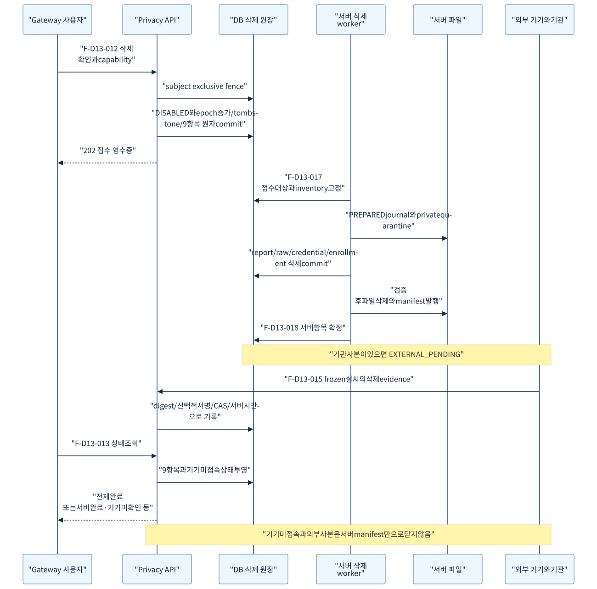

[Mermaid 원본](../diagrams/D13-deletion-sequence.mmd) · [SVG](../rendered/D13-deletion-sequence.svg)

## F-D13-018 기관 외부 사본을 계정 삭제 미완료로 유지

| 항목 | 명세 |
| --- | --- |
| 분야 | D13 Backend 계정·개인정보·원시 수집·학습 데이터 수명주기 |
| 목적 | 내부 저장소를 지워도 기관에 이미 전달된 사본의 삭제를 완료로 표시하지 않는다. |
| 사용 주체 | 삭제 worker 기관의 외부 삭제 담당자 |
| 활성 상태 | CONDITIONAL |
| 진입점 | backend/app/services/privacy_lifecycle.py:2725 complete_server_deletion_inventory_from_manifest / 서버 삭제 worker manifest 완료 처리 |
| 실행 전제 | 검증한 server manifest 와 worker 전용 DB role; frozen external_copy_count. |
| 입력 출처 형식 검증 최신성 | 격리 RAW 수/외부 사본수 각각 0..10000 또는 legacy None. manifest lowercase SHA256 과 terminal_at. |

### 시작 이벤트와 처리 순서

| 이벤트 ID | 발생원 | 이벤트 | 수신부 | 흐름 |
| --- | --- | --- | --- | --- |
| E-D13-018-01 | 서버 삭제 worker manifest 완료 처리 | 내부 저장소를 지워도 기관에 이미 전달된 사본의 삭제를 완료로 표시하지 않는다. | complete_server_deletion_inventory_from_manifest | 서버원본과 신고행은 manifest 증거로 COMPLETED 처리한다. → 격리수가 양수면 COMPLETED,0 이면 NOT_APPLICABLE 과 명시근거,legacy None 이면 과거 별도저장소없음 근거를 사용한다. → 기관사본수가 양수면 server_copies 를 EXTERNAL_PENDING 으로 두며 terminal evidence/time 을 넣지 않는다. → 기관사본수가 0 이면 NOT_APPLICABLE,legacy None 은 과거 fixed basis 로 처리한다. → 다른항목이 모두 끝나도 EXTERNAL_PENDING 이면 overall PARTIAL 을 유지한다. → 사용자에게 기관 사본 대기 상태가 남음. 서버삭제와 외부삭제의 근거를 분리. |

1. 1. 서버원본과 신고행은 manifest 증거로 COMPLETED 처리한다. [backend/app/services/privacy_lifecycle.py:2725 complete_server_deletion_inventory_from_manifest]
2. 2. 격리수가 양수면 COMPLETED,0 이면 NOT_APPLICABLE 과 명시근거,legacy None 이면 과거 별도저장소없음 근거를 사용한다. [backend/app/services/privacy_lifecycle.py:2725 complete_server_deletion_inventory_from_manifest]
3. 3. 기관사본수가 양수면 server_copies 를 EXTERNAL_PENDING 으로 두며 terminal evidence/time 을 넣지 않는다. [backend/app/services/privacy_lifecycle.py:2725 complete_server_deletion_inventory_from_manifest]
4. 4. 기관사본수가 0 이면 NOT_APPLICABLE,legacy None 은 과거 fixed basis 로 처리한다. [backend/app/services/privacy_lifecycle.py:2725 complete_server_deletion_inventory_from_manifest]
5. 5. 다른항목이 모두 끝나도 EXTERNAL_PENDING 이면 overall PARTIAL 을 유지한다. [backend/app/services/privacy_lifecycle.py:2725 complete_server_deletion_inventory_from_manifest]

| 분기 조건 | 실제 처리 결과 | 구현 근거 |
| --- | --- | --- |
| 이미 terminal 상태가 manifest 의 예상상태/digest/basis 와 다름 | 409 manifest_conflict | backend/app/services/privacy_lifecycle.py:2725 complete_server_deletion_inventory_from_manifest |
| external_copy_count >0 | 서버 내부 manifest 만으로 COMPLETED 금지 | backend/app/services/privacy_lifecycle.py:2725 complete_server_deletion_inventory_from_manifest |
| legacy inventory count None | 별도 legacy 근거로 NOT_APPLICABLE; 최신인벤토리로 오인 금지 | backend/app/services/privacy_lifecycle.py:2725 complete_server_deletion_inventory_from_manifest |

### 효과 종료와 복구

사용자에게 기관 사본 대기 상태가 남음. 서버삭제와 외부삭제의 근거를 분리.

| 상황 | 동작 |
| --- | --- |
| 정상 완료 | 사용자에게 기관 사본 대기 상태가 남음. 서버삭제와 외부삭제의 근거를 분리. |
| 실패 | 조건 불일치는 branches 의 오류로 종료. 저장 트랜잭션 실패는 rollback 경로를 따른다. |
| 시간 초과 | 독립 타임아웃 없음. 연결/DB/호출자 제한은 D09 공통 실행 환경에 의존. |
| 중복 입력 | 독립 중복 계약은 branches 에 명시. 그 외 자동 중복 제거 없음. |
| 취소 | 별도 취소 진입점 없음. |
| 중단과 생명주기 | 프로세스 중단 시 commit 되지 않은 DB 트랜잭션은 회수 대상. 파일 복구는 해당 보존/저널 기능 참조. |
| 재시도 | 자동 반복 루프 없음. 호출자가 오류와 현재 상태를 확인 후 재호출. |
| 복구 | 동일 요청의 재생 또는 전용 복구 기능이 있는 경우 steps/branches 에 명시. |
| 자원 정리 | 서비스가 연 Session 수명은 get_db 또는 CLI context 종료가 관리. |

### 상태 실행 맥락과 연결

| 항목 | 명세 |
| --- | --- |
| 초기 상태 | S-D13-018-INVENTORIED |
| 상태 목록 | S-D13-018-INVENTORIED S-D13-018-EXTERNAL_PENDING_OR_NOT_APPLICABLE |
| 전이 조건과 전이 동작 | INVENTORIED → EXTERNAL_PENDING_OR_NOT_APPLICABLE: 해당 steps 의 조건 충족 시 |
| 허용되지 않는 전이 | branches 의 거부 조건에서는 다음 단계로 진행하지 않음. DB 영속 상태와 설명용 단계 상태를 동일시하지 않음. |
| 동시성 순서와 작업 소유권 | account_deletion_worker.py의 _finish_committed_journal에서 호출하는 동기 CLI 경로. 삭제 manifest 생성 이후 별도 DB Session으로 상태를 반영하며 FastAPI handler 호출로 확인하지 않음. |
| 공유 상태와 다른 기능 연결 | D09 공통 인증·DB 세션과 연결. 관련 모델과 서비스 연결은 code_refs 및 steps 에 명시. |

### 정책 근거와 검증 범위

| 항목 | 근거 |
| --- | --- |
| 정책 | [P-D13-018](#P-D13-018) |
| 구현 | [backend/app/services/privacy_lifecycle.py:2725](/home/ddobagi/Hanium_Dreamup/backend/app/services/privacy_lifecycle.py:2725) · `complete_server_deletion_inventory_from_manifest` (범위 2725–2885) [scripts/account_deletion_worker.py:1446](/home/ddobagi/Hanium_Dreamup/scripts/account_deletion_worker.py:1446) · `_external_copy_count` (범위 1446–1468) [backend/app/services/privacy_lifecycle.py:2692](/home/ddobagi/Hanium_Dreamup/backend/app/services/privacy_lifecycle.py:2692) · `_server_manifest_transitions` (범위 2692–2722) |
| 기존 개선 ID | 개별 동일성 미확인; 분야 연관은 별도 추적표 |
| 기존 분야 | 해당 없음 |
| 기존 실행 증거 | 과거 실행 결과를 이 기능의 현행 통과 근거로 대조하지 않음. 이번 작업은 고정 소스의 정적 판독이며 제품 테스트·DB·SMTP·기기·운영 실행 없음. |
| 한계 및 구분 | 정적 검색상 account server_copies 를 기관확인 뒤 terminal 로 만드는 별도 service/API 연결은 확인되지 않음. 일반 transition 도 서버 4 항목 terminal 을 막는다. 이 미연결은 issues 에 기록. |

| 테스트 위치 | 심볼 | 증거 수준 | 기대와 한계 |
| --- | --- | --- | --- |

연결한 테스트 미확인: 이번 작성 범위에서 이 기능에 대응하는 시험 단언을 연결하지 않았다. 테스트 자체가 없다는 판정이 아니다.

### 이벤트 처리 그림


[Mermaid 원본](../diagrams/D13-F018.mmd) · [SVG](../rendered/D13-F018.svg)

[Mermaid 원본](../diagrams/D13-deletion-sequence.mmd) · [SVG](../rendered/D13-deletion-sequence.svg)

## F-D13-019 만료된 계정 삭제 완료영수증 정리

| 항목 | 명세 |
| --- | --- |
| 분야 | D13 Backend 계정·개인정보·원시 수집·학습 데이터 수명주기 |
| 목적 | 3 년 보존이 끝난 completion receipt 만 제한된 DB 함수로 삭제한다. |
| 사용 주체 | 전용 purger |
| 활성 상태 | CONDITIONAL |
| 진입점 | backend/app/services/account_deletion_receipt_purge.py:81 purge_expired_account_deletion_receipts / CLI purge_account_deletion_receipts.py |
| 실행 전제 | dedicated walksafe_receipt_purger direct login; superuser/runtime/worker/purge-owner membership 거부. |
| 입력 출처 형식 검증 최신성 | batch_limit 기본 1000 최대 10000, max_batches 기본 100 최대 1000. |

### 시작 이벤트와 처리 순서

| 이벤트 ID | 발생원 | 이벤트 | 수신부 | 흐름 |
| --- | --- | --- | --- | --- |
| E-D13-019-01 | CLI purge_account_deletion_receipts.py | 3 년 보존이 끝난 completion receipt 만 제한된 DB 함수로 삭제한다. | purge_expired_account_deletion_receipts | 정수 batch/max bounds 와 전용 역할을 검증한다. → SECURITY DEFINER walksafe_purge_expired_account_deletion_receipts(limit)를 호출한다. → 각 batch 를 commit 하여 누적 deleted 를 합산한다. → count < limit 이면 exhausted=true 로 종료, max batch 까지 꽉 찼으면 exhausted=false 로 남은 가능성을 알린다. → completion receipt 만 삭제하고 tombstone/request/item/event/consent 원장을 유지한다. |

1. 1. 정수 batch/max bounds 와 전용 역할을 검증한다. [backend/app/services/account_deletion_receipt_purge.py:81 purge_expired_account_deletion_receipts]
2. 2. SECURITY DEFINER walksafe_purge_expired_account_deletion_receipts(limit)를 호출한다. [backend/app/services/account_deletion_receipt_purge.py:81 purge_expired_account_deletion_receipts]
3. 3. 각 batch 를 commit 하여 누적 deleted 를 합산한다. [backend/app/services/account_deletion_receipt_purge.py:81 purge_expired_account_deletion_receipts]
4. 4. count < limit 이면 exhausted=true 로 종료, max batch 까지 꽉 찼으면 exhausted=false 로 남은 가능성을 알린다. [backend/app/services/account_deletion_receipt_purge.py:81 purge_expired_account_deletion_receipts]

| 분기 조건 | 실제 처리 결과 | 구현 근거 |
| --- | --- | --- |
| 역할/정수범위 부적합 | 실행전 ReceiptPurgeError | backend/app/services/account_deletion_receipt_purge.py:81 purge_expired_account_deletion_receipts |
| 삭제영수증 만료이전 | DB 함수의 만료조건에 의해 삭제하지 않음 | backend/app/services/account_deletion_receipt_purge.py:81 purge_expired_account_deletion_receipts |
| max_batches 소진 | exhausted=false; 후속 실행 필요 가능 | backend/app/services/account_deletion_receipt_purge.py:81 purge_expired_account_deletion_receipts |

### 효과 종료와 복구

completion receipt 만 삭제하고 tombstone/request/item/event/consent 원장을 유지한다.

| 상황 | 동작 |
| --- | --- |
| 정상 완료 | completion receipt 만 삭제하고 tombstone/request/item/event/consent 원장을 유지한다. |
| 실패 | 조건 불일치는 branches 의 오류로 종료. 저장 트랜잭션 실패는 rollback 경로를 따른다. |
| 시간 초과 | 독립 타임아웃 없음. 연결/DB/호출자 제한은 D09 공통 실행 환경에 의존. |
| 중복 입력 | 독립 중복 계약은 branches 에 명시. 그 외 자동 중복 제거 없음. |
| 취소 | 별도 취소 진입점 없음. |
| 중단과 생명주기 | 이미 commit 한 batch 는 유지. 다음실행은 남은 만료행을 이어 정리. |
| 재시도 | 자동 반복 루프 없음. 호출자가 오류와 현재 상태를 확인 후 재호출. |
| 복구 | 동일 요청의 재생 또는 전용 복구 기능이 있는 경우 steps/branches 에 명시. |
| 자원 정리 | tombstone 및 다른삭제원장 보존. |

### 상태 실행 맥락과 연결

| 항목 | 명세 |
| --- | --- |
| 초기 상태 | S-D13-019-ELIGIBLE |
| 상태 목록 | S-D13-019-ELIGIBLE S-D13-019-BATCHES_COMMITTED S-D13-019-EXHAUSTED_OR_BOUNDED |
| 전이 조건과 전이 동작 | ELIGIBLE → BATCHES_COMMITTED: 해당 steps 의 조건 충족 시 BATCHES_COMMITTED → EXHAUSTED_OR_BOUNDED: 해당 steps 의 조건 충족 시 |
| 허용되지 않는 전이 | branches 의 거부 조건에서는 다음 단계로 진행하지 않음. DB 영속 상태와 설명용 단계 상태를 동일시하지 않음. |
| 동시성 순서와 작업 소유권 | one-shot CLI 와 batch 별 commit. 자동 주기 실행은 확인하지 않음. |
| 공유 상태와 다른 기능 연결 | D09 공통 인증·DB 세션과 연결. 관련 모델과 서비스 연결은 code_refs 및 steps 에 명시. |

### 정책 근거와 검증 범위

| 항목 | 근거 |
| --- | --- |
| 정책 | [P-D13-019](#P-D13-019) |
| 구현 | [backend/app/services/account_deletion_receipt_purge.py:81](/home/ddobagi/Hanium_Dreamup/backend/app/services/account_deletion_receipt_purge.py:81) · `purge_expired_account_deletion_receipts` (범위 81–104) |
| 기존 개선 ID | 개별 동일성 미확인; 분야 연관은 별도 추적표 |
| 기존 분야 | 해당 없음 |
| 기존 실행 증거 | 과거 실행 결과를 이 기능의 현행 통과 근거로 대조하지 않음. 이번 작업은 고정 소스의 정적 판독이며 제품 테스트·DB·SMTP·기기·운영 실행 없음. |
| 한계 및 구분 | 상태 접두 ID 는 이 명세의 탐색용이며 원문 enum/DB 상태는 inputs·steps 에 원문으로 구분한다. |

| 테스트 위치 | 심볼 | 증거 수준 | 기대와 한계 |
| --- | --- | --- | --- |

연결한 테스트 미확인: 이번 작성 범위에서 이 기능에 대응하는 시험 단언을 연결하지 않았다. 테스트 자체가 없다는 판정이 아니다.

### 이벤트 처리 그림


[Mermaid 원본](../diagrams/D13-F019.mmd) · [SVG](../rendered/D13-F019.svg)

## F-D13-020 삭제 tombstone 서명 원장 내보내기

| 항목 | 명세 |
| --- | --- |
| 분야 | D13 Backend 계정·개인정보·원시 수집·학습 데이터 수명주기 |
| 목적 | 백업 복원 뒤 삭제차단을 복구할 수 있는 서명 원장을 만든다. |
| 사용 주체 | 복원 운영자 |
| 활성 상태 | CONDITIONAL |
| 진입점 | backend/app/services/account_tombstone_ledger.py:165 export_account_tombstone_ledger / CLI reapply_account_deletion_tombstones.py export |
| 실행 전제 | 신뢰되는 Ed25519 서명키와 DB read 권한. |
| 입력 출처 형식 검증 최신성 | tombstone 정렬집합,privacy key fingerprint map,export timestamp; 원장 최대 entry1000000. |

### 시작 이벤트와 처리 순서

| 이벤트 ID | 발생원 | 이벤트 | 수신부 | 흐름 |
| --- | --- | --- | --- | --- |
| E-D13-020-01 | CLI reapply_account_deletion_tombstones.py export | 백업 복원 뒤 삭제차단을 복구할 수 있는 서명 원장을 만든다. | export_account_tombstone_ledger | 시간/tombstone 순으로 row 를 읽고 HMAC key 지문을 수집한 뒤 DBrollback 한다. → 각 entry 에 sequence 와 previous_entry_sha256 및 domain-separated SHA256 을 결속한다. → canonical JSON 에 entry_count/head_sha256/key fingerprint 를 포함한다. → Ed25519 로 domain+원장 bytes 를 서명하고 별도 descriptor 에 key_id/원장 SHA256/signature 를 생성한다. → 원장 bytes 와 signature descriptor bytes 반환. 실제 외부 backup 저장이나 자동 동기화를 수행하지 않는다. |

1. 1. 시간/tombstone 순으로 row 를 읽고 HMAC key 지문을 수집한 뒤 DBrollback 한다. [backend/app/services/account_tombstone_ledger.py:165 export_account_tombstone_ledger]
2. 2. 각 entry 에 sequence 와 previous_entry_sha256 및 domain-separated SHA256 을 결속한다. [backend/app/services/account_tombstone_ledger.py:165 export_account_tombstone_ledger]
3. 3. canonical JSON 에 entry_count/head_sha256/key fingerprint 를 포함한다. [backend/app/services/account_tombstone_ledger.py:165 export_account_tombstone_ledger]
4. 4. Ed25519 로 domain+원장 bytes 를 서명하고 별도 descriptor 에 key_id/원장 SHA256/signature 를 생성한다. [backend/app/services/account_tombstone_ledger.py:165 export_account_tombstone_ledger]

| 분기 조건 | 실제 처리 결과 | 구현 근거 |
| --- | --- | --- |
| entry count >1000000 | 원장생성 거부 | backend/app/services/account_tombstone_ledger.py:165 export_account_tombstone_ledger |
| private key 형식 부적합 | 예외로 종료 | backend/app/services/account_tombstone_ledger.py:165 export_account_tombstone_ledger |

### 효과 종료와 복구

원장 bytes 와 signature descriptor bytes 반환. 실제 외부 backup 저장이나 자동 동기화를 수행하지 않는다.

| 상황 | 동작 |
| --- | --- |
| 정상 완료 | 원장 bytes 와 signature descriptor bytes 반환. 실제 외부 backup 저장이나 자동 동기화를 수행하지 않는다. |
| 실패 | 조건 불일치는 branches 의 오류로 종료. 저장 트랜잭션 실패는 rollback 경로를 따른다. |
| 시간 초과 | 독립 타임아웃 없음. 연결/DB/호출자 제한은 D09 공통 실행 환경에 의존. |
| 중복 입력 | 독립 중복 계약은 branches 에 명시. 그 외 자동 중복 제거 없음. |
| 취소 | 별도 취소 진입점 없음. |
| 중단과 생명주기 | 프로세스 중단 시 commit 되지 않은 DB 트랜잭션은 회수 대상. 파일 복구는 해당 보존/저널 기능 참조. |
| 재시도 | 자동 반복 루프 없음. 호출자가 오류와 현재 상태를 확인 후 재호출. |
| 복구 | 동일 요청의 재생 또는 전용 복구 기능이 있는 경우 steps/branches 에 명시. |
| 자원 정리 | 원장과 서명은 복원자료이며 이 함수가 삭제하지 않음. |

### 상태 실행 맥락과 연결

| 항목 | 명세 |
| --- | --- |
| 초기 상태 | S-D13-020-READ |
| 상태 목록 | S-D13-020-READ S-D13-020-HASH_CHAIN S-D13-020-SIGNED |
| 전이 조건과 전이 동작 | READ → HASH_CHAIN: 해당 steps 의 조건 충족 시 HASH_CHAIN → SIGNED: 해당 steps 의 조건 충족 시 |
| 허용되지 않는 전이 | branches 의 거부 조건에서는 다음 단계로 진행하지 않음. DB 영속 상태와 설명용 단계 상태를 동일시하지 않음. |
| 동시성 순서와 작업 소유권 | 동기 읽기전용 export. DB 의 범위를 읽은 뒤 rollback; 파일 출력은 CLI 책임. |
| 공유 상태와 다른 기능 연결 | D09 공통 인증·DB 세션과 연결. 관련 모델과 서비스 연결은 code_refs 및 steps 에 명시. |

### 정책 근거와 검증 범위

| 항목 | 근거 |
| --- | --- |
| 정책 | [P-D13-020](#P-D13-020) |
| 구현 | [backend/app/services/account_tombstone_ledger.py:165](/home/ddobagi/Hanium_Dreamup/backend/app/services/account_tombstone_ledger.py:165) · `export_account_tombstone_ledger` (범위 165–235) |
| 기존 개선 ID | 개별 동일성 미확인; 분야 연관은 별도 추적표 |
| 기존 분야 | 해당 없음 |
| 기존 실행 증거 | 과거 실행 결과를 이 기능의 현행 통과 근거로 대조하지 않음. 이번 작업은 고정 소스의 정적 판독이며 제품 테스트·DB·SMTP·기기·운영 실행 없음. |
| 한계 및 구분 | 상태 접두 ID 는 이 명세의 탐색용이며 원문 enum/DB 상태는 inputs·steps 에 원문으로 구분한다. |

| 테스트 위치 | 심볼 | 증거 수준 | 기대와 한계 |
| --- | --- | --- | --- |

연결한 테스트 미확인: 이번 작성 범위에서 이 기능에 대응하는 시험 단언을 연결하지 않았다. 테스트 자체가 없다는 판정이 아니다.

### 이벤트 처리 그림


[Mermaid 원본](../diagrams/D13-F020.mmd) · [SVG](../rendered/D13-F020.svg)

## F-D13-021 백업 복원 후 tombstone 검증·재적용

| 항목 | 명세 |
| --- | --- |
| 분야 | D13 Backend 계정·개인정보·원시 수집·학습 데이터 수명주기 |
| 목적 | 신뢰서명과 키복구 상태를 확인한 뒤 누락 tombstone 만 추가한다. |
| 사용 주체 | 복원 운영자 |
| 활성 상태 | CONDITIONAL |
| 진입점 | backend/app/services/account_tombstone_ledger.py:466 apply_account_tombstone_reapply / CLI reapply_account_deletion_tombstones.py plan/apply |
| 실행 전제 | 독립 신뢰 Ed25519 public key32byte; 서명·canonical JSON·hash chain 검증을 통과한 ledger; DB owner connection. |
| 입력 출처 형식 검증 최신성 | 원장 전체 SHA256,sequence/previous hash,unique subject-generation,known HMAC key fingerprints; exact confirmation REAPPLY-RESTORED-ACCOUNT-TOMBSTONES. |

### 시작 이벤트와 처리 순서

| 이벤트 ID | 발생원 | 이벤트 | 수신부 | 흐름 |
| --- | --- | --- | --- | --- |
| E-D13-021-01 | CLI reapply_account_deletion_tombstones.py plan/apply | 신뢰서명과 키복구 상태를 확인한 뒤 누락 tombstone 만 추가한다. | apply_account_tombstone_reapply | 서명 key_id,원장 SHA256,Ed25519 signature 와 strict canonical JSON shape 를 확인한다. → entry sequence/이전 hash/UUID 정규형/양수 generation/중복 subject/keyversion/head hash 를 검증한다. → DB 복원 key fingerprint 가 원장과 같은지 확인하고 existing tombstone 의 identity/receipt/time/keyversion 을 대조해 plan 을 만든다. → apply 는 모든 subject 를 정렬 exclusive lock 으로 잡고 plan 을 다시 만들며 누락만 insert 한다. → 전체 flush 성공 시한 번 commit, BaseException 이면 rollback 한다. → 삭제차단을 재적용하며 삭제된 원본파일을 복구하는 기능은 아니다. |

1. 1. 서명 key_id,원장 SHA256,Ed25519 signature 와 strict canonical JSON shape 를 확인한다. [backend/app/services/account_tombstone_ledger.py:466 apply_account_tombstone_reapply]
2. 2. entry sequence/이전 hash/UUID 정규형/양수 generation/중복 subject/keyversion/head hash 를 검증한다. [backend/app/services/account_tombstone_ledger.py:466 apply_account_tombstone_reapply]
3. 3. DB 복원 key fingerprint 가 원장과 같은지 확인하고 existing tombstone 의 identity/receipt/time/keyversion 을 대조해 plan 을 만든다. [backend/app/services/account_tombstone_ledger.py:466 apply_account_tombstone_reapply]
4. 4. apply 는 모든 subject 를 정렬 exclusive lock 으로 잡고 plan 을 다시 만들며 누락만 insert 한다. [backend/app/services/account_tombstone_ledger.py:466 apply_account_tombstone_reapply]
5. 5. 전체 flush 성공 시한 번 commit, BaseException 이면 rollback 한다. [backend/app/services/account_tombstone_ledger.py:466 apply_account_tombstone_reapply]

| 분기 조건 | 실제 처리 결과 | 구현 근거 |
| --- | --- | --- |
| key fingerprint 가 복구되지 않음 | key_recovery_required; 새데이터 수집재개 근거 아님 | backend/app/services/account_tombstone_ledger.py:466 apply_account_tombstone_reapply |
| 기존 tombstone 와원장상충 | reapply_conflict; 덮어쓰기 금지 | backend/app/services/account_tombstone_ledger.py:466 apply_account_tombstone_reapply |
| 동일원장재적용 | present 로계수; missing 만추가 | backend/app/services/account_tombstone_ledger.py:466 apply_account_tombstone_reapply |

### 효과 종료와 복구

삭제차단을 재적용하며 삭제된 원본파일을 복구하는 기능은 아니다.

| 상황 | 동작 |
| --- | --- |
| 정상 완료 | 삭제차단을 재적용하며 삭제된 원본파일을 복구하는 기능은 아니다. |
| 실패 | 조건 불일치는 branches 의 오류로 종료. 저장 트랜잭션 실패는 rollback 경로를 따른다. |
| 시간 초과 | 독립 타임아웃 없음. 연결/DB/호출자 제한은 D09 공통 실행 환경에 의존. |
| 중복 입력 | 이미있는 정확히 동일 tombstone 은 present 처리. 다른내용이면실패. |
| 취소 | apply 이전 plan 은읽기전용. apply 후 tombstone 를삭제하는취소기능없음. |
| 중단과 생명주기 | 프로세스 중단 시 commit 되지 않은 DB 트랜잭션은 회수 대상. 파일 복구는 해당 보존/저널 기능 참조. |
| 재시도 | 자동 반복 루프 없음. 호출자가 오류와 현재 상태를 확인 후 재호출. |
| 복구 | 동일 요청의 재생 또는 전용 복구 기능이 있는 경우 steps/branches 에 명시. |
| 자원 정리 | 서비스가 연 Session 수명은 get_db 또는 CLI context 종료가 관리. |

### 상태 실행 맥락과 연결

| 항목 | 명세 |
| --- | --- |
| 초기 상태 | S-D13-021-VERIFIED |
| 상태 목록 | S-D13-021-VERIFIED S-D13-021-PLANNED S-D13-021-REAPPLIED |
| 전이 조건과 전이 동작 | VERIFIED → PLANNED: 해당 steps 의 조건 충족 시 PLANNED → REAPPLIED: 해당 steps 의 조건 충족 시 |
| 허용되지 않는 전이 | branches 의 거부 조건에서는 다음 단계로 진행하지 않음. DB 영속 상태와 설명용 단계 상태를 동일시하지 않음. |
| 동시성 순서와 작업 소유권 | 동기 owner transaction; 모든 후보 subject sorted exclusive fence. 네트워크 자동복원 없음. |
| 공유 상태와 다른 기능 연결 | D09 공통 인증·DB 세션과 연결. 관련 모델과 서비스 연결은 code_refs 및 steps 에 명시. |

### 정책 근거와 검증 범위

| 항목 | 근거 |
| --- | --- |
| 정책 | [P-D13-021](#P-D13-021) |
| 구현 | [backend/app/services/account_tombstone_ledger.py:466](/home/ddobagi/Hanium_Dreamup/backend/app/services/account_tombstone_ledger.py:466) · `apply_account_tombstone_reapply` (범위 466–506) [backend/app/services/account_tombstone_ledger.py:264](/home/ddobagi/Hanium_Dreamup/backend/app/services/account_tombstone_ledger.py:264) · `verify_account_tombstone_ledger` (범위 264–400) [backend/app/services/account_tombstone_ledger.py:413](/home/ddobagi/Hanium_Dreamup/backend/app/services/account_tombstone_ledger.py:413) · `plan_account_tombstone_reapply` (범위 413–422) |
| 기존 개선 ID | 개별 동일성 미확인; 분야 연관은 별도 추적표 |
| 기존 분야 | 해당 없음 |
| 기존 실행 증거 | 과거 실행 결과를 이 기능의 현행 통과 근거로 대조하지 않음. 이번 작업은 고정 소스의 정적 판독이며 제품 테스트·DB·SMTP·기기·운영 실행 없음. |
| 한계 및 구분 | 상태 접두 ID 는 이 명세의 탐색용이며 원문 enum/DB 상태는 inputs·steps 에 원문으로 구분한다. |

| 테스트 위치 | 심볼 | 증거 수준 | 기대와 한계 |
| --- | --- | --- | --- |

연결한 테스트 미확인: 이번 작성 범위에서 이 기능에 대응하는 시험 단언을 연결하지 않았다. 테스트 자체가 없다는 판정이 아니다.

### 이벤트 처리 그림


[Mermaid 원본](../diagrams/D13-F021.mmd) · [SVG](../rendered/D13-F021.svg)

## F-D13-022 원시 manifest 전송 사전 검사

| 항목 | 명세 |
| --- | --- |
| 분야 | D13 Backend 계정·개인정보·원시 수집·학습 데이터 수명주기 |
| 목적 | 본문 전송 없이 현재 원시 수집의 인증·동의·저장 경계를 검사한다. |
| 사용 주체 | Gateway 경유 사용자 Backend 서비스 |
| 활성 상태 | CONDITIONAL |
| 진입점 | backend/app/api/raw_collections.py:350 head_manifest / HEAD /raw-collections/{collection_id}/manifest |
| 실행 전제 | raw_ingest_enabled=true; D09 middleware 의 FIELD actor assertion 과 request-bound RAW proof 가 모두 request.state 에 존재. |
| 입력 출처 형식 검증 최신성 | actor/generation1..signed64max,collection/walk UUID, purpose GENERAL_RAW/AUTO_REPORT, manifest/consent digest64 lower hex. chunk index 는 0..2047. |

### 시작 이벤트와 처리 순서

| 이벤트 ID | 발생원 | 이벤트 | 수신부 | 흐름 |
| --- | --- | --- | --- | --- |
| E-D13-022-01 | HEAD /raw-collections/{collection_id}/manifest | 본문 전송 없이 현재 원시 수집의 인증·동의·저장 경계를 검사한다. | head_manifest | raw feature 가 활성인지 먼저 확인한다. → PUT_MANIFEST operation,actor,generation,method,path,purpose,walk 및 해당 digest 가 middleware verified proof 와 정확히 같은지 검사한다. → anyio.to_thread 로 maintenance shared lock 안에서 tombstone fence 와 consent chain admission 을 실행한다. → storage handler 존재를 확인하고 transaction 을 rollback 한다. 파일·manifest 를 쓰지 않고 204 를 반환한다. → 204 는 그 시점의 admission 성공. 이후 실제 PUT/POST 가 같은 gate 를 다시 검사하며 예약권은 아니다. |

1. 1. raw feature 가 활성인지 먼저 확인한다. [backend/app/api/raw_collections.py:350 head_manifest]
2. 2. PUT_MANIFEST operation,actor,generation,method,path,purpose,walk 및 해당 digest 가 middleware verified proof 와 정확히 같은지 검사한다. [backend/app/api/raw_collections.py:350 head_manifest]
3. 3. anyio.to_thread 로 maintenance shared lock 안에서 tombstone fence 와 consent chain admission 을 실행한다. [backend/app/api/raw_collections.py:350 head_manifest]
4. 4. storage handler 존재를 확인하고 transaction 을 rollback 한다. 파일·manifest 를 쓰지 않고 204 를 반환한다. [backend/app/api/raw_collections.py:350 head_manifest]

| 분기 조건 | 실제 처리 결과 | 구현 근거 |
| --- | --- | --- |
| feature 기본 off | 503 raw_ingest_disabled | backend/app/api/raw_collections.py:350 head_manifest |
| actor/proof 부재 또는 어느 차원이든 불일치 | 401 raw_gateway_assertion_required 또는 raw_request_proof_required | backend/app/api/raw_collections.py:350 head_manifest |
| 원본동의 철회 또는 AUTO_REPORT 자동신고동의 철회 이력 | 409; 재동의만으로 이전 receipt chain 복구하지 않음 | backend/app/api/raw_collections.py:350 head_manifest |
| storage handler 없음 | 503 unavailable | backend/app/api/raw_collections.py:350 head_manifest |

### 효과 종료와 복구

204 는 그 시점의 admission 성공. 이후 실제 PUT/POST 가 같은 gate 를 다시 검사하며 예약권은 아니다.

| 상황 | 동작 |
| --- | --- |
| 정상 완료 | 204 는 그 시점의 admission 성공. 이후 실제 PUT/POST 가 같은 gate 를 다시 검사하며 예약권은 아니다. |
| 실패 | 조건 불일치는 branches 의 오류로 종료. 저장 트랜잭션 실패는 rollback 경로를 따른다. |
| 시간 초과 | 독립 타임아웃 없음. 연결/DB/호출자 제한은 D09 공통 실행 환경에 의존. |
| 중복 입력 | 같은 HEAD 도 재검증한다. 저장 idempotency receipt 를 만들지 않음. |
| 취소 | 별도 취소 진입점 없음. |
| 중단과 생명주기 | 프로세스 중단 시 commit 되지 않은 DB 트랜잭션은 회수 대상. 파일 복구는 해당 보존/저널 기능 참조. |
| 재시도 | 자동 반복 루프 없음. 호출자가 오류와 현재 상태를 확인 후 재호출. |
| 복구 | 동일 요청의 재생 또는 전용 복구 기능이 있는 경우 steps/branches 에 명시. |
| 자원 정리 | preflight 가 DB rollback 을 수행하여 읽기검사 중 잡은 transaction fence 를 해제. |

### 상태 실행 맥락과 연결

| 항목 | 명세 |
| --- | --- |
| 초기 상태 | S-D13-022-PROOF_PENDING |
| 상태 목록 | S-D13-022-PROOF_PENDING S-D13-022-ADMITTED S-D13-022-ROLLED_BACK |
| 전이 조건과 전이 동작 | PROOF_PENDING → ADMITTED: 해당 steps 의 조건 충족 시 ADMITTED → ROLLED_BACK: 해당 steps 의 조건 충족 시 |
| 허용되지 않는 전이 | branches 의 거부 조건에서는 다음 단계로 진행하지 않음. DB 영속 상태와 설명용 단계 상태를 동일시하지 않음. |
| 동시성 순서와 작업 소유권 | FastAPI async route가 요청을 검증하고 await anyio.to_thread.run_sync로 동기 DB/파일 처리를 기다린다. DB Session과 maintenance/storage 잠금은 위임된 동기 처리 경로에서 사용하며 반환 후 응답한다. |
| 공유 상태와 다른 기능 연결 | D09 공통 인증·DB 세션과 연결. 관련 모델과 서비스 연결은 code_refs 및 steps 에 명시. |

### 정책 근거와 검증 범위

| 항목 | 근거 |
| --- | --- |
| 정책 | [P-D13-022](#P-D13-022) |
| 구현 | [backend/app/api/raw_collections.py:350](/home/ddobagi/Hanium_Dreamup/backend/app/api/raw_collections.py:350) · `create_router.head_manifest` (범위 350–390) [backend/app/api/raw_collections.py:299](/home/ddobagi/Hanium_Dreamup/backend/app/api/raw_collections.py:299) · `create_router.run_head_preflight` (범위 299–343) [backend/app/services/raw_collection_ingest.py:180](/home/ddobagi/Hanium_Dreamup/backend/app/services/raw_collection_ingest.py:180) · `authorize_raw_collection_write` (범위 180–251) |
| 기존 개선 ID | 개별 동일성 미확인; 분야 연관은 별도 추적표 |
| 기존 분야 | 해당 없음 |
| 기존 실행 증거 | 과거 실행 결과를 이 기능의 현행 통과 근거로 대조하지 않음. 이번 작업은 고정 소스의 정적 판독이며 제품 테스트·DB·SMTP·기기·운영 실행 없음. |
| 한계 및 구분 | 상태 접두 ID 는 이 명세의 탐색용이며 원문 enum/DB 상태는 inputs·steps 에 원문으로 구분한다. |

| 테스트 위치 | 심볼 | 증거 수준 | 기대와 한계 |
| --- | --- | --- | --- |

연결한 테스트 미확인: 이번 작성 범위에서 이 기능에 대응하는 시험 단언을 연결하지 않았다. 테스트 자체가 없다는 판정이 아니다.

### 이벤트 처리 그림

[Mermaid 원본](../diagrams/D13-F022.mmd) · [SVG](../rendered/D13-F022.svg)

## F-D13-023 원시 chunk 전송 사전 검사

| 항목 | 명세 |
| --- | --- |
| 분야 | D13 Backend 계정·개인정보·원시 수집·학습 데이터 수명주기 |
| 목적 | 본문 전송 없이 현재 원시 수집의 인증·동의·저장 경계를 검사한다. |
| 사용 주체 | Gateway 경유 사용자 Backend 서비스 |
| 활성 상태 | CONDITIONAL |
| 진입점 | backend/app/api/raw_collections.py:397 head_chunk / HEAD /raw-collections/{collection_id}/objects/{object_id}/chunks/{index} |
| 실행 전제 | raw_ingest_enabled=true; D09 middleware 의 FIELD actor assertion 과 request-bound RAW proof 가 모두 request.state 에 존재. |
| 입력 출처 형식 검증 최신성 | actor/generation1..signed64max,collection/walk UUID, purpose GENERAL_RAW/AUTO_REPORT, manifest/consent/chunk digest64 lower hex. chunk index 는 0..2047. |

### 시작 이벤트와 처리 순서

| 이벤트 ID | 발생원 | 이벤트 | 수신부 | 흐름 |
| --- | --- | --- | --- | --- |
| E-D13-023-01 | HEAD /raw-collections/{collection_id}/objects/{object_id}/chunks/{index} | 본문 전송 없이 현재 원시 수집의 인증·동의·저장 경계를 검사한다. | head_chunk | raw feature 가 활성인지 먼저 확인한다. → PUT_CHUNK operation,actor,generation,method,path,purpose,walk 및 해당 digest 가 middleware verified proof 와 정확히 같은지 검사한다. → anyio.to_thread 로 maintenance shared lock 안에서 tombstone fence 와 consent chain admission 을 실행한다. → storage handler 존재를 확인하고 transaction 을 rollback 한다. 파일·manifest 를 쓰지 않고 204 를 반환한다. → 204 는 그 시점의 admission 성공. 이후 실제 PUT/POST 가 같은 gate 를 다시 검사하며 예약권은 아니다. |

1. 1. raw feature 가 활성인지 먼저 확인한다. [backend/app/api/raw_collections.py:397 head_chunk]
2. 2. PUT_CHUNK operation,actor,generation,method,path,purpose,walk 및 해당 digest 가 middleware verified proof 와 정확히 같은지 검사한다. [backend/app/api/raw_collections.py:397 head_chunk]
3. 3. anyio.to_thread 로 maintenance shared lock 안에서 tombstone fence 와 consent chain admission 을 실행한다. [backend/app/api/raw_collections.py:397 head_chunk]
4. 4. storage handler 존재를 확인하고 transaction 을 rollback 한다. 파일·manifest 를 쓰지 않고 204 를 반환한다. [backend/app/api/raw_collections.py:397 head_chunk]

| 분기 조건 | 실제 처리 결과 | 구현 근거 |
| --- | --- | --- |
| feature 기본 off | 503 raw_ingest_disabled | backend/app/api/raw_collections.py:397 head_chunk |
| actor/proof 부재 또는 어느 차원이든 불일치 | 401 raw_gateway_assertion_required 또는 raw_request_proof_required | backend/app/api/raw_collections.py:397 head_chunk |
| 원본동의 철회 또는 AUTO_REPORT 자동신고동의 철회 이력 | 409; 재동의만으로 이전 receipt chain 복구하지 않음 | backend/app/api/raw_collections.py:397 head_chunk |
| storage handler 없음 | 503 unavailable | backend/app/api/raw_collections.py:397 head_chunk |

### 효과 종료와 복구

204 는 그 시점의 admission 성공. 이후 실제 PUT/POST 가 같은 gate 를 다시 검사하며 예약권은 아니다.

| 상황 | 동작 |
| --- | --- |
| 정상 완료 | 204 는 그 시점의 admission 성공. 이후 실제 PUT/POST 가 같은 gate 를 다시 검사하며 예약권은 아니다. |
| 실패 | 조건 불일치는 branches 의 오류로 종료. 저장 트랜잭션 실패는 rollback 경로를 따른다. |
| 시간 초과 | 독립 타임아웃 없음. 연결/DB/호출자 제한은 D09 공통 실행 환경에 의존. |
| 중복 입력 | 같은 HEAD 도 재검증한다. 저장 idempotency receipt 를 만들지 않음. |
| 취소 | 별도 취소 진입점 없음. |
| 중단과 생명주기 | 프로세스 중단 시 commit 되지 않은 DB 트랜잭션은 회수 대상. 파일 복구는 해당 보존/저널 기능 참조. |
| 재시도 | 자동 반복 루프 없음. 호출자가 오류와 현재 상태를 확인 후 재호출. |
| 복구 | 동일 요청의 재생 또는 전용 복구 기능이 있는 경우 steps/branches 에 명시. |
| 자원 정리 | preflight 가 DB rollback 을 수행하여 읽기검사 중 잡은 transaction fence 를 해제. |

### 상태 실행 맥락과 연결

| 항목 | 명세 |
| --- | --- |
| 초기 상태 | S-D13-023-PROOF_PENDING |
| 상태 목록 | S-D13-023-PROOF_PENDING S-D13-023-ADMITTED S-D13-023-ROLLED_BACK |
| 전이 조건과 전이 동작 | PROOF_PENDING → ADMITTED: 해당 steps 의 조건 충족 시 ADMITTED → ROLLED_BACK: 해당 steps 의 조건 충족 시 |
| 허용되지 않는 전이 | branches 의 거부 조건에서는 다음 단계로 진행하지 않음. DB 영속 상태와 설명용 단계 상태를 동일시하지 않음. |
| 동시성 순서와 작업 소유권 | FastAPI async route가 요청을 검증하고 await anyio.to_thread.run_sync로 동기 DB/파일 처리를 기다린다. DB Session과 maintenance/storage 잠금은 위임된 동기 처리 경로에서 사용하며 반환 후 응답한다. |
| 공유 상태와 다른 기능 연결 | D09 공통 인증·DB 세션과 연결. 관련 모델과 서비스 연결은 code_refs 및 steps 에 명시. |

### 정책 근거와 검증 범위

| 항목 | 근거 |
| --- | --- |
| 정책 | [P-D13-023](#P-D13-023) |
| 구현 | [backend/app/api/raw_collections.py:397](/home/ddobagi/Hanium_Dreamup/backend/app/api/raw_collections.py:397) · `create_router.head_chunk` (범위 397–445) [backend/app/api/raw_collections.py:299](/home/ddobagi/Hanium_Dreamup/backend/app/api/raw_collections.py:299) · `create_router.run_head_preflight` (범위 299–343) [backend/app/services/raw_collection_ingest.py:180](/home/ddobagi/Hanium_Dreamup/backend/app/services/raw_collection_ingest.py:180) · `authorize_raw_collection_write` (범위 180–251) |
| 기존 개선 ID | 개별 동일성 미확인; 분야 연관은 별도 추적표 |
| 기존 분야 | 해당 없음 |
| 기존 실행 증거 | 과거 실행 결과를 이 기능의 현행 통과 근거로 대조하지 않음. 이번 작업은 고정 소스의 정적 판독이며 제품 테스트·DB·SMTP·기기·운영 실행 없음. |
| 한계 및 구분 | 상태 접두 ID 는 이 명세의 탐색용이며 원문 enum/DB 상태는 inputs·steps 에 원문으로 구분한다. |

| 테스트 위치 | 심볼 | 증거 수준 | 기대와 한계 |
| --- | --- | --- | --- |

연결한 테스트 미확인: 이번 작성 범위에서 이 기능에 대응하는 시험 단언을 연결하지 않았다. 테스트 자체가 없다는 판정이 아니다.

### 이벤트 처리 그림


[Mermaid 원본](../diagrams/D13-F023.mmd) · [SVG](../rendered/D13-F023.svg)

## F-D13-024 원시 commit 사전 검사

| 항목 | 명세 |
| --- | --- |
| 분야 | D13 Backend 계정·개인정보·원시 수집·학습 데이터 수명주기 |
| 목적 | 본문 전송 없이 현재 원시 수집의 인증·동의·저장 경계를 검사한다. |
| 사용 주체 | Gateway 경유 사용자 Backend 서비스 |
| 활성 상태 | CONDITIONAL |
| 진입점 | backend/app/api/raw_collections.py:452 head_commit / HEAD /raw-collections/{collection_id}/commit |
| 실행 전제 | raw_ingest_enabled=true; D09 middleware 의 FIELD actor assertion 과 request-bound RAW proof 가 모두 request.state 에 존재. |
| 입력 출처 형식 검증 최신성 | actor/generation1..signed64max,collection/walk UUID, purpose GENERAL_RAW/AUTO_REPORT, manifest/consent/commit digest64 lower hex. chunk index 는 0..2047. |

### 시작 이벤트와 처리 순서

| 이벤트 ID | 발생원 | 이벤트 | 수신부 | 흐름 |
| --- | --- | --- | --- | --- |
| E-D13-024-01 | HEAD /raw-collections/{collection_id}/commit | 본문 전송 없이 현재 원시 수집의 인증·동의·저장 경계를 검사한다. | head_commit | raw feature 가 활성인지 먼저 확인한다. → COMMIT operation,actor,generation,method,path,purpose,walk 및 해당 digest 가 middleware verified proof 와 정확히 같은지 검사한다. → anyio.to_thread 로 maintenance shared lock 안에서 tombstone fence 와 consent chain admission 을 실행한다. → storage handler 존재를 확인하고 transaction 을 rollback 한다. 파일·manifest 를 쓰지 않고 204 를 반환한다. → 204 는 그 시점의 admission 성공. 이후 실제 PUT/POST 가 같은 gate 를 다시 검사하며 예약권은 아니다. |

1. 1. raw feature 가 활성인지 먼저 확인한다. [backend/app/api/raw_collections.py:452 head_commit]
2. 2. COMMIT operation,actor,generation,method,path,purpose,walk 및 해당 digest 가 middleware verified proof 와 정확히 같은지 검사한다. [backend/app/api/raw_collections.py:452 head_commit]
3. 3. anyio.to_thread 로 maintenance shared lock 안에서 tombstone fence 와 consent chain admission 을 실행한다. [backend/app/api/raw_collections.py:452 head_commit]
4. 4. storage handler 존재를 확인하고 transaction 을 rollback 한다. 파일·manifest 를 쓰지 않고 204 를 반환한다. [backend/app/api/raw_collections.py:452 head_commit]

| 분기 조건 | 실제 처리 결과 | 구현 근거 |
| --- | --- | --- |
| feature 기본 off | 503 raw_ingest_disabled | backend/app/api/raw_collections.py:452 head_commit |
| actor/proof 부재 또는 어느 차원이든 불일치 | 401 raw_gateway_assertion_required 또는 raw_request_proof_required | backend/app/api/raw_collections.py:452 head_commit |
| 원본동의 철회 또는 AUTO_REPORT 자동신고동의 철회 이력 | 409; 재동의만으로 이전 receipt chain 복구하지 않음 | backend/app/api/raw_collections.py:452 head_commit |
| storage handler 없음 | 503 unavailable | backend/app/api/raw_collections.py:452 head_commit |

### 효과 종료와 복구

204 는 그 시점의 admission 성공. 이후 실제 PUT/POST 가 같은 gate 를 다시 검사하며 예약권은 아니다.

| 상황 | 동작 |
| --- | --- |
| 정상 완료 | 204 는 그 시점의 admission 성공. 이후 실제 PUT/POST 가 같은 gate 를 다시 검사하며 예약권은 아니다. |
| 실패 | 조건 불일치는 branches 의 오류로 종료. 저장 트랜잭션 실패는 rollback 경로를 따른다. |
| 시간 초과 | 독립 타임아웃 없음. 연결/DB/호출자 제한은 D09 공통 실행 환경에 의존. |
| 중복 입력 | 같은 HEAD 도 재검증한다. 저장 idempotency receipt 를 만들지 않음. |
| 취소 | 별도 취소 진입점 없음. |
| 중단과 생명주기 | 프로세스 중단 시 commit 되지 않은 DB 트랜잭션은 회수 대상. 파일 복구는 해당 보존/저널 기능 참조. |
| 재시도 | 자동 반복 루프 없음. 호출자가 오류와 현재 상태를 확인 후 재호출. |
| 복구 | 동일 요청의 재생 또는 전용 복구 기능이 있는 경우 steps/branches 에 명시. |
| 자원 정리 | preflight 가 DB rollback 을 수행하여 읽기검사 중 잡은 transaction fence 를 해제. |

### 상태 실행 맥락과 연결

| 항목 | 명세 |
| --- | --- |
| 초기 상태 | S-D13-024-PROOF_PENDING |
| 상태 목록 | S-D13-024-PROOF_PENDING S-D13-024-ADMITTED S-D13-024-ROLLED_BACK |
| 전이 조건과 전이 동작 | PROOF_PENDING → ADMITTED: 해당 steps 의 조건 충족 시 ADMITTED → ROLLED_BACK: 해당 steps 의 조건 충족 시 |
| 허용되지 않는 전이 | branches 의 거부 조건에서는 다음 단계로 진행하지 않음. DB 영속 상태와 설명용 단계 상태를 동일시하지 않음. |
| 동시성 순서와 작업 소유권 | FastAPI async route가 요청을 검증하고 await anyio.to_thread.run_sync로 동기 DB/파일 처리를 기다린다. DB Session과 maintenance/storage 잠금은 위임된 동기 처리 경로에서 사용하며 반환 후 응답한다. |
| 공유 상태와 다른 기능 연결 | D09 공통 인증·DB 세션과 연결. 관련 모델과 서비스 연결은 code_refs 및 steps 에 명시. |

### 정책 근거와 검증 범위

| 항목 | 근거 |
| --- | --- |
| 정책 | [P-D13-024](#P-D13-024) |
| 구현 | [backend/app/api/raw_collections.py:452](/home/ddobagi/Hanium_Dreamup/backend/app/api/raw_collections.py:452) · `create_router.head_commit` (범위 452–498) [backend/app/api/raw_collections.py:299](/home/ddobagi/Hanium_Dreamup/backend/app/api/raw_collections.py:299) · `create_router.run_head_preflight` (범위 299–343) [backend/app/services/raw_collection_ingest.py:180](/home/ddobagi/Hanium_Dreamup/backend/app/services/raw_collection_ingest.py:180) · `authorize_raw_collection_write` (범위 180–251) |
| 기존 개선 ID | 개별 동일성 미확인; 분야 연관은 별도 추적표 |
| 기존 분야 | 해당 없음 |
| 기존 실행 증거 | 과거 실행 결과를 이 기능의 현행 통과 근거로 대조하지 않음. 이번 작업은 고정 소스의 정적 판독이며 제품 테스트·DB·SMTP·기기·운영 실행 없음. |
| 한계 및 구분 | 상태 접두 ID 는 이 명세의 탐색용이며 원문 enum/DB 상태는 inputs·steps 에 원문으로 구분한다. |

| 테스트 위치 | 심볼 | 증거 수준 | 기대와 한계 |
| --- | --- | --- | --- |

연결한 테스트 미확인: 이번 작성 범위에서 이 기능에 대응하는 시험 단언을 연결하지 않았다. 테스트 자체가 없다는 판정이 아니다.

### 이벤트 처리 그림


[Mermaid 원본](../diagrams/D13-F024.mmd) · [SVG](../rendered/D13-F024.svg)

## F-D13-025 원시 수집 manifest 접수 및 용량 예약

| 항목 | 명세 |
| --- | --- |
| 분야 | D13 Backend 계정·개인정보·원시 수집·학습 데이터 수명주기 |
| 목적 | 원본 object·chunk 목록을 immutable manifest 로 접수한다. |
| 사용 주체 | Gateway 경유 사용자 Backend 서비스 |
| 활성 상태 | CONDITIONAL |
| 진입점 | backend/app/services/raw_collection_storage.py:2378 RawCollectionStorage.put_manifest / PUT /raw-collections/{collection_id}/manifest |
| 실행 전제 | raw 활성·verified actor/proof·동의 chain 과 tombstone 통과; capacity snapshot/RAW filesystem 가용. |
| 입력 출처 형식 검증 최신성 | canonical UUID, purpose, UTC Z whole-second capture start/end(start<=end), object sorted unique, chunks0 부터 연속. object1..64,chunk1..2048,chunk1..8MiB,total1..16GiB. header/path 와 body identity·digest 일치. |

### 시작 이벤트와 처리 순서

| 이벤트 ID | 발생원 | 이벤트 | 수신부 | 흐름 |
| --- | --- | --- | --- | --- |
| E-D13-025-01 | PUT /raw-collections/{collection_id}/manifest | 원본 object·chunk 목록을 immutable manifest 로 접수한다. | RawCollectionStorage.put_manifest | schema 가 object/chunk 수·합계·sort/중복·domain SHA256 을 검증하며 single-chunk object 는 object 와 chunk SHA256/size 도 같아야 한다. → RAW shared storage transaction lock 후 기존 collection 을 FOR UPDATE 로 확인해 소유자/동의 receipt/manifest 일치면재생한다. → 새 collection 은 capacity reservation lock 과 collection-id advisory lock 후 기존 값을 다시 확인한다. → capacity level 과 다른 미수신 chunk 예약 bytes/파일 system availablebytes/inodes 를 함께 계산한다. → lifecycle_version2,RAW_QUARANTINE_14D,MANIFEST_ACCEPTED 로 collection 을 만들고 object/chunk 복합 FK 순서로 flush 한다. → 한 transaction commit 후 201 status 를 반환한다. → 신규 201 또는 동일재생 200; 실제 chunk 저장 전 목록과 용량예약이 생긴다. |

1. 1. schema 가 object/chunk 수·합계·sort/중복·domain SHA256 을 검증하며 single-chunk object 는 object 와 chunk SHA256/size 도 같아야 한다. [backend/app/services/raw_collection_storage.py:2378 RawCollectionStorage.put_manifest]
2. 2. RAW shared storage transaction lock 후 기존 collection 을 FOR UPDATE 로 확인해 소유자/동의 receipt/manifest 일치면재생한다. [backend/app/services/raw_collection_storage.py:2378 RawCollectionStorage.put_manifest]
3. 3. 새 collection 은 capacity reservation lock 과 collection-id advisory lock 후 기존 값을 다시 확인한다. [backend/app/services/raw_collection_storage.py:2378 RawCollectionStorage.put_manifest]
4. 4. capacity level 과 다른 미수신 chunk 예약 bytes/파일 system availablebytes/inodes 를 함께 계산한다. [backend/app/services/raw_collection_storage.py:2378 RawCollectionStorage.put_manifest]
5. 5. lifecycle_version2,RAW_QUARANTINE_14D,MANIFEST_ACCEPTED 로 collection 을 만들고 object/chunk 복합 FK 순서로 flush 한다. [backend/app/services/raw_collection_storage.py:2378 RawCollectionStorage.put_manifest]
6. 6. 한 transaction commit 후 201 status 를 반환한다. [backend/app/services/raw_collection_storage.py:2378 RawCollectionStorage.put_manifest]

| 분기 조건 | 실제 처리 결과 | 구현 근거 |
| --- | --- | --- |
| 이미있는 collection 이 다른 owner/consent | 404 | backend/app/services/raw_collection_storage.py:2378 RawCollectionStorage.put_manifest |
| 같은 ID 가 다른 manifest | 409 manifest_conflict | backend/app/services/raw_collection_storage.py:2378 RawCollectionStorage.put_manifest |
| capacity hold/stale/missing 또는 예약합계>available/inodes 부족 | 503; 새 manifest 를받지않음 | backend/app/services/raw_collection_storage.py:2378 RawCollectionStorage.put_manifest |
| 기존 collection digest_rejected | 409 영구거부 | backend/app/services/raw_collection_storage.py:2378 RawCollectionStorage.put_manifest |

### 효과 종료와 복구

신규 201 또는 동일재생 200; 실제 chunk 저장 전 목록과 용량예약이 생긴다.

| 상황 | 동작 |
| --- | --- |
| 정상 완료 | 신규 201 또는 동일재생 200; 실제 chunk 저장 전 목록과 용량예약이 생긴다. |
| 실패 | 조건 불일치는 branches 의 오류로 종료. 저장 트랜잭션 실패는 rollback 경로를 따른다. |
| 시간 초과 | 독립 타임아웃 없음. 연결/DB/호출자 제한은 D09 공통 실행 환경에 의존. |
| 중복 입력 | 독립 중복 계약은 branches 에 명시. 그 외 자동 중복 제거 없음. |
| 취소 | 별도 취소 진입점 없음. |
| 중단과 생명주기 | 프로세스 중단 시 commit 되지 않은 DB 트랜잭션은 회수 대상. 파일 복구는 해당 보존/저널 기능 참조. |
| 재시도 | 자동 반복 루프 없음. 호출자가 오류와 현재 상태를 확인 후 재호출. |
| 복구 | 동일 요청의 재생 또는 전용 복구 기능이 있는 경우 steps/branches 에 명시. |
| 자원 정리 | 서비스가 연 Session 수명은 get_db 또는 CLI context 종료가 관리. |

### 상태 실행 맥락과 연결

| 항목 | 명세 |
| --- | --- |
| 초기 상태 | S-D13-025-ABSENT |
| 상태 목록 | S-D13-025-ABSENT S-D13-025-MANIFEST_ACCEPTED |
| 전이 조건과 전이 동작 | ABSENT → MANIFEST_ACCEPTED: 해당 steps 의 조건 충족 시 |
| 허용되지 않는 전이 | branches 의 거부 조건에서는 다음 단계로 진행하지 않음. DB 영속 상태와 설명용 단계 상태를 동일시하지 않음. |
| 동시성 순서와 작업 소유권 | FastAPI async route가 요청을 검증하고 await anyio.to_thread.run_sync로 동기 DB/파일 처리를 기다린다. DB Session과 maintenance/storage 잠금은 위임된 동기 처리 경로에서 사용하며 반환 후 응답한다. |
| 공유 상태와 다른 기능 연결 | D09 공통 인증·DB 세션과 연결. 관련 모델과 서비스 연결은 code_refs 및 steps 에 명시. |

### 정책 근거와 검증 범위

| 항목 | 근거 |
| --- | --- |
| 정책 | [P-D13-025](#P-D13-025) |
| 구현 | [backend/app/services/raw_collection_storage.py:2378](/home/ddobagi/Hanium_Dreamup/backend/app/services/raw_collection_storage.py:2378) · `RawCollectionStorage.put_manifest` (범위 2378–2480) [backend/app/api/raw_collections.py:54](/home/ddobagi/Hanium_Dreamup/backend/app/api/raw_collections.py:54) · `RawCollectionStorageHandler.put_manifest` (범위 54–59) [backend/app/services/raw_collection_storage.py:1854](/home/ddobagi/Hanium_Dreamup/backend/app/services/raw_collection_storage.py:1854) · `RawCollectionStorage._assert_new_collection_capacity` (범위 1854–1943) [backend/app/schemas.py:2521](/home/ddobagi/Hanium_Dreamup/backend/app/schemas.py:2521) · `RawCollectionManifestV1` (범위 2521–2576) |
| 기존 개선 ID | 개별 동일성 미확인; 분야 연관은 별도 추적표 |
| 기존 분야 | 해당 없음 |
| 기존 실행 증거 | 과거 실행 결과를 이 기능의 현행 통과 근거로 대조하지 않음. 이번 작업은 고정 소스의 정적 판독이며 제품 테스트·DB·SMTP·기기·운영 실행 없음. |
| 한계 및 구분 | capture 시간은 start<=end 만 이 schema 에서검증. 실제촬영의진위·현재시각대비최신성보장은없음. D09 capacity 상세정책과연결. |

| 테스트 위치 | 심볼 | 증거 수준 | 기대와 한계 |
| --- | --- | --- | --- |

연결한 테스트 미확인: 이번 작성 범위에서 이 기능에 대응하는 시험 단언을 연결하지 않았다. 테스트 자체가 없다는 판정이 아니다.

### 이벤트 처리 그림


[Mermaid 원본](../diagrams/D13-F025.mmd) · [SVG](../rendered/D13-F025.svg)


[Mermaid 원본](../diagrams/D13-raw-states.mmd) · [SVG](../rendered/D13-raw-states.svg)

## F-D13-026 원시 chunk 암호화 업로드와 재전송

| 항목 | 명세 |
| --- | --- |
| 분야 | D13 Backend 계정·개인정보·원시 수집·학습 데이터 수명주기 |
| 목적 | 선언한 chunk bytes 를 검증하여 암호화 file 와 DB 에 결속한다. |
| 사용 주체 | Gateway 경유 사용자 Backend 서비스 |
| 활성 상태 | CONDITIONAL |
| 진입점 | backend/app/services/raw_collection_storage.py:2736 RawCollectionStorage.put_chunk / PUT /raw-collections/{collection_id}/objects/{object_id}/chunks/{index} |
| 실행 전제 | raw 활성/proof/gate 통과, existingmanifest ownership/purpose/walk/consent/digest 일치. |
| 입력 출처 형식 검증 최신성 | application/octet-stream; Content-Length1..8MiB 와실제 length 일치; 전송 SHA256·manifest 선언 SHA256·실제 SHA256 모두일치. |

### 시작 이벤트와 처리 순서

| 이벤트 ID | 발생원 | 이벤트 | 수신부 | 흐름 |
| --- | --- | --- | --- | --- |
| E-D13-026-01 | PUT /raw-collections/{collection_id}/objects/{object_id}/chunks/{index} | 선언한 chunk bytes 를 검증하여 암호화 file 와 DB 에 결속한다. | RawCollectionStorage.put_chunk | 라우터가 stream 누적 8MiB cap,Content-Length,chunk hash 를검사한 뒤 guarded write 를 호출한다. → collection FOR UPDATE 와 sharedstorage lock 후 대상 object/index 와 binding 을확인한다. → 이미저장된 chunk 는 persisted metadata 를검증하고 matching journal 정리후기존 stored_at 의 200 ack 를반환한다. → 이 candidate 로 object 가완성되면 기존 chunk 를복호화하여연결 SHA256 을검사한다. 불일치는 digest_rejected marker 를 commit 하고 409. → key manager synchronize 와 active encryption slot 으로 chunk envelope 를만든다. → durable write journal→no-replace filepublish/fsync→DBpersisted metadata commit→verified cache→journal cleanup 순서로진행한다. → 일부 수신은응답 RECEIVING,전체 수신은 DB READY_TO_COMMIT 으로전환하고 201 ack 를반환한다. → DB+encryptedfile 을가리키는 chunk ack; 아직 collection commit/격리영수증이아님. |

1. 1. 라우터가 stream 누적 8MiB cap,Content-Length,chunk hash 를검사한 뒤 guarded write 를 호출한다. [backend/app/services/raw_collection_storage.py:2736 RawCollectionStorage.put_chunk]
2. 2. collection FOR UPDATE 와 sharedstorage lock 후 대상 object/index 와 binding 을확인한다. [backend/app/services/raw_collection_storage.py:2736 RawCollectionStorage.put_chunk]
3. 3. 이미저장된 chunk 는 persisted metadata 를검증하고 matching journal 정리후기존 stored_at 의 200 ack 를반환한다. [backend/app/services/raw_collection_storage.py:2736 RawCollectionStorage.put_chunk]
4. 4. 이 candidate 로 object 가완성되면 기존 chunk 를복호화하여연결 SHA256 을검사한다. 불일치는 digest_rejected marker 를 commit 하고 409. [backend/app/services/raw_collection_storage.py:2736 RawCollectionStorage.put_chunk]
5. 5. key manager synchronize 와 active encryption slot 으로 chunk envelope 를만든다. [backend/app/services/raw_collection_storage.py:2736 RawCollectionStorage.put_chunk]
6. 6. durable write journal→no-replace filepublish/fsync→DBpersisted metadata commit→verified cache→journal cleanup 순서로진행한다. [backend/app/services/raw_collection_storage.py:2736 RawCollectionStorage.put_chunk]
7. 7. 일부 수신은응답 RECEIVING,전체 수신은 DB READY_TO_COMMIT 으로전환하고 201 ack 를반환한다. [backend/app/services/raw_collection_storage.py:2736 RawCollectionStorage.put_chunk]

| 분기 조건 | 실제 처리 결과 | 구현 근거 |
| --- | --- | --- |
| Content-Type 다름/길이·SHA 불일치/8MiB 초과 | 415/400/413; 저장 handler 에도달하지않음 | backend/app/services/raw_collection_storage.py:2736 RawCollectionStorage.put_chunk |
| manifest 선언과 chunk 다름 | 409 | backend/app/services/raw_collection_storage.py:2736 RawCollectionStorage.put_chunk |
| object 전체 digest 불일치 | digest_rejected 영속화; 해당 collection 후속 쓰기차단 | backend/app/services/raw_collection_storage.py:2736 RawCollectionStorage.put_chunk |
| file 작성후 DBcommit/cleanup 모호 | 503 persistence_ambiguous; journal 복구필요 | backend/app/services/raw_collection_storage.py:2736 RawCollectionStorage.put_chunk |

### 효과 종료와 복구

DB+encryptedfile 을가리키는 chunk ack; 아직 collection commit/격리영수증이아님.

| 상황 | 동작 |
| --- | --- |
| 정상 완료 | DB+encryptedfile 을가리키는 chunk ack; 아직 collection commit/격리영수증이아님. |
| 실패 | 조건 불일치는 branches 의 오류로 종료. 저장 트랜잭션 실패는 rollback 경로를 따른다. |
| 시간 초과 | 독립 타임아웃 없음. 연결/DB/호출자 제한은 D09 공통 실행 환경에 의존. |
| 중복 입력 | 독립 중복 계약은 branches 에 명시. 그 외 자동 중복 제거 없음. |
| 취소 | 별도 취소 진입점 없음. |
| 중단과 생명주기 | stage journal 이먼저영속. 프로세스사망후 startupreconcile 가 DBcommit 여부로 file 보존/고아삭제를결정. |
| 재시도 | 동일 chunk exact 재전송은기존 ack. 모호한 file/DB 는 journalreconcile 후진행. digest_rejected 는같은 collection 재시도로복구불가. |
| 복구 | 동일 요청의 재생 또는 전용 복구 기능이 있는 경우 steps/branches 에 명시. |
| 자원 정리 | 서비스가 연 Session 수명은 get_db 또는 CLI context 종료가 관리. |

### 상태 실행 맥락과 연결

| 항목 | 명세 |
| --- | --- |
| 초기 상태 | S-D13-026-MISSING |
| 상태 목록 | S-D13-026-MISSING S-D13-026-PERSISTED S-D13-026-DIGEST_REJECTED |
| 전이 조건과 전이 동작 | MISSING → PERSISTED: 저널, 암호화 파일 publish, DB commit PERSISTED → PERSISTED: 같은 bytes/metadata 의 exact replay MISSING → DIGEST_REJECTED: 마지막 candidate 가 object hash 와 불일치하여 collection 에 rejection marker commit |
| 허용되지 않는 전이 | 다른 chunk bytes 로 existing immutable chunk 교체 불가. digest rejection 이후 collection 쓰기 재개 없음. |
| 동시성 순서와 작업 소유권 | FastAPI async route가 요청을 검증하고 await anyio.to_thread.run_sync로 동기 DB/파일 처리를 기다린다. DB Session과 maintenance/storage 잠금은 위임된 동기 처리 경로에서 사용하며 반환 후 응답한다. |
| 공유 상태와 다른 기능 연결 | D09 공통 인증·DB 세션과 연결. 관련 모델과 서비스 연결은 code_refs 및 steps 에 명시. |

### 정책 근거와 검증 범위

| 항목 | 근거 |
| --- | --- |
| 정책 | [P-D13-026](#P-D13-026) |
| 구현 | [backend/app/services/raw_collection_storage.py:2736](/home/ddobagi/Hanium_Dreamup/backend/app/services/raw_collection_storage.py:2736) · `RawCollectionStorage.put_chunk` (범위 2736–2955) [backend/app/api/raw_collections.py:253](/home/ddobagi/Hanium_Dreamup/backend/app/api/raw_collections.py:253) · `_read_raw_chunk` (범위 253–287) [backend/app/services/raw_collection_storage.py:2269](/home/ddobagi/Hanium_Dreamup/backend/app/services/raw_collection_storage.py:2269) · `RawCollectionStorage._persist_digest_rejection` (범위 2269–2309) [backend/app/services/raw_collection_storage.py:1117](/home/ddobagi/Hanium_Dreamup/backend/app/services/raw_collection_storage.py:1117) · `persist_raw_chunk_envelope` (범위 1117–1236) |
| 기존 개선 ID | 개별 동일성 미확인; 분야 연관은 별도 추적표 |
| 기존 분야 | 해당 없음 |
| 기존 실행 증거 | 과거 실행 결과를 이 기능의 현행 통과 근거로 대조하지 않음. 이번 작업은 고정 소스의 정적 판독이며 제품 테스트·DB·SMTP·기기·운영 실행 없음. |
| 한계 및 구분 | 상태 접두 ID 는 이 명세의 탐색용이며 원문 enum/DB 상태는 inputs·steps 에 원문으로 구분한다. |

| 테스트 위치 | 심볼 | 증거 수준 | 기대와 한계 |
| --- | --- | --- | --- |

연결한 테스트 미확인: 이번 작성 범위에서 이 기능에 대응하는 시험 단언을 연결하지 않았다. 테스트 자체가 없다는 판정이 아니다.

### 이벤트 처리 그림


[Mermaid 원본](../diagrams/D13-F026.mmd) · [SVG](../rendered/D13-F026.svg)

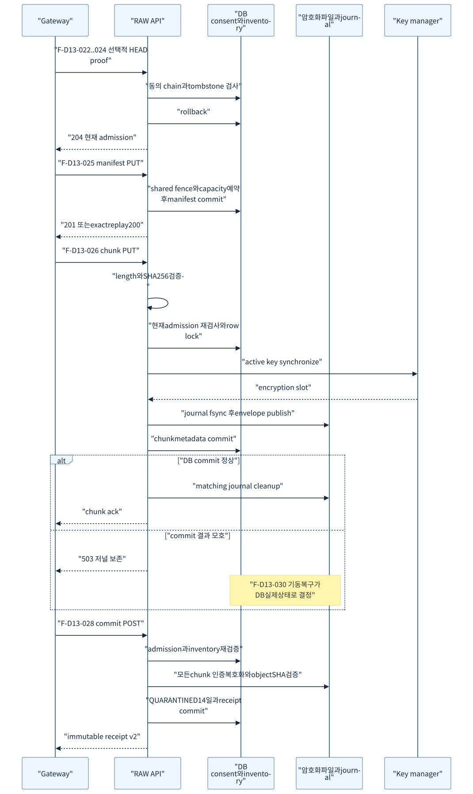

[Mermaid 원본](../diagrams/D13-raw-sequence.mmd) · [SVG](../rendered/D13-raw-sequence.svg)

## F-D13-027 원시 업로드 진행·누락 범위 조회

| 항목 | 명세 |
| --- | --- |
| 분야 | D13 Backend 계정·개인정보·원시 수집·학습 데이터 수명주기 |
| 목적 | 받은 chunk 수/bytes/누락 index 범위와완료영수증을돌려준다. |
| 사용 주체 | Gateway 경유 사용자 Backend 서비스 |
| 활성 상태 | CONDITIONAL |
| 진입점 | backend/app/services/raw_collection_storage.py:2957 RawCollectionStorage.get_status / GET /raw-collections/{collection_id} |
| 실행 전제 | verified FIELD actor/proof 필수. raw_ingest_enabled=false 여도이읽기경계는허용된다. |
| 입력 출처 형식 검증 최신성 | collection,actor,generation,purpose,walk,manifest hash; statusproof 에는 consent/chunk/commit digest 가없어야한다. |

### 시작 이벤트와 처리 순서

| 이벤트 ID | 발생원 | 이벤트 | 수신부 | 흐름 |
| --- | --- | --- | --- | --- |
| E-D13-027-01 | GET /raw-collections/{collection_id} | 받은 chunk 수/bytes/누락 index 범위와완료영수증을돌려준다. | RawCollectionStorage.get_status | shared RAWstorage lock 과 collection FOR UPDATE 를획득한다. → lookup keyring 이있으면저장 subject 의당시키로 owner 를찾는다. → owner/generation/purpose/walk/manifest 를검증한다. → digest_rejected 를거부하고저장 chunk 의 metadata 를검증한다. → MANIFEST_ACCEPTED 지만일부 chunk 가있으면응답상 RECEIVING 으로투영한다. → object 별연속 missing_ranges 및 receivedbytes/count,있다면 immutable receipt 를만들어 commit 후반환한다. → 클라이언트가누락 chunk 만재전송할수있는 status. 모든 file 의복호화검사를항상수행하는조회는아님. |

1. 1. shared RAWstorage lock 과 collection FOR UPDATE 를획득한다. [backend/app/services/raw_collection_storage.py:2957 RawCollectionStorage.get_status]
2. 2. lookup keyring 이있으면저장 subject 의당시키로 owner 를찾는다. [backend/app/services/raw_collection_storage.py:2957 RawCollectionStorage.get_status]
3. 3. owner/generation/purpose/walk/manifest 를검증한다. [backend/app/services/raw_collection_storage.py:2957 RawCollectionStorage.get_status]
4. 4. digest_rejected 를거부하고저장 chunk 의 metadata 를검증한다. [backend/app/services/raw_collection_storage.py:2957 RawCollectionStorage.get_status]
5. 5. MANIFEST_ACCEPTED 지만일부 chunk 가있으면응답상 RECEIVING 으로투영한다. [backend/app/services/raw_collection_storage.py:2957 RawCollectionStorage.get_status]
6. 6. object 별연속 missing_ranges 및 receivedbytes/count,있다면 immutable receipt 를만들어 commit 후반환한다. [backend/app/services/raw_collection_storage.py:2957 RawCollectionStorage.get_status]

| 분기 조건 | 실제 처리 결과 | 구현 근거 |
| --- | --- | --- |
| 소유/manifest binding 실패또는없음 | 404 | backend/app/services/raw_collection_storage.py:2957 RawCollectionStorage.get_status |
| digest_rejected | 409 | backend/app/services/raw_collection_storage.py:2957 RawCollectionStorage.get_status |
| DBstate 와 inventory/receipt 가상충 | 503 또는모델검증오류경로;정상진행으로표시하지않음 | backend/app/services/raw_collection_storage.py:2957 RawCollectionStorage.get_status |

### 효과 종료와 복구

클라이언트가누락 chunk 만재전송할수있는 status. 모든 file 의복호화검사를항상수행하는조회는아님.

| 상황 | 동작 |
| --- | --- |
| 정상 완료 | 클라이언트가누락 chunk 만재전송할수있는 status. 모든 file 의복호화검사를항상수행하는조회는아님. |
| 실패 | 조건 불일치는 branches 의 오류로 종료. 저장 트랜잭션 실패는 rollback 경로를 따른다. |
| 시간 초과 | 독립 타임아웃 없음. 연결/DB/호출자 제한은 D09 공통 실행 환경에 의존. |
| 중복 입력 | 동일조회는현재 inventory 를반환;진행중 upload 때문에내용이변할수있음. |
| 취소 | 별도 취소 진입점 없음. |
| 중단과 생명주기 | 프로세스 중단 시 commit 되지 않은 DB 트랜잭션은 회수 대상. 파일 복구는 해당 보존/저널 기능 참조. |
| 재시도 | 자동 반복 루프 없음. 호출자가 오류와 현재 상태를 확인 후 재호출. |
| 복구 | 동일 요청의 재생 또는 전용 복구 기능이 있는 경우 steps/branches 에 명시. |
| 자원 정리 | 서비스가 연 Session 수명은 get_db 또는 CLI context 종료가 관리. |

### 상태 실행 맥락과 연결

| 항목 | 명세 |
| --- | --- |
| 초기 상태 | S-D13-027-LOOKUP |
| 상태 목록 | S-D13-027-LOOKUP S-D13-027-VERIFIED S-D13-027-PROJECTED |
| 전이 조건과 전이 동작 | LOOKUP → VERIFIED: 해당 steps 의 조건 충족 시 VERIFIED → PROJECTED: 해당 steps 의 조건 충족 시 |
| 허용되지 않는 전이 | branches 의 거부 조건에서는 다음 단계로 진행하지 않음. DB 영속 상태와 설명용 단계 상태를 동일시하지 않음. |
| 동시성 순서와 작업 소유권 | FastAPI async route가 요청을 검증하고 await anyio.to_thread.run_sync로 동기 DB/파일 처리를 기다린다. DB Session과 maintenance/storage 잠금은 위임된 동기 처리 경로에서 사용하며 반환 후 응답한다. |
| 공유 상태와 다른 기능 연결 | D09 공통 인증·DB 세션과 연결. 관련 모델과 서비스 연결은 code_refs 및 steps 에 명시. |

### 정책 근거와 검증 범위

| 항목 | 근거 |
| --- | --- |
| 정책 | [P-D13-027](#P-D13-027) |
| 구현 | [backend/app/services/raw_collection_storage.py:2957](/home/ddobagi/Hanium_Dreamup/backend/app/services/raw_collection_storage.py:2957) · `RawCollectionStorage.get_status` (범위 2957–3014) [backend/app/api/raw_collections.py:75](/home/ddobagi/Hanium_Dreamup/backend/app/api/raw_collections.py:75) · `RawCollectionStorageHandler.get_status` (범위 75–85) [backend/app/services/raw_collection_storage.py:2081](/home/ddobagi/Hanium_Dreamup/backend/app/services/raw_collection_storage.py:2081) · `RawCollectionStorage._status` (범위 2081–2150) |
| 기존 개선 ID | 개별 동일성 미확인; 분야 연관은 별도 추적표 |
| 기존 분야 | 해당 없음 |
| 기존 실행 증거 | 과거 실행 결과를 이 기능의 현행 통과 근거로 대조하지 않음. 이번 작업은 고정 소스의 정적 판독이며 제품 테스트·DB·SMTP·기기·운영 실행 없음. |
| 한계 및 구분 | 상태 접두 ID 는 이 명세의 탐색용이며 원문 enum/DB 상태는 inputs·steps 에 원문으로 구분한다. |

| 테스트 위치 | 심볼 | 증거 수준 | 기대와 한계 |
| --- | --- | --- | --- |

연결한 테스트 미확인: 이번 작성 범위에서 이 기능에 대응하는 시험 단언을 연결하지 않았다. 테스트 자체가 없다는 판정이 아니다.

### 이벤트 처리 그림


[Mermaid 원본](../diagrams/D13-F027.mmd) · [SVG](../rendered/D13-F027.svg)

## F-D13-028 원시 collection commit 와 14 일 격리 영수증

| 항목 | 명세 |
| --- | --- |
| 분야 | D13 Backend 계정·개인정보·원시 수집·학습 데이터 수명주기 |
| 목적 | 모든 object 의실제 digest 를검증하고 immutable 보존영수증을발급한다. |
| 사용 주체 | Gateway 경유 사용자 Backend 서비스 |
| 활성 상태 | CONDITIONAL |
| 진입점 | backend/app/services/raw_collection_storage.py:3016 RawCollectionStorage.commit / POST /raw-collections/{collection_id}/commit |
| 실행 전제 | writegate 최신 동의 chain/tombstone 재검증; READY_TO_COMMIT 또는이미 terminal exactreplay. |
| 입력 출처 형식 검증 최신성 | path/bodycollection·manifest·commitdomainSHA256 결속; object_count/chunk_count/total_bytes 가 manifest 와동일. |

### 시작 이벤트와 처리 순서

| 이벤트 ID | 발생원 | 이벤트 | 수신부 | 흐름 |
| --- | --- | --- | --- | --- |
| E-D13-028-01 | POST /raw-collections/{collection_id}/commit | 모든 object 의실제 digest 를검증하고 immutable 보존영수증을발급한다. | RawCollectionStorage.commit | collection 행을잠그고 owner/purpose/walk/consent 및 commit inventory 를검사한다. → 기존 COMMITTED/QUARANTINED 는 persistedmetadata 와 matchingjournal 을확인하고기존 receipt 를재생한다. → 미수신 state 는 409 incomplete; READY_TO_COMMIT 만신규완료가능. → 각 object 의모든 chunk 를 keyring 으로복호화하고 content 연결 SHA256 을검사한다. → v2 는 whole-second committed_at+14 일 quarantine_expires_at,RAW_QUARANTINE_14D,QUARANTINED 와 receipt v2 를생성한다. → legacy v1 은 committed_at+180 일 retention_expires_at,COMMITTED,receiptv1 을생성한다. → receiptSHA256 과 timestamps 를 DBcommit 한후영수증반환한다. → 현재신규 collection 은 14 일격리영수증. 학습/신고자동승격은수행하지 않음. |

1. 1. collection 행을잠그고 owner/purpose/walk/consent 및 commit inventory 를검사한다. [backend/app/services/raw_collection_storage.py:3016 RawCollectionStorage.commit]
2. 2. 기존 COMMITTED/QUARANTINED 는 persistedmetadata 와 matchingjournal 을확인하고기존 receipt 를재생한다. [backend/app/services/raw_collection_storage.py:3016 RawCollectionStorage.commit]
3. 3. 미수신 state 는 409 incomplete; READY_TO_COMMIT 만신규완료가능. [backend/app/services/raw_collection_storage.py:3016 RawCollectionStorage.commit]
4. 4. 각 object 의모든 chunk 를 keyring 으로복호화하고 content 연결 SHA256 을검사한다. [backend/app/services/raw_collection_storage.py:3016 RawCollectionStorage.commit]
5. 5. v2 는 whole-second committed_at+14 일 quarantine_expires_at,RAW_QUARANTINE_14D,QUARANTINED 와 receipt v2 를생성한다. [backend/app/services/raw_collection_storage.py:3016 RawCollectionStorage.commit]
6. 6. legacy v1 은 committed_at+180 일 retention_expires_at,COMMITTED,receiptv1 을생성한다. [backend/app/services/raw_collection_storage.py:3016 RawCollectionStorage.commit]
7. 7. receiptSHA256 과 timestamps 를 DBcommit 한후영수증반환한다. [backend/app/services/raw_collection_storage.py:3016 RawCollectionStorage.commit]

| 분기 조건 | 실제 처리 결과 | 구현 근거 |
| --- | --- | --- |
| commit 수량/bytes 다름 | 409 inventory_mismatch | backend/app/services/raw_collection_storage.py:3016 RawCollectionStorage.commit |
| missingchunk | 409 incomplete | backend/app/services/raw_collection_storage.py:3016 RawCollectionStorage.commit |
| objectdigest 불일치 | digest_rejected 영속후 409 | backend/app/services/raw_collection_storage.py:3016 RawCollectionStorage.commit |
| commit 결과모호 | 503;동일요청재생으로정확기존 receipt 확인 | backend/app/services/raw_collection_storage.py:3016 RawCollectionStorage.commit |

### 효과 종료와 복구

현재신규 collection 은 14 일격리영수증. 학습/신고자동승격은수행하지 않음.

| 상황 | 동작 |
| --- | --- |
| 정상 완료 | 현재신규 collection 은 14 일격리영수증. 학습/신고자동승격은수행하지 않음. |
| 실패 | 조건 불일치는 branches 의 오류로 종료. 저장 트랜잭션 실패는 rollback 경로를 따른다. |
| 시간 초과 | 독립 타임아웃 없음. 연결/DB/호출자 제한은 D09 공통 실행 환경에 의존. |
| 중복 입력 | 독립 중복 계약은 branches 에 명시. 그 외 자동 중복 제거 없음. |
| 취소 | 별도 취소 진입점 없음. |
| 중단과 생명주기 | 프로세스 중단 시 commit 되지 않은 DB 트랜잭션은 회수 대상. 파일 복구는 해당 보존/저널 기능 참조. |
| 재시도 | 자동 반복 루프 없음. 호출자가 오류와 현재 상태를 확인 후 재호출. |
| 복구 | 동일 요청의 재생 또는 전용 복구 기능이 있는 경우 steps/branches 에 명시. |
| 자원 정리 | 서비스가 연 Session 수명은 get_db 또는 CLI context 종료가 관리. |

### 상태 실행 맥락과 연결

| 항목 | 명세 |
| --- | --- |
| 초기 상태 | S-D13-028-MANIFEST_ACCEPTED |
| 상태 목록 | S-D13-028-MANIFEST_ACCEPTED S-D13-028-READY_TO_COMMIT S-D13-028-QUARANTINED S-D13-028-COMMITTED S-D13-028-DIGEST_REJECTED |
| 전이 조건과 전이 동작 | MANIFEST_ACCEPTED → READY_TO_COMMIT: 모든 chunk persisted MANIFEST_ACCEPTED 응답만 RECEIVING 으로 투영: 일부 chunk persisted READY_TO_COMMIT → QUARANTINED: 현행 lifecycle2, 모든 object digest 일치, 14 일 receipt READY_TO_COMMIT → COMMITTED: legacy lifecycle1, 180 일 receipt nonterminal → DIGEST_REJECTED marker: object digest 불일치 |
| 허용되지 않는 전이 | COMMITTED/QUARANTINED receipt·manifest 불변. RECEIVING 은 현행 DBguard 의 새 중간상태 전이가 아닌 응답 투영. |
| 동시성 순서와 작업 소유권 | FastAPI async route가 요청을 검증하고 await anyio.to_thread.run_sync로 동기 DB/파일 처리를 기다린다. DB Session과 maintenance/storage 잠금은 위임된 동기 처리 경로에서 사용하며 반환 후 응답한다. |
| 공유 상태와 다른 기능 연결 | D09 공통 인증·DB 세션과 연결. 관련 모델과 서비스 연결은 code_refs 및 steps 에 명시. |

### 정책 근거와 검증 범위

| 항목 | 근거 |
| --- | --- |
| 정책 | [P-D13-028](#P-D13-028) |
| 구현 | [backend/app/services/raw_collection_storage.py:3016](/home/ddobagi/Hanium_Dreamup/backend/app/services/raw_collection_storage.py:3016) · `RawCollectionStorage.commit` (범위 3016–3155) [backend/app/api/raw_collections.py:87](/home/ddobagi/Hanium_Dreamup/backend/app/api/raw_collections.py:87) · `RawCollectionStorageHandler.commit` (범위 87–94) [backend/app/schemas.py:2710](/home/ddobagi/Hanium_Dreamup/backend/app/schemas.py:2710) · `RawCollectionReceiptV2` (범위 2710–2754) |
| 기존 개선 ID | 개별 동일성 미확인; 분야 연관은 별도 추적표 |
| 기존 분야 | 해당 없음 |
| 기존 실행 증거 | 과거 실행 결과를 이 기능의 현행 통과 근거로 대조하지 않음. 이번 작업은 고정 소스의 정적 판독이며 제품 테스트·DB·SMTP·기기·운영 실행 없음. |
| 한계 및 구분 | 법적보존적정성판단이아니라현행코드기간을기록. 승인후에도원본 격리 expiry 자체를늘리는처리는없음. |

| 테스트 위치 | 심볼 | 증거 수준 | 기대와 한계 |
| --- | --- | --- | --- |

연결한 테스트 미확인: 이번 작성 범위에서 이 기능에 대응하는 시험 단언을 연결하지 않았다. 테스트 자체가 없다는 판정이 아니다.

### 이벤트 처리 그림


[Mermaid 원본](../diagrams/D13-F028.mmd) · [SVG](../rendered/D13-F028.svg)

[Mermaid 원본](../diagrams/D13-raw-states.mmd) · [SVG](../rendered/D13-raw-states.svg)

## F-D13-029 원시 chunk envelope 암호화·인증복호화

| 항목 | 명세 |
| --- | --- |
| 분야 | D13 Backend 계정·개인정보·원시 수집·학습 데이터 수명주기 |
| 목적 | 원시파일의기밀성과 manifest·소유자결속을 envelope 에담는다. |
| 사용 주체 | Gateway 경유 사용자 Backend 서비스 |
| 활성 상태 | CONDITIONAL |
| 진입점 | backend/app/services/raw_collection_crypto.py:274 encrypt_raw_collection_chunk / RawCollectionStorage.put_chunk / commit / 기동inventory검증 |
| 실행 전제 | 32byte masterkey 와정규 binding;8MiB 이하 nonemptyplaintext. |
| 입력 출처 형식 검증 최신성 | key_id1..64,nonce12byte;subject/generation/collection/object/chunk/manifest/purpose/walk/content-type/length/SHA256 binding. |

### 시작 이벤트와 처리 순서

| 이벤트 ID | 발생원 | 이벤트 | 수신부 | 흐름 |
| --- | --- | --- | --- | --- |
| E-D13-029-01 | RawCollectionStorage.put_chunk / commit / 기동 inventory 검증 | 원시파일의기밀성과 manifest·소유자결속을 envelope 에담는다. | encrypt_raw_collection_chunk | plaintext length/SHA256 을 declaredbinding 과비교한다. → HKDF-SHA256 domain 으로 masterkey 에서 32byte RAW 전용키를도출한다. → 정규 JSONheader(최대 4096byte),magic/version,length 를 AAD 에넣어 AES-256-GCM 으로암호화한다. → 복호화는 header 정확 key 집합·canonicalbytes·중복 JSONkey/NaN 금지·alg/AADversion/길이를검사한다. → expectedbinding,nonce/key_id,tag 를검증한뒤복호화 plaintextlength/SHA256 을재검사한다. → 평문대신암호화 envelope 와 SHA256 을저장. 수신메모리의평문을별도 zeroize 하는기능은확인되지않음. |

1. 1. plaintext length/SHA256 을 declaredbinding 과비교한다. [backend/app/services/raw_collection_crypto.py:274 encrypt_raw_collection_chunk]
2. 2. HKDF-SHA256 domain 으로 masterkey 에서 32byte RAW 전용키를도출한다. [backend/app/services/raw_collection_crypto.py:274 encrypt_raw_collection_chunk]
3. 3. 정규 JSONheader(최대 4096byte),magic/version,length 를 AAD 에넣어 AES-256-GCM 으로암호화한다. [backend/app/services/raw_collection_crypto.py:274 encrypt_raw_collection_chunk]
4. 4. 복호화는 header 정확 key 집합·canonicalbytes·중복 JSONkey/NaN 금지·alg/AADversion/길이를검사한다. [backend/app/services/raw_collection_crypto.py:274 encrypt_raw_collection_chunk]
5. 5. expectedbinding,nonce/key_id,tag 를검증한뒤복호화 plaintextlength/SHA256 을재검사한다. [backend/app/services/raw_collection_crypto.py:274 encrypt_raw_collection_chunk]

| 분기 조건 | 실제 처리 결과 | 구현 근거 |
| --- | --- | --- |
| binding 다름/header 비정규/algorithmversion 불일치 | formaterror | backend/app/services/raw_collection_crypto.py:274 encrypt_raw_collection_chunk |
| AESGCMtag 실패또는 plaintexthash 불일치 | authenticationerror | backend/app/services/raw_collection_crypto.py:274 encrypt_raw_collection_chunk |
| masterkey 길이/nonce 길이부적합 | ValueError | backend/app/services/raw_collection_crypto.py:274 encrypt_raw_collection_chunk |

### 효과 종료와 복구

평문대신암호화 envelope 와 SHA256 을저장. 수신메모리의평문을별도 zeroize 하는기능은확인되지않음.

| 상황 | 동작 |
| --- | --- |
| 정상 완료 | 평문대신암호화 envelope 와 SHA256 을저장. 수신메모리의평문을별도 zeroize 하는기능은확인되지않음. |
| 실패 | 조건 불일치는 branches 의 오류로 종료. 저장 트랜잭션 실패는 rollback 경로를 따른다. |
| 시간 초과 | 독립 타임아웃 없음. 연결/DB/호출자 제한은 D09 공통 실행 환경에 의존. |
| 중복 입력 | 독립 중복 계약은 branches 에 명시. 그 외 자동 중복 제거 없음. |
| 취소 | 별도 취소 진입점 없음. |
| 중단과 생명주기 | 프로세스 중단 시 commit 되지 않은 DB 트랜잭션은 회수 대상. 파일 복구는 해당 보존/저널 기능 참조. |
| 재시도 | 자동 반복 루프 없음. 호출자가 오류와 현재 상태를 확인 후 재호출. |
| 복구 | 인증실패를평문 fallback 으로우회하지않는다. 올바른키/metadata 복구필요. |
| 자원 정리 | 서비스가 연 Session 수명은 get_db 또는 CLI context 종료가 관리. |

### 상태 실행 맥락과 연결

| 항목 | 명세 |
| --- | --- |
| 초기 상태 | S-D13-029-PLAINTEXT_VERIFIED |
| 상태 목록 | S-D13-029-PLAINTEXT_VERIFIED S-D13-029-ENCRYPTED S-D13-029-AUTHENTICATED_PLAINTEXT |
| 전이 조건과 전이 동작 | PLAINTEXT_VERIFIED → ENCRYPTED: 해당 steps 의 조건 충족 시 ENCRYPTED → AUTHENTICATED_PLAINTEXT: 해당 steps 의 조건 충족 시 |
| 허용되지 않는 전이 | branches 의 거부 조건에서는 다음 단계로 진행하지 않음. DB 영속 상태와 설명용 단계 상태를 동일시하지 않음. |
| 동시성 순서와 작업 소유권 | 호출 worker 안동기암복호화. replaycache 아닌파일 metadatacache 와분리. |
| 공유 상태와 다른 기능 연결 | D09 공통 인증·DB 세션과 연결. 관련 모델과 서비스 연결은 code_refs 및 steps 에 명시. |

### 정책 근거와 검증 범위

| 항목 | 근거 |
| --- | --- |
| 정책 | [P-D13-029](#P-D13-029) |
| 구현 | [backend/app/services/raw_collection_crypto.py:274](/home/ddobagi/Hanium_Dreamup/backend/app/services/raw_collection_crypto.py:274) · `encrypt_raw_collection_chunk` (범위 274–314) [backend/app/services/raw_collection_crypto.py:424](/home/ddobagi/Hanium_Dreamup/backend/app/services/raw_collection_crypto.py:424) · `decrypt_raw_collection_chunk` (범위 424–461) [backend/app/services/raw_collection_crypto.py:338](/home/ddobagi/Hanium_Dreamup/backend/app/services/raw_collection_crypto.py:338) · `parse_raw_collection_chunk_envelope` (범위 338–421) |
| 기존 개선 ID | 개별 동일성 미확인; 분야 연관은 별도 추적표 |
| 기존 분야 | 해당 없음 |
| 기존 실행 증거 | 과거 실행 결과를 이 기능의 현행 통과 근거로 대조하지 않음. 이번 작업은 고정 소스의 정적 판독이며 제품 테스트·DB·SMTP·기기·운영 실행 없음. |
| 한계 및 구분 | 상태 접두 ID 는 이 명세의 탐색용이며 원문 enum/DB 상태는 inputs·steps 에 원문으로 구분한다. |

| 테스트 위치 | 심볼 | 증거 수준 | 기대와 한계 |
| --- | --- | --- | --- |

연결한 테스트 미확인: 이번 작성 범위에서 이 기능에 대응하는 시험 단언을 연결하지 않았다. 테스트 자체가 없다는 판정이 아니다.

### 이벤트 처리 그림


[Mermaid 원본](../diagrams/D13-F029.mmd) · [SVG](../rendered/D13-F029.svg)

## F-D13-030 기동 원시 write journal 복구와 inventory 검증

| 항목 | 명세 |
| --- | --- |
| 분야 | D13 Backend 계정·개인정보·원시 수집·학습 데이터 수명주기 |
| 목적 | 중단된파일쓰기를 DB 의실제 commit 상태에맞춰복구한다. |
| 사용 주체 | Gateway 경유 사용자 Backend 서비스 |
| 활성 상태 | CONDITIONAL |
| 진입점 | backend/app/services/raw_collection_storage.py:1034 reconcile_pending_raw_chunk_writes / Backend lifespan reconcile_raw_collection_storage |
| 실행 전제 | maintenance shared lock 및 RAWreconciliation exclusive transaction lock;신뢰권한을갖춘 storage root. |
| 입력 출처 형식 검증 최신성 | journal schema,metadata/envelopehash/size/persisted time. pending 최대 10000 개; startup 는 raw 미활성이어도설정 root 상태를검증하는호출경계. |

### 시작 이벤트와 처리 순서

| 이벤트 ID | 발생원 | 이벤트 | 수신부 | 흐름 |
| --- | --- | --- | --- | --- |
| E-D13-030-01 | Backend lifespan reconcile_raw_collection_storage | 중단된파일쓰기를 DB 의실제 commit 상태에맞춰복구한다. | reconcile_pending_raw_chunk_writes | 안전한 directory descriptor 로 journal 목록과임시 alias 를검사한다. → 각 journal 을 strictcanonical shape 로읽고 collection/object/index 의 DBcommit metadata 를조회한다. → DBchunk 없음또는미 persisted 면중단된 final/tempfile 만삭제하고 journal 을정리한다. → DBmetadata 가 journal 과정확히 동일이면 file 크기/hash 를검증해보존하고임시 file/journal 만제거한다. → 이후 validate_raw_storage_database_inventory 가 collection/object/chunk 수·index 연속·sum·FKbinding·filemapping 을검사한다. → 검증된 filemetadata/cache 를초기화하고기동을계속한다. → 확정된 chunk 만남기고미확정고아를복구규칙으로정리. DB 와파일 불일치는숨기지않음. |

1. 1. 안전한 directory descriptor 로 journal 목록과임시 alias 를검사한다. [backend/app/services/raw_collection_storage.py:1034 reconcile_pending_raw_chunk_writes]
2. 2. 각 journal 을 strictcanonical shape 로읽고 collection/object/index 의 DBcommit metadata 를조회한다. [backend/app/services/raw_collection_storage.py:1034 reconcile_pending_raw_chunk_writes]
3. 3. DBchunk 없음또는미 persisted 면중단된 final/tempfile 만삭제하고 journal 을정리한다. [backend/app/services/raw_collection_storage.py:1034 reconcile_pending_raw_chunk_writes]
4. 4. DBmetadata 가 journal 과정확히 동일이면 file 크기/hash 를검증해보존하고임시 file/journal 만제거한다. [backend/app/services/raw_collection_storage.py:1034 reconcile_pending_raw_chunk_writes]
5. 5. 이후 validate_raw_storage_database_inventory 가 collection/object/chunk 수·index 연속·sum·FKbinding·filemapping 을검사한다. [backend/app/services/raw_collection_storage.py:1034 reconcile_pending_raw_chunk_writes]
6. 6. 검증된 filemetadata/cache 를초기화하고기동을계속한다. [backend/app/services/raw_collection_storage.py:1034 reconcile_pending_raw_chunk_writes]
7. 7. 기동 inventory 는 모든 persisted chunk 를 AEAD 복호화하고 완성 object 의 연결 SHA256 을 검사한다. 비 terminal digest drift 는 rejection marker 로 기록하고 terminal drift 는 RuntimeError 로 기동 중단한다. [backend/app/services/raw_collection_storage.py:1595 validate_raw_storage_database_inventory]

| 분기 조건 | 실제 처리 결과 | 구현 근거 |
| --- | --- | --- |
| DBmetadata/journal 불일치 | 실패;file/journal 증거를보존 | backend/app/services/raw_collection_storage.py:1034 reconcile_pending_raw_chunk_writes |
| committedfile 누락/tamper/orphaninventory | 기동검증실패;정상서빙완료주장불가 | backend/app/services/raw_collection_storage.py:1034 reconcile_pending_raw_chunk_writes |
| writer 가목록조회후 journal 을정리한경쟁 | FileNotFound 는허용;후속 inventory 검증에서 DB/file 를확인 | backend/app/services/raw_collection_storage.py:1034 reconcile_pending_raw_chunk_writes |

### 효과 종료와 복구

확정된 chunk 만남기고미확정고아를복구규칙으로정리. DB 와파일 불일치는숨기지않음.

| 상황 | 동작 |
| --- | --- |
| 정상 완료 | 확정된 chunk 만남기고미확정고아를복구규칙으로정리. DB 와파일 불일치는숨기지않음. |
| 실패 | 조건 불일치는 branches 의 오류로 종료. 저장 트랜잭션 실패는 rollback 경로를 따른다. |
| 시간 초과 | 독립 타임아웃 없음. 연결/DB/호출자 제한은 D09 공통 실행 환경에 의존. |
| 중복 입력 | 독립 중복 계약은 branches 에 명시. 그 외 자동 중복 제거 없음. |
| 취소 | 별도 취소 진입점 없음. |
| 중단과 생명주기 | 프로세스 중단 시 commit 되지 않은 DB 트랜잭션은 회수 대상. 파일 복구는 해당 보존/저널 기능 참조. |
| 재시도 | 다음기동/명시복구에서다시검사. 불일치증거가그대로면반복실패하며자동수정없음. |
| 복구 | 동일 요청의 재생 또는 전용 복구 기능이 있는 경우 steps/branches 에 명시. |
| 자원 정리 | 서비스가 연 Session 수명은 get_db 또는 CLI context 종료가 관리. |

### 상태 실행 맥락과 연결

| 항목 | 명세 |
| --- | --- |
| 초기 상태 | S-D13-030-JOURNAL_FOUND |
| 상태 목록 | S-D13-030-JOURNAL_FOUND S-D13-030-COMMITTED_RETAIN_OR_ORPHAN_REMOVE S-D13-030-INVENTORY_VERIFIED |
| 전이 조건과 전이 동작 | JOURNAL_FOUND → COMMITTED_RETAIN_OR_ORPHAN_REMOVE: 해당 steps 의 조건 충족 시 COMMITTED_RETAIN_OR_ORPHAN_REMOVE → INVENTORY_VERIFIED: 해당 steps 의 조건 충족 시 |
| 허용되지 않는 전이 | branches 의 거부 조건에서는 다음 단계로 진행하지 않음. DB 영속 상태와 설명용 단계 상태를 동일시하지 않음. |
| 동시성 순서와 작업 소유권 | lifespan asyncio.to_thread 로기동전실행. RAWwritershared/exclusive-reconciler DBlock 로경쟁통제;cache RLock. |
| 공유 상태와 다른 기능 연결 | D09 공통 인증·DB 세션과 연결. 관련 모델과 서비스 연결은 code_refs 및 steps 에 명시. |

### 정책 근거와 검증 범위

| 항목 | 근거 |
| --- | --- |
| 정책 | [P-D13-030](#P-D13-030) |
| 구현 | [backend/app/services/raw_collection_storage.py:1034](/home/ddobagi/Hanium_Dreamup/backend/app/services/raw_collection_storage.py:1034) · `reconcile_pending_raw_chunk_writes` (범위 1034–1105) [backend/app/services/raw_collection_storage.py:1595](/home/ddobagi/Hanium_Dreamup/backend/app/services/raw_collection_storage.py:1595) · `validate_raw_storage_database_inventory` (범위 1595–1830) [backend/app/main.py:228](/home/ddobagi/Hanium_Dreamup/backend/app/main.py:228) · `reconcile_raw_collection_storage` (범위 228–265) |
| 기존 개선 ID | 개별 동일성 미확인; 분야 연관은 별도 추적표 |
| 기존 분야 | 해당 없음 |
| 기존 실행 증거 | 과거 실행 결과를 이 기능의 현행 통과 근거로 대조하지 않음. 이번 작업은 고정 소스의 정적 판독이며 제품 테스트·DB·SMTP·기기·운영 실행 없음. |
| 한계 및 구분 | 상태 접두 ID 는 이 명세의 탐색용이며 원문 enum/DB 상태는 inputs·steps 에 원문으로 구분한다. |

| 테스트 위치 | 심볼 | 증거 수준 | 기대와 한계 |
| --- | --- | --- | --- |
| [backend/tests/test_raw_collection_storage_reconciliation.py](/home/ddobagi/Hanium_Dreamup/backend/tests/test_raw_collection_storage_reconciliation.py) | test_committed_raw_mismatch_preserves_file_and_journal | TEST_EXPECTATION | metadata불일치시file/journal보존; 이번 미실행 |
| [backend/tests/test_raw_collection_storage_reconciliation.py](/home/ddobagi/Hanium_Dreamup/backend/tests/test_raw_collection_storage_reconciliation.py) | test_restart_keeps_only_exact_committed_raw_chunk | TEST_EXPECTATION | 정확commit파일은보존하고journal제거; 이번 미실행 |

### 이벤트 처리 그림


[Mermaid 원본](../diagrams/D13-F030.mmd) · [SVG](../rendered/D13-F030.svg)

[Mermaid 원본](../diagrams/D13-raw-sequence.mmd) · [SVG](../rendered/D13-raw-sequence.svg)

## F-D13-031 관리자 원시 격리목록 조회

| 항목 | 명세 |
| --- | --- |
| 분야 | D13 Backend 계정·개인정보·원시 수집·학습 데이터 수명주기 |
| 목적 | 격리 collection 와최신 REPORT/TRAINING 판단·legal hold revision 을조회한다. |
| 사용 주체 | 관리자앱 Backend |
| 활성 상태 | ACTIVE |
| 진입점 | backend/app/api/admin_raw_collections.py:82 list_quarantine / GET /admin/raw-collections/quarantine |
| 실행 전제 | D14 admin read identity/proof 와 correlation_id; expected_operation admin.raw_collection.list. |
| 입력 출처 형식 검증 최신성 | state QUARANTINED(기본) 또는 ALL;limit 기본 50,1..100. |

### 시작 이벤트와 처리 순서

| 이벤트 ID | 발생원 | 이벤트 | 수신부 | 흐름 |
| --- | --- | --- | --- | --- |
| E-D13-031-01 | GET /admin/raw-collections/quarantine | 격리 collection 와최신 REPORT/TRAINING 판단·legal hold revision 을조회한다. | list_quarantine | 관리자 readcontext 와 operationproof 를검증한다. → lifecycle_version2 만선택하며기본은 stateQUARANTINED 로제한한다. → committed_at 내림차순 limit 행을조회한다. → 각 collection 의 REPORT/TRAINING 최대 revision 판단과최신 hold 를조회한다. → 최신 hold APPLY 이며 expiry>현재시각일때만 legal_hold_active=true 로응답한다. → collection metadata 와 CAS revision 을반환. 원시영상/음성다운로드 API 를제공하는기능은아님. |

1. 1. 관리자 readcontext 와 operationproof 를검증한다. [backend/app/api/admin_raw_collections.py:82 list_quarantine]
2. 2. lifecycle_version2 만선택하며기본은 stateQUARANTINED 로제한한다. [backend/app/api/admin_raw_collections.py:82 list_quarantine]
3. 3. committed_at 내림차순 limit 행을조회한다. [backend/app/api/admin_raw_collections.py:82 list_quarantine]
4. 4. 각 collection 의 REPORT/TRAINING 최대 revision 판단과최신 hold 를조회한다. [backend/app/api/admin_raw_collections.py:82 list_quarantine]
5. 5. 최신 hold APPLY 이며 expiry>현재시각일때만 legal_hold_active=true 로응답한다. [backend/app/api/admin_raw_collections.py:82 list_quarantine]

| 분기 조건 | 실제 처리 결과 | 구현 근거 |
| --- | --- | --- |
| state=ALL | v2 전체상태를조회;legacyv1 은포함하지 않음 | backend/app/api/admin_raw_collections.py:82 list_quarantine |
| hold 만료/RELEASE/없음 | active=false | backend/app/api/admin_raw_collections.py:82 list_quarantine |

### 효과 종료와 복구

collection metadata 와 CAS revision 을반환. 원시영상/음성다운로드 API 를제공하는기능은아님.

| 상황 | 동작 |
| --- | --- |
| 정상 완료 | collection metadata 와 CAS revision 을반환. 원시영상/음성다운로드 API 를제공하는기능은아님. |
| 실패 | 조건 불일치는 branches 의 오류로 종료. 저장 트랜잭션 실패는 rollback 경로를 따른다. |
| 시간 초과 | 독립 타임아웃 없음. 연결/DB/호출자 제한은 D09 공통 실행 환경에 의존. |
| 중복 입력 | 독립 중복 계약은 branches 에 명시. 그 외 자동 중복 제거 없음. |
| 취소 | 별도 취소 진입점 없음. |
| 중단과 생명주기 | 프로세스 중단 시 commit 되지 않은 DB 트랜잭션은 회수 대상. 파일 복구는 해당 보존/저널 기능 참조. |
| 재시도 | 자동 반복 루프 없음. 호출자가 오류와 현재 상태를 확인 후 재호출. |
| 복구 | 동일 요청의 재생 또는 전용 복구 기능이 있는 경우 steps/branches 에 명시. |
| 자원 정리 | 서비스가 연 Session 수명은 get_db 또는 CLI context 종료가 관리. |

### 상태 실행 맥락과 연결

| 항목 | 명세 |
| --- | --- |
| 초기 상태 | S-D13-031-AUTHORIZED |
| 상태 목록 | S-D13-031-AUTHORIZED S-D13-031-LISTED |
| 전이 조건과 전이 동작 | AUTHORIZED → LISTED: 해당 steps 의 조건 충족 시 |
| 허용되지 않는 전이 | branches 의 거부 조건에서는 다음 단계로 진행하지 않음. DB 영속 상태와 설명용 단계 상태를 동일시하지 않음. |
| 동시성 순서와 작업 소유권 | FastAPI 동기 handler 는 서버 worker thread 에서 DB Session 을 사용. 함수 내부 순차 실행이며 별도 백그라운드 작업을 예약하지 않는다. |
| 공유 상태와 다른 기능 연결 | D09 공통 인증·DB 세션과 연결. 관련 모델과 서비스 연결은 code_refs 및 steps 에 명시. |

### 정책 근거와 검증 범위

| 항목 | 근거 |
| --- | --- |
| 정책 | [P-D13-031](#P-D13-031) |
| 구현 | [backend/app/api/admin_raw_collections.py:82](/home/ddobagi/Hanium_Dreamup/backend/app/api/admin_raw_collections.py:82) · `create_router.list_quarantine` (범위 82–134) [backend/app/api/admin_raw_collections.py:46](/home/ddobagi/Hanium_Dreamup/backend/app/api/admin_raw_collections.py:46) · `_identity` (범위 46–61) |
| 기존 개선 ID | 개별 동일성 미확인; 분야 연관은 별도 추적표 |
| 기존 분야 | 해당 없음 |
| 기존 실행 증거 | 과거 실행 결과를 이 기능의 현행 통과 근거로 대조하지 않음. 이번 작업은 고정 소스의 정적 판독이며 제품 테스트·DB·SMTP·기기·운영 실행 없음. |
| 한계 및 구분 | paginationcursor 없음;limit 내목록만반환. 목록 legalhold 평가는앱서버 clock,hold 쓰기판정은 DBclock 을쓴다. |

| 테스트 위치 | 심볼 | 증거 수준 | 기대와 한계 |
| --- | --- | --- | --- |

연결한 테스트 미확인: 이번 작성 범위에서 이 기능에 대응하는 시험 단언을 연결하지 않았다. 테스트 자체가 없다는 판정이 아니다.

### 이벤트 처리 그림


[Mermaid 원본](../diagrams/D13-F031.mmd) · [SVG](../rendered/D13-F031.svg)

## F-D13-032 격리 원본 REPORT 목적 검토

| 항목 | 명세 |
| --- | --- |
| 분야 | D13 Backend 계정·개인정보·원시 수집·학습 데이터 수명주기 |
| 목적 | 원시 격리데이터를신고목적에사용할지관리자가판단한사실을기록한다. |
| 사용 주체 | 관리자 |
| 활성 상태 | ACTIVE |
| 진입점 | backend/app/services/raw_collection_lifecycle.py:115 record_purpose_decision / POST /admin/raw-collections/{collection_id}/decisions scope=REPORT |
| 실행 전제 | D14 action admin.raw_collection.purpose_decide, v2QUARANTINED,now<quarantine_expires_at. |
| 입력 출처 형식 검증 최신성 | scopeREPORT,APPROVED/REJECTED,reason1..500,expected_revision>=0,idempotency UUID;학습 전용 evidence/flags 금지. |

### 시작 이벤트와 처리 순서

| 이벤트 ID | 발생원 | 이벤트 | 수신부 | 흐름 |
| --- | --- | --- | --- | --- |
| E-D13-032-01 | POST /admin/raw-collections/{collection_id}/decisions scope=REPORT | 원시 격리데이터를신고목적에사용할지관리자가판단한사실을기록한다. | record_purpose_decision | collection FOR UPDATE 후 reviewable state 와격리만료를확인한다. → scope+idempotencykey 로기존판단을찾아 exact payload 면기존 200 을돌려준다. → scope 의최신 revision 과 expected_revision 을비교한다. → manifest/receipt 에판단을결속하고 admin/session/device/correlation 과 revision+1event 를 appendcommit 한다. → 신규 201/재생 200 판단기록. 실제신고 row 생성이나기관전송은이함수에서일어나지않음. |

1. 1. collection FOR UPDATE 후 reviewable state 와격리만료를확인한다. [backend/app/services/raw_collection_lifecycle.py:115 record_purpose_decision]
2. 2. scope+idempotencykey 로기존판단을찾아 exact payload 면기존 200 을돌려준다. [backend/app/services/raw_collection_lifecycle.py:115 record_purpose_decision]
3. 3. scope 의최신 revision 과 expected_revision 을비교한다. [backend/app/services/raw_collection_lifecycle.py:115 record_purpose_decision]
4. 4. manifest/receipt 에판단을결속하고 admin/session/device/correlation 과 revision+1event 를 appendcommit 한다. [backend/app/services/raw_collection_lifecycle.py:115 record_purpose_decision]

| 분기 조건 | 실제 처리 결과 | 구현 근거 |
| --- | --- | --- |
| v2 격리아님또는 expiry<=DBnow | 409 not_reviewable/expired | backend/app/services/raw_collection_lifecycle.py:115 record_purpose_decision |
| sameidempotency 다른내용또는 staleCAS | 409 conflict | backend/app/services/raw_collection_lifecycle.py:115 record_purpose_decision |
| commit/refresh SQLAlchemy 오류 | rollback503 persistence_ambiguous | backend/app/services/raw_collection_lifecycle.py:115 record_purpose_decision |

### 효과 종료와 복구

신규 201/재생 200 판단기록. 실제신고 row 생성이나기관전송은이함수에서일어나지않음.

| 상황 | 동작 |
| --- | --- |
| 정상 완료 | 신규 201/재생 200 판단기록. 실제신고 row 생성이나기관전송은이함수에서일어나지않음. |
| 실패 | 조건 불일치는 branches 의 오류로 종료. 저장 트랜잭션 실패는 rollback 경로를 따른다. |
| 시간 초과 | 독립 타임아웃 없음. 연결/DB/호출자 제한은 D09 공통 실행 환경에 의존. |
| 중복 입력 | 동일 key 도 reviewable/expiry 검사가먼저이므로격리만료후기존성공결정재생은거부될수있음. |
| 취소 | 별도 취소 진입점 없음. |
| 중단과 생명주기 | 프로세스 중단 시 commit 되지 않은 DB 트랜잭션은 회수 대상. 파일 복구는 해당 보존/저널 기능 참조. |
| 재시도 | 자동 반복 루프 없음. 호출자가 오류와 현재 상태를 확인 후 재호출. |
| 복구 | 동일 요청의 재생 또는 전용 복구 기능이 있는 경우 steps/branches 에 명시. |
| 자원 정리 | 서비스가 연 Session 수명은 get_db 또는 CLI context 종료가 관리. |

### 상태 실행 맥락과 연결

| 항목 | 명세 |
| --- | --- |
| 초기 상태 | S-D13-032-QUARANTINED |
| 상태 목록 | S-D13-032-QUARANTINED S-D13-032-REPORT_DECIDED |
| 전이 조건과 전이 동작 | QUARANTINED → REPORT_DECIDED: 해당 steps 의 조건 충족 시 |
| 허용되지 않는 전이 | branches 의 거부 조건에서는 다음 단계로 진행하지 않음. DB 영속 상태와 설명용 단계 상태를 동일시하지 않음. |
| 동시성 순서와 작업 소유권 | FastAPI 동기 handler 는 서버 worker thread 에서 DB Session 을 사용. 함수 내부 순차 실행이며 별도 백그라운드 작업을 예약하지 않는다. |
| 공유 상태와 다른 기능 연결 | D09 공통 인증·DB 세션과 연결. 관련 모델과 서비스 연결은 code_refs 및 steps 에 명시. |

### 정책 근거와 검증 범위

| 항목 | 근거 |
| --- | --- |
| 정책 | [P-D13-032](#P-D13-032) |
| 구현 | [backend/app/services/raw_collection_lifecycle.py:115](/home/ddobagi/Hanium_Dreamup/backend/app/services/raw_collection_lifecycle.py:115) · `record_purpose_decision` (범위 115–232) [backend/app/api/admin_raw_collections.py:140](/home/ddobagi/Hanium_Dreamup/backend/app/api/admin_raw_collections.py:140) · `create_router.decide` (범위 140–161) [backend/app/schemas.py:2875](/home/ddobagi/Hanium_Dreamup/backend/app/schemas.py:2875) · `RawPurposeDecisionRequestV1` (범위 2875–2909) |
| 기존 개선 ID | 개별 동일성 미확인; 분야 연관은 별도 추적표 |
| 기존 분야 | 해당 없음 |
| 기존 실행 증거 | 과거 실행 결과를 이 기능의 현행 통과 근거로 대조하지 않음. 이번 작업은 고정 소스의 정적 판독이며 제품 테스트·DB·SMTP·기기·운영 실행 없음. |
| 한계 및 구분 | 상태 접두 ID 는 이 명세의 탐색용이며 원문 enum/DB 상태는 inputs·steps 에 원문으로 구분한다. |

| 테스트 위치 | 심볼 | 증거 수준 | 기대와 한계 |
| --- | --- | --- | --- |

연결한 테스트 미확인: 이번 작성 범위에서 이 기능에 대응하는 시험 단언을 연결하지 않았다. 테스트 자체가 없다는 판정이 아니다.

### 이벤트 처리 그림


[Mermaid 원본](../diagrams/D13-F032.mmd) · [SVG](../rendered/D13-F032.svg)

## F-D13-033 격리 원본 TRAINING 목적 승인

| 항목 | 명세 |
| --- | --- |
| 분야 | D13 Backend 계정·개인정보·원시 수집·학습 데이터 수명주기 |
| 목적 | 현재학습동의와비식별근거를결속한사람의승인을기록한다. |
| 사용 주체 | 관리자 |
| 활성 상태 | ACTIVE |
| 진입점 | backend/app/services/raw_collection_lifecycle.py:115 record_purpose_decision / POST /admin/raw-collections/{collection_id}/decisions scope=TRAINING |
| 실행 전제 | v2QUARANTINED/미만료/D14 high-risk action;TRAINING APPROVED 이면 tombstone 없고현재 raw+training 동의 true. |
| 입력 출처 형식 검증 최신성 | TRAINING 승인에는 latestconsentreceipt, deidentificationreceipt,sanitizedmanifestSHA,targetdatasetUUID,exactlocation/audio/thirdpartyfaceexcluded3flags=true 필수. |

### 시작 이벤트와 처리 순서

| 이벤트 ID | 발생원 | 이벤트 | 수신부 | 흐름 |
| --- | --- | --- | --- | --- |
| E-D13-033-01 | POST /admin/raw-collections/{collection_id}/decisions scope=TRAINING | 현재학습동의와비식별근거를결속한사람의승인을기록한다. | record_purpose_decision | REPORT 와같은 collection 잠금/idempotency/CAS 를적용한다. → APPROVED 이면최신 Backend 동의 currentness 와 raw_source_collection/training_reuse 를확인한다. → 요청 receipt 가 latestreceipt 와정확히 동일한지검증한다. → 원본 object 중 VIDEO/AUDIO/EXACT_LOCATION/ROUTE 가하나라도있으면승격을차단한다. → 소스 manifest/receipt 와승인 evidence 를 immutable decisionevent 에저장한다. → 승인판단은비식별파일생성과 dataset 승인과별개. actualsanitization 성공을코드가시각검증하지않음. |

1. 1. REPORT 와같은 collection 잠금/idempotency/CAS 를적용한다. [backend/app/services/raw_collection_lifecycle.py:115 record_purpose_decision]
2. 2. APPROVED 이면최신 Backend 동의 currentness 와 raw_source_collection/training_reuse 를확인한다. [backend/app/services/raw_collection_lifecycle.py:115 record_purpose_decision]
3. 3. 요청 receipt 가 latestreceipt 와정확히 동일한지검증한다. [backend/app/services/raw_collection_lifecycle.py:115 record_purpose_decision]
4. 4. 원본 object 중 VIDEO/AUDIO/EXACT_LOCATION/ROUTE 가하나라도있으면승격을차단한다. [backend/app/services/raw_collection_lifecycle.py:115 record_purpose_decision]
5. 5. 소스 manifest/receipt 와승인 evidence 를 immutable decisionevent 에저장한다. [backend/app/services/raw_collection_lifecycle.py:115 record_purpose_decision]

| 분기 조건 | 실제 처리 결과 | 구현 근거 |
| --- | --- | --- |
| 학습/원본동의없음·withdrawn·oldpolicy | 409 training_consent_not_current | backend/app/services/raw_collection_lifecycle.py:115 record_purpose_decision |
| approvalreceipt 가 latest 와다름 | 409 stale | backend/app/services/raw_collection_lifecycle.py:115 record_purpose_decision |
| 금지원본 kind 포함 | 422 source_kind_forbidden | backend/app/services/raw_collection_lifecycle.py:115 record_purpose_decision |
| REJECTED 또는 REPORT 에학습 evidence 전달 | schema validation 거부 | backend/app/services/raw_collection_lifecycle.py:115 record_purpose_decision |

### 효과 종료와 복구

승인판단은비식별파일생성과 dataset 승인과별개. actualsanitization 성공을코드가시각검증하지않음.

| 상황 | 동작 |
| --- | --- |
| 정상 완료 | 승인판단은비식별파일생성과 dataset 승인과별개. actualsanitization 성공을코드가시각검증하지않음. |
| 실패 | 조건 불일치는 branches 의 오류로 종료. 저장 트랜잭션 실패는 rollback 경로를 따른다. |
| 시간 초과 | 독립 타임아웃 없음. 연결/DB/호출자 제한은 D09 공통 실행 환경에 의존. |
| 중복 입력 | 독립 중복 계약은 branches 에 명시. 그 외 자동 중복 제거 없음. |
| 취소 | 별도 취소 진입점 없음. |
| 중단과 생명주기 | 프로세스 중단 시 commit 되지 않은 DB 트랜잭션은 회수 대상. 파일 복구는 해당 보존/저널 기능 참조. |
| 재시도 | 자동 반복 루프 없음. 호출자가 오류와 현재 상태를 확인 후 재호출. |
| 복구 | 동일 요청의 재생 또는 전용 복구 기능이 있는 경우 steps/branches 에 명시. |
| 자원 정리 | 서비스가 연 Session 수명은 get_db 또는 CLI context 종료가 관리. |

### 상태 실행 맥락과 연결

| 항목 | 명세 |
| --- | --- |
| 초기 상태 | S-D13-033-QUARANTINED |
| 상태 목록 | S-D13-033-QUARANTINED S-D13-033-CONSENT_AND_SOURCE_VERIFIED S-D13-033-TRAINING_DECIDED |
| 전이 조건과 전이 동작 | QUARANTINED → CONSENT_AND_SOURCE_VERIFIED: 해당 steps 의 조건 충족 시 CONSENT_AND_SOURCE_VERIFIED → TRAINING_DECIDED: 해당 steps 의 조건 충족 시 |
| 허용되지 않는 전이 | branches 의 거부 조건에서는 다음 단계로 진행하지 않음. DB 영속 상태와 설명용 단계 상태를 동일시하지 않음. |
| 동시성 순서와 작업 소유권 | FastAPI 동기 handler 는 서버 worker thread 에서 DB Session 을 사용. 함수 내부 순차 실행이며 별도 백그라운드 작업을 예약하지 않는다. |
| 공유 상태와 다른 기능 연결 | D09 공통 인증·DB 세션과 연결. 관련 모델과 서비스 연결은 code_refs 및 steps 에 명시. |

### 정책 근거와 검증 범위

| 항목 | 근거 |
| --- | --- |
| 정책 | [P-D13-033](#P-D13-033) |
| 구현 | [backend/app/services/raw_collection_lifecycle.py:115](/home/ddobagi/Hanium_Dreamup/backend/app/services/raw_collection_lifecycle.py:115) · `record_purpose_decision` (범위 115–232) [backend/app/services/raw_collection_lifecycle.py:55](/home/ddobagi/Hanium_Dreamup/backend/app/services/raw_collection_lifecycle.py:55) · `_latest_training_consent` (범위 55–89) [backend/app/schemas.py:2875](/home/ddobagi/Hanium_Dreamup/backend/app/schemas.py:2875) · `RawPurposeDecisionRequestV1` (범위 2875–2909) |
| 기존 개선 ID | S02-22 |
| 기존 분야 | 해당 없음 |
| 기존 실행 증거 | 과거 실행 결과를 이 기능의 현행 통과 근거로 대조하지 않음. 이번 작업은 고정 소스의 정적 판독이며 제품 테스트·DB·SMTP·기기·운영 실행 없음. |
| 한계 및 구분 | deidentification PASS 는 receipt/flags 참조계약이다. 얼굴삭제/오디오제거를이 service 가수행하지 않음. |

| 테스트 위치 | 심볼 | 증거 수준 | 기대와 한계 |
| --- | --- | --- | --- |
| [backend/tests/test_raw_quarantine_training_lifecycle.py](/home/ddobagi/Hanium_Dreamup/backend/tests/test_raw_quarantine_training_lifecycle.py) | test_s02_22_raw_training_promotion_needs_current_raw_and_training_consent | TEST_EXPECTATION | 현재raw와training동의둘다있어야promotion허용; 이번 미실행 |

### 이벤트 처리 그림


[Mermaid 원본](../diagrams/D13-F033.mmd) · [SVG](../rendered/D13-F033.svg)


[Mermaid 원본](../diagrams/D13-training-states.mmd) · [SVG](../rendered/D13-training-states.svg)

## F-D13-034 원시 법정보존 설정·해제 이벤트

| 항목 | 명세 |
| --- | --- |
| 분야 | D13 Backend 계정·개인정보·원시 수집·학습 데이터 수명주기 |
| 목적 | 원시 retention 삭제의예외보존상태를관리자근거와만료시각으로기록한다. |
| 사용 주체 | 관리자 |
| 활성 상태 | ACTIVE |
| 진입점 | backend/app/services/raw_collection_lifecycle.py:251 record_legal_hold / POST /admin/raw-collections/{collection_id}/legal-holds |
| 실행 전제 | D14 admin.raw_collection.legal_hold;collection 존재;latestholdrevisionCAS. |
| 입력 출처 형식 검증 최신성 | APPLY/RELEASE,expectedrevision,idempotencyUUID,reason;APPLY 는 legalbasis/authorityreference/contact/expiry 모두필수,RELEASE 는 apply 전용 field 없어야함. |

### 시작 이벤트와 처리 순서

| 이벤트 ID | 발생원 | 이벤트 | 수신부 | 흐름 |
| --- | --- | --- | --- | --- |
| E-D13-034-01 | POST /admin/raw-collections/{collection_id}/legal-holds | 원시 retention 삭제의예외보존상태를관리자근거와만료시각으로기록한다. | record_legal_hold | collection FOR UPDATE 를잡고 idempotencykey 의 exactevent 를먼저확인한다. → 최신 holdrevision 과 expectedrevision 을비교한다. → APPLY 는 expiry>DBnow 를요구한다. → RELEASE 는최신 APPLY 가있고 expiry>now 인 activehold 만허용한다. → admin/session/device/correlation 을기록한 event 를 appendcommit 한다. → retentionworker 가최신 activehold 를후보에서제외한다. 모든다른삭제경로를자동보류하는전역 legalhold 엔진은아님. |

1. 1. collection FOR UPDATE 를잡고 idempotencykey 의 exactevent 를먼저확인한다. [backend/app/services/raw_collection_lifecycle.py:251 record_legal_hold]
2. 2. 최신 holdrevision 과 expectedrevision 을비교한다. [backend/app/services/raw_collection_lifecycle.py:251 record_legal_hold]
3. 3. APPLY 는 expiry>DBnow 를요구한다. [backend/app/services/raw_collection_lifecycle.py:251 record_legal_hold]
4. 4. RELEASE 는최신 APPLY 가있고 expiry>now 인 activehold 만허용한다. [backend/app/services/raw_collection_lifecycle.py:251 record_legal_hold]
5. 5. admin/session/device/correlation 을기록한 event 를 appendcommit 한다. [backend/app/services/raw_collection_lifecycle.py:251 record_legal_hold]

| 분기 조건 | 실제 처리 결과 | 구현 근거 |
| --- | --- | --- |
| APPLYexpiry<=now | 422 | backend/app/services/raw_collection_lifecycle.py:251 record_legal_hold |
| activehold 없는 RELEASE | 409 not_active | backend/app/services/raw_collection_lifecycle.py:251 record_legal_hold |
| idempotency 내용상충또는 revision 달라짐 | 409 | backend/app/services/raw_collection_lifecycle.py:251 record_legal_hold |
| storage 오류 | 503 persistence_ambiguous | backend/app/services/raw_collection_lifecycle.py:251 record_legal_hold |

### 효과 종료와 복구

retentionworker 가최신 activehold 를후보에서제외한다. 모든다른삭제경로를자동보류하는전역 legalhold 엔진은아님.

| 상황 | 동작 |
| --- | --- |
| 정상 완료 | retentionworker 가최신 activehold 를후보에서제외한다. 모든다른삭제경로를자동보류하는전역 legalhold 엔진은아님. |
| 실패 | 조건 불일치는 branches 의 오류로 종료. 저장 트랜잭션 실패는 rollback 경로를 따른다. |
| 시간 초과 | 독립 타임아웃 없음. 연결/DB/호출자 제한은 D09 공통 실행 환경에 의존. |
| 중복 입력 | 독립 중복 계약은 branches 에 명시. 그 외 자동 중복 제거 없음. |
| 취소 | 별도 취소 진입점 없음. |
| 중단과 생명주기 | 프로세스 중단 시 commit 되지 않은 DB 트랜잭션은 회수 대상. 파일 복구는 해당 보존/저널 기능 참조. |
| 재시도 | 자동 반복 루프 없음. 호출자가 오류와 현재 상태를 확인 후 재호출. |
| 복구 | 동일 요청의 재생 또는 전용 복구 기능이 있는 경우 steps/branches 에 명시. |
| 자원 정리 | 서비스가 연 Session 수명은 get_db 또는 CLI context 종료가 관리. |

### 상태 실행 맥락과 연결

| 항목 | 명세 |
| --- | --- |
| 초기 상태 | S-D13-034-NO_HOLD |
| 상태 목록 | S-D13-034-NO_HOLD S-D13-034-APPLY S-D13-034-RELEASE S-D13-034-EXPIRED |
| 전이 조건과 전이 동작 | NO_HOLD 또는 이전 event → APPLY: future expiry·법적 근거·권한·CAS active APPLY → RELEASE: 최신 active hold 와 CAS APPLY → EXPIRED(계산상): now >= expires_at; 별도 event 자동 추가 없음 |
| 허용되지 않는 전이 | active hold 없는 RELEASE 와 past expiry APPLY 금지. |
| 동시성 순서와 작업 소유권 | FastAPI 동기 handler 는 서버 worker thread 에서 DB Session 을 사용. 함수 내부 순차 실행이며 별도 백그라운드 작업을 예약하지 않는다. |
| 공유 상태와 다른 기능 연결 | D09 공통 인증·DB 세션과 연결. 관련 모델과 서비스 연결은 code_refs 및 steps 에 명시. |

### 정책 근거와 검증 범위

| 항목 | 근거 |
| --- | --- |
| 정책 | [P-D13-034](#P-D13-034) |
| 구현 | [backend/app/services/raw_collection_lifecycle.py:251](/home/ddobagi/Hanium_Dreamup/backend/app/services/raw_collection_lifecycle.py:251) · `record_legal_hold` (범위 251–328) [backend/app/schemas.py:2936](/home/ddobagi/Hanium_Dreamup/backend/app/schemas.py:2936) · `RawLegalHoldRequestV1` (범위 2936–2955) |
| 기존 개선 ID | 개별 동일성 미확인; 분야 연관은 별도 추적표 |
| 기존 분야 | 해당 없음 |
| 기존 실행 증거 | 과거 실행 결과를 이 기능의 현행 통과 근거로 대조하지 않음. 이번 작업은 고정 소스의 정적 판독이며 제품 테스트·DB·SMTP·기기·운영 실행 없음. |
| 한계 및 구분 | 계정삭제 worker 는 rawlegalholdevent 를별도로검사하지않는정적관찰. 충돌정책은미확정 issue 로남김. |

| 테스트 위치 | 심볼 | 증거 수준 | 기대와 한계 |
| --- | --- | --- | --- |

연결한 테스트 미확인: 이번 작성 범위에서 이 기능에 대응하는 시험 단언을 연결하지 않았다. 테스트 자체가 없다는 판정이 아니다.

### 이벤트 처리 그림


[Mermaid 원본](../diagrams/D13-F034.mmd) · [SVG](../rendered/D13-F034.svg)

## F-D13-035 원시 보존 만료 후보 미리보기

| 항목 | 명세 |
| --- | --- |
| 분야 | D13 Backend 계정·개인정보·원시 수집·학습 데이터 수명주기 |
| 목적 | legacy180 일과 v2 격리 14 일만료목록및정확후보 digest 를산출한다. |
| 사용 주체 | retention운영자 |
| 활성 상태 | CONDITIONAL |
| 진입점 | scripts/manage_raw_collection_retention.py:362 preview_raw_collection_retention / CLI manage_raw_collection_retention.py preview |
| 실행 전제 | as_of 는 미래가 아니어야 하고 환경 mode 가 development/test local 또는 staging/production manual 과 맞아야 한다. preview 는 조회용 DB 연결을 쓰며 mutation 전용 worker role assertion 은 apply/reconcile 경로에서 수행한다. |
| 입력 출처 형식 검증 최신성 | limit 기본 25 최대 500,as_of timezone-aware,canonical raw/operation roots. |

### 시작 이벤트와 처리 순서

| 이벤트 ID | 발생원 | 이벤트 | 수신부 | 흐름 |
| --- | --- | --- | --- | --- |
| E-D13-035-01 | CLI manage_raw_collection_retention.py preview | legacy180 일과 v2 격리 14 일만료목록및정확후보 digest 를산출한다. | preview_raw_collection_retention | v1COMMITTED/RAW_ORIGINAL_180D 와 retentionexpiry<=asof 또는 v2QUARANTINED/RAW_QUARANTINE_14D 와 quarantineexpiry<=asof 를선택한다. → 최신 hold 가 APPLY 이며 expiry>asof 이면제외한다. → v2 는승격 artifact 존재/승인판단존재/모두 REJECTED/기타순으로 PROMOTED_SOURCE_EXPIRED,PROMOTION_INCOMPLETE_EXPIRED,REJECTED,UNAPPROVED_EXPIRED 사유를붙인다. → chunkstorage name/size/hash 를확인하고 candidate+chunk 집합을 domainhash 하여 preview 를반환한다. → readonlypreview 로 apply 할후보 digest·목록제공. 파일삭제없음. |

1. 1. v1COMMITTED/RAW_ORIGINAL_180D 와 retentionexpiry<=asof 또는 v2QUARANTINED/RAW_QUARANTINE_14D 와 quarantineexpiry<=asof 를선택한다. [scripts/manage_raw_collection_retention.py:362 preview_raw_collection_retention]
2. 2. 최신 hold 가 APPLY 이며 expiry>asof 이면제외한다. [scripts/manage_raw_collection_retention.py:362 preview_raw_collection_retention]
3. 3. v2 는승격 artifact 존재/승인판단존재/모두 REJECTED/기타순으로 PROMOTED_SOURCE_EXPIRED,PROMOTION_INCOMPLETE_EXPIRED,REJECTED,UNAPPROVED_EXPIRED 사유를붙인다. [scripts/manage_raw_collection_retention.py:362 preview_raw_collection_retention]
4. 4. chunkstorage name/size/hash 를확인하고 candidate+chunk 집합을 domainhash 하여 preview 를반환한다. [scripts/manage_raw_collection_retention.py:362 preview_raw_collection_retention]

| 분기 조건 | 실제 처리 결과 | 구현 근거 |
| --- | --- | --- |
| unfinishedMANIFEST_ACCEPTED/READY_TO_COMMIT 또는 digestrejected 비 terminal | 이후보 query 에들지않음 | scripts/manage_raw_collection_retention.py:362 preview_raw_collection_retention |
| activelegalhold | 삭제후보에서제외 | scripts/manage_raw_collection_retention.py:362 preview_raw_collection_retention |
| committedchunkmetadata 미완성 | RawRetentionError | scripts/manage_raw_collection_retention.py:362 preview_raw_collection_retention |

### 효과 종료와 복구

readonlypreview 로 apply 할후보 digest·목록제공. 파일삭제없음.

| 상황 | 동작 |
| --- | --- |
| 정상 완료 | readonlypreview 로 apply 할후보 digest·목록제공. 파일삭제없음. |
| 실패 | 조건 불일치는 branches 의 오류로 종료. 저장 트랜잭션 실패는 rollback 경로를 따른다. |
| 시간 초과 | 독립 타임아웃 없음. 연결/DB/호출자 제한은 D09 공통 실행 환경에 의존. |
| 중복 입력 | 같은 asof 라도 DB/hold 가변하면 candidate digest 도변할수있음. |
| 취소 | 별도 취소 진입점 없음. |
| 중단과 생명주기 | 프로세스 중단 시 commit 되지 않은 DB 트랜잭션은 회수 대상. 파일 복구는 해당 보존/저널 기능 참조. |
| 재시도 | 자동 반복 루프 없음. 호출자가 오류와 현재 상태를 확인 후 재호출. |
| 복구 | 동일 요청의 재생 또는 전용 복구 기능이 있는 경우 steps/branches 에 명시. |
| 자원 정리 | preview 는삭제하지않음. |

### 상태 실행 맥락과 연결

| 항목 | 명세 |
| --- | --- |
| 초기 상태 | S-D13-035-SCANNED |
| 상태 목록 | S-D13-035-SCANNED S-D13-035-ELIGIBLE S-D13-035-PREVIEWED |
| 전이 조건과 전이 동작 | SCANNED → ELIGIBLE: 해당 steps 의 조건 충족 시 ELIGIBLE → PREVIEWED: 해당 steps 의 조건 충족 시 |
| 허용되지 않는 전이 | branches 의 거부 조건에서는 다음 단계로 진행하지 않음. DB 영속 상태와 설명용 단계 상태를 동일시하지 않음. |
| 동시성 순서와 작업 소유권 | one-shot CLI 의 DB 읽기. 정기실행배포상태는미검증. |
| 공유 상태와 다른 기능 연결 | D09 공통 인증·DB 세션과 연결. 관련 모델과 서비스 연결은 code_refs 및 steps 에 명시. |

### 정책 근거와 검증 범위

| 항목 | 근거 |
| --- | --- |
| 정책 | [P-D13-035](#P-D13-035) |
| 구현 | [scripts/manage_raw_collection_retention.py:362](/home/ddobagi/Hanium_Dreamup/scripts/manage_raw_collection_retention.py:362) · `preview_raw_collection_retention` (범위 362–380) [scripts/manage_raw_collection_retention.py:212](/home/ddobagi/Hanium_Dreamup/scripts/manage_raw_collection_retention.py:212) · `_candidate_statement` (범위 212–270) [scripts/manage_raw_collection_retention.py:273](/home/ddobagi/Hanium_Dreamup/scripts/manage_raw_collection_retention.py:273) · `_load_candidates` (범위 273–359) |
| 기존 개선 ID | 개별 동일성 미확인; 분야 연관은 별도 추적표 |
| 기존 분야 | 해당 없음 |
| 기존 실행 증거 | 과거 실행 결과를 이 기능의 현행 통과 근거로 대조하지 않음. 이번 작업은 고정 소스의 정적 판독이며 제품 테스트·DB·SMTP·기기·운영 실행 없음. |
| 한계 및 구분 | 상태 접두 ID 는 이 명세의 탐색용이며 원문 enum/DB 상태는 inputs·steps 에 원문으로 구분한다. |

| 테스트 위치 | 심볼 | 증거 수준 | 기대와 한계 |
| --- | --- | --- | --- |

연결한 테스트 미확인: 이번 작성 범위에서 이 기능에 대응하는 시험 단언을 연결하지 않았다. 테스트 자체가 없다는 판정이 아니다.

### 이벤트 처리 그림


[Mermaid 원본](../diagrams/D13-F035.mmd) · [SVG](../rendered/D13-F035.svg)

## F-D13-036 원시 보존 만료 실제 삭제

| 항목 | 명세 |
| --- | --- |
| 분야 | D13 Backend 계정·개인정보·원시 수집·학습 데이터 수명주기 |
| 목적 | preview 후보를재검증해암호화 chunk 와 DBinventory 를삭제한다. |
| 사용 주체 | retention운영자 |
| 활성 상태 | CONDITIONAL |
| 진입점 | scripts/manage_raw_collection_retention.py:896 apply_raw_collection_retention / CLI manage_raw_collection_retention.py --apply |
| 실행 전제 | exactconfirmation DELETE-EXPIRED-RAW-COLLECTIONS,operationUUID,asof,previewdigest;pendingRAWwritejournal 없음. CLI 는 walksafe_admin_high_risk_operation(DATA_DELETE) 권한 context 와 exclusive maintenance lock 을 실제 삭제/복구 앞에서 요구한다. |
| 입력 출처 형식 검증 최신성 | privateoperationroot,immutablePREPAREDjournal,filesystemidentity/hash/size;distinctmode development/test local 또는 staging/production nonrootmanual. |

### 시작 이벤트와 처리 순서

| 이벤트 ID | 발생원 | 이벤트 | 수신부 | 흐름 |
| --- | --- | --- | --- | --- |
| E-D13-036-01 | CLI manage_raw_collection_retention.py --apply | preview 후보를재검증해암호화 chunk 와 DBinventory 를삭제한다. | apply_raw_collection_retention | RAWreconcile/capacitytransactionlock 을잡고 operationreceipt 나 pendingjournal 을확인한다. → 동일완료 receipt 는 operation/intent/candidatebinding 일치시재생한다. 다른 pendingjournal 은 reconcile 요구로중단한다. → 후보를 FOR UPDATE 로다시읽어 previewdigest 와비교한다. → 각 chunkfileidentity 를검증하여 PREPAREDjournal 을 create-only 저장하고 private recovery 로 no-replace rename 한다. → collection 별 deletionreceipt 에 source manifest/receipt,inventorySHA,reason,time 을저장한다. → 부모 RawCollectionDELETEcount 가후보수와같은지확인후 DBcommit 한다. → reconcile 을호출해후처리삭제 receipt 를확정한다. → 삭제 DBreceipt 와 operationreceipt 생성. 학습승격 artifact 별도보존. |

1. 1. RAWreconcile/capacitytransactionlock 을잡고 operationreceipt 나 pendingjournal 을확인한다. [scripts/manage_raw_collection_retention.py:896 apply_raw_collection_retention]
2. 2. 동일완료 receipt 는 operation/intent/candidatebinding 일치시재생한다. 다른 pendingjournal 은 reconcile 요구로중단한다. [scripts/manage_raw_collection_retention.py:896 apply_raw_collection_retention]
3. 3. 후보를 FOR UPDATE 로다시읽어 previewdigest 와비교한다. [scripts/manage_raw_collection_retention.py:896 apply_raw_collection_retention]
4. 4. 각 chunkfileidentity 를검증하여 PREPAREDjournal 을 create-only 저장하고 private recovery 로 no-replace rename 한다. [scripts/manage_raw_collection_retention.py:896 apply_raw_collection_retention]
5. 5. collection 별 deletionreceipt 에 source manifest/receipt,inventorySHA,reason,time 을저장한다. [scripts/manage_raw_collection_retention.py:896 apply_raw_collection_retention]
6. 6. 부모 RawCollectionDELETEcount 가후보수와같은지확인후 DBcommit 한다. [scripts/manage_raw_collection_retention.py:896 apply_raw_collection_retention]
7. 7. reconcile 을호출해후처리삭제 receipt 를확정한다. [scripts/manage_raw_collection_retention.py:896 apply_raw_collection_retention]

| 분기 조건 | 실제 처리 결과 | 구현 근거 |
| --- | --- | --- |
| pendingrawwritejournal | 실행 차단 | scripts/manage_raw_collection_retention.py:896 apply_raw_collection_retention |
| 후보 digest 변경/빈후보 | 실행거부 | scripts/manage_raw_collection_retention.py:896 apply_raw_collection_retention |
| DB/file 처리중예외 | rollback 하고 journal/recovery 를보존;모호한결과추측복구없음 | scripts/manage_raw_collection_retention.py:896 apply_raw_collection_retention |
| 기존 receipt 있는데 recovery 잔존 | reconcile 필요오류 | scripts/manage_raw_collection_retention.py:896 apply_raw_collection_retention |

### 효과 종료와 복구

삭제 DBreceipt 와 operationreceipt 생성. 학습승격 artifact 별도보존.

| 상황 | 동작 |
| --- | --- |
| 정상 완료 | 삭제 DBreceipt 와 operationreceipt 생성. 학습승격 artifact 별도보존. |
| 실패 | 조건 불일치는 branches 의 오류로 종료. 저장 트랜잭션 실패는 rollback 경로를 따른다. |
| 시간 초과 | 독립 타임아웃 없음. 연결/DB/호출자 제한은 D09 공통 실행 환경에 의존. |
| 중복 입력 | 독립 중복 계약은 branches 에 명시. 그 외 자동 중복 제거 없음. |
| 취소 | 별도 취소 진입점 없음. |
| 중단과 생명주기 | immutablejournal 과 recovery 파일보존. 재실행--reconcile 에서 DB 부모행존재여부로결정. |
| 재시도 | 자동 반복 루프 없음. 호출자가 오류와 현재 상태를 확인 후 재호출. |
| 복구 | 동일 요청의 재생 또는 전용 복구 기능이 있는 경우 steps/branches 에 명시. |
| 자원 정리 | commit 후 recovery 파일삭제. 불일치시증거보존. |

### 상태 실행 맥락과 연결

| 항목 | 명세 |
| --- | --- |
| 초기 상태 | S-D13-036-PREPARED |
| 상태 목록 | S-D13-036-PREPARED S-D13-036-FILES_MOVED S-D13-036-DATABASE_COMMITTED S-D13-036-DELETED |
| 전이 조건과 전이 동작 | PREPARED → FILES_MOVED: 해당 steps 의 조건 충족 시 FILES_MOVED → DATABASE_COMMITTED: 해당 steps 의 조건 충족 시 DATABASE_COMMITTED → DELETED: 해당 steps 의 조건 충족 시 |
| 허용되지 않는 전이 | branches 의 거부 조건에서는 다음 단계로 진행하지 않음. DB 영속 상태와 설명용 단계 상태를 동일시하지 않음. |
| 동시성 순서와 작업 소유권 | 동기 one-shot;filesystemmaintenance lock 은 CLI 에서획득. DBexclusive reconcile/capacitylock 과 rowlock. 자동 retry 없음. |
| 공유 상태와 다른 기능 연결 | D09 공통 인증·DB 세션과 연결. 관련 모델과 서비스 연결은 code_refs 및 steps 에 명시. |

### 정책 근거와 검증 범위

| 항목 | 근거 |
| --- | --- |
| 정책 | [P-D13-036](#P-D13-036) |
| 구현 | [scripts/manage_raw_collection_retention.py:896](/home/ddobagi/Hanium_Dreamup/scripts/manage_raw_collection_retention.py:896) · `apply_raw_collection_retention` (범위 896–1069) [scripts/manage_raw_collection_retention.py:1150](/home/ddobagi/Hanium_Dreamup/scripts/manage_raw_collection_retention.py:1150) · `_validate_mode` (범위 1150–1178) |
| 기존 개선 ID | 개별 동일성 미확인; 분야 연관은 별도 추적표 |
| 기존 분야 | 해당 없음 |
| 기존 실행 증거 | 과거 실행 결과를 이 기능의 현행 통과 근거로 대조하지 않음. 이번 작업은 고정 소스의 정적 판독이며 제품 테스트·DB·SMTP·기기·운영 실행 없음. |
| 한계 및 구분 | 상태 접두 ID 는 이 명세의 탐색용이며 원문 enum/DB 상태는 inputs·steps 에 원문으로 구분한다. |

| 테스트 위치 | 심볼 | 증거 수준 | 기대와 한계 |
| --- | --- | --- | --- |

연결한 테스트 미확인: 이번 작성 범위에서 이 기능에 대응하는 시험 단언을 연결하지 않았다. 테스트 자체가 없다는 판정이 아니다.

### 이벤트 처리 그림


[Mermaid 원본](../diagrams/D13-F036.mmd) · [SVG](../rendered/D13-F036.svg)

## F-D13-037 원시 만료 삭제 중단 복구

| 항목 | 명세 |
| --- | --- |
| 분야 | D13 Backend 계정·개인정보·원시 수집·학습 데이터 수명주기 |
| 목적 | 중단된 retention 작업을 PRECOMMIT_ABORTED 또는 DELETED 로확정한다. |
| 사용 주체 | retention운영자 |
| 활성 상태 | CONDITIONAL |
| 진입점 | scripts/manage_raw_collection_retention.py:744 _reconcile_journal / CLI manage_raw_collection_retention.py --reconcile |
| 실행 전제 | operationUUID+확인문구;기존 immutablejournal;pendingrawwrite 없음. |
| 입력 출처 형식 검증 최신성 | reconcile 은 journal 의 asof/candidateintent 사용;별도 asof/candidatecli 인자금지. |

### 시작 이벤트와 처리 순서

| 이벤트 ID | 발생원 | 이벤트 | 수신부 | 흐름 |
| --- | --- | --- | --- | --- |
| E-D13-037-01 | CLI manage_raw_collection_retention.py --reconcile | 중단된 retention 작업을 PRECOMMIT_ABORTED 또는 DELETED 로확정한다. | _reconcile_journal | journalbinding 검증후 candidatecollection 행을 FOR UPDATE 로읽는다. → 모든부모행존재면 commit 전으로판정한다. 각 file 의 original/recovery 중정확히하나만존재해야한다. → recoveryfile 을검증해원래이름으로 no-replace 복원하고 RECONCILED_PRECOMMIT_ABORTED 결과를낸다. → 부모행전체없음이면 postcommit 으로판정하고원래 file 이없음을확인후남은 recovery 를검증삭제한다. → create-onlyoperationreceipt 를발행하고 journal/recoverydir 를정리한다. → 복원또는삭제확정중하나의 receipt. 모호상태는운영검토필요. |

1. 1. journalbinding 검증후 candidatecollection 행을 FOR UPDATE 로읽는다. [scripts/manage_raw_collection_retention.py:744 _reconcile_journal]
2. 2. 모든부모행존재면 commit 전으로판정한다. 각 file 의 original/recovery 중정확히하나만존재해야한다. [scripts/manage_raw_collection_retention.py:744 _reconcile_journal]
3. 3. recoveryfile 을검증해원래이름으로 no-replace 복원하고 RECONCILED_PRECOMMIT_ABORTED 결과를낸다. [scripts/manage_raw_collection_retention.py:744 _reconcile_journal]
4. 4. 부모행전체없음이면 postcommit 으로판정하고원래 file 이없음을확인후남은 recovery 를검증삭제한다. [scripts/manage_raw_collection_retention.py:744 _reconcile_journal]
5. 5. create-onlyoperationreceipt 를발행하고 journal/recoverydir 를정리한다. [scripts/manage_raw_collection_retention.py:744 _reconcile_journal]

| 분기 조건 | 실제 처리 결과 | 구현 근거 |
| --- | --- | --- |
| 일부부모행만존재 | manualrecovery 오류;혼합상태추측없음 | scripts/manage_raw_collection_retention.py:744 _reconcile_journal |
| precommitoriginal/recovery 둘다존재또는둘다없음 | ambiguous 오류 | scripts/manage_raw_collection_retention.py:744 _reconcile_journal |
| postcommit 원래 file 다시존재 | 오류;무단복원숨기지않음 | scripts/manage_raw_collection_retention.py:744 _reconcile_journal |

### 효과 종료와 복구

복원또는삭제확정중하나의 receipt. 모호상태는운영검토필요.

| 상황 | 동작 |
| --- | --- |
| 정상 완료 | 복원또는삭제확정중하나의 receipt. 모호상태는운영검토필요. |
| 실패 | 조건 불일치는 branches 의 오류로 종료. 저장 트랜잭션 실패는 rollback 경로를 따른다. |
| 시간 초과 | 독립 타임아웃 없음. 연결/DB/호출자 제한은 D09 공통 실행 환경에 의존. |
| 중복 입력 | 독립 중복 계약은 branches 에 명시. 그 외 자동 중복 제거 없음. |
| 취소 | 별도 취소 진입점 없음. |
| 중단과 생명주기 | 프로세스 중단 시 commit 되지 않은 DB 트랜잭션은 회수 대상. 파일 복구는 해당 보존/저널 기능 참조. |
| 재시도 | 동일 operation 의기존 receipt 와 binding 이맞으면재생/정리. 혼합상태자동 retry 없음. |
| 복구 | 동일 요청의 재생 또는 전용 복구 기능이 있는 경우 steps/branches 에 명시. |
| 자원 정리 | 서비스가 연 Session 수명은 get_db 또는 CLI context 종료가 관리. |

### 상태 실행 맥락과 연결

| 항목 | 명세 |
| --- | --- |
| 초기 상태 | S-D13-037-JOURNAL |
| 상태 목록 | S-D13-037-JOURNAL S-D13-037-ALL_ROWS_OR_NO_ROWS S-D13-037-RESTORED_OR_DELETED |
| 전이 조건과 전이 동작 | JOURNAL → ALL_ROWS_OR_NO_ROWS: 해당 steps 의 조건 충족 시 ALL_ROWS_OR_NO_ROWS → RESTORED_OR_DELETED: 해당 steps 의 조건 충족 시 |
| 허용되지 않는 전이 | branches 의 거부 조건에서는 다음 단계로 진행하지 않음. DB 영속 상태와 설명용 단계 상태를 동일시하지 않음. |
| 동시성 순서와 작업 소유권 | 동기복구;동일 RAWexclusive 잠금아래실행. 프로세스사망후수동재호출. |
| 공유 상태와 다른 기능 연결 | D09 공통 인증·DB 세션과 연결. 관련 모델과 서비스 연결은 code_refs 및 steps 에 명시. |

### 정책 근거와 검증 범위

| 항목 | 근거 |
| --- | --- |
| 정책 | [P-D13-037](#P-D13-037) |
| 구현 | [scripts/manage_raw_collection_retention.py:744](/home/ddobagi/Hanium_Dreamup/scripts/manage_raw_collection_retention.py:744) · `_reconcile_journal` (범위 744–867) [scripts/manage_raw_collection_retention.py:1072](/home/ddobagi/Hanium_Dreamup/scripts/manage_raw_collection_retention.py:1072) · `reconcile_raw_collection_retention` (범위 1072–1092) |
| 기존 개선 ID | 개별 동일성 미확인; 분야 연관은 별도 추적표 |
| 기존 분야 | 해당 없음 |
| 기존 실행 증거 | 과거 실행 결과를 이 기능의 현행 통과 근거로 대조하지 않음. 이번 작업은 고정 소스의 정적 판독이며 제품 테스트·DB·SMTP·기기·운영 실행 없음. |
| 한계 및 구분 | 상태 접두 ID 는 이 명세의 탐색용이며 원문 enum/DB 상태는 inputs·steps 에 원문으로 구분한다. |

| 테스트 위치 | 심볼 | 증거 수준 | 기대와 한계 |
| --- | --- | --- | --- |

연결한 테스트 미확인: 이번 작성 범위에서 이 기능에 대응하는 시험 단언을 연결하지 않았다. 테스트 자체가 없다는 판정이 아니다.

### 이벤트 처리 그림


[Mermaid 원본](../diagrams/D13-F037.mmd) · [SVG](../rendered/D13-F037.svg)

## F-D13-038 비식별 학습 artifact 등록

| 항목 | 명세 |
| --- | --- |
| 분야 | D13 Backend 계정·개인정보·원시 수집·학습 데이터 수명주기 |
| 목적 | 사람이승인한 RAW 출처의별도비식별 artifact 를등록한다. |
| 사용 주체 | 학습데이터운영자 |
| 활성 상태 | CONDITIONAL |
| 진입점 | backend/app/services/training_dataset_lifecycle.py:94 register_sanitized_artifact / CLI manage_training_dataset_lifecycle.py register-artifact |
| 실행 전제 | 최신 TRAINING APPROVEDdecision,sourcecollection/object 존재,currentconsentreceipt 와 tombstone 검사통과. |
| 입력 출처 형식 검증 최신성 | kindSANITIZED_IMAGE/LABEL/METADATA,keyid1..64,nonce12byte,positivecontent_size,envelope_size>content_size,lowerSHA256,trainingroot 하위 storagefile. |

### 시작 이벤트와 처리 순서

| 이벤트 ID | 발생원 | 이벤트 | 수신부 | 흐름 |
| --- | --- | --- | --- | --- |
| E-D13-038-01 | CLI manage_training_dataset_lifecycle.py register-artifact | 사람이승인한 RAW 출처의별도비식별 artifact 를등록한다. | register_sanitized_artifact | artifactmetadata 형식과승인의 training/deidentificationreceipt 존재를확인한다. → decision 이해당 collection 의최신 TRAINING revision 인지검사한다. → sourceobject/collection 을찾고 currentpolicy·raw+training 동의·exactreceipt·계정삭제 fence 를재검증한다. → 파일경로가 trainingroot 내 regularfile 이며 absolute/..경로가아닌지확인한다. → 실제 file 의 envelopeSHA256/size 를대조한다. → sourceSHA/subject/generation/consent/approval/deidentification 과 artifactmetadata 를저장 commit 한다. → ApprovedTrainingArtifact 행생성. 파일을직접비식별화·암호화·업로드하는작업은수행하지 않음. |

1. 1. artifactmetadata 형식과승인의 training/deidentificationreceipt 존재를확인한다. [backend/app/services/training_dataset_lifecycle.py:94 register_sanitized_artifact]
2. 2. decision 이해당 collection 의최신 TRAINING revision 인지검사한다. [backend/app/services/training_dataset_lifecycle.py:94 register_sanitized_artifact]
3. 3. sourceobject/collection 을찾고 currentpolicy·raw+training 동의·exactreceipt·계정삭제 fence 를재검증한다. [backend/app/services/training_dataset_lifecycle.py:94 register_sanitized_artifact]
4. 4. 파일경로가 trainingroot 내 regularfile 이며 absolute/..경로가아닌지확인한다. [backend/app/services/training_dataset_lifecycle.py:94 register_sanitized_artifact]
5. 5. 실제 file 의 envelopeSHA256/size 를대조한다. [backend/app/services/training_dataset_lifecycle.py:94 register_sanitized_artifact]
6. 6. sourceSHA/subject/generation/consent/approval/deidentification 과 artifactmetadata 를저장 commit 한다. [backend/app/services/training_dataset_lifecycle.py:94 register_sanitized_artifact]

| 분기 조건 | 실제 처리 결과 | 구현 근거 |
| --- | --- | --- |
| 승인없음/오래된판단/출처없음 | TrainingDatasetLifecycleError | backend/app/services/training_dataset_lifecycle.py:94 register_sanitized_artifact |
| raw/training 철회또는 latestreceipt 변경 | 등록거부 | backend/app/services/training_dataset_lifecycle.py:94 register_sanitized_artifact |
| 파일 hash/size/path 불일치 | 등록거부 | backend/app/services/training_dataset_lifecycle.py:94 register_sanitized_artifact |

### 효과 종료와 복구

ApprovedTrainingArtifact 행생성. 파일을직접비식별화·암호화·업로드하는작업은수행하지 않음.

| 상황 | 동작 |
| --- | --- |
| 정상 완료 | ApprovedTrainingArtifact 행생성. 파일을직접비식별화·암호화·업로드하는작업은수행하지 않음. |
| 실패 | 조건 불일치는 branches 의 오류로 종료. 저장 트랜잭션 실패는 rollback 경로를 따른다. |
| 시간 초과 | 독립 타임아웃 없음. 연결/DB/호출자 제한은 D09 공통 실행 환경에 의존. |
| 중복 입력 | 독립 중복 계약은 branches 에 명시. 그 외 자동 중복 제거 없음. |
| 취소 | 별도 취소 진입점 없음. |
| 중단과 생명주기 | 프로세스 중단 시 commit 되지 않은 DB 트랜잭션은 회수 대상. 파일 복구는 해당 보존/저널 기능 참조. |
| 재시도 | 자동 반복 루프 없음. 호출자가 오류와 현재 상태를 확인 후 재호출. |
| 복구 | 동일 요청의 재생 또는 전용 복구 기능이 있는 경우 steps/branches 에 명시. |
| 자원 정리 | 서비스가 연 Session 수명은 get_db 또는 CLI context 종료가 관리. |

### 상태 실행 맥락과 연결

| 항목 | 명세 |
| --- | --- |
| 초기 상태 | S-D13-038-APPROVAL |
| 상태 목록 | S-D13-038-APPROVAL S-D13-038-STORAGE_CHECKED S-D13-038-ARTIFACT_REGISTERED |
| 전이 조건과 전이 동작 | APPROVAL → STORAGE_CHECKED: 해당 steps 의 조건 충족 시 STORAGE_CHECKED → ARTIFACT_REGISTERED: 해당 steps 의 조건 충족 시 |
| 허용되지 않는 전이 | branches 의 거부 조건에서는 다음 단계로 진행하지 않음. DB 영속 상태와 설명용 단계 상태를 동일시하지 않음. |
| 동시성 순서와 작업 소유권 | 수동 CLI 의 동기 DB 조회와 파일 처리. _require_current_consent 는 현재 행을 조회하지만 subject advisory lock 을 잡지 않는다. 검사와 commit 사이 동의 변경 경쟁은 별도 원자성 검증이 남는다. |
| 공유 상태와 다른 기능 연결 | D09 공통 인증·DB 세션과 연결. 관련 모델과 서비스 연결은 code_refs 및 steps 에 명시. |

### 정책 근거와 검증 범위

| 항목 | 근거 |
| --- | --- |
| 정책 | [P-D13-038](#P-D13-038) |
| 구현 | [backend/app/services/training_dataset_lifecycle.py:94](/home/ddobagi/Hanium_Dreamup/backend/app/services/training_dataset_lifecycle.py:94) · `register_sanitized_artifact` (범위 94–201) [scripts/manage_training_dataset_lifecycle.py:105](/home/ddobagi/Hanium_Dreamup/scripts/manage_training_dataset_lifecycle.py:105) · `main` (범위 105–199) [backend/app/services/training_dataset_lifecycle.py:55](/home/ddobagi/Hanium_Dreamup/backend/app/services/training_dataset_lifecycle.py:55) · `_require_current_consent` (범위 55–91) |
| 기존 개선 ID | 개별 동일성 미확인; 분야 연관은 별도 추적표 |
| 기존 분야 | 해당 없음 |
| 기존 실행 증거 | 과거 실행 결과를 이 기능의 현행 통과 근거로 대조하지 않음. 이번 작업은 고정 소스의 정적 판독이며 제품 테스트·DB·SMTP·기기·운영 실행 없음. |
| 한계 및 구분 | envelopefile 의 hash/size 및 metadata 는검사하나이등록함수에서 AEAD 복호화·평문 contenthash 검증·비식별품질검사는하지않음. |

| 테스트 위치 | 심볼 | 증거 수준 | 기대와 한계 |
| --- | --- | --- | --- |

연결한 테스트 미확인: 이번 작성 범위에서 이 기능에 대응하는 시험 단언을 연결하지 않았다. 테스트 자체가 없다는 판정이 아니다.

### 이벤트 처리 그림


[Mermaid 원본](../diagrams/D13-F038.mmd) · [SVG](../rendered/D13-F038.svg)

## F-D13-039 학습 데이터셋 revision 승인 및 이전 revision 은퇴

| 항목 | 명세 |
| --- | --- |
| 분야 | D13 Backend 계정·개인정보·원시 수집·학습 데이터 수명주기 |
| 목적 | 정확 artifact 집합과 train/val/test 배분을새데이터셋승인 revision 으로저장한다. |
| 사용 주체 | 학습데이터운영자 |
| 활성 상태 | CONDITIONAL |
| 진입점 | backend/app/services/training_dataset_lifecycle.py:204 approve_dataset_revision / CLI manage_training_dataset_lifecycle.py approve |
| 실행 전제 | membersnonempty/중복없음;모든 artifact 존재와 currentexactconsent 통과. |
| 입력 출처 형식 검증 최신성 | datasetUUID,parentrevisionUUID 또는 None,manifestfileSHA256,membersJSON artifactUUID/split,admin_id,correlationUUID. |

### 시작 이벤트와 처리 순서

| 이벤트 ID | 발생원 | 이벤트 | 수신부 | 흐름 |
| --- | --- | --- | --- | --- |
| E-D13-039-01 | CLI manage_training_dataset_lifecycle.py approve | 정확 artifact 집합과 train/val/test 배분을새데이터셋승인 revision 으로저장한다. | approve_dataset_revision | dataset 단위 advisorytransactionlock 후최신 parent 를조회한다. → expectedparent 가 actualparent 와일치하는지검사하고 artifact 중복·누락·split 을검증한다. → 각 artifact 의현재동의·tombstone·receipt 를재검증한다. → artifact/content/source/split 을정렬 canonicalhash 해 member_setSHA256 을만든다. → DBwhole-second 승인시각과정확+3years expiry 로새 revision/member rows/APPROVED lifecycleevent 를저장한다. → parent 가있으면 RETIRED lifecycleevent 를추가하고한 번 commit 한다. → 새 revisionid/revision/expiry 출력; 학습실행은별도 gate 를통과해야함. |

1. 1. dataset 단위 advisorytransactionlock 후최신 parent 를조회한다. [backend/app/services/training_dataset_lifecycle.py:204 approve_dataset_revision]
2. 2. expectedparent 가 actualparent 와일치하는지검사하고 artifact 중복·누락·split 을검증한다. [backend/app/services/training_dataset_lifecycle.py:204 approve_dataset_revision]
3. 3. 각 artifact 의현재동의·tombstone·receipt 를재검증한다. [backend/app/services/training_dataset_lifecycle.py:204 approve_dataset_revision]
4. 4. artifact/content/source/split 을정렬 canonicalhash 해 member_setSHA256 을만든다. [backend/app/services/training_dataset_lifecycle.py:204 approve_dataset_revision]
5. 5. DBwhole-second 승인시각과정확+3years expiry 로새 revision/member rows/APPROVED lifecycleevent 를저장한다. [backend/app/services/training_dataset_lifecycle.py:204 approve_dataset_revision]
6. 6. parent 가있으면 RETIRED lifecycleevent 를추가하고한 번 commit 한다. [backend/app/services/training_dataset_lifecycle.py:204 approve_dataset_revision]

| 분기 조건 | 실제 처리 결과 | 구현 근거 |
| --- | --- | --- |
| parentCAS 불일치 | 거부;다른동시승인을덮어쓰지않음 | backend/app/services/training_dataset_lifecycle.py:204 approve_dataset_revision |
| membership 중복/누락/invalidsplit | 거부 | backend/app/services/training_dataset_lifecycle.py:204 approve_dataset_revision |
| source 동의변경/삭제 | 거부 | backend/app/services/training_dataset_lifecycle.py:204 approve_dataset_revision |

### 효과 종료와 복구

새 revisionid/revision/expiry 출력; 학습실행은별도 gate 를통과해야함.

| 상황 | 동작 |
| --- | --- |
| 정상 완료 | 새 revisionid/revision/expiry 출력; 학습실행은별도 gate 를통과해야함. |
| 실패 | 조건 불일치는 branches 의 오류로 종료. 저장 트랜잭션 실패는 rollback 경로를 따른다. |
| 시간 초과 | 독립 타임아웃 없음. 연결/DB/호출자 제한은 D09 공통 실행 환경에 의존. |
| 중복 입력 | 독립 중복 계약은 branches 에 명시. 그 외 자동 중복 제거 없음. |
| 취소 | 별도 취소 진입점 없음. |
| 중단과 생명주기 | 프로세스 중단 시 commit 되지 않은 DB 트랜잭션은 회수 대상. 파일 복구는 해당 보존/저널 기능 참조. |
| 재시도 | 자동 반복 루프 없음. 호출자가 오류와 현재 상태를 확인 후 재호출. |
| 복구 | 동일 요청의 재생 또는 전용 복구 기능이 있는 경우 steps/branches 에 명시. |
| 자원 정리 | 서비스가 연 Session 수명은 get_db 또는 CLI context 종료가 관리. |

### 상태 실행 맥락과 연결

| 항목 | 명세 |
| --- | --- |
| 초기 상태 | S-D13-039-ABSENT |
| 상태 목록 | S-D13-039-ABSENT S-D13-039-APPROVED S-D13-039-RETIRED S-D13-039-EXPIRED |
| 전이 조건과 전이 동작 | ABSENT → APPROVED: 새 revision 과 member-set 생성 APPROVED → RETIRED: 새 revision 승인 시 parent lifecycle event 추가 now >= expires_at → 실행 거부: EXPIRED 판단; 이 승인함수는 만료 event 를 자동 쓰지 않음 |
| 허용되지 않는 전이 | old revision content 변경 금지. lifecycle 최신 APPPROVED 가 아니면 신규 gate/현재 dataset 사용 금지. |
| 동시성 순서와 작업 소유권 | dataset 단위 advisory transaction lock 으로 같은 dataset 승인을 직렬화한다. 각 source 동의 검사는 조회이며 subject 삭제/동의 fence 를 잡지 않는다. revision/member/event 는 한 transaction 으로 commit. |
| 공유 상태와 다른 기능 연결 | D09 공통 인증·DB 세션과 연결. 관련 모델과 서비스 연결은 code_refs 및 steps 에 명시. |

### 정책 근거와 검증 범위

| 항목 | 근거 |
| --- | --- |
| 정책 | [P-D13-039](#P-D13-039) |
| 구현 | [backend/app/services/training_dataset_lifecycle.py:204](/home/ddobagi/Hanium_Dreamup/backend/app/services/training_dataset_lifecycle.py:204) · `approve_dataset_revision` (범위 204–338) [backend/app/services/training_dataset_lifecycle.py:341](/home/ddobagi/Hanium_Dreamup/backend/app/services/training_dataset_lifecycle.py:341) · `require_current_dataset_revision` (범위 341–401) |
| 기존 개선 ID | 개별 동일성 미확인; 분야 연관은 별도 추적표 |
| 기존 분야 | 해당 없음 |
| 기존 실행 증거 | 과거 실행 결과를 이 기능의 현행 통과 근거로 대조하지 않음. 이번 작업은 고정 소스의 정적 판독이며 제품 테스트·DB·SMTP·기기·운영 실행 없음. |
| 한계 및 구분 | parentRETIRED event revision 을 2 로고정하는구현. 모든과거 lifecycle 변형과충돌여부는이번범위미검증. |

| 테스트 위치 | 심볼 | 증거 수준 | 기대와 한계 |
| --- | --- | --- | --- |
| [backend/tests/test_raw_quarantine_training_lifecycle.py](/home/ddobagi/Hanium_Dreamup/backend/tests/test_raw_quarantine_training_lifecycle.py) | test_s02_22_dataset_steps_stay_bound_to_the_promotion_receipt | TEST_EXPECTATION | 동의receipt변경시dataset단계거부; 이번 미실행 |

### 이벤트 처리 그림


[Mermaid 원본](../diagrams/D13-F039.mmd) · [SVG](../rendered/D13-F039.svg)

[Mermaid 원본](../diagrams/D13-training-states.mmd) · [SVG](../rendered/D13-training-states.svg)

## F-D13-040 학습용 단기 승인 gate 내보내기

| 항목 | 명세 |
| --- | --- |
| 분야 | D13 Backend 계정·개인정보·원시 수집·학습 데이터 수명주기 |
| 목적 | 학습 manifest 에묶인최대 10 분 HMAC 승인 receipt 를파일로출력한다. |
| 사용 주체 | 학습파이프라인운영자 |
| 활성 상태 | CONDITIONAL |
| 진입점 | scripts/manage_training_dataset_lifecycle.py:105 main / CLI manage_training_dataset_lifecycle.py export-gate |
| 실행 전제 | 전용 TRAINING_LIFECYCLE_DATABASE_URL 과 hexHMACkey32byte 이상;현재최신 APPROVEDdataset/미만료/모든 member 현재동의. |
| 입력 출처 형식 검증 최신성 | datasetUUID,revision,manifestpath,outputpath;gateexpiry=min(datasetexpiry,now+10 분). |

### 시작 이벤트와 처리 순서

| 이벤트 ID | 발생원 | 이벤트 | 수신부 | 흐름 |
| --- | --- | --- | --- | --- |
| E-D13-040-01 | CLI manage_training_dataset_lifecycle.py export-gate | 학습 manifest 에묶인최대 10 분 HMAC 승인 receipt 를파일로출력한다. | main | manifestfile 실제 SHA256 을계산한다. → require_current_dataset_revision 으로 datasetidentity/최신 revision/APPROVED/expiry/membercontent 및 source 동의를확인한다. → member_sethash,manifesthash,dataset/gateexpiry,withdrawn_atnull 을 canonicalASCIIJSON 으로만든다. → domain-separatedHMAC-SHA256 을 receipt_sha256 에넣는다. → output 을 O_EXCL mode0600 으로 create-only 쓰기와 fsync 후경로/digest 를반환한다. → 단기 gate 파일. 외부 copy 를자동회수하지않으며실행시 DB 재검증연결과구분. |

1. 1. manifestfile 실제 SHA256 을계산한다. [scripts/manage_training_dataset_lifecycle.py:105 main]
2. 2. require_current_dataset_revision 으로 datasetidentity/최신 revision/APPROVED/expiry/membercontent 및 source 동의를확인한다. [scripts/manage_training_dataset_lifecycle.py:105 main]
3. 3. member_sethash,manifesthash,dataset/gateexpiry,withdrawn_atnull 을 canonicalASCIIJSON 으로만든다. [scripts/manage_training_dataset_lifecycle.py:105 main]
4. 4. domain-separatedHMAC-SHA256 을 receipt_sha256 에넣는다. [scripts/manage_training_dataset_lifecycle.py:105 main]
5. 5. output 을 O_EXCL mode0600 으로 create-only 쓰기와 fsync 후경로/digest 를반환한다. [scripts/manage_training_dataset_lifecycle.py:105 main]

| 분기 조건 | 실제 처리 결과 | 구현 근거 |
| --- | --- | --- |
| HMACkey32byte 미만/잘못된 hex | 오류종료 | scripts/manage_training_dataset_lifecycle.py:105 main |
| latest 아님/retired/expired/member 제거/동의변경 | export 거부 | scripts/manage_training_dataset_lifecycle.py:105 main |
| output 이미존재 | 덮어쓰지않고실패 | scripts/manage_training_dataset_lifecycle.py:105 main |

### 효과 종료와 복구

단기 gate 파일. 외부 copy 를자동회수하지않으며실행시 DB 재검증연결과구분.

| 상황 | 동작 |
| --- | --- |
| 정상 완료 | 단기 gate 파일. 외부 copy 를자동회수하지않으며실행시 DB 재검증연결과구분. |
| 실패 | 조건 불일치는 branches 의 오류로 종료. 저장 트랜잭션 실패는 rollback 경로를 따른다. |
| 시간 초과 | now>=datasetexpires 또는 gateexpires 면검증기가거부. |
| 중복 입력 | 독립 중복 계약은 branches 에 명시. 그 외 자동 중복 제거 없음. |
| 취소 | 별도 취소 진입점 없음. |
| 중단과 생명주기 | 프로세스 중단 시 commit 되지 않은 DB 트랜잭션은 회수 대상. 파일 복구는 해당 보존/저널 기능 참조. |
| 재시도 | 자동 반복 루프 없음. 호출자가 오류와 현재 상태를 확인 후 재호출. |
| 복구 | 동일 요청의 재생 또는 전용 복구 기능이 있는 경우 steps/branches 에 명시. |
| 자원 정리 | 수출파일자동삭제/외부전달복사본회수기능없음. |

### 상태 실행 맥락과 연결

| 항목 | 명세 |
| --- | --- |
| 초기 상태 | S-D13-040-DB_VALID |
| 상태 목록 | S-D13-040-DB_VALID S-D13-040-SIGNED S-D13-040-EXPORTED |
| 전이 조건과 전이 동작 | DB_VALID → SIGNED: 해당 steps 의 조건 충족 시 SIGNED → EXPORTED: 해당 steps 의 조건 충족 시 |
| 허용되지 않는 전이 | branches 의 거부 조건에서는 다음 단계로 진행하지 않음. DB 영속 상태와 설명용 단계 상태를 동일시하지 않음. |
| 동시성 순서와 작업 소유권 | 동기 CLIDBread 와 filewrite;자동 수출 timer 없음. |
| 공유 상태와 다른 기능 연결 | D09 공통 인증·DB 세션과 연결. 관련 모델과 서비스 연결은 code_refs 및 steps 에 명시. |

### 정책 근거와 검증 범위

| 항목 | 근거 |
| --- | --- |
| 정책 | [P-D13-040](#P-D13-040) |
| 구현 | [scripts/manage_training_dataset_lifecycle.py:105](/home/ddobagi/Hanium_Dreamup/scripts/manage_training_dataset_lifecycle.py:105) · `main` (범위 105–199) [backend/app/services/training_dataset_lifecycle.py:341](/home/ddobagi/Hanium_Dreamup/backend/app/services/training_dataset_lifecycle.py:341) · `require_current_dataset_revision` (범위 341–401) |
| 기존 개선 ID | 개별 동일성 미확인; 분야 연관은 별도 추적표 |
| 기존 분야 | 해당 없음 |
| 기존 실행 증거 | 과거 실행 결과를 이 기능의 현행 통과 근거로 대조하지 않음. 이번 작업은 고정 소스의 정적 판독이며 제품 테스트·DB·SMTP·기기·운영 실행 없음. |
| 한계 및 구분 | 상태 접두 ID 는 이 명세의 탐색용이며 원문 enum/DB 상태는 inputs·steps 에 원문으로 구분한다. |

| 테스트 위치 | 심볼 | 증거 수준 | 기대와 한계 |
| --- | --- | --- | --- |

연결한 테스트 미확인: 이번 작성 범위에서 이 기능에 대응하는 시험 단언을 연결하지 않았다. 테스트 자체가 없다는 판정이 아니다.

### 이벤트 처리 그림


[Mermaid 원본](../diagrams/D13-F040.mmd) · [SVG](../rendered/D13-F040.svg)

## F-D13-041 학습 intake 의 gate 및 실행시 DB 재검증

| 항목 | 명세 |
| --- | --- |
| 분야 | D13 Backend 계정·개인정보·원시 수집·학습 데이터 수명주기 |
| 목적 | 수출후동의철회나 manifest 변조가생긴데이터의학습진입을차단한다. |
| 사용 주체 | 학습파이프라인 |
| 활성 상태 | CONDITIONAL |
| 진입점 | scripts/walksafe_dataset_integrity.py:37 verify_approved_dataset_gate / 학습실행caller의verify_approved_dataset_gate + verify_current_approved_dataset_database |
| 실행 전제 | gate 가 APPROVED 이고 withdrawn_atnull;DBauthority 필수;caller 가두함수를호출해야함. |
| 입력 출처 형식 검증 최신성 | 정확 gate10field,schema,UUID,revision 양수,lowerhash,timezoneawareexpiry,manifestbytes,HMACkey>=32byte. |

### 시작 이벤트와 처리 순서

| 이벤트 ID | 발생원 | 이벤트 | 수신부 | 흐름 |
| --- | --- | --- | --- | --- |
| E-D13-041-01 | 학습실행 caller 의 verify_approved_dataset_gate + verify_current_approved_dataset_database | 수출후동의철회나 manifest 변조가생긴데이터의학습진입을차단한다. | verify_approved_dataset_gate | JSONshape/schema/state/withdrawn/revision/hash 형식을검사한다. → now>=datasetexpiry 또는 gateexpiry 를거부하고 manifestfileSHA256 을대조한다. → receiptfield 제외 canonicalASCIIbody 의 HMAC 를 constant-time 비교한다. → 별도 verify_current_approved_dataset_database 가 Backend DB 의현재 latestrevision/APPROVED/expiry/member/consent/tombstone 를재검증하고 rollback 한다. → helper 검증통과는학습수행·모델성능·배포검증완료를뜻하지 않음. |

1. 1. JSONshape/schema/state/withdrawn/revision/hash 형식을검사한다. [scripts/walksafe_dataset_integrity.py:37 verify_approved_dataset_gate]
2. 2. now>=datasetexpiry 또는 gateexpiry 를거부하고 manifestfileSHA256 을대조한다. [scripts/walksafe_dataset_integrity.py:37 verify_approved_dataset_gate]
3. 3. receiptfield 제외 canonicalASCIIbody 의 HMAC 를 constant-time 비교한다. [scripts/walksafe_dataset_integrity.py:37 verify_approved_dataset_gate]
4. 4. 별도 verify_current_approved_dataset_database 가 Backend DB 의현재 latestrevision/APPROVED/expiry/member/consent/tombstone 를재검증하고 rollback 한다. [scripts/walksafe_dataset_integrity.py:37 verify_approved_dataset_gate]

| 분기 조건 | 실제 처리 결과 | 구현 근거 |
| --- | --- | --- |
| gate 만료/manifest 변조/HMAC 불일치 | DatasetIntegrityError | scripts/walksafe_dataset_integrity.py:37 verify_approved_dataset_gate |
| DB URL 없음/연결오류/현재권한없음 | 현재 eligible 아님으로거부 | scripts/walksafe_dataset_integrity.py:37 verify_approved_dataset_gate |
| gate 만검사하고 DB 재검증호출하지않는 caller | 이기능전체보장불가;caller 연결은 D16 와대조필요 | scripts/walksafe_dataset_integrity.py:37 verify_approved_dataset_gate |

### 효과 종료와 복구

helper 검증통과는학습수행·모델성능·배포검증완료를뜻하지 않음.

| 상황 | 동작 |
| --- | --- |
| 정상 완료 | helper 검증통과는학습수행·모델성능·배포검증완료를뜻하지 않음. |
| 실패 | 조건 불일치는 branches 의 오류로 종료. 저장 트랜잭션 실패는 rollback 경로를 따른다. |
| 시간 초과 | 독립 타임아웃 없음. 연결/DB/호출자 제한은 D09 공통 실행 환경에 의존. |
| 중복 입력 | 독립 중복 계약은 branches 에 명시. 그 외 자동 중복 제거 없음. |
| 취소 | 별도 취소 진입점 없음. |
| 중단과 생명주기 | 프로세스 중단 시 commit 되지 않은 DB 트랜잭션은 회수 대상. 파일 복구는 해당 보존/저널 기능 참조. |
| 재시도 | 올바른 currentrevision 으로새 gate 를발급받고재검증.실패를캐시된허용으로대체하지않음. |
| 복구 | 동일 요청의 재생 또는 전용 복구 기능이 있는 경우 steps/branches 에 명시. |
| 자원 정리 | 서비스가 연 Session 수명은 get_db 또는 CLI context 종료가 관리. |

### 상태 실행 맥락과 연결

| 항목 | 명세 |
| --- | --- |
| 초기 상태 | S-D13-041-GATE_VALID |
| 상태 목록 | S-D13-041-GATE_VALID S-D13-041-CURRENT_DB_VALID |
| 전이 조건과 전이 동작 | GATE_VALID → CURRENT_DB_VALID: 해당 steps 의 조건 충족 시 |
| 허용되지 않는 전이 | branches 의 거부 조건에서는 다음 단계로 진행하지 않음. DB 영속 상태와 설명용 단계 상태를 동일시하지 않음. |
| 동시성 순서와 작업 소유권 | caller 의 동기 gate 검증과 별도 DB Session. 재검증 함수도 subject fence 를 획득하지 않는다. Session rollback/engine dispose 로 종료하며 실제 학습 시작까지의 경쟁은 caller 책임 경계. |
| 공유 상태와 다른 기능 연결 | D09 공통 인증·DB 세션과 연결. 관련 모델과 서비스 연결은 code_refs 및 steps 에 명시. |

### 정책 근거와 검증 범위

| 항목 | 근거 |
| --- | --- |
| 정책 | [P-D13-041](#P-D13-041) |
| 구현 | [scripts/walksafe_dataset_integrity.py:37](/home/ddobagi/Hanium_Dreamup/scripts/walksafe_dataset_integrity.py:37) · `verify_approved_dataset_gate` (범위 37–115) [scripts/walksafe_dataset_integrity.py:118](/home/ddobagi/Hanium_Dreamup/scripts/walksafe_dataset_integrity.py:118) · `verify_current_approved_dataset_database` (범위 118–152) |
| 기존 개선 ID | 개별 동일성 미확인; 분야 연관은 별도 추적표 |
| 기존 분야 | 해당 없음 |
| 기존 실행 증거 | 과거 실행 결과를 이 기능의 현행 통과 근거로 대조하지 않음. 이번 작업은 고정 소스의 정적 판독이며 제품 테스트·DB·SMTP·기기·운영 실행 없음. |
| 한계 및 구분 | 이파일의일반 datasetCSV 파일검증후반부는 D16 관할. D13 은 privacygate2 개함수만판독. |

| 테스트 위치 | 심볼 | 증거 수준 | 기대와 한계 |
| --- | --- | --- | --- |
| [backend/tests/test_raw_quarantine_training_lifecycle.py](/home/ddobagi/Hanium_Dreamup/backend/tests/test_raw_quarantine_training_lifecycle.py) | test_dataset_gate_rejects_expiry_and_manifest_mismatch | TEST_EXPECTATION | expiry후와manifest변경후gate거부; 이번 미실행 |

### 이벤트 처리 그림


[Mermaid 원본](../diagrams/D13-F041.mmd) · [SVG](../rendered/D13-F041.svg)

## F-D13-042 철회·삭제·만료 학습 artifact 정리와복구

| 항목 | 명세 |
| --- | --- |
| 분야 | D13 Backend 계정·개인정보·원시 수집·학습 데이터 수명주기 |
| 목적 | 더이상학습권한이없는별도 artifact 파일과등록행을지우고삭제영수증을남긴다. |
| 사용 주체 | 학습retention운영자 |
| 활성 상태 | CONDITIONAL |
| 진입점 | scripts/manage_training_artifact_retention.py:250 main / CLI 기본 preview 또는 --apply; 두 모드 모두 선행 reconcile |
| 실행 전제 | trainingroot 와전용 DB;apply exactconfirmation DELETE-REMOVABLE-TRAINING-ARTIFACTS. |
| 입력 출처 형식 검증 최신성 | ACCOUNT_DELETED 우선,CONSENT_WITHDRAWN 다음,연결 datasetexpiry 가모두<=asof 면 DATASET_EXPIRED;실제 envelopehash/size 정확일치. |

### 시작 이벤트와 처리 순서

| 이벤트 ID | 발생원 | 이벤트 | 수신부 | 흐름 |
| --- | --- | --- | --- | --- |
| E-D13-042-01 | CLI manage_training_artifact_retention.py 기본 preview 또는 --apply | 더이상학습권한이없는별도 artifact 파일과등록행을지우고삭제영수증을남긴다. | main | CLI 확인문자열·DB URL·root 검증 → 모든 모드에서 reconcile로 잔여 파일 삭제/복원 → preview는 후보 조회와 rollback; apply는 후보 잠금·파일이동·receipt와 행삭제 commit·파일 cleanup. |

1. 1. 미완료 recoverydirectory 가있으면 receipt 유무를확인해 postcommitfile 삭제또는 precommit 원본 복원을먼저한다. [scripts/manage_training_artifact_retention.py:190 apply_retention]
2. 2. 선행 reconcile 후 --apply가 없으면 후보 목록만 반환하고 DB rollback한다. --apply이면 아래 삭제 단계로 진행한다. 기본 preview도 앞선 복구의 파일 삭제/복원을 수행할 수 있다. [scripts/manage_training_artifact_retention.py:250 main]
3. 3. tombstone,latestraw/trainingconsent/receipt 변경,모든관련 datasetexpiry 를순서대로검사해후보를선택한다. [scripts/manage_training_artifact_retention.py:190 apply_retention]
4. 4. 후보 artifact 행 FOR UPDATE 와 filehash/size 를확인한다. [scripts/manage_training_artifact_retention.py:190 apply_retention]
5. 5. file 을 private recovery 로 move 하고 TrainingArtifactDeletionReceipt 를만든후 artifact 행을삭제한다. [scripts/manage_training_artifact_retention.py:190 apply_retention]
6. 6. DBcommit 성공이면 recoveryfileunlink;실패면 rollback 후가능한원본 복원을한다. [scripts/manage_training_artifact_retention.py:190 apply_retention]
7. 7. 빈 recoverydir 를제거하고 deletedartifactID 목록을반환한다. [scripts/manage_training_artifact_retention.py:190 apply_retention]

| 분기 조건 | 실제 처리 결과 | 구현 근거 |
| --- | --- | --- |
| 미등록 dataset 으로 expiry 목록이빈경우 | DATASET_EXPIRED 사유로삭제하지않음 | scripts/manage_training_artifact_retention.py:190 apply_retention |
| filemetadata/hash 불일치 | 오류;삭제하지않음 | scripts/manage_training_artifact_retention.py:190 apply_retention |
| recoveryreceipt 없는데원래 file 도존재 | ambiguous 오류 | scripts/manage_training_artifact_retention.py:190 apply_retention |
| consentreceipt 만변경되고선택 true 유지 | CONSENT_WITHDRAWN 분류로후보;정확 receipt 결속정책 | scripts/manage_training_artifact_retention.py:190 apply_retention |
| --apply가 없는 기본 preview | 선행 reconcile 완료 후 후보 조회·DB rollback. 후보의 신규 삭제는 수행하지 않으나 기존 recovery 파일의 삭제/복원 효과는 가능. | scripts/manage_training_artifact_retention.py:250 main |

### 효과 종료와 복구

기본 preview와 apply 모두 선행 reconcile에서 과거 recovery 파일 삭제/복원이 가능하다. preview는 새 후보를 삭제하지 않고 목록을 반환한다. apply는 학습 artifact/label 등록과 파일을 정리하고 evidence를 생성한다. 계정삭제 9 항목을 자동 terminal로 갱신하지 않는다.

| 상황 | 동작 |
| --- | --- |
| 정상 완료 | 기본 preview와 apply 모두 선행 reconcile에서 과거 recovery 파일 삭제/복원이 가능하다. preview는 새 후보를 삭제하지 않고 목록을 반환한다. apply는 학습 artifact/label 등록과 파일을 정리하고 evidence를 생성한다. 계정삭제 9 항목을 자동 terminal로 갱신하지 않는다. |
| 실패 | 조건 불일치는 branches 의 오류로 종료. 저장 트랜잭션 실패는 rollback 경로를 따른다. |
| 시간 초과 | 독립 타임아웃 없음. 연결/DB/호출자 제한은 D09 공통 실행 환경에 의존. |
| 중복 입력 | 독립 중복 계약은 branches 에 명시. 그 외 자동 중복 제거 없음. |
| 취소 | 별도 취소 진입점 없음. |
| 중단과 생명주기 | recoveryentry 이름에 artifactUUID/storagepath 가결속되어다음 reconcile 이 DBreceipt 존재여부로결정. |
| 재시도 | 같은 artifact 가이미삭제되면후보에없음. remainders 는 reconcile. |
| 복구 | 동일 요청의 재생 또는 전용 복구 기능이 있는 경우 steps/branches 에 명시. |
| 자원 정리 | 성공 시 artifactfile/row 삭제,TrainingArtifactDeletionReceipt 보존. |

### 상태 실행 맥락과 연결

| 항목 | 명세 |
| --- | --- |
| 초기 상태 | S-D13-042-CANDIDATE |
| 상태 목록 | S-D13-042-CANDIDATE S-D13-042-RECOVERY_MOVED S-D13-042-DB_RECEIPT S-D13-042-FILES_REMOVED |
| 전이 조건과 전이 동작 | CANDIDATE → RECOVERY_MOVED: 해당 steps 의 조건 충족 시 RECOVERY_MOVED → DB_RECEIPT: 해당 steps 의 조건 충족 시 DB_RECEIPT → FILES_REMOVED: 해당 steps 의 조건 충족 시 |
| 허용되지 않는 전이 | branches 의 거부 조건에서는 다음 단계로 진행하지 않음. DB 영속 상태와 설명용 단계 상태를 동일시하지 않음. |
| 동시성 순서와 작업 소유권 | 동기 one-shot 파일이동과 DBtransaction.실행 scheduler·분산상호배제운영은미검증. |
| 공유 상태와 다른 기능 연결 | D09 공통 인증·DB 세션과 연결. 관련 모델과 서비스 연결은 code_refs 및 steps 에 명시. |

### 정책 근거와 검증 범위

| 항목 | 근거 |
| --- | --- |
| 정책 | [P-D13-042](#P-D13-042) |
| 구현 | [scripts/manage_training_artifact_retention.py:190](/home/ddobagi/Hanium_Dreamup/scripts/manage_training_artifact_retention.py:190) · `apply_retention` (범위 190–240) [scripts/manage_training_artifact_retention.py:82](/home/ddobagi/Hanium_Dreamup/scripts/manage_training_artifact_retention.py:82) · `_removal_reason` (범위 82–124) [scripts/manage_training_artifact_retention.py:165](/home/ddobagi/Hanium_Dreamup/scripts/manage_training_artifact_retention.py:165) · `reconcile` (범위 165–187) [scripts/manage_training_artifact_retention.py:250](/home/ddobagi/Hanium_Dreamup/scripts/manage_training_artifact_retention.py:250) · `main` (범위 250–288) |
| 기존 개선 ID | 개별 동일성 미확인; 분야 연관은 별도 추적표 |
| 기존 분야 | 해당 없음 |
| 기존 실행 증거 | 과거 실행 결과를 이 기능의 현행 통과 근거로 대조하지 않음. 이번 작업은 고정 소스의 정적 판독이며 제품 테스트·DB·SMTP·기기·운영 실행 없음. |
| 한계 및 구분 | 후보 consent 검사는 training_consent_allows 와 exactreceipt 를사용하며 consent_event_is_current 를직접부르지않음. 일반승인 gate 와검사수준차이가있어추가검토대상. |

| 테스트 위치 | 심볼 | 증거 수준 | 기대와 한계 |
| --- | --- | --- | --- |

연결한 테스트 미확인: 이번 작성 범위에서 이 기능에 대응하는 시험 단언을 연결하지 않았다. 테스트 자체가 없다는 판정이 아니다.

### 이벤트 처리 그림


[Mermaid 원본](../diagrams/D13-F042.mmd) · [SVG](../rendered/D13-F042.svg)

## F-D13-043 훈련 모델 계보의 재훈련 필요 판정

| 항목 | 명세 |
| --- | --- |
| 분야 | D13 Backend 계정·개인정보·원시 수집·학습 데이터 수명주기 |
| 목적 | 훈련당시 datasetrevision 의출처가철회·삭제됐는지다시판정한다. |
| 사용 주체 | 미연결모델등록/배포caller |
| 활성 상태 | UNCONNECTED |
| 진입점 | backend/app/services/training_model_lineage.py:116 assess_training_model_lineage / 내부assess_training_model_lineage / require_model_deployable; runtimecaller없음 |
| 실행 전제 | validjobid/modelSHA/datasetUUID/revision/manifestSHA;DB 접근. |
| 입력 출처 형식 검증 최신성 | jobid3..128,revision>=1;특정훈련 revision 조회(최신 revision 과동일할필요는없음). |

### 시작 이벤트와 처리 순서

| 이벤트 ID | 발생원 | 이벤트 | 수신부 | 흐름 |
| --- | --- | --- | --- | --- |
| E-D13-043-01 | 내부 assess_training_model_lineage / require_model_deployable; runtimecaller 없음 | 훈련당시 datasetrevision 의출처가철회·삭제됐는지다시판정한다. | assess_training_model_lineage | 계보가가리키는 datasetrevision 이없으면 RETRAIN_REQUIRED 를반환한다. → 해당 revision 의최신 lifecycle 가 APPROVED 가아니거나 DBnow>=expiry 면이유를누적한다. → member 누락/artifactcontent 변경/계정 tombstone/현재동의철회/consentreceipt 변경을 member 별로검사한다. → 이유집합과 member_count/affected_member_count 를정렬결과로반환한다. → require_model_deployable 는 RETRAIN_REQUIRED 이면예외를던지고 DEPLOYABLE 만통과시킨다. → 재훈련필요판정만하며모델삭제·작업중단·재훈련실행은수행하지 않음. |

1. 1. 계보가가리키는 datasetrevision 이없으면 RETRAIN_REQUIRED 를반환한다. [backend/app/services/training_model_lineage.py:116 assess_training_model_lineage]
2. 2. 해당 revision 의최신 lifecycle 가 APPROVED 가아니거나 DBnow>=expiry 면이유를누적한다. [backend/app/services/training_model_lineage.py:116 assess_training_model_lineage]
3. 3. member 누락/artifactcontent 변경/계정 tombstone/현재동의철회/consentreceipt 변경을 member 별로검사한다. [backend/app/services/training_model_lineage.py:116 assess_training_model_lineage]
4. 4. 이유집합과 member_count/affected_member_count 를정렬결과로반환한다. [backend/app/services/training_model_lineage.py:116 assess_training_model_lineage]
5. 5. require_model_deployable 는 RETRAIN_REQUIRED 이면예외를던지고 DEPLOYABLE 만통과시킨다. [backend/app/services/training_model_lineage.py:116 assess_training_model_lineage]

| 분기 조건 | 실제 처리 결과 | 구현 근거 |
| --- | --- | --- |
| 더새로운 datasetrevision 만존재하고원래 revision 이여전히 APPROVED | 그사실만으로 RETRAIN_REQUIRED 아님 | backend/app/services/training_model_lineage.py:116 assess_training_model_lineage |
| 원래 revisionRETIRED/EXPIRED/없는 artifact/삭제/철회 | RETRAIN_REQUIRED | backend/app/services/training_model_lineage.py:116 assess_training_model_lineage |
| runtime 배포 caller 가 helper 를호출하지않음 | 자동배포차단이연결됐다고주장불가 | backend/app/services/training_model_lineage.py:116 assess_training_model_lineage |

### 효과 종료와 복구

재훈련필요판정만하며모델삭제·작업중단·재훈련실행은수행하지 않음.

| 상황 | 동작 |
| --- | --- |
| 정상 완료 | 재훈련필요판정만하며모델삭제·작업중단·재훈련실행은수행하지 않음. |
| 실패 | 조건 불일치는 branches 의 오류로 종료. 저장 트랜잭션 실패는 rollback 경로를 따른다. |
| 시간 초과 | 독립 타임아웃 없음. 연결/DB/호출자 제한은 D09 공통 실행 환경에 의존. |
| 중복 입력 | 독립 중복 계약은 branches 에 명시. 그 외 자동 중복 제거 없음. |
| 취소 | 별도 취소 진입점 없음. |
| 중단과 생명주기 | 프로세스 중단 시 commit 되지 않은 DB 트랜잭션은 회수 대상. 파일 복구는 해당 보존/저널 기능 참조. |
| 재시도 | 자동 반복 루프 없음. 호출자가 오류와 현재 상태를 확인 후 재호출. |
| 복구 | 동일 요청의 재생 또는 전용 복구 기능이 있는 경우 steps/branches 에 명시. |
| 자원 정리 | 서비스가 연 Session 수명은 get_db 또는 CLI context 종료가 관리. |

### 상태 실행 맥락과 연결

| 항목 | 명세 |
| --- | --- |
| 초기 상태 | S-D13-043-LINEAGE_LOOKUP |
| 상태 목록 | S-D13-043-LINEAGE_LOOKUP S-D13-043-DEPLOYABLE_OR_RETRAIN_REQUIRED |
| 전이 조건과 전이 동작 | LINEAGE_LOOKUP → DEPLOYABLE_OR_RETRAIN_REQUIRED: 해당 steps 의 조건 충족 시 |
| 허용되지 않는 전이 | branches 의 거부 조건에서는 다음 단계로 진행하지 않음. DB 영속 상태와 설명용 단계 상태를 동일시하지 않음. |
| 동시성 순서와 작업 소유권 | 동기 read-only 평가;동의변경이후다시호출될때발견.추적 subscription/자동 job 취소없음. |
| 공유 상태와 다른 기능 연결 | D09 공통 인증·DB 세션과 연결. 관련 모델과 서비스 연결은 code_refs 및 steps 에 명시. |

### 정책 근거와 검증 범위

| 항목 | 근거 |
| --- | --- |
| 정책 | [P-D13-043](#P-D13-043) |
| 구현 | [backend/app/services/training_model_lineage.py:116](/home/ddobagi/Hanium_Dreamup/backend/app/services/training_model_lineage.py:116) · `assess_training_model_lineage` (범위 116–178) [backend/app/services/training_model_lineage.py:181](/home/ddobagi/Hanium_Dreamup/backend/app/services/training_model_lineage.py:181) · `require_model_deployable` (범위 181–193) |
| 기존 개선 ID | 개별 동일성 미확인; 분야 연관은 별도 추적표 |
| 기존 분야 | 해당 없음 |
| 기존 실행 증거 | 과거 실행 결과를 이 기능의 현행 통과 근거로 대조하지 않음. 이번 작업은 고정 소스의 정적 판독이며 제품 테스트·DB·SMTP·기기·운영 실행 없음. |
| 한계 및 구분 | backend/scripts 검색상 tests 외실제호출자없음. 모델을이미배포한후외부 device 사본을삭제하는기능아님. |

| 테스트 위치 | 심볼 | 증거 수준 | 기대와 한계 |
| --- | --- | --- | --- |
| [backend/tests/test_training_model_lineage_postgres.py](/home/ddobagi/Hanium_Dreamup/backend/tests/test_training_model_lineage_postgres.py) | test_s1617_58_withdrawal_deletion_and_retirement_require_retraining | TEST_EXPECTATION | 철회·삭제·은퇴재훈련필요,단순새revision만으로는차단안함; 이번 미실행 |

### 이벤트 처리 그림


[Mermaid 원본](../diagrams/D13-F043.mmd) · [SVG](../rendered/D13-F043.svg)

[Mermaid 원본](../diagrams/D13-training-states.mmd) · [SVG](../rendered/D13-training-states.svg)

## F-D13-044 출처 유형별 학습 동의 admission

| 항목 | 명세 |
| --- | --- |
| 분야 | D13 Backend 계정·개인정보·원시 수집·학습 데이터 수명주기 |
| 목적 | 수집목적이서로다른출처의학습동의요건을분리한다. |
| 사용 주체 | 학습서비스caller |
| 활성 상태 | UNCONNECTED |
| 진입점 | backend/app/services/privacy_lifecycle.py:3222 training_ingest_allowed / 내부training_ingest_allowed(source_kind) |
| 실행 전제 | knownsourcekind WALK_RAW_DIAGNOSTIC 또는 REPORT_ORIGINAL;subject/generation. |
| 입력 출처 형식 검증 최신성 | 최신 PrivacyConsentEvent 의정확 policy/itemcurrentness,training_reuse 및조건부 raw_source_collection. |

### 시작 이벤트와 처리 순서

| 이벤트 ID | 발생원 | 이벤트 | 수신부 | 흐름 |
| --- | --- | --- | --- | --- |
| E-D13-044-01 | 내부 training_ingest_allowed(source_kind) | 수집목적이서로다른출처의학습동의요건을분리한다. | training_ingest_allowed | sourcekind 가허용집합인지검사한다. → subjectsharedfence 를잡고 tombstone 존재시 false 를반환한다. → 계정최신 consentevent 를조회한다. → currentconsent 와 training=true 를요구하고 WALK_RAW_DIAGNOSTIC 일때만 raw=true 도요구한다. → 일반서비스이용을막는동의가아니라학습진입만판정. 현재 dataset 원본은 RAWcollection 경로. |

1. 1. sourcekind 가허용집합인지검사한다. [backend/app/services/privacy_lifecycle.py:3222 training_ingest_allowed]
2. 2. subjectsharedfence 를잡고 tombstone 존재시 false 를반환한다. [backend/app/services/privacy_lifecycle.py:3222 training_ingest_allowed]
3. 3. 계정최신 consentevent 를조회한다. [backend/app/services/privacy_lifecycle.py:3222 training_ingest_allowed]
4. 4. currentconsent 와 training=true 를요구하고 WALK_RAW_DIAGNOSTIC 일때만 raw=true 도요구한다. [backend/app/services/privacy_lifecycle.py:3222 training_ingest_allowed]

| 분기 조건 | 실제 처리 결과 | 구현 근거 |
| --- | --- | --- |
| REPORT_ORIGINAL 이고 raw=false,training=true,current | 동의값만으로허용 | backend/app/services/privacy_lifecycle.py:3222 training_ingest_allowed |
| WALK_RAW_DIAGNOSTIC 이고 raw=false | false | backend/app/services/privacy_lifecycle.py:3222 training_ingest_allowed |
| unknownkind | ValueError | backend/app/services/privacy_lifecycle.py:3222 training_ingest_allowed |
| tombstone/consent 없음/oldversion | false | backend/app/services/privacy_lifecycle.py:3222 training_ingest_allowed |

### 효과 종료와 복구

일반서비스이용을막는동의가아니라학습진입만판정. 현재 dataset 원본은 RAWcollection 경로.

| 상황 | 동작 |
| --- | --- |
| 정상 완료 | 일반서비스이용을막는동의가아니라학습진입만판정. 현재 dataset 원본은 RAWcollection 경로. |
| 실패 | 조건 불일치는 branches 의 오류로 종료. 저장 트랜잭션 실패는 rollback 경로를 따른다. |
| 시간 초과 | 독립 타임아웃 없음. 연결/DB/호출자 제한은 D09 공통 실행 환경에 의존. |
| 중복 입력 | 독립 중복 계약은 branches 에 명시. 그 외 자동 중복 제거 없음. |
| 취소 | 별도 취소 진입점 없음. |
| 중단과 생명주기 | 프로세스 중단 시 commit 되지 않은 DB 트랜잭션은 회수 대상. 파일 복구는 해당 보존/저널 기능 참조. |
| 재시도 | 자동 반복 루프 없음. 호출자가 오류와 현재 상태를 확인 후 재호출. |
| 복구 | 동일 요청의 재생 또는 전용 복구 기능이 있는 경우 steps/branches 에 명시. |
| 자원 정리 | 서비스가 연 Session 수명은 get_db 또는 CLI context 종료가 관리. |

### 상태 실행 맥락과 연결

| 항목 | 명세 |
| --- | --- |
| 초기 상태 | S-D13-044-SUBJECT |
| 상태 목록 | S-D13-044-SUBJECT S-D13-044-CURRENT_CONSENT S-D13-044-ALLOWED_OR_DENIED |
| 전이 조건과 전이 동작 | SUBJECT → CURRENT_CONSENT: 해당 steps 의 조건 충족 시 CURRENT_CONSENT → ALLOWED_OR_DENIED: 해당 steps 의 조건 충족 시 |
| 허용되지 않는 전이 | branches 의 거부 조건에서는 다음 단계로 진행하지 않음. DB 영속 상태와 설명용 단계 상태를 동일시하지 않음. |
| 동시성 순서와 작업 소유권 | 동기 DBread,callertransaction 이 sharedfence 를유지.함수는 commit 하지않음. |
| 공유 상태와 다른 기능 연결 | D09 공통 인증·DB 세션과 연결. 관련 모델과 서비스 연결은 code_refs 및 steps 에 명시. |

### 정책 근거와 검증 범위

| 항목 | 근거 |
| --- | --- |
| 정책 | [P-D13-044](#P-D13-044) |
| 구현 | [backend/app/services/privacy_lifecycle.py:3222](/home/ddobagi/Hanium_Dreamup/backend/app/services/privacy_lifecycle.py:3222) · `training_ingest_allowed` (범위 3222–3249) [backend/app/services/privacy_lifecycle.py:3210](/home/ddobagi/Hanium_Dreamup/backend/app/services/privacy_lifecycle.py:3210) · `training_consent_allows` (범위 3210–3219) |
| 기존 개선 ID | S02-22 |
| 기존 분야 | 해당 없음 |
| 기존 실행 증거 | 과거 실행 결과를 이 기능의 현행 통과 근거로 대조하지 않음. 이번 작업은 고정 소스의 정적 판독이며 제품 테스트·DB·SMTP·기기·운영 실행 없음. |
| 한계 및 구분 | backend/app 및 scripts 검색상 training_ingest_allowed의 정의 외 호출자는 확인되지 않는다. 공유 training_consent_allows는 승인·retention·lineage에서 사용된다. 출처별 규칙 자체와 이 DB admission helper의 활성 연결을 구분한다. |

| 테스트 위치 | 심볼 | 증거 수준 | 기대와 한계 |
| --- | --- | --- | --- |

연결한 테스트 미확인: 이번 작성 범위에서 이 기능에 대응하는 시험 단언을 연결하지 않았다. 테스트 자체가 없다는 판정이 아니다.

### 이벤트 처리 그림


[Mermaid 원본](../diagrams/D13-F044.mmd) · [SVG](../rendered/D13-F044.svg)

## P-D13-001 이메일 OTP 발급과 동일 요청 재생 판단 규칙

| 순서 | 정책 |
| --- | --- |
| 범위 | F-D13-001 |
| 적용 조건 | Gateway 내부 인증 경계 통과; 세 종류 계정 암호키 결속; 서울 날짜 기준 만 14 세 이상. |
| 판단 기준 | 연령·키 결속 후 이메일 단위 직렬화. 같은 요청의 모호한 SMTP 결과는 새 코드 발급으로 덮어쓰지 않는다. |
| 실행 차단 동작 | 202 및 handle/expires_at/resend_available_at; 응답 no-store. DB 에 원문 OTP 와 생년월일은 저장하지 않음. |
| 예외 | request HMAC 불일치 또는 EXPIRED/EXHAUSTED/CONSUMED 또는 ACTIVE expires_at <= now ⇒ 409 idempotency conflict; 같은 ID 를 새 코드로 바꾸지 않음 / PENDING_DELIVERY 이며 now < updated_at+lease ⇒ 409 in_progress 와 남은 Retry-After / PENDING_DELIVERY lease 경과 또는 DELIVERY_FAILED cooldown 경과 ⇒ 409 ambiguous replay; 새로운 request_id 필요 / now < resend_not_before ⇒ 429 와 Retry-After |
| 사용자 결과 | 202 및 handle/expires_at/resend_available_at; 응답 no-store. DB 에 원문 OTP 와 생년월일은 저장하지 않음. |
| 우선순위와 충돌 | 판정 순서는 steps 순서. 최초 차단 조건에서 종료하며 추가 범용 정책 우선순위는 정의하지 않음. |
| 적용 기능 | [F-D13-001](#F-D13-001) |
| 구현 근거 | [backend/app/services/accounts.py:881](/home/ddobagi/Hanium_Dreamup/backend/app/services/accounts.py:881) · `AccountService.issue_email_otp` (범위 881–1075) [backend/app/api/accounts.py:163](/home/ddobagi/Hanium_Dreamup/backend/app/api/accounts.py:163) · `create_router.create_email_otp_enrollment` (범위 163–221) [backend/app/account_schemas.py:128](/home/ddobagi/Hanium_Dreamup/backend/app/account_schemas.py:128) · `EmailOtpEnrollmentRequestV1` (범위 128–144) |

| 수치 이름 | 값 | 단위 | 경계값 포함 | 변경 가능 여부 | 설정 출처와 적용 위치 |
| --- | --- | --- | --- | --- | --- |
| 최소연령 | 14 | 년 | 이상 | 고정 | backend/app/services/accounts.py:881 AccountService.issue_email_otp |
| OTP TTL 기본 | 600 | 초 | expires_at <= now면 거부 | 환경설정; 최대1800 | backend/app/services/accounts.py:881 AccountService.issue_email_otp |
| OTP 재발급 기본 | 60 | 초 | now < resend_not_before면 거부 | 환경설정; TTL 이하 | backend/app/services/accounts.py:881 AccountService.issue_email_otp |
| 전달 lease 기본 | 30 | 초 | now < lease_until이면 진행 중 | 환경설정; min(120,TTL) 이하 | backend/app/services/accounts.py:881 AccountService.issue_email_otp |
| 가입 전체 요청 | 120 | 회/60초 | limiter 판정 | 환경설정 | backend/app/services/accounts.py:881 AccountService.issue_email_otp |
| 가입 IP 요청 | 10 | 회/600초 | limiter 판정 | 환경설정 | backend/app/services/accounts.py:881 AccountService.issue_email_otp |
| 이메일 실제 송신 | 5 | 회/3600초 | limiter 판정 | 환경설정 | backend/app/services/accounts.py:881 AccountService.issue_email_otp |

## P-D13-002 OTP 안전한 SMTP 전달 및 결과 기록 판단 규칙

| 순서 | 정책 |
| --- | --- |
| 범위 | F-D13-002 |
| 적용 조건 | host/from 이 함께 설정되고 username/password 도 함께 설정; implicit_tls 또는 starttls 만 허용. |
| 판단 기준 | SMTP 외부 효과와 DB commit 은 분리. CAS 는 오래된 전달 응답이 새 발급을 변경하지 못하게 한다. |
| 실행 차단 동작 | 전송 성공과 DB ACTIVE 를 확인한 응답만 발급 API 정상 종료. 메일 도달·열람은 증명하지 않음. |
| 예외 | SMTP 미설정 또는 생성자 구성 오류 ⇒ UnavailableOtpSender 가 전달 실패 처리; HTTP503 Retry-After5 / 성공 callback 조건에 맞는 행이 1 개가 아님 ⇒ rollback 후 503; 더 최신 발급을 ACTIVE 로 만들지 않음 / SMTP 전송 뒤 DB acknowledgement 실패 ⇒ 503 모호한 결과; 같은 ID 로 코드를 교체하지 않음 |
| 사용자 결과 | 전송 성공과 DB ACTIVE 를 확인한 응답만 발급 API 정상 종료. 메일 도달·열람은 증명하지 않음. |
| 우선순위와 충돌 | 판정 순서는 steps 순서. 최초 차단 조건에서 종료하며 추가 범용 정책 우선순위는 정의하지 않음. |
| 적용 기능 | [F-D13-002](#F-D13-002) |
| 구현 근거 | [backend/app/services/accounts.py:589](/home/ddobagi/Hanium_Dreamup/backend/app/services/accounts.py:589) · `SmtpOtpSender.send` (범위 589–629) [backend/app/services/accounts.py:1077](/home/ddobagi/Hanium_Dreamup/backend/app/services/accounts.py:1077) · `AccountService.mark_delivery_sent` (범위 1077–1105) [backend/app/services/accounts.py:1107](/home/ddobagi/Hanium_Dreamup/backend/app/services/accounts.py:1107) · `AccountService.mark_delivery_failed` (범위 1107–1129) |

| 수치 이름 | 값 | 단위 | 경계값 포함 | 변경 가능 여부 | 설정 출처와 적용 위치 |
| --- | --- | --- | --- | --- | --- |
| SMTP timeout 기본 | 5 | 초 | 0 초과 30 이하 | 환경설정 | backend/app/services/accounts.py:589 SmtpOtpSender.send |

## P-D13-003 OTP 검증 후 계정 생성과 가입동의 영수증 판단 규칙

| 순서 | 정책 |
| --- | --- |
| 범위 | F-D13-003 |
| 적용 조건 | 현재 필수 약관 동의 true; 문서 key 정확히 6 개; 새 비밀번호 정책 통과; ACTIVE 미만료 enrollment. |
| 판단 기준 | 가입 필수·선택 문서의 버전 처리가 다르다. 비밀번호 조합강제는 없고 제한된 오프라인 목록을 사용한다. |
| 실행 차단 동작 | 201 actor_id/account_generation/signup_receipt_sha256; 응답 no-store. |
| 예외 | 새 비밀번호가 NFKC/casefold·separator 제거 후 사전값/반복단위 1..4/순차/키보드/기본단어 변형 ⇒ 400 account_password_too_common; OTP attempt 와 scrypt 미소비 / enrollment expires_at <= now ⇒ EXPIRED 와 OTP 삭제 commit 후 401 / scrypt inflight slot 없음 ⇒ 503 enrollment_unavailable Retry-After1; OTP 소비 없음 / DB unique 경쟁 ⇒ rollback 후 서비스 충돌 응답 |
| 사용자 결과 | 201 actor_id/account_generation/signup_receipt_sha256; 응답 no-store. |
| 우선순위와 충돌 | 판정 순서는 steps 순서. 최초 차단 조건에서 종료하며 추가 범용 정책 우선순위는 정의하지 않음. |
| 적용 기능 | [F-D13-003](#F-D13-003) |
| 구현 근거 | [backend/app/services/accounts.py:1283](/home/ddobagi/Hanium_Dreamup/backend/app/services/accounts.py:1283) · `AccountService.create_account` (범위 1283–1495) [backend/app/services/account_password_policy.py:101](/home/ddobagi/Hanium_Dreamup/backend/app/services/account_password_policy.py:101) · `is_common_or_trivial_password` (범위 101–109) [backend/app/services/accounts.py:1131](/home/ddobagi/Hanium_Dreamup/backend/app/services/accounts.py:1131) · `AccountService._validate_consent` (범위 1131–1174) [backend/app/services/signup_documents.py:54](/home/ddobagi/Hanium_Dreamup/backend/app/services/signup_documents.py:54) · `signup_document_version_is_current` (범위 54–60) |

| 수치 이름 | 값 | 단위 | 경계값 포함 | 변경 가능 여부 | 설정 출처와 적용 위치 |
| --- | --- | --- | --- | --- | --- |
| 신규 비밀번호 | 12..128 | Unicode code point | 양끝 포함 | 고정 | backend/app/services/accounts.py:1283 AccountService.create_account |
| OTP 오답 기본 | 5 | 회 | attempt_count >= max_attempts이면 EXHAUSTED | 환경설정 최대10 | backend/app/services/accounts.py:1283 AccountService.create_account |
| scrypt N/r/p | 16384/8/1 | 파라미터 | 허용된 조합만 | 코드상 고정 | backend/app/services/accounts.py:1283 AccountService.create_account |
| salt/digest | 16/32 | byte | 정확 | 고정 | backend/app/services/accounts.py:1283 AccountService.create_account |

## P-D13-004 응답 유실 뒤 계정 생성 결과의 정확 재생 판단 규칙

| 순서 | 정책 |
| --- | --- |
| 범위 | F-D13-004 |
| 적용 조건 | created_account_id/creation_binding_hmac/key_version 이 존재하고 연결 계정은 ACTIVE 이며 lookup HMAC 일치. |
| 판단 기준 | 소비된 OTP 를 일반 재사용하지 않고 성공 시 저장한 생성 binding 과 password 를 검증한다. |
| 실행 차단 동작 | 새 DB 변경 없이 원래 계정 응답을 다시 반환한다. |
| 예외 | 키 버전 불일치 ⇒ 503 account_crypto_key_mismatch / 원본 요청 또는 결속된 계정·영수증 변경 ⇒ 409 enrollment_conflict / 원본이 동일하고 OTP 만 시간상 만료 또는 문서 정책 변경 ⇒ 기존 201 결과 재생 가능; 신규 생성 규칙 재적용하지 않음 |
| 사용자 결과 | 새 DB 변경 없이 원래 계정 응답을 다시 반환한다. |
| 우선순위와 충돌 | 판정 순서는 steps 순서. 최초 차단 조건에서 종료하며 추가 범용 정책 우선순위는 정의하지 않음. |
| 적용 기능 | [F-D13-004](#F-D13-004) |
| 구현 근거 | [backend/app/services/accounts.py:1201](/home/ddobagi/Hanium_Dreamup/backend/app/services/accounts.py:1201) · `AccountService._replay_created_account` (범위 1201–1281) |

수치 임계: 해당 없음 또는 수치 미정의. 정책 본문을 확인한다.

## P-D13-005 이메일·비밀번호 인증과 최신 auth_epoch 재확인 판단 규칙

| 순서 | 정책 |
| --- | --- |
| 범위 | F-D13-005 |
| 적용 조건 | 암호화/lookup 목적 키 결속; 인증 limiter 와 scrypt 동시성 slot 가용. OTP 목적키 불일치만으로 password login 을 차단하지 않는다. |
| 판단 기준 | 비밀번호 확인과 최신 credential 상태 재검증을 분리하여 삭제 fence 경쟁을 차단한다. |
| 실행 차단 동작 | 200 identity 와 auth_epoch; Backend 가 자체 세션 cookie 를 발급하지 않으며 D09/Gateway 와 연결. |
| 예외 | global/email limit 초과 ⇒ 429 Retry-After / 동시성 slot 없음 ⇒ 503 authentication_busy Retry-After1 / 비밀번호 검사 도중 삭제 수락으로 status/epoch 변경 ⇒ 401; 오래된 인증 결과 발급 금지 / rehash CAS 또는 저장 실패 ⇒ rollback; 기존 로그인 결과 유지 |
| 사용자 결과 | 200 identity 와 auth_epoch; Backend 가 자체 세션 cookie 를 발급하지 않으며 D09/Gateway 와 연결. |
| 우선순위와 충돌 | 판정 순서는 steps 순서. 최초 차단 조건에서 종료하며 추가 범용 정책 우선순위는 정의하지 않음. |
| 적용 기능 | [F-D13-005](#F-D13-005) |
| 구현 근거 | [backend/app/services/accounts.py:1532](/home/ddobagi/Hanium_Dreamup/backend/app/services/accounts.py:1532) · `AccountService.authenticate` (범위 1532–1602) [backend/app/services/accounts.py:1497](/home/ddobagi/Hanium_Dreamup/backend/app/services/accounts.py:1497) · `AccountService._upgrade_password_hash` (범위 1497–1530) [backend/app/services/accounts.py:771](/home/ddobagi/Hanium_Dreamup/backend/app/services/accounts.py:771) · `AccountPasswordVerificationGate` (범위 771–790) |

| 수치 이름 | 값 | 단위 | 경계값 포함 | 변경 가능 여부 | 설정 출처와 적용 위치 |
| --- | --- | --- | --- | --- | --- |
| 인증 전체 | 120 | 회/60초 | limiter 판정 | 환경설정 | backend/app/services/accounts.py:1532 AccountService.authenticate |
| 인증 이메일 | 30 | 회/900초 | limiter 판정 | 환경설정 | backend/app/services/accounts.py:1532 AccountService.authenticate |
| scrypt process inflight | 4 | 개 | 기본4 최대16 | 환경설정 | backend/app/services/accounts.py:1532 AccountService.authenticate |

## P-D13-006 Gateway 계정 세션 최신성 검사 판단 규칙

| 순서 | 정책 |
| --- | --- |
| 범위 | F-D13-006 |
| 적용 조건 | local field-test middleware 비활성 상태에서도 field token 과 Gateway actor assertion 을 직접 확인. |
| 판단 기준 | middleware 우회 개발 설정에서도 이 엔드포인트의 인증은 생략하지 않는다. |
| 실행 차단 동작 | 204 는 현재 세션 일치만 의미. 삭제 후 old epoch 는 거부. |
| 예외 | token/assertion/identity/current state 부적합 ⇒ 401 일반 authentication_failed / v4 replay cache 가득 참 또는 DB 오류 ⇒ 503 authentication_unavailable / v4 nonempty body 또는 Transfer-Encoding 존재 ⇒ 401 |
| 사용자 결과 | 204 는 현재 세션 일치만 의미. 삭제 후 old epoch 는 거부. |
| 우선순위와 충돌 | 판정 순서는 steps 순서. 최초 차단 조건에서 종료하며 추가 범용 정책 우선순위는 정의하지 않음. |
| 적용 기능 | [F-D13-006](#F-D13-006) |
| 구현 근거 | [backend/app/api/accounts.py:272](/home/ddobagi/Hanium_Dreamup/backend/app/api/accounts.py:272) · `create_router.account_session_current` (범위 272–355) |

수치 임계: 해당 없음 또는 수치 미정의. 정책 본문을 확인한다.

## P-D13-007 계정 이메일 암호키와 목적별 키 지문 결속 판단 규칙

| 순서 | 정책 |
| --- | --- |
| 범위 | F-D13-007 |
| 적용 조건 | 서로 다른 32-byte encryption/lookup HMAC/OTP HMAC 키를 함께 설정; key_version >=1. |
| 판단 기준 | 저장소 키 회전 이행 도구와 자동 재암호화는 이 기능에 없음. |
| 실행 차단 동작 | 키 변경을 조용히 수용하지 않고 목적별 장애 경계를 유지한다. |
| 예외 | 키 없음/길이 오류/키 서로 동일 ⇒ 503 enrollment_unavailable 또는 설정 ValueError / 목적별 fingerprint/key version 불일치 ⇒ 503 account_crypto_key_mismatch / binding 없고 기존계정 데이터 있음 ⇒ 503 binding_missing |
| 사용자 결과 | 키 변경을 조용히 수용하지 않고 목적별 장애 경계를 유지한다. |
| 우선순위와 충돌 | 판정 순서는 steps 순서. 최초 차단 조건에서 종료하며 추가 범용 정책 우선순위는 정의하지 않음. |
| 적용 기능 | [F-D13-007](#F-D13-007) |
| 구현 근거 | [backend/app/services/accounts.py:492](/home/ddobagi/Hanium_Dreamup/backend/app/services/accounts.py:492) · `bind_or_verify_account_crypto_keys` (범위 492–540) [backend/app/services/accounts.py:243](/home/ddobagi/Hanium_Dreamup/backend/app/services/accounts.py:243) · `AccountEmailCrypto` (범위 243–416) [backend/app/services/accounts.py:479](/home/ddobagi/Hanium_Dreamup/backend/app/services/accounts.py:479) · `account_crypto_binding_mismatched_purposes` (범위 479–489) |

| 수치 이름 | 값 | 단위 | 경계값 포함 | 변경 가능 여부 | 설정 출처와 적용 위치 |
| --- | --- | --- | --- | --- | --- |
| 각 계정키 | 32 | byte | 정확 | 환경설정 | backend/app/services/accounts.py:492 bind_or_verify_account_crypto_keys |
| AES-GCM nonce | 12 | byte | 정확 | 암호난수 | backend/app/services/accounts.py:492 bind_or_verify_account_crypto_keys |

## P-D13-008 가입 인증 잔여 행 수동 정리 판단 규칙

| 순서 | 정책 |
| --- | --- |
| 범위 | F-D13-008 |
| 적용 조건 | 전용 purge DB URL; manual-one-shot 에서는 전용 역할 검증. before 는 timezone-aware 이고 DB now 이하. |
| 판단 기준 | 후보 selection 에 행 잠금을 실제 적용하지 않고 DELETE 의 조건·returning 집합 재검증으로 변경을 검출한다. |
| 실행 차단 동작 | 원문 이메일/OTP 를 출력하지 않는 정리 결과 JSON. |
| 예외 | before > database_now ⇒ 미래 cutoff 거부 / 후보 digest/DELETE returning 집합 변경 ⇒ 삭제 확정 거부 / CONSUMED 성공재생 enrollment 도 보존 조건상 후보 ⇒ 정리 후 해당 handle 의 재생 데이터는 사라짐 |
| 사용자 결과 | 원문 이메일/OTP 를 출력하지 않는 정리 결과 JSON. |
| 우선순위와 충돌 | 판정 순서는 steps 순서. 최초 차단 조건에서 종료하며 추가 범용 정책 우선순위는 정의하지 않음. |
| 적용 기능 | [F-D13-008](#F-D13-008) |
| 구현 근거 | [scripts/purge_account_enrollments.py:162](/home/ddobagi/Hanium_Dreamup/scripts/purge_account_enrollments.py:162) · `main` (범위 162–258) |

| 수치 이름 | 값 | 단위 | 경계값 포함 | 변경 가능 여부 | 설정 출처와 적용 위치 |
| --- | --- | --- | --- | --- | --- |
| batch | 1000 | 행 | 최대 | CLI | scripts/purge_account_enrollments.py:162 main |

## P-D13-009 통합 동의 부트스트랩 판단 규칙

| 순서 | 정책 |
| --- | --- |
| 범위 | F-D13-009 |
| 적용 조건 | actor/generation 와 installation_id 결속; 정책 FP-013-1.2.0; tombstone 없는 세대. |
| 판단 기준 | 오래된 동의는 허용 선택으로 재사용하지 않고 CAS 연속성 정보만 유지한다. |
| 실행 차단 동작 | READ response no-store; 최신 서버 동의를 확인한 뒤 클라이언트가 별도 이벤트를 제출한다. |
| 예외 | policy_version != FP-013-1.2.0 ⇒ 422 unsupported / tombstone 존재 ⇒ 409 generation_tombstoned / signup optional3 종 중 버전 불일치/영수증 부재 ⇒ RECONSENT_REQUIRED |
| 사용자 결과 | READ response no-store; 최신 서버 동의를 확인한 뒤 클라이언트가 별도 이벤트를 제출한다. |
| 우선순위와 충돌 | 판정 순서는 steps 순서. 최초 차단 조건에서 종료하며 추가 범용 정책 우선순위는 정의하지 않음. |
| 적용 기능 | [F-D13-009](#F-D13-009) |
| 구현 근거 | [backend/app/services/privacy_lifecycle.py:2888](/home/ddobagi/Hanium_Dreamup/backend/app/services/privacy_lifecycle.py:2888) · `get_consent_bootstrap` (범위 2888–3027) [backend/app/api/privacy.py:137](/home/ddobagi/Hanium_Dreamup/backend/app/api/privacy.py:137) · `create_router.consent_bootstrap` (범위 137–180) |

수치 임계: 해당 없음 또는 수치 미정의. 정책 본문을 확인한다.

## P-D13-010 통합 동의 변경·철회 이벤트 기록 판단 규칙

| 순서 | 정책 |
| --- | --- |
| 범위 | F-D13-010 |
| 적용 조건 | tombstone 없는 세대; 현재 정책·항목버전 정확 일치. |
| 판단 기준 | 계정 전체 순서와 설치 로컬 순서를 동시에 유지. 철회 이후 수집·학습 진입에서 재검증한다. |
| 실행 차단 동작 | 새 event201 또는 동일재생 200; 철회는 허용 boolean false 로 저장. 기존 파일 즉시 삭제 작업을 직접 예약하지 않음. |
| 예외 | 요청 ID 재사용 내용/직전 receipt 불일치 ⇒ 409 request_conflict / 동시 다른설치 변경으로 latest receipt 가 바뀜 ⇒ 409 previous_receipt_conflict; bootstrap 재조회 필요 / client revision 건너뜀/역행 ⇒ 409 revision_conflict |
| 사용자 결과 | 새 event201 또는 동일재생 200; 철회는 허용 boolean false 로 저장. 기존 파일 즉시 삭제 작업을 직접 예약하지 않음. |
| 우선순위와 충돌 | 판정 순서는 steps 순서. 최초 차단 조건에서 종료하며 추가 범용 정책 우선순위는 정의하지 않음. |
| 적용 기능 | [F-D13-010](#F-D13-010) |
| 구현 근거 | [backend/app/services/privacy_lifecycle.py:3030](/home/ddobagi/Hanium_Dreamup/backend/app/services/privacy_lifecycle.py:3030) · `record_consent_event` (범위 3030–3196) [backend/app/schemas.py:2054](/home/ddobagi/Hanium_Dreamup/backend/app/schemas.py:2054) · `PrivacyConsentEventV2` (범위 2054–2067) [backend/app/api/privacy.py:194](/home/ddobagi/Hanium_Dreamup/backend/app/api/privacy.py:194) · `create_router.create_consent_event` (범위 194–246) |

수치 임계: 해당 없음 또는 수치 미정의. 정책 본문을 확인한다.

## P-D13-011 개인정보 HMAC 회전과 기존 subject 연속성 판단 규칙

| 순서 | 정책 |
| --- | --- |
| 범위 | F-D13-011 |
| 적용 조건 | active 와 lookup-only 키의 DB 지문 일치; secret UTF-8 byte32 이상. owner 회전 함수는 caller 가 commit 책임. |
| 판단 기준 | 키 회전은 데이터 재식별이 아니라 기존 owner 선택과 모든 후보 fence 로 연속성을 보존한다. |
| 실행 차단 동작 | 기존 삭제 capability/installation HMAC 가 old key 로 계속 조회 가능. 실제 운영 회전 실행은 미확인. |
| 예외 | 저장 binding 과 key 지문 다름 ⇒ 503 key_mismatch / 기존 데이터가 있고 binding 없음 ⇒ 503 binding_missing / new version 역행/동일 secret 재사용 ⇒ 409 rotation_invalid |
| 사용자 결과 | 기존 삭제 capability/installation HMAC 가 old key 로 계속 조회 가능. 실제 운영 회전 실행은 미확인. |
| 우선순위와 충돌 | 판정 순서는 steps 순서. 최초 차단 조건에서 종료하며 추가 범용 정책 우선순위는 정의하지 않음. |
| 적용 기능 | [F-D13-011](#F-D13-011) |
| 구현 근거 | [backend/app/services/privacy_lifecycle.py:1282](/home/ddobagi/Hanium_Dreamup/backend/app/services/privacy_lifecycle.py:1282) · `resolve_privacy_subject` (범위 1282–1308) [backend/app/services/privacy_lifecycle.py:363](/home/ddobagi/Hanium_Dreamup/backend/app/services/privacy_lifecycle.py:363) · `rotate_privacy_hmac_key` (범위 363–428) [backend/app/services/privacy_lifecycle.py:1169](/home/ddobagi/Hanium_Dreamup/backend/app/services/privacy_lifecycle.py:1169) · `lock_report_ingest_transaction` (범위 1169–1195) [backend/app/services/privacy_lifecycle.py:431](/home/ddobagi/Hanium_Dreamup/backend/app/services/privacy_lifecycle.py:431) · `bind_or_verify_privacy_hmac_key` (범위 431–510) |

| 수치 이름 | 값 | 단위 | 경계값 포함 | 변경 가능 여부 | 설정 출처와 적용 위치 |
| --- | --- | --- | --- | --- | --- |
| privacy secret 최소 | 32 | UTF-8 byte | 이상 | 환경설정 | backend/app/services/privacy_lifecycle.py:1282 resolve_privacy_subject |

## P-D13-012 계정 삭제 수락과 즉시 credential fence 판단 규칙

| 순서 | 정책 |
| --- | --- |
| 범위 | F-D13-012 |
| 적용 조건 | Gateway 삭제 assertion 결속; 첫 요청 tombstone header 없음; DELETE_MY_ACCOUNT; 최초 client_revision1. |
| 판단 기준 | DB 영속 tombstone 이 모든 후속 수집의 삭제 fence 가 된다. 내부 endpoint 에는 별도 intent/commit 2 단계가 없고 Gateway/UI 확인 흐름과 구분한다. |
| 실행 차단 동작 | 새 202 또는 동일 200 no-store. 계정 로그인 차단과 삭제 접수는 즉시지만 파일 삭제 완료를 뜻하지 않음. |
| 예외 | 기존 generation tombstone ⇒ 409 재수락 거부 / credential auth_epoch >= 9007199254740991 ⇒ 409 exhausted; 안전한 fence 불가 / 같은 request_id 본문이나 revision 달라짐 ⇒ 409 request_conflict / 기존 요청 credential 이 아직 ACTIVE ⇒ 503 fence_invalid |
| 사용자 결과 | 새 202 또는 동일 200 no-store. 계정 로그인 차단과 삭제 접수는 즉시지만 파일 삭제 완료를 뜻하지 않음. |
| 우선순위와 충돌 | 판정 순서는 steps 순서. 최초 차단 조건에서 종료하며 추가 범용 정책 우선순위는 정의하지 않음. |
| 적용 기능 | [F-D13-012](#F-D13-012) |
| 구현 근거 | [backend/app/services/privacy_lifecycle.py:1534](/home/ddobagi/Hanium_Dreamup/backend/app/services/privacy_lifecycle.py:1534) · `accept_account_deletion` (범위 1534–1771) [backend/app/api/privacy.py:260](/home/ddobagi/Hanium_Dreamup/backend/app/api/privacy.py:260) · `create_router.create_account_deletion` (범위 260–313) [backend/app/schemas.py:2024](/home/ddobagi/Hanium_Dreamup/backend/app/schemas.py:2024) · `AccountDeletionRequestV2` (범위 2024–2030) |

| 수치 이름 | 값 | 단위 | 경계값 포함 | 변경 가능 여부 | 설정 출처와 적용 위치 |
| --- | --- | --- | --- | --- | --- |
| device due | 24 | 시간 | accepted_at+24h | 고정 | backend/app/services/privacy_lifecycle.py:1534 accept_account_deletion |
| server 원본/격리/사본/신고 due | 7 | 일 | accepted_at+7d | 고정 | backend/app/services/privacy_lifecycle.py:1534 accept_account_deletion |
| 학습데이터/라벨/파생물 due | 30 | 일 | accepted_at+30d | 고정 | backend/app/services/privacy_lifecycle.py:1534 accept_account_deletion |
| backup due | 35 | 일 | accepted_at+35d | 고정 | backend/app/services/privacy_lifecycle.py:1534 accept_account_deletion |

## P-D13-013 계정 삭제 상태와 미접속 기기 검증 뷰 판단 규칙

| 순서 | 정책 |
| --- | --- |
| 범위 | F-D13-013 |
| 적용 조건 | request_id/actor/generation/tombstone/access digest 전부 일치; old key subject 복원 가능. |
| 판단 기준 | COMPLETED > LEGAL_HOLD/RESTRICTED > FAILED > RETRY_WAIT > PARTIAL > PROCESSING 순서로 집계. COMPLETED 는 9 항목 전부 terminal 일 때만. |
| 실행 차단 동작 | 기본 nine-item 상태 또는 확장뷰 no-store. 늦은 기기 응답을 받기 위한 duty 를 유지한다. |
| 예외 | ownership/capability/tombstone 불일치 또는 row 없음 ⇒ 404 로 존재정보를 숨김 / 항목누락/overall 불일치 ⇒ 503 inventory/status inconsistent / 24h 경과 PENDING target ⇒ SLA_ELAPSED_NO_CONTACT; PENDING DB 값 유지, 다음 접속 증거를 계속 접수 |
| 사용자 결과 | 기본 nine-item 상태 또는 확장뷰 no-store. 늦은 기기 응답을 받기 위한 duty 를 유지한다. |
| 우선순위와 충돌 | 판정 순서는 steps 순서. 최초 차단 조건에서 종료하며 추가 범용 정책 우선순위는 정의하지 않음. |
| 적용 기능 | [F-D13-013](#F-D13-013) |
| 구현 근거 | [backend/app/services/privacy_lifecycle.py:1868](/home/ddobagi/Hanium_Dreamup/backend/app/services/privacy_lifecycle.py:1868) · `get_account_deletion_status` (범위 1868–1908) [backend/app/services/privacy_lifecycle.py:1363](/home/ddobagi/Hanium_Dreamup/backend/app/services/privacy_lifecycle.py:1363) · `overall_deletion_status` (범위 1363–1390) [backend/app/services/privacy_lifecycle.py:1780](/home/ddobagi/Hanium_Dreamup/backend/app/services/privacy_lifecycle.py:1780) · `device_verification_summary` (범위 1780–1829) [backend/app/api/privacy.py:337](/home/ddobagi/Hanium_Dreamup/backend/app/api/privacy.py:337) · `create_router.account_deletion_status` (범위 337–409) |

수치 임계: 해당 없음 또는 수치 미정의. 정책 본문을 확인한다.

## P-D13-014 설치별 삭제 증명 공개키 등록 판단 규칙

| 순서 | 정책 |
| --- | --- |
| 범위 | F-D13-014 |
| 적용 조건 | caller 가 설치를 이미 인증했다는 전제; tombstone 이전; runtime 연결 미확인. |
| 판단 기준 | first registration wins. 같은 공개키의 압축표현은 동일키로 정규화. |
| 실행 차단 동작 | 구현된 service 가 있으나 공개 등록 경로는 연결 확인되지 않음. |
| 예외 | 다른곡선/explicit curve/비표준 encoding ⇒ 422 key_invalid / 같은 설치에 다른키 ⇒ 409 key_conflict / 등록키가 없는 설치의 evidence ⇒ 별도 evidence path 는 legacy digest-only 허용 |
| 사용자 결과 | 구현된 service 가 있으나 공개 등록 경로는 연결 확인되지 않음. |
| 우선순위와 충돌 | 판정 순서는 steps 순서. 최초 차단 조건에서 종료하며 추가 범용 정책 우선순위는 정의하지 않음. |
| 적용 기능 | [F-D13-014](#F-D13-014) |
| 구현 근거 | [backend/app/services/privacy_lifecycle.py:2226](/home/ddobagi/Hanium_Dreamup/backend/app/services/privacy_lifecycle.py:2226) · `register_installation_evidence_key` (범위 2226–2291) |

수치 임계: 해당 없음 또는 수치 미정의. 정책 본문을 확인한다.

## P-D13-015 기기 삭제 증거 접수와 frozen target 집계 판단 규칙

| 순서 | 정책 |
| --- | --- |
| 범위 | F-D13-015 |
| 적용 조건 | 수락된 request 와 capability 일치; payload path request_id 일치; 설치는 수락 당시 frozen target 에 포함. |
| 판단 기준 | 서버시간으로 증거 수락과 deadline 을 판정. 기기 시간 이상은 관측기록이며 삭제 사실을 자동 취소하지 않는다. |
| 실행 차단 동작 | 계정 상태 revision 증가; 기기 실제 파일 삭제의 독립 검증이 아니라 인증된 보고를 집계. |
| 예외 | frozen target 외 설치 ⇒ 409 not_targeted / 등록키 signature 없음/불일치 ⇒ 403 signature_invalid / 이미 terminal 또는 stale revision ⇒ 409 / 기기시각이 너무 이르거나 미래 ⇒ 증거를 거부하지 않고 anomaly 를 기록 |
| 사용자 결과 | 계정 상태 revision 증가; 기기 실제 파일 삭제의 독립 검증이 아니라 인증된 보고를 집계. |
| 우선순위와 충돌 | 판정 순서는 steps 순서. 최초 차단 조건에서 종료하며 추가 범용 정책 우선순위는 정의하지 않음. |
| 적용 기능 | [F-D13-015](#F-D13-015) |
| 구현 근거 | [backend/app/services/privacy_lifecycle.py:2364](/home/ddobagi/Hanium_Dreamup/backend/app/services/privacy_lifecycle.py:2364) · `record_device_deletion_evidence` (범위 2364–2587) [backend/app/services/privacy_lifecycle.py:2294](/home/ddobagi/Hanium_Dreamup/backend/app/services/privacy_lifecycle.py:2294) · `_require_installation_evidence_signature` (범위 2294–2337) [backend/app/schemas.py:2155](/home/ddobagi/Hanium_Dreamup/backend/app/schemas.py:2155) · `DeviceDeletionEvidenceV2` (범위 2155–2194) |

수치 임계: 해당 없음 또는 수치 미정의. 정책 본문을 확인한다.

## P-D13-016 삭제 항목 상태 변경과 완료 영수증 판단 규칙

| 순서 | 정책 |
| --- | --- |
| 범위 | F-D13-016 |
| 적용 조건 | 수락 tombstone 존재; canonical inventory9 개. 기기상태는 device evidence 경로, 서버소유 4 항목 terminal 은 verified manifest 경로만 허용. |
| 판단 기준 | terminal evidence 는 SHA256 문자열 결속이며 일반함수 호출자가 실제 외부삭제 증빙을 제공할 책임. 타이머 자체 실행은 없음. |
| 실행 차단 동작 | 상태·증거·due·restriction 정보를 사용자 조회로 제공. 운영상 LEGAL_HOLD 구현이며 법적 판단을 하지 않는다. |
| 예외 | 이미전체 COMPLETED 또는 item terminal ⇒ 409 불변 / expected status revision 다름 ⇒ 409 현재 revision/overall 포함 / 상태전용 metadata 누락 또는 다른상태 필드 존재 ⇒ 422 / retry_after/legal_hold_review_at <= DBnow ⇒ 422 future required |
| 사용자 결과 | 상태·증거·due·restriction 정보를 사용자 조회로 제공. 운영상 LEGAL_HOLD 구현이며 법적 판단을 하지 않는다. |
| 우선순위와 충돌 | 판정 순서는 steps 순서. 최초 차단 조건에서 종료하며 추가 범용 정책 우선순위는 정의하지 않음. |
| 적용 기능 | [F-D13-016](#F-D13-016) |
| 구현 근거 | [backend/app/services/privacy_lifecycle.py:2590](/home/ddobagi/Hanium_Dreamup/backend/app/services/privacy_lifecycle.py:2590) · `transition_deletion_item` (범위 2590–2676) [backend/app/services/privacy_lifecycle.py:1946](/home/ddobagi/Hanium_Dreamup/backend/app/services/privacy_lifecycle.py:1946) · `_apply_item_transition` (범위 1946–2162) [backend/app/services/privacy_lifecycle.py:1918](/home/ddobagi/Hanium_Dreamup/backend/app/services/privacy_lifecycle.py:1918) · `_completion_receipt` (범위 1918–1943) |

| 수치 이름 | 값 | 단위 | 경계값 포함 | 변경 가능 여부 | 설정 출처와 적용 위치 |
| --- | --- | --- | --- | --- | --- |
| completion receipt retention | 3 | 달력년 | processed_at+3년; 윤일은2월28일 | 고정 | backend/app/services/privacy_lifecycle.py:2590 transition_deletion_item |

## P-D13-017 서버 계정 삭제 worker 와 저널 복구 판단 규칙

| 순서 | 정책 |
| --- | --- |
| 범위 | F-D13-017 |
| 적용 조건 | 전용 walksafe_account_deletion_worker 역할, DB 영속 tombstone, maintenance lock, upload/raw/journal 동일 filesystem, 안전한 파일권한/소유자. |
| 판단 기준 | 파일과 DB 는 journal 을 사이에 두고 복구한다. DBcommit 전 복구와 commit 후 파일 제거를 구분한다. |
| 실행 차단 동작 | 내부 삭제 manifest 를 남기며 기기·학습물·backup·기관사본 완료까지 자동 주장하지 않음. |
| 예외 | commit 시도 전 실패 ⇒ DBrollback 와 quarantine 원본 복구 / commit acknowledgement 모호/프로세스 중단 ⇒ 저널 보존; 다음 reconcile 에서 DB rows 전체존재면 RESTORED, 전체 0 이면 후처리 / 일부 row 만 삭제되었거나 metadata/파일 identity 불일치 ⇒ 복구 추측 금지; 오류로 중단 / 외부기관전달수 삭제경쟁 중 변경 ⇒ commit 전 오류; 잘못된 external inventory 로 manifest 생성 금지 |
| 사용자 결과 | 내부 삭제 manifest 를 남기며 기기·학습물·backup·기관사본 완료까지 자동 주장하지 않음. |
| 우선순위와 충돌 | 판정 순서는 steps 순서. 최초 차단 조건에서 종료하며 추가 범용 정책 우선순위는 정의하지 않음. |
| 적용 기능 | [F-D13-017](#F-D13-017) |
| 구현 근거 | [scripts/account_deletion_worker.py:2315](/home/ddobagi/Hanium_Dreamup/scripts/account_deletion_worker.py:2315) · `process_request` (범위 2315–2489) [scripts/account_deletion_worker.py:2264](/home/ddobagi/Hanium_Dreamup/scripts/account_deletion_worker.py:2264) · `reconcile_journal` (범위 2264–2312) [scripts/account_deletion_worker.py:2515](/home/ddobagi/Hanium_Dreamup/scripts/account_deletion_worker.py:2515) · `run_once` (범위 2515–2578) [backend/app/services/privacy_lifecycle.py:2725](/home/ddobagi/Hanium_Dreamup/backend/app/services/privacy_lifecycle.py:2725) · `complete_server_deletion_inventory_from_manifest` (범위 2725–2885) |

| 수치 이름 | 값 | 단위 | 경계값 포함 | 변경 가능 여부 | 설정 출처와 적용 위치 |
| --- | --- | --- | --- | --- | --- |
| batch | 100 | 요청 | 최대 | CLI | scripts/account_deletion_worker.py:2315 process_request |
| maintenance lock 기본/최대 | 30/300 | 초 | 1..300 | CLI | scripts/account_deletion_worker.py:2315 process_request |

## P-D13-018 기관 외부 사본을 계정 삭제 미완료로 유지 판단 규칙

| 순서 | 정책 |
| --- | --- |
| 범위 | F-D13-018 |
| 적용 조건 | 검증한 server manifest 와 worker 전용 DB role; frozen external_copy_count. |
| 판단 기준 | 기관전달은 수동 전달사실의 기록. D15 신고삭제 외부 copy event 원장과 이 account item 은 별도 체계다. |
| 실행 차단 동작 | 사용자에게 기관 사본 대기 상태가 남음. 서버삭제와 외부삭제의 근거를 분리. |
| 예외 | 이미 terminal 상태가 manifest 의 예상상태/digest/basis 와 다름 ⇒ 409 manifest_conflict / external_copy_count >0 ⇒ 서버 내부 manifest 만으로 COMPLETED 금지 / legacy inventory count None ⇒ 별도 legacy 근거로 NOT_APPLICABLE; 최신인벤토리로 오인 금지 |
| 사용자 결과 | 사용자에게 기관 사본 대기 상태가 남음. 서버삭제와 외부삭제의 근거를 분리. |
| 우선순위와 충돌 | 판정 순서는 steps 순서. 최초 차단 조건에서 종료하며 추가 범용 정책 우선순위는 정의하지 않음. |
| 적용 기능 | [F-D13-018](#F-D13-018) |
| 구현 근거 | [backend/app/services/privacy_lifecycle.py:2725](/home/ddobagi/Hanium_Dreamup/backend/app/services/privacy_lifecycle.py:2725) · `complete_server_deletion_inventory_from_manifest` (범위 2725–2885) [scripts/account_deletion_worker.py:1446](/home/ddobagi/Hanium_Dreamup/scripts/account_deletion_worker.py:1446) · `_external_copy_count` (범위 1446–1468) [backend/app/services/privacy_lifecycle.py:2692](/home/ddobagi/Hanium_Dreamup/backend/app/services/privacy_lifecycle.py:2692) · `_server_manifest_transitions` (범위 2692–2722) |

수치 임계: 해당 없음 또는 수치 미정의. 정책 본문을 확인한다.

## P-D13-019 만료된 계정 삭제 완료영수증 정리 판단 규칙

| 순서 | 정책 |
| --- | --- |
| 범위 | F-D13-019 |
| 적용 조건 | dedicated walksafe_receipt_purger direct login; superuser/runtime/worker/purge-owner membership 거부. |
| 판단 기준 | 영수증 수명 만료가 삭제된 계정 세대의 차단 해제를 뜻하지 않는다. |
| 실행 차단 동작 | completion receipt 만 삭제하고 tombstone/request/item/event/consent 원장을 유지한다. |
| 예외 | 역할/정수범위 부적합 ⇒ 실행전 ReceiptPurgeError / 삭제영수증 만료이전 ⇒ DB 함수의 만료조건에 의해 삭제하지 않음 / max_batches 소진 ⇒ exhausted=false; 후속 실행 필요 가능 |
| 사용자 결과 | completion receipt 만 삭제하고 tombstone/request/item/event/consent 원장을 유지한다. |
| 우선순위와 충돌 | 판정 순서는 steps 순서. 최초 차단 조건에서 종료하며 추가 범용 정책 우선순위는 정의하지 않음. |
| 적용 기능 | [F-D13-019](#F-D13-019) |
| 구현 근거 | [backend/app/services/account_deletion_receipt_purge.py:81](/home/ddobagi/Hanium_Dreamup/backend/app/services/account_deletion_receipt_purge.py:81) · `purge_expired_account_deletion_receipts` (범위 81–104) |

| 수치 이름 | 값 | 단위 | 경계값 포함 | 변경 가능 여부 | 설정 출처와 적용 위치 |
| --- | --- | --- | --- | --- | --- |
| batch limit | 10000 | 행 | 최대 | CLI | backend/app/services/account_deletion_receipt_purge.py:81 purge_expired_account_deletion_receipts |
| max batches | 1000 | 회 | 최대 | CLI | backend/app/services/account_deletion_receipt_purge.py:81 purge_expired_account_deletion_receipts |

## P-D13-020 삭제 tombstone 서명 원장 내보내기 판단 규칙

| 순서 | 정책 |
| --- | --- |
| 범위 | F-D13-020 |
| 적용 조건 | 신뢰되는 Ed25519 서명키와 DB read 권한. |
| 판단 기준 | 원장에는 actor 원문이 아니라 subject HMAC 과 generation/tombstone/receipt 가 들어간다. |
| 실행 차단 동작 | 원장 bytes 와 signature descriptor bytes 반환. 실제 외부 backup 저장이나 자동 동기화를 수행하지 않는다. |
| 예외 | entry count >1000000 ⇒ 원장생성 거부 / private key 형식 부적합 ⇒ 예외로 종료 |
| 사용자 결과 | 원장 bytes 와 signature descriptor bytes 반환. 실제 외부 backup 저장이나 자동 동기화를 수행하지 않는다. |
| 우선순위와 충돌 | 판정 순서는 steps 순서. 최초 차단 조건에서 종료하며 추가 범용 정책 우선순위는 정의하지 않음. |
| 적용 기능 | [F-D13-020](#F-D13-020) |
| 구현 근거 | [backend/app/services/account_tombstone_ledger.py:165](/home/ddobagi/Hanium_Dreamup/backend/app/services/account_tombstone_ledger.py:165) · `export_account_tombstone_ledger` (범위 165–235) |

| 수치 이름 | 값 | 단위 | 경계값 포함 | 변경 가능 여부 | 설정 출처와 적용 위치 |
| --- | --- | --- | --- | --- | --- |
| entry cap | 1000000 | 개 | 이하 | 코드고정 | backend/app/services/account_tombstone_ledger.py:165 export_account_tombstone_ledger |

## P-D13-021 백업 복원 후 tombstone 검증·재적용 판단 규칙

| 순서 | 정책 |
| --- | --- |
| 범위 | F-D13-021 |
| 적용 조건 | 독립 신뢰 Ed25519 public key32byte; 서명·canonical JSON·hash chain 검증을 통과한 ledger; DB owner connection. |
| 판단 기준 | 서명·key recovery·DB 충돌 검사 모두 통과해야 원장의 차단 상태를 추가한다. |
| 실행 차단 동작 | 삭제차단을 재적용하며 삭제된 원본파일을 복구하는 기능은 아니다. |
| 예외 | key fingerprint 가 복구되지 않음 ⇒ key_recovery_required; 새데이터 수집재개 근거 아님 / 기존 tombstone 와원장상충 ⇒ reapply_conflict; 덮어쓰기 금지 / 동일원장재적용 ⇒ present 로계수; missing 만추가 |
| 사용자 결과 | 삭제차단을 재적용하며 삭제된 원본파일을 복구하는 기능은 아니다. |
| 우선순위와 충돌 | 판정 순서는 steps 순서. 최초 차단 조건에서 종료하며 추가 범용 정책 우선순위는 정의하지 않음. |
| 적용 기능 | [F-D13-021](#F-D13-021) |
| 구현 근거 | [backend/app/services/account_tombstone_ledger.py:466](/home/ddobagi/Hanium_Dreamup/backend/app/services/account_tombstone_ledger.py:466) · `apply_account_tombstone_reapply` (범위 466–506) [backend/app/services/account_tombstone_ledger.py:264](/home/ddobagi/Hanium_Dreamup/backend/app/services/account_tombstone_ledger.py:264) · `verify_account_tombstone_ledger` (범위 264–400) [backend/app/services/account_tombstone_ledger.py:413](/home/ddobagi/Hanium_Dreamup/backend/app/services/account_tombstone_ledger.py:413) · `plan_account_tombstone_reapply` (범위 413–422) |

수치 임계: 해당 없음 또는 수치 미정의. 정책 본문을 확인한다.

## P-D13-022 원시 manifest 전송 사전 검사 판단 규칙

| 순서 | 정책 |
| --- | --- |
| 범위 | F-D13-022 |
| 적용 조건 | raw_ingest_enabled=true; D09 middleware 의 FIELD actor assertion 과 request-bound RAW proof 가 모두 request.state 에 존재. |
| 판단 기준 | HEAD 는 쓰기 본문 없는 검사이며 storage content 를 만들지 않는다. |
| 실행 차단 동작 | 204 는 그 시점의 admission 성공. 이후 실제 PUT/POST 가 같은 gate 를 다시 검사하며 예약권은 아니다. |
| 예외 | feature 기본 off ⇒ 503 raw_ingest_disabled / actor/proof 부재 또는 어느 차원이든 불일치 ⇒ 401 raw_gateway_assertion_required 또는 raw_request_proof_required / 원본동의 철회 또는 AUTO_REPORT 자동신고동의 철회 이력 ⇒ 409; 재동의만으로 이전 receipt chain 복구하지 않음 / storage handler 없음 ⇒ 503 unavailable |
| 사용자 결과 | 204 는 그 시점의 admission 성공. 이후 실제 PUT/POST 가 같은 gate 를 다시 검사하며 예약권은 아니다. |
| 우선순위와 충돌 | 판정 순서는 steps 순서. 최초 차단 조건에서 종료하며 추가 범용 정책 우선순위는 정의하지 않음. |
| 적용 기능 | [F-D13-022](#F-D13-022) |
| 구현 근거 | [backend/app/api/raw_collections.py:350](/home/ddobagi/Hanium_Dreamup/backend/app/api/raw_collections.py:350) · `create_router.head_manifest` (범위 350–390) [backend/app/api/raw_collections.py:299](/home/ddobagi/Hanium_Dreamup/backend/app/api/raw_collections.py:299) · `create_router.run_head_preflight` (범위 299–343) [backend/app/services/raw_collection_ingest.py:180](/home/ddobagi/Hanium_Dreamup/backend/app/services/raw_collection_ingest.py:180) · `authorize_raw_collection_write` (범위 180–251) |

수치 임계: 해당 없음 또는 수치 미정의. 정책 본문을 확인한다.

## P-D13-023 원시 chunk 전송 사전 검사 판단 규칙

| 순서 | 정책 |
| --- | --- |
| 범위 | F-D13-023 |
| 적용 조건 | raw_ingest_enabled=true; D09 middleware 의 FIELD actor assertion 과 request-bound RAW proof 가 모두 request.state 에 존재. |
| 판단 기준 | HEAD 는 쓰기 본문 없는 검사이며 storage content 를 만들지 않는다. |
| 실행 차단 동작 | 204 는 그 시점의 admission 성공. 이후 실제 PUT/POST 가 같은 gate 를 다시 검사하며 예약권은 아니다. |
| 예외 | feature 기본 off ⇒ 503 raw_ingest_disabled / actor/proof 부재 또는 어느 차원이든 불일치 ⇒ 401 raw_gateway_assertion_required 또는 raw_request_proof_required / 원본동의 철회 또는 AUTO_REPORT 자동신고동의 철회 이력 ⇒ 409; 재동의만으로 이전 receipt chain 복구하지 않음 / storage handler 없음 ⇒ 503 unavailable |
| 사용자 결과 | 204 는 그 시점의 admission 성공. 이후 실제 PUT/POST 가 같은 gate 를 다시 검사하며 예약권은 아니다. |
| 우선순위와 충돌 | 판정 순서는 steps 순서. 최초 차단 조건에서 종료하며 추가 범용 정책 우선순위는 정의하지 않음. |
| 적용 기능 | [F-D13-023](#F-D13-023) |
| 구현 근거 | [backend/app/api/raw_collections.py:397](/home/ddobagi/Hanium_Dreamup/backend/app/api/raw_collections.py:397) · `create_router.head_chunk` (범위 397–445) [backend/app/api/raw_collections.py:299](/home/ddobagi/Hanium_Dreamup/backend/app/api/raw_collections.py:299) · `create_router.run_head_preflight` (범위 299–343) [backend/app/services/raw_collection_ingest.py:180](/home/ddobagi/Hanium_Dreamup/backend/app/services/raw_collection_ingest.py:180) · `authorize_raw_collection_write` (범위 180–251) |

수치 임계: 해당 없음 또는 수치 미정의. 정책 본문을 확인한다.

## P-D13-024 원시 commit 사전 검사 판단 규칙

| 순서 | 정책 |
| --- | --- |
| 범위 | F-D13-024 |
| 적용 조건 | raw_ingest_enabled=true; D09 middleware 의 FIELD actor assertion 과 request-bound RAW proof 가 모두 request.state 에 존재. |
| 판단 기준 | HEAD 는 쓰기 본문 없는 검사이며 storage content 를 만들지 않는다. |
| 실행 차단 동작 | 204 는 그 시점의 admission 성공. 이후 실제 PUT/POST 가 같은 gate 를 다시 검사하며 예약권은 아니다. |
| 예외 | feature 기본 off ⇒ 503 raw_ingest_disabled / actor/proof 부재 또는 어느 차원이든 불일치 ⇒ 401 raw_gateway_assertion_required 또는 raw_request_proof_required / 원본동의 철회 또는 AUTO_REPORT 자동신고동의 철회 이력 ⇒ 409; 재동의만으로 이전 receipt chain 복구하지 않음 / storage handler 없음 ⇒ 503 unavailable |
| 사용자 결과 | 204 는 그 시점의 admission 성공. 이후 실제 PUT/POST 가 같은 gate 를 다시 검사하며 예약권은 아니다. |
| 우선순위와 충돌 | 판정 순서는 steps 순서. 최초 차단 조건에서 종료하며 추가 범용 정책 우선순위는 정의하지 않음. |
| 적용 기능 | [F-D13-024](#F-D13-024) |
| 구현 근거 | [backend/app/api/raw_collections.py:452](/home/ddobagi/Hanium_Dreamup/backend/app/api/raw_collections.py:452) · `create_router.head_commit` (범위 452–498) [backend/app/api/raw_collections.py:299](/home/ddobagi/Hanium_Dreamup/backend/app/api/raw_collections.py:299) · `create_router.run_head_preflight` (범위 299–343) [backend/app/services/raw_collection_ingest.py:180](/home/ddobagi/Hanium_Dreamup/backend/app/services/raw_collection_ingest.py:180) · `authorize_raw_collection_write` (범위 180–251) |

수치 임계: 해당 없음 또는 수치 미정의. 정책 본문을 확인한다.

## P-D13-025 원시 수집 manifest 접수 및 용량 예약 판단 규칙

| 순서 | 정책 |
| --- | --- |
| 범위 | F-D13-025 |
| 적용 조건 | raw 활성·verified actor/proof·동의 chain 과 tombstone 통과; capacity snapshot/RAW filesystem 가용. |
| 판단 기준 | 새 수집만 용량검사. 이미접수된 정확 manifest 재생은 새예약을 만들지 않는다. |
| 실행 차단 동작 | 신규 201 또는 동일재생 200; 실제 chunk 저장 전 목록과 용량예약이 생긴다. |
| 예외 | 이미있는 collection 이 다른 owner/consent ⇒ 404 / 같은 ID 가 다른 manifest ⇒ 409 manifest_conflict / capacity hold/stale/missing 또는 예약합계>available/inodes 부족 ⇒ 503; 새 manifest 를받지않음 / 기존 collection digest_rejected ⇒ 409 영구거부 |
| 사용자 결과 | 신규 201 또는 동일재생 200; 실제 chunk 저장 전 목록과 용량예약이 생긴다. |
| 우선순위와 충돌 | 판정 순서는 steps 순서. 최초 차단 조건에서 종료하며 추가 범용 정책 우선순위는 정의하지 않음. |
| 적용 기능 | [F-D13-025](#F-D13-025) |
| 구현 근거 | [backend/app/services/raw_collection_storage.py:2378](/home/ddobagi/Hanium_Dreamup/backend/app/services/raw_collection_storage.py:2378) · `RawCollectionStorage.put_manifest` (범위 2378–2480) [backend/app/api/raw_collections.py:54](/home/ddobagi/Hanium_Dreamup/backend/app/api/raw_collections.py:54) · `RawCollectionStorageHandler.put_manifest` (범위 54–59) [backend/app/services/raw_collection_storage.py:1854](/home/ddobagi/Hanium_Dreamup/backend/app/services/raw_collection_storage.py:1854) · `RawCollectionStorage._assert_new_collection_capacity` (범위 1854–1943) [backend/app/schemas.py:2521](/home/ddobagi/Hanium_Dreamup/backend/app/schemas.py:2521) · `RawCollectionManifestV1` (범위 2521–2576) |

| 수치 이름 | 값 | 단위 | 경계값 포함 | 변경 가능 여부 | 설정 출처와 적용 위치 |
| --- | --- | --- | --- | --- | --- |
| objects | 64 | 개 | 최대 | 고정 | backend/app/services/raw_collection_storage.py:2378 RawCollectionStorage.put_manifest |
| chunks | 2048 | 개 | 최대 | 고정 | backend/app/services/raw_collection_storage.py:2378 RawCollectionStorage.put_manifest |
| chunk | 8388608 | byte | 이하 | 고정 | backend/app/services/raw_collection_storage.py:2378 RawCollectionStorage.put_manifest |
| total | 17179869184 | byte | 이하 | 고정 | backend/app/services/raw_collection_storage.py:2378 RawCollectionStorage.put_manifest |
| chunk당예약 inode | 2 | 개 | 합계+1 여유 | 고정 | backend/app/services/raw_collection_storage.py:2378 RawCollectionStorage.put_manifest |

## P-D13-026 원시 chunk 암호화 업로드와 재전송 판단 규칙

| 순서 | 정책 |
| --- | --- |
| 범위 | F-D13-026 |
| 적용 조건 | raw 활성/proof/gate 통과, existingmanifest ownership/purpose/walk/consent/digest 일치. |
| 판단 기준 | file·DB 의모호한 commit 을 journal 로복구하고 idempotentchunk 를덮어쓰지않는다. |
| 실행 차단 동작 | DB+encryptedfile 을가리키는 chunk ack; 아직 collection commit/격리영수증이아님. |
| 예외 | Content-Type 다름/길이·SHA 불일치/8MiB 초과 ⇒ 415/400/413; 저장 handler 에도달하지않음 / manifest 선언과 chunk 다름 ⇒ 409 / object 전체 digest 불일치 ⇒ digest_rejected 영속화; 해당 collection 후속 쓰기차단 / file 작성후 DBcommit/cleanup 모호 ⇒ 503 persistence_ambiguous; journal 복구필요 |
| 사용자 결과 | DB+encryptedfile 을가리키는 chunk ack; 아직 collection commit/격리영수증이아님. |
| 우선순위와 충돌 | 판정 순서는 steps 순서. 최초 차단 조건에서 종료하며 추가 범용 정책 우선순위는 정의하지 않음. |
| 적용 기능 | [F-D13-026](#F-D13-026) |
| 구현 근거 | [backend/app/services/raw_collection_storage.py:2736](/home/ddobagi/Hanium_Dreamup/backend/app/services/raw_collection_storage.py:2736) · `RawCollectionStorage.put_chunk` (범위 2736–2955) [backend/app/api/raw_collections.py:253](/home/ddobagi/Hanium_Dreamup/backend/app/api/raw_collections.py:253) · `_read_raw_chunk` (범위 253–287) [backend/app/services/raw_collection_storage.py:2269](/home/ddobagi/Hanium_Dreamup/backend/app/services/raw_collection_storage.py:2269) · `RawCollectionStorage._persist_digest_rejection` (범위 2269–2309) [backend/app/services/raw_collection_storage.py:1117](/home/ddobagi/Hanium_Dreamup/backend/app/services/raw_collection_storage.py:1117) · `persist_raw_chunk_envelope` (범위 1117–1236) |

수치 임계: 해당 없음 또는 수치 미정의. 정책 본문을 확인한다.

## P-D13-027 원시 업로드 진행·누락 범위 조회 판단 규칙

| 순서 | 정책 |
| --- | --- |
| 범위 | F-D13-027 |
| 적용 조건 | verified FIELD actor/proof 필수. raw_ingest_enabled=false 여도이읽기경계는허용된다. |
| 판단 기준 | RECEIVING 은일부 수신응답투영이며현행 DBguard 는 MANIFEST_ACCEPTED 에서 READY_TO_COMMIT 으로직접전이한다. |
| 실행 차단 동작 | 클라이언트가누락 chunk 만재전송할수있는 status. 모든 file 의복호화검사를항상수행하는조회는아님. |
| 예외 | 소유/manifest binding 실패또는없음 ⇒ 404 / digest_rejected ⇒ 409 / DBstate 와 inventory/receipt 가상충 ⇒ 503 또는모델검증오류경로;정상진행으로표시하지않음 |
| 사용자 결과 | 클라이언트가누락 chunk 만재전송할수있는 status. 모든 file 의복호화검사를항상수행하는조회는아님. |
| 우선순위와 충돌 | 판정 순서는 steps 순서. 최초 차단 조건에서 종료하며 추가 범용 정책 우선순위는 정의하지 않음. |
| 적용 기능 | [F-D13-027](#F-D13-027) |
| 구현 근거 | [backend/app/services/raw_collection_storage.py:2957](/home/ddobagi/Hanium_Dreamup/backend/app/services/raw_collection_storage.py:2957) · `RawCollectionStorage.get_status` (범위 2957–3014) [backend/app/api/raw_collections.py:75](/home/ddobagi/Hanium_Dreamup/backend/app/api/raw_collections.py:75) · `RawCollectionStorageHandler.get_status` (범위 75–85) [backend/app/services/raw_collection_storage.py:2081](/home/ddobagi/Hanium_Dreamup/backend/app/services/raw_collection_storage.py:2081) · `RawCollectionStorage._status` (범위 2081–2150) |

수치 임계: 해당 없음 또는 수치 미정의. 정책 본문을 확인한다.

## P-D13-028 원시 collection commit 와 14 일 격리 영수증 판단 규칙

| 순서 | 정책 |
| --- | --- |
| 범위 | F-D13-028 |
| 적용 조건 | writegate 최신 동의 chain/tombstone 재검증; READY_TO_COMMIT 또는이미 terminal exactreplay. |
| 판단 기준 | 현재 14 일격리와 legacy180 일보존을혼동하지않는다. receipt 와 manifest 는 domain-separatedhash. |
| 실행 차단 동작 | 현재신규 collection 은 14 일격리영수증. 학습/신고자동승격은수행하지 않음. |
| 예외 | commit 수량/bytes 다름 ⇒ 409 inventory_mismatch / missingchunk ⇒ 409 incomplete / objectdigest 불일치 ⇒ digest_rejected 영속후 409 / commit 결과모호 ⇒ 503;동일요청재생으로정확기존 receipt 확인 |
| 사용자 결과 | 현재신규 collection 은 14 일격리영수증. 학습/신고자동승격은수행하지 않음. |
| 우선순위와 충돌 | 판정 순서는 steps 순서. 최초 차단 조건에서 종료하며 추가 범용 정책 우선순위는 정의하지 않음. |
| 적용 기능 | [F-D13-028](#F-D13-028) |
| 구현 근거 | [backend/app/services/raw_collection_storage.py:3016](/home/ddobagi/Hanium_Dreamup/backend/app/services/raw_collection_storage.py:3016) · `RawCollectionStorage.commit` (범위 3016–3155) [backend/app/api/raw_collections.py:87](/home/ddobagi/Hanium_Dreamup/backend/app/api/raw_collections.py:87) · `RawCollectionStorageHandler.commit` (범위 87–94) [backend/app/schemas.py:2710](/home/ddobagi/Hanium_Dreamup/backend/app/schemas.py:2710) · `RawCollectionReceiptV2` (범위 2710–2754) |

| 수치 이름 | 값 | 단위 | 경계값 포함 | 변경 가능 여부 | 설정 출처와 적용 위치 |
| --- | --- | --- | --- | --- | --- |
| 현행v2격리 | 14 | 일 | committed_at+14d정확 | 고정 | backend/app/services/raw_collection_storage.py:3016 RawCollectionStorage.commit |
| legacyv1보존 | 180 | 일 | committed_at+180d정확 | 고정 | backend/app/services/raw_collection_storage.py:3016 RawCollectionStorage.commit |

## P-D13-029 원시 chunk envelope 암호화·인증복호화 판단 규칙

| 순서 | 정책 |
| --- | --- |
| 범위 | F-D13-029 |
| 적용 조건 | 32byte masterkey 와정규 binding;8MiB 이하 nonemptyplaintext. |
| 판단 기준 | 보고이미지 keymanager 의 masterkey 를쓰더라도 HKDFdomain 으로 RAW chunk encryption key 를분리한다. |
| 실행 차단 동작 | 평문대신암호화 envelope 와 SHA256 을저장. 수신메모리의평문을별도 zeroize 하는기능은확인되지않음. |
| 예외 | binding 다름/header 비정규/algorithmversion 불일치 ⇒ formaterror / AESGCMtag 실패또는 plaintexthash 불일치 ⇒ authenticationerror / masterkey 길이/nonce 길이부적합 ⇒ ValueError |
| 사용자 결과 | 평문대신암호화 envelope 와 SHA256 을저장. 수신메모리의평문을별도 zeroize 하는기능은확인되지않음. |
| 우선순위와 충돌 | 판정 순서는 steps 순서. 최초 차단 조건에서 종료하며 추가 범용 정책 우선순위는 정의하지 않음. |
| 적용 기능 | [F-D13-029](#F-D13-029) |
| 구현 근거 | [backend/app/services/raw_collection_crypto.py:274](/home/ddobagi/Hanium_Dreamup/backend/app/services/raw_collection_crypto.py:274) · `encrypt_raw_collection_chunk` (범위 274–314) [backend/app/services/raw_collection_crypto.py:424](/home/ddobagi/Hanium_Dreamup/backend/app/services/raw_collection_crypto.py:424) · `decrypt_raw_collection_chunk` (범위 424–461) [backend/app/services/raw_collection_crypto.py:338](/home/ddobagi/Hanium_Dreamup/backend/app/services/raw_collection_crypto.py:338) · `parse_raw_collection_chunk_envelope` (범위 338–421) |

| 수치 이름 | 값 | 단위 | 경계값 포함 | 변경 가능 여부 | 설정 출처와 적용 위치 |
| --- | --- | --- | --- | --- | --- |
| master/derived key | 32 | byte | 정확 | key manager | backend/app/services/raw_collection_crypto.py:274 encrypt_raw_collection_chunk |
| nonce | 12 | byte | 정확 | random | backend/app/services/raw_collection_crypto.py:274 encrypt_raw_collection_chunk |
| GCMtag | 16 | byte | 정확 | 고정 | backend/app/services/raw_collection_crypto.py:274 encrypt_raw_collection_chunk |
| header | 4096 | byte | 이하 | 고정 | backend/app/services/raw_collection_crypto.py:274 encrypt_raw_collection_chunk |

## P-D13-030 기동 원시 write journal 복구와 inventory 검증 판단 규칙

| 순서 | 정책 |
| --- | --- |
| 범위 | F-D13-030 |
| 적용 조건 | maintenance shared lock 및 RAWreconciliation exclusive transaction lock;신뢰권한을갖춘 storage root. |
| 판단 기준 | 복구는 DB 실제상태와 immutablejournal 일치를기준으로하며수정된증거를추측삭제하지않는다. |
| 실행 차단 동작 | 확정된 chunk 만남기고미확정고아를복구규칙으로정리. DB 와파일 불일치는숨기지않음. |
| 예외 | DBmetadata/journal 불일치 ⇒ 실패;file/journal 증거를보존 / committedfile 누락/tamper/orphaninventory ⇒ 기동검증실패;정상서빙완료주장불가 / writer 가목록조회후 journal 을정리한경쟁 ⇒ FileNotFound 는허용;후속 inventory 검증에서 DB/file 를확인 |
| 사용자 결과 | 확정된 chunk 만남기고미확정고아를복구규칙으로정리. DB 와파일 불일치는숨기지않음. |
| 우선순위와 충돌 | 판정 순서는 steps 순서. 최초 차단 조건에서 종료하며 추가 범용 정책 우선순위는 정의하지 않음. |
| 적용 기능 | [F-D13-030](#F-D13-030) |
| 구현 근거 | [backend/app/services/raw_collection_storage.py:1034](/home/ddobagi/Hanium_Dreamup/backend/app/services/raw_collection_storage.py:1034) · `reconcile_pending_raw_chunk_writes` (범위 1034–1105) [backend/app/services/raw_collection_storage.py:1595](/home/ddobagi/Hanium_Dreamup/backend/app/services/raw_collection_storage.py:1595) · `validate_raw_storage_database_inventory` (범위 1595–1830) [backend/app/main.py:228](/home/ddobagi/Hanium_Dreamup/backend/app/main.py:228) · `reconcile_raw_collection_storage` (범위 228–265) |

| 수치 이름 | 값 | 단위 | 경계값 포함 | 변경 가능 여부 | 설정 출처와 적용 위치 |
| --- | --- | --- | --- | --- | --- |
| pending journals | 10000 | 개 | 이하 | 고정 | backend/app/services/raw_collection_storage.py:1034 reconcile_pending_raw_chunk_writes |

## P-D13-031 관리자 원시 격리목록 조회 판단 규칙

| 순서 | 정책 |
| --- | --- |
| 범위 | F-D13-031 |
| 적용 조건 | D14 admin read identity/proof 와 correlation_id; expected_operation admin.raw_collection.list. |
| 판단 기준 | 관리자는최신판단 revision 을받아후속결정 CAS 에사용한다. |
| 실행 차단 동작 | collection metadata 와 CAS revision 을반환. 원시영상/음성다운로드 API 를제공하는기능은아님. |
| 예외 | state=ALL ⇒ v2 전체상태를조회;legacyv1 은포함하지 않음 / hold 만료/RELEASE/없음 ⇒ active=false |
| 사용자 결과 | collection metadata 와 CAS revision 을반환. 원시영상/음성다운로드 API 를제공하는기능은아님. |
| 우선순위와 충돌 | 판정 순서는 steps 순서. 최초 차단 조건에서 종료하며 추가 범용 정책 우선순위는 정의하지 않음. |
| 적용 기능 | [F-D13-031](#F-D13-031) |
| 구현 근거 | [backend/app/api/admin_raw_collections.py:82](/home/ddobagi/Hanium_Dreamup/backend/app/api/admin_raw_collections.py:82) · `create_router.list_quarantine` (범위 82–134) [backend/app/api/admin_raw_collections.py:46](/home/ddobagi/Hanium_Dreamup/backend/app/api/admin_raw_collections.py:46) · `_identity` (범위 46–61) |

| 수치 이름 | 값 | 단위 | 경계값 포함 | 변경 가능 여부 | 설정 출처와 적용 위치 |
| --- | --- | --- | --- | --- | --- |
| listlimit | 1..100 | 행 | 양끝포함;기본50 | query | backend/app/api/admin_raw_collections.py:82 list_quarantine |

## P-D13-032 격리 원본 REPORT 목적 검토 판단 규칙

| 순서 | 정책 |
| --- | --- |
| 범위 | F-D13-032 |
| 적용 조건 | D14 action admin.raw_collection.purpose_decide, v2QUARANTINED,now<quarantine_expires_at. |
| 판단 기준 | REPORT 승인은기록만하며원시 격리상태와 14 일 expiry 를변경하지 않는다. |
| 실행 차단 동작 | 신규 201/재생 200 판단기록. 실제신고 row 생성이나기관전송은이함수에서일어나지않음. |
| 예외 | v2 격리아님또는 expiry<=DBnow ⇒ 409 not_reviewable/expired / sameidempotency 다른내용또는 staleCAS ⇒ 409 conflict / commit/refresh SQLAlchemy 오류 ⇒ rollback503 persistence_ambiguous |
| 사용자 결과 | 신규 201/재생 200 판단기록. 실제신고 row 생성이나기관전송은이함수에서일어나지않음. |
| 우선순위와 충돌 | 판정 순서는 steps 순서. 최초 차단 조건에서 종료하며 추가 범용 정책 우선순위는 정의하지 않음. |
| 적용 기능 | [F-D13-032](#F-D13-032) |
| 구현 근거 | [backend/app/services/raw_collection_lifecycle.py:115](/home/ddobagi/Hanium_Dreamup/backend/app/services/raw_collection_lifecycle.py:115) · `record_purpose_decision` (범위 115–232) [backend/app/api/admin_raw_collections.py:140](/home/ddobagi/Hanium_Dreamup/backend/app/api/admin_raw_collections.py:140) · `create_router.decide` (범위 140–161) [backend/app/schemas.py:2875](/home/ddobagi/Hanium_Dreamup/backend/app/schemas.py:2875) · `RawPurposeDecisionRequestV1` (범위 2875–2909) |

수치 임계: 해당 없음 또는 수치 미정의. 정책 본문을 확인한다.

## P-D13-033 격리 원본 TRAINING 목적 승인 판단 규칙

| 순서 | 정책 |
| --- | --- |
| 범위 | F-D13-033 |
| 적용 조건 | v2QUARANTINED/미만료/D14 high-risk action;TRAINING APPROVED 이면 tombstone 없고현재 raw+training 동의 true. |
| 판단 기준 | RAW 기반학습은현재 raw 와 training 둘다필수. REPORT_ORIGINAL 동의규칙과구분한다. |
| 실행 차단 동작 | 승인판단은비식별파일생성과 dataset 승인과별개. actualsanitization 성공을코드가시각검증하지않음. |
| 예외 | 학습/원본동의없음·withdrawn·oldpolicy ⇒ 409 training_consent_not_current / approvalreceipt 가 latest 와다름 ⇒ 409 stale / 금지원본 kind 포함 ⇒ 422 source_kind_forbidden / REJECTED 또는 REPORT 에학습 evidence 전달 ⇒ schema validation 거부 |
| 사용자 결과 | 승인판단은비식별파일생성과 dataset 승인과별개. actualsanitization 성공을코드가시각검증하지않음. |
| 우선순위와 충돌 | 판정 순서는 steps 순서. 최초 차단 조건에서 종료하며 추가 범용 정책 우선순위는 정의하지 않음. |
| 적용 기능 | [F-D13-033](#F-D13-033) |
| 구현 근거 | [backend/app/services/raw_collection_lifecycle.py:115](/home/ddobagi/Hanium_Dreamup/backend/app/services/raw_collection_lifecycle.py:115) · `record_purpose_decision` (범위 115–232) [backend/app/services/raw_collection_lifecycle.py:55](/home/ddobagi/Hanium_Dreamup/backend/app/services/raw_collection_lifecycle.py:55) · `_latest_training_consent` (범위 55–89) [backend/app/schemas.py:2875](/home/ddobagi/Hanium_Dreamup/backend/app/schemas.py:2875) · `RawPurposeDecisionRequestV1` (범위 2875–2909) |

수치 임계: 해당 없음 또는 수치 미정의. 정책 본문을 확인한다.

## P-D13-034 원시 법정보존 설정·해제 이벤트 판단 규칙

| 순서 | 정책 |
| --- | --- |
| 범위 | F-D13-034 |
| 적용 조건 | D14 admin.raw_collection.legal_hold;collection 존재;latestholdrevisionCAS. |
| 판단 기준 | 이벤트는법적 근거문자열을받지만그타당성을판정하지않는다. 기한지난 hold 는새 RELEASE 없이 retention 에서비활성. |
| 실행 차단 동작 | retentionworker 가최신 activehold 를후보에서제외한다. 모든다른삭제경로를자동보류하는전역 legalhold 엔진은아님. |
| 예외 | APPLYexpiry<=now ⇒ 422 / activehold 없는 RELEASE ⇒ 409 not_active / idempotency 내용상충또는 revision 달라짐 ⇒ 409 / storage 오류 ⇒ 503 persistence_ambiguous |
| 사용자 결과 | retentionworker 가최신 activehold 를후보에서제외한다. 모든다른삭제경로를자동보류하는전역 legalhold 엔진은아님. |
| 우선순위와 충돌 | 판정 순서는 steps 순서. 최초 차단 조건에서 종료하며 추가 범용 정책 우선순위는 정의하지 않음. |
| 적용 기능 | [F-D13-034](#F-D13-034) |
| 구현 근거 | [backend/app/services/raw_collection_lifecycle.py:251](/home/ddobagi/Hanium_Dreamup/backend/app/services/raw_collection_lifecycle.py:251) · `record_legal_hold` (범위 251–328) [backend/app/schemas.py:2936](/home/ddobagi/Hanium_Dreamup/backend/app/schemas.py:2936) · `RawLegalHoldRequestV1` (범위 2936–2955) |

수치 임계: 해당 없음 또는 수치 미정의. 정책 본문을 확인한다.

## P-D13-035 원시 보존 만료 후보 미리보기 판단 규칙

| 순서 | 정책 |
| --- | --- |
| 범위 | F-D13-035 |
| 적용 조건 | as_of 는 미래가 아니어야 하고 환경 mode 가 development/test local 또는 staging/production manual 과 맞아야 한다. preview 는 조회용 DB 연결을 쓰며 mutation 전용 worker role assertion 은 apply/reconcile 경로에서 수행한다. |
| 판단 기준 | 승인됐어도원본 격리 expiry 후삭제후보이며승인데이터셋보존과분리한다. |
| 실행 차단 동작 | readonlypreview 로 apply 할후보 digest·목록제공. 파일삭제없음. |
| 예외 | unfinishedMANIFEST_ACCEPTED/READY_TO_COMMIT 또는 digestrejected 비 terminal ⇒ 이후보 query 에들지않음 / activelegalhold ⇒ 삭제후보에서제외 / committedchunkmetadata 미완성 ⇒ RawRetentionError |
| 사용자 결과 | readonlypreview 로 apply 할후보 digest·목록제공. 파일삭제없음. |
| 우선순위와 충돌 | 판정 순서는 steps 순서. 최초 차단 조건에서 종료하며 추가 범용 정책 우선순위는 정의하지 않음. |
| 적용 기능 | [F-D13-035](#F-D13-035) |
| 구현 근거 | [scripts/manage_raw_collection_retention.py:362](/home/ddobagi/Hanium_Dreamup/scripts/manage_raw_collection_retention.py:362) · `preview_raw_collection_retention` (범위 362–380) [scripts/manage_raw_collection_retention.py:212](/home/ddobagi/Hanium_Dreamup/scripts/manage_raw_collection_retention.py:212) · `_candidate_statement` (범위 212–270) [scripts/manage_raw_collection_retention.py:273](/home/ddobagi/Hanium_Dreamup/scripts/manage_raw_collection_retention.py:273) · `_load_candidates` (범위 273–359) |

| 수치 이름 | 값 | 단위 | 경계값 포함 | 변경 가능 여부 | 설정 출처와 적용 위치 |
| --- | --- | --- | --- | --- | --- |
| limit기본/최대 | 25/500 | collection | 1..500 | CLI | scripts/manage_raw_collection_retention.py:362 preview_raw_collection_retention |

## P-D13-036 원시 보존 만료 실제 삭제 판단 규칙

| 순서 | 정책 |
| --- | --- |
| 범위 | F-D13-036 |
| 적용 조건 | exactconfirmation DELETE-EXPIRED-RAW-COLLECTIONS,operationUUID,asof,previewdigest;pendingRAWwritejournal 없음. CLI 는 walksafe_admin_high_risk_operation(DATA_DELETE) 권한 context 와 exclusive maintenance lock 을 실제 삭제/복구 앞에서 요구한다. |
| 판단 기준 | operationidentity 와 candidate 집합이같아야재생한다. |
| 실행 차단 동작 | 삭제 DBreceipt 와 operationreceipt 생성. 학습승격 artifact 별도보존. |
| 예외 | pendingrawwritejournal ⇒ 실행 차단 / 후보 digest 변경/빈후보 ⇒ 실행거부 / DB/file 처리중예외 ⇒ rollback 하고 journal/recovery 를보존;모호한결과추측복구없음 / 기존 receipt 있는데 recovery 잔존 ⇒ reconcile 필요오류 |
| 사용자 결과 | 삭제 DBreceipt 와 operationreceipt 생성. 학습승격 artifact 별도보존. |
| 우선순위와 충돌 | 판정 순서는 steps 순서. 최초 차단 조건에서 종료하며 추가 범용 정책 우선순위는 정의하지 않음. |
| 적용 기능 | [F-D13-036](#F-D13-036) |
| 구현 근거 | [scripts/manage_raw_collection_retention.py:896](/home/ddobagi/Hanium_Dreamup/scripts/manage_raw_collection_retention.py:896) · `apply_raw_collection_retention` (범위 896–1069) [scripts/manage_raw_collection_retention.py:1150](/home/ddobagi/Hanium_Dreamup/scripts/manage_raw_collection_retention.py:1150) · `_validate_mode` (범위 1150–1178) |

수치 임계: 해당 없음 또는 수치 미정의. 정책 본문을 확인한다.

## P-D13-037 원시 만료 삭제 중단 복구 판단 규칙

| 순서 | 정책 |
| --- | --- |
| 범위 | F-D13-037 |
| 적용 조건 | operationUUID+확인문구;기존 immutablejournal;pendingrawwrite 없음. |
| 판단 기준 | DBrow 존재여부와검증된 fileidentity 를함께사용한다. |
| 실행 차단 동작 | 복원또는삭제확정중하나의 receipt. 모호상태는운영검토필요. |
| 예외 | 일부부모행만존재 ⇒ manualrecovery 오류;혼합상태추측없음 / precommitoriginal/recovery 둘다존재또는둘다없음 ⇒ ambiguous 오류 / postcommit 원래 file 다시존재 ⇒ 오류;무단복원숨기지않음 |
| 사용자 결과 | 복원또는삭제확정중하나의 receipt. 모호상태는운영검토필요. |
| 우선순위와 충돌 | 판정 순서는 steps 순서. 최초 차단 조건에서 종료하며 추가 범용 정책 우선순위는 정의하지 않음. |
| 적용 기능 | [F-D13-037](#F-D13-037) |
| 구현 근거 | [scripts/manage_raw_collection_retention.py:744](/home/ddobagi/Hanium_Dreamup/scripts/manage_raw_collection_retention.py:744) · `_reconcile_journal` (범위 744–867) [scripts/manage_raw_collection_retention.py:1072](/home/ddobagi/Hanium_Dreamup/scripts/manage_raw_collection_retention.py:1072) · `reconcile_raw_collection_retention` (범위 1072–1092) |

수치 임계: 해당 없음 또는 수치 미정의. 정책 본문을 확인한다.

## P-D13-038 비식별 학습 artifact 등록 판단 규칙

| 순서 | 정책 |
| --- | --- |
| 범위 | F-D13-038 |
| 적용 조건 | 최신 TRAINING APPROVEDdecision,sourcecollection/object 존재,currentconsentreceipt 와 tombstone 검사통과. |
| 판단 기준 | 원본 RAW 와승인비식별 artifact 는서로다른저장소와수명주기다. |
| 실행 차단 동작 | ApprovedTrainingArtifact 행생성. 파일을직접비식별화·암호화·업로드하는작업은수행하지 않음. |
| 예외 | 승인없음/오래된판단/출처없음 ⇒ TrainingDatasetLifecycleError / raw/training 철회또는 latestreceipt 변경 ⇒ 등록거부 / 파일 hash/size/path 불일치 ⇒ 등록거부 |
| 사용자 결과 | ApprovedTrainingArtifact 행생성. 파일을직접비식별화·암호화·업로드하는작업은수행하지 않음. |
| 우선순위와 충돌 | 판정 순서는 steps 순서. 최초 차단 조건에서 종료하며 추가 범용 정책 우선순위는 정의하지 않음. |
| 적용 기능 | [F-D13-038](#F-D13-038) |
| 구현 근거 | [backend/app/services/training_dataset_lifecycle.py:94](/home/ddobagi/Hanium_Dreamup/backend/app/services/training_dataset_lifecycle.py:94) · `register_sanitized_artifact` (범위 94–201) [scripts/manage_training_dataset_lifecycle.py:105](/home/ddobagi/Hanium_Dreamup/scripts/manage_training_dataset_lifecycle.py:105) · `main` (범위 105–199) [backend/app/services/training_dataset_lifecycle.py:55](/home/ddobagi/Hanium_Dreamup/backend/app/services/training_dataset_lifecycle.py:55) · `_require_current_consent` (범위 55–91) |

수치 임계: 해당 없음 또는 수치 미정의. 정책 본문을 확인한다.

## P-D13-039 학습 데이터셋 revision 승인 및 이전 revision 은퇴 판단 규칙

| 순서 | 정책 |
| --- | --- |
| 범위 | F-D13-039 |
| 적용 조건 | membersnonempty/중복없음;모든 artifact 존재와 currentexactconsent 통과. |
| 판단 기준 | 새 datasetrevision 은정확 manifest 와 member-set 에결속. 이전 revision 을수정하지않고 lifecycleevent 로은퇴시킨다. |
| 실행 차단 동작 | 새 revisionid/revision/expiry 출력; 학습실행은별도 gate 를통과해야함. |
| 예외 | parentCAS 불일치 ⇒ 거부;다른동시승인을덮어쓰지않음 / membership 중복/누락/invalidsplit ⇒ 거부 / source 동의변경/삭제 ⇒ 거부 |
| 사용자 결과 | 새 revisionid/revision/expiry 출력; 학습실행은별도 gate 를통과해야함. |
| 우선순위와 충돌 | 판정 순서는 steps 순서. 최초 차단 조건에서 종료하며 추가 범용 정책 우선순위는 정의하지 않음. |
| 적용 기능 | [F-D13-039](#F-D13-039) |
| 구현 근거 | [backend/app/services/training_dataset_lifecycle.py:204](/home/ddobagi/Hanium_Dreamup/backend/app/services/training_dataset_lifecycle.py:204) · `approve_dataset_revision` (범위 204–338) [backend/app/services/training_dataset_lifecycle.py:341](/home/ddobagi/Hanium_Dreamup/backend/app/services/training_dataset_lifecycle.py:341) · `require_current_dataset_revision` (범위 341–401) |

| 수치 이름 | 값 | 단위 | 경계값 포함 | 변경 가능 여부 | 설정 출처와 적용 위치 |
| --- | --- | --- | --- | --- | --- |
| 승인datasetretention | 3 | 달력년 | approved_at+INTERVAL3years정확 | 고정 | backend/app/services/training_dataset_lifecycle.py:204 approve_dataset_revision |

## P-D13-040 학습용 단기 승인 gate 내보내기 판단 규칙

| 순서 | 정책 |
| --- | --- |
| 범위 | F-D13-040 |
| 적용 조건 | 전용 TRAINING_LIFECYCLE_DATABASE_URL 과 hexHMACkey32byte 이상;현재최신 APPROVEDdataset/미만료/모든 member 현재동의. |
| 판단 기준 | gate 를갖고있어도실행시최신 DB 검사를통과해야현재권한으로간주한다. |
| 실행 차단 동작 | 단기 gate 파일. 외부 copy 를자동회수하지않으며실행시 DB 재검증연결과구분. |
| 예외 | HMACkey32byte 미만/잘못된 hex ⇒ 오류종료 / latest 아님/retired/expired/member 제거/동의변경 ⇒ export 거부 / output 이미존재 ⇒ 덮어쓰지않고실패 |
| 사용자 결과 | 단기 gate 파일. 외부 copy 를자동회수하지않으며실행시 DB 재검증연결과구분. |
| 우선순위와 충돌 | 판정 순서는 steps 순서. 최초 차단 조건에서 종료하며 추가 범용 정책 우선순위는 정의하지 않음. |
| 적용 기능 | [F-D13-040](#F-D13-040) |
| 구현 근거 | [scripts/manage_training_dataset_lifecycle.py:105](/home/ddobagi/Hanium_Dreamup/scripts/manage_training_dataset_lifecycle.py:105) · `main` (범위 105–199) [backend/app/services/training_dataset_lifecycle.py:341](/home/ddobagi/Hanium_Dreamup/backend/app/services/training_dataset_lifecycle.py:341) · `require_current_dataset_revision` (범위 341–401) |

| 수치 이름 | 값 | 단위 | 경계값 포함 | 변경 가능 여부 | 설정 출처와 적용 위치 |
| --- | --- | --- | --- | --- | --- |
| gatevalidity | 10 | 분 | expiry<=now+10분 | 고정 | scripts/manage_training_dataset_lifecycle.py:105 main |
| HMACkey | 32 | byte | 이상 | 환경설정 | scripts/manage_training_dataset_lifecycle.py:105 main |

## P-D13-041 학습 intake 의 gate 및 실행시 DB 재검증 판단 규칙

| 순서 | 정책 |
| --- | --- |
| 범위 | F-D13-041 |
| 적용 조건 | gate 가 APPROVED 이고 withdrawn_atnull;DBauthority 필수;caller 가두함수를호출해야함. |
| 판단 기준 | 오프라인단기 receipt 와실행시현재 DBauthority 를별도검사한다. |
| 실행 차단 동작 | helper 검증통과는학습수행·모델성능·배포검증완료를뜻하지 않음. |
| 예외 | gate 만료/manifest 변조/HMAC 불일치 ⇒ DatasetIntegrityError / DB URL 없음/연결오류/현재권한없음 ⇒ 현재 eligible 아님으로거부 / gate 만검사하고 DB 재검증호출하지않는 caller ⇒ 이기능전체보장불가;caller 연결은 D16 와대조필요 |
| 사용자 결과 | helper 검증통과는학습수행·모델성능·배포검증완료를뜻하지 않음. |
| 우선순위와 충돌 | 판정 순서는 steps 순서. 최초 차단 조건에서 종료하며 추가 범용 정책 우선순위는 정의하지 않음. |
| 적용 기능 | [F-D13-041](#F-D13-041) |
| 구현 근거 | [scripts/walksafe_dataset_integrity.py:37](/home/ddobagi/Hanium_Dreamup/scripts/walksafe_dataset_integrity.py:37) · `verify_approved_dataset_gate` (범위 37–115) [scripts/walksafe_dataset_integrity.py:118](/home/ddobagi/Hanium_Dreamup/scripts/walksafe_dataset_integrity.py:118) · `verify_current_approved_dataset_database` (범위 118–152) |

수치 임계: 해당 없음 또는 수치 미정의. 정책 본문을 확인한다.

## P-D13-042 철회·삭제·만료 학습 artifact 정리와복구 판단 규칙

| 순서 | 정책 |
| --- | --- |
| 범위 | F-D13-042 |
| 적용 조건 | trainingroot 와전용 DB;apply exactconfirmation DELETE-REMOVABLE-TRAINING-ARTIFACTS. |
| 판단 기준 | 수집원본 retention 과다른독립 lifecycle. source 원본이없어도 artifact 의 subject/receipt 계보가남아판정한다. |
| 실행 차단 동작 | 학습 artifact/label 등록정리와 evidence 생성. 계정삭제 9 항목을이함수가자동 terminal 로갱신하지않음. |
| 예외 | 미등록 dataset 으로 expiry 목록이빈경우 ⇒ DATASET_EXPIRED 사유로삭제하지않음 / filemetadata/hash 불일치 ⇒ 오류;삭제하지않음 / recoveryreceipt 없는데원래 file 도존재 ⇒ ambiguous 오류 / consentreceipt 만변경되고선택 true 유지 ⇒ CONSENT_WITHDRAWN 분류로후보;정확 receipt 결속정책 기본 preview도 선행 reconcile 파일삭제/복원을 실행한다. 신규 후보 삭제만 --apply 확인문자열에 의존한다. |
| 사용자 결과 | 학습 artifact/label 등록정리와 evidence 생성. 계정삭제 9 항목을이함수가자동 terminal 로갱신하지않음. |
| 우선순위와 충돌 | 판정 순서는 steps 순서. 최초 차단 조건에서 종료하며 추가 범용 정책 우선순위는 정의하지 않음. |
| 적용 기능 | [F-D13-042](#F-D13-042) |
| 구현 근거 | [scripts/manage_training_artifact_retention.py:190](/home/ddobagi/Hanium_Dreamup/scripts/manage_training_artifact_retention.py:190) · `apply_retention` (범위 190–240) [scripts/manage_training_artifact_retention.py:82](/home/ddobagi/Hanium_Dreamup/scripts/manage_training_artifact_retention.py:82) · `_removal_reason` (범위 82–124) [scripts/manage_training_artifact_retention.py:165](/home/ddobagi/Hanium_Dreamup/scripts/manage_training_artifact_retention.py:165) · `reconcile` (범위 165–187) |

수치 임계: 해당 없음 또는 수치 미정의. 정책 본문을 확인한다.

## P-D13-043 훈련 모델 계보의 재훈련 필요 판정 판단 규칙

| 순서 | 정책 |
| --- | --- |
| 범위 | F-D13-043 |
| 적용 조건 | validjobid/modelSHA/datasetUUID/revision/manifestSHA;DB 접근. |
| 판단 기준 | 코드주석은이규칙을 rootchoice,not approved policy 로명시한다. 승인정책으로역승격하지않음. |
| 실행 차단 동작 | 재훈련필요판정만하며모델삭제·작업중단·재훈련실행은수행하지 않음. |
| 예외 | 더새로운 datasetrevision 만존재하고원래 revision 이여전히 APPROVED ⇒ 그사실만으로 RETRAIN_REQUIRED 아님 / 원래 revisionRETIRED/EXPIRED/없는 artifact/삭제/철회 ⇒ RETRAIN_REQUIRED / runtime 배포 caller 가 helper 를호출하지않음 ⇒ 자동배포차단이연결됐다고주장불가 |
| 사용자 결과 | 재훈련필요판정만하며모델삭제·작업중단·재훈련실행은수행하지 않음. |
| 우선순위와 충돌 | 판정 순서는 steps 순서. 최초 차단 조건에서 종료하며 추가 범용 정책 우선순위는 정의하지 않음. |
| 적용 기능 | [F-D13-043](#F-D13-043) |
| 구현 근거 | [backend/app/services/training_model_lineage.py:116](/home/ddobagi/Hanium_Dreamup/backend/app/services/training_model_lineage.py:116) · `assess_training_model_lineage` (범위 116–178) [backend/app/services/training_model_lineage.py:181](/home/ddobagi/Hanium_Dreamup/backend/app/services/training_model_lineage.py:181) · `require_model_deployable` (범위 181–193) |

수치 임계: 해당 없음 또는 수치 미정의. 정책 본문을 확인한다.

## P-D13-044 출처 유형별 학습 동의 admission 판단 규칙

| 순서 | 정책 |
| --- | --- |
| 범위 | F-D13-044 |
| 적용 조건 | knownsourcekind WALK_RAW_DIAGNOSTIC 또는 REPORT_ORIGINAL;subject/generation. |
| 판단 기준 | 별도 report-original 분기는동의규칙에존재하지만이도메인 datasetpromotion 모든원본은 RAWcollection 이다. |
| 실행 차단 동작 | 일반서비스이용을막는동의가아니라학습진입만판정. 현재 dataset 원본은 RAWcollection 경로. |
| 예외 | REPORT_ORIGINAL 이고 raw=false,training=true,current ⇒ 동의값만으로허용 / WALK_RAW_DIAGNOSTIC 이고 raw=false ⇒ false / unknownkind ⇒ ValueError / tombstone/consent 없음/oldversion ⇒ false |
| 사용자 결과 | 일반서비스이용을막는동의가아니라학습진입만판정. 현재 dataset 원본은 RAWcollection 경로. |
| 우선순위와 충돌 | 판정 순서는 steps 순서. 최초 차단 조건에서 종료하며 추가 범용 정책 우선순위는 정의하지 않음. |
| 적용 기능 | [F-D13-044](#F-D13-044) |
| 구현 근거 | [backend/app/services/privacy_lifecycle.py:3222](/home/ddobagi/Hanium_Dreamup/backend/app/services/privacy_lifecycle.py:3222) · `training_ingest_allowed` (범위 3222–3249) [backend/app/services/privacy_lifecycle.py:3210](/home/ddobagi/Hanium_Dreamup/backend/app/services/privacy_lifecycle.py:3210) · `training_consent_allows` (범위 3210–3219) |

수치 임계: 해당 없음 또는 수치 미정의. 정책 본문을 확인한다.

## 읽은 범위와 미검토

실제 읽은 파일 목록은 [원본 구조화 명세](D13.json)의 coverage.read_files에 보존한다. 파일명 수는 파일 전체 정독·실행 검증 수가 아니다.

| 항목 | 범위 |
| --- | --- |
| 조사한 진입점 | POST /account-enrollments/email-otp create_email_otp_enrollment가 EnrollmentIssue.delivery 수신 POST /accounts POST /accounts with CONSUMED enrollment POST /accounts/authenticate POST /accounts/session-current 기동 bind_account_crypto_keys 및 발급·생성·인증 호출 CLI purge_account_enrollments.py preview / --apply GET /privacy/consent-bootstrap POST /privacy/consent-events privacy lifecycle 공통 호출 / owner rotate_privacy_hmac_key POST /privacy/account-deletions GET /privacy/account-deletions/{request_id}/status 내부 service 함수; HTTP/runtime caller 검색상 없음 POST /privacy/account-deletions/{request_id}/device-evidence 내부 worker transition_deletion_item CLI account_deletion_worker.py run_once 서버 삭제 worker manifest 완료 처리 CLI purge_account_deletion_receipts.py CLI reapply_account_deletion_tombstones.py export CLI reapply_account_deletion_tombstones.py plan/apply HEAD /raw-collections/{collection_id}/manifest HEAD /raw-collections/{collection_id}/objects/{object_id}/chunks/{index} HEAD /raw-collections/{collection_id}/commit PUT /raw-collections/{collection_id}/manifest PUT /raw-collections/{collection_id}/objects/{object_id}/chunks/{index} GET /raw-collections/{collection_id} POST /raw-collections/{collection_id}/commit RawCollectionStorage.put_chunk / commit / 기동inventory검증 Backend lifespan reconcile_raw_collection_storage GET /admin/raw-collections/quarantine POST /admin/raw-collections/{collection_id}/decisions scope=REPORT POST /admin/raw-collections/{collection_id}/decisions scope=TRAINING POST /admin/raw-collections/{collection_id}/legal-holds CLI manage_raw_collection_retention.py preview CLI manage_raw_collection_retention.py --apply CLI manage_raw_collection_retention.py --reconcile CLI manage_training_dataset_lifecycle.py register-artifact CLI manage_training_dataset_lifecycle.py approve CLI manage_training_dataset_lifecycle.py export-gate 학습실행caller의verify_approved_dataset_gate + verify_current_approved_dataset_database CLI manage_training_artifact_retention.py 기본 preview 또는 --apply; 공통 선행 reconcile 내부assess_training_model_lineage / require_model_deployable; runtimecaller없음 내부training_ingest_allowed(source_kind) |
| 미검토 | 모든 기능 테스트는 이번 미실행. PostgreSQL 동시성/role/trigger, SMTP provider, 실제 앱·기기 삭제와 파일 복구 fault injection 운영 시험 미수행. account_deletion_worker.py 141..1376 descriptor inode/ACL/rename/unlink/environment/lock helper와 raw/credential inventory helper는 심층 전수 판독하지 않음. orchestration 근거 범위를 넘는 OS race 안전성 완료 주장 금지. raw_collection_storage.py 223..1033 및1117..1594의 모든 filesystem probe/journal serializer/descriptor/cache helper line은 전수 판독하지 않음. 핵심 호출·복구 분기 중심. privacy_lifecycle.py role assertion 대형 SQL541..953 및 keyring 모든 edge-case helper244..363,953..1117은 전수 판독하지 않음. D09 공통 DB/인증 경계와 연결하되 독립 완료 검증 없음. 계정/RAW/privacy 관련 migration 전 목록은 발견했으나 3개 선택구문 외 전체 upgrade/downgrade/trigger/권한 검토 미수행. 특히 복합 FK, append-only guard, receipt purge SECURITY DEFINER의 현재 DB 실제 배포 상태 미검증. shared models.py/schemas.py/config.py는 D13 필드·정책 부분만 판독. 다른 영역의 전부를 검토했다고 해석하지 말 것. backend/tests의 모든 accounts/privacy/raw/training 테스트는 전수 본문검토하지 않음. 명시된 TEST_EXPECTATION은 읽은 선택본문에 한정; 나머지 파일은 필요한 symbol색인만 확인. scripts/purge_account_deletion_receipts.py CLI wrapper, tombstone raw-key 파일권한 helper, enrollment purge role검사 전체 및 운영 systemd/timer/backup config는 심층검토 미완료. D15 신고 삭제 외부copy API와 account server_copies를 닫는 통합 경로 없음 여부는 광범위 runtime 검색까지이며 시스템 전체 외부운영 절차/수동 DB권한을 검토하지 않음. 학습 intake 두 helper를 실제 모든 훈련 진입점에서 호출하는지는 D16와 통합 검토 필요. dataset CSV 검증 후반과 모델 training/export 코드 자체는 이 범위에서 미검토. 원장 legacy item의 현재 DONE/정식 gate/원기기/배포상태는 대조하지 않음. legacy_ids는 원문 주석의 직접 연결만 표시하고 완료 판정으로 사용하지 않음. |

