# D14 Backend 관리자 보안·기기 증명·복구·감사·중대사고

[전체 목차](../README.md) · [기능 목록](../02-features.md) · [정책 목록](../03-policies.md) · [추적표](../04-traceability.md)

고정 snapshot 2026-10-04 10:33:40 KST(2e5744725a8c033a1817f3cc8a8ec679bc15ac9d+WIP)의 admin_security/admin_device_proof/issuer/incident/audit 런타임 및 정확 관련 SQL·입력모델. D09 공통 middleware/startup/readiness, D12 관리자 Android 화면과 KeyStore, D13 일반 계정/raw/privacy, D15 신고 업무·원본·전달, D11 운영 caller 구현은 연결 범위.

분석 기준: 2026-10-04 10:33:40 KST 작업트리 고정본. 정적 코드 분석과 테스트 기대를 기술하며, 이번 제품 실행 통과를 뜻하지 않는다.

## 기능 목록

| 기능 | 활성 상태 | 목적 |
| --- | --- | --- |
| [F-D14-001 자격 발급 전용 키 파일 로드](#F-D14-001) | CONDITIONAL | DB 자격과 분리된 256비트 issuer authority를 안전한 파일에서 읽는다. |
| [F-D14-002 기존 관리자에 issuer 키 결속](#F-D14-002) | CONDITIONAL | 마이그레이션된 단일 관리자 capability에 발급권한 digest를 최초 결속한다. |
| [F-D14-003 단일 관리자 초기 자격 provision](#F-D14-003) | UNCONNECTED | 초기 password/TOTP fingerprint/복구 코드 digest를 신뢰된 로컬 과정에서 생성한다. |
| [F-D14-004 비밀번호 검증·성공 로그인 재해시](#F-D14-004) | CONDITIONAL | 기존 발급 cost를 검증하고 성공한 로그인에서 최신 scrypt cost로 바꾼다. |
| [F-D14-005 TOTP 신선도와 replica 인자 결속](#F-D14-005) | CONDITIONAL | 유효한 TOTP 시간 구간의 재사용과 교체 전 replica의 인증을 거절한다. |
| [F-D14-006 공유 인증 실패 횟수 제한](#F-D14-006) | CONDITIONAL | 관리자 ID나 IP를 바꿔 시도해도 실패 admission bucket을 쉽게 우회하지 못하게 한다. |
| [F-D14-007 관리자 password·TOTP 로그인](#F-D14-007) | CONDITIONAL | 등록 기기와 새 TOTP를 확인한 후 해당 기기의 opaque session을 발급한다. |
| [F-D14-008 Bearer 세션 및 client 역할 검증](#F-D14-008) | CONDITIONAL | opaque token digest·기기·앱 역할·audience·replica factor·control 상태를 확인한다. |
| [F-D14-009 관리자 보안 상태 조회](#F-D14-009) | CONDITIONAL | 현재 security_state와 custody 상태 및 버전을 최소한으로 반환한다. |
| [F-D14-010 관리자 세션·신뢰 기기 목록 조회](#F-D14-010) | CONDITIONAL | 현재 세션을 유지하며 과거 세션과 분실 기기 선택 정보를 제공한다. |
| [F-D14-011 현재 또는 다른 세션 해지](#F-D14-011) | CONDITIONAL | 관리자가 특정 세션을 무효화한다. |
| [F-D14-012 복구 자료 별도 보관 확인과 교체](#F-D14-012) | CONDITIONAL | 고위험 작업 전에 전화기 외부의 복구 자료·암호화 백업 보관 확인을 기록한다. |
| [F-D14-013 다른 관리자 기기 분실 신고](#F-D14-013) | CONDITIONAL | 분실 기기의 ACTIVE/PENDING 키와 관련 세션을 한 transaction에서 폐기한다. |
| [F-D14-014 신뢰된 기기 공개키 등록·대기 교체·긴급 교체](#F-D14-014) | CONDITIONAL | 서버에 공개키를 등록하고 기존 키가 있을 때 2단계 교체를 준비한다. |
| [F-D14-015 두 키 소유 증명을 통한 기기 키 교체 확정](#F-D14-015) | CONDITIONAL | 기존 ACTIVE 키와 새 PENDING 키가 같은 device/session/correlation에 결속되었을 때 교체한다. |
| [F-D14-016 요청에 결속된 기기 서명 challenge 발급](#F-D14-016) | CONDITIONAL | 특정 HTTP 요청을 하드웨어 보관 키로 서명할 수 있도록 서버가 한 번 쓸 challenge를 만든다. |
| [F-D14-017 기기 서명 검증·일회 소비](#F-D14-017) | CONDITIONAL | 서명된 challenge가 실제 raw 요청 및 활성 기기 키와 일치할 때만 요청을 통과시킨다. |
| [F-D14-018 작업 경로·위험도 분류](#F-D14-018) | CONDITIONAL | 등록된 exact method/path를 action과 HIGH 또는 STANDARD로 연결한다. |
| [F-D14-019 작업별 password·TOTP 재확인 발급](#F-D14-019) | CONDITIONAL | 일반 로그인 성공과 별개로 한 고위험 작업의 일회 승인 nonce를 발급 저장한다. |
| [F-D14-020 고위험 작업 일회 재확인 소비 및 재검증](#F-D14-020) | CONDITIONAL | 사업 작업 전에 승인을 한 번 소모하고 작업 transaction 안에서 복구/세션 상태를 다시 확인한다. |
| [F-D14-021 복구 코드로 긴급 복구 시작](#F-D14-021) | CONDITIONAL | 복구 자료로 모든 기존 세션을 끊고 새 password/TOTP로 전환할 준비를 한다. |
| [F-D14-022 복구 시작 응답 유실 후 재개](#F-D14-022) | CONDITIONAL | 같은 코드와 기기의 미완료 복구를 새 token으로 재개한다. |
| [F-D14-023 새 비밀번호·TOTP로 복구 완료](#F-D14-023) | CONDITIONAL | 복구 기기에서 새 인자를 입증하고 NORMAL로 복귀시키되 고위험 custody 확인은 다시 요구한다. |
| [F-D14-024 만료된 복구의 정리와 제한된 proof 통과](#F-D14-024) | CONDITIONAL | 정확히 결속된 만료 복구 요청이 정리 route에 도달하여 상태를 안전하게 전이한다. |
| [F-D14-025 복구 TOTP 후보 결속 및 DB 역할 경계](#F-D14-025) | CONDITIONAL | DB runtime 역할만으로 발급·복구·custody 상태를 직접 위조하지 못하게 보호함수를 둔다. |
| [F-D14-026 보안 감사 hash chain 기록](#F-D14-026) | CONDITIONAL | 자격 원문 대신 안전한 operational metadata를 연결된 감사 행으로 남긴다. |
| [F-D14-027 통합 관리자 감사 목록 조회](#F-D14-027) | CONDITIONAL | 선택한 audit source의 최소 필드만 정렬해 관리자에게 제공한다. |
| [F-D14-028 내부 CRITICAL 사고 개시 기록](#F-D14-028) | ACTIVE | 서버가 중대 사고와 최초 관측을 같은 transaction에 저장한다. |
| [F-D14-029 관리자 CRITICAL 사고 목록](#F-D14-029) | CONDITIONAL | 상태 필터와 안정 정렬 cursor로 사고 요약을 제공한다. |
| [F-D14-030 관리자 사고 상세 및 전체 이력 무결성 조회](#F-D14-030) | CONDITIONAL | 사고 projection과 전체 event chain이 일치할 때만 상세를 반환한다. |
| [F-D14-031 고정 revision 사고 이력 페이지](#F-D14-031) | CONDITIONAL | 조회 도중 새 사고 상태가 추가되어도 최초 snapshot revision까지 안정적으로 탐색한다. |
| [F-D14-032 사고 상태 관측의 CAS·일회 의도 기록](#F-D14-032) | CONDITIONAL | 허용된 다음 상태로 사고 관측을 추가하되 응답 유실 재시도를 같은 event로 복원한다. |
| [F-D14-033 오프라인 release·privilege·삭제 작업 보호](#F-D14-033) | CONDITIONAL | 운영 스크립트의 mutation에도 같은 관리자·복구 상태 권한 경계를 적용한다. |

## 분야 연결도


[Mermaid 원본](../diagrams/D14-overview.mmd)

## F-D14-001 자격 발급 전용 키 파일 로드

| 항목 | 명세 |
| --- | --- |
| 분야 | D14 Backend 관리자 보안·기기 증명·복구·감사·중대사고 |
| 목적 | DB 자격과 분리된 256비트 issuer authority를 안전한 파일에서 읽는다. |
| 사용 주체 | 신뢰된 서버 또는 운영자 |
| 활성 상태 | CONDITIONAL |
| 진입점 | backend/app/services/admin_credential_issuer_key.py:73 load_admin_credential_issuer_key |
| 실행 전제 | issuer 파일을 사용하는 신뢰된 backend process. 실제 파일 내용은 조사·복제하지 않음. |
| 입력 출처 형식 검증 최신성 | 정규 절대경로, require_root_authority, 예상 서비스 gid; canonical unpadded Base64url 43자와 선택적 마지막 LF만 허용. |

### 시작 이벤트와 처리 순서

| 이벤트 ID | 발생원 | 이벤트 | 수신부 | 흐름 |
| --- | --- | --- | --- | --- |
| E-D14-001-01 | 자격 발급 전용 키 파일 로드 진입 | 정규 절대경로, require_root_authority, 예상 서비스 gid | load_admin_credential_issuer_key | 1. 경로 각 디렉터리를 dir_fd 및 O_NOFOLLOW로 열고 소유권·쓰기 권한 검사 → 2. 최종 파일은 regular file, link 수 1, 크기 최대 44바이트로 검사 → 3. 43자 key를 32바이트로 복호화한 뒤 canonical 재인코딩 대조 → 4. 읽기 전후 inode·mode·owner·size·mtime·ctime 및 모든 열린 디렉터리 identity 재검사 → 5. 키를 반환하고 finally에서 파일·디렉터리 descriptor를 역순으로 닫음 |

1. 1. 경로 각 디렉터리를 dir_fd 및 O_NOFOLLOW로 열고 소유권·쓰기 권한 검사
2. 2. 최종 파일은 regular file, link 수 1, 크기 최대 44바이트로 검사
3. 3. 43자 key를 32바이트로 복호화한 뒤 canonical 재인코딩 대조
4. 4. 읽기 전후 inode·mode·owner·size·mtime·ctime 및 모든 열린 디렉터리 identity 재검사
5. 5. 키를 반환하고 finally에서 파일·디렉터리 descriptor를 역순으로 닫음

| 분기 조건 | 실제 처리 결과 | 구현 근거 |
| --- | --- | --- |
| 배포 field/staging/production | 상위 경로는 root 소유, group/other writable 금지; 파일 root 소유 0440 및 서비스 gid | backend/app/services/admin_security.py:564 load_admin_credential_issuer_key_for_settings |
| 개발 모드 | 파일 0400 또는 0600, root 또는 euid 소유; euid 소유 마지막 부모는 group/other 권한 없음 | backend/app/services/admin_security.py:564 load_admin_credential_issuer_key_for_settings |
| symlink·hardlink·FIFO·메타데이터 변경·비canonical key | AdminCredentialIssuerKeyError, 서비스 adapter에서는 issuer unavailable 503 | backend/app/services/admin_security.py:564 load_admin_credential_issuer_key_for_settings |

### 효과 종료와 복구

API 응답 또는 내부 반환값과 명시한 DB 행·감사 기록. 음성·진동·화면 표현은 D12 관리자 앱 담당.

| 상황 | 동작 |
| --- | --- |
| 정상 완료 | 원문 키는 request/service instance 메모리에만 반환. 경로는 오류에 노출하지 않음. |
| 실패 | 명시된 오류 코드를 반환. SQLAlchemy 오류는 rollback 후 503 계열로 변환. |
| 시간 초과 | 별도 요청 타이머는 이 함수에 없음. 자격·증명 유효시간은 입력 및 정책 참조. |
| 중복 입력 | 독립된 중복 허용 규칙이 없으면 동일 진입 검사를 다시 적용. |
| 취소 | 취소 API 없음. |
| 중단과 생명주기 | 요청 중단이 commit 이후 도달하면 저장 결과를 자동 취소하지 않음. 전송 보장은 정적 분석으로 확인하지 않음. |
| 재시도 | 서버 자동 재시도 없음. |
| 복구 | 실패 원인을 해소한 새 요청 또는 명시된 복구 기능 사용. |
| 자원 정리 | finally에서 모든 열린 descriptor 종료. |

### 상태 실행 맥락과 연결

| 항목 | 명세 |
| --- | --- |
| 초기 상태 | S-D14-001-INITIAL: 요청 전 |
| 상태 목록 | S-D14-001-01: 처리 전 S-D14-001-02: 성공 S-D14-001-03: 거절 |
| 전이 조건과 전이 동작 | 진입 검증 통과→처리→결과 반환 검증 실패→거절 |
| 허용되지 않는 전이 | 코드에 없는 추가 상태 전이는 정의하지 않음 |
| 동시성 순서와 작업 소유권 | 동기 파일 descriptor 기반 검사. 읽는 중 경로 교체를 inode 및 stable metadata 재검사로 탐지. service는 인스턴스에서 키를 cache한다. |
| 공유 상태와 다른 기능 연결 | AdminSecurityControl 단일 관리자 상태, AdminSecuritySession 및 관련 proof/감사 행을 공유. HTTP middleware는 D09 참조. |

### 정책 근거와 검증 범위

| 항목 | 근거 |
| --- | --- |
| 정책 | [P-D14-001](#P-D14-001) |
| 구현 | [backend/app/services/admin_credential_issuer_key.py:73](/home/ddobagi/Hanium_Dreamup/backend/app/services/admin_credential_issuer_key.py:73) · `load_admin_credential_issuer_key` (범위 73–189) [backend/app/services/admin_security.py:564](/home/ddobagi/Hanium_Dreamup/backend/app/services/admin_security.py:564) · `load_admin_credential_issuer_key_for_settings` (범위 564–586) [backend/app/services/admin_security.py:1796](/home/ddobagi/Hanium_Dreamup/backend/app/services/admin_security.py:1796) · `AdminSecurityService._credential_issuer_key` (범위 1796–1810) |
| 기존 개선 ID | 개별 동일성 미확인; 분야 연관은 별도 추적표 |
| 기존 분야 | 18 |
| 기존 실행 증거 | 이번 기준은 2026-10-04 10:33:40 KST 고정 작업트리 텍스트 snapshot. 과거 DONE·통합시험·실기기·외부서비스 결과를 이번 실행 증거로 사용하지 않음. |
| 한계 및 구분 | 현재 코드의 정적 분석. 테스트는 기대 계약이며 실제 실행·배포 상태는 확인하지 않음. |

| 테스트 위치 | 심볼 | 증거 수준 | 기대와 한계 |
| --- | --- | --- | --- |
| [backend/tests/test_admin_credential_issuer_key.py](/home/ddobagi/Hanium_Dreamup/backend/tests/test_admin_credential_issuer_key.py) | test_private_file_rejects_unsafe_mode_hardlink_and_symlink_without_path_leak | TEST_EXPECTATION | 불안전 파일과 경로 노출 거절 기대; 이번 실행하지 않음 |

### 이벤트 처리 그림


[Mermaid 원본](../diagrams/D14-F001.mmd) · [SVG](../rendered/D14-F001.svg)

## F-D14-002 기존 관리자에 issuer 키 결속

| 항목 | 명세 |
| --- | --- |
| 분야 | D14 Backend 관리자 보안·기기 증명·복구·감사·중대사고 |
| 목적 | 마이그레이션된 단일 관리자 capability에 발급권한 digest를 최초 결속한다. |
| 사용 주체 | 신뢰된 서버 또는 운영자 |
| 활성 상태 | CONDITIONAL |
| 진입점 | scripts/bind_walksafe_admin_credential_issuer_key.py:62 main backend/app/services/admin_security.py:840 bind_admin_credential_issuer_key |
| 실행 전제 | 관리자 기존 capability 행 및 migration 소유자 권한. HTTP endpoint 없음. |
| 입력 출처 형식 검증 최신성 | 운영 CLI admin-id·issuer-key-file; 배포 root-service-file에는 expected-service-gid 필수. systemd-credential은 CREDENTIALS_DIRECTORY의 직접 자식이어야 하며 gid 옵션 금지. |

### 시작 이벤트와 처리 순서

| 이벤트 ID | 발생원 | 이벤트 | 수신부 | 흐름 |
| --- | --- | --- | --- | --- |
| E-D14-002-01 | 기존 관리자에 issuer 키 결속 진입 | 운영 CLI admin-id·issuer-key-file | main | 1. 키 파일 권한 검사 후 migration_database_url로 DB 연결 → 2. 현재 역할이 일반 runtime 멤버이면 결속 차단 → 3. 보호 binding function이 capability 행을 잠그고 null issuer digest에 최초 SHA256 기록 → 4. 동일 digest이면 변경 없이 idempotent, 다른 digest이면 42501 거절 → 5. commit 후 BOUND 및 idempotent만 출력; finally db close와 engine dispose |

1. 1. 키 파일 권한 검사 후 migration_database_url로 DB 연결
2. 2. 현재 역할이 일반 runtime 멤버이면 결속 차단
3. 3. 보호 binding function이 capability 행을 잠그고 null issuer digest에 최초 SHA256 기록
4. 4. 동일 digest이면 변경 없이 idempotent, 다른 digest이면 42501 거절
5. 5. commit 후 BOUND 및 idempotent만 출력; finally db close와 engine dispose

| 분기 조건 | 실제 처리 결과 | 구현 근거 |
| --- | --- | --- |
| PostgreSQL 아닌 DB | ValueError | backend/alembic/versions/202608120001_admin_recovery_custody.py:472 CREATE FUNCTION walksafe_bind_admin_credential_issuer_key |
| runtime_member이고 superuser 아님 | issuer 결속 금지 | backend/alembic/versions/202608120001_admin_recovery_custody.py:472 CREATE FUNCTION walksafe_bind_admin_credential_issuer_key |
| 이미 다른 키가 결속됨 | 키 회전으로 처리하지 않고 거절 | backend/alembic/versions/202608120001_admin_recovery_custody.py:472 CREATE FUNCTION walksafe_bind_admin_credential_issuer_key |

### 효과 종료와 복구

API 응답 또는 내부 반환값과 명시한 DB 행·감사 기록. 음성·진동·화면 표현은 D12 관리자 앱 담당.

| 상황 | 동작 |
| --- | --- |
| 정상 완료 | 검사와 명시적 트랜잭션 처리 후 반환. |
| 실패 | 명시된 오류 코드를 반환. SQLAlchemy 오류는 rollback 후 503 계열로 변환. |
| 시간 초과 | 별도 요청 타이머는 이 함수에 없음. 자격·증명 유효시간은 입력 및 정책 참조. |
| 중복 입력 | 동일 키는 idempotent=true. 다른 키는 교체하지 않음. |
| 취소 | 취소 API 없음. |
| 중단과 생명주기 | 요청 중단이 commit 이후 도달하면 저장 결과를 자동 취소하지 않음. 전송 보장은 정적 분석으로 확인하지 않음. |
| 재시도 | 서버 자동 재시도 없음. |
| 복구 | 실패 원인을 해소한 새 요청 또는 명시된 복구 기능 사용. |
| 자원 정리 | CLI db close/engine dispose. 비밀값 출력 없음. |

### 상태 실행 맥락과 연결

| 항목 | 명세 |
| --- | --- |
| 초기 상태 | S-D14-002-INITIAL: 요청 전 |
| 상태 목록 | S-D14-002-01: 처리 전 S-D14-002-02: 성공 S-D14-002-03: 거절 |
| 전이 조건과 전이 동작 | 진입 검증 통과→처리→결과 반환 검증 실패→거절 |
| 허용되지 않는 전이 | 코드에 없는 추가 상태 전이는 정의하지 않음 |
| 동시성 순서와 작업 소유권 | FastAPI 동기 endpoint와 동기 SQLAlchemy Session. 요청 간 동시성은 PostgreSQL 행 잠금·보호 함수로 직렬화하는 경로를 사용한다. 이 기능 안에 별도 큐·백그라운드 타이머·callback은 없음. |
| 공유 상태와 다른 기능 연결 | AdminSecurityControl 단일 관리자 상태, AdminSecuritySession 및 관련 proof/감사 행을 공유. HTTP middleware는 D09 참조. |

### 정책 근거와 검증 범위

| 항목 | 근거 |
| --- | --- |
| 정책 | [P-D14-001](#P-D14-001) [P-D14-002](#P-D14-002) |
| 구현 | [scripts/bind_walksafe_admin_credential_issuer_key.py:62](/home/ddobagi/Hanium_Dreamup/scripts/bind_walksafe_admin_credential_issuer_key.py:62) · `main` (범위 62–152) [backend/app/services/admin_security.py:840](/home/ddobagi/Hanium_Dreamup/backend/app/services/admin_security.py:840) · `bind_admin_credential_issuer_key` (범위 840–876) [backend/alembic/versions/202608120001_admin_recovery_custody.py:472](/home/ddobagi/Hanium_Dreamup/backend/alembic/versions/202608120001_admin_recovery_custody.py:472) · `CREATE FUNCTION walksafe_bind_admin_credential_issuer_key` (범위 472–502) |
| 기존 개선 ID | 개별 동일성 미확인; 분야 연관은 별도 추적표 |
| 기존 분야 | 18 |
| 기존 실행 증거 | 이번 기준은 2026-10-04 10:33:40 KST 고정 작업트리 텍스트 snapshot. 과거 DONE·통합시험·실기기·외부서비스 결과를 이번 실행 증거로 사용하지 않음. |
| 한계 및 구분 | issuer 키 rotation API는 이 경로에 없다. 기기 서명 키 rotation과 구분. |

| 테스트 위치 | 심볼 | 증거 수준 | 기대와 한계 |
| --- | --- | --- | --- |

연결한 테스트 미확인: 이번 작성 범위에서 이 기능에 대응하는 시험 단언을 연결하지 않았다. 테스트 자체가 없다는 판정이 아니다.

### 이벤트 처리 그림


[Mermaid 원본](../diagrams/D14-F002.mmd) · [SVG](../rendered/D14-F002.svg)

## F-D14-003 단일 관리자 초기 자격 provision

| 항목 | 명세 |
| --- | --- |
| 분야 | D14 Backend 관리자 보안·기기 증명·복구·감사·중대사고 |
| 목적 | 초기 password/TOTP fingerprint/복구 코드 digest를 신뢰된 로컬 과정에서 생성한다. |
| 사용 주체 | 신뢰된 서버 또는 운영자 |
| 활성 상태 | UNCONNECTED |
| 진입점 | backend/app/services/admin_security.py:4377 provision_admin_security |
| 실행 전제 | HTTP route 없음. 신규 단일 관리자 설정을 수행할 신뢰된 DB 소유자. |
| 입력 출처 형식 검증 최신성 | admin_id·password·TOTP secret·복구 코드 목록; 코드 trim/upper 후 최소 24자, 1개 이상, digest 중복 금지. PostgreSQL은 issuer key 필수. |

### 시작 이벤트와 처리 순서

| 이벤트 ID | 발생원 | 이벤트 | 수신부 | 흐름 |
| --- | --- | --- | --- | --- |
| E-D14-003-01 | 단일 관리자 초기 자격 provision 진입 | admin_id·password·TOTP secret·복구 코드 목록 | provision_admin_security | 1. 입력 recovery code와 canonical Base32 TOTP 검증 → 2. PostgreSQL singleton advisory lock 후 기존 control 전체 조회 → 3. 기존 control이 없을 때 NORMAL/version1 및 UNATTESTED control 저장 → 4. 개인 capability 테이블에 TOTP fingerprint와 issuer SHA256 저장 → 5. recovery code digest 행 및 security.provision SUCCESS 감사와 함께 commit |

1. 1. 입력 recovery code와 canonical Base32 TOTP 검증
2. 2. PostgreSQL singleton advisory lock 후 기존 control 전체 조회
3. 3. 기존 control이 없을 때 NORMAL/version1 및 UNATTESTED control 저장
4. 4. 개인 capability 테이블에 TOTP fingerprint와 issuer SHA256 저장
5. 5. recovery code digest 행 및 security.provision SUCCESS 감사와 함께 commit

| 분기 조건 | 실제 처리 결과 | 구현 근거 |
| --- | --- | --- |
| 기존 control 존재 | ValueError로 두 번째 관리자 생성 금지 | backend/app/models.py:526 AdminSecurityControl |
| 코드 부족·짧음·중복/TOTP decoded 20바이트 미만 | DB 저장 전 거절 | backend/app/models.py:526 AdminSecurityControl |
| SQL 오류 | rollback 후 503 | backend/app/models.py:526 AdminSecurityControl |

### 효과 종료와 복구

API 응답 또는 내부 반환값과 명시한 DB 행·감사 기록. 음성·진동·화면 표현은 D12 관리자 앱 담당.

| 상황 | 동작 |
| --- | --- |
| 정상 완료 | 검사와 명시적 트랜잭션 처리 후 반환. |
| 실패 | 명시된 오류 코드를 반환. SQLAlchemy 오류는 rollback 후 503 계열로 변환. |
| 시간 초과 | 별도 요청 타이머는 이 함수에 없음. 자격·증명 유효시간은 입력 및 정책 참조. |
| 중복 입력 | 독립된 중복 허용 규칙이 없으면 동일 진입 검사를 다시 적용. |
| 취소 | 취소 API 없음. |
| 중단과 생명주기 | 요청 중단이 commit 이후 도달하면 저장 결과를 자동 취소하지 않음. 전송 보장은 정적 분석으로 확인하지 않음. |
| 재시도 | 서버 자동 재시도 없음. |
| 복구 | 실패 원인을 해소한 새 요청 또는 명시된 복구 기능 사용. |
| 자원 정리 | 세션·자격의 무효화와 물리 삭제는 별개. 본 함수는 명시한 행 변경 외 자동 보존기한 삭제를 하지 않음. |

### 상태 실행 맥락과 연결

| 항목 | 명세 |
| --- | --- |
| 초기 상태 | S-D14-003-INITIAL: 미설정 |
| 상태 목록 | S-D14-003-01: 미설정 S-D14-003-02: NORMAL + UNATTESTED |
| 전이 조건과 전이 동작 | control 부재와 입력 통과→NORMAL/version1 및 UNATTESTED |
| 허용되지 않는 전이 | 기존 control 추가·덮어쓰기 금지 |
| 동시성 순서와 작업 소유권 | FastAPI 동기 endpoint와 동기 SQLAlchemy Session. 요청 간 동시성은 PostgreSQL 행 잠금·보호 함수로 직렬화하는 경로를 사용한다. 이 기능 안에 별도 큐·백그라운드 타이머·callback은 없음. |
| 공유 상태와 다른 기능 연결 | AdminSecurityControl 단일 관리자 상태, AdminSecuritySession 및 관련 proof/감사 행을 공유. HTTP middleware는 D09 참조. |

### 정책 근거와 검증 범위

| 항목 | 근거 |
| --- | --- |
| 정책 | [P-D14-002](#P-D14-002) [P-D14-003](#P-D14-003) |
| 구현 | [backend/app/services/admin_security.py:4377](/home/ddobagi/Hanium_Dreamup/backend/app/services/admin_security.py:4377) · `provision_admin_security` (범위 4377–4475) [backend/app/models.py:526](/home/ddobagi/Hanium_Dreamup/backend/app/models.py:526) · `AdminSecurityControl` (범위 526–608) [backend/app/models.py:673](/home/ddobagi/Hanium_Dreamup/backend/app/models.py:673) · `AdminSecurityRecoveryCode` (범위 673–688) [backend/app/config.py:410](/home/ddobagi/Hanium_Dreamup/backend/app/config.py:410) · `validate_admin_totp_secret` (범위 410–425) |
| 기존 개선 ID | 개별 동일성 미확인; 분야 연관은 별도 추적표 |
| 기존 분야 | 18 |
| 기존 실행 증거 | 이번 기준은 2026-10-04 10:33:40 KST 고정 작업트리 텍스트 snapshot. 과거 DONE·통합시험·실기기·외부서비스 결과를 이번 실행 증거로 사용하지 않음. |
| 한계 및 구분 | 초기화 helper의 실제 CLI 호출자는 snapshot 검색에서 찾지 못함. 활성 API 최초 등록 기능으로 간주하지 않는다. |

| 테스트 위치 | 심볼 | 증거 수준 | 기대와 한계 |
| --- | --- | --- | --- |

연결한 테스트 미확인: 이번 작성 범위에서 이 기능에 대응하는 시험 단언을 연결하지 않았다. 테스트 자체가 없다는 판정이 아니다.

### 이벤트 처리 그림


[Mermaid 원본](../diagrams/D14-F003.mmd) · [SVG](../rendered/D14-F003.svg)

## F-D14-004 비밀번호 검증·성공 로그인 재해시

| 항목 | 명세 |
| --- | --- |
| 분야 | D14 Backend 관리자 보안·기기 증명·복구·감사·중대사고 |
| 목적 | 기존 발급 cost를 검증하고 성공한 로그인에서 최신 scrypt cost로 바꾼다. |
| 사용 주체 | 신뢰된 서버 또는 운영자 |
| 활성 상태 | CONDITIONAL |
| 진입점 | backend/app/services/admin_security.py:615 hash_password backend/app/services/admin_security.py:646 verify_password |
| 실행 전제 | 관리자 보안 활성화 및 해당 API의 신뢰 문맥 필요. 배포 환경은 PostgreSQL 사용을 전제한다. |
| 입력 출처 형식 검증 최신성 | 비밀번호 12..256자; scrypt-v1 N=16384,r=8,p=5, 16바이트 salt, 32바이트 derived. legacy p=1도 검증. |

### 시작 이벤트와 처리 순서

| 이벤트 ID | 발생원 | 이벤트 | 수신부 | 흐름 |
| --- | --- | --- | --- | --- |
| E-D14-004-01 | 비밀번호 검증·성공 로그인 재해시 진입 | 비밀번호 12..256자 | hash_password | 1. 검증 encodings의 prefix·숫자 canonical 표기·발급된 cost tuple·salt/derived canonical 길이 검사 → 2. memory 계산 128*r*(N+p+2)+1MiB가 256MiB 이하인 경우만 scrypt 실행 → 3. constant-time compare로 검증 → 4. login의 password와 fresh TOTP 성공 후 비현행 hash면 새 random salt로 hash 생성 → 5. PostgreSQL wrapper로 session 발급과 expected hash CAS를 같은 transaction에 적용 |

1. 1. 검증 encodings의 prefix·숫자 canonical 표기·발급된 cost tuple·salt/derived canonical 길이 검사
2. 2. memory 계산 128*r*(N+p+2)+1MiB가 256MiB 이하인 경우만 scrypt 실행
3. 3. constant-time compare로 검증
4. 4. login의 password와 fresh TOTP 성공 후 비현행 hash면 새 random salt로 hash 생성
5. 5. PostgreSQL wrapper로 session 발급과 expected hash CAS를 같은 transaction에 적용

| 분기 조건 | 실제 처리 결과 | 구현 근거 |
| --- | --- | --- |
| 알 수 없는 cost·비canonical encoding·잘못된 password | False 반환, 재해시 없음 | backend/app/services/admin_security.py:2057 login |
| TOTP 또는 기타 로그인 검사 실패 | password_rehash 만들지 않음 | backend/app/services/admin_security.py:2057 login |
| 기존 hash CAS 변경 또는 issuance SQL 실패 | session과 rehash 전체 rollback | backend/app/services/admin_security.py:2057 login |

### 효과 종료와 복구

API 응답 또는 내부 반환값과 명시한 DB 행·감사 기록. 음성·진동·화면 표현은 D12 관리자 앱 담당.

| 상황 | 동작 |
| --- | --- |
| 정상 완료 | 검사와 명시적 트랜잭션 처리 후 반환. |
| 실패 | 명시된 오류 코드를 반환. SQLAlchemy 오류는 rollback 후 503 계열로 변환. |
| 시간 초과 | 별도 요청 타이머는 이 함수에 없음. 자격·증명 유효시간은 입력 및 정책 참조. |
| 중복 입력 | 독립된 중복 허용 규칙이 없으면 동일 진입 검사를 다시 적용. |
| 취소 | 취소 API 없음. |
| 중단과 생명주기 | 요청 중단이 commit 이후 도달하면 저장 결과를 자동 취소하지 않음. 전송 보장은 정적 분석으로 확인하지 않음. |
| 재시도 | 서버 자동 재시도 없음. |
| 복구 | 실패 원인을 해소한 새 요청 또는 명시된 복구 기능 사용. |
| 자원 정리 | 세션·자격의 무효화와 물리 삭제는 별개. 본 함수는 명시한 행 변경 외 자동 보존기한 삭제를 하지 않음. |

### 상태 실행 맥락과 연결

| 항목 | 명세 |
| --- | --- |
| 초기 상태 | S-D14-004-INITIAL: 요청 전 |
| 상태 목록 | S-D14-004-01: 처리 전 S-D14-004-02: 성공 S-D14-004-03: 거절 |
| 전이 조건과 전이 동작 | 진입 검증 통과→처리→결과 반환 검증 실패→거절 |
| 허용되지 않는 전이 | 코드에 없는 추가 상태 전이는 정의하지 않음 |
| 동시성 순서와 작업 소유권 | FastAPI 동기 endpoint와 동기 SQLAlchemy Session. 요청 간 동시성은 PostgreSQL 행 잠금·보호 함수로 직렬화하는 경로를 사용한다. 이 기능 안에 별도 큐·백그라운드 타이머·callback은 없음. |
| 공유 상태와 다른 기능 연결 | AdminSecurityControl 단일 관리자 상태, AdminSecuritySession 및 관련 proof/감사 행을 공유. HTTP middleware는 D09 참조. |

### 정책 근거와 검증 범위

| 항목 | 근거 |
| --- | --- |
| 정책 | [P-D14-003](#P-D14-003) |
| 구현 | [backend/app/services/admin_security.py:615](/home/ddobagi/Hanium_Dreamup/backend/app/services/admin_security.py:615) · `hash_password` (범위 615–643) [backend/app/services/admin_security.py:646](/home/ddobagi/Hanium_Dreamup/backend/app/services/admin_security.py:646) · `verify_password` (범위 646–675) [backend/app/services/admin_security.py:2057](/home/ddobagi/Hanium_Dreamup/backend/app/services/admin_security.py:2057) · `login` (범위 2057–2228) [backend/alembic/versions/202609240002_admin_password_login_rehash.py:25](/home/ddobagi/Hanium_Dreamup/backend/alembic/versions/202609240002_admin_password_login_rehash.py:25) · `upgrade` (범위 25–106) |
| 기존 개선 ID | S18-10 |
| 기존 분야 | 18 |
| 기존 실행 증거 | 이번 기준은 2026-10-04 10:33:40 KST 고정 작업트리 텍스트 snapshot. 과거 DONE·통합시험·실기기·외부서비스 결과를 이번 실행 증거로 사용하지 않음. |
| 한계 및 구분 | 현재 DB wrapper 정규식은 old N16384/r8/p1→new p5를 고정. Python은 향후 current cost 증가도 허용하도록 작성되었으나 DB wrapper의 향후 cost 호환성을 이번에 입증하지 않음. |

| 테스트 위치 | 심볼 | 증거 수준 | 기대와 한계 |
| --- | --- | --- | --- |
| [backend/tests/test_s18_10_admin_password_rehash.py](/home/ddobagi/Hanium_Dreamup/backend/tests/test_s18_10_admin_password_rehash.py) | test_failed_factor_never_rehashes | TEST_EXPECTATION | 실패 인자는 재해시하지 않음; 이번 실행하지 않음 |
| [backend/tests/test_s18_10_admin_password_rehash.py](/home/ddobagi/Hanium_Dreamup/backend/tests/test_s18_10_admin_password_rehash.py) | test_a_later_cost_raise_also_upgrades_the_previous_current_cost | TEST_EXPECTATION | Python service의 이후 cost 변경 재해시 기대; 이번 실행하지 않음 |

### 이벤트 처리 그림


[Mermaid 원본](../diagrams/D14-F004.mmd) · [SVG](../rendered/D14-F004.svg)

## F-D14-005 TOTP 신선도와 replica 인자 결속

| 항목 | 명세 |
| --- | --- |
| 분야 | D14 Backend 관리자 보안·기기 증명·복구·감사·중대사고 |
| 목적 | 유효한 TOTP 시간 구간의 재사용과 교체 전 replica의 인증을 거절한다. |
| 사용 주체 | 신뢰된 서버 또는 운영자 |
| 활성 상태 | CONDITIONAL |
| 진입점 | backend/app/services/admin_security.py:711 verify_totp_timecode backend/app/services/admin_security.py:750 require_runtime_totp_secret_matches |
| 실행 전제 | 관리자 보안 활성화 및 해당 API의 신뢰 문맥 필요. 배포 환경은 PostgreSQL 사용을 전제한다. |
| 입력 출처 형식 검증 최신성 | 6자리 숫자 코드; canonical Base32 secret decoded 최소 20바이트. PyOTP 기본 interval 주변 offset -1/0/+1 검사. 마지막 수락 timecode는 관리자 공통. |

### 시작 이벤트와 처리 순서

| 이벤트 ID | 발생원 | 이벤트 | 수신부 | 흐름 |
| --- | --- | --- | --- | --- |
| E-D14-005-01 | TOTP 신선도와 replica 인자 결속 진입 | 6자리 숫자 코드 | verify_totp_timecode | 1. 각 후보 시각에서 pyotp.verify valid_window=0 수행 → 2. 일치 timecode 중 최대값 선택 → 3. last_accepted_timecode가 있고 timecode <= last이면 replay 판정 → 4. runtime canonical TOTP fingerprint와 DB control fingerprint 비교 → 5. 로그인·재확인에서 성공 timecode 저장; 복구완료는 새 factor에서 첫 timecode 저장 |

1. 1. 각 후보 시각에서 pyotp.verify valid_window=0 수행
2. 2. 일치 timecode 중 최대값 선택
3. 3. last_accepted_timecode가 있고 timecode <= last이면 replay 판정
4. 4. runtime canonical TOTP fingerprint와 DB control fingerprint 비교
5. 5. 로그인·재확인에서 성공 timecode 저장; 복구완료는 새 factor에서 첫 timecode 저장

| 분기 조건 | 실제 처리 결과 | 구현 근거 |
| --- | --- | --- |
| 코드 형식 또는 검증 불일치 | None,false | backend/app/config.py:410 validate_admin_totp_secret |
| 동일 또는 과거 timecode | replayed=true; 로그인 401 admin_totp_replayed | backend/app/config.py:410 validate_admin_totp_secret |
| 잘못된 runtime secret 또는 fingerprint 불일치 | 503 admin_totp_configuration_mismatch | backend/app/config.py:410 validate_admin_totp_secret |

### 효과 종료와 복구

API 응답 또는 내부 반환값과 명시한 DB 행·감사 기록. 음성·진동·화면 표현은 D12 관리자 앱 담당.

| 상황 | 동작 |
| --- | --- |
| 정상 완료 | 검사와 명시적 트랜잭션 처리 후 반환. |
| 실패 | 명시된 오류 코드를 반환. SQLAlchemy 오류는 rollback 후 503 계열로 변환. |
| 시간 초과 | 별도 요청 타이머는 이 함수에 없음. 자격·증명 유효시간은 입력 및 정책 참조. |
| 중복 입력 | 독립된 중복 허용 규칙이 없으면 동일 진입 검사를 다시 적용. |
| 취소 | 취소 API 없음. |
| 중단과 생명주기 | 요청 중단이 commit 이후 도달하면 저장 결과를 자동 취소하지 않음. 전송 보장은 정적 분석으로 확인하지 않음. |
| 재시도 | 서버 자동 재시도 없음. |
| 복구 | 실패 원인을 해소한 새 요청 또는 명시된 복구 기능 사용. |
| 자원 정리 | 세션·자격의 무효화와 물리 삭제는 별개. 본 함수는 명시한 행 변경 외 자동 보존기한 삭제를 하지 않음. |

### 상태 실행 맥락과 연결

| 항목 | 명세 |
| --- | --- |
| 초기 상태 | S-D14-005-INITIAL: 요청 전 |
| 상태 목록 | S-D14-005-01: 처리 전 S-D14-005-02: 성공 S-D14-005-03: 거절 |
| 전이 조건과 전이 동작 | 진입 검증 통과→처리→결과 반환 검증 실패→거절 |
| 허용되지 않는 전이 | 코드에 없는 추가 상태 전이는 정의하지 않음 |
| 동시성 순서와 작업 소유권 | FastAPI 동기 endpoint와 동기 SQLAlchemy Session. 요청 간 동시성은 PostgreSQL 행 잠금·보호 함수로 직렬화하는 경로를 사용한다. 이 기능 안에 별도 큐·백그라운드 타이머·callback은 없음. |
| 공유 상태와 다른 기능 연결 | AdminSecurityControl 단일 관리자 상태, AdminSecuritySession 및 관련 proof/감사 행을 공유. HTTP middleware는 D09 참조. |

### 정책 근거와 검증 범위

| 항목 | 근거 |
| --- | --- |
| 정책 | [P-D14-004](#P-D14-004) |
| 구현 | [backend/app/services/admin_security.py:711](/home/ddobagi/Hanium_Dreamup/backend/app/services/admin_security.py:711) · `verify_totp_timecode` (범위 711–739) [backend/app/services/admin_security.py:750](/home/ddobagi/Hanium_Dreamup/backend/app/services/admin_security.py:750) · `require_runtime_totp_secret_matches` (범위 750–774) [backend/app/config.py:410](/home/ddobagi/Hanium_Dreamup/backend/app/config.py:410) · `validate_admin_totp_secret` (범위 410–425) [backend/app/services/admin_security.py:2057](/home/ddobagi/Hanium_Dreamup/backend/app/services/admin_security.py:2057) · `login` (범위 2057–2228) [backend/app/services/admin_security.py:3160](/home/ddobagi/Hanium_Dreamup/backend/app/services/admin_security.py:3160) · `reauthenticate` (범위 3160–3414) [backend/app/services/admin_security.py:3859](/home/ddobagi/Hanium_Dreamup/backend/app/services/admin_security.py:3859) · `complete_recovery` (범위 3859–4374) |
| 기존 개선 ID | 개별 동일성 미확인; 분야 연관은 별도 추적표 |
| 기존 분야 | 18 |
| 기존 실행 증거 | 이번 기준은 2026-10-04 10:33:40 KST 고정 작업트리 텍스트 snapshot. 과거 DONE·통합시험·실기기·외부서비스 결과를 이번 실행 증거로 사용하지 않음. |
| 한계 및 구분 | PyOTP 외부 라이브러리 문서 조사가 아니라 호출 인자와 저장 코드 분석. 실제 시계 오차·TOTP 앱 입력 시험 미실행. |

| 테스트 위치 | 심볼 | 증거 수준 | 기대와 한계 |
| --- | --- | --- | --- |
| [backend/tests/test_admin_security.py](/home/ddobagi/Hanium_Dreamup/backend/tests/test_admin_security.py) | test_totp_accepts_adjacent_window_and_rejects_that_timecode_replay | TEST_EXPECTATION | 인접 시간 구간 수락 후 동일 구간 재사용 거절; 이번 실행하지 않음 |

### 이벤트 처리 그림


[Mermaid 원본](../diagrams/D14-F005.mmd) · [SVG](../rendered/D14-F005.svg)

## F-D14-006 공유 인증 실패 횟수 제한

| 항목 | 명세 |
| --- | --- |
| 분야 | D14 Backend 관리자 보안·기기 증명·복구·감사·중대사고 |
| 목적 | 관리자 ID나 IP를 바꿔 시도해도 실패 admission bucket을 쉽게 우회하지 못하게 한다. |
| 사용 주체 | 신뢰된 서버 또는 운영자 |
| 활성 상태 | CONDITIONAL |
| 진입점 | backend/app/services/admin_security.py:1875 AdminSecurityService._rate_limit_retry_after backend/app/services/admin_security.py:879 auth_rate_limit_principal |
| 실행 전제 | 관리자 보안 활성화 및 해당 API의 신뢰 문맥 필요. 배포 환경은 PostgreSQL 사용을 전제한다. |
| 입력 출처 형식 검증 최신성 | login/recovery_start/reauthenticate/recovery_complete; source=client.host 또는 unknown의 SHA256. 기본 300초 창과 source 5회/계정 20회. |

### 시작 이벤트와 처리 순서

| 이벤트 ID | 발생원 | 이벤트 | 수신부 | 흐름 |
| --- | --- | --- | --- | --- |
| E-D14-006-01 | 공유 인증 실패 횟수 제한 진입 | login/recovery_start/reauthenticate/recovery_complete | AdminSecurityService._rate_limit_retry_after | 1. 제출 admin_id 대신 설정된 admin_id와 action으로 principal digest 고정 → 2. PostgreSQL action/principal advisory lock으로 source 변경 동시 요청도 직렬화 → 3. observed_at >= now-window의 success=false만 source 및 계정 집계 → 4. source>=attempts 또는 total>=attempts*4면 429 Retry-After → 5. 실패·차단도 failure attempt 추가하고 DENIED 감사 commit; 성공은 success=true 추가 |

1. 1. 제출 admin_id 대신 설정된 admin_id와 action으로 principal digest 고정
2. 2. PostgreSQL action/principal advisory lock으로 source 변경 동시 요청도 직렬화
3. 3. observed_at >= now-window의 success=false만 source 및 계정 집계
4. 4. source>=attempts 또는 total>=attempts*4면 429 Retry-After
5. 5. 실패·차단도 failure attempt 추가하고 DENIED 감사 commit; 성공은 success=true 추가

| 분기 조건 | 실제 처리 결과 | 구현 근거 |
| --- | --- | --- |
| source 한계 도달 | source의 가장 이른 실패를 기준으로 남은 창 시간 ceil, 최소 1초 | backend/app/services/admin_security.py:1842 AdminSecurityService._lock_rate_limit_key |
| source 한계 미도달이나 계정 4배 한계 도달 | 계정의 가장 이른 실패로 Retry-After | backend/app/services/admin_security.py:1842 AdminSecurityService._lock_rate_limit_key |
| 성공 기록 | 실패 이력 삭제/초기화하지 않으며 count에서 제외 | backend/app/services/admin_security.py:1842 AdminSecurityService._lock_rate_limit_key |

### 효과 종료와 복구

API 응답 또는 내부 반환값과 명시한 DB 행·감사 기록. 음성·진동·화면 표현은 D12 관리자 앱 담당.

| 상황 | 동작 |
| --- | --- |
| 정상 완료 | 검사와 명시적 트랜잭션 처리 후 반환. |
| 실패 | 명시된 오류 코드를 반환. SQLAlchemy 오류는 rollback 후 503 계열로 변환. |
| 시간 초과 | 실패 집계 창 밖 행은 count 제외. 물리 삭제 worker는 이 모듈에서 없음. |
| 중복 입력 | 독립된 중복 허용 규칙이 없으면 동일 진입 검사를 다시 적용. |
| 취소 | 취소 API 없음. |
| 중단과 생명주기 | 요청 중단이 commit 이후 도달하면 저장 결과를 자동 취소하지 않음. 전송 보장은 정적 분석으로 확인하지 않음. |
| 재시도 | 서버 자동 재시도 없음. |
| 복구 | 실패 원인을 해소한 새 요청 또는 명시된 복구 기능 사용. |
| 자원 정리 | attempt 행 보존; rate limit 만료는 논리적 제외. |

### 상태 실행 맥락과 연결

| 항목 | 명세 |
| --- | --- |
| 초기 상태 | S-D14-006-INITIAL: 요청 전 |
| 상태 목록 | S-D14-006-01: 처리 전 S-D14-006-02: 성공 S-D14-006-03: 거절 |
| 전이 조건과 전이 동작 | 진입 검증 통과→처리→결과 반환 검증 실패→거절 |
| 허용되지 않는 전이 | 코드에 없는 추가 상태 전이는 정의하지 않음 |
| 동시성 순서와 작업 소유권 | FastAPI 동기 endpoint와 동기 SQLAlchemy Session. 요청 간 동시성은 PostgreSQL 행 잠금·보호 함수로 직렬화하는 경로를 사용한다. 이 기능 안에 별도 큐·백그라운드 타이머·callback은 없음. |
| 공유 상태와 다른 기능 연결 | AdminSecurityControl 단일 관리자 상태, AdminSecuritySession 및 관련 proof/감사 행을 공유. HTTP middleware는 D09 참조. |

### 정책 근거와 검증 범위

| 항목 | 근거 |
| --- | --- |
| 정책 | [P-D14-005](#P-D14-005) |
| 구현 | [backend/app/services/admin_security.py:1875](/home/ddobagi/Hanium_Dreamup/backend/app/services/admin_security.py:1875) · `AdminSecurityService._rate_limit_retry_after` (범위 1875–1908) [backend/app/services/admin_security.py:879](/home/ddobagi/Hanium_Dreamup/backend/app/services/admin_security.py:879) · `auth_rate_limit_principal` (범위 879–895) [backend/app/services/admin_security.py:1842](/home/ddobagi/Hanium_Dreamup/backend/app/services/admin_security.py:1842) · `AdminSecurityService._lock_rate_limit_key` (범위 1842–1857) [backend/app/services/admin_security.py:1910](/home/ddobagi/Hanium_Dreamup/backend/app/services/admin_security.py:1910) · `AdminSecurityService._record_attempt` (범위 1910–1926) [backend/app/config.py:969](/home/ddobagi/Hanium_Dreamup/backend/app/config.py:969) · `admin auth configuration` (범위 969–1008) |
| 기존 개선 ID | 개별 동일성 미확인; 분야 연관은 별도 추적표 |
| 기존 분야 | 18 |
| 기존 실행 증거 | 이번 기준은 2026-10-04 10:33:40 KST 고정 작업트리 텍스트 snapshot. 과거 DONE·통합시험·실기기·외부서비스 결과를 이번 실행 증거로 사용하지 않음. |
| 한계 및 구분 | 현재 코드의 정적 분석. 테스트는 기대 계약이며 실제 실행·배포 상태는 확인하지 않음. |

| 테스트 위치 | 심볼 | 증거 수준 | 기대와 한계 |
| --- | --- | --- | --- |

연결한 테스트 미확인: 이번 작성 범위에서 이 기능에 대응하는 시험 단언을 연결하지 않았다. 테스트 자체가 없다는 판정이 아니다.

### 이벤트 처리 그림


[Mermaid 원본](../diagrams/D14-F006.mmd) · [SVG](../rendered/D14-F006.svg)

## F-D14-007 관리자 password·TOTP 로그인

| 항목 | 명세 |
| --- | --- |
| 분야 | D14 Backend 관리자 보안·기기 증명·복구·감사·중대사고 |
| 목적 | 등록 기기와 새 TOTP를 확인한 후 해당 기기의 opaque session을 발급한다. |
| 사용 주체 | 관리자 Android 앱 |
| 활성 상태 | CONDITIONAL |
| 진입점 | backend/app/api/admin_security.py:625 login backend/app/services/admin_security.py:2057 login |
| 실행 전제 | 관리자 보안 활성화 및 해당 API의 신뢰 문맥 필요. 배포 환경은 PostgreSQL 사용을 전제한다. |
| 입력 출처 형식 검증 최신성 | POST /admin/security/sessions; strict JSON admin_id/password/totp_code/device_id/device_label. x-walksafe-app-kind=ADMIN_ANDROID, role=ADMIN, audience=walksafe-admin-api, device-id 일치; LOGIN proof. admin_id1..64 [A-Za-z0-9][A-Za-z0-9._@-]*, device_id8..128 [A-Za-z0-9][A-Za-z0-9._:-]*, label trim후1..128, password12..256, TOTP6digits; extra fields forbid. |

### 시작 이벤트와 처리 순서

| 이벤트 ID | 발생원 | 이벤트 | 수신부 | 흐름 |
| --- | --- | --- | --- | --- |
| E-D14-007-01 | 관리자 password·TOTP 로그인 진입 | POST /admin/security/sessions | login | 1. API no-store, enabled, Android header, LOGIN proof 검사 → 2. 실패 횟수 제한 및 control/issuer 잠금 → 3. runtime factor 일치→admin/password→NORMAL→ACTIVE 기기 키→fresh TOTP 순서 검사 → 4. 필요한 password rehash를 준비하고 같은 device의 기존 session 폐기 → 5. 48 random bytes token의 SHA256만 저장, 기본 12시간 expires와 last_seen/step_up 시각 설정 → 6. SUCCESS 감사/attempt와 commit 후 access_token·security_state·current_session_id 반환 |

1. 1. API no-store, enabled, Android header, LOGIN proof 검사
2. 2. 실패 횟수 제한 및 control/issuer 잠금
3. 3. runtime factor 일치→admin/password→NORMAL→ACTIVE 기기 키→fresh TOTP 순서 검사
4. 4. 필요한 password rehash를 준비하고 같은 device의 기존 session 폐기
5. 5. 48 random bytes token의 SHA256만 저장, 기본 12시간 expires와 last_seen/step_up 시각 설정
6. 6. SUCCESS 감사/attempt와 commit 후 access_token·security_state·current_session_id 반환

| 분기 조건 | 실제 처리 결과 | 구현 근거 |
| --- | --- | --- |
| 잘못된 자격 | 401 admin_credentials_invalid | backend/app/services/admin_security.py:1957 AdminSecurityService._issue_session |
| 복구 중/필요 | 409 admin_recovery_required | backend/app/services/admin_security.py:1957 AdminSecurityService._issue_session |
| 기기 키 비활성 | 403 admin_device_key_not_active | backend/app/services/admin_security.py:1957 AdminSecurityService._issue_session |
| TOTP 재사용 | 401 admin_totp_replayed | backend/app/services/admin_security.py:1957 AdminSecurityService._issue_session |

### 효과 종료와 복구

API 응답 또는 내부 반환값과 명시한 DB 행·감사 기록. 음성·진동·화면 표현은 D12 관리자 앱 담당.

| 상황 | 동작 |
| --- | --- |
| 정상 완료 | 검사와 명시적 트랜잭션 처리 후 반환. |
| 실패 | 명시된 오류 코드를 반환. SQLAlchemy 오류는 rollback 후 503 계열로 변환. |
| 시간 초과 | session expires_at <= now이면 무효. login 응답 유실 시 token 원문을 DB에서 복원하는 API 없음. |
| 중복 입력 | 동일 기기의 성공 로그인은 기존 세션 revoke(device_session_replaced). 동일 TOTP 재전송은 거절. |
| 취소 | 취소 API 없음. |
| 중단과 생명주기 | 요청 중단이 commit 이후 도달하면 저장 결과를 자동 취소하지 않음. 전송 보장은 정적 분석으로 확인하지 않음. |
| 재시도 | 서버 자동 재시도 없음. |
| 복구 | 실패 원인을 해소한 새 요청 또는 명시된 복구 기능 사용. |
| 자원 정리 | 세션·자격의 무효화와 물리 삭제는 별개. 본 함수는 명시한 행 변경 외 자동 보존기한 삭제를 하지 않음. |

### 상태 실행 맥락과 연결

| 항목 | 명세 |
| --- | --- |
| 초기 상태 | S-D14-007-INITIAL: 요청 전 |
| 상태 목록 | S-D14-007-01: 처리 전 S-D14-007-02: 성공 S-D14-007-03: 거절 |
| 전이 조건과 전이 동작 | 진입 검증 통과→처리→결과 반환 검증 실패→거절 |
| 허용되지 않는 전이 | 코드에 없는 추가 상태 전이는 정의하지 않음 |
| 동시성 순서와 작업 소유권 | FastAPI 동기 endpoint와 동기 SQLAlchemy Session. 요청 간 동시성은 PostgreSQL 행 잠금·보호 함수로 직렬화하는 경로를 사용한다. 이 기능 안에 별도 큐·백그라운드 타이머·callback은 없음. |
| 공유 상태와 다른 기능 연결 | AdminSecurityControl 단일 관리자 상태, AdminSecuritySession 및 관련 proof/감사 행을 공유. HTTP middleware는 D09 참조. |

### 정책 근거와 검증 범위

| 항목 | 근거 |
| --- | --- |
| 정책 | [P-D14-001](#P-D14-001) [P-D14-003](#P-D14-003) [P-D14-004](#P-D14-004) [P-D14-005](#P-D14-005) [P-D14-006](#P-D14-006) [P-D14-008](#P-D14-008) |
| 구현 | [backend/app/api/admin_security.py:625](/home/ddobagi/Hanium_Dreamup/backend/app/api/admin_security.py:625) · `login` (범위 625–657) [backend/app/services/admin_security.py:2057](/home/ddobagi/Hanium_Dreamup/backend/app/services/admin_security.py:2057) · `login` (범위 2057–2228) [backend/app/services/admin_security.py:1957](/home/ddobagi/Hanium_Dreamup/backend/app/services/admin_security.py:1957) · `AdminSecurityService._issue_session` (범위 1957–2055) |
| 기존 개선 ID | 개별 동일성 미확인; 분야 연관은 별도 추적표 |
| 기존 분야 | 18 |
| 기존 실행 증거 | 이번 기준은 2026-10-04 10:33:40 KST 고정 작업트리 텍스트 snapshot. 과거 DONE·통합시험·실기기·외부서비스 결과를 이번 실행 증거로 사용하지 않음. |
| 한계 및 구분 | 현재 코드의 정적 분석. 테스트는 기대 계약이며 실제 실행·배포 상태는 확인하지 않음. |

| 테스트 위치 | 심볼 | 증거 수준 | 기대와 한계 |
| --- | --- | --- | --- |
| [backend/tests/test_admin_security.py](/home/ddobagi/Hanium_Dreamup/backend/tests/test_admin_security.py) | test_public_login_requires_exact_client_headers_and_returns_exact_contract | TEST_EXPECTATION | 정확 header와 응답 계약 기대; 이번 실행하지 않음 |

### 이벤트 처리 그림


[Mermaid 원본](../diagrams/D14-F007.mmd) · [SVG](../rendered/D14-F007.svg)

## F-D14-008 Bearer 세션 및 client 역할 검증

| 항목 | 명세 |
| --- | --- |
| 분야 | D14 Backend 관리자 보안·기기 증명·복구·감사·중대사고 |
| 목적 | opaque token digest·기기·앱 역할·audience·replica factor·control 상태를 확인한다. |
| 사용 주체 | 신뢰된 서버 또는 운영자 |
| 활성 상태 | CONDITIONAL |
| 진입점 | backend/app/services/admin_security.py:1385 authorize_admin_bearer |
| 실행 전제 | 관리자 보안 활성화 및 해당 API의 신뢰 문맥 필요. 배포 환경은 PostgreSQL 사용을 전제한다. |
| 입력 출처 형식 검증 최신성 | raw token 비어 있지 않고 512자 이하. 선택적으로 전달된 device/app/role/audience binding; HTTP adapter는 필수 headers를 별도로 강제. |

### 시작 이벤트와 처리 순서

| 이벤트 ID | 발생원 | 이벤트 | 수신부 | 흐름 |
| --- | --- | --- | --- | --- |
| E-D14-008-01 | Bearer 세션 및 client 역할 검증 진입 | raw token 비어 있지 않고 512자 이하. 선택적으로 전달된 device/app/role/audience binding | authorize_admin_bearer | 1. 앱 kind/role/audience 허용값 확인 후 token SHA256로 session 조회 → 2. session 존재·not revoked·expires_at > now 및 device 일치 검사 → 3. PG issuer/control 잠금 및 runtime TOTP fingerprint 일치 검사 → 4. control NORMAL 여부 확인 → 5. PG walksafe_touch_admin_session 또는 ORM last_seen 갱신 후 identity 반환 |

1. 1. 앱 kind/role/audience 허용값 확인 후 token SHA256로 session 조회
2. 2. session 존재·not revoked·expires_at > now 및 device 일치 검사
3. 3. PG issuer/control 잠금 및 runtime TOTP fingerprint 일치 검사
4. 4. control NORMAL 여부 확인
5. 5. PG walksafe_touch_admin_session 또는 ORM last_seen 갱신 후 identity 반환

| 분기 조건 | 실제 처리 결과 | 구현 근거 |
| --- | --- | --- |
| 누락 token/미존재·폐기·만료 | 401 | backend/app/services/admin_security.py:1260 _authorize_admin_bearer |
| 다른 기기 또는 잘못된 역할·audience | 403 | backend/app/services/admin_security.py:1260 _authorize_admin_bearer |
| 복구 상태 | 409 | backend/app/services/admin_security.py:1260 _authorize_admin_bearer |
| factor/issuer/store 문제 | 503, fail closed | backend/app/services/admin_security.py:1260 _authorize_admin_bearer |

### 효과 종료와 복구

API 응답 또는 내부 반환값과 명시한 DB 행·감사 기록. 음성·진동·화면 표현은 D12 관리자 앱 담당.

| 상황 | 동작 |
| --- | --- |
| 정상 완료 | 호출자 transaction에서 last_seen flush; 최종 commit은 호출자 책임. |
| 실패 | 명시된 오류 코드를 반환. SQLAlchemy 오류는 rollback 후 503 계열로 변환. |
| 시간 초과 | 활동 시각 갱신은 절대 expires_at 연장을 하지 않음. |
| 중복 입력 | 독립된 중복 허용 규칙이 없으면 동일 진입 검사를 다시 적용. |
| 취소 | 취소 API 없음. |
| 중단과 생명주기 | 요청 중단이 commit 이후 도달하면 저장 결과를 자동 취소하지 않음. 전송 보장은 정적 분석으로 확인하지 않음. |
| 재시도 | 서버 자동 재시도 없음. |
| 복구 | 실패 원인을 해소한 새 요청 또는 명시된 복구 기능 사용. |
| 자원 정리 | 세션·자격의 무효화와 물리 삭제는 별개. 본 함수는 명시한 행 변경 외 자동 보존기한 삭제를 하지 않음. |

### 상태 실행 맥락과 연결

| 항목 | 명세 |
| --- | --- |
| 초기 상태 | S-D14-008-INITIAL: 요청 전 |
| 상태 목록 | S-D14-008-01: 처리 전 S-D14-008-02: 성공 S-D14-008-03: 거절 |
| 전이 조건과 전이 동작 | 진입 검증 통과→처리→결과 반환 검증 실패→거절 |
| 허용되지 않는 전이 | 코드에 없는 추가 상태 전이는 정의하지 않음 |
| 동시성 순서와 작업 소유권 | FastAPI 동기 endpoint와 동기 SQLAlchemy Session. 요청 간 동시성은 PostgreSQL 행 잠금·보호 함수로 직렬화하는 경로를 사용한다. 이 기능 안에 별도 큐·백그라운드 타이머·callback은 없음. |
| 공유 상태와 다른 기능 연결 | AdminSecurityControl 단일 관리자 상태, AdminSecuritySession 및 관련 proof/감사 행을 공유. HTTP middleware는 D09 참조. |

### 정책 근거와 검증 범위

| 항목 | 근거 |
| --- | --- |
| 정책 | [P-D14-001](#P-D14-001) [P-D14-002](#P-D14-002) [P-D14-004](#P-D14-004) [P-D14-006](#P-D14-006) |
| 구현 | [backend/app/services/admin_security.py:1385](/home/ddobagi/Hanium_Dreamup/backend/app/services/admin_security.py:1385) · `authorize_admin_bearer` (범위 1385–1409) [backend/app/services/admin_security.py:1260](/home/ddobagi/Hanium_Dreamup/backend/app/services/admin_security.py:1260) · `_authorize_admin_bearer` (범위 1260–1382) |
| 기존 개선 ID | 개별 동일성 미확인; 분야 연관은 별도 추적표 |
| 기존 분야 | 18 |
| 기존 실행 증거 | 이번 기준은 2026-10-04 10:33:40 KST 고정 작업트리 텍스트 snapshot. 과거 DONE·통합시험·실기기·외부서비스 결과를 이번 실행 증거로 사용하지 않음. |
| 한계 및 구분 | 권한 모델은 단일 ADMIN 역할이다. 복수 운영자 역할 생성/승격 HTTP 기능은 여기 없다. 미들웨어의 legacy static admin-token 우회 차단은 D09 참조. |

| 테스트 위치 | 심볼 | 증거 수준 | 기대와 한계 |
| --- | --- | --- | --- |

연결한 테스트 미확인: 이번 작성 범위에서 이 기능에 대응하는 시험 단언을 연결하지 않았다. 테스트 자체가 없다는 판정이 아니다.

### 이벤트 처리 그림


[Mermaid 원본](../diagrams/D14-F008.mmd) · [SVG](../rendered/D14-F008.svg)

## F-D14-009 관리자 보안 상태 조회

| 항목 | 명세 |
| --- | --- |
| 분야 | D14 Backend 관리자 보안·기기 증명·복구·감사·중대사고 |
| 목적 | 현재 security_state와 custody 상태 및 버전을 최소한으로 반환한다. |
| 사용 주체 | 관리자 Android 앱 |
| 활성 상태 | CONDITIONAL |
| 진입점 | backend/app/api/admin_security.py:660 get_state backend/app/services/admin_security.py:2230 get_state |
| 실행 전제 | 관리자 보안 활성화 및 해당 API의 신뢰 문맥 필요. 배포 환경은 PostgreSQL 사용을 전제한다. |
| 입력 출처 형식 검증 최신성 | GET /admin/security/state; middleware의 AdminSessionIdentity. |

### 시작 이벤트와 처리 순서

| 이벤트 ID | 발생원 | 이벤트 | 수신부 | 흐름 |
| --- | --- | --- | --- | --- |
| E-D14-009-01 | 관리자 보안 상태 조회 진입 | GET /admin/security/state | get_state | 1. identity의 admin_id control 조회 → 2. custody tuple의 상태·timestamp·reference·종류·backup 필드 일관성 확인 → 3. security_state/state_version 문자열/observed_at/custody_state/attested_at 반환 |

1. 1. identity의 admin_id control 조회
2. 2. custody tuple의 상태·timestamp·reference·종류·backup 필드 일관성 확인
3. 3. security_state/state_version 문자열/observed_at/custody_state/attested_at 반환

| 분기 조건 | 실제 처리 결과 | 구현 근거 |
| --- | --- | --- |
| control 없음 또는 custody 조합 불일치 | 503 | backend/app/services/admin_security.py:1166 _state_payload |
| ATTESTED인데 timestamp 누락 또는 UNATTESTED인데 존재 | response 모델에서도 거절 | backend/app/services/admin_security.py:1166 _state_payload |

### 효과 종료와 복구

API 응답 또는 내부 반환값과 명시한 DB 행·감사 기록. 음성·진동·화면 표현은 D12 관리자 앱 담당.

| 상황 | 동작 |
| --- | --- |
| 정상 완료 | 읽기이며 상태 전이 없음. |
| 실패 | 명시된 오류 코드를 반환. SQLAlchemy 오류는 rollback 후 503 계열로 변환. |
| 시간 초과 | 별도 요청 타이머는 이 함수에 없음. 자격·증명 유효시간은 입력 및 정책 참조. |
| 중복 입력 | 독립된 중복 허용 규칙이 없으면 동일 진입 검사를 다시 적용. |
| 취소 | 취소 API 없음. |
| 중단과 생명주기 | 요청 중단이 commit 이후 도달하면 저장 결과를 자동 취소하지 않음. 전송 보장은 정적 분석으로 확인하지 않음. |
| 재시도 | 서버 자동 재시도 없음. |
| 복구 | 복구 상태에서는 일반 bearer gate가 먼저 거절하므로 익명 복구 상태 조회로 사용하지 못함. |
| 자원 정리 | 세션·자격의 무효화와 물리 삭제는 별개. 본 함수는 명시한 행 변경 외 자동 보존기한 삭제를 하지 않음. |

### 상태 실행 맥락과 연결

| 항목 | 명세 |
| --- | --- |
| 초기 상태 | S-D14-009-INITIAL: 요청 전 |
| 상태 목록 | S-D14-009-01: 처리 전 S-D14-009-02: 성공 S-D14-009-03: 거절 |
| 전이 조건과 전이 동작 | 진입 검증 통과→처리→결과 반환 검증 실패→거절 |
| 허용되지 않는 전이 | 코드에 없는 추가 상태 전이는 정의하지 않음 |
| 동시성 순서와 작업 소유권 | FastAPI 동기 endpoint와 동기 SQLAlchemy Session. 요청 간 동시성은 PostgreSQL 행 잠금·보호 함수로 직렬화하는 경로를 사용한다. 이 기능 안에 별도 큐·백그라운드 타이머·callback은 없음. |
| 공유 상태와 다른 기능 연결 | AdminSecurityControl 단일 관리자 상태, AdminSecuritySession 및 관련 proof/감사 행을 공유. HTTP middleware는 D09 참조. |

### 정책 근거와 검증 범위

| 항목 | 근거 |
| --- | --- |
| 정책 | [P-D14-007](#P-D14-007) |
| 구현 | [backend/app/api/admin_security.py:660](/home/ddobagi/Hanium_Dreamup/backend/app/api/admin_security.py:660) · `get_state` (범위 660–671) [backend/app/services/admin_security.py:2230](/home/ddobagi/Hanium_Dreamup/backend/app/services/admin_security.py:2230) · `get_state` (범위 2230–2245) [backend/app/services/admin_security.py:1166](/home/ddobagi/Hanium_Dreamup/backend/app/services/admin_security.py:1166) · `_state_payload` (범위 1166–1182) [backend/app/api/admin_security.py:132](/home/ddobagi/Hanium_Dreamup/backend/app/api/admin_security.py:132) · `StateResponse` (범위 132–145) |
| 기존 개선 ID | 개별 동일성 미확인; 분야 연관은 별도 추적표 |
| 기존 분야 | 18 |
| 기존 실행 증거 | 이번 기준은 2026-10-04 10:33:40 KST 고정 작업트리 텍스트 snapshot. 과거 DONE·통합시험·실기기·외부서비스 결과를 이번 실행 증거로 사용하지 않음. |
| 한계 및 구분 | 현재 코드의 정적 분석. 테스트는 기대 계약이며 실제 실행·배포 상태는 확인하지 않음. |

| 테스트 위치 | 심볼 | 증거 수준 | 기대와 한계 |
| --- | --- | --- | --- |

연결한 테스트 미확인: 이번 작성 범위에서 이 기능에 대응하는 시험 단언을 연결하지 않았다. 테스트 자체가 없다는 판정이 아니다.

### 이벤트 처리 그림


[Mermaid 원본](../diagrams/D14-F009.mmd) · [SVG](../rendered/D14-F009.svg)

## F-D14-010 관리자 세션·신뢰 기기 목록 조회

| 항목 | 명세 |
| --- | --- |
| 분야 | D14 Backend 관리자 보안·기기 증명·복구·감사·중대사고 |
| 목적 | 현재 세션을 유지하며 과거 세션과 분실 기기 선택 정보를 제공한다. |
| 사용 주체 | 관리자 Android 앱 |
| 활성 상태 | CONDITIONAL |
| 진입점 | backend/app/api/admin_security.py:674 get_sessions backend/app/services/admin_security.py:2247 list_sessions backend/app/services/admin_security.py:2323 list_active_devices |
| 실행 전제 | 관리자 보안 활성화 및 해당 API의 신뢰 문맥 필요. 배포 환경은 PostgreSQL 사용을 전제한다. |
| 입력 출처 형식 검증 최신성 | GET /admin/security/sessions; paged=false 기본, after UUID 선택. 최대 sessions100/devices100. |

### 시작 이벤트와 처리 순서

| 이벤트 ID | 발생원 | 이벤트 | 수신부 | 흐름 |
| --- | --- | --- | --- | --- |
| E-D14-010-01 | 관리자 세션·신뢰 기기 목록 조회 진입 | GET /admin/security/sessions | get_sessions | 1. 비페이지 모드는 현재→유효→issued desc→id 순서 100개 → 2. 페이지 모드는 현재를 매 페이지 포함하고 나머지 id>after 오름차순 99개 → 3. ACTIVE 기기 키만 현재 기기 우선/id 순서로 100개 → 4. DB row_number로 각 기기 최신 session의 label/last_seen 결합, 키만 있으면 null → 5. key_version과 marker 앞8자, 총 distinct active device count 및 complete flag 반환 |

1. 1. 비페이지 모드는 현재→유효→issued desc→id 순서 100개
2. 2. 페이지 모드는 현재를 매 페이지 포함하고 나머지 id>after 오름차순 99개
3. 3. ACTIVE 기기 키만 현재 기기 우선/id 순서로 100개
4. 4. DB row_number로 각 기기 최신 session의 label/last_seen 결합, 키만 있으면 null
5. 5. key_version과 marker 앞8자, 총 distinct active device count 및 complete flag 반환

| 분기 조건 | 실제 처리 결과 | 구현 근거 |
| --- | --- | --- |
| 현재 세션 만료/폐기(페이지 모드) | 401 | backend/app/services/admin_security.py:2415 count_active_devices |
| 동시 키 변경으로 count가 조회 list보다 작음 | max(count,len(list)) 사용하여 응답 일관성 유지 | backend/app/services/admin_security.py:2415 count_active_devices |
| 현재만 있는 페이지 | 다음 세션 페이지 없음 | backend/app/services/admin_security.py:2415 count_active_devices |
| 기기 100개 초과 | devices_complete=false, total 제공. 기기용 별도 pagination은 없음 | backend/app/services/admin_security.py:2415 count_active_devices |

### 효과 종료와 복구

API 응답 또는 내부 반환값과 명시한 DB 행·감사 기록. 음성·진동·화면 표현은 D12 관리자 앱 담당.

| 상황 | 동작 |
| --- | --- |
| 정상 완료 | 검사와 명시적 트랜잭션 처리 후 반환. |
| 실패 | 명시된 오류 코드를 반환. SQLAlchemy 오류는 rollback 후 503 계열로 변환. |
| 시간 초과 | 별도 요청 타이머는 이 함수에 없음. 자격·증명 유효시간은 입력 및 정책 참조. |
| 중복 입력 | 독립된 중복 허용 규칙이 없으면 동일 진입 검사를 다시 적용. |
| 취소 | 취소 API 없음. |
| 중단과 생명주기 | 요청 중단이 commit 이후 도달하면 저장 결과를 자동 취소하지 않음. 전송 보장은 정적 분석으로 확인하지 않음. |
| 재시도 | 서버 자동 재시도 없음. |
| 복구 | 실패 원인을 해소한 새 요청 또는 명시된 복구 기능 사용. |
| 자원 정리 | 세션·자격의 무효화와 물리 삭제는 별개. 본 함수는 명시한 행 변경 외 자동 보존기한 삭제를 하지 않음. |

### 상태 실행 맥락과 연결

| 항목 | 명세 |
| --- | --- |
| 초기 상태 | S-D14-010-INITIAL: 요청 전 |
| 상태 목록 | S-D14-010-01: 처리 전 S-D14-010-02: 성공 S-D14-010-03: 거절 |
| 전이 조건과 전이 동작 | 진입 검증 통과→처리→결과 반환 검증 실패→거절 |
| 허용되지 않는 전이 | 코드에 없는 추가 상태 전이는 정의하지 않음 |
| 동시성 순서와 작업 소유권 | FastAPI 동기 endpoint와 동기 SQLAlchemy Session. 요청 간 동시성은 PostgreSQL 행 잠금·보호 함수로 직렬화하는 경로를 사용한다. 이 기능 안에 별도 큐·백그라운드 타이머·callback은 없음. |
| 공유 상태와 다른 기능 연결 | AdminSecurityControl 단일 관리자 상태, AdminSecuritySession 및 관련 proof/감사 행을 공유. HTTP middleware는 D09 참조. |

### 정책 근거와 검증 범위

| 항목 | 근거 |
| --- | --- |
| 정책 | [P-D14-006](#P-D14-006) [P-D14-009](#P-D14-009) |
| 구현 | [backend/app/api/admin_security.py:674](/home/ddobagi/Hanium_Dreamup/backend/app/api/admin_security.py:674) · `get_sessions` (범위 674–706) [backend/app/services/admin_security.py:2247](/home/ddobagi/Hanium_Dreamup/backend/app/services/admin_security.py:2247) · `list_sessions` (범위 2247–2321) [backend/app/services/admin_security.py:2323](/home/ddobagi/Hanium_Dreamup/backend/app/services/admin_security.py:2323) · `list_active_devices` (범위 2323–2413) [backend/app/services/admin_security.py:2415](/home/ddobagi/Hanium_Dreamup/backend/app/services/admin_security.py:2415) · `count_active_devices` (범위 2415–2429) [backend/app/api/admin_security.py:170](/home/ddobagi/Hanium_Dreamup/backend/app/api/admin_security.py:170) · `SessionsResponse` (범위 170–197) |
| 기존 개선 ID | 개별 동일성 미확인; 분야 연관은 별도 추적표 |
| 기존 분야 | 18 |
| 기존 실행 증거 | 이번 기준은 2026-10-04 10:33:40 KST 고정 작업트리 텍스트 snapshot. 과거 DONE·통합시험·실기기·외부서비스 결과를 이번 실행 증거로 사용하지 않음. |
| 한계 및 구분 | sessions와 devices는 다중 statement 조회라 하나의 시각 snapshot은 아님. 응답에서 current active session과 current device 각각 1개 및 같은 device를 검증. |

| 테스트 위치 | 심볼 | 증거 수준 | 기대와 한계 |
| --- | --- | --- | --- |
| [backend/tests/test_admin_security.py](/home/ddobagi/Hanium_Dreamup/backend/tests/test_admin_security.py) | test_w20a_r6_count_older_than_listed_devices_is_not_a_server_error | TEST_EXPECTATION | count/list 관측 차이로 서버오류를 만들지 않음; 이번 실행하지 않음 |

### 이벤트 처리 그림


[Mermaid 원본](../diagrams/D14-F010.mmd) · [SVG](../rendered/D14-F010.svg)

## F-D14-011 현재 또는 다른 세션 해지

| 항목 | 명세 |
| --- | --- |
| 분야 | D14 Backend 관리자 보안·기기 증명·복구·감사·중대사고 |
| 목적 | 관리자가 특정 세션을 무효화한다. |
| 사용 주체 | 관리자 Android 앱 |
| 활성 상태 | CONDITIONAL |
| 진입점 | backend/app/api/admin_security.py:713 revoke_session backend/app/services/admin_security.py:2431 revoke_session |
| 실행 전제 | 관리자 보안 활성화 및 해당 API의 신뢰 문맥 필요. 배포 환경은 PostgreSQL 사용을 전제한다. |
| 입력 출처 형식 검증 최신성 | POST /admin/security/sessions/{session_id}/revoke; absent body 또는 정확 {}만 허용. 타 session 해지는 body/query 모두 빈 값 및 session.revoke ACTION proof 필수. |

### 시작 이벤트와 처리 순서

| 이벤트 ID | 발생원 | 이벤트 | 수신부 | 흐름 |
| --- | --- | --- | --- | --- |
| E-D14-011-01 | 현재 또는 다른 세션 해지 진입 | POST /admin/security/sessions/{session_id}/revoke | revoke_session | 1. 2바이트까지 stream 확인하여 허용 raw body만 통과 → 2. 타 session 대상이면 identity/correlation/challenge/body/query/경로가 정확히 결속된 proof 검사 → 3. control NORMAL 및 현재 caller 세션 유효성 재검사 → 4. 대상 session 존재 확인 후 revoked_at와 administrator_revoked 이유 기록 → 5. 새 폐기일 때 SUCCESS 감사, commit 뒤 state 반환 |

1. 1. 2바이트까지 stream 확인하여 허용 raw body만 통과
2. 2. 타 session 대상이면 identity/correlation/challenge/body/query/경로가 정확히 결속된 proof 검사
3. 3. control NORMAL 및 현재 caller 세션 유효성 재검사
4. 4. 대상 session 존재 확인 후 revoked_at와 administrator_revoked 이유 기록
5. 5. 새 폐기일 때 SUCCESS 감사, commit 뒤 state 반환

| 분기 조건 | 실제 처리 결과 | 구현 근거 |
| --- | --- | --- |
| 대상 없음 | 404 admin_session_not_found | backend/app/api/admin_security.py:458 _require_empty_revoke_body |
| 이미 폐기된 대상과 다른 유효 caller | 변경/성공 감사 추가 없이 state 반환 | backend/app/api/admin_security.py:458 _require_empty_revoke_body |
| 자기 session 해지 후 동일 bearer 재시도 | bearer 자체 무효로 차단 | backend/app/api/admin_security.py:458 _require_empty_revoke_body |

### 효과 종료와 복구

API 응답 또는 내부 반환값과 명시한 DB 행·감사 기록. 음성·진동·화면 표현은 D12 관리자 앱 담당.

| 상황 | 동작 |
| --- | --- |
| 정상 완료 | 현재 세션을 해지해도 그 요청은 state를 반환한다. 다음 인증부터 해당 bearer 무효. |
| 실패 | 명시된 오류 코드를 반환. SQLAlchemy 오류는 rollback 후 503 계열로 변환. |
| 시간 초과 | 별도 요청 타이머는 이 함수에 없음. 자격·증명 유효시간은 입력 및 정책 참조. |
| 중복 입력 | 대상 이미 폐기 시 idempotent이나 caller는 여전히 유효해야 함. |
| 취소 | 취소 API 없음. |
| 중단과 생명주기 | 요청 중단이 commit 이후 도달하면 저장 결과를 자동 취소하지 않음. 전송 보장은 정적 분석으로 확인하지 않음. |
| 재시도 | 서버 자동 재시도 없음. |
| 복구 | 실패 원인을 해소한 새 요청 또는 명시된 복구 기능 사용. |
| 자원 정리 | session 행을 삭제하지 않고 revoke 표시. |

### 상태 실행 맥락과 연결

| 항목 | 명세 |
| --- | --- |
| 초기 상태 | S-D14-011-INITIAL: 요청 전 |
| 상태 목록 | S-D14-011-01: 처리 전 S-D14-011-02: 성공 S-D14-011-03: 거절 |
| 전이 조건과 전이 동작 | 진입 검증 통과→처리→결과 반환 검증 실패→거절 |
| 허용되지 않는 전이 | 코드에 없는 추가 상태 전이는 정의하지 않음 |
| 동시성 순서와 작업 소유권 | FastAPI 동기 endpoint와 동기 SQLAlchemy Session. 요청 간 동시성은 PostgreSQL 행 잠금·보호 함수로 직렬화하는 경로를 사용한다. 이 기능 안에 별도 큐·백그라운드 타이머·callback은 없음. |
| 공유 상태와 다른 기능 연결 | AdminSecurityControl 단일 관리자 상태, AdminSecuritySession 및 관련 proof/감사 행을 공유. HTTP middleware는 D09 참조. |

### 정책 근거와 검증 범위

| 항목 | 근거 |
| --- | --- |
| 정책 | [P-D14-006](#P-D14-006) [P-D14-010](#P-D14-010) |
| 구현 | [backend/app/api/admin_security.py:713](/home/ddobagi/Hanium_Dreamup/backend/app/api/admin_security.py:713) · `revoke_session` (범위 713–727) [backend/app/services/admin_security.py:2431](/home/ddobagi/Hanium_Dreamup/backend/app/services/admin_security.py:2431) · `revoke_session` (범위 2431–2556) [backend/app/api/admin_security.py:458](/home/ddobagi/Hanium_Dreamup/backend/app/api/admin_security.py:458) · `_require_empty_revoke_body` (범위 458–475) [backend/app/api/admin_security.py:478](/home/ddobagi/Hanium_Dreamup/backend/app/api/admin_security.py:478) · `_require_cross_session_revoke_proof` (범위 478–529) |
| 기존 개선 ID | 개별 동일성 미확인; 분야 연관은 별도 추적표 |
| 기존 분야 | 18 |
| 기존 실행 증거 | 이번 기준은 2026-10-04 10:33:40 KST 고정 작업트리 텍스트 snapshot. 과거 DONE·통합시험·실기기·외부서비스 결과를 이번 실행 증거로 사용하지 않음. |
| 한계 및 구분 | 현재 코드의 정적 분석. 테스트는 기대 계약이며 실제 실행·배포 상태는 확인하지 않음. |

| 테스트 위치 | 심볼 | 증거 수준 | 기대와 한계 |
| --- | --- | --- | --- |
| [backend/tests/test_admin_security_revoke_body.py](/home/ddobagi/Hanium_Dreamup/backend/tests/test_admin_security_revoke_body.py) | test_other_session_revoke_requires_exact_device_proof_before_service | TEST_EXPECTATION | 다른 session 폐기는 exact proof 필요; 이번 실행하지 않음 |

### 이벤트 처리 그림


[Mermaid 원본](../diagrams/D14-F011.mmd) · [SVG](../rendered/D14-F011.svg)

## F-D14-012 복구 자료 별도 보관 확인과 교체

| 항목 | 명세 |
| --- | --- |
| 분야 | D14 Backend 관리자 보안·기기 증명·복구·감사·중대사고 |
| 목적 | 고위험 작업 전에 전화기 외부의 복구 자료·암호화 백업 보관 확인을 기록한다. |
| 사용 주체 | 관리자 Android 앱 |
| 활성 상태 | CONDITIONAL |
| 진입점 | backend/app/api/admin_security.py:730 attest_recovery_custody backend/app/services/admin_security.py:2558 attest_recovery_custody |
| 실행 전제 | 관리자 보안 활성화 및 해당 API의 신뢰 문맥 필요. 배포 환경은 PostgreSQL 사용을 전제한다. |
| 입력 출처 형식 검증 최신성 | POST /admin/security/recovery-custody/attest; 32바이트 canonical Base64url custody_reference 43자, material_kind RECOVERY_CODE\|SECURITY_KEY, storage OFF_PHONE, backup true; optional expected_state_version 1..19자리 양의 십진 문자열. |

### 시작 이벤트와 처리 순서

| 이벤트 ID | 발생원 | 이벤트 | 수신부 | 흐름 |
| --- | --- | --- | --- | --- |
| E-D14-012-01 | 복구 자료 별도 보관 확인과 교체 진입 | POST /admin/security/recovery-custody/attest | attest_recovery_custody | 1. 입력 tuple 검사 후 control lock 및 populate_existing → 2. NORMAL 및 caller session 재확인 → 3. 기존 attested reference digest/종류/위치/backup이 정확히 같으면 idempotent로 우선 처리 → 4. 변경이면 expected version 일치 요구; 이미 ATTESTED인데 expected 누락도 conflict → 5. reference SHA256만 저장하고 timestamp 및 state_version 증가; SUCCESS 감사 후 commit |

1. 1. 입력 tuple 검사 후 control lock 및 populate_existing
2. 2. NORMAL 및 caller session 재확인
3. 3. 기존 attested reference digest/종류/위치/backup이 정확히 같으면 idempotent로 우선 처리
4. 4. 변경이면 expected version 일치 요구; 이미 ATTESTED인데 expected 누락도 conflict
5. 5. reference SHA256만 저장하고 timestamp 및 state_version 증가; SUCCESS 감사 후 commit

| 분기 조건 | 실제 처리 결과 | 구현 근거 |
| --- | --- | --- |
| 동일 자료 재전송이고 expected version은 오래됨 | idempotent 우선으로 성공, version 증가 없음 | backend/app/services/admin_security.py:1141 _recovery_custody_is_consistent |
| 다른 자료로 교체인데 version 불일치 또는 누락 | 409 admin_recovery_custody_state_version_conflict | backend/app/services/admin_security.py:1141 _recovery_custody_is_consistent |
| UNATTESTED 최초 등록이며 expected 누락 | 허용 | backend/app/services/admin_security.py:1141 _recovery_custody_is_consistent |

### 효과 종료와 복구

API 응답 또는 내부 반환값과 명시한 DB 행·감사 기록. 음성·진동·화면 표현은 D12 관리자 앱 담당.

| 상황 | 동작 |
| --- | --- |
| 정상 완료 | 검사와 명시적 트랜잭션 처리 후 반환. |
| 실패 | 명시된 오류 코드를 반환. SQLAlchemy 오류는 rollback 후 503 계열로 변환. |
| 시간 초과 | 별도 요청 타이머는 이 함수에 없음. 자격·증명 유효시간은 입력 및 정책 참조. |
| 중복 입력 | 독립된 중복 허용 규칙이 없으면 동일 진입 검사를 다시 적용. |
| 취소 | 취소 API 없음. |
| 중단과 생명주기 | 요청 중단이 commit 이후 도달하면 저장 결과를 자동 취소하지 않음. 전송 보장은 정적 분석으로 확인하지 않음. |
| 재시도 | 서버 자동 재시도 없음. |
| 복구 | 실패 원인을 해소한 새 요청 또는 명시된 복구 기능 사용. |
| 자원 정리 | 세션·자격의 무효화와 물리 삭제는 별개. 본 함수는 명시한 행 변경 외 자동 보존기한 삭제를 하지 않음. |

### 상태 실행 맥락과 연결

| 항목 | 명세 |
| --- | --- |
| 초기 상태 | S-D14-012-INITIAL: UNATTESTED |
| 상태 목록 | S-D14-012-01: UNATTESTED S-D14-012-02: ATTESTED |
| 전이 조건과 전이 동작 | 최초 확인→ATTESTED 및 version+1 동일 tuple 재시도→유지 정확 CAS 교체→ATTESTED 및 version+1 recovery.start→UNATTESTED |
| 허용되지 않는 전이 | 물리 보관 사실을 서버가 직접 입증하는 전이는 없음 |
| 동시성 순서와 작업 소유권 | FastAPI 동기 endpoint와 동기 SQLAlchemy Session. 요청 간 동시성은 PostgreSQL 행 잠금·보호 함수로 직렬화하는 경로를 사용한다. 이 기능 안에 별도 큐·백그라운드 타이머·callback은 없음. |
| 공유 상태와 다른 기능 연결 | AdminSecurityControl 단일 관리자 상태, AdminSecuritySession 및 관련 proof/감사 행을 공유. HTTP middleware는 D09 참조. |

### 정책 근거와 검증 범위

| 항목 | 근거 |
| --- | --- |
| 정책 | [P-D14-007](#P-D14-007) |
| 구현 | [backend/app/api/admin_security.py:730](/home/ddobagi/Hanium_Dreamup/backend/app/api/admin_security.py:730) · `attest_recovery_custody` (범위 730–745) [backend/app/services/admin_security.py:2558](/home/ddobagi/Hanium_Dreamup/backend/app/services/admin_security.py:2558) · `attest_recovery_custody` (범위 2558–2719) [backend/app/services/admin_security.py:1141](/home/ddobagi/Hanium_Dreamup/backend/app/services/admin_security.py:1141) · `_recovery_custody_is_consistent` (범위 1141–1163) |
| 기존 개선 ID | 개별 동일성 미확인; 분야 연관은 별도 추적표 |
| 기존 분야 | 18 |
| 기존 실행 증거 | 이번 기준은 2026-10-04 10:33:40 KST 고정 작업트리 텍스트 snapshot. 과거 DONE·통합시험·실기기·외부서비스 결과를 이번 실행 증거로 사용하지 않음. |
| 한계 및 구분 | 사용자 확인 진술을 저장하는 기능. 서버가 실제 OFF_PHONE 보관·보안키 사용·백업 암호화를 검사했다는 증거가 아니다. |

| 테스트 위치 | 심볼 | 증거 수준 | 기대와 한계 |
| --- | --- | --- | --- |
| [backend/tests/test_admin_security.py](/home/ddobagi/Hanium_Dreamup/backend/tests/test_admin_security.py) | test_custody_attestation_cas_preserves_newer_reference_and_same_reference_replay | TEST_EXPECTATION | 새 reference 보호와 동일 reference 우선 replay 기대; 이번 실행하지 않음 |

### 이벤트 처리 그림


[Mermaid 원본](../diagrams/D14-F012.mmd) · [SVG](../rendered/D14-F012.svg)


[Mermaid 원본](../diagrams/D14-recovery-state.mmd) · [SVG](../rendered/D14-recovery-state.svg)

## F-D14-013 다른 관리자 기기 분실 신고

| 항목 | 명세 |
| --- | --- |
| 분야 | D14 Backend 관리자 보안·기기 증명·복구·감사·중대사고 |
| 목적 | 분실 기기의 ACTIVE/PENDING 키와 관련 세션을 한 transaction에서 폐기한다. |
| 사용 주체 | 관리자 Android 앱 |
| 활성 상태 | CONDITIONAL |
| 진입점 | backend/app/api/admin_security.py:751 report_lost_device backend/app/services/admin_security.py:2721 report_lost_device |
| 실행 전제 | 관리자 보안 활성화 및 해당 API의 신뢰 문맥 필요. 배포 환경은 PostgreSQL 사용을 전제한다. |
| 입력 출처 형식 검증 최신성 | POST /admin/security/devices/{device_id}/report-lost; strict {} body, device id 8..128자. HIGH operation device.report_lost와 exact 재확인/ACTION proof. |

### 시작 이벤트와 처리 순서

| 이벤트 ID | 발생원 | 이벤트 | 수신부 | 흐름 |
| --- | --- | --- | --- | --- |
| E-D14-013-01 | 다른 관리자 기기 분실 신고 진입 | POST /admin/security/devices/{device_id}/report-lost | report_lost_device | 1. 등록 HIGH action 경로 확인→middleware 인증·custody·step-up·proof → 2. 서비스에서 control NORMAL/caller session 재검사 → 3. 현재 device 대상 차단, 대상의 모든 key/session 조회 → 4. ACTIVE/PENDING 키 및 미폐기 session 폐기 → 5. 변경 있으면 state_version 증가; 개수·idempotent 감사와 commit |

1. 1. 등록 HIGH action 경로 확인→middleware 인증·custody·step-up·proof
2. 2. 서비스에서 control NORMAL/caller session 재검사
3. 3. 현재 device 대상 차단, 대상의 모든 key/session 조회
4. 4. ACTIVE/PENDING 키 및 미폐기 session 폐기
5. 5. 변경 있으면 state_version 증가; 개수·idempotent 감사와 commit

| 분기 조건 | 실제 처리 결과 | 구현 근거 |
| --- | --- | --- |
| 자신의 현재 기기 지정 | 422 admin_current_device_cannot_report_lost 및 DENIED 감사 | backend/alembic/versions/202609290002_admin_device_key_pending_revocation.py:47 walksafe_report_admin_lost_device |
| key도 session도 없음 | 404 admin_device_not_found | backend/alembic/versions/202609290002_admin_device_key_pending_revocation.py:47 walksafe_report_admin_lost_device |
| 이미 모두 폐기 | idempotent SUCCESS, 상태 버전 유지 | backend/alembic/versions/202609290002_admin_device_key_pending_revocation.py:47 walksafe_report_admin_lost_device |

### 효과 종료와 복구

API 응답 또는 내부 반환값과 명시한 DB 행·감사 기록. 음성·진동·화면 표현은 D12 관리자 앱 담당.

| 상황 | 동작 |
| --- | --- |
| 정상 완료 | 검사와 명시적 트랜잭션 처리 후 반환. |
| 실패 | 명시된 오류 코드를 반환. SQLAlchemy 오류는 rollback 후 503 계열로 변환. |
| 시간 초과 | 별도 요청 타이머는 이 함수에 없음. 자격·증명 유효시간은 입력 및 정책 참조. |
| 중복 입력 | 독립된 중복 허용 규칙이 없으면 동일 진입 검사를 다시 적용. |
| 취소 | 취소 API 없음. |
| 중단과 생명주기 | 요청 중단이 commit 이후 도달하면 저장 결과를 자동 취소하지 않음. 전송 보장은 정적 분석으로 확인하지 않음. |
| 재시도 | 서버 자동 재시도 없음. |
| 복구 | 사용 가능한 별도 session이 없으면 recovery code emergency 경로를 사용하도록 코드 주석 연결. 자동 복구 없음. |
| 자원 정리 | key/session durable row는 남기고 revoked 상태만 변경. |

### 상태 실행 맥락과 연결

| 항목 | 명세 |
| --- | --- |
| 초기 상태 | S-D14-013-INITIAL: 요청 전 |
| 상태 목록 | S-D14-013-01: 처리 전 S-D14-013-02: 성공 S-D14-013-03: 거절 |
| 전이 조건과 전이 동작 | 진입 검증 통과→처리→결과 반환 검증 실패→거절 |
| 허용되지 않는 전이 | 코드에 없는 추가 상태 전이는 정의하지 않음 |
| 동시성 순서와 작업 소유권 | FastAPI 동기 endpoint와 동기 SQLAlchemy Session. 요청 간 동시성은 PostgreSQL 행 잠금·보호 함수로 직렬화하는 경로를 사용한다. 이 기능 안에 별도 큐·백그라운드 타이머·callback은 없음. |
| 공유 상태와 다른 기능 연결 | AdminSecurityControl 단일 관리자 상태, AdminSecuritySession 및 관련 proof/감사 행을 공유. HTTP middleware는 D09 참조. |

### 정책 근거와 검증 범위

| 항목 | 근거 |
| --- | --- |
| 정책 | [P-D14-008](#P-D14-008) [P-D14-011](#P-D14-011) |
| 구현 | [backend/app/api/admin_security.py:751](/home/ddobagi/Hanium_Dreamup/backend/app/api/admin_security.py:751) · `report_lost_device` (범위 751–768) [backend/app/services/admin_security.py:2721](/home/ddobagi/Hanium_Dreamup/backend/app/services/admin_security.py:2721) · `report_lost_device` (범위 2721–2904) [backend/alembic/versions/202609290002_admin_device_key_pending_revocation.py:47](/home/ddobagi/Hanium_Dreamup/backend/alembic/versions/202609290002_admin_device_key_pending_revocation.py:47) · `walksafe_report_admin_lost_device` (범위 47–77) |
| 기존 개선 ID | S18-3 |
| 기존 분야 | 18 |
| 기존 실행 증거 | 이번 기준은 2026-10-04 10:33:40 KST 고정 작업트리 텍스트 snapshot. 과거 DONE·통합시험·실기기·외부서비스 결과를 이번 실행 증거로 사용하지 않음. |
| 한계 및 구분 | 현재 코드의 정적 분석. 테스트는 기대 계약이며 실제 실행·배포 상태는 확인하지 않음. |

| 테스트 위치 | 심볼 | 증거 수준 | 기대와 한계 |
| --- | --- | --- | --- |

연결한 테스트 미확인: 이번 작성 범위에서 이 기능에 대응하는 시험 단언을 연결하지 않았다. 테스트 자체가 없다는 판정이 아니다.

### 이벤트 처리 그림


[Mermaid 원본](../diagrams/D14-F013.mmd) · [SVG](../rendered/D14-F013.svg)

## F-D14-014 신뢰된 기기 공개키 등록·대기 교체·긴급 교체

| 항목 | 명세 |
| --- | --- |
| 분야 | D14 Backend 관리자 보안·기기 증명·복구·감사·중대사고 |
| 목적 | 서버에 공개키를 등록하고 기존 키가 있을 때 2단계 교체를 준비한다. |
| 사용 주체 | 신뢰된 서버 또는 운영자 |
| 활성 상태 | CONDITIONAL |
| 진입점 | scripts/provision_walksafe_admin_device_key.py:138 main backend/app/services/admin_device_proof.py:1266 provision_admin_device_key |
| 실행 전제 | 신뢰된 local provisioning과 migration DB 권한. 웹 공개등록 endpoint 없음. |
| 입력 출처 형식 검증 최신성 | admin/device/key_version>=1, canonical P256 SPKI DER 1..4096바이트, SHA256 marker, 보안수준 TRUSTED_ENVIRONMENT 또는 STRONGBOX; CLI expected-key-marker 필수 및 public key DER/Base64url 중 하나. replace_active boolean. |

### 시작 이벤트와 처리 순서

| 이벤트 ID | 발생원 | 이벤트 | 수신부 | 흐름 |
| --- | --- | --- | --- | --- |
| E-D14-014-01 | 신뢰된 기기 공개키 등록·대기 교체·긴급 교체 진입 | admin/device/key_version>=1, canonical P256 SPKI DER 1..4096바이트, SHA256 marker, 보안수준 TRUSTED_ENVIRONMENT 또는 STRONGBOX | main | 1. CLI는 DB 접속 전에 SPKI와 expected marker 대조 → 2. recovery fence 및 singleton control 잠금; 복구 중이면 정확 활성 recovery device만 허용 → 3. 동일 version/key/state/선택적 level은 idempotent; 이외 version은 기존 최대보다 커야 함 → 4. 새 version에 hardware security_level 필수 → 5. NORMAL에서 ACTIVE가 있고 replace=false면 새 PENDING, 기존 ACTIVE 유지; 이전 PENDING은 REVOKED → 6. 그 외 새 ACTIVE 및 이전 ACTIVE/PENDING 폐기; NORMAL 긴급 replace이면 해당 device session도 폐기/version 증가/감사 → 7. commit 후 공개 식별 메타데이터만 출력 |

1. 1. CLI는 DB 접속 전에 SPKI와 expected marker 대조
2. 2. recovery fence 및 singleton control 잠금; 복구 중이면 정확 활성 recovery device만 허용
3. 3. 동일 version/key/state/선택적 level은 idempotent; 이외 version은 기존 최대보다 커야 함
4. 4. 새 version에 hardware security_level 필수
5. 5. NORMAL에서 ACTIVE가 있고 replace=false면 새 PENDING, 기존 ACTIVE 유지; 이전 PENDING은 REVOKED
6. 6. 그 외 새 ACTIVE 및 이전 ACTIVE/PENDING 폐기; NORMAL 긴급 replace이면 해당 device session도 폐기/version 증가/감사
7. 7. commit 후 공개 식별 메타데이터만 출력

| 분기 조건 | 실제 처리 결과 | 구현 근거 |
| --- | --- | --- |
| SOFTWARE/알 수 없는 security level | 등록 거절 | backend/app/models.py:814 AdminDeviceKey |
| legacy same-version row와 security_level 누락 | 기존 일치 replay만 허용; 새 row는 level 필수 | backend/app/models.py:814 AdminDeviceKey |
| 복구중 다른 기기·활성복구 다중/없음 | 409 provisioning not allowed | backend/app/models.py:814 AdminDeviceKey |

### 효과 종료와 복구

API 응답 또는 내부 반환값과 명시한 DB 행·감사 기록. 음성·진동·화면 표현은 D12 관리자 앱 담당.

| 상황 | 동작 |
| --- | --- |
| 정상 완료 | 검사와 명시적 트랜잭션 처리 후 반환. |
| 실패 | 명시된 오류 코드를 반환. SQLAlchemy 오류는 rollback 후 503 계열로 변환. |
| 시간 초과 | 별도 요청 타이머는 이 함수에 없음. 자격·증명 유효시간은 입력 및 정책 참조. |
| 중복 입력 | 동일 key version/material/state는 commit 후 idempotent. 다른 자료 동일 version은 ValueError. |
| 취소 | 취소 API 없음. |
| 중단과 생명주기 | 요청 중단이 commit 이후 도달하면 저장 결과를 자동 취소하지 않음. 전송 보장은 정적 분석으로 확인하지 않음. |
| 재시도 | 서버 자동 재시도 없음. |
| 복구 | 실패 원인을 해소한 새 요청 또는 명시된 복구 기능 사용. |
| 자원 정리 | 공개키 이력은 REVOKED 상태로 남음. private key 입력 받지 않음. |

### 상태 실행 맥락과 연결

| 항목 | 명세 |
| --- | --- |
| 초기 상태 | S-D14-014-INITIAL: 요청 전 |
| 상태 목록 | S-D14-014-01: 처리 전 S-D14-014-02: 성공 S-D14-014-03: 거절 |
| 전이 조건과 전이 동작 | 진입 검증 통과→처리→결과 반환 검증 실패→거절 |
| 허용되지 않는 전이 | 코드에 없는 추가 상태 전이는 정의하지 않음 |
| 동시성 순서와 작업 소유권 | FastAPI 동기 endpoint와 동기 SQLAlchemy Session. 요청 간 동시성은 PostgreSQL 행 잠금·보호 함수로 직렬화하는 경로를 사용한다. 이 기능 안에 별도 큐·백그라운드 타이머·callback은 없음. |
| 공유 상태와 다른 기능 연결 | AdminSecurityControl 단일 관리자 상태, AdminSecuritySession 및 관련 proof/감사 행을 공유. HTTP middleware는 D09 참조. |

### 정책 근거와 검증 범위

| 항목 | 근거 |
| --- | --- |
| 정책 | [P-D14-011](#P-D14-011) |
| 구현 | [scripts/provision_walksafe_admin_device_key.py:138](/home/ddobagi/Hanium_Dreamup/scripts/provision_walksafe_admin_device_key.py:138) · `main` (범위 138–211) [backend/app/services/admin_device_proof.py:1266](/home/ddobagi/Hanium_Dreamup/backend/app/services/admin_device_proof.py:1266) · `provision_admin_device_key` (범위 1266–1489) [backend/app/models.py:814](/home/ddobagi/Hanium_Dreamup/backend/app/models.py:814) · `AdminDeviceKey` (범위 814–883) |
| 기존 개선 ID | S18-2 S18-3 |
| 기존 분야 | 18 |
| 기존 실행 증거 | 이번 기준은 2026-10-04 10:33:40 KST 고정 작업트리 텍스트 snapshot. 과거 DONE·통합시험·실기기·외부서비스 결과를 이번 실행 증거로 사용하지 않음. |
| 한계 및 구분 | security_level은 신뢰된 provisioning 인자의 기록이다. 이 Python 함수 자체에서 Android remote attestation certificate 검증을 수행하지 않는다. |

| 테스트 위치 | 심볼 | 증거 수준 | 기대와 한계 |
| --- | --- | --- | --- |
| [backend/tests/test_admin_sweep_w22.py](/home/ddobagi/Hanium_Dreamup/backend/tests/test_admin_sweep_w22.py) | test_s18_3_rotation_keeps_active_key_and_stages_new_version_as_pending | TEST_EXPECTATION | 일반 교체 중 구키 계속 활성 기대; 이번 실행하지 않음 |

### 이벤트 처리 그림


[Mermaid 원본](../diagrams/D14-F014.mmd) · [SVG](../rendered/D14-F014.svg)

## F-D14-015 두 키 소유 증명을 통한 기기 키 교체 확정

| 항목 | 명세 |
| --- | --- |
| 분야 | D14 Backend 관리자 보안·기기 증명·복구·감사·중대사고 |
| 목적 | 기존 ACTIVE 키와 새 PENDING 키가 같은 device/session/correlation에 결속되었을 때 교체한다. |
| 사용 주체 | 관리자 Android 앱 |
| 활성 상태 | CONDITIONAL |
| 진입점 | backend/app/api/admin_security.py:774 confirm_device_key_rotation backend/app/services/admin_security.py:2906 confirm_device_key_rotation |
| 실행 전제 | 관리자 보안 활성화 및 해당 API의 신뢰 문맥 필요. 배포 환경은 PostgreSQL 사용을 전제한다. |
| 입력 출처 형식 검증 최신성 | POST /admin/security/device-keys/rotation/confirm; previous/new version+marker, rotation_signature 80..104자 canonical Base64url DER(ECDSA). 이전 ACTIVE 키의 ACTION proof 별도 필수. |

### 시작 이벤트와 처리 순서

| 이벤트 ID | 발생원 | 이벤트 | 수신부 | 흐름 |
| --- | --- | --- | --- | --- |
| E-D14-015-01 | 두 키 소유 증명을 통한 기기 키 교체 확정 진입 | POST /admin/security/device-keys/rotation/confirm | confirm_device_key_rotation | 1. proof previous version/marker 정확 일치 및 새 version>이전/version marker 다름 검사 → 2. control NORMAL 및 caller 유효성 재검사 → 3. 같은 device의 이전/새 version row 조회, ACTIVE+PENDING 조합 요구 → 4. 새 key marker를 DER로 재계산하고 canonical rotation v1 payload 구성 → 5. PENDING 공개키로 SHA256 ECDSA 검증 → 6. 한 transaction에서 이전 REVOKED→새 ACTIVE→state_version+1→감사→commit |

1. 1. proof previous version/marker 정확 일치 및 새 version>이전/version marker 다름 검사
2. 2. control NORMAL 및 caller 유효성 재검사
3. 3. 같은 device의 이전/새 version row 조회, ACTIVE+PENDING 조합 요구
4. 4. 새 key marker를 DER로 재계산하고 canonical rotation v1 payload 구성
5. 5. PENDING 공개키로 SHA256 ECDSA 검증
6. 6. 한 transaction에서 이전 REVOKED→새 ACTIVE→state_version+1→감사→commit

| 분기 조건 | 실제 처리 결과 | 구현 근거 |
| --- | --- | --- |
| key 조합 없음/상태 부적합 | 409 admin_device_key_rotation_not_pending | backend/app/services/admin_device_proof.py:249 admin_device_key_rotation_payload |
| 새 키 서명 불일치 | 403 rotation_signature_invalid 및 DENIED 감사 | backend/app/services/admin_device_proof.py:249 admin_device_key_rotation_payload |
| direct service call에서 old REVOKED/new ACTIVE | 서명은 여전히 검사하며 idempotent=true; HTTP 재진입은 구키 proof 거절로 불가 | backend/app/services/admin_device_proof.py:249 admin_device_key_rotation_payload |

### 효과 종료와 복구

API 응답 또는 내부 반환값과 명시한 DB 행·감사 기록. 음성·진동·화면 표현은 D12 관리자 앱 담당.

| 상황 | 동작 |
| --- | --- |
| 정상 완료 | 검사와 명시적 트랜잭션 처리 후 반환. |
| 실패 | 명시된 오류 코드를 반환. SQLAlchemy 오류는 rollback 후 503 계열로 변환. |
| 시간 초과 | 별도 요청 타이머는 이 함수에 없음. 자격·증명 유효시간은 입력 및 정책 참조. |
| 중복 입력 | HTTP의 구키 proof는 최초 성공 뒤 무효. direct service idempotency를 HTTP 재전송 보장으로 사용하면 안 됨. |
| 취소 | 취소 API 없음. |
| 중단과 생명주기 | 요청 중단이 commit 이후 도달하면 저장 결과를 자동 취소하지 않음. 전송 보장은 정적 분석으로 확인하지 않음. |
| 재시도 | 서버 자동 재시도 없음. |
| 복구 | 응답 유실 시 관리자 앱의 sessions.devices key version/marker 조회 조정(D12). |
| 자원 정리 | 세션·자격의 무효화와 물리 삭제는 별개. 본 함수는 명시한 행 변경 외 자동 보존기한 삭제를 하지 않음. |

### 상태 실행 맥락과 연결

| 항목 | 명세 |
| --- | --- |
| 초기 상태 | S-D14-015-INITIAL: ACTIVE old + PENDING new |
| 상태 목록 | S-D14-015-01: ACTIVE old / PENDING new S-D14-015-02: REVOKED old / ACTIVE new S-D14-015-03: 실패: 기존 조합 유지 |
| 전이 조건과 전이 동작 | 양쪽 키 소유 검사 성공→원자적 교체 서명 실패→거절 및 기존 상태 유지 |
| 허용되지 않는 전이 | REVOKED→ACTIVE와 key material 직접 변경 금지 |
| 동시성 순서와 작업 소유권 | FastAPI 동기 endpoint와 동기 SQLAlchemy Session. 요청 간 동시성은 PostgreSQL 행 잠금·보호 함수로 직렬화하는 경로를 사용한다. 이 기능 안에 별도 큐·백그라운드 타이머·callback은 없음. |
| 공유 상태와 다른 기능 연결 | AdminSecurityControl 단일 관리자 상태, AdminSecuritySession 및 관련 proof/감사 행을 공유. HTTP middleware는 D09 참조. |

### 정책 근거와 검증 범위

| 항목 | 근거 |
| --- | --- |
| 정책 | [P-D14-011](#P-D14-011) |
| 구현 | [backend/app/api/admin_security.py:774](/home/ddobagi/Hanium_Dreamup/backend/app/api/admin_security.py:774) · `confirm_device_key_rotation` (범위 774–816) [backend/app/services/admin_security.py:2906](/home/ddobagi/Hanium_Dreamup/backend/app/services/admin_security.py:2906) · `confirm_device_key_rotation` (범위 2906–3158) [backend/app/services/admin_device_proof.py:249](/home/ddobagi/Hanium_Dreamup/backend/app/services/admin_device_proof.py:249) · `admin_device_key_rotation_payload` (범위 249–282) [backend/app/services/admin_device_proof.py:285](/home/ddobagi/Hanium_Dreamup/backend/app/services/admin_device_proof.py:285) · `verify_admin_device_key_rotation_signature` (범위 285–309) [backend/alembic/versions/202609290001_admin_device_key_rotation.py:116](/home/ddobagi/Hanium_Dreamup/backend/alembic/versions/202609290001_admin_device_key_rotation.py:116) · `_CONFIRM_FUNCTION` (범위 116–268) |
| 기존 개선 ID | S18-3 |
| 기존 분야 | 18 |
| 기존 실행 증거 | 이번 기준은 2026-10-04 10:33:40 KST 고정 작업트리 텍스트 snapshot. 과거 DONE·통합시험·실기기·외부서비스 결과를 이번 실행 증거로 사용하지 않음. |
| 한계 및 구분 | 현재 코드의 정적 분석. 테스트는 기대 계약이며 실제 실행·배포 상태는 확인하지 않음. 새 키의 signing payload exact9 필드는 admin_id,correlation_id,device_id,key_marker,key_version,previous_key_marker,previous_key_version,schema_version,session_id이다. schema_version=walksafe.admin-device-key-rotation.v1이며 sorted compact UTF8 JSON을 서명한다. |

| 테스트 위치 | 심볼 | 증거 수준 | 기대와 한계 |
| --- | --- | --- | --- |
| [backend/tests/test_admin_sweep_w22.py](/home/ddobagi/Hanium_Dreamup/backend/tests/test_admin_sweep_w22.py) | test_s18_3_rotation_payload_is_canonical_and_only_the_pending_key_verifies | TEST_EXPECTATION | 새 키의 canonical payload 서명만 검증 기대; 이번 실행하지 않음 |

### 이벤트 처리 그림


[Mermaid 원본](../diagrams/D14-F015.mmd) · [SVG](../rendered/D14-F015.svg)


[Mermaid 원본](../diagrams/D14-key-state.mmd) · [SVG](../rendered/D14-key-state.svg)

## F-D14-016 요청에 결속된 기기 서명 challenge 발급

| 항목 | 명세 |
| --- | --- |
| 분야 | D14 Backend 관리자 보안·기기 증명·복구·감사·중대사고 |
| 목적 | 특정 HTTP 요청을 하드웨어 보관 키로 서명할 수 있도록 서버가 한 번 쓸 challenge를 만든다. |
| 사용 주체 | 관리자 Android 앱 |
| 활성 상태 | CONDITIONAL |
| 진입점 | backend/app/api/admin_security.py:573 create_device_proof_challenge backend/app/services/admin_device_proof.py:870 AdminDeviceProofService.issue_challenge |
| 실행 전제 | 관리자 보안 활성화 및 해당 API의 신뢰 문맥 필요. 배포 환경은 PostgreSQL 사용을 전제한다. |
| 입력 출처 형식 검증 최신성 | POST /admin/security/device-proof/challenges; strict exact13 필드(action,admin_id,body_sha256,correlation_id,device_id,device_key_marker,device_key_version,method,path,purpose,query_sha256,read_purpose,session_id). nullable 필드도 물리적으로 필수. |

### 시작 이벤트와 처리 순서

| 이벤트 ID | 발생원 | 이벤트 | 수신부 | 흐름 |
| --- | --- | --- | --- | --- |
| E-D14-016-01 | 요청에 결속된 기기 서명 challenge 발급 진입 | POST /admin/security/device-proof/challenges | create_device_proof_challenge | 1. enabled/header/correlation header=payload 검사; ACTION은 bearer identity 확인, sessionless는 설정 admin_id 일치 → 2. purpose LOGIN은 POST sessions/session=null/action=null/read=null; RECOVERY_COMPLETE는 POST recovery/complete; ACTION은 등록 workflow와 identity exact 결속 → 3. 서버 시각을 밀리초 정밀도로 잘라 issued_at 생성, expires=issued+120000ms → 4. PG issuer/TOTP/control/ACTIVE key 검증 및 잠금, marker 재계산 → 5. sessionless source별120초 4회 admission, key별 미소비·미만료 quota 8개 검사 → 6. 32 random bytes nonce 및 UUID challenge로 canonical exact18 signed JSON 생성 → 7. challenge와 admission 기록 commit, exact18와 signing_payload 반환 |

1. 1. enabled/header/correlation header=payload 검사; ACTION은 bearer identity 확인, sessionless는 설정 admin_id 일치
2. 2. purpose LOGIN은 POST sessions/session=null/action=null/read=null; RECOVERY_COMPLETE는 POST recovery/complete; ACTION은 등록 workflow와 identity exact 결속
3. 3. 서버 시각을 밀리초 정밀도로 잘라 issued_at 생성, expires=issued+120000ms
4. 4. PG issuer/TOTP/control/ACTIVE key 검증 및 잠금, marker 재계산
5. 5. sessionless source별120초 4회 admission, key별 미소비·미만료 quota 8개 검사
6. 6. 32 random bytes nonce 및 UUID challenge로 canonical exact18 signed JSON 생성
7. 7. challenge와 admission 기록 commit, exact18와 signing_payload 반환

| 분기 조건 | 실제 처리 결과 | 구현 근거 |
| --- | --- | --- |
| GET ACTION | action null, read_purpose 지정. DB context purpose는 READ로 변환 | backend/app/services/admin_device_proof.py:534 validate_device_proof_challenge_binding |
| session.revoke ACTION인데 body/query digest가 빈 요청과 다름 | 422 | backend/app/services/admin_device_proof.py:534 validate_device_proof_challenge_binding |
| LOGIN/RECOVERY_COMPLETE quota | 둘이 pool8 공유; ACTION pool8과 분리 | backend/app/services/admin_device_proof.py:534 validate_device_proof_challenge_binding |
| source별 sessionless 최근120초 4회 이상 또는 pool8 이상 | 429와 최소1초 Retry-After, 신규 challenge 없음 | backend/app/services/admin_device_proof.py:534 validate_device_proof_challenge_binding |

### 효과 종료와 복구

응답의 exact18은 요청 exact13 + challenge_id/expires_at_epoch_ms/issued_at_epoch_ms/nonce/schema_version이며 추가 signing_payload가 반환된다. schema_version=walksafe.admin-device-proof.v2; signing_payload는 exact18을 sorted keys·compact separator·ensure_ascii=false·allow_nan=false로 직렬화한 문자열. 해당 challenge와 sessionless admission 행이 저장된다.

| 상황 | 동작 |
| --- | --- |
| 정상 완료 | 검사와 명시적 트랜잭션 처리 후 반환. |
| 실패 | 명시된 오류 코드를 반환. SQLAlchemy 오류는 rollback 후 503 계열로 변환. |
| 시간 초과 | 정확 TTL 120000ms. expires<=issued-at-now의 이전 challenge는 quota count에서 제외하지만 삭제하지 않음. |
| 중복 입력 | correlation을 idempotency key로 쓰지 않음. 다시 발급하면 별도 challenge와 nonce 생성. |
| 취소 | 취소 API 없음. |
| 중단과 생명주기 | 요청 중단이 commit 이후 도달하면 저장 결과를 자동 취소하지 않음. 전송 보장은 정적 분석으로 확인하지 않음. |
| 재시도 | 서버 자동 재시도 없음. |
| 복구 | 실패 원인을 해소한 새 요청 또는 명시된 복구 기능 사용. |
| 자원 정리 | 발급 실패 rollback. 만료/소비 이력 자동 삭제 없음. |

### 상태 실행 맥락과 연결

| 항목 | 명세 |
| --- | --- |
| 초기 상태 | S-D14-016-INITIAL: 요청 전 |
| 상태 목록 | S-D14-016-01: 처리 전 S-D14-016-02: 성공 S-D14-016-03: 거절 |
| 전이 조건과 전이 동작 | 진입 검증 통과→처리→결과 반환 검증 실패→거절 |
| 허용되지 않는 전이 | 코드에 없는 추가 상태 전이는 정의하지 않음 |
| 동시성 순서와 작업 소유권 | ACTIVE key/control 잠금으로 발급 quota 경쟁 직렬화. source admission은 source SHA256 advisory lock. source 기록과 challenge는 동일 transaction. 사용자 입력 source가 아닌 Request.client.host 사용; 프록시 신뢰 구성은 D09. |
| 공유 상태와 다른 기능 연결 | AdminSecurityControl 단일 관리자 상태, AdminSecuritySession 및 관련 proof/감사 행을 공유. HTTP middleware는 D09 참조. |

### 정책 근거와 검증 범위

| 항목 | 근거 |
| --- | --- |
| 정책 | [P-D14-001](#P-D14-001) [P-D14-008](#P-D14-008) [P-D14-012](#P-D14-012) |
| 구현 | [backend/app/api/admin_security.py:573](/home/ddobagi/Hanium_Dreamup/backend/app/api/admin_security.py:573) · `create_device_proof_challenge` (범위 573–622) [backend/app/services/admin_device_proof.py:870](/home/ddobagi/Hanium_Dreamup/backend/app/services/admin_device_proof.py:870) · `AdminDeviceProofService.issue_challenge` (범위 870–1041) [backend/app/services/admin_device_proof.py:534](/home/ddobagi/Hanium_Dreamup/backend/app/services/admin_device_proof.py:534) · `validate_device_proof_challenge_binding` (범위 534–645) [backend/app/services/admin_device_proof.py:1043](/home/ddobagi/Hanium_Dreamup/backend/app/services/admin_device_proof.py:1043) · `AdminDeviceProofService._admit_sessionless_source` (범위 1043–1096) [backend/app/services/admin_device_proof.py:368](/home/ddobagi/Hanium_Dreamup/backend/app/services/admin_device_proof.py:368) · `canonical_device_proof_json` (범위 368–381) [backend/app/services/admin_device_proof.py:71](/home/ddobagi/Hanium_Dreamup/backend/app/services/admin_device_proof.py:71) · `ADMIN_DEVICE_PROOF_SIGNED_FIELDS` (범위 71–90) |
| 기존 개선 ID | S18-5 |
| 기존 분야 | 18 |
| 기존 실행 증거 | 이번 기준은 2026-10-04 10:33:40 KST 고정 작업트리 텍스트 snapshot. 과거 DONE·통합시험·실기기·외부서비스 결과를 이번 실행 증거로 사용하지 않음. |
| 한계 및 구분 | 현재 코드의 정적 분석. 테스트는 기대 계약이며 실제 실행·배포 상태는 확인하지 않음. |

| 테스트 위치 | 심볼 | 증거 수준 | 기대와 한계 |
| --- | --- | --- | --- |
| [backend/tests/test_admin_device_proof.py](/home/ddobagi/Hanium_Dreamup/backend/tests/test_admin_device_proof.py) | test_challenge_api_requires_exact13_physical_nulls_and_forbids_extra | TEST_EXPECTATION | 물리 null 포함 exact13 계약; 이번 실행하지 않음 |
| [backend/tests/test_s18_5_device_proof_source_admission.py](/home/ddobagi/Hanium_Dreamup/backend/tests/test_s18_5_device_proof_source_admission.py) | test_s18_5_one_source_cannot_fill_the_login_pool_on_postgres | TEST_EXPECTATION | 한 source가 전체 pool을 채우지 못함; 이번 실행하지 않음 |

### 이벤트 처리 그림


[Mermaid 원본](../diagrams/D14-F016.mmd) · [SVG](../rendered/D14-F016.svg)

## F-D14-017 기기 서명 검증·일회 소비

| 항목 | 명세 |
| --- | --- |
| 분야 | D14 Backend 관리자 보안·기기 증명·복구·감사·중대사고 |
| 목적 | 서명된 challenge가 실제 raw 요청 및 활성 기기 키와 일치할 때만 요청을 통과시킨다. |
| 사용 주체 | 신뢰된 서버 또는 운영자 |
| 활성 상태 | CONDITIONAL |
| 진입점 | backend/app/services/admin_device_proof.py:1099 verify_admin_device_proof |
| 실행 전제 | 관리자 보안 활성화 및 해당 API의 신뢰 문맥 필요. 배포 환경은 PostgreSQL 사용을 전제한다. |
| 입력 출처 형식 검증 최신성 | challenge/correlation canonical lowercase UUID; signature canonical Base64url 80..104자, DER64..80바이트. expected identity/method/path/purpose/read purpose 및 실제 raw body/query. |

### 시작 이벤트와 처리 순서

| 이벤트 ID | 발생원 | 이벤트 | 수신부 | 흐름 |
| --- | --- | --- | --- | --- |
| E-D14-017-01 | 기기 서명 검증·일회 소비 진입 | challenge/correlation canonical lowercase UUID | verify_admin_device_proof | 1. header 형태·signature 길이·expected path와 query canonicalization 검사 → 2. challenge 행 FOR UPDATE 조회 → 3. consumed 먼저 검사 후 issued<=now<expires, 정확 TTL/schema/type 등 검사 → 4. admin/device/session/action/method/path/read/correlation 및 raw body SHA256/query SHA256 비교 → 5. 32바이트 nonce와 저장 signing_payload의 canonical exact18 재계산 → 6. 현재 ACTIVE 공개키를 다시 잠금·검증하여 revoke/rotation 이후 구키 차단 → 7. P256 ECDSA SHA256 signature 확인 후 consumed_at 설정·flush하고 VerifiedAdminDeviceProof 반환 |

1. 1. header 형태·signature 길이·expected path와 query canonicalization 검사
2. 2. challenge 행 FOR UPDATE 조회
3. 3. consumed 먼저 검사 후 issued<=now<expires, 정확 TTL/schema/type 등 검사
4. 4. admin/device/session/action/method/path/read/correlation 및 raw body SHA256/query SHA256 비교
5. 5. 32바이트 nonce와 저장 signing_payload의 canonical exact18 재계산
6. 6. 현재 ACTIVE 공개키를 다시 잠금·검증하여 revoke/rotation 이후 구키 차단
7. 7. P256 ECDSA SHA256 signature 확인 후 consumed_at 설정·flush하고 VerifiedAdminDeviceProof 반환

| 분기 조건 | 실제 처리 결과 | 구현 근거 |
| --- | --- | --- |
| consumed_at 존재 | 409 admin_device_proof_replayed | backend/app/services/admin_device_proof.py:420 canonical_admin_query |
| now<issued 또는 now>=expires | 403 admin_device_proof_expired | backend/app/services/admin_device_proof.py:420 canonical_admin_query |
| 요청 digest/identity/path 등 불일치 | 403 binding_mismatch | backend/app/services/admin_device_proof.py:420 canonical_admin_query |
| 서명 불일치 | 403 signature_invalid | backend/app/services/admin_device_proof.py:420 canonical_admin_query |
| nonce/payload/key marker 저장 무결성 오류 | 503 | backend/app/services/admin_device_proof.py:420 canonical_admin_query |

### 효과 종료와 복구

API 응답 또는 내부 반환값과 명시한 DB 행·감사 기록. 음성·진동·화면 표현은 D12 관리자 앱 담당.

| 상황 | 동작 |
| --- | --- |
| 정상 완료 | 소비 flush이며 commit은 middleware 호출 transaction 책임. D09가 downstream 이전 소비 commit 수행. |
| 실패 | 명시된 오류 코드를 반환. SQLAlchemy 오류는 rollback 후 503 계열로 변환. |
| 시간 초과 | 별도 요청 타이머는 이 함수에 없음. 자격·증명 유효시간은 입력 및 정책 참조. |
| 중복 입력 | challenge는 commit 후 일회. business 실패로 같은 proof를 재사용할 수 있다고 가정하지 않음. |
| 취소 | 취소 API 없음. |
| 중단과 생명주기 | 요청 중단이 commit 이후 도달하면 저장 결과를 자동 취소하지 않음. 전송 보장은 정적 분석으로 확인하지 않음. |
| 재시도 | 자동 재시도 없음. 새 challenge를 받아 새 요청 서명 필요. |
| 복구 | 실패 원인을 해소한 새 요청 또는 명시된 복구 기능 사용. |
| 자원 정리 | 세션·자격의 무효화와 물리 삭제는 별개. 본 함수는 명시한 행 변경 외 자동 보존기한 삭제를 하지 않음. |

### 상태 실행 맥락과 연결

| 항목 | 명세 |
| --- | --- |
| 초기 상태 | S-D14-017-INITIAL: 미소비 challenge |
| 상태 목록 | S-D14-017-01: 유효 미소비 S-D14-017-02: 소비됨 S-D14-017-03: 만료 S-D14-017-04: binding/서명 오류 |
| 전이 조건과 전이 동작 | 검증 성공→consumed_at 설정 now>=expires→만료 거절 재전송→replay 거절 |
| 허용되지 않는 전이 | consumed timestamp 재설정·payload 수정은 DB trigger 금지 |
| 동시성 순서와 작업 소유권 | FastAPI 동기 endpoint와 동기 SQLAlchemy Session. 요청 간 동시성은 PostgreSQL 행 잠금·보호 함수로 직렬화하는 경로를 사용한다. 이 기능 안에 별도 큐·백그라운드 타이머·callback은 없음. |
| 공유 상태와 다른 기능 연결 | AdminSecurityControl 단일 관리자 상태, AdminSecuritySession 및 관련 proof/감사 행을 공유. HTTP middleware는 D09 참조. |

### 정책 근거와 검증 범위

| 항목 | 근거 |
| --- | --- |
| 정책 | [P-D14-008](#P-D14-008) [P-D14-012](#P-D14-012) [P-D14-013](#P-D14-013) |
| 구현 | [backend/app/services/admin_device_proof.py:1099](/home/ddobagi/Hanium_Dreamup/backend/app/services/admin_device_proof.py:1099) · `verify_admin_device_proof` (범위 1099–1263) [backend/app/services/admin_device_proof.py:420](/home/ddobagi/Hanium_Dreamup/backend/app/services/admin_device_proof.py:420) · `canonical_admin_query` (범위 420–436) [backend/app/services/admin_device_proof.py:773](/home/ddobagi/Hanium_Dreamup/backend/app/services/admin_device_proof.py:773) · `_lock_device_proof_key` (범위 773–862) [backend/alembic/versions/202608130001_admin_runtime_acl_hardening.py:225](/home/ddobagi/Hanium_Dreamup/backend/alembic/versions/202608130001_admin_runtime_acl_hardening.py:225) · `walksafe_require_admin_device_proof_consumption` (범위 225–255) |
| 기존 개선 ID | 개별 동일성 미확인; 분야 연관은 별도 추적표 |
| 기존 분야 | 18 |
| 기존 실행 증거 | 이번 기준은 2026-10-04 10:33:40 KST 고정 작업트리 텍스트 snapshot. 과거 DONE·통합시험·실기기·외부서비스 결과를 이번 실행 증거로 사용하지 않음. |
| 한계 및 구분 | query는 percent decode UTF8 후 RFC3986 uppercase percent encoding 및 name/value byte 정렬. 중복·빈 pair 보존, +를 공백으로 바꾸지 않음. raw body는 JSON 재직렬화가 아닌 실제 바이트 digest. |

| 테스트 위치 | 심볼 | 증거 수준 | 기대와 한계 |
| --- | --- | --- | --- |
| [backend/tests/test_admin_device_proof.py](/home/ddobagi/Hanium_Dreamup/backend/tests/test_admin_device_proof.py) | test_verify_rejects_body_change_expiry_revoked_key_and_wrong_signature | TEST_EXPECTATION | 본문변조/만료/폐기키/오서명 거절 기대; 이번 실행하지 않음 |

### 이벤트 처리 그림


[Mermaid 원본](../diagrams/D14-F017.mmd) · [SVG](../rendered/D14-F017.svg)


[Mermaid 원본](../diagrams/D14-proof-state.mmd) · [SVG](../rendered/D14-proof-state.svg)

## F-D14-018 작업 경로·위험도 분류

| 항목 | 명세 |
| --- | --- |
| 분야 | D14 Backend 관리자 보안·기기 증명·복구·감사·중대사고 |
| 목적 | 등록된 exact method/path를 action과 HIGH 또는 STANDARD로 연결한다. |
| 사용 주체 | 신뢰된 서버 또는 운영자 |
| 활성 상태 | CONDITIONAL |
| 진입점 | backend/app/services/admin_security.py:247 classify_admin_operation backend/app/services/admin_device_proof.py:474 is_admin_device_proof_workflow_request |
| 실행 전제 | 관리자 보안 활성화 및 해당 API의 신뢰 문맥 필요. 배포 환경은 PostgreSQL 사용을 전제한다. |
| 입력 출처 형식 검증 최신성 | method upper 및 normalize_admin_operation_path 결과; path 최대512자, / 시작, // ? # % 및 control char 금지. |

### 시작 이벤트와 처리 순서

| 이벤트 ID | 발생원 | 이벤트 | 수신부 | 흐름 |
| --- | --- | --- | --- | --- |
| E-D14-018-01 | 작업 경로·위험도 분류 진입 | method upper 및 normalize_admin_operation_path 결과 | classify_admin_operation | 1. 정규 경로를 확인하고 명시된 method/path/UUID regex에만 action 반환 → 2. HIGH와 STANDARD 작업을 등록표(P-D14-008)에 따라 분류 → 3. 기기 proof workflow 별도 predicate로 GET read와 write proof 필요 범위 확인 → 4. 그 외 None/false 반환, middleware는 미등록 관리자 쓰기를 fail closed 처리(D09) |

1. 1. 정규 경로를 확인하고 명시된 method/path/UUID regex에만 action 반환
2. 2. HIGH와 STANDARD 작업을 등록표(P-D14-008)에 따라 분류
3. 3. 기기 proof workflow 별도 predicate로 GET read와 write proof 필요 범위 확인
4. 4. 그 외 None/false 반환, middleware는 미등록 관리자 쓰기를 fail closed 처리(D09)

| 분기 조건 | 실제 처리 결과 | 구현 근거 |
| --- | --- | --- |
| 알려진 경로지만 다른 method 또는 trailing slash | 해당 classifier match 없음 | backend/app/services/admin_security.py:232 normalize_admin_operation_path |
| release/privilege/data-delete virtual path | HIGH 분류지만 D14에 HTTP route가 없어 offline gate 사용 | backend/app/services/admin_security.py:232 normalize_admin_operation_path |
| 위험도와 proof scope | 서로 별도 조건. HIGH가 항상 ACTION-proof workflow인 것은 아님 | backend/app/services/admin_security.py:232 normalize_admin_operation_path |

### 효과 종료와 복구

API 응답 또는 내부 반환값과 명시한 DB 행·감사 기록. 음성·진동·화면 표현은 D12 관리자 앱 담당.

| 상황 | 동작 |
| --- | --- |
| 정상 완료 | 검사와 명시적 트랜잭션 처리 후 반환. |
| 실패 | 명시된 오류 코드를 반환. SQLAlchemy 오류는 rollback 후 503 계열로 변환. |
| 시간 초과 | 별도 요청 타이머는 이 함수에 없음. 자격·증명 유효시간은 입력 및 정책 참조. |
| 중복 입력 | 독립된 중복 허용 규칙이 없으면 동일 진입 검사를 다시 적용. |
| 취소 | 취소 API 없음. |
| 중단과 생명주기 | 요청 중단이 commit 이후 도달하면 저장 결과를 자동 취소하지 않음. 전송 보장은 정적 분석으로 확인하지 않음. |
| 재시도 | 서버 자동 재시도 없음. |
| 복구 | 실패 원인을 해소한 새 요청 또는 명시된 복구 기능 사용. |
| 자원 정리 | 세션·자격의 무효화와 물리 삭제는 별개. 본 함수는 명시한 행 변경 외 자동 보존기한 삭제를 하지 않음. |

### 상태 실행 맥락과 연결

| 항목 | 명세 |
| --- | --- |
| 초기 상태 | S-D14-018-INITIAL: 요청 전 |
| 상태 목록 | S-D14-018-01: 처리 전 S-D14-018-02: 성공 S-D14-018-03: 거절 |
| 전이 조건과 전이 동작 | 진입 검증 통과→처리→결과 반환 검증 실패→거절 |
| 허용되지 않는 전이 | 코드에 없는 추가 상태 전이는 정의하지 않음 |
| 동시성 순서와 작업 소유권 | FastAPI 동기 endpoint와 동기 SQLAlchemy Session. 요청 간 동시성은 PostgreSQL 행 잠금·보호 함수로 직렬화하는 경로를 사용한다. 이 기능 안에 별도 큐·백그라운드 타이머·callback은 없음. |
| 공유 상태와 다른 기능 연결 | AdminSecurityControl 단일 관리자 상태, AdminSecuritySession 및 관련 proof/감사 행을 공유. HTTP middleware는 D09 참조. |

### 정책 근거와 검증 범위

| 항목 | 근거 |
| --- | --- |
| 정책 | [P-D14-008](#P-D14-008) |
| 구현 | [backend/app/services/admin_security.py:247](/home/ddobagi/Hanium_Dreamup/backend/app/services/admin_security.py:247) · `classify_admin_operation` (범위 247–452) [backend/app/services/admin_device_proof.py:474](/home/ddobagi/Hanium_Dreamup/backend/app/services/admin_device_proof.py:474) · `is_admin_device_proof_workflow_request` (범위 474–531) [backend/app/services/admin_security.py:232](/home/ddobagi/Hanium_Dreamup/backend/app/services/admin_security.py:232) · `normalize_admin_operation_path` (범위 232–244) [backend/app/services/admin_device_proof.py:534](/home/ddobagi/Hanium_Dreamup/backend/app/services/admin_device_proof.py:534) · `validate_device_proof_challenge_binding` (범위 534–645) |
| 기존 개선 ID | 개별 동일성 미확인; 분야 연관은 별도 추적표 |
| 기존 분야 | 18 |
| 기존 실행 증거 | 이번 기준은 2026-10-04 10:33:40 KST 고정 작업트리 텍스트 snapshot. 과거 DONE·통합시험·실기기·외부서비스 결과를 이번 실행 증거로 사용하지 않음. |
| 한계 및 구분 | 현재 코드의 정적 분석. 테스트는 기대 계약이며 실제 실행·배포 상태는 확인하지 않음. |

| 테스트 위치 | 심볼 | 증거 수준 | 기대와 한계 |
| --- | --- | --- | --- |
| [backend/tests/test_admin_security.py](/home/ddobagi/Hanium_Dreamup/backend/tests/test_admin_security.py) | test_admin_operation_classifier_is_exact_and_unknown_writes_fail_closed | TEST_EXPECTATION | 정확 경로와 미등록 쓰기 차단 기대; 이번 실행하지 않음 |

### 이벤트 처리 그림


[Mermaid 원본](../diagrams/D14-F018.mmd) · [SVG](../rendered/D14-F018.svg)

## F-D14-019 작업별 password·TOTP 재확인 발급

| 항목 | 명세 |
| --- | --- |
| 분야 | D14 Backend 관리자 보안·기기 증명·복구·감사·중대사고 |
| 목적 | 일반 로그인 성공과 별개로 한 고위험 작업의 일회 승인 nonce를 발급 저장한다. |
| 사용 주체 | 관리자 Android 앱 |
| 활성 상태 | CONDITIONAL |
| 진입점 | backend/app/api/admin_security.py:819 reauthenticate backend/app/services/admin_security.py:3160 reauthenticate |
| 실행 전제 | 관리자 보안 활성화 및 해당 API의 신뢰 문맥 필요. 배포 환경은 PostgreSQL 사용을 전제한다. |
| 입력 출처 형식 검증 최신성 | POST /admin/security/reauthenticate; password/totp_code/action/method/path/nonce 및 optional intent_sha256. nonce canonical Base64url 16바이트22자; intent lower SHA25664자. |

### 시작 이벤트와 처리 순서

| 이벤트 ID | 발생원 | 이벤트 | 수신부 | 흐름 |
| --- | --- | --- | --- | --- |
| E-D14-019-01 | 작업별 password·TOTP 재확인 발급 진입 | POST /admin/security/reauthenticate | reauthenticate | 1. HIGH operation과 action exact, nonce canonical 및 intent 지원 범위 검사 → 2. 계정/source 실패 제한 적용 → 3. control/session 조회 및 runtime TOTP/NORMAL 검증 → 4. password와 fresh TOTP 검증 후 공통 last_totp_timecode 전진 → 5. 기존 미소비 reconfirmation supersede; session.step_up_verified_at=NULL로 설정(Python 및 PG) → 6. action/method/path/device/session과 nonce digest 또는 nonce+exact body intent digest로 새 row 발급 → 7. 기본300초 expires 및 reauthenticated_until_epoch_ms/action/method/path 반환 |

1. 1. HIGH operation과 action exact, nonce canonical 및 intent 지원 범위 검사
2. 2. 계정/source 실패 제한 적용
3. 3. control/session 조회 및 runtime TOTP/NORMAL 검증
4. 4. password와 fresh TOTP 검증 후 공통 last_totp_timecode 전진
5. 5. 기존 미소비 reconfirmation supersede; session.step_up_verified_at=NULL로 설정(Python 및 PG)
6. 6. action/method/path/device/session과 nonce digest 또는 nonce+exact body intent digest로 새 row 발급
7. 7. 기본300초 expires 및 reauthenticated_until_epoch_ms/action/method/path 반환

| 분기 조건 | 실제 처리 결과 | 구현 근거 |
| --- | --- | --- |
| STANDARD·미등록 action 또는 body binding 미지원 action | 422 admin_reconfirmation_binding_invalid | backend/app/services/admin_security.py:478 reconfirmation_nonce_sha256 |
| 잘못된 password·TOTP 또는 replay | 401 admin_reauthentication_failed와 실패 감사 | backend/app/services/admin_security.py:478 reconfirmation_nonce_sha256 |
| body binding 미지원 | report.original.grant, admin.report.delivery_package.create, report.delivery.correct | backend/app/services/admin_security.py:478 reconfirmation_nonce_sha256 |

### 효과 종료와 복구

API 응답 또는 내부 반환값과 명시한 DB 행·감사 기록. 음성·진동·화면 표현은 D12 관리자 앱 담당.

| 상황 | 동작 |
| --- | --- |
| 정상 완료 | 검사와 명시적 트랜잭션 처리 후 반환. |
| 실패 | 명시된 오류 코드를 반환. SQLAlchemy 오류는 rollback 후 503 계열로 변환. |
| 시간 초과 | 설정 step_up_ttl 1..900초로 expires 발급. 실제 소비의 max-age는 별도 정책 참조. |
| 중복 입력 | 동일 nonce digest는 unique. 중복 발급을 기존 승인 복원 API로 제공하지 않음. |
| 취소 | 취소 API 없음. |
| 중단과 생명주기 | 요청 중단이 commit 이후 도달하면 저장 결과를 자동 취소하지 않음. 전송 보장은 정적 분석으로 확인하지 않음. |
| 재시도 | 서버 자동 재시도 없음. |
| 복구 | 실패 원인을 해소한 새 요청 또는 명시된 복구 기능 사용. |
| 자원 정리 | 세션·자격의 무효화와 물리 삭제는 별개. 본 함수는 명시한 행 변경 외 자동 보존기한 삭제를 하지 않음. |

### 상태 실행 맥락과 연결

| 항목 | 명세 |
| --- | --- |
| 초기 상태 | S-D14-019-INITIAL: 요청 전 |
| 상태 목록 | S-D14-019-01: 처리 전 S-D14-019-02: 성공 S-D14-019-03: 거절 |
| 전이 조건과 전이 동작 | 진입 검증 통과→처리→결과 반환 검증 실패→거절 |
| 허용되지 않는 전이 | 코드에 없는 추가 상태 전이는 정의하지 않음 |
| 동시성 순서와 작업 소유권 | FastAPI 동기 endpoint와 동기 SQLAlchemy Session. 요청 간 동시성은 PostgreSQL 행 잠금·보호 함수로 직렬화하는 경로를 사용한다. 이 기능 안에 별도 큐·백그라운드 타이머·callback은 없음. |
| 공유 상태와 다른 기능 연결 | AdminSecurityControl 단일 관리자 상태, AdminSecuritySession 및 관련 proof/감사 행을 공유. HTTP middleware는 D09 참조. |

### 정책 근거와 검증 범위

| 항목 | 근거 |
| --- | --- |
| 정책 | [P-D14-004](#P-D14-004) [P-D14-005](#P-D14-005) [P-D14-008](#P-D14-008) [P-D14-014](#P-D14-014) |
| 구현 | [backend/app/api/admin_security.py:819](/home/ddobagi/Hanium_Dreamup/backend/app/api/admin_security.py:819) · `reauthenticate` (범위 819–851) [backend/app/services/admin_security.py:3160](/home/ddobagi/Hanium_Dreamup/backend/app/services/admin_security.py:3160) · `reauthenticate` (범위 3160–3414) [backend/app/services/admin_security.py:478](/home/ddobagi/Hanium_Dreamup/backend/app/services/admin_security.py:478) · `reconfirmation_nonce_sha256` (범위 478–489) [backend/app/services/admin_security.py:464](/home/ddobagi/Hanium_Dreamup/backend/app/services/admin_security.py:464) · `_RECONFIRMATION_INTENT_UNSUPPORTED_ACTIONS` (범위 464–471) [backend/app/services/admin_security.py:3303](/home/ddobagi/Hanium_Dreamup/backend/app/services/admin_security.py:3303) · `reauthenticate clears timestamp` (범위 3303–3318) [backend/alembic/versions/202608120001_admin_recovery_custody.py:1597](/home/ddobagi/Hanium_Dreamup/backend/alembic/versions/202608120001_admin_recovery_custody.py:1597) · `walksafe_issue_admin_reconfirmation clears timestamp` (범위 1597–1607) [backend/app/services/admin_security.py:1521](/home/ddobagi/Hanium_Dreamup/backend/app/services/admin_security.py:1521) · `_authorize_high_risk_bearer returns original identity` (범위 1521–1550) [backend/app/field_test_security.py:2166](/home/ddobagi/Hanium_Dreamup/backend/app/field_test_security.py:2166) · `FieldTest middleware preserves identity` (범위 2166–2283) [backend/app/api/admin_incidents.py:121](/home/ddobagi/Hanium_Dreamup/backend/app/api/admin_incidents.py:121) · `_require_action_context` (범위 121–168) [backend/app/api/admin_reports.py:147](/home/ddobagi/Hanium_Dreamup/backend/app/api/admin_reports.py:147) · `_require_admin_report_action_context` (범위 147–172) |
| 기존 개선 ID | S18-7 |
| 기존 분야 | 18 |
| 기존 실행 증거 | 이번 기준은 2026-10-04 10:33:40 KST 고정 작업트리 텍스트 snapshot. 과거 DONE·통합시험·실기기·외부서비스 결과를 이번 실행 증거로 사용하지 않음. |
| 한계 및 구분 | 정적 연결 불일치 R-D14-008: reauthenticate는 Python 및 PG 양쪽에서 session.step_up_verified_at를 NULL로 설정한다. _authorize_high_risk_bearer는 reconfirmation.verified_at 검증·소비 후 기존 identity를 그대로 반환하며 D09 middleware도 같은 객체를 전달한다. incident status PATCH, admin report status PATCH, admin delivery-packages POST, admin report-request status PATCH route는 identity.step_up_verified_at=None이면403 admin_step_up_required로 거절한다. /reports workflow 및 external-copy 경로에는 같은 timestamp 검사가 없어 이 관찰을 모든 writes로 확대하지 않는다. 따라서 정상 재확인 경로에서 해당 업무 도달이 차단되는 정적 경로를 확인했다. 서비스 단위 성공 기대와 구분하며 실제 HTTP/PG 실행 재현은 하지 않았다. |

| 테스트 위치 | 심볼 | 증거 수준 | 기대와 한계 |
| --- | --- | --- | --- |
| [backend/tests/test_admin_sweep_w22.py](/home/ddobagi/Hanium_Dreamup/backend/tests/test_admin_sweep_w22.py) | test_s18_7_every_plain_digest_business_action_rejects_intent | TEST_EXPECTATION | 사업 transaction이 plain nonce를 재검사하는 action은 body-bound intent 거절; 이번 실행하지 않음 |

### 이벤트 처리 그림


[Mermaid 원본](../diagrams/D14-F019.mmd) · [SVG](../rendered/D14-F019.svg)

## F-D14-020 고위험 작업 일회 재확인 소비 및 재검증

| 항목 | 명세 |
| --- | --- |
| 분야 | D14 Backend 관리자 보안·기기 증명·복구·감사·중대사고 |
| 목적 | 사업 작업 전에 승인을 한 번 소모하고 작업 transaction 안에서 복구/세션 상태를 다시 확인한다. |
| 사용 주체 | 신뢰된 서버 또는 운영자 |
| 활성 상태 | CONDITIONAL |
| 진입점 | backend/app/services/admin_security.py:1590 consume_admin_high_risk_reconfirmation backend/app/services/admin_security.py:1632 authorize_admin_protected_work |
| 실행 전제 | 관리자 보안 활성화 및 해당 API의 신뢰 문맥 필요. 배포 환경은 PostgreSQL 사용을 전제한다. |
| 입력 출처 형식 검증 최신성 | HIGH action exact method/path와 16바이트 nonce, bearer/client binding/runtime factor/issuer. max age 기본300초, 직접 authorize 인자1..900초. |

### 시작 이벤트와 처리 순서

| 이벤트 ID | 발생원 | 이벤트 | 수신부 | 흐름 |
| --- | --- | --- | --- | --- |
| E-D14-020-01 | 고위험 작업 일회 재확인 소비 및 재검증 진입 | HIGH action exact method/path와 16바이트 nonce, bearer/client binding/runtime factor/issuer. max age 기본300초, 직접 authorize 인자1..900초. | consume_admin_high_risk_reconfirmation | 1. HIGH 분류와 nonce/max age 입력 검증 → 2. singleton control 일관성→NORMAL→custody ATTESTED 우선 확인 → 3. bearer 및 runtime factor 확인 → 4. 현재 ContextVar의 body-bound digest 후보를 먼저, plain nonce digest를 뒤에 조회 → 5. session/device/action/method/path exact, unused, expires>now, verified_at>=now-maxage 및 <=now 확인 → 6. reconfirmation 소비와 SUCCESS 감사 commit; matched verified_at를 identity에 전달하지 않고 기존 identity 반환 → 7. D09는 이후 ACTION proof 검증·소비 후 route 호출; timestamp를 요구하는 incident/report route는 정상 재확인 경로에서403(R-D14-008) → 8. route 문맥을 통과한 업무 서비스/다른 caller는 사업 transaction에서 control과 bearer를 재확인 |

1. 1. HIGH 분류와 nonce/max age 입력 검증
2. 2. singleton control 일관성→NORMAL→custody ATTESTED 우선 확인
3. 3. bearer 및 runtime factor 확인
4. 4. 현재 ContextVar의 body-bound digest 후보를 먼저, plain nonce digest를 뒤에 조회
5. 5. session/device/action/method/path exact, unused, expires>now, verified_at>=now-maxage 및 <=now 확인
6. 6. reconfirmation 소비와 SUCCESS 감사 commit; matched verified_at를 identity에 전달하지 않고 기존 identity 반환
7. 7. D09는 이후 ACTION proof 검증·소비 후 route 호출; timestamp를 요구하는 incident/report route는 정상 재확인 경로에서403(R-D14-008)
8. 8. route 문맥을 통과한 업무 서비스/다른 caller는 사업 transaction에서 control과 bearer를 재확인

| 분기 조건 | 실제 처리 결과 | 구현 근거 |
| --- | --- | --- |
| 복구 상태 | 409 state_blocks_operation, nonce 소비 전 | backend/app/services/admin_security.py:1412 _authorize_high_risk_bearer |
| custody 미확인 | 409 recovery_custody_required, nonce 소비 전 | backend/app/services/admin_security.py:1412 _authorize_high_risk_bearer |
| 승인 없음·만료·이미 소비·너무 오래됨 | 403 reconfirmation_required | backend/app/services/admin_security.py:1412 _authorize_high_risk_bearer |
| 후속 사업 작업 실패 | 이미 commit한 승인 소비는 유지 | backend/app/services/admin_security.py:1412 _authorize_high_risk_bearer |
| nonce 소비 뒤 ACTION proof 오류 또는 downstream context 거절 | 이미 commit한 nonce는 재사용 불가; step_up 시각 None이면 incident/report route403 | backend/app/field_test_security.py:2166 FieldTest middleware preserves identity |

### 효과 종료와 복구

API 응답 또는 내부 반환값과 명시한 DB 행·감사 기록. 음성·진동·화면 표현은 D12 관리자 앱 담당.

| 상황 | 동작 |
| --- | --- |
| 정상 완료 | 검사와 명시적 트랜잭션 처리 후 반환. |
| 실패 | 명시된 오류 코드를 반환. SQLAlchemy 오류는 rollback 후 503 계열로 변환. |
| 시간 초과 | 별도 요청 타이머는 이 함수에 없음. 자격·증명 유효시간은 입력 및 정책 참조. |
| 중복 입력 | nonce 소비 commit 이후 replay 거절. |
| 취소 | 취소 API 없음. |
| 중단과 생명주기 | 요청 중단이 commit 이후 도달하면 저장 결과를 자동 취소하지 않음. 전송 보장은 정적 분석으로 확인하지 않음. |
| 재시도 | 실패한 사업 요청을 재시도하려면 새 일회 재확인 필요. service가 자동 재확인하지 않음. |
| 복구 | 실패 원인을 해소한 새 요청 또는 명시된 복구 기능 사용. |
| 자원 정리 | 세션·자격의 무효화와 물리 삭제는 별개. 본 함수는 명시한 행 변경 외 자동 보존기한 삭제를 하지 않음. |

### 상태 실행 맥락과 연결

| 항목 | 명세 |
| --- | --- |
| 초기 상태 | S-D14-020-INITIAL: 요청 전 |
| 상태 목록 | S-D14-020-01: 처리 전 S-D14-020-02: 성공 S-D14-020-03: 거절 |
| 전이 조건과 전이 동작 | 진입 검증 통과→처리→결과 반환 검증 실패→거절 |
| 허용되지 않는 전이 | 코드에 없는 추가 상태 전이는 정의하지 않음 |
| 동시성 순서와 작업 소유권 | 소비 transaction과 사업 transaction이 분리된다. control lock 및 bearer 재검증으로 그 사이 recovery/revoke를 반영한다. offline 경로는 recovery advisory fence도 유지. |
| 공유 상태와 다른 기능 연결 | AdminSecurityControl 단일 관리자 상태, AdminSecuritySession 및 관련 proof/감사 행을 공유. HTTP middleware는 D09 참조. |

### 정책 근거와 검증 범위

| 항목 | 근거 |
| --- | --- |
| 정책 | [P-D14-007](#P-D14-007) [P-D14-008](#P-D14-008) [P-D14-014](#P-D14-014) |
| 구현 | [backend/app/services/admin_security.py:1590](/home/ddobagi/Hanium_Dreamup/backend/app/services/admin_security.py:1590) · `consume_admin_high_risk_reconfirmation` (범위 1590–1629) [backend/app/services/admin_security.py:1632](/home/ddobagi/Hanium_Dreamup/backend/app/services/admin_security.py:1632) · `authorize_admin_protected_work` (범위 1632–1675) [backend/app/services/admin_security.py:1412](/home/ddobagi/Hanium_Dreamup/backend/app/services/admin_security.py:1412) · `_authorize_high_risk_bearer` (범위 1412–1550) [backend/app/services/admin_security.py:1194](/home/ddobagi/Hanium_Dreamup/backend/app/services/admin_security.py:1194) · `assert_high_risk_operation_allowed` (범위 1194–1257) [backend/app/services/admin_security.py:492](/home/ddobagi/Hanium_Dreamup/backend/app/services/admin_security.py:492) · `_reconfirmation_nonce_candidates` (범위 492–500) [backend/app/services/admin_security.py:3303](/home/ddobagi/Hanium_Dreamup/backend/app/services/admin_security.py:3303) · `reauthenticate clears timestamp` (범위 3303–3318) [backend/alembic/versions/202608120001_admin_recovery_custody.py:1597](/home/ddobagi/Hanium_Dreamup/backend/alembic/versions/202608120001_admin_recovery_custody.py:1597) · `walksafe_issue_admin_reconfirmation clears timestamp` (범위 1597–1607) [backend/app/services/admin_security.py:1521](/home/ddobagi/Hanium_Dreamup/backend/app/services/admin_security.py:1521) · `_authorize_high_risk_bearer returns original identity` (범위 1521–1550) [backend/app/field_test_security.py:2166](/home/ddobagi/Hanium_Dreamup/backend/app/field_test_security.py:2166) · `FieldTest middleware preserves identity` (범위 2166–2283) [backend/app/api/admin_incidents.py:121](/home/ddobagi/Hanium_Dreamup/backend/app/api/admin_incidents.py:121) · `_require_action_context` (범위 121–168) [backend/app/api/admin_reports.py:147](/home/ddobagi/Hanium_Dreamup/backend/app/api/admin_reports.py:147) · `_require_admin_report_action_context` (범위 147–172) |
| 기존 개선 ID | 개별 동일성 미확인; 분야 연관은 별도 추적표 |
| 기존 분야 | 18 |
| 기존 실행 증거 | 이번 기준은 2026-10-04 10:33:40 KST 고정 작업트리 텍스트 snapshot. 과거 DONE·통합시험·실기기·외부서비스 결과를 이번 실행 증거로 사용하지 않음. |
| 한계 및 구분 | 정적 연결 불일치 R-D14-008: reauthenticate는 Python 및 PG 양쪽에서 session.step_up_verified_at를 NULL로 설정한다. _authorize_high_risk_bearer는 reconfirmation.verified_at 검증·소비 후 기존 identity를 그대로 반환하며 D09 middleware도 같은 객체를 전달한다. incident status PATCH, admin report status PATCH, admin delivery-packages POST, admin report-request status PATCH route는 identity.step_up_verified_at=None이면403 admin_step_up_required로 거절한다. /reports workflow 및 external-copy 경로에는 같은 timestamp 검사가 없어 이 관찰을 모든 writes로 확대하지 않는다. 따라서 정상 재확인 경로에서 해당 업무 도달이 차단되는 정적 경로를 확인했다. 서비스 단위 성공 기대와 구분하며 실제 HTTP/PG 실행 재현은 하지 않았다. |

| 테스트 위치 | 심볼 | 증거 수준 | 기대와 한계 |
| --- | --- | --- | --- |
| [backend/tests/test_admin_security.py](/home/ddobagi/Hanium_Dreamup/backend/tests/test_admin_security.py) | test_failed_report_work_cannot_reuse_centrally_consumed_reconfirmation | TEST_EXPECTATION | 사업 실패 후 이미 소비된 재확인 재사용 불가; 이번 실행하지 않음 |

### 이벤트 처리 그림


[Mermaid 원본](../diagrams/D14-F020.mmd) · [SVG](../rendered/D14-F020.svg)

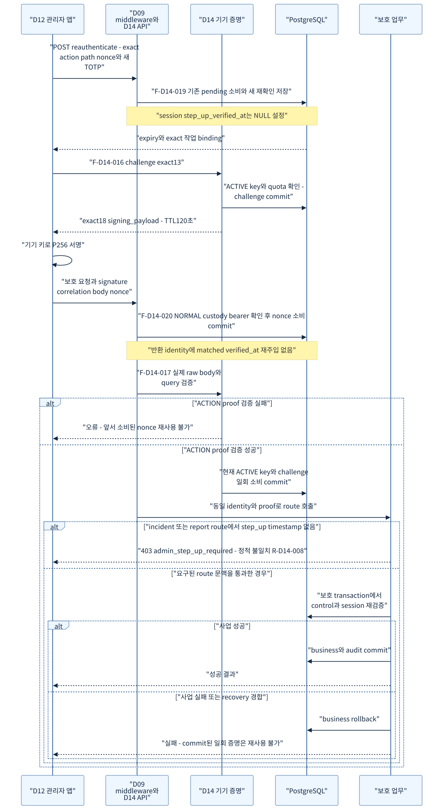

[Mermaid 원본](../diagrams/D14-security-sequence.mmd) · [SVG](../rendered/D14-security-sequence.svg)

## F-D14-021 복구 코드로 긴급 복구 시작

| 항목 | 명세 |
| --- | --- |
| 분야 | D14 Backend 관리자 보안·기기 증명·복구·감사·중대사고 |
| 목적 | 복구 자료로 모든 기존 세션을 끊고 새 password/TOTP로 전환할 준비를 한다. |
| 사용 주체 | 관리자 Android 앱 |
| 활성 상태 | CONDITIONAL |
| 진입점 | backend/app/api/admin_security.py:854 start_recovery backend/app/services/admin_security.py:3416 start_recovery |
| 실행 전제 | 관리자 보안 활성화 및 해당 API의 신뢰 문맥 필요. 배포 환경은 PostgreSQL 사용을 전제한다. |
| 입력 출처 형식 검증 최신성 | POST /admin/security/recovery/start; strict admin_id/recovery_code/device_id/device_label, Android headers. 이 경로는 public recovery-code 입력이며 device-proof 검증 직접 요구 없음. recovery_code trim후24..256자, admin_id1..64, device8..128, label trim후1..128; code hashing은 uppercase normalization. |

### 시작 이벤트와 처리 순서

| 이벤트 ID | 발생원 | 이벤트 | 수신부 | 흐름 |
| --- | --- | --- | --- | --- |
| E-D14-021-01 | 복구 코드로 긴급 복구 시작 진입 | POST /admin/security/recovery/start | start_recovery | 1. 실패 제한과 admin recovery advisory fence/control lock → 2. 설정 admin와 미사용 recovery code digest 및 활성 transaction 조회 → 3. 기존 같은 code/device transaction이면 F-D14-022 resume로 연결; 다른 활성 transaction이면409 → 4. 기기 proof 활성 시 recovery device에 정확히 1 ACTIVE key 요구 → 5. 모든 session 폐기, 복구 device ACTIVE 하나만 보존, 다른 ACTIVE와 모든 PENDING key 폐기 → 6. 48바이트 random token의 digest/이전 TOTP fingerprint/device/기본15분 expiry transaction 저장 → 7. custody UNATTESTED로 초기화, security_state RECOVERY_IN_PROGRESS 및 state_version 증가 → 8. 행 변경·attributable source digest/device_label 포함 성공 감사 commit 후 recovery_token 반환 |

1. 1. 실패 제한과 admin recovery advisory fence/control lock
2. 2. 설정 admin와 미사용 recovery code digest 및 활성 transaction 조회
3. 3. 기존 같은 code/device transaction이면 F-D14-022 resume로 연결; 다른 활성 transaction이면409
4. 4. 기기 proof 활성 시 recovery device에 정확히 1 ACTIVE key 요구
5. 5. 모든 session 폐기, 복구 device ACTIVE 하나만 보존, 다른 ACTIVE와 모든 PENDING key 폐기
6. 6. 48바이트 random token의 digest/이전 TOTP fingerprint/device/기본15분 expiry transaction 저장
7. 7. custody UNATTESTED로 초기화, security_state RECOVERY_IN_PROGRESS 및 state_version 증가
8. 8. 행 변경·attributable source digest/device_label 포함 성공 감사 commit 후 recovery_token 반환

| 분기 조건 | 실제 처리 결과 | 구현 근거 |
| --- | --- | --- |
| 잘못된 admin/code | 401 recovery_credentials_invalid | backend/app/services/admin_security.py:1859 AdminSecurityService._lock_recovery_state |
| 복구 device active key 수가1이 아님 | 403 recovery_device_key_required | backend/app/services/admin_security.py:1859 AdminSecurityService._lock_recovery_state |
| 다른 code/device 활성 복구 존재 | 409 recovery_in_progress | backend/app/services/admin_security.py:1859 AdminSecurityService._lock_recovery_state |

### 효과 종료와 복구

API 응답 또는 내부 반환값과 명시한 DB 행·감사 기록. 음성·진동·화면 표현은 D12 관리자 앱 담당.

| 상황 | 동작 |
| --- | --- |
| 정상 완료 | 복구 코드는 시작 때 소비하지 않고 성공 완료 때 used_at 설정. |
| 실패 | 명시된 오류 코드를 반환. SQLAlchemy 오류는 rollback 후 503 계열로 변환. |
| 시간 초과 | 별도 요청 타이머는 이 함수에 없음. 자격·증명 유효시간은 입력 및 정책 참조. |
| 중복 입력 | 독립된 중복 허용 규칙이 없으면 동일 진입 검사를 다시 적용. |
| 취소 | 복구 취소 HTTP API 없음. |
| 중단과 생명주기 | 응답 유실 후 같은 code/device resume가 가능하지만 완료기한 연장 없음. |
| 재시도 | 서버 자동 재시도 없음. |
| 복구 | 새 TOTP 배포 후 F-D14-023 완료; 만료는 F-D14-024. |
| 자원 정리 | 키·세션 삭제 대신 revoke, custody 해시·메타데이터 초기화. |

### 상태 실행 맥락과 연결

| 항목 | 명세 |
| --- | --- |
| 초기 상태 | S-D14-021-INITIAL: NORMAL 또는 RECOVERY_REQUIRED |
| 상태 목록 | S-D14-021-01: NORMAL S-D14-021-02: RECOVERY_REQUIRED S-D14-021-03: RECOVERY_IN_PROGRESS |
| 전이 조건과 전이 동작 | 유효 code와 기기→RECOVERY_IN_PROGRESS 기존 동일 활성 transaction→resume 만료 완료 요청→RECOVERY_REQUIRED |
| 허용되지 않는 전이 | 진행중 다른 복구 transaction 병행 금지 |
| 동시성 순서와 작업 소유권 | FastAPI 동기 endpoint와 동기 SQLAlchemy Session. 요청 간 동시성은 PostgreSQL 행 잠금·보호 함수로 직렬화하는 경로를 사용한다. 이 기능 안에 별도 큐·백그라운드 타이머·callback은 없음. |
| 공유 상태와 다른 기능 연결 | AdminSecurityControl 단일 관리자 상태, AdminSecuritySession 및 관련 proof/감사 행을 공유. HTTP middleware는 D09 참조. |

### 정책 근거와 검증 범위

| 항목 | 근거 |
| --- | --- |
| 정책 | [P-D14-005](#P-D14-005) [P-D14-007](#P-D14-007) [P-D14-011](#P-D14-011) [P-D14-015](#P-D14-015) |
| 구현 | [backend/app/api/admin_security.py:854](/home/ddobagi/Hanium_Dreamup/backend/app/api/admin_security.py:854) · `start_recovery` (범위 854–876) [backend/app/services/admin_security.py:3416](/home/ddobagi/Hanium_Dreamup/backend/app/services/admin_security.py:3416) · `start_recovery` (범위 3416–3857) [backend/app/services/admin_security.py:1859](/home/ddobagi/Hanium_Dreamup/backend/app/services/admin_security.py:1859) · `AdminSecurityService._lock_recovery_state` (범위 1859–1873) [backend/alembic/versions/202609290002_admin_device_key_pending_revocation.py:186](/home/ddobagi/Hanium_Dreamup/backend/alembic/versions/202609290002_admin_device_key_pending_revocation.py:186) · `walksafe_reset_recovery_custody` (범위 186–216) |
| 기존 개선 ID | S18-31 |
| 기존 분야 | 18 |
| 기존 실행 증거 | 이번 기준은 2026-10-04 10:33:40 KST 고정 작업트리 텍스트 snapshot. 과거 DONE·통합시험·실기기·외부서비스 결과를 이번 실행 증거로 사용하지 않음. |
| 한계 및 구분 | 모든 기기 키를 잃었다면 신뢰된 local provision으로 복구 기기 ACTIVE key 마련이 필요하다. 복구 code만으로 미등록 기기를 통과시키지 않는다. |

| 테스트 위치 | 심볼 | 증거 수준 | 기대와 한계 |
| --- | --- | --- | --- |
| [backend/tests/test_admin_sweep_w22.py](/home/ddobagi/Hanium_Dreamup/backend/tests/test_admin_sweep_w22.py) | test_s18_31_postgres_recovery_start_is_rate_limited_and_attributable | TEST_EXPECTATION | 복구 시작 제한과 출처 귀속 기대; 이번 실행하지 않음 |

### 이벤트 처리 그림


[Mermaid 원본](../diagrams/D14-F021.mmd) · [SVG](../rendered/D14-F021.svg)

[Mermaid 원본](../diagrams/D14-recovery-state.mmd) · [SVG](../rendered/D14-recovery-state.svg)

## F-D14-022 복구 시작 응답 유실 후 재개

| 항목 | 명세 |
| --- | --- |
| 분야 | D14 Backend 관리자 보안·기기 증명·복구·감사·중대사고 |
| 목적 | 같은 코드와 기기의 미완료 복구를 새 token으로 재개한다. |
| 사용 주체 | 신뢰된 서버 또는 운영자 |
| 활성 상태 | CONDITIONAL |
| 진입점 | backend/app/services/admin_security.py:3416 start_recovery |
| 실행 전제 | 관리자 보안 활성화 및 해당 API의 신뢰 문맥 필요. 배포 환경은 PostgreSQL 사용을 전제한다. |
| 입력 출처 형식 검증 최신성 | 동일 POST /admin/security/recovery/start의 활성 transaction 분기. 같은 unused recovery code id/device, expires>now. |

### 시작 이벤트와 처리 순서

| 이벤트 ID | 발생원 | 이벤트 | 수신부 | 흐름 |
| --- | --- | --- | --- | --- |
| E-D14-022-01 | 복구 시작 응답 유실 후 재개 진입 | 동일 POST /admin/security/recovery/start의 활성 transaction 분기. 같은 unused recovery code id/device, expires>now. | start_recovery | 1. 기존 활성 복구의 code/device 일치 확인 → 2. proof 활성일 때 recovery device 정확1 ACTIVE key 재확인 → 3. 새48바이트 token 생성 후 기존 transaction의 token SHA256만 교체 → 4. PG private pending recovery binding도 새 token에 동기화; 기존 expiry 유지 → 5. recovery.resume SUCCESS(expiry_extended=false) 및 성공 attempt commit → 6. 새 recovery_token 반환 |

1. 1. 기존 활성 복구의 code/device 일치 확인
2. 2. proof 활성일 때 recovery device 정확1 ACTIVE key 재확인
3. 3. 새48바이트 token 생성 후 기존 transaction의 token SHA256만 교체
4. 4. PG private pending recovery binding도 새 token에 동기화; 기존 expiry 유지
5. 5. recovery.resume SUCCESS(expiry_extended=false) 및 성공 attempt commit
6. 6. 새 recovery_token 반환

| 분기 조건 | 실제 처리 결과 | 구현 근거 |
| --- | --- | --- |
| 다른 code/device | 409 | backend/app/services/admin_security.py:879 auth_rate_limit_principal |
| 기존 token으로 completion 시도 | digest가 교체되어 invalid | backend/app/services/admin_security.py:879 auth_rate_limit_principal |
| 복구 transaction 이미 만료 | resume 분기가 아니며 새 start 처리 조건으로 이동 | backend/app/services/admin_security.py:879 auth_rate_limit_principal |

### 효과 종료와 복구

API 응답 또는 내부 반환값과 명시한 DB 행·감사 기록. 음성·진동·화면 표현은 D12 관리자 앱 담당.

| 상황 | 동작 |
| --- | --- |
| 정상 완료 | 검사와 명시적 트랜잭션 처리 후 반환. |
| 실패 | 명시된 오류 코드를 반환. SQLAlchemy 오류는 rollback 후 503 계열로 변환. |
| 시간 초과 | original expires_at 유지. 토큰 rotate로 시간/실패 횟수 제한을 초기화하지 않음. |
| 중복 입력 | 각 resume는 다시 새 token으로 교체하므로 마지막 성공 token만 유효. |
| 취소 | 취소 API 없음. |
| 중단과 생명주기 | 요청 중단이 commit 이후 도달하면 저장 결과를 자동 취소하지 않음. 전송 보장은 정적 분석으로 확인하지 않음. |
| 재시도 | 서버 자동 재시도 없음. |
| 복구 | 새 token을 저장한 뒤 completion. 자동 재시도 없음. |
| 자원 정리 | 세션·자격의 무효화와 물리 삭제는 별개. 본 함수는 명시한 행 변경 외 자동 보존기한 삭제를 하지 않음. |

### 상태 실행 맥락과 연결

| 항목 | 명세 |
| --- | --- |
| 초기 상태 | S-D14-022-INITIAL: 요청 전 |
| 상태 목록 | S-D14-022-01: 처리 전 S-D14-022-02: 성공 S-D14-022-03: 거절 |
| 전이 조건과 전이 동작 | 진입 검증 통과→처리→결과 반환 검증 실패→거절 |
| 허용되지 않는 전이 | 코드에 없는 추가 상태 전이는 정의하지 않음 |
| 동시성 순서와 작업 소유권 | rate-limit advisory lock 다음 recovery-state fence로 start/resume/complete를 직렬화한다. |
| 공유 상태와 다른 기능 연결 | AdminSecurityControl 단일 관리자 상태, AdminSecuritySession 및 관련 proof/감사 행을 공유. HTTP middleware는 D09 참조. |

### 정책 근거와 검증 범위

| 항목 | 근거 |
| --- | --- |
| 정책 | [P-D14-005](#P-D14-005) [P-D14-015](#P-D14-015) |
| 구현 | [backend/app/services/admin_security.py:3416](/home/ddobagi/Hanium_Dreamup/backend/app/services/admin_security.py:3416) · `start_recovery` (범위 3416–3857) [backend/app/services/admin_security.py:879](/home/ddobagi/Hanium_Dreamup/backend/app/services/admin_security.py:879) · `auth_rate_limit_principal` (범위 879–895) |
| 기존 개선 ID | 개별 동일성 미확인; 분야 연관은 별도 추적표 |
| 기존 분야 | 18 |
| 기존 실행 증거 | 이번 기준은 2026-10-04 10:33:40 KST 고정 작업트리 텍스트 snapshot. 과거 DONE·통합시험·실기기·외부서비스 결과를 이번 실행 증거로 사용하지 않음. |
| 한계 및 구분 | 실행 이벤트는 F-D14-021과 같은 endpoint지만 response-loss용 독립 상태 분기여서 별도 기능으로 문서화. |

| 테스트 위치 | 심볼 | 증거 수준 | 기대와 한계 |
| --- | --- | --- | --- |

연결한 테스트 미확인: 이번 작성 범위에서 이 기능에 대응하는 시험 단언을 연결하지 않았다. 테스트 자체가 없다는 판정이 아니다.

### 이벤트 처리 그림


[Mermaid 원본](../diagrams/D14-F022.mmd) · [SVG](../rendered/D14-F022.svg)

## F-D14-023 새 비밀번호·TOTP로 복구 완료

| 항목 | 명세 |
| --- | --- |
| 분야 | D14 Backend 관리자 보안·기기 증명·복구·감사·중대사고 |
| 목적 | 복구 기기에서 새 인자를 입증하고 NORMAL로 복귀시키되 고위험 custody 확인은 다시 요구한다. |
| 사용 주체 | 관리자 Android 앱 |
| 활성 상태 | CONDITIONAL |
| 진입점 | backend/app/api/admin_security.py:888 complete_recovery backend/app/services/admin_security.py:3859 complete_recovery |
| 실행 전제 | 관리자 보안 활성화 및 해당 API의 신뢰 문맥 필요. 배포 환경은 PostgreSQL 사용을 전제한다. |
| 입력 출처 형식 검증 최신성 | POST /admin/security/recovery/complete; recovery_token/new_password/totp_code/device_id/device_label; RECOVERY_COMPLETE proof, 새 runtime TOTP secret. recovery_token32..512자, new_password12..256, TOTP6digits, device8..128, label1..128. |

### 시작 이벤트와 처리 순서

| 이벤트 ID | 발생원 | 이벤트 | 수신부 | 흐름 |
| --- | --- | --- | --- | --- |
| E-D14-023-01 | 새 비밀번호·TOTP로 복구 완료 진입 | POST /admin/security/recovery/complete | complete_recovery | 1. 실패 제한→recovery fence→token/transaction/code 검사 → 2. 이미 완료 또는 code 사용됨 거절; 만료는 F-D14-024 → 3. control RECOVERY_IN_PROGRESS 및 bound device, ACTIVE key 확인 → 4. 새 runtime TOTP fingerprint가 transaction 이전값과 current control값 모두와 달라야 함 → 5. 새 TOTP 검증 및 이전 password 재사용 거절, 새 password hash 생성 → 6. PG 보호함수에서 password/factor/timecode/NORMAL/version 갱신 및 code.used/transaction.completed 기록 → 7. RECOVERY_COMPLETE session 발급과 SUCCESS 감사/attempt를 같은 transaction으로 commit → 8. opaque access token 및 NORMAL 반환 |

1. 1. 실패 제한→recovery fence→token/transaction/code 검사
2. 2. 이미 완료 또는 code 사용됨 거절; 만료는 F-D14-024
3. 3. control RECOVERY_IN_PROGRESS 및 bound device, ACTIVE key 확인
4. 4. 새 runtime TOTP fingerprint가 transaction 이전값과 current control값 모두와 달라야 함
5. 5. 새 TOTP 검증 및 이전 password 재사용 거절, 새 password hash 생성
6. 6. PG 보호함수에서 password/factor/timecode/NORMAL/version 갱신 및 code.used/transaction.completed 기록
7. 7. RECOVERY_COMPLETE session 발급과 SUCCESS 감사/attempt를 같은 transaction으로 commit
8. 8. opaque access token 및 NORMAL 반환

| 분기 조건 | 실제 처리 결과 | 구현 근거 |
| --- | --- | --- |
| runtime TOTP 미교체/잘못된 pending candidate | 409 admin_totp_secret_not_replaced | backend/app/services/admin_security.py:1957 AdminSecurityService._issue_session |
| 새 TOTP 불일치 | 401 recovery_verification_failed | backend/app/services/admin_security.py:1957 AdminSecurityService._issue_session |
| 기존 password 재사용 | 422 password_reuse_forbidden | backend/app/services/admin_security.py:1957 AdminSecurityService._issue_session |
| token 완료·소비·누락 | 401 recovery_invalid | backend/app/services/admin_security.py:1957 AdminSecurityService._issue_session |
| device/state 불일치 | 403 recovery_invalid | backend/app/services/admin_security.py:1957 AdminSecurityService._issue_session |

### 효과 종료와 복구

API 응답 또는 내부 반환값과 명시한 DB 행·감사 기록. 음성·진동·화면 표현은 D12 관리자 앱 담당.

| 상황 | 동작 |
| --- | --- |
| 정상 완료 | NORMAL session 발급. custody는 UNATTESTED 유지되어 고위험 작업 전에 F-D14-012 재확인 필요. |
| 실패 | 명시된 오류 코드를 반환. SQLAlchemy 오류는 rollback 후 503 계열로 변환. |
| 시간 초과 | 별도 요청 타이머는 이 함수에 없음. 자격·증명 유효시간은 입력 및 정책 참조. |
| 중복 입력 | 완료 transaction 재사용은401. 성공 token 원문을 복원하는 API는 없음. |
| 취소 | 취소 API 없음. |
| 중단과 생명주기 | 요청 중단이 commit 이후 도달하면 저장 결과를 자동 취소하지 않음. 전송 보장은 정적 분석으로 확인하지 않음. |
| 재시도 | 서버 자동 재시도 없음. |
| 복구 | 완료 응답 유실 시 새 password/TOTP로 새 로그인 시도. 동일 TOTP timecode 재사용은 거절됨. |
| 자원 정리 | 세션·자격의 무효화와 물리 삭제는 별개. 본 함수는 명시한 행 변경 외 자동 보존기한 삭제를 하지 않음. |

### 상태 실행 맥락과 연결

| 항목 | 명세 |
| --- | --- |
| 초기 상태 | S-D14-023-INITIAL: 요청 전 |
| 상태 목록 | S-D14-023-01: 처리 전 S-D14-023-02: 성공 S-D14-023-03: 거절 |
| 전이 조건과 전이 동작 | 진입 검증 통과→처리→결과 반환 검증 실패→거절 |
| 허용되지 않는 전이 | 코드에 없는 추가 상태 전이는 정의하지 않음 |
| 동시성 순서와 작업 소유권 | FastAPI 동기 endpoint와 동기 SQLAlchemy Session. 요청 간 동시성은 PostgreSQL 행 잠금·보호 함수로 직렬화하는 경로를 사용한다. 이 기능 안에 별도 큐·백그라운드 타이머·callback은 없음. |
| 공유 상태와 다른 기능 연결 | AdminSecurityControl 단일 관리자 상태, AdminSecuritySession 및 관련 proof/감사 행을 공유. HTTP middleware는 D09 참조. |

### 정책 근거와 검증 범위

| 항목 | 근거 |
| --- | --- |
| 정책 | [P-D14-003](#P-D14-003) [P-D14-004](#P-D14-004) [P-D14-005](#P-D14-005) [P-D14-015](#P-D14-015) [P-D14-016](#P-D14-016) |
| 구현 | [backend/app/api/admin_security.py:888](/home/ddobagi/Hanium_Dreamup/backend/app/api/admin_security.py:888) · `complete_recovery` (범위 888–920) [backend/app/services/admin_security.py:3859](/home/ddobagi/Hanium_Dreamup/backend/app/services/admin_security.py:3859) · `complete_recovery` (범위 3859–4374) [backend/app/services/admin_security.py:1957](/home/ddobagi/Hanium_Dreamup/backend/app/services/admin_security.py:1957) · `AdminSecurityService._issue_session` (범위 1957–2055) |
| 기존 개선 ID | 개별 동일성 미확인; 분야 연관은 별도 추적표 |
| 기존 분야 | 18 |
| 기존 실행 증거 | 이번 기준은 2026-10-04 10:33:40 KST 고정 작업트리 텍스트 snapshot. 과거 DONE·통합시험·실기기·외부서비스 결과를 이번 실행 증거로 사용하지 않음. |
| 한계 및 구분 | TOTP secret 교체는 이 HTTP 요청이 수행하지 않으며 운영 설정 배포와 별도 capability 후보 결속이 필요하다. |

| 테스트 위치 | 심볼 | 증거 수준 | 기대와 한계 |
| --- | --- | --- | --- |

연결한 테스트 미확인: 이번 작성 범위에서 이 기능에 대응하는 시험 단언을 연결하지 않았다. 테스트 자체가 없다는 판정이 아니다.

### 이벤트 처리 그림


[Mermaid 원본](../diagrams/D14-F023.mmd) · [SVG](../rendered/D14-F023.svg)

[Mermaid 원본](../diagrams/D14-recovery-state.mmd) · [SVG](../rendered/D14-recovery-state.svg)

## F-D14-024 만료된 복구의 정리와 제한된 proof 통과

| 항목 | 명세 |
| --- | --- |
| 분야 | D14 Backend 관리자 보안·기기 증명·복구·감사·중대사고 |
| 목적 | 정확히 결속된 만료 복구 요청이 정리 route에 도달하여 상태를 안전하게 전이한다. |
| 사용 주체 | 신뢰된 서버 또는 운영자 |
| 활성 상태 | CONDITIONAL |
| 진입점 | backend/app/services/admin_security.py:3859 complete_recovery backend/app/services/admin_device_proof.py:773 _lock_device_proof_key |
| 실행 전제 | 관리자 보안 활성화 및 해당 API의 신뢰 문맥 필요. 배포 환경은 PostgreSQL 사용을 전제한다. |
| 입력 출처 형식 검증 최신성 | 기존 valid token과 미완료 transaction이 expires_at<=now. PG context가 RECOVERY_EXPIRED여도 exact expired candidate와 ACTIVE key가 일치할 때만 공개키를 반환. |

### 시작 이벤트와 처리 순서

| 이벤트 ID | 발생원 | 이벤트 | 수신부 | 흐름 |
| --- | --- | --- | --- | --- |
| E-D14-024-01 | 만료된 복구의 정리와 제한된 proof 통과 진입 | 기존 valid token과 미완료 transaction이 expires_at<=now. PG context가 RECOVERY_EXPIRED여도 exact expired candidate와 ACTIVE key가 일치할 때만 공개키를 반환. | complete_recovery | 1. PG startup classifier가 정확한 expired binding 하나/active0이면 RECOVERY_EXPIRED_CANDIDATE 허용 → 2. proof context는 새 TOTP·private token digest·expiry·이전 fingerprint·device·ACTIVE key exact인 만료 요청에만 키 반환 → 3. 정상 P256 proof 검증을 거쳐 complete_recovery까지 진행 → 4. 서비스가 신규 활성 transaction 존재 여부 확인 → 5. 새 활성 복구가 있으면 RECOVERY_IN_PROGRESS 유지, 없으면 RECOVERY_REQUIRED로 전이 → 6. 만료 DENIED 감사와 실패 attempt commit 후410 admin_recovery_expired |

1. 1. PG startup classifier가 정확한 expired binding 하나/active0이면 RECOVERY_EXPIRED_CANDIDATE 허용
2. 2. proof context는 새 TOTP·private token digest·expiry·이전 fingerprint·device·ACTIVE key exact인 만료 요청에만 키 반환
3. 3. 정상 P256 proof 검증을 거쳐 complete_recovery까지 진행
4. 4. 서비스가 신규 활성 transaction 존재 여부 확인
5. 5. 새 활성 복구가 있으면 RECOVERY_IN_PROGRESS 유지, 없으면 RECOVERY_REQUIRED로 전이
6. 6. 만료 DENIED 감사와 실패 attempt commit 후410 admin_recovery_expired

| 분기 조건 | 실제 처리 결과 | 구현 근거 |
| --- | --- | --- |
| expired인데 exact key/candidate 결속 불명확 | 410 또는403/503로 조기 거절; arbitrary old key 통과 없음 | backend/alembic/versions/202608150002_admin_recovery_expired_proof.py:477 _install_device_proof_context |
| 늦게 도착한 이전 만료 transaction이나 새 활성 복구 존재 | 새 복구 상태를 되돌리지 않음 | backend/alembic/versions/202608150002_admin_recovery_expired_proof.py:477 _install_device_proof_context |
| expiry가 정확 now | 만료 처리 | backend/alembic/versions/202608150002_admin_recovery_expired_proof.py:477 _install_device_proof_context |

### 효과 종료와 복구

API 응답 또는 내부 반환값과 명시한 DB 행·감사 기록. 음성·진동·화면 표현은 D12 관리자 앱 담당.

| 상황 | 동작 |
| --- | --- |
| 정상 완료 | 검사와 명시적 트랜잭션 처리 후 반환. |
| 실패 | 명시된 오류 코드를 반환. SQLAlchemy 오류는 rollback 후 503 계열로 변환. |
| 시간 초과 | 백그라운드 타이머가 아니라 만료 completion 요청 처리 시 상태 정리. |
| 중복 입력 | 독립된 중복 허용 규칙이 없으면 동일 진입 검사를 다시 적용. |
| 취소 | 취소 API 없음. |
| 중단과 생명주기 | 요청 중단이 commit 이후 도달하면 저장 결과를 자동 취소하지 않음. 전송 보장은 정적 분석으로 확인하지 않음. |
| 재시도 | 서버 자동 재시도 없음. |
| 복구 | 사용하지 않은 복구 code로 새 start 가능; 폐기된 session/타기기 키를 자동 되살리지 않음. |
| 자원 정리 | 세션·자격의 무효화와 물리 삭제는 별개. 본 함수는 명시한 행 변경 외 자동 보존기한 삭제를 하지 않음. |

### 상태 실행 맥락과 연결

| 항목 | 명세 |
| --- | --- |
| 초기 상태 | S-D14-024-INITIAL: 요청 전 |
| 상태 목록 | S-D14-024-01: 처리 전 S-D14-024-02: 성공 S-D14-024-03: 거절 |
| 전이 조건과 전이 동작 | 진입 검증 통과→처리→결과 반환 검증 실패→거절 |
| 허용되지 않는 전이 | 코드에 없는 추가 상태 전이는 정의하지 않음 |
| 동시성 순서와 작업 소유권 | FastAPI 동기 endpoint와 동기 SQLAlchemy Session. 요청 간 동시성은 PostgreSQL 행 잠금·보호 함수로 직렬화하는 경로를 사용한다. 이 기능 안에 별도 큐·백그라운드 타이머·callback은 없음. |
| 공유 상태와 다른 기능 연결 | AdminSecurityControl 단일 관리자 상태, AdminSecuritySession 및 관련 proof/감사 행을 공유. HTTP middleware는 D09 참조. |

### 정책 근거와 검증 범위

| 항목 | 근거 |
| --- | --- |
| 정책 | [P-D14-015](#P-D14-015) [P-D14-016](#P-D14-016) |
| 구현 | [backend/app/services/admin_security.py:3859](/home/ddobagi/Hanium_Dreamup/backend/app/services/admin_security.py:3859) · `complete_recovery` (범위 3859–4374) [backend/app/services/admin_device_proof.py:773](/home/ddobagi/Hanium_Dreamup/backend/app/services/admin_device_proof.py:773) · `_lock_device_proof_key` (범위 773–862) [backend/alembic/versions/202608150002_admin_recovery_expired_proof.py:477](/home/ddobagi/Hanium_Dreamup/backend/alembic/versions/202608150002_admin_recovery_expired_proof.py:477) · `_install_device_proof_context` (범위 477–778) [backend/alembic/versions/202608150002_admin_recovery_expired_proof.py:291](/home/ddobagi/Hanium_Dreamup/backend/alembic/versions/202608150002_admin_recovery_expired_proof.py:291) · `_install_startup_classifier` (범위 291–474) |
| 기존 개선 ID | 개별 동일성 미확인; 분야 연관은 별도 추적표 |
| 기존 분야 | 18 |
| 기존 실행 증거 | 이번 기준은 2026-10-04 10:33:40 KST 고정 작업트리 텍스트 snapshot. 과거 DONE·통합시험·실기기·외부서비스 결과를 이번 실행 증거로 사용하지 않음. |
| 한계 및 구분 | 비PG _lock_recovery_complete_context는 만료에서 즉시410하므로 운영 PG의 exact expired proof 경로와 동일하다고 보지 않는다. |

| 테스트 위치 | 심볼 | 증거 수준 | 기대와 한계 |
| --- | --- | --- | --- |
| [backend/tests/test_admin_device_proof.py](/home/ddobagi/Hanium_Dreamup/backend/tests/test_admin_device_proof.py) | test_postgres_expired_recovery_proof_reaches_real_cleanup_route | TEST_EXPECTATION | PG exact expired proof가 실제 정리 route에 도달하는 기대; 이번 실행하지 않음 |

### 이벤트 처리 그림


[Mermaid 원본](../diagrams/D14-F024.mmd) · [SVG](../rendered/D14-F024.svg)

[Mermaid 원본](../diagrams/D14-recovery-state.mmd) · [SVG](../rendered/D14-recovery-state.svg)

## F-D14-025 복구 TOTP 후보 결속 및 DB 역할 경계

| 항목 | 명세 |
| --- | --- |
| 분야 | D14 Backend 관리자 보안·기기 증명·복구·감사·중대사고 |
| 목적 | DB runtime 역할만으로 발급·복구·custody 상태를 직접 위조하지 못하게 보호함수를 둔다. |
| 사용 주체 | 신뢰된 서버 또는 운영자 |
| 활성 상태 | CONDITIONAL |
| 진입점 | backend/app/services/admin_security.py:807 _lock_postgresql_admin_security_control backend/alembic/versions/202608150002_admin_recovery_expired_proof.py:291 _install_startup_classifier |
| 실행 전제 | 해당 migration chain을 적용한 PostgreSQL. 실제 live DB owner/ACL/migration 적용 여부 미확인. |
| 입력 출처 형식 검증 최신성 | private capability TOTP fingerprint+issuer key digest, public singleton control, pending next fingerprint/token/expiry. schema authority는 SECURITY DEFINER와 pg_catalog,pg_temp search_path. |

### 시작 이벤트와 처리 순서

| 이벤트 ID | 발생원 | 이벤트 | 수신부 | 흐름 |
| --- | --- | --- | --- | --- |
| E-D14-025-01 | 복구 TOTP 후보 결속 및 DB 역할 경계 진입 | private capability TOTP fingerprint+issuer key digest, public singleton control, pending next fingerprint/token/expiry. schema authority는 SECURITY DEFINER와 pg_catalog,pg_temp search_path. | _lock_postgresql_admin_security_control | 1. runtime에는 control/session/reconfirmation/device key 직접 INSERT/UPDATE 및 recovery secret 테이블 SELECT 등을 제한 → 2. issuer·TOTP capability 확인을 잠금과 transition보다 앞에 적용하는 보호함수 사용 → 3. control/public-private fingerprint/custody tuple 일관성을 잠금 하에서 재확인 → 4. startup supplied factor=current이면 CURRENT, 정확 활성 복구에서 새 factor면 RECOVERY_CANDIDATE로 최초 binding → 5. 새 candidate를 한 번 결속한 뒤 다른 factor 또는 잘못된 pending binding은 INVALID → 6. challenge consumed_at 단방향 trigger와 custody same-transaction 감사 marker/deferred trigger 적용 |

1. 1. runtime에는 control/session/reconfirmation/device key 직접 INSERT/UPDATE 및 recovery secret 테이블 SELECT 등을 제한
2. 2. issuer·TOTP capability 확인을 잠금과 transition보다 앞에 적용하는 보호함수 사용
3. 3. control/public-private fingerprint/custody tuple 일관성을 잠금 하에서 재확인
4. 4. startup supplied factor=current이면 CURRENT, 정확 활성 복구에서 새 factor면 RECOVERY_CANDIDATE로 최초 binding
5. 5. 새 candidate를 한 번 결속한 뒤 다른 factor 또는 잘못된 pending binding은 INVALID
6. 6. challenge consumed_at 단방향 trigger와 custody same-transaction 감사 marker/deferred trigger 적용

| 분기 조건 | 실제 처리 결과 | 구현 근거 |
| --- | --- | --- |
| issuer가 다름·private/public fingerprint 불일치 | 권한 오류 또는 INVALID→startup/readiness 거절(D09) | backend/alembic/versions/202608130001_admin_runtime_acl_hardening.py:213 upgrade |
| 이미 다른 pending next factor 결속 | 새 후보 차단 | backend/alembic/versions/202608130001_admin_runtime_acl_hardening.py:213 upgrade |
| runtime proof payload 수정/소비 reset | DB trigger 거절 | backend/alembic/versions/202608130001_admin_runtime_acl_hardening.py:213 upgrade |
| 초기 UNATTESTED 복구 시작 감사 누락 | deferred commit trigger가 거절 | backend/alembic/versions/202608130001_admin_runtime_acl_hardening.py:213 upgrade |

### 효과 종료와 복구

API 응답 또는 내부 반환값과 명시한 DB 행·감사 기록. 음성·진동·화면 표현은 D12 관리자 앱 담당.

| 상황 | 동작 |
| --- | --- |
| 정상 완료 | 검사와 명시적 트랜잭션 처리 후 반환. |
| 실패 | 명시된 오류 코드를 반환. SQLAlchemy 오류는 rollback 후 503 계열로 변환. |
| 시간 초과 | 별도 요청 타이머는 이 함수에 없음. 자격·증명 유효시간은 입력 및 정책 참조. |
| 중복 입력 | 독립된 중복 허용 규칙이 없으면 동일 진입 검사를 다시 적용. |
| 취소 | 취소 API 없음. |
| 중단과 생명주기 | 요청 중단이 commit 이후 도달하면 저장 결과를 자동 취소하지 않음. 전송 보장은 정적 분석으로 확인하지 않음. |
| 재시도 | 서버 자동 재시도 없음. |
| 복구 | 실패 원인을 해소한 새 요청 또는 명시된 복구 기능 사용. |
| 자원 정리 | 세션·자격의 무효화와 물리 삭제는 별개. 본 함수는 명시한 행 변경 외 자동 보존기한 삭제를 하지 않음. |

### 상태 실행 맥락과 연결

| 항목 | 명세 |
| --- | --- |
| 초기 상태 | S-D14-025-INITIAL: 요청 전 |
| 상태 목록 | S-D14-025-01: 처리 전 S-D14-025-02: 성공 S-D14-025-03: 거절 |
| 전이 조건과 전이 동작 | 진입 검증 통과→처리→결과 반환 검증 실패→거절 |
| 허용되지 않는 전이 | 코드에 없는 추가 상태 전이는 정의하지 않음 |
| 동시성 순서와 작업 소유권 | SECURITY DEFINER가 public control/capability/session을 일관된 순서로 잠근다. 일부 marker는 deferred commit constraint에서 소비·검증한다. |
| 공유 상태와 다른 기능 연결 | AdminSecurityControl 단일 관리자 상태, AdminSecuritySession 및 관련 proof/감사 행을 공유. HTTP middleware는 D09 참조. PostgreSQL 역할 walksafe_backend_runtime은 public.walksafe_recovery_custody_capabilities 및 markers 전체 권한, recovery_codes/transactions SELECT, control/device key/session/reconfirmation/recovery 직접 INSERT/UPDATE를 제한한다. 허용된 SECURITY DEFINER 함수를 EXECUTE하며 search_path=pg_catalog,pg_temp가 고정된다. runtime challenge는 후속 hardening migration에서 consumed_at만 UPDATE 허용된다. 실제 DB role/ACL 적용은 미실행. |

### 정책 근거와 검증 범위

| 항목 | 근거 |
| --- | --- |
| 정책 | [P-D14-001](#P-D14-001) [P-D14-002](#P-D14-002) [P-D14-013](#P-D14-013) [P-D14-016](#P-D14-016) |
| 구현 | [backend/app/services/admin_security.py:807](/home/ddobagi/Hanium_Dreamup/backend/app/services/admin_security.py:807) · `_lock_postgresql_admin_security_control` (범위 807–837) [backend/alembic/versions/202608150002_admin_recovery_expired_proof.py:291](/home/ddobagi/Hanium_Dreamup/backend/alembic/versions/202608150002_admin_recovery_expired_proof.py:291) · `_install_startup_classifier` (범위 291–474) [backend/alembic/versions/202608130001_admin_runtime_acl_hardening.py:213](/home/ddobagi/Hanium_Dreamup/backend/alembic/versions/202608130001_admin_runtime_acl_hardening.py:213) · `upgrade` (범위 213–589) [backend/alembic/versions/202608120001_admin_recovery_custody.py:210](/home/ddobagi/Hanium_Dreamup/backend/alembic/versions/202608120001_admin_recovery_custody.py:210) · `runtime ACL and private capability` (범위 210–268) [backend/alembic/versions/202608120001_admin_recovery_custody.py:220](/home/ddobagi/Hanium_Dreamup/backend/alembic/versions/202608120001_admin_recovery_custody.py:220) · `runtime capability and credential ACL` (범위 220–269) [backend/alembic/versions/202608120001_admin_recovery_custody.py:3020](/home/ddobagi/Hanium_Dreamup/backend/alembic/versions/202608120001_admin_recovery_custody.py:3020) · `protected function runtime execute grants` (범위 3020–3100) [backend/alembic/versions/202608130001_admin_runtime_acl_hardening.py:214](/home/ddobagi/Hanium_Dreamup/backend/alembic/versions/202608130001_admin_runtime_acl_hardening.py:214) · `challenge consumed_at column grant` (범위 214–224) |
| 기존 개선 ID | 개별 동일성 미확인; 분야 연관은 별도 추적표 |
| 기존 분야 | 18 |
| 기존 실행 증거 | 이번 기준은 2026-10-04 10:33:40 KST 고정 작업트리 텍스트 snapshot. 과거 DONE·통합시험·실기기·외부서비스 결과를 이번 실행 증거로 사용하지 않음. |
| 한계 및 구분 | 이 명세는 migration 소스 규칙이다. 모든 설치 DB의 함수 fingerprint/owner/ACL을 이번에 조회하거나 검증하지 않았다. |

| 테스트 위치 | 심볼 | 증거 수준 | 기대와 한계 |
| --- | --- | --- | --- |

연결한 테스트 미확인: 이번 작성 범위에서 이 기능에 대응하는 시험 단언을 연결하지 않았다. 테스트 자체가 없다는 판정이 아니다.

### 이벤트 처리 그림


[Mermaid 원본](../diagrams/D14-F025.mmd) · [SVG](../rendered/D14-F025.svg)

## F-D14-026 보안 감사 hash chain 기록

| 항목 | 명세 |
| --- | --- |
| 분야 | D14 Backend 관리자 보안·기기 증명·복구·감사·중대사고 |
| 목적 | 자격 원문 대신 안전한 operational metadata를 연결된 감사 행으로 남긴다. |
| 사용 주체 | 신뢰된 서버 또는 운영자 |
| 활성 상태 | CONDITIONAL |
| 진입점 | backend/app/services/admin_security.py:960 _append_admin_security_audit backend/app/services/admin_security.py:1068 record_admin_security_failure |
| 실행 전제 | 관리자 보안 활성화 및 해당 API의 신뢰 문맥 필요. 배포 환경은 PostgreSQL 사용을 전제한다. |
| 입력 출처 형식 검증 최신성 | action/outcome SUCCESS\|DENIED\|ERROR, 선택 admin/session/device와 details. details 중첩 dict/list에서 forbidden key parts password/token/totp/secret/recovery_code 금지. |

### 시작 이벤트와 처리 순서

| 이벤트 ID | 발생원 | 이벤트 | 수신부 | 흐름 |
| --- | --- | --- | --- | --- |
| E-D14-026-01 | 보안 감사 hash chain 기록 진입 | action/outcome SUCCESS\|DENIED\|ERROR, 선택 admin/session/device와 details. details 중첩 dict/list에서 forbidden key parts password/token/totp/secret/recovery_code 금지. | _append_admin_security_audit | 1. 일반 감사 호출과 record_admin_security_failure 호출을 구분한다. → 2. failure helper는 호출 전에 admin_alert_required=true, alert_channel=ADMIN_API_RESPONSE, correlation/method/path digest/reason을 details로 구성한다. 일반 감사에는 자동으로 추가되지 않는다. → 3. _append_admin_security_audit는 전달받은 details의 JSON 타입과 중첩 key를 검증한다. → 4. PostgreSQL 전역 audit-chain advisory lock 후 최신 sequence/entry digest를 조회한다. → 5. 전달된 details와 UTC microsecond timestamp 등을 canonical JSON으로 SHA256하여 sequence+1/previous digest를 포함한 행을 생성한다. → 6. flush 후 일반 호출자는 자기 transaction으로 commit하고 denial/failure helper는 SessionLocal.begin의 독립 transaction으로 commit한다. |

1. 1. 일반 감사 호출과 record_admin_security_failure 호출을 구분한다.
2. 2. failure helper는 호출 전에 admin_alert_required=true, alert_channel=ADMIN_API_RESPONSE, correlation/method/path digest/reason을 details로 구성한다. 일반 감사에는 자동으로 추가되지 않는다.
3. 3. _append_admin_security_audit는 전달받은 details의 JSON 타입과 중첩 key를 검증한다.
4. 4. PostgreSQL 전역 audit-chain advisory lock 후 최신 sequence/entry digest를 조회한다.
5. 5. 전달된 details와 UTC microsecond timestamp 등을 canonical JSON으로 SHA256하여 sequence+1/previous digest를 포함한 행을 생성한다.
6. 6. flush 후 일반 호출자는 자기 transaction으로 commit하고 denial/failure helper는 SessionLocal.begin의 독립 transaction으로 commit한다.

| 분기 조건 | 실제 처리 결과 | 구현 근거 |
| --- | --- | --- |
| 민감 key 이름 또는 지원하지 않는 값 타입 | DB 접속 전 ValueError | backend/app/services/admin_security.py:898 _safe_audit_details |
| 감사 저장 실패 | 503 fail closed; 원 요청의 denial을 기록할 수 없어도 통과시키지 않음 | backend/app/services/admin_security.py:898 _safe_audit_details |
| 기존 audit UPDATE/DELETE/TRUNCATE | append-only trigger가 거절 | backend/app/services/admin_security.py:898 _safe_audit_details |

### 효과 종료와 복구

API 응답 또는 내부 반환값과 명시한 DB 행·감사 기록. 음성·진동·화면 표현은 D12 관리자 앱 담당.

| 상황 | 동작 |
| --- | --- |
| 정상 완료 | sequence/digest 행 저장. 감사 hash를 생성하는 것 자체가 외부 공증·서명은 아님. |
| 실패 | 명시된 오류 코드를 반환. SQLAlchemy 오류는 rollback 후 503 계열로 변환. |
| 시간 초과 | 별도 요청 타이머는 이 함수에 없음. 자격·증명 유효시간은 입력 및 정책 참조. |
| 중복 입력 | 독립된 중복 허용 규칙이 없으면 동일 진입 검사를 다시 적용. |
| 취소 | 취소 API 없음. |
| 중단과 생명주기 | 요청 중단이 commit 이후 도달하면 저장 결과를 자동 취소하지 않음. 전송 보장은 정적 분석으로 확인하지 않음. |
| 재시도 | 서버 자동 재시도 없음. |
| 복구 | 감사 저장 불가면 작업 실패를 응답하여 app에서 표시할 수 있음; 외부 알림 발송 없음. |
| 자원 정리 | 이 기능에 감사 물리삭제/보존기한 purge 없음. |

### 상태 실행 맥락과 연결

| 항목 | 명세 |
| --- | --- |
| 초기 상태 | S-D14-026-INITIAL: 요청 전 |
| 상태 목록 | S-D14-026-01: 처리 전 S-D14-026-02: 성공 S-D14-026-03: 거절 |
| 전이 조건과 전이 동작 | 진입 검증 통과→처리→결과 반환 검증 실패→거절 |
| 허용되지 않는 전이 | 코드에 없는 추가 상태 전이는 정의하지 않음 |
| 동시성 순서와 작업 소유권 | FastAPI 동기 endpoint와 동기 SQLAlchemy Session. 요청 간 동시성은 PostgreSQL 행 잠금·보호 함수로 직렬화하는 경로를 사용한다. 이 기능 안에 별도 큐·백그라운드 타이머·callback은 없음. |
| 공유 상태와 다른 기능 연결 | AdminSecurityControl 단일 관리자 상태, AdminSecuritySession 및 관련 proof/감사 행을 공유. HTTP middleware는 D09 참조. |

### 정책 근거와 검증 범위

| 항목 | 근거 |
| --- | --- |
| 정책 | [P-D14-017](#P-D14-017) |
| 구현 | [backend/app/services/admin_security.py:960](/home/ddobagi/Hanium_Dreamup/backend/app/services/admin_security.py:960) · `_append_admin_security_audit` (범위 960–1017) [backend/app/services/admin_security.py:1068](/home/ddobagi/Hanium_Dreamup/backend/app/services/admin_security.py:1068) · `record_admin_security_failure` (범위 1068–1105) [backend/app/services/admin_security.py:898](/home/ddobagi/Hanium_Dreamup/backend/app/services/admin_security.py:898) · `_safe_audit_details` (범위 898–904) [backend/app/services/admin_security.py:925](/home/ddobagi/Hanium_Dreamup/backend/app/services/admin_security.py:925) · `admin_security_audit_entry_sha256` (범위 925–957) [backend/app/services/admin_security.py:1044](/home/ddobagi/Hanium_Dreamup/backend/app/services/admin_security.py:1044) · `record_admin_security_denial` (범위 1044–1065) [backend/alembic/versions/202607260001_admin_security_action_bound_audit.py:69](/home/ddobagi/Hanium_Dreamup/backend/alembic/versions/202607260001_admin_security_action_bound_audit.py:69) · `_create_audit_guards` (범위 69–74) |
| 기존 개선 ID | 개별 동일성 미확인; 분야 연관은 별도 추적표 |
| 기존 분야 | 18 |
| 기존 실행 증거 | 이번 기준은 2026-10-04 10:33:40 KST 고정 작업트리 텍스트 snapshot. 과거 DONE·통합시험·실기기·외부서비스 결과를 이번 실행 증거로 사용하지 않음. |
| 한계 및 구분 | key 이름으로 필터링하는 코드이며 허용 문자열 값의 의미를 완전한 비밀 탐지기로 검사하지 않음. failure alert metadata는 hash 계산 및 저장 이전 입력이며 commit 이후 덧붙이지 않는다. |

| 테스트 위치 | 심볼 | 증거 수준 | 기대와 한계 |
| --- | --- | --- | --- |
| [backend/tests/test_admin_security.py](/home/ddobagi/Hanium_Dreamup/backend/tests/test_admin_security.py) | test_admin_audit_hash_chain_detects_tamper_and_order_changes | TEST_EXPECTATION | 내용과 순서 변화가 digest를 바꾸는 기대; 이번 실행하지 않음 |
| [backend/tests/test_admin_audit_detail_validation.py](/home/ddobagi/Hanium_Dreamup/backend/tests/test_admin_audit_detail_validation.py) | test_audit_append_rejects_invalid_nested_metadata_before_any_database_access | TEST_EXPECTATION | 중첩 비밀 key를 DB 접근 전에 거절; 이번 실행하지 않음 |

### 이벤트 처리 그림


[Mermaid 원본](../diagrams/D14-F026.mmd) · [SVG](../rendered/D14-F026.svg)

## F-D14-027 통합 관리자 감사 목록 조회

| 항목 | 명세 |
| --- | --- |
| 분야 | D14 Backend 관리자 보안·기기 증명·복구·감사·중대사고 |
| 목적 | 선택한 audit source의 최소 필드만 정렬해 관리자에게 제공한다. |
| 사용 주체 | 신뢰된 서버 또는 운영자 |
| 활성 상태 | CONDITIONAL |
| 진입점 | backend/app/api/admin_reports.py:899 list_admin_audit_events backend/app/services/admin_audit_projection.py:224 query_admin_audit_events |
| 실행 전제 | 관리자 보안 활성화 및 해당 API의 신뢰 문맥 필요. 배포 환경은 PostgreSQL 사용을 전제한다. |
| 입력 출처 형식 검증 최신성 | GET /admin/reports/audits; limit 기본25 1..100, cursor1..1024, event_type SECURITY\|READ\|STATUS\|REVIEW\|EXPORT\|DELIVERY, actor_id3..64. read purpose admin.audit.list의 ACTION proof. |

### 시작 이벤트와 처리 순서

| 이벤트 ID | 발생원 | 이벤트 | 수신부 | 흐름 |
| --- | --- | --- | --- | --- |
| E-D14-027-01 | 통합 관리자 감사 목록 조회 진입 | GET /admin/reports/audits | list_admin_audit_events | 1. 인증 read context와 query allowlist/중복 필드 검사 → 2. event_type+actor_id filter digest에 결속된 canonical cursor decode → 3. 각 source에서 timestamp 및 UUID keyset 조건으로 limit+1 최소 필드 조회 → 4. SECURITY6 READ5 STATUS4 REVIEW3 EXPORT2 DELIVERY1 rank와 source_rank 및 id로 내림차순 병합 → 5. delivery correction이 있는 원 event action에 .corrected 부가하고 correction 자체를 별도 row로 표시 → 6. page/next cursor 구성 후 admin.audit.list operation audit commit → 7. no-store 응답 반환 |

1. 1. 인증 read context와 query allowlist/중복 필드 검사
2. 2. event_type+actor_id filter digest에 결속된 canonical cursor decode
3. 3. 각 source에서 timestamp 및 UUID keyset 조건으로 limit+1 최소 필드 조회
4. 4. SECURITY6 READ5 STATUS4 REVIEW3 EXPORT2 DELIVERY1 rank와 source_rank 및 id로 내림차순 병합
5. 5. delivery correction이 있는 원 event action에 .corrected 부가하고 correction 자체를 별도 row로 표시
6. 6. page/next cursor 구성 후 admin.audit.list operation audit commit
7. 7. no-store 응답 반환

| 분기 조건 | 실제 처리 결과 | 구현 근거 |
| --- | --- | --- |
| cursor filter 불일치/비canonical/중복query | 422 admin_audit_cursor_invalid | backend/app/services/admin_audit_projection.py:106 decode_admin_audit_cursor |
| projection/DB 오류 | ERROR 감사 후503 | backend/app/services/admin_audit_projection.py:106 decode_admin_audit_cursor |
| audit 저장 실패 | 503으로 데이터 withholding | backend/app/services/admin_audit_projection.py:106 decode_admin_audit_cursor |
| READ AdminOperationAudit source | admin.report.list, admin.report.detail, admin.audit.list만 포함 | backend/app/services/admin_audit_projection.py:106 decode_admin_audit_cursor |

### 효과 종료와 복구

API 응답 또는 내부 반환값과 명시한 DB 행·감사 기록. 음성·진동·화면 표현은 D12 관리자 앱 담당.

| 상황 | 동작 |
| --- | --- |
| 정상 완료 | 검사와 명시적 트랜잭션 처리 후 반환. |
| 실패 | 명시된 오류 코드를 반환. SQLAlchemy 오류는 rollback 후 503 계열로 변환. |
| 시간 초과 | 별도 요청 타이머는 이 함수에 없음. 자격·증명 유효시간은 입력 및 정책 참조. |
| 중복 입력 | cursor는 filter/time/type/source/id 결속; 조회 자체도 새 감사 행을 추가. |
| 취소 | 취소 API 없음. |
| 중단과 생명주기 | 요청 중단이 commit 이후 도달하면 저장 결과를 자동 취소하지 않음. 전송 보장은 정적 분석으로 확인하지 않음. |
| 재시도 | 서버 자동 재시도 없음. |
| 복구 | 실패 원인을 해소한 새 요청 또는 명시된 복구 기능 사용. |
| 자원 정리 | JSON details·token·password·사진·증명 body 등은 projection 출력하지 않음. |

### 상태 실행 맥락과 연결

| 항목 | 명세 |
| --- | --- |
| 초기 상태 | S-D14-027-INITIAL: 요청 전 |
| 상태 목록 | S-D14-027-01: 처리 전 S-D14-027-02: 성공 S-D14-027-03: 거절 |
| 전이 조건과 전이 동작 | 진입 검증 통과→처리→결과 반환 검증 실패→거절 |
| 허용되지 않는 전이 | 코드에 없는 추가 상태 전이는 정의하지 않음 |
| 동시성 순서와 작업 소유권 | FastAPI 동기 endpoint와 동기 SQLAlchemy Session. 요청 간 동시성은 PostgreSQL 행 잠금·보호 함수로 직렬화하는 경로를 사용한다. 이 기능 안에 별도 큐·백그라운드 타이머·callback은 없음. |
| 공유 상태와 다른 기능 연결 | AdminSecurityControl 단일 관리자 상태, AdminSecuritySession 및 관련 proof/감사 행을 공유. HTTP middleware는 D09 참조. |

### 정책 근거와 검증 범위

| 항목 | 근거 |
| --- | --- |
| 정책 | [P-D14-017](#P-D14-017) [P-D14-018](#P-D14-018) |
| 구현 | [backend/app/api/admin_reports.py:899](/home/ddobagi/Hanium_Dreamup/backend/app/api/admin_reports.py:899) · `list_admin_audit_events` (범위 899–965) [backend/app/services/admin_audit_projection.py:224](/home/ddobagi/Hanium_Dreamup/backend/app/services/admin_audit_projection.py:224) · `query_admin_audit_events` (범위 224–416) [backend/app/services/admin_audit_projection.py:106](/home/ddobagi/Hanium_Dreamup/backend/app/services/admin_audit_projection.py:106) · `decode_admin_audit_cursor` (범위 106–165) [backend/app/services/admin_audit_projection.py:168](/home/ddobagi/Hanium_Dreamup/backend/app/services/admin_audit_projection.py:168) · `project_admin_audit_event` (범위 168–179) [backend/app/services/report_read_audit.py:93](/home/ddobagi/Hanium_Dreamup/backend/app/services/report_read_audit.py:93) · `persist_admin_operation_audit` (범위 93–167) |
| 기존 개선 ID | 개별 동일성 미확인; 분야 연관은 별도 추적표 |
| 기존 분야 | 18 |
| 기존 실행 증거 | 이번 기준은 2026-10-04 10:33:40 KST 고정 작업트리 텍스트 snapshot. 과거 DONE·통합시험·실기기·외부서비스 결과를 이번 실행 증거로 사용하지 않음. |
| 한계 및 구분 | 전체 AdminOperationAudit의 무손실 export가 아니다. incident/raw_collection/report_request operation audit가 DB에 있어도 이 READ allowlist로 직접 표시되지 않음. SECURITY digest chain을 GET 시 전수 검증하는 함수도 이 projection에는 없다. |

| 테스트 위치 | 심볼 | 증거 수준 | 기대와 한계 |
| --- | --- | --- | --- |

연결한 테스트 미확인: 이번 작성 범위에서 이 기능에 대응하는 시험 단언을 연결하지 않았다. 테스트 자체가 없다는 판정이 아니다.

### 이벤트 처리 그림


[Mermaid 원본](../diagrams/D14-F027.mmd) · [SVG](../rendered/D14-F027.svg)

## F-D14-028 내부 CRITICAL 사고 개시 기록

| 항목 | 명세 |
| --- | --- |
| 분야 | D14 Backend 관리자 보안·기기 증명·복구·감사·중대사고 |
| 목적 | 서버가 중대 사고와 최초 관측을 같은 transaction에 저장한다. |
| 사용 주체 | 신뢰된 서버 또는 운영자 |
| 활성 상태 | ACTIVE |
| 진입점 | backend/app/services/admin_incident_workflow.py:254 record_critical_incident backend/app/api/health.py:622 _record_report_storage_inventory_incident |
| 실행 전제 | 인증 HTTP 생성 route 없음. 서버 내부 producer만 호출; 실제 readiness 감지 조건은 D09. |
| 입력 출처 형식 검증 최신성 | 신뢰된 내부 호출: 안정 UUID incident_id; reason_code 5종; summary1..200, reason/observation8..500, lower SHA256 evidence; timezone 포함 started<=detected<=now. |

### 시작 이벤트와 처리 순서

| 이벤트 ID | 발생원 | 이벤트 | 수신부 | 흐름 |
| --- | --- | --- | --- | --- |
| E-D14-028-01 | 내부 CRITICAL 사고 개시 기록 진입 | 신뢰된 내부 호출: 안정 UUID incident_id | record_critical_incident | 1. 텍스트 trim/control char 금지와 시각 순서 검증 → 2. 정규 opening payload의 intent SHA256 계산 → 3. 같은 incident id 기존 행 잠금 및 digest 비교 → 4. 신규이면 CRITICAL/OPEN/version1 projection과 uuid5 OPENED revision1 event 생성 → 5. commit race IntegrityError도 기존 same-intent 재조회하여 idempotent 처리 |

1. 1. 텍스트 trim/control char 금지와 시각 순서 검증
2. 2. 정규 opening payload의 intent SHA256 계산
3. 3. 같은 incident id 기존 행 잠금 및 digest 비교
4. 4. 신규이면 CRITICAL/OPEN/version1 projection과 uuid5 OPENED revision1 event 생성
5. 5. commit race IntegrityError도 기존 same-intent 재조회하여 idempotent 처리

| 분기 조건 | 실제 처리 결과 | 구현 근거 |
| --- | --- | --- |
| 같은 id와 정확 opening intent | 기존 반환 created=false, 추가 event 없음 | backend/app/services/admin_incident_workflow.py:98 _opening_intent_sha256 |
| 같은 id 다른 intent | 409 incident_opening_conflict | backend/app/services/admin_incident_workflow.py:98 _opening_intent_sha256 |
| DB 오류 | rollback 및503 | backend/app/services/admin_incident_workflow.py:98 _opening_intent_sha256 |
| 실제 연결 producer | health 저장소 inventory mismatch에서 USER_SAFETY_RISK로 호출; 같은 evidence 기반 안정 id | backend/app/services/admin_incident_workflow.py:98 _opening_intent_sha256 |

### 효과 종료와 복구

API 응답 또는 내부 반환값과 명시한 DB 행·감사 기록. 음성·진동·화면 표현은 D12 관리자 앱 담당.

| 상황 | 동작 |
| --- | --- |
| 정상 완료 | 사고 기록만 commit. 프로세스 재시작·서비스 차단 제어·외부 알림은 이 함수가 수행하지 않음. |
| 실패 | 명시된 오류 코드를 반환. SQLAlchemy 오류는 rollback 후 503 계열로 변환. |
| 시간 초과 | 별도 요청 타이머는 이 함수에 없음. 자격·증명 유효시간은 입력 및 정책 참조. |
| 중복 입력 | stable incident id+intent exact idempotency. |
| 취소 | 취소 API 없음. |
| 중단과 생명주기 | 요청 중단이 commit 이후 도달하면 저장 결과를 자동 취소하지 않음. 전송 보장은 정적 분석으로 확인하지 않음. |
| 재시도 | 서버 자동 재시도 없음. |
| 복구 | 실패 원인을 해소한 새 요청 또는 명시된 복구 기능 사용. |
| 자원 정리 | 개시/이력 행 삭제 API 없음. |

### 상태 실행 맥락과 연결

| 항목 | 명세 |
| --- | --- |
| 초기 상태 | S-D14-028-INITIAL: 요청 전 |
| 상태 목록 | S-D14-028-01: 처리 전 S-D14-028-02: 성공 S-D14-028-03: 거절 |
| 전이 조건과 전이 동작 | 진입 검증 통과→처리→결과 반환 검증 실패→거절 |
| 허용되지 않는 전이 | 코드에 없는 추가 상태 전이는 정의하지 않음 |
| 동시성 순서와 작업 소유권 | FastAPI 동기 endpoint와 동기 SQLAlchemy Session. 요청 간 동시성은 PostgreSQL 행 잠금·보호 함수로 직렬화하는 경로를 사용한다. 이 기능 안에 별도 큐·백그라운드 타이머·callback은 없음. |
| 공유 상태와 다른 기능 연결 | AdminSecurityControl 단일 관리자 상태, AdminSecuritySession 및 관련 proof/감사 행을 공유. HTTP middleware는 D09 참조. |

### 정책 근거와 검증 범위

| 항목 | 근거 |
| --- | --- |
| 정책 | [P-D14-019](#P-D14-019) |
| 구현 | [backend/app/services/admin_incident_workflow.py:254](/home/ddobagi/Hanium_Dreamup/backend/app/services/admin_incident_workflow.py:254) · `record_critical_incident` (범위 254–377) [backend/app/api/health.py:622](/home/ddobagi/Hanium_Dreamup/backend/app/api/health.py:622) · `_record_report_storage_inventory_incident` (범위 622–647) [backend/app/services/admin_incident_workflow.py:98](/home/ddobagi/Hanium_Dreamup/backend/app/services/admin_incident_workflow.py:98) · `_opening_intent_sha256` (범위 98–122) [backend/app/models.py:3277](/home/ddobagi/Hanium_Dreamup/backend/app/models.py:3277) · `CriticalIncident` (범위 3277–3349) [backend/app/models.py:3352](/home/ddobagi/Hanium_Dreamup/backend/app/models.py:3352) · `CriticalIncidentEvent` (범위 3352–3442) |
| 기존 개선 ID | 개별 동일성 미확인; 분야 연관은 별도 추적표 |
| 기존 분야 | 18 |
| 기존 실행 증거 | 이번 기준은 2026-10-04 10:33:40 KST 고정 작업트리 텍스트 snapshot. 과거 DONE·통합시험·실기기·외부서비스 결과를 이번 실행 증거로 사용하지 않음. |
| 한계 및 구분 | 현재 코드의 정적 분석. 테스트는 기대 계약이며 실제 실행·배포 상태는 확인하지 않음. |

| 테스트 위치 | 심볼 | 증거 수준 | 기대와 한계 |
| --- | --- | --- | --- |
| [backend/tests/test_admin_incidents.py](/home/ddobagi/Hanium_Dreamup/backend/tests/test_admin_incidents.py) | test_trusted_opening_is_exactly_idempotent_and_conflicts_on_changed_intent | TEST_EXPECTATION | same opening 재사용 및 변경 intent 충돌 기대; 이번 실행하지 않음 |

### 이벤트 처리 그림


[Mermaid 원본](../diagrams/D14-F028.mmd) · [SVG](../rendered/D14-F028.svg)

## F-D14-029 관리자 CRITICAL 사고 목록

| 항목 | 명세 |
| --- | --- |
| 분야 | D14 Backend 관리자 보안·기기 증명·복구·감사·중대사고 |
| 목적 | 상태 필터와 안정 정렬 cursor로 사고 요약을 제공한다. |
| 사용 주체 | 관리자 Android 앱 |
| 활성 상태 | CONDITIONAL |
| 진입점 | backend/app/api/admin_incidents.py:298 list_admin_incidents |
| 실행 전제 | 관리자 보안 활성화 및 해당 API의 신뢰 문맥 필요. 배포 환경은 PostgreSQL 사용을 전제한다. |
| 입력 출처 형식 검증 최신성 | GET /admin/incidents; limit 기본25 1..100, cursor1..1024, optional status OPEN\|ACKNOWLEDGED\|RESOLVED\|REOPENED; exact read purpose admin.incident.list. |

### 시작 이벤트와 처리 순서

| 이벤트 ID | 발생원 | 이벤트 | 수신부 | 흐름 |
| --- | --- | --- | --- | --- |
| E-D14-029-01 | 관리자 CRITICAL 사고 목록 진입 | GET /admin/incidents | list_admin_incidents | 1. identity 및 matching ACTION read proof 확인 → 2. query allowlist limit/cursor/status 및 중복 금지 → 3. status filter digest에 결속된 canonical cursor 검증 → 4. detected_at desc/id desc, cursor보다 작은 key, limit+1 조회 → 5. 최소 summary list와 next cursor 구성 → 6. SUCCESS/ERROR/DENIED operation audit commit 후 반환 |

1. 1. identity 및 matching ACTION read proof 확인
2. 2. query allowlist limit/cursor/status 및 중복 금지
3. 3. status filter digest에 결속된 canonical cursor 검증
4. 4. detected_at desc/id desc, cursor보다 작은 key, limit+1 조회
5. 5. 최소 summary list와 next cursor 구성
6. 6. SUCCESS/ERROR/DENIED operation audit commit 후 반환

| 분기 조건 | 실제 처리 결과 | 구현 근거 |
| --- | --- | --- |
| 잘못된 cursor | 422 admin_incident_cursor_invalid | backend/app/services/admin_incident_projection.py:105 decode_admin_incident_cursor |
| unknown/duplicate query | 422 admin_incident_filter_invalid | backend/app/services/admin_incident_projection.py:105 decode_admin_incident_cursor |
| DB/projection 오류 | 503 admin_incident_list_unavailable | backend/app/services/admin_incident_projection.py:105 decode_admin_incident_cursor |
| 조회 결과 없음 | 빈 items와 null cursor 성공 | backend/app/services/admin_incident_projection.py:105 decode_admin_incident_cursor |

### 효과 종료와 복구

API 응답 또는 내부 반환값과 명시한 DB 행·감사 기록. 음성·진동·화면 표현은 D12 관리자 앱 담당.

| 상황 | 동작 |
| --- | --- |
| 정상 완료 | 응답은 no-store이며 목록 상태는 조회 시점 값. |
| 실패 | 명시된 오류 코드를 반환. SQLAlchemy 오류는 rollback 후 503 계열로 변환. |
| 시간 초과 | 별도 요청 타이머는 이 함수에 없음. 자격·증명 유효시간은 입력 및 정책 참조. |
| 중복 입력 | 독립된 중복 허용 규칙이 없으면 동일 진입 검사를 다시 적용. |
| 취소 | 취소 API 없음. |
| 중단과 생명주기 | 요청 중단이 commit 이후 도달하면 저장 결과를 자동 취소하지 않음. 전송 보장은 정적 분석으로 확인하지 않음. |
| 재시도 | 서버 자동 재시도 없음. |
| 복구 | 실패 원인을 해소한 새 요청 또는 명시된 복구 기능 사용. |
| 자원 정리 | 읽기 감사만 추가; source row 유지. |

### 상태 실행 맥락과 연결

| 항목 | 명세 |
| --- | --- |
| 초기 상태 | S-D14-029-INITIAL: 요청 전 |
| 상태 목록 | S-D14-029-01: 처리 전 S-D14-029-02: 성공 S-D14-029-03: 거절 |
| 전이 조건과 전이 동작 | 진입 검증 통과→처리→결과 반환 검증 실패→거절 |
| 허용되지 않는 전이 | 코드에 없는 추가 상태 전이는 정의하지 않음 |
| 동시성 순서와 작업 소유권 | FastAPI 동기 endpoint와 동기 SQLAlchemy Session. 요청 간 동시성은 PostgreSQL 행 잠금·보호 함수로 직렬화하는 경로를 사용한다. 이 기능 안에 별도 큐·백그라운드 타이머·callback은 없음. |
| 공유 상태와 다른 기능 연결 | AdminSecurityControl 단일 관리자 상태, AdminSecuritySession 및 관련 proof/감사 행을 공유. HTTP middleware는 D09 참조. |

### 정책 근거와 검증 범위

| 항목 | 근거 |
| --- | --- |
| 정책 | [P-D14-018](#P-D14-018) [P-D14-019](#P-D14-019) |
| 구현 | [backend/app/api/admin_incidents.py:298](/home/ddobagi/Hanium_Dreamup/backend/app/api/admin_incidents.py:298) · `list_admin_incidents` (범위 298–427) [backend/app/services/admin_incident_projection.py:105](/home/ddobagi/Hanium_Dreamup/backend/app/services/admin_incident_projection.py:105) · `decode_admin_incident_cursor` (범위 105–166) [backend/app/services/admin_incident_projection.py:182](/home/ddobagi/Hanium_Dreamup/backend/app/services/admin_incident_projection.py:182) · `project_admin_incident_summary` (범위 182–195) |
| 기존 개선 ID | 개별 동일성 미확인; 분야 연관은 별도 추적표 |
| 기존 분야 | 18 |
| 기존 실행 증거 | 이번 기준은 2026-10-04 10:33:40 KST 고정 작업트리 텍스트 snapshot. 과거 DONE·통합시험·실기기·외부서비스 결과를 이번 실행 증거로 사용하지 않음. |
| 한계 및 구분 | 현재 코드의 정적 분석. 테스트는 기대 계약이며 실제 실행·배포 상태는 확인하지 않음. |

| 테스트 위치 | 심볼 | 증거 수준 | 기대와 한계 |
| --- | --- | --- | --- |

연결한 테스트 미확인: 이번 작성 범위에서 이 기능에 대응하는 시험 단언을 연결하지 않았다. 테스트 자체가 없다는 판정이 아니다.

### 이벤트 처리 그림


[Mermaid 원본](../diagrams/D14-F029.mmd) · [SVG](../rendered/D14-F029.svg)

## F-D14-030 관리자 사고 상세 및 전체 이력 무결성 조회

| 항목 | 명세 |
| --- | --- |
| 분야 | D14 Backend 관리자 보안·기기 증명·복구·감사·중대사고 |
| 목적 | 사고 projection과 전체 event chain이 일치할 때만 상세를 반환한다. |
| 사용 주체 | 관리자 Android 앱 |
| 활성 상태 | CONDITIONAL |
| 진입점 | backend/app/api/admin_incidents.py:430 get_admin_incident_detail backend/app/services/admin_incident_projection.py:272 project_admin_incident_detail |
| 실행 전제 | 관리자 보안 활성화 및 해당 API의 신뢰 문맥 필요. 배포 환경은 PostgreSQL 사용을 전제한다. |
| 입력 출처 형식 검증 최신성 | GET /admin/incidents/{incident_id}; canonical lowercase UUID v1..5(36자), query 금지, admin.incident.detail read proof. |

### 시작 이벤트와 처리 순서

| 이벤트 ID | 발생원 | 이벤트 | 수신부 | 흐름 |
| --- | --- | --- | --- | --- |
| E-D14-030-01 | 관리자 사고 상세 및 전체 이력 무결성 조회 진입 | GET /admin/incidents/{incident_id} | get_admin_incident_detail | 1. identity/read proof/UUID/query 검사 → 2. 사고 projection과 event revision 오름차순 조회 → 3. event 개수1..256 및 revision1부터 연속성 확인 → 4. OPENED 최초 event의 null actor/previous 및 이후 허용 transition·actor 존재 확인 → 5. 마지막 revision/state/recorded_at가 projection version/status/updated_at와 정확 일치 검사 → 6. 상세+allowed_next_states+전체 events 반환 전 operation audit commit |

1. 1. identity/read proof/UUID/query 검사
2. 2. 사고 projection과 event revision 오름차순 조회
3. 3. event 개수1..256 및 revision1부터 연속성 확인
4. 4. OPENED 최초 event의 null actor/previous 및 이후 허용 transition·actor 존재 확인
5. 5. 마지막 revision/state/recorded_at가 projection version/status/updated_at와 정확 일치 검사
6. 6. 상세+allowed_next_states+전체 events 반환 전 operation audit commit

| 분기 조건 | 실제 처리 결과 | 구현 근거 |
| --- | --- | --- |
| 사고 없음 | 404 admin_incident_not_found | backend/app/api/admin_incidents.py:77 _require_read_context |
| projection/history 불일치 | 503 admin_incident_projection_invalid | backend/app/api/admin_incidents.py:77 _require_read_context |
| query 존재 | 422 | backend/app/api/admin_incidents.py:77 _require_read_context |

### 효과 종료와 복구

API 응답 또는 내부 반환값과 명시한 DB 행·감사 기록. 음성·진동·화면 표현은 D12 관리자 앱 담당.

| 상황 | 동작 |
| --- | --- |
| 정상 완료 | 검사와 명시적 트랜잭션 처리 후 반환. |
| 실패 | 명시된 오류 코드를 반환. SQLAlchemy 오류는 rollback 후 503 계열로 변환. |
| 시간 초과 | 별도 요청 타이머는 이 함수에 없음. 자격·증명 유효시간은 입력 및 정책 참조. |
| 중복 입력 | 독립된 중복 허용 규칙이 없으면 동일 진입 검사를 다시 적용. |
| 취소 | 취소 API 없음. |
| 중단과 생명주기 | 요청 중단이 commit 이후 도달하면 저장 결과를 자동 취소하지 않음. 전송 보장은 정적 분석으로 확인하지 않음. |
| 재시도 | 서버 자동 재시도 없음. 별도 SELECT 사이 동시 append로 불일치가 관측될 수 있어 history page의 단일 statement snapshot과 구분. |
| 복구 | 실패 원인을 해소한 새 요청 또는 명시된 복구 기능 사용. |
| 자원 정리 | event 삭제 없이 조회. |

### 상태 실행 맥락과 연결

| 항목 | 명세 |
| --- | --- |
| 초기 상태 | S-D14-030-INITIAL: 요청 전 |
| 상태 목록 | S-D14-030-01: 처리 전 S-D14-030-02: 성공 S-D14-030-03: 거절 |
| 전이 조건과 전이 동작 | 진입 검증 통과→처리→결과 반환 검증 실패→거절 |
| 허용되지 않는 전이 | 코드에 없는 추가 상태 전이는 정의하지 않음 |
| 동시성 순서와 작업 소유권 | FastAPI 동기 endpoint와 동기 SQLAlchemy Session. 요청 간 동시성은 PostgreSQL 행 잠금·보호 함수로 직렬화하는 경로를 사용한다. 이 기능 안에 별도 큐·백그라운드 타이머·callback은 없음. |
| 공유 상태와 다른 기능 연결 | AdminSecurityControl 단일 관리자 상태, AdminSecuritySession 및 관련 proof/감사 행을 공유. HTTP middleware는 D09 참조. |

### 정책 근거와 검증 범위

| 항목 | 근거 |
| --- | --- |
| 정책 | [P-D14-018](#P-D14-018) [P-D14-019](#P-D14-019) |
| 구현 | [backend/app/api/admin_incidents.py:430](/home/ddobagi/Hanium_Dreamup/backend/app/api/admin_incidents.py:430) · `get_admin_incident_detail` (범위 430–552) [backend/app/services/admin_incident_projection.py:272](/home/ddobagi/Hanium_Dreamup/backend/app/services/admin_incident_projection.py:272) · `project_admin_incident_detail` (범위 272–312) [backend/app/api/admin_incidents.py:77](/home/ddobagi/Hanium_Dreamup/backend/app/api/admin_incidents.py:77) · `_require_read_context` (범위 77–118) |
| 기존 개선 ID | 개별 동일성 미확인; 분야 연관은 별도 추적표 |
| 기존 분야 | 18 |
| 기존 실행 증거 | 이번 기준은 2026-10-04 10:33:40 KST 고정 작업트리 텍스트 snapshot. 과거 DONE·통합시험·실기기·외부서비스 결과를 이번 실행 증거로 사용하지 않음. |
| 한계 및 구분 | detail은 projection과 events를 별도 statement로 읽고 마지막 상태와 비교한다. 단일 statement high-water 보장은 F-D14-031에 구현되어 있다. |

| 테스트 위치 | 심볼 | 증거 수준 | 기대와 한계 |
| --- | --- | --- | --- |
| [backend/tests/test_admin_incidents.py](/home/ddobagi/Hanium_Dreamup/backend/tests/test_admin_incidents.py) | test_detail_requires_contiguous_history_and_accepts_exactly_256_events | TEST_EXPECTATION | 상세 연속 이력과256 boundary 기대; 이번 실행하지 않음 |

### 이벤트 처리 그림


[Mermaid 원본](../diagrams/D14-F030.mmd) · [SVG](../rendered/D14-F030.svg)

## F-D14-031 고정 revision 사고 이력 페이지

| 항목 | 명세 |
| --- | --- |
| 분야 | D14 Backend 관리자 보안·기기 증명·복구·감사·중대사고 |
| 목적 | 조회 도중 새 사고 상태가 추가되어도 최초 snapshot revision까지 안정적으로 탐색한다. |
| 사용 주체 | 관리자 Android 앱 |
| 활성 상태 | CONDITIONAL |
| 진입점 | backend/app/api/admin_incidents.py:555 get_admin_incident_history backend/app/services/admin_history_pagination.py:177 build_bounded_history_page |
| 실행 전제 | 관리자 보안 활성화 및 해당 API의 신뢰 문맥 필요. 배포 환경은 PostgreSQL 사용을 전제한다. |
| 입력 출처 형식 검증 최신성 | GET /admin/incidents/{incident_id}/history; limit 기본10 1..25, cursor canonical Base64url1..1024. stream incident_events/resource UUID/snapshot_revision/after_revision 결속. |

### 시작 이벤트와 처리 순서

| 이벤트 ID | 발생원 | 이벤트 | 수신부 | 흐름 |
| --- | --- | --- | --- | --- |
| E-D14-031-01 | 고정 revision 사고 이력 페이지 진입 | GET /admin/incidents/{incident_id}/history | get_admin_incident_history | 1. read purpose admin.incident.history, 허용 query limit/cursor 단일 값 검사 → 2. cursor의 resource/stream/정수0<after<snapshot<=BIGINT 및 canonical 형식 검증 → 3. 한 SQL statement로 mutable projection+event count/max를 함께 조회 → 4. count=max=projection.version>=1 확인; 최초 max 또는 cursor snapshot 선택 → 5. snapshot/after boundary event와 after<revision<=snapshot의 limit개 행 조회 → 6. 연속 revision과 transition 검사; 현재 projection 대신 snapshot event 기준 summary 사용 → 7. UTF8 JSON96KiB 이하인 가장 긴 연속 prefix를 선택하여 next cursor 생성 → 8. operation audit commit 후 no-store 반환 |

1. 1. read purpose admin.incident.history, 허용 query limit/cursor 단일 값 검사
2. 2. cursor의 resource/stream/정수0<after<snapshot<=BIGINT 및 canonical 형식 검증
3. 3. 한 SQL statement로 mutable projection+event count/max를 함께 조회
4. 4. count=max=projection.version>=1 확인; 최초 max 또는 cursor snapshot 선택
5. 5. snapshot/after boundary event와 after<revision<=snapshot의 limit개 행 조회
6. 6. 연속 revision과 transition 검사; 현재 projection 대신 snapshot event 기준 summary 사용
7. 7. UTF8 JSON96KiB 이하인 가장 긴 연속 prefix를 선택하여 next cursor 생성
8. 8. operation audit commit 후 no-store 반환

| 분기 조건 | 실제 처리 결과 | 구현 근거 |
| --- | --- | --- |
| cursor snapshot>현재 maximum | 422 cursor invalid | backend/app/services/admin_history_pagination.py:101 decode_admin_history_cursor |
| count/max/version 불일치 또는 boundary/event gap | 503 history integrity invalid | backend/app/services/admin_history_pagination.py:101 decode_admin_history_cursor |
| 한 item도96KiB 예산에 안 들어감 | 503 | backend/app/services/admin_history_pagination.py:101 decode_admin_history_cursor |
| 새 event append | 이미 발급된 cursor의 snapshot revision 밖은 제외 | backend/app/services/admin_history_pagination.py:101 decode_admin_history_cursor |

### 효과 종료와 복구

API 응답 또는 내부 반환값과 명시한 DB 행·감사 기록. 음성·진동·화면 표현은 D12 관리자 앱 담당.

| 상황 | 동작 |
| --- | --- |
| 정상 완료 | 검사와 명시적 트랜잭션 처리 후 반환. |
| 실패 | 명시된 오류 코드를 반환. SQLAlchemy 오류는 rollback 후 503 계열로 변환. |
| 시간 초과 | 별도 요청 타이머는 이 함수에 없음. 자격·증명 유효시간은 입력 및 정책 참조. |
| 중복 입력 | 독립된 중복 허용 규칙이 없으면 동일 진입 검사를 다시 적용. |
| 취소 | 취소 API 없음. |
| 중단과 생명주기 | 요청 중단이 commit 이후 도달하면 저장 결과를 자동 취소하지 않음. 전송 보장은 정적 분석으로 확인하지 않음. |
| 재시도 | 서버 자동 재시도 없음. |
| 복구 | 실패 원인을 해소한 새 요청 또는 명시된 복구 기능 사용. |
| 자원 정리 | 세션·자격의 무효화와 물리 삭제는 별개. 본 함수는 명시한 행 변경 외 자동 보존기한 삭제를 하지 않음. |

### 상태 실행 맥락과 연결

| 항목 | 명세 |
| --- | --- |
| 초기 상태 | S-D14-031-INITIAL: 요청 전 |
| 상태 목록 | S-D14-031-01: 처리 전 S-D14-031-02: 성공 S-D14-031-03: 거절 |
| 전이 조건과 전이 동작 | 진입 검증 통과→처리→결과 반환 검증 실패→거절 |
| 허용되지 않는 전이 | 코드에 없는 추가 상태 전이는 정의하지 않음 |
| 동시성 순서와 작업 소유권 | READ COMMITTED에서 count/max/projection을 하나의 statement로 읽어 commit 경계의 거짓 불일치 방지. append-only event와 cursor snapshot high-water로 이후 추가를 제외. |
| 공유 상태와 다른 기능 연결 | AdminSecurityControl 단일 관리자 상태, AdminSecuritySession 및 관련 proof/감사 행을 공유. HTTP middleware는 D09 참조. |

### 정책 근거와 검증 범위

| 항목 | 근거 |
| --- | --- |
| 정책 | [P-D14-018](#P-D14-018) [P-D14-019](#P-D14-019) [P-D14-020](#P-D14-020) |
| 구현 | [backend/app/api/admin_incidents.py:555](/home/ddobagi/Hanium_Dreamup/backend/app/api/admin_incidents.py:555) · `get_admin_incident_history` (범위 555–833) [backend/app/services/admin_history_pagination.py:177](/home/ddobagi/Hanium_Dreamup/backend/app/services/admin_history_pagination.py:177) · `build_bounded_history_page` (범위 177–235) [backend/app/services/admin_history_pagination.py:101](/home/ddobagi/Hanium_Dreamup/backend/app/services/admin_history_pagination.py:101) · `decode_admin_history_cursor` (범위 101–170) [backend/app/services/admin_incident_projection.py:221](/home/ddobagi/Hanium_Dreamup/backend/app/services/admin_incident_projection.py:221) · `validate_admin_incident_event_page` (범위 221–251) [backend/app/services/admin_incident_projection.py:198](/home/ddobagi/Hanium_Dreamup/backend/app/services/admin_incident_projection.py:198) · `project_admin_incident_summary_at_event` (범위 198–218) |
| 기존 개선 ID | 개별 동일성 미확인; 분야 연관은 별도 추적표 |
| 기존 분야 | 18 |
| 기존 실행 증거 | 이번 기준은 2026-10-04 10:33:40 KST 고정 작업트리 텍스트 snapshot. 과거 DONE·통합시험·실기기·외부서비스 결과를 이번 실행 증거로 사용하지 않음. |
| 한계 및 구분 | 현재 코드의 정적 분석. 테스트는 기대 계약이며 실제 실행·배포 상태는 확인하지 않음. |

| 테스트 위치 | 심볼 | 증거 수준 | 기대와 한계 |
| --- | --- | --- | --- |
| [backend/tests/test_admin_incidents.py](/home/ddobagi/Hanium_Dreamup/backend/tests/test_admin_incidents.py) | test_incident_history_read_committed_append_uses_one_statement_snapshot | TEST_EXPECTATION | 동시 append의 단일 snapshot 기대; 이번 실행하지 않음 |
| [backend/tests/test_admin_incidents.py](/home/ddobagi/Hanium_Dreamup/backend/tests/test_admin_incidents.py) | test_incident_history_enforces_utf8_budget_and_contiguous_prefix | TEST_EXPECTATION | UTF8 예산 및 연속 prefix 기대; 이번 실행하지 않음 |

### 이벤트 처리 그림


[Mermaid 원본](../diagrams/D14-F031.mmd) · [SVG](../rendered/D14-F031.svg)

## F-D14-032 사고 상태 관측의 CAS·일회 의도 기록

| 항목 | 명세 |
| --- | --- |
| 분야 | D14 Backend 관리자 보안·기기 증명·복구·감사·중대사고 |
| 목적 | 허용된 다음 상태로 사고 관측을 추가하되 응답 유실 재시도를 같은 event로 복원한다. |
| 사용 주체 | 관리자 Android 앱 |
| 활성 상태 | CONDITIONAL |
| 진입점 | backend/app/api/admin_incidents.py:836 patch_admin_incident_status backend/app/services/admin_incident_workflow.py:380 update_critical_incident_status |
| 실행 전제 | 관리자 보안 활성화 및 해당 API의 신뢰 문맥 필요. 배포 환경은 PostgreSQL 사용을 전제한다. |
| 입력 출처 형식 검증 최신성 | PATCH /admin/incidents/{incident_id}/status; HIGH admin.incident.status.update, matching ACTION proof와 step_up identity. next_state/expected_version strict1..256/idempotency_key canonical UUID/reason·observation8..500/evidence SHA256. |

### 시작 이벤트와 처리 순서

| 이벤트 ID | 발생원 | 이벤트 | 수신부 | 흐름 |
| --- | --- | --- | --- | --- |
| E-D14-032-01 | 사고 상태 관측의 CAS·일회 의도 기록 진입 | PATCH /admin/incidents/{incident_id}/status | patch_admin_incident_status | 1. middleware가 nonce와 proof를 소비한 뒤 route 검사; step_up_verified_at None이면403(R-D14-008), 이후 단계 미진입 → 2. incident 행 FOR UPDATE 및 정규 intent digest 계산 → 3. 같은 incident+idempotency key 기존 event가 있으면 payload 전체 일치 우선 검사 → 4. 기존 동일 의도면 그 event snapshot 반환 및 새 성공 audit만 추가 → 5. 신규이면 expected version=current 및 허용 transition/버전<256 검사 → 6. changed_at<=현재 updated이면1microsecond 증가하여 시간 전진 → 7. projection 상태/version 및 append event+operation audit 같은 commit → 8. integrity race는 기존 event 재조회로 exact retry 복원, 아니면 latest 포함409 |

1. 1. middleware가 nonce와 proof를 소비한 뒤 route 검사; step_up_verified_at None이면403(R-D14-008), 이후 단계 미진입
2. 2. incident 행 FOR UPDATE 및 정규 intent digest 계산
3. 3. 같은 incident+idempotency key 기존 event가 있으면 payload 전체 일치 우선 검사
4. 4. 기존 동일 의도면 그 event snapshot 반환 및 새 성공 audit만 추가
5. 5. 신규이면 expected version=current 및 허용 transition/버전<256 검사
6. 6. changed_at<=현재 updated이면1microsecond 증가하여 시간 전진
7. 7. projection 상태/version 및 append event+operation audit 같은 commit
8. 8. integrity race는 기존 event 재조회로 exact retry 복원, 아니면 latest 포함409

| 분기 조건 | 실제 처리 결과 | 구현 근거 |
| --- | --- | --- |
| 허용 상태 | OPEN→ACKNOWLEDGED→RESOLVED→REOPENED→ACKNOWLEDGED | backend/app/services/admin_incident_workflow.py:202 _status_intent_matches |
| expected mismatch/idempotency key 다른 의도/version256 | 409 latest(status/version/allowed) 반환 | backend/app/services/admin_incident_workflow.py:202 _status_intent_matches |
| 허용되지 않는 transition | 422 | backend/app/services/admin_incident_workflow.py:202 _status_intent_matches |
| 정확 재시도지만 현재 상태는 더 뒤에 있음 | 기존 event 당시 snapshot 반환; state를 되돌리지 않음 | backend/app/services/admin_incident_workflow.py:202 _status_intent_matches |
| 정상 재확인 발급 후 identity.step_up_verified_at=None 유지 | route403 admin_step_up_required; 서비스 CAS 호출 전에 종료 | backend/app/api/admin_incidents.py:121 _require_action_context |

### 효과 종료와 복구

API 응답 또는 내부 반환값과 명시한 DB 행·감사 기록. 음성·진동·화면 표현은 D12 관리자 앱 담당.

| 상황 | 동작 |
| --- | --- |
| 정상 완료 | 아래 서비스 성공 결과는 route의 모든 문맥 검사를 통과하는 경우에 한한다. 현재 재확인→route timestamp 연결 불일치는 R-D14-008 참조. |
| 실패 | 명시된 오류 코드를 반환. SQLAlchemy 오류는 rollback 후 503 계열로 변환. |
| 시간 초과 | 별도 요청 타이머는 이 함수에 없음. 자격·증명 유효시간은 입력 및 정책 참조. |
| 중복 입력 | 같은 idempotency/전체 의도는 이전 snapshot 복원. 다른 payload는 conflict. HTTP proof와 step-up은 각 새 요청마다 별도 필요. |
| 취소 | 취소 API 없음. |
| 중단과 생명주기 | 요청 중단이 commit 이후 도달하면 저장 결과를 자동 취소하지 않음. 전송 보장은 정적 분석으로 확인하지 않음. |
| 재시도 | 자동 재시도 없음. 새 proof·재확인과 기존 idempotency key/의도로 outcome 조회 효과 가능. |
| 복구 | 실패 원인을 해소한 새 요청 또는 명시된 복구 기능 사용. |
| 자원 정리 | event append-only, 최대256에서 새 상태 관측 차단. |

### 상태 실행 맥락과 연결

| 항목 | 명세 |
| --- | --- |
| 초기 상태 | S-D14-032-INITIAL: OPEN |
| 상태 목록 | S-D14-032-01: OPEN S-D14-032-02: ACKNOWLEDGED S-D14-032-03: RESOLVED S-D14-032-04: REOPENED |
| 전이 조건과 전이 동작 | OPEN→ACKNOWLEDGED ACKNOWLEDGED→RESOLVED RESOLVED→REOPENED REOPENED→ACKNOWLEDGED |
| 허용되지 않는 전이 | OPEN으로 되돌림·자기상태 재전이·임의 건너뛰기 금지 |
| 동시성 순서와 작업 소유권 | FastAPI 동기 endpoint와 동기 SQLAlchemy Session. 요청 간 동시성은 PostgreSQL 행 잠금·보호 함수로 직렬화하는 경로를 사용한다. 이 기능 안에 별도 큐·백그라운드 타이머·callback은 없음. |
| 공유 상태와 다른 기능 연결 | AdminSecurityControl 단일 관리자 상태, AdminSecuritySession 및 관련 proof/감사 행을 공유. HTTP middleware는 D09 참조. |

### 정책 근거와 검증 범위

| 항목 | 근거 |
| --- | --- |
| 정책 | [P-D14-019](#P-D14-019) [P-D14-021](#P-D14-021) |
| 구현 | [backend/app/api/admin_incidents.py:836](/home/ddobagi/Hanium_Dreamup/backend/app/api/admin_incidents.py:836) · `patch_admin_incident_status` (범위 836–878) [backend/app/services/admin_incident_workflow.py:380](/home/ddobagi/Hanium_Dreamup/backend/app/services/admin_incident_workflow.py:380) · `update_critical_incident_status` (범위 380–530) [backend/app/services/admin_incident_workflow.py:202](/home/ddobagi/Hanium_Dreamup/backend/app/services/admin_incident_workflow.py:202) · `_status_intent_matches` (범위 202–217) [backend/app/services/admin_incident_projection.py:48](/home/ddobagi/Hanium_Dreamup/backend/app/services/admin_incident_projection.py:48) · `allowed_next_incident_states` (범위 48–52) [backend/app/schemas.py:1462](/home/ddobagi/Hanium_Dreamup/backend/app/schemas.py:1462) · `AdminIncidentStatusUpdateV1` (범위 1462–1496) [backend/app/services/admin_security.py:3303](/home/ddobagi/Hanium_Dreamup/backend/app/services/admin_security.py:3303) · `reauthenticate clears timestamp` (범위 3303–3318) [backend/alembic/versions/202608120001_admin_recovery_custody.py:1597](/home/ddobagi/Hanium_Dreamup/backend/alembic/versions/202608120001_admin_recovery_custody.py:1597) · `walksafe_issue_admin_reconfirmation clears timestamp` (범위 1597–1607) [backend/app/services/admin_security.py:1521](/home/ddobagi/Hanium_Dreamup/backend/app/services/admin_security.py:1521) · `_authorize_high_risk_bearer returns original identity` (범위 1521–1550) [backend/app/field_test_security.py:2166](/home/ddobagi/Hanium_Dreamup/backend/app/field_test_security.py:2166) · `FieldTest middleware preserves identity` (범위 2166–2283) [backend/app/api/admin_incidents.py:121](/home/ddobagi/Hanium_Dreamup/backend/app/api/admin_incidents.py:121) · `_require_action_context` (범위 121–168) [backend/app/api/admin_reports.py:147](/home/ddobagi/Hanium_Dreamup/backend/app/api/admin_reports.py:147) · `_require_admin_report_action_context` (범위 147–172) |
| 기존 개선 ID | 개별 동일성 미확인; 분야 연관은 별도 추적표 |
| 기존 분야 | 18 |
| 기존 실행 증거 | 이번 기준은 2026-10-04 10:33:40 KST 고정 작업트리 텍스트 snapshot. 과거 DONE·통합시험·실기기·외부서비스 결과를 이번 실행 증거로 사용하지 않음. |
| 한계 및 구분 | 정적 연결 불일치 R-D14-008: reauthenticate는 Python 및 PG 양쪽에서 session.step_up_verified_at를 NULL로 설정한다. _authorize_high_risk_bearer는 reconfirmation.verified_at 검증·소비 후 기존 identity를 그대로 반환하며 D09 middleware도 같은 객체를 전달한다. incident status PATCH, admin report status PATCH, admin delivery-packages POST, admin report-request status PATCH route는 identity.step_up_verified_at=None이면403 admin_step_up_required로 거절한다. /reports workflow 및 external-copy 경로에는 같은 timestamp 검사가 없어 이 관찰을 모든 writes로 확대하지 않는다. 따라서 정상 재확인 경로에서 해당 업무 도달이 차단되는 정적 경로를 확인했다. 서비스 단위 성공 기대와 구분하며 실제 HTTP/PG 실행 재현은 하지 않았다. |

| 테스트 위치 | 심볼 | 증거 수준 | 기대와 한계 |
| --- | --- | --- | --- |
| [backend/tests/test_admin_incidents.py](/home/ddobagi/Hanium_Dreamup/backend/tests/test_admin_incidents.py) | test_status_transition_appends_event_and_exact_retry_returns_same_snapshot | TEST_EXPECTATION | 상태 append와 exact retry snapshot 기대; 이번 실행하지 않음 |

### 이벤트 처리 그림


[Mermaid 원본](../diagrams/D14-F032.mmd) · [SVG](../rendered/D14-F032.svg)


[Mermaid 원본](../diagrams/D14-incident-state.mmd) · [SVG](../rendered/D14-incident-state.svg)

## F-D14-033 오프라인 release·privilege·삭제 작업 보호

| 항목 | 명세 |
| --- | --- |
| 분야 | D14 Backend 관리자 보안·기기 증명·복구·감사·중대사고 |
| 목적 | 운영 스크립트의 mutation에도 같은 관리자·복구 상태 권한 경계를 적용한다. |
| 사용 주체 | 신뢰된 서버 또는 운영자 |
| 활성 상태 | CONDITIONAL |
| 진입점 | scripts/walksafe_admin_high_risk_gate.py:82 walksafe_admin_high_risk_operation |
| 실행 전제 | 호출 스크립트가 명시적으로 이 context manager를 사용하는 경우만 적용. 가상 경로는 HTTP 서버 기능을 만들지 않는다. |
| 입력 출처 형식 검증 최신성 | action RELEASE_APPROVAL\|PRIVILEGE_CHANGE\|DATA_DELETE; DB URL/session token/device/nonce/runtime TOTP env 또는 함수 인자. issuer는 backend settings loader로 조회. |

### 시작 이벤트와 처리 순서

| 이벤트 ID | 발생원 | 이벤트 | 수신부 | 흐름 |
| --- | --- | --- | --- | --- |
| E-D14-033-01 | 오프라인 release·privilege·삭제 작업 보호 진입 | action RELEASE_APPROVAL\|PRIVILEGE_CHANGE\|DATA_DELETE | walksafe_admin_high_risk_operation | 1. enabled 정책 적용; deployment에서는 비활성 금지, local development/test와 explicit insecure opt-in만 우회 → 2. try 이전에 필수 private 입력 존재를 검사하고 try 내부에서 context 생성과 step-up TTL1..900을 확인한다. → 3. database_bound_high_risk가 custody/NORMAL/bearer와 nonce를 확인·소비 → 4. 소비 commit 후 recovery fence를 취득하고 protected_work에서 identity 재확인 → 5. fence를 보유한 채 caller mutation scope yield → 6. caller 성공 commit, 실패 rollback; 이미 소비된 nonce는 유지 |

1. 1. enabled 정책 적용; deployment에서는 비활성 금지, local development/test와 explicit insecure opt-in만 우회
2. 2. try 이전에 필수 private 입력 존재를 검사하고 try 내부에서 context 생성과 step-up TTL1..900을 확인한다.
3. 3. database_bound_high_risk가 custody/NORMAL/bearer와 nonce를 확인·소비
4. 4. 소비 commit 후 recovery fence를 취득하고 protected_work에서 identity 재확인
5. 5. fence를 보유한 채 caller mutation scope yield
6. 6. caller 성공 commit, 실패 rollback; 이미 소비된 nonce는 유지

| 분기 조건 | 실제 처리 결과 | 구현 근거 |
| --- | --- | --- |
| 지원하지 않는 action·입력 부족 | RuntimeError | backend/app/services/admin_security.py:1678 authorize_database_bound_high_risk_bearer |
| 입력 검사 이후 try 안에서 mutation scope 진입 전 authorization/context/fence/commit 준비 예외 | RuntimeError: administrator high-risk operation is frozen; 원 예외 문맥을 노출하지 않음 | backend/app/services/admin_security.py:1678 authorize_database_bound_high_risk_bearer |
| yield 후 caller 예외 | rollback 후 원 예외 전파 | backend/app/services/admin_security.py:1678 authorize_database_bound_high_risk_bearer |
| development/test + insecure opt-in + disabled | identity None으로 caller 진입 | backend/app/services/admin_security.py:1678 authorize_database_bound_high_risk_bearer |

### 효과 종료와 복구

API 응답 또는 내부 반환값과 명시한 DB 행·감사 기록. 음성·진동·화면 표현은 D12 관리자 앱 담당.

| 상황 | 동작 |
| --- | --- |
| 정상 완료 | 검사와 명시적 트랜잭션 처리 후 반환. |
| 실패 | try 이전 action/enabled/필수 입력 오류는 자체 RuntimeError를 그대로 반환. try 내부에서 mutation scope 진입 전 오류만 frozen RuntimeError로 변환. yield 후 caller 또는 최종 commit 오류는 원 예외가 전파되며 caller 예외는 rollback 시도. |
| 시간 초과 | 별도 요청 타이머는 이 함수에 없음. 자격·증명 유효시간은 입력 및 정책 참조. |
| 중복 입력 | nonce는 시도 단위 일회; business rollback으로 복구되지 않음. |
| 취소 | 취소 API 없음. |
| 중단과 생명주기 | 요청 중단이 commit 이후 도달하면 저장 결과를 자동 취소하지 않음. 전송 보장은 정적 분석으로 확인하지 않음. |
| 재시도 | 서버 자동 재시도 없음. |
| 복구 | 실패 원인을 해소한 새 요청 또는 명시된 복구 기능 사용. |
| 자원 정리 | engine/session context 종료. caller 작업 자체의 보존/삭제 정책은 D11 운영 도구 담당. |

### 상태 실행 맥락과 연결

| 항목 | 명세 |
| --- | --- |
| 초기 상태 | S-D14-033-INITIAL: 요청 전 |
| 상태 목록 | S-D14-033-01: 처리 전 S-D14-033-02: 성공 S-D14-033-03: 거절 |
| 전이 조건과 전이 동작 | 진입 검증 통과→처리→결과 반환 검증 실패→거절 |
| 허용되지 않는 전이 | 코드에 없는 추가 상태 전이는 정의하지 않음 |
| 동시성 순서와 작업 소유권 | FastAPI 동기 endpoint와 동기 SQLAlchemy Session. 요청 간 동시성은 PostgreSQL 행 잠금·보호 함수로 직렬화하는 경로를 사용한다. 이 기능 안에 별도 큐·백그라운드 타이머·callback은 없음. |
| 공유 상태와 다른 기능 연결 | AdminSecurityControl 단일 관리자 상태, AdminSecuritySession 및 관련 proof/감사 행을 공유. HTTP middleware는 D09 참조. |

### 정책 근거와 검증 범위

| 항목 | 근거 |
| --- | --- |
| 정책 | [P-D14-014](#P-D14-014) [P-D14-022](#P-D14-022) |
| 구현 | [scripts/walksafe_admin_high_risk_gate.py:82](/home/ddobagi/Hanium_Dreamup/scripts/walksafe_admin_high_risk_gate.py:82) · `walksafe_admin_high_risk_operation` (범위 82–203) [backend/app/services/admin_security.py:1678](/home/ddobagi/Hanium_Dreamup/backend/app/services/admin_security.py:1678) · `authorize_database_bound_high_risk_bearer` (범위 1678–1736) [backend/app/services/admin_security.py:1739](/home/ddobagi/Hanium_Dreamup/backend/app/services/admin_security.py:1739) · `authorize_database_bound_protected_work` (범위 1739–1785) |
| 기존 개선 ID | 개별 동일성 미확인; 분야 연관은 별도 추적표 |
| 기존 분야 | 18 |
| 기존 실행 증거 | 이번 기준은 2026-10-04 10:33:40 KST 고정 작업트리 텍스트 snapshot. 과거 DONE·통합시험·실기기·외부서비스 결과를 이번 실행 증거로 사용하지 않음. |
| 한계 및 구분 | 검색 확인된 연결: scripts/check_report_retention_dry_run.py:3548, manage_field_telemetry_retention_20260711.py:178, prune_walksafe_backups_20260711.py:232, manage_raw_collection_retention.py:1202. 각 caller 내부 동작은 D14에서 미검토. action/enabled/필수 입력 검사는 try 이전이다. step-up TTL 파싱은 try 내부에서 수행한다. |

| 테스트 위치 | 심볼 | 증거 수준 | 기대와 한계 |
| --- | --- | --- | --- |

연결한 테스트 미확인: 이번 작성 범위에서 이 기능에 대응하는 시험 단언을 연결하지 않았다. 테스트 자체가 없다는 판정이 아니다.

### 이벤트 처리 그림


[Mermaid 원본](../diagrams/D14-F033.mmd) · [SVG](../rendered/D14-F033.svg)

## P-D14-001 issuer 파일 권한과 canonical key

| 순서 | 정책 |
| --- | --- |
| 범위 | D14 및 연결 기능 공통 |
| 적용 조건 | 발급/인증 보호함수가 private issuer 권한을 필요로 함 |
| 판단 기준 | 정규 절대경로·symlink 금지·regular+nlink1·파일 안정성; field/staging/production은 root 관리 0440+service gid |
| 실행 차단 동작 | 잘못된 파일이면 AdminCredentialIssuerUnavailable 503; 부분 transaction rollback |
| 예외 | 로컬 private file mode0400/0600 허용. CLI systemd-credential은 CREDENTIALS_DIRECTORY 검사 후 local authority loader 사용. |
| 사용자 결과 | 통과하면 요청 처리, 위반하면 해당 기능의 오류 반환. |
| 우선순위와 충돌 | 파일 authority 실패는 보호 SQL 호출 전에 거절하고 서비스의 staged DB 변경도 rollback. |
| 적용 기능 | [F-D14-001](#F-D14-001) [F-D14-002](#F-D14-002) [F-D14-007](#F-D14-007) [F-D14-008](#F-D14-008) [F-D14-016](#F-D14-016) [F-D14-025](#F-D14-025) |
| 구현 근거 | [backend/app/services/admin_credential_issuer_key.py:73](/home/ddobagi/Hanium_Dreamup/backend/app/services/admin_credential_issuer_key.py:73) · `load_admin_credential_issuer_key` (범위 73–189) [backend/app/services/admin_security.py:564](/home/ddobagi/Hanium_Dreamup/backend/app/services/admin_security.py:564) · `load_admin_credential_issuer_key_for_settings` (범위 564–586) |

| 수치 이름 | 값 | 단위 | 경계값 포함 | 변경 가능 여부 | 설정 출처와 적용 위치 |
| --- | --- | --- | --- | --- | --- |
| issuer entropy | 32 | byte | 정확 | 고정 | admin_credential_issuer_key.py _parse_key |
| encoded size | 43 (+ optional LF) | byte | 정확/최대44 | 고정 | _MAX_ENCODED_KEY_BYTES |

## P-D14-002 단일 ADMIN·private capability와 PostgreSQL runtime ACL

| 순서 | 정책 |
| --- | --- |
| 범위 | D14 및 연결 기능 공통 |
| 적용 조건 | DB 기반 관리자 보안 활성 |
| 판단 기준 | singleton control 하나, ADMIN_ANDROID/ADMIN/walksafe-admin-api, private issuer/TOTP 결속. field/staging/production 설정상 admin_security=true 필수. |
| 실행 차단 동작 | 직접 credential/키/상태 위조를 role grant와 보호함수로 차단 |
| 예외 | development 기본 admin_security=false, 해당 legacy middleware 동작은 D09. 이 값이 현재 배포 실제값이라고 주장하지 않음. |
| 사용자 결과 | 통과하면 요청 처리, 위반하면 해당 기능의 오류 반환. |
| 우선순위와 충돌 | private issuer/capability 확인 후 control/session transition. 일반 runtime은 issuer bind 불가; provision은 trusted owner 경계. |
| 적용 기능 | [F-D14-002](#F-D14-002) [F-D14-003](#F-D14-003) [F-D14-008](#F-D14-008) [F-D14-025](#F-D14-025) |
| 구현 근거 | [backend/app/services/admin_security.py:807](/home/ddobagi/Hanium_Dreamup/backend/app/services/admin_security.py:807) · `_lock_postgresql_admin_security_control` (범위 807–837) [backend/app/models.py:526](/home/ddobagi/Hanium_Dreamup/backend/app/models.py:526) · `AdminSecurityControl` (범위 526–608) [backend/alembic/versions/202608120001_admin_recovery_custody.py:540](/home/ddobagi/Hanium_Dreamup/backend/alembic/versions/202608120001_admin_recovery_custody.py:540) · `CREATE FUNCTION walksafe_lock_admin_security_control` (범위 540–570) [backend/alembic/versions/202608130001_admin_runtime_acl_hardening.py:213](/home/ddobagi/Hanium_Dreamup/backend/alembic/versions/202608130001_admin_runtime_acl_hardening.py:213) · `upgrade` (범위 213–589) |

수치 임계: 해당 없음 또는 수치 미정의. 정책 본문을 확인한다.

## P-D14-003 비밀번호 발급·검증·재사용 금지

| 순서 | 정책 |
| --- | --- |
| 범위 | D14 및 연결 기능 공통 |
| 적용 조건 | 초기 설정/로그인/복구 |
| 판단 기준 | scrypt-v1 current16384/8/5, legacy16384/8/1만 기존발급 cost로 인정. random16 salt/32 derived; 복구 때 이전password 금지. |
| 실행 차단 동작 | 성공 로그인 후 필요시 rehash, 실패 인자는 hash 변경 없음 |
| 예외 | 명시한 예외 외 없음. |
| 사용자 결과 | 통과하면 요청 처리, 위반하면 해당 기능의 오류 반환. |
| 우선순위와 충돌 | 로그인 password+fresh TOTP+상태·기기검사 성공 후에만 rehash. PG session/rehash CAS는 원자적. |
| 적용 기능 | [F-D14-003](#F-D14-003) [F-D14-004](#F-D14-004) [F-D14-007](#F-D14-007) [F-D14-023](#F-D14-023) |
| 구현 근거 | [backend/app/services/admin_security.py:615](/home/ddobagi/Hanium_Dreamup/backend/app/services/admin_security.py:615) · `hash_password` (범위 615–643) [backend/app/services/admin_security.py:646](/home/ddobagi/Hanium_Dreamup/backend/app/services/admin_security.py:646) · `verify_password` (범위 646–675) [backend/app/services/admin_security.py:2057](/home/ddobagi/Hanium_Dreamup/backend/app/services/admin_security.py:2057) · `login` (범위 2057–2228) [backend/app/services/admin_security.py:3859](/home/ddobagi/Hanium_Dreamup/backend/app/services/admin_security.py:3859) · `complete_recovery` (범위 3859–4374) [backend/alembic/versions/202609240002_admin_password_login_rehash.py:25](/home/ddobagi/Hanium_Dreamup/backend/alembic/versions/202609240002_admin_password_login_rehash.py:25) · `upgrade` (범위 25–106) |

| 수치 이름 | 값 | 단위 | 경계값 포함 | 변경 가능 여부 | 설정 출처와 적용 위치 |
| --- | --- | --- | --- | --- | --- |
| password length | 12..256 | character | 이상/이하 | 상수 | PASSWORD_MIN/MAX_LENGTH |
| scrypt maximum memory | 268435456 | byte | 이하 | 상수 | _SCRYPT_MAX_MEMORY_BYTES |

## P-D14-004 TOTP 인접 window·전역 replay·replica 결속

| 순서 | 정책 |
| --- | --- |
| 범위 | D14 및 연결 기능 공통 |
| 적용 조건 | 로그인/재확인/복구 완료 및 bearer 검증 |
| 판단 기준 | 6 digits, PyOTP interval ±1 후보, 마지막 수락 timecode보다 반드시 큼. runtime fingerprint=control fingerprint. |
| 실행 차단 동작 | replay/인자 불일치 거절; 새 factor 완료 후 이전 replica 거절 |
| 예외 | 복구완료는 새 secret으로 last timecode 없음에서 확인한 후 첫 코드 저장. |
| 사용자 결과 | 통과하면 요청 처리, 위반하면 해당 기능의 오류 반환. |
| 우선순위와 충돌 | runtime factor 불일치는 password/TOTP 사용자 검증보다 앞에서503. timecode를 공유하므로 서로 다른 session도 같은 시간 코드 재사용 불가. |
| 적용 기능 | [F-D14-005](#F-D14-005) [F-D14-007](#F-D14-007) [F-D14-008](#F-D14-008) [F-D14-019](#F-D14-019) [F-D14-023](#F-D14-023) |
| 구현 근거 | [backend/app/services/admin_security.py:711](/home/ddobagi/Hanium_Dreamup/backend/app/services/admin_security.py:711) · `verify_totp_timecode` (범위 711–739) [backend/app/services/admin_security.py:750](/home/ddobagi/Hanium_Dreamup/backend/app/services/admin_security.py:750) · `require_runtime_totp_secret_matches` (범위 750–774) [backend/app/config.py:410](/home/ddobagi/Hanium_Dreamup/backend/app/config.py:410) · `validate_admin_totp_secret` (범위 410–425) |

| 수치 이름 | 값 | 단위 | 경계값 포함 | 변경 가능 여부 | 설정 출처와 적용 위치 |
| --- | --- | --- | --- | --- | --- |
| secret entropy minimum | 20 | decoded byte | 이상 | 고정 | validate_admin_totp_secret |
| time candidates | -1,0,+1 | TOTP interval | 포함 | 고정 | verify_totp_timecode |

## P-D14-005 DB 공유 실패 admission

| 순서 | 정책 |
| --- | --- |
| 범위 | D14 및 연결 기능 공통 |
| 적용 조건 | login/reauthenticate/recovery_start/recovery_complete |
| 판단 기준 | 최근 now-window 이상 success=false source count>=N 또는 account count>=4N |
| 실행 차단 동작 | 429 Retry-After; 실패/차단 기록과 감사 commit |
| 예외 | 성공 attempt count 제외, 성공이 이전 failure를 삭제하지 않음. challenge source admission은 P-D14-012 별도. |
| 사용자 결과 | 통과하면 요청 처리, 위반하면 해당 기능의 오류 반환. |
| 우선순위와 충돌 | 제출 admin_id나 recovery token 변경으로 principal을 바꿀 수 없음. source bucket 차단이면 그 first_seen을 Retry-After 계산에 우선 사용. |
| 적용 기능 | [F-D14-006](#F-D14-006) [F-D14-007](#F-D14-007) [F-D14-019](#F-D14-019) [F-D14-021](#F-D14-021) [F-D14-022](#F-D14-022) [F-D14-023](#F-D14-023) |
| 구현 근거 | [backend/app/services/admin_security.py:879](/home/ddobagi/Hanium_Dreamup/backend/app/services/admin_security.py:879) · `auth_rate_limit_principal` (범위 879–895) [backend/app/services/admin_security.py:1875](/home/ddobagi/Hanium_Dreamup/backend/app/services/admin_security.py:1875) · `AdminSecurityService._rate_limit_retry_after` (범위 1875–1908) |

| 수치 이름 | 값 | 단위 | 경계값 포함 | 변경 가능 여부 | 설정 출처와 적용 위치 |
| --- | --- | --- | --- | --- | --- |
| source failed attempts | default5, allowed1..20 | attempt | 도달 이상 차단 | 환경변수 | WALKSAFE_ADMIN_AUTH_RATE_LIMIT_ATTEMPTS |
| window | default300, allowed1..3600 | second | observed_at >= cutoff | 환경변수 | WALKSAFE_ADMIN_AUTH_RATE_LIMIT_WINDOW_SECONDS |
| account failed attempts | 4 × configured source attempts | attempt | 도달 이상 차단 | 파생 | _rate_limit_retry_after |

## P-D14-006 고정 만료·기기 결속 세션

| 순서 | 정책 |
| --- | --- |
| 범위 | D14 및 연결 기능 공통 |
| 적용 조건 | bearer 사용/발급/조회/해지 |
| 판단 기준 | session not revoked 및 expires_at>now; token digest·device 일치, control NORMAL. last_seen 갱신은 expires 연장 아님. |
| 실행 차단 동작 | 만료/폐기401, 다른기기403, 복구409 |
| 예외 | 동일device 성공로그인은 기존 session을 교체. session 발급 시각의 step_up field를 작업별 승인으로 대체 사용하지 않음. |
| 사용자 결과 | 통과하면 요청 처리, 위반하면 해당 기능의 오류 반환. |
| 우선순위와 충돌 | 각 기능의 steps 순서로 적용. 서로 다른 요청 간 전역 우선순위는 정의하지 않음. |
| 적용 기능 | [F-D14-007](#F-D14-007) [F-D14-008](#F-D14-008) [F-D14-010](#F-D14-010) [F-D14-011](#F-D14-011) |
| 구현 근거 | [backend/app/services/admin_security.py:1260](/home/ddobagi/Hanium_Dreamup/backend/app/services/admin_security.py:1260) · `_authorize_admin_bearer` (범위 1260–1382) [backend/app/services/admin_security.py:1957](/home/ddobagi/Hanium_Dreamup/backend/app/services/admin_security.py:1957) · `AdminSecurityService._issue_session` (범위 1957–2055) |

| 수치 이름 | 값 | 단위 | 경계값 포함 | 변경 가능 여부 | 설정 출처와 적용 위치 |
| --- | --- | --- | --- | --- | --- |
| session TTL | default43200, allowed1..86400 | second | expires_at <= now 무효 | 환경변수 | WALKSAFE_ADMIN_SESSION_TTL_SECONDS |
| token randomness | 48 | byte | 정확 | 상수 | SESSION_TOKEN_BYTES |
| bearer input maximum | 512 | character | 초과 거절 | 상수 | _authorize_admin_bearer |

## P-D14-007 고위험 전 custody 확인과 CAS

| 순서 | 정책 |
| --- | --- |
| 범위 | D14 및 연결 기능 공통 |
| 적용 조건 | HIGH 작업 및 custody 기록 |
| 판단 기준 | NORMAL이고 custody ATTESTED 및 reference digest/timestamp/material/OFF_PHONE/backup tuple 일관성 |
| 실행 차단 동작 | 불일치503, 미확인409; 같은 reference replay 우선, 변경은 version CAS |
| 예외 | UNATTESTED 최초 attest는 expected version 생략 허용. 동일 attestation은 오래된 version보다 idempotency 우선. recovery 시작은 기존 attest를 초기화. |
| 사용자 결과 | 통과하면 요청 처리, 위반하면 해당 기능의 오류 반환. |
| 우선순위와 충돌 | HIGH guard는 operation binding→singleton consistency→NORMAL→custody→bearer→nonce 소비 순서. |
| 적용 기능 | [F-D14-009](#F-D14-009) [F-D14-012](#F-D14-012) [F-D14-020](#F-D14-020) [F-D14-021](#F-D14-021) |
| 구현 근거 | [backend/app/services/admin_security.py:1141](/home/ddobagi/Hanium_Dreamup/backend/app/services/admin_security.py:1141) · `_recovery_custody_is_consistent` (범위 1141–1163) [backend/app/services/admin_security.py:1194](/home/ddobagi/Hanium_Dreamup/backend/app/services/admin_security.py:1194) · `assert_high_risk_operation_allowed` (범위 1194–1257) [backend/app/services/admin_security.py:2558](/home/ddobagi/Hanium_Dreamup/backend/app/services/admin_security.py:2558) · `attest_recovery_custody` (범위 2558–2719) |

| 수치 이름 | 값 | 단위 | 경계값 포함 | 변경 가능 여부 | 설정 출처와 적용 위치 |
| --- | --- | --- | --- | --- | --- |
| custody opaque reference | 32 decoded /43 encoded | byte/character | 정확 | 고정 | valid_recovery_custody_reference |

## P-D14-008 등록 작업의 exact method/path/risk 및 별도 proof 범위

| 순서 | 정책 |
| --- | --- |
| 범위 | D14 및 연결 기능 공통 |
| 적용 조건 | 관리자 작업 분류와 ACTION challenge |
| 판단 기준 | normalize path 뒤 exact method/path 및 UUID v1..5 패턴. HIGH: GET /admin/raw-collections/quarantine → admin.raw_collection.list; POST /admin/raw-collections/{uuid}/decisions → admin.raw_collection.purpose_decide; POST .../{uuid}/legal-holds → admin.raw_collection.legal_hold; GET /reports/export → report.export; POST /admin/operations/release-approvals → release.approval; POST /admin/operations/privilege-changes → privilege.change; POST /admin/operations/data-deletions → data.delete; PATCH /reports/{uuid}/status → report.status.patch; PATCH /admin/reports/{uuid}/status → admin.report.status.update; POST /admin/reports/{uuid}/delivery-packages → admin.report.delivery_package.create; PATCH /admin/report-requests/{uuid}/status → admin.report_request.status.update; PATCH /admin/incidents/{uuid}/status → admin.incident.status.update; POST /reports/{uuid}/delivery-corrections → report.delivery.correct; POST /reports/{uuid}/original-access-grants → report.original.grant; POST /admin/security/devices/{device_id}/report-lost → device.report_lost. STANDARD: POST /admin/security/reauthenticate → session.reauthenticate; POST /admin/security/sessions/{uuid}/revoke → session.revoke; POST /reports/{uuid}/review-decisions → report.review.decide; POST /reports/{uuid}/deliveries → report.delivery.create; POST /admin/report-deletions/{uuid}/external-copies/{uuid}/events → report.external_copy_deletion.record; POST /admin/security/device-proof/challenges → device_proof.challenge; POST /admin/security/recovery-custody/attest → recovery.custody.attest; POST /admin/security/device-keys/rotation/confirm → device_key.rotation.confirm. |
| 실행 차단 동작 | 등록되지 않은 unsafe route는 middleware 거절; HIGH는 custody+일회 재확인 추가 |
| 예외 | READ ACTION은 action=null과 read_purpose를 갖고 DB context READ 사용. /admin/security/state 및 session-list GET은 workflow predicate에 없어 proof 추가 범위와 분리. 세 /admin/operations 경로는 offline 명칭으로 HTTP route 없음. |
| 사용자 결과 | 통과하면 요청 처리, 위반하면 해당 기능의 오류 반환. |
| 우선순위와 충돌 | action classification과 device proof scope는 별도. raw quarantine GET은 READ proof와 HIGH 재확인이 함께 적용됨(D13/D09). |
| 적용 기능 | [F-D14-007](#F-D14-007) [F-D14-013](#F-D14-013) [F-D14-016](#F-D14-016) [F-D14-017](#F-D14-017) [F-D14-018](#F-D14-018) [F-D14-019](#F-D14-019) [F-D14-020](#F-D14-020) |
| 구현 근거 | [backend/app/services/admin_security.py:247](/home/ddobagi/Hanium_Dreamup/backend/app/services/admin_security.py:247) · `classify_admin_operation` (범위 247–452) [backend/app/services/admin_device_proof.py:474](/home/ddobagi/Hanium_Dreamup/backend/app/services/admin_device_proof.py:474) · `is_admin_device_proof_workflow_request` (범위 474–531) [backend/app/services/admin_device_proof.py:534](/home/ddobagi/Hanium_Dreamup/backend/app/services/admin_device_proof.py:534) · `validate_device_proof_challenge_binding` (범위 534–645) |

| 수치 이름 | 값 | 단위 | 경계값 포함 | 변경 가능 여부 | 설정 출처와 적용 위치 |
| --- | --- | --- | --- | --- | --- |
| path length | 512 | character | 이하 | 상수 | normalize_admin_operation_path |

## P-D14-009 현재 session/device 보존과 제한된 목록

| 순서 | 정책 |
| --- | --- |
| 범위 | 기능별 |
| 적용 조건 | GET sessions |
| 판단 기준 | current를 항상 첫 슬롯에 두고 비현재99개, device100개 cap. total=max(count,list length). |
| 실행 차단 동작 | current 포함 응답 및 devices_complete flag |
| 예외 | device 목록 pagination 없음. session paged의 current-only page가 끝. |
| 사용자 결과 | 통과하면 요청 처리, 위반하면 해당 기능의 오류 반환. |
| 우선순위와 충돌 | 각 기능의 steps 순서로 적용. 서로 다른 요청 간 전역 우선순위는 정의하지 않음. |
| 적용 기능 | [F-D14-010](#F-D14-010) |
| 구현 근거 | [backend/app/services/admin_security.py:2247](/home/ddobagi/Hanium_Dreamup/backend/app/services/admin_security.py:2247) · `list_sessions` (범위 2247–2321) [backend/app/services/admin_security.py:2323](/home/ddobagi/Hanium_Dreamup/backend/app/services/admin_security.py:2323) · `list_active_devices` (범위 2323–2413) [backend/app/api/admin_security.py:170](/home/ddobagi/Hanium_Dreamup/backend/app/api/admin_security.py:170) · `SessionsResponse` (범위 170–197) |

| 수치 이름 | 값 | 단위 | 경계값 포함 | 변경 가능 여부 | 설정 출처와 적용 위치 |
| --- | --- | --- | --- | --- | --- |
| session list cap | 100 | item | 이하 | 고정 | list_sessions |
| device list cap | 100 | item | 이하 | 고정 | list_active_devices |

## P-D14-010 타세션 폐기의 정확한 빈 요청 증명

| 순서 | 정책 |
| --- | --- |
| 범위 | 기능별 |
| 적용 조건 | POST sessions/id/revoke |
| 판단 기준 | current revoke는 absent 또는 {}; 타 session은 absent body/empty query와 exact ACTION proof |
| 실행 차단 동작 | 불일치422/401/403, service 미호출 |
| 예외 | 자기 session은 cross-session proof helper에서 즉시 반환하나 나머지 middleware 조건은 D09. |
| 사용자 결과 | 통과하면 요청 처리, 위반하면 해당 기능의 오류 반환. |
| 우선순위와 충돌 | 허용 body dependency와 cross proof 검사 후 실제 revoke. |
| 적용 기능 | [F-D14-011](#F-D14-011) |
| 구현 근거 | [backend/app/api/admin_security.py:458](/home/ddobagi/Hanium_Dreamup/backend/app/api/admin_security.py:458) · `_require_empty_revoke_body` (범위 458–475) [backend/app/api/admin_security.py:478](/home/ddobagi/Hanium_Dreamup/backend/app/api/admin_security.py:478) · `_require_cross_session_revoke_proof` (범위 478–529) |

| 수치 이름 | 값 | 단위 | 경계값 포함 | 변경 가능 여부 | 설정 출처와 적용 위치 |
| --- | --- | --- | --- | --- | --- |
| accepted self-revoke raw bytes | 0 or exactly2 {} | byte | 정확 | 고정 | _require_empty_revoke_body |

## P-D14-011 ACTIVE/PENDING/REVOKED 키 전이·분실 보호

| 순서 | 정책 |
| --- | --- |
| 범위 | D14 및 연결 기능 공통 |
| 적용 조건 | trusted provision·rotation·lost·recovery |
| 판단 기준 | new version strictly greater; new level TEE/StrongBox; normal rotation retains ACTIVE and stages PENDING, confirmation needs old proof+new signature |
| 실행 차단 동작 | 새키증명 성공 원자 교체; lost/recovery에서 PENDING도 폐기 |
| 예외 | old private key 상실 시 explicit trusted replace_active: 바로 교체+해당device session 해지. legacy security_level null은 기존 same-key replay만. |
| 사용자 결과 | 통과하면 요청 처리, 위반하면 해당 기능의 오류 반환. |
| 우선순위와 충돌 | 정상 신규 provision은 stale PENDING부터 폐기. confirm은 old revoke 후 new activate로 unique ACTIVE 제약 유지. 분실 현재기기 대상 금지. |
| 적용 기능 | [F-D14-013](#F-D14-013) [F-D14-014](#F-D14-014) [F-D14-015](#F-D14-015) [F-D14-021](#F-D14-021) |
| 구현 근거 | [backend/app/services/admin_device_proof.py:1266](/home/ddobagi/Hanium_Dreamup/backend/app/services/admin_device_proof.py:1266) · `provision_admin_device_key` (범위 1266–1489) [backend/app/services/admin_security.py:2906](/home/ddobagi/Hanium_Dreamup/backend/app/services/admin_security.py:2906) · `confirm_device_key_rotation` (범위 2906–3158) [backend/app/services/admin_security.py:2721](/home/ddobagi/Hanium_Dreamup/backend/app/services/admin_security.py:2721) · `report_lost_device` (범위 2721–2904) [backend/alembic/versions/202609290001_admin_device_key_rotation.py:69](/home/ddobagi/Hanium_Dreamup/backend/alembic/versions/202609290001_admin_device_key_rotation.py:69) · `_TRIGGER_FUNCTION_V2` (범위 69–114) |

| 수치 이름 | 값 | 단위 | 경계값 포함 | 변경 가능 여부 | 설정 출처와 적용 위치 |
| --- | --- | --- | --- | --- | --- |
| public key bytes | 1..4096 | byte | 이상/이하 | 상수 | load_p256_spki_public_key |
| active/pending per device | each1 | key | 최대 | DB partial unique index | AdminDeviceKey |

## P-D14-012 challenge 정확한 수명·분리 quota·source admission

| 순서 | 정책 |
| --- | --- |
| 범위 | D14 및 연결 기능 공통 |
| 적용 조건 | device proof challenge issue |
| 판단 기준 | server issued ms+120000; LOGIN/RECOVERY_COMPLETE 공유 pool8, ACTION 별도8. source 최근120초 admission4. |
| 실행 차단 동작 | quota 초과429 Retry-After, 실패 transaction rollback |
| 예외 | 직접 서비스 호출에서 source=None이면 source admission 수행하지 않음; HTTP는 sessionless source를 항상 전달. 단일 source는 여러 device/purpose를 합산. |
| 사용자 결과 | 통과하면 요청 처리, 위반하면 해당 기능의 오류 반환. |
| 우선순위와 충돌 | binding→key context→source quota→key pool quota→insert/commit. 실패시 추가 admission record도 rollback. |
| 적용 기능 | [F-D14-016](#F-D14-016) [F-D14-017](#F-D14-017) |
| 구현 근거 | [backend/app/services/admin_device_proof.py:870](/home/ddobagi/Hanium_Dreamup/backend/app/services/admin_device_proof.py:870) · `AdminDeviceProofService.issue_challenge` (범위 870–1041) [backend/app/services/admin_device_proof.py:1043](/home/ddobagi/Hanium_Dreamup/backend/app/services/admin_device_proof.py:1043) · `AdminDeviceProofService._admit_sessionless_source` (범위 1043–1096) [backend/alembic/versions/202609300008_admin_challenge_source_admission.py:38](/home/ddobagi/Hanium_Dreamup/backend/alembic/versions/202609300008_admin_challenge_source_admission.py:38) · `upgrade` (범위 38–40) |

| 수치 이름 | 값 | 단위 | 경계값 포함 | 변경 가능 여부 | 설정 출처와 적용 위치 |
| --- | --- | --- | --- | --- | --- |
| TTL | 120000 | millisecond | 정확 | 상수 | ADMIN_DEVICE_PROOF_TTL_MILLISECONDS |
| outstanding pool | 8 | challenge | 도달 이상 차단 | 상수 | ADMIN_DEVICE_PROOF_MAX_OUTSTANDING_CHALLENGES |
| sessionless per source | 4 per120s | challenge | 도달 이상 차단 | 파생상수 | ADMIN_DEVICE_PROOF_MAX_SESSIONLESS_PER_SOURCE |

## P-D14-013 요청 digest·서명과 소비 불변성

| 순서 | 정책 |
| --- | --- |
| 범위 | D14 및 연결 기능 공통 |
| 적용 조건 | proof verify와 DB update |
| 판단 기준 | raw body SHA256, canonical query duplicate/blank 보존, exact18 JSON, P256 ECDSA/SHA256, active key, unused issued<=now<expires |
| 실행 차단 동작 | 원문 변조·late·replay·revoked key 차단. consumed_at 단1회만 변경 허용. |
| 예외 | 명시한 예외 외 없음. |
| 사용자 결과 | 통과하면 요청 처리, 위반하면 해당 기능의 오류 반환. |
| 우선순위와 충돌 | replay 검사→유효시간→binding→canonical integrity→현재key→signature→consume. DB trigger의 consumed<=expires보다 application now<expires가 엄격. |
| 적용 기능 | [F-D14-017](#F-D14-017) [F-D14-025](#F-D14-025) |
| 구현 근거 | [backend/app/services/admin_device_proof.py:1099](/home/ddobagi/Hanium_Dreamup/backend/app/services/admin_device_proof.py:1099) · `verify_admin_device_proof` (범위 1099–1263) [backend/app/services/admin_device_proof.py:420](/home/ddobagi/Hanium_Dreamup/backend/app/services/admin_device_proof.py:420) · `canonical_admin_query` (범위 420–436) [backend/alembic/versions/202608130001_admin_runtime_acl_hardening.py:213](/home/ddobagi/Hanium_Dreamup/backend/alembic/versions/202608130001_admin_runtime_acl_hardening.py:213) · `upgrade` (범위 213–589) |

| 수치 이름 | 값 | 단위 | 경계값 포함 | 변경 가능 여부 | 설정 출처와 적용 위치 |
| --- | --- | --- | --- | --- | --- |
| nonce entropy | 32 | byte | 정확 | 상수 | ADMIN_DEVICE_PROOF_NONCE_BYTES |
| DER signature size | 64..80 | byte | 이상/이하 | 상수 | verify_admin_device_proof |

## P-D14-014 고위험 일회 nonce·body intent·선소비

| 순서 | 정책 |
| --- | --- |
| 범위 | D14 및 연결 기능 공통 |
| 적용 조건 | 재확인 발급과 소비 |
| 판단 기준 | nonce16byte/22chars, exact session/device/action/method/path; expires>now, verified_after<=verified_at<=now; body-bound 후보 후 plain 후보 |
| 실행 차단 동작 | 기존 미소비 승인을 supersede, 새승인 발급; 소비 commit 후 사업시도. 실패해도 재사용 불가 |
| 예외 | original.grant/delivery_package.create/delivery.correct는 사업 SQL plain digest 요구로 intent_sha256 금지. offline 소비 max-age는 설정1..900 전달. |
| 사용자 결과 | 통과하면 요청 처리, 위반하면 해당 기능의 오류 반환. |
| 우선순위와 충돌 | custody/state blocker가 nonce consumption보다 선행. 재확인 발급 TTL이300초보다 커도 중앙HTTP 소비 max-age300초가 먼저 제한할 수 있음. D09 실제 순서는 HIGH nonce 소비 commit→ACTION proof 검사·소비→route. proof 실패 또는 route403이어도 nonce는 이미 소모된다. identity timestamp 전달 불일치는 R-D14-008 참조. |
| 적용 기능 | [F-D14-019](#F-D14-019) [F-D14-020](#F-D14-020) [F-D14-033](#F-D14-033) |
| 구현 근거 | [backend/app/services/admin_security.py:3160](/home/ddobagi/Hanium_Dreamup/backend/app/services/admin_security.py:3160) · `reauthenticate` (범위 3160–3414) [backend/app/services/admin_security.py:1412](/home/ddobagi/Hanium_Dreamup/backend/app/services/admin_security.py:1412) · `_authorize_high_risk_bearer` (범위 1412–1550) [backend/app/services/admin_security.py:1590](/home/ddobagi/Hanium_Dreamup/backend/app/services/admin_security.py:1590) · `consume_admin_high_risk_reconfirmation` (범위 1590–1629) [scripts/walksafe_admin_high_risk_gate.py:42](/home/ddobagi/Hanium_Dreamup/scripts/walksafe_admin_high_risk_gate.py:42) · `_step_up_ttl_seconds` (범위 42–52) [backend/app/services/admin_security.py:3303](/home/ddobagi/Hanium_Dreamup/backend/app/services/admin_security.py:3303) · `reauthenticate clears timestamp` (범위 3303–3318) [backend/alembic/versions/202608120001_admin_recovery_custody.py:1597](/home/ddobagi/Hanium_Dreamup/backend/alembic/versions/202608120001_admin_recovery_custody.py:1597) · `walksafe_issue_admin_reconfirmation clears timestamp` (범위 1597–1607) [backend/app/services/admin_security.py:1521](/home/ddobagi/Hanium_Dreamup/backend/app/services/admin_security.py:1521) · `_authorize_high_risk_bearer returns original identity` (범위 1521–1550) [backend/app/field_test_security.py:2166](/home/ddobagi/Hanium_Dreamup/backend/app/field_test_security.py:2166) · `FieldTest middleware preserves identity` (범위 2166–2283) [backend/app/api/admin_incidents.py:121](/home/ddobagi/Hanium_Dreamup/backend/app/api/admin_incidents.py:121) · `_require_action_context` (범위 121–168) [backend/app/api/admin_reports.py:147](/home/ddobagi/Hanium_Dreamup/backend/app/api/admin_reports.py:147) · `_require_admin_report_action_context` (범위 147–172) |

| 수치 이름 | 값 | 단위 | 경계값 포함 | 변경 가능 여부 | 설정 출처와 적용 위치 |
| --- | --- | --- | --- | --- | --- |
| issued TTL | default300;1..900 | second | 양수/최대 | 환경변수 | WALKSAFE_ADMIN_STEP_UP_TTL_SECONDS |
| HTTP central consumption max age | 300 | second | verified_at >= now-300 | 기본인자 | consume_admin_high_risk_reconfirmation→_authorize_high_risk_bearer |
| nonce | 16 decoded/22 encoded | byte/character | 정확 | 고정 | valid_reconfirmation_nonce |

## P-D14-015 복구 transaction·만료·code 일회·타기기 폐기

| 순서 | 정책 |
| --- | --- |
| 범위 | D14 및 연결 기능 공통 |
| 적용 조건 | start/resume/complete |
| 판단 기준 | unused recovery code+single active recovery/device binding; token48random bytes digest. complete에서 새password+새TOTP 요구. |
| 실행 차단 동작 | 모든session 및 다른ACTIVE+모든PENDING 폐기, custody초기화; 성공완료에 code사용·transaction완료·NORMAL |
| 예외 | 같은 active code/device resume는 token만 rotate, expiry 연장 없음. 오래된 만료 완료요청은 새 active recovery를 RECOVERY_REQUIRED로 되돌리지 않음. |
| 사용자 결과 | 통과하면 요청 처리, 위반하면 해당 기능의 오류 반환. |
| 우선순위와 충돌 | complete는 token/code 사용 여부→expiry→device/state/key→new factor→password 순서. 복구 자체는 사용자 custody 확인 없이 가능하나 HIGH는 재확인 전까지 잠김. |
| 적용 기능 | [F-D14-021](#F-D14-021) [F-D14-022](#F-D14-022) [F-D14-023](#F-D14-023) [F-D14-024](#F-D14-024) |
| 구현 근거 | [backend/app/services/admin_security.py:3416](/home/ddobagi/Hanium_Dreamup/backend/app/services/admin_security.py:3416) · `start_recovery` (범위 3416–3857) [backend/app/services/admin_security.py:3859](/home/ddobagi/Hanium_Dreamup/backend/app/services/admin_security.py:3859) · `complete_recovery` (범위 3859–4374) |

| 수치 이름 | 값 | 단위 | 경계값 포함 | 변경 가능 여부 | 설정 출처와 적용 위치 |
| --- | --- | --- | --- | --- | --- |
| recovery TTL | default900;1..1800 | second | expires_at <= now 만료 | 환경변수 | WALKSAFE_ADMIN_RECOVERY_TTL_SECONDS |
| recovery code request | 24..256 | character | 이상/이하 | API 상수 | RecoveryCode |
| recovery token input | 32..512 | character | 이상/이하 | API 상수 | OpaqueRecoveryToken |

## P-D14-016 새 TOTP 후보의 exact binding과 expired cleanup

| 순서 | 정책 |
| --- | --- |
| 범위 | D14 및 연결 기능 공통 |
| 적용 조건 | 복구시 runtime secret 변경 및 startup/proof |
| 판단 기준 | private pending next fingerprint/token digest/expiry/previous factor와 active 또는 exact expired transaction 한 개의 결속 |
| 실행 차단 동작 | CURRENT/RECOVERY_CANDIDATE/RECOVERY_EXPIRED_CANDIDATE/INVALID 분류; 만료 exact key proof만 정리 route 도달 |
| 예외 | RECOVERY_EXPIRED는 active key와 정확 후보가 반환된 RECOVERY_COMPLETE 목적만 통과. 비PG helper는 즉시410. |
| 사용자 결과 | 통과하면 요청 처리, 위반하면 해당 기능의 오류 반환. |
| 우선순위와 충돌 | 권한 capability 먼저, recovery fence와 control/private row lock 다음. 이미 결속된 새 factor를 다른 값으로 바꾸지 않음. |
| 적용 기능 | [F-D14-023](#F-D14-023) [F-D14-024](#F-D14-024) [F-D14-025](#F-D14-025) |
| 구현 근거 | [backend/alembic/versions/202608150002_admin_recovery_expired_proof.py:291](/home/ddobagi/Hanium_Dreamup/backend/alembic/versions/202608150002_admin_recovery_expired_proof.py:291) · `_install_startup_classifier` (범위 291–474) [backend/alembic/versions/202608150002_admin_recovery_expired_proof.py:477](/home/ddobagi/Hanium_Dreamup/backend/alembic/versions/202608150002_admin_recovery_expired_proof.py:477) · `_install_device_proof_context` (범위 477–778) [backend/app/services/admin_device_proof.py:773](/home/ddobagi/Hanium_Dreamup/backend/app/services/admin_device_proof.py:773) · `_lock_device_proof_key` (범위 773–862) |

수치 임계: 해당 없음 또는 수치 미정의. 정책 본문을 확인한다.

## P-D14-017 append-only·감사 실패시 데이터 미반환

| 순서 | 정책 |
| --- | --- |
| 범위 | D14 및 연결 기능 공통 |
| 적용 조건 | 보안·관리자 작업 감사 |
| 판단 기준 | 허용 JSON metadata만, hash chain sequence/previous digest, typed SUCCEEDED/DENIED/ERROR operation audit |
| 실행 차단 동작 | 감사 저장 실패503, 기존 audit UPDATE/DELETE/TRUNCATE 차단 |
| 예외 | 보안 audit outcome은 SUCCESS, projection에서 SUCCEEDED로 변환. runtime 보존 purge는 확인되지 않음. |
| 사용자 결과 | 통과하면 요청 처리, 위반하면 해당 기능의 오류 반환. |
| 우선순위와 충돌 | 읽기 결과 생성 후 감사 commit 성공이 응답보다 선행. DENIED 감사 저장 실패도503으로 우선 보고. |
| 적용 기능 | [F-D14-026](#F-D14-026) [F-D14-027](#F-D14-027) |
| 구현 근거 | [backend/app/services/admin_security.py:960](/home/ddobagi/Hanium_Dreamup/backend/app/services/admin_security.py:960) · `_append_admin_security_audit` (범위 960–1017) [backend/app/services/admin_security.py:898](/home/ddobagi/Hanium_Dreamup/backend/app/services/admin_security.py:898) · `_safe_audit_details` (범위 898–904) [backend/app/services/report_read_audit.py:93](/home/ddobagi/Hanium_Dreamup/backend/app/services/report_read_audit.py:93) · `persist_admin_operation_audit` (범위 93–167) [backend/alembic/versions/202607260001_admin_security_action_bound_audit.py:69](/home/ddobagi/Hanium_Dreamup/backend/alembic/versions/202607260001_admin_security_action_bound_audit.py:69) · `_create_audit_guards` (범위 69–74) |

수치 임계: 해당 없음 또는 수치 미정의. 정책 본문을 확인한다.

## P-D14-018 관리자 읽기 목적·최소 projection·필터 cursor

| 순서 | 정책 |
| --- | --- |
| 범위 | D14 및 연결 기능 공통 |
| 적용 조건 | audit/incident 조회 |
| 판단 기준 | identity와 ACTION read proof의 admin/session/device/correlation/method/path/read_purpose exact; query allowlist·중복금지·canonical cursor |
| 실행 차단 동작 | 422 cursor/query,401 session,403 proof,503 store/audit; no-store 응답 |
| 예외 | 감사 projection은 명시 source subset이고 세부 JSON metadata를 출력하지 않음. incident detail query 전부 금지. |
| 사용자 결과 | 통과하면 요청 처리, 위반하면 해당 기능의 오류 반환. |
| 우선순위와 충돌 | 각 기능의 steps 순서로 적용. 서로 다른 요청 간 전역 우선순위는 정의하지 않음. |
| 적용 기능 | [F-D14-027](#F-D14-027) [F-D14-029](#F-D14-029) [F-D14-030](#F-D14-030) [F-D14-031](#F-D14-031) |
| 구현 근거 | [backend/app/api/admin_incidents.py:77](/home/ddobagi/Hanium_Dreamup/backend/app/api/admin_incidents.py:77) · `_require_read_context` (범위 77–118) [backend/app/services/admin_audit_projection.py:106](/home/ddobagi/Hanium_Dreamup/backend/app/services/admin_audit_projection.py:106) · `decode_admin_audit_cursor` (범위 106–165) [backend/app/services/admin_incident_projection.py:105](/home/ddobagi/Hanium_Dreamup/backend/app/services/admin_incident_projection.py:105) · `decode_admin_incident_cursor` (범위 105–166) |

| 수치 이름 | 값 | 단위 | 경계값 포함 | 변경 가능 여부 | 설정 출처와 적용 위치 |
| --- | --- | --- | --- | --- | --- |
| list default/max | 25/100 | item | 1..100 | request query | list_admin_incidents/list_admin_audit_events |
| cursor maximum | 1024 | character | 이하 | 상수 | cursor patterns |

## P-D14-019 CRITICAL 기록 전용·연속 이력

| 순서 | 정책 |
| --- | --- |
| 범위 | D14 및 연결 기능 공통 |
| 적용 조건 | incident 생성/조회/상태변경 |
| 판단 기준 | reason USER_SAFETY_RISK\|PERSONAL_DATA_BREACH\|DELETION_INTEGRITY_FAILURE\|CORE_SERVICE_TOTAL_OUTAGE\|IRREVERSIBLE_DATA_LOSS; 상태허용 cycle, version1..256 |
| 실행 차단 동작 | projection/event 원자 일치·append-only, 기록 작업만 수행 |
| 예외 | 외부 자동 알림/안전 차단/자동복구는 incident 서비스에 없음. |
| 사용자 결과 | 통과하면 요청 처리, 위반하면 해당 기능의 오류 반환. |
| 우선순위와 충돌 | status idempotency exact replay를 current version 검사보다 먼저 처리. |
| 적용 기능 | [F-D14-028](#F-D14-028) [F-D14-029](#F-D14-029) [F-D14-030](#F-D14-030) [F-D14-031](#F-D14-031) [F-D14-032](#F-D14-032) |
| 구현 근거 | [backend/app/services/admin_incident_workflow.py:254](/home/ddobagi/Hanium_Dreamup/backend/app/services/admin_incident_workflow.py:254) · `record_critical_incident` (범위 254–377) [backend/app/services/admin_incident_projection.py:48](/home/ddobagi/Hanium_Dreamup/backend/app/services/admin_incident_projection.py:48) · `allowed_next_incident_states` (범위 48–52) [backend/app/services/admin_incident_projection.py:272](/home/ddobagi/Hanium_Dreamup/backend/app/services/admin_incident_projection.py:272) · `project_admin_incident_detail` (범위 272–312) [backend/app/models.py:3352](/home/ddobagi/Hanium_Dreamup/backend/app/models.py:3352) · `CriticalIncidentEvent` (범위 3352–3442) |

| 수치 이름 | 값 | 단위 | 경계값 포함 | 변경 가능 여부 | 설정 출처와 적용 위치 |
| --- | --- | --- | --- | --- | --- |
| event cap | 256 | revision | 이하, 현재>=256이면 변경거절 | 고정 | update_critical_incident_status |
| reason/observation | 8..500 | character | trim후 이상/이하,control금지 | 고정 | AdminIncidentStatusUpdateV1 |
| summary | 1..200 | character | trim후 이상/이하 | 고정 | record_critical_incident |

## P-D14-020 고정 snapshot·UTF8 페이지 예산

| 순서 | 정책 |
| --- | --- |
| 범위 | 기능별 |
| 적용 조건 | incident history pagination |
| 판단 기준 | count=max=current version 단일 statement, cursor snapshot<=maximum, 연속 event prefix |
| 실행 차단 동작 | 가장 긴 JSON UTF8 budget내 prefix, gap/oversize503 |
| 예외 | 공통 helper report history byte budget49152와 tail 함수는 D15 연결; D14 incident에서는 prefix 사용. |
| 사용자 결과 | 통과하면 요청 처리, 위반하면 해당 기능의 오류 반환. |
| 우선순위와 충돌 | 각 기능의 steps 순서로 적용. 서로 다른 요청 간 전역 우선순위는 정의하지 않음. |
| 적용 기능 | [F-D14-031](#F-D14-031) |
| 구현 근거 | [backend/app/services/admin_history_pagination.py:177](/home/ddobagi/Hanium_Dreamup/backend/app/services/admin_history_pagination.py:177) · `build_bounded_history_page` (범위 177–235) [backend/app/api/admin_incidents.py:555](/home/ddobagi/Hanium_Dreamup/backend/app/api/admin_incidents.py:555) · `get_admin_incident_history` (범위 555–833) |

| 수치 이름 | 값 | 단위 | 경계값 포함 | 변경 가능 여부 | 설정 출처와 적용 위치 |
| --- | --- | --- | --- | --- | --- |
| default/max page | 10/25 | event | 1..25 | query | HISTORY_PAGE_DEFAULT/MAX_LIMIT |
| incident response budget | 98304 | UTF8 byte | 이하 | 고정 | INCIDENT_HISTORY_RESPONSE_BUDGET_BYTES |

## P-D14-021 사고 변경 expected-version과 idempotency 의도

| 순서 | 정책 |
| --- | --- |
| 범위 | 기능별 |
| 적용 조건 | PATCH incident status |
| 판단 기준 | incident+idempotency key unique, digest와 expected version/state/reason/observation/evidence 전체일치; 정상 revision+1 |
| 실행 차단 동작 | exact retry는 과거 event snapshot, 의도충돌/CAS conflict409 latest, 불가전이422 |
| 예외 | 명시한 예외 외 없음. |
| 사용자 결과 | 통과하면 요청 처리, 위반하면 해당 기능의 오류 반환. |
| 우선순위와 충돌 | 기존 exact idempotency→CAS→허용transition→version cap→쓰기. DB IntegrityError도 기존 같은 event를 재조회하여 복원. |
| 적용 기능 | [F-D14-032](#F-D14-032) |
| 구현 근거 | [backend/app/services/admin_incident_workflow.py:380](/home/ddobagi/Hanium_Dreamup/backend/app/services/admin_incident_workflow.py:380) · `update_critical_incident_status` (범위 380–530) [backend/app/services/admin_incident_workflow.py:202](/home/ddobagi/Hanium_Dreamup/backend/app/services/admin_incident_workflow.py:202) · `_status_intent_matches` (범위 202–217) |

| 수치 이름 | 값 | 단위 | 경계값 포함 | 변경 가능 여부 | 설정 출처와 적용 위치 |
| --- | --- | --- | --- | --- | --- |
| monotonic timestamp increment | 1 | microsecond | changed_at<=old인 경우 | 고정 | update_critical_incident_status |

## P-D14-022 오프라인 보호 scope와 개발 예외

| 순서 | 정책 |
| --- | --- |
| 범위 | 기능별 |
| 적용 조건 | 운영 caller가 walksafe_admin_high_risk_operation 사용 |
| 판단 기준 | deployment 비활성금지, development/test의 explicit WALKSAFE_ALLOW_INSECURE_LOCAL_DEV만 disabled 통과 |
| 실행 차단 동작 | 선소비 commit 뒤 recovery fence를 mutation 종료까지 유지 |
| 예외 | compatibility authorize helper는 비변경 검사용이며 caller mutation을 보호 scope 안에 두지 않음. |
| 사용자 결과 | 통과하면 요청 처리, 위반하면 해당 기능의 오류 반환. |
| 우선순위와 충돌 | 입력과 enabled 검증→nonce소비 commit→fence/재확인→caller mutation→commit/rollback. |
| 적용 기능 | [F-D14-033](#F-D14-033) |
| 구현 근거 | [scripts/walksafe_admin_high_risk_gate.py:55](/home/ddobagi/Hanium_Dreamup/scripts/walksafe_admin_high_risk_gate.py:55) · `_enabled` (범위 55–78) [scripts/walksafe_admin_high_risk_gate.py:82](/home/ddobagi/Hanium_Dreamup/scripts/walksafe_admin_high_risk_gate.py:82) · `walksafe_admin_high_risk_operation` (범위 82–203) |

수치 임계: 해당 없음 또는 수치 미정의. 정책 본문을 확인한다.

## 읽은 범위와 미검토

실제 읽은 파일 목록은 [원본 구조화 명세](D14.json)의 coverage.read_files에 보존한다. 파일명 수는 파일 전체 정독·실행 검증 수가 아니다.

| 항목 | 범위 |
| --- | --- |
| 조사한 진입점 | backend/app/services/admin_credential_issuer_key.py:73 load_admin_credential_issuer_key scripts/bind_walksafe_admin_credential_issuer_key.py:62 main backend/app/services/admin_security.py:840 bind_admin_credential_issuer_key backend/app/services/admin_security.py:4377 provision_admin_security backend/app/services/admin_security.py:615 hash_password backend/app/services/admin_security.py:646 verify_password backend/app/services/admin_security.py:711 verify_totp_timecode backend/app/services/admin_security.py:750 require_runtime_totp_secret_matches backend/app/services/admin_security.py:1875 AdminSecurityService._rate_limit_retry_after backend/app/services/admin_security.py:879 auth_rate_limit_principal backend/app/api/admin_security.py:625 login backend/app/services/admin_security.py:2057 login backend/app/services/admin_security.py:1385 authorize_admin_bearer backend/app/api/admin_security.py:660 get_state backend/app/services/admin_security.py:2230 get_state backend/app/api/admin_security.py:674 get_sessions backend/app/services/admin_security.py:2247 list_sessions backend/app/services/admin_security.py:2323 list_active_devices backend/app/api/admin_security.py:713 revoke_session backend/app/services/admin_security.py:2431 revoke_session backend/app/api/admin_security.py:730 attest_recovery_custody backend/app/services/admin_security.py:2558 attest_recovery_custody backend/app/api/admin_security.py:751 report_lost_device backend/app/services/admin_security.py:2721 report_lost_device scripts/provision_walksafe_admin_device_key.py:138 main backend/app/services/admin_device_proof.py:1266 provision_admin_device_key backend/app/api/admin_security.py:774 confirm_device_key_rotation backend/app/services/admin_security.py:2906 confirm_device_key_rotation backend/app/api/admin_security.py:573 create_device_proof_challenge backend/app/services/admin_device_proof.py:870 AdminDeviceProofService.issue_challenge backend/app/services/admin_device_proof.py:1099 verify_admin_device_proof backend/app/services/admin_security.py:247 classify_admin_operation backend/app/services/admin_device_proof.py:474 is_admin_device_proof_workflow_request backend/app/api/admin_security.py:819 reauthenticate backend/app/services/admin_security.py:3160 reauthenticate backend/app/services/admin_security.py:1590 consume_admin_high_risk_reconfirmation backend/app/services/admin_security.py:1632 authorize_admin_protected_work backend/app/api/admin_security.py:854 start_recovery backend/app/services/admin_security.py:3416 start_recovery backend/app/services/admin_security.py:3416 start_recovery backend/app/api/admin_security.py:888 complete_recovery backend/app/services/admin_security.py:3859 complete_recovery backend/app/services/admin_security.py:3859 complete_recovery backend/app/services/admin_device_proof.py:773 _lock_device_proof_key backend/app/services/admin_security.py:807 _lock_postgresql_admin_security_control backend/alembic/versions/202608150002_admin_recovery_expired_proof.py:291 _install_startup_classifier backend/app/services/admin_security.py:960 _append_admin_security_audit backend/app/services/admin_security.py:1068 record_admin_security_failure backend/app/api/admin_reports.py:899 list_admin_audit_events backend/app/services/admin_audit_projection.py:224 query_admin_audit_events backend/app/services/admin_incident_workflow.py:254 record_critical_incident backend/app/api/health.py:622 _record_report_storage_inventory_incident backend/app/api/admin_incidents.py:298 list_admin_incidents backend/app/api/admin_incidents.py:430 get_admin_incident_detail backend/app/services/admin_incident_projection.py:272 project_admin_incident_detail backend/app/api/admin_incidents.py:555 get_admin_incident_history backend/app/services/admin_history_pagination.py:177 build_bounded_history_page backend/app/api/admin_incidents.py:836 patch_admin_incident_status backend/app/services/admin_incident_workflow.py:380 update_critical_incident_status scripts/walksafe_admin_high_risk_gate.py:82 walksafe_admin_high_risk_operation |
| 미검토 | 실제 PostgreSQL migration 적용/owner/ACL 및 보호함수 실행은 이번 미검증. 환경변수 실값/실제 issuer 파일·TOTP·인증정보는 읽지 않음. 표기 read_files 중 config/models/schemas는 D14 관련 선언·검증 구간, 공유 admin_reports는 감사목록 및 read/action context 관련 구간, health는 incident producer 구간, field_test_security는 HIGH authorizer 호출·identity 전달·ACTION proof 순서 구간만 읽음. SQL migration은 기능 관련 함수·ACL·trigger 구간을 읽었으며 전체 predecessor fingerprint 검증/upgrade/downgrade 재현은 미실행. 부분읽기: backend/alembic/versions/202608120001_admin_recovery_custody.py, backend/alembic/versions/202608150002_admin_recovery_expired_proof.py, backend/alembic/versions/202607260001_admin_security_action_bound_audit.py, backend/alembic/versions/202609290002_admin_device_key_pending_revocation.py, backend/app/config.py, backend/app/models.py, backend/app/schemas.py, backend/app/api/admin_reports.py, backend/app/api/health.py 테스트는 인용 symbol 및 관련 assertion을 정적으로 읽었고 전체 test file 전수 검토·pytest 실행·PG 통합·HTTP 실서비스·실기기 검증 없음. 고정 source 밖 과거 DONE/증거 원장 전수대조는 하지 않음. legacy_ids는 source에 직접 언급된 연결로서 현재 완료 판정 아님. D09 middleware의 body capture/deadline/consume transaction, D12 로컬 키 교체 reconcile, D13/D15 protected business implementation은 해당 분야 문서로 연결. 초기 provision_admin_security는 helper 존재와 test 호출을 확인했고 production 최초 CLI 호출자는 찾지 못해 UNCONNECTED로 표시. |

