# D15 백엔드 신고·관리자 검토·권리요청·저장·보존·삭제·복원

[전체 목차](../README.md) · [기능 목록](../02-features.md) · [정책 목록](../03-policies.md) · [추적표](../04-traceability.md)

2026-10-04 10:33:40 KST 고정 text snapshot /tmp/walksafe-spec-20261004-source 기준. 사용자/관리자 HTTP 신고 API, 저장소, 운영 삭제·보존·복원 도구를 포함. D09 main·middleware·health, D13 계정/동의/raw 수집, D14 관리자 인증과 고위험 재확인, D06/D12 앱 화면·네트워크 재시도는 연결 경계. 실제 서버·DB·파일 삭제·기기·기관 전달을 실행하지 않은 정적 분석.

분석 기준: 2026-10-04 10:33:40 KST 작업트리 고정본. 정적 코드 분석과 테스트 기대를 기술하며, 이번 제품 실행 통과를 뜻하지 않는다.

## 기능 목록

| 기능 | 활성 상태 | 목적 |
| --- | --- | --- |
| [F-D15-001 v1 호환 신고 접수](#F-D15-001) | CONDITIONAL | 코드에 구현된 v1 호환 신고 접수의 입력 검증·상태 변화·실패 및 복구 계약을 설명한다. |
| [F-D15-002 v2 점자블록 파손 신고 접수](#F-D15-002) | ACTIVE | 코드에 구현된 v2 점자블록 파손 신고 접수의 입력 검증·상태 변화·실패 및 복구 계약을 설명한다. |
| [F-D15-003 신고 이미지 검증·메타데이터 제거](#F-D15-003) | ACTIVE | 코드에 구현된 신고 이미지 검증·메타데이터 제거의 입력 검증·상태 변화·실패 및 복구 계약을 설명한다. |
| [F-D15-004 전송 계약·저장 영수증·확인 조회](#F-D15-004) | ACTIVE | 코드에 구현된 전송 계약·저장 영수증·확인 조회의 입력 검증·상태 변화·실패 및 복구 계약을 설명한다. |
| [F-D15-005 자동 신고 품질·최신성 게이트와 쿨다운](#F-D15-005) | ACTIVE | 코드에 구현된 자동 신고 품질·최신성 게이트와 쿨다운의 입력 검증·상태 변화·실패 및 복구 계약을 설명한다. |
| [F-D15-006 공간·시각 중복 후보 발견과 잠금](#F-D15-006) | ACTIVE | 코드에 구현된 공간·시각 중복 후보 발견과 잠금의 입력 검증·상태 변화·실패 및 복구 계약을 설명한다. |
| [F-D15-007 신고 출처·성능 제외·검토 신호 산출](#F-D15-007) | ACTIVE | 코드에 구현된 신고 출처·성능 제외·검토 신호 산출의 입력 검증·상태 변화·실패 및 복구 계약을 설명한다. |
| [F-D15-008 암호화 이미지와 DB의 commit 경계](#F-D15-008) | ACTIVE | 코드에 구현된 암호화 이미지와 DB의 commit 경계의 입력 검증·상태 변화·실패 및 복구 계약을 설명한다. |
| [F-D15-009 이미지 암호화 키 공급·세대 회전](#F-D15-009) | ACTIVE | 코드에 구현된 이미지 암호화 키 공급·세대 회전의 입력 검증·상태 변화·실패 및 복구 계약을 설명한다. |
| [F-D15-010 중단된 신고 쓰기 journal 복구](#F-D15-010) | ACTIVE | 코드에 구현된 중단된 신고 쓰기 journal 복구의 입력 검증·상태 변화·실패 및 복구 계약을 설명한다. |
| [F-D15-011 신고 저장소 inventory monitor·stale 결과 차단](#F-D15-011) | ACTIVE | 코드에 구현된 신고 저장소 inventory monitor·stale 결과 차단의 입력 검증·상태 변화·실패 및 복구 계약을 설명한다. |
| [F-D15-012 기존 신고 목록·상세 읽기와 감사](#F-D15-012) | ACTIVE | 코드에 구현된 기존 신고 목록·상세 읽기와 감사의 입력 검증·상태 변화·실패 및 복구 계약을 설명한다. |
| [F-D15-013 신고 통계·위치 grid 집계](#F-D15-013) | ACTIVE | 코드에 구현된 신고 통계·위치 grid 집계의 입력 검증·상태 변화·실패 및 복구 계약을 설명한다. |
| [F-D15-014 용량 제한 export·프로필·감사](#F-D15-014) | ACTIVE | 코드에 구현된 용량 제한 export·프로필·감사의 입력 검증·상태 변화·실패 및 복구 계약을 설명한다. |
| [F-D15-015 호환 상태 변경·기관 검토 flag](#F-D15-015) | CONDITIONAL | 코드에 구현된 호환 상태 변경·기관 검토 flag의 입력 검증·상태 변화·실패 및 복구 계약을 설명한다. |
| [F-D15-016 내 신고 목록·상세와 사용자 상태 투영](#F-D15-016) | ACTIVE | 코드에 구현된 내 신고 목록·상세와 사용자 상태 투영의 입력 검증·상태 변화·실패 및 복구 계약을 설명한다. |
| [F-D15-017 사용자 정정·삭제 권리요청 접수와 단건 확인](#F-D15-017) | ACTIVE | 코드에 구현된 사용자 정정·삭제 권리요청 접수와 단건 확인의 입력 검증·상태 변화·실패 및 복구 계약을 설명한다. |
| [F-D15-018 내 권리요청·삭제 후 이력 발견](#F-D15-018) | ACTIVE | 코드에 구현된 내 권리요청·삭제 후 이력 발견의 입력 검증·상태 변화·실패 및 복구 계약을 설명한다. |
| [F-D15-019 사용자 설명·분류 정정 리비전](#F-D15-019) | ACTIVE | 코드에 구현된 사용자 설명·분류 정정 리비전의 입력 검증·상태 변화·실패 및 복구 계약을 설명한다. |
| [F-D15-020 관리자 권리요청 목록·상세 열람](#F-D15-020) | ACTIVE | 코드에 구현된 관리자 권리요청 목록·상세 열람의 입력 검증·상태 변화·실패 및 복구 계약을 설명한다. |
| [F-D15-021 관리자 권리요청 ACK·해결·반려](#F-D15-021) | CONDITIONAL | 코드에 구현된 관리자 권리요청 ACK·해결·반려의 입력 검증·상태 변화·실패 및 복구 계약을 설명한다. |
| [F-D15-022 신고 삭제 상태와 외부사본 분리 조회](#F-D15-022) | ACTIVE | 코드에 구현된 신고 삭제 상태와 외부사본 분리 조회의 입력 검증·상태 변화·실패 및 복구 계약을 설명한다. |
| [F-D15-023 승인된 신고 물리삭제·격리 복구 worker](#F-D15-023) | ACTIVE | 코드에 구현된 승인된 신고 물리삭제·격리 복구 worker의 입력 검증·상태 변화·실패 및 복구 계약을 설명한다. |
| [F-D15-024 기관 보유 신고 사본의 삭제요청·회신 기록](#F-D15-024) | ACTIVE | 코드에 구현된 기관 보유 신고 사본의 삭제요청·회신 기록의 입력 검증·상태 변화·실패 및 복구 계약을 설명한다. |
| [F-D15-025 관리자 신고 목록·최소 상세 projection](#F-D15-025) | ACTIVE | 코드에 구현된 관리자 신고 목록·최소 상세 projection의 입력 검증·상태 변화·실패 및 복구 계약을 설명한다. |
| [F-D15-026 관리자 신고 운영 상태 CAS 변경](#F-D15-026) | CONDITIONAL | 코드에 구현된 관리자 신고 운영 상태 CAS 변경의 입력 검증·상태 변화·실패 및 복구 계약을 설명한다. |
| [F-D15-027 원본 검토 권한 grant·정확 위치 공개](#F-D15-027) | ACTIVE | 코드에 구현된 원본 검토 권한 grant·정확 위치 공개의 입력 검증·상태 변화·실패 및 복구 계약을 설명한다. |
| [F-D15-028 한 번만 허용되는 암호화 원본 열람](#F-D15-028) | ACTIVE | 코드에 구현된 한 번만 허용되는 암호화 원본 열람의 입력 검증·상태 변화·실패 및 복구 계약을 설명한다. |
| [F-D15-029 검토 결정·원본 증거 결속·중복 대표 보호](#F-D15-029) | ACTIVE | 코드에 구현된 검토 결정·원본 증거 결속·중복 대표 보호의 입력 검증·상태 변화·실패 및 복구 계약을 설명한다. |
| [F-D15-030 검토 결정 이력·응답 유실 조회](#F-D15-030) | ACTIVE | 코드에 구현된 검토 결정 이력·응답 유실 조회의 입력 검증·상태 변화·실패 및 복구 계약을 설명한다. |
| [F-D15-031 현재 승인 내용의 기관 전달 패키지 생성](#F-D15-031) | CONDITIONAL | 코드에 구현된 현재 승인 내용의 기관 전달 패키지 생성의 입력 검증·상태 변화·실패 및 복구 계약을 설명한다. |
| [F-D15-032 전달 패키지 proof·중단 후 재개 근거](#F-D15-032) | ACTIVE | 코드에 구현된 전달 패키지 proof·중단 후 재개 근거의 입력 검증·상태 변화·실패 및 복구 계약을 설명한다. |
| [F-D15-033 기관 수동 전달·회신 상태 append](#F-D15-033) | ACTIVE | 코드에 구현된 기관 수동 전달·회신 상태 append의 입력 검증·상태 변화·실패 및 복구 계약을 설명한다. |
| [F-D15-034 잘못 기록한 기관 전달 event 정정](#F-D15-034) | ACTIVE | 코드에 구현된 잘못 기록한 기관 전달 event 정정의 입력 검증·상태 변화·실패 및 복구 계약을 설명한다. |
| [F-D15-035 기관 전달 이력·정정 동반 조회](#F-D15-035) | ACTIVE | 코드에 구현된 기관 전달 이력·정정 동반 조회의 입력 검증·상태 변화·실패 및 복구 계약을 설명한다. |
| [F-D15-036 신고 관리자 감사 목록](#F-D15-036) | ACTIVE | 코드에 구현된 신고 관리자 감사 목록의 입력 검증·상태 변화·실패 및 복구 계약을 설명한다. |
| [F-D15-037 관리자 신고 DB 무결성 경계 확인](#F-D15-037) | CONDITIONAL | 코드에 구현된 관리자 신고 DB 무결성 경계 확인의 입력 검증·상태 변화·실패 및 복구 계약을 설명한다. |
| [F-D15-038 신고 보존기간 후보 미리보기](#F-D15-038) | CONDITIONAL | 코드에 구현된 신고 보존기간 후보 미리보기의 입력 검증·상태 변화·실패 및 복구 계약을 설명한다. |
| [F-D15-039 기간 만료 신고 삭제·복구 저널·예약 진입점](#F-D15-039) | CONDITIONAL | 코드에 구현된 기간 만료 신고 삭제·복구 저널·예약 진입점의 입력 검증·상태 변화·실패 및 복구 계약을 설명한다. |
| [F-D15-040 복원용 삭제 tombstone 서명 ledger 검증](#F-D15-040) | CONDITIONAL | 코드에 구현된 복원용 삭제 tombstone 서명 ledger 검증의 입력 검증·상태 변화·실패 및 복구 계약을 설명한다. |
| [F-D15-041 복원 원본 쓰기 fence·서명 증거 handoff](#F-D15-041) | CONDITIONAL | 코드에 구현된 복원 원본 쓰기 fence·서명 증거 handoff의 입력 검증·상태 변화·실패 및 복구 계약을 설명한다. |
| [F-D15-042 복원 inventory와 정확 재삭제 계획](#F-D15-042) | CONDITIONAL | 코드에 구현된 복원 inventory와 정확 재삭제 계획의 입력 검증·상태 변화·실패 및 복구 계약을 설명한다. |
| [F-D15-043 복원 tombstone 재적용과 commit 모호성 처리](#F-D15-043) | CONDITIONAL | 코드에 구현된 복원 tombstone 재적용과 commit 모호성 처리의 입력 검증·상태 변화·실패 및 복구 계약을 설명한다. |
| [F-D15-044 PostgreSQL 격리 복원 어댑터·파일 보상](#F-D15-044) | CONDITIONAL | 코드에 구현된 PostgreSQL 격리 복원 어댑터·파일 보상의 입력 검증·상태 변화·실패 및 복구 계약을 설명한다. |
| [F-D15-045 복원 게시 전 exact inventory gate](#F-D15-045) | CONDITIONAL | 코드에 구현된 복원 게시 전 exact inventory gate의 입력 검증·상태 변화·실패 및 복구 계약을 설명한다. |
| [F-D15-046 민감 신고 읽기·관리자 작업 감사](#F-D15-046) | ACTIVE | 코드에 구현된 민감 신고 읽기·관리자 작업 감사의 입력 검증·상태 변화·실패 및 복구 계약을 설명한다. |
| [F-D15-047 신고 이미지 envelope 암호화·엄격 해독](#F-D15-047) | ACTIVE | 코드에 구현된 신고 이미지 envelope 암호화·엄격 해독의 입력 검증·상태 변화·실패 및 복구 계약을 설명한다. |
| [F-D15-048 과거 오프라인 복원 검사 CLI의 fence 미연결](#F-D15-048) | UNCONNECTED | 과거 오프라인 복원 검사 CLI의 fence 미연결 |

## 분야 연결도


[Mermaid 원본](../diagrams/D15-overview.mmd)

## F-D15-001 v1 호환 신고 접수

| 항목 | 명세 |
| --- | --- |
| 분야 | D15 백엔드 신고·관리자 검토·권리요청·저장·보존·삭제·복원 |
| 목적 | 코드에 구현된 v1 호환 신고 접수의 입력 검증·상태 변화·실패 및 복구 계약을 설명한다. |
| 사용 주체 | 신고 클라이언트 |
| 활성 상태 | CONDITIONAL |
| 진입점 | backend/app/api/reports.py:2531 create_report |
| 실행 전제 | FIELD 경로 권한은 D09 미들웨어; privacy subject가 있으면 계정·동의 lock. |
| 입력 출처 형식 검증 최신성 | multipart metadata JSON + image. class ID/이름 일치, confidence 0..1, aware captured_at, heading 0 이상 360 미만, GPS 필수. actor/account-generation은 보안 모드에서 필수. |

### 시작 이벤트와 처리 순서

| 이벤트 ID | 발생원 | 이벤트 | 수신부 | 흐름 |
| --- | --- | --- | --- | --- |
| E-D15-001-01 | HTTP 요청 또는 운영 도구 호출 | POST /reports | create_report | actor와 세대, metadata 크기·ReportMetadata 검사 → 보안 모드 Android source를 거절하고 GPS 누락 거절 → 이미지 원본 방향 검사와 메타데이터 제거 → 스레드에서 privacy lock→내용 멱등 조회→중복 후보 잠금·조회 → 암호화 저장·DB commit 후 CREATED 또는 기존 REPLAYED 응답 |

1. 1. actor와 세대, metadata 크기·ReportMetadata 검사 [backend/app/api/reports.py:2531 create_report]
2. 2. 보안 모드 Android source를 거절하고 GPS 누락 거절 [backend/app/api/reports.py:2531 create_report]
3. 3. 이미지 원본 방향 검사와 메타데이터 제거 [backend/app/api/reports.py:2531 create_report]
4. 4. 스레드에서 privacy lock→내용 멱등 조회→중복 후보 잠금·조회 [backend/app/api/reports.py:2531 create_report]
5. 5. 암호화 저장·DB commit 후 CREATED 또는 기존 REPLAYED 응답 [backend/app/api/reports.py:2531 create_report]

| 분기 조건 | 실제 처리 결과 | 구현 근거 |
| --- | --- | --- |
| secured && source=android | 422 android_provenance_gate_failed; v2 이용 | backend/app/api/reports.py:2531 create_report |
| GPS 없음 | 422 | backend/app/api/reports.py:2531 create_report |
| 같은 촬영·사진, 다른 metadata digest | 409 report_idempotency_conflict | backend/app/api/reports.py:2531 create_report |
| commit 후 응답 변환 실패 | 503 및 저장된 report_id 반환 | backend/app/api/reports.py:2531 create_report |

### 효과 종료와 복구

기술된 응답·DB 효과. 이 기능 자체가 앱 UI/음성/진동을 실행하지 않음.

| 상황 | 동작 |
| --- | --- |
| 정상 완료 | 암호화 저장·DB commit 후 CREATED 또는 기존 REPLAYED 응답 |
| 실패 | secured && source=android → 422 android_provenance_gate_failed; v2 이용; GPS 없음 → 422; 같은 촬영·사진, 다른 metadata digest → 409 report_idempotency_conflict; commit 후 응답 변환 실패 → 503 및 저장된 report_id 반환 |
| 시간 초과 | 이 기능에 독립 타이머 없음. DB/요청 제한은 D09 공통 설정 경계. |
| 중복 입력 | known actor의 subject·generation·class·captured_at·정제 이미지 hash로 advisory lock. metadata hash 일치만 REPLAYED. |
| 취소 | 별도 취소 API 없음. |
| 중단과 생명주기 | 요청 중단이 이미 commit된 DB 효과를 되돌린다는 계약은 없음. |
| 재시도 | 서버 내부 자동 재시도 없음. 호출자가 최신 상태를 확인해 재호출. |
| 복구 | 오류코드와 현재 저장 상태 확인 후 해당 진입점으로 재요청. |
| 자원 정리 | DB session 수명은 get_db 의존성에 위임. 기능 내부 rollback/commit 여부는 처리 단계에 명시. |

### 상태 실행 맥락과 연결

| 항목 | 명세 |
| --- | --- |
| 초기 상태 | S-D15-001-01: 요청 대기 |
| 상태 목록 | S-D15-001-01: 요청 대기 S-D15-001-02: 검증 S-D15-001-03: 처리 S-D15-001-04: 응답 S-D15-001-05: 오류 |
| 전이 조건과 전이 동작 | POST /reports → 검증 [상태 ID는 values와 대응] 조건 충족 → 처리 → 응답 [상태 ID는 values와 대응] 조건 불충족 → 오류 [상태 ID는 values와 대응] |
| 허용되지 않는 전이 | 명시된 조건을 우회한 저장/응답은 허용하지 않음. 그 외 전이는 별도 정의 없음. 이 다섯 단계는 문서 설명용 요청 흐름이며 DB enum이나 장기 보관 상태가 아님. |
| 동시성 순서와 작업 소유권 | async multipart 수신 후 anyio.to_thread.run_sync로 동기 DB/파일 작업. 작업을 보내기만 한 상태와 commit 완료를 구분. |
| 공유 상태와 다른 기능 연결 | Report 및 관련 테이블. D09 런타임 등록·미들웨어와 D13 동의/계정, D14 관리자 인증 경계에 연결. |

### 정책 근거와 검증 범위

| 항목 | 근거 |
| --- | --- |
| 정책 | [P-D15-001](#P-D15-001) |
| 구현 | [backend/app/api/reports.py:2531](/home/ddobagi/Hanium_Dreamup/backend/app/api/reports.py:2531) · `create_report` (범위 2531–2587) [backend/app/api/reports.py:2189](/home/ddobagi/Hanium_Dreamup/backend/app/api/reports.py:2189) · `_persist_legacy_report` (범위 2189–2312) [backend/app/api/reports.py:1972](/home/ddobagi/Hanium_Dreamup/backend/app/api/reports.py:1972) · `_idempotent_report_replay` (범위 1972–2023) |
| 기존 개선 ID | 개별 동일성 미확인; 분야 연관은 별도 추적표 |
| 기존 분야 | 해당 없음 |
| 기존 실행 증거 | 이번 작업은 정적 분석이며 기존 DONE 기록·과거 시험을 이번 실행 증거로 사용하지 않음. |
| 한계 및 구분 | v1 endpoint가 실제 등록되어 있어 단순 폐기/미연결로 분류하지 않음. UI 사용 여부는 D06/D12 확인. |

| 테스트 위치 | 심볼 | 증거 수준 | 기대와 한계 |
| --- | --- | --- | --- |

연결한 테스트 미확인: 이번 작성 범위에서 이 기능에 대응하는 시험 단언을 연결하지 않았다. 테스트 자체가 없다는 판정이 아니다.

### 이벤트 처리 그림


[Mermaid 원본](../diagrams/D15-F001.mmd) · [SVG](../rendered/D15-F001.svg)

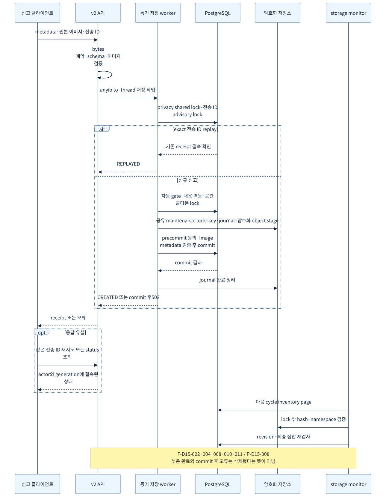

[Mermaid 원본](../diagrams/D15-sequence-ingest.mmd) · [SVG](../rendered/D15-sequence-ingest.svg)

## F-D15-002 v2 점자블록 파손 신고 접수

| 항목 | 명세 |
| --- | --- |
| 분야 | D15 백엔드 신고·관리자 검토·권리요청·저장·보존·삭제·복원 |
| 목적 | 코드에 구현된 v2 점자블록 파손 신고 접수의 입력 검증·상태 변화·실패 및 복구 계약을 설명한다. |
| 사용 주체 | Android/호환 신고 클라이언트 |
| 활성 상태 | ACTIVE |
| 진입점 | backend/app/api/reports.py:2590 create_report_v2 |
| 실행 전제 | FIELD 인증·actor generation·수집 동의 및 보안 Android 승인 release bundle 검사. |
| 입력 출처 형식 검증 최신성 | ReportV2Metadata: schema_version=detect.v2, trigger/auto_reported 일치, GPS와 필수 bbox, 선택 위치 출처. tactile 모델별 ID: custom_tactile 1, unified_walksafe 8, walkmate_21cls 1 또는 3. |

### 시작 이벤트와 처리 순서

| 이벤트 ID | 발생원 | 이벤트 | 수신부 | 흐름 |
| --- | --- | --- | --- | --- |
| E-D15-002-01 | HTTP 요청 또는 운영 도구 호출 | POST /reports/v2 | create_report_v2 | 전송 header 3종 유무·형식과 actor 세대 확인 → metadata 크기와 v2 schema·허용 class/model 검사 → 보안 Android APK/source/model config 승인 결합 검사 → 원본 전송 digest 검증 후 이미지 sanitize; bbox가 제공되면 EXIF 회전 반전 2..8 거절 → privacy subject 및 동의 lock→전송/내용 replay→auto gate→쿨다운→중복 조회 → Report new + 암호화 image object 및 receipt marker 저장 |

1. 1. 전송 header 3종 유무·형식과 actor 세대 확인 [backend/app/api/reports.py:2590 create_report_v2]
2. 2. metadata 크기와 v2 schema·허용 class/model 검사 [backend/app/api/reports.py:2590 create_report_v2]
3. 3. 보안 Android APK/source/model config 승인 결합 검사 [backend/app/api/reports.py:2590 create_report_v2]
4. 4. 원본 전송 digest 검증 후 이미지 sanitize; bbox가 제공되면 EXIF 회전 반전 2..8 거절 [backend/app/api/reports.py:2590 create_report_v2]
5. 5. privacy subject 및 동의 lock→전송/내용 replay→auto gate→쿨다운→중복 조회 [backend/app/api/reports.py:2590 create_report_v2]
6. 6. Report new + 암호화 image object 및 receipt marker 저장 [backend/app/api/reports.py:2590 create_report_v2]

| 분기 조건 | 실제 처리 결과 | 구현 근거 |
| --- | --- | --- |
| model/class/ID 불일치 또는 GPS 없음 | 422 | backend/app/api/reports.py:2590 create_report_v2 |
| trigger auto와 auto_reported 값 불일치 | schema 422 | backend/app/api/reports.py:2590 create_report_v2 |
| transport 계약 존재·쿨다운 활성 | 429 + Retry-After 600 | backend/app/api/reports.py:2590 create_report_v2 |
| 전송 계약 없는 쿨다운 | 기존 신고로 201 SUPPRESSED_BY_COOLDOWN | backend/app/api/reports.py:2590 create_report_v2 |
| 원본 hash/크기 불일치 | 422 report_transport_payload_mismatch | backend/app/api/reports.py:2590 create_report_v2 |

### 효과 종료와 복구

기술된 응답·DB 효과. 이 기능 자체가 앱 UI/음성/진동을 실행하지 않음.

| 상황 | 동작 |
| --- | --- |
| 정상 완료 | 201 CREATED/REPLAYED/SUPPRESSED_BY_COOLDOWN. receipt가 있으면 DB+암호화 이미지 저장에 결속. |
| 실패 | model/class/ID 불일치 또는 GPS 없음 → 422; trigger auto와 auto_reported 값 불일치 → schema 422; transport 계약 존재·쿨다운 활성 → 429 + Retry-After 600; 전송 계약 없는 쿨다운 → 기존 신고로 201 SUPPRESSED_BY_COOLDOWN; 원본 hash/크기 불일치 → 422 report_transport_payload_mismatch |
| 시간 초과 | 이 기능에 독립 타이머 없음. DB/요청 제한은 D09 공통 설정 경계. |
| 중복 입력 | 조회는 상태 추가 없음. 쓰기 중복 허용 여부는 아래 분기와 공유 버전 계약 참조. |
| 취소 | 별도 취소 API 없음. |
| 중단과 생명주기 | 요청 중단이 이미 commit된 DB 효과를 되돌린다는 계약은 없음. |
| 재시도 | 서버 내부 자동 재시도 없음. 호출자가 최신 상태를 확인해 재호출. |
| 복구 | 오류코드와 현재 저장 상태 확인 후 해당 진입점으로 재요청. |
| 자원 정리 | DB session 수명은 get_db 의존성에 위임. 기능 내부 rollback/commit 여부는 처리 단계에 명시. |

### 상태 실행 맥락과 연결

| 항목 | 명세 |
| --- | --- |
| 초기 상태 | S-D15-002-01: 요청 대기 |
| 상태 목록 | S-D15-002-01: 요청 대기 S-D15-002-02: 검증 S-D15-002-03: 처리 S-D15-002-04: 응답 S-D15-002-05: 오류 |
| 전이 조건과 전이 동작 | POST /reports/v2 → 검증 [상태 ID는 values와 대응] 조건 충족 → 처리 → 응답 [상태 ID는 values와 대응] 조건 불충족 → 오류 [상태 ID는 values와 대응] |
| 허용되지 않는 전이 | 명시된 조건을 우회한 저장/응답은 허용하지 않음. 그 외 전이는 별도 정의 없음. 이 다섯 단계는 문서 설명용 요청 흐름이며 DB enum이나 장기 보관 상태가 아님. |
| 동시성 순서와 작업 소유권 | async upload 후 anyio worker thread에서 동기 저장. 동의 철회/계정삭제와 subject lock 및 precommit 재확인으로 충돌 조정. |
| 공유 상태와 다른 기능 연결 | Report 및 관련 테이블. D09 런타임 등록·미들웨어와 D13 동의/계정, D14 관리자 인증 경계에 연결. |

### 정책 근거와 검증 범위

| 항목 | 근거 |
| --- | --- |
| 정책 | [P-D15-002](#P-D15-002) |
| 구현 | [backend/app/api/reports.py:2590](/home/ddobagi/Hanium_Dreamup/backend/app/api/reports.py:2590) · `create_report_v2` (범위 2590–2679) [backend/app/api/reports.py:2315](/home/ddobagi/Hanium_Dreamup/backend/app/api/reports.py:2315) · `_persist_v2_report` (범위 2315–2516) [backend/app/api/reports.py:537](/home/ddobagi/Hanium_Dreamup/backend/app/api/reports.py:537) · `_reject_oriented_report_bbox` (범위 537–554) [backend/app/api/reports.py:787](/home/ddobagi/Hanium_Dreamup/backend/app/api/reports.py:787) · `_sanitized_v2_payload` (범위 787–793) |
| 기존 개선 ID | 개별 동일성 미확인; 분야 연관은 별도 추적표 |
| 기존 분야 | 해당 없음 |
| 기존 실행 증거 | 이번 작업은 정적 분석이며 기존 DONE 기록·과거 시험을 이번 실행 증거로 사용하지 않음. |
| 한계 및 구분 | V2 metadata는 extra=forbid가 아니며 검증 후 allowlist 저장. 관리자 명령의 엄격 extra=forbid와 구분. |

| 테스트 위치 | 심볼 | 증거 수준 | 기대와 한계 |
| --- | --- | --- | --- |

연결한 테스트 미확인: 이번 작성 범위에서 이 기능에 대응하는 시험 단언을 연결하지 않았다. 테스트 자체가 없다는 판정이 아니다.

### 이벤트 처리 그림


[Mermaid 원본](../diagrams/D15-F002.mmd) · [SVG](../rendered/D15-F002.svg)

[Mermaid 원본](../diagrams/D15-sequence-ingest.mmd) · [SVG](../rendered/D15-sequence-ingest.svg)

## F-D15-003 신고 이미지 검증·메타데이터 제거

| 항목 | 명세 |
| --- | --- |
| 분야 | D15 백엔드 신고·관리자 검토·권리요청·저장·보존·삭제·복원 |
| 목적 | 코드에 구현된 신고 이미지 검증·메타데이터 제거의 입력 검증·상태 변화·실패 및 복구 계약을 설명한다. |
| 사용 주체 | 신고 사용자 또는 관리자 |
| 활성 상태 | ACTIVE |
| 진입점 | backend/app/uploads.py:237 read_image_upload |
| 실행 전제 | metadata와 신고 정책이 통과한 multipart 이미지. |
| 입력 출처 형식 검증 최신성 | MIME jpeg/png/webp, 확장자·signature·원본 및 재인코딩 byte cap. width/height≤8192, pixels≤20,000,000. MAX_UPLOAD_BYTES 기본8MiB/설정상한32MiB, metadata JSON 기본64KiB/설정상한1MiB(별도 설정). |

### 시작 이벤트와 처리 순서

| 이벤트 ID | 발생원 | 이벤트 | 수신부 | 흐름 |
| --- | --- | --- | --- | --- |
| E-D15-003-01 | HTTP 요청 또는 운영 도구 호출 | v1/v2 이미지 파일 수신 | read_image_upload | MIME/확장자 확인 후 설정 최대 bytes+1까지 읽어 크기 제한 → signature와 선택 validate_original(transport digest/EXIF bbox)을 검사 → Pillow decode→EXIF orientation 반영→원본 EXIF/ICC/XMP/text/comment를 제외한 재인코딩 → 재인코딩 결과도 cap 이하일 때 bytes·content_type 반환 |

1. 1. MIME/확장자 확인 후 설정 최대 bytes+1까지 읽어 크기 제한 [backend/app/uploads.py:237 read_image_upload]
2. 2. signature와 선택 validate_original(transport digest/EXIF bbox)을 검사 [backend/app/uploads.py:237 read_image_upload]
3. 3. Pillow decode→EXIF orientation 반영→원본 EXIF/ICC/XMP/text/comment를 제외한 재인코딩 [backend/app/uploads.py:237 read_image_upload]
4. 4. 재인코딩 결과도 cap 이하일 때 bytes·content_type 반환 [backend/app/uploads.py:237 read_image_upload]

| 분기 조건 | 실제 처리 결과 | 구현 근거 |
| --- | --- | --- |
| 지원하지 않는 MIME/확장자/내용 | 400 계열 검사 오류 | backend/app/uploads.py:237 read_image_upload |
| 원본 또는 sanitize 결과 cap 초과 | 413 | backend/app/uploads.py:237 read_image_upload |
| 치수 또는 pixels 초과 | 413 image_dimensions_too_large | backend/app/uploads.py:237 read_image_upload |
| decode 불가 | 400 invalid_image_content | backend/app/uploads.py:237 read_image_upload |

### 효과 종료와 복구

기술된 응답·DB 효과. 이 기능 자체가 앱 UI/음성/진동을 실행하지 않음.

| 상황 | 동작 |
| --- | --- |
| 정상 완료 | 재인코딩 결과도 cap 이하일 때 bytes·content_type 반환 |
| 실패 | 지원하지 않는 MIME/확장자/내용 → 400 계열 검사 오류; 원본 또는 sanitize 결과 cap 초과 → 413; 치수 또는 pixels 초과 → 413 image_dimensions_too_large; decode 불가 → 400 invalid_image_content |
| 시간 초과 | 이 기능에 독립 타이머 없음. DB/요청 제한은 D09 공통 설정 경계. |
| 중복 입력 | 조회는 상태 추가 없음. 쓰기 중복 허용 여부는 아래 분기와 공유 버전 계약 참조. |
| 취소 | 별도 취소 API 없음. |
| 중단과 생명주기 | 요청 중단이 이미 commit된 DB 효과를 되돌린다는 계약은 없음. |
| 재시도 | 서버 내부 자동 재시도 없음. 호출자가 최신 상태를 확인해 재호출. |
| 복구 | 오류코드와 현재 저장 상태 확인 후 해당 진입점으로 재요청. |
| 자원 정리 | DB session 수명은 get_db 의존성에 위임. 기능 내부 rollback/commit 여부는 처리 단계에 명시. |

### 상태 실행 맥락과 연결

| 항목 | 명세 |
| --- | --- |
| 초기 상태 | S-D15-003-01: 요청 대기 |
| 상태 목록 | S-D15-003-01: 요청 대기 S-D15-003-02: 검증 S-D15-003-03: 처리 S-D15-003-04: 응답 S-D15-003-05: 오류 |
| 전이 조건과 전이 동작 | v1/v2 이미지 파일 수신 → 검증 [상태 ID는 values와 대응] 조건 충족 → 처리 → 응답 [상태 ID는 values와 대응] 조건 불충족 → 오류 [상태 ID는 values와 대응] |
| 허용되지 않는 전이 | 명시된 조건을 우회한 저장/응답은 허용하지 않음. 그 외 전이는 별도 정의 없음. 이 다섯 단계는 문서 설명용 요청 흐름이며 DB enum이나 장기 보관 상태가 아님. |
| 동시성 순서와 작업 소유권 | I/O async 수신과 threadpool 이미지 정제를 분리. CPU 작업 강제 취소를 보장하는 별도 API는 없음. |
| 공유 상태와 다른 기능 연결 | D09 업로드 제한 Settings, F-D15-001/002, F-D15-008. |

### 정책 근거와 검증 범위

| 항목 | 근거 |
| --- | --- |
| 정책 | [P-D15-003](#P-D15-003) |
| 구현 | [backend/app/uploads.py:237](/home/ddobagi/Hanium_Dreamup/backend/app/uploads.py:237) · `read_image_upload` (범위 237–316) [backend/app/config.py:597](/home/ddobagi/Hanium_Dreamup/backend/app/config.py:597) · `Settings` (범위 597–1648) |
| 기존 개선 ID | 개별 동일성 미확인; 분야 연관은 별도 추적표 |
| 기존 분야 | 해당 없음 |
| 기존 실행 증거 | 이번 작업은 정적 분석이며 기존 DONE 기록·과거 시험을 이번 실행 증거로 사용하지 않음. |
| 한계 및 구분 | 실행 검증 없음. 코드상 계약과 실제 운영 성공은 구분. |

| 테스트 위치 | 심볼 | 증거 수준 | 기대와 한계 |
| --- | --- | --- | --- |

연결한 테스트 미확인: 이번 작성 범위에서 이 기능에 대응하는 시험 단언을 연결하지 않았다. 테스트 자체가 없다는 판정이 아니다.

### 이벤트 처리 그림


[Mermaid 원본](../diagrams/D15-F003.mmd) · [SVG](../rendered/D15-F003.svg)

## F-D15-004 전송 계약·저장 영수증·확인 조회

| 항목 | 명세 |
| --- | --- |
| 분야 | D15 백엔드 신고·관리자 검토·권리요청·저장·보존·삭제·복원 |
| 목적 | 코드에 구현된 전송 계약·저장 영수증·확인 조회의 입력 검증·상태 변화·실패 및 복구 계약을 설명한다. |
| 사용 주체 | 신고 사용자 또는 관리자 |
| 활성 상태 | ACTIVE |
| 진입점 | backend/app/api/reports.py:2026 _report_transport_replay |
| 실행 전제 | 3개 transport header는 전부 없거나 전부 존재. 존재하면 actor·generation 필수. |
| 입력 출처 형식 검증 최신성 | canonical UUID, lowercase SHA256, 양의 decimal payload bytes≤int64. metadata 원문 UTF-8와 원본 이미지의 길이·내용, report UUID를 domain-separated SHA256에 결합. |

### 시작 이벤트와 처리 순서

| 이벤트 ID | 발생원 | 이벤트 | 수신부 | 흐름 |
| --- | --- | --- | --- | --- |
| E-D15-004-01 | HTTP 요청 또는 운영 도구 호출 | v2 transport header 또는 GET /reports/v2/{report_id}/status | _report_transport_replay | 원본 metadata+image payload_bytes와 digest 일치 확인 → report UUID별 advisory xact lock 후 기존 Report 조회 → 동일 digest·bytes·owner·세대·persistence marker이면 REPLAYED → 새 저장 시 persistence UUID와 DATABASE_AND_ENCRYPTED_IMAGE_STORE receipt 반환 → status 조회는 동일 owner·세대·receipt 필드 있는 행만 PERSISTED 및 사용자 상태 반환 |

1. 1. 원본 metadata+image payload_bytes와 digest 일치 확인 [backend/app/api/reports.py:2026 _report_transport_replay]
2. 2. report UUID별 advisory xact lock 후 기존 Report 조회 [backend/app/api/reports.py:2026 _report_transport_replay]
3. 3. 동일 digest·bytes·owner·세대·persistence marker이면 REPLAYED [backend/app/api/reports.py:2026 _report_transport_replay]
4. 4. 새 저장 시 persistence UUID와 DATABASE_AND_ENCRYPTED_IMAGE_STORE receipt 반환 [backend/app/api/reports.py:2026 _report_transport_replay]
5. 5. status 조회는 동일 owner·세대·receipt 필드 있는 행만 PERSISTED 및 사용자 상태 반환 [backend/app/api/reports.py:2026 _report_transport_replay]

| 분기 조건 | 실제 처리 결과 | 구현 근거 |
| --- | --- | --- |
| header 일부만 있음 | 422 incomplete | backend/app/api/reports.py:2026 _report_transport_replay |
| UUID 이미 사용되었지만 계약 또는 소유자 다름 | 409 report_transport_id_conflict | backend/app/api/reports.py:2026 _report_transport_replay |
| status ID/actor assertion 불일치·행 없음 | 404 report_transport_status_not_found | backend/app/api/reports.py:2026 _report_transport_replay |
| response loss 후 동일 계약 재요청 | 새 행/사진 없이 기존 receipt | backend/app/api/reports.py:2026 _report_transport_replay |

### 효과 종료와 복구

기술된 응답·DB 효과. 이 기능 자체가 앱 UI/음성/진동을 실행하지 않음.

| 상황 | 동작 |
| --- | --- |
| 정상 완료 | status 조회는 동일 owner·세대·receipt 필드 있는 행만 PERSISTED 및 사용자 상태 반환 |
| 실패 | header 일부만 있음 → 422 incomplete; UUID 이미 사용되었지만 계약 또는 소유자 다름 → 409 report_transport_id_conflict; status ID/actor assertion 불일치·행 없음 → 404 report_transport_status_not_found; response loss 후 동일 계약 재요청 → 새 행/사진 없이 기존 receipt |
| 시간 초과 | 이 기능에 독립 타이머 없음. DB/요청 제한은 D09 공통 설정 경계. |
| 중복 입력 | UUID별 전송 replay가 cooldown 및 신규 저장보다 앞선다. transport exact replay는 신규 freshness gate 전에 반환. |
| 취소 | 별도 취소 API 없음. |
| 중단과 생명주기 | 요청 중단이 이미 commit된 DB 효과를 되돌린다는 계약은 없음. |
| 재시도 | 서버 내부 자동 재시도 없음. 호출자가 최신 상태를 확인해 재호출. |
| 복구 | POST 응답이 유실되면 동일 UUID status 조회 또는 정확히 같은 payload 재전송으로 확인. |
| 자원 정리 | DB session 수명은 get_db 의존성에 위임. 기능 내부 rollback/commit 여부는 처리 단계에 명시. |

### 상태 실행 맥락과 연결

| 항목 | 명세 |
| --- | --- |
| 초기 상태 | S-D15-004-01: 요청 대기 |
| 상태 목록 | S-D15-004-01: 요청 대기 S-D15-004-02: 검증 S-D15-004-03: 처리 S-D15-004-04: 응답 S-D15-004-05: 오류 |
| 전이 조건과 전이 동작 | v2 transport header 또는 GET /reports/v2/{report_id}/status → 검증 [상태 ID는 values와 대응] 조건 충족 → 처리 → 응답 [상태 ID는 values와 대응] 조건 불충족 → 오류 [상태 ID는 values와 대응] |
| 허용되지 않는 전이 | 명시된 조건을 우회한 저장/응답은 허용하지 않음. 그 외 전이는 별도 정의 없음. 이 다섯 단계는 문서 설명용 요청 흐름이며 DB enum이나 장기 보관 상태가 아님. |
| 동시성 순서와 작업 소유권 | FastAPI 동기 handler/SQLAlchemy Session 또는 명시한 운영 CLI 동기 실행. 상태 변경은 DB lock·revision/CAS 정책으로 순서 역전을 검출. 클라이언트의 늦은 callback 무효화는 D06/D12 영역. |
| 공유 상태와 다른 기능 연결 | D06/D12 클라이언트 전송 outbox/late callback 처리와 연결. D13 privacy HMAC rotation subject 해석. |

### 정책 근거와 검증 범위

| 항목 | 근거 |
| --- | --- |
| 정책 | [P-D15-004](#P-D15-004) |
| 구현 | [backend/app/api/reports.py:2026](/home/ddobagi/Hanium_Dreamup/backend/app/api/reports.py:2026) · `_report_transport_replay` (범위 2026–2052) [backend/app/api/reports.py:2685](/home/ddobagi/Hanium_Dreamup/backend/app/api/reports.py:2685) · `get_report_transport_status` (범위 2685–2730) [backend/app/api/reports.py:1108](/home/ddobagi/Hanium_Dreamup/backend/app/api/reports.py:1108) · `_report_transport_status_statement` (범위 1108–1128) |
| 기존 개선 ID | 개별 동일성 미확인; 분야 연관은 별도 추적표 |
| 기존 분야 | 해당 없음 |
| 기존 실행 증거 | 이번 작업은 정적 분석이며 기존 DONE 기록·과거 시험을 이번 실행 증거로 사용하지 않음. |
| 한계 및 구분 | 실행 검증 없음. 코드상 계약과 실제 운영 성공은 구분. |

| 테스트 위치 | 심볼 | 증거 수준 | 기대와 한계 |
| --- | --- | --- | --- |

연결한 테스트 미확인: 이번 작성 범위에서 이 기능에 대응하는 시험 단언을 연결하지 않았다. 테스트 자체가 없다는 판정이 아니다.

### 이벤트 처리 그림


[Mermaid 원본](../diagrams/D15-F004.mmd) · [SVG](../rendered/D15-F004.svg)

[Mermaid 원본](../diagrams/D15-sequence-ingest.mmd) · [SVG](../rendered/D15-sequence-ingest.svg)

## F-D15-005 자동 신고 품질·최신성 게이트와 쿨다운

| 항목 | 명세 |
| --- | --- |
| 분야 | D15 백엔드 신고·관리자 검토·권리요청·저장·보존·삭제·복원 |
| 목적 | 코드에 구현된 자동 신고 품질·최신성 게이트와 쿨다운의 입력 검증·상태 변화·실패 및 복구 계약을 설명한다. |
| 사용 주체 | 자동 신고 클라이언트 |
| 활성 상태 | ACTIVE |
| 진입점 | backend/app/api/reports.py:883 _enforce_secured_auto_report_gate |
| 실행 전제 | field_test_security_enabled && auto_reported. 수집/자동신고 동의 lock 이후. |
| 입력 출처 형식 검증 최신성 | confidence, GPS accuracy, coordinate_gate_status, captured_at, named actor. |

### 시작 이벤트와 처리 순서

| 이벤트 ID | 발생원 | 이벤트 | 수신부 | 흐름 |
| --- | --- | --- | --- | --- |
| E-D15-005-01 | HTTP 요청 또는 운영 도구 호출 | secured v2 auto 신고 저장 시 | _enforce_secured_auto_report_gate | named actor·confidence≥0.7·GPS accuracy≤15m·coordinate gate pass 확인 → capture time가 now-5분 이상 now+30초 이하인지 검사 → 정확히 저장된 내용 replay만 stale capture 예외 → subject·generation·class·fake별 cooldown lock 후 최근 10분/25m 기존 auto 신고 조회 → 전송 계약 유무에 따라 429 또는 기존 suppress 응답 |

1. 1. named actor·confidence≥0.7·GPS accuracy≤15m·coordinate gate pass 확인 [backend/app/api/reports.py:883 _enforce_secured_auto_report_gate]
2. 2. capture time가 now-5분 이상 now+30초 이하인지 검사 [backend/app/api/reports.py:883 _enforce_secured_auto_report_gate]
3. 3. 정확히 저장된 내용 replay만 stale capture 예외 [backend/app/api/reports.py:883 _enforce_secured_auto_report_gate]
4. 4. subject·generation·class·fake별 cooldown lock 후 최근 10분/25m 기존 auto 신고 조회 [backend/app/api/reports.py:883 _enforce_secured_auto_report_gate]
5. 5. 전송 계약 유무에 따라 429 또는 기존 suppress 응답 [backend/app/api/reports.py:883 _enforce_secured_auto_report_gate]

| 분기 조건 | 실제 처리 결과 | 구현 근거 |
| --- | --- | --- |
| unknown/system/anonymous 또는 -shared actor | 422 named_actor_required | backend/app/api/reports.py:883 _enforce_secured_auto_report_gate |
| confidence<0.7 또는 accuracy 없음/>15 | 422 auto_report_gate_failed | backend/app/api/reports.py:883 _enforce_secured_auto_report_gate |
| capture<now-5분; 신규 요청 | 422 stale | backend/app/api/reports.py:883 _enforce_secured_auto_report_gate |
| capture>now+30초 | 422 future | backend/app/api/reports.py:883 _enforce_secured_auto_report_gate |
| recent auto 동일 actor/class/fake 25m내 | 새 행·사진 저장 억제 | backend/app/api/reports.py:883 _enforce_secured_auto_report_gate |

### 효과 종료와 복구

기술된 응답·DB 효과. 이 기능 자체가 앱 UI/음성/진동을 실행하지 않음.

| 상황 | 동작 |
| --- | --- |
| 정상 완료 | 전송 계약 유무에 따라 429 또는 기존 suppress 응답 |
| 실패 | unknown/system/anonymous 또는 -shared actor → 422 named_actor_required; confidence<0.7 또는 accuracy 없음/>15 → 422 auto_report_gate_failed; capture<now-5분; 신규 요청 → 422 stale; capture>now+30초 → 422 future; recent auto 동일 actor/class/fake 25m내 → 새 행·사진 저장 억제 |
| 시간 초과 | 이 기능에 독립 타이머 없음. DB/요청 제한은 D09 공통 설정 경계. |
| 중복 입력 | 조회는 상태 추가 없음. 쓰기 중복 허용 여부는 아래 분기와 공유 버전 계약 참조. |
| 취소 | 별도 취소 API 없음. |
| 중단과 생명주기 | 요청 중단이 이미 commit된 DB 효과를 되돌린다는 계약은 없음. |
| 재시도 | 서버 내부 자동 재시도 없음. 호출자가 최신 상태를 확인해 재호출. |
| 복구 | 오류코드와 현재 저장 상태 확인 후 해당 진입점으로 재요청. |
| 자원 정리 | DB session 수명은 get_db 의존성에 위임. 기능 내부 rollback/commit 여부는 처리 단계에 명시. |

### 상태 실행 맥락과 연결

| 항목 | 명세 |
| --- | --- |
| 초기 상태 | S-D15-005-01: 요청 대기 |
| 상태 목록 | S-D15-005-01: 요청 대기 S-D15-005-02: 검증 S-D15-005-03: 처리 S-D15-005-04: 응답 S-D15-005-05: 오류 |
| 전이 조건과 전이 동작 | secured v2 auto 신고 저장 시 → 검증 [상태 ID는 values와 대응] 조건 충족 → 처리 → 응답 [상태 ID는 values와 대응] 조건 불충족 → 오류 [상태 ID는 values와 대응] |
| 허용되지 않는 전이 | 명시된 조건을 우회한 저장/응답은 허용하지 않음. 그 외 전이는 별도 정의 없음. 이 다섯 단계는 문서 설명용 요청 흐름이며 DB enum이나 장기 보관 상태가 아님. |
| 동시성 순서와 작업 소유권 | FastAPI 동기 handler/SQLAlchemy Session 또는 명시한 운영 CLI 동기 실행. 상태 변경은 DB lock·revision/CAS 정책으로 순서 역전을 검출. 클라이언트의 늦은 callback 무효화는 D06/D12 영역. |
| 공유 상태와 다른 기능 연결 | privacy_lifecycle.lock_report_ingest_transaction, duplicates.lock_auto_report_cooldown/find_active_auto_report_cooldown. |

### 정책 근거와 검증 범위

| 항목 | 근거 |
| --- | --- |
| 정책 | [P-D15-005](#P-D15-005) |
| 구현 | [backend/app/api/reports.py:883](/home/ddobagi/Hanium_Dreamup/backend/app/api/reports.py:883) · `_enforce_secured_auto_report_gate` (범위 883–922) [backend/app/services/duplicates.py:124](/home/ddobagi/Hanium_Dreamup/backend/app/services/duplicates.py:124) · `lock_auto_report_cooldown` (범위 124–141) |
| 기존 개선 ID | 개별 동일성 미확인; 분야 연관은 별도 추적표 |
| 기존 분야 | 해당 없음 |
| 기존 실행 증거 | 이번 작업은 정적 분석이며 기존 DONE 기록·과거 시험을 이번 실행 증거로 사용하지 않음. |
| 한계 및 구분 | 실행 검증 없음. 코드상 계약과 실제 운영 성공은 구분. |

| 테스트 위치 | 심볼 | 증거 수준 | 기대와 한계 |
| --- | --- | --- | --- |

연결한 테스트 미확인: 이번 작성 범위에서 이 기능에 대응하는 시험 단언을 연결하지 않았다. 테스트 자체가 없다는 판정이 아니다.

### 이벤트 처리 그림


[Mermaid 원본](../diagrams/D15-F005.mmd) · [SVG](../rendered/D15-F005.svg)

## F-D15-006 공간·시각 중복 후보 발견과 잠금

| 항목 | 명세 |
| --- | --- |
| 분야 | D15 백엔드 신고·관리자 검토·권리요청·저장·보존·삭제·복원 |
| 목적 | 코드에 구현된 공간·시각 중복 후보 발견과 잠금의 입력 검증·상태 변화·실패 및 복구 계약을 설명한다. |
| 사용 주체 | 신고 사용자 또는 관리자 |
| 활성 상태 | ACTIVE |
| 진입점 | backend/app/services/duplicates.py:180 duplicate_candidate_statement |
| 실행 전제 | GPS가 있어야 후보 조회/공간 잠금 가능. 직접 duplicate-check read 감사는 보안 모드 필수. |
| 입력 출처 형식 검증 최신성 | 동일 class, captured_at ±1분, ST_DWithin 10m, fake/field 분리. 조회 API radius≤200m, minutes1..60. |

### 시작 이벤트와 처리 순서

| 이벤트 ID | 발생원 | 이벤트 | 수신부 | 흐름 |
| --- | --- | --- | --- | --- |
| E-D15-006-01 | HTTP 요청 또는 운영 도구 호출 | 생성 중 후보 검사 및 GET /reports/duplicate-check | duplicate_candidate_statement | 0.0005도 lock cell 및 인접 보수 범위를 계산; 경도 wrap·85도 극지 hemisphere 처리 → 시간 bucket -minutes..+minutes와 class/fake/spatial key를 전역 정렬해 advisory lock → PostGIS geography 거리·촬영시간 inclusive window로 최대20개 최근 후보 조회 → 신고 payload에 duplicate_candidate flag/IDs 추가; 사용자 생성응답은 IDs를 제거 |

1. 1. 0.0005도 lock cell 및 인접 보수 범위를 계산; 경도 wrap·85도 극지 hemisphere 처리 [backend/app/services/duplicates.py:180 duplicate_candidate_statement]
2. 2. 시간 bucket -minutes..+minutes와 class/fake/spatial key를 전역 정렬해 advisory lock [backend/app/services/duplicates.py:180 duplicate_candidate_statement]
3. 3. PostGIS geography 거리·촬영시간 inclusive window로 최대20개 최근 후보 조회 [backend/app/services/duplicates.py:180 duplicate_candidate_statement]
4. 4. 신고 payload에 duplicate_candidate flag/IDs 추가; 사용자 생성응답은 IDs를 제거 [backend/app/services/duplicates.py:180 duplicate_candidate_statement]

| 분기 조건 | 실제 처리 결과 | 구현 근거 |
| --- | --- | --- |
| 좌표 없음 | 생성 helper는 잠금·후보 없음 | backend/app/services/duplicates.py:180 duplicate_candidate_statement |
| fake와 real 다름 | 후보 제외 | backend/app/services/duplicates.py:180 duplicate_candidate_statement |
| 직접 duplicate-check 조회 | 후보 IDs/count 반환; 자동 병합 없음 | backend/app/services/duplicates.py:180 duplicate_candidate_statement |

### 효과 종료와 복구

기술된 응답·DB 효과. 이 기능 자체가 앱 UI/음성/진동을 실행하지 않음.

| 상황 | 동작 |
| --- | --- |
| 정상 완료 | 신고 payload에 duplicate_candidate flag/IDs 추가; 사용자 생성응답은 IDs를 제거 |
| 실패 | 좌표·class·시각 query 검증 실패는422. DB·감사 실패 시 요청 실패; 후보0개는 정상 결과다. |
| 시간 초과 | 이 기능에 독립 타이머 없음. DB/요청 제한은 D09 공통 설정 경계. |
| 중복 입력 | 조회는 상태 추가 없음. 쓰기 중복 허용 여부는 아래 분기와 공유 버전 계약 참조. |
| 취소 | 별도 취소 API 없음. |
| 중단과 생명주기 | 요청 중단이 이미 commit된 DB 효과를 되돌린다는 계약은 없음. |
| 재시도 | 서버 내부 자동 재시도 없음. 호출자가 최신 상태를 확인해 재호출. |
| 복구 | 오류코드와 현재 저장 상태 확인 후 해당 진입점으로 재요청. |
| 자원 정리 | DB session 수명은 get_db 의존성에 위임. 기능 내부 rollback/commit 여부는 처리 단계에 명시. |

### 상태 실행 맥락과 연결

| 항목 | 명세 |
| --- | --- |
| 초기 상태 | S-D15-006-01: 요청 대기 |
| 상태 목록 | S-D15-006-01: 요청 대기 S-D15-006-02: 검증 S-D15-006-03: 처리 S-D15-006-04: 응답 S-D15-006-05: 오류 |
| 전이 조건과 전이 동작 | 생성 중 후보 검사 및 GET /reports/duplicate-check → 검증 [상태 ID는 values와 대응] 조건 충족 → 처리 → 응답 [상태 ID는 values와 대응] 조건 불충족 → 오류 [상태 ID는 values와 대응] |
| 허용되지 않는 전이 | 명시된 조건을 우회한 저장/응답은 허용하지 않음. 그 외 전이는 별도 정의 없음. 이 다섯 단계는 문서 설명용 요청 흐름이며 DB enum이나 장기 보관 상태가 아님. |
| 동시성 순서와 작업 소유권 | DB advisory transaction lock은 commit/rollback까지 유지; sorted 다중 key 순서로 교착 회피. |
| 공유 상태와 다른 기능 연결 | F-D15-001/002 생성, F-D15-029 typed DUPLICATE 결정은 별도. |

### 정책 근거와 검증 범위

| 항목 | 근거 |
| --- | --- |
| 정책 | [P-D15-006](#P-D15-006) |
| 구현 | [backend/app/services/duplicates.py:180](/home/ddobagi/Hanium_Dreamup/backend/app/services/duplicates.py:180) · `duplicate_candidate_statement` (범위 180–215) [backend/app/services/duplicates.py:227](/home/ddobagi/Hanium_Dreamup/backend/app/services/duplicates.py:227) · `find_duplicate_candidates` (범위 227–245) |
| 기존 개선 ID | 개별 동일성 미확인; 분야 연관은 별도 추적표 |
| 기존 분야 | 해당 없음 |
| 기존 실행 증거 | 이번 작업은 정적 분석이며 기존 DONE 기록·과거 시험을 이번 실행 증거로 사용하지 않음. |
| 한계 및 구분 | 실행 검증 없음. 코드상 계약과 실제 운영 성공은 구분. |

| 테스트 위치 | 심볼 | 증거 수준 | 기대와 한계 |
| --- | --- | --- | --- |

연결한 테스트 미확인: 이번 작성 범위에서 이 기능에 대응하는 시험 단언을 연결하지 않았다. 테스트 자체가 없다는 판정이 아니다.

### 이벤트 처리 그림


[Mermaid 원본](../diagrams/D15-F006.mmd) · [SVG](../rendered/D15-F006.svg)

## F-D15-007 신고 출처·성능 제외·검토 신호 산출

| 항목 | 명세 |
| --- | --- |
| 분야 | D15 백엔드 신고·관리자 검토·권리요청·저장·보존·삭제·복원 |
| 목적 | 코드에 구현된 신고 출처·성능 제외·검토 신호 산출의 입력 검증·상태 변화·실패 및 복구 계약을 설명한다. |
| 사용 주체 | 신고 사용자 또는 관리자 |
| 활성 상태 | ACTIVE |
| 진입점 | backend/app/api/reports.py:850 _enrich_v2_payload |
| 실행 전제 | 신고 schema 검증과 정제 image bytes가 준비됨. |
| 입력 출처 형식 검증 최신성 | client metadata allowlist, fake/demo flag, source_model/runtime_mode, 좌표 gate, 서버 received_at 및 SHA256. |

### 시작 이벤트와 처리 순서

| 이벤트 ID | 발생원 | 이벤트 | 수신부 | 흐름 |
| --- | --- | --- | --- | --- |
| E-D15-007-01 | HTTP 요청 또는 운영 도구 호출 | 신고 payload 저장 및 응답 직렬화 | _enrich_v2_payload | 클라이언트가 서버 검토 승인 필드를 주입하지 못하게 allowlist 적용 → fake/demo 판정과 coordinate gate 누락/실패 이유를 산출 → v2는 client_asserted_detection을 항상 성능 제외 이유로 포함 → location_quality: finite 위치 없음 missing; accuracy invalid/>50 low; >15 medium; 그 외 high → fake·confidence<0.7·location/heading 결손·중복 flag를 검토 신호로 반환 |

1. 1. 클라이언트가 서버 검토 승인 필드를 주입하지 못하게 allowlist 적용 [backend/app/api/reports.py:850 _enrich_v2_payload]
2. 2. fake/demo 판정과 coordinate gate 누락/실패 이유를 산출 [backend/app/api/reports.py:850 _enrich_v2_payload]
3. 3. v2는 client_asserted_detection을 항상 성능 제외 이유로 포함 [backend/app/api/reports.py:850 _enrich_v2_payload]
4. 4. location_quality: finite 위치 없음 missing; accuracy invalid/>50 low; >15 medium; 그 외 high [backend/app/api/reports.py:850 _enrich_v2_payload]
5. 5. fake·confidence<0.7·location/heading 결손·중복 flag를 검토 신호로 반환 [backend/app/api/reports.py:850 _enrich_v2_payload]

| 분기 조건 | 실제 처리 결과 | 구현 근거 |
| --- | --- | --- |
| coordinate gate 미통과 | 성능 제외; 이것만으로 demo로 바꾸지 않음 | backend/app/api/reports.py:850 _enrich_v2_payload |
| v1 | legacy_v1_unverified_provenance로 제외 | backend/app/api/reports.py:850 _enrich_v2_payload |
| 좌표 high + named human review | 기관 export 자격 판단에 별도 사용 | backend/app/api/reports.py:850 _enrich_v2_payload |

### 효과 종료와 복구

기술된 응답·DB 효과. 이 기능 자체가 앱 UI/음성/진동을 실행하지 않음.

| 상황 | 동작 |
| --- | --- |
| 정상 완료 | fake·confidence<0.7·location/heading 결손·중복 flag를 검토 신호로 반환 |
| 실패 | coordinate gate 미통과 → 성능 제외; 이것만으로 demo로 바꾸지 않음; v1 → legacy_v1_unverified_provenance로 제외; 좌표 high + named human review → 기관 export 자격 판단에 별도 사용 |
| 시간 초과 | 이 기능에 독립 타이머 없음. DB/요청 제한은 D09 공통 설정 경계. |
| 중복 입력 | 조회는 상태 추가 없음. 쓰기 중복 허용 여부는 아래 분기와 공유 버전 계약 참조. |
| 취소 | 별도 취소 API 없음. |
| 중단과 생명주기 | 요청 중단이 이미 commit된 DB 효과를 되돌린다는 계약은 없음. |
| 재시도 | 서버 내부 자동 재시도 없음. 호출자가 최신 상태를 확인해 재호출. |
| 복구 | 오류코드와 현재 저장 상태 확인 후 해당 진입점으로 재요청. |
| 자원 정리 | DB session 수명은 get_db 의존성에 위임. 기능 내부 rollback/commit 여부는 처리 단계에 명시. |

### 상태 실행 맥락과 연결

| 항목 | 명세 |
| --- | --- |
| 초기 상태 | S-D15-007-01: 요청 대기 |
| 상태 목록 | S-D15-007-01: 요청 대기 S-D15-007-02: 검증 S-D15-007-03: 처리 S-D15-007-04: 응답 S-D15-007-05: 오류 |
| 전이 조건과 전이 동작 | 신고 payload 저장 및 응답 직렬화 → 검증 [상태 ID는 values와 대응] 조건 충족 → 처리 → 응답 [상태 ID는 values와 대응] 조건 불충족 → 오류 [상태 ID는 values와 대응] |
| 허용되지 않는 전이 | 명시된 조건을 우회한 저장/응답은 허용하지 않음. 그 외 전이는 별도 정의 없음. 이 다섯 단계는 문서 설명용 요청 흐름이며 DB enum이나 장기 보관 상태가 아님. |
| 동시성 순서와 작업 소유권 | FastAPI 동기 handler/SQLAlchemy Session 또는 명시한 운영 CLI 동기 실행. 상태 변경은 DB lock·revision/CAS 정책으로 순서 역전을 검출. 클라이언트의 늦은 callback 무효화는 D06/D12 영역. |
| 공유 상태와 다른 기능 연결 | report_serialization.report_to_response; 기관 검토/전달 기록은 성능 증거와 별도. |

### 정책 근거와 검증 범위

| 항목 | 근거 |
| --- | --- |
| 정책 | [P-D15-007](#P-D15-007) |
| 구현 | [backend/app/api/reports.py:850](/home/ddobagi/Hanium_Dreamup/backend/app/api/reports.py:850) · `_enrich_v2_payload` (범위 850–880) [backend/app/services/report_serialization.py:83](/home/ddobagi/Hanium_Dreamup/backend/app/services/report_serialization.py:83) · `report_to_response` (범위 83–134) |
| 기존 개선 ID | 개별 동일성 미확인; 분야 연관은 별도 추적표 |
| 기존 분야 | 해당 없음 |
| 기존 실행 증거 | 이번 작업은 정적 분석이며 기존 DONE 기록·과거 시험을 이번 실행 증거로 사용하지 않음. |
| 한계 및 구분 | 실행 검증 없음. 코드상 계약과 실제 운영 성공은 구분. |

| 테스트 위치 | 심볼 | 증거 수준 | 기대와 한계 |
| --- | --- | --- | --- |

연결한 테스트 미확인: 이번 작성 범위에서 이 기능에 대응하는 시험 단언을 연결하지 않았다. 테스트 자체가 없다는 판정이 아니다.

### 이벤트 처리 그림


[Mermaid 원본](../diagrams/D15-F007.mmd) · [SVG](../rendered/D15-F007.svg)

## F-D15-008 암호화 이미지와 DB의 commit 경계

| 항목 | 명세 |
| --- | --- |
| 분야 | D15 백엔드 신고·관리자 검토·권리요청·저장·보존·삭제·복원 |
| 목적 | 코드에 구현된 암호화 이미지와 DB의 commit 경계의 입력 검증·상태 변화·실패 및 복구 계약을 설명한다. |
| 사용 주체 | 신고 저장 worker |
| 활성 상태 | ACTIVE |
| 진입점 | backend/app/api/reports.py:1540 _commit_new_report_with_image |
| 실행 전제 | maintenance shared file lock→report storage shared DB xact lock; 동의/계정 precommit 검사. |
| 입력 출처 형식 검증 최신성 | 정제 bytes/content_type, report UUID, key manager, private upload root, readiness commit token. |

### 시작 이벤트와 처리 순서

| 이벤트 ID | 발생원 | 이벤트 | 수신부 | 흐름 |
| --- | --- | --- | --- | --- |
| E-D15-008-01 | HTTP 요청 또는 운영 도구 호출 | 신규 신고 저장 | _commit_new_report_with_image | readiness begin_commit token 발급 → keyring 동기화·active key AES-256-GCM 암호화 → v2 journal을 먼저 쓰고 UUID.wse 파일 durable write → Report+ReportImageObject와 journal/hash/header/논리 URL 일치 검증 → precommit privacy 검사를 거쳐 DB commit → refresh·journal 제거·lock 종료 뒤 readiness 성공; 오류는 단계별 pending 처리 |

1. 1. readiness begin_commit token 발급 [backend/app/api/reports.py:1540 _commit_new_report_with_image]
2. 2. keyring 동기화·active key AES-256-GCM 암호화 [backend/app/api/reports.py:1540 _commit_new_report_with_image]
3. 3. v2 journal을 먼저 쓰고 UUID.wse 파일 durable write [backend/app/api/reports.py:1540 _commit_new_report_with_image]
4. 4. Report+ReportImageObject와 journal/hash/header/논리 URL 일치 검증 [backend/app/api/reports.py:1540 _commit_new_report_with_image]
5. 5. precommit privacy 검사를 거쳐 DB commit [backend/app/api/reports.py:1540 _commit_new_report_with_image]
6. 6. refresh·journal 제거·lock 종료 뒤 readiness 성공; 오류는 단계별 pending 처리 [backend/app/api/reports.py:1540 _commit_new_report_with_image]

| 분기 조건 | 실제 처리 결과 | 구현 근거 |
| --- | --- | --- |
| 암호화 key 없음 | rollback 후 503 report_image_encryption_unavailable | backend/app/api/reports.py:1540 _commit_new_report_with_image |
| commit 전 오류 | DB rollback, journal로 후속 복구 | backend/app/api/reports.py:1540 _commit_new_report_with_image |
| commit 후 refresh/response/lock-exit 실패 | 503이지만 저장됨; report_id 반환 | backend/app/api/reports.py:1540 _commit_new_report_with_image |
| journal 제거 OSError | 정리 유예; readiness recovery pending | backend/app/api/reports.py:1540 _commit_new_report_with_image |

### 효과 종료와 복구

기술된 응답·DB 효과. 이 기능 자체가 앱 UI/음성/진동을 실행하지 않음.

| 상황 | 동작 |
| --- | --- |
| 정상 완료 | refresh·journal 제거·lock 종료 뒤 readiness 성공; 오류는 단계별 pending 처리 |
| 실패 | 암호화 key 없음 → rollback 후 503 report_image_encryption_unavailable; commit 전 오류 → DB rollback, journal로 후속 복구; commit 후 refresh/response/lock-exit 실패 → 503이지만 저장됨; report_id 반환; journal 제거 OSError → 정리 유예; readiness recovery pending |
| 시간 초과 | 이 기능에 독립 타이머 없음. DB/요청 제한은 D09 공통 설정 경계. |
| 중복 입력 | 상위 replay 판정이 선행. 이 helper 자체는 신규 저장만. |
| 취소 | 별도 취소 API 없음. |
| 중단과 생명주기 | 요청 중단이 이미 commit된 DB 효과를 되돌린다는 계약은 없음. |
| 재시도 | 서버 내부 자동 재시도 없음. 호출자가 최신 상태를 확인해 재호출. |
| 복구 | F-D15-010 journal recovery가 DB 존재/metadata 일치로 보관·고아정리 판정. |
| 자원 정리 | commit 확인 후 journal 제거. journal OSError는 logging 및 recovery pending; lock FD는 context 종료. |

### 상태 실행 맥락과 연결

| 항목 | 명세 |
| --- | --- |
| 초기 상태 | S-D15-008-01: 검증 완료 |
| 상태 목록 | S-D15-008-01: 검증 완료 S-D15-008-02: 파일 쓰기 journal durable S-D15-008-03: DB commit 확인 S-D15-008-04: journal 정리 완료 S-D15-008-05: 복구 확인 필요 |
| 전이 조건과 전이 동작 | 검증→journal/file stage→DB commit→journal 정리 stage/commit 뒤 오류→복구 필요→DB/file 대조 후 정리 |
| 허용되지 않는 전이 | 이 값은 저장 순서를 설명하는 단계 ID이며 DB enum 아님. commit 후 응답 실패를 rollback 성공으로 해석하지 않음. |
| 동시성 순서와 작업 소유권 | anyio worker의 동기 DB·파일 실행; 파일 lock 다음 DB lock 순서 고정. 늦게 도착한 성공은 readiness token/revision으로 평가. |
| 공유 상태와 다른 기능 연결 | Report 및 관련 테이블. D09 런타임 등록·미들웨어와 D13 동의/계정, D14 관리자 인증 경계에 연결. |

### 정책 근거와 검증 범위

| 항목 | 근거 |
| --- | --- |
| 정책 | [P-D15-008](#P-D15-008) |
| 구현 | [backend/app/api/reports.py:1540](/home/ddobagi/Hanium_Dreamup/backend/app/api/reports.py:1540) · `_commit_new_report_with_image` (범위 1540–1699) [backend/app/services/report_storage.py:203](/home/ddobagi/Hanium_Dreamup/backend/app/services/report_storage.py:203) · `stage_report_image` (범위 203–240) [backend/app/services/report_storage.py:243](/home/ddobagi/Hanium_Dreamup/backend/app/services/report_storage.py:243) · `complete_report_image_write` (범위 243–251) [backend/app/services/report_storage.py:426](/home/ddobagi/Hanium_Dreamup/backend/app/services/report_storage.py:426) · `validate_report_image_write` (범위 426–472) |
| 기존 개선 ID | 개별 동일성 미확인; 분야 연관은 별도 추적표 |
| 기존 분야 | 해당 없음 |
| 기존 실행 증거 | 이번 작업은 정적 분석이며 기존 DONE 기록·과거 시험을 이번 실행 증거로 사용하지 않음. |
| 한계 및 구분 | 실행 검증 없음. 코드상 계약과 실제 운영 성공은 구분. |

| 테스트 위치 | 심볼 | 증거 수준 | 기대와 한계 |
| --- | --- | --- | --- |

연결한 테스트 미확인: 이번 작성 범위에서 이 기능에 대응하는 시험 단언을 연결하지 않았다. 테스트 자체가 없다는 판정이 아니다.

### 이벤트 처리 그림


[Mermaid 원본](../diagrams/D15-F008.mmd) · [SVG](../rendered/D15-F008.svg)


[Mermaid 원본](../diagrams/D15-F008-state.mmd) · [SVG](../rendered/D15-F008-state.svg)

[Mermaid 원본](../diagrams/D15-sequence-ingest.mmd) · [SVG](../rendered/D15-sequence-ingest.svg)

## F-D15-009 이미지 암호화 키 공급·세대 회전

| 항목 | 명세 |
| --- | --- |
| 분야 | D15 백엔드 신고·관리자 검토·권리요청·저장·보존·삭제·복원 |
| 목적 | 코드에 구현된 이미지 암호화 키 공급·세대 회전의 입력 검증·상태 변화·실패 및 복구 계약을 설명한다. |
| 사용 주체 | 운영자 key provider 백엔드 |
| 활성 상태 | ACTIVE |
| 진입점 | backend/app/services/report_image_keys.py:717 synchronize_report_image_keyring |
| 실행 전제 | secret_file 또는 kms_agent 설정; 배포는 root 권한 경계. key는 upload root 외부. |
| 입력 출처 형식 검증 최신성 | 엄격 keyring JSON, generation/previous_manifest_sha256, 고유 key ID·material fingerprint. usable material은 32byte. |

### 시작 이벤트와 처리 순서

| 이벤트 ID | 발생원 | 이벤트 | 수신부 | 흐름 |
| --- | --- | --- | --- | --- |
| E-D15-009-01 | HTTP 요청 또는 운영 도구 호출 | startup key manager 생성, 저장/원본열람 시 synchronize | synchronize_report_image_keyring | 중복 JSON key·정확 필드·active key 한 개·material 재사용 금지 검증 → 현재 generation 동일 hash는 shared lock, 신규 세대는 exclusive DB advisory lock → generation1부터 previous hash 체인 및 +1 세대 검사 → active→decrypt-only/compromised, decrypt-only→compromised 등 제한 전이 → provider manifest가 실행 중 바뀌면 restart required; active로 쓰고 active/decrypt-only만 읽기 |

1. 1. 중복 JSON key·정확 필드·active key 한 개·material 재사용 금지 검증 [backend/app/services/report_image_keys.py:717 synchronize_report_image_keyring]
2. 2. 현재 generation 동일 hash는 shared lock, 신규 세대는 exclusive DB advisory lock [backend/app/services/report_image_keys.py:717 synchronize_report_image_keyring]
3. 3. generation1부터 previous hash 체인 및 +1 세대 검사 [backend/app/services/report_image_keys.py:717 synchronize_report_image_keyring]
4. 4. active→decrypt-only/compromised, decrypt-only→compromised 등 제한 전이 [backend/app/services/report_image_keys.py:717 synchronize_report_image_keyring]
5. 5. provider manifest가 실행 중 바뀌면 restart required; active로 쓰고 active/decrypt-only만 읽기 [backend/app/services/report_image_keys.py:717 synchronize_report_image_keyring]

| 분기 조건 | 실제 처리 결과 | 구현 근거 |
| --- | --- | --- |
| retired/destroyed 신규 전이 | retained backup key-use proof 미지원으로 차단 | backend/app/services/report_image_keys.py:717 synchronize_report_image_keyring |
| DB/raw object가 terminal key 참조 | 차단 | backend/app/services/report_image_keys.py:717 synchronize_report_image_keyring |
| manifest runtime 변경 | 503/readiness false; restart 필요 | backend/app/services/report_image_keys.py:717 synchronize_report_image_keyring |
| compromised | material 없이 fingerprint만 보존, 복호화 거절 | backend/app/services/report_image_keys.py:717 synchronize_report_image_keyring |

### 효과 종료와 복구

기술된 응답·DB 효과. 이 기능 자체가 앱 UI/음성/진동을 실행하지 않음.

| 상황 | 동작 |
| --- | --- |
| 정상 완료 | provider manifest가 실행 중 바뀌면 restart required; active로 쓰고 active/decrypt-only만 읽기 |
| 실패 | retired/destroyed 신규 전이 → retained backup key-use proof 미지원으로 차단; DB/raw object가 terminal key 참조 → 차단; manifest runtime 변경 → 503/readiness false; restart 필요; compromised → material 없이 fingerprint만 보존, 복호화 거절 |
| 시간 초과 | 이 기능에 독립 타이머 없음. DB/요청 제한은 D09 공통 설정 경계. |
| 중복 입력 | 조회는 상태 추가 없음. 쓰기 중복 허용 여부는 아래 분기와 공유 버전 계약 참조. |
| 취소 | 별도 취소 API 없음. |
| 중단과 생명주기 | 요청 중단이 이미 commit된 DB 효과를 되돌린다는 계약은 없음. |
| 재시도 | 서버 내부 자동 재시도 없음. 호출자가 최신 상태를 확인해 재호출. |
| 복구 | 오류코드와 현재 저장 상태 확인 후 해당 진입점으로 재요청. |
| 자원 정리 | DB session 수명은 get_db 의존성에 위임. 기능 내부 rollback/commit 여부는 처리 단계에 명시. |

### 상태 실행 맥락과 연결

| 항목 | 명세 |
| --- | --- |
| 초기 상태 | S-D15-009-01: active |
| 상태 목록 | S-D15-009-01: active S-D15-009-02: decrypt-only S-D15-009-03: compromised S-D15-009-04: retired S-D15-009-05: destroyed |
| 전이 조건과 전이 동작 | 새 key ID는 active로만 진입하고 keyring 전체 active는 정확1개 active→active/decrypt-only/compromised decrypt-only→decrypt-only/compromised compromised→compromised만 허용 retired→retired 및 destroyed→destroyed는 이미 존재하는 상태 유지용; 새 terminal 진입은 retained backup key-use proof 부재로 차단 |
| 허용되지 않는 전이 | 키 ID 제거·material 변경·재사용, generation rollback, terminal 상태 복귀 금지. 초기 keyring은 generation1과 active1개 계약; key별 초기 ID는 active다. |
| 동시성 순서와 작업 소유권 | FastAPI 동기 handler/SQLAlchemy Session 또는 명시한 운영 CLI 동기 실행. 상태 변경은 DB lock·revision/CAS 정책으로 순서 역전을 검출. 클라이언트의 늦은 callback 무효화는 D06/D12 영역. |
| 공유 상태와 다른 기능 연결 | raw 암호화도 같은 keyring 상태 참조(D13). 암호화 envelope는 report UUID에 AAD 결속. |

### 정책 근거와 검증 범위

| 항목 | 근거 |
| --- | --- |
| 정책 | [P-D15-009](#P-D15-009) |
| 구현 | [backend/app/services/report_image_keys.py:717](/home/ddobagi/Hanium_Dreamup/backend/app/services/report_image_keys.py:717) · `synchronize_report_image_keyring` (범위 717–779) [backend/app/services/report_image_keys.py:131](/home/ddobagi/Hanium_Dreamup/backend/app/services/report_image_keys.py:131) · `parse_report_image_keyring` (범위 131–220) [backend/app/services/report_image_keys.py:652](/home/ddobagi/Hanium_Dreamup/backend/app/services/report_image_keys.py:652) · `_validate_rotation` (범위 652–685) [backend/app/services/report_image_keys.py:782](/home/ddobagi/Hanium_Dreamup/backend/app/services/report_image_keys.py:782) · `create_report_image_key_manager` (범위 782–814) |
| 기존 개선 ID | 개별 동일성 미확인; 분야 연관은 별도 추적표 |
| 기존 분야 | 해당 없음 |
| 기존 실행 증거 | 이번 작업은 정적 분석이며 기존 DONE 기록·과거 시험을 이번 실행 증거로 사용하지 않음. |
| 한계 및 구분 | secret-file/KMS provider의 모든 FD/ACL helper 및 외부 KMS 동작은 미검증. |

| 테스트 위치 | 심볼 | 증거 수준 | 기대와 한계 |
| --- | --- | --- | --- |

연결한 테스트 미확인: 이번 작성 범위에서 이 기능에 대응하는 시험 단언을 연결하지 않았다. 테스트 자체가 없다는 판정이 아니다.

### 이벤트 처리 그림


[Mermaid 원본](../diagrams/D15-F009.mmd) · [SVG](../rendered/D15-F009.svg)


[Mermaid 원본](../diagrams/D15-F009-state.mmd) · [SVG](../rendered/D15-F009-state.svg)

## F-D15-010 중단된 신고 쓰기 journal 복구

| 항목 | 명세 |
| --- | --- |
| 분야 | D15 백엔드 신고·관리자 검토·권리요청·저장·보존·삭제·복원 |
| 목적 | 코드에 구현된 중단된 신고 쓰기 journal 복구의 입력 검증·상태 변화·실패 및 복구 계약을 설명한다. |
| 사용 주체 | startup ReportStorageMonitor |
| 활성 상태 | ACTIVE |
| 진입점 | backend/app/services/report_storage.py:475 reconcile_pending_report_writes |
| 실행 전제 | maintenance lock 다음 exclusive storage transaction lock; upload root 권한·inode/ACL 검사. |
| 입력 출처 형식 검증 최신성 | private .report-write-journal/*.json; 최대10,000개. v2 journal와 DB Report/ReportImageObject. |

### 시작 이벤트와 처리 순서

| 이벤트 ID | 발생원 | 이벤트 | 수신부 | 흐름 |
| --- | --- | --- | --- | --- |
| E-D15-010-01 | HTTP 요청 또는 운영 도구 호출 | startup 및 monitor cycle의 pending journal 회복 | reconcile_pending_report_writes | journal 목록·형식·파일 binding 검사 → Report와 image metadata 동시 부재면 암호화 고아·중간파일 제거 → Report가 있으면 image metadata·envelope hash/header가 journal과 정확히 같아야 보존 → 검증 완료 journal 제거; 남은 directory는 안전하게 비었을 때 제거 |

1. 1. journal 목록·형식·파일 binding 검사 [backend/app/services/report_storage.py:475 reconcile_pending_report_writes]
2. 2. Report와 image metadata 동시 부재면 암호화 고아·중간파일 제거 [backend/app/services/report_storage.py:475 reconcile_pending_report_writes]
3. 3. Report가 있으면 image metadata·envelope hash/header가 journal과 정확히 같아야 보존 [backend/app/services/report_storage.py:475 reconcile_pending_report_writes]
4. 4. 검증 완료 journal 제거; 남은 directory는 안전하게 비었을 때 제거 [backend/app/services/report_storage.py:475 reconcile_pending_report_writes]

| 분기 조건 | 실제 처리 결과 | 구현 근거 |
| --- | --- | --- |
| v1 plaintext journal | offline migration 필요, 자동복구 거절 | backend/app/services/report_storage.py:475 reconcile_pending_report_writes |
| Report 없음·image metadata 있음 | unresolved | backend/app/services/report_storage.py:475 reconcile_pending_report_writes |
| Report 있음·blob/metadata 불일치 | unresolved; 자동 삭제 안 함 | backend/app/services/report_storage.py:475 reconcile_pending_report_writes |
| max_items/deadline 도달 | RecoveryDeferred; 다음 bounded pass | backend/app/services/report_storage.py:475 reconcile_pending_report_writes |

### 효과 종료와 복구

기술된 응답·DB 효과. 이 기능 자체가 앱 UI/음성/진동을 실행하지 않음.

| 상황 | 동작 |
| --- | --- |
| 정상 완료 | 검증 완료 journal 제거; 남은 directory는 안전하게 비었을 때 제거 |
| 실패 | v1 plaintext journal → offline migration 필요, 자동복구 거절; Report 없음·image metadata 있음 → unresolved; Report 있음·blob/metadata 불일치 → unresolved; 자동 삭제 안 함; max_items/deadline 도달 → RecoveryDeferred; 다음 bounded pass |
| 시간 초과 | 이 기능에 독립 타이머 없음. DB/요청 제한은 D09 공통 설정 경계. |
| 중복 입력 | 조회는 상태 추가 없음. 쓰기 중복 허용 여부는 아래 분기와 공유 버전 계약 참조. |
| 취소 | 별도 취소 API 없음. |
| 중단과 생명주기 | 요청 중단이 이미 commit된 DB 효과를 되돌린다는 계약은 없음. |
| 재시도 | 서버 내부 자동 재시도 없음. 호출자가 최신 상태를 확인해 재호출. |
| 복구 | DB 상태가 명확해진 뒤 재실행; legacy/malformed/불일치는 별도 수동 조정. |
| 자원 정리 | DB session 수명은 get_db 의존성에 위임. 기능 내부 rollback/commit 여부는 처리 단계에 명시. |

### 상태 실행 맥락과 연결

| 항목 | 명세 |
| --- | --- |
| 초기 상태 | S-D15-010-01: 요청 대기 |
| 상태 목록 | S-D15-010-01: 요청 대기 S-D15-010-02: 검증 S-D15-010-03: 처리 S-D15-010-04: 응답 S-D15-010-05: 오류 |
| 전이 조건과 전이 동작 | startup 및 monitor cycle의 pending journal 회복 → 검증 [상태 ID는 values와 대응] 조건 충족 → 처리 → 응답 [상태 ID는 values와 대응] 조건 불충족 → 오류 [상태 ID는 values와 대응] |
| 허용되지 않는 전이 | 명시된 조건을 우회한 저장/응답은 허용하지 않음. 그 외 전이는 별도 정의 없음. 이 다섯 단계는 문서 설명용 요청 흐름이며 DB enum이나 장기 보관 상태가 아님. |
| 동시성 순서와 작업 소유권 | 복구는 exclusive DB lock으로 writers/replicas와 serialize. deadline은 entry 사이 cooperative 한도. |
| 공유 상태와 다른 기능 연결 | Report 및 관련 테이블. D09 런타임 등록·미들웨어와 D13 동의/계정, D14 관리자 인증 경계에 연결. |

### 정책 근거와 검증 범위

| 항목 | 근거 |
| --- | --- |
| 정책 | [P-D15-010](#P-D15-010) |
| 구현 | [backend/app/services/report_storage.py:475](/home/ddobagi/Hanium_Dreamup/backend/app/services/report_storage.py:475) · `reconcile_pending_report_writes` (범위 475–563) |
| 기존 개선 ID | 개별 동일성 미확인; 분야 연관은 별도 추적표 |
| 기존 분야 | 해당 없음 |
| 기존 실행 증거 | 이번 작업은 정적 분석이며 기존 DONE 기록·과거 시험을 이번 실행 증거로 사용하지 않음. |
| 한계 및 구분 | 실행 검증 없음. 코드상 계약과 실제 운영 성공은 구분. |

| 테스트 위치 | 심볼 | 증거 수준 | 기대와 한계 |
| --- | --- | --- | --- |

연결한 테스트 미확인: 이번 작성 범위에서 이 기능에 대응하는 시험 단언을 연결하지 않았다. 테스트 자체가 없다는 판정이 아니다.

### 이벤트 처리 그림


[Mermaid 원본](../diagrams/D15-F010.mmd) · [SVG](../rendered/D15-F010.svg)

[Mermaid 원본](../diagrams/D15-sequence-ingest.mmd) · [SVG](../rendered/D15-sequence-ingest.svg)

## F-D15-011 신고 저장소 inventory monitor·stale 결과 차단

| 항목 | 명세 |
| --- | --- |
| 분야 | D15 백엔드 신고·관리자 검토·권리요청·저장·보존·삭제·복원 |
| 목적 | 코드에 구현된 신고 저장소 inventory monitor·stale 결과 차단의 입력 검증·상태 변화·실패 및 복구 계약을 설명한다. |
| 사용 주체 | lifespan owner readiness client |
| 활성 상태 | ACTIVE |
| 진입점 | backend/app/services/report_storage_monitor.py:52 ReportStorageMonitor |
| 실행 전제 | startup seed는 lock 하 전체 검증 성공 결과만; 런타임 task는 lifespan 소유(D09). |
| 입력 출처 형식 검증 최신성 | Report DB inventory, UUID.wse namespace, key state, file fingerprint, coverage revision. |

### 시작 이벤트와 처리 순서

| 이벤트 ID | 발생원 | 이벤트 | 수신부 | 흐름 |
| --- | --- | --- | --- | --- |
| E-D15-011-01 | HTTP 요청 또는 운영 도구 호출 | lifespan background run, readiness checks | ReportStorageMonitor | start에서 bounded journal 복구 및 upload/key readiness snapshot → 16개/1초 cooperative budget으로 DB row 조회 후 DB lock 밖에서 ciphertext hash 검사 → 다시 lock을 얻어 metadata·fingerprint 일치 재확인 → namespace 검사 후 missing/extra 정확 집합 비교, concurrent 신규 행 보완 → 같은 coverage revision만 성공 publish; checks는 snapshot만 반환 |

1. 1. start에서 bounded journal 복구 및 upload/key readiness snapshot [backend/app/services/report_storage_monitor.py:52 ReportStorageMonitor]
2. 2. 16개/1초 cooperative budget으로 DB row 조회 후 DB lock 밖에서 ciphertext hash 검사 [backend/app/services/report_storage_monitor.py:52 ReportStorageMonitor]
3. 3. 다시 lock을 얻어 metadata·fingerprint 일치 재확인 [backend/app/services/report_storage_monitor.py:52 ReportStorageMonitor]
4. 4. namespace 검사 후 missing/extra 정확 집합 비교, concurrent 신규 행 보완 [backend/app/services/report_storage_monitor.py:52 ReportStorageMonitor]
5. 5. 같은 coverage revision만 성공 publish; checks는 snapshot만 반환 [backend/app/services/report_storage_monitor.py:52 ReportStorageMonitor]

| 분기 조건 | 실제 처리 결과 | 구현 근거 |
| --- | --- | --- |
| DB/file 집합 불일치 | incident 기록, readiness false | backend/app/services/report_storage_monitor.py:52 ReportStorageMonitor |
| coverage 변경/stop | 늦은 성공 publish 금지; cycle restart/종료 | backend/app/services/report_storage_monitor.py:52 ReportStorageMonitor |
| snapshot age≥max age | monitor unavailable | backend/app/services/report_storage_monitor.py:52 ReportStorageMonitor |
| blocking I/O | 1초 budget이 강제 I/O timeout은 아님 | backend/app/services/report_storage_monitor.py:52 ReportStorageMonitor |

### 효과 종료와 복구

기술된 응답·DB 효과. 이 기능 자체가 앱 UI/음성/진동을 실행하지 않음.

| 상황 | 동작 |
| --- | --- |
| 정상 완료 | 같은 coverage revision만 성공 publish; checks는 snapshot만 반환 |
| 실패 | DB/file 집합 불일치 → incident 기록, readiness false; coverage 변경/stop → 늦은 성공 publish 금지; cycle restart/종료; snapshot age≥max age → monitor unavailable; blocking I/O → 1초 budget이 강제 I/O timeout은 아님 |
| 시간 초과 | 이 기능에 독립 타이머 없음. DB/요청 제한은 D09 공통 설정 경계. |
| 중복 입력 | 조회는 상태 추가 없음. 쓰기 중복 허용 여부는 아래 분기와 공유 버전 계약 참조. |
| 취소 | task cancel→stop publication→shield worker 종료 대기. |
| 중단과 생명주기 | 요청 중단이 이미 commit된 DB 효과를 되돌린다는 계약은 없음. |
| 재시도 | 서버 내부 자동 재시도 없음. 호출자가 최신 상태를 확인해 재호출. |
| 복구 | 오류코드와 현재 저장 상태 확인 후 해당 진입점으로 재요청. |
| 자원 정리 | worker가 FD를 쓰는 동안 닫지 않고 owner가 종료 후 iterator/descriptor 정리. |

### 상태 실행 맥락과 연결

| 항목 | 명세 |
| --- | --- |
| 초기 상태 | S-D15-011-01: start |
| 상태 목록 | S-D15-011-01: start S-D15-011-02: rows S-D15-011-03: namespace S-D15-011-04: finish S-D15-011-05: stopped |
| 전이 조건과 전이 동작 | start→rows: journal 회복·key/root 검사 rows→rows: bounded page와 DB lock 밖 hash 검증 rows→namespace: 마지막 inventory page namespace→finish: directory entries 검사 완료 finish→start: revision/집합 일치 또는 incident 결과 게시 후 다음 cycle 종료: stop flag 이후 worker 완료 대기·descriptor close |
| 허용되지 않는 전이 | DB lock 아래 전체 파일 hash 금지. HTTP readiness에서 직접 DB/file/key 작업을 하지 않음. stale 결과는 ready로 승격하지 않음. |
| 동시성 순서와 작업 소유권 | asyncio.to_thread worker를 shield로 기다림. cancel 시 stop fence를 먼저 세운 뒤 worker 종료를 기다리고 FD를 닫음. stop worker의 미완료 I/O를 강제로 중단하지 않음. |
| 공유 상태와 다른 기능 연결 | StorageReadinessState token/revision, D09 main startup 및 health. |

### 정책 근거와 검증 범위

| 항목 | 근거 |
| --- | --- |
| 정책 | [P-D15-011](#P-D15-011) |
| 구현 | [backend/app/services/report_storage_monitor.py:52](/home/ddobagi/Hanium_Dreamup/backend/app/services/report_storage_monitor.py:52) · `ReportStorageMonitor` (범위 52–387) [backend/app/services/report_storage_recovery.py:42](/home/ddobagi/Hanium_Dreamup/backend/app/services/report_storage_recovery.py:42) · `recover_pending_report_writes` (범위 42–81) |
| 기존 개선 ID | 개별 동일성 미확인; 분야 연관은 별도 추적표 |
| 기존 분야 | 해당 없음 |
| 기존 실행 증거 | 이번 작업은 정적 분석이며 기존 DONE 기록·과거 시험을 이번 실행 증거로 사용하지 않음. |
| 한계 및 구분 | 운영 latency SLA·영구 I/O hang 해소를 보장하는 코드는 아님. |

| 테스트 위치 | 심볼 | 증거 수준 | 기대와 한계 |
| --- | --- | --- | --- |

연결한 테스트 미확인: 이번 작성 범위에서 이 기능에 대응하는 시험 단언을 연결하지 않았다. 테스트 자체가 없다는 판정이 아니다.

### 이벤트 처리 그림


[Mermaid 원본](../diagrams/D15-F011.mmd) · [SVG](../rendered/D15-F011.svg)


[Mermaid 원본](../diagrams/D15-F011-state.mmd) · [SVG](../rendered/D15-F011-state.svg)

[Mermaid 원본](../diagrams/D15-sequence-ingest.mmd) · [SVG](../rendered/D15-sequence-ingest.svg)

## F-D15-012 기존 신고 목록·상세 읽기와 감사

| 항목 | 명세 |
| --- | --- |
| 분야 | D15 백엔드 신고·관리자 검토·권리요청·저장·보존·삭제·복원 |
| 목적 | 코드에 구현된 기존 신고 목록·상세 읽기와 감사의 입력 검증·상태 변화·실패 및 복구 계약을 설명한다. |
| 사용 주체 | 신고 사용자 또는 관리자 |
| 활성 상태 | ACTIVE |
| 진입점 | backend/app/api/reports.py:2733 list_reports |
| 실행 전제 | 보안 모드 read actor/purpose 및 D09 권한 미들웨어. |
| 입력 출처 형식 검증 최신성 | limit 기본25(1..100), offset0..1,000,000; status/class/source/demo/model/trigger/auto/performance/time/공간 필터. |

### 시작 이벤트와 처리 순서

| 이벤트 ID | 발생원 | 이벤트 | 수신부 | 흐름 |
| --- | --- | --- | --- | --- |
| E-D15-012-01 | HTTP 요청 또는 운영 도구 호출 | GET /reports 또는 /reports/{report_id} | list_reports | 허용 필터로 Report 조회; 공간은 lat/lng/radius 모두 필요 → created_at desc,id desc로 page 조회 → 반환 page만 ID·content_revision·status_version 정렬 hash 생성 → 보안 모드 감사 commit 후 직렬화 응답; detail은 존재 확인 뒤 감사 |

1. 1. 허용 필터로 Report 조회; 공간은 lat/lng/radius 모두 필요 [backend/app/api/reports.py:2733 list_reports]
2. 2. created_at desc,id desc로 page 조회 [backend/app/api/reports.py:2733 list_reports]
3. 3. 반환 page만 ID·content_revision·status_version 정렬 hash 생성 [backend/app/api/reports.py:2733 list_reports]
4. 4. 보안 모드 감사 commit 후 직렬화 응답; detail은 존재 확인 뒤 감사 [backend/app/api/reports.py:2733 list_reports]

| 분기 조건 | 실제 처리 결과 | 구현 근거 |
| --- | --- | --- |
| lat/lng/radius 일부만 존재 | 400 | backend/app/api/reports.py:2733 list_reports |
| detail 행 없음 | 404 | backend/app/api/reports.py:2733 list_reports |
| 감사 저장 실패 | 응답 보류 오류 | backend/app/api/reports.py:2733 list_reports |

### 효과 종료와 복구

기술된 응답·DB 효과. 이 기능 자체가 앱 UI/음성/진동을 실행하지 않음.

| 상황 | 동작 |
| --- | --- |
| 정상 완료 | 보안 모드 감사 commit 후 직렬화 응답; detail은 존재 확인 뒤 감사 |
| 실패 | lat/lng/radius 일부만 존재 → 400; detail 행 없음 → 404; 감사 저장 실패 → 응답 보류 오류 |
| 시간 초과 | 이 기능에 독립 타이머 없음. DB/요청 제한은 D09 공통 설정 경계. |
| 중복 입력 | 조회는 상태 추가 없음. 쓰기 중복 허용 여부는 아래 분기와 공유 버전 계약 참조. |
| 취소 | 별도 취소 API 없음. |
| 중단과 생명주기 | 요청 중단이 이미 commit된 DB 효과를 되돌린다는 계약은 없음. |
| 재시도 | 서버 내부 자동 재시도 없음. 호출자가 최신 상태를 확인해 재호출. |
| 복구 | 오류코드와 현재 저장 상태 확인 후 해당 진입점으로 재요청. |
| 자원 정리 | DB session 수명은 get_db 의존성에 위임. 기능 내부 rollback/commit 여부는 처리 단계에 명시. |

### 상태 실행 맥락과 연결

| 항목 | 명세 |
| --- | --- |
| 초기 상태 | S-D15-012-01: 요청 대기 |
| 상태 목록 | S-D15-012-01: 요청 대기 S-D15-012-02: 검증 S-D15-012-03: 처리 S-D15-012-04: 응답 S-D15-012-05: 오류 |
| 전이 조건과 전이 동작 | GET /reports 또는 /reports/{report_id} → 검증 [상태 ID는 values와 대응] 조건 충족 → 처리 → 응답 [상태 ID는 values와 대응] 조건 불충족 → 오류 [상태 ID는 values와 대응] |
| 허용되지 않는 전이 | 명시된 조건을 우회한 저장/응답은 허용하지 않음. 그 외 전이는 별도 정의 없음. 이 다섯 단계는 문서 설명용 요청 흐름이며 DB enum이나 장기 보관 상태가 아님. |
| 동시성 순서와 작업 소유권 | FastAPI 동기 handler/SQLAlchemy Session 또는 명시한 운영 CLI 동기 실행. 상태 변경은 DB lock·revision/CAS 정책으로 순서 역전을 검출. 클라이언트의 늦은 callback 무효화는 D06/D12 영역. |
| 공유 상태와 다른 기능 연결 | F-D15-025 admin projection과 다른 응답 계약. middleware가 sensitive 응답 no-store 처리(D09). |

### 정책 근거와 검증 범위

| 항목 | 근거 |
| --- | --- |
| 정책 | [P-D15-012](#P-D15-012) |
| 구현 | [backend/app/api/reports.py:2733](/home/ddobagi/Hanium_Dreamup/backend/app/api/reports.py:2733) · `list_reports` (범위 2733–2791) [backend/app/api/reports.py:3868](/home/ddobagi/Hanium_Dreamup/backend/app/api/reports.py:3868) · `get_report` (범위 3868–3890) |
| 기존 개선 ID | 개별 동일성 미확인; 분야 연관은 별도 추적표 |
| 기존 분야 | 해당 없음 |
| 기존 실행 증거 | 이번 작업은 정적 분석이며 기존 DONE 기록·과거 시험을 이번 실행 증거로 사용하지 않음. |
| 한계 및 구분 | 호환 /reports 응답은 상세 metadata 포함; 제품 관리자 최소 projection API와 동일하지 않음. |

| 테스트 위치 | 심볼 | 증거 수준 | 기대와 한계 |
| --- | --- | --- | --- |

연결한 테스트 미확인: 이번 작성 범위에서 이 기능에 대응하는 시험 단언을 연결하지 않았다. 테스트 자체가 없다는 판정이 아니다.

### 이벤트 처리 그림


[Mermaid 원본](../diagrams/D15-F012.mmd) · [SVG](../rendered/D15-F012.svg)

## F-D15-013 신고 통계·위치 grid 집계

| 항목 | 명세 |
| --- | --- |
| 분야 | D15 백엔드 신고·관리자 검토·권리요청·저장·보존·삭제·복원 |
| 목적 | 코드에 구현된 신고 통계·위치 grid 집계의 입력 검증·상태 변화·실패 및 복구 계약을 설명한다. |
| 사용 주체 | 신고 사용자 또는 관리자 |
| 활성 상태 | ACTIVE |
| 진입점 | backend/app/services/report_summary_aggregation.py:333 aggregate_report_summary |
| 실행 전제 | 읽기 권한·purpose. PostgreSQL/PostGIS 질의 경계. |
| 입력 출처 형식 검증 최신성 | 신고 필터, grid_size0.0001..1도(default0.001), top_limit0..50(default5). |

### 시작 이벤트와 처리 순서

| 이벤트 ID | 발생원 | 이벤트 | 수신부 | 흐름 |
| --- | --- | --- | --- | --- |
| E-D15-013-01 | HTTP 요청 또는 운영 도구 호출 | GET /reports/summary | aggregate_report_summary | DB 단일 statement로 total/fake/non_fake/located/missing_location/bounds/status_counts/source_counts와 top_clusters를 집계 → 위치 없는 신고와 위치 있는 신고를 구분 → 좌표 x/size floor half-open cell을 float64로 산출; 경계 모호성은 exact rational fallback → grid 결과·상위 항목을 조합하고 보안 read 감사 |

1. 1. DB 단일 statement로 total/fake/non_fake/located/missing_location/bounds/status_counts/source_counts와 top_clusters를 집계 [backend/app/services/report_summary_aggregation.py:333 aggregate_report_summary]
2. 2. 위치 없는 신고와 위치 있는 신고를 구분 [backend/app/services/report_summary_aggregation.py:333 aggregate_report_summary]
3. 3. 좌표 x/size floor half-open cell을 float64로 산출; 경계 모호성은 exact rational fallback [backend/app/services/report_summary_aggregation.py:333 aggregate_report_summary]
4. 4. grid 결과·상위 항목을 조합하고 보안 read 감사 [backend/app/services/report_summary_aggregation.py:333 aggregate_report_summary]

| 분기 조건 | 실제 처리 결과 | 구현 근거 |
| --- | --- | --- |
| latitude 또는 longitude IS NULL | located 집계에서 제외; 그 밖의 좌표 유효성은 저장 제약에 의존 | backend/app/services/report_summary_aggregation.py:333 aggregate_report_summary |
| half-open float 경계 표현 불가 | 정확 rational 계산으로 cell 결정 | backend/app/services/report_summary_aggregation.py:333 aggregate_report_summary |
| top_limit=0 | 상위 목록 생략 | backend/app/services/report_summary_aggregation.py:333 aggregate_report_summary |

### 효과 종료와 복구

기술된 응답·DB 효과. 이 기능 자체가 앱 UI/음성/진동을 실행하지 않음.

| 상황 | 동작 |
| --- | --- |
| 정상 완료 | grid 결과·상위 항목을 조합하고 보안 read 감사 |
| 실패 | 잘못된 query 범위는 HTTP422; DB/감사 실패는 호출 경로 오류 반환. null 위치는 오류가 아니라 missing_location으로 집계. |
| 시간 초과 | 이 기능에 독립 타이머 없음. DB/요청 제한은 D09 공통 설정 경계. |
| 중복 입력 | 조회는 상태 추가 없음. 쓰기 중복 허용 여부는 아래 분기와 공유 버전 계약 참조. |
| 취소 | 별도 취소 API 없음. |
| 중단과 생명주기 | 요청 중단이 이미 commit된 DB 효과를 되돌린다는 계약은 없음. |
| 재시도 | 서버 내부 자동 재시도 없음. 호출자가 최신 상태를 확인해 재호출. |
| 복구 | 오류코드와 현재 저장 상태 확인 후 해당 진입점으로 재요청. |
| 자원 정리 | DB session 수명은 get_db 의존성에 위임. 기능 내부 rollback/commit 여부는 처리 단계에 명시. |

### 상태 실행 맥락과 연결

| 항목 | 명세 |
| --- | --- |
| 초기 상태 | S-D15-013-01: 요청 대기 |
| 상태 목록 | S-D15-013-01: 요청 대기 S-D15-013-02: 검증 S-D15-013-03: 처리 S-D15-013-04: 응답 S-D15-013-05: 오류 |
| 전이 조건과 전이 동작 | GET /reports/summary → 검증 [상태 ID는 values와 대응] 조건 충족 → 처리 → 응답 [상태 ID는 values와 대응] 조건 불충족 → 오류 [상태 ID는 values와 대응] |
| 허용되지 않는 전이 | 명시된 조건을 우회한 저장/응답은 허용하지 않음. 그 외 전이는 별도 정의 없음. 이 다섯 단계는 문서 설명용 요청 흐름이며 DB enum이나 장기 보관 상태가 아님. |
| 동시성 순서와 작업 소유권 | FastAPI 동기 handler/SQLAlchemy Session 또는 명시한 운영 CLI 동기 실행. 상태 변경은 DB lock·revision/CAS 정책으로 순서 역전을 검출. 클라이언트의 늦은 callback 무효화는 D06/D12 영역. |
| 공유 상태와 다른 기능 연결 | Report 및 관련 테이블. D09 런타임 등록·미들웨어와 D13 동의/계정, D14 관리자 인증 경계에 연결. |

### 정책 근거와 검증 범위

| 항목 | 근거 |
| --- | --- |
| 정책 | [P-D15-013](#P-D15-013) |
| 구현 | [backend/app/services/report_summary_aggregation.py:333](/home/ddobagi/Hanium_Dreamup/backend/app/services/report_summary_aggregation.py:333) · `aggregate_report_summary` (범위 333–395) [backend/app/services/report_summary_aggregation.py:287](/home/ddobagi/Hanium_Dreamup/backend/app/services/report_summary_aggregation.py:287) · `build_report_summary_statement` (범위 287–326) [backend/app/api/reports.py:2064](/home/ddobagi/Hanium_Dreamup/backend/app/api/reports.py:2064) · `_report_grid_cell` (범위 2064–2083) |
| 기존 개선 ID | 개별 동일성 미확인; 분야 연관은 별도 추적표 |
| 기존 분야 | 해당 없음 |
| 기존 실행 증거 | 이번 작업은 정적 분석이며 기존 DONE 기록·과거 시험을 이번 실행 증거로 사용하지 않음. |
| 한계 및 구분 | SQL CTE의 위치 null/fake/status/source/grid/top 집계 및 함수 입출력을 정적 검토. 별도 row/time/memory/concurrency/grid-count cap을 추가하지 않으며 DB 기존 statement timeout 사용. 실제 PostgreSQL 대용량 집계·부동소수점 경계 시험은 미실행. |

| 테스트 위치 | 심볼 | 증거 수준 | 기대와 한계 |
| --- | --- | --- | --- |

연결한 테스트 미확인: 이번 작성 범위에서 이 기능에 대응하는 시험 단언을 연결하지 않았다. 테스트 자체가 없다는 판정이 아니다.

### 이벤트 처리 그림


[Mermaid 원본](../diagrams/D15-F013.mmd) · [SVG](../rendered/D15-F013.svg)

## F-D15-014 용량 제한 export·프로필·감사

| 항목 | 명세 |
| --- | --- |
| 분야 | D15 백엔드 신고·관리자 검토·권리요청·저장·보존·삭제·복원 |
| 목적 | 코드에 구현된 용량 제한 export·프로필·감사의 입력 검증·상태 변화·실패 및 복구 계약을 설명한다. |
| 사용 주체 | 신고 사용자 또는 관리자 |
| 활성 상태 | ACTIVE |
| 진입점 | backend/app/api/reports.py:2797 export_reports |
| 실행 전제 | admin high-risk report.export 재인가 및 named actor. agency는 reviewed damaged_tactile_block·exclude_fake·bundle 필수. |
| 입력 출처 형식 검증 최신성 | csv/json/geojson; internal/minimum/agency; redacted,bom,manifest,bundle,aggregate=grid; optional audit UUID. CSV 셀 값의 선행 공백 제거 후 =,+,-,@로 시작하면 작은따옴표를 앞에 붙이는 _csv_safe 적용. |

### 시작 이벤트와 처리 순서

| 이벤트 ID | 발생원 | 이벤트 | 수신부 | 흐름 |
| --- | --- | --- | --- | --- |
| E-D15-014-01 | HTTP 요청 또는 운영 도구 호출 | GET /reports/export | export_reports | format/profile 조합 검사 → process semaphore slot 즉시 획득 → DB payload byte 가드를 거친 bounded stream과 row·scan 제한 → minimum 필드 축소/rounded 또는 redacted 좌표·image 제거, agency 정확 좌표·named review 필터 → JSON/CSV/GeoJSON/ZIP 각 표현 및 총 byte cap을 검사 → response bytes 완성 후 durable export audit 기록, 성공하면 no-store 다운로드 |

1. 1. format/profile 조합 검사 [backend/app/api/reports.py:2797 export_reports]
2. 2. process semaphore slot 즉시 획득 [backend/app/api/reports.py:2797 export_reports]
3. 3. DB payload byte 가드를 거친 bounded stream과 row·scan 제한 [backend/app/api/reports.py:2797 export_reports]
4. 4. minimum 필드 축소/rounded 또는 redacted 좌표·image 제거, agency 정확 좌표·named review 필터 [backend/app/api/reports.py:2797 export_reports]
5. 5. JSON/CSV/GeoJSON/ZIP 각 표현 및 총 byte cap을 검사 [backend/app/api/reports.py:2797 export_reports]
6. 6. response bytes 완성 후 durable export audit 기록, 성공하면 no-store 다운로드 [backend/app/api/reports.py:2797 export_reports]

| 분기 조건 | 실제 처리 결과 | 구현 근거 |
| --- | --- | --- |
| 동시 slot 2개 사용 중 | 503 report_export_capacity_exceeded | backend/app/api/reports.py:2797 export_reports |
| 10,000 row 또는10MiB 초과 | 413 report_export_too_large | backend/app/api/reports.py:2797 export_reports |
| agency scan>20,000 | 413 | backend/app/api/reports.py:2797 export_reports |
| bundle&&!csv 또는 !manifest; non-internal grid | 400 | backend/app/api/reports.py:2797 export_reports |
| 감사 저장 실패 | 완성된 bytes도 전송 보류 | backend/app/api/reports.py:2797 export_reports |
| 요청 audit UUID 이미 존재 | 409 export_audit_id_conflict; 기존 파일 replay 아님 | backend/app/api/reports.py:1446 _persist_export_audit |

### 효과 종료와 복구

기술된 응답·DB 효과. 이 기능 자체가 앱 UI/음성/진동을 실행하지 않음.

| 상황 | 동작 |
| --- | --- |
| 정상 완료 | response bytes 완성 후 durable export audit 기록, 성공하면 no-store 다운로드 |
| 실패 | 동시 slot 2개 사용 중 → 503 report_export_capacity_exceeded; 10,000 row 또는10MiB 초과 → 413 report_export_too_large; agency scan>20,000 → 413; bundle&&!csv 또는 !manifest; non-internal grid → 400; 감사 저장 실패 → 완성된 bytes도 전송 보류 |
| 시간 초과 | 이 기능에 독립 타이머 없음. DB/요청 제한은 D09 공통 설정 경계. |
| 중복 입력 | export audit UUID를 다시 쓰면409. 다운로드 응답 유실만으로 동일 감사 ID replay 성공을 보장하지 않음. |
| 취소 | 별도 취소 API 없음. |
| 중단과 생명주기 | 요청 중단이 이미 commit된 DB 효과를 되돌린다는 계약은 없음. |
| 재시도 | 서버 내부 자동 재시도 없음. 호출자가 최신 상태를 확인해 재호출. |
| 복구 | 오류코드와 현재 저장 상태 확인 후 해당 진입점으로 재요청. |
| 자원 정리 | closing(stream)·bounded buffer·slot finally. DB audit ID는 모든 표현 크기 검사 뒤 소비. |

### 상태 실행 맥락과 연결

| 항목 | 명세 |
| --- | --- |
| 초기 상태 | S-D15-014-01: 요청 대기 |
| 상태 목록 | S-D15-014-01: 요청 대기 S-D15-014-02: 검증 S-D15-014-03: 처리 S-D15-014-04: 응답 S-D15-014-05: 오류 |
| 전이 조건과 전이 동작 | GET /reports/export → 검증 [상태 ID는 values와 대응] 조건 충족 → 처리 → 응답 [상태 ID는 values와 대응] 조건 불충족 → 오류 [상태 ID는 values와 대응] |
| 허용되지 않는 전이 | 명시된 조건을 우회한 저장/응답은 허용하지 않음. 그 외 전이는 별도 정의 없음. 이 다섯 단계는 문서 설명용 요청 흐름이며 DB enum이나 장기 보관 상태가 아님. |
| 동시성 순서와 작업 소유권 | 동기 export scope finally가 semaphore 해제. 클라이언트 중단 뒤 worker가 실제 scope를 떠나기 전 slot을 조기 반납하지 않음. |
| 공유 상태와 다른 기능 연결 | Report 및 관련 테이블. D09 런타임 등록·미들웨어와 D13 동의/계정, D14 관리자 인증 경계에 연결. |

### 정책 근거와 검증 범위

| 항목 | 근거 |
| --- | --- |
| 정책 | [P-D15-014](#P-D15-014) |
| 구현 | [backend/app/api/reports.py:2797](/home/ddobagi/Hanium_Dreamup/backend/app/api/reports.py:2797) · `export_reports` (범위 2797–3160) [backend/app/api/reports.py:1446](/home/ddobagi/Hanium_Dreamup/backend/app/api/reports.py:1446) · `_persist_export_audit` (범위 1446–1503) [backend/app/api/reports.py:1198](/home/ddobagi/Hanium_Dreamup/backend/app/api/reports.py:1198) · `_iter_bounded_export_reports` (범위 1198–1227) [backend/app/api/reports.py:1131](/home/ddobagi/Hanium_Dreamup/backend/app/api/reports.py:1131) · `_csv_safe` (범위 1131–1137) [backend/app/api/reports.py:1319](/home/ddobagi/Hanium_Dreamup/backend/app/api/reports.py:1319) · `_minimum_export_row` (범위 1319–1333) |
| 기존 개선 ID | 개별 동일성 미확인; 분야 연관은 별도 추적표 |
| 기존 분야 | 해당 없음 |
| 기존 실행 증거 | 이번 작업은 정적 분석이며 기존 DONE 기록·과거 시험을 이번 실행 증거로 사용하지 않음. |
| 한계 및 구분 | 이 cap은 총 프로세스 RSS/다중 프로세스 전체 동시성을 보장하지 않음. agency legacy flag와 typed v2 package 검토는 별도 계약. |

| 테스트 위치 | 심볼 | 증거 수준 | 기대와 한계 |
| --- | --- | --- | --- |

연결한 테스트 미확인: 이번 작성 범위에서 이 기능에 대응하는 시험 단언을 연결하지 않았다. 테스트 자체가 없다는 판정이 아니다.

### 이벤트 처리 그림


[Mermaid 원본](../diagrams/D15-F014.mmd) · [SVG](../rendered/D15-F014.svg)

## F-D15-015 호환 상태 변경·기관 검토 flag

| 항목 | 명세 |
| --- | --- |
| 분야 | D15 백엔드 신고·관리자 검토·권리요청·저장·보존·삭제·복원 |
| 목적 | 코드에 구현된 호환 상태 변경·기관 검토 flag의 입력 검증·상태 변화·실패 및 복구 계약을 설명한다. |
| 사용 주체 | 신고 사용자 또는 관리자 |
| 활성 상태 | CONDITIONAL |
| 진입점 | backend/app/api/reports.py:3897 update_report_status |
| 실행 전제 | 보안 high-risk report.status.patch; maintenance shared lock와 Report row FOR UPDATE. |
| 입력 출처 형식 검증 최신성 | status new/reviewed/resolved; note/resolution_reason≤500; optional expected_updated_at. |

### 시작 이벤트와 처리 순서

| 이벤트 ID | 발생원 | 이벤트 | 수신부 | 흐름 |
| --- | --- | --- | --- | --- |
| E-D15-015-01 | HTTP 요청 또는 운영 도구 호출 | PATCH /reports/{report_id}/status | update_report_status | expected_updated_at을 제공하면 현재 ISO timestamp와 비교 → 동일 상태와 금지 전이 거절 → 상태 version+1, payload status_history 최대20개 기록 → reviewed이면서 named human·파손점자블록·high 위치·not fake이면 agency_review_verified 부여 → reviewed에서 벗어나면 agency flag 제거; status audit와 같이 commit |

1. 1. expected_updated_at을 제공하면 현재 ISO timestamp와 비교 [backend/app/api/reports.py:3897 update_report_status]
2. 2. 동일 상태와 금지 전이 거절 [backend/app/api/reports.py:3897 update_report_status]
3. 3. 상태 version+1, payload status_history 최대20개 기록 [backend/app/api/reports.py:3897 update_report_status]
4. 4. reviewed이면서 named human·파손점자블록·high 위치·not fake이면 agency_review_verified 부여 [backend/app/api/reports.py:3897 update_report_status]
5. 5. reviewed에서 벗어나면 agency flag 제거; status audit와 같이 commit [backend/app/api/reports.py:3897 update_report_status]

| 분기 조건 | 실제 처리 결과 | 구현 근거 |
| --- | --- | --- |
| 동일 status | 409 report_status_unchanged | backend/app/api/reports.py:3897 update_report_status |
| timestamp 충돌 | 409 | backend/app/api/reports.py:3897 update_report_status |
| resolved→new | 422 | backend/app/api/reports.py:3897 update_report_status |
| new→reviewed/resolved; reviewed→new/resolved; resolved→reviewed | 전이 허용 | backend/app/api/reports.py:3897 update_report_status |

### 효과 종료와 복구

기술된 응답·DB 효과. 이 기능 자체가 앱 UI/음성/진동을 실행하지 않음.

| 상황 | 동작 |
| --- | --- |
| 정상 완료 | reviewed에서 벗어나면 agency flag 제거; status audit와 같이 commit |
| 실패 | 동일 status → 409 report_status_unchanged; timestamp 충돌 → 409; resolved→new → 422; new→reviewed/resolved; reviewed→new/resolved; resolved→reviewed → 전이 허용 |
| 시간 초과 | 이 기능에 독립 타이머 없음. DB/요청 제한은 D09 공통 설정 경계. |
| 중복 입력 | 동일 status 재전송은 멱등 성공이 아니라409. |
| 취소 | 별도 취소 API 없음. |
| 중단과 생명주기 | 요청 중단이 이미 commit된 DB 효과를 되돌린다는 계약은 없음. |
| 재시도 | 서버 내부 자동 재시도 없음. 호출자가 최신 상태를 확인해 재호출. |
| 복구 | 오류코드와 현재 저장 상태 확인 후 해당 진입점으로 재요청. |
| 자원 정리 | DB session 수명은 get_db 의존성에 위임. 기능 내부 rollback/commit 여부는 처리 단계에 명시. |

### 상태 실행 맥락과 연결

| 항목 | 명세 |
| --- | --- |
| 초기 상태 | S-D15-015-01: 요청 대기 |
| 상태 목록 | S-D15-015-01: 요청 대기 S-D15-015-02: 검증 S-D15-015-03: 처리 S-D15-015-04: 응답 S-D15-015-05: 오류 |
| 전이 조건과 전이 동작 | PATCH /reports/{report_id}/status → 검증 [상태 ID는 values와 대응] 조건 충족 → 처리 → 응답 [상태 ID는 values와 대응] 조건 불충족 → 오류 [상태 ID는 values와 대응] |
| 허용되지 않는 전이 | 명시된 조건을 우회한 저장/응답은 허용하지 않음. 그 외 전이는 별도 정의 없음. 이 다섯 단계는 문서 설명용 요청 흐름이며 DB enum이나 장기 보관 상태가 아님. |
| 동시성 순서와 작업 소유권 | FastAPI 동기 handler/SQLAlchemy Session 또는 명시한 운영 CLI 동기 실행. 상태 변경은 DB lock·revision/CAS 정책으로 순서 역전을 검출. 클라이언트의 늦은 callback 무효화는 D06/D12 영역. |
| 공유 상태와 다른 기능 연결 | F-D15-026 typed admin status는 expected_version 필수 및 별도 audit. F-D15-014 agency export가 legacy flag를 참조. |

### 정책 근거와 검증 범위

| 항목 | 근거 |
| --- | --- |
| 정책 | [P-D15-015](#P-D15-015) |
| 구현 | [backend/app/api/reports.py:3897](/home/ddobagi/Hanium_Dreamup/backend/app/api/reports.py:3897) · `update_report_status` (범위 3897–4007) |
| 기존 개선 ID | 개별 동일성 미확인; 분야 연관은 별도 추적표 |
| 기존 분야 | 해당 없음 |
| 기존 실행 증거 | 이번 작업은 정적 분석이며 기존 DONE 기록·과거 시험을 이번 실행 증거로 사용하지 않음. |
| 한계 및 구분 | 호출 가능한 호환 route. 실제 Android 관리자 사용 경로는 D12 문서와 연결. |

| 테스트 위치 | 심볼 | 증거 수준 | 기대와 한계 |
| --- | --- | --- | --- |

연결한 테스트 미확인: 이번 작성 범위에서 이 기능에 대응하는 시험 단언을 연결하지 않았다. 테스트 자체가 없다는 판정이 아니다.

### 이벤트 처리 그림


[Mermaid 원본](../diagrams/D15-F015.mmd) · [SVG](../rendered/D15-F015.svg)

## F-D15-016 내 신고 목록·상세와 사용자 상태 투영

| 항목 | 명세 |
| --- | --- |
| 분야 | D15 백엔드 신고·관리자 검토·권리요청·저장·보존·삭제·복원 |
| 목적 | 코드에 구현된 내 신고 목록·상세와 사용자 상태 투영의 입력 검증·상태 변화·실패 및 복구 계약을 설명한다. |
| 사용 주체 | 신고 사용자 또는 관리자 |
| 활성 상태 | ACTIVE |
| 진입점 | backend/app/api/report_user_requests.py:428 list_my_reports |
| 실행 전제 | FIELD assertion과 header identity 일치. privacy HMAC rotation resolver, shared subject lock, 계정삭제 tombstone 없어야 함. |
| 입력 출처 형식 검증 최신성 | actor/generation headers, canonical UUID; limit25 default1..100; user_status filter; cursor≤1024. |

### 시작 이벤트와 처리 순서

| 이벤트 ID | 발생원 | 이벤트 | 수신부 | 흐름 |
| --- | --- | --- | --- | --- |
| E-D15-016-01 | HTTP 요청 또는 운영 도구 호출 | GET /reports/mine; GET /reports/mine/{report_id} | list_my_reports | subject·generation에 속한 행만 created_at/id desc로 조회 → 현재 content revision의 uncorrected delivery 및 latest review만 상태에 반영 → RESOLVED 전달 존재 우선, 다음 SUBMITTED/ACKNOWLEDGED, 다음 REJECTED/DUPLICATE, 그 외 RECEIVED → 최신 사용자 권리요청 요약을 결합; 필터·owner 결속 cursor 발행 → 상세는 최소 요약만 반환, 사진·정확 위치·내부 메모 비노출 |

1. 1. subject·generation에 속한 행만 created_at/id desc로 조회 [backend/app/api/report_user_requests.py:428 list_my_reports]
2. 2. 현재 content revision의 uncorrected delivery 및 latest review만 상태에 반영 [backend/app/api/report_user_requests.py:428 list_my_reports]
3. 3. RESOLVED 전달 존재 우선, 다음 SUBMITTED/ACKNOWLEDGED, 다음 REJECTED/DUPLICATE, 그 외 RECEIVED [backend/app/api/report_user_requests.py:428 list_my_reports]
4. 4. 최신 사용자 권리요청 요약을 결합; 필터·owner 결속 cursor 발행 [backend/app/api/report_user_requests.py:428 list_my_reports]
5. 5. 상세는 최소 요약만 반환, 사진·정확 위치·내부 메모 비노출 [backend/app/api/report_user_requests.py:428 list_my_reports]

| 분기 조건 | 실제 처리 결과 | 구현 근거 |
| --- | --- | --- |
| actor/generation/assertion 또는 owner 불일치 | 404 은폐 | backend/app/api/report_user_requests.py:428 list_my_reports |
| query unknown/duplicate 또는 cursor mismatch | 422 | backend/app/api/report_user_requests.py:428 list_my_reports |
| 상태가 legacy reviewed/resolved로만 변함 | typed user status에 자동 반영하지 않음 | backend/app/api/report_user_requests.py:428 list_my_reports |

### 효과 종료와 복구

기술된 응답·DB 효과. 이 기능 자체가 앱 UI/음성/진동을 실행하지 않음.

| 상황 | 동작 |
| --- | --- |
| 정상 완료 | 상세는 최소 요약만 반환, 사진·정확 위치·내부 메모 비노출 |
| 실패 | actor/generation/assertion 또는 owner 불일치 → 404 은폐; query unknown/duplicate 또는 cursor mismatch → 422; 상태가 legacy reviewed/resolved로만 변함 → typed user status에 자동 반영하지 않음 |
| 시간 초과 | 이 기능에 독립 타이머 없음. DB/요청 제한은 D09 공통 설정 경계. |
| 중복 입력 | 조회에는 새 행 없음; cursor는 필터와 owner를 고정하지만 이력 snapshot cursor와는 다른 created_at keyset. |
| 취소 | 별도 취소 API 없음. |
| 중단과 생명주기 | 요청 중단이 이미 commit된 DB 효과를 되돌린다는 계약은 없음. |
| 재시도 | 서버 내부 자동 재시도 없음. 호출자가 최신 상태를 확인해 재호출. |
| 복구 | 오류코드와 현재 저장 상태 확인 후 해당 진입점으로 재요청. |
| 자원 정리 | DB session 수명은 get_db 의존성에 위임. 기능 내부 rollback/commit 여부는 처리 단계에 명시. |

### 상태 실행 맥락과 연결

| 항목 | 명세 |
| --- | --- |
| 초기 상태 | S-D15-016-01: 요청 대기 |
| 상태 목록 | S-D15-016-01: 요청 대기 S-D15-016-02: 검증 S-D15-016-03: 처리 S-D15-016-04: 응답 S-D15-016-05: 오류 |
| 전이 조건과 전이 동작 | GET /reports/mine; GET /reports/mine/{report_id} → 검증 [상태 ID는 values와 대응] 조건 충족 → 처리 → 응답 [상태 ID는 values와 대응] 조건 불충족 → 오류 [상태 ID는 values와 대응] |
| 허용되지 않는 전이 | 명시된 조건을 우회한 저장/응답은 허용하지 않음. 그 외 전이는 별도 정의 없음. 이 다섯 단계는 문서 설명용 요청 흐름이며 DB enum이나 장기 보관 상태가 아님. |
| 동시성 순서와 작업 소유권 | FastAPI 동기 handler/SQLAlchemy Session 또는 명시한 운영 CLI 동기 실행. 상태 변경은 DB lock·revision/CAS 정책으로 순서 역전을 검출. 클라이언트의 늦은 callback 무효화는 D06/D12 영역. |
| 공유 상태와 다른 기능 연결 | ReportInstitutionDeliveryCorrection 제외 clause, F-D15-019 정정으로 content_revision이 바뀌면 이전 승인·전달은 현재 상태와 분리. |

### 정책 근거와 검증 범위

| 항목 | 근거 |
| --- | --- |
| 정책 | [P-D15-016](#P-D15-016) |
| 구현 | [backend/app/api/report_user_requests.py:428](/home/ddobagi/Hanium_Dreamup/backend/app/api/report_user_requests.py:428) · `list_my_reports` (범위 428–516) [backend/app/services/report_user_requests.py:440](/home/ddobagi/Hanium_Dreamup/backend/app/services/report_user_requests.py:440) · `get_owned_user_report` (범위 440–467) |
| 기존 개선 ID | 개별 동일성 미확인; 분야 연관은 별도 추적표 |
| 기존 분야 | 해당 없음 |
| 기존 실행 증거 | 이번 작업은 정적 분석이며 기존 DONE 기록·과거 시험을 이번 실행 증거로 사용하지 않음. |
| 한계 및 구분 | 실행 검증 없음. 코드상 계약과 실제 운영 성공은 구분. |

| 테스트 위치 | 심볼 | 증거 수준 | 기대와 한계 |
| --- | --- | --- | --- |

연결한 테스트 미확인: 이번 작성 범위에서 이 기능에 대응하는 시험 단언을 연결하지 않았다. 테스트 자체가 없다는 판정이 아니다.

### 이벤트 처리 그림


[Mermaid 원본](../diagrams/D15-F016.mmd) · [SVG](../rendered/D15-F016.svg)

## F-D15-017 사용자 정정·삭제 권리요청 접수와 단건 확인

| 항목 | 명세 |
| --- | --- |
| 분야 | D15 백엔드 신고·관리자 검토·권리요청·저장·보존·삭제·복원 |
| 목적 | 코드에 구현된 사용자 정정·삭제 권리요청 접수와 단건 확인의 입력 검증·상태 변화·실패 및 복구 계약을 설명한다. |
| 사용 주체 | 신고 사용자 또는 관리자 |
| 활성 상태 | ACTIVE |
| 진입점 | backend/app/services/report_user_requests.py:535 create_report_user_request |
| 실행 전제 | 현재 subject 계정 active·report 소유, shared subject lock 및 report FOR UPDATE. |
| 입력 출처 형식 검증 최신성 | canonical client_request_id, request_type CORRECTION/DELETE, bounded request_text; extra=forbid. |

### 시작 이벤트와 처리 순서

| 이벤트 ID | 발생원 | 이벤트 | 수신부 | 흐름 |
| --- | --- | --- | --- | --- |
| E-D15-017-01 | HTTP 요청 또는 운영 도구 호출 | POST /reports/mine/{report_id}/requests; GET /reports/mine/{report_id}/requests/{request_id} | create_report_user_request | 요청 intent를 report·client UUID·type·text canonical hash로 결속 → 동일 client UUID 존재하면 hash 비교 → 새 요청 RECEIVED/version1과 FIELD status event를 같이 저장 → commit 경쟁시 동일 UUID를 재조회해 exact replay 또는 conflict 구분 → 201 created,200 replay; 단건은 소유 신고 join으로 조회 |

1. 1. 요청 intent를 report·client UUID·type·text canonical hash로 결속 [backend/app/services/report_user_requests.py:535 create_report_user_request]
2. 2. 동일 client UUID 존재하면 hash 비교 [backend/app/services/report_user_requests.py:535 create_report_user_request]
3. 3. 새 요청 RECEIVED/version1과 FIELD status event를 같이 저장 [backend/app/services/report_user_requests.py:535 create_report_user_request]
4. 4. commit 경쟁시 동일 UUID를 재조회해 exact replay 또는 conflict 구분 [backend/app/services/report_user_requests.py:535 create_report_user_request]
5. 5. 201 created,200 replay; 단건은 소유 신고 join으로 조회 [backend/app/services/report_user_requests.py:535 create_report_user_request]

| 분기 조건 | 실제 처리 결과 | 구현 근거 |
| --- | --- | --- |
| 같은 client UUID 다른 내용 | 409 report_request_intent_conflict | backend/app/services/report_user_requests.py:535 create_report_user_request |
| 다른 소유자 또는 신고 없음 | 404 | backend/app/services/report_user_requests.py:535 create_report_user_request |
| 정정 요청 접수 | 설명 자체를 즉시 바꾸지 않음 | backend/app/services/report_user_requests.py:535 create_report_user_request |
| DELETE 요청 접수 | 물리삭제 즉시 수행하지 않음 | backend/app/services/report_user_requests.py:535 create_report_user_request |

### 효과 종료와 복구

기술된 응답·DB 효과. 이 기능 자체가 앱 UI/음성/진동을 실행하지 않음.

| 상황 | 동작 |
| --- | --- |
| 정상 완료 | 201 created,200 replay; 단건은 소유 신고 join으로 조회 |
| 실패 | 같은 client UUID 다른 내용 → 409 report_request_intent_conflict; 다른 소유자 또는 신고 없음 → 404; 정정 요청 접수 → 설명 자체를 즉시 바꾸지 않음; DELETE 요청 접수 → 물리삭제 즉시 수행하지 않음 |
| 시간 초과 | 이 기능에 독립 타이머 없음. DB/요청 제한은 D09 공통 설정 경계. |
| 중복 입력 | 동일 report/client UUID와 같은 intent는 기존 request 상태 반환. |
| 취소 | 별도 취소 API 없음. |
| 중단과 생명주기 | 요청 중단이 이미 commit된 DB 효과를 되돌린다는 계약은 없음. |
| 재시도 | 서버 내부 자동 재시도 없음. 호출자가 최신 상태를 확인해 재호출. |
| 복구 | 응답 유실시 동일 client_request_id 재전송 또는 단건/이력 조회. |
| 자원 정리 | DB session 수명은 get_db 의존성에 위임. 기능 내부 rollback/commit 여부는 처리 단계에 명시. |

### 상태 실행 맥락과 연결

| 항목 | 명세 |
| --- | --- |
| 초기 상태 | S-D15-017-01: 요청 대기 |
| 상태 목록 | S-D15-017-01: 요청 대기 S-D15-017-02: 검증 S-D15-017-03: 처리 S-D15-017-04: 응답 S-D15-017-05: 오류 |
| 전이 조건과 전이 동작 | POST /reports/mine/{report_id}/requests; GET /reports/mine/{report_id}/requests/{request_id} → 검증 [상태 ID는 values와 대응] 조건 충족 → 처리 → 응답 [상태 ID는 values와 대응] 조건 불충족 → 오류 [상태 ID는 values와 대응] |
| 허용되지 않는 전이 | 명시된 조건을 우회한 저장/응답은 허용하지 않음. 그 외 전이는 별도 정의 없음. 이 다섯 단계는 문서 설명용 요청 흐름이며 DB enum이나 장기 보관 상태가 아님. |
| 동시성 순서와 작업 소유권 | FastAPI 동기 handler/SQLAlchemy Session 또는 명시한 운영 CLI 동기 실행. 상태 변경은 DB lock·revision/CAS 정책으로 순서 역전을 검출. 클라이언트의 늦은 callback 무효화는 D06/D12 영역. |
| 공유 상태와 다른 기능 연결 | 실제 structured correction F-D15-019; 관리자 ACK F-D15-021; 물리삭제 F-D15-023. |

### 정책 근거와 검증 범위

| 항목 | 근거 |
| --- | --- |
| 정책 | [P-D15-017](#P-D15-017) |
| 구현 | [backend/app/services/report_user_requests.py:535](/home/ddobagi/Hanium_Dreamup/backend/app/services/report_user_requests.py:535) · `create_report_user_request` (범위 535–651) |
| 기존 개선 ID | 개별 동일성 미확인; 분야 연관은 별도 추적표 |
| 기존 분야 | 해당 없음 |
| 기존 실행 증거 | 이번 작업은 정적 분석이며 기존 DONE 기록·과거 시험을 이번 실행 증거로 사용하지 않음. |
| 한계 및 구분 | 실행 검증 없음. 코드상 계약과 실제 운영 성공은 구분. 조기 반환·기존결과 replay 경로는 신규 mutation 단계로 이어지지 않는다. 기능 흐름도의 조건 분기와 반환 terminal을 참조. |

| 테스트 위치 | 심볼 | 증거 수준 | 기대와 한계 |
| --- | --- | --- | --- |

연결한 테스트 미확인: 이번 작성 범위에서 이 기능에 대응하는 시험 단언을 연결하지 않았다. 테스트 자체가 없다는 판정이 아니다.

### 이벤트 처리 그림


[Mermaid 원본](../diagrams/D15-F017.mmd) · [SVG](../rendered/D15-F017.svg)

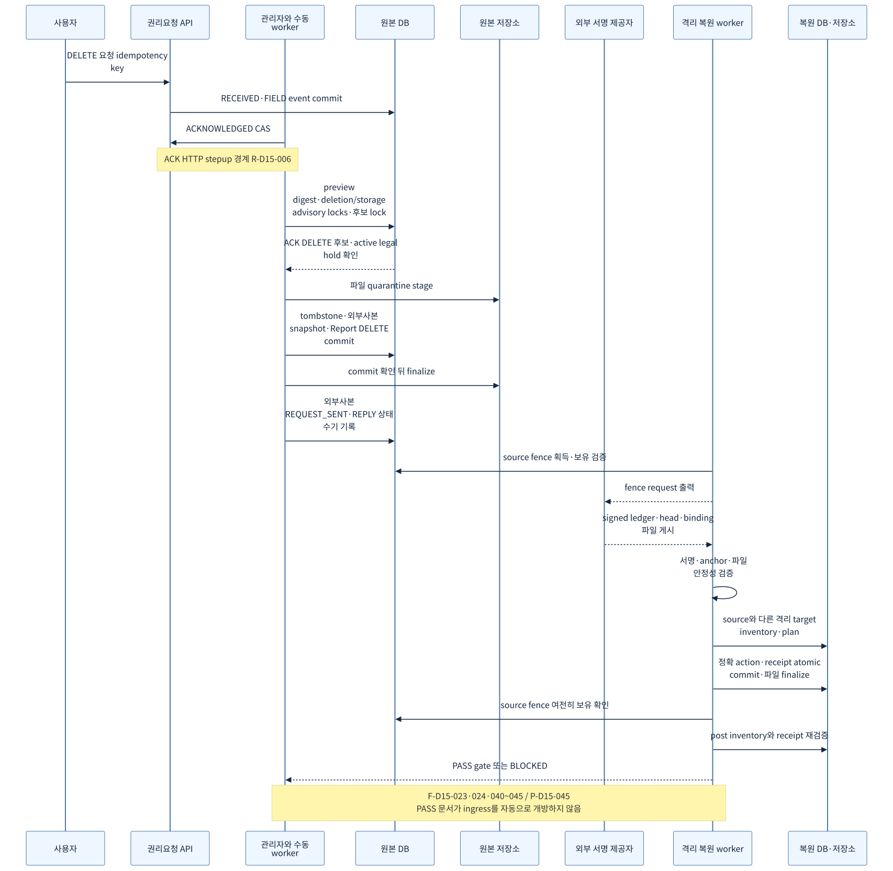

[Mermaid 원본](../diagrams/D15-sequence-delete-restore.mmd) · [SVG](../rendered/D15-sequence-delete-restore.svg)

## F-D15-018 내 권리요청·삭제 후 이력 발견

| 항목 | 명세 |
| --- | --- |
| 분야 | D15 백엔드 신고·관리자 검토·권리요청·저장·보존·삭제·복원 |
| 목적 | 코드에 구현된 내 권리요청·삭제 후 이력 발견의 입력 검증·상태 변화·실패 및 복구 계약을 설명한다. |
| 사용 주체 | 신고 사용자 또는 관리자 |
| 활성 상태 | ACTIVE |
| 진입점 | backend/app/services/report_user_request_history.py:438 list_owned_report_request_history |
| 실행 전제 | FIELD owner active; subject exclusive lock으로 조회시 정정/삭제 discovery 변화 조정. |
| 입력 출처 형식 검증 최신성 | limit default10 max25, optional report UUID, canonical base64url cursor≤1024. 응답48KiB. |

### 시작 이벤트와 처리 순서

| 이벤트 ID | 발생원 | 이벤트 | 수신부 | 흐름 |
| --- | --- | --- | --- | --- |
| E-D15-018-01 | HTTP 요청 또는 운영 도구 호출 | GET /reports/mine/requests/history | list_owned_report_request_history | 현재 request와 삭제 tombstone을 union하여 원문 없는 이력 source 구성 → discovery_revision·최대revision·snapshot count와 distinct request/revision 무결성 검사 → cursor는 resource/owner filter digest/snapshot revision/count/before/seen을 정확 결속 → 신규 append를 기존 snapshot에 끼우지 않고 페이지 생성 → 48KiB를 넘으면 page를 축소; 한 item도 불가하면503 |

1. 1. 현재 request와 삭제 tombstone을 union하여 원문 없는 이력 source 구성 [backend/app/services/report_user_request_history.py:438 list_owned_report_request_history]
2. 2. discovery_revision·최대revision·snapshot count와 distinct request/revision 무결성 검사 [backend/app/services/report_user_request_history.py:438 list_owned_report_request_history]
3. 3. cursor는 resource/owner filter digest/snapshot revision/count/before/seen을 정확 결속 [backend/app/services/report_user_request_history.py:438 list_owned_report_request_history]
4. 4. 신규 append를 기존 snapshot에 끼우지 않고 페이지 생성 [backend/app/services/report_user_request_history.py:438 list_owned_report_request_history]
5. 5. 48KiB를 넘으면 page를 축소; 한 item도 불가하면503 [backend/app/services/report_user_request_history.py:438 list_owned_report_request_history]

| 분기 조건 | 실제 처리 결과 | 구현 근거 |
| --- | --- | --- |
| 다른 resource/owner cursor | 422 cursor invalid | backend/app/services/report_user_request_history.py:438 list_owned_report_request_history |
| revision 중복·count/continuity 이상 | 이력 무결성 오류 | backend/app/services/report_user_request_history.py:438 list_owned_report_request_history |
| 신고 삭제 완료 | tombstone source로 삭제 요청 발견 가능 | backend/app/services/report_user_request_history.py:438 list_owned_report_request_history |
| 계정 tombstone | 404 | backend/app/services/report_user_request_history.py:438 list_owned_report_request_history |

### 효과 종료와 복구

기술된 응답·DB 효과. 이 기능 자체가 앱 UI/음성/진동을 실행하지 않음.

| 상황 | 동작 |
| --- | --- |
| 정상 완료 | 48KiB를 넘으면 page를 축소; 한 item도 불가하면503 |
| 실패 | 다른 resource/owner cursor → 422 cursor invalid; revision 중복·count/continuity 이상 → 이력 무결성 오류; 신고 삭제 완료 → tombstone source로 삭제 요청 발견 가능; 계정 tombstone → 404 |
| 시간 초과 | 이 기능에 독립 타이머 없음. DB/요청 제한은 D09 공통 설정 경계. |
| 중복 입력 | 조회는 상태 추가 없음. 쓰기 중복 허용 여부는 아래 분기와 공유 버전 계약 참조. |
| 취소 | 별도 취소 API 없음. |
| 중단과 생명주기 | 요청 중단이 이미 commit된 DB 효과를 되돌린다는 계약은 없음. |
| 재시도 | 서버 내부 자동 재시도 없음. 호출자가 최신 상태를 확인해 재호출. |
| 복구 | 오류코드와 현재 저장 상태 확인 후 해당 진입점으로 재요청. |
| 자원 정리 | DB session 수명은 get_db 의존성에 위임. 기능 내부 rollback/commit 여부는 처리 단계에 명시. |

### 상태 실행 맥락과 연결

| 항목 | 명세 |
| --- | --- |
| 초기 상태 | S-D15-018-01: 요청 대기 |
| 상태 목록 | S-D15-018-01: 요청 대기 S-D15-018-02: 검증 S-D15-018-03: 처리 S-D15-018-04: 응답 S-D15-018-05: 오류 |
| 전이 조건과 전이 동작 | GET /reports/mine/requests/history → 검증 [상태 ID는 values와 대응] 조건 충족 → 처리 → 응답 [상태 ID는 values와 대응] 조건 불충족 → 오류 [상태 ID는 values와 대응] |
| 허용되지 않는 전이 | 명시된 조건을 우회한 저장/응답은 허용하지 않음. 그 외 전이는 별도 정의 없음. 이 다섯 단계는 문서 설명용 요청 흐름이며 DB enum이나 장기 보관 상태가 아님. |
| 동시성 순서와 작업 소유권 | FastAPI 동기 handler/SQLAlchemy Session 또는 명시한 운영 CLI 동기 실행. 상태 변경은 DB lock·revision/CAS 정책으로 순서 역전을 검출. 클라이언트의 늦은 callback 무효화는 D06/D12 영역. |
| 공유 상태와 다른 기능 연결 | F-D15-022 삭제 상태의 외부사본 현황 결합. report별 조회는 소유권 확인. |

### 정책 근거와 검증 범위

| 항목 | 근거 |
| --- | --- |
| 정책 | [P-D15-018](#P-D15-018) |
| 구현 | [backend/app/services/report_user_request_history.py:438](/home/ddobagi/Hanium_Dreamup/backend/app/services/report_user_request_history.py:438) · `list_owned_report_request_history` (범위 438–619) [backend/app/api/report_user_requests.py:424](/home/ddobagi/Hanium_Dreamup/backend/app/api/report_user_requests.py:424) · `create_router` (범위 424–1342) |
| 기존 개선 ID | 개별 동일성 미확인; 분야 연관은 별도 추적표 |
| 기존 분야 | 해당 없음 |
| 기존 실행 증거 | 이번 작업은 정적 분석이며 기존 DONE 기록·과거 시험을 이번 실행 증거로 사용하지 않음. |
| 한계 및 구분 | snapshot count/continuity guard 세부 분기 전체는 부분검토; 실제 다중 페이지·삭제 경합은 미실행. |

| 테스트 위치 | 심볼 | 증거 수준 | 기대와 한계 |
| --- | --- | --- | --- |

연결한 테스트 미확인: 이번 작성 범위에서 이 기능에 대응하는 시험 단언을 연결하지 않았다. 테스트 자체가 없다는 판정이 아니다.

### 이벤트 처리 그림


[Mermaid 원본](../diagrams/D15-F018.mmd) · [SVG](../rendered/D15-F018.svg)

## F-D15-019 사용자 설명·분류 정정 리비전

| 항목 | 명세 |
| --- | --- |
| 분야 | D15 백엔드 신고·관리자 검토·권리요청·저장·보존·삭제·복원 |
| 목적 | 코드에 구현된 사용자 설명·분류 정정 리비전의 입력 검증·상태 변화·실패 및 복구 계약을 설명한다. |
| 사용 주체 | 신고 사용자 또는 관리자 |
| 활성 상태 | ACTIVE |
| 진입점 | backend/app/services/report_content_corrections.py:176 apply_owned_report_correction |
| 실행 전제 | owner 계정 active·subject shared lock·report FOR UPDATE. |
| 입력 출처 형식 검증 최신성 | expected_revision strict int≥0, canonical idempotency_key, user_description 또는 category_hint 최소 한 필드. omission=유지,null=삭제. user_description NFC·공백정규화1..500·control 금지. |

### 시작 이벤트와 처리 순서

| 이벤트 ID | 발생원 | 이벤트 | 수신부 | 흐름 |
| --- | --- | --- | --- | --- |
| E-D15-019-01 | HTTP 요청 또는 운영 도구 호출 | GET /reports/mine/{report_id}/content; POST /reports/mine/{report_id}/corrections | apply_owned_report_correction | report UUID+expected revision+실제 patch 필드+idempotency를 intent hash → 기존 key는 동일 intent면 기존 revision, 다르면409 → current revision0은 설명/분류 null 기본 content hash; revision>0는 정확 row 필요 → CAS 기대revision 확인 후 변경 없는 patch 거절 → ReportContentRevision append 및 Report.content_revision 증가를 commit |

1. 1. report UUID+expected revision+실제 patch 필드+idempotency를 intent hash [backend/app/services/report_content_corrections.py:176 apply_owned_report_correction]
2. 2. 기존 key는 동일 intent면 기존 revision, 다르면409 [backend/app/services/report_content_corrections.py:176 apply_owned_report_correction]
3. 3. current revision0은 설명/분류 null 기본 content hash; revision>0는 정확 row 필요 [backend/app/services/report_content_corrections.py:176 apply_owned_report_correction]
4. 4. CAS 기대revision 확인 후 변경 없는 patch 거절 [backend/app/services/report_content_corrections.py:176 apply_owned_report_correction]
5. 5. ReportContentRevision append 및 Report.content_revision 증가를 commit [backend/app/services/report_content_corrections.py:176 apply_owned_report_correction]

| 분기 조건 | 실제 처리 결과 | 구현 근거 |
| --- | --- | --- |
| 같은 key 다른 patch/expected revision | 409 idempotency conflict | backend/app/services/report_content_corrections.py:176 apply_owned_report_correction |
| stale revision | 409 revision conflict | backend/app/services/report_content_corrections.py:176 apply_owned_report_correction |
| 변경 없음 | 422 no_change | backend/app/services/report_content_corrections.py:176 apply_owned_report_correction |
| projection row missing | 503 | backend/app/services/report_content_corrections.py:176 apply_owned_report_correction |
| 새 revision | 기존 photo/GPS/class detection 원본 수정 없음 | backend/app/services/report_content_corrections.py:176 apply_owned_report_correction |

### 효과 종료와 복구

기술된 응답·DB 효과. 이 기능 자체가 앱 UI/음성/진동을 실행하지 않음.

| 상황 | 동작 |
| --- | --- |
| 정상 완료 | ReportContentRevision append 및 Report.content_revision 증가를 commit |
| 실패 | 같은 key 다른 patch/expected revision → 409 idempotency conflict; stale revision → 409 revision conflict; 변경 없음 → 422 no_change; projection row missing → 503; 새 revision → 기존 photo/GPS/class detection 원본 수정 없음 |
| 시간 초과 | 이 기능에 독립 타이머 없음. DB/요청 제한은 D09 공통 설정 경계. |
| 중복 입력 | exact key/intent replay는 원래 revision을200으로 반환; 신규는201. |
| 취소 | 별도 취소 API 없음. |
| 중단과 생명주기 | 요청 중단이 이미 commit된 DB 효과를 되돌린다는 계약은 없음. |
| 재시도 | 서버 내부 자동 재시도 없음. 호출자가 최신 상태를 확인해 재호출. |
| 복구 | 오류코드와 현재 저장 상태 확인 후 해당 진입점으로 재요청. |
| 자원 정리 | DB session 수명은 get_db 의존성에 위임. 기능 내부 rollback/commit 여부는 처리 단계에 명시. |

### 상태 실행 맥락과 연결

| 항목 | 명세 |
| --- | --- |
| 초기 상태 | S-D15-019-01: revision0 |
| 상태 목록 | S-D15-019-01: revision0 S-D15-019-02: revisionN S-D15-019-03: revisionN+1 S-D15-019-04: conflict |
| 전이 조건과 전이 동작 | GET /reports/mine/{report_id}/content; POST /reports/mine/{report_id}/content-corrections → 검증 [상태 ID는 values와 대응] 조건 충족 → 처리 → 응답 [상태 ID는 values와 대응] 조건 불충족 → 오류 [상태 ID는 values와 대응] |
| 허용되지 않는 전이 | 원본 image/location 검출 필드 patch·같은 revision 덮어쓰기 없음. |
| 동시성 순서와 작업 소유권 | FastAPI 동기 handler/SQLAlchemy Session 또는 명시한 운영 CLI 동기 실행. 상태 변경은 DB lock·revision/CAS 정책으로 순서 역전을 검출. 클라이언트의 늦은 callback 무효화는 D06/D12 영역. |
| 공유 상태와 다른 기능 연결 | 현재 content 변화는 F-D15-029 approval 및 F-D15-031 package의 기대revision을 무효화. |

### 정책 근거와 검증 범위

| 항목 | 근거 |
| --- | --- |
| 정책 | [P-D15-019](#P-D15-019) |
| 구현 | [backend/app/services/report_content_corrections.py:176](/home/ddobagi/Hanium_Dreamup/backend/app/services/report_content_corrections.py:176) · `apply_owned_report_correction` (범위 176–292) [backend/app/services/report_content_corrections.py:139](/home/ddobagi/Hanium_Dreamup/backend/app/services/report_content_corrections.py:139) · `get_owned_report_content` (범위 139–173) |
| 기존 개선 ID | 개별 동일성 미확인; 분야 연관은 별도 추적표 |
| 기존 분야 | 해당 없음 |
| 기존 실행 증거 | 이번 작업은 정적 분석이며 기존 DONE 기록·과거 시험을 이번 실행 증거로 사용하지 않음. |
| 한계 및 구분 | 실행 검증 없음. 코드상 계약과 실제 운영 성공은 구분. 조기 반환·기존결과 replay 경로는 신규 mutation 단계로 이어지지 않는다. 기능 흐름도의 조건 분기와 반환 terminal을 참조. |

| 테스트 위치 | 심볼 | 증거 수준 | 기대와 한계 |
| --- | --- | --- | --- |

연결한 테스트 미확인: 이번 작성 범위에서 이 기능에 대응하는 시험 단언을 연결하지 않았다. 테스트 자체가 없다는 판정이 아니다.

### 이벤트 처리 그림


[Mermaid 원본](../diagrams/D15-F019.mmd) · [SVG](../rendered/D15-F019.svg)

## F-D15-020 관리자 권리요청 목록·상세 열람

| 항목 | 명세 |
| --- | --- |
| 분야 | D15 백엔드 신고·관리자 검토·권리요청·저장·보존·삭제·복원 |
| 목적 | 코드에 구현된 관리자 권리요청 목록·상세 열람의 입력 검증·상태 변화·실패 및 복구 계약을 설명한다. |
| 사용 주체 | 관리자 |
| 활성 상태 | ACTIVE |
| 진입점 | backend/app/api/report_user_requests.py:1127 list_admin_report_requests |
| 실행 전제 | typed admin session + route/read-purpose에 결속된 device proof(D14). |
| 입력 출처 형식 검증 최신성 | limit25 default1..100, cursor≤1024, report/request-type/status 필터. |

### 시작 이벤트와 처리 순서

| 이벤트 ID | 발생원 | 이벤트 | 수신부 | 흐름 |
| --- | --- | --- | --- | --- |
| E-D15-020-01 | HTTP 요청 또는 운영 도구 호출 | GET /admin/report-requests; GET /admin/report-requests/{request_id} | list_admin_report_requests | 허용 query만 수용하고 canonical cursor filter digest 검사 → 목록은 request ID/report/type/status/version/time 요약 projection → 단건은 요청 text/public_response/internal_note 상세 projection → 성공·거절·검증 실패를 admin operation audit 후 응답 |

1. 1. 허용 query만 수용하고 canonical cursor filter digest 검사 [backend/app/api/report_user_requests.py:1127 list_admin_report_requests]
2. 2. 목록은 request ID/report/type/status/version/time 요약 projection [backend/app/api/report_user_requests.py:1127 list_admin_report_requests]
3. 3. 단건은 요청 text/public_response/internal_note 상세 projection [backend/app/api/report_user_requests.py:1127 list_admin_report_requests]
4. 4. 성공·거절·검증 실패를 admin operation audit 후 응답 [backend/app/api/report_user_requests.py:1127 list_admin_report_requests]

| 분기 조건 | 실제 처리 결과 | 구현 근거 |
| --- | --- | --- |
| unknown/duplicate query | 422 및 감사 | backend/app/api/report_user_requests.py:1127 list_admin_report_requests |
| 없는 request | 404 | backend/app/api/report_user_requests.py:1127 list_admin_report_requests |
| audit/store 실패 | 503 | backend/app/api/report_user_requests.py:1127 list_admin_report_requests |

### 효과 종료와 복구

기술된 응답·DB 효과. 이 기능 자체가 앱 UI/음성/진동을 실행하지 않음.

| 상황 | 동작 |
| --- | --- |
| 정상 완료 | 성공·거절·검증 실패를 admin operation audit 후 응답 |
| 실패 | unknown/duplicate query → 422 및 감사; 없는 request → 404; audit/store 실패 → 503 |
| 시간 초과 | 이 기능에 독립 타이머 없음. DB/요청 제한은 D09 공통 설정 경계. |
| 중복 입력 | 조회는 상태 추가 없음. 쓰기 중복 허용 여부는 아래 분기와 공유 버전 계약 참조. |
| 취소 | 별도 취소 API 없음. |
| 중단과 생명주기 | 요청 중단이 이미 commit된 DB 효과를 되돌린다는 계약은 없음. |
| 재시도 | 서버 내부 자동 재시도 없음. 호출자가 최신 상태를 확인해 재호출. |
| 복구 | 오류코드와 현재 저장 상태 확인 후 해당 진입점으로 재요청. |
| 자원 정리 | DB session 수명은 get_db 의존성에 위임. 기능 내부 rollback/commit 여부는 처리 단계에 명시. |

### 상태 실행 맥락과 연결

| 항목 | 명세 |
| --- | --- |
| 초기 상태 | S-D15-020-01: 요청 대기 |
| 상태 목록 | S-D15-020-01: 요청 대기 S-D15-020-02: 검증 S-D15-020-03: 처리 S-D15-020-04: 응답 S-D15-020-05: 오류 |
| 전이 조건과 전이 동작 | GET /admin/report-requests; GET /admin/report-requests/{request_id} → 검증 [상태 ID는 values와 대응] 조건 충족 → 처리 → 응답 [상태 ID는 values와 대응] 조건 불충족 → 오류 [상태 ID는 values와 대응] |
| 허용되지 않는 전이 | 명시된 조건을 우회한 저장/응답은 허용하지 않음. 그 외 전이는 별도 정의 없음. 이 다섯 단계는 문서 설명용 요청 흐름이며 DB enum이나 장기 보관 상태가 아님. |
| 동시성 순서와 작업 소유권 | FastAPI 동기 handler/SQLAlchemy Session 또는 명시한 운영 CLI 동기 실행. 상태 변경은 DB lock·revision/CAS 정책으로 순서 역전을 검출. 클라이언트의 늦은 callback 무효화는 D06/D12 영역. |
| 공유 상태와 다른 기능 연결 | F-D15-021 상태 처리, D14 proof 권한 경계. |

### 정책 근거와 검증 범위

| 항목 | 근거 |
| --- | --- |
| 정책 | [P-D15-020](#P-D15-020) |
| 구현 | [backend/app/api/report_user_requests.py:1127](/home/ddobagi/Hanium_Dreamup/backend/app/api/report_user_requests.py:1127) · `list_admin_report_requests` (범위 1127–1221) |
| 기존 개선 ID | 개별 동일성 미확인; 분야 연관은 별도 추적표 |
| 기존 분야 | 해당 없음 |
| 기존 실행 증거 | 이번 작업은 정적 분석이며 기존 DONE 기록·과거 시험을 이번 실행 증거로 사용하지 않음. |
| 한계 및 구분 | 실행 검증 없음. 코드상 계약과 실제 운영 성공은 구분. |

| 테스트 위치 | 심볼 | 증거 수준 | 기대와 한계 |
| --- | --- | --- | --- |

연결한 테스트 미확인: 이번 작성 범위에서 이 기능에 대응하는 시험 단언을 연결하지 않았다. 테스트 자체가 없다는 판정이 아니다.

### 이벤트 처리 그림


[Mermaid 원본](../diagrams/D15-F020.mmd) · [SVG](../rendered/D15-F020.svg)

## F-D15-021 관리자 권리요청 ACK·해결·반려

| 항목 | 명세 |
| --- | --- |
| 분야 | D15 백엔드 신고·관리자 검토·권리요청·저장·보존·삭제·복원 |
| 목적 | 코드에 구현된 관리자 권리요청 ACK·해결·반려의 입력 검증·상태 변화·실패 및 복구 계약을 설명한다. |
| 사용 주체 | 관리자 |
| 활성 상태 | CONDITIONAL |
| 진입점 | backend/app/services/report_user_requests.py:745 update_admin_request_status |
| 실행 전제 | admin proof/action binding, row FOR UPDATE. request.state identity.step_up_verified_at가 None이면 service 호출 전403; D14 재확인 계약 결합 미해결. |
| 입력 출처 형식 검증 최신성 | expected_version, next status, public_response/internal_note bounded text. |

### 시작 이벤트와 처리 순서

| 이벤트 ID | 발생원 | 이벤트 | 수신부 | 흐름 |
| --- | --- | --- | --- | --- |
| E-D15-021-01 | HTTP 요청 또는 운영 도구 호출 | PATCH /admin/report-requests/{request_id}/status | update_admin_request_status | 현재 request lock 후 expected_version 확인 → RECEIVED→ACKNOWLEDGED→RESOLVED/REJECTED만 허용 → DELETE ACKNOWLEDGED→RESOLVED는 이 API에서 제거 → status version+1, public/internal response, ADMIN event 및 operation audit 같이 commit → Integrity race는 최신version 재조회해409과 store503 구별 |

1. 1. 현재 request lock 후 expected_version 확인 [backend/app/services/report_user_requests.py:745 update_admin_request_status]
2. 2. RECEIVED→ACKNOWLEDGED→RESOLVED/REJECTED만 허용 [backend/app/services/report_user_requests.py:745 update_admin_request_status]
3. 3. DELETE ACKNOWLEDGED→RESOLVED는 이 API에서 제거 [backend/app/services/report_user_requests.py:745 update_admin_request_status]
4. 4. status version+1, public/internal response, ADMIN event 및 operation audit 같이 commit [backend/app/services/report_user_requests.py:745 update_admin_request_status]
5. 5. Integrity race는 최신version 재조회해409과 store503 구별 [backend/app/services/report_user_requests.py:745 update_admin_request_status]

| 분기 조건 | 실제 처리 결과 | 구현 근거 |
| --- | --- | --- |
| HTTP action identity.step_up_verified_at is None | 403 admin_step_up_required; service mutation에 도달하지 않음 | backend/app/api/report_user_requests.py:245 _admin_action_context |
| stale version | 409 latest 상태 포함 | backend/app/services/report_user_requests.py:745 update_admin_request_status |
| 종료 상태 재변경 또는 동일 status | 422 | backend/app/services/report_user_requests.py:745 update_admin_request_status |
| DELETE를 RESOLVED로 patch | 422; 물리효과 없는 완료 금지 | backend/app/services/report_user_requests.py:745 update_admin_request_status |

### 효과 종료와 복구

기술된 응답·DB 효과. 이 기능 자체가 앱 UI/음성/진동을 실행하지 않음.

| 상황 | 동작 |
| --- | --- |
| 정상 완료 | 새 status/version·사용자 공개 응답·ADMIN event·감사를 한 transaction으로 commit한 뒤 현재 요청 상태 반환. |
| 실패 | stale version → 409 latest 상태 포함; 종료 상태 재변경 또는 동일 status → 422; DELETE를 RESOLVED로 patch → 422; 물리효과 없는 완료 금지 |
| 시간 초과 | 이 기능에 독립 타이머 없음. DB/요청 제한은 D09 공통 설정 경계. |
| 중복 입력 | 동일 상태 재호출을 replay 성공으로 정의하지 않음. |
| 취소 | 별도 취소 API 없음. |
| 중단과 생명주기 | 요청 중단이 이미 commit된 DB 효과를 되돌린다는 계약은 없음. |
| 재시도 | 서버 내부 자동 재시도 없음. 호출자가 최신 상태를 확인해 재호출. |
| 복구 | 오류코드와 현재 저장 상태 확인 후 해당 진입점으로 재요청. |
| 자원 정리 | DB session 수명은 get_db 의존성에 위임. 기능 내부 rollback/commit 여부는 처리 단계에 명시. |

### 상태 실행 맥락과 연결

| 항목 | 명세 |
| --- | --- |
| 초기 상태 | S-D15-021-01: RECEIVED |
| 상태 목록 | S-D15-021-01: RECEIVED S-D15-021-02: ACKNOWLEDGED S-D15-021-03: RESOLVED S-D15-021-04: REJECTED |
| 전이 조건과 전이 동작 | RECEIVED→ACKNOWLEDGED [상태 ID는 values와 대응] CORRECTION ACKNOWLEDGED→RESOLVED/REJECTED [상태 ID는 values와 대응] DELETE ACKNOWLEDGED→REJECTED; 물리삭제는 별도 tombstone [상태 ID는 values와 대응] |
| 허용되지 않는 전이 | 명시된 조건을 우회한 저장/응답은 허용하지 않음. 그 외 전이는 별도 정의 없음. |
| 동시성 순서와 작업 소유권 | FastAPI 동기 handler/SQLAlchemy Session 또는 명시한 운영 CLI 동기 실행. 상태 변경은 DB lock·revision/CAS 정책으로 순서 역전을 검출. 클라이언트의 늦은 callback 무효화는 D06/D12 영역. |
| 공유 상태와 다른 기능 연결 | Report 및 관련 테이블. D09 런타임 등록·미들웨어와 D13 동의/계정, D14 관리자 인증 경계에 연결. |

### 정책 근거와 검증 범위

| 항목 | 근거 |
| --- | --- |
| 정책 | [P-D15-021](#P-D15-021) |
| 구현 | [backend/app/services/report_user_requests.py:745](/home/ddobagi/Hanium_Dreamup/backend/app/services/report_user_requests.py:745) · `update_admin_request_status` (범위 745–875) [backend/app/api/report_user_requests.py:245](/home/ddobagi/Hanium_Dreamup/backend/app/api/report_user_requests.py:245) · `_admin_action_context` (범위 245–284) |
| 기존 개선 ID | 개별 동일성 미확인; 분야 연관은 별도 추적표 |
| 기존 분야 | 해당 없음 |
| 기존 실행 증거 | 이번 작업은 정적 분석이며 기존 DONE 기록·과거 시험을 이번 실행 증거로 사용하지 않음. |
| 한계 및 구분 | 실행 검증 없음. 코드상 계약과 실제 운영 성공은 구분. R-D15-006/D14 R8: HTTP action context의 step_up_verified_at 조건과 재확인 identity 전달 계약의 정적 불일치로 정상 재확인 후에도403 가능. 아래 service 처리는 해당 경계를 통과했을 때의 구현 계약이며 HTTP 성공 실검증 아님. |

| 테스트 위치 | 심볼 | 증거 수준 | 기대와 한계 |
| --- | --- | --- | --- |
| [backend/tests/test_report_physical_deletion.py](/home/ddobagi/Hanium_Dreamup/backend/tests/test_report_physical_deletion.py) | test_admin_cannot_mark_delete_request_resolved_without_physical_effect | TEST_EXPECTATION | DELETE ACK 상태는 RESOLVED가 허용되지 않고 CORRECTION ACK만 RESOLVED/REJECTED를 허용한다. 테스트 본문 정적 열람; 이번 미실행. |

### 이벤트 처리 그림


[Mermaid 원본](../diagrams/D15-F021.mmd) · [SVG](../rendered/D15-F021.svg)


[Mermaid 원본](../diagrams/D15-F021-state.mmd) · [SVG](../rendered/D15-F021-state.svg)

[Mermaid 원본](../diagrams/D15-sequence-delete-restore.mmd) · [SVG](../rendered/D15-sequence-delete-restore.svg)

## F-D15-022 신고 삭제 상태와 외부사본 분리 조회

| 항목 | 명세 |
| --- | --- |
| 분야 | D15 백엔드 신고·관리자 검토·권리요청·저장·보존·삭제·복원 |
| 목적 | 코드에 구현된 신고 삭제 상태와 외부사본 분리 조회의 입력 검증·상태 변화·실패 및 복구 계약을 설명한다. |
| 사용 주체 | 신고 소유자 |
| 활성 상태 | ACTIVE |
| 진입점 | backend/app/services/report_deletion.py:151 get_owned_report_deletion_status |
| 실행 전제 | owner active와 shared privacy lock. |
| 입력 출처 형식 검증 최신성 | canonical request UUID, actor/generation. 별도 query 허용하지 않음. |

### 시작 이벤트와 처리 순서

| 이벤트 ID | 발생원 | 이벤트 | 수신부 | 흐름 |
| --- | --- | --- | --- | --- |
| E-D15-022-01 | HTTP 요청 또는 운영 도구 호출 | GET /reports/mine/deletions/{request_id} | get_owned_report_deletion_status | owner 확인→tombstone 있으면 copy 수·최신이력 검증 뒤 DELETED 반환; 없을 때만 DELETE request 조회→RESOLVED503 또는 REJECTED/LEGAL_HOLD/PENDING 반환 |

1. 1. privacy shared lock·active owner를 확인하고 소유 tombstone 조회 [backend/app/services/report_deletion.py:151 get_owned_report_deletion_status]
2. 2. tombstone 있으면 외부 copy 수·최신 event를 검증하고 DELETED와 local/external 최신 updated_at을 즉시 반환 [backend/app/services/report_deletion.py:151 get_owned_report_deletion_status]
3. 3. tombstone 없을 때만 소유 DELETE request를 조회; 없음404, RESOLVED이면 durable effect 없음503 [backend/app/services/report_deletion.py:151 get_owned_report_deletion_status]
4. 4. 나머지는 REJECTED 우선, active legal hold이면 LEGAL_HOLD, 그 외 PENDING 반환 [backend/app/services/report_deletion.py:151 get_owned_report_deletion_status]

| 분기 조건 | 실제 처리 결과 | 구현 근거 |
| --- | --- | --- |
| RESOLVED request인데 tombstone 없음 | 503 report_deletion_effect_missing | backend/app/services/report_deletion.py:151 get_owned_report_deletion_status |
| tombstone count와 copy 수 불일치 | 503 evidence inconsistent | backend/app/services/report_deletion.py:151 get_owned_report_deletion_status |
| 요청·owner 없음 | 404 | backend/app/services/report_deletion.py:151 get_owned_report_deletion_status |
| local DELETED 외부사본 NOT_REQUESTED | 외부 삭제 완료로 표시하지 않음 | backend/app/services/report_deletion.py:151 get_owned_report_deletion_status |

### 효과 종료와 복구

기술된 응답·DB 효과. 이 기능 자체가 앱 UI/음성/진동을 실행하지 않음.

| 상황 | 동작 |
| --- | --- |
| 정상 완료 | 외부 snapshot count와 실제 copy 수 일치 검사; updated_at은 local/external 중 최신 |
| 실패 | RESOLVED request인데 tombstone 없음 → 503 report_deletion_effect_missing; tombstone count와 copy 수 불일치 → 503 evidence inconsistent; 요청·owner 없음 → 404; local DELETED 외부사본 NOT_REQUESTED → 외부 삭제 완료로 표시하지 않음 |
| 시간 초과 | 이 기능에 독립 타이머 없음. DB/요청 제한은 D09 공통 설정 경계. |
| 중복 입력 | 조회는 상태 추가 없음. 쓰기 중복 허용 여부는 아래 분기와 공유 버전 계약 참조. |
| 취소 | 별도 취소 API 없음. |
| 중단과 생명주기 | 요청 중단이 이미 commit된 DB 효과를 되돌린다는 계약은 없음. |
| 재시도 | 서버 내부 자동 재시도 없음. 호출자가 최신 상태를 확인해 재호출. |
| 복구 | 오류코드와 현재 저장 상태 확인 후 해당 진입점으로 재요청. |
| 자원 정리 | DB session 수명은 get_db 의존성에 위임. 기능 내부 rollback/commit 여부는 처리 단계에 명시. |

### 상태 실행 맥락과 연결

| 항목 | 명세 |
| --- | --- |
| 초기 상태 | S-D15-022-01: PENDING |
| 상태 목록 | S-D15-022-01: PENDING S-D15-022-02: LEGAL_HOLD S-D15-022-03: REJECTED S-D15-022-04: DELETED |
| 전이 조건과 전이 동작 | GET /reports/mine/deletions/{request_id} → 검증 [상태 ID는 values와 대응] 조건 충족 → 처리 → 응답 [상태 ID는 values와 대응] 조건 불충족 → 오류 [상태 ID는 values와 대응] |
| 허용되지 않는 전이 | 명시된 조건을 우회한 저장/응답은 허용하지 않음. 그 외 전이는 별도 정의 없음. |
| 동시성 순서와 작업 소유권 | FastAPI 동기 handler/SQLAlchemy Session 또는 명시한 운영 CLI 동기 실행. 상태 변경은 DB lock·revision/CAS 정책으로 순서 역전을 검출. 클라이언트의 늦은 callback 무효화는 D06/D12 영역. |
| 공유 상태와 다른 기능 연결 | Report 및 관련 테이블. D09 런타임 등록·미들웨어와 D13 동의/계정, D14 관리자 인증 경계에 연결. |

### 정책 근거와 검증 범위

| 항목 | 근거 |
| --- | --- |
| 정책 | [P-D15-022](#P-D15-022) |
| 구현 | [backend/app/services/report_deletion.py:151](/home/ddobagi/Hanium_Dreamup/backend/app/services/report_deletion.py:151) · `get_owned_report_deletion_status` (범위 151–229) |
| 기존 개선 ID | 개별 동일성 미확인; 분야 연관은 별도 추적표 |
| 기존 분야 | 해당 없음 |
| 기존 실행 증거 | 이번 작업은 정적 분석이며 기존 DONE 기록·과거 시험을 이번 실행 증거로 사용하지 않음. |
| 한계 및 구분 | 계정삭제 D13 server_copies의 EXTERNAL_PENDING 해소와 이 API를 연결하는 호출은 확인되지 않음. |

| 테스트 위치 | 심볼 | 증거 수준 | 기대와 한계 |
| --- | --- | --- | --- |

연결한 테스트 미확인: 이번 작성 범위에서 이 기능에 대응하는 시험 단언을 연결하지 않았다. 테스트 자체가 없다는 판정이 아니다.

### 이벤트 처리 그림


[Mermaid 원본](../diagrams/D15-F022.mmd) · [SVG](../rendered/D15-F022.svg)

[Mermaid 원본](../diagrams/D15-sequence-delete-restore.mmd) · [SVG](../rendered/D15-sequence-delete-restore.svg)

## F-D15-023 승인된 신고 물리삭제·격리 복구 worker

| 항목 | 명세 |
| --- | --- |
| 분야 | D15 백엔드 신고·관리자 검토·권리요청·저장·보존·삭제·복원 |
| 목적 | 코드에 구현된 승인된 신고 물리삭제·격리 복구 worker의 입력 검증·상태 변화·실패 및 복구 계약을 설명한다. |
| 사용 주체 | 운영자 수동 deletion worker |
| 활성 상태 | ACTIVE |
| 진입점 | backend/app/services/report_deletion.py:340 apply_report_deletion |
| 실행 전제 | 수동 제한역할 및 worker/storage session advisory locks; 후보별 subject exclusive transaction lock. 이 CLI에서 maintenance flock 호출은 확인되지 않음. |
| 입력 출처 형식 검증 최신성 | ACKNOWLEDGED DELETE 요청 후보, request status version·owner·generation·report ID; CLI candidate digest. limit1..100. --apply는 --confirm DELETE-ACKNOWLEDGED-REPORTS와 preview SHA256 digest 필수. --manual-one-shot은 root 실행 금지. 기본 limit25. |

### 시작 이벤트와 처리 순서

| 이벤트 ID | 발생원 | 이벤트 | 수신부 | 흐름 |
| --- | --- | --- | --- | --- |
| E-D15-023-01 | HTTP 요청 또는 운영 도구 호출 | scripts/delete_reports.py preview/apply/reconcile | apply_report_deletion | 신고당 가장 오래된 ACK DELETE 후보를 preview하고 digest 결속 → apply 시 기존 tombstone exact match는 완료 replay → DB 전용 함수로 후보 lock 후 owner/version/상태 재확인 → active legal hold는 삭제 대신 LEGAL_HOLD 반환 → 외부사본 snapshot·content-free tombstone 생성, image를 private quarantine에 stage → Report delete와 tombstone commit 후 finalize; commit ambiguity는 tombstone 재조회로 판정 |

1. 1. 신고당 가장 오래된 ACK DELETE 후보를 preview하고 digest 결속 [backend/app/services/report_deletion.py:340 apply_report_deletion]
2. 2. apply 시 기존 tombstone exact match는 완료 replay [backend/app/services/report_deletion.py:340 apply_report_deletion]
3. 3. DB 전용 함수로 후보 lock 후 owner/version/상태 재확인 [backend/app/services/report_deletion.py:340 apply_report_deletion]
4. 4. active legal hold는 삭제 대신 LEGAL_HOLD 반환 [backend/app/services/report_deletion.py:340 apply_report_deletion]
5. 5. 외부사본 snapshot·content-free tombstone 생성, image를 private quarantine에 stage [backend/app/services/report_deletion.py:340 apply_report_deletion]
6. 6. Report delete와 tombstone commit 후 finalize; commit ambiguity는 tombstone 재조회로 판정 [backend/app/services/report_deletion.py:340 apply_report_deletion]

| 분기 조건 | 실제 처리 결과 | 구현 근거 |
| --- | --- | --- |
| 후보 상태/owner/version 변경 | 409 stale | backend/app/services/report_deletion.py:340 apply_report_deletion |
| 파일 stage 실패 | rollback·restore; 복구 실패는503 recovery required | backend/app/services/report_deletion.py:340 apply_report_deletion |
| commit 오류·tombstone 없음 | restore 후503 | backend/app/services/report_deletion.py:340 apply_report_deletion |
| commit 오류·tombstone 있음 | finalize 후 DELETED | backend/app/services/report_deletion.py:340 apply_report_deletion |
| commit 뒤 finalize 실패 | 503 cleanup pending; DB 삭제 유지 | backend/app/services/report_deletion.py:340 apply_report_deletion |

### 효과 종료와 복구

기술된 응답·DB 효과. 이 기능 자체가 앱 UI/음성/진동을 실행하지 않음.

| 상황 | 동작 |
| --- | --- |
| 정상 완료 | Report delete와 tombstone commit 후 finalize; commit ambiguity는 tombstone 재조회로 판정 |
| 실패 | 후보 상태/owner/version 변경 → 409 stale; 파일 stage 실패 → rollback·restore; 복구 실패는503 recovery required; commit 오류·tombstone 없음 → restore 후503; commit 오류·tombstone 있음 → finalize 후 DELETED; commit 뒤 finalize 실패 → 503 cleanup pending; DB 삭제 유지 |
| 시간 초과 | 이 기능에 독립 타이머 없음. DB/요청 제한은 D09 공통 설정 경계. |
| 중복 입력 | exact completed tombstone replay. 내용/세대/version 다르면409. |
| 취소 | 취소 endpoint 없음. 중단 뒤 --reconcile을 통한 durable journal 조정 필요. |
| 중단과 생명주기 | 요청 중단이 이미 commit된 DB 효과를 되돌린다는 계약은 없음. |
| 재시도 | 서버 내부 자동 재시도 없음. 호출자가 최신 상태를 확인해 재호출. |
| 복구 | --reconcile이 tombstone 있으면 finalize, 없으면 restore. pending quarantine 남으면 신규 후보 처리를 차단. |
| 자원 정리 | CLI finally에서 session advisory locks 해제·rollback·engine dispose. stage/journal 정리는 commit 판정과 reconcile 결과를 따름. |

### 상태 실행 맥락과 연결

| 항목 | 명세 |
| --- | --- |
| 초기 상태 | S-D15-023-01: 요청 대기 |
| 상태 목록 | S-D15-023-01: 요청 대기 S-D15-023-02: 검증 S-D15-023-03: 처리 S-D15-023-04: 응답 S-D15-023-05: 오류 |
| 전이 조건과 전이 동작 | scripts/delete_reports.py preview/apply/reconcile → 검증 [상태 ID는 values와 대응] 조건 충족 → 처리 → 응답 [상태 ID는 values와 대응] 조건 불충족 → 오류 [상태 ID는 values와 대응] |
| 허용되지 않는 전이 | 명시된 조건을 우회한 저장/응답은 허용하지 않음. 그 외 전이는 별도 정의 없음. 이 다섯 단계는 문서 설명용 요청 흐름이며 DB enum이나 장기 보관 상태가 아님. |
| 동시성 순서와 작업 소유권 | 동기 운영 CLI. DB/파일 lock으로 다른 삭제·storage 작업과 serialize. 실제 자동 스케줄 연결은 없음. |
| 공유 상태와 다른 기능 연결 | ReportDeletionTombstone, ExternalCopyState, ReportDeletionQuarantine; D13 계정삭제는 별도 worker. |

### 정책 근거와 검증 범위

| 항목 | 근거 |
| --- | --- |
| 정책 | [P-D15-023](#P-D15-023) |
| 구현 | [backend/app/services/report_deletion.py:340](/home/ddobagi/Hanium_Dreamup/backend/app/services/report_deletion.py:340) · `apply_report_deletion` (범위 340–590) [scripts/delete_reports.py:702](/home/ddobagi/Hanium_Dreamup/scripts/delete_reports.py:702) · `main` (범위 702–854) [scripts/delete_reports.py:222](/home/ddobagi/Hanium_Dreamup/scripts/delete_reports.py:222) · `ReportDeletionQuarantine` (범위 222–685) [backend/alembic/versions/202608300003_report_restore_reapply.py:176](/home/ddobagi/Hanium_Dreamup/backend/alembic/versions/202608300003_report_restore_reapply.py:176) · `_install_report_delete_guard` (범위 176–245) |
| 기존 개선 ID | 개별 동일성 미확인; 분야 연관은 별도 추적표 |
| 기존 분야 | 해당 없음 |
| 기존 실행 증거 | 이번 작업은 정적 분석이며 기존 DONE 기록·과거 시험을 이번 실행 증거로 사용하지 않음. |
| 한계 및 구분 | 실행 검증 없음. 코드상 계약과 실제 운영 성공은 구분. 조기 반환·기존결과 replay 경로는 신규 mutation 단계로 이어지지 않는다. 기능 흐름도의 조건 분기와 반환 terminal을 참조. |

| 테스트 위치 | 심볼 | 증거 수준 | 기대와 한계 |
| --- | --- | --- | --- |
| [backend/tests/test_report_physical_deletion.py](/home/ddobagi/Hanium_Dreamup/backend/tests/test_report_physical_deletion.py) | test_candidate_query_is_acknowledged_delete_only_and_one_per_report | TEST_EXPECTATION | ACK DELETE 필터·report별 row_number·기존 tombstone 제외 SQL 구조를 기대한다. 테스트 본문 정적 열람; 이번 미실행. |

### 이벤트 처리 그림


[Mermaid 원본](../diagrams/D15-F023.mmd) · [SVG](../rendered/D15-F023.svg)

[Mermaid 원본](../diagrams/D15-sequence-delete-restore.mmd) · [SVG](../rendered/D15-sequence-delete-restore.svg)

## F-D15-024 기관 보유 신고 사본의 삭제요청·회신 기록

| 항목 | 명세 |
| --- | --- |
| 분야 | D15 백엔드 신고·관리자 검토·권리요청·저장·보존·삭제·복원 |
| 목적 | 코드에 구현된 기관 보유 신고 사본의 삭제요청·회신 기록의 입력 검증·상태 변화·실패 및 복구 계약을 설명한다. |
| 사용 주체 | 관리자 |
| 활성 상태 | ACTIVE |
| 진입점 | backend/app/services/report_external_copy_deletions.py:369 record_admin_external_copy_deletion_event |
| 실행 전제 | admin route proof/action 및 local deletion tombstone에 결속된 copy snapshot. |
| 입력 출처 형식 검증 최신성 | copy/request UUID, expected_revision, idempotency UUID, state, institution reference/evidence SHA, observed_at. 모든 REPLY_*는 institution_reference 또는 evidence_sha256 중 하나가 필수이며 REPLY_DELETION_CONFIRMED는 evidence_sha256가 반드시 필요하다. supplied digest 필수·형식 검사이며 외부 삭제 사실의 암호학적 검증은 아니다. |

### 시작 이벤트와 처리 순서

| 이벤트 ID | 발생원 | 이벤트 | 수신부 | 흐름 |
| --- | --- | --- | --- | --- |
| E-D15-024-01 | HTTP 요청 또는 운영 도구 호출 | GET /admin/report-deletions/external-copies; POST /admin/report-deletions/{request_id}/external-copies/{copy_id}/events | record_admin_external_copy_deletion_event | copy/tombstone lock·총수 일치 확인 → 동일 key exact intent면 기존 event와 성공감사 반환 → revision CAS와 상태 전이, observed_at≤recorded_at 및 이전 observed_at 이상 검사 → append event와 감사 commit; 경쟁은 동일 replay 또는 revision conflict |

1. 1. copy/tombstone lock·총수 일치 확인 [backend/app/services/report_external_copy_deletions.py:369 record_admin_external_copy_deletion_event]
2. 2. 동일 key exact intent면 기존 event와 성공감사 반환 [backend/app/services/report_external_copy_deletions.py:369 record_admin_external_copy_deletion_event]
3. 3. revision CAS와 상태 전이, observed_at≤recorded_at 및 이전 observed_at 이상 검사 [backend/app/services/report_external_copy_deletions.py:369 record_admin_external_copy_deletion_event]
4. 4. append event와 감사 commit; 경쟁은 동일 replay 또는 revision conflict [backend/app/services/report_external_copy_deletions.py:369 record_admin_external_copy_deletion_event]

| 분기 조건 | 실제 처리 결과 | 구현 근거 |
| --- | --- | --- |
| NOT_REQUESTED | REQUEST_SENT만 허용 | backend/app/services/report_external_copy_deletions.py:369 record_admin_external_copy_deletion_event |
| REQUEST_SENT | REPLY_ACKNOWLEDGED/REPLY_DELETION_CONFIRMED/REPLY_DECLINED 회신 | backend/app/services/report_external_copy_deletions.py:369 record_admin_external_copy_deletion_event |
| REPLY_ACKNOWLEDGED | REPLY_DELETION_CONFIRMED 또는 REPLY_DECLINED | backend/app/services/report_external_copy_deletions.py:369 record_admin_external_copy_deletion_event |
| REPLY_DECLINED | REQUEST_SENT 재요청 가능 | backend/app/services/report_external_copy_deletions.py:369 record_admin_external_copy_deletion_event |
| REPLY_DELETION_CONFIRMED | 종료 | backend/app/services/report_external_copy_deletions.py:369 record_admin_external_copy_deletion_event |
| 시간 역전/미래 | 422 | backend/app/services/report_external_copy_deletions.py:369 record_admin_external_copy_deletion_event |
| REPLY_* 증거/reference 모두 없음 또는 REPLY_DELETION_CONFIRMED의 SHA256 없음 | DTO validation422; event 저장 전 차단 | backend/app/schemas.py:1163 require_reply_evidence |

### 효과 종료와 복구

기술된 응답·DB 효과. 이 기능 자체가 앱 UI/음성/진동을 실행하지 않음.

| 상황 | 동작 |
| --- | --- |
| 정상 완료 | append event와 감사 commit; 경쟁은 동일 replay 또는 revision conflict |
| 실패 | 다른 intent의 key 재사용·revision 경합409, 허용하지 않는 전이/관찰시각422, 감사·DB 실패503. 같은 exact intent는 정상 replay. |
| 시간 초과 | 이 기능에 독립 타이머 없음. DB/요청 제한은 D09 공통 설정 경계. |
| 중복 입력 | 동일 key 다른 intent409; exact replay에도 readout 전 success audit commit. |
| 취소 | 별도 취소 API 없음. |
| 중단과 생명주기 | 요청 중단이 이미 commit된 DB 효과를 되돌린다는 계약은 없음. |
| 재시도 | 서버 내부 자동 재시도 없음. 호출자가 최신 상태를 확인해 재호출. |
| 복구 | 오류코드와 현재 저장 상태 확인 후 해당 진입점으로 재요청. |
| 자원 정리 | DB session 수명은 get_db 의존성에 위임. 기능 내부 rollback/commit 여부는 처리 단계에 명시. |

### 상태 실행 맥락과 연결

| 항목 | 명세 |
| --- | --- |
| 초기 상태 | S-D15-024-01: NOT_REQUESTED |
| 상태 목록 | S-D15-024-01: NOT_REQUESTED S-D15-024-02: REQUEST_SENT S-D15-024-03: REPLY_ACKNOWLEDGED S-D15-024-04: REPLY_DELETION_CONFIRMED S-D15-024-05: REPLY_DECLINED |
| 전이 조건과 전이 동작 | NOT_REQUESTED→REQUEST_SENT REQUEST_SENT→REPLY_ACKNOWLEDGED/REPLY_DELETION_CONFIRMED/REPLY_DECLINED REPLY_ACKNOWLEDGED→REPLY_DELETION_CONFIRMED/REPLY_DECLINED REPLY_DECLINED→REQUEST_SENT |
| 허용되지 않는 전이 | REPLY_DELETION_CONFIRMED 후 추가 전이 없음. 같은 상태 반복은 신규 event 전이로 허용하지 않으며 exact idempotent replay는 별개. |
| 동시성 순서와 작업 소유권 | FastAPI 동기 handler/SQLAlchemy Session 또는 명시한 운영 CLI 동기 실행. 상태 변경은 DB lock·revision/CAS 정책으로 순서 역전을 검출. 클라이언트의 늦은 callback 무효화는 D06/D12 영역. |
| 공유 상태와 다른 기능 연결 | Report 및 관련 테이블. D09 런타임 등록·미들웨어와 D13 동의/계정, D14 관리자 인증 경계에 연결. |

### 정책 근거와 검증 범위

| 항목 | 근거 |
| --- | --- |
| 정책 | [P-D15-024](#P-D15-024) |
| 구현 | [backend/app/services/report_external_copy_deletions.py:369](/home/ddobagi/Hanium_Dreamup/backend/app/services/report_external_copy_deletions.py:369) · `record_admin_external_copy_deletion_event` (범위 369–591) [backend/app/api/report_user_requests.py:424](/home/ddobagi/Hanium_Dreamup/backend/app/api/report_user_requests.py:424) · `create_router` (범위 424–1342) [backend/app/schemas.py:1121](/home/ddobagi/Hanium_Dreamup/backend/app/schemas.py:1121) · `AdminReportDeletionExternalCopyEventCreateV1` (범위 1121–1173) |
| 기존 개선 ID | 개별 동일성 미확인; 분야 연관은 별도 추적표 |
| 기존 분야 | 해당 없음 |
| 기존 실행 증거 | 이번 작업은 정적 분석이며 기존 DONE 기록·과거 시험을 이번 실행 증거로 사용하지 않음. |
| 한계 및 구분 | 기관 삭제 요청·회신의 관리자 수기 기록 API이며 실제 기관 통신/사본 삭제 여부는 외부 증거 확인 영역. 조기 반환·기존결과 replay 경로는 신규 mutation 단계로 이어지지 않는다. 기능 흐름도의 조건 분기와 반환 terminal을 참조. |

| 테스트 위치 | 심볼 | 증거 수준 | 기대와 한계 |
| --- | --- | --- | --- |

연결한 테스트 미확인: 이번 작성 범위에서 이 기능에 대응하는 시험 단언을 연결하지 않았다. 테스트 자체가 없다는 판정이 아니다.

### 이벤트 처리 그림


[Mermaid 원본](../diagrams/D15-F024.mmd) · [SVG](../rendered/D15-F024.svg)


[Mermaid 원본](../diagrams/D15-F024-state.mmd) · [SVG](../rendered/D15-F024-state.svg)

[Mermaid 원본](../diagrams/D15-sequence-delete-restore.mmd) · [SVG](../rendered/D15-sequence-delete-restore.svg)

## F-D15-025 관리자 신고 목록·최소 상세 projection

| 항목 | 명세 |
| --- | --- |
| 분야 | D15 백엔드 신고·관리자 검토·권리요청·저장·보존·삭제·복원 |
| 목적 | 코드에 구현된 관리자 신고 목록·최소 상세 projection의 입력 검증·상태 변화·실패 및 복구 계약을 설명한다. |
| 사용 주체 | 관리자 앱 |
| 활성 상태 | ACTIVE |
| 진입점 | backend/app/api/admin_reports.py:336 list_admin_reports |
| 실행 전제 | 관리자 session·device proof·read purpose의 route/query binding(D14). |
| 입력 출처 형식 검증 최신성 | limit25 default1..100, cursor≤1024; canonical report ID,status,class,created_from/to. |

### 시작 이벤트와 처리 순서

| 이벤트 ID | 발생원 | 이벤트 | 수신부 | 흐름 |
| --- | --- | --- | --- | --- |
| E-D15-025-01 | HTTP 요청 또는 운영 도구 호출 | GET /admin/reports; GET /admin/reports/{report_id} | list_admin_reports | query allowlist·중복 key·시간범위 순서·cursor filter digest 검사 → 목록의 column projection만 조회, created_at/id 내림차순 pagination → 상세는 content revision에 맞는 current review와 effective delivery, report-wide latest revisions 조회 → current review/delivery 요약과 capability paths 반환; exact GPS/image/token 미포함 → 읽기 성공·거절/오류 operation audit 후 no-store 응답 |

1. 1. query allowlist·중복 key·시간범위 순서·cursor filter digest 검사 [backend/app/api/admin_reports.py:336 list_admin_reports]
2. 2. 목록의 column projection만 조회, created_at/id 내림차순 pagination [backend/app/api/admin_reports.py:336 list_admin_reports]
3. 3. 상세는 content revision에 맞는 current review와 effective delivery, report-wide latest revisions 조회 [backend/app/api/admin_reports.py:336 list_admin_reports]
4. 4. current review/delivery 요약과 capability paths 반환; exact GPS/image/token 미포함 [backend/app/api/admin_reports.py:336 list_admin_reports]
5. 5. 읽기 성공·거절/오류 operation audit 후 no-store 응답 [backend/app/api/admin_reports.py:336 list_admin_reports]

| 분기 조건 | 실제 처리 결과 | 구현 근거 |
| --- | --- | --- |
| created_from>created_to 또는 malformed cursor | 422 | backend/app/api/admin_reports.py:336 list_admin_reports |
| report missing | 404 | backend/app/api/admin_reports.py:336 list_admin_reports |
| 조회/감사 실패 | 503 | backend/app/api/admin_reports.py:336 list_admin_reports |
| 과거 delivery 기록이 correction됨 | current effective projection에서 제외 | backend/app/api/admin_reports.py:336 list_admin_reports |

### 효과 종료와 복구

기술된 응답·DB 효과. 이 기능 자체가 앱 UI/음성/진동을 실행하지 않음.

| 상황 | 동작 |
| --- | --- |
| 정상 완료 | 읽기 성공·거절/오류 operation audit 후 no-store 응답 |
| 실패 | created_from>created_to 또는 malformed cursor → 422; report missing → 404; 조회/감사 실패 → 503; 과거 delivery 기록이 correction됨 → current effective projection에서 제외 |
| 시간 초과 | 이 기능에 독립 타이머 없음. DB/요청 제한은 D09 공통 설정 경계. |
| 중복 입력 | 조회는 상태 추가 없음. 쓰기 중복 허용 여부는 아래 분기와 공유 버전 계약 참조. |
| 취소 | 별도 취소 API 없음. |
| 중단과 생명주기 | 요청 중단이 이미 commit된 DB 효과를 되돌린다는 계약은 없음. |
| 재시도 | 서버 내부 자동 재시도 없음. 호출자가 최신 상태를 확인해 재호출. |
| 복구 | 오류코드와 현재 저장 상태 확인 후 해당 진입점으로 재요청. |
| 자원 정리 | DB session 수명은 get_db 의존성에 위임. 기능 내부 rollback/commit 여부는 처리 단계에 명시. |

### 상태 실행 맥락과 연결

| 항목 | 명세 |
| --- | --- |
| 초기 상태 | S-D15-025-01: 요청 대기 |
| 상태 목록 | S-D15-025-01: 요청 대기 S-D15-025-02: 검증 S-D15-025-03: 처리 S-D15-025-04: 응답 S-D15-025-05: 오류 |
| 전이 조건과 전이 동작 | GET /admin/reports; GET /admin/reports/{report_id} → 검증 [상태 ID는 values와 대응] 조건 충족 → 처리 → 응답 [상태 ID는 values와 대응] 조건 불충족 → 오류 [상태 ID는 values와 대응] |
| 허용되지 않는 전이 | 명시된 조건을 우회한 저장/응답은 허용하지 않음. 그 외 전이는 별도 정의 없음. 이 다섯 단계는 문서 설명용 요청 흐름이며 DB enum이나 장기 보관 상태가 아님. |
| 동시성 순서와 작업 소유권 | FastAPI 동기 handler/SQLAlchemy Session 또는 명시한 운영 CLI 동기 실행. 상태 변경은 DB lock·revision/CAS 정책으로 순서 역전을 검출. 클라이언트의 늦은 callback 무효화는 D06/D12 영역. |
| 공유 상태와 다른 기능 연결 | F-D15-027/028 원본 evidence, F-D15-029 typed review, D12 관리자 클라이언트. |

### 정책 근거와 검증 범위

| 항목 | 근거 |
| --- | --- |
| 정책 | [P-D15-025](#P-D15-025) |
| 구현 | [backend/app/api/admin_reports.py:336](/home/ddobagi/Hanium_Dreamup/backend/app/api/admin_reports.py:336) · `list_admin_reports` (범위 336–506) [backend/app/api/admin_reports.py:509](/home/ddobagi/Hanium_Dreamup/backend/app/api/admin_reports.py:509) · `get_admin_report_detail` (범위 509–677) |
| 기존 개선 ID | 개별 동일성 미확인; 분야 연관은 별도 추적표 |
| 기존 분야 | 해당 없음 |
| 기존 실행 증거 | 이번 작업은 정적 분석이며 기존 DONE 기록·과거 시험을 이번 실행 증거로 사용하지 않음. |
| 한계 및 구분 | 목록/상세 응답 투영·입구를 확인; 모든 실패 감사 helper의 세부 에러 조합은 부분검토. |

| 테스트 위치 | 심볼 | 증거 수준 | 기대와 한계 |
| --- | --- | --- | --- |

연결한 테스트 미확인: 이번 작성 범위에서 이 기능에 대응하는 시험 단언을 연결하지 않았다. 테스트 자체가 없다는 판정이 아니다.

### 이벤트 처리 그림


[Mermaid 원본](../diagrams/D15-F025.mmd) · [SVG](../rendered/D15-F025.svg)

## F-D15-026 관리자 신고 운영 상태 CAS 변경

| 항목 | 명세 |
| --- | --- |
| 분야 | D15 백엔드 신고·관리자 검토·권리요청·저장·보존·삭제·복원 |
| 목적 | 코드에 구현된 관리자 신고 운영 상태 CAS 변경의 입력 검증·상태 변화·실패 및 복구 계약을 설명한다. |
| 사용 주체 | 관리자 |
| 활성 상태 | CONDITIONAL |
| 진입점 | backend/app/services/admin_report_workflow.py:98 update_admin_report_status |
| 실행 전제 | typed admin action proof, Report row lock. request.state identity.step_up_verified_at가 None이면 service 호출 전403; D14 재확인 계약 결합 미해결. |
| 입력 출처 형식 검증 최신성 | expected_version, target status, note/resolution_reason. |

### 시작 이벤트와 처리 순서

| 이벤트 ID | 발생원 | 이벤트 | 수신부 | 흐름 |
| --- | --- | --- | --- | --- |
| E-D15-026-01 | HTTP 요청 또는 운영 도구 호출 | PATCH /admin/reports/{report_id}/status | update_admin_report_status | 현재 status/version lock → expected_version 불일치면 latest status/version/allowed transitions와409 → 허용 상태 변화만 version+1로 적용 → ReportStatusAudit·AdminOperationAudit를 같은 transaction으로 commit → refresh 후 current status DTO |

1. 1. 현재 status/version lock [backend/app/services/admin_report_workflow.py:98 update_admin_report_status]
2. 2. expected_version 불일치면 latest status/version/allowed transitions와409 [backend/app/services/admin_report_workflow.py:98 update_admin_report_status]
3. 3. 허용 상태 변화만 version+1로 적용 [backend/app/services/admin_report_workflow.py:98 update_admin_report_status]
4. 4. ReportStatusAudit·AdminOperationAudit를 같은 transaction으로 commit [backend/app/services/admin_report_workflow.py:98 update_admin_report_status]
5. 5. refresh 후 current status DTO [backend/app/services/admin_report_workflow.py:98 update_admin_report_status]

| 분기 조건 | 실제 처리 결과 | 구현 근거 |
| --- | --- | --- |
| HTTP action identity.step_up_verified_at is None | 403 admin_step_up_required; service mutation에 도달하지 않음 | backend/app/api/admin_reports.py:147 _require_admin_report_action_context |
| new | reviewed 또는 resolved 가능 | backend/app/services/admin_report_workflow.py:98 update_admin_report_status |
| reviewed | new 또는 resolved 가능 | backend/app/services/admin_report_workflow.py:98 update_admin_report_status |
| resolved | reviewed만 가능 | backend/app/services/admin_report_workflow.py:98 update_admin_report_status |
| 같은 status/금지전이 | 422 transition invalid | backend/app/services/admin_report_workflow.py:98 update_admin_report_status |
| stale version | 409 | backend/app/services/admin_report_workflow.py:98 update_admin_report_status |

### 효과 종료와 복구

기술된 응답·DB 효과. 이 기능 자체가 앱 UI/음성/진동을 실행하지 않음.

| 상황 | 동작 |
| --- | --- |
| 정상 완료 | refresh 후 current status DTO |
| 실패 | HTTP stepup None403; expected_version 충돌409와 latest 상태, 허용하지 않는 상태전이422; DB/audit 실패503. |
| 시간 초과 | 이 기능에 독립 타이머 없음. DB/요청 제한은 D09 공통 설정 경계. |
| 중복 입력 | 동일 expected_version 재시도는 최신 상태 확인 필요; 별도 idempotency key 없음. |
| 취소 | 별도 취소 API 없음. |
| 중단과 생명주기 | 요청 중단이 이미 commit된 DB 효과를 되돌린다는 계약은 없음. |
| 재시도 | 서버 내부 자동 재시도 없음. 호출자가 최신 상태를 확인해 재호출. |
| 복구 | 오류코드와 현재 저장 상태 확인 후 해당 진입점으로 재요청. |
| 자원 정리 | DB session 수명은 get_db 의존성에 위임. 기능 내부 rollback/commit 여부는 처리 단계에 명시. |

### 상태 실행 맥락과 연결

| 항목 | 명세 |
| --- | --- |
| 초기 상태 | S-D15-026-01: new |
| 상태 목록 | S-D15-026-01: new S-D15-026-02: reviewed S-D15-026-03: resolved |
| 전이 조건과 전이 동작 | new→reviewed/resolved [상태 ID는 values와 대응] reviewed→new/resolved [상태 ID는 values와 대응] resolved→reviewed [상태 ID는 values와 대응] |
| 허용되지 않는 전이 | resolved→new 및 동일 status 금지. |
| 동시성 순서와 작업 소유권 | FastAPI 동기 handler/SQLAlchemy Session 또는 명시한 운영 CLI 동기 실행. 상태 변경은 DB lock·revision/CAS 정책으로 순서 역전을 검출. 클라이언트의 늦은 callback 무효화는 D06/D12 영역. |
| 공유 상태와 다른 기능 연결 | Report 및 관련 테이블. D09 런타임 등록·미들웨어와 D13 동의/계정, D14 관리자 인증 경계에 연결. |

### 정책 근거와 검증 범위

| 항목 | 근거 |
| --- | --- |
| 정책 | [P-D15-026](#P-D15-026) |
| 구현 | [backend/app/services/admin_report_workflow.py:98](/home/ddobagi/Hanium_Dreamup/backend/app/services/admin_report_workflow.py:98) · `update_admin_report_status` (범위 98–187) [backend/app/api/admin_reports.py:147](/home/ddobagi/Hanium_Dreamup/backend/app/api/admin_reports.py:147) · `_require_admin_report_action_context` (범위 147–172) |
| 기존 개선 ID | 개별 동일성 미확인; 분야 연관은 별도 추적표 |
| 기존 분야 | 해당 없음 |
| 기존 실행 증거 | 이번 작업은 정적 분석이며 기존 DONE 기록·과거 시험을 이번 실행 증거로 사용하지 않음. |
| 한계 및 구분 | 실행 검증 없음. 코드상 계약과 실제 운영 성공은 구분. R-D15-006/D14 R8: HTTP action context의 step_up_verified_at 조건과 재확인 identity 전달 계약의 정적 불일치로 정상 재확인 후에도403 가능. 아래 service 처리는 해당 경계를 통과했을 때의 구현 계약이며 HTTP 성공 실검증 아님. |

| 테스트 위치 | 심볼 | 증거 수준 | 기대와 한계 |
| --- | --- | --- | --- |

연결한 테스트 미확인: 이번 작성 범위에서 이 기능에 대응하는 시험 단언을 연결하지 않았다. 테스트 자체가 없다는 판정이 아니다.

### 이벤트 처리 그림


[Mermaid 원본](../diagrams/D15-F026.mmd) · [SVG](../rendered/D15-F026.svg)


[Mermaid 원본](../diagrams/D15-F026-state.mmd) · [SVG](../rendered/D15-F026-state.svg)

## F-D15-027 원본 검토 권한 grant·정확 위치 공개

| 항목 | 명세 |
| --- | --- |
| 분야 | D15 백엔드 신고·관리자 검토·권리요청·저장·보존·삭제·복원 |
| 목적 | 코드에 구현된 원본 검토 권한 grant·정확 위치 공개의 입력 검증·상태 변화·실패 및 복구 계약을 설명한다. |
| 사용 주체 | 관리자 |
| 활성 상태 | ACTIVE |
| 진입점 | backend/app/services/report_original_access.py:269 issue_report_original_access_grant |
| 실행 전제 | admin security 활성, report.original.grant proof·고위험 재확인, 유효 session/device. |
| 입력 출처 형식 검증 최신성 | purpose, reason8..500, expected_content_revision strict≥0; TTL default120s/max300s; random token43char. |

### 시작 이벤트와 처리 순서

| 이벤트 ID | 발생원 | 이벤트 | 수신부 | 흐름 |
| --- | --- | --- | --- | --- |
| E-D15-027-01 | HTTP 요청 또는 운영 도구 호출 | POST /reports/{report_id}/original-access-grants | issue_report_original_access_grant | report/current content revision·finite exact GPS·encrypted image metadata 확인 → key available와 logical resource binding 검증 → token SHA만 DB 저장하고 report/admin/session/device/purpose/revision/expiry 결속 → GRANT_ISSUED와 LOCATION_DISCLOSED 감사 및 grant를 commit → 정확 GPS와 image resource/hash/bytes/access token v2 응답 |

1. 1. report/current content revision·finite exact GPS·encrypted image metadata 확인 [backend/app/services/report_original_access.py:269 issue_report_original_access_grant]
2. 2. key available와 logical resource binding 검증 [backend/app/services/report_original_access.py:269 issue_report_original_access_grant]
3. 3. token SHA만 DB 저장하고 report/admin/session/device/purpose/revision/expiry 결속 [backend/app/services/report_original_access.py:269 issue_report_original_access_grant]
4. 4. GRANT_ISSUED와 LOCATION_DISCLOSED 감사 및 grant를 commit [backend/app/services/report_original_access.py:269 issue_report_original_access_grant]
5. 5. 정확 GPS와 image resource/hash/bytes/access token v2 응답 [backend/app/services/report_original_access.py:269 issue_report_original_access_grant]

| 분기 조건 | 실제 처리 결과 | 구현 근거 |
| --- | --- | --- |
| content revision 변경 | 409 | backend/app/services/report_original_access.py:269 issue_report_original_access_grant |
| 좌표 없음/비정상 | 409 original evidence unavailable | backend/app/services/report_original_access.py:269 issue_report_original_access_grant |
| legacy plaintext metadata | 온라인 원본 불가 | backend/app/services/report_original_access.py:269 issue_report_original_access_grant |
| grant/audit commit 실패 | 503; 토큰·정확 좌표 응답 보류 | backend/app/services/report_original_access.py:269 issue_report_original_access_grant |

### 효과 종료와 복구

기술된 응답·DB 효과. 이 기능 자체가 앱 UI/음성/진동을 실행하지 않음.

| 상황 | 동작 |
| --- | --- |
| 정상 완료 | 정확 GPS와 image resource/hash/bytes/access token v2 응답 |
| 실패 | content revision 변경 → 409; 좌표 없음/비정상 → 409 original evidence unavailable; legacy plaintext metadata → 온라인 원본 불가; grant/audit commit 실패 → 503; 토큰·정확 좌표 응답 보류 |
| 시간 초과 | expires_at≤현재면 만료; 생성 최대300초. |
| 중복 입력 | grant POST는 idempotency key 없음. 여러 grant가 발행될 수 있으나 각각 single-use. |
| 취소 | 별도 취소 API 없음. |
| 중단과 생명주기 | 요청 중단이 이미 commit된 DB 효과를 되돌린다는 계약은 없음. |
| 재시도 | 서버 내부 자동 재시도 없음. 호출자가 최신 상태를 확인해 재호출. |
| 복구 | 오류코드와 현재 저장 상태 확인 후 해당 진입점으로 재요청. |
| 자원 정리 | DB session 수명은 get_db 의존성에 위임. 기능 내부 rollback/commit 여부는 처리 단계에 명시. |

### 상태 실행 맥락과 연결

| 항목 | 명세 |
| --- | --- |
| 초기 상태 | S-D15-027-01: 요청 대기 |
| 상태 목록 | S-D15-027-01: 요청 대기 S-D15-027-02: 검증 S-D15-027-03: 처리 S-D15-027-04: 응답 S-D15-027-05: 오류 |
| 전이 조건과 전이 동작 | POST /reports/{report_id}/original-access-grants → 검증 [상태 ID는 values와 대응] 조건 충족 → 처리 → 응답 [상태 ID는 values와 대응] 조건 불충족 → 오류 [상태 ID는 values와 대응] |
| 허용되지 않는 전이 | 명시된 조건을 우회한 저장/응답은 허용하지 않음. 그 외 전이는 별도 정의 없음. 이 다섯 단계는 문서 설명용 요청 흐름이며 DB enum이나 장기 보관 상태가 아님. |
| 동시성 순서와 작업 소유권 | FastAPI 동기 handler/SQLAlchemy Session 또는 명시한 운영 CLI 동기 실행. 상태 변경은 DB lock·revision/CAS 정책으로 순서 역전을 검출. 클라이언트의 늦은 callback 무효화는 D06/D12 영역. |
| 공유 상태와 다른 기능 연결 | F-D15-028 이미지 access와 F-D15-029 approval evidence binding. |

### 정책 근거와 검증 범위

| 항목 | 근거 |
| --- | --- |
| 정책 | [P-D15-027](#P-D15-027) |
| 구현 | [backend/app/services/report_original_access.py:269](/home/ddobagi/Hanium_Dreamup/backend/app/services/report_original_access.py:269) · `issue_report_original_access_grant` (범위 269–594) [backend/app/api/reports.py:3288](/home/ddobagi/Hanium_Dreamup/backend/app/api/reports.py:3288) · `create_report_original_access_grant` (범위 3288–3377) |
| 기존 개선 ID | 개별 동일성 미확인; 분야 연관은 별도 추적표 |
| 기존 분야 | 해당 없음 |
| 기존 실행 증거 | 이번 작업은 정적 분석이며 기존 DONE 기록·과거 시험을 이번 실행 증거로 사용하지 않음. |
| 한계 및 구분 | 실행 검증 없음. 코드상 계약과 실제 운영 성공은 구분. |

| 테스트 위치 | 심볼 | 증거 수준 | 기대와 한계 |
| --- | --- | --- | --- |

연결한 테스트 미확인: 이번 작성 범위에서 이 기능에 대응하는 시험 단언을 연결하지 않았다. 테스트 자체가 없다는 판정이 아니다.

### 이벤트 처리 그림


[Mermaid 원본](../diagrams/D15-F027.mmd) · [SVG](../rendered/D15-F027.svg)

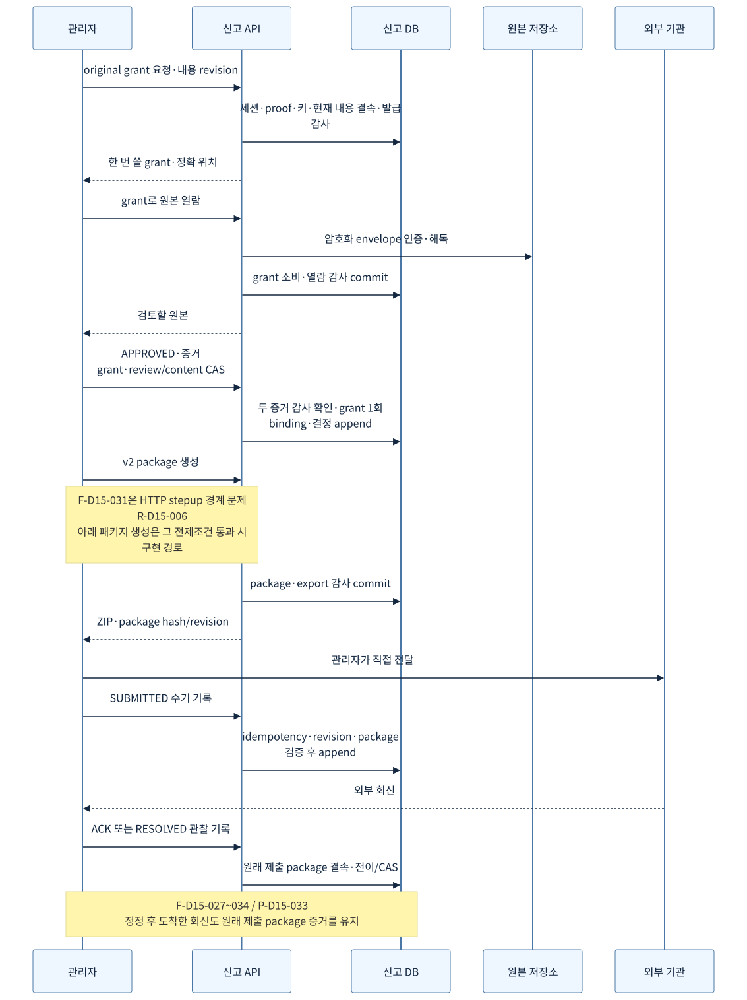

[Mermaid 원본](../diagrams/D15-sequence-review-delivery.mmd) · [SVG](../rendered/D15-sequence-review-delivery.svg)

## F-D15-028 한 번만 허용되는 암호화 원본 열람

| 항목 | 명세 |
| --- | --- |
| 분야 | D15 백엔드 신고·관리자 검토·권리요청·저장·보존·삭제·복원 |
| 목적 | 코드에 구현된 한 번만 허용되는 암호화 원본 열람의 입력 검증·상태 변화·실패 및 복구 계약을 설명한다. |
| 사용 주체 | 관리자 앱 |
| 활성 상태 | ACTIVE |
| 진입점 | backend/app/services/report_original_access.py:1094 access_report_original |
| 실행 전제 | grant owner/session/device·expiry·content revision 일치, encrypted object 및 decryption key. |
| 입력 출처 형식 검증 최신성 | UUID 기반 jpg/png/webp logical filename, X-WalkSafe-Original-Access-Grant, typed admin session. |

### 시작 이벤트와 처리 순서

| 이벤트 ID | 발생원 | 이벤트 | 수신부 | 흐름 |
| --- | --- | --- | --- | --- |
| E-D15-028-01 | HTTP 요청 또는 운영 도구 호출 | GET /uploads/{filename} | access_report_original | 파일명/report path와 canonical token 검증 → secured prepare DB 함수 또는 session/report/grant row lock으로 권한 재확인 → envelope size·hash·report AAD·header metadata·plaintext hash 검증 후 복호화 → 복호화 완료 시점 session/security state/expiry·grant expiry 재검사 → grant consume·ACCESS_GRANTED audit commit 후 bytes 반환 |

1. 1. 파일명/report path와 canonical token 검증 [backend/app/services/report_original_access.py:1094 access_report_original]
2. 2. secured prepare DB 함수 또는 session/report/grant row lock으로 권한 재확인 [backend/app/services/report_original_access.py:1094 access_report_original]
3. 3. envelope size·hash·report AAD·header metadata·plaintext hash 검증 후 복호화 [backend/app/services/report_original_access.py:1094 access_report_original]
4. 4. 복호화 완료 시점 session/security state/expiry·grant expiry 재검사 [backend/app/services/report_original_access.py:1094 access_report_original]
5. 5. grant consume·ACCESS_GRANTED audit commit 후 bytes 반환 [backend/app/services/report_original_access.py:1094 access_report_original]

| 분기 조건 | 실제 처리 결과 | 구현 근거 |
| --- | --- | --- |
| 사용됨/만료/다른 identity | 403 | backend/app/services/report_original_access.py:1094 access_report_original |
| report/path 없음 | 404 | backend/app/services/report_original_access.py:1094 access_report_original |
| encrypted metadata 없는 legacy original | 410 | backend/app/services/report_original_access.py:1094 access_report_original |
| blob 누락·hash/auth/key 실패 | 503 및 grant 소비 감사 | backend/app/services/report_original_access.py:1094 access_report_original |
| 읽는 동안 session/TTL 만료 | 403; 복호화 bytes 보류 | backend/app/services/report_original_access.py:1094 access_report_original |
| 감사 저장 실패 | 503; bytes 보류 | backend/app/services/report_original_access.py:1094 access_report_original |

### 효과 종료와 복구

기술된 응답·DB 효과. 이 기능 자체가 앱 UI/음성/진동을 실행하지 않음.

| 상황 | 동작 |
| --- | --- |
| 정상 완료 | grant consume·ACCESS_GRANTED audit commit 후 bytes 반환 |
| 실패 | 사용됨/만료/다른 identity → 403; report/path 없음 → 404; encrypted metadata 없는 legacy original → 410; blob 누락·hash/auth/key 실패 → 503 및 grant 소비 감사; 읽는 동안 session/TTL 만료 → 403; 복호화 bytes 보류; 감사 저장 실패 → 503; bytes 보류 |
| 시간 초과 | 이 기능에 독립 타이머 없음. DB/요청 제한은 D09 공통 설정 경계. |
| 중복 입력 | 토큰 재사용403. grant metadata identity 불일치의 감사는 타 grant 정보를 노출하지 않도록 최소화. |
| 취소 | 별도 취소 API 없음. |
| 중단과 생명주기 | 요청 중단이 이미 commit된 DB 효과를 되돌린다는 계약은 없음. |
| 재시도 | 서버 내부 자동 재시도 없음. 호출자가 최신 상태를 확인해 재호출. |
| 복구 | 실패/소비된 grant는 동일 token 재시도로 회복하지 않고 조건 확인 후 새 grant 필요. |
| 자원 정리 | 파일 FD 정리·token 소비 상태와 감사 commit. legacy plaintext fallback 없음. |

### 상태 실행 맥락과 연결

| 항목 | 명세 |
| --- | --- |
| 초기 상태 | S-D15-028-01: 요청 대기 |
| 상태 목록 | S-D15-028-01: 요청 대기 S-D15-028-02: 검증 S-D15-028-03: 처리 S-D15-028-04: 응답 S-D15-028-05: 오류 |
| 전이 조건과 전이 동작 | GET /uploads/{filename} → 검증 [상태 ID는 values와 대응] 조건 충족 → 처리 → 응답 [상태 ID는 values와 대응] 조건 불충족 → 오류 [상태 ID는 values와 대응] |
| 허용되지 않는 전이 | 명시된 조건을 우회한 저장/응답은 허용하지 않음. 그 외 전이는 별도 정의 없음. 이 다섯 단계는 문서 설명용 요청 흐름이며 DB enum이나 장기 보관 상태가 아님. |
| 동시성 순서와 작업 소유권 | async upload route가 anyio worker로 동기 DB/복호화 수행. 늦은 완료는 완료시 재인가로 차단; 앱 표시 후 삭제는 D12 범위. |
| 공유 상태와 다른 기능 연결 | Report 및 관련 테이블. D09 런타임 등록·미들웨어와 D13 동의/계정, D14 관리자 인증 경계에 연결. |

### 정책 근거와 검증 범위

| 항목 | 근거 |
| --- | --- |
| 정책 | [P-D15-028](#P-D15-028) |
| 구현 | [backend/app/services/report_original_access.py:1094](/home/ddobagi/Hanium_Dreamup/backend/app/services/report_original_access.py:1094) · `access_report_original` (범위 1094–1400) [backend/app/api/uploads.py:22](/home/ddobagi/Hanium_Dreamup/backend/app/api/uploads.py:22) · `create_router` (범위 22–96) |
| 기존 개선 ID | 개별 동일성 미확인; 분야 연관은 별도 추적표 |
| 기존 분야 | 해당 없음 |
| 기존 실행 증거 | 이번 작업은 정적 분석이며 기존 DONE 기록·과거 시험을 이번 실행 증거로 사용하지 않음. |
| 한계 및 구분 | 실행 검증 없음. 코드상 계약과 실제 운영 성공은 구분. |

| 테스트 위치 | 심볼 | 증거 수준 | 기대와 한계 |
| --- | --- | --- | --- |

연결한 테스트 미확인: 이번 작성 범위에서 이 기능에 대응하는 시험 단언을 연결하지 않았다. 테스트 자체가 없다는 판정이 아니다.

### 이벤트 처리 그림


[Mermaid 원본](../diagrams/D15-F028.mmd) · [SVG](../rendered/D15-F028.svg)

[Mermaid 원본](../diagrams/D15-sequence-review-delivery.mmd) · [SVG](../rendered/D15-sequence-review-delivery.svg)

## F-D15-029 검토 결정·원본 증거 결속·중복 대표 보호

| 항목 | 명세 |
| --- | --- |
| 분야 | D15 백엔드 신고·관리자 검토·권리요청·저장·보존·삭제·복원 |
| 목적 | 코드에 구현된 검토 결정·원본 증거 결속·중복 대표 보호의 입력 검증·상태 변화·실패 및 복구 계약을 설명한다. |
| 사용 주체 | 관리자 |
| 활성 상태 | ACTIVE |
| 진입점 | backend/app/services/admin_report_workflow.py:518 append_report_review_decision |
| 실행 전제 | typed admin proof; DB integrity boundary면 전용 secured append v4 함수 재인가. |
| 입력 출처 형식 검증 최신성 | decision UUID, APPROVED/REJECTED/DUPLICATE, reason, user_visible_reason, duplicate target, 3개 strict bool, content_revision, expected_review_revision, evidence_grant_id. |

### 시작 이벤트와 처리 순서

| 이벤트 ID | 발생원 | 이벤트 | 수신부 | 흐름 |
| --- | --- | --- | --- | --- |
| E-D15-029-01 | HTTP 요청 또는 운영 도구 호출 | POST /reports/{report_id}/review-decisions | append_report_review_decision | decision ID 기존 intent/actor/report와 비교하여 exact replay 판정 → content revision 및 report-wide review revision CAS → APPROVED는 모든 체크 true, 현재 session의 소비·미만료·미사용 report_review grant와 LOCATION_DISCLOSED/ACCESS_GRANTED 성공감사 둘 모두 필요 → DUPLICATE는 자기/없는 target/cycle/다른 duplicate target/활성 dependent 대표의 duplicate화 거절 → review revision append와 evidence grant 1회 binding을 commit; legacy lifecycle status는 변경 안 함 |

1. 1. decision ID 기존 intent/actor/report와 비교하여 exact replay 판정 [backend/app/services/admin_report_workflow.py:518 append_report_review_decision]
2. 2. content revision 및 report-wide review revision CAS [backend/app/services/admin_report_workflow.py:518 append_report_review_decision]
3. 3. APPROVED는 모든 체크 true, 현재 session의 소비·미만료·미사용 report_review grant와 LOCATION_DISCLOSED/ACCESS_GRANTED 성공감사 둘 모두 필요 [backend/app/services/admin_report_workflow.py:518 append_report_review_decision]
4. 4. DUPLICATE는 자기/없는 target/cycle/다른 duplicate target/활성 dependent 대표의 duplicate화 거절 [backend/app/services/admin_report_workflow.py:518 append_report_review_decision]
5. 5. review revision append와 evidence grant 1회 binding을 commit; legacy lifecycle status는 변경 안 함 [backend/app/services/admin_report_workflow.py:518 append_report_review_decision]

| 분기 조건 | 실제 처리 결과 | 구현 근거 |
| --- | --- | --- |
| decision ID 재사용 다른 intent/report/actor | 409 | backend/app/services/admin_report_workflow.py:518 append_report_review_decision |
| content 또는 review revision 충돌 | 각각 별도409 | backend/app/services/admin_report_workflow.py:518 append_report_review_decision |
| APPROVED 증거 부재·만료 | 409 | backend/app/services/admin_report_workflow.py:518 append_report_review_decision |
| DUPLICATE cycle/비대표 | 422 | backend/app/services/admin_report_workflow.py:518 append_report_review_decision |
| secured DB role/권한 재인가 실패 | 403/503 | backend/app/services/admin_report_workflow.py:518 append_report_review_decision |

### 효과 종료와 복구

기술된 응답·DB 효과. 이 기능 자체가 앱 UI/음성/진동을 실행하지 않음.

| 상황 | 동작 |
| --- | --- |
| 정상 완료 | review revision append와 evidence grant 1회 binding을 commit; legacy lifecycle status는 변경 안 함 |
| 실패 | decision ID 재사용 다른 intent/report/actor → 409; content 또는 review revision 충돌 → 각각 별도409; APPROVED 증거 부재·만료 → 409; DUPLICATE cycle/비대표 → 422; secured DB role/권한 재인가 실패 → 403/503 |
| 시간 초과 | 이 기능에 독립 타이머 없음. DB/요청 제한은 D09 공통 설정 경계. |
| 중복 입력 | exact decision replay는 원래 결정 반환; secured 경로는 DB 보안 계약 재검사. |
| 취소 | 별도 취소 API 없음. |
| 중단과 생명주기 | 요청 중단이 이미 commit된 DB 효과를 되돌린다는 계약은 없음. |
| 재시도 | 서버 내부 자동 재시도 없음. 호출자가 최신 상태를 확인해 재호출. |
| 복구 | 오류코드와 현재 저장 상태 확인 후 해당 진입점으로 재요청. |
| 자원 정리 | DB session 수명은 get_db 의존성에 위임. 기능 내부 rollback/commit 여부는 처리 단계에 명시. |

### 상태 실행 맥락과 연결

| 항목 | 명세 |
| --- | --- |
| 초기 상태 | S-D15-029-01: 미검토 |
| 상태 목록 | S-D15-029-01: 미검토 S-D15-029-02: APPROVED S-D15-029-03: REJECTED S-D15-029-04: DUPLICATE |
| 전이 조건과 전이 동작 | 새 decision은 revision+1 [상태 ID는 values와 대응] content 변경은 과거 결정 보존·새 내용의 승인 별도 [상태 ID는 values와 대응] |
| 허용되지 않는 전이 | 기존 결정 수정·증거 grant의 복수 승인 재사용·중복 cycle 금지. |
| 동시성 순서와 작업 소유권 | FastAPI 동기 handler/SQLAlchemy Session 또는 명시한 운영 CLI 동기 실행. 상태 변경은 DB lock·revision/CAS 정책으로 순서 역전을 검출. 클라이언트의 늦은 callback 무효화는 D06/D12 영역. |
| 공유 상태와 다른 기능 연결 | current content F-D15-019; original grant F-D15-027/028; package F-D15-031. status/legacy agency flag와 분리. |

### 정책 근거와 검증 범위

| 항목 | 근거 |
| --- | --- |
| 정책 | [P-D15-029](#P-D15-029) |
| 구현 | [backend/app/services/admin_report_workflow.py:518](/home/ddobagi/Hanium_Dreamup/backend/app/services/admin_report_workflow.py:518) · `append_report_review_decision` (범위 518–911) [backend/app/services/admin_report_workflow.py:493](/home/ddobagi/Hanium_Dreamup/backend/app/services/admin_report_workflow.py:493) · `_secured_review_dml_required` (범위 493–515) |
| 기존 개선 ID | 개별 동일성 미확인; 분야 연관은 별도 추적표 |
| 기존 분야 | 해당 없음 |
| 기존 실행 증거 | 이번 작업은 정적 분석이며 기존 DONE 기록·과거 시험을 이번 실행 증거로 사용하지 않음. |
| 한계 및 구분 | 실행 검증 없음. 코드상 계약과 실제 운영 성공은 구분. |

| 테스트 위치 | 심볼 | 증거 수준 | 기대와 한계 |
| --- | --- | --- | --- |
| [backend/tests/test_admin_report_workflow.py](/home/ddobagi/Hanium_Dreamup/backend/tests/test_admin_report_workflow.py) | test_approval_atomically_binds_one_fresh_consumed_evidence_grant | TEST_EXPECTATION | APPROVED 결정과 consumed grant binding을 한 commit으로 저장하고 같은 grant의 재사용을 거절한다. 테스트 본문 정적 열람; 이번 미실행. |
| [backend/tests/test_admin_report_workflow.py](/home/ddobagi/Hanium_Dreamup/backend/tests/test_admin_report_workflow.py) | test_approval_fails_closed_without_both_committed_evidence_audits | TEST_EXPECTATION | 필요한 두 evidence 감사가 없으면409 및 rollback이며 grant binding을 남기지 않는다. 테스트 본문 정적 열람; 이번 미실행. |

### 이벤트 처리 그림


[Mermaid 원본](../diagrams/D15-F029.mmd) · [SVG](../rendered/D15-F029.svg)

[Mermaid 원본](../diagrams/D15-sequence-review-delivery.mmd) · [SVG](../rendered/D15-sequence-review-delivery.svg)

## F-D15-030 검토 결정 이력·응답 유실 조회

| 항목 | 명세 |
| --- | --- |
| 분야 | D15 백엔드 신고·관리자 검토·권리요청·저장·보존·삭제·복원 |
| 목적 | 코드에 구현된 검토 결정 이력·응답 유실 조회의 입력 검증·상태 변화·실패 및 복구 계약을 설명한다. |
| 사용 주체 | 관리자 |
| 활성 상태 | ACTIVE |
| 진입점 | backend/app/services/admin_report_workflow.py:1018 list_report_review_decision_history_page |
| 실행 전제 | report.review_decisions read-bound admin proof. decision ID lookup는 해당 관리자가 남긴 결정만. |
| 입력 출처 형식 검증 최신성 | history limit default10 max25; position=last 기본25; canonical stream/resource snapshot cursor≤1024. |

### 시작 이벤트와 처리 순서

| 이벤트 ID | 발생원 | 이벤트 | 수신부 | 흐름 |
| --- | --- | --- | --- | --- |
| E-D15-030-01 | HTTP 요청 또는 운영 도구 호출 | GET review-decisions; GET review-decisions/history; GET review-decisions/{decision_id} | list_report_review_decision_history_page | legacy list는 기존 unpaged shape 유지 → history 최초 snapshot revision 고정 후 revision 증가순 page 구성 → position=last는 최신 tail을 증가순 반환; cursor 동시 사용 불가 → 48KiB 응답 budget에 맞게 item 수 축소 → read audit commit 후 반환; decision lookup로 lost response 확인 |

1. 1. legacy list는 기존 unpaged shape 유지 [backend/app/services/admin_report_workflow.py:1018 list_report_review_decision_history_page]
2. 2. history 최초 snapshot revision 고정 후 revision 증가순 page 구성 [backend/app/services/admin_report_workflow.py:1018 list_report_review_decision_history_page]
3. 3. position=last는 최신 tail을 증가순 반환; cursor 동시 사용 불가 [backend/app/services/admin_report_workflow.py:1018 list_report_review_decision_history_page]
4. 4. 48KiB 응답 budget에 맞게 item 수 축소 [backend/app/services/admin_report_workflow.py:1018 list_report_review_decision_history_page]
5. 5. read audit commit 후 반환; decision lookup로 lost response 확인 [backend/app/services/admin_report_workflow.py:1018 list_report_review_decision_history_page]

| 분기 조건 | 실제 처리 결과 | 구현 근거 |
| --- | --- | --- |
| cursor 다른 stream/report/snapshot gap | 422 또는 무결성 오류 | backend/app/services/admin_report_workflow.py:1018 list_report_review_decision_history_page |
| last + cursor 또는 unknown/duplicate query | 422 | backend/app/services/admin_report_workflow.py:1018 list_report_review_decision_history_page |
| decision 다른 admin/신고 또는 없음 | 404 | backend/app/services/admin_report_workflow.py:1018 list_report_review_decision_history_page |
| 신규 append | 기존 history snapshot에 끼우지 않음 | backend/app/services/admin_report_workflow.py:1018 list_report_review_decision_history_page |

### 효과 종료와 복구

기술된 응답·DB 효과. 이 기능 자체가 앱 UI/음성/진동을 실행하지 않음.

| 상황 | 동작 |
| --- | --- |
| 정상 완료 | read audit commit 후 반환; decision lookup로 lost response 확인 |
| 실패 | cursor 다른 stream/report/snapshot gap → 422 또는 무결성 오류; last + cursor 또는 unknown/duplicate query → 422; decision 다른 admin/신고 또는 없음 → 404; 신규 append → 기존 history snapshot에 끼우지 않음 |
| 시간 초과 | 이 기능에 독립 타이머 없음. DB/요청 제한은 D09 공통 설정 경계. |
| 중복 입력 | 조회는 상태 추가 없음. 쓰기 중복 허용 여부는 아래 분기와 공유 버전 계약 참조. |
| 취소 | 별도 취소 API 없음. |
| 중단과 생명주기 | 요청 중단이 이미 commit된 DB 효과를 되돌린다는 계약은 없음. |
| 재시도 | 서버 내부 자동 재시도 없음. 호출자가 최신 상태를 확인해 재호출. |
| 복구 | 오류코드와 현재 저장 상태 확인 후 해당 진입점으로 재요청. |
| 자원 정리 | DB session 수명은 get_db 의존성에 위임. 기능 내부 rollback/commit 여부는 처리 단계에 명시. |

### 상태 실행 맥락과 연결

| 항목 | 명세 |
| --- | --- |
| 초기 상태 | S-D15-030-01: 요청 대기 |
| 상태 목록 | S-D15-030-01: 요청 대기 S-D15-030-02: 검증 S-D15-030-03: 처리 S-D15-030-04: 응답 S-D15-030-05: 오류 |
| 전이 조건과 전이 동작 | GET review-decisions; GET review-decisions/history; GET review-decisions/{decision_id} → 검증 [상태 ID는 values와 대응] 조건 충족 → 처리 → 응답 [상태 ID는 values와 대응] 조건 불충족 → 오류 [상태 ID는 values와 대응] |
| 허용되지 않는 전이 | 명시된 조건을 우회한 저장/응답은 허용하지 않음. 그 외 전이는 별도 정의 없음. 이 다섯 단계는 문서 설명용 요청 흐름이며 DB enum이나 장기 보관 상태가 아님. |
| 동시성 순서와 작업 소유권 | FastAPI 동기 handler/SQLAlchemy Session 또는 명시한 운영 CLI 동기 실행. 상태 변경은 DB lock·revision/CAS 정책으로 순서 역전을 검출. 클라이언트의 늦은 callback 무효화는 D06/D12 영역. |
| 공유 상태와 다른 기능 연결 | Report 및 관련 테이블. D09 런타임 등록·미들웨어와 D13 동의/계정, D14 관리자 인증 경계에 연결. |

### 정책 근거와 검증 범위

| 항목 | 근거 |
| --- | --- |
| 정책 | [P-D15-030](#P-D15-030) |
| 구현 | [backend/app/services/admin_report_workflow.py:1018](/home/ddobagi/Hanium_Dreamup/backend/app/services/admin_report_workflow.py:1018) · `list_report_review_decision_history_page` (범위 1018–1132) |
| 기존 개선 ID | 개별 동일성 미확인; 분야 연관은 별도 추적표 |
| 기존 분야 | 해당 없음 |
| 기존 실행 증거 | 이번 작업은 정적 분석이며 기존 DONE 기록·과거 시험을 이번 실행 증거로 사용하지 않음. |
| 한계 및 구분 | legacy unpaged list와 bounded history는 별도 응답형. 이력 검증 helper의 전체 malformed cursor 조합은 미실행. |

| 테스트 위치 | 심볼 | 증거 수준 | 기대와 한계 |
| --- | --- | --- | --- |

연결한 테스트 미확인: 이번 작성 범위에서 이 기능에 대응하는 시험 단언을 연결하지 않았다. 테스트 자체가 없다는 판정이 아니다.

### 이벤트 처리 그림


[Mermaid 원본](../diagrams/D15-F030.mmd) · [SVG](../rendered/D15-F030.svg)

## F-D15-031 현재 승인 내용의 기관 전달 패키지 생성

| 항목 | 명세 |
| --- | --- |
| 분야 | D15 백엔드 신고·관리자 검토·권리요청·저장·보존·삭제·복원 |
| 목적 | 코드에 구현된 현재 승인 내용의 기관 전달 패키지 생성의 입력 검증·상태 변화·실패 및 복구 계약을 설명한다. |
| 사용 주체 | 관리자 |
| 활성 상태 | CONDITIONAL |
| 진입점 | backend/app/services/admin_report_delivery_package.py:325 create_admin_report_delivery_package |
| 실행 전제 | 현재 내용의 최신 typed APPROVED, all review checks·증거결속 조건. request.state identity.step_up_verified_at가 None이면 service 호출 전403; D14 재확인 계약 결합 미해결. |
| 입력 출처 형식 검증 최신성 | expected_content_revision 및 expected_review_revision; 관리자 고위험 재확인. |

### 시작 이벤트와 처리 순서

| 이벤트 ID | 발생원 | 이벤트 | 수신부 | 흐름 |
| --- | --- | --- | --- | --- |
| E-D15-031-01 | HTTP 요청 또는 운영 도구 호출 | POST /admin/reports/{report_id}/delivery-packages | create_admin_report_delivery_package | current content와 latest approved review를 읽어 기대 revisions 비교 → previous package 기준 revision+1과 supersedes_package_id 결정 → v2 reports.csv+manifest.json을 deterministic ZIP bytes로 생성 → CSV/manifest/package digest·byte count 및 exact single-report export audit 준비 → secured DB function 또는 row lock 아래 package·export·operation audit commit → ZIP과 package/review/content revision 및 hash headers 반환 |

1. 1. current content와 latest approved review를 읽어 기대 revisions 비교 [backend/app/services/admin_report_delivery_package.py:325 create_admin_report_delivery_package]
2. 2. previous package 기준 revision+1과 supersedes_package_id 결정 [backend/app/services/admin_report_delivery_package.py:325 create_admin_report_delivery_package]
3. 3. v2 reports.csv+manifest.json을 deterministic ZIP bytes로 생성 [backend/app/services/admin_report_delivery_package.py:325 create_admin_report_delivery_package]
4. 4. CSV/manifest/package digest·byte count 및 exact single-report export audit 준비 [backend/app/services/admin_report_delivery_package.py:325 create_admin_report_delivery_package]
5. 5. secured DB function 또는 row lock 아래 package·export·operation audit commit [backend/app/services/admin_report_delivery_package.py:325 create_admin_report_delivery_package]
6. 6. ZIP과 package/review/content revision 및 hash headers 반환 [backend/app/services/admin_report_delivery_package.py:325 create_admin_report_delivery_package]

| 분기 조건 | 실제 처리 결과 | 구현 근거 |
| --- | --- | --- |
| HTTP action identity.step_up_verified_at is None | 403 admin_step_up_required; service mutation에 도달하지 않음 | backend/app/api/admin_reports.py:147 _require_admin_report_action_context |
| content/review revision 변경 | 별도409 | backend/app/services/admin_report_delivery_package.py:325 create_admin_report_delivery_package |
| current approval 없음 | 409 latest_review_approval_required | backend/app/services/admin_report_delivery_package.py:325 create_admin_report_delivery_package |
| DB/audit 실패 | 503; bytes 미반환 | backend/app/services/admin_report_delivery_package.py:325 create_admin_report_delivery_package |
| package revision 경합 | 409 | backend/app/services/admin_report_delivery_package.py:325 create_admin_report_delivery_package |

### 효과 종료와 복구

기술된 응답·DB 효과. 이 기능 자체가 앱 UI/음성/진동을 실행하지 않음.

| 상황 | 동작 |
| --- | --- |
| 정상 완료 | ZIP과 package/review/content revision 및 hash headers 반환 |
| 실패 | content/review revision 변경 → 별도409; current approval 없음 → 409 latest_review_approval_required; DB/audit 실패 → 503; bytes 미반환; package revision 경합 → 409 |
| 시간 초과 | 이 기능에 독립 타이머 없음. DB/요청 제한은 D09 공통 설정 경계. |
| 중복 입력 | 생성 요청에 idempotency key 없음; 성공 재호출은 새 package revision 가능. |
| 취소 | 별도 취소 API 없음. |
| 중단과 생명주기 | 요청 중단이 이미 commit된 DB 효과를 되돌린다는 계약은 없음. |
| 재시도 | 서버 내부 자동 재시도 없음. 호출자가 최신 상태를 확인해 재호출. |
| 복구 | 오류코드와 현재 저장 상태 확인 후 해당 진입점으로 재요청. |
| 자원 정리 | DB session 수명은 get_db 의존성에 위임. 기능 내부 rollback/commit 여부는 처리 단계에 명시. |

### 상태 실행 맥락과 연결

| 항목 | 명세 |
| --- | --- |
| 초기 상태 | S-D15-031-01: 요청 대기 |
| 상태 목록 | S-D15-031-01: 요청 대기 S-D15-031-02: 검증 S-D15-031-03: 처리 S-D15-031-04: 응답 S-D15-031-05: 오류 |
| 전이 조건과 전이 동작 | POST /admin/reports/{report_id}/delivery-packages → 검증 [상태 ID는 values와 대응] 조건 충족 → 처리 → 응답 [상태 ID는 values와 대응] 조건 불충족 → 오류 [상태 ID는 values와 대응] |
| 허용되지 않는 전이 | 명시된 조건을 우회한 저장/응답은 허용하지 않음. 그 외 전이는 별도 정의 없음. 이 다섯 단계는 문서 설명용 요청 흐름이며 DB enum이나 장기 보관 상태가 아님. |
| 동시성 순서와 작업 소유권 | FastAPI 동기 handler/SQLAlchemy Session 또는 명시한 운영 CLI 동기 실행. 상태 변경은 DB lock·revision/CAS 정책으로 순서 역전을 검출. 클라이언트의 늦은 callback 무효화는 D06/D12 영역. |
| 공유 상태와 다른 기능 연결 | F-D15-033 event는 package v2 요구; 생성된 ZIP의 외부 보관/전달은 운영자 책임. |

### 정책 근거와 검증 범위

| 항목 | 근거 |
| --- | --- |
| 정책 | [P-D15-031](#P-D15-031) |
| 구현 | [backend/app/services/admin_report_delivery_package.py:325](/home/ddobagi/Hanium_Dreamup/backend/app/services/admin_report_delivery_package.py:325) · `create_admin_report_delivery_package` (범위 325–640) [backend/app/api/admin_reports.py:147](/home/ddobagi/Hanium_Dreamup/backend/app/api/admin_reports.py:147) · `_require_admin_report_action_context` (범위 147–172) |
| 기존 개선 ID | 개별 동일성 미확인; 분야 연관은 별도 추적표 |
| 기존 분야 | 해당 없음 |
| 기존 실행 증거 | 이번 작업은 정적 분석이며 기존 DONE 기록·과거 시험을 이번 실행 증거로 사용하지 않음. |
| 한계 및 구분 | CSV/ZIP canonical builder 확인; 실제 외부 다운로드/수동 기관 전달은 미실행. R-D15-006/D14 R8: HTTP action context의 step_up_verified_at 조건과 재확인 identity 전달 계약의 정적 불일치로 정상 재확인 후에도403 가능. 아래 service 처리는 해당 경계를 통과했을 때의 구현 계약이며 HTTP 성공 실검증 아님. |

| 테스트 위치 | 심볼 | 증거 수준 | 기대와 한계 |
| --- | --- | --- | --- |

연결한 테스트 미확인: 이번 작성 범위에서 이 기능에 대응하는 시험 단언을 연결하지 않았다. 테스트 자체가 없다는 판정이 아니다.

### 이벤트 처리 그림


[Mermaid 원본](../diagrams/D15-F031.mmd) · [SVG](../rendered/D15-F031.svg)

[Mermaid 원본](../diagrams/D15-sequence-review-delivery.mmd) · [SVG](../rendered/D15-sequence-review-delivery.svg)

## F-D15-032 전달 패키지 proof·중단 후 재개 근거

| 항목 | 명세 |
| --- | --- |
| 분야 | D15 백엔드 신고·관리자 검토·권리요청·저장·보존·삭제·복원 |
| 목적 | 코드에 구현된 전달 패키지 proof·중단 후 재개 근거의 입력 검증·상태 변화·실패 및 복구 계약을 설명한다. |
| 사용 주체 | 관리자 |
| 활성 상태 | ACTIVE |
| 진입점 | backend/app/services/admin_report_delivery_package.py:643 get_admin_report_delivery_package_proof |
| 실행 전제 | admin read proof와 report row lock; v2 schema/approval binding. |
| 입력 출처 형식 검증 최신성 | report UUID, package revision≥1. |

### 시작 이벤트와 처리 순서

| 이벤트 ID | 발생원 | 이벤트 | 수신부 | 흐름 |
| --- | --- | --- | --- | --- |
| E-D15-032-01 | HTTP 요청 또는 운영 도구 호출 | GET /admin/reports/{report_id}/delivery-packages/{package_revision}/proof | get_admin_report_delivery_package_proof | current content approval 및 latest uncorrected event 조회 → 이미 submitted workflow의 패키지는 과거 review/content binding으로 recovery proof 허용 → 그 외 current content/current approved review와 package 일치 요구 → 패키지에 허용되는 다음 delivery 상태를 계산 → hash·byte count·content/review/package revisions만 반환 |

1. 1. current content approval 및 latest uncorrected event 조회 [backend/app/services/admin_report_delivery_package.py:643 get_admin_report_delivery_package_proof]
2. 2. 이미 submitted workflow의 패키지는 과거 review/content binding으로 recovery proof 허용 [backend/app/services/admin_report_delivery_package.py:643 get_admin_report_delivery_package_proof]
3. 3. 그 외 current content/current approved review와 package 일치 요구 [backend/app/services/admin_report_delivery_package.py:643 get_admin_report_delivery_package_proof]
4. 4. 패키지에 허용되는 다음 delivery 상태를 계산 [backend/app/services/admin_report_delivery_package.py:643 get_admin_report_delivery_package_proof]
5. 5. hash·byte count·content/review/package revisions만 반환 [backend/app/services/admin_report_delivery_package.py:643 get_admin_report_delivery_package_proof]

| 분기 조건 | 실제 처리 결과 | 구현 근거 |
| --- | --- | --- |
| package v1/불일치/없음 | 409 ineligible | backend/app/services/admin_report_delivery_package.py:643 get_admin_report_delivery_package_proof |
| 이미 RESOLVED이며 다음 전이 없음 | 409 delivery_package_proof_resolved | backend/app/services/admin_report_delivery_package.py:643 get_admin_report_delivery_package_proof |
| 이후 내용/검토 변경 | 기존 submitted package 후속 회신용 proof는 유지 가능 | backend/app/services/admin_report_delivery_package.py:643 get_admin_report_delivery_package_proof |

### 효과 종료와 복구

기술된 응답·DB 효과. 이 기능 자체가 앱 UI/음성/진동을 실행하지 않음.

| 상황 | 동작 |
| --- | --- |
| 정상 완료 | hash·byte count·content/review/package revisions만 반환 |
| 실패 | package v1/불일치/없음 → 409 ineligible; 이미 RESOLVED이며 다음 전이 없음 → 409 delivery_package_proof_resolved; 이후 내용/검토 변경 → 기존 submitted package 후속 회신용 proof는 유지 가능 |
| 시간 초과 | 이 기능에 독립 타이머 없음. DB/요청 제한은 D09 공통 설정 경계. |
| 중복 입력 | 조회는 상태 추가 없음. 쓰기 중복 허용 여부는 아래 분기와 공유 버전 계약 참조. |
| 취소 | 별도 취소 API 없음. |
| 중단과 생명주기 | 요청 중단이 이미 commit된 DB 효과를 되돌린다는 계약은 없음. |
| 재시도 | 서버 내부 자동 재시도 없음. 호출자가 최신 상태를 확인해 재호출. |
| 복구 | 앱 로컬 ZIP과 proof byte/hash를 대조하는 과정은 D12. 이 API는 ZIP 재전송 자체가 아님. |
| 자원 정리 | DB session 수명은 get_db 의존성에 위임. 기능 내부 rollback/commit 여부는 처리 단계에 명시. |

### 상태 실행 맥락과 연결

| 항목 | 명세 |
| --- | --- |
| 초기 상태 | S-D15-032-01: 요청 대기 |
| 상태 목록 | S-D15-032-01: 요청 대기 S-D15-032-02: 검증 S-D15-032-03: 처리 S-D15-032-04: 응답 S-D15-032-05: 오류 |
| 전이 조건과 전이 동작 | GET /admin/reports/{report_id}/delivery-packages/{revision}/proof → 검증 [상태 ID는 values와 대응] 조건 충족 → 처리 → 응답 [상태 ID는 values와 대응] 조건 불충족 → 오류 [상태 ID는 values와 대응] |
| 허용되지 않는 전이 | 명시된 조건을 우회한 저장/응답은 허용하지 않음. 그 외 전이는 별도 정의 없음. 이 다섯 단계는 문서 설명용 요청 흐름이며 DB enum이나 장기 보관 상태가 아님. |
| 동시성 순서와 작업 소유권 | FastAPI 동기 handler/SQLAlchemy Session 또는 명시한 운영 CLI 동기 실행. 상태 변경은 DB lock·revision/CAS 정책으로 순서 역전을 검출. 클라이언트의 늦은 callback 무효화는 D06/D12 영역. |
| 공유 상태와 다른 기능 연결 | Report 및 관련 테이블. D09 런타임 등록·미들웨어와 D13 동의/계정, D14 관리자 인증 경계에 연결. |

### 정책 근거와 검증 범위

| 항목 | 근거 |
| --- | --- |
| 정책 | [P-D15-032](#P-D15-032) |
| 구현 | [backend/app/services/admin_report_delivery_package.py:643](/home/ddobagi/Hanium_Dreamup/backend/app/services/admin_report_delivery_package.py:643) · `get_admin_report_delivery_package_proof` (범위 643–794) |
| 기존 개선 ID | 개별 동일성 미확인; 분야 연관은 별도 추적표 |
| 기존 분야 | 해당 없음 |
| 기존 실행 증거 | 이번 작업은 정적 분석이며 기존 DONE 기록·과거 시험을 이번 실행 증거로 사용하지 않음. |
| 한계 및 구분 | 실행 검증 없음. 코드상 계약과 실제 운영 성공은 구분. |

| 테스트 위치 | 심볼 | 증거 수준 | 기대와 한계 |
| --- | --- | --- | --- |

연결한 테스트 미확인: 이번 작성 범위에서 이 기능에 대응하는 시험 단언을 연결하지 않았다. 테스트 자체가 없다는 판정이 아니다.

### 이벤트 처리 그림


[Mermaid 원본](../diagrams/D15-F032.mmd) · [SVG](../rendered/D15-F032.svg)

[Mermaid 원본](../diagrams/D15-sequence-review-delivery.mmd) · [SVG](../rendered/D15-sequence-review-delivery.svg)

## F-D15-033 기관 수동 전달·회신 상태 append

| 항목 | 명세 |
| --- | --- |
| 분야 | D15 백엔드 신고·관리자 검토·권리요청·저장·보존·삭제·복원 |
| 목적 | 코드에 구현된 기관 수동 전달·회신 상태 append의 입력 검증·상태 변화·실패 및 복구 계약을 설명한다. |
| 사용 주체 | 관리자 |
| 활성 상태 | ACTIVE |
| 진입점 | backend/app/services/admin_report_workflow.py:1216 append_report_institution_delivery_event |
| 실행 전제 | report.delivery.create device proof, DB secured v5 함수 또는 row lock. |
| 입력 출처 형식 검증 최신성 | v2 package_revision, expected_revision, idempotency UUID, institution/channel/recipient/status/reason, UTC observed_at, optional evidence; ACK/RESOLVED receipt 필수. |

### 시작 이벤트와 처리 순서

| 이벤트 ID | 발생원 | 이벤트 | 수신부 | 흐름 |
| --- | --- | --- | --- | --- |
| E-D15-033-01 | HTTP 요청 또는 운영 도구 호출 | POST /reports/{report_id}/deliveries | append_report_institution_delivery_event | exact idempotency replay를 revision/approval 검사보다 먼저 확인 → report-wide latest recorded revision으로 CAS; 전이 기준은 latest uncorrected event → 신규 SUBMITTED/first/retry는 current content 최신 APPROVED+package v2 요구 → 이전 제출의 ACK/RESOLVED/FAILED 후속은 제출 package/review에 결속해 이후 재검토와 구분 → same package state machine·institution 일치 확인 후 event append |

1. 1. exact idempotency replay를 revision/approval 검사보다 먼저 확인 [backend/app/services/admin_report_workflow.py:1216 append_report_institution_delivery_event]
2. 2. report-wide latest recorded revision으로 CAS; 전이 기준은 latest uncorrected event [backend/app/services/admin_report_workflow.py:1216 append_report_institution_delivery_event]
3. 3. 신규 SUBMITTED/first/retry는 current content 최신 APPROVED+package v2 요구 [backend/app/services/admin_report_workflow.py:1216 append_report_institution_delivery_event]
4. 4. 이전 제출의 ACK/RESOLVED/FAILED 후속은 제출 package/review에 결속해 이후 재검토와 구분 [backend/app/services/admin_report_workflow.py:1216 append_report_institution_delivery_event]
5. 5. same package state machine·institution 일치 확인 후 event append [backend/app/services/admin_report_workflow.py:1216 append_report_institution_delivery_event]

| 분기 조건 | 실제 처리 결과 | 구현 근거 |
| --- | --- | --- |
| 초기/FAILED | SUBMITTED 또는 FAILED | backend/app/services/admin_report_workflow.py:1216 append_report_institution_delivery_event |
| SUBMITTED | ACKNOWLEDGED 또는 FAILED | backend/app/services/admin_report_workflow.py:1216 append_report_institution_delivery_event |
| ACKNOWLEDGED | RESOLVED | backend/app/services/admin_report_workflow.py:1216 append_report_institution_delivery_event |
| RESOLVED | 같은 package 추가 전이 없음 | backend/app/services/admin_report_workflow.py:1216 append_report_institution_delivery_event |
| 새 내용으로 더 높은 revision package | 초기 delivery cycle 시작 | backend/app/services/admin_report_workflow.py:1216 append_report_institution_delivery_event |
| 미해결 legacy v1→동일내용 v2 | SUBMITTED 재기록만 예외 | backend/app/services/admin_report_workflow.py:1216 append_report_institution_delivery_event |
| different same-content package | 409 | backend/app/services/admin_report_workflow.py:1216 append_report_institution_delivery_event |

### 효과 종료와 복구

기술된 응답·DB 효과. 이 기능 자체가 앱 UI/음성/진동을 실행하지 않음.

| 상황 | 동작 |
| --- | --- |
| 정상 완료 | same package state machine·institution 일치 확인 후 event append |
| 실패 | 기대 revision 또는 package 결속 충돌409, 허용하지 않는 상태·시각·기관값422, DB/audit 실패503. 정확 retry와 허용 전이는 정상이다. |
| 시간 초과 | 이 기능에 독립 타이머 없음. DB/요청 제한은 D09 공통 설정 경계. |
| 중복 입력 | 동일 intent key replay는 원 event 반환; 이미 정정된 event replay 응답은 correction 정보도 포함. |
| 취소 | 별도 취소 API 없음. |
| 중단과 생명주기 | 요청 중단이 이미 commit된 DB 효과를 되돌린다는 계약은 없음. |
| 재시도 | 서버 내부 자동 재시도 없음. 호출자가 최신 상태를 확인해 재호출. |
| 복구 | 오류코드와 현재 저장 상태 확인 후 해당 진입점으로 재요청. |
| 자원 정리 | DB session 수명은 get_db 의존성에 위임. 기능 내부 rollback/commit 여부는 처리 단계에 명시. |

### 상태 실행 맥락과 연결

| 항목 | 명세 |
| --- | --- |
| 초기 상태 | S-D15-033-01: 전달 기록 없음 |
| 상태 목록 | S-D15-033-01: 전달 기록 없음 S-D15-033-02: SUBMITTED S-D15-033-03: ACKNOWLEDGED S-D15-033-04: RESOLVED S-D15-033-05: FAILED |
| 전이 조건과 전이 동작 | 없음→SUBMITTED/FAILED SUBMITTED→ACKNOWLEDGED/FAILED ACKNOWLEDGED→RESOLVED FAILED→SUBMITTED/FAILED 새 내용의 package로 교체하면 없음 기준; 미해결 v1 같은내용→v2는 SUBMITTED만 예외 |
| 허용되지 않는 전이 | 같은 package RESOLVED 이후 추가 전이 없음. 다른 same-content package는 legacy v1 예외 외 차단. corrected event는 상태 기준에서 제외. |
| 동시성 순서와 작업 소유권 | 외부 callback receiver 없음. 관리자가 observed_at로 입력; 늦은 기관 회신은 submitted package의 follow-up으로 기록. |
| 공유 상태와 다른 기능 연결 | 외부사본 snapshot·사용자 status projection; 전달 correction F-D15-034. |

### 정책 근거와 검증 범위

| 항목 | 근거 |
| --- | --- |
| 정책 | [P-D15-033](#P-D15-033) |
| 구현 | [backend/app/services/admin_report_workflow.py:1216](/home/ddobagi/Hanium_Dreamup/backend/app/services/admin_report_workflow.py:1216) · `append_report_institution_delivery_event` (범위 1216–1556) |
| 기존 개선 ID | 개별 동일성 미확인; 분야 연관은 별도 추적표 |
| 기존 분야 | 해당 없음 |
| 기존 실행 증거 | 이번 작업은 정적 분석이며 기존 DONE 기록·과거 시험을 이번 실행 증거로 사용하지 않음. |
| 한계 및 구분 | 실행 검증 없음. 코드상 계약과 실제 운영 성공은 구분. 조기 반환·기존결과 replay 경로는 신규 mutation 단계로 이어지지 않는다. 기능 흐름도의 조건 분기와 반환 terminal을 참조. |

| 테스트 위치 | 심볼 | 증거 수준 | 기대와 한계 |
| --- | --- | --- | --- |
| [backend/tests/test_admin_report_workflow.py](/home/ddobagi/Hanium_Dreamup/backend/tests/test_admin_report_workflow.py) | test_delivery_retry_returns_original_before_revision_and_approval_checks | TEST_EXPECTATION | 정확 전달 retry는 revision/approval 재검사 전 기존 event를 반환하며 추가 행을 만들지 않는다. 테스트 본문 정적 열람; 이번 미실행. |
| [backend/tests/test_admin_report_workflow.py](/home/ddobagi/Hanium_Dreamup/backend/tests/test_admin_report_workflow.py) | test_s18_41_follow_up_after_re_review_binds_to_the_submitted_package | TEST_EXPECTATION | 신고 내용 재검토 후에도 기존 제출에 대한 ACK는 과거 package/review에 결속해 기록한다. 테스트 본문 정적 열람; 이번 미실행. |

### 이벤트 처리 그림


[Mermaid 원본](../diagrams/D15-F033.mmd) · [SVG](../rendered/D15-F033.svg)


[Mermaid 원본](../diagrams/D15-F033-state.mmd) · [SVG](../rendered/D15-F033-state.svg)

[Mermaid 원본](../diagrams/D15-sequence-review-delivery.mmd) · [SVG](../rendered/D15-sequence-review-delivery.svg)

## F-D15-034 잘못 기록한 기관 전달 event 정정

| 항목 | 명세 |
| --- | --- |
| 분야 | D15 백엔드 신고·관리자 검토·권리요청·저장·보존·삭제·복원 |
| 목적 | 코드에 구현된 잘못 기록한 기관 전달 event 정정의 입력 검증·상태 변화·실패 및 복구 계약을 설명한다. |
| 사용 주체 | 관리자 |
| 활성 상태 | ACTIVE |
| 진입점 | backend/app/services/admin_report_workflow.py:1706 correct_report_institution_delivery_event |
| 실행 전제 | report.delivery.correct HIGH risk 재확인·action/device proof. |
| 입력 출처 형식 검증 최신성 | correction UUID, corrects_event UUID, expected_revision strict int64, WRONG_STATUS/WRONG_REPORT/DUPLICATE_ENTRY/OTHER, memo. |

### 시작 이벤트와 처리 순서

| 이벤트 ID | 발생원 | 이벤트 | 수신부 | 흐름 |
| --- | --- | --- | --- | --- |
| E-D15-034-01 | HTTP 요청 또는 운영 도구 호출 | POST /reports/{report_id}/delivery-corrections | correct_report_institution_delivery_event | secured DB 함수 또는 report lock 아래 intent/revision 확인 → 대상은 같은 report의 최신 effective event여야 함 → 원 event bytes 유지, correction row와 success audit append → 후속 조회·user status·proof·전이 계산에서 corrected event 제외 |

1. 1. secured DB 함수 또는 report lock 아래 intent/revision 확인 [backend/app/services/admin_report_workflow.py:1706 correct_report_institution_delivery_event]
2. 2. 대상은 같은 report의 최신 effective event여야 함 [backend/app/services/admin_report_workflow.py:1706 correct_report_institution_delivery_event]
3. 3. 원 event bytes 유지, correction row와 success audit append [backend/app/services/admin_report_workflow.py:1706 correct_report_institution_delivery_event]
4. 4. 후속 조회·user status·proof·전이 계산에서 corrected event 제외 [backend/app/services/admin_report_workflow.py:1706 correct_report_institution_delivery_event]

| 분기 조건 | 실제 처리 결과 | 구현 근거 |
| --- | --- | --- |
| 동일 correction UUID 다른 intent | 409 | backend/app/services/admin_report_workflow.py:1706 correct_report_institution_delivery_event |
| 이미 정정됨/최신 effective 아님 | 409 | backend/app/services/admin_report_workflow.py:1706 correct_report_institution_delivery_event |
| 다른 report 대상/없음 | 404 | backend/app/services/admin_report_workflow.py:1706 correct_report_institution_delivery_event |
| 현재 latest recorded revision 불일치 | 409 | backend/app/services/admin_report_workflow.py:1706 correct_report_institution_delivery_event |
| 권한 재확인 실패 | 403 | backend/app/services/admin_report_workflow.py:1706 correct_report_institution_delivery_event |

### 효과 종료와 복구

기술된 응답·DB 효과. 이 기능 자체가 앱 UI/음성/진동을 실행하지 않음.

| 상황 | 동작 |
| --- | --- |
| 정상 완료 | 후속 조회·user status·proof·전이 계산에서 corrected event 제외 |
| 실패 | 동일 correction UUID 다른 intent → 409; 이미 정정됨/최신 effective 아님 → 409; 다른 report 대상/없음 → 404; 현재 latest recorded revision 불일치 → 409; 권한 재확인 실패 → 403 |
| 시간 초과 | 이 기능에 독립 타이머 없음. DB/요청 제한은 D09 공통 설정 경계. |
| 중복 입력 | exact correction intent replay는 원 correction 반환. |
| 취소 | 별도 취소 API 없음. |
| 중단과 생명주기 | 요청 중단이 이미 commit된 DB 효과를 되돌린다는 계약은 없음. |
| 재시도 | 서버 내부 자동 재시도 없음. 호출자가 최신 상태를 확인해 재호출. |
| 복구 | 오류코드와 현재 저장 상태 확인 후 해당 진입점으로 재요청. |
| 자원 정리 | DB session 수명은 get_db 의존성에 위임. 기능 내부 rollback/commit 여부는 처리 단계에 명시. |

### 상태 실행 맥락과 연결

| 항목 | 명세 |
| --- | --- |
| 초기 상태 | S-D15-034-01: 요청 대기 |
| 상태 목록 | S-D15-034-01: 요청 대기 S-D15-034-02: 검증 S-D15-034-03: 처리 S-D15-034-04: 응답 S-D15-034-05: 오류 |
| 전이 조건과 전이 동작 | POST /reports/{report_id}/delivery-corrections → 검증 [상태 ID는 values와 대응] 조건 충족 → 처리 → 응답 [상태 ID는 values와 대응] 조건 불충족 → 오류 [상태 ID는 values와 대응] |
| 허용되지 않는 전이 | 명시된 조건을 우회한 저장/응답은 허용하지 않음. 그 외 전이는 별도 정의 없음. 이 다섯 단계는 문서 설명용 요청 흐름이며 DB enum이나 장기 보관 상태가 아님. |
| 동시성 순서와 작업 소유권 | FastAPI 동기 handler/SQLAlchemy Session 또는 명시한 운영 CLI 동기 실행. 상태 변경은 DB lock·revision/CAS 정책으로 순서 역전을 검출. 클라이언트의 늦은 callback 무효화는 D06/D12 영역. |
| 공유 상태와 다른 기능 연결 | ReportInstitutionDeliveryCorrection; report_delivery_effective.uncorrected_delivery_event_clause. report_delivery_effective.uncorrected_delivery_event_clause를 user projection·admin detail·package proof·next transition이 공통 사용. |

### 정책 근거와 검증 범위

| 항목 | 근거 |
| --- | --- |
| 정책 | [P-D15-034](#P-D15-034) |
| 구현 | [backend/app/services/admin_report_workflow.py:1706](/home/ddobagi/Hanium_Dreamup/backend/app/services/admin_report_workflow.py:1706) · `correct_report_institution_delivery_event` (범위 1706–1853) [backend/app/services/report_delivery_effective.py:18](/home/ddobagi/Hanium_Dreamup/backend/app/services/report_delivery_effective.py:18) · `uncorrected_delivery_event_clause` (범위 18–25) |
| 기존 개선 ID | 개별 동일성 미확인; 분야 연관은 별도 추적표 |
| 기존 분야 | 해당 없음 |
| 기존 실행 증거 | 이번 작업은 정적 분석이며 기존 DONE 기록·과거 시험을 이번 실행 증거로 사용하지 않음. |
| 한계 및 구분 | 실행 검증 없음. 코드상 계약과 실제 운영 성공은 구분. |

| 테스트 위치 | 심볼 | 증거 수준 | 기대와 한계 |
| --- | --- | --- | --- |

연결한 테스트 미확인: 이번 작성 범위에서 이 기능에 대응하는 시험 단언을 연결하지 않았다. 테스트 자체가 없다는 판정이 아니다.

### 이벤트 처리 그림


[Mermaid 원본](../diagrams/D15-F034.mmd) · [SVG](../rendered/D15-F034.svg)

[Mermaid 원본](../diagrams/D15-sequence-review-delivery.mmd) · [SVG](../rendered/D15-sequence-review-delivery.svg)

## F-D15-035 기관 전달 이력·정정 동반 조회

| 항목 | 명세 |
| --- | --- |
| 분야 | D15 백엔드 신고·관리자 검토·권리요청·저장·보존·삭제·복원 |
| 목적 | 코드에 구현된 기관 전달 이력·정정 동반 조회의 입력 검증·상태 변화·실패 및 복구 계약을 설명한다. |
| 사용 주체 | 관리자 |
| 활성 상태 | ACTIVE |
| 진입점 | backend/app/services/admin_report_workflow.py:1908 list_report_institution_delivery_history_page |
| 실행 전제 | report.delivery_events read purpose·admin device proof. |
| 입력 출처 형식 검증 최신성 | history limit1..25, cursor stream/report/snapshot, position=last 또는 full. |

### 시작 이벤트와 처리 순서

| 이벤트 ID | 발생원 | 이벤트 | 수신부 | 흐름 |
| --- | --- | --- | --- | --- |
| E-D15-035-01 | HTTP 요청 또는 운영 도구 호출 | GET deliveries; GET deliveries/history | list_report_institution_delivery_history_page | 원 event를 revision 순서로 조회 → event마다 해당 correction 존재 여부를 함께 붙임 → history는 snapshot revision/연속성·48KiB bounded paging → read audit commit 후 no-store 응답 |

1. 1. 원 event를 revision 순서로 조회 [backend/app/services/admin_report_workflow.py:1908 list_report_institution_delivery_history_page]
2. 2. event마다 해당 correction 존재 여부를 함께 붙임 [backend/app/services/admin_report_workflow.py:1908 list_report_institution_delivery_history_page]
3. 3. history는 snapshot revision/연속성·48KiB bounded paging [backend/app/services/admin_report_workflow.py:1908 list_report_institution_delivery_history_page]
4. 4. read audit commit 후 no-store 응답 [backend/app/services/admin_report_workflow.py:1908 list_report_institution_delivery_history_page]

| 분기 조건 | 실제 처리 결과 | 구현 근거 |
| --- | --- | --- |
| corrected event | 원문 이력에서 제거하지 않고 correction 동반 | backend/app/services/admin_report_workflow.py:1908 list_report_institution_delivery_history_page |
| last+cursor | 422 | backend/app/services/admin_report_workflow.py:1908 list_report_institution_delivery_history_page |
| snapshot gap/다른 stream cursor | 오류 | backend/app/services/admin_report_workflow.py:1908 list_report_institution_delivery_history_page |
| 새 append | 기존 snapshot과 분리 | backend/app/services/admin_report_workflow.py:1908 list_report_institution_delivery_history_page |

### 효과 종료와 복구

기술된 응답·DB 효과. 이 기능 자체가 앱 UI/음성/진동을 실행하지 않음.

| 상황 | 동작 |
| --- | --- |
| 정상 완료 | read audit commit 후 no-store 응답 |
| 실패 | corrected event → 원문 이력에서 제거하지 않고 correction 동반; last+cursor → 422; snapshot gap/다른 stream cursor → 오류; 새 append → 기존 snapshot과 분리 |
| 시간 초과 | 이 기능에 독립 타이머 없음. DB/요청 제한은 D09 공통 설정 경계. |
| 중복 입력 | 조회는 상태 추가 없음. 쓰기 중복 허용 여부는 아래 분기와 공유 버전 계약 참조. |
| 취소 | 별도 취소 API 없음. |
| 중단과 생명주기 | 요청 중단이 이미 commit된 DB 효과를 되돌린다는 계약은 없음. |
| 재시도 | 서버 내부 자동 재시도 없음. 호출자가 최신 상태를 확인해 재호출. |
| 복구 | 오류코드와 현재 저장 상태 확인 후 해당 진입점으로 재요청. |
| 자원 정리 | DB session 수명은 get_db 의존성에 위임. 기능 내부 rollback/commit 여부는 처리 단계에 명시. |

### 상태 실행 맥락과 연결

| 항목 | 명세 |
| --- | --- |
| 초기 상태 | S-D15-035-01: 요청 대기 |
| 상태 목록 | S-D15-035-01: 요청 대기 S-D15-035-02: 검증 S-D15-035-03: 처리 S-D15-035-04: 응답 S-D15-035-05: 오류 |
| 전이 조건과 전이 동작 | GET deliveries; GET deliveries/history → 검증 [상태 ID는 values와 대응] 조건 충족 → 처리 → 응답 [상태 ID는 values와 대응] 조건 불충족 → 오류 [상태 ID는 values와 대응] |
| 허용되지 않는 전이 | 명시된 조건을 우회한 저장/응답은 허용하지 않음. 그 외 전이는 별도 정의 없음. 이 다섯 단계는 문서 설명용 요청 흐름이며 DB enum이나 장기 보관 상태가 아님. |
| 동시성 순서와 작업 소유권 | FastAPI 동기 handler/SQLAlchemy Session 또는 명시한 운영 CLI 동기 실행. 상태 변경은 DB lock·revision/CAS 정책으로 순서 역전을 검출. 클라이언트의 늦은 callback 무효화는 D06/D12 영역. |
| 공유 상태와 다른 기능 연결 | F-D15-030과 admin_history_pagination 공유; legacy unpaged list도 등록됨. |

### 정책 근거와 검증 범위

| 항목 | 근거 |
| --- | --- |
| 정책 | [P-D15-035](#P-D15-035) |
| 구현 | [backend/app/services/admin_report_workflow.py:1908](/home/ddobagi/Hanium_Dreamup/backend/app/services/admin_report_workflow.py:1908) · `list_report_institution_delivery_history_page` (범위 1908–2025) |
| 기존 개선 ID | 개별 동일성 미확인; 분야 연관은 별도 추적표 |
| 기존 분야 | 해당 없음 |
| 기존 실행 증거 | 이번 작업은 정적 분석이며 기존 DONE 기록·과거 시험을 이번 실행 증거로 사용하지 않음. |
| 한계 및 구분 | 실행 검증 없음. 코드상 계약과 실제 운영 성공은 구분. |

| 테스트 위치 | 심볼 | 증거 수준 | 기대와 한계 |
| --- | --- | --- | --- |

연결한 테스트 미확인: 이번 작성 범위에서 이 기능에 대응하는 시험 단언을 연결하지 않았다. 테스트 자체가 없다는 판정이 아니다.

### 이벤트 처리 그림


[Mermaid 원본](../diagrams/D15-F035.mmd) · [SVG](../rendered/D15-F035.svg)

## F-D15-036 신고 관리자 감사 목록

| 항목 | 명세 |
| --- | --- |
| 분야 | D15 백엔드 신고·관리자 검토·권리요청·저장·보존·삭제·복원 |
| 목적 | 코드에 구현된 신고 관리자 감사 목록의 입력 검증·상태 변화·실패 및 복구 계약을 설명한다. |
| 사용 주체 | 관리자 |
| 활성 상태 | ACTIVE |
| 진입점 | backend/app/api/admin_reports.py:899 list_admin_audit_events |
| 실행 전제 | admin.audit.list operation의 typed session/proof/query binding. |
| 입력 출처 형식 검증 최신성 | limit25 default1..100, cursor≤1024,event_type, actor_id3..64. |

### 시작 이벤트와 처리 순서

| 이벤트 ID | 발생원 | 이벤트 | 수신부 | 흐름 |
| --- | --- | --- | --- | --- |
| E-D15-036-01 | HTTP 요청 또는 운영 도구 호출 | GET /admin/reports/audits | list_admin_audit_events | 필터 digest와 strict cursor 검사 → query_admin_audit_events로 통합 감사 page 조회 → 최소 DTO projection 및 next cursor 생성 → 성공/거절/오류에 대해서도 audit-list operation 감사 후 반환 |

1. 1. 필터 digest와 strict cursor 검사 [backend/app/api/admin_reports.py:899 list_admin_audit_events]
2. 2. query_admin_audit_events로 통합 감사 page 조회 [backend/app/api/admin_reports.py:899 list_admin_audit_events]
3. 3. 최소 DTO projection 및 next cursor 생성 [backend/app/api/admin_reports.py:899 list_admin_audit_events]
4. 4. 성공/거절/오류에 대해서도 audit-list operation 감사 후 반환 [backend/app/api/admin_reports.py:899 list_admin_audit_events]

| 분기 조건 | 실제 처리 결과 | 구현 근거 |
| --- | --- | --- |
| unknown/duplicate query 또는 cursor mismatch | 422 | backend/app/api/admin_reports.py:899 list_admin_audit_events |
| query/projection 실패 | rollback 후 ERROR audit,503 | backend/app/api/admin_reports.py:899 list_admin_audit_events |
| 감사 저장 실패 | 응답 보류 | backend/app/api/admin_reports.py:899 list_admin_audit_events |

### 효과 종료와 복구

기술된 응답·DB 효과. 이 기능 자체가 앱 UI/음성/진동을 실행하지 않음.

| 상황 | 동작 |
| --- | --- |
| 정상 완료 | 성공/거절/오류에 대해서도 audit-list operation 감사 후 반환 |
| 실패 | unknown/duplicate query 또는 cursor mismatch → 422; query/projection 실패 → rollback 후 ERROR audit,503; 감사 저장 실패 → 응답 보류 |
| 시간 초과 | 이 기능에 독립 타이머 없음. DB/요청 제한은 D09 공통 설정 경계. |
| 중복 입력 | 조회는 상태 추가 없음. 쓰기 중복 허용 여부는 아래 분기와 공유 버전 계약 참조. |
| 취소 | 별도 취소 API 없음. |
| 중단과 생명주기 | 요청 중단이 이미 commit된 DB 효과를 되돌린다는 계약은 없음. |
| 재시도 | 서버 내부 자동 재시도 없음. 호출자가 최신 상태를 확인해 재호출. |
| 복구 | 오류코드와 현재 저장 상태 확인 후 해당 진입점으로 재요청. |
| 자원 정리 | DB session 수명은 get_db 의존성에 위임. 기능 내부 rollback/commit 여부는 처리 단계에 명시. |

### 상태 실행 맥락과 연결

| 항목 | 명세 |
| --- | --- |
| 초기 상태 | S-D15-036-01: 요청 대기 |
| 상태 목록 | S-D15-036-01: 요청 대기 S-D15-036-02: 검증 S-D15-036-03: 처리 S-D15-036-04: 응답 S-D15-036-05: 오류 |
| 전이 조건과 전이 동작 | GET /admin/reports/audits → 검증 [상태 ID는 values와 대응] 조건 충족 → 처리 → 응답 [상태 ID는 values와 대응] 조건 불충족 → 오류 [상태 ID는 values와 대응] |
| 허용되지 않는 전이 | 명시된 조건을 우회한 저장/응답은 허용하지 않음. 그 외 전이는 별도 정의 없음. 이 다섯 단계는 문서 설명용 요청 흐름이며 DB enum이나 장기 보관 상태가 아님. |
| 동시성 순서와 작업 소유권 | FastAPI 동기 handler/SQLAlchemy Session 또는 명시한 운영 CLI 동기 실행. 상태 변경은 DB lock·revision/CAS 정책으로 순서 역전을 검출. 클라이언트의 늦은 callback 무효화는 D06/D12 영역. |
| 공유 상태와 다른 기능 연결 | Report 및 관련 테이블. D09 런타임 등록·미들웨어와 D13 동의/계정, D14 관리자 인증 경계에 연결. |

### 정책 근거와 검증 범위

| 항목 | 근거 |
| --- | --- |
| 정책 | [P-D15-036](#P-D15-036) |
| 구현 | [backend/app/api/admin_reports.py:899](/home/ddobagi/Hanium_Dreamup/backend/app/api/admin_reports.py:899) · `list_admin_audit_events` (범위 899–965) |
| 기존 개선 ID | 개별 동일성 미확인; 분야 연관은 별도 추적표 |
| 기존 분야 | 해당 없음 |
| 기존 실행 증거 | 이번 작업은 정적 분석이며 기존 DONE 기록·과거 시험을 이번 실행 증거로 사용하지 않음. |
| 한계 및 구분 | 통합 감사 SQL 원천별 projection 전체는 D14와 연결; 이번 범위에서는 route 및 호출/감사 흐름 확인. |

| 테스트 위치 | 심볼 | 증거 수준 | 기대와 한계 |
| --- | --- | --- | --- |

연결한 테스트 미확인: 이번 작성 범위에서 이 기능에 대응하는 시험 단언을 연결하지 않았다. 테스트 자체가 없다는 판정이 아니다.

### 이벤트 처리 그림


[Mermaid 원본](../diagrams/D15-F036.mmd) · [SVG](../rendered/D15-F036.svg)

## F-D15-037 관리자 신고 DB 무결성 경계 확인

| 항목 | 명세 |
| --- | --- |
| 분야 | D15 백엔드 신고·관리자 검토·권리요청·저장·보존·삭제·복원 |
| 목적 | 코드에 구현된 관리자 신고 DB 무결성 경계 확인의 입력 검증·상태 변화·실패 및 복구 계약을 설명한다. |
| 사용 주체 | 백엔드 DB runtime |
| 활성 상태 | CONDITIONAL |
| 진입점 | backend/app/services/admin_report_integrity.py:1631 admin_report_integrity_boundary_state |
| 실행 전제 | PostgreSQL secured runtime. |
| 입력 출처 형식 검증 최신성 | 마이그레이션 설치 함수·ACL·constraint·trigger·signature의 예상 정의. |

### 시작 이벤트와 처리 순서

| 이벤트 ID | 발생원 | 이벤트 | 수신부 | 흐름 |
| --- | --- | --- | --- | --- |
| E-D15-037-01 | HTTP 요청 또는 운영 도구 호출 | secured review/package/delivery 수행 전 DB boundary 검사 | admin_report_integrity_boundary_state | alembic revision이 알려진 선행 버전인지, 기대 경계 버전인지 판정하고 함수·ACL·trigger boundary SQL 검사 → secured 전용 append/grant/package/delivery 함수 경로 선택 → 함수 내부의 재인가·content/review revision·evidence·proof binding을 적용 → 경계 불완전이면 업무 쓰기를 unavailable로 차단 |

1. 1. alembic revision이 알려진 선행 버전인지, 기대 경계 버전인지 판정하고 함수·ACL·trigger boundary SQL 검사 [backend/app/services/admin_report_integrity.py:1631 admin_report_integrity_boundary_state]
2. 2. secured 전용 append/grant/package/delivery 함수 경로 선택 [backend/app/services/admin_report_integrity.py:1631 admin_report_integrity_boundary_state]
3. 3. 함수 내부의 재인가·content/review revision·evidence·proof binding을 적용 [backend/app/services/admin_report_integrity.py:1631 admin_report_integrity_boundary_state]
4. 4. 경계 불완전이면 업무 쓰기를 unavailable로 차단 [backend/app/services/admin_report_integrity.py:1631 admin_report_integrity_boundary_state]

| 분기 조건 | 실제 처리 결과 | 구현 근거 |
| --- | --- | --- |
| 기대 경계 revision이며 integrity SQL true | secured DML 함수 사용 | backend/app/services/admin_report_integrity.py:1631 admin_report_integrity_boundary_state |
| 알 수 없는 revision 또는 integrity SQL false | False; 업무 경로는503 admin_report_workflow_unavailable | backend/app/services/admin_report_integrity.py:1631 admin_report_integrity_boundary_state |
| 알려진 선행 revision | None; workflow는 현재 role의 review INSERT/grant UPDATE privilege를 조회해 secured DML 필요 여부 판정 | backend/app/services/admin_report_workflow.py:493 _secured_review_dml_required |
| 비PostgreSQL Session | secured DML 선택 false; ORM 경로. 운영 경계 설치 증거로 볼 수 없음 | backend/app/services/admin_report_workflow.py:493 _secured_review_dml_required |

### 효과 종료와 복구

기술된 응답·DB 효과. 이 기능 자체가 앱 UI/음성/진동을 실행하지 않음.

| 상황 | 동작 |
| --- | --- |
| 정상 완료 | 경계 상태 true/false/None에 따라 secured DML 선택 또는 업무 차단. |
| 실패 | 알 수 없는 revision·기대 boundary SQL 불일치·DB 검사 실패는 unavailable. 알려진 선행 revision의 None은 별도 privilege 판정이다. |
| 시간 초과 | 이 기능에 독립 타이머 없음. DB/요청 제한은 D09 공통 설정 경계. |
| 중복 입력 | 조회는 상태 추가 없음. 쓰기 중복 허용 여부는 아래 분기와 공유 버전 계약 참조. |
| 취소 | 별도 취소 API 없음. |
| 중단과 생명주기 | 요청 중단이 이미 commit된 DB 효과를 되돌린다는 계약은 없음. |
| 재시도 | 서버 내부 자동 재시도 없음. 호출자가 최신 상태를 확인해 재호출. |
| 복구 | 오류코드와 현재 저장 상태 확인 후 해당 진입점으로 재요청. |
| 자원 정리 | DB session 수명은 get_db 의존성에 위임. 기능 내부 rollback/commit 여부는 처리 단계에 명시. |

### 상태 실행 맥락과 연결

| 항목 | 명세 |
| --- | --- |
| 초기 상태 | S-D15-037-01: 요청 대기 |
| 상태 목록 | S-D15-037-01: 요청 대기 S-D15-037-02: 검증 S-D15-037-03: 처리 S-D15-037-04: 응답 S-D15-037-05: 오류 |
| 전이 조건과 전이 동작 | secured review/package/delivery 수행 전 DB boundary 검사 → 검증 [상태 ID는 values와 대응] 조건 충족 → 처리 → 응답 [상태 ID는 values와 대응] 조건 불충족 → 오류 [상태 ID는 values와 대응] |
| 허용되지 않는 전이 | 명시된 조건을 우회한 저장/응답은 허용하지 않음. 그 외 전이는 별도 정의 없음. 이 다섯 단계는 문서 설명용 요청 흐름이며 DB enum이나 장기 보관 상태가 아님. |
| 동시성 순서와 작업 소유권 | FastAPI 동기 handler/SQLAlchemy Session 또는 명시한 운영 CLI 동기 실행. 상태 변경은 DB lock·revision/CAS 정책으로 순서 역전을 검출. 클라이언트의 늦은 callback 무효화는 D06/D12 영역. |
| 공유 상태와 다른 기능 연결 | Report 및 관련 테이블. D09 런타임 등록·미들웨어와 D13 동의/계정, D14 관리자 인증 경계에 연결. |

### 정책 근거와 검증 범위

| 항목 | 근거 |
| --- | --- |
| 정책 | [P-D15-037](#P-D15-037) |
| 구현 | [backend/app/services/admin_report_integrity.py:1631](/home/ddobagi/Hanium_Dreamup/backend/app/services/admin_report_integrity.py:1631) · `admin_report_integrity_boundary_state` (범위 1631–1663) [backend/app/services/admin_report_workflow.py:493](/home/ddobagi/Hanium_Dreamup/backend/app/services/admin_report_workflow.py:493) · `_secured_review_dml_required` (범위 493–515) |
| 기존 개선 ID | 개별 동일성 미확인; 분야 연관은 별도 추적표 |
| 기존 분야 | 해당 없음 |
| 기존 실행 증거 | 이번 작업은 정적 분석이며 기존 DONE 기록·과거 시험을 이번 실행 증거로 사용하지 않음. |
| 한계 및 구분 | 대형 SQL 문자열 전체와 모든 migration DDL/ACL의 독립 감사는 미검토. 함수/guard 목록·서비스 호출을 읽은 정적 계약이며 배포 migration 완료 주장은 하지 않음. |

| 테스트 위치 | 심볼 | 증거 수준 | 기대와 한계 |
| --- | --- | --- | --- |

연결한 테스트 미확인: 이번 작성 범위에서 이 기능에 대응하는 시험 단언을 연결하지 않았다. 테스트 자체가 없다는 판정이 아니다.

### 이벤트 처리 그림


[Mermaid 원본](../diagrams/D15-F037.mmd) · [SVG](../rendered/D15-F037.svg)

## F-D15-038 신고 보존기간 후보 미리보기

| 항목 | 명세 |
| --- | --- |
| 분야 | D15 백엔드 신고·관리자 검토·권리요청·저장·보존·삭제·복원 |
| 목적 | 코드에 구현된 신고 보존기간 후보 미리보기의 입력 검증·상태 변화·실패 및 복구 계약을 설명한다. |
| 사용 주체 | 운영자 |
| 활성 상태 | CONDITIONAL |
| 진입점 | scripts/check_report_retention_dry_run.py:958 candidate_for_row |
| 실행 전제 | dry-run은 삭제하지 않음. DB preview 접속 권한 필요. |
| 입력 출처 형식 검증 최신성 | as_of aware time; DB created_at(파일 입력 fallback captured_at), fake/demo 판정, status; batch 기본500/max5000. |

### 시작 이벤트와 처리 순서

| 이벤트 ID | 발생원 | 이벤트 | 수신부 | 흐름 |
| --- | --- | --- | --- | --- |
| E-D15-038-01 | HTTP 요청 또는 운영 도구 호출 | 운영 CLI dry-run, JSON 입력 또는 DB preview | candidate_for_row | source/fake_source/data_origin/review_flags/source_model로 demo 판정 → demo30일, active/resolved180일의 created_at 기준 age 계산 → 만료 경계에 도달한 행을 후보로 projection → DB preview는 만료 created_at/id 순서와 batch+1로 남은 후보 여부 확인 → 보고서/JSON에 would_delete=false로 기록 |

1. 1. source/fake_source/data_origin/review_flags/source_model로 demo 판정 [scripts/check_report_retention_dry_run.py:958 candidate_for_row]
2. 2. demo30일, active/resolved180일의 created_at 기준 age 계산 [scripts/check_report_retention_dry_run.py:958 candidate_for_row]
3. 3. 만료 경계에 도달한 행을 후보로 projection [scripts/check_report_retention_dry_run.py:958 candidate_for_row]
4. 4. DB preview는 만료 created_at/id 순서와 batch+1로 남은 후보 여부 확인 [scripts/check_report_retention_dry_run.py:958 candidate_for_row]
5. 5. 보고서/JSON에 would_delete=false로 기록 [scripts/check_report_retention_dry_run.py:958 candidate_for_row]

| 분기 조건 | 실제 처리 결과 | 구현 근거 |
| --- | --- | --- |
| performance_excluded만 true | demo30일로 단축하지 않음 | scripts/check_report_retention_dry_run.py:958 candidate_for_row |
| age<retention | 제외 | scripts/check_report_retention_dry_run.py:958 candidate_for_row |
| 경계 age=retention | 후보 | scripts/check_report_retention_dry_run.py:958 candidate_for_row |
| missing date | 파일입력 helper는 후보 제외 | scripts/check_report_retention_dry_run.py:958 candidate_for_row |

### 효과 종료와 복구

기술된 응답·DB 효과. 이 기능 자체가 앱 UI/음성/진동을 실행하지 않음.

| 상황 | 동작 |
| --- | --- |
| 정상 완료 | 보고서/JSON에 would_delete=false로 기록 |
| 실패 | 날짜/배치/입력 형식 무효는 검증 실패. 보존기간에 아직 도달하지 않은 행은 정상적으로 후보에서 제외한다. |
| 시간 초과 | 이 기능에 독립 타이머 없음. DB/요청 제한은 D09 공통 설정 경계. |
| 중복 입력 | 조회는 상태 추가 없음. 쓰기 중복 허용 여부는 아래 분기와 공유 버전 계약 참조. |
| 취소 | 별도 취소 API 없음. |
| 중단과 생명주기 | 요청 중단이 이미 commit된 DB 효과를 되돌린다는 계약은 없음. |
| 재시도 | 서버 내부 자동 재시도 없음. 호출자가 최신 상태를 확인해 재호출. |
| 복구 | 오류코드와 현재 저장 상태 확인 후 해당 진입점으로 재요청. |
| 자원 정리 | DB session 수명은 get_db 의존성에 위임. 기능 내부 rollback/commit 여부는 처리 단계에 명시. |

### 상태 실행 맥락과 연결

| 항목 | 명세 |
| --- | --- |
| 초기 상태 | S-D15-038-01: 요청 대기 |
| 상태 목록 | S-D15-038-01: 요청 대기 S-D15-038-02: 검증 S-D15-038-03: 처리 S-D15-038-04: 응답 S-D15-038-05: 오류 |
| 전이 조건과 전이 동작 | 운영 CLI dry-run, JSON 입력 또는 DB preview → 검증 [상태 ID는 values와 대응] 조건 충족 → 처리 → 응답 [상태 ID는 values와 대응] 조건 불충족 → 오류 [상태 ID는 values와 대응] |
| 허용되지 않는 전이 | 명시된 조건을 우회한 저장/응답은 허용하지 않음. 그 외 전이는 별도 정의 없음. 이 다섯 단계는 문서 설명용 요청 흐름이며 DB enum이나 장기 보관 상태가 아님. |
| 동시성 순서와 작업 소유권 | FastAPI 동기 handler/SQLAlchemy Session 또는 명시한 운영 CLI 동기 실행. 상태 변경은 DB lock·revision/CAS 정책으로 순서 역전을 검출. 클라이언트의 늦은 callback 무효화는 D06/D12 영역. |
| 공유 상태와 다른 기능 연결 | Report 및 관련 테이블. D09 런타임 등록·미들웨어와 D13 동의/계정, D14 관리자 인증 경계에 연결. |

### 정책 근거와 검증 범위

| 항목 | 근거 |
| --- | --- |
| 정책 | [P-D15-038](#P-D15-038) |
| 구현 | [scripts/check_report_retention_dry_run.py:958](/home/ddobagi/Hanium_Dreamup/scripts/check_report_retention_dry_run.py:958) · `candidate_for_row` (범위 958–986) [scripts/check_report_retention_dry_run.py:1011](/home/ddobagi/Hanium_Dreamup/scripts/check_report_retention_dry_run.py:1011) · `database_expired_statement` (범위 1011–1035) |
| 기존 개선 ID | 개별 동일성 미확인; 분야 연관은 별도 추적표 |
| 기존 분야 | 해당 없음 |
| 기존 실행 증거 | 이번 작업은 정적 분석이며 기존 DONE 기록·과거 시험을 이번 실행 증거로 사용하지 않음. |
| 한계 및 구분 | 기간 값의 구현 기록이며 법률상 적정기간 판단은 아님. active legal hold는 reports DELETE의 DB trigger에서 공통 차단. 설치/활성 여부 실검증 없음. |

| 테스트 위치 | 심볼 | 증거 수준 | 기대와 한계 |
| --- | --- | --- | --- |

연결한 테스트 미확인: 이번 작성 범위에서 이 기능에 대응하는 시험 단언을 연결하지 않았다. 테스트 자체가 없다는 판정이 아니다.

### 이벤트 처리 그림


[Mermaid 원본](../diagrams/D15-F038.mmd) · [SVG](../rendered/D15-F038.svg)

## F-D15-039 기간 만료 신고 삭제·복구 저널·예약 진입점

| 항목 | 명세 |
| --- | --- |
| 분야 | D15 백엔드 신고·관리자 검토·권리요청·저장·보존·삭제·복원 |
| 목적 | 코드에 구현된 기간 만료 신고 삭제·복구 저널·예약 진입점의 입력 검증·상태 변화·실패 및 복구 계약을 설명한다. |
| 사용 주체 | 운영자 설치된 systemd timer |
| 활성 상태 | CONDITIONAL |
| 진입점 | scripts/check_report_retention_dry_run.py:3509 apply_database_retention |
| 실행 전제 | DATA_DELETE high-risk 운영 인증; exclusive maintenance lock, signed backup≤26시간·대상 identity 및 content consistency, 같은 backup의 restore receipt 필요. |
| 입력 출처 형식 검증 최신성 | confirmation DELETE-EXPIRED-REPORTS, as_of≤now, canonical upload root, signed backup manifest/restore receipt, actor, batch. |

### 시작 이벤트와 처리 순서

| 이벤트 ID | 발생원 | 이벤트 | 수신부 | 흐름 |
| --- | --- | --- | --- | --- |
| E-D15-039-01 | HTTP 요청 또는 운영 도구 호출 | CLI --apply 및 walksafe-report-retention.service/timer | apply_database_retention | DB URL/TLS·timeout·권한·upload inode/ACL·서명 검증 → 이전 quarantine run을 먼저 DB 상태와 조정 → 동일 storage lock에서 만료 Report 행 lock 및 encrypted metadata·blob 검증 → PREPARING→PRECOMMIT_READY recovery copy와 manifest를 durable 기록 → DATABASE_COMMITTING→Report 삭제 commit → postcommit reconcile로 원본/복구파일 cleanup 후 completed audit manifest; 실패는 commit 여부별 상태 보존 |

1. 1. DB URL/TLS·timeout·권한·upload inode/ACL·서명 검증 [scripts/check_report_retention_dry_run.py:3509 apply_database_retention]
2. 2. 이전 quarantine run을 먼저 DB 상태와 조정 [scripts/check_report_retention_dry_run.py:3509 apply_database_retention]
3. 3. 동일 storage lock에서 만료 Report 행 lock 및 encrypted metadata·blob 검증 [scripts/check_report_retention_dry_run.py:3509 apply_database_retention]
4. 4. PREPARING→PRECOMMIT_READY recovery copy와 manifest를 durable 기록 [scripts/check_report_retention_dry_run.py:3509 apply_database_retention]
5. 5. DATABASE_COMMITTING→Report 삭제 commit [scripts/check_report_retention_dry_run.py:3509 apply_database_retention]
6. 6. postcommit reconcile로 원본/복구파일 cleanup 후 completed audit manifest; 실패는 commit 여부별 상태 보존 [scripts/check_report_retention_dry_run.py:3509 apply_database_retention]

| 분기 조건 | 실제 처리 결과 | 구현 근거 |
| --- | --- | --- |
| backup>26h/다른 DB-upload-lock identity/restore receipt 불일치 | apply 차단 | scripts/check_report_retention_dry_run.py:3509 apply_database_retention |
| precommit 실패 | 원상복구·failed_before_commit | scripts/check_report_retention_dry_run.py:3509 apply_database_retention |
| commit 뒤 cleanup 실패 | failed_after_database_commit/증거 보존 | scripts/check_report_retention_dry_run.py:3509 apply_database_retention |
| signal | 신호를 제어 구간에서 유예하고 recovery evidence 정리·보존 | scripts/check_report_retention_dry_run.py:3509 apply_database_retention |
| scheduler | 03:30 일일,random≤30분; 설치/활성 여부는 미확인 | scripts/check_report_retention_dry_run.py:3509 apply_database_retention |
| active legal hold가 있는 Report를 DELETE | 설치된 reports_deletion_effect_guard가 DB에서 거절; service 후보 선별과 별도 | backend/alembic/versions/202608300003_report_restore_reapply.py:176 _install_report_delete_guard |

### 효과 종료와 복구

기술된 응답·DB 효과. 이 기능 자체가 앱 UI/음성/진동을 실행하지 않음.

| 상황 | 동작 |
| --- | --- |
| 정상 완료 | postcommit reconcile로 원본/복구파일 cleanup 후 completed audit manifest; 실패는 commit 여부별 상태 보존 |
| 실패 | backup>26h/다른 DB-upload-lock identity/restore receipt 불일치 → apply 차단; precommit 실패 → 원상복구·failed_before_commit; commit 뒤 cleanup 실패 → failed_after_database_commit/증거 보존; signal → 신호를 제어 구간에서 유예하고 recovery evidence 정리·보존; scheduler → 03:30 일일,random≤30분; 설치/활성 여부는 미확인 |
| 시간 초과 | 예약 systemd 서비스 TimeoutStartSec=1h, TimeoutStopSec=130s. DB/lock timeout은 CLI 환경 검사에 따름; 값 검증 범위는 coverage 참조. |
| 중복 입력 | 조회는 상태 추가 없음. 쓰기 중복 허용 여부는 아래 분기와 공유 버전 계약 참조. |
| 취소 | CLI signal을 받아 제어 구간에서 처리; HTTP 취소 API 없음. |
| 중단과 생명주기 | DB commit 전후를 나눠 recovery manifest를 남기고 후속 reconcile 대상으로 보존. |
| 재시도 | 서버 내부 자동 재시도 없음. 호출자가 최신 상태를 확인해 재호출. |
| 복구 | 이전 run recovery manifest를 먼저 reconcile; DB 상태가 확정되지 않으면 후속 삭제를 진행하지 않음. |
| 자원 정리 | postcommit reconcile에서 암호화 원본·복구 copy를 정리하고 감사 manifest 유지. 실패 시 무조건 삭제하지 않음. |

### 상태 실행 맥락과 연결

| 항목 | 명세 |
| --- | --- |
| 초기 상태 | S-D15-039-01: 요청 대기 |
| 상태 목록 | S-D15-039-01: 요청 대기 S-D15-039-02: 검증 S-D15-039-03: 처리 S-D15-039-04: 응답 S-D15-039-05: 오류 |
| 전이 조건과 전이 동작 | CLI --apply 및 walksafe-report-retention.service/timer → 검증 [상태 ID는 values와 대응] 조건 충족 → 처리 → 응답 [상태 ID는 values와 대응] 조건 불충족 → 오류 [상태 ID는 values와 대응] |
| 허용되지 않는 전이 | 명시된 조건을 우회한 저장/응답은 허용하지 않음. 그 외 전이는 별도 정의 없음. 이 다섯 단계는 문서 설명용 요청 흐름이며 DB enum이나 장기 보관 상태가 아님. |
| 동시성 순서와 작업 소유권 | oneshot shell이 setsid child 실행, HUP/INT/TERM group 종료 및 유예. backend와 같은 maintenance file lock→DB storage lock 순서. |
| 공유 상태와 다른 기능 연결 | Report 및 관련 테이블. D09 런타임 등록·미들웨어와 D13 동의/계정, D14 관리자 인증 경계에 연결. |

### 정책 근거와 검증 범위

| 항목 | 근거 |
| --- | --- |
| 정책 | [P-D15-039](#P-D15-039) |
| 구현 | [scripts/check_report_retention_dry_run.py:3509](/home/ddobagi/Hanium_Dreamup/scripts/check_report_retention_dry_run.py:3509) · `apply_database_retention` (범위 3509–3594) [backend/alembic/versions/202608300003_report_restore_reapply.py:176](/home/ddobagi/Hanium_Dreamup/backend/alembic/versions/202608300003_report_restore_reapply.py:176) · `_install_report_delete_guard` (범위 176–245) |
| 기존 개선 ID | 개별 동일성 미확인; 분야 연관은 별도 추적표 |
| 기존 분야 | 해당 없음 |
| 기존 실행 증거 | 이번 작업은 정적 분석이며 기존 DONE 기록·과거 시험을 이번 실행 증거로 사용하지 않음. |
| 한계 및 구분 | 실제 서비스 설치·일일 실행·백업 유효성 미검증. 사용자 삭제의 ReportDeletionTombstone을 만드는 직접 호출은 기간만료 script에서 확인되지 않음(R-D15-001). legal hold는 reports_deletion_effect_guard가 차단하며 생략 가능한 정책이라고 해석하지 않음. |

| 테스트 위치 | 심볼 | 증거 수준 | 기대와 한계 |
| --- | --- | --- | --- |

연결한 테스트 미확인: 이번 작성 범위에서 이 기능에 대응하는 시험 단언을 연결하지 않았다. 테스트 자체가 없다는 판정이 아니다.

### 이벤트 처리 그림


[Mermaid 원본](../diagrams/D15-F039.mmd) · [SVG](../rendered/D15-F039.svg)

## F-D15-040 복원용 삭제 tombstone 서명 ledger 검증

| 항목 | 명세 |
| --- | --- |
| 분야 | D15 백엔드 신고·관리자 검토·권리요청·저장·보존·삭제·복원 |
| 목적 | 코드에 구현된 복원용 삭제 tombstone 서명 ledger 검증의 입력 검증·상태 변화·실패 및 복구 계약을 설명한다. |
| 사용 주체 | 복원 운영자 외부 서명 증거 제공자 |
| 활성 상태 | CONDITIONAL |
| 진입점 | backend/app/services/report_restore_tombstones.py:846 verify_report_tombstone_bundle |
| 실행 전제 | 복원 DB 밖의 신뢰 anchor와 Ed25519 공개키. code는 외부 서명자 자체를 호출하지 않음. |
| 입력 출처 형식 검증 최신성 | canonical JSON ledger/head/signatures/key; pinned expected key ID 및 expected head SHA256; 최대 ledger64MiB/records200,000. |

### 시작 이벤트와 처리 순서

| 이벤트 ID | 발생원 | 이벤트 | 수신부 | 흐름 |
| --- | --- | --- | --- | --- |
| E-D15-040-01 | HTTP 요청 또는 운영 도구 호출 | restore 검사/재적용 CLI에서 외부 ledger/head/key 로드 | verify_report_tombstone_bundle | 중복 key·정확 schema/field·canonical bytes·UUID/time/hash 형식 검사 → domain-separated Ed25519 ledger/head signature 검증 → actual head SHA를 외부 required anchor와 비교하여 rollback 거절 → ledger hash chain·sequence·scope/owner namespace/cutoff/head binding 검사 → content-free VerifiedReportTombstoneBundle 반환 |

1. 1. 중복 key·정확 schema/field·canonical bytes·UUID/time/hash 형식 검사 [backend/app/services/report_restore_tombstones.py:846 verify_report_tombstone_bundle]
2. 2. domain-separated Ed25519 ledger/head signature 검증 [backend/app/services/report_restore_tombstones.py:846 verify_report_tombstone_bundle]
3. 3. actual head SHA를 외부 required anchor와 비교하여 rollback 거절 [backend/app/services/report_restore_tombstones.py:846 verify_report_tombstone_bundle]
4. 4. ledger hash chain·sequence·scope/owner namespace/cutoff/head binding 검사 [backend/app/services/report_restore_tombstones.py:846 verify_report_tombstone_bundle]
5. 5. content-free VerifiedReportTombstoneBundle 반환 [backend/app/services/report_restore_tombstones.py:846 verify_report_tombstone_bundle]

| 분기 조건 | 실제 처리 결과 | 구현 근거 |
| --- | --- | --- |
| 키/서명/ledger 누락·tamper | fail-closed | backend/app/services/report_restore_tombstones.py:846 verify_report_tombstone_bundle |
| 유효 서명이지만 과거 head | restore_tombstone_head_rollback | backend/app/services/report_restore_tombstones.py:846 verify_report_tombstone_bundle |
| chain gap·scope 다름 | 거절 | backend/app/services/report_restore_tombstones.py:846 verify_report_tombstone_bundle |

### 효과 종료와 복구

기술된 응답·DB 효과. 이 기능 자체가 앱 UI/음성/진동을 실행하지 않음.

| 상황 | 동작 |
| --- | --- |
| 정상 완료 | content-free VerifiedReportTombstoneBundle 반환 |
| 실패 | 키/서명/ledger 누락·tamper → fail-closed; 유효 서명이지만 과거 head → restore_tombstone_head_rollback; chain gap·scope 다름 → 거절 |
| 시간 초과 | 이 기능에 독립 타이머 없음. DB/요청 제한은 D09 공통 설정 경계. |
| 중복 입력 | 조회는 상태 추가 없음. 쓰기 중복 허용 여부는 아래 분기와 공유 버전 계약 참조. |
| 취소 | 별도 취소 API 없음. |
| 중단과 생명주기 | 요청 중단이 이미 commit된 DB 효과를 되돌린다는 계약은 없음. |
| 재시도 | 서버 내부 자동 재시도 없음. 호출자가 최신 상태를 확인해 재호출. |
| 복구 | 오류코드와 현재 저장 상태 확인 후 해당 진입점으로 재요청. |
| 자원 정리 | 검증 함수는 입력 bytes를 소비하며 DB session을 만들지 않음. |

### 상태 실행 맥락과 연결

| 항목 | 명세 |
| --- | --- |
| 초기 상태 | S-D15-040-01: 요청 대기 |
| 상태 목록 | S-D15-040-01: 요청 대기 S-D15-040-02: 검증 S-D15-040-03: 처리 S-D15-040-04: 응답 S-D15-040-05: 오류 |
| 전이 조건과 전이 동작 | restore 검사/재적용 CLI에서 외부 ledger/head/key 로드 → 검증 [상태 ID는 values와 대응] 조건 충족 → 처리 → 응답 [상태 ID는 values와 대응] 조건 불충족 → 오류 [상태 ID는 values와 대응] |
| 허용되지 않는 전이 | 명시된 조건을 우회한 저장/응답은 허용하지 않음. 그 외 전이는 별도 정의 없음. 이 다섯 단계는 문서 설명용 요청 흐름이며 DB enum이나 장기 보관 상태가 아님. |
| 동시성 순서와 작업 소유권 | FastAPI 동기 handler/SQLAlchemy Session 또는 명시한 운영 CLI 동기 실행. 상태 변경은 DB lock·revision/CAS 정책으로 순서 역전을 검출. 클라이언트의 늦은 callback 무효화는 D06/D12 영역. |
| 공유 상태와 다른 기능 연결 | Report 및 관련 테이블. D09 런타임 등록·미들웨어와 D13 동의/계정, D14 관리자 인증 경계에 연결. |

### 정책 근거와 검증 범위

| 항목 | 근거 |
| --- | --- |
| 정책 | [P-D15-040](#P-D15-040) |
| 구현 | [backend/app/services/report_restore_tombstones.py:846](/home/ddobagi/Hanium_Dreamup/backend/app/services/report_restore_tombstones.py:846) · `verify_report_tombstone_bundle` (범위 846–913) |
| 기존 개선 ID | 개별 동일성 미확인; 분야 연관은 별도 추적표 |
| 기존 분야 | 해당 없음 |
| 기존 실행 증거 | 이번 작업은 정적 분석이며 기존 DONE 기록·과거 시험을 이번 실행 증거로 사용하지 않음. |
| 한계 및 구분 | crypto parsing 전 함수를 정독한 독립 보안검토는 아님; 핵심 verify/plan/execute/gate 경로 확인. 실제 서명 ledger 발급·기관/백업 제공자 연동 미실행. |

| 테스트 위치 | 심볼 | 증거 수준 | 기대와 한계 |
| --- | --- | --- | --- |

연결한 테스트 미확인: 이번 작성 범위에서 이 기능에 대응하는 시험 단언을 연결하지 않았다. 테스트 자체가 없다는 판정이 아니다.

### 이벤트 처리 그림

[Mermaid 원본](../diagrams/D15-F040.mmd) · [SVG](../rendered/D15-F040.svg)

[Mermaid 원본](../diagrams/D15-sequence-delete-restore.mmd) · [SVG](../rendered/D15-sequence-delete-restore.svg)

## F-D15-041 복원 원본 쓰기 fence·서명 증거 handoff

| 항목 | 명세 |
| --- | --- |
| 분야 | D15 백엔드 신고·관리자 검토·권리요청·저장·보존·삭제·복원 |
| 목적 | 코드에 구현된 복원 원본 쓰기 fence·서명 증거 handoff의 입력 검증·상태 변화·실패 및 복구 계약을 설명한다. |
| 사용 주체 | 운영자 서명 증거 제공자 |
| 활성 상태 | CONDITIONAL |
| 진입점 | backend/app/services/report_restore_handoff.py:266 held_report_restore_source_fence |
| 실행 전제 | source와 복원대상 구분; 기존 evidence 경로가 없어야 하며 private parent/파일 권한 검증. |
| 입력 출처 형식 검증 최신성 | source DB identity, maintenance lock authority/inode, restore/backup IDs, target evidence 경로; wait 기본30/max300초. |

### 시작 이벤트와 처리 순서

| 이벤트 ID | 발생원 | 이벤트 | 수신부 | 흐름 |
| --- | --- | --- | --- | --- |
| E-D15-041-01 | HTTP 요청 또는 운영 도구 호출 | 재적용 CLI의 source fence 획득·signed evidence 대기 | held_report_restore_source_fence | source DB URL hash와 expected identity 대조 → maintenance exclusive file lock 후 report-deletion session advisory try-lock → DB runtime identity/PID·lock identity·acquired_at에 결속된 fence request 발행 → source lease를 계속 검증하며 signed files가 한 번 게시되기를 bounded wait → 파일을 no-follow FD로 pin하고 metadata/bytes stable 확인; 서명 binding 검증 |

1. 1. source DB URL hash와 expected identity 대조 [backend/app/services/report_restore_handoff.py:266 held_report_restore_source_fence]
2. 2. maintenance exclusive file lock 후 report-deletion session advisory try-lock [backend/app/services/report_restore_handoff.py:266 held_report_restore_source_fence]
3. 3. DB runtime identity/PID·lock identity·acquired_at에 결속된 fence request 발행 [backend/app/services/report_restore_handoff.py:266 held_report_restore_source_fence]
4. 4. source lease를 계속 검증하며 signed files가 한 번 게시되기를 bounded wait [backend/app/services/report_restore_handoff.py:266 held_report_restore_source_fence]
5. 5. 파일을 no-follow FD로 pin하고 metadata/bytes stable 확인; 서명 binding 검증 [backend/app/services/report_restore_handoff.py:266 held_report_restore_source_fence]

| 분기 조건 | 실제 처리 결과 | 구현 근거 |
| --- | --- | --- |
| source deletion lock busy | restore_source_fence_busy | backend/app/services/report_restore_handoff.py:266 held_report_restore_source_fence |
| deadline 도달 | evidence_timeout | backend/app/services/report_restore_handoff.py:266 held_report_restore_source_fence |
| parent/file 교체·symlink·nlink/권한 불일치 | 증거 거절 | backend/app/services/report_restore_handoff.py:266 held_report_restore_source_fence |
| source fence 소실 | 복원 apply/publish 차단 | backend/app/services/report_restore_handoff.py:266 held_report_restore_source_fence |

### 효과 종료와 복구

기술된 응답·DB 효과. 이 기능 자체가 앱 UI/음성/진동을 실행하지 않음.

| 상황 | 동작 |
| --- | --- |
| 정상 완료 | 파일을 no-follow FD로 pin하고 metadata/bytes stable 확인; 서명 binding 검증 |
| 실패 | source deletion lock busy → restore_source_fence_busy; deadline 도달 → evidence_timeout; parent/file 교체·symlink·nlink/권한 불일치 → 증거 거절; source fence 소실 → 복원 apply/publish 차단 |
| 시간 초과 | 증거 대기1..300s. 파일별 deadline 전후 source fence 재검증. |
| 중복 입력 | 조회는 상태 추가 없음. 쓰기 중복 허용 여부는 아래 분기와 공유 버전 계약 참조. |
| 취소 | 별도 취소 API 없음. |
| 중단과 생명주기 | 요청 중단이 이미 commit된 DB 효과를 되돌린다는 계약은 없음. |
| 재시도 | 서버 내부 자동 재시도 없음. 호출자가 최신 상태를 확인해 재호출. |
| 복구 | 오류코드와 현재 저장 상태 확인 후 해당 진입점으로 재요청. |
| 자원 정리 | 열린 증거 FD·source connection·engine·maintenance context 정리. |

### 상태 실행 맥락과 연결

| 항목 | 명세 |
| --- | --- |
| 초기 상태 | S-D15-041-01: 요청 대기 |
| 상태 목록 | S-D15-041-01: 요청 대기 S-D15-041-02: 검증 S-D15-041-03: 처리 S-D15-041-04: 응답 S-D15-041-05: 오류 |
| 전이 조건과 전이 동작 | 재적용 CLI의 source fence 획득·signed evidence 대기 → 검증 [상태 ID는 values와 대응] 조건 충족 → 처리 → 응답 [상태 ID는 values와 대응] 조건 불충족 → 오류 [상태 ID는 values와 대응] |
| 허용되지 않는 전이 | 명시된 조건을 우회한 저장/응답은 허용하지 않음. 그 외 전이는 별도 정의 없음. 이 다섯 단계는 문서 설명용 요청 흐름이며 DB enum이나 장기 보관 상태가 아님. |
| 동시성 순서와 작업 소유권 | 동기 CLI holding context가 file lock+DB session lease 소유. 종료 finally에서 release; 새 run과 늦은 evidence는 경로·fence ID 결속으로 분리. |
| 공유 상태와 다른 기능 연결 | Report 및 관련 테이블. D09 런타임 등록·미들웨어와 D13 동의/계정, D14 관리자 인증 경계에 연결. |

### 정책 근거와 검증 범위

| 항목 | 근거 |
| --- | --- |
| 정책 | [P-D15-041](#P-D15-041) |
| 구현 | [backend/app/services/report_restore_handoff.py:266](/home/ddobagi/Hanium_Dreamup/backend/app/services/report_restore_handoff.py:266) · `held_report_restore_source_fence` (범위 266–368) [backend/app/services/report_restore_handoff.py:617](/home/ddobagi/Hanium_Dreamup/backend/app/services/report_restore_handoff.py:617) · `wait_for_stable_signed_evidence` (범위 617–770) [backend/app/services/report_restore_handoff.py:834](/home/ddobagi/Hanium_Dreamup/backend/app/services/report_restore_handoff.py:834) · `verify_stable_handoff` (범위 834–883) |
| 기존 개선 ID | 개별 동일성 미확인; 분야 연관은 별도 추적표 |
| 기존 분야 | 해당 없음 |
| 기존 실행 증거 | 이번 작업은 정적 분석이며 기존 DONE 기록·과거 시험을 이번 실행 증거로 사용하지 않음. |
| 한계 및 구분 | 실행 검증 없음. 코드상 계약과 실제 운영 성공은 구분. |

| 테스트 위치 | 심볼 | 증거 수준 | 기대와 한계 |
| --- | --- | --- | --- |

연결한 테스트 미확인: 이번 작성 범위에서 이 기능에 대응하는 시험 단언을 연결하지 않았다. 테스트 자체가 없다는 판정이 아니다.

### 이벤트 처리 그림

[Mermaid 원본](../diagrams/D15-F041.mmd) · [SVG](../rendered/D15-F041.svg)

[Mermaid 원본](../diagrams/D15-sequence-delete-restore.mmd) · [SVG](../rendered/D15-sequence-delete-restore.svg)

## F-D15-042 복원 inventory와 정확 재삭제 계획

| 항목 | 명세 |
| --- | --- |
| 분야 | D15 백엔드 신고·관리자 검토·권리요청·저장·보존·삭제·복원 |
| 목적 | 코드에 구현된 복원 inventory와 정확 재삭제 계획의 입력 검증·상태 변화·실패 및 복구 계약을 설명한다. |
| 사용 주체 | 복원 운영자 |
| 활성 상태 | CONDITIONAL |
| 진입점 | backend/app/services/report_restore_tombstones.py:1910 plan_report_restore_reapply |
| 실행 전제 | bundle와 inventory data boundary/privacy HMAC key version 및 source-fence/cutoff 결속. |
| 입력 출처 형식 검증 최신성 | complete REPORT_DATABASE/REPORT_UPLOADS inventory v2, restored run/backup/receipt IDs, artifact UUID.wse/size/hash/device-inode, source fence. |

### 시작 이벤트와 처리 순서

| 이벤트 ID | 발생원 | 이벤트 | 수신부 | 흐름 |
| --- | --- | --- | --- | --- |
| E-D15-042-01 | HTTP 요청 또는 운영 도구 호출 | 서명 bundle+복원 inventory 비교 | plan_report_restore_reapply | tombstone report IDs와 복원 inventory를 join → 행이 있으면 tombstone owner·account_generation 일치 요구 → 삭제할 artifact의 name/hash/size/inode를 정확 결속 → unbound orphan은 거절; 삭제 action을 report ID로 정렬 → plan canonical hash와 CLEAR 또는 BLOCKED_REAPPLY_REQUIRED 반환 |

1. 1. tombstone report IDs와 복원 inventory를 join [backend/app/services/report_restore_tombstones.py:1910 plan_report_restore_reapply]
2. 2. 행이 있으면 tombstone owner·account_generation 일치 요구 [backend/app/services/report_restore_tombstones.py:1910 plan_report_restore_reapply]
3. 3. 삭제할 artifact의 name/hash/size/inode를 정확 결속 [backend/app/services/report_restore_tombstones.py:1910 plan_report_restore_reapply]
4. 4. unbound orphan은 거절; 삭제 action을 report ID로 정렬 [backend/app/services/report_restore_tombstones.py:1910 plan_report_restore_reapply]
5. 5. plan canonical hash와 CLEAR 또는 BLOCKED_REAPPLY_REQUIRED 반환 [backend/app/services/report_restore_tombstones.py:1910 plan_report_restore_reapply]

| 분기 조건 | 실제 처리 결과 | 구현 근거 |
| --- | --- | --- |
| owner/generation 다름 | restore_tombstone_owner_mismatch | backend/app/services/report_restore_tombstones.py:1910 plan_report_restore_reapply |
| artifact binding 누락 | evidence invalid | backend/app/services/report_restore_tombstones.py:1910 plan_report_restore_reapply |
| tombstone 없는 orphan | restore_inventory_orphan_unbound | backend/app/services/report_restore_tombstones.py:1910 plan_report_restore_reapply |
| actions 없음 | CLEAR; 단독 publish 증거는 아님 | backend/app/services/report_restore_tombstones.py:1910 plan_report_restore_reapply |

### 효과 종료와 복구

기술된 응답·DB 효과. 이 기능 자체가 앱 UI/음성/진동을 실행하지 않음.

| 상황 | 동작 |
| --- | --- |
| 정상 완료 | plan canonical hash와 CLEAR 또는 BLOCKED_REAPPLY_REQUIRED 반환 |
| 실패 | namespace/owner/generation 또는 artifact binding 불일치와 unbound orphan을 거절한다. actions가 없으면 정상 CLEAR 계획이다. |
| 시간 초과 | 이 기능에 독립 타이머 없음. DB/요청 제한은 D09 공통 설정 경계. |
| 중복 입력 | 조회는 상태 추가 없음. 쓰기 중복 허용 여부는 아래 분기와 공유 버전 계약 참조. |
| 취소 | 별도 취소 API 없음. |
| 중단과 생명주기 | 요청 중단이 이미 commit된 DB 효과를 되돌린다는 계약은 없음. |
| 재시도 | 서버 내부 자동 재시도 없음. 호출자가 최신 상태를 확인해 재호출. |
| 복구 | 오류코드와 현재 저장 상태 확인 후 해당 진입점으로 재요청. |
| 자원 정리 | 계획 함수는 입력 bundle/inventory만 읽고 target DB/파일에 mutation을 하지 않음. |

### 상태 실행 맥락과 연결

| 항목 | 명세 |
| --- | --- |
| 초기 상태 | S-D15-042-01: 요청 대기 |
| 상태 목록 | S-D15-042-01: 요청 대기 S-D15-042-02: 검증 S-D15-042-03: 처리 S-D15-042-04: 응답 S-D15-042-05: 오류 |
| 전이 조건과 전이 동작 | 서명 bundle+복원 inventory 비교 → 검증 [상태 ID는 values와 대응] 조건 충족 → 처리 → 응답 [상태 ID는 values와 대응] 조건 불충족 → 오류 [상태 ID는 values와 대응] |
| 허용되지 않는 전이 | 명시된 조건을 우회한 저장/응답은 허용하지 않음. 그 외 전이는 별도 정의 없음. 이 다섯 단계는 문서 설명용 요청 흐름이며 DB enum이나 장기 보관 상태가 아님. |
| 동시성 순서와 작업 소유권 | FastAPI 동기 handler/SQLAlchemy Session 또는 명시한 운영 CLI 동기 실행. 상태 변경은 DB lock·revision/CAS 정책으로 순서 역전을 검출. 클라이언트의 늦은 callback 무효화는 D06/D12 영역. |
| 공유 상태와 다른 기능 연결 | F-D15-040 bundle,041 fence,043 executor,044 PG target,045 publication gate. |

### 정책 근거와 검증 범위

| 항목 | 근거 |
| --- | --- |
| 정책 | [P-D15-042](#P-D15-042) |
| 구현 | [backend/app/services/report_restore_tombstones.py:1910](/home/ddobagi/Hanium_Dreamup/backend/app/services/report_restore_tombstones.py:1910) · `plan_report_restore_reapply` (범위 1910–2017) |
| 기존 개선 ID | 개별 동일성 미확인; 분야 연관은 별도 추적표 |
| 기존 분야 | 해당 없음 |
| 기존 실행 증거 | 이번 작업은 정적 분석이며 기존 DONE 기록·과거 시험을 이번 실행 증거로 사용하지 않음. |
| 한계 및 구분 | 실행 검증 없음. 코드상 계약과 실제 운영 성공은 구분. |

| 테스트 위치 | 심볼 | 증거 수준 | 기대와 한계 |
| --- | --- | --- | --- |

연결한 테스트 미확인: 이번 작성 범위에서 이 기능에 대응하는 시험 단언을 연결하지 않았다. 테스트 자체가 없다는 판정이 아니다.

### 이벤트 처리 그림

[Mermaid 원본](../diagrams/D15-F042.mmd) · [SVG](../rendered/D15-F042.svg)

[Mermaid 원본](../diagrams/D15-sequence-delete-restore.mmd) · [SVG](../rendered/D15-sequence-delete-restore.svg)

## F-D15-043 복원 tombstone 재적용과 commit 모호성 처리

| 항목 | 명세 |
| --- | --- |
| 분야 | D15 백엔드 신고·관리자 검토·권리요청·저장·보존·삭제·복원 |
| 목적 | 코드에 구현된 복원 tombstone 재적용과 commit 모호성 처리의 입력 검증·상태 변화·실패 및 복구 계약을 설명한다. |
| 사용 주체 | 복원 운영자 |
| 활성 상태 | CONDITIONAL |
| 진입점 | backend/app/services/report_restore_tombstones.py:2161 execute_report_restore_reapply |
| 실행 전제 | dry-run default. 실제 apply는 live source-fence verifier 필수. |
| 입력 출처 형식 검증 최신성 | exact plan, target adapter; confirmation REAPPLY-RESTORED-REPORT-TOMBSTONES. |

### 시작 이벤트와 처리 순서

| 이벤트 ID | 발생원 | 이벤트 | 수신부 | 흐름 |
| --- | --- | --- | --- | --- |
| E-D15-043-01 | HTTP 요청 또는 운영 도구 호출 | dry-run 또는 명시된 apply | execute_report_restore_reapply | dry-run은 target 호출 없이 DRY_RUN,action 없음은 NO_ACTION → source fence 확인 및 plan hash 기존 receipt 조회 → 기존 receipt 일치하면 REPLAYED → target.begin→각 action reapply→결과는 DELETED/ALREADY_ABSENT만 수용 → receipt를 target transaction commit에 전달하고 commit 뒤 source fence 재확인 |

1. 1. dry-run은 target 호출 없이 DRY_RUN,action 없음은 NO_ACTION [backend/app/services/report_restore_tombstones.py:2161 execute_report_restore_reapply]
2. 2. source fence 확인 및 plan hash 기존 receipt 조회 [backend/app/services/report_restore_tombstones.py:2161 execute_report_restore_reapply]
3. 3. 기존 receipt 일치하면 REPLAYED [backend/app/services/report_restore_tombstones.py:2161 execute_report_restore_reapply]
4. 4. target.begin→각 action reapply→결과는 DELETED/ALREADY_ABSENT만 수용 [backend/app/services/report_restore_tombstones.py:2161 execute_report_restore_reapply]
5. 5. receipt를 target transaction commit에 전달하고 commit 뒤 source fence 재확인 [backend/app/services/report_restore_tombstones.py:2161 execute_report_restore_reapply]

| 분기 조건 | 실제 처리 결과 | 구현 근거 |
| --- | --- | --- |
| 확인 문자열 없음 | apply 차단 | backend/app/services/report_restore_tombstones.py:2161 execute_report_restore_reapply |
| precommit 실패 | target rollback | backend/app/services/report_restore_tombstones.py:2161 execute_report_restore_reapply |
| commit 시도 뒤 응답 유실 | receipt 재조회로 exact commit 확인 시 REPLAYED | backend/app/services/report_restore_tombstones.py:2161 execute_report_restore_reapply |
| receipt 조회 불가 | commit ambiguous로 publish 차단 | backend/app/services/report_restore_tombstones.py:2161 execute_report_restore_reapply |
| semantic postcommit error | rollback/replay 성공으로 덮지 않음 | backend/app/services/report_restore_tombstones.py:2161 execute_report_restore_reapply |

### 효과 종료와 복구

기술된 응답·DB 효과. 이 기능 자체가 앱 UI/음성/진동을 실행하지 않음.

| 상황 | 동작 |
| --- | --- |
| 정상 완료 | receipt를 target transaction commit에 전달하고 commit 뒤 source fence 재확인 |
| 실패 | 확인 문자열 없음 → apply 차단; precommit 실패 → target rollback; commit 시도 뒤 응답 유실 → receipt 재조회로 exact commit 확인 시 REPLAYED; receipt 조회 불가 → commit ambiguous로 publish 차단; semantic postcommit error → rollback/replay 성공으로 덮지 않음 |
| 시간 초과 | 이 기능에 독립 타이머 없음. DB/요청 제한은 D09 공통 설정 경계. |
| 중복 입력 | 동일 plan hash receipt 재사용. head/artifact/fence 변경으로 plan 달라지면 이전 receipt 불가. |
| 취소 | 별도 취소 API 없음. |
| 중단과 생명주기 | 요청 중단이 이미 commit된 DB 효과를 되돌린다는 계약은 없음. |
| 재시도 | 서버 내부 자동 재시도 없음. 호출자가 최신 상태를 확인해 재호출. |
| 복구 | ambiguous commit은 receipt/target reconciliation 확인; rollback 실패는 별도 blocker. |
| 자원 정리 | DB session 수명은 get_db 의존성에 위임. 기능 내부 rollback/commit 여부는 처리 단계에 명시. |

### 상태 실행 맥락과 연결

| 항목 | 명세 |
| --- | --- |
| 초기 상태 | S-D15-043-01: 계획 |
| 상태 목록 | S-D15-043-01: 계획 S-D15-043-02: DRY_RUN 또는 NO_ACTION S-D15-043-03: target transaction 시작 S-D15-043-04: commit 시도 S-D15-043-05: APPLIED S-D15-043-06: REPLAYED S-D15-043-07: 차단 또는 복구 필요 |
| 전이 조건과 전이 동작 | plan dry-run→DRY_RUN, action 없음→NO_ACTION exact receipt 있음→REPLAYED begin/reapply/receipt commit→APPLIED commit 응답유실+exact receipt→REPLAYED precommit 실패→rollback·차단 semantic postcommit 오류→복구 필요 유지 |
| 허용되지 않는 전이 | 문서 단계와 반환 outcome을 함께 표현. semantic postcommit 오류를 성공 replay로 덮거나 이미 commit된 효과를 무조건 rollback하지 않음. |
| 동시성 순서와 작업 소유권 | FastAPI 동기 handler/SQLAlchemy Session 또는 명시한 운영 CLI 동기 실행. 상태 변경은 DB lock·revision/CAS 정책으로 순서 역전을 검출. 클라이언트의 늦은 callback 무효화는 D06/D12 영역. |
| 공유 상태와 다른 기능 연결 | Report 및 관련 테이블. D09 런타임 등록·미들웨어와 D13 동의/계정, D14 관리자 인증 경계에 연결. |

### 정책 근거와 검증 범위

| 항목 | 근거 |
| --- | --- |
| 정책 | [P-D15-043](#P-D15-043) |
| 구현 | [backend/app/services/report_restore_tombstones.py:2161](/home/ddobagi/Hanium_Dreamup/backend/app/services/report_restore_tombstones.py:2161) · `execute_report_restore_reapply` (범위 2161–2268) [scripts/reapply_report_restore_tombstones.py:116](/home/ddobagi/Hanium_Dreamup/scripts/reapply_report_restore_tombstones.py:116) · `main` (범위 116–318) |
| 기존 개선 ID | 개별 동일성 미확인; 분야 연관은 별도 추적표 |
| 기존 분야 | 해당 없음 |
| 기존 실행 증거 | 이번 작업은 정적 분석이며 기존 DONE 기록·과거 시험을 이번 실행 증거로 사용하지 않음. |
| 한계 및 구분 | 실행 검증 없음. 코드상 계약과 실제 운영 성공은 구분. 조기 반환·기존결과 replay 경로는 신규 mutation 단계로 이어지지 않는다. 기능 흐름도의 조건 분기와 반환 terminal을 참조. |

| 테스트 위치 | 심볼 | 증거 수준 | 기대와 한계 |
| --- | --- | --- | --- |
| [backend/tests/test_report_restore_tombstones.py](/home/ddobagi/Hanium_Dreamup/backend/tests/test_report_restore_tombstones.py) | test_commit_response_loss_recovers_exact_atomic_receipt_without_rollback | TEST_EXPECTATION | commit 응답 유실 때 exact receipt가 있으면 REPLAYED로 복구하고 rollback을 호출하지 않는다. 테스트 본문 정적 열람; 이번 미실행. |
| [backend/tests/test_report_restore_tombstones.py](/home/ddobagi/Hanium_Dreamup/backend/tests/test_report_restore_tombstones.py) | test_semantic_postcommit_failure_is_not_replayed_or_rolled_back | TEST_EXPECTATION | semantic postcommit 실패는 예외로 유지하고 receipt가 있어도 rollback/replay 성공으로 처리하지 않는다. 테스트 본문 정적 열람; 이번 미실행. |

### 이벤트 처리 그림

[Mermaid 원본](../diagrams/D15-F043.mmd) · [SVG](../rendered/D15-F043.svg)

[Mermaid 원본](../diagrams/D15-F043-state.mmd) · [SVG](../rendered/D15-F043-state.svg)

[Mermaid 원본](../diagrams/D15-sequence-delete-restore.mmd) · [SVG](../rendered/D15-sequence-delete-restore.svg)

## F-D15-044 PostgreSQL 격리 복원 어댑터·파일 보상

| 항목 | 명세 |
| --- | --- |
| 분야 | D15 백엔드 신고·관리자 검토·권리요청·저장·보존·삭제·복원 |
| 목적 | 코드에 구현된 PostgreSQL 격리 복원 어댑터·파일 보상의 입력 검증·상태 변화·실패 및 복구 계약을 설명한다. |
| 사용 주체 | 복원 운영자 |
| 활성 상태 | CONDITIONAL |
| 진입점 | backend/app/services/report_restore_postgres.py:255 PostgresReportRestoreTarget |
| 실행 전제 | isolated target admission fence·role/DB runtime identity·root inode 검증. source와 동일 대상 금지. |
| 입력 출처 형식 검증 최신성 | 별도 target DB/upload root, authorized plan, pinned inventory, 역할 walksafe_report_restore_worker/authorizer. |

### 시작 이벤트와 처리 순서

| 이벤트 ID | 발생원 | 이벤트 | 수신부 | 흐름 |
| --- | --- | --- | --- | --- |
| E-D15-044-01 | HTTP 요청 또는 운영 도구 호출 | isolated_postgres_report_restore_target 및 executor adapter 호출 | PostgresReportRestoreTarget | begin에서 pinned inventory/plan identity 대조, SERIALIZABLE READ WRITE와 storage advisory lock → 각 action 직전 mutation guard/owner/legal hold·artifact identity 재검사 → quarantine stage 뒤 전용 DB execute action → receipt DB commit→artifact finalize→semantic guard/postcheck 기록 → rollback은 committed receipt 조회하여 finalize 또는 restore를 역순 수행 |

1. 1. begin에서 pinned inventory/plan identity 대조, SERIALIZABLE READ WRITE와 storage advisory lock [backend/app/services/report_restore_postgres.py:255 PostgresReportRestoreTarget]
2. 2. 각 action 직전 mutation guard/owner/legal hold·artifact identity 재검사 [backend/app/services/report_restore_postgres.py:255 PostgresReportRestoreTarget]
3. 3. quarantine stage 뒤 전용 DB execute action [backend/app/services/report_restore_postgres.py:255 PostgresReportRestoreTarget]
4. 4. receipt DB commit→artifact finalize→semantic guard/postcheck 기록 [backend/app/services/report_restore_postgres.py:255 PostgresReportRestoreTarget]
5. 5. rollback은 committed receipt 조회하여 finalize 또는 restore를 역순 수행 [backend/app/services/report_restore_postgres.py:255 PostgresReportRestoreTarget]

| 분기 조건 | 실제 처리 결과 | 구현 근거 |
| --- | --- | --- |
| active legal hold | restore_reapply_legal_hold | backend/app/services/report_restore_postgres.py:255 PostgresReportRestoreTarget |
| target/inventory drift | apply 차단 | backend/app/services/report_restore_postgres.py:255 PostgresReportRestoreTarget |
| DB commit 뒤 artifact 실패 | DB_COMMITTED_RECONCILIATION_REQUIRED | backend/app/services/report_restore_postgres.py:255 PostgresReportRestoreTarget |
| postcheck 실패 | DB_COMMITTED_POSTCHECK_FAILED; 완료 불가 | backend/app/services/report_restore_postgres.py:255 PostgresReportRestoreTarget |
| postcheck PASSED | COMPLETE | backend/app/services/report_restore_postgres.py:255 PostgresReportRestoreTarget |

### 효과 종료와 복구

기술된 응답·DB 효과. 이 기능 자체가 앱 UI/음성/진동을 실행하지 않음.

| 상황 | 동작 |
| --- | --- |
| 정상 완료 | receipt transaction commit·artifact finalize·postcheck가 모두 끝난 경우 mutation_state COMPLETE. |
| 실패 | target drift/active legal hold 차단; commit 이후 reconciliation/postcheck 실패는 해당 mutation_state와 오류를 유지한다. |
| 시간 초과 | 이 기능에 독립 타이머 없음. DB/요청 제한은 D09 공통 설정 경계. |
| 중복 입력 | 조회는 상태 추가 없음. 쓰기 중복 허용 여부는 아래 분기와 공유 버전 계약 참조. |
| 취소 | 별도 취소 API 없음. |
| 중단과 생명주기 | 요청 중단이 이미 commit된 DB 효과를 되돌린다는 계약은 없음. |
| 재시도 | 서버 내부 자동 재시도 없음. 호출자가 최신 상태를 확인해 재호출. |
| 복구 | receipt 존재 여부와 target.mutation_state를 근거로 quarantine finalize/restore. postcommit semantic failure를 replay 성공으로 덮지 않음. |
| 자원 정리 | target connection·pin root FD는 close에 정리; stage 파일은 receipt 유무에 따라 finalize/restore. |

### 상태 실행 맥락과 연결

| 항목 | 명세 |
| --- | --- |
| 초기 상태 | S-D15-044-01: NOT_STARTED |
| 상태 목록 | S-D15-044-01: NOT_STARTED S-D15-044-02: IN_PROGRESS S-D15-044-03: DB_COMMITTED_RECONCILIATION_REQUIRED S-D15-044-04: DB_COMMITTED_POSTCHECK_REQUIRED S-D15-044-05: DB_COMMITTED_POSTCHECK_FAILED S-D15-044-06: COMPLETE |
| 전이 조건과 전이 동작 | begin 성공→IN_PROGRESS receipt DB commit→DB_COMMITTED_RECONCILIATION_REQUIRED artifact finalize→DB_COMMITTED_POSTCHECK_REQUIRED postcheck 실패→DB_COMMITTED_POSTCHECK_FAILED postcheck 성공→COMPLETE rollback의 receipt 확인 결과에 따라 finalize 또는 restore 및 후속 상태 선택 |
| 허용되지 않는 전이 | commit된 receipt가 있는 target을 일반 미commit으로 취급하여 되돌리지 않음. reconciliation/postcheck 미완료를 COMPLETE로 주장하지 않음. |
| 동시성 순서와 작업 소유권 | FastAPI 동기 handler/SQLAlchemy Session 또는 명시한 운영 CLI 동기 실행. 상태 변경은 DB lock·revision/CAS 정책으로 순서 역전을 검출. 클라이언트의 늦은 callback 무효화는 D06/D12 영역. |
| 공유 상태와 다른 기능 연결 | Report 및 관련 테이블. D09 런타임 등록·미들웨어와 D13 동의/계정, D14 관리자 인증 경계에 연결. |

### 정책 근거와 검증 범위

| 항목 | 근거 |
| --- | --- |
| 정책 | [P-D15-044](#P-D15-044) |
| 구현 | [backend/app/services/report_restore_postgres.py:255](/home/ddobagi/Hanium_Dreamup/backend/app/services/report_restore_postgres.py:255) · `PostgresReportRestoreTarget` (범위 255–1434) |
| 기존 개선 ID | 개별 동일성 미확인; 분야 연관은 별도 추적표 |
| 기존 분야 | 해당 없음 |
| 기존 실행 증거 | 이번 작업은 정적 분석이며 기존 DONE 기록·과거 시험을 이번 실행 증거로 사용하지 않음. |
| 한계 및 구분 | target role/SQL authorization 전체 DDL 및 filesystem 모든 race helper는 부분검토. 실제 PostgreSQL 복원 시험 미실행. |

| 테스트 위치 | 심볼 | 증거 수준 | 기대와 한계 |
| --- | --- | --- | --- |

연결한 테스트 미확인: 이번 작성 범위에서 이 기능에 대응하는 시험 단언을 연결하지 않았다. 테스트 자체가 없다는 판정이 아니다.

### 이벤트 처리 그림

[Mermaid 원본](../diagrams/D15-F044.mmd) · [SVG](../rendered/D15-F044.svg)

[Mermaid 원본](../diagrams/D15-F044-state.mmd) · [SVG](../rendered/D15-F044-state.svg)

[Mermaid 원본](../diagrams/D15-sequence-delete-restore.mmd) · [SVG](../rendered/D15-sequence-delete-restore.svg)

## F-D15-045 복원 게시 전 exact inventory gate

| 항목 | 명세 |
| --- | --- |
| 분야 | D15 백엔드 신고·관리자 검토·권리요청·저장·보존·삭제·복원 |
| 목적 | 코드에 구현된 복원 게시 전 exact inventory gate의 입력 검증·상태 변화·실패 및 복구 계약을 설명한다. |
| 사용 주체 | 복원 운영자 |
| 활성 상태 | CONDITIONAL |
| 진입점 | backend/app/services/report_restore_tombstones.py:2294 assert_report_restore_publishable |
| 실행 전제 | source lease가 현재도 살아 있음; signed bundle binding. |
| 입력 출처 형식 검증 최신성 | 동일 restore/backup/DB/upload boundary의 before/post complete inventory, exact reapply receipt, live source fence. |

### 시작 이벤트와 처리 순서

| 이벤트 ID | 발생원 | 이벤트 | 수신부 | 흐름 |
| --- | --- | --- | --- | --- |
| E-D15-045-01 | HTTP 요청 또는 운영 도구 호출 | 재적용 후 before/post inventory와 receipt 판정 | assert_report_restore_publishable | before plan을 다시 산출 → post inventory는 같은 run/backup/receipt/source/target이고 observed_at≥before이어야 함 → post plan에 삭제대상 action이 남으면 차단 → expected post=before에서 계획대상만 제외한 정확 집합과 비교 → actions 있었다면 exact receipt 필수; 없었으면 receipt 금지 → gate 반환 직전 fence를 다시 검증하여 PASS 문서 생성 |

1. 1. before plan을 다시 산출 [backend/app/services/report_restore_tombstones.py:2294 assert_report_restore_publishable]
2. 2. post inventory는 같은 run/backup/receipt/source/target이고 observed_at≥before이어야 함 [backend/app/services/report_restore_tombstones.py:2294 assert_report_restore_publishable]
3. 3. post plan에 삭제대상 action이 남으면 차단 [backend/app/services/report_restore_tombstones.py:2294 assert_report_restore_publishable]
4. 4. expected post=before에서 계획대상만 제외한 정확 집합과 비교 [backend/app/services/report_restore_tombstones.py:2294 assert_report_restore_publishable]
5. 5. actions 있었다면 exact receipt 필수; 없었으면 receipt 금지 [backend/app/services/report_restore_tombstones.py:2294 assert_report_restore_publishable]
6. 6. gate 반환 직전 fence를 다시 검증하여 PASS 문서 생성 [backend/app/services/report_restore_tombstones.py:2294 assert_report_restore_publishable]

| 분기 조건 | 실제 처리 결과 | 구현 근거 |
| --- | --- | --- |
| post snapshot 오래됨 | restore_publish_inventory_stale | backend/app/services/report_restore_tombstones.py:2294 assert_report_restore_publishable |
| unrelated 변경/누락 | restore_publish_inventory_drift | backend/app/services/report_restore_tombstones.py:2294 assert_report_restore_publishable |
| tombstone 대상 잔류 | reapply_pending | backend/app/services/report_restore_tombstones.py:2294 assert_report_restore_publishable |
| fence 소실 | publish blocked | backend/app/services/report_restore_tombstones.py:2294 assert_report_restore_publishable |

### 효과 종료와 복구

기술된 응답·DB 효과. 이 기능 자체가 앱 UI/음성/진동을 실행하지 않음.

| 상황 | 동작 |
| --- | --- |
| 정상 완료 | gate 반환 직전 fence를 다시 검증하여 PASS 문서 생성 |
| 실패 | post snapshot 오래됨 → restore_publish_inventory_stale; unrelated 변경/누락 → restore_publish_inventory_drift; tombstone 대상 잔류 → reapply_pending; fence 소실 → publish blocked |
| 시간 초과 | 이 기능에 독립 타이머 없음. DB/요청 제한은 D09 공통 설정 경계. |
| 중복 입력 | 조회는 상태 추가 없음. 쓰기 중복 허용 여부는 아래 분기와 공유 버전 계약 참조. |
| 취소 | 별도 취소 API 없음. |
| 중단과 생명주기 | 요청 중단이 이미 commit된 DB 효과를 되돌린다는 계약은 없음. |
| 재시도 | 서버 내부 자동 재시도 없음. 호출자가 최신 상태를 확인해 재호출. |
| 복구 | 오류코드와 현재 저장 상태 확인 후 해당 진입점으로 재요청. |
| 자원 정리 | 검증 함수 자체에 DB transaction·파일 삭제 없음. 호출 CLI가 target/fence context와 signal handler를 정리. |

### 상태 실행 맥락과 연결

| 항목 | 명세 |
| --- | --- |
| 초기 상태 | S-D15-045-01: 요청 대기 |
| 상태 목록 | S-D15-045-01: 요청 대기 S-D15-045-02: 검증 S-D15-045-03: 처리 S-D15-045-04: 응답 S-D15-045-05: 오류 |
| 전이 조건과 전이 동작 | 재적용 후 before/post inventory와 receipt 판정 → 검증 [상태 ID는 values와 대응] 조건 충족 → 처리 → 응답 [상태 ID는 values와 대응] 조건 불충족 → 오류 [상태 ID는 values와 대응] |
| 허용되지 않는 전이 | 명시된 조건을 우회한 저장/응답은 허용하지 않음. 그 외 전이는 별도 정의 없음. 이 다섯 단계는 문서 설명용 요청 흐름이며 DB enum이나 장기 보관 상태가 아님. |
| 동시성 순서와 작업 소유권 | FastAPI 동기 handler/SQLAlchemy Session 또는 명시한 운영 CLI 동기 실행. 상태 변경은 DB lock·revision/CAS 정책으로 순서 역전을 검출. 클라이언트의 늦은 callback 무효화는 D06/D12 영역. |
| 공유 상태와 다른 기능 연결 | Report 및 관련 테이블. D09 런타임 등록·미들웨어와 D13 동의/계정, D14 관리자 인증 경계에 연결. |

### 정책 근거와 검증 범위

| 항목 | 근거 |
| --- | --- |
| 정책 | [P-D15-045](#P-D15-045) |
| 구현 | [backend/app/services/report_restore_tombstones.py:2294](/home/ddobagi/Hanium_Dreamup/backend/app/services/report_restore_tombstones.py:2294) · `assert_report_restore_publishable` (범위 2294–2385) [scripts/reapply_report_restore_tombstones.py:116](/home/ddobagi/Hanium_Dreamup/scripts/reapply_report_restore_tombstones.py:116) · `main` (범위 116–318) |
| 기존 개선 ID | 개별 동일성 미확인; 분야 연관은 별도 추적표 |
| 기존 분야 | 해당 없음 |
| 기존 실행 증거 | 이번 작업은 정적 분석이며 기존 DONE 기록·과거 시험을 이번 실행 증거로 사용하지 않음. |
| 한계 및 구분 | Gate는 backend ingress/배포를 자동 개방하지 않는다. 이번 작업에서 gate 실행·외부 백업 복원은 수행하지 않음. |

| 테스트 위치 | 심볼 | 증거 수준 | 기대와 한계 |
| --- | --- | --- | --- |
| [backend/tests/test_report_restore_tombstones.py](/home/ddobagi/Hanium_Dreamup/backend/tests/test_report_restore_tombstones.py) | test_publish_gate_requires_exact_receipt_and_zero_remaining_matches | TEST_EXPECTATION | 게시 gate는 필요한 exact receipt와 남은 tombstone match가 0인 상태를 요구한다. 테스트 본문 정적 열람; 이번 미실행. |

### 이벤트 처리 그림

[Mermaid 원본](../diagrams/D15-F045.mmd) · [SVG](../rendered/D15-F045.svg)

[Mermaid 원본](../diagrams/D15-sequence-delete-restore.mmd) · [SVG](../rendered/D15-sequence-delete-restore.svg)

## F-D15-046 민감 신고 읽기·관리자 작업 감사

| 항목 | 명세 |
| --- | --- |
| 분야 | D15 백엔드 신고·관리자 검토·권리요청·저장·보존·삭제·복원 |
| 목적 | 코드에 구현된 민감 신고 읽기·관리자 작업 감사의 입력 검증·상태 변화·실패 및 복구 계약을 설명한다. |
| 사용 주체 | 민감 읽기 호출자 관리자 |
| 활성 상태 | ACTIVE |
| 진입점 | backend/app/services/report_read_audit.py:62 persist_report_read_audit |
| 실행 전제 | required 보안 읽기는 actor와 purpose 필수; local은 local-development/local_development fallback. |
| 입력 출처 형식 검증 최신성 | actor ^[A-Za-z0-9][A-Za-z0-9._@-]{0,63}$; purpose ^[a-z][a-z0-9_.:-]{2,63}$. 관리자 session/correlation UUID·device8..128·query SHA256. |

### 시작 이벤트와 처리 순서

| 이벤트 ID | 발생원 | 이벤트 | 수신부 | 흐름 |
| --- | --- | --- | --- | --- |
| E-D15-046-01 | HTTP 요청 또는 운영 도구 호출 | 신고/원본/관리자 읽기 응답 직전 감사 저장 | persist_report_read_audit | identity와 purpose 형식 검사 → ReportReadAudit 또는 AdminOperationAudit를 응답 대상·질의 digest와 결속 → 감사 transaction commit이 성공한 다음 민감 응답 반환 → commit BaseException이면 rollback 후503으로 데이터 보류 |

1. 1. identity와 purpose 형식 검사 [backend/app/services/report_read_audit.py:62 persist_report_read_audit]
2. 2. ReportReadAudit 또는 AdminOperationAudit를 응답 대상·질의 digest와 결속 [backend/app/services/report_read_audit.py:62 persist_report_read_audit]
3. 3. 감사 transaction commit이 성공한 다음 민감 응답 반환 [backend/app/services/report_read_audit.py:62 persist_report_read_audit]
4. 4. commit BaseException이면 rollback 후503으로 데이터 보류 [backend/app/services/report_read_audit.py:62 persist_report_read_audit]

| 분기 조건 | 실제 처리 결과 | 구현 근거 |
| --- | --- | --- |
| 필수 actor/purpose 없음·형식 오류 | 422 | backend/app/services/report_read_audit.py:62 persist_report_read_audit |
| SUCCEEDED인데 count 없음/음수 또는 error_code 있음 | admin audit binding invalid503 | backend/app/services/report_read_audit.py:62 persist_report_read_audit |
| DENIED/ERROR인데 count가 있거나 error_code 무효 | admin audit binding invalid503 | backend/app/services/report_read_audit.py:62 persist_report_read_audit |
| 감사 commit 실패 | read_audit_unavailable 또는 admin_operation_audit_unavailable503 | backend/app/services/report_read_audit.py:62 persist_report_read_audit |

### 효과 종료와 복구

감사 DB 행을 저장. 사용자에게 원본/민감 데이터가 반환되기 전에 실패를 차단.

| 상황 | 동작 |
| --- | --- |
| 정상 완료 | 감사 commit 후 호출자에게 반환하여 응답 진행. |
| 실패 | 필수 actor/purpose 없음·형식 오류 → 422; SUCCEEDED인데 count 없음/음수 또는 error_code 있음 → admin audit binding invalid503; DENIED/ERROR인데 count가 있거나 error_code 무효 → admin audit binding invalid503; 감사 commit 실패 → read_audit_unavailable 또는 admin_operation_audit_unavailable503 |
| 시간 초과 | 이 기능에 독립 타이머 없음. DB/요청 제한은 D09 공통 설정 경계. |
| 중복 입력 | 각 읽기는 감사 행 추가 가능. 이 helper는 읽기 idempotency key를 제공하지 않음. |
| 취소 | 별도 취소 API 없음. |
| 중단과 생명주기 | 요청 중단이 이미 commit된 DB 효과를 되돌린다는 계약은 없음. |
| 재시도 | 서버 내부 자동 재시도 없음. 호출자가 최신 상태를 확인해 재호출. |
| 복구 | 오류코드와 현재 저장 상태 확인 후 해당 진입점으로 재요청. |
| 자원 정리 | DB session 수명은 get_db 의존성에 위임. 기능 내부 rollback/commit 여부는 처리 단계에 명시. |

### 상태 실행 맥락과 연결

| 항목 | 명세 |
| --- | --- |
| 초기 상태 | S-D15-046-01: 요청 대기 |
| 상태 목록 | S-D15-046-01: 요청 대기 S-D15-046-02: 검증 S-D15-046-03: 처리 S-D15-046-04: 응답 S-D15-046-05: 오류 |
| 전이 조건과 전이 동작 | 신고/원본/관리자 읽기 응답 직전 감사 저장 → 검증 [상태 ID는 values와 대응] 조건 충족 → 처리 → 응답 [상태 ID는 values와 대응] 조건 불충족 → 오류 [상태 ID는 values와 대응] |
| 허용되지 않는 전이 | 명시된 조건을 우회한 저장/응답은 허용하지 않음. 그 외 전이는 별도 정의 없음. 이 다섯 단계는 문서 설명용 요청 흐름이며 DB enum이나 장기 보관 상태가 아님. |
| 동시성 순서와 작업 소유권 | 동기 호출자의 같은 SQLAlchemy Session에서 commit. 비동기 로그 큐나 늦은 감사 callback은 사용하지 않음. |
| 공유 상태와 다른 기능 연결 | Report 및 관련 테이블. D09 런타임 등록·미들웨어와 D13 동의/계정, D14 관리자 인증 경계에 연결. |

### 정책 근거와 검증 범위

| 항목 | 근거 |
| --- | --- |
| 정책 | [P-D15-046](#P-D15-046) |
| 구현 | [backend/app/services/report_read_audit.py:62](/home/ddobagi/Hanium_Dreamup/backend/app/services/report_read_audit.py:62) · `persist_report_read_audit` (범위 62–90) [backend/app/services/report_read_audit.py:25](/home/ddobagi/Hanium_Dreamup/backend/app/services/report_read_audit.py:25) · `resolve_read_audit_identity` (범위 25–59) [backend/app/services/report_read_audit.py:93](/home/ddobagi/Hanium_Dreamup/backend/app/services/report_read_audit.py:93) · `persist_admin_operation_audit` (범위 93–167) |
| 기존 개선 ID | 개별 동일성 미확인; 분야 연관은 별도 추적표 |
| 기존 분야 | 해당 없음 |
| 기존 실행 증거 | 이번 작업은 정적 분석이며 기존 DONE 기록·과거 시험을 이번 실행 증거로 사용하지 않음. |
| 한계 및 구분 | 실행 검증 없음. 코드상 계약과 실제 운영 성공은 구분. |

| 테스트 위치 | 심볼 | 증거 수준 | 기대와 한계 |
| --- | --- | --- | --- |

연결한 테스트 미확인: 이번 작성 범위에서 이 기능에 대응하는 시험 단언을 연결하지 않았다. 테스트 자체가 없다는 판정이 아니다.

### 이벤트 처리 그림

[Mermaid 원본](../diagrams/D15-F046.mmd) · [SVG](../rendered/D15-F046.svg)

## F-D15-047 신고 이미지 envelope 암호화·엄격 해독

| 항목 | 명세 |
| --- | --- |
| 분야 | D15 백엔드 신고·관리자 검토·권리요청·저장·보존·삭제·복원 |
| 목적 | 코드에 구현된 신고 이미지 envelope 암호화·엄격 해독의 입력 검증·상태 변화·실패 및 복구 계약을 설명한다. |
| 사용 주체 | 신고 저장 서비스 원본 열람 서비스 |
| 활성 상태 | ACTIVE |
| 진입점 | backend/app/services/report_image_crypto.py:153 encrypt_report_image |
| 실행 전제 | 키 공급 F-D15-009; 사용자 이미지 검증 F-D15-003 이후 저장 F-D15-008 또는 원본 F-D15-028. |
| 입력 출처 형식 검증 최신성 | 정제 plaintext 1..32MiB, image/jpeg·png·webp, key32바이트, nonce12바이트, report UUID, canonical key_id. |

### 시작 이벤트와 처리 순서

| 이벤트 ID | 발생원 | 이벤트 | 수신부 | 흐름 |
| --- | --- | --- | --- | --- |
| E-D15-047-01 | HTTP 요청 또는 운영 도구 호출 | 정제 이미지 저장 또는 grant 원본 열람이 crypto helper 호출 | encrypt_report_image | 저장은 plaintext SHA256와 report ID를 canonical header에 기록 → magic·header 길이·header·report UUID binding을 AAD로 하여 AES-256-GCM 암호화 → 해독 전 magic/version/header4096바이트 cap·정확 field set·중복 JSON key·canonical bytes·base64url·report ID·길이 검사 → AESGCM 인증 후 plaintext 길이와 SHA256를 constant-time digest 비교 → 검증이 끝난 bytes와 content type만 반환 |

1. 1. 저장은 plaintext SHA256와 report ID를 canonical header에 기록 [backend/app/services/report_image_crypto.py:153 encrypt_report_image]
2. 2. magic·header 길이·header·report UUID binding을 AAD로 하여 AES-256-GCM 암호화 [backend/app/services/report_image_crypto.py:153 encrypt_report_image]
3. 3. 해독 전 magic/version/header4096바이트 cap·정확 field set·중복 JSON key·canonical bytes·base64url·report ID·길이 검사 [backend/app/services/report_image_crypto.py:153 encrypt_report_image]
4. 4. AESGCM 인증 후 plaintext 길이와 SHA256를 constant-time digest 비교 [backend/app/services/report_image_crypto.py:153 encrypt_report_image]
5. 5. 검증이 끝난 bytes와 content type만 반환 [backend/app/services/report_image_crypto.py:153 encrypt_report_image]

| 분기 조건 | 실제 처리 결과 | 구현 근거 |
| --- | --- | --- |
| legacy plaintext 또는 지원하지 않는 version | ReportImageFormatError; fallback decoder 없음 | backend/app/services/report_image_crypto.py:153 encrypt_report_image |
| 다른 report ID·header 중복/추가 field·비canonical 값 | format error | backend/app/services/report_image_crypto.py:153 encrypt_report_image |
| tag/key/AAD 인증 실패 또는 plaintext hash/length 불일치 | ReportImageAuthenticationError | backend/app/services/report_image_crypto.py:153 encrypt_report_image |
| 정상 envelope | 완전 검증 후 전체 plaintext 반환 | backend/app/services/report_image_crypto.py:153 encrypt_report_image |

### 효과 종료와 복구

기술된 응답·DB 효과. 이 기능 자체가 앱 UI/음성/진동을 실행하지 않음.

| 상황 | 동작 |
| --- | --- |
| 정상 완료 | EncryptedReportImage 또는 DecryptedReportImage 반환. |
| 실패 | 엄격 envelope 형식·report ID·인증 태그·길이/digest 불일치 시 예외. 정상 envelope는 failure가 아니다. |
| 시간 초과 | 이 기능에 독립 타이머 없음. DB/요청 제한은 D09 공통 설정 경계. |
| 중복 입력 | 같은 plaintext도 저장 시 기본 random nonce로 다른 envelope가 될 수 있음. 내용 멱등은 상위 서비스 계약. |
| 취소 | helper 자체 취소 API 없음. |
| 중단과 생명주기 | 파일/DB mutation은 helper 외부에서 수행. |
| 재시도 | 서버 내부 자동 재시도 없음. 호출자가 최신 상태를 확인해 재호출. |
| 복구 | 오류코드와 현재 저장 상태 확인 후 해당 진입점으로 재요청. |
| 자원 정리 | 함수는 파일/DB를 열지 않음. Python 메모리의 안전한 소거를 보장하는 계약은 없음. |

### 상태 실행 맥락과 연결

| 항목 | 명세 |
| --- | --- |
| 초기 상태 | S-D15-047-01: 요청 대기 |
| 상태 목록 | S-D15-047-01: 요청 대기 S-D15-047-02: 검증 S-D15-047-03: 처리 S-D15-047-04: 응답 S-D15-047-05: 오류 |
| 전이 조건과 전이 동작 | 정제 이미지 저장 또는 grant 원본 열람이 crypto helper 호출 → 검증 [상태 ID는 values와 대응] 조건 충족 → 처리 → 응답 [상태 ID는 values와 대응] 조건 불충족 → 오류 [상태 ID는 values와 대응] |
| 허용되지 않는 전이 | 명시된 조건을 우회한 저장/응답은 허용하지 않음. 그 외 전이는 별도 정의 없음. 이 다섯 단계는 문서 설명용 요청 흐름이며 DB enum이나 장기 보관 상태가 아님. |
| 동시성 순서와 작업 소유권 | 순수 동기 bytes 처리. 별도 task/timer/callback 없음. |
| 공유 상태와 다른 기능 연결 | F-D15-003·008·009·028; storage metadata plaintext/envelope hashes와 분리. |

### 정책 근거와 검증 범위

| 항목 | 근거 |
| --- | --- |
| 정책 | [P-D15-047](#P-D15-047) |
| 구현 | [backend/app/services/report_image_crypto.py:153](/home/ddobagi/Hanium_Dreamup/backend/app/services/report_image_crypto.py:153) · `encrypt_report_image` (범위 153–205) [backend/app/services/report_image_crypto.py:208](/home/ddobagi/Hanium_Dreamup/backend/app/services/report_image_crypto.py:208) · `parse_report_image_envelope` (범위 208–278) [backend/app/services/report_image_crypto.py:281](/home/ddobagi/Hanium_Dreamup/backend/app/services/report_image_crypto.py:281) · `decrypt_report_image` (범위 281–308) |
| 기존 개선 ID | 개별 동일성 미확인; 분야 연관은 별도 추적표 |
| 기존 분야 | 해당 없음 |
| 기존 실행 증거 | 이번 작업은 정적 분석이며 기존 DONE 기록·과거 시험을 이번 실행 증거로 사용하지 않음. |
| 한계 및 구분 | 실행 검증 없음. 코드상 계약과 실제 운영 성공은 구분. |

| 테스트 위치 | 심볼 | 증거 수준 | 기대와 한계 |
| --- | --- | --- | --- |

연결한 테스트 미확인: 이번 작성 범위에서 이 기능에 대응하는 시험 단언을 연결하지 않았다. 테스트 자체가 없다는 판정이 아니다.

### 이벤트 처리 그림

[Mermaid 원본](../diagrams/D15-F047.mmd) · [SVG](../rendered/D15-F047.svg)

## F-D15-048 과거 오프라인 복원 검사 CLI의 fence 미연결

| 항목 | 명세 |
| --- | --- |
| 분야 | D15 백엔드 신고·관리자 검토·권리요청·저장·보존·삭제·복원 |
| 목적 | 과거 오프라인 복원 검사 CLI의 fence 미연결 |
| 사용 주체 | 운영자 |
| 활성 상태 | UNCONNECTED |
| 진입점 | scripts/check_report_restore_tombstones.py:72 main |
| 실행 전제 | CLI가 코드에 남아 있으나 현재 planning/gate에 필요한 source_fence 인자를 제공하지 않음. |
| 입력 출처 형식 검증 최신성 | pinned head/inventory SHA256, 서명 파일. post inventory·post SHA·receipt는 세 항목 함께 입력. |

### 시작 이벤트와 처리 순서

| 이벤트 ID | 발생원 | 이벤트 | 수신부 | 흐름 |
| --- | --- | --- | --- | --- |
| E-D15-048-01 | HTTP 요청 또는 운영 도구 호출 | CLI --ledger/--inventory 또는 --post-inventory/--reapply-receipt | main | argparse로 필수 서명·inventory 파일과 optional post 삼중항 검사 → 서명 bundle와 anchored inventory 읽기 → plan_report_restore_reapply 또는 assert_report_restore_publishable를 source_fence 없이 호출 → 현재 서비스의 _require_source_fence가 restore_source_fence_required를 발생시키면 BLOCKED/NOT_RUN 출력·exit2 |

1. 1. argparse로 필수 서명·inventory 파일과 optional post 삼중항 검사 [scripts/check_report_restore_tombstones.py:72 main]
2. 2. 서명 bundle와 anchored inventory 읽기 [scripts/check_report_restore_tombstones.py:72 main]
3. 3. plan_report_restore_reapply 또는 assert_report_restore_publishable를 source_fence 없이 호출 [scripts/check_report_restore_tombstones.py:72 main]
4. 4. 현재 서비스의 _require_source_fence가 restore_source_fence_required를 발생시키면 BLOCKED/NOT_RUN 출력·exit2 [scripts/check_report_restore_tombstones.py:72 main]

| 분기 조건 | 실제 처리 결과 | 구현 근거 |
| --- | --- | --- |
| post 관련 일부 인자만 제공 | argparse error | scripts/check_report_restore_tombstones.py:72 main |
| 정상 형식 bundle/inventory까지 읽음 | source fence 미전달로 현재 계획/게시 gate 진입 차단 | scripts/check_report_restore_tombstones.py:72 main |
| I/O 또는 서명 오류 | BLOCKED 오류 payload·exit2 | scripts/check_report_restore_tombstones.py:72 main |

### 효과 종료와 복구

기술된 응답·DB 효과. 이 기능 자체가 앱 UI/음성/진동을 실행하지 않음.

| 상황 | 동작 |
| --- | --- |
| 정상 완료 | 현재 snapshot의 호출 결합으로 정상 PASS를 확인할 수 없음. |
| 실패 | post 관련 일부 인자만 제공 → argparse error; 정상 형식 bundle/inventory까지 읽음 → source fence 미전달로 현재 계획/게시 gate 진입 차단; I/O 또는 서명 오류 → BLOCKED 오류 payload·exit2 |
| 시간 초과 | 이 기능에 독립 타이머 없음. DB/요청 제한은 D09 공통 설정 경계. |
| 중복 입력 | 같은 입력은 현재 동일 fence 결합 결함으로 차단됨. |
| 취소 | 별도 취소 API 없음. |
| 중단과 생명주기 | 파일읽기 중 중단은 target mutation을 발생시키지 않음. |
| 재시도 | 서버 내부 자동 재시도 없음. 호출자가 최신 상태를 확인해 재호출. |
| 복구 | fence를 보유하는 F-D15-041·043의 별도 CLI 진입 경로 참조. |
| 자원 정리 | CLI는 read-only; DB/파일 복원 mutation 없음. |

### 상태 실행 맥락과 연결

| 항목 | 명세 |
| --- | --- |
| 초기 상태 | S-D15-048-01: 요청 대기 |
| 상태 목록 | S-D15-048-01: 요청 대기 S-D15-048-02: 검증 S-D15-048-03: 처리 S-D15-048-04: 응답 S-D15-048-05: 오류 |
| 전이 조건과 전이 동작 | CLI --ledger/--inventory 또는 --post-inventory/--reapply-receipt → 검증 [상태 ID는 values와 대응] 조건 충족 → 처리 → 응답 [상태 ID는 values와 대응] 조건 불충족 → 오류 [상태 ID는 values와 대응] |
| 허용되지 않는 전이 | 명시된 조건을 우회한 저장/응답은 허용하지 않음. 그 외 전이는 별도 정의 없음. 이 다섯 단계는 문서 설명용 요청 흐름이며 DB enum이나 장기 보관 상태가 아님. |
| 동시성 순서와 작업 소유권 | 동기 CLI. 비동기 콜백/내부 자동 retry 없음. |
| 공유 상태와 다른 기능 연결 | Report 및 관련 테이블. D09 런타임 등록·미들웨어와 D13 동의/계정, D14 관리자 인증 경계에 연결. |

### 정책 근거와 검증 범위

| 항목 | 근거 |
| --- | --- |
| 정책 | [P-D15-048](#P-D15-048) |
| 구현 | [scripts/check_report_restore_tombstones.py:72](/home/ddobagi/Hanium_Dreamup/scripts/check_report_restore_tombstones.py:72) · `main` (범위 72–127) [backend/app/services/report_restore_tombstones.py:1743](/home/ddobagi/Hanium_Dreamup/backend/app/services/report_restore_tombstones.py:1743) · `_require_source_fence` (범위 1743–1854) [backend/app/services/report_restore_tombstones.py:1910](/home/ddobagi/Hanium_Dreamup/backend/app/services/report_restore_tombstones.py:1910) · `plan_report_restore_reapply` (범위 1910–2017) [backend/app/services/report_restore_tombstones.py:2294](/home/ddobagi/Hanium_Dreamup/backend/app/services/report_restore_tombstones.py:2294) · `assert_report_restore_publishable` (범위 2294–2385) |
| 기존 개선 ID | 개별 동일성 미확인; 분야 연관은 별도 추적표 |
| 기존 분야 | 해당 없음 |
| 기존 실행 증거 | 이번 작업은 정적 분석이며 기존 DONE 기록·과거 시험을 이번 실행 증거로 사용하지 않음. |
| 한계 및 구분 | R-D15-003. 함수 호출과 필수 fence 검사를 대조한 정적 관찰. 실제 CLI 실행은 하지 않음. |

| 테스트 위치 | 심볼 | 증거 수준 | 기대와 한계 |
| --- | --- | --- | --- |

연결한 테스트 미확인: 이번 작성 범위에서 이 기능에 대응하는 시험 단언을 연결하지 않았다. 테스트 자체가 없다는 판정이 아니다.

### 이벤트 처리 그림

[Mermaid 원본](../diagrams/D15-F048.mmd) · [SVG](../rendered/D15-F048.svg)

## P-D15-001 v1 호환 신고 접수 처리 정책

| 순서 | 정책 |
| --- | --- |
| 범위 | F-D15-001 |
| 적용 조건 | FIELD 경로 권한은 D09 미들웨어; privacy subject가 있으면 계정·동의 lock. |
| 판단 기준 | v1은 호출 가능한 호환 경로지만 legacy provenance는 항상 성능평가 제외. |
| 실행 차단 동작 | GPS 없는 요청/보안 Android v1 차단; 생성 응답에서 타 신고 duplicate IDs 제거. |
| 예외 | 코드에 명시된 예외 외 우회 없음. |
| 사용자 결과 | 조건을 충족한 결과만 반환하며 실패는 명시한 오류로 반환. |
| 우선순위와 충돌 | 분기 순서는 기능 처리 단계 참조. 다른 경로 정책과 자동 동일시하지 않음. |
| 적용 기능 | [F-D15-001](#F-D15-001) |
| 구현 근거 | [backend/app/api/reports.py:2531](/home/ddobagi/Hanium_Dreamup/backend/app/api/reports.py:2531) · `create_report` (범위 2531–2587) |

수치 임계: 해당 없음 또는 수치 미정의. 정책 본문을 확인한다.

## P-D15-002 v2 점자블록 파손 신고 접수 처리 정책

| 순서 | 정책 |
| --- | --- |
| 범위 | F-D15-002 |
| 적용 조건 | FIELD 인증·actor generation·수집 동의 및 보안 Android 승인 release bundle 검사. |
| 판단 기준 | 허용 객체는 damaged_tactile_block; capture-device GPS는 시설 위치로 확정하지 않음. |
| 실행 차단 동작 | 클라이언트 review flag는 fake_source만 수용하고 서버 provenance 필드 재계산. |
| 예외 | 코드에 명시된 예외 외 우회 없음. |
| 사용자 결과 | 조건을 충족한 결과만 반환하며 실패는 명시한 오류로 반환. |
| 우선순위와 충돌 | 분기 순서는 기능 처리 단계 참조. 다른 경로 정책과 자동 동일시하지 않음. |
| 적용 기능 | [F-D15-002](#F-D15-002) |
| 구현 근거 | [backend/app/api/reports.py:2590](/home/ddobagi/Hanium_Dreamup/backend/app/api/reports.py:2590) · `create_report_v2` (범위 2590–2679) |

수치 임계: 해당 없음 또는 수치 미정의. 정책 본문을 확인한다.

## P-D15-003 신고 이미지 검증·메타데이터 제거 처리 정책

| 순서 | 정책 |
| --- | --- |
| 범위 | F-D15-003 |
| 적용 조건 | metadata와 신고 정책이 통과한 multipart 이미지. |
| 판단 기준 | signature만 맞는 파일을 raw로 저장하지 않고 반드시 decode·재인코딩. |
| 실행 차단 동작 | 허용 한도 내 정제 이미지 bytes만 암호화 저장에 전달. |
| 예외 | 코드에 명시된 예외 외 우회 없음. |
| 사용자 결과 | 조건을 충족한 결과만 반환하며 실패는 명시한 오류로 반환. |
| 우선순위와 충돌 | 분기 순서는 기능 처리 단계 참조. 다른 경로 정책과 자동 동일시하지 않음. |
| 적용 기능 | [F-D15-003](#F-D15-003) |
| 구현 근거 | [backend/app/uploads.py:237](/home/ddobagi/Hanium_Dreamup/backend/app/uploads.py:237) · `read_image_upload` (범위 237–316) |

| 수치 이름 | 값 | 단위 | 경계값 포함 | 변경 가능 여부 | 설정 출처와 적용 위치 |
| --- | --- | --- | --- | --- | --- |
| 이미지 한 변 | 8192 | pixel | 이하 | 코드 상수 | backend/app/uploads.py:46 |
| 전체 pixels | 20000000 | pixel | 이하 | 코드 상수 | backend/app/uploads.py:47 |

## P-D15-004 전송 계약·저장 영수증·확인 조회 처리 정책

| 순서 | 정책 |
| --- | --- |
| 범위 | F-D15-004 |
| 적용 조건 | 3개 transport header는 전부 없거나 전부 존재. 존재하면 actor·generation 필수. |
| 판단 기준 | 전송 완료는 HTTP 수락만이 아니라 저장 receipt와 결합. 조회 상태는 new→RECEIVED, reviewed→IN_REVIEW, resolved→COMPLETED. |
| 실행 차단 동작 | 같은 UUID 다른 내용 금지; 상태 조회를 타 사용자 존재 탐색에 쓰지 못하게 404 은폐. |
| 예외 | 코드에 명시된 예외 외 우회 없음. |
| 사용자 결과 | 조건을 충족한 결과만 반환하며 실패는 명시한 오류로 반환. |
| 우선순위와 충돌 | 분기 순서는 기능 처리 단계 참조. 다른 경로 정책과 자동 동일시하지 않음. |
| 적용 기능 | [F-D15-004](#F-D15-004) |
| 구현 근거 | [backend/app/api/reports.py:2026](/home/ddobagi/Hanium_Dreamup/backend/app/api/reports.py:2026) · `_report_transport_replay` (범위 2026–2052) |

수치 임계: 해당 없음 또는 수치 미정의. 정책 본문을 확인한다.

## P-D15-005 자동 신고 품질·최신성 게이트와 쿨다운 처리 정책

| 순서 | 정책 |
| --- | --- |
| 범위 | F-D15-005 |
| 적용 조건 | field_test_security_enabled && auto_reported. 수집/자동신고 동의 lock 이후. |
| 판단 기준 | quality/freshness 실패와 cooldown은 별개. 내용 충돌은 cooldown에 가려지지 않게 선행. |
| 실행 차단 동작 | 기준 충족 신규 신고만 저장. |
| 예외 | 이미 저장된 exact content replay는 과거 capture 나이만 예외. |
| 사용자 결과 | 조건을 충족한 결과만 반환하며 실패는 명시한 오류로 반환. |
| 우선순위와 충돌 | 분기 순서는 기능 처리 단계 참조. 다른 경로 정책과 자동 동일시하지 않음. |
| 적용 기능 | [F-D15-005](#F-D15-005) |
| 구현 근거 | [backend/app/api/reports.py:883](/home/ddobagi/Hanium_Dreamup/backend/app/api/reports.py:883) · `_enforce_secured_auto_report_gate` (범위 883–922) |

| 수치 이름 | 값 | 단위 | 경계값 포함 | 변경 가능 여부 | 설정 출처와 적용 위치 |
| --- | --- | --- | --- | --- | --- |
| confidence | 0.7 | ratio | 이상 | 코드 상수 | report_policy.LOW_CONFIDENCE_THRESHOLD |
| GPS accuracy | 15 | m | 이하 | 코드 상수 | report_policy.HIGH_LOCATION_ACCURACY_M |
| captured age | 300 | s | 이하 | 코드 상수 | AUTO_REPORT_MAX_AGE |
| 미래 허용 | 30 | s | 이하 | 코드 상수 | AUTO_REPORT_MAX_FUTURE_SKEW |
| 쿨다운 | 10 | min | created_at 경계 이상 포함 | 코드 상수 | duplicates.AUTO_REPORT_COOLDOWN_MINUTES |
| 쿨다운 거리 | 25 | m | ST_DWithin 포함 | 코드 상수 | duplicates.AUTO_REPORT_COOLDOWN_RADIUS_M |

## P-D15-006 공간·시각 중복 후보 발견과 잠금 처리 정책

| 순서 | 정책 |
| --- | --- |
| 범위 | F-D15-006 |
| 적용 조건 | GPS가 있어야 후보 조회/공간 잠금 가능. 직접 duplicate-check read 감사는 보안 모드 필수. |
| 판단 기준 | 중복 후보는 동일 사건 확정이나 자동 삭제·병합이 아니다. |
| 실행 차단 동작 | 겹치는 범위 작성자를 serialize하고 후보 metadata만 기록. |
| 예외 | 코드에 명시된 예외 외 우회 없음. |
| 사용자 결과 | 조건을 충족한 결과만 반환하며 실패는 명시한 오류로 반환. |
| 우선순위와 충돌 | 분기 순서는 기능 처리 단계 참조. 다른 경로 정책과 자동 동일시하지 않음. |
| 적용 기능 | [F-D15-006](#F-D15-006) |
| 구현 근거 | [backend/app/services/duplicates.py:180](/home/ddobagi/Hanium_Dreamup/backend/app/services/duplicates.py:180) · `duplicate_candidate_statement` (범위 180–215) |

| 수치 이름 | 값 | 단위 | 경계값 포함 | 변경 가능 여부 | 설정 출처와 적용 위치 |
| --- | --- | --- | --- | --- | --- |
| 기본 후보 거리 | 10 | m | 이하 | 코드 상수 | DUPLICATE_RADIUS_M |
| 촬영시각 창 | 1 | min | 양방향 포함 | 코드 상수 | DUPLICATE_WINDOW_MINUTES |
| 후보 수 | 20 | row | 최대 | 코드 상수 | duplicate_candidate_statement |

## P-D15-007 신고 출처·성능 제외·검토 신호 산출 처리 정책

| 순서 | 정책 |
| --- | --- |
| 범위 | F-D15-007 |
| 적용 조건 | 신고 schema 검증과 정제 image bytes가 준비됨. |
| 판단 기준 | 클라이언트 검출 신고를 모델 성능의 서버 검증 증거로 승격하지 않음. |
| 실행 차단 동작 | server received_at/hash/provenance를 저장하고 평가 제외 사유를 명시. |
| 예외 | 코드에 명시된 예외 외 우회 없음. |
| 사용자 결과 | 조건을 충족한 결과만 반환하며 실패는 명시한 오류로 반환. |
| 우선순위와 충돌 | 분기 순서는 기능 처리 단계 참조. 다른 경로 정책과 자동 동일시하지 않음. |
| 적용 기능 | [F-D15-007](#F-D15-007) |
| 구현 근거 | [backend/app/api/reports.py:850](/home/ddobagi/Hanium_Dreamup/backend/app/api/reports.py:850) · `_enrich_v2_payload` (범위 850–880) |

| 수치 이름 | 값 | 단위 | 경계값 포함 | 변경 가능 여부 | 설정 출처와 적용 위치 |
| --- | --- | --- | --- | --- | --- |
| high 위치 accuracy | 15 | m | 이하 | 코드 상수 | report_serialization.location_quality |
| medium 위치 accuracy | 50 | m | 이하; 15 초과 | 코드 상수 | report_serialization.location_quality |

## P-D15-008 암호화 이미지와 DB의 commit 경계 처리 정책

| 순서 | 정책 |
| --- | --- |
| 범위 | F-D15-008 |
| 적용 조건 | maintenance shared file lock→report storage shared DB xact lock; 동의/계정 precommit 검사. |
| 판단 기준 | 파일과 DB를 단일 원자 파일시스템 트랜잭션이라고 가정하지 않고 durable journal로 상태 복구. |
| 실행 차단 동작 | commit 후 오류로 암호화 원본을 삭제하지 않으며 불명확 상태를 readiness에 전파. |
| 예외 | 코드에 명시된 예외 외 우회 없음. |
| 사용자 결과 | 조건을 충족한 결과만 반환하며 실패는 명시한 오류로 반환. |
| 우선순위와 충돌 | 분기 순서는 기능 처리 단계 참조. 다른 경로 정책과 자동 동일시하지 않음. |
| 적용 기능 | [F-D15-008](#F-D15-008) |
| 구현 근거 | [backend/app/api/reports.py:1540](/home/ddobagi/Hanium_Dreamup/backend/app/api/reports.py:1540) · `_commit_new_report_with_image` (범위 1540–1699) |

수치 임계: 해당 없음 또는 수치 미정의. 정책 본문을 확인한다.

## P-D15-009 이미지 암호화 키 공급·세대 회전 처리 정책

| 순서 | 정책 |
| --- | --- |
| 범위 | F-D15-009 |
| 적용 조건 | secret_file 또는 kms_agent 설정; 배포는 root 권한 경계. key는 upload root 외부. |
| 판단 기준 | 정상 키 은퇴/파기는 백업 참조 부재 증거 없이 허용하지 않는다. terminal IDs/history 삭제 금지. |
| 실행 차단 동작 | 키 회전 이력 append 및 상태 제한. |
| 예외 | 코드에 명시된 예외 외 우회 없음. |
| 사용자 결과 | 조건을 충족한 결과만 반환하며 실패는 명시한 오류로 반환. |
| 우선순위와 충돌 | 분기 순서는 기능 처리 단계 참조. 다른 경로 정책과 자동 동일시하지 않음. |
| 적용 기능 | [F-D15-009](#F-D15-009) |
| 구현 근거 | [backend/app/services/report_image_keys.py:717](/home/ddobagi/Hanium_Dreamup/backend/app/services/report_image_keys.py:717) · `synchronize_report_image_keyring` (범위 717–779) |

| 수치 이름 | 값 | 단위 | 경계값 포함 | 변경 가능 여부 | 설정 출처와 적용 위치 |
| --- | --- | --- | --- | --- | --- |
| KMS agent timeout | 2 | s | 기본; 최대5 | 환경설정 | Settings.report_image_kms_agent_timeout_seconds |
| AES 키 | 32 | byte | 정확 | 코드 상수 | report_image_crypto._validated_key |
| GCM nonce | 12 | byte | 정확 | 코드 상수 | report_image_crypto.NONCE_BYTES |

## P-D15-010 중단된 신고 쓰기 journal 복구 처리 정책

| 순서 | 정책 |
| --- | --- |
| 범위 | F-D15-010 |
| 적용 조건 | maintenance lock 다음 exclusive storage transaction lock; upload root 권한·inode/ACL 검사. |
| 판단 기준 | absence와 exactly committed 경우만 자동 해소. |
| 실행 차단 동작 | 미확정 committed data는 fail-closed로 남기고 readiness 차단. |
| 예외 | 코드에 명시된 예외 외 우회 없음. |
| 사용자 결과 | 조건을 충족한 결과만 반환하며 실패는 명시한 오류로 반환. |
| 우선순위와 충돌 | 분기 순서는 기능 처리 단계 참조. 다른 경로 정책과 자동 동일시하지 않음. |
| 적용 기능 | [F-D15-010](#F-D15-010) |
| 구현 근거 | [backend/app/services/report_storage.py:475](/home/ddobagi/Hanium_Dreamup/backend/app/services/report_storage.py:475) · `reconcile_pending_report_writes` (범위 475–563) |

| 수치 이름 | 값 | 단위 | 경계값 포함 | 변경 가능 여부 | 설정 출처와 적용 위치 |
| --- | --- | --- | --- | --- | --- |
| pending journal | 10000 | 개 | 최대 | 코드 상수 | MAX_PENDING_REPORT_WRITES |

## P-D15-011 신고 저장소 inventory monitor·stale 결과 차단 처리 정책

| 순서 | 정책 |
| --- | --- |
| 범위 | F-D15-011 |
| 적용 조건 | startup seed는 lock 하 전체 검증 성공 결과만; 런타임 task는 lifespan 소유(D09). |
| 판단 기준 | 전체 검증 완료 전에 준비상태를 true로 올리지 않음. |
| 실행 차단 동작 | 짧은 배치·캐시·revision fence로 readiness HTTP에서 파일/DB/hash 작업 제거. |
| 예외 | 코드에 명시된 예외 외 우회 없음. |
| 사용자 결과 | 조건을 충족한 결과만 반환하며 실패는 명시한 오류로 반환. |
| 우선순위와 충돌 | 분기 순서는 기능 처리 단계 참조. 다른 경로 정책과 자동 동일시하지 않음. |
| 적용 기능 | [F-D15-011](#F-D15-011) |
| 구현 근거 | [backend/app/services/report_storage_monitor.py:52](/home/ddobagi/Hanium_Dreamup/backend/app/services/report_storage_monitor.py:52) · `ReportStorageMonitor` (범위 52–387) |

| 수치 이름 | 값 | 단위 | 경계값 포함 | 변경 가능 여부 | 설정 출처와 적용 위치 |
| --- | --- | --- | --- | --- | --- |
| batch | 16 | entry | 최대 | 코드 상수 | ReportStorageMonitor.BATCH_SIZE |
| batch 협조시간 | 1 | s | entry 사이 평가 | 코드 상수 | BATCH_SECONDS |
| refresh | 1 | s | 기본 | 환경설정 | Settings.report_storage_refresh_seconds |
| max age | 30 | s | 미만만 유효 | 환경설정 | Settings.report_storage_max_age_seconds |

## P-D15-012 기존 신고 목록·상세 읽기와 감사 처리 정책

| 순서 | 정책 |
| --- | --- |
| 범위 | F-D15-012 |
| 적용 조건 | 보안 모드 read actor/purpose 및 D09 권한 미들웨어. |
| 판단 기준 | read 감사에는 page fingerprint·count·필터 존재 등을 남기며 exact 위치 필터 값의 지속 저장을 최소화. |
| 실행 차단 동작 | 보안 read audit 성공 뒤 응답. |
| 예외 | 코드에 명시된 예외 외 우회 없음. |
| 사용자 결과 | 조건을 충족한 결과만 반환하며 실패는 명시한 오류로 반환. |
| 우선순위와 충돌 | 분기 순서는 기능 처리 단계 참조. 다른 경로 정책과 자동 동일시하지 않음. |
| 적용 기능 | [F-D15-012](#F-D15-012) |
| 구현 근거 | [backend/app/api/reports.py:2733](/home/ddobagi/Hanium_Dreamup/backend/app/api/reports.py:2733) · `list_reports` (범위 2733–2791) |

| 수치 이름 | 값 | 단위 | 경계값 포함 | 변경 가능 여부 | 설정 출처와 적용 위치 |
| --- | --- | --- | --- | --- | --- |
| page limit | 100 | row | 이하 | 코드 상수 | reports.list_reports |
| offset | 1000000 | row | 이하 | 코드 상수 | reports.list_reports |

## P-D15-013 신고 통계·위치 grid 집계 처리 정책

| 순서 | 정책 |
| --- | --- |
| 범위 | F-D15-013 |
| 적용 조건 | 읽기 권한·purpose. PostgreSQL/PostGIS 질의 경계. |
| 판단 기준 | grid는 표시·관리자 집계이며 개인 위치 익명화나 모델 성능 검증을 뜻하지 않음. |
| 실행 차단 동작 | DB aggregation 및 경계가 정의된 grid 응답. |
| 예외 | 코드에 명시된 예외 외 우회 없음. |
| 사용자 결과 | 조건을 충족한 결과만 반환하며 실패는 명시한 오류로 반환. |
| 우선순위와 충돌 | 분기 순서는 기능 처리 단계 참조. 다른 경로 정책과 자동 동일시하지 않음. |
| 적용 기능 | [F-D15-013](#F-D15-013) |
| 구현 근거 | [backend/app/services/report_summary_aggregation.py:333](/home/ddobagi/Hanium_Dreamup/backend/app/services/report_summary_aggregation.py:333) · `aggregate_report_summary` (범위 333–395) |

| 수치 이름 | 값 | 단위 | 경계값 포함 | 변경 가능 여부 | 설정 출처와 적용 위치 |
| --- | --- | --- | --- | --- | --- |
| grid size | 0.0001..1 | degree | 양 끝 포함 | 코드 상수 | REPORT_SUMMARY_MIN/MAX_GRID_SIZE_DEGREES |
| top limit | 50 | 개 | 이하 | 코드 상수 | summarize_reports |

## P-D15-014 용량 제한 export·프로필·감사 처리 정책

| 순서 | 정책 |
| --- | --- |
| 범위 | F-D15-014 |
| 적용 조건 | admin high-risk report.export 재인가 및 named actor. agency는 reviewed damaged_tactile_block·exclude_fake·bundle 필수. |
| 판단 기준 | minimum은 최소화이며 익명화 선언이 아님. grid는 exact-source 관리 집계. |
| 실행 차단 동작 | 정확 snapshot rows SHA와 감사; byte/row/concurrency cap 초과 거절. |
| 예외 | 코드에 명시된 예외 외 우회 없음. |
| 사용자 결과 | 조건을 충족한 결과만 반환하며 실패는 명시한 오류로 반환. |
| 우선순위와 충돌 | 분기 순서는 기능 처리 단계 참조. 다른 경로 정책과 자동 동일시하지 않음. |
| 적용 기능 | [F-D15-014](#F-D15-014) |
| 구현 근거 | [backend/app/api/reports.py:2797](/home/ddobagi/Hanium_Dreamup/backend/app/api/reports.py:2797) · `export_reports` (범위 2797–3160) |

| 수치 이름 | 값 | 단위 | 경계값 포함 | 변경 가능 여부 | 설정 출처와 적용 위치 |
| --- | --- | --- | --- | --- | --- |
| 결과 row | 10000 | row | 최대 | 코드 상수 | MAX_REPORT_EXPORT_ROWS |
| agency scan | 20000 | row | 최대 | 코드 상수 | MAX_REPORT_AGENCY_EXPORT_SCAN_ROWS |
| export | 10485760 | byte | 이하 | 코드 상수 | MAX_REPORT_EXPORT_BYTES |
| 프로세스 동시 export | 2 | task | 최대 | 코드 상수 | MAX_CONCURRENT_REPORT_EXPORTS |

## P-D15-015 호환 상태 변경·기관 검토 flag 처리 정책

| 순서 | 정책 |
| --- | --- |
| 범위 | F-D15-015 |
| 적용 조건 | 보안 high-risk report.status.patch; maintenance shared lock와 Report row FOR UPDATE. |
| 판단 기준 | legacy 상태 flag는 typed review decision 원본증거 승인과 다른 계약. |
| 실행 차단 동작 | 상태감사 append 및 제한된 payload history. |
| 예외 | 코드에 명시된 예외 외 우회 없음. |
| 사용자 결과 | 조건을 충족한 결과만 반환하며 실패는 명시한 오류로 반환. |
| 우선순위와 충돌 | 분기 순서는 기능 처리 단계 참조. 다른 경로 정책과 자동 동일시하지 않음. |
| 적용 기능 | [F-D15-015](#F-D15-015) |
| 구현 근거 | [backend/app/api/reports.py:3897](/home/ddobagi/Hanium_Dreamup/backend/app/api/reports.py:3897) · `update_report_status` (범위 3897–4007) |

수치 임계: 해당 없음 또는 수치 미정의. 정책 본문을 확인한다.

## P-D15-016 내 신고 목록·상세와 사용자 상태 투영 처리 정책

| 순서 | 정책 |
| --- | --- |
| 범위 | F-D15-016 |
| 적용 조건 | FIELD assertion과 header identity 일치. privacy HMAC rotation resolver, shared subject lock, 계정삭제 tombstone 없어야 함. |
| 판단 기준 | 사용자 상태는 current content의 실제 typed records projection. 취소 정정된 전달은 제외. |
| 실행 차단 동작 | 최소 정보만 owner에게 no-store 반환. |
| 예외 | 코드에 명시된 예외 외 우회 없음. |
| 사용자 결과 | 조건을 충족한 결과만 반환하며 실패는 명시한 오류로 반환. |
| 우선순위와 충돌 | 분기 순서는 기능 처리 단계 참조. 다른 경로 정책과 자동 동일시하지 않음. |
| 적용 기능 | [F-D15-016](#F-D15-016) |
| 구현 근거 | [backend/app/api/report_user_requests.py:428](/home/ddobagi/Hanium_Dreamup/backend/app/api/report_user_requests.py:428) · `list_my_reports` (범위 428–516) |

수치 임계: 해당 없음 또는 수치 미정의. 정책 본문을 확인한다.

## P-D15-017 사용자 정정·삭제 권리요청 접수와 단건 확인 처리 정책

| 순서 | 정책 |
| --- | --- |
| 범위 | F-D15-017 |
| 적용 조건 | 현재 subject 계정 active·report 소유, shared subject lock 및 report FOR UPDATE. |
| 판단 기준 | 권리요청 티켓과 실제 정정/삭제 효과를 구분. |
| 실행 차단 동작 | 불변 intent와 status event를 원자 저장. |
| 예외 | 코드에 명시된 예외 외 우회 없음. |
| 사용자 결과 | 조건을 충족한 결과만 반환하며 실패는 명시한 오류로 반환. |
| 우선순위와 충돌 | 분기 순서는 기능 처리 단계 참조. 다른 경로 정책과 자동 동일시하지 않음. |
| 적용 기능 | [F-D15-017](#F-D15-017) |
| 구현 근거 | [backend/app/services/report_user_requests.py:535](/home/ddobagi/Hanium_Dreamup/backend/app/services/report_user_requests.py:535) · `create_report_user_request` (범위 535–651) |

수치 임계: 해당 없음 또는 수치 미정의. 정책 본문을 확인한다.

## P-D15-018 내 권리요청·삭제 후 이력 발견 처리 정책

| 순서 | 정책 |
| --- | --- |
| 범위 | F-D15-018 |
| 적용 조건 | FIELD owner active; subject exclusive lock으로 조회시 정정/삭제 discovery 변화 조정. |
| 판단 기준 | 삭제된 신고 원문을 복원하지 않고 요청 발견 경로를 유지. |
| 실행 차단 동작 | snapshot cursor와 bounded 최소 projection. |
| 예외 | 코드에 명시된 예외 외 우회 없음. |
| 사용자 결과 | 조건을 충족한 결과만 반환하며 실패는 명시한 오류로 반환. |
| 우선순위와 충돌 | 분기 순서는 기능 처리 단계 참조. 다른 경로 정책과 자동 동일시하지 않음. |
| 적용 기능 | [F-D15-018](#F-D15-018) |
| 구현 근거 | [backend/app/services/report_user_request_history.py:438](/home/ddobagi/Hanium_Dreamup/backend/app/services/report_user_request_history.py:438) · `list_owned_report_request_history` (범위 438–619) |

| 수치 이름 | 값 | 단위 | 경계값 포함 | 변경 가능 여부 | 설정 출처와 적용 위치 |
| --- | --- | --- | --- | --- | --- |
| history page | 25 | row | 최대; 기본10 | 코드 상수 | USER_REQUEST_HISTORY_MAX_LIMIT |
| response | 49152 | byte | 이하 | 코드 상수 | USER_REQUEST_HISTORY_RESPONSE_BUDGET_BYTES |

## P-D15-019 사용자 설명·분류 정정 리비전 처리 정책

| 순서 | 정책 |
| --- | --- |
| 범위 | F-D15-019 |
| 적용 조건 | owner 계정 active·subject shared lock·report FOR UPDATE. |
| 판단 기준 | 정정 가능한 auxiliary content만 변경하며 원본 증거는 고정. |
| 실행 차단 동작 | 새 내용 hash와 revision을 검토·패키지 계약에 전달. |
| 예외 | 코드에 명시된 예외 외 우회 없음. |
| 사용자 결과 | 조건을 충족한 결과만 반환하며 실패는 명시한 오류로 반환. |
| 우선순위와 충돌 | 분기 순서는 기능 처리 단계 참조. 다른 경로 정책과 자동 동일시하지 않음. |
| 적용 기능 | [F-D15-019](#F-D15-019) |
| 구현 근거 | [backend/app/services/report_content_corrections.py:176](/home/ddobagi/Hanium_Dreamup/backend/app/services/report_content_corrections.py:176) · `apply_owned_report_correction` (범위 176–292) |

수치 임계: 해당 없음 또는 수치 미정의. 정책 본문을 확인한다.

## P-D15-020 관리자 권리요청 목록·상세 열람 처리 정책

| 순서 | 정책 |
| --- | --- |
| 범위 | F-D15-020 |
| 적용 조건 | typed admin session + route/read-purpose에 결속된 device proof(D14). |
| 판단 기준 | 목록과 상세의 민감 내용 노출 범위를 구분하고 read purpose를 요구. |
| 실행 차단 동작 | no-store 및 administrator read audit. |
| 예외 | 코드에 명시된 예외 외 우회 없음. |
| 사용자 결과 | 조건을 충족한 결과만 반환하며 실패는 명시한 오류로 반환. |
| 우선순위와 충돌 | 분기 순서는 기능 처리 단계 참조. 다른 경로 정책과 자동 동일시하지 않음. |
| 적용 기능 | [F-D15-020](#F-D15-020) |
| 구현 근거 | [backend/app/api/report_user_requests.py:1127](/home/ddobagi/Hanium_Dreamup/backend/app/api/report_user_requests.py:1127) · `list_admin_report_requests` (범위 1127–1221) |

수치 임계: 해당 없음 또는 수치 미정의. 정책 본문을 확인한다.

## P-D15-021 관리자 권리요청 ACK·해결·반려 처리 정책

| 순서 | 정책 |
| --- | --- |
| 범위 | F-D15-021 |
| 적용 조건 | admin proof/action binding, row FOR UPDATE. |
| 판단 기준 | 삭제 요청 완료는 관리자 선언만으로 표시하지 않음. |
| 실행 차단 동작 | DELETE는 worker tombstone 효과로 확인하고 ACK/REJECT만 수동 처리. |
| 예외 | 코드에 명시된 예외 외 우회 없음. HTTP caller의 timestamp 필수 조건과 D14 재확인 identity 연결 문제는 R-D15-006. |
| 사용자 결과 | 조건을 충족한 결과만 반환하며 실패는 명시한 오류로 반환. |
| 우선순위와 충돌 | 분기 순서는 기능 처리 단계 참조. 다른 경로 정책과 자동 동일시하지 않음. |
| 적용 기능 | [F-D15-021](#F-D15-021) |
| 구현 근거 | [backend/app/services/report_user_requests.py:745](/home/ddobagi/Hanium_Dreamup/backend/app/services/report_user_requests.py:745) · `update_admin_request_status` (범위 745–875) |

수치 임계: 해당 없음 또는 수치 미정의. 정책 본문을 확인한다.

## P-D15-022 신고 삭제 상태와 외부사본 분리 조회 처리 정책

| 순서 | 정책 |
| --- | --- |
| 범위 | F-D15-022 |
| 적용 조건 | owner active와 shared privacy lock. |
| 판단 기준 | 서버 신고 삭제와 기관 보유 사본 처리 상태는 별도. |
| 실행 차단 동작 | tombstone의 content-free 효과만 local DELETED 근거. |
| 예외 | 코드에 명시된 예외 외 우회 없음. |
| 사용자 결과 | 조건을 충족한 결과만 반환하며 실패는 명시한 오류로 반환. |
| 우선순위와 충돌 | 분기 순서는 기능 처리 단계 참조. 다른 경로 정책과 자동 동일시하지 않음. |
| 적용 기능 | [F-D15-022](#F-D15-022) |
| 구현 근거 | [backend/app/services/report_deletion.py:151](/home/ddobagi/Hanium_Dreamup/backend/app/services/report_deletion.py:151) · `get_owned_report_deletion_status` (범위 151–229) |

수치 임계: 해당 없음 또는 수치 미정의. 정책 본문을 확인한다.

## P-D15-023 승인된 신고 물리삭제·격리 복구 worker 처리 정책

| 순서 | 정책 |
| --- | --- |
| 범위 | F-D15-023 |
| 적용 조건 | 수동 제한역할 및 worker/storage session advisory locks; 후보별 subject exclusive transaction lock. 이 CLI에서 maintenance flock 호출은 확인되지 않음. |
| 판단 기준 | 감사 가능한 후보에만 물리효과 적용하고 rollback과 postcommit cleanup을 구분. |
| 실행 차단 동작 | preview/apply digest·전용 lock·tombstone·quarantine 보상. |
| 예외 | 코드에 명시된 예외 외 우회 없음. |
| 사용자 결과 | 조건을 충족한 결과만 반환하며 실패는 명시한 오류로 반환. |
| 우선순위와 충돌 | 분기 순서는 기능 처리 단계 참조. 다른 경로 정책과 자동 동일시하지 않음. |
| 적용 기능 | [F-D15-023](#F-D15-023) |
| 구현 근거 | [backend/app/services/report_deletion.py:340](/home/ddobagi/Hanium_Dreamup/backend/app/services/report_deletion.py:340) · `apply_report_deletion` (범위 340–590) |

수치 임계: 해당 없음 또는 수치 미정의. 정책 본문을 확인한다.

## P-D15-024 기관 보유 신고 사본의 삭제요청·회신 기록 처리 정책

| 순서 | 정책 |
| --- | --- |
| 범위 | F-D15-024 |
| 적용 조건 | admin route proof/action 및 local deletion tombstone에 결속된 copy snapshot. |
| 판단 기준 | 수동 발송·회신 사실 기록이며 이메일/기관 자동 전송이 없음. 회신 REPLY_*는 기관 reference 또는 증거 SHA256 필요, 삭제확정 회신은 증거 SHA256 필수. |
| 실행 차단 동작 | 외부 삭제가 확인되었다는 기록과 로컬 삭제를 분리. |
| 예외 | 코드에 명시된 예외 외 우회 없음. |
| 사용자 결과 | 조건을 충족한 결과만 반환하며 실패는 명시한 오류로 반환. |
| 우선순위와 충돌 | 분기 순서는 기능 처리 단계 참조. 다른 경로 정책과 자동 동일시하지 않음. |
| 적용 기능 | [F-D15-024](#F-D15-024) |
| 구현 근거 | [backend/app/services/report_external_copy_deletions.py:369](/home/ddobagi/Hanium_Dreamup/backend/app/services/report_external_copy_deletions.py:369) · `record_admin_external_copy_deletion_event` (범위 369–591) |

수치 임계: 해당 없음 또는 수치 미정의. 정책 본문을 확인한다.

## P-D15-025 관리자 신고 목록·최소 상세 projection 처리 정책

| 순서 | 정책 |
| --- | --- |
| 범위 | F-D15-025 |
| 적용 조건 | 관리자 session·device proof·read purpose의 route/query binding(D14). |
| 판단 기준 | 일반 상세 조회와 원본·정확 좌표 접근을 분리. |
| 실행 차단 동작 | 최소 DTO와 capability paths로 허용 작업을 표시. |
| 예외 | 코드에 명시된 예외 외 우회 없음. |
| 사용자 결과 | 조건을 충족한 결과만 반환하며 실패는 명시한 오류로 반환. |
| 우선순위와 충돌 | 분기 순서는 기능 처리 단계 참조. 다른 경로 정책과 자동 동일시하지 않음. |
| 적용 기능 | [F-D15-025](#F-D15-025) |
| 구현 근거 | [backend/app/api/admin_reports.py:336](/home/ddobagi/Hanium_Dreamup/backend/app/api/admin_reports.py:336) · `list_admin_reports` (범위 336–506) |

| 수치 이름 | 값 | 단위 | 경계값 포함 | 변경 가능 여부 | 설정 출처와 적용 위치 |
| --- | --- | --- | --- | --- | --- |
| page limit | 100 | row | 이하 | 코드 상수 | admin_reports.list_admin_reports |

## P-D15-026 관리자 신고 운영 상태 CAS 변경 처리 정책

| 순서 | 정책 |
| --- | --- |
| 범위 | F-D15-026 |
| 적용 조건 | typed admin action proof, Report row lock. |
| 판단 기준 | 운영 분류 상태 변경은 typed 승인·기관 전달 사실 생성이 아니다. |
| 실행 차단 동작 | CAS와 원자 audit로 stale 업데이트 거절. |
| 예외 | 코드에 명시된 예외 외 우회 없음. HTTP caller의 timestamp 필수 조건과 D14 재확인 identity 연결 문제는 R-D15-006. |
| 사용자 결과 | 조건을 충족한 결과만 반환하며 실패는 명시한 오류로 반환. |
| 우선순위와 충돌 | 분기 순서는 기능 처리 단계 참조. 다른 경로 정책과 자동 동일시하지 않음. |
| 적용 기능 | [F-D15-026](#F-D15-026) |
| 구현 근거 | [backend/app/services/admin_report_workflow.py:98](/home/ddobagi/Hanium_Dreamup/backend/app/services/admin_report_workflow.py:98) · `update_admin_report_status` (범위 98–187) |

수치 임계: 해당 없음 또는 수치 미정의. 정책 본문을 확인한다.

## P-D15-027 원본 검토 권한 grant·정확 위치 공개 처리 정책

| 순서 | 정책 |
| --- | --- |
| 범위 | F-D15-027 |
| 적용 조건 | admin security 활성, report.original.grant proof·고위험 재확인, 유효 session/device. |
| 판단 기준 | grant는 정확 위치 공개 자체도 감사하며 승인 증거는 이후 이미지 소비 감사까지 필요. |
| 실행 차단 동작 | 한 번 사용할 토큰을 현재 세션/기기에 결속. |
| 예외 | 코드에 명시된 예외 외 우회 없음. |
| 사용자 결과 | 조건을 충족한 결과만 반환하며 실패는 명시한 오류로 반환. |
| 우선순위와 충돌 | 분기 순서는 기능 처리 단계 참조. 다른 경로 정책과 자동 동일시하지 않음. |
| 적용 기능 | [F-D15-027](#F-D15-027) |
| 구현 근거 | [backend/app/services/report_original_access.py:269](/home/ddobagi/Hanium_Dreamup/backend/app/services/report_original_access.py:269) · `issue_report_original_access_grant` (범위 269–594) |

| 수치 이름 | 값 | 단위 | 경계값 포함 | 변경 가능 여부 | 설정 출처와 적용 위치 |
| --- | --- | --- | --- | --- | --- |
| grant TTL | 120 | s | 기본;1..300 | 환경설정 | Settings.report_original_grant_ttl_seconds |
| reason | 8..500 | char | 양 끝 포함 | 코드 상수 | ReportOriginalAccessGrantRequest |

## P-D15-028 한 번만 허용되는 암호화 원본 열람 처리 정책

| 순서 | 정책 |
| --- | --- |
| 범위 | F-D15-028 |
| 적용 조건 | grant owner/session/device·expiry·content revision 일치, encrypted object 및 decryption key. |
| 판단 기준 | 승인은 읽기 시작과 끝 모두 유효해야 하며 감사 commit 전 이미지 반환 금지. |
| 실행 차단 동작 | no-store·nosniff 응답, single-use token. |
| 예외 | 코드에 명시된 예외 외 우회 없음. |
| 사용자 결과 | 조건을 충족한 결과만 반환하며 실패는 명시한 오류로 반환. |
| 우선순위와 충돌 | 분기 순서는 기능 처리 단계 참조. 다른 경로 정책과 자동 동일시하지 않음. |
| 적용 기능 | [F-D15-028](#F-D15-028) |
| 구현 근거 | [backend/app/services/report_original_access.py:1094](/home/ddobagi/Hanium_Dreamup/backend/app/services/report_original_access.py:1094) · `access_report_original` (범위 1094–1400) |

수치 임계: 해당 없음 또는 수치 미정의. 정책 본문을 확인한다.

## P-D15-029 검토 결정·원본 증거 결속·중복 대표 보호 처리 정책

| 순서 | 정책 |
| --- | --- |
| 범위 | F-D15-029 |
| 적용 조건 | typed admin proof; DB integrity boundary면 전용 secured append v4 함수 재인가. |
| 판단 기준 | typed 승인에 서버가 확인한 원본 접근 감사와 현재내용을 결속. client 체크박스만으로 승인하지 않음. |
| 실행 차단 동작 | 불변 review 결정 append. 중복 관계는 현재 대표를 가리키며 cycle 금지. |
| 예외 | 코드에 명시된 예외 외 우회 없음. |
| 사용자 결과 | 조건을 충족한 결과만 반환하며 실패는 명시한 오류로 반환. |
| 우선순위와 충돌 | 분기 순서는 기능 처리 단계 참조. 다른 경로 정책과 자동 동일시하지 않음. |
| 적용 기능 | [F-D15-029](#F-D15-029) |
| 구현 근거 | [backend/app/services/admin_report_workflow.py:518](/home/ddobagi/Hanium_Dreamup/backend/app/services/admin_report_workflow.py:518) · `append_report_review_decision` (범위 518–911) |

수치 임계: 해당 없음 또는 수치 미정의. 정책 본문을 확인한다.

## P-D15-030 검토 결정 이력·응답 유실 조회 처리 정책

| 순서 | 정책 |
| --- | --- |
| 범위 | F-D15-030 |
| 적용 조건 | report.review_decisions read-bound admin proof. decision ID lookup는 해당 관리자가 남긴 결정만. |
| 판단 기준 | 페이지 순서·snapshot을 고정해 누락/순서역전 검출. tail은 새 snapshot. |
| 실행 차단 동작 | bounded history·read 감사. |
| 예외 | 코드에 명시된 예외 외 우회 없음. |
| 사용자 결과 | 조건을 충족한 결과만 반환하며 실패는 명시한 오류로 반환. |
| 우선순위와 충돌 | 분기 순서는 기능 처리 단계 참조. 다른 경로 정책과 자동 동일시하지 않음. |
| 적용 기능 | [F-D15-030](#F-D15-030) |
| 구현 근거 | [backend/app/services/admin_report_workflow.py:1018](/home/ddobagi/Hanium_Dreamup/backend/app/services/admin_report_workflow.py:1018) · `list_report_review_decision_history_page` (범위 1018–1132) |

| 수치 이름 | 값 | 단위 | 경계값 포함 | 변경 가능 여부 | 설정 출처와 적용 위치 |
| --- | --- | --- | --- | --- | --- |
| history limit | 25 | row | 최대 | 코드 상수 | admin_history_pagination.HISTORY_PAGE_MAX_LIMIT |
| 응답 | 49152 | byte | 이하 | 코드 상수 | REPORT_HISTORY_RESPONSE_BUDGET_BYTES |

## P-D15-031 현재 승인 내용의 기관 전달 패키지 생성 처리 정책

| 순서 | 정책 |
| --- | --- |
| 범위 | F-D15-031 |
| 적용 조건 | 현재 내용의 최신 typed APPROVED, all review checks·증거결속 조건. |
| 판단 기준 | 패키지 생성은 기관 전송이 아니며 원문 image 없이 정정내용·정확좌표·검토 revision을 결속. |
| 실행 차단 동작 | v2 불변 package metadata와 감사 저장. v1 builder는 기존 fixture 호환용. |
| 예외 | 코드에 명시된 예외 외 우회 없음. HTTP caller의 timestamp 필수 조건과 D14 재확인 identity 연결 문제는 R-D15-006. |
| 사용자 결과 | 조건을 충족한 결과만 반환하며 실패는 명시한 오류로 반환. |
| 우선순위와 충돌 | 분기 순서는 기능 처리 단계 참조. 다른 경로 정책과 자동 동일시하지 않음. |
| 적용 기능 | [F-D15-031](#F-D15-031) |
| 구현 근거 | [backend/app/services/admin_report_delivery_package.py:325](/home/ddobagi/Hanium_Dreamup/backend/app/services/admin_report_delivery_package.py:325) · `create_admin_report_delivery_package` (범위 325–640) |

수치 임계: 해당 없음 또는 수치 미정의. 정책 본문을 확인한다.

## P-D15-032 전달 패키지 proof·중단 후 재개 근거 처리 정책

| 순서 | 정책 |
| --- | --- |
| 범위 | F-D15-032 |
| 적용 조건 | admin read proof와 report row lock; v2 schema/approval binding. |
| 판단 기준 | 과거 제출 증거를 현재 내용으로 바꾸지 않고 패키지 digest로 확인. |
| 실행 차단 동작 | 기존 진행 중 workflow 복구 metadata만 반환. |
| 예외 | 코드에 명시된 예외 외 우회 없음. |
| 사용자 결과 | 조건을 충족한 결과만 반환하며 실패는 명시한 오류로 반환. |
| 우선순위와 충돌 | 분기 순서는 기능 처리 단계 참조. 다른 경로 정책과 자동 동일시하지 않음. |
| 적용 기능 | [F-D15-032](#F-D15-032) |
| 구현 근거 | [backend/app/services/admin_report_delivery_package.py:643](/home/ddobagi/Hanium_Dreamup/backend/app/services/admin_report_delivery_package.py:643) · `get_admin_report_delivery_package_proof` (범위 643–794) |

수치 임계: 해당 없음 또는 수치 미정의. 정책 본문을 확인한다.

## P-D15-033 기관 수동 전달·회신 상태 append 처리 정책

| 순서 | 정책 |
| --- | --- |
| 범위 | F-D15-033 |
| 적용 조건 | report.delivery.create device proof, DB secured v5 함수 또는 row lock. |
| 판단 기준 | 함수는 기관에 전송하지 않고 이미 관측된 수동 전달 사실을 기록. |
| 실행 차단 동작 | global revision CAS와 package별 전이, 후속 기관 일치 강제. |
| 예외 | 코드에 명시된 예외 외 우회 없음. |
| 사용자 결과 | 조건을 충족한 결과만 반환하며 실패는 명시한 오류로 반환. |
| 우선순위와 충돌 | 분기 순서는 기능 처리 단계 참조. 다른 경로 정책과 자동 동일시하지 않음. |
| 적용 기능 | [F-D15-033](#F-D15-033) |
| 구현 근거 | [backend/app/services/admin_report_workflow.py:1216](/home/ddobagi/Hanium_Dreamup/backend/app/services/admin_report_workflow.py:1216) · `append_report_institution_delivery_event` (범위 1216–1556) |

수치 임계: 해당 없음 또는 수치 미정의. 정책 본문을 확인한다.

## P-D15-034 잘못 기록한 기관 전달 event 정정 처리 정책

| 순서 | 정책 |
| --- | --- |
| 범위 | F-D15-034 |
| 적용 조건 | report.delivery.correct HIGH risk 재확인·action/device proof. |
| 판단 기준 | 잘못된 기록 삭제·덮어쓰기 없이 정정 사실을 별도 보존. |
| 실행 차단 동작 | effective projection만 바꾸며 global event revision은 유지. |
| 예외 | 코드에 명시된 예외 외 우회 없음. |
| 사용자 결과 | 조건을 충족한 결과만 반환하며 실패는 명시한 오류로 반환. |
| 우선순위와 충돌 | 분기 순서는 기능 처리 단계 참조. 다른 경로 정책과 자동 동일시하지 않음. |
| 적용 기능 | [F-D15-034](#F-D15-034) |
| 구현 근거 | [backend/app/services/admin_report_workflow.py:1706](/home/ddobagi/Hanium_Dreamup/backend/app/services/admin_report_workflow.py:1706) · `correct_report_institution_delivery_event` (범위 1706–1853) |

수치 임계: 해당 없음 또는 수치 미정의. 정책 본문을 확인한다.

## P-D15-035 기관 전달 이력·정정 동반 조회 처리 정책

| 순서 | 정책 |
| --- | --- |
| 범위 | F-D15-035 |
| 적용 조건 | report.delivery_events read purpose·admin device proof. |
| 판단 기준 | current effective state와 원 event 역사보존을 구분. |
| 실행 차단 동작 | bounded typed history 및 read 감사. |
| 예외 | 코드에 명시된 예외 외 우회 없음. |
| 사용자 결과 | 조건을 충족한 결과만 반환하며 실패는 명시한 오류로 반환. |
| 우선순위와 충돌 | 분기 순서는 기능 처리 단계 참조. 다른 경로 정책과 자동 동일시하지 않음. |
| 적용 기능 | [F-D15-035](#F-D15-035) |
| 구현 근거 | [backend/app/services/admin_report_workflow.py:1908](/home/ddobagi/Hanium_Dreamup/backend/app/services/admin_report_workflow.py:1908) · `list_report_institution_delivery_history_page` (범위 1908–2025) |

수치 임계: 해당 없음 또는 수치 미정의. 정책 본문을 확인한다.

## P-D15-036 신고 관리자 감사 목록 처리 정책

| 순서 | 정책 |
| --- | --- |
| 범위 | F-D15-036 |
| 적용 조건 | admin.audit.list operation의 typed session/proof/query binding. |
| 판단 기준 | 감사 조회도 별도 감사를 남김. |
| 실행 차단 동작 | no-store, bounded projection. |
| 예외 | 코드에 명시된 예외 외 우회 없음. |
| 사용자 결과 | 조건을 충족한 결과만 반환하며 실패는 명시한 오류로 반환. |
| 우선순위와 충돌 | 분기 순서는 기능 처리 단계 참조. 다른 경로 정책과 자동 동일시하지 않음. |
| 적용 기능 | [F-D15-036](#F-D15-036) |
| 구현 근거 | [backend/app/api/admin_reports.py:899](/home/ddobagi/Hanium_Dreamup/backend/app/api/admin_reports.py:899) · `list_admin_audit_events` (범위 899–965) |

수치 임계: 해당 없음 또는 수치 미정의. 정책 본문을 확인한다.

## P-D15-037 관리자 신고 DB 무결성 경계 확인 처리 정책

| 순서 | 정책 |
| --- | --- |
| 범위 | F-D15-037 |
| 적용 조건 | PostgreSQL secured runtime. |
| 판단 기준 | 기대 경계 true는 secured DML, false는 차단. 알려진 선행 revision None은 role privilege로 경로 선택하며 비PostgreSQL은 ORM 경로. |
| 실행 차단 동작 | append-only·evidence binding·전용 실행 권한. |
| 예외 | 코드에 명시된 예외 외 우회 없음. |
| 사용자 결과 | 조건을 충족한 결과만 반환하며 실패는 명시한 오류로 반환. |
| 우선순위와 충돌 | 분기 순서는 기능 처리 단계 참조. 다른 경로 정책과 자동 동일시하지 않음. |
| 적용 기능 | [F-D15-037](#F-D15-037) |
| 구현 근거 | [backend/app/services/admin_report_integrity.py:1631](/home/ddobagi/Hanium_Dreamup/backend/app/services/admin_report_integrity.py:1631) · `admin_report_integrity_boundary_state` (범위 1631–1663) |

수치 임계: 해당 없음 또는 수치 미정의. 정책 본문을 확인한다.

## P-D15-038 신고 보존기간 후보 미리보기 처리 정책

| 순서 | 정책 |
| --- | --- |
| 범위 | F-D15-038 |
| 적용 조건 | dry-run은 삭제하지 않음. DB preview 접속 권한 필요. |
| 판단 기준 | 시뮬레이션/정상 데이터 보존 bucket을 구분하며 resolved도180일. |
| 실행 차단 동작 | 미리보기는 삭제하지 않고 후보와 사유만. |
| 예외 | 코드에 명시된 예외 외 우회 없음. |
| 사용자 결과 | 조건을 충족한 결과만 반환하며 실패는 명시한 오류로 반환. |
| 우선순위와 충돌 | 분기 순서는 기능 처리 단계 참조. 다른 경로 정책과 자동 동일시하지 않음. |
| 적용 기능 | [F-D15-038](#F-D15-038) |
| 구현 근거 | [scripts/check_report_retention_dry_run.py:958](/home/ddobagi/Hanium_Dreamup/scripts/check_report_retention_dry_run.py:958) · `candidate_for_row` (범위 958–986) |

| 수치 이름 | 값 | 단위 | 경계값 포함 | 변경 가능 여부 | 설정 출처와 적용 위치 |
| --- | --- | --- | --- | --- | --- |
| fake/demo | 30 | day | 경계 이상 만료 | 코드 상수 | RETENTION_DAYS |
| active/resolved | 180 | day | 경계 이상 만료 | 코드 상수 | RETENTION_DAYS |
| apply batch | 5000 | row | 최대;기본500 | 코드 상수 | MAX_APPLY_BATCH_SIZE |

## P-D15-039 기간 만료 신고 삭제·복구 저널·예약 진입점 처리 정책

| 순서 | 정책 |
| --- | --- |
| 범위 | F-D15-039 |
| 적용 조건 | DATA_DELETE high-risk 운영 인증; exclusive maintenance lock, signed backup≤26시간·대상 identity 및 content consistency, 같은 backup의 restore receipt 필요. |
| 판단 기준 | 확인된 predelete 백업·복구검증·quarantine 계약 없이는 파괴적 apply하지 않음. |
| 실행 차단 동작 | 파일/DB 모호한 중단은 durable manifest와 DB 재조회로 해소. |
| 예외 | 코드에 명시된 예외 외 우회 없음. |
| 사용자 결과 | 조건을 충족한 결과만 반환하며 실패는 명시한 오류로 반환. |
| 우선순위와 충돌 | 분기 순서는 기능 처리 단계 참조. 다른 경로 정책과 자동 동일시하지 않음. |
| 적용 기능 | [F-D15-039](#F-D15-039) |
| 구현 근거 | [scripts/check_report_retention_dry_run.py:3509](/home/ddobagi/Hanium_Dreamup/scripts/check_report_retention_dry_run.py:3509) · `apply_database_retention` (범위 3509–3594) |

| 수치 이름 | 값 | 단위 | 경계값 포함 | 변경 가능 여부 | 설정 출처와 적용 위치 |
| --- | --- | --- | --- | --- | --- |
| predelete backup age | 26 | hour | 이하 | 코드 상수 | BACKUP_MAX_AGE |
| maintenance wait | 1..300 | s | 기본30 | 환경설정 | apply_database_retention |
| service start timeout | 3600 | s | 최대 | 코드 상수 | deploy/systemd/walksafe-report-retention.service |
| service stop timeout | 130 | s | 최대 | 코드 상수 | deploy/systemd/walksafe-report-retention.service |

## P-D15-040 복원용 삭제 tombstone 서명 ledger 검증 처리 정책

| 순서 | 정책 |
| --- | --- |
| 범위 | F-D15-040 |
| 적용 조건 | 복원 DB 밖의 신뢰 anchor와 Ed25519 공개키. code는 외부 서명자 자체를 호출하지 않음. |
| 판단 기준 | 복원된 오래된 DB의 삭제 기록을 최신 진실로 취급하지 않고 외부 서명 head에 결속. |
| 실행 차단 동작 | 신뢰 tombstone만 복원 재삭제 계획에 사용. |
| 예외 | 코드에 명시된 예외 외 우회 없음. |
| 사용자 결과 | 조건을 충족한 결과만 반환하며 실패는 명시한 오류로 반환. |
| 우선순위와 충돌 | 분기 순서는 기능 처리 단계 참조. 다른 경로 정책과 자동 동일시하지 않음. |
| 적용 기능 | [F-D15-040](#F-D15-040) |
| 구현 근거 | [backend/app/services/report_restore_tombstones.py:846](/home/ddobagi/Hanium_Dreamup/backend/app/services/report_restore_tombstones.py:846) · `verify_report_tombstone_bundle` (범위 846–913) |

| 수치 이름 | 값 | 단위 | 경계값 포함 | 변경 가능 여부 | 설정 출처와 적용 위치 |
| --- | --- | --- | --- | --- | --- |
| ledger bytes | 67108864 | byte | 최대 | 코드 상수 | _MAX_LEDGER_BYTES |
| records | 200000 | row | 최대 | 코드 상수 | _MAX_RECORDS |

## P-D15-041 복원 원본 쓰기 fence·서명 증거 handoff 처리 정책

| 순서 | 정책 |
| --- | --- |
| 범위 | F-D15-041 |
| 적용 조건 | source와 복원대상 구분; 기존 evidence 경로가 없어야 하며 private parent/파일 권한 검증. |
| 판단 기준 | lease를 얻었다는 과거 기록만으로 현재 fence 유지라고 판단하지 않음. |
| 실행 차단 동작 | apply 단계마다 live verifier 재검증. |
| 예외 | 코드에 명시된 예외 외 우회 없음. |
| 사용자 결과 | 조건을 충족한 결과만 반환하며 실패는 명시한 오류로 반환. |
| 우선순위와 충돌 | 분기 순서는 기능 처리 단계 참조. 다른 경로 정책과 자동 동일시하지 않음. |
| 적용 기능 | [F-D15-041](#F-D15-041) |
| 구현 근거 | [backend/app/services/report_restore_handoff.py:266](/home/ddobagi/Hanium_Dreamup/backend/app/services/report_restore_handoff.py:266) · `held_report_restore_source_fence` (범위 266–368) |

| 수치 이름 | 값 | 단위 | 경계값 포함 | 변경 가능 여부 | 설정 출처와 적용 위치 |
| --- | --- | --- | --- | --- | --- |
| evidence wait | 30 | s | 기본;1..300 | CLI | DEFAULT/MAX_EVIDENCE_WAIT_SECONDS |
| source connect timeout | 10 | s | 설정 상수 | 코드 상수 | SOURCE_CONNECT_TIMEOUT_SECONDS |
| statement timeout | 10000 | ms | 설정 상수 | 코드 상수 | SOURCE_STATEMENT_TIMEOUT_MS |

## P-D15-042 복원 inventory와 정확 재삭제 계획 처리 정책

| 순서 | 정책 |
| --- | --- |
| 범위 | F-D15-042 |
| 적용 조건 | bundle와 inventory data boundary/privacy HMAC key version 및 source-fence/cutoff 결속. |
| 판단 기준 | 삭제 대상을 경로 이름만으로 확장하지 않고 서명 owner·inventory artifact identity로 한정. |
| 실행 차단 동작 | plan 해시가 변하면 과거 receipt를 재사용하지 못함. |
| 예외 | 코드에 명시된 예외 외 우회 없음. |
| 사용자 결과 | 조건을 충족한 결과만 반환하며 실패는 명시한 오류로 반환. |
| 우선순위와 충돌 | 분기 순서는 기능 처리 단계 참조. 다른 경로 정책과 자동 동일시하지 않음. |
| 적용 기능 | [F-D15-042](#F-D15-042) |
| 구현 근거 | [backend/app/services/report_restore_tombstones.py:1910](/home/ddobagi/Hanium_Dreamup/backend/app/services/report_restore_tombstones.py:1910) · `plan_report_restore_reapply` (범위 1910–2017) |

수치 임계: 해당 없음 또는 수치 미정의. 정책 본문을 확인한다.

## P-D15-043 복원 tombstone 재적용과 commit 모호성 처리 처리 정책

| 순서 | 정책 |
| --- | --- |
| 범위 | F-D15-043 |
| 적용 조건 | dry-run default. 실제 apply는 live source-fence verifier 필수. |
| 판단 기준 | commit 결과 유실과 실패를 구별하며 이미 commit된 삭제를 복구된 것으로 오인하지 않음. |
| 실행 차단 동작 | exact receipt·fence binding 없이는 성공/게시 판정 금지. |
| 예외 | 코드에 명시된 예외 외 우회 없음. |
| 사용자 결과 | 조건을 충족한 결과만 반환하며 실패는 명시한 오류로 반환. |
| 우선순위와 충돌 | 분기 순서는 기능 처리 단계 참조. 다른 경로 정책과 자동 동일시하지 않음. |
| 적용 기능 | [F-D15-043](#F-D15-043) |
| 구현 근거 | [backend/app/services/report_restore_tombstones.py:2161](/home/ddobagi/Hanium_Dreamup/backend/app/services/report_restore_tombstones.py:2161) · `execute_report_restore_reapply` (범위 2161–2268) |

수치 임계: 해당 없음 또는 수치 미정의. 정책 본문을 확인한다.

## P-D15-044 PostgreSQL 격리 복원 어댑터·파일 보상 처리 정책

| 순서 | 정책 |
| --- | --- |
| 범위 | F-D15-044 |
| 적용 조건 | isolated target admission fence·role/DB runtime identity·root inode 검증. source와 동일 대상 금지. |
| 판단 기준 | DB receipt만으로 파일 cleanup·semantic postcheck 완료를 간주하지 않음. |
| 실행 차단 동작 | 명확한 mutation_state 및 보상 경로로 격리대상만 변경. |
| 예외 | 코드에 명시된 예외 외 우회 없음. |
| 사용자 결과 | 조건을 충족한 결과만 반환하며 실패는 명시한 오류로 반환. |
| 우선순위와 충돌 | 분기 순서는 기능 처리 단계 참조. 다른 경로 정책과 자동 동일시하지 않음. |
| 적용 기능 | [F-D15-044](#F-D15-044) |
| 구현 근거 | [backend/app/services/report_restore_postgres.py:255](/home/ddobagi/Hanium_Dreamup/backend/app/services/report_restore_postgres.py:255) · `PostgresReportRestoreTarget` (범위 255–1434) |

수치 임계: 해당 없음 또는 수치 미정의. 정책 본문을 확인한다.

## P-D15-045 복원 게시 전 exact inventory gate 처리 정책

| 순서 | 정책 |
| --- | --- |
| 범위 | F-D15-045 |
| 적용 조건 | source lease가 현재도 살아 있음; signed bundle binding. |
| 판단 기준 | 재적용 성공만 아니라 정확한 비대상 보존·대상 부재를 증명. |
| 실행 차단 동작 | gate PASS JSON만 반환하며 실제 ingress 개방은 실행하지 않음. |
| 예외 | 코드에 명시된 예외 외 우회 없음. |
| 사용자 결과 | 조건을 충족한 결과만 반환하며 실패는 명시한 오류로 반환. |
| 우선순위와 충돌 | 분기 순서는 기능 처리 단계 참조. 다른 경로 정책과 자동 동일시하지 않음. |
| 적용 기능 | [F-D15-045](#F-D15-045) |
| 구현 근거 | [backend/app/services/report_restore_tombstones.py:2294](/home/ddobagi/Hanium_Dreamup/backend/app/services/report_restore_tombstones.py:2294) · `assert_report_restore_publishable` (범위 2294–2385) |

수치 임계: 해당 없음 또는 수치 미정의. 정책 본문을 확인한다.

## P-D15-046 민감 신고 읽기·관리자 작업 감사 처리 정책

| 순서 | 정책 |
| --- | --- |
| 범위 | F-D15-046 |
| 적용 조건 | required 보안 읽기는 actor와 purpose 필수; local은 local-development/local_development fallback. |
| 판단 기준 | 민감 읽기 결과 전송은 durable 감사 commit 성공에 의존. |
| 실행 차단 동작 | 감사 실패 시 응답 데이터를 보류; 유효한 실패 감사도 outcome/count/error 조합 검사. |
| 예외 | 코드에 명시된 예외 외 우회 없음. |
| 사용자 결과 | 조건을 충족한 결과만 반환하며 실패는 명시한 오류로 반환. |
| 우선순위와 충돌 | 분기 순서는 기능 처리 단계 참조. 다른 경로 정책과 자동 동일시하지 않음. |
| 적용 기능 | [F-D15-046](#F-D15-046) |
| 구현 근거 | [backend/app/services/report_read_audit.py:62](/home/ddobagi/Hanium_Dreamup/backend/app/services/report_read_audit.py:62) · `persist_report_read_audit` (범위 62–90) |

수치 임계: 해당 없음 또는 수치 미정의. 정책 본문을 확인한다.

## P-D15-047 신고 이미지 envelope 암호화·엄격 해독 처리 정책

| 순서 | 정책 |
| --- | --- |
| 범위 | F-D15-047 |
| 적용 조건 | 키 공급 F-D15-009; 사용자 이미지 검증 F-D15-003 이후 저장 F-D15-008 또는 원본 F-D15-028. |
| 판단 기준 | report UUID·header에 암호학적으로 결속된 envelope만 허용하며 태그 검증 전 plaintext를 노출하지 않음. |
| 실행 차단 동작 | 형식/인증 불일치 거절; 오류 HTTP 매핑은 호출 서비스에서 처리. |
| 예외 | 코드에 명시된 예외 외 우회 없음. |
| 사용자 결과 | 조건을 충족한 결과만 반환하며 실패는 명시한 오류로 반환. |
| 우선순위와 충돌 | 분기 순서는 기능 처리 단계 참조. 다른 경로 정책과 자동 동일시하지 않음. |
| 적용 기능 | [F-D15-047](#F-D15-047) |
| 구현 근거 | [backend/app/services/report_image_crypto.py:153](/home/ddobagi/Hanium_Dreamup/backend/app/services/report_image_crypto.py:153) · `encrypt_report_image` (범위 153–205) |

| 수치 이름 | 값 | 단위 | 경계값 포함 | 변경 가능 여부 | 설정 출처와 적용 위치 |
| --- | --- | --- | --- | --- | --- |
| plaintext 최대 | 33554432 | byte | 이하 | 코드 상수 | report_image_crypto.MAX_PLAINTEXT_BYTES |
| header 최대 | 4096 | byte | 이하 | 코드 상수 | report_image_crypto.MAX_HEADER_BYTES |
| AES key | 32 | byte | 정확 | 코드 상수 | _validated_key |
| nonce | 12 | byte | 정확 | 코드 상수 | NONCE_BYTES |

## P-D15-048 과거 오프라인 복원 검사 CLI의 fence 미연결 처리 정책

| 순서 | 정책 |
| --- | --- |
| 범위 | F-D15-048 |
| 적용 조건 | CLI가 코드에 남아 있으나 현재 planning/gate에 필요한 source_fence 인자를 제공하지 않음. |
| 판단 기준 | 현재 서비스는 검증된 source write fence를 요구하므로 이 CLI의 인자 구성만으로 PASS에 도달하지 못함. |
| 실행 차단 동작 | 출력을 복원 성공 증거로 사용하지 않음. 실제 fence 지원 진입점은 reapply_report_restore_tombstones.py. |
| 예외 | 이 명세 작성은 CLI 코드를 수정하지 않음. |
| 사용자 결과 | 조건을 충족한 결과만 반환하며 실패는 명시한 오류로 반환. |
| 우선순위와 충돌 | 분기 순서는 기능 처리 단계 참조. 다른 경로 정책과 자동 동일시하지 않음. |
| 적용 기능 | [F-D15-048](#F-D15-048) |
| 구현 근거 | [scripts/check_report_restore_tombstones.py:72](/home/ddobagi/Hanium_Dreamup/scripts/check_report_restore_tombstones.py:72) · `main` (범위 72–127) |

수치 임계: 해당 없음 또는 수치 미정의. 정책 본문을 확인한다.

## 읽은 범위와 미검토

실제 읽은 파일 목록은 [원본 구조화 명세](D15.json)의 coverage.read_files에 보존한다. 파일명 수는 파일 전체 정독·실행 검증 수가 아니다.

| 항목 | 범위 |
| --- | --- |
| 조사한 진입점 | F-D15-001 POST /reports F-D15-002 POST /reports/v2 F-D15-003 v1/v2 이미지 파일 수신 F-D15-004 v2 transport header 또는 GET /reports/v2/{report_id}/status F-D15-005 secured v2 auto 신고 저장 시 F-D15-006 생성 중 후보 검사 및 GET /reports/duplicate-check F-D15-007 신고 payload 저장 및 응답 직렬화 F-D15-008 신규 신고 저장 F-D15-009 startup key manager 생성, 저장/원본열람 시 synchronize F-D15-010 startup 및 monitor cycle의 pending journal 회복 F-D15-011 lifespan background run, readiness checks F-D15-012 GET /reports 또는 /reports/{report_id} F-D15-013 GET /reports/summary F-D15-014 GET /reports/export F-D15-015 PATCH /reports/{report_id}/status F-D15-016 GET /reports/mine; GET /reports/mine/{report_id} F-D15-017 POST /reports/mine/{report_id}/requests; GET /reports/mine/{report_id}/requests/{request_id} F-D15-018 GET /reports/mine/requests/history F-D15-019 GET /reports/mine/{report_id}/content; POST /reports/mine/{report_id}/corrections F-D15-020 GET /admin/report-requests; GET /admin/report-requests/{request_id} F-D15-021 PATCH /admin/report-requests/{request_id}/status F-D15-022 GET /reports/mine/deletions/{request_id} F-D15-023 scripts/delete_reports.py preview/apply/reconcile F-D15-024 GET /admin/report-deletions/external-copies; POST /admin/report-deletions/{request_id}/external-copies/{copy_id}/events F-D15-025 GET /admin/reports; GET /admin/reports/{report_id} F-D15-026 PATCH /admin/reports/{report_id}/status F-D15-027 POST /reports/{report_id}/original-access-grants F-D15-028 GET /uploads/{filename} F-D15-029 POST /reports/{report_id}/review-decisions F-D15-030 GET review-decisions; GET review-decisions/history; GET review-decisions/{decision_id} F-D15-031 POST /admin/reports/{report_id}/delivery-packages F-D15-032 GET /admin/reports/{report_id}/delivery-packages/{package_revision}/proof F-D15-033 POST /reports/{report_id}/deliveries F-D15-034 POST /reports/{report_id}/delivery-corrections F-D15-035 GET deliveries; GET deliveries/history F-D15-036 GET /admin/reports/audits F-D15-037 secured review/package/delivery 수행 전 DB boundary 검사 F-D15-038 운영 CLI dry-run, JSON 입력 또는 DB preview F-D15-039 CLI --apply 및 walksafe-report-retention.service/timer F-D15-040 restore 검사/재적용 CLI에서 외부 ledger/head/key 로드 F-D15-041 재적용 CLI의 source fence 획득·signed evidence 대기 F-D15-042 서명 bundle+복원 inventory 비교 F-D15-043 dry-run 또는 명시된 apply F-D15-044 isolated_postgres_report_restore_target 및 executor adapter 호출 F-D15-045 재적용 후 before/post inventory와 receipt 판정 F-D15-046 신고/원본/관리자 읽기 응답 직전 감사 저장 F-D15-047 정제 이미지 저장 또는 grant 원본 열람이 crypto helper 호출 F-D15-048 CLI --ledger/--inventory 또는 --post-inventory/--reapply-receipt |
| 미검토 | 이번 검증은 고정 snapshot 정적 분석이다. pytest/서버 기동/PostgreSQL migration/실제 HTTP/파일 삭제·복원/외부 기관·KMS·백업 작업은 실행하지 않았다. 테스트 9개 본문만 기대행동으로 인용. read_files는 파일 전체 정독 선언이 아니라 명세 근거가 되는 범위를 읽은 파일 목록이다. 아래 부분검토 범위는 기능 명세의 한계다. backend/app/api/reports.py: endpoint와 주요 저장·멱등·export·권한 호출을 검토. _shared_report_write_lock의 모든 FD/ACL 경합 분기와 _reports_summary in-memory 호환 집계, read 감사 실패 helper 전체 조합은 부분검토. backend/app/api/admin_reports.py: 라우트/목록/감사 진입점 및 action 연결 검토. get_admin_report_detail·patch_admin_report_status·create_delivery_package의 모든 예외 감사 분기 부분검토. backend/app/api/report_user_requests.py: 주요 사용자·관리자 route를 검토했으나 context/audit helper 및 외부사본 목록 투영 전체 예외 조합 부분검토. backend/app/services/admin_report_workflow.py: status/review/evidence/delivery/correction 주요 mutation 전체와 history 계약 검토. history snapshot cursor·response budget helper의 모든 malformed cursor 분기는 부분검토. admin_report_projection.py는 최소 projection·cursor 구조 일부 검토, 파일 전체 정독 아님. backend/app/services/admin_report_delivery_package.py: canonical bytes 생성·create/proof entrypoints 검토. secured SQL persistence helper 전체 권한/error 분기는 부분검토. admin_report_integrity.py는 revision routing과 기대 경계 SQL 구성 확인이며 대형 SQL 전체 독립 보안감사 아님. backend/app/services/report_user_request_history.py: 이력 union·cursor·상한과 주요 list 진입 일부 검토. 뒤쪽 snapshot count/continuity guard 및 동시 삭제 pagination 전체 분기 부분검토. report_external_copy_deletions.py는 상태/record mutation 검토; list/detail query builder 전체 부분검토. backend/app/services/report_original_access.py: issue/consume 핵심 흐름과 주요 secured 함수 경계 검토. helper의 모든 감사 실패 조합·secure prepare/complete SQL 결과 매핑 부분검토. report_image_keys.py: keyring parse/rotation/manager 검토; secret-file/KMS FD·socket/ACL low-level helper 전체 부분검토. backend/app/services/report_storage.py: stage/validate/journal recovery 검토; root namespace·FD pinning·paged inventory low-level helper 전부는 부분검토. report_storage_monitor.py와 report_storage_recovery.py는 전체 읽었지만 I/O hang·shutdown race 실험 미실행. backend/app/services/report_restore_tombstones.py: verify/plan/execute/publish gate·source fence 필수 검사를 검토. 모든 canonical schema parse/hash-chain helper·receipt serialization 조합은 부분검토. report_restore_handoff.py: held source fence·signed evidence wait 검토; low-level key/file/parent authority 전체 부분검토. backend/app/services/report_restore_postgres.py: target begin/reapply/commit/rollback의 핵심과 isolation 호출 구조 검토. constructor·runtime role admission·SQL authorizer·모든 filesystem race helper 전체는 부분검토. scripts/reapply_report_restore_tombstones.py와 check_report_restore_tombstones.py는 전체 읽음. scripts/delete_reports.py: preview/apply/reconcile main 및 제한 role·candidate digest 검토. ReportDeletionQuarantine의 rename/fsync/inode journal 세부 구현 전체는 부분검토. scripts/check_report_retention_dry_run.py: policy/candidate/apply transaction·recovery 핵심 검토; 저수준 safe file operation·backup 검증 함수 전부는 부분검토. scripts/run_walksafe_report_retention_20260717.sh: 입구·환경·신호·백업/restore gate 연결 부분검토. scripts/backup_walksafe_data_20260711.sh: 인자·write-quiesce·snapshot 암호화/일관성 연결 부분검토. scripts/restore_walksafe_backup_drill_20260711.sh: encrypted-object 검사 및 signed receipt 생성 부분검토. 백업 key-control·보존/prune·외부 저장 provider 전체는 D11 운영 분야와 연결. backend/app/models.py/schemas.py/config.py는 신고 관련 모델·DTO·설정만 검토. 모든 신고 migration은 파일목록 확인했으나 DDL/ACL 전체 정독은 하지 않음. 202608290013 legal-hold/tombstone/DELETE guard, 202608300003 restore role/DELETE guard, 202609300009 representative 보호 일부만 직접 읽음. 계정삭제 D13 server_copies worker와 신고 external-copy 완료 이벤트의 최종 수렴 호출은 확인하지 못했다. 두 기능이 자동 연계된다고 선언하지 않는다. 기관 전달은 수동 작업의 기록이다. 실제 수신기관 접수·회신·기관 보유사본 삭제, 암호화 키 외부 공급, backup signatures 발급과 배포 migration/role 설치 여부는 코드만으로 확인되지 않는다. 기존 개선 항목 원장/과거 실행 기록의 DONE을 이번 증거로 재사용하지 않았다. 정확 legacy 매핑은 Root 통합 대상이다. D14-R8/D09의 재확인 timestamp 교차 관찰을 caller 코드와 대조했다. F-D15-021/026/031 HTTP 경계 차단 가능성은 실제 end-to-end 실행으로 재현하지 않았다. |

