# D16 독립 Android 위치 평가 앱

[전체 목차](../README.md) · [기능 목록](../02-features.md) · [정책 목록](../03-policies.md) · [추적표](../04-traceability.md)

고정 snapshot /tmp/walksafe-spec-20261004-source의 apps/android/positionevalapp. 사용자 선택 trace/GnssLogger/RINEX의 후처리 평가, NGII 자료 확보, first-party Kotlin/JNI/C 연결, UI·취소·저장 수명 분석. 제품 앱의 실시간 GNSS/PDR은 D04 연결 대상이며 제외. RTKLIB vendor 내부 전수 검토 제외. 이 분야의 S-D16 상태 ID와 상태도 Ready/Running 등의 이름은 문서상의 별칭이며, 실제 구현은 대부분 AnalysisSnapshot Boolean·activeRun·generation 조합이다. 같은 이름의 enum이 존재한다는 뜻이 아니다.

분석 기준: 2026-10-04 10:33:40 KST 작업트리 고정본. 정적 코드 분석과 테스트 기대를 기술하며, 이번 제품 실행 통과를 뜻하지 않는다.

## 기능 목록

| 기능 | 활성 상태 | 목적 |
| --- | --- | --- |
| [F-D16-001 독립 앱 실행·화면 연결·화면 수명](#F-D16-001) | ACTIVE | 제품 사용자 앱과 분리된 후처리 평가 화면 제공. |
| [F-D16-002 NGII 다운로드 키 보관·복호화](#F-D16-002) | ACTIVE | 자동 자료 다운로드용 키를 앱 비공개 저장소와 Android Keystore로 보호. |
| [F-D16-003 SAF 파일 선택·비공개 복사·입력 교체](#F-D16-003) | ACTIVE | 외부 문서를 원본 변경 없이 평가용 비공개 사본으로 반입. |
| [F-D16-004 Trace v2 무결성·측정 UTC 정렬](#F-D16-004) | ACTIVE | 봉인된 실제 기록만 평가에 받아들이고 측정 시각 기준으로 정렬. |
| [F-D16-005 GnssLogger Raw를 RINEX3 관측으로 변환](#F-D16-005) | ACTIVE | 원시 GNSS 측정값을 RTKLIB용 rover.obs로 변환. |
| [F-D16-006 수동 기준국 RINEX 반입·오프라인 재검증](#F-D16-006) | ACTIVE | NGII 키나 네트워크 없이 사용자 제공 hourly RINEX2를 기준국 입력으로 사용. |
| [F-D16-007 NGII 기준국 목록·캐시·후보 순위](#F-D16-007) | CONDITIONAL | 자동 분석에 사용할 30km 이내 기준국 후보를 구함. |
| [F-D16-008 시간별 기준국 다운로드·HTTPS 경계·후보 대체](#F-D16-008) | CONDITIONAL | 선택 세션 전체의 기준국 관측·항법 자료 확보. |
| [F-D16-009 압축자료 안전 해제·RINEX 헤더와 실제 epoch 검사](#F-D16-009) | ACTIVE | 외부 기준국 자료를 크기·경로·형식·시간 경계 안에서 해제. |
| [F-D16-010 고정 RTKLIB JNI로 PPK 계산](#F-D16-010) | CONDITIONAL | 로버와 기준국 관측·항법으로 같은 휴대폰의 사후 참조 궤적 생성. |
| [F-D16-011 PPK 출력 계약·시간계·윤초 처리](#F-D16-011) | ACTIVE | 제한된 .pos 파일을 검증해 UTC epoch와 해 품질로 변환. |
| [F-D16-012 FIX 전용 인과 격자·채널별 오차 평가](#F-D16-012) | ACTIVE | raw/filtered/matched 위치를 동일한 충분한 Q1 참조 격자에서 평가. |
| [F-D16-013 분석 시작·단계 진행·실패 분류·결과 commit](#F-D16-013) | ACTIVE | 입력부터 결과까지 단일 실행을 관리하고 공개 오류로 안내. |
| [F-D16-014 분석 취소·즉시 재요청·늦은 callback 차단](#F-D16-014) | ACTIVE | 이전 작업 취소 후 새 작업을 순차 실행하며 결과 혼입 방지. |
| [F-D16-015 결과·실패 진단 JSON 생성과 SAF 내보내기](#F-D16-015) | ACTIVE | 정책·구성요소·입력 provenance가 포함된 개발 평가 결과 전달. |
| [F-D16-016 비공개 자료 삭제·부분 실패 정합·시작 시 고아 정리](#F-D16-016) | ACTIVE | 앱이 반입한 위치 사본·작업물·키의 수명 종료. |

## 분야 연결도


[Mermaid 원본](../diagrams/D16-overview.mmd)

## F-D16-001 독립 앱 실행·화면 연결·화면 수명

| 항목 | 명세 |
| --- | --- |
| 분야 | D16 독립 Android 위치 평가 앱 |
| 목적 | 제품 사용자 앱과 분리된 후처리 평가 화면 제공. |
| 사용 주체 | 평가 사용자 Android Activity lifecycle |
| 활성 상태 | ACTIVE |
| 진입점 | apps/android/positionevalapp/src/main/AndroidManifest.xml:14 MainActivity MAIN/LAUNCHER apps/android/positionevalapp/src/main/java/kr/co/hanium/dreamup/walksafe/positioneval/MainActivity.kt:40 onCreate |
| 실행 전제 | 별도 applicationId kr.co.hanium.dreamup.walksafe.positioneval. minSdk 26, target/compileSdk 36. JNI ABI는 arm64-v8a. |
| 입력 출처 형식 검증 최신성 | 버튼 이벤트와 AnalysisSnapshot. manifest 권한은 INTERNET만이며 직접 위치·센서 수집 권한 없음. |

### 시작 이벤트와 처리 순서

| 이벤트 ID | 발생원 | 이벤트 | 수신부 | 흐름 |
| --- | --- | --- | --- | --- |
| E-D16-001-01 | Android launcher | Activity 생성 | MainActivity.onCreate | 레이아웃 연결→FLAG_SECURE 설정→AnalysisCoordinator.initialize→키·파일·분석·취소·저장·삭제 버튼 연결 |
| E-D16-001-02 | Activity lifecycle | onStart/onStop/onDestroy | AnalysisCoordinator.attach/detach/cancelAnalysis | onStart에서 현재 snapshot 수신→onStop에서 observer 분리→실제 종료이며 구성변경이 아닐 때만 분석 취소 |

1. MainActivity:40-69에서 UI와 coordinator를 연결한다.
2. MainActivity:144-161에서 busy/cancelling/inputsReady/manualBaseReady/keyStored/hasResult로 버튼 활성 상태를 계산한다.
3. MainActivity:165-169에서 상태 문구가 바뀔 때 announceForAccessibility를 호출한다.

| 분기 조건 | 실제 처리 결과 | 구현 근거 |
| --- | --- | --- |
| isFinishing && !isChangingConfigurations | cancelAnalysis 호출 | apps/android/positionevalapp/src/main/java/kr/co/hanium/dreamup/walksafe/positioneval/MainActivity.kt:82 |
| 화면 회전 또는 단순 onStop | 분석을 종료하지 않고 observer만 분리 | apps/android/positionevalapp/src/main/java/kr/co/hanium/dreamup/walksafe/positioneval/MainActivity.kt:72 |

### 효과 종료와 복구

화면·접근성 상태 알림. FLAG_SECURE, backup 금지, cleartext 금지.

| 상황 | 동작 |
| --- | --- |
| 정상 완료 | 화면 종료 또는 다른 화면 전환 |
| 실패 | 초기화 예외에 대한 Activity 전체 복구 경로는 별도 정의 없음 |
| 시간 초과 | 없음 |
| 중복 입력 | 상태 문구 중복 접근성 알림 억제 |
| 취소 | 실제 Activity 종료 시 실행 중 분석 취소 요청 |
| 중단과 생명주기 | onStop은 observer만 분리 |
| 재시도 | 앱 재실행 |
| 복구 | 같은 프로세스에서는 singleton snapshot 재연결 |
| 자원 정리 | observer WeakReference 분리 |

### 상태 실행 맥락과 연결

| 항목 | 명세 |
| --- | --- |
| 초기 상태 | S-D16-001-CREATED |
| 상태 목록 | S-D16-001-CREATED S-D16-001-ATTACHED S-D16-001-DETACHED S-D16-001-FINISHING |
| 전이 조건과 전이 동작 | onStart→ATTACHED onStop→DETACHED 실제 종료→FINISHING→분석 취소 |
| 허용되지 않는 전이 | 구성변경만으로 분석을 취소하지 않음 |
| 동시성 순서와 작업 소유권 | Activity observer는 runOnUiThread로 렌더링. 분석 worker는 프로세스 singleton이 소유. |
| 공유 상태와 다른 기능 연결 | D04 trace 생산 기능의 결과를 파일로 수신하며 실시간 위치 tracker를 공유하지 않음. |

### 정책 근거와 검증 범위

| 항목 | 근거 |
| --- | --- |
| 정책 | [P-D16-001](#P-D16-001) |
| 구현 | [apps/android/positionevalapp/src/main/AndroidManifest.xml:3](/home/ddobagi/Hanium_Dreamup/apps/android/positionevalapp/src/main/AndroidManifest.xml:3) · `application/activity` (범위 3–20) [apps/android/positionevalapp/src/main/java/kr/co/hanium/dreamup/walksafe/positioneval/MainActivity.kt:40](/home/ddobagi/Hanium_Dreamup/apps/android/positionevalapp/src/main/java/kr/co/hanium/dreamup/walksafe/positioneval/MainActivity.kt:40) · `onCreate/onStart/onStop/onDestroy/render` (범위 40–170) [apps/android/positionevalapp/build.gradle.kts:10](/home/ddobagi/Hanium_Dreamup/apps/android/positionevalapp/build.gradle.kts:10) · `android` (범위 10–45) |
| 기존 개선 ID | 개별 동일성 미확인; 분야 연관은 별도 추적표 |
| 기존 분야 | 09 21 |
| 기존 실행 증거 | README의 실행 설명은 참고 문서이며 이번 기기 실행 증거 없음 |
| 한계 및 구분 | 실기기 화면·회전·접근성 낭독은 미검증. |

| 테스트 위치 | 심볼 | 증거 수준 | 기대와 한계 |
| --- | --- | --- | --- |

연결한 테스트 미확인: 이번 작성 범위에서 이 기능에 대응하는 시험 단언을 연결하지 않았다. 테스트 자체가 없다는 판정이 아니다.

### 이벤트 처리 그림


[Mermaid 원본](../diagrams/D16-F001.mmd) · [SVG](../rendered/D16-F001.svg)

## F-D16-002 NGII 다운로드 키 보관·복호화

| 항목 | 명세 |
| --- | --- |
| 분야 | D16 독립 Android 위치 평가 앱 |
| 목적 | 자동 자료 다운로드용 키를 앱 비공개 저장소와 Android Keystore로 보호. |
| 사용 주체 | 평가 사용자 NgiiFileKeyVault |
| 활성 상태 | ACTIVE |
| 진입점 | apps/android/positionevalapp/src/main/java/kr/co/hanium/dreamup/walksafe/positioneval/MainActivity.kt:89 saveKey |
| 실행 전제 | busy/cancelling이 아니어야 함. 수동 기준국 분석에는 키 불필요. |
| 입력 출처 형식 검증 최신성 | 1..512 문자. AES-256-GCM, envelope version 1, AAD는 packageName\|ngii-file-key\|v1. |

### 시작 이벤트와 처리 순서

| 이벤트 ID | 발생원 | 이벤트 | 수신부 | 흐름 |
| --- | --- | --- | --- | --- |
| E-D16-002-01 | 키 저장 버튼 | 키 제출 | AnalysisCoordinator.saveKey/NgiiFileKeyVault.save | 입력 CharArray 복사→EditText 지움→busy gate→암호화→part fsync→atomic replace→keyStored 갱신 |

1. MainActivity:89-98에서 입력을 지우고 coordinator에 전달한다.
2. PrivateStorage:89-121에서 암호화하고 fsync 후 ATOMIC_MOVE/REPLACE_EXISTING으로 확정한다.
3. PrivateStorage:124-144에서 version/IV/ciphertext/trailing bytes를 검사해 복호화한다.
4. 복호화 실패 시 암호문과 Keystore alias를 제거하고 재입력을 요구한다.

| 분기 조건 | 실제 처리 결과 | 구현 근거 |
| --- | --- | --- |
| 빈 키 | UI 입력 확인 안내 | apps/android/positionevalapp/src/main/java/kr/co/hanium/dreamup/walksafe/positioneval/MainActivity.kt:94 |
| IV 길이 12..16 밖 또는 암호문 길이 17..4096 밖 | 복호화 거부 및 키 재설정 | apps/android/positionevalapp/src/main/java/kr/co/hanium/dreamup/walksafe/positioneval/core/PrivateStorage.kt:127 |

### 효과 종료와 복구

noBackupFilesDir/position_evaluator/ngii-key.v1 저장. 키 내용 재표시하지 않음.

| 상황 | 동작 |
| --- | --- |
| 정상 완료 | keyStored=true |
| 실패 | 저장 실패 안내; keyStored=false |
| 시간 초과 | 없음 |
| 중복 입력 | busy gate로 중복 저장 거부 |
| 취소 | 키 저장 전용 취소 없음 |
| 중단과 생명주기 | worker 종료·프로세스 종료 결과는 미검증 |
| 재시도 | 사용자 재입력 |
| 복구 | 시작 시 envelope 존재를 통해 keyStored 판정; 복호화까지 보장하지 않음 |
| 자원 정리 | plaintext/CharArray를 0으로 지움; 임시 파일 제거 |

### 상태 실행 맥락과 연결

| 항목 | 명세 |
| --- | --- |
| 초기 상태 | S-D16-002-NOT-STORED |
| 상태 목록 | S-D16-002-NOT-STORED S-D16-002-SAVING S-D16-002-STORED S-D16-002-UNREADABLE |
| 전이 조건과 전이 동작 | 저장 성공→STORED 복호화 실패→UNREADABLE→키 자료 삭제 |
| 허용되지 않는 전이 | 키를 결과 JSON에 포함하는 경로 없음 |
| 동시성 순서와 작업 소유권 | 단일 worker. synchronized guard는 snapshot 변경에 사용. |
| 공유 상태와 다른 기능 연결 | F-D16-008 다운로드 헤더, F-D16-016 전체 삭제. |

### 정책 근거와 검증 범위

| 항목 | 근거 |
| --- | --- |
| 정책 | [P-D16-002](#P-D16-002) |
| 구현 | [apps/android/positionevalapp/src/main/java/kr/co/hanium/dreamup/walksafe/positioneval/core/PrivateStorage.kt:79](/home/ddobagi/Hanium_Dreamup/apps/android/positionevalapp/src/main/java/kr/co/hanium/dreamup/walksafe/positioneval/core/PrivateStorage.kt:79) · `NgiiFileKeyVault` (범위 79–192) [apps/android/positionevalapp/src/main/java/kr/co/hanium/dreamup/walksafe/positioneval/AnalysisCoordinator.kt:240](/home/ddobagi/Hanium_Dreamup/apps/android/positionevalapp/src/main/java/kr/co/hanium/dreamup/walksafe/positioneval/AnalysisCoordinator.kt:240) · `saveKey` (범위 240–253) |
| 기존 개선 ID | 개별 동일성 미확인; 분야 연관은 별도 추적표 |
| 기존 분야 | 09 21 |
| 기존 실행 증거 | 이번 Keystore 실기기 시험 없음 |
| 한계 및 구분 | isStored는 파일 존재·양수 크기 검사이며 유효 키 인증이 아님. |

| 테스트 위치 | 심볼 | 증거 수준 | 기대와 한계 |
| --- | --- | --- | --- |

연결한 테스트 미확인: 이번 작성 범위에서 이 기능에 대응하는 시험 단언을 연결하지 않았다. 테스트 자체가 없다는 판정이 아니다.

### 이벤트 처리 그림


[Mermaid 원본](../diagrams/D16-F002.mmd) · [SVG](../rendered/D16-F002.svg)

## F-D16-003 SAF 파일 선택·비공개 복사·입력 교체

| 항목 | 명세 |
| --- | --- |
| 분야 | D16 독립 Android 위치 평가 앱 |
| 목적 | 외부 문서를 원본 변경 없이 평가용 비공개 사본으로 반입. |
| 사용 주체 | 평가 사용자 Android 문서 제공자 |
| 활성 상태 | ACTIVE |
| 진입점 | apps/android/positionevalapp/src/main/java/kr/co/hanium/dreamup/walksafe/positioneval/MainActivity.kt:101 openDocument/onActivityResult |
| 실행 전제 | 일반 입력 반입은 busy/cancelling이 아닐 때. 기준국 선택은 trace가 있어야 함. |
| 입력 출처 형식 검증 최신성 | SAF OPEN_DOCUMENT/OPENABLE. trace 기본 MIME application/json, GNSS text/plain, 기준국 */* 및 다중선택. URI는 distinct 처리. 파일당 0 초과 128MiB 이하. |

### 시작 이벤트와 처리 순서

| 이벤트 ID | 발생원 | 이벤트 | 수신부 | 흐름 |
| --- | --- | --- | --- | --- |
| E-D16-003-01 | 문서 선택 결과 | RESULT_OK 및 URI 수신 | AnalysisCoordinator.importDocument/importBaseDocuments | URI 확인→비공개 복사·SHA-256→trace 또는 GNSS 검사→입력 교체→기존 결과 무효화 |

1. MainActivity:101-132에서 문서 선택·취소·다중 URI를 처리한다.
2. PrivateFileImporter:30-68에서 UUID part 파일에 복사하며 해시와 실제 바이트 수를 계산한다.
3. fsync 후 bin 사본으로 rename한다.
4. AnalysisCoordinator:696-733에서 이전 입력 사본을 삭제하고 새 입력을 commit한다. trace 교체는 수동 기준국 선택도 초기화한다.

| 분기 조건 | 실제 처리 결과 | 구현 근거 |
| --- | --- | --- |
| RESULT_OK 아님 또는 URI 없음 | 아무 입력도 변경하지 않음 | apps/android/positionevalapp/src/main/java/kr/co/hanium/dreamup/walksafe/positioneval/MainActivity.kt:118 |
| 빈 파일·상한 초과·파싱 실패 | 새 사본 삭제 후 실패 안내; 이전 commit된 입력은 해당 교체 단계에 따라 유지 | apps/android/positionevalapp/src/main/java/kr/co/hanium/dreamup/walksafe/positioneval/AnalysisCoordinator.kt:255 |

### 효과 종료와 복구

noBackupFilesDir/imports에 사본, 표시명 최대 120자·제어문자 제거, UI에 해시 앞 12자 표시.

| 상황 | 동작 |
| --- | --- |
| 정상 완료 | 입력 summary/inputsReady 갱신 |
| 실패 | 사본 정리 실패 시 주의 문구 |
| 시간 초과 | ContentResolver 스트림 읽기 deadline 없음 |
| 중복 입력 | 일반 반입 busy gate; 기준국 URI 중복 제거 |
| 취소 | 문서 선택 취소는 무변경; 일반 trace/GNSS 반입 자체의 취소 버튼은 활성화하지 않음 |
| 중단과 생명주기 | 일반 반입은 cooperative cancellation을 전달하지 않음 |
| 재시도 | 사용자 다시 선택 |
| 복구 | 프로세스 재시작 시 입력 사본을 복원하지 않고 고아 자료 정리 |
| 자원 정리 | 실패 part/bin 삭제; 교체 시 이전 사본 삭제 |

### 상태 실행 맥락과 연결

| 항목 | 명세 |
| --- | --- |
| 초기 상태 | S-D16-003-EMPTY |
| 상태 목록 | S-D16-003-EMPTY S-D16-003-IMPORTING S-D16-003-READY S-D16-003-REJECTED |
| 전이 조건과 전이 동작 | 반입 시작→결과 즉시 무효화 검사 성공→READY 실패→REJECTED |
| 허용되지 않는 전이 | 선택한 SAF 원본을 삭제·수정하는 코드 없음 |
| 동시성 순서와 작업 소유권 | 단일 worker에서 복사·검사. UI 이벤트에서 begin gate 설정 후 제출. |
| 공유 상태와 다른 기능 연결 | F-D16-004/005/006의 입력. D04에서 생성한 trace는 파일 계약으로만 연결. |

### 정책 근거와 검증 범위

| 항목 | 근거 |
| --- | --- |
| 정책 | [P-D16-003](#P-D16-003) |
| 구현 | [apps/android/positionevalapp/src/main/java/kr/co/hanium/dreamup/walksafe/positioneval/MainActivity.kt:101](/home/ddobagi/Hanium_Dreamup/apps/android/positionevalapp/src/main/java/kr/co/hanium/dreamup/walksafe/positioneval/MainActivity.kt:101) · `openDocument/onActivityResult` (범위 101–132) [apps/android/positionevalapp/src/main/java/kr/co/hanium/dreamup/walksafe/positioneval/core/PrivateStorage.kt:27](/home/ddobagi/Hanium_Dreamup/apps/android/positionevalapp/src/main/java/kr/co/hanium/dreamup/walksafe/positioneval/core/PrivateStorage.kt:27) · `PrivateFileImporter` (범위 27–76) [apps/android/positionevalapp/src/main/java/kr/co/hanium/dreamup/walksafe/positioneval/AnalysisCoordinator.kt:696](/home/ddobagi/Hanium_Dreamup/apps/android/positionevalapp/src/main/java/kr/co/hanium/dreamup/walksafe/positioneval/AnalysisCoordinator.kt:696) · `commitTrace/commitGnss` (범위 696–733) |
| 기존 개선 ID | 개별 동일성 미확인; 분야 연관은 별도 추적표 |
| 기존 분야 | 09 21 |
| 기존 실행 증거 | 실기기 SAF 선택 검증 없음 |
| 한계 및 구분 | 앱은 직접 GNSS 수집을 하지 않음. URI 지속권한을 저장하는 흐름도 확인되지 않음. |

| 테스트 위치 | 심볼 | 증거 수준 | 기대와 한계 |
| --- | --- | --- | --- |
| [apps/android/positionevalapp/src/test/java/kr/co/hanium/dreamup/walksafe/positioneval/AnalysisFailurePolicyTest.kt](/home/ddobagi/Hanium_Dreamup/apps/android/positionevalapp/src/test/java/kr/co/hanium/dreamup/walksafe/positioneval/AnalysisFailurePolicyTest.kt) | starting an import immediately invalidates the old result | TEST_EXPECTATION | 새 반입 시 이전 결과 무효화 기대; 이번 미실행 |

### 이벤트 처리 그림


[Mermaid 원본](../diagrams/D16-F003.mmd) · [SVG](../rendered/D16-F003.svg)

## F-D16-004 Trace v2 무결성·측정 UTC 정렬

| 항목 | 명세 |
| --- | --- |
| 분야 | D16 독립 Android 위치 평가 앱 |
| 목적 | 봉인된 실제 기록만 평가에 받아들이고 측정 시각 기준으로 정렬. |
| 사용 주체 | TraceV2Parser |
| 활성 상태 | ACTIVE |
| 진입점 | apps/android/positionevalapp/src/main/java/kr/co/hanium/dreamup/walksafe/positioneval/core/TraceV2Parser.kt:29 parse |
| 실행 전제 | 읽을 수 있는 비어 있지 않은 파일. |
| 입력 출처 형식 검증 최신성 | schema walksafe.positioning_trace.v2, 최대 64MiB·한 줄 1,048,576자·본문 100,000개. synthetic_contract_only=false. 정확 mount/source_kind/timebase와 canonical UUID 필요. |

### 시작 이벤트와 처리 순서

| 이벤트 ID | 발생원 | 이벤트 | 수신부 | 흐름 |
| --- | --- | --- | --- | --- |
| E-D16-004-01 | trace 사본 반입 | 파싱 요청 | TraceV2Parser.parse | UTF-8/크기→header/레코드/footer 계약→seq·수신 단조시각→내용 해시→측정 UTC 정합→UTC 위치 정렬·중앙값 |

1. header와 레코드의 허용·필수 key 집합 및 숫자/boolean/좌표 범위를 검사한다.
2. seq는 1부터 연속, receipt elapsed는 엄격 증가, measurement elapsed는 0..receipt elapsed로 제한한다.
3. header+본문의 각 줄에 LF를 포함해 해시하고 footer count/hash와 대조한다.
4. 원래 UTC-offset spread가 100ms를 넘으면 거부한다. 동일 측정·역행 정규화는 원래 시각 대비 최대 1ms만 허용한다.
5. UTC 있는 위치만 포함하고 UTC→measurement elapsed→seq로 정렬한다. 기준국 중심은 anchored filtered 중앙값, 없으면 anchored raw 중앙값.

| 분기 조건 | 실제 처리 결과 | 구현 근거 |
| --- | --- | --- |
| trace v1 | MISSING_ABSOLUTE_UTC 거부 | apps/android/positionevalapp/src/main/java/kr/co/hanium/dreamup/walksafe/positioneval/core/TraceV2Parser.kt:188 |
| sensor_monotonic_only | 계약 검사는 하지만 UTC 평가 표본에는 넣지 않음 | apps/android/positionevalapp/src/main/java/kr/co/hanium/dreamup/walksafe/positioneval/core/TraceV2Parser.kt:102 |
| checkpoint stationary_duration_ms < 1500 또는 ordinal 불연속 | TRACE_CHECKPOINT_INVALID | apps/android/positionevalapp/src/main/java/kr/co/hanium/dreamup/walksafe/positioneval/core/TraceV2Parser.kt:232 |

### 효과 종료와 복구

TraceSession 생성. 원본 좌표·봉인 파일 변경 없음.

| 상황 | 동작 |
| --- | --- |
| 정상 완료 | 정렬된 TraceSession 반환 |
| 실패 | TraceFormatException |
| 시간 초과 | 없음 |
| 중복 입력 | receipt sequence 중복 거부; 같은 측정의 재평가 표본은 순서 보존 |
| 취소 | parser 자체 취소 신호 없음 |
| 중단과 생명주기 | parser loop의 interrupt 검사 없음 |
| 재시도 | 올바른 파일 다시 반입 |
| 복구 | 정규화는 최대 1ms의 제한된 derived UTC만 생성 |
| 자원 정리 | 실패 사본 삭제는 coordinator 담당 |

### 상태 실행 맥락과 연결

| 항목 | 명세 |
| --- | --- |
| 초기 상태 | S-D16-004-HEADER |
| 상태 목록 | S-D16-004-HEADER S-D16-004-BODY S-D16-004-FOOTER S-D16-004-VALID S-D16-004-REJECTED |
| 전이 조건과 전이 동작 | header→본문→footer→해시·시간 검사→VALID |
| 허용되지 않는 전이 | 빈 줄, footer 뒤 레코드, unknown fields, synthetic trace, 1ms 누적 역행 은폐 |
| 동시성 순서와 작업 소유권 | 반입 worker에서 동기 파싱. |
| 공유 상태와 다른 기능 연결 | F-D16-007 기준국 중심, F-D16-012 시간 격자. route_match_evaluated는 D04의 match 재평가 의미를 보존. |

### 정책 근거와 검증 범위

| 항목 | 근거 |
| --- | --- |
| 정책 | [P-D16-004](#P-D16-004) |
| 구현 | [apps/android/positionevalapp/src/main/java/kr/co/hanium/dreamup/walksafe/positioneval/core/TraceV2Parser.kt:14](/home/ddobagi/Hanium_Dreamup/apps/android/positionevalapp/src/main/java/kr/co/hanium/dreamup/walksafe/positioneval/core/TraceV2Parser.kt:14) · `parse/normalizeMeasurementUtc/validateHeader` (범위 14–245) |
| 기존 개선 ID | 개별 동일성 미확인; 분야 연관은 별도 추적표 |
| 기존 분야 | 09 21 |
| 기존 실행 증거 | 기존 시험 파일의 기대만 확인 |
| 한계 및 구분 | 낮은 수준의 구체적 trace 오류 상당수는 coordinator 공개 오류 매핑에서 ANALYSIS_FAILED로 축약됨. |

| 테스트 위치 | 심볼 | 증거 수준 | 기대와 한계 |
| --- | --- | --- | --- |
| [apps/android/positionevalapp/src/test/java/kr/co/hanium/dreamup/walksafe/positioneval/core/TraceV2ParserTest.kt](/home/ddobagi/Hanium_Dreamup/apps/android/positionevalapp/src/test/java/kr/co/hanium/dreamup/walksafe/positioneval/core/TraceV2ParserTest.kt) | repeatedOneMillisecondRegressionsCannotAccumulateBehindRoundingClamp | TEST_EXPECTATION | 1ms 보정 누적 은폐 거부; 이번 미실행 |
| [apps/android/positionevalapp/src/test/java/kr/co/hanium/dreamup/walksafe/positioneval/core/TraceV2UtcAnchorRegressionTest.kt](/home/ddobagi/Hanium_Dreamup/apps/android/positionevalapp/src/test/java/kr/co/hanium/dreamup/walksafe/positioneval/core/TraceV2UtcAnchorRegressionTest.kt) | callbackAnchorStableRejectsUnstableMeasurementUtcAnchor | TEST_EXPECTATION | callback 시각보다 원래 측정 UTC anchor 검증; 이번 미실행 |

### 이벤트 처리 그림


[Mermaid 원본](../diagrams/D16-F004.mmd) · [SVG](../rendered/D16-F004.svg)

## F-D16-005 GnssLogger Raw를 RINEX3 관측으로 변환

| 항목 | 명세 |
| --- | --- |
| 분야 | D16 독립 Android 위치 평가 앱 |
| 목적 | 원시 GNSS 측정값을 RTKLIB용 rover.obs로 변환. |
| 사용 주체 | PinnedAndroidRinexConverter GnssLoggerRinex3Converter |
| 활성 상태 | ACTIVE |
| 진입점 | apps/android/positionevalapp/src/main/java/kr/co/hanium/dreamup/walksafe/positioneval/core/PpkEngines.kt:31 convert |
| 실행 전제 | GNSS 반입 완료. 기존 output은 덮어쓰지 않음. |
| 입력 출처 형식 검증 최신성 | Raw header와 Raw 행, 최대 2,000,000행. 최소 2 usable epochs, 4 satellites, 8 accepted code observations, 4 carrier phase observations. |

### 시작 이벤트와 처리 순서

| 이벤트 ID | 발생원 | 이벤트 | 수신부 | 흐름 |
| --- | --- | --- | --- | --- |
| E-D16-005-01 | 분석 pipeline | GnssLogger 변환 | GnssLoggerRinex3Converter.convert | 간이 Raw 검사→전체 scan→clock/schema/quality 검증→RINEX header와 body 재순회 출력→최소 관측수 대조→fsync/rename |

1. GnssLoggerValidator는 # Version 또는 # Raw header와 Raw 4행 이상을 확인한다.
2. 변환기는 필수 23개 Raw 필드·숫자 유한성·UTC/GPS 일관성·시계 segment를 검사한다.
3. 지원 신호와 품질을 만족하는 행만 선택하고 제외 사유를 집계한다.
4. 의사거리·반송파·Doppler·신호강도를 계산한다. ADR reset/slip/unresolved half-cycle은 phase를 비우고 복귀 시 LLI를 설정한다.
5. RINEX 3.03 mixed observation, C/L/D/S 타입을 기록한다. navigationFile은 null.
6. scan/body accepted·phase 수가 다르면 실패한다.

| 분기 조건 | 실제 처리 결과 | 구현 근거 |
| --- | --- | --- |
| Cn0 <20, 수신시간 불확실성 >500ns, bias 불확실성 >=1,000,000ns, multipath=1 또는 time/code lock 미충족 | 해당 측정 행 제외 | apps/android/positionevalapp/src/main/java/kr/co/hanium/dreamup/walksafe/positioneval/core/GnssLoggerRinex3Converter.kt:422 |
| ADR uncertainty >=0.1m 또는 valid/reset/slip/half-cycle 조건 미충족 | 코드는 유지할 수 있으나 carrier phase는 null | apps/android/positionevalapp/src/main/java/kr/co/hanium/dreamup/walksafe/positioneval/core/GnssLoggerRinex3Converter.kt:339 |
| 동일 epoch observable 중복·clock regression·UTC/GPS 불일치 | 전체 변환 실패 | apps/android/positionevalapp/src/main/java/kr/co/hanium/dreamup/walksafe/positioneval/core/GnssLoggerRinex3Converter.kt:201 |

### 효과 종료와 복구

작업 폴더 rover.obs. 제외 사유 summary는 변환 함수가 반환하지만 coordinator의 최종 JSON에는 전달하지 않음.

| 상황 | 동작 |
| --- | --- |
| 정상 완료 | ConversionOutput 반환 |
| 실패 | GnssLoggerConversionException 및 part 삭제 |
| 시간 초과 | 전체 변환 deadline 없음 |
| 중복 입력 | 동일 observable 거부; 기존 output 거부 |
| 취소 | loop 내부 취소 확인 없음 |
| 중단과 생명주기 | Future.cancel(true)만으로 즉시 중단 보장 없음 |
| 재시도 | 사용자 재분석 |
| 복구 | clock discontinuity 증가 시 새 segment; 해당 epoch phase 억제 |
| 자원 정리 | part 삭제, 분석 작업 폴더 finally 정리 |

### 상태 실행 맥락과 연결

| 항목 | 명세 |
| --- | --- |
| 초기 상태 | S-D16-005-SCAN |
| 상태 목록 | S-D16-005-SCAN S-D16-005-WRITE S-D16-005-COMMITTED S-D16-005-FAILED |
| 전이 조건과 전이 동작 | scan 통과→write→최소수·count 일치→COMMITTED |
| 허용되지 않는 전이 | 품질 미달을 임의 phase 값으로 보충하지 않음 |
| 동시성 순서와 작업 소유권 | 단일 worker에서 두 번 동기 순회. 변환 완료 다음 coordinator cancellation checkpoint 존재. |
| 공유 상태와 다른 기능 연결 | F-D16-010 rover 입력. PinnedAndroidRinexConverter status는 true 상수. |

### 정책 근거와 검증 범위

| 항목 | 근거 |
| --- | --- |
| 정책 | [P-D16-005](#P-D16-005) |
| 구현 | [apps/android/positionevalapp/src/main/java/kr/co/hanium/dreamup/walksafe/positioneval/core/GnssLoggerRinex3Converter.kt:35](/home/ddobagi/Hanium_Dreamup/apps/android/positionevalapp/src/main/java/kr/co/hanium/dreamup/walksafe/positioneval/core/GnssLoggerRinex3Converter.kt:35) · `convert/scan/process` (범위 35–406) [apps/android/positionevalapp/src/main/java/kr/co/hanium/dreamup/walksafe/positioneval/core/GnssLoggerRinex3Converter.kt:408](/home/ddobagi/Hanium_Dreamup/apps/android/positionevalapp/src/main/java/kr/co/hanium/dreamup/walksafe/positioneval/core/GnssLoggerRinex3Converter.kt:408) · `qualityExclusionReason/signalFor/ClockTracker` (범위 408–611) [apps/android/positionevalapp/src/main/java/kr/co/hanium/dreamup/walksafe/positioneval/core/PpkEngines.kt:19](/home/ddobagi/Hanium_Dreamup/apps/android/positionevalapp/src/main/java/kr/co/hanium/dreamup/walksafe/positioneval/core/PpkEngines.kt:19) · `PinnedAndroidRinexConverter` (범위 19–42) |
| 기존 개선 ID | 개별 동일성 미확인; 분야 연관은 별도 추적표 |
| 기존 분야 | 09 21 |
| 기존 실행 증거 | README:59의 시험 기반 availability 설명은 런타임 코드와 구분 필요 |
| 한계 및 구분 | 지원 별자리는 GPS/SBAS/GLONASS/QZSS/BDS/Galileo의 제한된 band/code 조합. NavIC 등 미지원 행은 제외. |

| 테스트 위치 | 심볼 | 증거 수준 | 기대와 한계 |
| --- | --- | --- | --- |
| [apps/android/positionevalapp/src/test/java/kr/co/hanium/dreamup/walksafe/positioneval/core/GnssLoggerRinex3ConverterTest.kt](/home/ddobagi/Hanium_Dreamup/apps/android/positionevalapp/src/test/java/kr/co/hanium/dreamup/walksafe/positioneval/core/GnssLoggerRinex3ConverterTest.kt) | clockSegmentSuppressesPhaseAndMarksNextValidPhaseWithLli | TEST_EXPECTATION | clock segment 변경과 LLI 기대; 이번 미실행 |
| [apps/android/positionevalapp/src/androidTest/java/kr/co/hanium/dreamup/walksafe/positioneval/core/GnssLoggerRinexRoundTripInstrumentedTest.kt](/home/ddobagi/Hanium_Dreamup/apps/android/positionevalapp/src/androidTest/java/kr/co/hanium/dreamup/walksafe/positioneval/core/GnssLoggerRinexRoundTripInstrumentedTest.kt) | convertedObservationRoundTripsThroughRtklibParser | TEST_EXPECTATION | 2 epoch·4 satellites·8 pseudoranges·phase>=4 round-trip; 이번 미실행 |

### 이벤트 처리 그림


[Mermaid 원본](../diagrams/D16-F005.mmd) · [SVG](../rendered/D16-F005.svg)

## F-D16-006 수동 기준국 RINEX 반입·오프라인 재검증

| 항목 | 명세 |
| --- | --- |
| 분야 | D16 독립 Android 위치 평가 앱 |
| 목적 | NGII 키나 네트워크 없이 사용자 제공 hourly RINEX2를 기준국 입력으로 사용. |
| 사용 주체 | 평가 사용자 ManualBaseRinexImporter |
| 활성 상태 | ACTIVE |
| 진입점 | apps/android/positionevalapp/src/main/java/kr/co/hanium/dreamup/walksafe/positioneval/AnalysisCoordinator.kt:276 importBaseDocuments |
| 실행 전제 | traceSession 존재, busy/cancelling=false. manual 분석 시작 시 trace+GNSS+수동 기준국 사본 필요. |
| 입력 출처 형식 검증 최신성 | 1..32 선택 파일, 각 SAF 사본 <=128MiB, 총 <=256MiB, 해제 총 <=512MiB. 이름 STATION4+DOY3+hour A..X+.YY+type. |

### 시작 이벤트와 처리 순서

| 이벤트 ID | 발생원 | 이벤트 | 수신부 | 흐름 |
| --- | --- | --- | --- | --- |
| E-D16-006-01 | 다중 기준국 문서 선택 | URI 목록 반입 | ManualBaseRinexImporter.prepare | 이전 기준국 선택 무효화→복사·해시→압축 해제→파일명/헤더/관측소/시간/항법 검사→manualBaseReady |

1. 사본의 길이와 SHA-256을 매 prepare마다 재검증한다.
2. ZIP/GZ/Z/plain을 해제하고 동일 station/hour/type 중복을 거부한다.
3. RINEX version<3, 파일명 type=header type, 하나의 station code를 요구한다.
4. 관측 O와 GPS 항법 N이 모두 필요하다. marker, 좌표, 관측 연속성과 항법 record 완전성을 검사한다.
5. 헤더 ECEF에서 좌표를 계산하고 trace 중심과 30km 이하인지 검사한다.
6. 반입 시 검증 후 해제물은 삭제하고 원본 사본만 유지한다. 실제 분석 때 다시 prepare한다.

| 분기 조건 | 실제 처리 결과 | 구현 근거 |
| --- | --- | --- |
| 다른 station, daily/Hatanaka/RINEX3 이름, 비RINEX ZIP 항목 | BASE_DATA_INVALID | apps/android/positionevalapp/src/main/java/kr/co/hanium/dreamup/walksafe/positioneval/core/ManualBaseRinexImporter.kt:50 |
| 기준국 거리 >30000m | BASE_STATION_TOO_FAR | apps/android/positionevalapp/src/main/java/kr/co/hanium/dreamup/walksafe/positioneval/core/ManualBaseRinexImporter.kt:82 |

### 효과 종료와 복구

manualBaseReady, 선택 자료 summary, 공식 운영 상태를 주장하지 않는 operational=false BaseStation.

| 상황 | 동작 |
| --- | --- |
| 정상 완료 | 검증된 사본 선택 commit |
| 실패 | 선택 상태 비움·새 사본/해제물 삭제 |
| 시간 초과 | 전체 deadline 없음 |
| 중복 입력 | URI distinct, station/hour/type 중복 거부 |
| 취소 | 분석과 같은 generation cancellation 사용 |
| 중단과 생명주기 | 복사·해시·수동 압축·헤더 loop에 cancellation 전달 |
| 재시도 | 자료 다시 선택 또는 재분석 |
| 복구 | 기존 선택은 새 반입 시작 전에 무효화되므로 자동 되돌림 없음 |
| 자원 정리 | staging과 미commit 사본 삭제; trace 교체 시 기준국 사본 삭제 |

### 상태 실행 맥락과 연결

| 항목 | 명세 |
| --- | --- |
| 초기 상태 | S-D16-006-UNSELECTED |
| 상태 목록 | S-D16-006-UNSELECTED S-D16-006-VALIDATING S-D16-006-READY S-D16-006-INVALID |
| 전이 조건과 전이 동작 | 선택 시작→VALIDATING 성공→READY trace 교체→UNSELECTED |
| 허용되지 않는 전이 | 이전 trace에 대한 기준국 검증 결과 재사용 |
| 동시성 순서와 작업 소유권 | AnalysisRun generation을 가진 단일 worker 작업. 늦은 commit은 acceptsAnalysisCallback으로 차단. |
| 공유 상태와 다른 기능 연결 | F-D16-009 압축/헤더 정책, F-D16-010 PPK 입력. |

### 정책 근거와 검증 범위

| 항목 | 근거 |
| --- | --- |
| 정책 | [P-D16-006](#P-D16-006) [P-D16-009](#P-D16-009) |
| 구현 | [apps/android/positionevalapp/src/main/java/kr/co/hanium/dreamup/walksafe/positioneval/core/ManualBaseRinexImporter.kt:15](/home/ddobagi/Hanium_Dreamup/apps/android/positionevalapp/src/main/java/kr/co/hanium/dreamup/walksafe/positioneval/core/ManualBaseRinexImporter.kt:15) · `prepare/validateNavigationTime/verifyArtifact` (범위 15–194) [apps/android/positionevalapp/src/main/java/kr/co/hanium/dreamup/walksafe/positioneval/AnalysisCoordinator.kt:89](/home/ddobagi/Hanium_Dreamup/apps/android/positionevalapp/src/main/java/kr/co/hanium/dreamup/walksafe/positioneval/AnalysisCoordinator.kt:89) · `BaseObservationSetPolicy/importBaseDocuments` (범위 89–130) [apps/android/positionevalapp/src/main/java/kr/co/hanium/dreamup/walksafe/positioneval/AnalysisCoordinator.kt:276](/home/ddobagi/Hanium_Dreamup/apps/android/positionevalapp/src/main/java/kr/co/hanium/dreamup/walksafe/positioneval/AnalysisCoordinator.kt:276) · `importBaseDocuments/finishBaseImport` (범위 276–364) |
| 기존 개선 ID | 개별 동일성 미확인; 분야 연관은 별도 추적표 |
| 기존 분야 | 09 21 |
| 기존 실행 증거 | README:66은 실제 홈페이지 자료·SAF·현장 PPK 별도 검증 필요를 명시 |
| 한계 및 구분 | 수동 기준국은 RINEX 헤더 기반이며 NGII 공개 카탈로그 인증을 뜻하지 않음. |

| 테스트 위치 | 심볼 | 증거 수준 | 기대와 한계 |
| --- | --- | --- | --- |
| [apps/android/positionevalapp/src/test/java/kr/co/hanium/dreamup/walksafe/positioneval/core/ManualBaseRinexImporterTest.kt](/home/ddobagi/Hanium_Dreamup/apps/android/positionevalapp/src/test/java/kr/co/hanium/dreamup/walksafe/positioneval/core/ManualBaseRinexImporterTest.kt) | rejectsOldNavigationDuplicateFilesAndChangedPrivateCopy | TEST_EXPECTATION | 오래된 항법·중복·변조 사본 거부; 이번 미실행 |

### 이벤트 처리 그림


[Mermaid 원본](../diagrams/D16-F006.mmd) · [SVG](../rendered/D16-F006.svg)

## F-D16-007 NGII 기준국 목록·캐시·후보 순위

| 항목 | 명세 |
| --- | --- |
| 분야 | D16 독립 Android 위치 평가 앱 |
| 목적 | 자동 분석에 사용할 30km 이내 기준국 후보를 구함. |
| 사용 주체 | NgiiPortalClient NGII 포털 |
| 활성 상태 | CONDITIONAL |
| 진입점 | apps/android/positionevalapp/src/main/java/kr/co/hanium/dreamup/walksafe/positioneval/core/NgiiClient.kt:576 rankedStations |
| 실행 전제 | 자동 분석 모드, trace 중심·시작/끝 시각 존재. |
| 입력 출처 형식 검증 최신성 | NGII 공개 JSON. station code 4자리, ngii 레코드 완전성·중복 거부, 좌표 lat30..40/lon120..135. 캐시 max30일, 미래 허용5분. |

### 시작 이벤트와 처리 순서

| 이벤트 ID | 발생원 | 이벤트 | 수신부 | 흐름 |
| --- | --- | --- | --- | --- |
| E-D16-007-01 | 자동 기준국 다운로드 | 후보 조회 | stationCatalog/hourlyHealth/coverage/rankedStations | 상태 조회→live catalog 또는 검증된 cache→30km 필터→시간 coverage 조회→calendarComplete/currentPreferred/거리 순 정렬 |

1. live catalog를 strict parsing 후 캐시한다. live 실패 시 schema/hash/age 검증한 캐시를 사용한다.
2. hourly health 실패 시 빈 상태로 계속한다.
3. 30km 이내 모든 후보의 coverage를 조회한다. coverage 실패는 빈 목록으로 취급한다.
4. calendar complete 우선, 그다음 operational&&hourlyHealthy, 그다음 가까운 거리로 정렬한다.

| 분기 조건 | 실제 처리 결과 | 구현 근거 |
| --- | --- | --- |
| live와 cache 모두 사용 불가 | STATION_CATALOG_UNAVAILABLE | apps/android/positionevalapp/src/main/java/kr/co/hanium/dreamup/walksafe/positioneval/core/NgiiClient.kt:373 |
| 30km 이내 후보 없음 | BASE_STATION_TOO_FAR | apps/android/positionevalapp/src/main/java/kr/co/hanium/dreamup/walksafe/positioneval/core/NgiiClient.kt:589 |
| 현재 운영/health/달력 상태 부정적 | 우선순위가 낮아지지만 historical 파일 시도에서 제외하지 않음 | apps/android/positionevalapp/src/main/java/kr/co/hanium/dreamup/walksafe/positioneval/core/NgiiClient.kt:600 |

### 효과 종료와 복구

공개 기준국 캐시와 네트워크 요청.

| 상황 | 동작 |
| --- | --- |
| 정상 완료 | 정렬된 후보 목록 |
| 실패 | 사용 가능한 목록/후보 없으면 실패 |
| 시간 초과 | 개별 HTTPS timeout 적용 |
| 중복 입력 | catalog station code 중복 거부 |
| 취소 | AnalysisCancelledException은 fallback으로 삼키지 않음 |
| 중단과 생명주기 | HTTPS cancellation 연결 |
| 재시도 | live 실패 시 cache fallback; 자동 무한 재시도 없음 |
| 복구 | 30일 캐시 |
| 자원 정리 | 캐시는 입력 전체 삭제에서도 유지되는 공개 데이터 |

### 상태 실행 맥락과 연결

| 항목 | 명세 |
| --- | --- |
| 초기 상태 | S-D16-007-LIVE |
| 상태 목록 | S-D16-007-LIVE S-D16-007-CACHE S-D16-007-RANKED S-D16-007-UNAVAILABLE |
| 전이 조건과 전이 동작 | live 실패→CACHE 유효 catalog→거리 필터→RANKED |
| 허용되지 않는 전이 | 캐시 hash/시간/스키마 불일치 자료 사용 |
| 동시성 순서와 작업 소유권 | worker에서 순차 요청. cache part fsync 후 atomic move. |
| 공유 상태와 다른 기능 연결 | F-D16-008 후보별 실제 자료 다운로드. |

### 정책 근거와 검증 범위

| 항목 | 근거 |
| --- | --- |
| 정책 | [P-D16-007](#P-D16-007) |
| 구현 | [apps/android/positionevalapp/src/main/java/kr/co/hanium/dreamup/walksafe/positioneval/core/NgiiClient.kt:41](/home/ddobagi/Hanium_Dreamup/apps/android/positionevalapp/src/main/java/kr/co/hanium/dreamup/walksafe/positioneval/core/NgiiClient.kt:41) · `NgiiStationCatalogCache/parseStationsStrict` (범위 41–156) [apps/android/positionevalapp/src/main/java/kr/co/hanium/dreamup/walksafe/positioneval/core/NgiiClient.kt:373](/home/ddobagi/Hanium_Dreamup/apps/android/positionevalapp/src/main/java/kr/co/hanium/dreamup/walksafe/positioneval/core/NgiiClient.kt:373) · `stationCatalog/rankedStations` (범위 373–613) |
| 기존 개선 ID | 개별 동일성 미확인; 분야 연관은 별도 추적표 |
| 기존 분야 | 09 21 |
| 기존 실행 증거 | 실제 NGII schema/응답 최신성은 이번 확인하지 않음 |
| 한계 및 구분 | nearestCompleteStation helper는 실제 pipeline의 다운로드 함수와 구분. pipeline은 downloadNearestCompleteBase를 호출. |

| 테스트 위치 | 심볼 | 증거 수준 | 기대와 한계 |
| --- | --- | --- | --- |
| [apps/android/positionevalapp/src/test/java/kr/co/hanium/dreamup/walksafe/positioneval/core/NgiiClientTest.kt](/home/ddobagi/Hanium_Dreamup/apps/android/positionevalapp/src/test/java/kr/co/hanium/dreamup/walksafe/positioneval/core/NgiiClientTest.kt) | usesHistoricalFilesEvenWhenCurrentStatusAndCalendarAreNegative | TEST_EXPECTATION | 상태·달력이 부정적이어도 historical 자료 시도; 이번 미실행 |

### 이벤트 처리 그림


[Mermaid 원본](../diagrams/D16-F007.mmd) · [SVG](../rendered/D16-F007.svg)

## F-D16-008 시간별 기준국 다운로드·HTTPS 경계·후보 대체

| 항목 | 명세 |
| --- | --- |
| 분야 | D16 독립 Android 위치 평가 앱 |
| 목적 | 선택 세션 전체의 기준국 관측·항법 자료 확보. |
| 사용 주체 | NgiiPortalClient StrictHttpsTransport |
| 활성 상태 | CONDITIONAL |
| 진입점 | apps/android/positionevalapp/src/main/java/kr/co/hanium/dreamup/walksafe/positioneval/core/NgiiClient.kt:422 downloadNearestCompleteBase |
| 실행 전제 | 복호화 가능한 File-Key, 기준국 후보, 새 workRoot. |
| 입력 출처 형식 검증 최신성 | HTTPS geodesy.ngii.go.kr 포트443만. credential은 query 없는 /file/ngii/ 경로에서 NGII-File-Key 헤더로 전송. 최대49 hourly slots. |

### 시작 이벤트와 처리 순서

| 이벤트 ID | 발생원 | 이벤트 | 수신부 | 흐름 |
| --- | --- | --- | --- | --- |
| E-D16-008-01 | 자동 분석 | 다운로드 요청 | RinexDownloadPlanner/StrictHttpsTransport | UTC inclusive hourly 목록→ZIP 또는 직접 GZ/Z 파일 계획→허용 HTTPS GET→해시·크기 검사→해제·hour 검증→성공 또는 다음 후보 |

1. directory 목록에 정규 archive가 있으면 ZIP 우선. 없으면 O와 항법 직접 압축파일 조합을 선택하며 같은 type은 gz를 우선한다.
2. 직접 조합 부족 또는 directory 실패 시 예상 archive URL을 시도한다.
3. redirect는 같은 허용 origin·credential scope를 매번 검사하며 최대3회.
4. 각 다운로드 SHA-256/byte count/source URL을 기록하고 part 파일을 확정한다.
5. hour 파일명·header type, 관측의 시간대 시작/끝 5분 여유, 기준국 좌표 1km 이내를 검사한다.
6. BASE_DATA_UNAVAILABLE/BASE_DATA_INVALID일 때만 다음 station을 시도한다.

| 분기 조건 | 실제 처리 결과 | 구현 근거 |
| --- | --- | --- |
| 401/403 | NGII_KEY_REJECTED, 후보 대체 없이 종료 | apps/android/positionevalapp/src/main/java/kr/co/hanium/dreamup/walksafe/positioneval/core/NgiiClient.kt:299 |
| 404/invalid base | 해당 stationRoot 정리 후 다음 후보 | apps/android/positionevalapp/src/main/java/kr/co/hanium/dreamup/walksafe/positioneval/core/NgiiClient.kt:449 |
| 전체 후보 실패 | BASE_DATA_UNAVAILABLE | apps/android/positionevalapp/src/main/java/kr/co/hanium/dreamup/walksafe/positioneval/core/NgiiClient.kt:458 |

### 효과 종료와 복구

외부 GET, 임시 기준국 파일, provenance 메타데이터.

| 상황 | 동작 |
| --- | --- |
| 정상 완료 | DownloadedBaseData 반환 |
| 실패 | HTTP·scope·size·자료 오류 |
| 시간 초과 | 연결15초/읽기60초; 전체 pipeline deadline 없음 |
| 중복 입력 | 방문 redirect URL 재등장 거부; directory 목록은 hour별 메모 |
| 취소 | connection.disconnect 등록 및 read loop 확인 |
| 중단과 생명주기 | 자동 해제/헤더 호출에는 token을 전달하지 않는 구간 존재 |
| 재시도 | 특정 자료 오류일 때 다음 station만 시도; 동일 request 반복 retry 없음 |
| 복구 | 새 분석은 파일을 다시 다운로드 |
| 자원 정리 | part·압축 원본·실패 stationRoot·최종 workRoot 정리 |

### 상태 실행 맥락과 연결

| 항목 | 명세 |
| --- | --- |
| 초기 상태 | S-D16-008-PLANNING |
| 상태 목록 | S-D16-008-PLANNING S-D16-008-DOWNLOADING S-D16-008-VALIDATING S-D16-008-NEXT-STATION S-D16-008-READY |
| 전이 조건과 전이 동작 | 자료 오류→NEXT-STATION 전 시간 검증→READY |
| 허용되지 않는 전이 | 키의 외부 host/query 경로 전달, 무제한 redirect |
| 동시성 순서와 작업 소유권 | single worker 순차 다운로드. cancellation listener가 진행 중 connection을 disconnect. |
| 공유 상태와 다른 기능 연결 | F-D16-002 키, F-D16-007 후보, F-D16-009 해제·검증. |

### 정책 근거와 검증 범위

| 항목 | 근거 |
| --- | --- |
| 정책 | [P-D16-008](#P-D16-008) |
| 구현 | [apps/android/positionevalapp/src/main/java/kr/co/hanium/dreamup/walksafe/positioneval/core/NgiiClient.kt:209](/home/ddobagi/Hanium_Dreamup/apps/android/positionevalapp/src/main/java/kr/co/hanium/dreamup/walksafe/positioneval/core/NgiiClient.kt:209) · `StrictHttpsTransport.execute/validateUri` (범위 209–349) [apps/android/positionevalapp/src/main/java/kr/co/hanium/dreamup/walksafe/positioneval/core/NgiiClient.kt:422](/home/ddobagi/Hanium_Dreamup/apps/android/positionevalapp/src/main/java/kr/co/hanium/dreamup/walksafe/positioneval/core/NgiiClient.kt:422) · `downloadNearestCompleteBase/RinexDownloadPlanner` (범위 422–737) |
| 기존 개선 ID | 개별 동일성 미확인; 분야 연관은 별도 추적표 |
| 기존 분야 | 09 21 |
| 기존 실행 증거 | 유효 개인키를 사용한 실제 NGII 다운로드는 이번 미실행 |
| 한계 및 구분 | 현재 정상 기준국만 허용한다는 설명은 코드보다 강함. 현재상태는 순위 요인이다. |

| 테스트 위치 | 심볼 | 증거 수준 | 기대와 한계 |
| --- | --- | --- | --- |
| [apps/android/positionevalapp/src/test/java/kr/co/hanium/dreamup/walksafe/positioneval/core/AnalysisCancellationTest.kt](/home/ddobagi/Hanium_Dreamup/apps/android/positionevalapp/src/test/java/kr/co/hanium/dreamup/walksafe/positioneval/core/AnalysisCancellationTest.kt) | cancellingDownloadDisconnectsActiveConnectionAndDeletesPartFile | TEST_EXPECTATION | 다운로드 취소·connection 해제·part 삭제; 이번 미실행 |

### 이벤트 처리 그림


[Mermaid 원본](../diagrams/D16-F008.mmd) · [SVG](../rendered/D16-F008.svg)

## F-D16-009 압축자료 안전 해제·RINEX 헤더와 실제 epoch 검사

| 항목 | 명세 |
| --- | --- |
| 분야 | D16 독립 Android 위치 평가 앱 |
| 목적 | 외부 기준국 자료를 크기·경로·형식·시간 경계 안에서 해제. |
| 사용 주체 | SafeZipExtractor SafeRinexFileExtractor RinexHeaderValidator |
| 활성 상태 | ACTIVE |
| 진입점 | apps/android/positionevalapp/src/main/java/kr/co/hanium/dreamup/walksafe/positioneval/core/ArchiveValidation.kt:37 extract |
| 실행 전제 | 비어 있지 않은 파일, 새 staging 또는 충돌 없는 output. |
| 입력 출처 형식 검증 최신성 | plain/GZIP/UNIX_Z. ZIP<=64 entries, entry<=256MiB, total<=512MiB, 압축률 200배+1MiB slack. RINEX 2<=version<4. |

### 시작 이벤트와 처리 순서

| 이벤트 ID | 발생원 | 이벤트 | 수신부 | 흐름 |
| --- | --- | --- | --- | --- |
| E-D16-009-01 | 수동/자동 기준국 자료 | 해제·검증 요청 | extract/validate | 이름·magic 일치→안전 경로/크기·비율 검사→generated name 출력→RINEX header→실제 epoch 시간 검사 |

1. GZ/Z 확장자와 magic을 대조한다. ZIP을 파일 단위 decoder로 처리하지 않는다.
2. ZIP 절대경로·상위이동·빈 segment·NUL·중복·중첩 ZIP을 거부한다.
3. part에 bounded 복사하며 SHA-256, fsync, rename한다.
4. 헤더 최대10,000줄, 줄4096자, END OF HEADER와 지원 type을 검사한다.
5. 관측 자료는 OBS types/APPROX POSITION/TIME FIRST와 실제 유효 epoch를 요구한다.
6. 실제 epoch의 중복/역순을 거부하고 헤더와 5분 이내인지 확인한다. 실제 first/last/max gap을 반환한다.

| 분기 조건 | 실제 처리 결과 | 구현 근거 |
| --- | --- | --- |
| header만 시간 범위를 주장하고 실제 epoch가 없음 | 검증 거부 | apps/android/positionevalapp/src/main/java/kr/co/hanium/dreamup/walksafe/positioneval/core/ArchiveValidation.kt:310 |
| ECEF 반지름 5,000,000..7,000,000m 밖 | 유효 approximate position 아님 | apps/android/positionevalapp/src/main/java/kr/co/hanium/dreamup/walksafe/positioneval/core/ArchiveValidation.kt:357 |

### 효과 종료와 복구

정규화된 이름의 해제 파일과 RinexHeader.

| 상황 | 동작 |
| --- | --- |
| 정상 완료 | 검증된 entries/header |
| 실패 | IllegalArgumentException 및 staging 삭제 |
| 시간 초과 | 없음 |
| 중복 입력 | ZIP normalized 경로 중복·기존 출력 충돌 거부 |
| 취소 | 전달된 token이 있으면 loop에서 확인 |
| 중단과 생명주기 | token 미전달 자동 경로는 즉시 취소 제한 |
| 재시도 | 상위 기능 결정 |
| 복구 | 부분 해제 결과 재사용 없음 |
| 자원 정리 | part/output/staging 제거 |

### 상태 실행 맥락과 연결

| 항목 | 명세 |
| --- | --- |
| 초기 상태 | S-D16-009-PACKED |
| 상태 목록 | S-D16-009-PACKED S-D16-009-EXTRACTED S-D16-009-VALIDATED S-D16-009-REJECTED |
| 전이 조건과 전이 동작 | 해제→header/body 검사→VALIDATED |
| 허용되지 않는 전이 | 압축 원본 이름을 그대로 파일시스템 경로로 사용하지 않음 |
| 동시성 순서와 작업 소유권 | 호출 worker에서 동기 실행. |
| 공유 상태와 다른 기능 연결 | F-D16-006/008 공통; 연속 station 관측 집합 검사는 coordinator BaseObservationSetPolicy. |

### 정책 근거와 검증 범위

| 항목 | 근거 |
| --- | --- |
| 정책 | [P-D16-009](#P-D16-009) |
| 구현 | [apps/android/positionevalapp/src/main/java/kr/co/hanium/dreamup/walksafe/positioneval/core/ArchiveValidation.kt:31](/home/ddobagi/Hanium_Dreamup/apps/android/positionevalapp/src/main/java/kr/co/hanium/dreamup/walksafe/positioneval/core/ArchiveValidation.kt:31) · `SafeRinexFileExtractor/SafeZipExtractor/RinexHeaderValidator` (범위 31–395) |
| 기존 개선 ID | 개별 동일성 미확인; 분야 연관은 별도 추적표 |
| 기존 분야 | 09 21 |
| 기존 실행 증거 | 합성 fixture 기대 확인만 수행 |
| 한계 및 구분 | RINEX 항법 body의 엄격 record 검사는 수동 importer에 있으며 공통 header validator와 동일 수준으로 기술하면 안 됨. |

| 테스트 위치 | 심볼 | 증거 수준 | 기대와 한계 |
| --- | --- | --- | --- |
| [apps/android/positionevalapp/src/test/java/kr/co/hanium/dreamup/walksafe/positioneval/core/ArchiveValidationTest.kt](/home/ddobagi/Hanium_Dreamup/apps/android/positionevalapp/src/test/java/kr/co/hanium/dreamup/walksafe/positioneval/core/ArchiveValidationTest.kt) | rejectsHeaderThatFabricatesAnHourOfCoverage | TEST_EXPECTATION | 허위 header coverage 거부; 이번 미실행 |

### 이벤트 처리 그림


[Mermaid 원본](../diagrams/D16-F009.mmd) · [SVG](../rendered/D16-F009.svg)

## F-D16-010 고정 RTKLIB JNI로 PPK 계산

| 항목 | 명세 |
| --- | --- |
| 분야 | D16 독립 Android 위치 평가 앱 |
| 목적 | 로버와 기준국 관측·항법으로 같은 휴대폰의 사후 참조 궤적 생성. |
| 사용 주체 | Demo5JniPpkEngine Demo5NativeBridge walksafe_ppk_engine.c |
| 활성 상태 | CONDITIONAL |
| 진입점 | apps/android/positionevalapp/src/main/java/kr/co/hanium/dreamup/walksafe/positioneval/core/PpkEngines.kt:121 run |
| 실행 전제 | libwalksafe_ppk 로드 및 exact native version 일치. 비어 있지 않고 읽을 수 있는 입력. |
| 입력 출처 형식 검증 최신성 | rover O, base O 1..49개, base navigation<=392개, JNI total3..443개. base O 내부와 roverNav+baseNav 합친 navigation 내부는 canonicalize 후 distinctBy로 병합한다. 병합 후 rover/base/navigation 그룹 사이 남은 경로 중복 및 output/event-output 충돌은 거절한다. |

### 시작 이벤트와 처리 순서

| 이벤트 ID | 발생원 | 이벤트 | 수신부 | 흐름 |
| --- | --- | --- | --- | --- |
| E-D16-010-01 | 분석 pipeline | PPK 실행 | Demo5JniPpkEngine.run/nativeRun/walksafe_ppk_run | native version pin→입력/output 충돌 검사→generation token→process lock→RTKLIB postpos→event 부산물 제거→.pos 계약 검사 |

1. 정확 RTKLIB-EX/2.5.1@62d4677ed8425a4e2748c6d390b500d1afb493fc를 비교한다.
2. Kotlin processLock과 C ppk_mutex로 실행을 직렬화한다.
3. C가 rover 관측을 읽고 세션 duration이 0..48시간인지 검사한다.
4. 여러 base O는 임시 symlink 패턴으로 RTKLIB에 전달한다.
5. KINEMATIC, COMBINED, nf=3, GPS/GLO/GAL/QZS/CMP, RINEX base position, dynamics/interpolation을 설정한다.
6. UTC LLH 출력, trace/stat/velocity 출력 비활성화. Q1이 0개인 것은 엔진 실패로 바꾸지 않고 평가기로 넘긴다.

| 분기 조건 | 실제 처리 결과 | 구현 근거 |
| --- | --- | --- |
| nativeResult=4 | 출력·event output 제거 후 AnalysisCancelledException | apps/android/positionevalapp/src/main/java/kr/co/hanium/dreamup/walksafe/positioneval/core/PpkEngines.kt:186 |
| version 불일치/로드 실패 | ENGINE_NOT_AVAILABLE | apps/android/positionevalapp/src/main/java/kr/co/hanium/dreamup/walksafe/positioneval/core/PpkEngines.kt:96 |
| C에서 실제 rover duration>48h | native 실패로 올라가 PPK_PROCESSING_FAILED | apps/android/positionevalapp/src/main/cpp/walksafe_ppk_engine.c:186 |

### 효과 종료와 복구

임시 same-phone-reference.pos; 최종 JSON 이후 workRoot 삭제.

| 상황 | 동작 |
| --- | --- |
| 정상 완료 | 유효 UTC LLH .pos |
| 실패 | 입력·출력·native 오류; 잘못된 출력 삭제 |
| 시간 초과 | PPK 전체 실행시간 제한 없음. 48h는 입력 관측 기간 제한 |
| 중복 입력 | 동시 native 실행 mutex로 직렬화 |
| 취소 | generation token atomic flag; RTKLIB showmsg callback에서 확인 |
| 중단과 생명주기 | 단순 thread interrupt와 별도로 native cancel token 사용 |
| 재시도 | 사용자 재분석 |
| 복구 | 새 token·새 workRoot |
| 자원 정리 | token registration/handle, C obs/nav 메모리, symlink/temp directory/event output 정리 |

### 상태 실행 맥락과 연결

| 항목 | 명세 |
| --- | --- |
| 초기 상태 | S-D16-010-CHECK |
| 상태 목록 | S-D16-010-CHECK S-D16-010-WAIT-LOCK S-D16-010-RUNNING S-D16-010-OUTPUT S-D16-010-CANCELLED |
| 전이 조건과 전이 동작 | pin/input 통과→RUNNING 취소→출력 폐기 성공→OUTPUT |
| 허용되지 않는 전이 | 실행 중 active native token 파괴 |
| 동시성 순서와 작업 소유권 | single Java worker→JNI 동기 호출. Java와 C 양쪽 lock. 취소 token은 별도 호출로 atomic 변경. |
| 공유 상태와 다른 기능 연결 | F-D16-005/006/008 입력, F-D16-011 결과 검사, F-D16-014 취소. |

### 정책 근거와 검증 범위

| 항목 | 근거 |
| --- | --- |
| 정책 | [P-D16-010](#P-D16-010) |
| 구현 | [apps/android/positionevalapp/src/main/java/kr/co/hanium/dreamup/walksafe/positioneval/core/PpkEngines.kt:83](/home/ddobagi/Hanium_Dreamup/apps/android/positionevalapp/src/main/java/kr/co/hanium/dreamup/walksafe/positioneval/core/PpkEngines.kt:83) · `Demo5JniPpkEngine` (범위 83–247) [apps/android/positionevalapp/src/main/cpp/walksafe_ppk_engine.c:24](/home/ddobagi/Hanium_Dreamup/apps/android/positionevalapp/src/main/cpp/walksafe_ppk_engine.c:24) · `walksafe_ppk_run/showmsg` (범위 24–281) [apps/android/positionevalapp/src/main/cpp/walksafe_ppk_jni.c:98](/home/ddobagi/Hanium_Dreamup/apps/android/positionevalapp/src/main/cpp/walksafe_ppk_jni.c:98) · `nativeRun` (범위 98–172) |
| 기존 개선 ID | 개별 동일성 미확인; 분야 연관은 별도 추적표 |
| 기존 분야 | 09 21 |
| 기존 실행 증거 | 시험 소스 존재만 확인. native 빌드·설치·물리 기기 실행 없음 |
| 한계 및 구분 | vendor 내부 수치 알고리즘 정확성을 이번 분석으로 보증하지 않음. |

| 테스트 위치 | 심볼 | 증거 수준 | 기대와 한계 |
| --- | --- | --- | --- |
| [apps/android/positionevalapp/src/androidTest/java/kr/co/hanium/dreamup/walksafe/positioneval/core/Demo5JniPpkEngineInstrumentedTest.kt](/home/ddobagi/Hanium_Dreamup/apps/android/positionevalapp/src/androidTest/java/kr/co/hanium/dreamup/walksafe/positioneval/core/Demo5JniPpkEngineInstrumentedTest.kt) | testPinnedNativeEngineProducesUtcLlhAndFixedEpochs | TEST_EXPECTATION | golden fixture UTC LLH 및 Q1>0 기대; 이번 미실행 |
| [apps/android/positionevalapp/src/test/cpp/walksafe_ppk_host_test.c](/home/ddobagi/Hanium_Dreamup/apps/android/positionevalapp/src/test/cpp/walksafe_ppk_host_test.c) | main | TEST_EXPECTATION | 출력충돌·pre-cancel·inflight-cancel·Q1 확인; 이번 미실행 |

### 이벤트 처리 그림


[Mermaid 원본](../diagrams/D16-F010.mmd) · [SVG](../rendered/D16-F010.svg)

## F-D16-011 PPK 출력 계약·시간계·윤초 처리

| 항목 | 명세 |
| --- | --- |
| 분야 | D16 독립 Android 위치 평가 앱 |
| 목적 | 제한된 .pos 파일을 검증해 UTC epoch와 해 품질로 변환. |
| 사용 주체 | PpkOutputContract PpkPosParser |
| 활성 상태 | ACTIVE |
| 진입점 | apps/android/positionevalapp/src/main/java/kr/co/hanium/dreamup/walksafe/positioneval/core/PpkEvaluation.kt:36 parse |
| 실행 전제 | 정상 .pos 파일. |
| 입력 출처 형식 검증 최신성 | 파일<=64MiB, 줄<=4096자, data<=500000개. parser 총 line<=1000000. Q1..6, ns0..255, 시각 범위 1980-01-06 이상·2027-01-01 미만. |

### 시작 이벤트와 처리 순서

| 이벤트 ID | 발생원 | 이벤트 | 수신부 | 흐름 |
| --- | --- | --- | --- | --- |
| E-D16-011-01 | native .pos | 결과 파싱 | PpkOutputContract.validate/PpkPosParser.parse | bounded UTC LLH 파일 검사→시간계 header→strict 날짜·좌표·Q/ns→UTC 변환→중복/역순 거부 |

1. file 경로는 먼저 UTC LLH output contract를 검사한다.
2. parser는 UTC/GPST를 지원하고 GPST에 날짜별 leap rule을 적용한다.
3. latitude/longitude/height와 optional 표준편차/ratio의 유한성을 확인한다.
4. epoch UTC는 엄격 증가해야 하며 Q=1 개수를 별도 집계한다.

| 분기 조건 | 실제 처리 결과 | 구현 근거 |
| --- | --- | --- |
| 2027-01-01 이상 | 검증된 윤초 범위 밖으로 거부 | apps/android/positionevalapp/src/main/java/kr/co/hanium/dreamup/walksafe/positioneval/core/PpkEvaluation.kt:93 |
| quality=7 | 첫 output contract는 허용하지만 다음 parser는 거부 | apps/android/positionevalapp/src/main/java/kr/co/hanium/dreamup/walksafe/positioneval/core/PpkEvaluation.kt:68 |

### 효과 종료와 복구

ParsedPpk(timeSystem, epochs, fixedCount).

| 상황 | 동작 |
| --- | --- |
| 정상 완료 | ParsedPpk 반환 |
| 실패 | PpkFormatException 또는 output contract 오류 |
| 시간 초과 | 없음 |
| 중복 입력 | 동일 UTC epoch 거부 |
| 취소 | parser 내부 취소 확인 없음 |
| 중단과 생명주기 | 동기 파일 순회 |
| 재시도 | 새 PPK 결과 필요 |
| 복구 | 미지원 시간계를 추정하지 않음 |
| 자원 정리 | 파일 소유자 engine/coordinator 담당 |

### 상태 실행 맥락과 연결

| 항목 | 명세 |
| --- | --- |
| 초기 상태 | S-D16-011-HEADER |
| 상태 목록 | S-D16-011-HEADER S-D16-011-EPOCHS S-D16-011-VALID S-D16-011-INVALID |
| 전이 조건과 전이 동작 | header 먼저→epoch 검사→VALID |
| 허용되지 않는 전이 | 미지원 날짜 정규화, Q0, header 없는 data |
| 동시성 순서와 작업 소유권 | worker 동기 파싱. |
| 공유 상태와 다른 기능 연결 | F-D16-012 평가. |

### 정책 근거와 검증 범위

| 항목 | 근거 |
| --- | --- |
| 정책 | [P-D16-011](#P-D16-011) |
| 구현 | [apps/android/positionevalapp/src/main/java/kr/co/hanium/dreamup/walksafe/positioneval/core/PpkOutputContract.kt:7](/home/ddobagi/Hanium_Dreamup/apps/android/positionevalapp/src/main/java/kr/co/hanium/dreamup/walksafe/positioneval/core/PpkOutputContract.kt:7) · `validate/inspectLine` (범위 7–88) [apps/android/positionevalapp/src/main/java/kr/co/hanium/dreamup/walksafe/positioneval/core/PpkEvaluation.kt:20](/home/ddobagi/Hanium_Dreamup/apps/android/positionevalapp/src/main/java/kr/co/hanium/dreamup/walksafe/positioneval/core/PpkEvaluation.kt:20) · `PpkPosParser` (범위 20–131) |
| 기존 개선 ID | 개별 동일성 미확인; 분야 연관은 별도 추적표 |
| 기존 분야 | 09 21 |
| 기존 실행 증거 | 이번 실제 .pos 파싱 실행 없음 |
| 한계 및 구분 | String parse는 GPST 가능하지만 실제 file parse는 선행 UTC LLH 계약을 거친다는 차이 존재. |

| 테스트 위치 | 심볼 | 증거 수준 | 기대와 한계 |
| --- | --- | --- | --- |
| [apps/android/positionevalapp/src/test/java/kr/co/hanium/dreamup/walksafe/positioneval/core/PpkEvaluationTest.kt](/home/ddobagi/Hanium_Dreamup/apps/android/positionevalapp/src/test/java/kr/co/hanium/dreamup/walksafe/positioneval/core/PpkEvaluationTest.kt) | gpstUsesDateSpecificLeapSecondsAndFailsClosedAfterSupportedRange | TEST_EXPECTATION | 2016/2017 윤초와 2027 경계; 이번 미실행 |

### 이벤트 처리 그림


[Mermaid 원본](../diagrams/D16-F011.mmd) · [SVG](../rendered/D16-F011.svg)

## F-D16-012 FIX 전용 인과 격자·채널별 오차 평가

| 항목 | 명세 |
| --- | --- |
| 분야 | D16 독립 Android 위치 평가 앱 |
| 목적 | raw/filtered/matched 위치를 동일한 충분한 Q1 참조 격자에서 평가. |
| 사용 주체 | PositionEvaluator |
| 활성 상태 | ACTIVE |
| 진입점 | apps/android/positionevalapp/src/main/java/kr/co/hanium/dreamup/walksafe/positioneval/core/PpkEvaluation.kt:146 evaluate |
| 실행 전제 | trace 위치>=2, 기간>=30초. PPK timeSystem UTC/GPST, Q1..6 및 fixedCount 일치. |
| 입력 출처 형식 검증 최신성 | grid 1000ms. Q1 양끝 보간 gap<=1500ms. estimate age<=2000ms. eligible truth>=30, coverage>=0.90. 채널 통계 표본>=20. |

### 시작 이벤트와 처리 순서

| 이벤트 ID | 발생원 | 이벤트 | 수신부 | 흐름 |
| --- | --- | --- | --- | --- |
| E-D16-012-01 | trace 및 ParsedPpk | 평가 요청 | PositionEvaluator.evaluate | 기간/정렬/Q검사→1초 격자→Q1 직접값 또는 제한 보간→참조수/coverage gate→채널별 최신 과거값→오차 통계 |

1. trace 시작을 초 단위 ceil, 끝을 floor하여 inclusive grid를 만든다.
2. 정확 epoch도 Q1만 인정하고 보간은 인접 양끝 Q1, 양수 gap<=1500ms일 때만 한다.
3. truth 부족이면 metrics 빈 배열의 TRUTH_INSUFFICIENT를 반환한다.
4. 각 채널은 grid 시각 이하의 마지막 유효 표본만 사용한다. 미래 표본은 사용하지 않는다.
5. matched 재평가가 명시됐는데 좌표가 없으면 이전 match를 무효화한다.
6. haversine 오차의 nearest-rank P50/P95, RMSE, max를 계산한다. 2m 이내 비율과 availability의 분모는 eligible truth 전체다.

| 분기 조건 | 실제 처리 결과 | 구현 근거 |
| --- | --- | --- |
| 채널 availableCount<20 | P50/P95/RMSE/max는 null; count/coverage/availability는 유지 | apps/android/positionevalapp/src/main/java/kr/co/hanium/dreamup/walksafe/positioneval/core/PpkEvaluation.kt:229 |
| Q1 없음/참조격자 부족/coverage<0.90 | 각 reason code의 TRUTH_INSUFFICIENT | apps/android/positionevalapp/src/main/java/kr/co/hanium/dreamup/walksafe/positioneval/core/PpkEvaluation.kt:171 |

### 효과 종료와 복구

EvaluationOutcome. 부족한 참조를 오차0으로 대체하지 않음.

| 상황 | 동작 |
| --- | --- |
| 정상 완료 | EVALUATED 또는 TRUTH_INSUFFICIENT |
| 실패 | 입력 불일치도 insufficiency reason으로 반환하는 경로 존재 |
| 시간 초과 | 없음 |
| 중복 입력 | 동일 측정 correction은 channel별 마지막 값을 사용 |
| 취소 | 평가 loop 내부 취소 없음; 최종 commit fence 적용 |
| 중단과 생명주기 | 동기 계산 |
| 재시도 | 사용자 재분석 |
| 복구 | 참조 부족 시 자료 보완 필요 |
| 자원 정리 | 메모리 결과를 JSON으로 변환 |

### 상태 실행 맥락과 연결

| 항목 | 명세 |
| --- | --- |
| 초기 상태 | S-D16-012-GATING |
| 상태 목록 | S-D16-012-GATING S-D16-012-EVALUATED S-D16-012-TRUTH-INSUFFICIENT S-D16-012-CHANNEL-INSUFFICIENT |
| 전이 조건과 전이 동작 | truth gate 통과→채널 계산 truth 부족→점수 없음 채널<20→통계 null |
| 허용되지 않는 전이 | FLOAT/예측 미래 위치를 FIX 정답으로 승격 |
| 동시성 순서와 작업 소유권 | worker에서 순차 계산. |
| 공유 상태와 다른 기능 연결 | D04 raw/filtered/matched 의미, F-D16-015 JSON. |

### 정책 근거와 검증 범위

| 항목 | 근거 |
| --- | --- |
| 정책 | [P-D16-012](#P-D16-012) |
| 구현 | [apps/android/positionevalapp/src/main/java/kr/co/hanium/dreamup/walksafe/positioneval/core/PpkEvaluation.kt:134](/home/ddobagi/Hanium_Dreamup/apps/android/positionevalapp/src/main/java/kr/co/hanium/dreamup/walksafe/positioneval/core/PpkEvaluation.kt:134) · `PositionEvaluator` (범위 134–263) |
| 기존 개선 ID | 개별 동일성 미확인; 분야 연관은 별도 추적표 |
| 기존 분야 | 09 21 |
| 기존 실행 증거 | 수치 계산 코드를 읽었으며 실제 정확도 측정 없음 |
| 한계 및 구분 | EVALUATED라도 모든 채널 통계가 충분하다는 뜻은 아님. 개발용 same-phone PPK이며 독립 측량 정답 아님. |

| 테스트 위치 | 심볼 | 증거 수준 | 기대와 한계 |
| --- | --- | --- | --- |
| [apps/android/positionevalapp/src/test/java/kr/co/hanium/dreamup/walksafe/positioneval/core/PpkEvaluationTest.kt](/home/ddobagi/Hanium_Dreamup/apps/android/positionevalapp/src/test/java/kr/co/hanium/dreamup/walksafe/positioneval/core/PpkEvaluationTest.kt) | rawChannelUsesNoFutureSampleAndExpiresAtItsOwnTwoSecondAge | TEST_EXPECTATION | 인과성과 채널별 age 검증; 이번 미실행 |
| [apps/android/positionevalapp/src/test/java/kr/co/hanium/dreamup/walksafe/positioneval/core/PpkEvaluationTest.kt](/home/ddobagi/Hanium_Dreamup/apps/android/positionevalapp/src/test/java/kr/co/hanium/dreamup/walksafe/positioneval/core/PpkEvaluationTest.kt) | exactlyThirtySecondNonAlignedWindowUsesThirtyGridPoints | TEST_EXPECTATION | 비정렬 30초 경계가 30격자; 이번 미실행 |

### 이벤트 처리 그림


[Mermaid 원본](../diagrams/D16-F012.mmd) · [SVG](../rendered/D16-F012.svg)

## F-D16-013 분석 시작·단계 진행·실패 분류·결과 commit

| 항목 | 명세 |
| --- | --- |
| 분야 | D16 독립 Android 위치 평가 앱 |
| 목적 | 입력부터 결과까지 단일 실행을 관리하고 공개 오류로 안내. |
| 사용 주체 | AnalysisCoordinator 평가 사용자 |
| 활성 상태 | ACTIVE |
| 진입점 | apps/android/positionevalapp/src/main/java/kr/co/hanium/dreamup/walksafe/positioneval/AnalysisCoordinator.kt:367 startAnalysis |
| 실행 전제 | trace/traceSession/GNSS 존재, busy=false. 자동은 keyStored, 수동은 manualBaseArtifacts 비어 있지 않음. |
| 입력 출처 형식 검증 최신성 | guard 안에서 capture한 Inputs와 generation. |

### 시작 이벤트와 처리 순서

| 이벤트 ID | 발생원 | 이벤트 | 수신부 | 흐름 |
| --- | --- | --- | --- | --- |
| E-D16-013-01 | 자동 또는 수동 분석 버튼 | startAnalysis | AnalysisCoordinator | 입력/busy gate→새 generation→기존 결과 폐기→변환→기준국→PPK→평가→JSON→현재 generation 결과 commit |

1. Executors.newSingleThreadExecutor에 analyze를 제출한다.
2. 1/6~6/6 문구로 단계 상태를 알리며 실제 연산 완료 비율을 측정하지 않는다.
3. 에러는 고정 allowlist reason으로 sanitize한다.
4. 기준 자료 부족은 truth_insufficient, 엔진 설정 등은 failed JSON으로 만든다.
5. complete는 active generation이 같고 취소되지 않은 경우에만 lastJson과 hasResult를 확정한다.

| 분기 조건 | 실제 처리 결과 | 구현 근거 |
| --- | --- | --- |
| busy 또는 필수 입력 없음 | 시작 요청 무시 | apps/android/positionevalapp/src/main/java/kr/co/hanium/dreamup/walksafe/positioneval/AnalysisCoordinator.kt:376 |
| KEY_NOT_AVAILABLE | 실패 JSON 및 keyStored=false | apps/android/positionevalapp/src/main/java/kr/co/hanium/dreamup/walksafe/positioneval/AnalysisCoordinator.kt:591 |
| unknown reason code | ANALYSIS_FAILED로 축약 | apps/android/positionevalapp/src/main/java/kr/co/hanium/dreamup/walksafe/positioneval/AnalysisCoordinator.kt:170 |

### 효과 종료와 복구

단계 UI, 접근성 문구, 메모리 결과 JSON, 필터 P95/2m 비율 요약.

| 상황 | 동작 |
| --- | --- |
| 정상 완료 | hasResult=true, busy=false |
| 실패 | 대부분 오류도 내보낼 수 있는 진단 JSON 생성 |
| 시간 초과 | 전체 deadline 없음 |
| 중복 입력 | busy gate |
| 취소 | 취소 예외는 실패 JSON으로 바꾸지 않음 |
| 중단과 생명주기 | generation fence로 늦은 완료 거부 |
| 재시도 | 사용자 재분석; 자동 재시도 없음 |
| 복구 | 같은 프로세스 화면 재연결 |
| 자원 정리 | finally workRoot 삭제 |

### 상태 실행 맥락과 연결

| 항목 | 명세 |
| --- | --- |
| 초기 상태 | S-D16-013-READY |
| 상태 목록 | S-D16-013-READY S-D16-013-CONVERT S-D16-013-BASE S-D16-013-PPK S-D16-013-EVALUATE S-D16-013-RESULT |
| 전이 조건과 전이 동작 | 시작→busy=true/result 없음 현재 run 완료→RESULT 오류→실패 또는 부족 RESULT |
| 허용되지 않는 전이 | 구 generation callback의 snapshot/JSON 확정 |
| 동시성 순서와 작업 소유권 | single daemon worker와 guard. observer 호출은 guard 밖. UI는 main thread로 이동. |
| 공유 상태와 다른 기능 연결 | F-D16-005~012 orchestration; snapshot, lastJson, activeRun. |

### 정책 근거와 검증 범위

| 항목 | 근거 |
| --- | --- |
| 정책 | [P-D16-013](#P-D16-013) |
| 구현 | [apps/android/positionevalapp/src/main/java/kr/co/hanium/dreamup/walksafe/positioneval/AnalysisCoordinator.kt:133](/home/ddobagi/Hanium_Dreamup/apps/android/positionevalapp/src/main/java/kr/co/hanium/dreamup/walksafe/positioneval/AnalysisCoordinator.kt:133) · `AnalysisFailurePolicy/startAnalysis/analyze/complete` (범위 133–174) [apps/android/positionevalapp/src/main/java/kr/co/hanium/dreamup/walksafe/positioneval/AnalysisCoordinator.kt:367](/home/ddobagi/Hanium_Dreamup/apps/android/positionevalapp/src/main/java/kr/co/hanium/dreamup/walksafe/positioneval/AnalysisCoordinator.kt:367) · `startAnalysis/analyze/complete` (범위 367–672) |
| 기존 개선 ID | 개별 동일성 미확인; 분야 연관은 별도 추적표 |
| 기존 분야 | 09 21 |
| 기존 실행 증거 | 이번 전체 pipeline 실행 없음 |
| 한계 및 구분 | 정상 complete 뒤 cleanup 경고가 current-run fence에 막힐 수 있는 정적 관찰은 R-D16-002. |

| 테스트 위치 | 심볼 | 증거 수준 | 기대와 한계 |
| --- | --- | --- | --- |
| [apps/android/positionevalapp/src/test/java/kr/co/hanium/dreamup/walksafe/positioneval/AnalysisFailurePolicyTest.kt](/home/ddobagi/Hanium_Dreamup/apps/android/positionevalapp/src/test/java/kr/co/hanium/dreamup/walksafe/positioneval/AnalysisFailurePolicyTest.kt) | unexpected reason code and message are sanitized | TEST_EXPECTATION | 내부 경로/임의 reason 노출 방지; 이번 미실행 |

### 이벤트 처리 그림


[Mermaid 원본](../diagrams/D16-F013.mmd) · [SVG](../rendered/D16-F013.svg)

## F-D16-014 분석 취소·즉시 재요청·늦은 callback 차단

| 항목 | 명세 |
| --- | --- |
| 분야 | D16 독립 Android 위치 평가 앱 |
| 목적 | 이전 작업 취소 후 새 작업을 순차 실행하며 결과 혼입 방지. |
| 사용 주체 | 사용자 취소 버튼 Activity 종료 AnalysisCancellation |
| 활성 상태 | ACTIVE |
| 진입점 | apps/android/positionevalapp/src/main/java/kr/co/hanium/dreamup/walksafe/positioneval/AnalysisCoordinator.kt:403 cancelAnalysis |
| 실행 전제 | activeRun 존재. 새 분석은 입력 준비 및 busy=false면 취소 정리 중에도 요청 가능. |
| 입력 출처 형식 검증 최신성 | 양수 단조 증가 generation, AnalysisCancellation, Future. |

### 시작 이벤트와 처리 순서

| 이벤트 ID | 발생원 | 이벤트 | 수신부 | 흐름 |
| --- | --- | --- | --- | --- |
| E-D16-014-01 | 취소 버튼 또는 실제 Activity 종료 | cancelAnalysis | activeRun cancellation/future/native token/HTTPS | 결과 무효화·busy=false/cancelling=true→token 취소·future interrupt→직렬 큐에서 정리→기존 generation retire |
| E-D16-014-02 | 취소 직후 분석 버튼 | 새 분석 요청 | startAnalysis | 새 generation 생성→같은 worker 큐에 대기→이전 정리 후 시작→이전 callback 거부 |

1. cancelAnalysis는 activeRun을 즉시 null로 만들지 않고 cancellingRuns에 세대를 기록한다.
2. 취소 listener는 HTTPS disconnect와 native token cancel에 전달된다.
3. future가 실행 전 취소돼 finally가 돌지 않는 경우를 위해 별도 worker cleanup callback을 예약한다.
4. finishCancellation은 세대를 한 번만 제거하며 새 run/busy/result가 있으면 이전 취소 문구로 덮지 않는다.

| 분기 조건 | 실제 처리 결과 | 구현 근거 |
| --- | --- | --- |
| 이미 취소되었거나 activeRun 없음 | no-op | apps/android/positionevalapp/src/main/java/kr/co/hanium/dreamup/walksafe/positioneval/AnalysisCoordinator.kt:408 |
| 새 run이 active 또는 새 result 존재 | 이전 취소 완료 문구를 게시하지 않음 | apps/android/positionevalapp/src/main/java/kr/co/hanium/dreamup/walksafe/positioneval/AnalysisCoordinator.kt:679 |

### 효과 종료와 복구

취소 중/완료 안내, 결과 export 불가, 일부 입력 조작은 정리까지 비활성.

| 상황 | 동작 |
| --- | --- |
| 정상 완료 | 이전 run 정리 완료 |
| 실패 | 정리 실패 경고 가능 |
| 시간 초과 | 취소 완료 latency deadline 없음 |
| 중복 입력 | cancel flag와 cancellingRuns.remove로 중복 처리 억제 |
| 취소 | 취소 자체를 재취소하는 별도 동작 없음 |
| 중단과 생명주기 | Future interrupt와 cooperative/native 취소 병용 |
| 재시도 | 새 분석을 정리 뒤 자동 시작하도록 큐잉 가능 |
| 복구 | generation 일치 run만 결과 확정 |
| 자원 정리 | listener unregister, native token close, 작업 폴더 삭제 |

### 상태 실행 맥락과 연결

| 항목 | 명세 |
| --- | --- |
| 초기 상태 | S-D16-014-RUNNING |
| 상태 목록 | S-D16-014-RUNNING S-D16-014-CANCEL-REQUESTED S-D16-014-CLEANING S-D16-014-NEW-QUEUED S-D16-014-CANCELLED |
| 전이 조건과 전이 동작 | 취소→CANCEL-REQUESTED 새 요청→NEW-QUEUED 이전 종료→새 run 시작 |
| 허용되지 않는 전이 | 취소된 run의 정상/실패 JSON commit |
| 동시성 순서와 작업 소유권 | UI 즉시 상태 변경, worker 실행은 직렬. Native token은 atomic flag. HTTPS는 disconnect callback. |
| 공유 상태와 다른 기능 연결 | F-D16-006 수동 반입도 AnalysisRun 사용. key/일반 import/export는 이 취소 버튼 대상 아님. |

### 정책 근거와 검증 범위

| 항목 | 근거 |
| --- | --- |
| 정책 | [P-D16-014](#P-D16-014) |
| 구현 | [apps/android/positionevalapp/src/main/java/kr/co/hanium/dreamup/walksafe/positioneval/AnalysisCoordinator.kt:403](/home/ddobagi/Hanium_Dreamup/apps/android/positionevalapp/src/main/java/kr/co/hanium/dreamup/walksafe/positioneval/AnalysisCoordinator.kt:403) · `cancelAnalysis/finishCancellation` (범위 403–426) [apps/android/positionevalapp/src/main/java/kr/co/hanium/dreamup/walksafe/positioneval/AnalysisCoordinator.kt:675](/home/ddobagi/Hanium_Dreamup/apps/android/positionevalapp/src/main/java/kr/co/hanium/dreamup/walksafe/positioneval/AnalysisCoordinator.kt:675) · `finishCancellation` (범위 675–693) [apps/android/positionevalapp/src/main/java/kr/co/hanium/dreamup/walksafe/positioneval/core/AnalysisCancellation.kt:7](/home/ddobagi/Hanium_Dreamup/apps/android/positionevalapp/src/main/java/kr/co/hanium/dreamup/walksafe/positioneval/core/AnalysisCancellation.kt:7) · `AnalysisCancellation/acceptsAnalysisCallback` (범위 7–55) |
| 기존 개선 ID | 개별 동일성 미확인; 분야 연관은 별도 추적표 |
| 기존 분야 | 09 21 |
| 기존 실행 증거 | 취소 race 시험 기대 확인; 실기기 latency 측정 없음 |
| 한계 및 구분 | 변환·일부 자동 압축/파싱 구간은 취소 확인이 없어 '즉시 중단'으로 명세하면 안 됨. |

| 테스트 위치 | 심볼 | 증거 수준 | 기대와 한계 |
| --- | --- | --- | --- |
| [apps/android/positionevalapp/src/test/java/kr/co/hanium/dreamup/walksafe/positioneval/core/AnalysisCancellationRaceTest.kt](/home/ddobagi/Hanium_Dreamup/apps/android/positionevalapp/src/test/java/kr/co/hanium/dreamup/walksafe/positioneval/core/AnalysisCancellationRaceTest.kt) | cancelledOldCompletionCannotOverwriteImmediatelyQueuedNewRun | TEST_EXPECTATION | 취소 뒤 새 run 결과를 이전 callback이 덮지 않음; 이번 미실행 |
| [apps/android/positionevalapp/src/androidTest/java/kr/co/hanium/dreamup/walksafe/positioneval/core/Demo5JniCancellationInstrumentedTest.kt](/home/ddobagi/Hanium_Dreamup/apps/android/positionevalapp/src/androidTest/java/kr/co/hanium/dreamup/walksafe/positioneval/core/Demo5JniCancellationInstrumentedTest.kt) | createCancelDestroyUsesStableJniNames | TEST_EXPECTATION | JNI token 생성·취소·파괴 연결; 이번 미실행 |

### 이벤트 처리 그림


[Mermaid 원본](../diagrams/D16-F014.mmd) · [SVG](../rendered/D16-F014.svg)

## F-D16-015 결과·실패 진단 JSON 생성과 SAF 내보내기

| 항목 | 명세 |
| --- | --- |
| 분야 | D16 독립 Android 위치 평가 앱 |
| 목적 | 정책·구성요소·입력 provenance가 포함된 개발 평가 결과 전달. |
| 사용 주체 | ResultJson 평가 사용자 문서 제공자 |
| 활성 상태 | ACTIVE |
| 진입점 | apps/android/positionevalapp/src/main/java/kr/co/hanium/dreamup/walksafe/positioneval/MainActivity.kt:135 createResultDocument |
| 실행 전제 | hasResult=true 및 busy=false. 실제 export는 lastJson이 있어야 함. |
| 입력 출처 형식 검증 최신성 | walksafe.ppk_evaluation.v1. evaluated/truth_insufficient/failed. input SHA-256/크기, download hash/크기/공개 URL, station, 평가정책, 고정 component commit. |

### 시작 이벤트와 처리 순서

| 이벤트 ID | 발생원 | 이벤트 | 수신부 | 흐름 |
| --- | --- | --- | --- | --- |
| E-D16-015-01 | 분석 완료 | 결과 직렬화 | ResultJson.evaluation/processingFailure | 입력명 redaction→정책/구성요소/참조 provenance→정렬된 canonical JSON→lastJson |
| E-D16-015-02 | 저장 버튼 및 CREATE_DOCUMENT 결과 | exportResult(uri) | AnalysisCoordinator.exportResult | lastJson 확보→busy gate→UTF-8 write/flush→저장 완료 또는 실패 안내 |

1. 원래 trace/GNSS 표시명은 omitted로 바꾸고 내부 file 경로는 serializer에 포함하지 않는다.
2. 수동 기준국은 USER_SELECTED_RINEX_HEADER_VALIDATED와 hash/크기만 기록한다.
3. 참조 method SAME_PHONE_POSTPROCESSED_PPK, independence NOT_INDEPENDENT, intended_use DEVELOPMENT_EVALUATION_ONLY를 기록한다.
4. 채널 표본<20은 insufficient_samples, 통계값 null로 구분한다.
5. JSONObject key와 일부 목록을 정렬하고 끝에 newline을 붙인다.
6. 선택 URI에 w mode로 저장한다.

| 분기 조건 | 실제 처리 결과 | 구현 근거 |
| --- | --- | --- |
| lastJson 없음 | export no-op | apps/android/positionevalapp/src/main/java/kr/co/hanium/dreamup/walksafe/positioneval/AnalysisCoordinator.kt:430 |
| openOutputStream 실패/write 실패 | 저장 실패 문구; 메모리 lastJson 유지 | apps/android/positionevalapp/src/main/java/kr/co/hanium/dreamup/walksafe/positioneval/AnalysisCoordinator.kt:433 |

### 효과 종료와 복구

사용자가 선택한 외부 문서에 JSON 저장.

| 상황 | 동작 |
| --- | --- |
| 정상 완료 | 저장 완료 안내 |
| 실패 | 오류 문구; 문서 제공자에 이미 쓰인 부분 데이터 rollback 없음 |
| 시간 초과 | 출력 stream deadline 없음 |
| 중복 입력 | busy gate |
| 취소 | 문서 선택 취소는 no-op; 저장 중 전용 취소 없음 |
| 중단과 생명주기 | 프로세스 종료 시 부분 파일 가능성 미검증 |
| 재시도 | 같은 lastJson 재저장 가능 |
| 복구 | 프로세스 재시작 후 결과 복원 없음 |
| 자원 정리 | output stream close |

### 상태 실행 맥락과 연결

| 항목 | 명세 |
| --- | --- |
| 초기 상태 | S-D16-015-RESULT |
| 상태 목록 | S-D16-015-RESULT S-D16-015-CHOOSING S-D16-015-WRITING S-D16-015-EXPORTED S-D16-015-FAILED |
| 전이 조건과 전이 동작 | CREATE_DOCUMENT 성공→WRITING→EXPORTED 오류→FAILED→재시도 가능 |
| 허용되지 않는 전이 | File-Key·원시 위치 배열·내부 경로를 JSON에 포함하는 코드 없음 |
| 동시성 순서와 작업 소유권 | 직렬 worker에서 write; UI는 main thread 갱신. |
| 공유 상태와 다른 기능 연결 | F-D16-013 lastJson, F-D16-012 metrics. |

### 정책 근거와 검증 범위

| 항목 | 근거 |
| --- | --- |
| 정책 | [P-D16-015](#P-D16-015) |
| 구현 | [apps/android/positionevalapp/src/main/java/kr/co/hanium/dreamup/walksafe/positioneval/core/ResultJson.kt:9](/home/ddobagi/Hanium_Dreamup/apps/android/positionevalapp/src/main/java/kr/co/hanium/dreamup/walksafe/positioneval/core/ResultJson.kt:9) · `evaluation/processingFailure/referenceProvenance/canonicalJson` (범위 9–187) [apps/android/positionevalapp/src/main/java/kr/co/hanium/dreamup/walksafe/positioneval/AnalysisCoordinator.kt:429](/home/ddobagi/Hanium_Dreamup/apps/android/positionevalapp/src/main/java/kr/co/hanium/dreamup/walksafe/positioneval/AnalysisCoordinator.kt:429) · `exportResult/resultFileName` (범위 429–440) |
| 기존 개선 ID | 개별 동일성 미확인; 분야 연관은 별도 추적표 |
| 기존 분야 | 09 21 |
| 기존 실행 증거 | 실제 SAF export 미검증 |
| 한계 및 구분 | station 좌표와 공개 다운로드 URL은 결과에 포함됨. 원시 경로 전체가 포함되지 않는다는 뜻과 구분. |

| 테스트 위치 | 심볼 | 증거 수준 | 기대와 한계 |
| --- | --- | --- | --- |
| [apps/android/positionevalapp/src/test/java/kr/co/hanium/dreamup/walksafe/positioneval/core/ResultJsonTest.kt](/home/ddobagi/Hanium_Dreamup/apps/android/positionevalapp/src/test/java/kr/co/hanium/dreamup/walksafe/positioneval/core/ResultJsonTest.kt) | manualBaseProvenanceIncludesHashesWithoutInventedDownloadUrlOrPrivateFilename | TEST_EXPECTATION | 수동 입력 provenance·비공개 이름 제거; 이번 미실행 |

### 이벤트 처리 그림


[Mermaid 원본](../diagrams/D16-F015.mmd) · [SVG](../rendered/D16-F015.svg)

## F-D16-016 비공개 자료 삭제·부분 실패 정합·시작 시 고아 정리

| 항목 | 명세 |
| --- | --- |
| 분야 | D16 독립 Android 위치 평가 앱 |
| 목적 | 앱이 반입한 위치 사본·작업물·키의 수명 종료. |
| 사용 주체 | 평가 사용자 AnalysisCoordinator.initialize |
| 활성 상태 | ACTIVE |
| 진입점 | apps/android/positionevalapp/src/main/java/kr/co/hanium/dreamup/walksafe/positioneval/AnalysisCoordinator.kt:443 clearPrivateData apps/android/positionevalapp/src/main/java/kr/co/hanium/dreamup/walksafe/positioneval/AnalysisCoordinator.kt:747 cleanOrphans |
| 실행 전제 | 사용자 삭제는 busy/cancelling=false. |
| 입력 출처 형식 검증 최신성 | coordinator가 소유한 ImportedArtifact와 noBackupFilesDir/position_evaluator. |

### 시작 이벤트와 처리 순서

| 이벤트 ID | 발생원 | 이벤트 | 수신부 | 흐름 |
| --- | --- | --- | --- | --- |
| E-D16-016-01 | 삭제 버튼 | 전체 비공개 입력 삭제 | clearPrivateData | busy/cancelling gate→사본/키/imports/work 삭제→메모리 초기화→실패 시 실제 잔존 파일 기반 snapshot 재정합 |
| E-D16-016-02 | 프로세스 최초 initialize | 고아 자료 정리 | cleanOrphans | work/imports/key.part 정리→실패 시 주의 상태 게시 |

1. 현재 trace/GNSS/base 사본과 key envelope/Keystore alias를 삭제한다.
2. imports/work와 key.part를 삭제하고 lastJson과 입력 참조를 초기화한다.
3. 부분 실패 시 trace/GNSS 실제 파일 존재를 다시 확인한다.
4. 수동 기준국 사본이 남아도 manualBaseReady=false로 만들어 재선택을 요구한다.
5. 프로세스 재시작은 입력·결과 복원보다 고아 사본 제거를 수행한다. 공개 station cache와 정상 저장 키는 startup cleanup 대상이 아니다.

| 분기 조건 | 실제 처리 결과 | 구현 근거 |
| --- | --- | --- |
| 일부 삭제 실패 | 남은 입력만 반영, 결과 무효화, 부분 실패 안내 | apps/android/positionevalapp/src/main/java/kr/co/hanium/dreamup/walksafe/positioneval/AnalysisCoordinator.kt:462 |
| 시작 시 고아 정리 실패 | 주의 문구; 앱 전체 실행 차단은 없음 | apps/android/positionevalapp/src/main/java/kr/co/hanium/dreamup/walksafe/positioneval/AnalysisCoordinator.kt:752 |

### 효과 종료와 복구

앱 비공개 자료 삭제. 외부 원본 SAF 문서와 이미 내보낸 JSON은 삭제하지 않음.

| 상황 | 동작 |
| --- | --- |
| 정상 완료 | 새 AnalysisSnapshot 상태 |
| 실패 | 부분 잔존과 실제 파일 상태 재정합 |
| 시간 초과 | 없음 |
| 중복 입력 | busy gate |
| 취소 | 삭제 전용 취소 없음 |
| 중단과 생명주기 | 다음 프로세스 시작 시 imports/work 고아 정리 |
| 재시도 | 사용자가 삭제 재요청 |
| 복구 | 수동 기준국은 재선택 필수; 결과 복구 없음 |
| 자원 정리 | 이 기능 자체가 cleanup |

### 상태 실행 맥락과 연결

| 항목 | 명세 |
| --- | --- |
| 초기 상태 | S-D16-016-DATA-PRESENT |
| 상태 목록 | S-D16-016-DATA-PRESENT S-D16-016-DELETING S-D16-016-CLEARED S-D16-016-PARTIAL |
| 전이 조건과 전이 동작 | 전체 성공→CLEARED 일부 실패→PARTIAL→실파일 정합 |
| 허용되지 않는 전이 | 부분 삭제 뒤 기존 manualBaseReady/result 유지 |
| 동시성 순서와 작업 소유권 | single worker. 최초 initialize의 cleanup은 먼저 큐에 제출되며 같은 worker 후속 작업과 직렬화. |
| 공유 상태와 다른 기능 연결 | 키 vault, 입력 참조, lastJson; station cache는 별도 수명. |

### 정책 근거와 검증 범위

| 항목 | 근거 |
| --- | --- |
| 정책 | [P-D16-016](#P-D16-016) |
| 구현 | [apps/android/positionevalapp/src/main/java/kr/co/hanium/dreamup/walksafe/positioneval/AnalysisCoordinator.kt:215](/home/ddobagi/Hanium_Dreamup/apps/android/positionevalapp/src/main/java/kr/co/hanium/dreamup/walksafe/positioneval/AnalysisCoordinator.kt:215) · `initialize/clearPrivateData/cleanOrphans` (범위 215–225) [apps/android/positionevalapp/src/main/java/kr/co/hanium/dreamup/walksafe/positioneval/AnalysisCoordinator.kt:443](/home/ddobagi/Hanium_Dreamup/apps/android/positionevalapp/src/main/java/kr/co/hanium/dreamup/walksafe/positioneval/AnalysisCoordinator.kt:443) · `clearPrivateData` (범위 443–484) [apps/android/positionevalapp/src/main/java/kr/co/hanium/dreamup/walksafe/positioneval/AnalysisCoordinator.kt:747](/home/ddobagi/Hanium_Dreamup/apps/android/positionevalapp/src/main/java/kr/co/hanium/dreamup/walksafe/positioneval/AnalysisCoordinator.kt:747) · `cleanOrphans/deleteTreeChecked` (범위 747–767) |
| 기존 개선 ID | 개별 동일성 미확인; 분야 연관은 별도 추적표 |
| 기존 분야 | 09 21 |
| 기존 실행 증거 | Android 파일 삭제·프로세스 재시작 직접 검증 없음 |
| 한계 및 구분 | clearPrivateData는 공개 station cache를 삭제하지 않는다. UI 이름은 '가져온 기록과 다운로드 키 삭제'이다. |

| 테스트 위치 | 심볼 | 증거 수준 | 기대와 한계 |
| --- | --- | --- | --- |

연결한 테스트 미확인: 이번 작성 범위에서 이 기능에 대응하는 시험 단언을 연결하지 않았다. 테스트 자체가 없다는 판정이 아니다.

### 이벤트 처리 그림


[Mermaid 원본](../diagrams/D16-F016.mmd) · [SVG](../rendered/D16-F016.svg)

## P-D16-001 앱 경계와 UI 수명

| 순서 | 정책 |
| --- | --- |
| 범위 | 공통 |
| 적용 조건 | 앱 실행 및 화면 전환 |
| 판단 기준 | 별도 applicationId, INTERNET만 선언, FLAG_SECURE, backup/cleartext 금지 |
| 실행 차단 동작 | 화면 observer attach/detach; 실제 종료에서만 분석 취소 |
| 예외 | 구성변경은 취소하지 않음 |
| 사용자 결과 | 실시간 위치 수집 없이 별도 평가 |
| 우선순위와 충돌 | isFinishing과 !isChangingConfigurations가 모두 참일 때 취소 |
| 적용 기능 | [F-D16-001](#F-D16-001) |
| 구현 근거 | [apps/android/positionevalapp/src/main/java/kr/co/hanium/dreamup/walksafe/positioneval/MainActivity.kt:82](/home/ddobagi/Hanium_Dreamup/apps/android/positionevalapp/src/main/java/kr/co/hanium/dreamup/walksafe/positioneval/MainActivity.kt:82) · `onDestroy` (범위 82–86) |

| 수치 이름 | 값 | 단위 | 경계값 포함 | 변경 가능 여부 | 설정 출처와 적용 위치 |
| --- | --- | --- | --- | --- | --- |
| minSdk | 26 | API | 이상 | build 설정 | build.gradle.kts:16 |
| ABI | arm64-v8a | ABI | 정확 일치 | build 설정 | build.gradle.kts:23 |

## P-D16-002 키 envelope 보호

| 순서 | 정책 |
| --- | --- |
| 범위 | 키 저장 |
| 적용 조건 | 키 저장·복호화 |
| 판단 기준 | AES256/GCM/AAD/version/길이 검사 |
| 실행 차단 동작 | atomic 저장, 복호화 실패 시 자료 reset |
| 예외 | 수동 분석은 키 불필요 |
| 사용자 결과 | 키 재표시 없이 등록 상태만 표시 |
| 우선순위와 충돌 | 검사/복호화 실패가 isStored 표시보다 우선 |
| 적용 기능 | [F-D16-002](#F-D16-002) |
| 구현 근거 | [apps/android/positionevalapp/src/main/java/kr/co/hanium/dreamup/walksafe/positioneval/core/PrivateStorage.kt:79](/home/ddobagi/Hanium_Dreamup/apps/android/positionevalapp/src/main/java/kr/co/hanium/dreamup/walksafe/positioneval/core/PrivateStorage.kt:79) · `NgiiFileKeyVault` (범위 79–191) |

| 수치 이름 | 값 | 단위 | 경계값 포함 | 변경 가능 여부 | 설정 출처와 적용 위치 |
| --- | --- | --- | --- | --- | --- |
| 키 길이 | 1..512 | 문자 | 포함 | 상수 | PrivateStorage.kt:83-90 |
| IV | 12..16 | byte | 포함 | 상수 | PrivateStorage.kt:129 |
| ciphertext | 17..4096 | byte | 포함 | 상수 | PrivateStorage.kt:132 |

## P-D16-003 입력 사본과 결과 무효화

| 순서 | 정책 |
| --- | --- |
| 범위 | SAF 반입 |
| 적용 조건 | 새 입력 선택 |
| 판단 기준 | 비어 있지 않은 bounded stream, SHA-256, UUID 사본 |
| 실행 차단 동작 | 새 반입 시작 시 이전 결과 폐기; 검사 성공 후 입력 교체 |
| 예외 | 선택창 취소는 무변경 |
| 사용자 결과 | 오래된 결과를 새 입력 결과로 내보낼 수 없음 |
| 우선순위와 충돌 | busy/cancelling이면 반입 거부 |
| 적용 기능 | [F-D16-003](#F-D16-003) |
| 구현 근거 | [apps/android/positionevalapp/src/main/java/kr/co/hanium/dreamup/walksafe/positioneval/AnalysisCoordinator.kt:616](/home/ddobagi/Hanium_Dreamup/apps/android/positionevalapp/src/main/java/kr/co/hanium/dreamup/walksafe/positioneval/AnalysisCoordinator.kt:616) · `begin/commitTrace` (범위 616–715) |

| 수치 이름 | 값 | 단위 | 경계값 포함 | 변경 가능 여부 | 설정 출처와 적용 위치 |
| --- | --- | --- | --- | --- | --- |
| 파일 크기 | 128MiB | byte | 이하 및 0 초과 | 호출자가 더 작게 제한 가능 | PrivateStorage.kt:28-33 |

## P-D16-004 봉인 trace와 원래 측정 시각

| 순서 | 정책 |
| --- | --- |
| 범위 | trace |
| 적용 조건 | v2 parse |
| 판단 기준 | 정확 schema/header/seq/hash, UTC anchor 검증 |
| 실행 차단 동작 | 불일치 거부; 최대1ms derived UTC 정규화 |
| 예외 | monotonic-only는 평가 join 제외 |
| 사용자 결과 | 정렬된 UTC 위치와 신뢰 가능한 기준국 선택 중심 |
| 우선순위와 충돌 | 원래 시각 spread 검사 후 derived 시각 정규화 |
| 적용 기능 | [F-D16-004](#F-D16-004) |
| 구현 근거 | [apps/android/positionevalapp/src/main/java/kr/co/hanium/dreamup/walksafe/positioneval/core/TraceV2Parser.kt:125](/home/ddobagi/Hanium_Dreamup/apps/android/positionevalapp/src/main/java/kr/co/hanium/dreamup/walksafe/positioneval/core/TraceV2Parser.kt:125) · `parse/normalizeMeasurementUtc` (범위 125–185) |

| 수치 이름 | 값 | 단위 | 경계값 포함 | 변경 가능 여부 | 설정 출처와 적용 위치 |
| --- | --- | --- | --- | --- | --- |
| 크기 | 64MiB | byte | 이하 | 상수 | TraceV2Parser.kt:16 |
| 본문 | 100000 | 개 | 이하 | 상수 | TraceV2Parser.kt:18 |
| offset spread | 100 | ms | 이하 | 상수 | TraceV2Parser.kt:19 |
| UTC 정규화 | 1 | ms | 이하 | 상수 | TraceV2Parser.kt:20 |

## P-D16-005 GNSS 관측 품질과 변환 최소조건

| 순서 | 정책 |
| --- | --- |
| 범위 | 변환기 |
| 적용 조건 | Raw measurement 처리 |
| 판단 기준 | schema/clock은 전체 실패 조건, 품질·신호 미지원은 행 제외 |
| 실행 차단 동작 | 유효 코드와 phase만 RINEX 기록 |
| 예외 | phase 불가라도 유효 code는 보존 가능 |
| 사용자 결과 | 최소 관측 미달은 INSUFFICIENT_VALID_MEASUREMENTS |
| 우선순위와 충돌 | 구조·시계 검사 후 품질 제외; half-cycle unresolved를 기종별 예외로 통과시키지 않음 |
| 적용 기능 | [F-D16-005](#F-D16-005) |
| 구현 근거 | [apps/android/positionevalapp/src/main/java/kr/co/hanium/dreamup/walksafe/positioneval/core/GnssLoggerRinex3Converter.kt:323](/home/ddobagi/Hanium_Dreamup/apps/android/positionevalapp/src/main/java/kr/co/hanium/dreamup/walksafe/positioneval/core/GnssLoggerRinex3Converter.kt:323) · `process/qualityExclusionReason` (범위 323–432) |

| 수치 이름 | 값 | 단위 | 경계값 포함 | 변경 가능 여부 | 설정 출처와 적용 위치 |
| --- | --- | --- | --- | --- | --- |
| Raw 상한 | 2000000 | 행 | 이하 | 상수 | GnssLoggerRinex3Converter.kt:46 |
| 최소 epoch/satellite/code/phase | 2/4/8/4 | 개 | 이상 | 상수 | GnssLoggerRinex3Converter.kt:217 |
| CN0 | 20 | dB-Hz | 이상 | 상수 | GnssLoggerRinex3Converter.kt:428 |
| 수신시각 uncertainty | 500 | ns | 이하 | 상수 | GnssLoggerRinex3Converter.kt:429 |
| ADR uncertainty | 0.1 | m | 미만 | 상수 | GnssLoggerRinex3Converter.kt:347 |
| GPS/UTC 잔차 | 100 | ms | 이하 | 상수 | GnssLoggerRinex3Converter.kt:412 |

## P-D16-006 수동 기준국 동일성·시간 연속성

| 순서 | 정책 |
| --- | --- |
| 범위 | 수동 기준국 |
| 적용 조건 | prepare 및 분석 재검증 |
| 판단 기준 | 하나의 station, O+N, 입력 hash, header/name, 관측·항법 전체 범위 |
| 실행 차단 동작 | 조건 미달 차단 |
| 예외 | 공식 운영 상태를 검증하지 않음 |
| 사용자 결과 | 키 없이 검증된 파일 분석 |
| 우선순위와 충돌 | trace 교체 시 기존 manual readiness 폐기 |
| 적용 기능 | [F-D16-006](#F-D16-006) |
| 구현 근거 | [apps/android/positionevalapp/src/main/java/kr/co/hanium/dreamup/walksafe/positioneval/core/ManualBaseRinexImporter.kt:23](/home/ddobagi/Hanium_Dreamup/apps/android/positionevalapp/src/main/java/kr/co/hanium/dreamup/walksafe/positioneval/core/ManualBaseRinexImporter.kt:23) · `prepare` (범위 23–95) |

| 수치 이름 | 값 | 단위 | 경계값 포함 | 변경 가능 여부 | 설정 출처와 적용 위치 |
| --- | --- | --- | --- | --- | --- |
| 선택 | 1..32 | 파일 | 포함 | 상수 | ManualBaseRinexImporter.kt:16 |
| 총 입력 | 256MiB | byte | 이하 | 상수 | ManualBaseRinexImporter.kt:17 |
| 관측 gap/양끝 여유 | 120000 | ms | 이하 | 상수 | AnalysisCoordinator.kt:90-124 |
| station ECEF 차이 | 10 | m | 이하 | 상수 | AnalysisCoordinator.kt:91-109 |
| 항법 확장 범위 | 4 | 시간 | 양방향 | 상수 | ManualBaseRinexImporter.kt:19,155 |
| baseline | 30000 | m | 이하 | 상수 | ManualBaseRinexImporter.kt:82 |

## P-D16-007 기준국 캐시와 후보 우선순위

| 순서 | 정책 |
| --- | --- |
| 범위 | 자동 기준국 |
| 적용 조건 | catalog/rankedStations |
| 판단 기준 | strict catalog/hash/age, 30km |
| 실행 차단 동작 | live 우선·cache fallback; completeness→현재 상태→거리 순 |
| 예외 | 현재 상태 불량도 과거 자료를 시도할 수 있음 |
| 사용자 결과 | 검증할 수 있는 후보만 시도 |
| 우선순위와 충돌 | calendarComplete > operational&&hourlyHealthy > distance |
| 적용 기능 | [F-D16-007](#F-D16-007) |
| 구현 근거 | [apps/android/positionevalapp/src/main/java/kr/co/hanium/dreamup/walksafe/positioneval/core/NgiiClient.kt:576](/home/ddobagi/Hanium_Dreamup/apps/android/positionevalapp/src/main/java/kr/co/hanium/dreamup/walksafe/positioneval/core/NgiiClient.kt:576) · `rankedStations` (범위 576–612) |

| 수치 이름 | 값 | 단위 | 경계값 포함 | 변경 가능 여부 | 설정 출처와 적용 위치 |
| --- | --- | --- | --- | --- | --- |
| cache age | 30 | 일 | 이하 | 생성자 override 가능; 앱 기본값 사용 | NgiiClient.kt:44 |
| 미래 skew | 5 | 분 | 이하 | 상수 | NgiiClient.kt:48 |
| baseline | 30000 | m | 이하 | 상수 | NgiiClient.kt:588 |

## P-D16-008 다운로드 자격증명·용량·재시도 경계

| 순서 | 정책 |
| --- | --- |
| 범위 | 자동 다운로드 |
| 적용 조건 | HTTP GET 및 candidate loop |
| 판단 기준 | 허용 host/443/https, key는 정확 경로, bounded payload |
| 실행 차단 동작 | 범위 위반 차단; base 자료 오류만 다음 후보 |
| 예외 | 상태/coverage/directory 조회 실패 일부는 fallback |
| 사용자 결과 | 키 scope 보호와 제한된 후보 대체 |
| 우선순위와 충돌 | credential rejection/size/security 오류는 다음 후보로 숨기지 않음 |
| 적용 기능 | [F-D16-008](#F-D16-008) |
| 구현 근거 | [apps/android/positionevalapp/src/main/java/kr/co/hanium/dreamup/walksafe/positioneval/core/NgiiClient.kt:268](/home/ddobagi/Hanium_Dreamup/apps/android/positionevalapp/src/main/java/kr/co/hanium/dreamup/walksafe/positioneval/core/NgiiClient.kt:268) · `execute/downloadNearestCompleteBase` (범위 268–462) |

| 수치 이름 | 값 | 단위 | 경계값 포함 | 변경 가능 여부 | 설정 출처와 적용 위치 |
| --- | --- | --- | --- | --- | --- |
| 연결/읽기 timeout | 15000/60000 | ms | 설정값 | 코드상 상수 | NgiiClient.kt:285-286 |
| redirect | 3 | 회 | 이하 | 상수 | NgiiClient.kt:218 |
| JSON/단일 다운로드 | 4/128 | MiB | 이하 | 상수 | NgiiClient.kt:216-217 |
| 후보 세션 다운로드/해제 | 512/1024 | MiB | 이하 | 상수 | NgiiClient.kt:360-361 |
| hour slots | 49 | 개 | 이하 | 상수 | NgiiClient.kt:652 |

## P-D16-009 압축·RINEX 외부 입력 검증

| 순서 | 정책 |
| --- | --- |
| 범위 | 기준국 공통 |
| 적용 조건 | 해제 및 header/body 검증 |
| 판단 기준 | 경로·magic·크기·비율·형식·실측 epoch |
| 실행 차단 동작 | 위반 즉시 거부 및 부분 출력 삭제 |
| 예외 | 수동은 RINEX2만; 공통 validator는 2<=version<4 |
| 사용자 결과 | 잘못된 자료를 PPK로 전달하지 않음 |
| 우선순위와 충돌 | 실제 epoch 범위가 헤더 주장보다 우선 |
| 적용 기능 | [F-D16-006](#F-D16-006) [F-D16-009](#F-D16-009) |
| 구현 근거 | [apps/android/positionevalapp/src/main/java/kr/co/hanium/dreamup/walksafe/positioneval/core/ArchiveValidation.kt:133](/home/ddobagi/Hanium_Dreamup/apps/android/positionevalapp/src/main/java/kr/co/hanium/dreamup/walksafe/positioneval/core/ArchiveValidation.kt:133) · `SafeZipExtractor/RinexHeaderValidator` (범위 133–395) |

| 수치 이름 | 값 | 단위 | 경계값 포함 | 변경 가능 여부 | 설정 출처와 적용 위치 |
| --- | --- | --- | --- | --- | --- |
| ZIP entries | 64 | 개 | 이하, directory 포함 | 상수 | ArchiveValidation.kt:134 |
| entry/total | 256/512 | MiB | 이하 | 호출 상한 축소 가능 | ArchiveValidation.kt:135-143 |
| 압축률 | 200배+1MiB | byte | 이하 | 상수 | ArchiveValidation.kt:193-202 |
| header/body 시각 차이 | 300000 | ms | 이하 | 상수 | ArchiveValidation.kt:317-327 |

## P-D16-010 native pin·입출력 격리·계산 모드

| 순서 | 정책 |
| --- | --- |
| 범위 | PPK |
| 적용 조건 | JNI 실행 |
| 판단 기준 | exact version; base O 내부·합친 navigation 내부 canonical 중복 병합 후 rover/base/navigation 간 남은 중복 거절; output/event collision 금지 |
| 실행 차단 동작 | 직렬 kinematic combined 처리 |
| 예외 | Q1=0도 engine 성공일 수 있음 |
| 사용자 결과 | 이후 평가기가 참조 부족을 판정 |
| 우선순위와 충돌 | 취소가 native 결과 이후에도 확인되어 출력 폐기 |
| 적용 기능 | [F-D16-010](#F-D16-010) |
| 구현 근거 | [apps/android/positionevalapp/src/main/cpp/walksafe_ppk_engine.c:223](/home/ddobagi/Hanium_Dreamup/apps/android/positionevalapp/src/main/cpp/walksafe_ppk_engine.c:223) · `walksafe_ppk_run` (범위 223–280) |

| 수치 이름 | 값 | 단위 | 경계값 포함 | 변경 가능 여부 | 설정 출처와 적용 위치 |
| --- | --- | --- | --- | --- | --- |
| base O/N | 49/392 | 파일 | 이하 | 상수 | PpkEngines.kt:90-91 |
| 실제 rover 기간 | 48 | 시간 | 이하 | 상수 | walksafe_ppk_engine.c:15,188 |
| JNI input | 3..443 | 파일 | 포함 | 상수 | walksafe_ppk_jni.c:9,115 |

## P-D16-011 PPK 시간계와 결과 제한

| 순서 | 정책 |
| --- | --- |
| 범위 | PPK parser |
| 적용 조건 | .pos 수신 |
| 판단 기준 | UTC file contract, strict parser, 고정 윤초 범위 |
| 실행 차단 동작 | 범위 밖·중복 epoch 거부 |
| 예외 | String parser는 GPST도 지원 |
| 사용자 결과 | 잘못된 시간계를 점수에 사용하지 않음 |
| 우선순위와 충돌 | file contract 이후 parser의 더 엄격한 Q1..6 적용 |
| 적용 기능 | [F-D16-011](#F-D16-011) |
| 구현 근거 | [apps/android/positionevalapp/src/main/java/kr/co/hanium/dreamup/walksafe/positioneval/core/PpkEvaluation.kt:20](/home/ddobagi/Hanium_Dreamup/apps/android/positionevalapp/src/main/java/kr/co/hanium/dreamup/walksafe/positioneval/core/PpkEvaluation.kt:20) · `PpkPosParser` (범위 20–100) |

| 수치 이름 | 값 | 단위 | 경계값 포함 | 변경 가능 여부 | 설정 출처와 적용 위치 |
| --- | --- | --- | --- | --- | --- |
| output | 64MiB | byte | 이하 | validate 인자 override 가능 | PpkOutputContract.kt:8-16 |
| line/data | 4096/500000 | 자/행 | 이하 | validate 인자 override 가능 | PpkOutputContract.kt:9-10 |
| 지원 시각 | [1980-01-06,2027-01-01) | UTC/GPST local datetime | 끝 제외 | 코드 변경 필요 | PpkEvaluation.kt:24-25,93 |

## P-D16-012 FIX 인과 평가·통계 공개 기준

| 순서 | 정책 |
| --- | --- |
| 범위 | 평가 |
| 적용 조건 | PositionEvaluator.evaluate |
| 판단 기준 | Q1만, 최신 과거 채널, 충분한 truth와 채널 표본 |
| 실행 차단 동작 | truth 부족은 metrics 없음, 채널 부족은 통계 null |
| 예외 | 채널 count/coverage/availability는 표본 부족이어도 기록 |
| 사용자 결과 | 부족을 0오차로 오해하지 않음 |
| 우선순위와 충돌 | truth gate가 채널 통계보다 선행; 명시적 unmatched 재평가는 이전 match 무효화 |
| 적용 기능 | [F-D16-012](#F-D16-012) |
| 구현 근거 | [apps/android/positionevalapp/src/main/java/kr/co/hanium/dreamup/walksafe/positioneval/core/PpkEvaluation.kt:134](/home/ddobagi/Hanium_Dreamup/apps/android/positionevalapp/src/main/java/kr/co/hanium/dreamup/walksafe/positioneval/core/PpkEvaluation.kt:134) · `PositionEvaluator` (범위 134–244) |

| 수치 이름 | 값 | 단위 | 경계값 포함 | 변경 가능 여부 | 설정 출처와 적용 위치 |
| --- | --- | --- | --- | --- | --- |
| grid/truth gap/estimate age | 1000/1500/2000 | ms | grid 간격; 나머지는 이하 | 상수 | PpkEvaluation.kt:137-139 |
| 최소 기간 | 30000 | ms | 이상 | 상수 | PpkEvaluation.kt:141 |
| truth/channel | 30/20 | 표본 | 이상 | 상수 | PpkEvaluation.kt:140-143 |
| truth coverage | 0.90 | 비율 | 이상 | 상수 | PpkEvaluation.kt:142 |
| within distance | 2.0 | m | 이하 | 상수 | PpkEvaluation.kt:232 |

## P-D16-013 분석 admission·공개 오류

| 순서 | 정책 |
| --- | --- |
| 범위 | coordinator |
| 적용 조건 | 시작 및 완료 |
| 판단 기준 | 입력 준비/busy/generation, reason allowlist |
| 실행 차단 동작 | 한 worker에서 실행·오래된 결과 거부·민감 오류 축약 |
| 예외 | 취소 정리 중 새 분석 queue 허용 |
| 사용자 결과 | 단계 상태와 안전한 실패 진단 |
| 우선순위와 충돌 | 취소는 실패 JSON보다 우선; current generation만 commit |
| 적용 기능 | [F-D16-013](#F-D16-013) |
| 구현 근거 | [apps/android/positionevalapp/src/main/java/kr/co/hanium/dreamup/walksafe/positioneval/AnalysisCoordinator.kt:367](/home/ddobagi/Hanium_Dreamup/apps/android/positionevalapp/src/main/java/kr/co/hanium/dreamup/walksafe/positioneval/AnalysisCoordinator.kt:367) · `startAnalysis/complete` (범위 367–400) |

수치 임계: 해당 없음 또는 수치 미정의. 정책 본문을 확인한다.

## P-D16-014 취소 세대 격리

| 순서 | 정책 |
| --- | --- |
| 범위 | 분석·수동 반입 |
| 적용 조건 | 취소/재요청/늦은 callback |
| 판단 기준 | activeGeneration==callbackGeneration && !callbackCancelled |
| 실행 차단 동작 | stale callback 무효화, token cancel, 직렬 정리 |
| 예외 | 일반 파일 반입·키 저장·export는 AnalysisRun 취소 대상 아님 |
| 사용자 결과 | 이전 결과가 새 요청에 섞이지 않음 |
| 우선순위와 충돌 | 새 active run/result가 이전 취소 상태 게시보다 우선 |
| 적용 기능 | [F-D16-014](#F-D16-014) |
| 구현 근거 | [apps/android/positionevalapp/src/main/java/kr/co/hanium/dreamup/walksafe/positioneval/core/AnalysisCancellation.kt:51](/home/ddobagi/Hanium_Dreamup/apps/android/positionevalapp/src/main/java/kr/co/hanium/dreamup/walksafe/positioneval/core/AnalysisCancellation.kt:51) · `acceptsAnalysisCallback` (범위 51–55) |

| 수치 이름 | 값 | 단위 | 경계값 포함 | 변경 가능 여부 | 설정 출처와 적용 위치 |
| --- | --- | --- | --- | --- | --- |
| generation | 1..Long.MAX_VALUE | 정수 | 단조 증가; 소진 시 오류 | AtomicLong | AnalysisCancellation.kt:42-47 |

## P-D16-015 결과 provenance와 비독립 참조 표시

| 순서 | 정책 |
| --- | --- |
| 범위 | JSON/export |
| 적용 조건 | 결과 생성 |
| 판단 기준 | hash/size/policy/version 보존, 원래 파일명 omitted |
| 실행 차단 동작 | canonical JSON과 개발용 same-phone PPK 표시 |
| 예외 | 공개 station 좌표/download URL은 기록 |
| 사용자 결과 | 수치와 근거·한계를 같이 내보냄 |
| 우선순위와 충돌 | truth 부족과 channel 부족을 별도 status로 유지 |
| 적용 기능 | [F-D16-015](#F-D16-015) |
| 구현 근거 | [apps/android/positionevalapp/src/main/java/kr/co/hanium/dreamup/walksafe/positioneval/core/ResultJson.kt:133](/home/ddobagi/Hanium_Dreamup/apps/android/positionevalapp/src/main/java/kr/co/hanium/dreamup/walksafe/positioneval/core/ResultJson.kt:133) · `referenceProvenance` (범위 133–142) |

수치 임계: 해당 없음 또는 수치 미정의. 정책 본문을 확인한다.

## P-D16-016 비공개 자료 삭제·비복원

| 순서 | 정책 |
| --- | --- |
| 범위 | storage lifecycle |
| 적용 조건 | 전체 삭제·새 프로세스 시작 |
| 판단 기준 | 실제 파일 존재 기반 정합 |
| 실행 차단 동작 | imports/work/key 제거; 부분 실패 시 readiness 재계산 |
| 예외 | startup은 정상 key·공개 station cache 유지; 전체 삭제도 station cache는 유지 |
| 사용자 결과 | 입력은 재선택 필요하며 외부 원본/내보낸 문서는 보존 |
| 우선순위와 충돌 | busy/cancelling 동안 사용자 삭제 거부 |
| 적용 기능 | [F-D16-016](#F-D16-016) |
| 구현 근거 | [apps/android/positionevalapp/src/main/java/kr/co/hanium/dreamup/walksafe/positioneval/AnalysisCoordinator.kt:443](/home/ddobagi/Hanium_Dreamup/apps/android/positionevalapp/src/main/java/kr/co/hanium/dreamup/walksafe/positioneval/AnalysisCoordinator.kt:443) · `clearPrivateData/cleanOrphans` (범위 443–484) |

수치 임계: 해당 없음 또는 수치 미정의. 정책 본문을 확인한다.

## 읽은 범위와 미검토

실제 읽은 파일 목록은 [원본 구조화 명세](D16.json)의 coverage.read_files에 보존한다. 파일명 수는 파일 전체 정독·실행 검증 수가 아니다.

| 항목 | 범위 |
| --- | --- |
| 조사한 진입점 | MAIN/LAUNCHER onCreate/onStart/onStop/onDestroy 키 저장 버튼 SAF OPEN_DOCUMENT와 onActivityResult 자동/수동 분석 버튼 분석 취소 버튼 CREATE_DOCUMENT와 exportResult 비공개 데이터 삭제 버튼 initialize 고아 cleanup worker future와 observer HTTPS disconnect cancellation JNI nativeVersion/create/cancel/destroy/run/observationSummary RTKLIB showmsg cancellation callback JVM @Test/AndroidJUnit4/host C main |
| 미검토 | src/main/cpp/vendor/rtklib/src 내부 구현 전수 미검토. CMake가 연결하는 목록과 first-party 호출 경계만 확인. gradle.lockfile 전체 dependency provenance 감사 미수행. THIRD_PARTY_NOTICES/license 전문 법적 검토 미수행. androidTest/assets RINEX·GnssLogger 및 test/resources fixture의 실제 관측 바이트 전수 미검토. JVM 시험 fixture/helper 본문 일부 미독해; 시험 실행은 전부 미수행. 실제 NGII API 최신 schema·개인키 다운로드·현장 자료 일치 미확인. Android Keystore·SAF·실제 JNI 빌드/설치/취소 지연·접근성 낭독 미검증. |

## 추가 상태도와 시퀀스도

### D16-cancellation-state


[Mermaid 원본](../diagrams/D16-cancellation-state.mmd)

### D16-pipeline-sequence

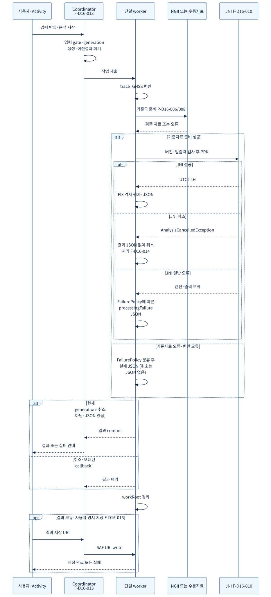

[Mermaid 원본](../diagrams/D16-pipeline-sequence.mmd)
